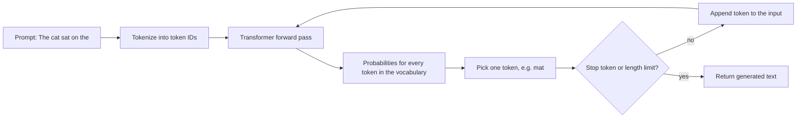
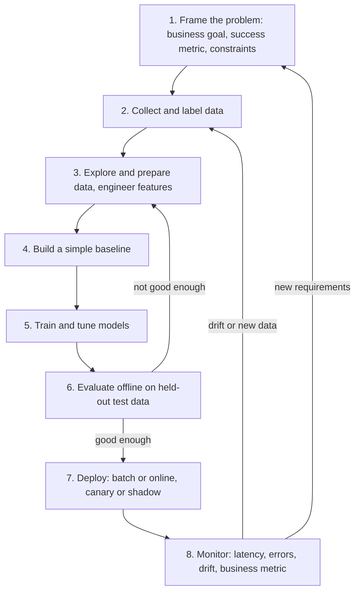
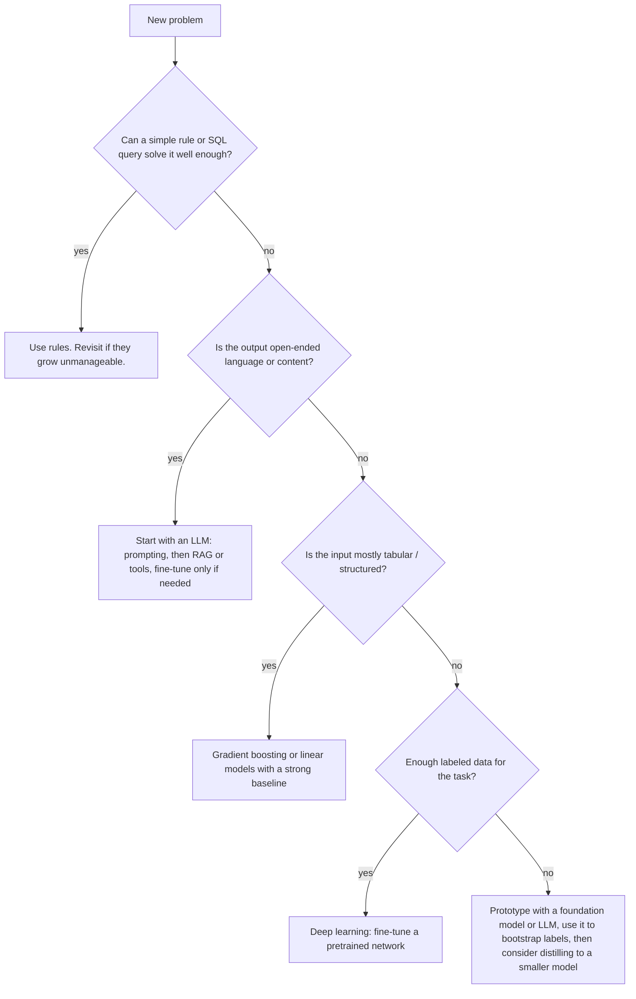
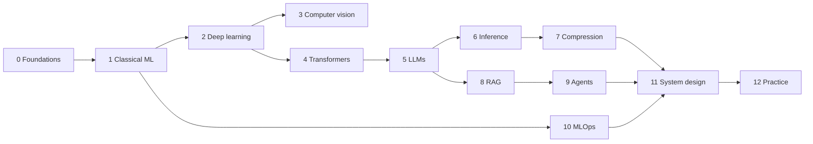

# What AI, Machine Learning, Deep Learning and Generative AI Are

> **Level:** Beginner to Advanced · **Study time:** ~90 min · **Prerequisites:** None

## Table of contents

- [Why this matters](#why-this-matters)
- [The big picture: four nested circles](#the-big-picture-four-nested-circles)
- [A short history of AI](#a-short-history-of-ai)
- [The core vocabulary of machine learning](#the-core-vocabulary-of-machine-learning)
- [Types of learning](#types-of-learning)
- [Regression, classification and generation](#regression-classification-and-generation)
- [Discriminative vs generative models](#discriminative-vs-generative-models)
- [What an LLM is, in plain words](#what-an-llm-is-in-plain-words)
- [The end-to-end ML project lifecycle](#the-end-to-end-ml-project-lifecycle)
- [Going deeper: rules vs classical ML vs deep learning vs GenAI](#going-deeper-rules-vs-classical-ml-vs-deep-learning-vs-genai)
- [Going deeper: what changes in production](#going-deeper-what-changes-in-production)
- [Roles in AI and what a senior AI/ML engineer is expected to know](#roles-in-ai-and-what-a-senior-aiml-engineer-is-expected-to-know)
- [How this course is organized and how to study it](#how-this-course-is-organized-and-how-to-study-it)
- [Common mistakes and misconceptions](#common-mistakes-and-misconceptions)
- [Interview questions and model answers](#interview-questions-and-model-answers)
- [Key takeaways](#key-takeaways)
- [Further reading](#further-reading)
- [Next](#next)

## Why this matters

Every AI interview, no matter how advanced, quietly tests whether you have a clean mental map of the field. When an interviewer asks "should we fine-tune a model or use RAG?", "why not just use an LLM for fraud detection?" or "is this a classification problem or a generation problem?", they are checking whether you can place a problem in the right box and pick the right tool, which is the core skill of a senior engineer. Real teams waste months because someone reached for an LLM when a gradient-boosted tree (or a regular expression) would have been cheaper, faster and more accurate. This chapter builds that map from zero: what the words mean, how the pieces fit together, how a model is built and shipped, and what people in different AI roles actually do. Everything else in the course hangs on this vocabulary. If terms like RAG, fine-tuning or gradient-boosted tree are unfamiliar, keep going: each is defined below.

## The big picture: four nested circles

> **Analogy:** Think of "vehicle", "car", "electric car" and "self-driving electric car". Each is a special case of the one before it. AI, ML, deep learning and generative AI nest the same way.

```text
+------------------------------------------------------------------+
| ARTIFICIAL INTELLIGENCE (AI)                                     |
| Machines doing tasks that seem to need intelligence:             |
| search, logic, hand-written rules, planning ... and learning     |
|                                                                  |
|   +----------------------------------------------------------+   |
|   | MACHINE LEARNING (ML)                                    |   |
|   | Systems that learn patterns from data instead of         |   |
|   | following hand-written rules                             |   |
|   |                                                          |   |
|   |   +--------------------------------------------------+   |   |
|   |   | DEEP LEARNING (DL)                               |   |   |
|   |   | ML with neural networks of many layers           |   |   |
|   |   |                                                  |   |   |
|   |   |   +------------------------------------------+   |   |   |
|   |   |   | GENERATIVE AI (modern GenAI)             |   |   |   |
|   |   |   | Deep models that create new text,        |   |   |   |
|   |   |   | images, audio, code                      |   |   |   |
|   |   |   |                                          |   |   |   |
|   |   |   |   +----------------------------------+   |   |   |   |
|   |   |   |   | LLMs: GPT, Llama, Gemini,        |   |   |   |   |
|   |   |   |   | Mistral, Qwen, DeepSeek ...      |   |   |   |   |
|   |   |   |   +----------------------------------+   |   |   |   |
|   |   |   +------------------------------------------+   |   |   |
|   |   +--------------------------------------------------+   |   |
|   +----------------------------------------------------------+   |
+------------------------------------------------------------------+
```

Now the precise definitions.

- **Artificial intelligence (AI)**: the broad field of building computer systems that perform tasks we associate with human intelligence, such as perceiving, reasoning, planning, understanding language and making decisions. AI includes approaches that involve no learning at all: a chess program that searches millions of moves, a route planner running a shortest-path algorithm, or a tax rules engine.
- **Machine learning (ML)**: a subset of AI in which the system's behavior is learned from data rather than written by hand. A classic definition (Tom Mitchell, 1997) says a program learns if its performance at some task, measured by some metric, improves with experience (data). Instead of writing `if "free money" in email: spam`, you show the system thousands of labeled emails and it figures out the rules.
- **Deep learning (DL)**: a subset of ML that uses **neural networks**, which are functions built from many simple, stacked layers of adjustable numbers, with many layers (hence "deep"). Deep learning shines on raw, unstructured data such as images, audio and text, because the network learns its own useful intermediate representations instead of relying on a human to design them.
- **Generative AI (GenAI)**: models that produce new content (text, images, audio, video, code) that resembles their training data. Today almost all practical GenAI is deep learning: large language models, diffusion models for images, and similar.
- **Large language model (LLM)**: a deep neural network, nearly always a **transformer** (the architecture introduced in 2017, taught in [The Full Transformer Architecture](../04-transformers/05-the-full-transformer-architecture.md)), trained on huge amounts of text to predict the next piece of text. More on this [below](#what-an-llm-is-in-plain-words).

> **Senior insight:** The circles are a teaching picture, not a law. "Generative model" is an old statistical idea (Naive Bayes, hidden Markov models and n-gram language models are generative and are not deep learning). The modern phrase "generative AI" usually means large deep generative models. If an interviewer pushes on the nesting, say exactly that: generative modeling predates deep learning, but modern GenAI is built on deep learning.

Where do the other buzzwords sit?

| Term | Where it sits | One-line meaning |
|---|---|---|
| Expert system | AI, not ML | Hand-written if-then rules from human experts |
| Search / planning (A*, minimax) | AI, not ML | Explore possible actions to find a good one |
| Gradient boosting, random forests | ML, not DL | Ensembles of decision trees (learned if-then splits on features), a strong default for tabular (spreadsheet-like) data |
| CNN (convolutional neural network) | DL | Neural network specialized for images and other grid-like data |
| Transformer | DL | Attention-based neural network, the basis of LLMs |
| Diffusion model | DL, GenAI | Generates images by iteratively removing noise |
| Foundation model | DL, usually GenAI | A large model pretrained on broad data, then adapted to many tasks |
| AI agent | Built on LLMs | An LLM in a loop that chooses actions (tool calls) toward a goal |
| RAG | System pattern around an LLM | Retrieve relevant documents, then let the LLM answer using them |

## A short history of AI

You do not need dates for an interview, but you do need the story: each era fixed the main weakness of the previous one.

| Era | Years (approx.) | Key idea | Landmark examples | Main weakness |
|---|---|---|---|---|
| Symbolic AI and rules | 1950s-1980s | Intelligence = logic + hand-written rules | Turing's "Computing Machinery and Intelligence" (1950); Dartmouth workshop (1956), whose 1955 proposal coined the term "artificial intelligence"; expert systems such as MYCIN | Rules are brittle and expensive to write and maintain |
| Early neural networks | 1958-1990s | Learn weights from examples | Rosenblatt's perceptron (1958); backpropagation popularized by Rumelhart, Hinton and Williams (1986); LeCun et al.'s convolutional networks for digits (1989-1998) | Too little data and compute to train deep networks well |
| Classical ML | 1990s-2010s | Statistical learning on hand-designed features | SVMs (Cortes and Vapnik, 1995), random forests (Breiman, 2001), boosting, spam filters, search ranking | Needs humans to engineer features; weak on raw images, audio, text |
| Deep learning | 2012-2017 | Learn the features too, with many-layer networks on GPUs | AlexNet wins ImageNet 2012 (Krizhevsky, Sutskever and Hinton); word2vec (Mikolov et al., 2013); ResNet (He et al., 2015); AlphaGo (2016) | Recurrent models for language are slow to train and forget long context |
| Transformers | 2017-2020 | Attention replaces recurrence; trains in parallel and scales | "Attention Is All You Need" (Vaswani et al., 2017); BERT (Devlin et al., 2018); GPT-2 (2019); GPT-3 with 175B parameters (Brown et al., 2020) | Raw pretrained models do not follow instructions well |
| LLMs and the ChatGPT era | 2022-2024 | Pretrain big, then align to follow instructions | InstructGPT and RLHF (Ouyang et al., 2022); ChatGPT (November 2022); open-weight models such as Llama (2023); RAG goes mainstream | Hallucinations, stale knowledge, cannot act in the world |
| Agents and reasoning models | 2024-today | LLMs that call tools, plan, and spend more compute "thinking" | ReAct (Yao et al., 2022) pattern in production; function calling; reasoning models such as OpenAI o1 (2024) and DeepSeek-R1 (2025); the Model Context Protocol (2024) | Reliability, security, evaluation and cost of multi-step systems |

Two "AI winters" (roughly the mid-1970s and the late 1980s to early 1990s) happened when promises outran results and funding dried up. They are a useful reminder that hype cycles are real.

Why did deep learning suddenly work in 2012? Three ingredients arrived together:

1. **Data**: ImageNet (Deng et al., 2009) gave over a million labeled training images.
2. **Compute**: GPUs, originally for video games, turned out to be excellent at the matrix math neural networks need.
3. **Algorithms and tricks**: ReLU activations ($\max(0, z)$, whose gradient does not shrink for positive inputs, unlike the sigmoid), dropout (randomly switching off units during training to reduce overfitting), better initialization.

AlexNet cut the ImageNet top-5 error (the share of images whose true label is not among the model's five top guesses) from roughly 26% (the best non-deep entry) to roughly 15%, and the field changed direction within a couple of years.

Why did transformers win in 2017? Earlier language models (recurrent networks, see [RNNs, LSTMs, Seq2Seq and Why Transformers Replaced Them](../02-deep-learning/08-rnns-lstms-and-the-road-to-transformers.md)) read text one word at a time, which is slow on GPUs and loses information over long distances. The transformer's **attention** mechanism lets every word look at every other word directly, and the whole sequence is processed in parallel during training. That made it practical to train on internet-scale text, and performance kept improving as models, data and compute grew.

> **Interview tip:** If asked "why now?", answer with the trio data + compute + algorithms, and add the 2017 architecture shift (parallelizable attention) plus the 2022 alignment shift (instruction tuning and RLHF made models usable by ordinary people). That shows you understand causes, not just dates.

## The core vocabulary of machine learning

We will use one running example: **predicting house prices**. You know some houses' sizes and their sale prices, and you want to predict the price of a new house.

### Features, labels and examples

- An **example** (also called a sample, row or data point) is one item you learn from: one house.
- A **feature** is an input measurement about the example: size in square meters, number of bedrooms, distance to the city center. The full list of features for one example is the **feature vector**, usually written $x$.
- A **label** (or target) is the answer you want to predict for that example: the sale price, written $y$.
- A **dataset** is a collection of examples. A **labeled dataset** has both $x$ and $y$ for each example.

Our tiny dataset (size in units of 100 m², price in thousands of dollars, illustrative):

| House | Size $x$ (100 m²) | Price $y$ (thousands of USD) |
|---|---|---|
| A | 0.5 | 150 |
| B | 1.0 | 250 |
| C | 1.5 | 350 |

### Model and parameters

- A **model** is a function with adjustable knobs that maps inputs to outputs: $\hat{y} = f(x)$. The hat on $\hat{y}$ means "predicted", as opposed to the true $y$.
- **Parameters** (in neural networks usually called **weights**) are those knobs: the numbers inside the model that training adjusts. A "7B model" has about 7 billion of them.
- **Hyperparameters** are settings you choose before training rather than learn, such as the learning rate or the number of layers.

The simplest useful model for our houses is a straight line:

$$\hat{y} = w x + b$$

- $\hat{y}$: the predicted price.
- $x$: the house size (the feature).
- $w$: the **weight**, how much the price goes up per unit of size.
- $b$: the **bias** (intercept), the base price when size is zero.

This model has exactly 2 parameters, $w$ and $b$. An LLM is the same idea scaled up: a function with billions of parameters instead of 2.

### Loss: how wrong is the model?

> **Analogy:** The loss is the score in a game of golf: lower is better, and the whole point of training is to drive it down.

A **loss function** turns "how wrong were the predictions" into one number. For predicting numbers, a standard choice is the **mean squared error (MSE)**:

$$L = \frac{1}{n} \sum_{i=1}^{n} \left(\hat{y}_i - y_i\right)^2$$

- $L$: the loss (one number for the whole dataset).
- $n$: the number of examples (here 3).
- $\hat{y}_i$: the model's prediction for example $i$.
- $y_i$: the true label for example $i$.
- $\sum$: "add up over all examples". Squaring makes every error positive and punishes big errors more.

**Worked example.** Start with a bad guess: $w = 100$, $b = 0$.

| House | $x$ | $\hat{y} = 100x + 0$ | $y$ | Error $\hat{y} - y$ | Squared error |
|---|---|---|---|---|---|
| A | 0.5 | 50 | 150 | -100 | 10,000 |
| B | 1.0 | 100 | 250 | -150 | 22,500 |
| C | 1.5 | 150 | 350 | -200 | 40,000 |

$L = (10{,}000 + 22{,}500 + 40{,}000) / 3 = 72{,}500 / 3 \approx 24{,}166.67$.

Now try $w = 200$, $b = 50$: predictions are $200 \times 0.5 + 50 = 150$, $200 \times 1.0 + 50 = 250$, $200 \times 1.5 + 50 = 350$. Every error is 0, so $L = 0$. These are the "true" parameters for this toy data.

### Training: turning the knobs to reduce the loss

**Training** (or fitting) is the process of searching for parameter values that make the loss small on the training data. The workhorse algorithm is **gradient descent**: compute which direction each parameter should move to reduce the loss (the **gradient**, a vector of slopes), take a small step in that direction, repeat. The size of the step is the **learning rate**. You will learn the calculus in [Calculus for ML](./03-calculus-and-gradients.md) and the full algorithm in [Backpropagation and Gradient Descent Explained](../02-deep-learning/02-backpropagation-and-gradient-descent.md); here is just one step so you can see it is ordinary arithmetic.

For MSE with our line, the slopes are:

$$\frac{\partial L}{\partial w} = \frac{2}{n}\sum_{i=1}^{n} (\hat{y}_i - y_i)\,x_i \qquad \frac{\partial L}{\partial b} = \frac{2}{n}\sum_{i=1}^{n} (\hat{y}_i - y_i)$$

- $\frac{\partial L}{\partial w}$: how much the loss changes if we nudge $w$ up a tiny bit (similarly for $b$).
- The other symbols are as before.
- Where they come from: differentiate $(w x_i + b - y_i)^2$ with the chain rule. The square gives $2(\hat{y}_i - y_i)$, and the inner expression contributes a factor $x_i$ for $w$ and $1$ for $b$.

Each step then applies the **update rule**

$$w \leftarrow w - \eta\,\frac{\partial L}{\partial w} \qquad b \leftarrow b - \eta\,\frac{\partial L}{\partial b}$$

where $\eta$ (eta) is the learning rate. The minus sign moves each parameter downhill: a negative slope means increasing the parameter lowers the loss.

Using the errors from the table ($-100, -150, -200$) and learning rate $\eta = 0.1$:

- $\frac{\partial L}{\partial w} = \frac{2}{3}\left((-100)(0.5) + (-150)(1.0) + (-200)(1.5)\right) = \frac{2}{3}(-50 - 150 - 300) = \frac{2}{3}(-500) \approx -333.33$
- $\frac{\partial L}{\partial b} = \frac{2}{3}(-100 - 150 - 200) = \frac{2}{3}(-450) = -300$
- New $w = 100 - 0.1 \times (-333.33) = 133.33$
- New $b = 0 - 0.1 \times (-300) = 30$

New predictions: $133.33 \times 0.5 + 30 = 96.67$, $133.33 + 30 = 163.33$, $200 + 30 = 230$. Errors: $-53.33, -86.67, -120$. Squared: $2{,}844.44 + 7{,}511.11 + 14{,}400 = 24{,}755.56$, divided by 3 gives $L \approx 8{,}251.85$. One step cut the loss from about 24,167 to about 8,252. Repeat a few thousand times and you land on $w = 200$, $b = 50$.

### Inference: using the trained model

**Inference** (or prediction, or serving) means running the trained model on new inputs. For a new 120 m² house ($x = 1.2$): $\hat{y} = 200 \times 1.2 + 50 = 290$, so about 290,000 USD.

Training and inference have very different cost profiles, which matters enormously in production:

| | Training | Inference |
|---|---|---|
| What happens | Adjust parameters to reduce loss | Run fixed parameters on new inputs |
| How often | Once, or periodically (retraining) | Every user request, forever |
| Compute per step | Forward pass + backward pass + optimizer update | Forward pass only |
| Memory | Weights + gradients + optimizer state + activations | Weights + (for LLMs) the KV cache |
| What you optimize | Final model quality, time to train | Latency, throughput, cost per request |

Terms in the table: the **forward pass** computes predictions from inputs; the **backward pass** (backpropagation) computes the gradient for every parameter; **optimizer state** is extra per-parameter memory some optimizers keep (Adam stores running averages of gradients and of squared gradients); **activations** are each layer's intermediate outputs, saved during training because the backward pass needs them. The KV cache is explained [below](#what-7b-means-a-back-of-the-envelope).

### The same ideas in code

From scratch with NumPy, so you see the mechanism:

```python
# pip install numpy
import numpy as np

x = np.array([0.5, 1.0, 1.5])        # house size in 100 m^2
y = np.array([150.0, 250.0, 350.0])  # price in $1000s

w, b = 100.0, 0.0   # initial guess for the 2 parameters
lr = 0.1            # learning rate (a hyperparameter)

for step in range(2001):
    y_hat = w * x + b                 # forward pass: predictions
    err = y_hat - y
    loss = np.mean(err ** 2)          # MSE loss
    if step in (0, 1, 2000):
        print(f"step {step:4d}  loss={loss:10.2f}  w={w:7.2f}  b={b:6.2f}")
    grad_w = 2 * np.mean(err * x)     # dL/dw
    grad_b = 2 * np.mean(err)         # dL/db
    w -= lr * grad_w                  # gradient descent update
    b -= lr * grad_b

# step    0  loss=  24166.67  w= 100.00  b=  0.00
# step    1  loss=   8251.85  w= 133.33  b= 30.00
# step 2000  loss=      0.00  w= 200.00  b= 50.00

print(f"prediction for 120 m^2: {w * 1.2 + b:.1f}")  # prediction for 120 m^2: 290.0
```

The standard library version, which you would actually use for a linear model:

```python
# pip install scikit-learn numpy
import numpy as np
from sklearn.linear_model import LinearRegression

X = np.array([[0.5], [1.0], [1.5]])  # scikit-learn wants a 2-D array: rows = examples, cols = features
y = np.array([150.0, 250.0, 350.0])

model = LinearRegression().fit(X, y)          # training
print(f"w={model.coef_[0]:.1f}, b={model.intercept_:.1f}")  # w=200.0, b=50.0
print(model.predict(np.array([[1.2]])))       # inference -> approximately [290.]
```

> **Common mistake:** Confusing the loss with the business metric. The loss is what the training algorithm minimizes and usually must be smooth (differentiable). The metric is what the business cares about (accuracy, recall on fraud, revenue, user satisfaction). They are related but not the same, and a model can lower its loss while the business metric gets worse. See [Loss Functions](../02-deep-learning/04-loss-functions.md) and [Classification Metrics and Imbalanced Data](../01-classical-ml/04-classification-metrics-and-imbalanced-data.md).

### Generalization: the actual goal

A model that only memorizes its training data is useless. What we want is **generalization**: good performance on new data the model has never seen. That is why we hold out data the model never trains on and measure performance there. In practice data is split three ways: a **training set** to fit the parameters, a **validation set** to compare models and tune hyperparameters, and a **test set** used once at the end for an honest estimate. Reusing the test set for decisions quietly turns it into a second validation set. A model that fits training data well but fails on new data is **overfitting**; one too simple to capture the pattern is **underfitting**. These ideas get a full chapter in [Overfitting, Bias-Variance, Regularization and Data Leakage](../01-classical-ml/03-overfitting-regularization-and-data-leakage.md), and data splits are covered in [The ML Workflow, Train/Validation/Test Splits and Cross-Validation](../01-classical-ml/01-ml-workflow-data-splits-and-cross-validation.md).

## Types of learning

The type of learning is defined by **what signal the model learns from**.

> **Analogy:** Supervised learning is a student with an answer key. Unsupervised learning is a student sorting a pile of unlabeled photos into groups. Self-supervised learning is a student covering up words in a book and guessing them. Reinforcement learning is a child learning to ride a bike: no answer key, just falling (bad) or staying up (good).

### Supervised learning

**Supervised learning** learns a mapping from inputs $x$ to labels $y$ using examples where the correct answer is given. Our house-price model is supervised. So is a spam filter trained on emails marked "spam" or "not spam".

- Everyday examples: spam filtering, credit-card fraud detection, predicting delivery time, recognizing faces in photos, medical image diagnosis.
- Strength: directly optimizes the task you care about; easy to evaluate.
- Weakness: labels cost money and time (humans must annotate), and labels can be noisy or biased.

### Unsupervised learning

**Unsupervised learning** finds structure in data that has no labels.

- **Clustering**: group similar items (customer segments from purchase histories).
- **Dimensionality reduction**: compress many features into a few that keep most of the information (for visualization or speed).
- **Anomaly detection**: flag items that look unlike the rest (an unusual server metric pattern).
- Weakness: there is no answer key, so "is this clustering good?" is often a judgment call.

Full coverage: [Unsupervised Learning: Clustering, Dimensionality Reduction and Anomaly Detection](../01-classical-ml/10-unsupervised-learning-clustering-and-dimensionality-reduction.md).

### Self-supervised learning

**Self-supervised learning** creates labels automatically from the raw data itself, so you get supervised-style training on unlabeled data. This is the single most important idea behind modern LLMs: take any text, hide part of it, and train the model to predict the hidden part. The internet provides trillions of words of free training signal.

- **Next-token prediction** (GPT-style): given "the cat sat on the", predict "mat".
- **Masked prediction** (BERT-style): given "the cat [MASK] on the mat", predict "sat".
- **Contrastive learning** (CLIP-style): learn that an image and its own caption belong together, and a random caption does not.

Watch how labels appear for free:

```python
# Self-supervised labels from raw text: every prefix is an input, the next word is its label.
words = "the cat sat on the mat".split()
pairs = [(" ".join(words[:i]), words[i]) for i in range(1, len(words))]
for context, target in pairs:
    print(f"{context!r:24} -> {target!r}")

# 'the'                    -> 'cat'
# 'the cat'                -> 'sat'
# 'the cat sat'            -> 'on'
# 'the cat sat on'         -> 'the'
# 'the cat sat on the'     -> 'mat'
```

One 6-word sentence produced 5 training examples with no human labeling. (Real LLMs work on **tokens**, which are word pieces, rather than whole words; see [Tokenization](../04-transformers/01-tokenization.md).)

### Reinforcement learning

**Reinforcement learning (RL)** trains an **agent** (the decision maker) that takes **actions** in an **environment** and receives **rewards**. It learns a **policy**, a rule for choosing actions, that maximizes total reward over time. There is no correct label for each step, only delayed feedback about how well things went.

- Everyday examples: a game-playing program (AlphaGo), a robot learning to walk, a thermostat learning when to heat.
- In LLMs: **RLHF** (reinforcement learning from human feedback) trains a chat model to produce answers that humans prefer, and modern **reasoning models** are trained with RL on problems whose answers can be checked automatically (math, code). See [Instruction Tuning, RLHF and DPO](../05-llms/02-instruction-tuning-rlhf-and-dpo.md) and [Reasoning Models and Test-Time Compute](../05-llms/12-reasoning-models-and-test-time-compute.md).
- Weakness: needs many trials, rewards can be "gamed" (the agent finds a loophole that scores well without doing the intended thing, called **reward hacking**), and training is less stable than supervised learning.

### Related setups you will hear about

- **Semi-supervised learning**: a few labeled examples plus many unlabeled ones.
- **Weak supervision**: noisy labels generated by heuristics or by another model (for example, using an LLM to label training data for a smaller classifier).
- **Transfer learning**: reuse a model trained on one task as the starting point for another. Fine-tuning an ImageNet-pretrained network on X-ray images is transfer learning, and so is fine-tuning an LLM.
- **In-context learning**: an LLM picks up a task from instructions or a few examples placed in its prompt, with no parameter updates at all. This is new with large models and is why prompting works.

### Summary table

| Type | Learns from | Typical tasks | Everyday example | Main cost or risk |
|---|---|---|---|---|
| Supervised | Inputs + human labels | Regression, classification | Spam filter, house prices | Labels are expensive |
| Unsupervised | Inputs only | Clustering, compression, anomalies | Customer segments | Hard to evaluate |
| Self-supervised | Labels derived from the data itself | Pretraining LLMs and vision models | Predict the next word | Huge compute; learns whatever is in the data, including biases |
| Reinforcement | Rewards from interacting | Control, games, aligning LLMs | Learning to ride a bike | Sample inefficiency, reward hacking |

> **Senior insight:** A modern LLM uses three of these in sequence: self-supervised pretraining (next-token prediction on huge text), supervised fine-tuning on instruction-response pairs, then RL or preference optimization to align with human preferences. Being able to say that in one sentence is a strong interview signal.

## Regression, classification and generation

The type of learning is about the training signal. The **task type** is about what the output looks like.

### Regression: predict a number

**Regression** predicts a continuous number: a house price, tomorrow's temperature, delivery time in minutes. The loss is usually MSE or a close relative such as mean absolute error (MAE). Our house example is regression.

### Classification: predict a category

**Classification** predicts which of a fixed set of categories an input belongs to. **Binary classification** has two classes (spam or not spam); **multi-class** has more (cat, dog, horse); **multi-label** allows several at once (a news article tagged both "sports" and "finance").

Most classifiers output a probability per class, then apply a **threshold** to decide. A classic binary classifier is **logistic regression**: compute a score $z$ as a weighted sum, then squash it into a probability with the **sigmoid** function:

$$z = w_1 x_1 + w_2 x_2 + b \qquad p = \sigma(z) = \frac{1}{1 + e^{-z}}$$

- $x_1, x_2$: features. For our spam filter, $x_1$ = how many times the word "free" appears, $x_2$ = 1 if the email has a link, else 0.
- $w_1, w_2$: weights (learned), and $b$: bias (learned).
- $z$: the raw score, any real number (often called a **logit**).
- $\sigma$: the sigmoid, which maps any number into the range 0 to 1.
- $e$: Euler's number, about 2.718.
- $p$: the model's probability that the email is spam.

**Worked example** (illustrative learned weights $w_1 = 1.5$, $w_2 = 2.0$, $b = -3$). An email says "free" twice and contains a link, so $x_1 = 2$, $x_2 = 1$:

- $z = 1.5 \times 2 + 2.0 \times 1 + (-3) = 3 + 2 - 3 = 2$
- $e^{-2} \approx 0.1353$
- $p = 1 / (1 + 0.1353) = 1 / 1.1353 \approx 0.881$

With a threshold of 0.5, we label it spam. The usual classification loss is **cross-entropy**, $-\ln(\text{probability given to the correct class})$. If the email really is spam, loss $= -\ln(0.881) \approx 0.127$ (small, good). If it was actually a legitimate email, loss $= -\ln(1 - 0.881) = -\ln(0.119) \approx 2.13$ (large, bad). Cross-entropy is explained properly in [Softmax, Entropy, Cross-Entropy and KL Divergence](./05-softmax-entropy-cross-entropy-and-kl-divergence.md), and logistic regression gets a full chapter in [Linear and Logistic Regression from Scratch](../01-classical-ml/02-linear-and-logistic-regression.md).

### Generation: produce new content

**Generation** produces a structured, open-ended output: a paragraph, an image, a piece of code, a melody. The output is not one number or one label but a long sequence of choices, and there are usually many acceptable answers.

Here is the key insight that connects the three: **an LLM generates text by doing classification over and over**. At each step it outputs a probability for every token in its vocabulary (tens of thousands to a few hundred thousand entries, depending on the model), picks one, appends it, and repeats. Generation is repeated next-token classification, trained with the same cross-entropy loss as our spam filter.

The network outputs one raw score (logit) $z_j$ per vocabulary entry, and **softmax**, the multi-class version of the sigmoid, turns them into probabilities over a vocabulary of $V$ tokens:

$$p_j = \frac{e^{z_j}}{\sum_{k=1}^{V} e^{z_k}}$$

For three tokens with logits $2, 1, 0$: $e^2 \approx 7.389$, $e^1 \approx 2.718$, $e^0 = 1$, sum $\approx 11.107$, so the probabilities are about $0.665, 0.245, 0.090$. A bigger logit gets a bigger share, and the shares always sum to 1.

| | Regression | Classification | Generation |
|---|---|---|---|
| Output | A number | A label (plus class probabilities) | A sequence or structure (text, image, code) |
| Example | House price | Spam vs not spam | Write a reply to this email |
| Typical loss | MSE, MAE | Cross-entropy | Cross-entropy per token (LLMs), denoising loss (diffusion) |
| Typical metrics | MAE, RMSE | Precision, recall, F1, AUC | Human or LLM-judge ratings, task success, exact match where possible |
| How many right answers? | One true value | One true class | Many acceptable outputs |
| Evaluation difficulty | Easy | Easy to moderate | Hard |

Metric glossary: **MAE** is the average absolute error and **RMSE** is $\sqrt{\text{MSE}}$, both in the label's units. **Precision** is the share of predicted positives that are truly positive; **recall** is the share of actual positives the model catches; **F1** is their harmonic mean, $2PR/(P+R)$. **AUC** (area under the ROC curve) is the probability that a randomly chosen positive is scored above a randomly chosen negative (ties count half). Details in [Classification Metrics and Imbalanced Data](../01-classical-ml/04-classification-metrics-and-imbalanced-data.md) and [Regression Metrics, Baselines and Model Selection](../01-classical-ml/05-regression-metrics-baselines-and-model-selection.md).

Other task types you will meet: **ranking** (order search results), **clustering**, **object detection** (find and box objects in an image, see [Computer Vision Tasks](../03-computer-vision/01-image-classification-detection-and-segmentation.md)), **segmentation** (label every pixel), and **embedding** (map items to vectors so that similar items are close, the foundation of semantic search and RAG, see [Text Embeddings and Similarity Search](../08-rag/02-text-embeddings-and-similarity-search.md)).

> **Interview tip:** Many real problems can be framed several ways. "Estimate a customer's chance of churning" can be regression (predict days until churn), classification (will churn within 30 days: yes or no) or ranking (which 1,000 customers should the retention team call first). Saying "I would frame it as X because the business action is Y" is exactly what senior interviewers want to hear.

## Discriminative vs generative models

> **Analogy:** To tell Spanish from Italian, a **discriminative** learner memorizes the telltale differences ("words ending in -zione are Italian"). A **generative** learner learns to actually speak both languages, then asks "which language would more likely have produced this sentence?". The second learner knows much more, and pays for it.

- A **discriminative model** learns the boundary between classes directly. Mathematically it models $P(y \mid x)$, "the probability of label $y$ given input $x$". Examples: logistic regression, SVMs, most neural network classifiers, gradient-boosted trees.
- A **generative model** learns how the data itself is produced. It models $P(x, y)$ (or $P(x \mid y)$ and $P(y)$), or just $P(x)$ when there are no labels. Because it models the data, you can **sample** from it to create new examples. Examples: Naive Bayes, Gaussian mixture models, hidden Markov models, GANs, diffusion models, and LLMs (which model the probability of text).

The bridge between them is **Bayes' rule**, which turns a generative model into a classifier:

$$P(y \mid x) = \frac{P(x \mid y)\,P(y)}{P(x)}$$

- $P(y \mid x)$: the **posterior**, probability of the class given what we observed (what we want).
- $P(x \mid y)$: the **likelihood**, how probable these features are for this class (what a generative model learns).
- $P(y)$: the **prior**, how common the class is before looking at the input.
- $P(x)$: the overall probability of the input, which normalizes the result. It equals $\sum_{y} P(x \mid y)P(y)$.

**Worked example** (illustrative numbers). Suppose 20% of emails are spam, the word "free" appears in 60% of spam emails and in 5% of legitimate ("ham") emails. An email contains "free". How likely is it spam?

- $P(\text{free} \mid \text{spam})\,P(\text{spam}) = 0.6 \times 0.2 = 0.12$
- $P(\text{free} \mid \text{ham})\,P(\text{ham}) = 0.05 \times 0.8 = 0.04$
- $P(\text{free}) = 0.12 + 0.04 = 0.16$
- $P(\text{spam} \mid \text{free}) = 0.12 / 0.16 = 0.75$

So 75%. A generative classifier (Naive Bayes) learns those likelihoods and priors from counts; a discriminative one (logistic regression) learns the 0.75-style answer directly. Probability basics are in [Probability and Statistics for Machine Learning](./04-probability-and-statistics.md).

Both kinds on a tiny 4-document corpus:

```python
# pip install scikit-learn
from sklearn.feature_extraction.text import CountVectorizer
from sklearn.naive_bayes import MultinomialNB           # generative
from sklearn.linear_model import LogisticRegression     # discriminative

docs = [
    "win a free prize now",          # spam
    "free money click now",          # spam
    "meeting moved to monday",       # ham
    "lunch with the team on monday", # ham
]
labels = ["spam", "spam", "ham", "ham"]

vec = CountVectorizer()             # turns text into word-count features
X = vec.fit_transform(docs)
test = vec.transform(["claim your free prize", "see you monday"])  # unseen words are ignored

for model in (MultinomialNB(), LogisticRegression()):
    model.fit(X, labels)
    print(type(model).__name__, model.predict(test))
# Both should print ['spam' 'ham'] on this toy data.
```

| | Discriminative | Generative |
|---|---|---|
| Models | $P(y \mid x)$ or a decision boundary | $P(x, y)$ or $P(x)$ |
| Can create new data? | No | Yes (sample from it) |
| Examples | Logistic regression, SVM, gradient boosting, BERT classifier | Naive Bayes, HMM, GAN, diffusion, GPT-style LLMs |
| Data efficiency | Often needs more data, but usually lower error with enough data | Can do well with less data if its assumptions hold |
| Handles missing features, flags unusual inputs | Less naturally | More naturally (it models the inputs, so it can marginalize missing ones and score how likely an input is) |
| Typical use | Classification, scoring, ranking | Content creation, density estimation, simulation |

A classic study, "On Discriminative vs. Generative Classifiers: A comparison of logistic regression and naive Bayes" (Ng and Jordan, 2001), showed this trade-off: the generative model can approach its best error with fewer examples, while the discriminative model often reaches a lower final error given enough data.

> **Senior insight:** An LLM is a generative model, but you can use it discriminatively: prompt it to output "spam" or "not_spam", or read the probabilities it assigns to those label tokens. That is often a fast way to build a first version. At high volume, though, a small discriminative model (often trained on LLM-generated labels) is usually far cheaper and faster. Knowing when to switch is a real production skill.

## What an LLM is, in plain words

> **Analogy:** An LLM is autocomplete that read a large fraction of the public internet, many books and lots of code, and became so good at guessing the next word that guessing well requires picking up grammar, facts, reasoning patterns and coding conventions along the way.

A **large language model (LLM)** is a neural network (in nearly all modern cases a **decoder-only** transformer, meaning each position can only attend to itself and earlier tokens, which is exactly what left-to-right generation needs; see [Encoder-Only, Encoder-Decoder and Decoder-Only Models](../04-transformers/07-encoder-only-encoder-decoder-and-decoder-only-models.md)) with billions of parameters, trained with self-supervised learning to predict the next **token** given all previous tokens. A token is a chunk of text, often a word or part of a word.

### The probability picture

An LLM assigns a probability to any sequence of tokens by multiplying next-token probabilities (the chain rule of probability):

$$P(t_1, t_2, \ldots, t_n) = \prod_{i=1}^{n} P(t_i \mid t_1, \ldots, t_{i-1})$$

- $t_i$: the $i$-th token.
- $P(t_i \mid t_1, \ldots, t_{i-1})$: the probability of token $i$ given everything before it. This is what the network outputs at each position.
- $\prod$: multiply all the terms together.

**Worked example** with our 3-word sentence "the cat sat" (illustrative probabilities, treating each word as one token):

- $P(\text{the}) = 0.05$
- $P(\text{cat} \mid \text{the}) = 0.01$
- $P(\text{sat} \mid \text{the cat}) = 0.2$
- $P(\text{the cat sat}) = 0.05 \times 0.01 \times 0.2 = 0.0001$

During training, the loss at the last position is $-\ln(0.2) \approx 1.609$. Training nudges the parameters so that the probability of the actual next token goes up, which pushes this number down. That is all pretraining is, repeated over trillions of tokens. Details: [How LLMs Are Trained, Part 1: Pretraining and Next-Token Prediction](../05-llms/01-pretraining-and-next-token-prediction.md).

Averaging the loss over all three positions gives $-(\ln 0.05 + \ln 0.01 + \ln 0.2)/3 \approx (2.996 + 4.605 + 1.609)/3 \approx 3.07$. Its exponential, $e^{3.07} \approx 21.5$, is the **perplexity**: on average the model was as unsure as if it were choosing uniformly among about 21.5 tokens. Lower is better, and it is the standard way to report language-model loss.

### How it generates text



How a token is picked (always the most likely one, or sampled with some randomness) is the topic of [How LLMs Generate Text: Decoding Strategies](../05-llms/03-text-generation-and-decoding-strategies.md).

You can see the real next-token probabilities of a small open model (GPT-2, about 124 million parameters, released in 2019):

```python
# pip install torch transformers
import torch
from transformers import AutoTokenizer, AutoModelForCausalLM

tok = AutoTokenizer.from_pretrained("gpt2")
model = AutoModelForCausalLM.from_pretrained("gpt2")
model.eval()

inputs = tok("The cat sat on the", return_tensors="pt")
with torch.no_grad():
    logits = model(**inputs).logits          # shape: [batch=1, seq_len, vocab_size]

probs = torch.softmax(logits[0, -1], dim=-1)  # distribution over the next token
top = torch.topk(probs, k=5)
for p, idx in zip(top.values, top.indices):
    print(f"{tok.decode(int(idx))!r:12} {p.item():.3f}")

n_params = sum(p.numel() for p in model.parameters())
print(f"parameters: {n_params:,}")            # roughly 124 million
```

### From pretrained model to assistant

A raw pretrained model only continues text. Ask it "What is the capital of France?" and it might continue with "What is the capital of Germany?", because lists of questions are common on the internet. Turning it into a helpful assistant takes extra stages:

```text
Stage 1: Pretraining              self-supervised, next-token prediction on trillions of tokens
         -> "base model"          knows a lot, but just continues text
Stage 2: Instruction tuning (SFT) supervised, on (instruction, good response) pairs
         -> follows instructions
Stage 3: Preference tuning        RLHF or DPO, using human (or AI) preferences between answers
         -> "chat / instruct model": helpful, polite, refuses some harmful requests
Optional: reasoning RL            RL on checkable problems, learns to "think" longer before answering
```

SFT stands for supervised fine-tuning. **RLHF** trains a reward model on human comparisons of answers, then optimizes the LLM against it with RL; **DPO** (direct preference optimization) learns from the same comparison pairs directly, with no separate reward model.

### What "7B" means: a back-of-the-envelope

Our running large example is a **7B model**: about 7 billion parameters. How much memory do the weights alone need?

$$\text{memory} = \text{number of parameters} \times \text{bytes per parameter}$$

| Format | Bytes per parameter | 7B model weights |
|---|---|---|
| FP32 (32-bit float) | 4 | $7 \times 10^9 \times 4 = 28$ GB |
| FP16 / BF16 (16-bit) | 2 | $7 \times 10^9 \times 2 = 14$ GB |
| INT8 | 1 | 7 GB |
| INT4 | 0.5 | 3.5 GB |

(GB here means $10^9$ bytes.) Serving also needs memory for the **KV cache**, the stored attention keys and values for every token in the conversation (at every layer), which grows with context length and the number of concurrent users. Training needs far more: with the common Adam optimizer in mixed precision, a standard estimate is about 16 bytes per parameter (from the ZeRO paper, Rajbhandari et al., 2020): 2 for BF16 weights, 2 for BF16 gradients, and 12 for an FP32 master copy of the weights plus Adam's two running averages. That is roughly $7 \times 10^9 \times 16 = 112$ GB before counting activations, more than one 80 GB GPU, which is why parameter-efficient methods like LoRA and QLoRA exist (they freeze the base weights and train small added matrices, so gradients and optimizer state are needed for only a tiny fraction of parameters; QLoRA also stores the frozen base in 4 bits). See [Number Formats and Model Memory](../07-model-compression/01-number-formats-and-model-memory.md), [The KV Cache](../06-llm-inference/02-kv-cache-explained.md) and [Fine-Tuning LLMs: Full Fine-Tuning, LoRA and QLoRA](../05-llms/07-fine-tuning-full-lora-and-qlora.md).

### What LLMs are good and bad at

| Good at | Weak at |
|---|---|
| Fluent text, summarization, rewriting, translation | Facts not in training data (private docs, recent events) |
| Extracting structure from messy text | Guaranteed correctness; they can **hallucinate** (state false things confidently) |
| Code generation and explanation | Exact arithmetic and counting without tools |
| Following instructions, few-shot tasks | Determinism and reproducibility |
| Acting as a flexible "reasoning engine" over provided context | Low latency and low cost at very high volume |

The weaknesses drive most of the rest of the course: **RAG** fixes missing knowledge by retrieving documents at query time ([What Is RAG and Why It Matters](../08-rag/01-what-is-rag-and-why-it-matters.md)), **tool calling and agents** let the model act and compute ([What Is an AI Agent?](../09-agents/01-what-is-an-ai-agent.md)), **evaluation** measures quality ([Evaluating LLMs](../05-llms/10-llm-evaluation-metrics-and-llm-as-a-judge.md)), and **inference optimization and compression** fix cost and latency ([LLM Inference Fundamentals](../06-llm-inference/01-inference-fundamentals-prefill-decode-and-latency-metrics.md)).

> **Common mistake:** Saying an LLM "looks things up" or "knows" facts like a database. A plain LLM has no lookup step: facts are stored diffusely in its weights, frozen at training time, and recalled imperfectly. If you need current or private facts with citations, you need retrieval or tools.

## The end-to-end ML project lifecycle

> **Analogy:** Training a model is like cooking the main dish at a restaurant. The lifecycle is running the restaurant: buying ingredients (data), checking food safety (validation), serving customers (deployment), and listening to complaints (monitoring). Most of the work, and most of the failures, happen outside the frying pan.



What each step really means:

1. **Frame the problem.** What decision will the model support? What is the success metric (and what is the cost of each kind of error)? What are the latency, cost, privacy and explainability constraints? Is ML even needed?
2. **Collect and label data.** Where does it come from, is it representative of production, who labels it, how consistent are the labels?
3. **Prepare data and features.** Clean, handle missing values, encode categories, split into train, validation and test sets without leaking information. See [Feature Engineering](../01-classical-ml/07-feature-engineering-missing-values-and-encoding.md).
4. **Baseline.** A trivial predictor (always predict the average price, or the most common class), a rule, or a simple model. Without it you cannot tell if your fancy model is worth it. See [Regression Metrics, Baselines and Model Selection](../01-classical-ml/05-regression-metrics-baselines-and-model-selection.md).
5. **Train and tune.** Try model families, tune hyperparameters on the validation set, track experiments.
6. **Evaluate offline.** On a test set never used for decisions, with the right metric, sliced by important segments (region, device, customer type).
7. **Deploy.** Package the model, serve it in batch or in real time, roll out gradually: **shadow** mode runs the new model on real traffic without using its outputs, and a **canary** sends it a small share of traffic first. See [Model Deployment Patterns](../10-mlops/04-model-deployment-patterns.md).
8. **Monitor and iterate.** The world changes, so data drifts and accuracy decays. Monitor and retrain. See [Data Drift, Concept Drift and When to Retrain](../01-classical-ml/08-data-drift-concept-drift-and-retraining.md) and [Monitoring ML and LLM Systems in Production](../10-mlops/06-monitoring-ml-and-llm-systems-in-production.md).

**MLOps** is the engineering discipline that makes this loop reliable and repeatable: versioning data and models, automating training and deployment pipelines, testing, and monitoring. It is covered in [The ML Lifecycle, MLOps and Experiment Tracking](../10-mlops/01-ml-lifecycle-and-experiment-tracking.md).

### The LLM application lifecycle is similar but shifted

When you build on a pretrained LLM, you often skip training entirely, and the effort moves to prompts, retrieval and evaluation:

| Step | Classical ML project | LLM application |
|---|---|---|
| Starting point | Your own data, train from scratch | A pretrained model (API or open-weight) |
| Main levers | Features, model choice, hyperparameters | Prompt, retrieval (RAG), tools, model choice, sometimes fine-tuning |
| Evaluation | Accuracy, F1, RMSE on a labeled test set | Curated eval set, LLM-as-a-judge, human review, task success |
| Versioned artifacts | Data, code, model weights | Prompts, retrieval index, model version, tool definitions, eval sets |
| Main production risks | Drift, training-serving skew (features computed differently in training and serving) | Hallucination, prompt injection (malicious instructions hidden in user input or retrieved text), cost, latency, provider model changes |
| Cost driver | Training compute, cheap inference | Per-token inference cost at every request |

The decision of when to prompt, retrieve or fine-tune gets its own chapter: [Prompting vs RAG vs Fine-Tuning: A Decision Guide](../05-llms/08-prompting-vs-rag-vs-fine-tuning-decision-guide.md).

## Going deeper: rules vs classical ML vs deep learning vs GenAI

Senior interviews often hide this question inside a design problem: "We want to detect fraudulent transactions" or "We want to route support tickets". Your first job is to choose the right family of tools.

| Approach | Use when | Pros | Cons | Example |
|---|---|---|---|---|
| Hand-written rules | Logic is known, stable, must be auditable; little data | Transparent, cheap, instant, no training data | Brittle, hard to maintain as rules multiply, misses subtle patterns | "Block transactions from sanctioned countries" |
| Classical ML (linear models, gradient boosting) | Structured/tabular data, a clear label, need for speed and cost efficiency | Strong accuracy on tabular data, fast (often sub-millisecond per prediction on CPU), cheap, fairly explainable | Needs labeled data and feature engineering; weak on raw text, images, audio | Fraud scoring, churn prediction, pricing |
| Deep learning (CNNs, fine-tuned transformers) | Unstructured data (images, audio, text) with a well-defined task and enough labels | Learns features automatically, best accuracy on perception tasks | Needs more data and GPUs, harder to explain and debug | Defect detection on a factory line, speech recognition |
| GenAI / LLMs (prompting, RAG, agents) | Open-ended language tasks, many task variants, little labeled data, need for natural-language output | Very fast to prototype, handles messy input, zero or few labels needed | Per-request cost and latency, non-determinism, hallucination, harder evaluation, data privacy concerns with external APIs | Drafting support replies, answering questions over internal docs |

A practical decision flow:



> **Senior insight:** These are not exclusive. Strong production systems are hybrids: rules for hard constraints (compliance), a gradient-boosted model for fast scoring, and an LLM only where language understanding or generation adds clear value. In a support system, for example, a cheap classifier can route 90% of tickets (illustrative) and an LLM handles the long tail.

### The "start simple" principle

Always build the simplest credible baseline first. It tells you how hard the problem is, gives you a fallback when the fancy model fails, and often turns out to be good enough. Many senior engineers can tell a story where a logistic regression or a well-tuned gradient-boosted model beat a deep network on tabular data at a fraction of the cost. On tabular data, tree ensembles remain very strong; see [Decision Trees, Random Forests and Gradient Boosting](../01-classical-ml/06-decision-trees-random-forests-and-gradient-boosting.md).

## Going deeper: what changes in production

A model in a notebook and a model in production are different animals. The paper "Hidden Technical Debt in Machine Learning Systems" (Sculley et al., 2015) made the point with a famous diagram: the ML code is a small box surrounded by much larger boxes for data collection, feature extraction, verification, serving infrastructure, configuration and monitoring.

```text
+-------------------------------------------------------------------+
|  Data collection  |  Data validation  |  Feature pipelines        |
|-------------------+-------------------+---------------------------|
|  Labeling         |   [ ML model ]    |  Serving infrastructure   |
|-------------------+-------------------+---------------------------|
|  Monitoring       |  Config / CI/CD   |  Security, access control |
+-------------------------------------------------------------------+
   The model is one small piece; the system around it is most of the work.
```

What a senior engineer worries about, and where this course covers it:

| Concern | Classical ML | LLM systems | Covered in |
|---|---|---|---|
| Data quality and leakage | Leaky features, bad labels | Bad or stale documents, contaminated eval sets | [Overfitting and Data Leakage](../01-classical-ml/03-overfitting-regularization-and-data-leakage.md), [Contamination and Memorization](../05-llms/09-catastrophic-forgetting-contamination-and-memorization.md) |
| Training-serving skew | Features computed differently online vs offline | Prompt or retrieval differences between eval and prod | [Reproducible Training and Training-Serving Skew](../10-mlops/03-reproducibility-and-training-serving-skew.md) |
| Drift | Input distribution or label relationship changes | User queries change, documents change, provider updates model | [Data Drift, Concept Drift and When to Retrain](../01-classical-ml/08-data-drift-concept-drift-and-retraining.md) |
| Evaluation | Labeled test sets, offline metrics + A/B tests | Eval sets, LLM-as-a-judge, regression tests on prompts | [Building an LLM Evaluation Framework](../05-llms/11-building-an-llm-evaluation-framework-and-regression-tests.md) |
| Latency | Usually milliseconds | Hundreds of ms to many seconds; time to first token matters | [Inference Fundamentals](../06-llm-inference/01-inference-fundamentals-prefill-decode-and-latency-metrics.md) |
| Cost | Mostly training and storage | Per-token inference cost on every request | [Optimizing and Benchmarking LLM Latency and Cost](../06-llm-inference/07-optimizing-and-benchmarking-llm-latency-and-cost.md) |
| Safety and security | Adversarial inputs, fairness | Prompt injection, data exfiltration via tools, harmful content | [LLM Safety and Guardrails](../05-llms/13-llm-safety-guardrails-and-responsible-ai.md), [Making Agents Reliable and Secure](../09-agents/08-agent-reliability-security-and-prompt-injection.md) |
| Determinism | Same input gives same output | Sampling and batching can change outputs | [Decoding Strategies](../05-llms/03-text-generation-and-decoding-strategies.md) |

### A cost back-of-the-envelope (illustrative)

Say you classify 1 million support tickets per day. Compare two designs, using **illustrative prices only** (real prices vary widely by vendor, model and year):

- **LLM design:** each call sends 500 input tokens and gets 10 output tokens back. At an illustrative USD 0.50 per million input tokens and USD 1.50 per million output tokens:
  - Input: $1{,}000{,}000 \times 500 = 500{,}000{,}000$ tokens, which is 500 million tokens, so $500 \times 0.50 = 250$ USD per day.
  - Output: $1{,}000{,}000 \times 10 = 10{,}000{,}000$ tokens, which is 10 million tokens, so $10 \times 1.50 = 15$ USD per day.
  - Total: 265 USD per day, about 7,950 USD per 30-day month.
- **Small classifier design:** a fine-tuned small model or gradient-boosted model on a few CPU instances typically costs a small fraction of that and answers in milliseconds instead of hundreds of milliseconds.

The point is not the exact numbers. It is the habit: **multiply volume by per-request cost and latency before choosing an architecture.** Interviewers love candidates who do this unprompted.

### How to debug an ML system (the senior habit)

When quality drops, check in this order, from cheapest to most expensive:

1. **Data and pipeline:** did an upstream schema change, did a feature go null, did the document index stop updating?
2. **Inputs vs training distribution:** are users asking new kinds of questions, did a new customer segment arrive?
3. **Serving vs offline mismatch:** same preprocessing, same prompt, same model version?
4. **Evaluation itself:** is the metric still measuring what matters, is the test set stale?
5. **Only then the model:** retrain, change architecture, fine-tune.

Most production incidents are data or pipeline bugs, not model bugs. The full playbooks are in the debugging case studies, starting with [How to Approach AI/ML System Design and Debugging Interviews](../11-system-design/01-how-to-approach-ai-system-design-interviews.md).

## Roles in AI and what a senior AI/ML engineer is expected to know

Job titles vary a lot between companies, so focus on the work, not the label.

| Role | Main question they answer | Typical outputs | Core skills | Typical tools |
|---|---|---|---|---|
| Data scientist | "What does the data tell us, and what should we do?" | Analyses, experiments (A/B tests), dashboards, prototype models | Statistics, experimentation, SQL, communication | SQL, pandas, notebooks, scikit-learn, BI tools |
| ML engineer | "How do we build and run models reliably at scale?" | Training pipelines, feature pipelines, model serving, monitoring | Software engineering + ML, distributed systems, MLOps | PyTorch, scikit-learn, Spark, Kubernetes, model registries, feature stores |
| AI engineer (a newer title) | "How do we build products on top of foundation models?" | LLM apps, RAG pipelines, agents, evals, guardrails | Software engineering, prompting, retrieval, evaluation, API integration | LLM APIs, vector databases, orchestration frameworks, tracing tools |
| Research scientist | "How do we make models fundamentally better?" | Papers, new architectures, training methods | Deep math, experimental design, reading and writing research | PyTorch or JAX, large GPU clusters |
| MLOps / ML platform engineer | "How do all teams train and ship models easily?" | Shared infrastructure, CI/CD for models, GPU scheduling | Infrastructure, DevOps, cost management | Kubernetes, Terraform, orchestrators, observability stacks |

### What a Senior Software Engineer (AI/ML) is expected to know

The "senior software engineer, AI/ML" profile sits between ML engineer and AI engineer, with strong software engineering as the base. Interviewers typically probe:

1. **Fundamentals:** supervised vs unsupervised learning, overfitting, metrics, train/validation/test splits, gradient descent, neural networks, why things work and when they fail.
2. **Transformers and LLMs:** tokenization, embeddings, attention, how LLMs are pretrained and aligned, decoding, hallucinations, fine-tuning (LoRA, QLoRA).
3. **RAG and vector search:** chunking, embeddings, hybrid search, reranking, ANN indexes like HNSW, evaluation of retrieval and faithfulness, permissions in multi-tenant systems.
4. **Agents:** tool calling, design patterns, orchestration, memory, reliability and prompt-injection defenses, evaluation.
5. **Efficient inference and model optimization:** KV cache, batching, quantization (INT8, INT4, FP8), distillation, serving frameworks, latency and throughput metrics, GPU memory math.
6. **MLOps and production:** deployment patterns, monitoring, drift, CI/CD for models and prompts, reproducibility, cost control.
7. **System design:** designing an end-to-end AI system with clear requirements, trade-offs, failure modes, evaluation and capacity estimates.
8. **Judgment and communication:** choosing the simplest solution that works, quantifying cost and risk, explaining trade-offs to non-experts, mentoring.

> **Interview tip:** The difference between a mid-level and a senior answer is rarely knowing more algorithms. It is (a) asking about requirements and constraints first, (b) proposing a baseline, (c) naming the trade-offs and failure modes, (d) saying how you would measure success, and (e) estimating cost and latency. Practice structuring every answer this way.

## How this course is organized and how to study it

The course moves from foundations to production. Each part builds on the ones before it.

| Part | Folder | What you learn | Start here |
|---|---|---|---|
| 0. Foundations | `00-foundations` | This map, plus the math (linear algebra, calculus, probability, cross-entropy) and Python tooling | [Linear Algebra for ML](./02-linear-algebra-for-ml.md) |
| 1. Classical ML | `01-classical-ml` | Workflow, regression, metrics, trees and boosting, features, drift, unsupervised learning | [The ML Workflow](../01-classical-ml/01-ml-workflow-data-splits-and-cross-validation.md) |
| 2. Deep learning | `02-deep-learning` | Neural nets, backprop, optimizers, training stability, CNNs, RNNs, mixed precision, distributed training | [Neural Networks from Scratch](../02-deep-learning/01-neural-networks-from-scratch.md) |
| 3. Computer vision | `03-computer-vision` | Classification, detection, segmentation, augmentation, production CV, ViT and CLIP | [Computer Vision Tasks](../03-computer-vision/01-image-classification-detection-and-segmentation.md) |
| 4. Transformers | `04-transformers` | Tokenization, embeddings, attention, the full architecture, positional encodings, modern improvements | [Tokenization](../04-transformers/01-tokenization.md) |
| 5. LLMs | `05-llms` | Pretraining, alignment, decoding, prompting, structured output, hallucinations, fine-tuning, evaluation, reasoning, safety | [Pretraining and Next-Token Prediction](../05-llms/01-pretraining-and-next-token-prediction.md) |
| 6. LLM inference | `06-llm-inference` | Prefill and decode, KV cache, GPU limits, batching, speculative decoding, serving frameworks, benchmarking | [Inference Fundamentals](../06-llm-inference/01-inference-fundamentals-prefill-decode-and-latency-metrics.md) |
| 7. Model compression | `07-model-compression` | Number formats, quantization, PTQ vs QAT, GPTQ and AWQ, distillation, pruning | [Number Formats and Model Memory](../07-model-compression/01-number-formats-and-model-memory.md) |
| 8. RAG | `08-rag` | Embeddings, ingestion, chunking, hybrid search, ANN indexes, vector databases, reranking, evaluation, debugging, security | [What Is RAG](../08-rag/01-what-is-rag-and-why-it-matters.md) |
| 9. Agents | `09-agents` | Agents vs workflows, tool calling, patterns, orchestration, multi-agent, memory, MCP, security, evaluation | [What Is an AI Agent?](../09-agents/01-what-is-an-ai-agent.md) |
| 10. MLOps | `10-mlops` | Lifecycle, versioning, reproducibility, deployment, inference APIs, monitoring, CI/CD, LLMOps | [The ML Lifecycle and MLOps](../10-mlops/01-ml-lifecycle-and-experiment-tracking.md) |
| 11. System design | `11-system-design` | How to approach design interviews, four full designs, three debugging cases | [How to Approach AI System Design](../11-system-design/01-how-to-approach-ai-system-design-interviews.md) |
| 12. Interview practice | `12-interview-practice` | Coding exercises from scratch: classical ML, DL, transformers, RAG, agents | [Coding Exercises: ML from Scratch](../12-interview-practice/01-coding-exercises-ml-from-scratch.md) |



### How each chapter works

Every chapter follows the same pattern: intuition and analogy, precise definitions, formulas with tiny worked examples, code (from scratch, then the standard library), senior-level production sections, common mistakes, interview questions with collapsible answers, a cheat sheet of key takeaways, and links onward.

### How to study it

1. **Go in order the first time.** Later chapters assume earlier vocabulary. If you are short on time, do not skip foundations; skim the deep-learning internals instead.
2. **Type the code, do not just read it.** Run every snippet, change a number, predict what happens, then check. Mechanisms stick when your hands are involved.
3. **Redo the worked examples by hand.** If you can compute a softmax, an attention score or a model's memory footprint on paper, you can explain it under interview pressure.
4. **Self-quiz with the interview questions.** Read the question, answer out loud in about 60 seconds, then open the answer. Mark the ones you missed and revisit them a few days later (spaced repetition beats rereading).
5. **Use the key takeaways as flashcards** in the final week.
6. **Build two or three small projects** that tie it together, for example: a RAG app over your own documents with an evaluation set; a LoRA fine-tune of a small open model; quantizing a model and benchmarking latency and memory before and after. Being able to say "when I built X, I found Y" is gold in interviews.
7. **Practice system design out loud** with a timer, using the framework in part 11.

A realistic pace for a working engineer is roughly 8 to 12 weeks at 8 to 10 hours per week (a suggestion, not a rule): foundations and classical ML first, then deep learning and transformers, then LLMs, RAG and agents, then inference, compression and MLOps, and finally system design and practice.

## Common mistakes and misconceptions

- **"AI and ML are the same thing."** ML is one approach to AI. Rule engines and search algorithms are AI without learning.
- **"Deep learning is always better."** On tabular data, gradient-boosted trees are often as good or better, and much cheaper. Deep learning usually wins on images, audio and text.
- **"Generative AI means LLMs."** LLMs are one kind. Diffusion models for images, text-to-speech and music models are also generative AI, and generative modeling predates deep learning.
- **"Self-supervised is the same as unsupervised."** Both use unlabeled data, but self-supervised learning creates explicit prediction targets from the data and trains like supervised learning. Clustering does not.
- **"The model with the lowest training loss is the best."** Only performance on held-out data matters. Low training loss with high test loss is overfitting.
- **"Loss and metric are the same."** The loss is what the optimizer minimizes; the metric is what the business judges. Choose and monitor both.
- **"An LLM knows facts like a database."** It recalls statistically from frozen weights and can hallucinate. Use retrieval or tools for facts that must be correct and current.
- **"Parameters and hyperparameters are interchangeable terms."** Parameters are learned; hyperparameters are chosen.
- **"Training is the expensive part, so inference cost does not matter."** For LLM products, inference runs on every request forever and often dominates total cost.
- **"Use an LLM for everything."** A regex, a SQL query or a small classifier is often faster, cheaper, more accurate and easier to test.
- **"ML projects end at deployment."** Deployment is the start of monitoring, drift detection and retraining.
- **"A 7B model needs 7 GB."** Only at 8 bits per weight. In BF16 it needs about 14 GB for weights alone, plus KV cache.

## Interview questions and model answers

<details>
<summary><b>Q1. Explain the difference between AI, machine learning, deep learning and generative AI. Where does an LLM fit?</b></summary>

**Short answer:** They are nested. AI is the broad goal of machines doing intelligent tasks, including rules and search. ML is the subset where behavior is learned from data. Deep learning is ML with many-layer neural networks, which excels on unstructured data. Generative AI is models that create new content; today that is mostly deep learning. An LLM is a deep, transformer-based generative model of text, trained with self-supervised next-token prediction.

**Deeper answer and follow-ups:**
- Non-ML AI still matters: route planning, constraint solvers, rule engines for compliance.
- Nuance: generative modeling predates deep learning (Naive Bayes, HMMs, n-gram LMs), so the nesting is a simplification for modern GenAI.
- An LLM can be used discriminatively (as a classifier) even though it is a generative model.
- Follow-up "where do agents fit?": an agent is a system pattern, an LLM in a loop choosing tool calls toward a goal, not a new model type.

</details>

<details>
<summary><b>Q2. What is the difference between discriminative and generative models? When would you prefer each?</b></summary>

**Short answer:** A discriminative model learns $P(y \mid x)$, the boundary between classes, directly (logistic regression, gradient boosting). A generative model learns how the data is produced, $P(x, y)$ or $P(x)$, so it can also sample new data (Naive Bayes, diffusion, LLMs). For pure prediction with enough labels, discriminative models usually win on accuracy and cost. Generative models help when data is scarce, inputs are partially missing, or you need to create content.

**Deeper answer and follow-ups:**
- Bayes' rule connects them: $P(y \mid x) \propto P(x \mid y)P(y)$. Worked example: prior 0.2, likelihoods 0.6 and 0.05 give $0.12 / 0.16 = 0.75$.
- Ng and Jordan (2001): generative classifiers can approach their best error with fewer samples; discriminative ones often reach lower error asymptotically.
- Practical twist: use a generative LLM to label data, then train a small discriminative model for cheap high-volume serving (a form of distillation).
- Pitfall: generative models with wrong assumptions (Naive Bayes' independence) can be badly calibrated (predicted probabilities do not match observed frequencies) even when they rank well.

</details>

<details>
<summary><b>Q3. What is self-supervised learning, and why was it the key to modern LLMs?</b></summary>

**Short answer:** Self-supervised learning derives labels from the raw data itself, for example by hiding the next word and predicting it. It turns unlimited unlabeled text into supervised training examples, so model size and data can scale far beyond what human labeling allows. Combined with transformers that train efficiently in parallel, this made internet-scale pretraining possible.

**Deeper answer and follow-ups:**
- Variants: causal next-token prediction (GPT), masked language modeling (BERT), contrastive image-text learning (CLIP).
- Each position in a sequence is a training example, so one document yields thousands of examples.
- Difference from unsupervised: it has an explicit prediction target and a supervised-style loss (cross-entropy).
- Limits: the model learns whatever is in the data, including errors and biases; the base model is not instruction-following, which is why SFT and preference tuning follow.
- How to measure: held-out perplexity tracks pretraining progress, but downstream quality needs task evals. In production, self-supervised encoders (BERT, CLIP) are reused through fine-tuning or as embedding models when labels are scarce.

</details>

<details>
<summary><b>Q4. Walk me through the lifecycle of an ML project. Where do projects most often fail?</b></summary>

**Short answer:** Frame the problem and metric, collect and label data, prepare features and splits, build a baseline, train and tune, evaluate offline on held-out data, deploy gradually, monitor, and retrain as the world changes. Most failures happen at the edges, not in the model: a poorly framed problem, unrepresentative or leaky data, a mismatch between offline metric and business value, training-serving skew, and lack of monitoring.

**Deeper answer and follow-ups:**
- Framing: what decision does the model drive, what does each error type cost, what are the latency and cost budgets?
- Data leakage (features that encode the answer) produces great offline numbers that collapse in production.
- Splits must mimic production: split by time for temporal data, keep all rows of one user or document in the same split, and never tune on the test set.
- Always have a baseline and a fallback path.
- Deployment patterns: shadow (run silently alongside), canary (small traffic share), A/B tests.
- For LLM apps the loop is similar but the levers are prompts, retrieval, tools and eval sets, and versioning must include prompts and indexes.

</details>

<details>
<summary><b>Q5. A product manager wants to "add AI" to automatically route incoming support tickets to the right team. How do you decide between rules, a classical model and an LLM?</b></summary>

**Short answer:** Start from requirements: volume, latency, number of teams, how often categories change, and how much labeled history exists. If historical tickets with assigned teams exist, a text classifier (TF-IDF, word counts down-weighted for words that appear in many documents, plus logistic regression, or a fine-tuned small transformer) is cheap, fast and measurable. If labels are scarce or categories change often, an LLM with a well-designed prompt is a fast first version. At high volume, I would use the LLM to bootstrap labels and then distill to a small classifier, keeping the LLM for low-confidence cases.

**Deeper answer and follow-ups:**
- Baseline first: keyword rules or the majority class, to know what "good" means.
- Metric: per-team precision and recall, plus cost of misroutes (some teams are expensive to misroute to).
- Cost math: volume times tokens times price per token versus a few CPU instances for a classifier.
- Hybrid: confidence threshold, below which the ticket goes to the LLM or a human.
- Production concerns: new categories appearing (drift), PII in tickets when calling external APIs, and evaluation on a held-out recent time window.

</details>

<details>
<summary><b>Q6. What is the difference between training and inference, and why do their costs and bottlenecks differ?</b></summary>

**Short answer:** Training adjusts parameters to minimize loss, running forward and backward passes plus optimizer updates over a dataset, usually once or periodically. Inference runs the fixed model forward on each new request, forever. Training is dominated by total compute and memory for gradients and optimizer state; inference is dominated by latency, throughput and per-request cost.

**Deeper answer and follow-ups:**
- Memory example for a 7B model: about 14 GB of weights in BF16 for inference (plus KV cache), versus roughly 16 bytes per parameter, about 112 GB, for full mixed-precision Adam training before activations.
- LLM inference has two phases: prefill (process the prompt, compute-heavy) and decode (generate one token at a time, usually memory-bandwidth-bound).
- Optimizations differ: training uses mixed precision and parallelism (data, tensor, pipeline, FSDP); inference uses batching, KV caching, quantization, speculative decoding.
- At product scale, cumulative inference cost often exceeds training cost.
- How to measure: training in GPU-hours and tokens per second per GPU; inference in time to first token, tokens per second, p95 latency and cost per 1,000 requests.

</details>

<details>
<summary><b>Q7. Why did deep learning take off around 2012, and why did transformers take over around 2017?</b></summary>

**Short answer:** Deep learning needed three things that arrived together around 2012: large labeled datasets (ImageNet), cheap parallel compute (GPUs), and training tricks (ReLU, dropout, better initialization). AlexNet's large ImageNet win proved it. Transformers took over because attention replaced sequential recurrence, so training parallelizes across the sequence and long-range dependencies are direct, which let models scale to internet-sized text.

**Deeper answer and follow-ups:**
- AlexNet cut top-5 error from roughly 26% to roughly 15% in ILSVRC 2012 (the ImageNet competition).
- RNNs process tokens one by one (slow on GPUs) and struggle with long-range information despite LSTMs.
- Scaling: performance improved predictably with more parameters, data and compute, motivating ever-larger pretraining.
- 2022 added the usability shift: instruction tuning and RLHF turned base models into assistants (ChatGPT).
- Trade-off of attention: compute and memory grow quadratically with sequence length, which motivates FlashAttention and other efficiency work.

</details>

<details>
<summary><b>Q8. What role does reinforcement learning play in modern LLMs?</b></summary>

**Short answer:** After pretraining and supervised instruction tuning, RL is used to align models with human preferences (RLHF: train a reward model on human comparisons, then optimize the LLM against it with an algorithm like PPO, proximal policy optimization, which limits how far each update moves the model). More recently, RL with automatically verifiable rewards (does the code pass tests, is the math answer correct) is used to train reasoning models that produce longer chains of thought.

**Deeper answer and follow-ups:**
- InstructGPT (Ouyang et al., 2022) is the reference paper for RLHF on LLMs.
- DPO (Rafailov et al., 2023) optimizes on preference pairs directly with a classification-style loss, avoiding a separate reward model and RL loop; it is preference optimization, not classic RL.
- Risks: reward hacking (verbose or sycophantic answers that the reward model likes), and a KL penalty, which charges the model for drifting away from the SFT model's output distribution (see [KL divergence](./05-softmax-entropy-cross-entropy-and-kl-divergence.md)), keeps it close to its starting point.
- Reasoning models shift compute to inference time ("test-time compute"), increasing latency and token cost per answer.

</details>

<details>
<summary><b>Q9. How does evaluating a generative system differ from evaluating a classifier?</b></summary>

**Short answer:** A classifier has one correct label per example, so accuracy, precision, recall and F1 on a labeled test set are straightforward. A generative system has many acceptable outputs, so exact-match metrics fail. You need task-specific criteria (correctness, faithfulness to sources, format validity, safety), measured by a mix of automated checks, LLM-as-a-judge with a clear rubric, and human review, on a curated eval set that you run as regression tests on every change.

**Deeper answer and follow-ups:**
- Use deterministic checks wherever possible: JSON schema validity, exact answers for extractive tasks, unit tests for code.
- LLM judges have biases (position, verbosity, self-preference); calibrate them against human labels.
- For RAG, separate retrieval quality (recall@k: is a relevant document in the top $k$; MRR: how high the first relevant one ranks) from generation quality (faithfulness, answer relevance).
- Online signals: thumbs up or down, escalation rate, task completion; offline eval alone is not enough.
- Pitfall: eval set contamination or drift away from real traffic; refresh it from production samples.

</details>

<details>
<summary><b>Q10. What is a loss function, and how is it different from the evaluation metric? Give an example where they disagree.</b></summary>

**Short answer:** The loss is the differentiable quantity the training algorithm minimizes, such as MSE or cross-entropy. The metric is how you judge usefulness, such as precision at a threshold, F1, revenue or user satisfaction. Losses are chosen to be smooth and trainable; metrics are chosen to reflect business value, and they can diverge.

**Deeper answer and follow-ups:**
- Example: in fraud detection with 0.1% fraud (illustrative), a model can reduce average cross-entropy mostly by being confident on the easy legitimate majority while recall on fraud stays poor; accuracy looks like 99.9% from predicting "legit" always.
- Accuracy is not usefully differentiable (it is piecewise constant in the model's parameters, so its gradient is zero almost everywhere), so we train with cross-entropy and evaluate with accuracy, F1 or AUC.
- For LLMs, lower perplexity (next-token loss) does not guarantee better helpfulness or factuality.
- Fixes: class weighting, threshold tuning on validation data, choosing metrics with the business up front.

</details>

<details>
<summary><b>Q11. When should you NOT use machine learning, or not use an LLM?</b></summary>

**Short answer:** Skip ML when a simple deterministic rule solves the problem well, when there is no data or no feedback signal, when errors must be impossible rather than rare (and the logic is fully specifiable), or when explainability requirements exclude it. Skip an LLM when the task is structured prediction on tabular data, when volume and latency budgets make per-token cost unaffordable, or when you need exact, deterministic outputs that a rule or a small model can deliver.

**Deeper answer and follow-ups:**
- Rules first for hard constraints (regulatory blocks); ML for fuzzy patterns; LLMs for open-ended language.
- Cost and latency estimates should be part of the decision: tokens per request times requests per day times price.
- Maintenance cost is real: ML systems accumulate "hidden technical debt" (Sculley et al., 2015) in data dependencies and pipelines.
- A good answer offers a path: start with rules or an LLM prototype, collect data, then graduate to a cheaper or more accurate model when the volume justifies it.

</details>

<details>
<summary><b>Q12. How would you describe the difference between an ML engineer and an AI engineer, and what does a senior engineer in this space bring?</b></summary>

**Short answer:** An ML engineer typically builds and runs the pipelines that train, deploy and monitor models, often on the company's own data. An AI engineer typically builds products on top of foundation models: prompts, RAG, agents, evaluation and guardrails. A senior engineer spans both enough to choose the right approach, design the whole system with its failure modes, estimate cost and latency, set up evaluation and monitoring, and lead others through the trade-offs.

**Deeper answer and follow-ups:**
- Titles vary by company; describe the work, not the label.
- Data scientists focus on analysis and experiments; research scientists on new methods; platform engineers on shared infrastructure.
- Senior signals in interviews: clarifies requirements first, proposes a baseline, quantifies trade-offs, plans evaluation, anticipates production issues (drift, skew, security, cost).
- Concrete example: choosing a quantized 7B open-weight model served with continuous batching (new requests join the running batch at every generation step) over a large API model, because the task is narrow, volume is high and data cannot leave the network.

</details>

## Key takeaways

- AI $\supset$ ML $\supset$ deep learning $\supset$ modern generative AI $\supset$ LLMs. AI also includes non-learning methods like rules and search; generative modeling predates deep learning.
- ML learns behavior from data; a **model** is a function with **parameters** that **training** adjusts to minimize a **loss**; **inference** runs the trained model on new inputs.
- **Features** are inputs, **labels** are targets, **hyperparameters** are chosen settings, **parameters** are learned values.
- The goal is **generalization** to unseen data, measured on held-out data, never on the training set.
- Supervised learns from labels, unsupervised finds structure without labels, self-supervised creates labels from the data itself, RL learns from rewards.
- LLMs combine self-supervised pretraining, supervised instruction tuning, and RL or preference optimization.
- Regression outputs numbers, classification outputs categories, generation outputs sequences. LLM generation is repeated next-token classification trained with cross-entropy.
- Discriminative models learn $P(y \mid x)$; generative models learn $P(x, y)$ or $P(x)$ and can sample new data. Bayes' rule links them.
- History in one line: rules, then classical ML on hand-made features, then deep learning (2012: data + GPUs + tricks), then transformers (2017), then aligned LLMs (2022), then agents and reasoning models.
- A 7B model needs about 14 GB for weights in BF16, 3.5 GB in INT4, and roughly 112 GB to fully train with mixed-precision Adam (before activations).
- The model is a small part of an ML system; data, pipelines, serving, evaluation and monitoring are most of the work and most of the failures.
- Choose the simplest tool that works: rules, then classical ML (especially for tabular data), then deep learning for unstructured data, then LLMs for open-ended language. Hybrids are normal.
- Always estimate volume times per-request cost and latency before picking an architecture.
- Senior answers: clarify requirements, baseline first, name trade-offs and failure modes, define how to measure success, estimate cost.

## Further reading

- Stuart Russell and Peter Norvig, *Artificial Intelligence: A Modern Approach* (4th edition, 2020). The standard broad AI textbook.
- Ian Goodfellow, Yoshua Bengio and Aaron Courville, *Deep Learning* (MIT Press, 2016), free online at https://www.deeplearningbook.org.
- Christopher Bishop, *Pattern Recognition and Machine Learning* (Springer, 2006). Deep treatment of generative vs discriminative models.
- Aurélien Géron, *Hands-On Machine Learning with Scikit-Learn, Keras and TensorFlow* (3rd edition, O'Reilly, 2022).
- Chip Huyen, *Designing Machine Learning Systems* (O'Reilly, 2022) and *AI Engineering* (O'Reilly, 2025).
- Richard Sutton and Andrew Barto, *Reinforcement Learning: An Introduction* (2nd edition, MIT Press, 2018).
- Alan Turing, "Computing Machinery and Intelligence" (Mind, 1950).
- Yann LeCun, Yoshua Bengio and Geoffrey Hinton, "Deep learning" (Nature, 2015).
- Alex Krizhevsky, Ilya Sutskever and Geoffrey Hinton, "ImageNet Classification with Deep Convolutional Neural Networks" (NeurIPS 2012).
- Ashish Vaswani et al., "Attention Is All You Need" (NeurIPS 2017).
- Tom Brown et al., "Language Models are Few-Shot Learners" (2020), the GPT-3 paper.
- Long Ouyang et al., "Training language models to follow instructions with human feedback" (2022), the InstructGPT paper.
- Rishi Bommasani et al., "On the Opportunities and Risks of Foundation Models" (2021).
- Andrew Ng and Michael Jordan, "On Discriminative vs. Generative Classifiers: A comparison of logistic regression and naive Bayes" (NIPS 2001).
- D. Sculley et al., "Hidden Technical Debt in Machine Learning Systems" (NeurIPS 2015).
- scikit-learn User Guide: https://scikit-learn.org/stable/user_guide.html

## Next

Next chapter: [Linear Algebra for Machine Learning](./02-linear-algebra-for-ml.md), where we learn the vectors, dot products and matrix multiplications that every model in this course is built from.

Related chapters:

- [Calculus for ML: Derivatives, Gradients and the Chain Rule](./03-calculus-and-gradients.md)
- [Probability and Statistics for Machine Learning](./04-probability-and-statistics.md)
- [The ML Workflow, Train/Validation/Test Splits and Cross-Validation](../01-classical-ml/01-ml-workflow-data-splits-and-cross-validation.md)
- [Neural Networks from Scratch: Neurons, Layers and Activations](../02-deep-learning/01-neural-networks-from-scratch.md)
- [How LLMs Are Trained, Part 1: Pretraining and Next-Token Prediction](../05-llms/01-pretraining-and-next-token-prediction.md)
- [What Is an AI Agent? Agents vs Workflows](../09-agents/01-what-is-an-ai-agent.md)
- [How to Approach AI/ML System Design and Debugging Interviews](../11-system-design/01-how-to-approach-ai-system-design-interviews.md)
