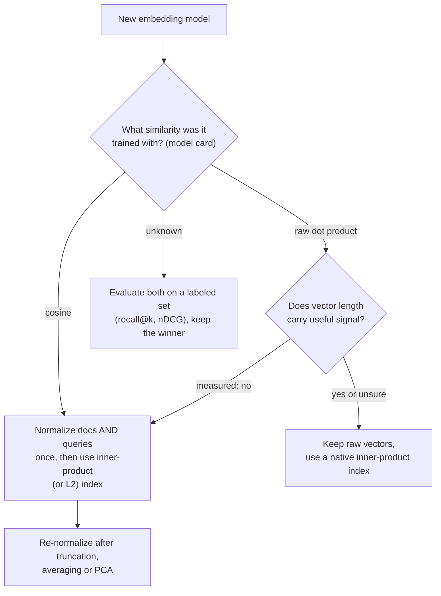
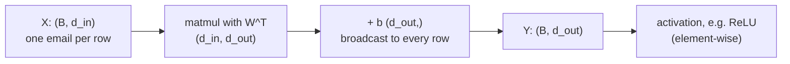

# Linear Algebra for Machine Learning

> **Level:** Beginner to Advanced · **Study time:** ~120 min · **Prerequisites:** [What AI, Machine Learning, Deep Learning and Generative AI Are](./01-what-is-ai-ml-dl-and-genai.md)

## Table of contents

- [Why this matters](#why-this-matters)
- [Scalars, vectors, matrices and tensors](#scalars-vectors-matrices-and-tensors)
- [Vector addition and scaling](#vector-addition-and-scaling)
- [The dot product](#the-dot-product)
- [Vector norms: measuring length](#vector-norms-measuring-length)
- [Unit vectors and normalization](#unit-vectors-and-normalization)
- [Similarity and distance: cosine, dot product and Euclidean](#similarity-and-distance-cosine-dot-product-and-euclidean)
- [Matrix multiplication](#matrix-multiplication)
- [Transpose, identity and inverse](#transpose-identity-and-inverse)
- [A matrix is a linear transformation](#a-matrix-is-a-linear-transformation)
- [A neural network layer: y = Wx + b](#a-neural-network-layer-y--wx--b)
- [Rank and low-rank matrices](#rank-and-low-rank-matrices)
- [Eigenvalues, eigenvectors and SVD](#eigenvalues-eigenvectors-and-svd)
- [NumPy broadcasting](#numpy-broadcasting)
- [How much memory does a matrix need?](#how-much-memory-does-a-matrix-need)
- [Going deeper: linear algebra in production AI systems](#going-deeper-linear-algebra-in-production-ai-systems)
- [Common mistakes and misconceptions](#common-mistakes-and-misconceptions)
- [Interview questions and model answers](#interview-questions-and-model-answers)
- [Key takeaways](#key-takeaways)
- [Further reading](#further-reading)
- [Next](#next)

## Why this matters

Every modern AI system is, underneath, a pile of matrix multiplications. A transformer layer is a handful of matrix multiplications plus a few simple functions. A RAG system finds relevant documents by computing dot products between a query vector and millions of document vectors. LoRA fine-tuning works because useful weight updates can be well approximated by the product of two thin matrices. Quantization, GPU memory planning and inference cost all start with "how many numbers are in this matrix, and how many bytes is each one?". Interviewers ask about cosine similarity, normalization, shapes and memory constantly, because a wrong answer here usually means a real bug or a wrong cost estimate later.

The good news: you need a small, very practical slice of linear algebra, and this chapter teaches exactly that slice, from zero.

> **Do not worry about the jargon in the paragraph above.** Quick glosses so nothing feels like magic: a **transformer** is the neural network architecture behind modern LLMs; **RAG** (Retrieval-Augmented Generation) means "search a document collection first, then let the LLM answer using what it found"; **LoRA** is a cheap way to fine-tune a big model by training only small extra matrices; **quantization** means storing numbers with fewer bits to save memory. Each gets its own chapter later. Here you will learn the math they all share.

How this chapter is organized:

| Part | Sections | What you will be able to do |
|---|---|---|
| Building blocks | Scalars to unit vectors | Describe data as vectors, add, scale, measure length |
| Similarity | Cosine, dot product, Euclidean | Answer the three most common embedding interview questions with worked numbers |
| Matrices | Matrix multiplication to SVD | Read shapes, compute a layer by hand, explain LoRA and PCA |
| Practice | Broadcasting, memory, production | Avoid silent shape bugs, estimate GPU and index memory |

---

## Scalars, vectors, matrices and tensors

> **Analogy:** A scalar is one number on a sticky note. A vector is a row of sticky notes (a shopping list). A matrix is a spreadsheet. A tensor is a stack of spreadsheets, or a stack of stacks.

### Scalar

A **scalar** is a single number, like a house price of `370` (thousand dollars) or a learning rate of `0.001`. Its shape is `()` (no dimensions).

### Vector

A **vector** is an ordered list of numbers. Order matters: position 0 always means the same thing.

House example: describe a house with 3 **features** (measurable properties):

$$
\mathbf{x} = [2.0,\ 3,\ 10]
$$

- $2.0$ = size in thousands of square feet
- $3$ = number of bedrooms
- $10$ = age in years

The number of entries is the vector's **dimension**. This is a 3-dimensional vector, shape `(3,)`.

You can picture a 2D vector like `[3, 4]` as an arrow from the origin to the point (3, 4). In ML we use vectors with hundreds or thousands of dimensions (a text **embedding**, which is a vector that represents the meaning of a piece of text, often has 384, 768, 1024 or more). You cannot picture 768 dimensions, but every rule you learn in 2D still works.

### Matrix

A **matrix** is a 2D grid of numbers with **rows** and **columns**. A matrix with $m$ rows and $n$ columns has shape $(m, n)$, read "m by n".

Our running "3-word sentence" example: the sentence *"I love cats"* has 3 tokens. If each token is represented by a 4-dimensional embedding (illustrative numbers), we stack them as rows of a matrix:

```text
              dim0   dim1   dim2   dim3
"I"     ->  [ 0.1,   0.3,  -0.2,   0.5 ]
"love"  ->  [ 0.7,  -0.1,   0.4,   0.2 ]
"cats"  ->  [ 0.6,   0.2,   0.3,  -0.4 ]

shape = (3, 4)   (3 rows = tokens, 4 columns = embedding dimensions)
```

### Tensor

A **tensor** is the general name for an n-dimensional array. A scalar is a 0D tensor, a vector is 1D, a matrix is 2D, and we keep going. The number of dimensions is called the **rank of the tensor** or, more safely, the number of **axes** (we will meet a *different* meaning of "rank" for matrices later, so in this course we say "number of axes" or `ndim`).

Common tensor shapes you will see every day:

| Data | Typical shape | Meaning of each axis |
|---|---|---|
| One embedding | `(d,)` | d = embedding dimension, for example 768 |
| A batch of embeddings | `(B, d)` | B = batch size |
| A batch of token sequences after embedding | `(B, T, d)` | T = sequence length (tokens) |
| A batch of RGB images (PyTorch) | `(B, C, H, W)` | C = 3 color channels, H = height, W = width |
| Attention scores | `(B, heads, T, T)` | one T by T score grid per head |

If we put 8 sentences like "I love cats" (3 tokens each, 4 dims) into one batch, the tensor is `(8, 3, 4)`.

> **Senior insight:** In real debugging, a large share of bugs in ML code are shape bugs. Reading and stating shapes out loud ("this is batch by tokens by hidden") is the single most useful habit you can build.

```python
# pip install numpy
import numpy as np

s = np.array(370.0)                     # scalar
x = np.array([2.0, 3, 10])              # vector
M = np.array([[0.1, 0.3, -0.2, 0.5],
              [0.7, -0.1, 0.4, 0.2],
              [0.6, 0.2, 0.3, -0.4]])   # matrix: 3 tokens x 4 dims
T = np.zeros((8, 3, 4))                 # tensor: batch of 8 sentences

for name, a in [("s", s), ("x", x), ("M", M), ("T", T)]:
    print(name, a.shape, a.ndim)
# s () 0
# x (3,) 1
# M (3, 4) 2
# T (8, 3, 4) 3
```

---

## Vector addition and scaling

### Addition

Add two vectors of the same dimension **element-wise** (position by position):

$$
\mathbf{a} + \mathbf{b} = [a_1 + b_1,\ a_2 + b_2,\ \dots,\ a_n + b_n]
$$

Example: $[1, 2] + [3, 1] = [1+3,\ 2+1] = [4, 3]$.

Geometrically: put the tail of arrow b on the head of arrow a; the sum is the arrow from the start to the end. Vectors of different dimensions cannot be added (NumPy will either error or "broadcast", which we cover later).

### Scaling

Multiply a vector by a scalar $c$ by multiplying each entry:

$$
c\,\mathbf{a} = [c\,a_1,\ c\,a_2,\ \dots,\ c\,a_n]
$$

Example: $2 \times [1, 2] = [2, 4]$. The arrow keeps its direction but becomes twice as long. A negative scalar flips the direction: $-1 \times [1, 2] = [-1, -2]$.

Where you see this in ML:

- **Gradient descent** (the algorithm that trains almost every model) updates weights with $\mathbf{w}_{new} = \mathbf{w} - \eta\,\mathbf{g}$: scale the gradient vector by the learning rate $\eta$, then subtract (covered in [Calculus for ML](./03-calculus-and-gradients.md)). Here the **gradient** $\mathbf{g}$ is a vector that points in the direction where the error grows fastest, and the **learning rate** $\eta$ (eta) is a small step size such as 0.1. Tiny example: $\mathbf{w} = [1.0, 2.0]$, $\mathbf{g} = [0.5, -1.0]$, $\eta = 0.1$ gives $\mathbf{w}_{new} = [1.0 - 0.05,\ 2.0 + 0.1] = [0.95, 2.1]$.
- **Residual connections** (also called skip connections: a layer's input is added back to its output so information and gradients can flow past the layer) in transformers compute `x + f(x)`, a plain vector addition.
- The famous word-vector example "king - man + woman is close to queen" is vector addition and subtraction (see [Embeddings](../04-transformers/02-embeddings-from-one-hot-to-contextual.md)).

---

## The dot product

> **Analogy:** You go shopping. Quantities: 2 apples, 3 breads, 1 milk. Prices: 0.5, 2.0, 1.5. Your bill is $2 \times 0.5 + 3 \times 2.0 + 1 \times 1.5 = 8.5$. That "multiply matching items, then add everything up" is a dot product.

### Algebraic definition

The **dot product** (also called **inner product**) of two vectors of the same dimension $n$ is a single number:

$$
\mathbf{a} \cdot \mathbf{b} = \sum_{i=1}^{n} a_i b_i = a_1 b_1 + a_2 b_2 + \dots + a_n b_n
$$

- $\mathbf{a}, \mathbf{b}$: two vectors with $n$ entries each
- $a_i, b_i$: the $i$-th entries
- $\sum$: "add up over all positions"

Worked example: $\mathbf{a} = [1, 2, 3]$, $\mathbf{b} = [4, 5, 6]$

- $1 \times 4 = 4$
- $2 \times 5 = 10$
- $3 \times 6 = 18$
- Sum: $4 + 10 + 18 = 32$

### The dot product is a linear model

House price example. Features $\mathbf{x} = [2.0, 3, 10]$ (size, bedrooms, age), learned weights $\mathbf{w} = [150, 10, -1]$ (thousands of dollars per unit, illustrative), and a **bias** (a constant offset) $b = 50$:

$$
\hat{y} = \mathbf{w} \cdot \mathbf{x} + b
$$

- $150 \times 2.0 = 300$
- $10 \times 3 = 30$
- $-1 \times 10 = -10$
- $\mathbf{w} \cdot \mathbf{x} = 300 + 30 - 10 = 320$
- $\hat{y} = 320 + 50 = 370$, so a predicted price of \$370k.

This is exactly [linear regression](../01-classical-ml/02-linear-and-logistic-regression.md). Every single neuron in a neural network does this same "dot product plus bias" before applying its **activation** (a simple nonlinear function such as ReLU, which replaces negative numbers with 0; see [Neural Networks from Scratch](../02-deep-learning/01-neural-networks-from-scratch.md)).

### Geometric meaning

The same number can be computed from lengths and the angle $\theta$ between the arrows:

$$
\mathbf{a} \cdot \mathbf{b} = \lVert \mathbf{a} \rVert\, \lVert \mathbf{b} \rVert \cos\theta
$$

- $\lVert \mathbf{a} \rVert$: the length (L2 norm) of $\mathbf{a}$, defined in the next section
- $\theta$: the angle between the two arrows
- $\cos\theta$: 1 when they point the same way, 0 at 90 degrees, -1 when opposite

Worked example: $\mathbf{a} = [1, 0]$, $\mathbf{b} = [1, 1]$

- Algebraic: $1 \times 1 + 0 \times 1 = 1$
- Lengths: $\lVert \mathbf{a} \rVert = 1$, $\lVert \mathbf{b} \rVert = \sqrt{1^2 + 1^2} = \sqrt{2} \approx 1.414$
- So $\cos\theta = 1 / (1 \times 1.414) \approx 0.707$, which means $\theta = 45$ degrees. Correct: [1, 1] points diagonally.

What the sign tells you:

```text
 dot > 0              dot = 0                 dot < 0
 (same general         (perpendicular,        (pointing in
  direction)            "orthogonal")           opposite directions)

    b                     b
   /                      |
  /  small angle          |  90 deg            b <------o------> a
 o-----> a                o-----> a
```

Two vectors with dot product 0 are called **orthogonal**. In high dimensions, two random vectors are almost orthogonal, which is why unrelated embeddings tend to have similarity near 0 (for well-spread embedding spaces).

Why "almost orthogonal"? Intuition: the dot product of two random vectors is a sum of $d$ products that are randomly positive or negative, so they mostly cancel. For random vectors with independent Gaussian entries, the cosine of the angle (defined properly two sections below) is centered on 0 with a spread of about $1/\sqrt{d}$. In 2D that spread is huge (about 0.7), but at $d = 768$ it is about $1/\sqrt{768} \approx 0.036$, so random pairs land very close to 90 degrees. Real embedding spaces are not perfectly random (see "anisotropy" in the production section), but this explains why "unrelated" usually means "near 0" rather than "negative".

**Projection:** if $\mathbf{u}$ has length 1, then $\mathbf{a} \cdot \mathbf{u}$ is "how far $\mathbf{a}$ reaches along the direction $\mathbf{u}$". Example: $\mathbf{a} = [3, 4]$ and $\mathbf{u} = [1, 0]$ (one step along the x-axis): $\mathbf{a} \cdot \mathbf{u} = 3$, the shadow that $\mathbf{a}$ casts on the x-axis. This is the idea behind PCA later in this chapter.

```python
import numpy as np

a = np.array([1, 2, 3])
b = np.array([4, 5, 6])

print(sum(ai * bi for ai, bi in zip(a, b)))  # from scratch: 32
print(np.dot(a, b))                          # 32
print(a @ b)                                 # 32  (@ is the matrix-multiply operator)
```

---

## Vector norms: measuring length

A **norm** is a function that measures the "size" or length of a vector. It is always zero or positive, and zero only for the all-zeros vector.

### L2 norm (Euclidean length)

$$
\lVert \mathbf{v} \rVert_2 = \sqrt{\sum_{i=1}^{n} v_i^2} = \sqrt{\mathbf{v} \cdot \mathbf{v}}
$$

- $v_i^2$: square each entry
- Sum them, then take the square root (Pythagoras' theorem in n dimensions)

Example: $\mathbf{v} = [3, -4]$: $\sqrt{3^2 + (-4)^2} = \sqrt{9 + 16} = \sqrt{25} = 5$.

When people write $\lVert \mathbf{v} \rVert$ without a subscript, they almost always mean L2.

### L1 norm (Manhattan length)

$$
\lVert \mathbf{v} \rVert_1 = \sum_{i=1}^{n} |v_i|
$$

- $|v_i|$: absolute value (drop the minus sign)

Example: $\mathbf{v} = [3, -4]$: $|3| + |-4| = 3 + 4 = 7$.

> **Analogy:** L2 is "as the crow flies". L1 is "walking city blocks in Manhattan", where you can only move along streets.

### L-infinity norm (max norm)

$\lVert \mathbf{v} \rVert_\infty = \max_i |v_i|$. For $[3, -4]$ it is 4. It shows up in adversarial robustness and in quantization (the largest absolute value sets the scale; see [Quantization Fundamentals](../07-model-compression/02-quantization-fundamentals-scale-and-zero-point.md)).

| Norm | Formula | [3, -4] | Where it shows up in ML |
|---|---|---|---|
| L1 | sum of absolute values | 7 | Lasso regularization (pushes weights to exactly 0, giving sparsity), MAE loss |
| L2 | sqrt of sum of squares | 5 | Euclidean distance, Ridge / weight decay, gradient clipping, embedding normalization |
| L-infinity | largest absolute value | 4 | Quantization scale (absmax), adversarial perturbation budgets |

Regularization with norms is covered in [Overfitting, Bias-Variance, Regularization and Data Leakage](../01-classical-ml/03-overfitting-regularization-and-data-leakage.md).

```python
import numpy as np

v = np.array([3.0, -4.0])
print(np.abs(v).sum(), np.linalg.norm(v, 1))          # 7.0 7.0
print(np.sqrt((v ** 2).sum()), np.linalg.norm(v))     # 5.0 5.0
print(np.abs(v).max(), np.linalg.norm(v, np.inf))     # 4.0 4.0
```

---

## Unit vectors and normalization

A **unit vector** is a vector with L2 norm exactly 1. It carries only *direction*, no "size".

**Normalizing** (more precisely **L2-normalizing**) a vector means dividing it by its own length:

$$
\hat{\mathbf{v}} = \frac{\mathbf{v}}{\lVert \mathbf{v} \rVert_2}
$$

- $\hat{\mathbf{v}}$ ("v hat"): the unit vector pointing the same way as $\mathbf{v}$
- Undefined when $\lVert \mathbf{v} \rVert = 0$; real code adds a tiny $\epsilon$ (epsilon) to avoid division by zero

Example: $\mathbf{v} = [3, 4]$, length $\sqrt{9 + 16} = 5$, so $\hat{\mathbf{v}} = [3/5, 4/5] = [0.6, 0.8]$. Check: $0.6^2 + 0.8^2 = 0.36 + 0.64 = 1.00$. Correct.

```text
  y
  |      * (3,4)   original, length 5
  |     /
  |    * (0.6,0.8) normalized, length 1, same direction
  |   /
  |  /
  o--------------- x
```

> **Common mistake:** "Normalization" means different things in ML. L2-normalizing a vector (this section) is not the same as *feature scaling* (standardizing a column to mean 0, std 1, see [Feature Engineering](../01-classical-ml/07-feature-engineering-missing-values-and-encoding.md)) and not the same as LayerNorm inside a network (see [Initialization, Normalization and Residuals](../02-deep-learning/05-vanishing-exploding-gradients-initialization-normalization-and-residuals.md)). Always say which one you mean.

```python
import numpy as np

def l2_normalize(X: np.ndarray, eps: float = 1e-12) -> np.ndarray:
    """Normalize each row of X to unit length."""
    norms = np.linalg.norm(X, axis=-1, keepdims=True)  # shape (n, 1)
    return X / np.maximum(norms, eps)

print(l2_normalize(np.array([[3.0, 4.0]])))  # [[0.6 0.8]]
```

---

## Similarity and distance: cosine, dot product and Euclidean

This section is the heart of embedding search and RAG, and it answers three of the most common interview questions.

### Cosine similarity

> **Analogy:** Two people pointing at the same star. One stands farther back, so their arm is "longer", but they point in exactly the same direction. Cosine similarity only cares about the direction of pointing.

**Cosine similarity** is the cosine of the angle between two vectors. Rearranging the geometric dot product formula:

$$
\cos(\mathbf{a}, \mathbf{b}) = \frac{\mathbf{a} \cdot \mathbf{b}}{\lVert \mathbf{a} \rVert\, \lVert \mathbf{b} \rVert}
$$

- Numerator: the dot product
- Denominator: the product of the two lengths, which removes the effect of size
- Range: from -1 (opposite) through 0 (unrelated, orthogonal) to 1 (same direction)

Quick example: $\mathbf{a} = [1, 0]$ and $\mathbf{b} = [1, 1]$ from the dot product section. Dot product 1, lengths 1 and $\sqrt{2}$, so cosine $= 1 / \sqrt{2} \approx 0.707$ (45 degrees). Now double $\mathbf{b}$ to $[2, 2]$: the dot product doubles to 2, but cosine stays $2 / (1 \times 2\sqrt{2}) \approx 0.707$. Length changed, direction did not, cosine did not.

**Cosine distance** is usually defined as $1 - \cos(\mathbf{a}, \mathbf{b})$ (range 0 to 2). Note it is not a true mathematical distance: it violates the **triangle inequality** (the rule that going from A to C directly is never longer than going from A to B and then B to C). Example with three unit vectors at 0, 45 and 90 degrees: A to B is $1 - 0.707 = 0.293$, B to C is also $0.293$, but A to C is $1 - 0 = 1$, which is longer than $0.293 + 0.293 = 0.586$. This rarely matters for ranking, but it matters for index structures and clustering algorithms that assume a true metric. (Euclidean distance between unit vectors, which we derive below, *is* a true metric and gives the same ranking.)

### Euclidean distance

**Euclidean distance** is the straight-line distance between the tips of the arrows, the L2 norm of the difference:

$$
d(\mathbf{a}, \mathbf{b}) = \lVert \mathbf{a} - \mathbf{b} \rVert_2 = \sqrt{\sum_{i=1}^{n}(a_i - b_i)^2}
$$

Smaller means more similar. It cares about direction *and* length.

Quick example with the same vectors: $\mathbf{a} = [1, 0]$ and $\mathbf{b} = [1, 1]$ have difference $[0, -1]$, distance 1. Double $\mathbf{b}$ to $[2, 2]$ and the difference becomes $[-1, -2]$, distance $\sqrt{5} \approx 2.236$. Same direction as before, yet more than twice as "far", purely because of length.

### Worked example: a 4-document corpus

We have a query vector and 4 document vectors (3-dimensional toy embeddings, illustrative). Imagine the query is "how to reset my password".

- Query $\mathbf{q} = [1, 2, 2]$, length $\sqrt{1 + 4 + 4} = 3$
- Doc 1 = $[2, 4, 4]$: exactly the same direction as the query, but twice as long (say, a long document on the same topic)
- Doc 2 = $[2, 1, 2]$, length $\sqrt{4 + 1 + 4} = 3$
- Doc 3 = $[0, 0, 3]$, length 3
- Doc 4 = $[10, 0, 0]$, length 10 (a very "large" vector pointing somewhere else)

**Dot products with q:**

- Doc 1: $1 \cdot 2 + 2 \cdot 4 + 2 \cdot 4 = 2 + 8 + 8 = 18$
- Doc 2: $1 \cdot 2 + 2 \cdot 1 + 2 \cdot 2 = 2 + 2 + 4 = 8$
- Doc 3: $0 + 0 + 2 \cdot 3 = 6$
- Doc 4: $1 \cdot 10 + 0 + 0 = 10$

**Lengths:** Doc 1: $\sqrt{4 + 16 + 16} = \sqrt{36} = 6$. Doc 2: 3. Doc 3: 3. Doc 4: 10.

**Cosine similarities** (dot divided by $3 \times$ doc length):

- Doc 1: $18 / (3 \times 6) = 18/18 = 1.000$
- Doc 2: $8 / (3 \times 3) = 8/9 \approx 0.889$
- Doc 3: $6 / (3 \times 3) = 6/9 \approx 0.667$
- Doc 4: $10 / (3 \times 10) = 10/30 \approx 0.333$

**Euclidean distances:**

- Doc 1: $\mathbf{q} - \text{d1} = [-1, -2, -2]$, $\sqrt{1 + 4 + 4} = 3.000$
- Doc 2: $[-1, 1, 0]$, $\sqrt{1 + 1 + 0} = \sqrt{2} \approx 1.414$
- Doc 3: $[1, 2, -1]$, $\sqrt{1 + 4 + 1} = \sqrt{6} \approx 2.449$
- Doc 4: $[-9, 2, 2]$, $\sqrt{81 + 4 + 4} = \sqrt{89} \approx 9.434$

| Doc | Dot product | Cosine | Euclidean | Rank by dot | Rank by cosine | Rank by Euclidean |
|---|---|---|---|---|---|---|
| Doc 1 [2,4,4] | 18 | 1.000 | 3.000 | 1 | 1 | 3 |
| Doc 2 [2,1,2] | 8 | 0.889 | 1.414 | 3 | 2 | 1 |
| Doc 3 [0,0,3] | 6 | 0.667 | 2.449 | 4 | 3 | 2 |
| Doc 4 [10,0,0] | 10 | 0.333 | 9.434 | 2 | 4 | 4 |

**Three metrics, three different rankings.** Look at why:

- **Dot product** rewards length. Doc 4 points in a mostly unrelated direction but is long, so it jumps to rank 2.
- **Cosine** ignores length. Doc 1 (same direction) wins; Doc 4 drops to last.
- **Euclidean** punishes length differences. Doc 1 points exactly the same way, but because it is twice as long its tip is far from the query's tip, so it falls to rank 3.

### The magic: after normalization, all three agree

Normalize every vector to length 1:

- $\hat{\mathbf{q}} = [1/3, 2/3, 2/3]$
- $\hat{\text{d1}} = [2/6, 4/6, 4/6] = [1/3, 2/3, 2/3]$ (identical to the query)
- $\hat{\text{d2}} = [2/3, 1/3, 2/3]$
- $\hat{\text{d3}} = [0, 0, 1]$
- $\hat{\text{d4}} = [1, 0, 0]$

Now the dot product of unit vectors *is* the cosine (the denominator is $1 \times 1$). And there is an exact relationship for Euclidean distance. Expand the square:

$$
\lVert \hat{\mathbf{a}} - \hat{\mathbf{b}} \rVert^2 = \lVert \hat{\mathbf{a}} \rVert^2 + \lVert \hat{\mathbf{b}} \rVert^2 - 2\,\hat{\mathbf{a}} \cdot \hat{\mathbf{b}} = 1 + 1 - 2\cos\theta = 2 - 2\cos\theta
$$

- $\lVert \hat{\mathbf{a}} \rVert^2 = 1$ because it is a unit vector (same for $\hat{\mathbf{b}}$)
- So squared distance is a decreasing function of cosine: higher cosine always means smaller distance

| Doc | Dot of unit vectors (= cosine) | $2 - 2\cos$ | Euclidean distance |
|---|---|---|---|
| Doc 1 | 1.000 | 0 | 0.000 |
| Doc 2 | 0.889 | 2 - 1.778 = 0.222 | $\sqrt{0.222} \approx 0.471$ |
| Doc 3 | 0.667 | 2 - 1.333 = 0.667 | $\sqrt{0.667} \approx 0.816$ |
| Doc 4 | 0.333 | 2 - 0.667 = 1.333 | $\sqrt{1.333} \approx 1.155$ |

Check Doc 2 directly: $\hat{\mathbf{q}} - \hat{\text{d2}} = [1/3 - 2/3,\ 2/3 - 1/3,\ 0] = [-1/3, 1/3, 0]$, length $\sqrt{1/9 + 1/9} = \sqrt{2/9} \approx 0.471$. Matches.

**All three metrics now give the same ranking: Doc 1, Doc 2, Doc 3, Doc 4.**

> **Senior insight:** This is why production embedding search very commonly normalizes vectors once at write time (when the model was trained for cosine similarity) and then uses plain dot product (inner product) search. You get cosine ranking at the cost of a single dot product, with no per-query division, and any index that supports inner product or L2 gives identical rankings.

### Comparison table

| | Dot product | Cosine similarity | Euclidean distance |
|---|---|---|---|
| What it measures | Alignment times both lengths | Angle only (direction) | Straight-line gap between points |
| Range | $-\infty$ to $+\infty$ | -1 to 1 | 0 to $+\infty$ |
| Higher or lower is better? | Higher | Higher | Lower |
| Sensitive to vector length? | Yes, a lot | No | Yes |
| Cost | n multiplies and adds | dot plus two norms (or just dot if pre-normalized) | about the same as dot |
| When to use | Model was trained with dot product and length carries meaning (some recommenders, some retrieval models); or vectors already normalized | Default for text embeddings when length is noise (document length, word frequency) | Spatial data, clustering (k-means uses it), or normalized embeddings (equivalent to cosine) |
| Pitfall | Long vectors dominate ("hubs") | Undefined for zero vectors; ignores useful magnitude | Suffers in high dimensions if not normalized; scale of features matters |

```python
# pip install numpy scikit-learn
import numpy as np
from sklearn.metrics.pairwise import cosine_similarity, euclidean_distances

q = np.array([[1.0, 2, 2]])
docs = np.array([[2.0, 4, 4],
                 [2, 1, 2],
                 [0, 0, 3],
                 [10, 0, 0]])

# From scratch
dots = docs @ q[0]                                            # [18. 8. 6. 10.]
cos = dots / (np.linalg.norm(docs, axis=1) * np.linalg.norm(q[0]))
euc = np.linalg.norm(docs - q, axis=1)                        # broadcasting: (4,3) - (1,3)
print(dots, cos.round(3), euc.round(3))
# [18.  8.  6. 10.] [1.    0.889 0.667 0.333] [3.    1.414 2.449 9.434]

# Library versions
print(cosine_similarity(q, docs).round(3))     # [[1.    0.889 0.667 0.333]]
print(euclidean_distances(q, docs).round(3))   # [[3.    1.414 2.449 9.434]]

# After L2 normalization, dot == cosine and Euclidean ranks the same way
qn = q / np.linalg.norm(q, axis=1, keepdims=True)
dn = docs / np.linalg.norm(docs, axis=1, keepdims=True)
print((dn @ qn[0]).round(3))                         # [1.    0.889 0.667 0.333]
print(np.linalg.norm(dn - qn, axis=1).round(3))      # [0.    0.471 0.816 1.155]
```

### When should you normalize embeddings? A decision guide

Now that you have seen what normalization does to rankings, here is the practical rule set (the interview version is Q3 below).



| Situation | Normalize? | Why |
|---|---|---|
| Text embedding model trained with a cosine objective (most sentence-embedding models) | Yes | Length is noise; you get cosine ranking at dot-product cost |
| Model already returns unit vectors | Harmless no-op | Check with a norm test; normalizing twice changes nothing |
| Model trained with raw dot product (some retrieval and recommender models) | Usually no | Length may encode popularity, confidence or specificity |
| You averaged several embeddings (chunks of a document, a user's history) | Yes, again | The average of unit vectors is shorter than 1 |
| You truncated a Matryoshka embedding or applied PCA | Yes, again | Removing dimensions shrinks the length |
| You want bounded scores for thresholds or hybrid score fusion | Yes | Scores land in $[-1, 1]$ |
| Clustering with k-means on text embeddings | Usually yes | Makes Euclidean k-means behave like clustering by angle ("spherical" k-means style) |

Tiny example of the averaging trap: $[1, 0]$ and $[0, 1]$ are both unit vectors, but their average $[0.5, 0.5]$ has length $\sqrt{0.25 + 0.25} \approx 0.707$. Without re-normalizing, that averaged vector would score lower than it should under dot product.

The full treatment of embedding models and similarity search lives in [Text Embeddings and Similarity Search](../08-rag/02-text-embeddings-and-similarity-search.md).

---

## Matrix multiplication

> **Analogy:** You run 2 shops and want to price 2 different shopping baskets in each. Matrix multiplication is "do every shop-by-basket dot product at once and put the answers in a table".

### Matrix times vector

A matrix times a vector is just **one dot product per row**:

$$
\begin{bmatrix} 1 & 2 & 3 \\ 4 & 5 & 6 \end{bmatrix}
\begin{bmatrix} 1 \\ 0 \\ 2 \end{bmatrix}
=
\begin{bmatrix} 1\cdot1 + 2\cdot0 + 3\cdot2 \\ 4\cdot1 + 5\cdot0 + 6\cdot2 \end{bmatrix}
=
\begin{bmatrix} 7 \\ 16 \end{bmatrix}
$$

- Row 1: $1 + 0 + 6 = 7$
- Row 2: $4 + 0 + 12 = 16$

A (2, 3) matrix turned a 3-dimensional vector into a 2-dimensional one.

### Matrix times matrix

For $C = AB$, the entry in row $i$, column $j$ of $C$ is the dot product of **row $i$ of $A$** with **column $j$ of $B$**:

$$
C_{ij} = \sum_{k=1}^{n} A_{ik} B_{kj}
$$

- $A$ has shape $(m, n)$, $B$ has shape $(n, p)$
- $k$ walks along the shared inner dimension $n$
- $C$ has shape $(m, p)$

**The shape rule:**

```text
   A        @      B        =     C
 (m, n)         (n, p)          (m, p)
     \__________/
   inner dims must match;
   outer dims give the result shape
```

Worked example:

$$
A = \begin{bmatrix} 1 & 2 & 3 \\ 4 & 5 & 6 \end{bmatrix}_{(2,3)} \quad
B = \begin{bmatrix} 7 & 8 \\ 9 & 10 \\ 11 & 12 \end{bmatrix}_{(3,2)}
$$

- $C_{11}$ = row 1 of A with column 1 of B: $1\cdot7 + 2\cdot9 + 3\cdot11 = 7 + 18 + 33 = 58$
- $C_{12}$ = row 1 with column 2: $1\cdot8 + 2\cdot10 + 3\cdot12 = 8 + 20 + 36 = 64$
- $C_{21}$ = row 2 with column 1: $4\cdot7 + 5\cdot9 + 6\cdot11 = 28 + 45 + 66 = 139$
- $C_{22}$ = row 2 with column 2: $4\cdot8 + 5\cdot10 + 6\cdot12 = 32 + 50 + 72 = 154$

$$
C = \begin{bmatrix} 58 & 64 \\ 139 & 154 \end{bmatrix}_{(2,2)}
$$

**Back to the shopping analogy.** Rows of $P$ are shops (prices of apple, bread, milk); columns of $Q$ are baskets (quantities of each item):

```text
 P (shops x items)              Q (items x baskets)
           apple bread milk               basket1  basket2
 shop1   [  0.5   2.0   1.5 ]    apple  [    2        1    ]
 shop2   [  0.4   2.5   1.0 ]    bread  [    3        0    ]
                                 milk   [    1        2    ]
```

- Shop 1, basket 1: $0.5\cdot2 + 2.0\cdot3 + 1.5\cdot1 = 1 + 6 + 1.5 = 8.5$ (the bill from the dot product analogy)
- Shop 1, basket 2: $0.5\cdot1 + 2.0\cdot0 + 1.5\cdot2 = 0.5 + 0 + 3 = 3.5$
- Shop 2, basket 1: $0.4\cdot2 + 2.5\cdot3 + 1.0\cdot1 = 0.8 + 7.5 + 1 = 9.3$
- Shop 2, basket 2: $0.4\cdot1 + 2.5\cdot0 + 1.0\cdot2 = 0.4 + 0 + 2 = 2.4$

$$
PQ = \begin{bmatrix} 8.5 & 3.5 \\ 9.3 & 2.4 \end{bmatrix} \quad \text{(rows = shops, columns = baskets)}
$$

The shared inner dimension is "items": it must match (3 items priced, 3 items counted) and it disappears from the result.

Key properties:

- **Not commutative:** in general $AB \neq BA$. Here $BA$ would be (3, 2) @ (2, 3) = a (3, 3) matrix, a completely different object.
- **Associative:** $(AB)C = A(BC)$. Same answer, but possibly very different cost (see the senior section).
- **Element-wise product is different:** `A * B` in NumPy multiplies matching entries (the **Hadamard product**, written $A \odot B$) and requires equal (or broadcastable) shapes. `A @ B` is matrix multiplication. Mixing them up is a classic bug.

### Cost of a matrix multiplication

Each of the $m \times p$ output entries needs $n$ multiplies and about $n$ adds, so:

$$
\text{FLOPs}(AB) \approx 2\,m\,n\,p
$$

A **FLOP** is one floating-point operation (one multiply or one add). Example: (4096, 4096) @ (4096, 4096) is about $2 \times 4096^3 \approx 1.37 \times 10^{11}$ FLOPs. This formula is the basis for every "how long will training/inference take" estimate.

```python
import numpy as np

A = np.array([[1, 2, 3], [4, 5, 6]])
B = np.array([[7, 8], [9, 10], [11, 12]])
print(A @ B)          # [[ 58  64]
                      #  [139 154]]
print((A @ B).shape)  # (2, 2)
print((B @ A).shape)  # (3, 3)  not the same as A @ B
# A @ A  -> ValueError (matmul core dimension mismatch: (2, 3) @ (2, 3), inner sizes 3 and 2 differ)
```

---

## Transpose, identity and inverse

### Transpose

The **transpose** $A^\top$ flips a matrix over its diagonal: rows become columns. A (2, 3) matrix becomes (3, 2).

$$
\begin{bmatrix} 1 & 2 & 3 \\ 4 & 5 & 6 \end{bmatrix}^\top = \begin{bmatrix} 1 & 4 \\ 2 & 5 \\ 3 & 6 \end{bmatrix}
$$

Uses: the dot product can be written as $\mathbf{a}^\top \mathbf{b}$ (row vector times column vector). Attention scores are $QK^\top$: every query dotted with every key (see [The Attention Mechanism](../04-transformers/03-attention-mechanism-step-by-step.md)). Useful rule: $(AB)^\top = B^\top A^\top$ (order reverses).

### Identity

The **identity matrix** $I$ has 1s on the diagonal and 0s elsewhere. It is the "do nothing" matrix: $I\mathbf{x} = \mathbf{x}$ and $AI = A$, like multiplying a number by 1.

$$
I_3 = \begin{bmatrix} 1 & 0 & 0 \\ 0 & 1 & 0 \\ 0 & 0 & 1 \end{bmatrix}
$$

### Inverse (intuition only)

The **inverse** $A^{-1}$ "undoes" $A$: $A^{-1}A = I$. If $A$ stretches space by 2 in some direction, $A^{-1}$ shrinks it back by 2.

Example: $A = \begin{bmatrix} 2 & 1 \\ 1 & 1 \end{bmatrix}$, $A^{-1} = \begin{bmatrix} 1 & -1 \\ -1 & 2 \end{bmatrix}$. Check $AA^{-1}$:

- Row 1, col 1: $2\cdot1 + 1\cdot(-1) = 1$
- Row 1, col 2: $2\cdot(-1) + 1\cdot2 = 0$
- Row 2, col 1: $1\cdot1 + 1\cdot(-1) = 0$
- Row 2, col 2: $1\cdot(-1) + 1\cdot2 = 1$

Result: $I$. Correct.

Only **square** matrices can have an inverse, and only if they do not "squash" space. A matrix that squashes space into a lower dimension is **singular** (non-invertible). Example: $\begin{bmatrix} 1 & 2 \\ 2 & 4 \end{bmatrix}$ maps every 2D point onto a single line (the second row is just 2 times the first), so information is lost and cannot be recovered. The **determinant** (a number measuring how much a matrix scales area or volume) is 0 for singular matrices: $1\cdot4 - 2\cdot2 = 0$.

> **Senior insight:** In practice you almost never compute an inverse explicitly. To solve $A\mathbf{x} = \mathbf{b}$, use `np.linalg.solve(A, b)` (or a least-squares solver), which is faster and numerically more stable. When a matrix is "almost singular", its **condition number** is large and tiny input errors become huge output errors. This is one reason to add a small Ridge penalty to linear regression. The closed-form linear regression solution is $\mathbf{w} = (X^\top X)^{-1} X^\top \mathbf{y}$, where $X$ holds one training example per row; if two features are (almost) copies of each other, $X^\top X$ is (almost) singular. Ridge adds $\lambda I$ to $X^\top X$ (a small number $\lambda$ on the diagonal), which makes that matrix invertible and better conditioned.

---

## A matrix is a linear transformation

This is the most important mental model in the chapter.

> **Analogy:** A matrix is a machine that takes in arrows and outputs new arrows, by rotating, stretching, squishing, shearing or projecting all of space at once, while keeping grid lines straight and evenly spaced and keeping the origin fixed.

A **linear transformation** $f$ satisfies $f(\mathbf{a} + \mathbf{b}) = f(\mathbf{a}) + f(\mathbf{b})$ and $f(c\,\mathbf{a}) = c\,f(\mathbf{a})$. Every matrix defines one ($f(\mathbf{x}) = A\mathbf{x}$), and every linear transformation between finite-dimensional spaces can be written as a matrix.

The trick for reading a matrix: **its columns tell you where the basis vectors land.** The basis vectors in 2D are $[1, 0]$ ("one step right") and $[0, 1]$ ("one step up").

| Matrix | Column 1 (where [1,0] goes) | Column 2 (where [0,1] goes) | Effect |
|---|---|---|---|
| $\begin{bmatrix} 2 & 0 \\ 0 & 3 \end{bmatrix}$ | [2, 0] | [0, 3] | Stretch x by 2, y by 3 |
| $\begin{bmatrix} 0 & -1 \\ 1 & 0 \end{bmatrix}$ | [0, 1] | [-1, 0] | Rotate 90 degrees counter-clockwise |
| $\begin{bmatrix} 1 & 1 \\ 0 & 1 \end{bmatrix}$ | [1, 0] | [1, 1] | Shear (slant sideways) |
| $\begin{bmatrix} 1 & 0 \\ 0 & 0 \end{bmatrix}$ | [1, 0] | [0, 0] | Project onto the x-axis (loses y forever) |

```text
 Before (unit square)        After shear [[1,1],[0,1]]

  (0,1)+------+(1,1)            (1,1)+------+(2,1)
       |      |                     /      /
       |      |                    /      /
  (0,0)+------+(1,0)         (0,0)+------+(1,0)
```

Composition: applying $B$ then $A$ is the single matrix $AB$ (read right to left). Example: stretch $S = \begin{bmatrix} 2 & 0 \\ 0 & 3 \end{bmatrix}$, then rotate $R = \begin{bmatrix} 0 & -1 \\ 1 & 0 \end{bmatrix}$. The combined matrix is $RS = \begin{bmatrix} 0 & -3 \\ 2 & 0 \end{bmatrix}$. Check on $[1, 0]$: stretching gives $[2, 0]$, rotating 90 degrees gives $[0, 2]$, and $RS[1, 0]^\top$ is the first column of $RS$, $[0, 2]$. Same answer from one matrix. A deep network without nonlinear activations collapses into a single matrix, because $W_3 W_2 W_1$ is just one matrix. **This is exactly why neural networks need nonlinear activation functions** (see [Neural Networks from Scratch](../02-deep-learning/01-neural-networks-from-scratch.md)).

Non-square matrices change dimension: a (2, 3) matrix maps 3D vectors to 2D vectors. In a transformer, a (64, 768) projection matrix (written (768, 64) in the `x @ W` convention) maps a 768-dim token vector down to a 64-dim attention-head vector.

---

## A neural network layer: y = Wx + b

### One example

A **fully connected layer** (also called a **dense** or **linear** layer) computes:

$$
\mathbf{y} = W\mathbf{x} + \mathbf{b}
$$

- $\mathbf{x}$: input vector, shape $(d_{in},)$
- $W$: **weight matrix**, shape $(d_{out}, d_{in})$, learned during training
- $\mathbf{b}$: **bias vector**, shape $(d_{out},)$, learned
- $\mathbf{y}$: output, shape $(d_{out},)$. Each output is one neuron: a dot product of one row of $W$ with $\mathbf{x}$, plus one bias.

Running spam-filter example. An email is described by 3 features: number of links, number of exclamation marks, and whether it contains the word "free" (1 or 0). Email A: $\mathbf{x} = [3, 2, 1]$. A layer with 2 neurons (illustrative weights):

$$
W = \begin{bmatrix} 0.5 & 1.0 & -1.0 \\ -0.5 & 0.2 & 2.0 \end{bmatrix}, \quad \mathbf{b} = [0.1, -0.3]
$$

- Neuron 1: $0.5\cdot3 + 1.0\cdot2 + (-1.0)\cdot1 = 1.5 + 2.0 - 1.0 = 2.5$, plus $0.1$ gives $2.6$
- Neuron 2: $-0.5\cdot3 + 0.2\cdot2 + 2.0\cdot1 = -1.5 + 0.4 + 2.0 = 0.9$, minus $0.3$ gives $0.6$
- $\mathbf{y} = [2.6, 0.6]$

Parameter count: $W$ has $2 \times 3 = 6$ numbers and $\mathbf{b}$ has 2, so 8 parameters. In general a linear layer has $d_{out} \cdot d_{in} + d_{out}$ parameters.

### A batch of examples is a matrix

GPUs are fast at big matrix multiplications, so we process many examples at once. Stack $B$ input vectors as the **rows** of a matrix $X$ of shape $(B, d_{in})$:

$$
Y = X W^\top + \mathbf{b}
$$

- $X$: $(B, d_{in})$, one example per row
- $W^\top$: $(d_{in}, d_{out})$
- $XW^\top$: $(B, d_{out})$
- $\mathbf{b}$: $(d_{out},)$, added to every row by broadcasting (next sections)

Batch of 2 emails: A = [3, 2, 1] and B = [0, 1, 0].

- Email B, neuron 1: $0 + 1.0\cdot1 + 0 = 1.0$, plus $0.1$ gives $1.1$
- Email B, neuron 2: $0 + 0.2\cdot1 + 0 = 0.2$, minus $0.3$ gives $-0.1$

$$
Y = \begin{bmatrix} 2.6 & 0.6 \\ 1.1 & -0.1 \end{bmatrix}
$$



In transformers, inputs are 3D: $(B, T, d_{model})$. A linear layer acts on the last axis and treats all other axes as "batch", so $(B, T, d_{in}) \to (B, T, d_{out})$. Every token gets the same $W$.

```python
# pip install numpy torch
import numpy as np
import torch

# From scratch with NumPy
W = np.array([[0.5, 1.0, -1.0],
              [-0.5, 0.2, 2.0]])
b = np.array([0.1, -0.3])
X = np.array([[3.0, 2.0, 1.0],    # email A
              [0.0, 1.0, 0.0]])   # email B
print(X @ W.T + b)                # [[ 2.6  0.6]
                                  #  [ 1.1 -0.1]]

# Same thing with PyTorch. nn.Linear stores weight with shape (out_features, in_features)
layer = torch.nn.Linear(in_features=3, out_features=2)
with torch.no_grad():
    layer.weight.copy_(torch.tensor(W, dtype=torch.float32))
    layer.bias.copy_(torch.tensor(b, dtype=torch.float32))
print(layer(torch.tensor(X, dtype=torch.float32)))   # approx [[2.6, 0.6], [1.1, -0.1]]
print(layer(torch.zeros(8, 5, 3)).shape)             # torch.Size([8, 5, 2])  (B, T, d_out)
```

> **Interview tip:** Know PyTorch's convention: `nn.Linear(in, out).weight` has shape `(out, in)` and the layer computes `x @ weight.T + bias`. Interviewers like asking "what are the shapes" for a linear layer applied to a `(B, T, d)` tensor.

---

## Rank and low-rank matrices

### What rank means

> **Analogy:** A team of 5 people, where 3 of them only ever repeat or combine what the other 2 say. The team has 5 voices but only 2 independent ideas. Rank counts the independent ideas.

A set of vectors is **linearly independent** if none of them can be built by scaling and adding the others. The **rank** of a matrix is the maximum number of linearly independent rows (which always equals the maximum number of linearly independent columns). Equivalently, it is the dimension of the space the matrix can output into.

Example:

$$
M = \begin{bmatrix} 1 & 2 \\ 2 & 4 \\ 3 & 6 \end{bmatrix}
$$

Row 2 is $2 \times$ row 1 and row 3 is $3 \times$ row 1. Only one independent row, so **rank = 1**, even though the shape is (3, 2). In fact $M$ is an **outer product** of two vectors (a column times a row):

$$
M = \begin{bmatrix} 1 \\ 2 \\ 3 \end{bmatrix} \begin{bmatrix} 1 & 2 \end{bmatrix}
$$

Six numbers stored, but only $3 + 2 = 5$ needed. Not impressive at this size, but watch what happens when the matrix is big.

- A $(m, n)$ matrix has rank at most $\min(m, n)$. If equal, it is **full rank**.
- A **low-rank** matrix has rank $r$ much smaller than $\min(m, n)$.

### Low-rank factorization

Any $(m, n)$ matrix of rank $r$ can be written as a product of two thin matrices:

$$
W = A B, \quad A: (m, r), \quad B: (r, n)
$$

- Storage: $m \cdot n$ numbers for $W$ versus $r(m + n)$ for $A$ and $B$

Worked example with a transformer-sized matrix, $m = n = 4096$, $r = 8$:

- Full: $4096 \times 4096 = 16{,}777{,}216$ parameters
- Low-rank: $8 \times (4096 + 4096) = 8 \times 8192 = 65{,}536$ parameters
- Ratio: $65{,}536 / 16{,}777{,}216 = 0.0039$, about **0.39%**, a 256x reduction

```text
       W (4096 x 4096)          A (4096 x 8)   B (8 x 4096)
  +--------------------+        +--+         +--------------------+
  |                    |        |  |         |                    |
  |    16.8 M params   |   ~=   |  |    @    +--------------------+
  |                    |        |  |            65,536 params total
  +--------------------+        +--+
```

### Why this prepares you for LoRA

**LoRA** ("LoRA: Low-Rank Adaptation of Large Language Models", Hu et al., 2021) fine-tunes a frozen pretrained weight $W_0$ by learning only a low-rank update:

$$
W = W_0 + \Delta W = W_0 + BA, \quad B: (d, r),\ A: (r, k)
$$

- $W_0$: frozen original weights, shape $(d, k)$
- $B, A$: the only trainable matrices, with small rank $r$ (for example 4 to 64)
- In the paper, $B$ starts at zeros so $\Delta W = 0$ at the start of training, and the update is scaled by $\alpha / r$

The bet behind LoRA is that the *change* needed to adapt a model to a task has low "intrinsic rank", even if $W_0$ itself is full rank. Details, QLoRA and choosing $r$ are in [Fine-Tuning LLMs: Full Fine-Tuning, LoRA and QLoRA](../05-llms/07-fine-tuning-full-lora-and-qlora.md). Compressing an already trained matrix with low-rank factorization is in [Pruning, Low-Rank Factorization and Choosing a Compression Strategy](../07-model-compression/07-pruning-low-rank-factorization-and-choosing-a-compression-method.md).

```python
# pip install torch
import torch

d, k, r = 4096, 4096, 8
W0 = torch.randn(d, k)                    # frozen pretrained weight (illustrative)
A = torch.randn(r, k) * 0.01              # trainable, small random init
B = torch.zeros(d, r)                     # trainable, zero init so delta starts at 0
x = torch.randn(k)

# Never materialize B @ A (that would be a full d x k matrix). Compute right to left:
y = W0 @ x + B @ (A @ x)                  # cost ~ 2dk + 2rk + 2dr FLOPs
print(W0.numel(), A.numel() + B.numel())  # 16777216 65536
print(torch.linalg.matrix_rank(B @ A))    # tensor(0) at init, since B is all zeros
                                          # (materialized here only to check the rank; the SVD of a 4096 x 4096 matrix takes a few seconds)
```

---

## Eigenvalues, eigenvectors and SVD

### Eigenvectors: the directions a matrix does not turn

> **Analogy:** Stretch a rubber sheet with a picture of arrows on it. Most arrows get turned to point somewhere new. A few special arrows only get longer or shorter but keep pointing the same way. Those are eigenvectors, and how much they stretch is the eigenvalue.

For a square matrix $A$, a non-zero vector $\mathbf{v}$ is an **eigenvector** with **eigenvalue** $\lambda$ (lambda) if:

$$
A\mathbf{v} = \lambda \mathbf{v}
$$

- $A\mathbf{v}$: apply the transformation
- $\lambda\mathbf{v}$: the same vector, just scaled by the number $\lambda$
- $\lambda > 1$ stretches, $0 < \lambda < 1$ shrinks, $\lambda < 0$ flips, $\lambda = 0$ squashes that direction to nothing

Example: $A = \begin{bmatrix} 2 & 1 \\ 1 & 2 \end{bmatrix}$

- Try $\mathbf{v} = [1, 1]$: $A\mathbf{v} = [2+1,\ 1+2] = [3, 3] = 3 \times [1, 1]$. Eigenvector with $\lambda = 3$.
- Try $\mathbf{v} = [1, -1]$: $A\mathbf{v} = [2-1,\ 1-2] = [1, -1] = 1 \times [1, -1]$. Eigenvector with $\lambda = 1$.
- Try $\mathbf{v} = [1, 0]$: $A\mathbf{v} = [2, 1]$, which is not a multiple of $[1, 0]$. Not an eigenvector.

So this matrix stretches the diagonal direction by 3 and leaves the anti-diagonal direction alone.

Where eigen-things show up in ML:

- **PCA** (below): eigenvectors of the data's covariance matrix are the principal directions.
- **Training dynamics:** the largest eigenvalue of the loss **Hessian** (matrix of second derivatives) limits how large a stable learning rate can be (for plain gradient descent on a locally quadratic loss, the learning rate must stay below about $2 / \lambda_{max}$).
- **RNNs:** repeatedly multiplying by the same matrix makes vectors explode if the largest eigenvalue magnitude is above 1 and vanish if below 1, which is the intuition behind exploding and vanishing gradients (strictly, the matrix repeated during backpropagation is the recurrent weight matrix combined with the activation derivatives, and the rigorous bounds are stated with singular values, so treat this as the linear intuition; see [RNNs, LSTMs](../02-deep-learning/08-rnns-lstms-and-the-road-to-transformers.md)).

### SVD: every matrix is rotate, stretch, rotate

Eigendecomposition only works nicely for some square matrices. The **Singular Value Decomposition (SVD)** works for *every* matrix of any shape:

$$
A = U \Sigma V^\top
$$

- $A$: any $(m, n)$ matrix
- $V^\top$: a rotation (or reflection) in the input space, $(n, n)$
- $\Sigma$ (sigma): a diagonal matrix of **singular values** $\sigma_1 \ge \sigma_2 \ge \dots \ge 0$, the stretch factors, $(m, n)$
- $U$: a rotation (or reflection) in the output space, $(m, m)$
- The columns of $U$ and $V$ are **orthonormal**: unit length and mutually orthogonal

```text
  x  --[ V^T: rotate ]-->  --[ Sigma: stretch each axis ]-->  --[ U: rotate ]-->  Ax
```

Key facts:

- **Rank = number of non-zero singular values.** Our rank-1 matrix $M$ above has exactly one non-zero singular value. Worked number: $M$ is the outer product $\mathbf{u}\mathbf{v}^\top$ with $\mathbf{u} = [1, 2, 3]$ and $\mathbf{v} = [1, 2]$, and for an outer product the single non-zero singular value is $\lVert \mathbf{u} \rVert \lVert \mathbf{v} \rVert = \sqrt{14} \times \sqrt{5} = \sqrt{70} \approx 8.367$. The other singular value is 0.
- **Best low-rank approximation:** keep only the top $r$ singular values (and their columns of $U$ and $V$). By the **Eckart-Young theorem** (Eckart and Young, 1936, for the Frobenius norm; extended to the spectral norm and other unitarily invariant norms by Mirsky, 1960, hence "Eckart-Young-Mirsky"), this truncated SVD is the closest rank-$r$ matrix to $A$. This is the mathematical backbone of low-rank compression. (The **Frobenius norm** of a matrix is the L2 norm you get by flattening it into one long vector: square every entry, sum, take the square root. The **spectral norm** is the largest singular value, the most the matrix can stretch any unit vector.)
- **How much does truncation lose?** The squared Frobenius error of the best rank-$r$ approximation equals the sum of the squared singular values you dropped. If the singular values fall off fast, a small $r$ keeps almost everything; if they are flat (as in random noise), low rank loses a lot.
- For a symmetric matrix with non-negative eigenvalues (like our $\begin{bmatrix} 2 & 1 \\ 1 & 2 \end{bmatrix}$), the singular values equal the eigenvalues (3 and 1).

### PCA in one paragraph

**Principal Component Analysis (PCA)** finds the directions along which your data varies the most (**variance** is the average squared distance from the mean, a measure of spread; see [Probability and Statistics](./04-probability-and-statistics.md)). Picture a cloud of 2D points shaped like a tilted cigar:

```text
            .  .
         . .:.:. .        PC1: the long axis of the cigar (most spread)
       . :.:.:.:. .       PC2: the short axis, at 90 degrees to PC1
     . .:.:.:.: .
       .  .  .            Keep only PC1 and each point becomes one number:
                          its projection (dot product) onto PC1.
```

Recipe: (1) center the data (subtract the mean of each feature), (2) compute SVD of the centered data matrix $X = U\Sigma V^\top$, (3) the rows of $V^\top$ are the principal directions, ordered by variance (variance along component $i$ is $\sigma_i^2 / (N - 1)$ for $N$ samples), (4) project onto the top $k$ directions to reduce dimension. Equivalently, the principal directions are the eigenvectors of the **covariance matrix** (the $(d, d)$ matrix whose entry $(i, j)$ measures how features $i$ and $j$ vary together). Full treatment and when to use it versus t-SNE or UMAP: [Unsupervised Learning](../01-classical-ml/10-unsupervised-learning-clustering-and-dimensionality-reduction.md).

```python
import numpy as np

# Eigen-decomposition (eigh is for symmetric matrices: faster, real outputs, sorted ascending)
A = np.array([[2.0, 1.0], [1.0, 2.0]])
vals, vecs = np.linalg.eigh(A)
print(vals)                 # [1. 3.]

# Rank via SVD
M = np.array([[1.0, 2], [2, 4], [3, 6]])
print(np.linalg.matrix_rank(M))                 # 1
print(np.linalg.svd(M, compute_uv=False).round(4))  # one non-zero singular value (sqrt(70) ~ 8.3666), one ~0

# Best rank-r approximation of a random matrix
rng = np.random.default_rng(0)
X = rng.normal(size=(100, 50))
U, S, Vt = np.linalg.svd(X, full_matrices=False)
r = 10
X_r = U[:, :r] @ np.diag(S[:r]) @ Vt[:r, :]
rel_err = np.linalg.norm(X - X_r) / np.linalg.norm(X)
print(f"rank-{r} relative error: {rel_err:.3f}")  # random data compresses poorly; real weights and data often do better

# PCA with scikit-learn (centers the data for you)
from sklearn.decomposition import PCA
Z = PCA(n_components=2).fit_transform(X)
print(Z.shape)              # (100, 2)
```

---

## NumPy broadcasting

> **Analogy:** You want to add a 10% tip to every row of a restaurant bill table. You do not copy the "10%" into every cell first; you just say "apply this to every row". Broadcasting is NumPy (and PyTorch) doing that automatically.

**Broadcasting** is the set of rules that lets arrays with different shapes be combined element-wise, by virtually stretching size-1 axes without copying memory.

**The rules:**

1. Line up the shapes from the **right** (trailing axes first). If one shape has fewer axes, pad it with 1s on the left.
2. Two axes are compatible if they are **equal** or **one of them is 1**.
3. The result takes the larger size on each axis. Any incompatible axis is an error.

| Shape A | Shape B | Result | Why |
|---|---|---|---|
| (4, 3) | (3,) | (4, 3) | (3,) becomes (1, 3), stretched over 4 rows. This is how a bias is added to a batch. |
| (4, 1) | (1, 3) | (4, 3) | Both stretch: an "outer" combination |
| (8, 5, 768) | (768,) | (8, 5, 768) | Per-feature scale (LayerNorm gamma) applied to every token |
| (4, 3) | (4,) | Error | (4,) aligns with the 3, not the 4. Fix with `b[:, None]`, shape (4, 1). |
| (n,) | (n, 1) | (n, n) | Silent bug, see below |

```python
import numpy as np

X = np.ones((4, 3))
b = np.array([10, 20, 30])
print((X + b).shape)               # (4, 3): bias added to every row

col = np.array([1, 2, 3, 4])[:, None]   # shape (4, 1)
row = np.array([10, 20, 30])[None, :]   # shape (1, 3)
print(col + row)                   # [[11 21 31]
                                   #  [12 22 32]
                                   #  [13 23 33]
                                   #  [14 24 34]]

# The classic silent bug: predictions (n, 1) vs targets (n,)
y_true = np.array([1.0, 2.0, 3.0])          # (3,)
y_pred = np.array([[1.1], [1.9], [3.2]])    # (3, 1), e.g. output of a model
diff = y_pred - y_true                      # (3, 3)! not (3,)
print(diff.shape)                           # (3, 3)
mse_wrong = (diff ** 2).mean()              # runs without error, but is wrong
mse_right = ((y_pred.squeeze(-1) - y_true) ** 2).mean()
print(round(mse_right, 4))                  # 0.02
```

Check the correct MSE by hand: errors are $0.1, -0.1, 0.2$; squares $0.01, 0.01, 0.04$; mean $= 0.06 / 3 = 0.02$.

> **Common mistake:** Broadcasting bugs do not crash, they silently compute the wrong thing. Defensive habit: `assert y_pred.shape == y_true.shape` before computing any loss or metric.

---

## How much memory does a matrix need?

The rule is simple and you will use it constantly:

$$
\text{bytes} = \text{number of elements} \times \text{bytes per element}
$$

Bytes per element for common number formats (covered in depth in [Number Formats and Model Memory](../07-model-compression/01-number-formats-and-model-memory.md)):

| Format | Bits | Bytes per number |
|---|---|---|
| FP32 (float32) | 32 | 4 |
| FP16 / BF16 | 16 | 2 |
| INT8 / FP8 | 8 | 1 |
| INT4 | 4 | 0.5 |

**Worked example 1: one transformer weight matrix.** A (4096, 4096) matrix in BF16:

- Elements: $4096 \times 4096 = 16{,}777{,}216$
- Bytes: $16{,}777{,}216 \times 2 = 33{,}554{,}432$ bytes, which is exactly 32 MiB (about 33.6 MB). A **MiB** (mebibyte) is $2^{20} = 1{,}048{,}576$ bytes, while an MB is $10^6$ bytes; the same split applies to GiB versus GB below.

**Worked example 2: a 7B model's weights.** 7 billion parameters ($7 \times 10^9$):

| Format | Calculation | Weights memory |
|---|---|---|
| FP32 | $7 \times 10^9 \times 4$ | 28 GB |
| FP16 / BF16 | $7 \times 10^9 \times 2$ | 14 GB |
| INT8 | $7 \times 10^9 \times 1$ | 7 GB |
| INT4 | $7 \times 10^9 \times 0.5$ | 3.5 GB (plus a little for quantization scales) |

Here GB means $10^9$ bytes. In GiB ($2^{30}$ bytes) 28 GB is about 26.1 GiB; GPU tools often report GiB, so be explicit.

This is weights only. Serving also needs the **KV cache** (the attention keys and values the model stores for every previous token so it does not recompute them) and activations (the intermediate outputs of each layer) ([The KV Cache](../06-llm-inference/02-kv-cache-explained.md)), and training needs gradients and optimizer states (extra numbers per parameter that the optimizer, such as Adam, keeps between steps). A widely used rule of thumb from the ZeRO paper (Rajbhandari et al., 2020) is about 16 bytes per parameter for mixed-precision Adam training before activations, so a 7B model needs roughly 112 GB just for that state ([Distributed Training and Training Memory](../02-deep-learning/10-distributed-training-and-training-memory.md)).

**Worked example 3: a vector index for RAG.** 1 million documents, 768-dim float32 embeddings:

- $1{,}000{,}000 \times 768 = 768{,}000{,}000$ numbers
- $\times 4$ bytes $= 3{,}072{,}000{,}000$ bytes $\approx 3.07$ GB, before any index overhead (graph links in HNSW, IDs, metadata)
- At 1536 dims it doubles to about 6.14 GB; at 100 million documents with 768 dims it is about 307 GB, which is why vector compression exists ([Vector Search Algorithms](../08-rag/06-vector-search-ann-hnsw-ivf-and-product-quantization.md))

```python
def matrix_bytes(shape: tuple[int, ...], bytes_per_elem: float) -> float:
    n = 1
    for s in shape:
        n *= s
    return n * bytes_per_elem

print(matrix_bytes((4096, 4096), 2) / 2**20, "MiB")         # 32.0 MiB
print(7e9 * 2 / 1e9, "GB for a 7B model in BF16")           # 14.0 GB
print(matrix_bytes((1_000_000, 768), 4) / 1e9, "GB index")  # 3.072 GB
```

---

## Going deeper: linear algebra in production AI systems

### 1. Matrix multiply cost, batching and why GPUs care

From the FLOPs formula, a forward pass through a dense model costs roughly **2 FLOPs per parameter per token** (each weight is used in one multiply and one add). For a 7B model that is about $1.4 \times 10^{10}$ FLOPs per generated token, a widely used rule of thumb that ignores attention's extra cost.

But FLOPs are only half the story. During token-by-token generation with batch size 1, each layer is a **matrix-vector** product: you read every weight from GPU memory (2 bytes each in BF16) to do just 2 FLOPs with it, about **1 FLOP per byte**. This ratio of FLOPs done to bytes moved is called **arithmetic intensity**. GPUs can do far more math per byte than that (a modern data-center GPU can do on the order of hundreds of FLOPs in the time it reads one byte from memory), so the GPU sits waiting on memory: the workload is **memory-bound**. If you batch $B$ requests, the same weights are read once and used $B$ times (a matrix-matrix product), giving roughly $B$ FLOPs per byte. This is the linear-algebra reason that batching raises throughput and that quantizing weights can speed up small-batch decoding (if the kernels actually read the low-precision weights efficiently). Details: [GPU Fundamentals for LLMs](../06-llm-inference/03-gpu-fundamentals-compute-bound-vs-memory-bound.md) and [Batching, Continuous Batching and PagedAttention](../06-llm-inference/04-batching-continuous-batching-and-paged-attention.md).

```text
 batch = 1:   W (d x d)  @  x (d x 1)    read d^2 weights, 2d^2 FLOPs   -> ~1 FLOP/byte (BF16)
 batch = B:   W (d x d)  @  X (d x B)    read d^2 weights, 2Bd^2 FLOPs  -> ~B FLOP/byte
```

### 2. Multiplication order matters

Because matrix multiplication is associative, you can choose the order, and the cost can differ hugely. With LoRA, computing $(BA)\mathbf{x}$ first builds a full $d \times k$ matrix ($2drk$ FLOPs, plus $dk$ memory), while $B(A\mathbf{x})$ costs only about $2r(d + k)$ FLOPs. For $d = k = 4096$, $r = 8$: $(BA)$ alone is about $2.7 \times 10^8$ FLOPs, while $B(A\mathbf{x})$ is about $1.3 \times 10^5$. (At deployment you *can* merge $BA$ into $W_0$ once, so inference has zero extra cost; that is a one-time cost, not per token.)

### 3. Normalization in embedding pipelines

- **Consistency is everything.** The query and the documents must be embedded by the same model, with the same normalization, and compared with the metric the model was trained for. Mixing normalized documents with unnormalized queries changes rankings silently.
- **Check the model card.** Many sentence-embedding models are trained with a cosine objective and some libraries can return normalized vectors directly (for example `normalize_embeddings=True` in sentence-transformers). Some retrieval models are trained with raw dot product, where the norm may carry signal; normalizing those can hurt. Some vector databases normalize for you when you choose a cosine metric. Library and vendor defaults change over time, so verify rather than assume.
- **Truncated embeddings need re-normalization.** Models trained with "Matryoshka Representation Learning" (Kusupati et al., 2022) let you keep only the first $k$ dimensions to save memory. After truncating, the vector is no longer unit length, so normalize again.
- **Zero vectors and NaNs.** An empty string or a failed embedding call can produce a zero vector; dividing by its norm gives NaN, and NaN in an index can poison results. Guard with an epsilon and validate at ingestion.

### 4. Similarity scores are relative, not absolute

Embedding spaces are often **anisotropic**: vectors occupy a narrow cone instead of spreading in all directions ("How Contextual are Contextualized Word Representations?", Ethayarajh, 2019, documented this for contextual word representations). The consequence: in some models even unrelated texts get surprisingly high cosine scores (illustratively, 0.6 or more), so the useful range of scores is narrow. A threshold like "cosine > 0.8 means relevant" is **model-specific** and must be calibrated on labeled data; it will break when you swap embedding models. Rankings are more trustworthy than raw scores.

### 5. Exact search is a matrix multiplication; scale changes the algorithm

Exact (brute-force) search for one query over $N$ documents of dimension $d$ is a $(N, d) \times (d,)$ matrix-vector product: $2Nd$ FLOPs. For 1M documents at 768 dims that is about $1.5 \times 10^9$ FLOPs per query, which is fine on one GPU or a few CPU cores for small QPS. At hundreds of millions of vectors or high QPS, you move to **approximate nearest neighbor (ANN)** indexes such as HNSW or IVF-PQ that trade a little recall for big speedups ([Vector Search Algorithms](../08-rag/06-vector-search-ann-hnsw-ivf-and-product-quantization.md)). The library FAISS ("Billion-scale similarity search with GPUs", Johnson, Douze and Jegou, 2017) is the standard reference implementation.

```python
# pip install faiss-cpu numpy
import faiss
import numpy as np

d = 768
rng = np.random.default_rng(42)
docs = rng.normal(size=(10_000, d)).astype("float32")   # FAISS expects float32
query = rng.normal(size=(1, d)).astype("float32")

faiss.normalize_L2(docs)    # in-place L2 normalization
faiss.normalize_L2(query)

index = faiss.IndexFlatIP(d)    # exact inner-product search; on unit vectors this is cosine
index.add(docs)
scores, ids = index.search(query, 5)
print(ids, scores)          # top-5 doc ids and their cosine similarities
```

**Maximum inner product search (MIPS)** on unnormalized vectors is harder for many ANN index types than cosine or L2 search, because a vector's best match under dot product is not necessarily itself. Example: $\mathbf{x} = [1, 0]$ has $\mathbf{x} \cdot \mathbf{x} = 1$, but $\mathbf{x} \cdot [10, 0] = 10$, so a longer vector "beats" $\mathbf{x}$ at matching $\mathbf{x}$. Graph indexes like HNSW rely on "near neighbors of near neighbors are near", which this breaks. Known reductions append one extra dimension to turn MIPS into an L2 search. One classic version (Bachrach et al., 2014, built for the Xbox recommender): let $M$ be the largest document norm, append $\sqrt{M^2 - \lVert \mathbf{x} \rVert^2}$ to every document vector and 0 to the query. Then

$$
\lVert \mathbf{q}' - \mathbf{x}' \rVert^2 = \lVert \mathbf{q} \rVert^2 + \lVert \mathbf{x} \rVert^2 - 2\,\mathbf{q}\cdot\mathbf{x} + (M^2 - \lVert \mathbf{x} \rVert^2) = \lVert \mathbf{q} \rVert^2 + M^2 - 2\,\mathbf{q}\cdot\mathbf{x}
$$

- Everything except $-2\,\mathbf{q}\cdot\mathbf{x}$ is the same for every document, so the smallest L2 distance is exactly the largest dot product.

If your model needs raw dot product, check that your vector database supports it natively before reaching for tricks like this.

### 6. Numerical precision

- Dot products over thousands of dimensions in FP16 can lose precision or overflow (FP16's maximum is 65,504). GPU kernels usually accumulate in FP32 even when inputs are FP16 or BF16; see [Mixed-Precision Training](../02-deep-learning/09-mixed-precision-training.md).
- Avoid explicit inverses; use `solve` or least squares.
- Very large or very small vector norms inside a network are a debugging signal (activations exploding, dead layers). Logging the L2 norm of weights, activations and gradients per layer is a standard training dashboard ([Regularization and Debugging Neural Network Training](../02-deep-learning/06-regularization-and-debugging-neural-network-training.md)).

### 7. Low rank shows up everywhere

- **LoRA / QLoRA**: low-rank weight updates.
- **Low-rank compression**: replace a large layer with two thin ones via truncated SVD.
- **Attention heads**: each head projects $d_{model}$ down to a smaller $d_{head}$, so the effective query-key interaction matrix of a head has rank at most $d_{head}$.
- **Embedding compression**: PCA to fewer dimensions before indexing.

---

## Common mistakes and misconceptions

| Mistake | Why it is wrong | Fix |
|---|---|---|
| "Cosine and dot product are the same thing" | Only for unit-length vectors. Otherwise dot product also rewards length. | Normalize first, or say "dot product on normalized vectors". |
| Normalizing documents but not the query (or the other way round) | If only the query is normalized, document length still drives the ranking (no longer cosine). If only the documents are, rankings for one query survive but scores scale with the query's length, so thresholds and score fusion break | Apply one normalization policy at both write and read time; test it. |
| Using a fixed cosine threshold copied from a blog | Score distributions are model-specific (anisotropy) | Calibrate thresholds on labeled pairs for your model. |
| Confusing `*` and `@` | `*` is element-wise; `@` is matrix multiplication | Read shapes; assert expected output shape. |
| Ignoring silent broadcasting | (n, 1) minus (n,) gives (n, n) with no error | Assert shapes match before losses and metrics. |
| Thinking $AB = BA$ | Matrix multiplication is not commutative | Keep track of order; read right to left as transformations. |
| "Rank" ambiguity | Tensor rank (number of axes) vs matrix rank (independent rows) | Say `ndim` for axes, "matrix rank" for independence. |
| Forgetting the bias or the transpose in a linear layer | PyTorch stores weight as (out, in) | `y = x @ W.T + b` |
| Quoting model memory without the precision | "A 7B model needs 14 GB" is only true in 16-bit and only for weights | Always say parameters x bytes, and add KV cache, activations, optimizer states. |
| Mixing GB and GiB | They differ by about 7% | State the unit. |
| Computing `np.linalg.inv(A) @ b` | Slower and less stable | `np.linalg.solve(A, b)` |
| Truncating Matryoshka embeddings without re-normalizing | Truncated vectors are no longer unit length | Re-normalize after truncation. |
| Averaging unit embeddings (chunks, user history) and using the result as-is | The mean of unit vectors is shorter than 1 (for example $[0.5, 0.5]$ has length 0.707), so its dot-product scores shrink | Re-normalize after averaging. |
| Building an L2 or inner-product index on raw vectors from a cosine-trained model | Length differences leak into the ranking (the Doc 1 and Doc 4 effects in the worked example) | Normalize first, or pick the cosine metric if the database supports it. |
| "Unrelated vectors should have negative cosine" | In high dimensions unrelated vectors sit near 0 (spread about $1/\sqrt{d}$), and anisotropic models push even unrelated pairs to positive scores | Judge relevance by rank and calibrated thresholds, not by sign. |
| Treating cosine distance as a true metric | $1 - \cos$ violates the triangle inequality | Use Euclidean distance on unit vectors when an algorithm needs a metric; it ranks identically. |

---

## Interview questions and model answers

<details>
<summary><b>Q1. What are cosine similarity and dot product?</b></summary>

**Short answer:** The dot product multiplies two vectors position by position and sums the results: $\mathbf{a} \cdot \mathbf{b} = \sum_i a_i b_i$. Geometrically it equals $\lVert \mathbf{a} \rVert \lVert \mathbf{b} \rVert \cos\theta$, so it grows with both alignment and length. Cosine similarity divides the dot product by both lengths, $\frac{\mathbf{a}\cdot\mathbf{b}}{\lVert \mathbf{a} \rVert \lVert \mathbf{b} \rVert}$, leaving only the cosine of the angle: a direction-only score between -1 and 1. In embedding search, cosine asks "do these texts point the same way in meaning space?" regardless of magnitude.

**Deeper answer and follow-ups:**

- Example: $\mathbf{q} = [1,2,2]$, $\mathbf{d} = [2,4,4]$: dot = 18, cosine = $18 / (3 \cdot 6) = 1$. Same direction, so cosine is perfect, while the dot product is inflated by $\mathbf{d}$'s length.
- The dot product is also the core of every linear model and every neuron ($\mathbf{w}\cdot\mathbf{x} + b$), and attention scores are scaled dot products $QK^\top / \sqrt{d_k}$.
- Cost: both are $O(d)$. If vectors are pre-normalized, cosine is just a dot product, which is why many production systems normalize once at ingestion.
- Pitfalls: cosine is undefined for zero vectors (guard with epsilon); dot product lets long vectors become "hubs" that match everything.
- Follow-up "range of dot product?" Unbounded, $-\infty$ to $+\infty$.
- Mechanism in training: because cosine is bounded in $[-1, 1]$, contrastive models that train on cosine (CLIP is a well-known example) divide the cosine scores by a temperature (CLIP learns it) before the softmax; otherwise the logits would be too close together and the softmax too flat to learn from. Raw dot products have the opposite problem: they grow with dimension, which is why attention divides by $\sqrt{d_k}$ (see Q11).
- How to test an implementation: $\cos(\mathbf{a}, 2\mathbf{a}) = 1$, $\cos(\mathbf{a}, -\mathbf{a}) = -1$, $\cos(\mathbf{a}, \mathbf{b}) = \cos(\mathbf{b}, \mathbf{a})$, and a zero vector must not produce NaN. These four assertions catch most hand-rolled bugs.
- Numerics: accumulate dot products in FP32 even if the vectors are stored in FP16 or BF16; long sums in low precision lose accuracy and FP16 can overflow.

</details>

<details>
<summary><b>Q2. What is the difference between cosine similarity, dot product, and Euclidean distance?</b></summary>

**Short answer:** Dot product measures alignment times length (higher is more similar, unbounded). Cosine measures only the angle (higher is more similar, -1 to 1, ignores length). Euclidean distance measures the straight-line gap between the points (lower is more similar, sensitive to length). On unnormalized vectors they can give different rankings; on unit-length vectors they are equivalent because $\lVert \mathbf{a} - \mathbf{b} \rVert^2 = 2 - 2\cos\theta$ and the dot product equals the cosine.

**Deeper answer and follow-ups:**

- Toy corpus, query $[1,2,2]$: a document $[10,0,0]$ ranks 2nd by dot (score 10) but last by cosine (0.333); a document $[2,4,4]$ ranks 1st by cosine (1.0) but only 3rd by Euclidean (distance 3). After normalization all three metrics rank identically.
- Derivation: $\lVert \mathbf{a}-\mathbf{b} \rVert^2 = \lVert \mathbf{a} \rVert^2 + \lVert \mathbf{b} \rVert^2 - 2\mathbf{a}\cdot\mathbf{b}$. With unit norms, that is $2 - 2\cos\theta$, a monotonically decreasing function of cosine.
- Which to choose: use the metric the embedding model was trained with. Cosine (or dot on normalized vectors) is the common default for text embeddings. Raw dot product when the model was trained for it and the magnitude carries meaning (for example some recommender models where norm correlates with popularity or confidence). Euclidean for clustering such as k-means and for spatial data.
- Production angle: many ANN indexes are built for L2 or inner product; normalizing lets you use either. Unnormalized maximum inner product search is harder for some indexes.
- Pitfall: comparing raw scores across metrics or models is meaningless; compare rankings, and calibrate thresholds per model.
- Cost and implementation: all three are $O(d)$ per pair. Batched Euclidean distance is usually computed with the same expansion, $\lVert \mathbf{a} \rVert^2 + \lVert \mathbf{b} \rVert^2 - 2\,\mathbf{a}\cdot\mathbf{b}$: precompute the norms once and the expensive part is a single matrix multiplication, exactly like dot product search. Numerical caveat: for nearly identical vectors this subtraction can cancel to a tiny negative number in floating point, so clamp the squared distance at 0 before taking the square root.
- High-dimensional failure mode: on raw, unnormalized high-dimensional data, Euclidean distances tend to "concentrate" (the nearest and farthest points end up at similar distances, a classic result by Beyer et al., 1999), which weakens nearest-neighbor contrast. Learned embeddings have structure, so the effect is milder, but it is one more reason to normalize and to prefer the metric the model was trained with.
- How to measure whether the choice matters for you: run your labeled retrieval set under each metric and compare recall@k and nDCG; as a quick sanity check, measure the overlap of the top-10 lists between metrics. If vectors are already unit length, the overlap should be 100% (up to ties and floating point).

</details>

<details>
<summary><b>Q3. When should you normalize embeddings?</b></summary>

**Short answer:** Normalize when you want similarity to depend on direction (meaning) only and length is noise, which is the usual case for text embeddings trained with a cosine-style objective. Normalize consistently on both the documents and the query, ideally once at ingestion, and then use a fast inner-product index. Do not normalize when the model was trained with raw dot product and the magnitude carries useful signal, unless you have measured that normalizing does not hurt.

**Deeper answer and follow-ups:**

- Benefits: cosine ranking at dot-product cost; dot, cosine and L2 become interchangeable, so any index type works; scores are bounded in [-1, 1], which makes thresholds and score fusion easier; no "hub" documents dominating because of large norms.
- Check the model card: some embedding APIs and models already return unit vectors (then normalizing again is a harmless no-op), some libraries have a flag such as `normalize_embeddings=True`, and some vector DBs normalize automatically under a cosine metric. Defaults vary by version, so verify with a quick norm check (`np.linalg.norm(v)` should be about 1.0).
- Always re-normalize after truncating Matryoshka-style embeddings, after averaging several embeddings (mean pooling of chunks or of a user's history), and after PCA or other dimensionality reduction.
- Guard zero vectors (empty strings, failed calls) with an epsilon and validation, or you get NaNs in the index.
- How to decide empirically: build a small labeled retrieval set and compare recall@k or nDCG with and without normalization (see [Evaluating RAG](../08-rag/10-rag-evaluation-metrics-and-ragas.md)).
- Do not confuse this with feature standardization (mean 0, std 1 per column), which is a different operation used for tabular features.
- Production: treat "embedding model version + normalization policy + index metric" as one versioned contract stored with the index. Changing any of the three means re-embedding or at least re-indexing the corpus, ideally into a new index with a cut-over, never mixing old and new vectors in one index ([Production Ingestion Pipelines](../08-rag/12-production-ingestion-pipelines-at-scale.md)).
- Monitoring: log the distribution of vector norms at ingestion and at query time. With normalization on, every norm should be about 1.0; a norm of 0, NaN, or a sudden shift is a cheap early alarm for a failed embedding call, a silent model upgrade or a code path that skipped normalization.
- Compression interplay: if you store vectors in int8 or with product quantization, normalize *before* training the quantizer, so the codebooks are fitted to the same unit-length vectors you will query ([Vector Search Algorithms](../08-rag/06-vector-search-ann-hnsw-ivf-and-product-quantization.md)).

</details>

<details>
<summary><b>Q4. A tensor of shape (B, T, 768) goes through nn.Linear(768, 3072). What is the output shape, how many parameters does the layer have, and how many FLOPs does it cost?</b></summary>

**Short answer:** Output is (B, T, 3072): the linear layer acts on the last axis and treats B and T as batch dimensions. Parameters: $768 \times 3072 + 3072 = 2{,}359{,}296 + 3{,}072 = 2{,}362{,}368$. FLOPs: about $2 \times B \times T \times 768 \times 3072$, roughly $4.7 \times 10^6$ per token.

**Deeper answer and follow-ups:**

- The weight is stored as (3072, 768) in PyTorch and the computation is `x @ W.T + b`, with the bias broadcast across B and T.
- Shape rule: (B·T, 768) @ (768, 3072) = (B·T, 3072); inner dimensions must match.
- This is the shape of the first feed-forward matrix in a BERT-base-sized transformer block (hidden 768, intermediate 3072).
- Memory in BF16: $2{,}362{,}368 \times 2 \approx 4.7$ MB.
- Follow-up: "what if the input were (B, 768, T)?" Then you must transpose to put the feature axis last, a common bug with conv-style layouts.

</details>

<details>
<summary><b>Q5. What is the rank of a matrix, and why does LoRA work?</b></summary>

**Short answer:** Rank is the number of linearly independent rows or columns, equivalently the number of non-zero singular values, equivalently the dimension of the space the matrix can output. A rank-$r$ matrix of shape $(d, k)$ can be written as $BA$ with $B$ of shape $(d, r)$ and $A$ of shape $(r, k)$, using $r(d+k)$ numbers instead of $dk$. LoRA freezes the pretrained weight $W_0$ and learns only a low-rank update $\Delta W = BA$, based on the hypothesis (supported by Hu et al., 2021) that task adaptation needs only a low-rank change.

**Deeper answer and follow-ups:**

- Numbers: for a 4096 x 4096 matrix with $r = 8$, trainable parameters go from 16,777,216 to 65,536 (about 0.39%).
- Init: $B = 0$ so the model starts exactly at $W_0$; scaling by $\alpha / r$.
- Where the hypothesis comes from: earlier work on the low "intrinsic dimension" of fine-tuning (Aghajanyan et al., 2020) showed that adaptation can succeed in a small subspace; LoRA applies that idea per weight matrix.
- Benefits: far fewer trainable parameters and optimizer states, small adapters per task that can be swapped at serving time, and the update can be merged into $W_0$ for zero inference overhead.
- Trade-offs: too small $r$ may underfit complex tasks; LoRA can underperform full fine-tuning when the task demands large changes (for example teaching a lot of new knowledge).
- Contrast with low-rank compression: that factorizes $W$ itself (via truncated SVD) and loses accuracy if $W$ is not close to low rank; LoRA only constrains the *update*.

</details>

<details>
<summary><b>Q6. How much GPU memory do you need to serve a 7B model, and how big is a 1M-document embedding index?</b></summary>

**Short answer:** Memory = parameters x bytes per parameter. A 7B model is about 14 GB of weights in FP16/BF16, about 7 GB in INT8 and about 3.5 GB in INT4, plus KV cache, activations and runtime overhead. A 1M x 768 float32 index is $768 \times 10^6 \times 4 \approx 3.07$ GB of raw vectors before index overhead.

**Deeper answer and follow-ups:**

- KV cache can rival or exceed weight memory at long context and high concurrency; it is often the main limit on serving capacity ([The KV Cache](../06-llm-inference/02-kv-cache-explained.md)).
- Training is much heavier: roughly 16 bytes per parameter for mixed-precision Adam state (ZeRO rule of thumb), about 112 GB for 7B, before activations.
- Index levers: fewer dimensions (PCA, Matryoshka truncation), float16 or int8 storage, product quantization, or binary embeddings, each traded off against recall, measured on your own eval set.
- State units: GB versus GiB differ by about 7%.

</details>

<details>
<summary><b>Q7. Explain eigenvectors and SVD intuitively. How does SVD relate to PCA?</b></summary>

**Short answer:** An eigenvector of a square matrix is a direction the matrix only stretches (by its eigenvalue) without turning. SVD generalizes this to any matrix: $A = U\Sigma V^\top$ means rotate, stretch along axes by the singular values, rotate again. PCA is SVD applied to the centered data matrix: the right singular vectors are the principal directions and the squared singular values are proportional to the variance captured along each.

**Deeper answer and follow-ups:**

- Example: $\begin{bmatrix} 2 & 1 \\ 1 & 2 \end{bmatrix}$ has eigenvectors $[1,1]$ ($\lambda = 3$) and $[1,-1]$ ($\lambda = 1$).
- Rank = number of non-zero singular values; truncating to the top $r$ gives the best rank-$r$ approximation (Eckart-Young).
- PCA requires centering; forgetting it tends to make the first component point toward the mean instead of the direction of largest variance. Scale features first if they have different units.
- Uses: dimensionality reduction for embeddings, low-rank compression of layers, noise removal, analyzing the spectrum of weight matrices.
- Cost: full SVD of an $m \times n$ matrix is roughly $O(mn \min(m,n))$; for large matrices use randomized or truncated SVD.

</details>

<details>
<summary><b>Q8. What is broadcasting, and what bug can it cause?</b></summary>

**Short answer:** Broadcasting lets NumPy and PyTorch combine arrays of different shapes by aligning shapes from the right and virtually stretching size-1 axes. It is how a bias of shape (d,) is added to a batch (B, d) without copying. The classic bug: subtracting targets of shape (n,) from predictions of shape (n, 1) produces an (n, n) matrix, so the loss runs without error but is wrong.

**Deeper answer and follow-ups:**

- Rule: axes compatible if equal or one of them is 1; missing leading axes are treated as 1.
- Defenses: assert shapes before losses and metrics, use `keepdims=True` in reductions so results broadcast back correctly, and use explicit `squeeze`/`unsqueeze` or `[:, None]`.
- Performance: broadcasting does not allocate the expanded input, but the *result* is full size, so an accidental (n, n) on large n can also blow up memory.

</details>

<details>
<summary><b>Q9. Why is batching so effective for LLM inference, from a linear algebra point of view?</b></summary>

**Short answer:** With batch size 1, each layer is a matrix-vector product: every weight is read from memory to do only about 2 FLOPs, so the GPU is memory-bandwidth-bound. Batching $B$ requests turns it into a matrix-matrix product: the weights are read once and reused $B$ times, increasing arithmetic intensity roughly $B$-fold, so throughput rises almost for free until compute or KV-cache memory becomes the limit.

**Deeper answer and follow-ups:**

- FLOPs of $(m,n) \times (n,p)$: about $2mnp$. Bytes read for the weights: $n \cdot p \cdot$ bytes per element, independent of $m$ (the batch).
- Trade-off: larger batches increase per-request latency and KV-cache memory; continuous batching manages this dynamically.
- Nuance: this argument is about the decode phase. Prefill (processing the prompt) is already a matrix-matrix product over all prompt tokens, so it is usually compute-bound even at batch size 1 once the prompt is more than a few hundred tokens. Attention over the KV cache also stays memory-bound per request, because each request reads its own cache.
- This also explains why weight quantization speeds up small-batch decoding: fewer bytes to read per FLOP. It may not speed up compute-bound phases if the kernels do not use low-precision math (see [Debugging Case: A Quantized LLM Uses Less Memory but Latency Is Unchanged](../11-system-design/06-debugging-case-quantized-llm-not-faster.md)).

</details>

<details>
<summary><b>Q10. Why do neural networks need nonlinear activations? Answer with linear algebra.</b></summary>

**Short answer:** A stack of linear layers without activations is just a product of matrices, and a product of matrices is a single matrix: $W_3(W_2(W_1\mathbf{x})) = (W_3W_2W_1)\mathbf{x}$. So a 100-layer linear network can only represent linear functions, no more than one layer could. Nonlinear activations between layers break this collapse and let the network approximate complex functions.

**Deeper answer and follow-ups:**

- With biases it is still affine: one matrix plus one vector.
- A stack of linear layers can still have a different *rank* constraint: a narrow middle layer forces the overall map to be low rank (this is how linear autoencoders relate to PCA).
- Activations are applied element-wise, so they do not change shapes.

</details>

<details>
<summary><b>Q11. Why does attention divide the query-key dot products by the square root of d_k?</b></summary>

**Short answer:** If the entries of a query and a key are independent with mean 0 and variance 1, their dot product is a sum of $d_k$ such products, so it has variance $d_k$ and a typical size of $\sqrt{d_k}$. Large scores push the softmax into a near one-hot output where gradients are tiny. Dividing by $\sqrt{d_k}$ brings the scores back to variance about 1, which keeps the softmax in a range where it can learn. This is the motivation given in "Attention Is All You Need" (Vaswani et al., 2017).

**Deeper answer and follow-ups:**

- Worked number: with $d_k = 64$ the typical score size is $\sqrt{64} = 8$. Two scores of 16 and 0 give softmax weights of about $e^{16} / (e^{16} + 1) \approx 0.9999999$ and almost nothing for the other, a saturated softmax. After dividing by 8 they become 2 and 0, giving about 0.88 and 0.12, a softer distribution with useful gradients.
- It is the same idea as cosine similarity's normalization, done statistically instead of per vector: control the scale of a dot product so its magnitude does not depend on dimension.
- Follow-up "why not normalize Q and K to unit length?" Some architectures do apply a normalization to queries and keys (often called QK-norm) for training stability, but standard attention keeps magnitudes because they carry information, and relies on $\sqrt{d_k}$ plus learned weights instead.
- Details: [The Attention Mechanism, Step by Step](../04-transformers/03-attention-mechanism-step-by-step.md) and the softmax chapter, [Softmax, Entropy, Cross-Entropy and KL Divergence](./05-softmax-entropy-cross-entropy-and-kl-divergence.md).

</details>

<details>
<summary><b>Q12. Your embedding search returns the same few documents for almost every query. How do you debug it with linear algebra?</b></summary>

**Short answer:** Those documents are acting as "hubs": vectors that score high against everything. Check, in order: (1) vector norms, since under raw dot product a few long vectors win every query; (2) normalization consistency between query and documents, and the index metric; (3) whether the hubs are generic boilerplate chunks (headers, footers, tables of contents) that sit near the center of the embedding space; (4) whether queries were embedded the way the model expects (some asymmetric models need different prefixes or modes for queries and passages).

**Deeper answer and follow-ups:**

- How to measure: run a sample of a few hundred real queries, count how often each document appears in the top-k (its "k-occurrence"). A healthy corpus has a gentle distribution; a handful of documents appearing in a large fraction of results is hubness. Also plot the histogram of document norms and look at the norms of the hubs.
- Fixes by cause: normalize vectors (or switch the index to cosine) when long vectors dominate; filter or deduplicate boilerplate at ingestion; fix the query embedding path if it differs from the document path; add a reranker to re-score the top candidates ([Reranking and Query Transformation](../08-rag/08-reranking-and-query-transformation.md)).
- Anisotropy angle: if all vectors share a strong common direction, generic texts align with it and score high for everyone. A known post-processing trick is to subtract the corpus mean vector before normalizing; apply it identically to queries and validate on your eval set, since it can also hurt.
- Always confirm with a retrieval metric (recall@k, nDCG) on labeled data before and after the fix, not only by eyeballing results.

</details>

---

## Key takeaways

- Scalar = 0 axes, vector = 1, matrix = 2, tensor = n. State shapes out loud; many ML bugs are shape bugs.
- Dot product: multiply matching entries and sum. It equals $\lVert a \rVert \lVert b \rVert \cos\theta$ and is the core of every neuron, linear model and attention score.
- L2 norm = straight-line length; L1 = sum of absolute values; L-infinity = largest absolute value.
- Normalizing (dividing by the L2 norm) keeps direction and sets length to 1.
- Cosine = dot product divided by both lengths: direction only, range -1 to 1.
- Dot product rewards length; Euclidean penalizes length differences; cosine ignores length. They can rank differently.
- For unit vectors: dot = cosine and $\lVert a-b \rVert^2 = 2 - 2\cos\theta$, so all three metrics rank identically. Normalize once at ingestion, then use inner-product search.
- Normalize embeddings consistently for query and documents, follow the model's training metric, and re-normalize after truncation, averaging or PCA.
- Random high-dimensional vectors are nearly orthogonal (cosine spread about $1/\sqrt{d}$); cosine distance is not a true metric, but Euclidean distance on unit vectors is and ranks the same way.
- Attention divides $QK^\top$ by $\sqrt{d_k}$ because dot products grow with dimension; same goal as cosine normalization, keeping scores at a usable scale.
- Treat embedding model, normalization policy and index metric as one versioned contract; monitor vector norms; hubs that win every query usually point to a norm or consistency problem.
- Matrix multiply: $(m,n) @ (n,p) = (m,p)$, each entry is a dot product, cost about $2mnp$ FLOPs, not commutative.
- A matrix is a linear transformation; its columns show where the basis vectors go. Stacked linear layers collapse into one matrix, hence activations.
- Linear layer: $\mathbf{y} = W\mathbf{x} + \mathbf{b}$; batched: $Y = XW^\top + \mathbf{b}$; PyTorch weight shape is (out, in).
- Rank = number of independent rows = number of non-zero singular values. Low-rank $W \approx BA$ stores $r(d+k)$ instead of $dk$ numbers: the idea behind LoRA.
- SVD ($U\Sigma V^\top$) = rotate, stretch, rotate; truncated SVD is the best low-rank approximation; PCA = SVD of centered data.
- Broadcasting aligns shapes from the right; size-1 axes stretch. (n,1) - (n,) silently gives (n,n).
- Memory = elements x bytes per element. 7B model: 28 GB FP32, 14 GB BF16, 7 GB INT8, 3.5 GB INT4 (weights only).

## Further reading

- Gilbert Strang, *Introduction to Linear Algebra* (Wellesley-Cambridge Press), and his MIT 18.06 Linear Algebra lectures on MIT OpenCourseWare.
- 3Blue1Brown, *Essence of Linear Algebra* video series: the best visual intuition for transformations, eigenvectors and determinants.
- Marc Peter Deisenroth, A. Aldo Faisal and Cheng Soon Ong, *Mathematics for Machine Learning* (Cambridge University Press, 2020), free at https://mml-book.github.io/
- Ian Goodfellow, Yoshua Bengio and Aaron Courville, *Deep Learning* (MIT Press, 2016), Chapter 2: Linear Algebra. https://www.deeplearningbook.org/
- NumPy documentation, Broadcasting: https://numpy.org/doc/stable/user/basics.broadcasting.html
- Edward J. Hu et al., "LoRA: Low-Rank Adaptation of Large Language Models" (2021).
- Armen Aghajanyan, Luke Zettlemoyer and Sonal Gupta, "Intrinsic Dimensionality Explains the Effectiveness of Language Model Fine-Tuning" (2020).
- Carl Eckart and Gale Young, "The approximation of one matrix by another of lower rank" (Psychometrika, 1936).
- Kawin Ethayarajh, "How Contextual are Contextualized Word Representations?" (EMNLP 2019).
- Aditya Kusupati et al., "Matryoshka Representation Learning" (NeurIPS 2022).
- Jeff Johnson, Matthijs Douze and Herve Jegou, "Billion-scale similarity search with GPUs" (2017), the FAISS paper.
- Samyam Rajbhandari et al., "ZeRO: Memory Optimizations Toward Training Trillion Parameter Models" (2020).
- Ashish Vaswani et al., "Attention Is All You Need" (NeurIPS 2017), for scaled dot-product attention.
- Alec Radford et al., "Learning Transferable Visual Models From Natural Language Supervision" (2021), the CLIP paper, for cosine similarity with a learned temperature.
- Kevin Beyer, Jonathan Goldstein, Raghu Ramakrishnan and Uri Shaft, "When Is Nearest Neighbor Meaningful?" (ICDT 1999), on distance concentration in high dimensions.
- Yoram Bachrach et al., "Speeding Up the Xbox Recommender System Using a Euclidean Transformation for Inner-Product Spaces" (RecSys 2014), the MIPS-to-L2 reduction.

## Next

Next chapter: [Calculus for ML: Derivatives, Gradients and the Chain Rule](./03-calculus-and-gradients.md), where vectors become gradients and we learn how models actually learn.

Related chapters:

- [Python Tooling for ML: NumPy, pandas, scikit-learn, PyTorch and Hugging Face](./06-python-numpy-pandas-pytorch-essentials.md)
- [Neural Networks from Scratch](../02-deep-learning/01-neural-networks-from-scratch.md)
- [Embeddings: From One-Hot Vectors to Word2Vec to Contextual Embeddings](../04-transformers/02-embeddings-from-one-hot-to-contextual.md)
- [The Attention Mechanism, Step by Step](../04-transformers/03-attention-mechanism-step-by-step.md)
- [Text Embeddings and Similarity Search](../08-rag/02-text-embeddings-and-similarity-search.md)
- [Fine-Tuning LLMs: Full Fine-Tuning, LoRA and QLoRA](../05-llms/07-fine-tuning-full-lora-and-qlora.md)
- [Number Formats and Model Memory](../07-model-compression/01-number-formats-and-model-memory.md)
- [Unsupervised Learning: Clustering, Dimensionality Reduction and Anomaly Detection](../01-classical-ml/10-unsupervised-learning-clustering-and-dimensionality-reduction.md)
