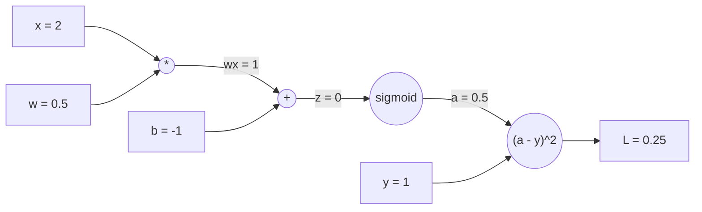

# Calculus for ML: Derivatives, Gradients and the Chain Rule

> **Level:** Beginner to Advanced · **Study time:** ~110 min · **Prerequisites:** [What AI, Machine Learning, Deep Learning and Generative AI Are](./01-what-is-ai-ml-dl-and-genai.md), [Linear Algebra for Machine Learning](./02-linear-algebra-for-ml.md) (vectors and the dot product)

## Table of contents

- [Why this matters](#why-this-matters)
- [Functions and slopes](#functions-and-slopes)
- [The derivative: slope at a single point](#the-derivative-slope-at-a-single-point)
- [Derivative rules you actually need](#derivative-rules-you-actually-need)
- [Partial derivatives](#partial-derivatives)
- [The gradient vector](#the-gradient-vector)
- [The chain rule and computational graphs](#the-chain-rule-and-computational-graphs)
- [Gradient descent: walking downhill in fog](#gradient-descent-walking-downhill-in-fog)
- [The learning rate: too small, too large, just right](#the-learning-rate-too-small-too-large-just-right)
- [Loss landscapes: local minima, saddle points and high dimensions](#loss-landscapes-local-minima-saddle-points-and-high-dimensions)
- [Numerical gradient checking](#numerical-gradient-checking)
- [Automatic differentiation and PyTorch autograd](#automatic-differentiation-and-pytorch-autograd)
- [Going deeper: gradients in production training](#going-deeper-gradients-in-production-training)
- [Common mistakes and misconceptions](#common-mistakes-and-misconceptions)
- [Interview questions and model answers](#interview-questions-and-model-answers)
- [Key takeaways](#key-takeaways)
- [Further reading](#further-reading)
- [Next](#next)

## Why this matters

Almost every model you will discuss in an AI/ML interview, from logistic regression to a 70B-parameter LLM, is trained the same way. You measure how wrong the model is with a single number, compute how that number changes when each weight is nudged (the **gradient**), and move every weight a little in the direction that reduces the error (**gradient descent**). Backpropagation, the algorithm that makes deep learning possible, is nothing more than the chain rule from calculus applied efficiently. Production concerns you will be asked about, such as exploding gradients, NaN losses, gradient clipping, mixed-precision loss scaling, gradient checkpointing, LoRA memory savings and the straight-through estimator in quantization-aware training, all assume you are fluent with these ideas. This chapter gives you that fluency, starting from high-school algebra.

---

## Functions and slopes

### What a function is

> **Analogy:** A function is a vending machine. You put something in (an input), it gives you exactly one thing back (an output). Same input, same output, every time.

A **function** is a rule that maps each input to exactly one output. We write $f(x)$ for "the output of $f$ when the input is $x$".

Our first running example is a house-price model. Suppose (illustrative numbers):

$$\text{price} = 50 + 0.2 \times \text{size}$$

- $\text{price}$ is in thousands of dollars.
- $\text{size}$ is in square feet.
- $50$ is the base price (thousands of dollars) for a hypothetical zero-size house.
- $0.2$ is how many thousands of dollars each extra square foot adds.

A 1,000 sq ft house: $50 + 0.2 \times 1000 = 50 + 200 = 250$, so \$250k. A 1,500 sq ft house: $50 + 0.2 \times 1500 = 50 + 300 = 350$, so \$350k.

### Slope of a straight line

The **slope** of a line measures how much the output changes per unit change in the input: "rise over run".

$$\text{slope} = \frac{\Delta y}{\Delta x} = \frac{y_2 - y_1}{x_2 - x_1}$$

- $\Delta$ (Greek "delta") means "change in".
- $(x_1, y_1)$ and $(x_2, y_2)$ are two points on the line.

Worked example with our two houses: $\frac{350 - 250}{1500 - 1000} = \frac{100}{500} = 0.2$. Each extra square foot adds \$0.2k, which is \$200. For a straight line the slope is the same everywhere.

### Curves have a different slope at every point

Now take $f(x) = x^2$. Between $x = 1$ and $x = 2$ the output goes from 1 to 4 (slope 3). Between $x = 3$ and $x = 4$ it goes from 9 to 16 (slope 7). The curve gets steeper as you move right.

```text
 f(x) = x^2

 16 |                         *
    |                       /
    |                     /      steep here (slope ~ 7)
  9 |                 *
    |              .
  4 |          *
    |       .              shallow here (slope ~ 3)
  1 |    *
  0 +--*----+----+----+----+----> x
    0  1    2    3    4
```

So "the slope" of a curve only makes sense **at a specific point**. That is what a derivative is.

### Why ML cares: the loss is a function of the weights

In ML, the function we care most about is the **loss function** (also called cost or objective): a function that takes the model's weights and returns one number saying how wrong the model is on the training data. Lower is better. The data is held fixed; the **weights** (also called **parameters**, the numbers the model learns) are the inputs we vary.

> **Senior insight:** In school, $x$ is the variable. In ML, the data $x$ is a constant and the weights $w$ are the variables. Every derivative in training is "how does the loss change when I change this weight?". Keep that flip in mind and most confusion disappears. Choosing the loss is its own topic: see [Loss Functions](../02-deep-learning/04-loss-functions.md).

---

## The derivative: slope at a single point

### Intuition

> **Analogy:** Your car's speedometer shows speed *right now*, not your average over the whole trip. The derivative is the speedometer of a function: the instantaneous rate of change at one point.

To get the slope at one point, take a second point very close to it, compute rise over run, and shrink the gap toward zero.

### Definition

$$f'(x) = \lim_{h \to 0} \frac{f(x + h) - f(x)}{h}$$

- $f'(x)$ (read "f prime of x") is the **derivative** of $f$ at $x$. Also written $\frac{df}{dx}$ or $\frac{d}{dx}f(x)$.
- $h$ is a small step in the input.
- $f(x + h) - f(x)$ is the rise; $h$ is the run.
- $\lim_{h \to 0}$ (the **limit**) means "the value this ratio approaches as $h$ gets closer and closer to 0".

### Worked example: $f(x) = x^2$ at $x = 3$

| $h$ | $f(3 + h)$ | $f(3 + h) - f(3)$ | ratio |
|---|---|---|---|
| 1 | $4^2 = 16$ | $16 - 9 = 7$ | $7 / 1 = 7$ |
| 0.1 | $3.1^2 = 9.61$ | $0.61$ | $0.61 / 0.1 = 6.1$ |
| 0.01 | $3.01^2 = 9.0601$ | $0.0601$ | $0.0601 / 0.01 = 6.01$ |
| 0.001 | $3.001^2 = 9.006001$ | $0.006001$ | $6.001$ |

The ratio approaches 6. Algebra confirms it exactly:

$$\frac{(x+h)^2 - x^2}{h} = \frac{x^2 + 2xh + h^2 - x^2}{h} = \frac{2xh + h^2}{h} = 2x + h$$

As $h \to 0$ this becomes $2x$. At $x = 3$: $2 \times 3 = 6$. So the derivative of $x^2$ is $2x$.

### What the derivative tells you

| Derivative value | Meaning | Gradient descent action |
|---|---|---|
| Positive (e.g. +6) | Increasing the input increases the output | Decrease the input |
| Negative (e.g. -6) | Increasing the input decreases the output | Increase the input |
| Zero | Flat: a minimum, maximum or flat spot (a **critical point**) | Stop (or you are stuck) |
| Large magnitude | Output is very sensitive to the input | Steps will be big |
| Small magnitude | Output barely reacts | Steps will be tiny |

### The second derivative: curvature

The **second derivative** $f''(x)$ is the derivative of the derivative. It measures **curvature**: how fast the slope itself changes. For $f(x) = x^2$, $f'(x) = 2x$ and $f''(x) = 2$, a constant positive number, meaning the curve bends upward everywhere like a bowl. Positive second derivative means "bowl" (curving up), negative means "dome" (curving down). You will need curvature later to understand why some learning rates explode and what a saddle point is.

---

## Derivative rules you actually need

You almost never compute limits by hand. You combine a few rules. Frameworks like PyTorch store exactly these rules, one per operation.

| Rule | Formula | Worked example |
|---|---|---|
| Constant | $\frac{d}{dx} c = 0$ | $\frac{d}{dx} 7 = 0$ |
| Power | $\frac{d}{dx} x^n = n x^{n-1}$ | $\frac{d}{dx} x^3 = 3x^2$; at $x=2$: $3 \times 4 = 12$ |
| Constant multiple | $\frac{d}{dx} [c \cdot f(x)] = c \cdot f'(x)$ | $\frac{d}{dx} 5x^2 = 10x$; at $x=1$: $10$ |
| Sum | $\frac{d}{dx}[f + g] = f' + g'$ | $\frac{d}{dx}(x^2 + 3x) = 2x + 3$; at $x=1$: $5$ |
| Product | $\frac{d}{dx}[f \cdot g] = f'g + fg'$ | $f=x^2, g=x+1$: $2x(x+1) + x^2$; at $x=1$: $4 + 1 = 5$ |
| Exponential | $\frac{d}{dx} e^x = e^x$ | at $x=0$: $e^0 = 1$ |
| Natural log | $\frac{d}{dx} \ln x = \frac{1}{x}$ | at $x=4$: $0.25$ |
| Chain | $\frac{d}{dx} f(g(x)) = f'(g(x)) \cdot g'(x)$ | Covered in its own section below |

Check the product rule another way: $x^2(x+1) = x^3 + x^2$, whose derivative is $3x^2 + 2x$, and at $x = 1$ that is $3 + 2 = 5$. Same answer.

### Derivatives of common activation functions

An **activation function** is the simple non-linear function applied inside each neuron of a neural network (full treatment in [Neural Networks from Scratch](../02-deep-learning/01-neural-networks-from-scratch.md)). Their derivatives come up constantly.

**Sigmoid** squashes any number into (0, 1):

$$\sigma(z) = \frac{1}{1 + e^{-z}}, \qquad \sigma'(z) = \sigma(z)\,\big(1 - \sigma(z)\big)$$

- $z$ is the input (any real number).
- $e \approx 2.71828$ is Euler's number.
- The derivative is written in terms of the output itself, which is cheap: once you computed $\sigma(z)$ in the forward pass (the step that computes the model's output, defined properly in the chain rule section), the derivative costs one multiply.

Worked examples:
- At $z = 0$: $\sigma(0) = \frac{1}{1 + 1} = 0.5$, so $\sigma'(0) = 0.5 \times 0.5 = 0.25$. This is the largest the sigmoid's slope ever gets.
- At $z = 4$: $e^{-4} \approx 0.018316$, so $\sigma(4) \approx \frac{1}{1.018316} \approx 0.982014$, and $\sigma'(4) \approx 0.982014 \times 0.017986 \approx 0.01766$. The slope is tiny: the sigmoid has **saturated**. Stack many saturated sigmoids and gradients shrink toward zero, the **vanishing gradient** problem (see [Vanishing and Exploding Gradients](../02-deep-learning/05-vanishing-exploding-gradients-initialization-normalization-and-residuals.md)).

| Activation | $f(z)$ | $f'(z)$ | Note |
|---|---|---|---|
| Sigmoid | $\frac{1}{1+e^{-z}}$ | $\sigma(z)(1-\sigma(z))$ | Max slope 0.25; saturates |
| Tanh | $\tanh(z)$ | $1 - \tanh^2(z)$ | Max slope 1 at $z=0$; saturates |
| ReLU | $\max(0, z)$ | 1 if $z > 0$, 0 if $z < 0$ | Not differentiable at exactly 0; frameworks such as PyTorch use 0 there |

> **Common mistake:** Saying ReLU "has no derivative so it cannot be trained". It is differentiable everywhere except one point, and at that point frameworks simply pick a value (a valid **subgradient**, meaning any slope between the left and right slopes). Hitting exactly 0.0 in floating point is rare and harmless.

---

## Partial derivatives

### Intuition

> **Analogy:** A sound mixing board has many knobs. To learn what the bass knob does, you turn only the bass knob and keep every other knob still. A partial derivative is "turn one knob, freeze the rest, measure the change in the output".

Real models have many weights, so the loss is a function of many inputs. A **partial derivative** measures how the output changes when you nudge **one** input while holding all the others constant. The symbol $\partial$ ("partial") replaces $d$.

### Worked example

Take $f(x, y) = x^2 y + 3y$.

- $\frac{\partial f}{\partial x}$: treat $y$ as a constant number. $x^2 y$ becomes $2x \cdot y$; $3y$ has no $x$, so it is a constant and its derivative is 0. Result: $\frac{\partial f}{\partial x} = 2xy$.
- $\frac{\partial f}{\partial y}$: treat $x$ as a constant. $x^2 y$ is "a constant times $y$", giving $x^2$; $3y$ gives $3$. Result: $\frac{\partial f}{\partial y} = x^2 + 3$.

At the point $(x, y) = (2, 1)$:
- $f(2, 1) = 2^2 \times 1 + 3 \times 1 = 4 + 3 = 7$
- $\frac{\partial f}{\partial x} = 2 \times 2 \times 1 = 4$
- $\frac{\partial f}{\partial y} = 2^2 + 3 = 4 + 3 = 7$

Numeric sanity check for $\frac{\partial f}{\partial x}$: nudge $x$ by 0.01 and keep $y = 1$. $f(2.01, 1) = 2.01^2 + 3 = 4.0401 + 3 = 7.0401$. Change: $7.0401 - 7 = 0.0401$. Divide by $0.01$: $4.01 \approx 4$. Correct.

---

## The gradient vector

### Definition

The **gradient** of a function is the vector (an ordered list of numbers, see [Linear Algebra for ML](./02-linear-algebra-for-ml.md)) of all its partial derivatives:

$$\nabla f(x, y) = \begin{bmatrix} \frac{\partial f}{\partial x} \\[4pt] \frac{\partial f}{\partial y} \end{bmatrix}$$

- $\nabla$ (read "nabla" or "del") means "gradient of".
- Each entry is one partial derivative.
- For a function of $n$ inputs, the gradient has $n$ entries.

For our example at $(2, 1)$: $\nabla f = [4, 7]$.

> **Senior insight:** The gradient always has exactly the same shape as the thing you differentiate with respect to. A 7B-parameter model's loss gradient has 7 billion numbers, one per weight. In 32-bit floats (4 bytes each) that is $7 \times 10^9 \times 4 = 28 \times 10^9$ bytes, about 28 GB, just for the gradient. Together with optimizer state and stored activations, this is why training memory is so much larger than inference memory (see [Distributed Training and Training Memory](../02-deep-learning/10-distributed-training-and-training-memory.md)).

### Three properties that make the gradient useful

1. **It points in the direction of steepest ascent.** Of all directions you could step, the gradient direction increases $f$ fastest.
2. **Its length (norm) is the steepness** in that direction.
3. **It is perpendicular to contour lines** (lines of equal height, like on a hiking map).

So $-\nabla f$ (the negative gradient) is the direction of **steepest descent**. That one fact is the foundation of training.

### Why the gradient is the steepest direction (with numbers)

The **directional derivative** measures the slope if you walk in a chosen direction $\mathbf{u}$ (a unit vector, length 1):

$$D_{\mathbf{u}} f = \nabla f \cdot \mathbf{u} = \|\nabla f\| \, \|\mathbf{u}\| \cos\theta$$

- $\cdot$ is the dot product.
- $\|\nabla f\|$ is the gradient's length.
- $\theta$ is the angle between the gradient and your direction $\mathbf{u}$.

Since $\cos\theta$ is largest (equal to 1) when $\theta = 0$, the slope is largest when you walk exactly along the gradient. With $\nabla f = [4, 7]$:

- Walk along $x$ only, $\mathbf{u} = [1, 0]$: slope $= 4 \times 1 + 7 \times 0 = 4$.
- Walk along $\mathbf{u} = [0.6, 0.8]$ (length $\sqrt{0.36 + 0.64} = 1$): slope $= 4 \times 0.6 + 7 \times 0.8 = 2.4 + 5.6 = 8.0$.
- Walk along the gradient itself: slope $= \|\nabla f\| = \sqrt{4^2 + 7^2} = \sqrt{65} \approx 8.062$. The biggest of the three, as promised.
- Walk along $-\nabla f$: slope $\approx -8.062$, the fastest way down.

```text
 Contour map of a loss (each ring = equal loss), minimum at the center

        .-----------------.
      /    .-----------.    \
     |   /   .-----.     \   |
     |  |   |   *   |  <--|--|---- you are here
     |   \   '-----'     /   |       gradient points outward (uphill),
      \    '-----------'    /        perpendicular to the ring;
        '-----------------'          step the opposite way (inward)
```

---

## The chain rule and computational graphs

### Intuition

> **Analogy:** Three gears are linked. Gear A turns gear B 3 times as fast; gear B turns gear C 2 times as fast. How fast does C turn relative to A? $3 \times 2 = 6$ times. The chain rule says rates of change through a chain of functions **multiply**.

### Formula

If $y = f(u)$ and $u = g(x)$, so $y = f(g(x))$, then:

$$\frac{dy}{dx} = \frac{dy}{du} \cdot \frac{du}{dx}$$

- $\frac{du}{dx}$: how much the intermediate value $u$ changes per unit of $x$.
- $\frac{dy}{du}$: how much $y$ changes per unit of $u$.
- Multiply them to get the end-to-end sensitivity.

### Worked example: $y = (3x + 1)^2$ at $x = 1$

- Inner: $u = 3x + 1$, so $\frac{du}{dx} = 3$. At $x = 1$, $u = 4$.
- Outer: $y = u^2$, so $\frac{dy}{du} = 2u = 2 \times 4 = 8$.
- Chain: $\frac{dy}{dx} = 8 \times 3 = 24$.

Numeric check: $x = 1.001$ gives $u = 4.003$ and $y = 4.003^2 = 16.024009$. Change: $16.024009 - 16 = 0.024009$. Divide by $0.001$: $24.009 \approx 24$. Correct.

### Computational graphs

A **computational graph** breaks a calculation into small operations (nodes) connected by arrows showing which values feed which. Every neural network is one of these graphs. Training runs it in two directions:

- **Forward pass:** compute values from inputs to the loss.
- **Backward pass:** compute gradients from the loss back to every input, using the chain rule at each node. On a neural network this is called **backpropagation**.

### Worked example: one spam-filter neuron

Our second running example: a tiny spam filter with one feature.

- $x = 2$: the email contains the word "free" twice.
- $w = 0.5$: the weight on that feature. $b = -1$: the bias (a learned offset).
- $y = 1$: the true label (it is spam).
- Model: $z = wx + b$, then $a = \sigma(z)$ is the predicted probability of spam.
- Loss: squared error $L = (a - y)^2$. (Real classifiers use cross-entropy, taught in [Softmax, Entropy, Cross-Entropy and KL Divergence](./05-softmax-entropy-cross-entropy-and-kl-divergence.md); squared error keeps the arithmetic simple here.)



**Forward pass:**

| Step | Computation | Value |
|---|---|---|
| 1 | $wx = 0.5 \times 2$ | $1$ |
| 2 | $z = wx + b = 1 + (-1)$ | $0$ |
| 3 | $a = \sigma(0)$ | $0.5$ |
| 4 | $L = (0.5 - 1)^2 = (-0.5)^2$ | $0.25$ |

**Backward pass.** Start at the loss with $\frac{\partial L}{\partial L} = 1$ and walk backward. At each node, multiply the incoming gradient by that node's **local derivative** (the derivative of that one small operation).

| Step | Local derivative | Chain rule | Value |
|---|---|---|---|
| 1 | $\frac{\partial L}{\partial a} = 2(a - y)$ | $2 \times (0.5 - 1)$ | $-1$ |
| 2 | $\frac{\partial a}{\partial z} = \sigma(z)(1 - \sigma(z))$ | $\frac{\partial L}{\partial z} = -1 \times 0.25$ | $-0.25$ |
| 3 | $\frac{\partial z}{\partial w} = x = 2$ | $\frac{\partial L}{\partial w} = -0.25 \times 2$ | $-0.5$ |
| 4 | $\frac{\partial z}{\partial b} = 1$ | $\frac{\partial L}{\partial b} = -0.25 \times 1$ | $-0.25$ |
| 5 | $\frac{\partial z}{\partial x} = w = 0.5$ | $\frac{\partial L}{\partial x} = -0.25 \times 0.5$ | $-0.125$ |

Both $\frac{\partial L}{\partial w}$ and $\frac{\partial L}{\partial b}$ are negative, so increasing $w$ and $b$ lowers the loss. That makes sense: the model said 0.5 for a spam email and should say something closer to 1.

Take one gradient descent step (next section) with step size 0.1: $w = 0.5 - 0.1 \times (-0.5) = 0.55$ and $b = -1 - 0.1 \times (-0.25) = -0.975$. Re-run forward: $z = 0.55 \times 2 - 0.975 = 0.125$, $a = \sigma(0.125) \approx 0.5312$, $L \approx (0.5312 - 1)^2 \approx 0.2198$. The loss dropped from 0.25 to about 0.2198. Learning happened.

> **Senior insight:** Notice that each node only needed its *own* local derivative plus the gradient arriving from above. The multiply node does not need to know anything about sigmoids. This locality is why autograd systems scale to graphs with millions of nodes: every operation ships with one small "backward" rule, and the chain rule stitches them together.

### When a value is used twice, gradients add

If a variable feeds into the output through more than one path, its total gradient is the **sum** of the gradients along each path (the **multivariable chain rule**).

Example: $f = xy + x$ at $x = 3, y = 2$. Path 1 (through $xy$) contributes $y = 2$. Path 2 (the direct $+x$) contributes $1$. Total: $\frac{\partial f}{\partial x} = 2 + 1 = 3$. Check: $f = x(y + 1)$, so $\frac{\partial f}{\partial x} = y + 1 = 3$. Correct.

This matters in practice: weight sharing (the same weights used at every position in a transformer or every timestep in an RNN), residual connections (shortcuts that add a layer's input to its output, so $y = x + F(x)$) and tied embeddings (one matrix reused for both input and output token embeddings) all create multiple paths, and the backward pass sums their contributions. It is also why PyTorch **accumulates** (adds into) `.grad` rather than overwriting it, as you will see later.

### The vector version: Jacobians

When a function maps a vector to a vector (like a neural network layer $\mathbf{y} = W\mathbf{x} + \mathbf{b}$), its derivative is a matrix called the **Jacobian**: entry $(i, j)$ is $\frac{\partial y_i}{\partial x_j}$. The chain rule becomes a product of Jacobians. For a linear layer, $\frac{\partial \mathbf{y}}{\partial \mathbf{x}} = W$. Backpropagation never builds these (often huge) matrices explicitly; it computes **vector-Jacobian products**, "gradient row vector times Jacobian", one layer at a time, which is far cheaper. The full layer-by-layer derivation lives in [Backpropagation and Gradient Descent Explained](../02-deep-learning/02-backpropagation-and-gradient-descent.md).

---

## Gradient descent: walking downhill in fog

### Intuition

> **Analogy:** You are on a mountainside in thick fog and want to reach the valley floor. You cannot see the valley. You *can* feel the slope under your feet. So you feel which way is steepest downhill, take a step that way, feel again, step again. Steep ground: take a confident step. Nearly flat: you are probably close to the bottom. That is gradient descent. The fog is the point: the algorithm never sees the whole landscape, only the local slope.

### The algorithm

1. Start with some weights $w_0$ (often random).
2. Compute the gradient of the loss at the current weights.
3. Update: move the weights a small step against the gradient.
4. Repeat until the loss stops improving (or a step budget runs out).

$$w_{t+1} = w_t - \eta \, \nabla L(w_t)$$

- $w_t$: the weights at step $t$.
- $\nabla L(w_t)$: the gradient of the loss at those weights (direction of steepest increase).
- $\eta$ (Greek "eta"): the **learning rate**, a positive number controlling step size. It is a **hyperparameter**: a setting you choose rather than something the model learns.
- The minus sign: go downhill, opposite to the gradient.

### Fully worked example: minimize $f(w) = (w - 3)^2$

The minimum is obviously at $w = 3$ (where $f = 0$), which makes it perfect for checking our work.

- Derivative: by the chain rule, $f'(w) = 2(w - 3) \times 1 = 2(w - 3)$.
- Start: $w_0 = 0$. Learning rate: $\eta = 0.1$.
- Update rule: $w_{t+1} = w_t - 0.1 \times 2(w_t - 3)$.

| Step $t$ | $w_t$ | $f(w_t) = (w_t - 3)^2$ | $f'(w_t) = 2(w_t - 3)$ | Update $-\eta f'(w_t)$ | $w_{t+1}$ |
|---|---|---|---|---|---|
| 0 | 0 | $(-3)^2 = 9$ | $2 \times (-3) = -6$ | $-0.1 \times (-6) = +0.6$ | 0.6 |
| 1 | 0.6 | $(-2.4)^2 = 5.76$ | $-4.8$ | $+0.48$ | 1.08 |
| 2 | 1.08 | $(-1.92)^2 = 3.6864$ | $-3.84$ | $+0.384$ | 1.464 |
| 3 | 1.464 | $(-1.536)^2 = 2.359296$ | $-3.072$ | $+0.3072$ | 1.7712 |
| 4 | 1.7712 | $(-1.2288)^2 \approx 1.50995$ | $-2.4576$ | $+0.24576$ | 2.01696 |
| 5 | 2.01696 | $(-0.98304)^2 \approx 0.96637$ | $-1.96608$ | $+0.196608$ | 2.213568 |

Later steps: $w_{10} \approx 2.67788$ ($f \approx 0.1038$), $w_{20} \approx 2.96541$ ($f \approx 0.0012$), $w_{50} \approx 2.99996$.

Three things to notice:

1. **Steps shrink automatically** as we approach the minimum, because the gradient shrinks. We never changed $\eta$.
2. **The sign handles direction.** The gradient was negative (the function slopes down to the right), so subtracting it moved $w$ right.
3. **The distance to the answer shrinks by a constant factor.** Distance to 3 goes $3, 2.4, 1.92, 1.536, \ldots$, each $0.8$ times the previous. We will derive that factor in the next section.

Here is the same thing in code (pure Python, no installs needed):

```python
def f(w):
    return (w - 3) ** 2

def df(w):
    return 2 * (w - 3)          # derivative from the chain rule

def gradient_descent(w0, lr, steps):
    w = w0
    for t in range(steps + 1):
        print(f"step {t:2d}: w = {w:10.5f}   f(w) = {f(w):10.5f}")
        w = w - lr * df(w)      # the whole algorithm is this one line
    return w

gradient_descent(w0=0.0, lr=0.1, steps=5)
# step  0: w =    0.00000   f(w) =    9.00000
# step  1: w =    0.60000   f(w) =    5.76000
# step  2: w =    1.08000   f(w) =    3.68640
# step  3: w =    1.46400   f(w) =    2.35930
# step  4: w =    1.77120   f(w) =    1.50995
# step  5: w =    2.01696   f(w) =    0.96637
```

### Two parameters: one step on the house-price model

Now a real (tiny) model: predict price from size with $\hat{y} = wx + b$ ($\hat{y}$, read "y-hat", is the model's prediction; $y$ is the true value), loss $L(w, b) = (wx + b - y)^2$ on one house. To keep numbers small, measure size in thousands of sq ft and price in hundreds of thousands of dollars: $x = 2$ (2,000 sq ft), $y = 5$ (\$500k). Start at $w = 1$, $b = 0$.

Gradient by the chain rule (outer function "square", inner function $wx + b - y$):

$$\frac{\partial L}{\partial w} = 2(wx + b - y) \cdot x, \qquad \frac{\partial L}{\partial b} = 2(wx + b - y) \cdot 1$$

- Prediction: $1 \times 2 + 0 = 2$. Error: $2 - 5 = -3$. Loss: $(-3)^2 = 9$.
- $\frac{\partial L}{\partial w} = 2 \times (-3) \times 2 = -12$; $\frac{\partial L}{\partial b} = 2 \times (-3) = -6$. So $\nabla L = [-12, -6]$.
- Step with $\eta = 0.05$: $w = 1 - 0.05 \times (-12) = 1.6$; $b = 0 - 0.05 \times (-6) = 0.3$.
- New prediction: $1.6 \times 2 + 0.3 = 3.5$. New loss: $(3.5 - 5)^2 = 2.25$. Down from 9.

Notice $w$ moved twice as much as $b$, because its partial derivative was twice as large (it is multiplied by the input $x = 2$). Gradient descent automatically pushes harder on the weights that matter more right now.

### Batch, stochastic and mini-batch gradient descent

The real training loss is an **average** over all training examples. Because the derivative of an average is the average of the derivatives, the full gradient is the average of per-example gradients. Computing it over millions of examples for every step is too slow, so we estimate it from a sample.

$$\nabla L(w) = \frac{1}{N}\sum_{i=1}^{N} \nabla \ell_i(w) \qquad\text{estimated by}\qquad \hat{g} = \frac{1}{B}\sum_{i \in \text{batch}} \nabla \ell_i(w)$$

- $\ell_i(w)$: the loss on example $i$ alone. $N$: number of training examples. $B$: batch size.
- $\hat{g}$: the mini-batch gradient, an estimate of the full gradient $\nabla L(w)$.

Tiny example: three examples with per-example gradients $-12$, $4$ and $2$. The full gradient is $(-12 + 4 + 2)/3 = -2$. The three possible batches of size 2 give $-4$, $-5$ and $+3$: each estimate is off, one even has the wrong sign, but their average is $(-4 - 5 + 3)/3 = -2$, exactly the full gradient. That is what "noisy but unbiased" means.

| Variant | Gradient computed on | Pros | Cons | When used |
|---|---|---|---|---|
| Batch (full) GD | All training examples | Exact gradient, smooth progress | One step costs a full pass over the data | Small datasets, convex classical models |
| Stochastic GD (SGD) | 1 example | Very cheap steps; noise can help escape bad regions | Very noisy; poor hardware utilization | Rarely in pure form today |
| Mini-batch GD | A batch of e.g. 32 to a few thousand examples (LLM pretraining batches are usually counted in tokens, often millions per step) | Good gradient estimate, uses GPU parallelism | Batch size becomes a hyperparameter | Default for deep learning |

In everyday speech "SGD" usually means mini-batch gradient descent. The mini-batch gradient is a **noisy but unbiased** estimate of the full gradient: on average it points the right way. Improvements on the plain update (momentum, Adam, AdamW, schedules) are covered in [Optimizers](../02-deep-learning/03-optimizers-sgd-momentum-adam-and-learning-rate-schedules.md).

---

## The learning rate: too small, too large, just right

### Deriving the "shrink factor"

For $f(w) = (w - 3)^2$, let $e_t = w_t - 3$ be the **error** (distance from the minimum). Substitute into the update:

$$e_{t+1} = w_{t+1} - 3 = (w_t - 3) - \eta \cdot 2(w_t - 3) = (1 - 2\eta)\, e_t$$

So every step multiplies the error by $(1 - 2\eta)$, and after $t$ steps $e_t = (1 - 2\eta)^t e_0$.

- If $|1 - 2\eta| < 1$, the error shrinks: convergence.
- If $|1 - 2\eta| = 1$, the error never shrinks: endless oscillation.
- If $|1 - 2\eta| > 1$, the error grows every step: **divergence**.

With $\eta = 0.1$: $1 - 0.2 = 0.8$, the factor we saw in the table.

### The numbers, starting from $w_0 = 0$

| $\eta$ | Factor $1 - 2\eta$ | $w_0, w_1, w_2, w_3, w_4, w_5$ | After 10 steps | Behavior |
|---|---|---|---|---|
| 0.01 | 0.98 | 0, 0.06, 0.1188, 0.1764, 0.2329, 0.2882 | $w \approx 0.549$, $f \approx 6.008$ | Too small: crawling |
| 0.1 | 0.8 | 0, 0.6, 1.08, 1.464, 1.7712, 2.01696 | $w \approx 2.678$, $f \approx 0.104$ | Good: smooth |
| 0.5 | 0 | 0, 3, 3, 3, 3, 3 | $w = 3$ | Lands exactly in one step |
| 0.9 | -0.8 | 0, 5.4, 1.08, 4.536, 1.7712, 3.98304 | $w \approx 2.678$, $f \approx 0.104$ | Overshoots and zig-zags, still converges |
| 1.0 | -1 | 0, 6, 0, 6, 0, 6 | $w = 0$, $f = 9$ | Bounces forever |
| 1.1 | -1.2 | 0, 6.6, -1.32, 8.184, -3.2208, 10.46496 | $w \approx -15.575$, $f \approx 345.04$ | **Diverges** |

Look closely at the divergence with $\eta = 1.1$. The loss goes:

$$9 \;\to\; 12.96 \;\to\; 18.6624 \;\to\; 26.873856 \;\to\; 38.698 \;\to\; 55.726 \;\to\; \ldots$$

Each step multiplies the loss by $1.2^2 = 1.44$. Check step 1: $w_1 = 0 - 1.1 \times 2 \times (0 - 3) = 6.6$, and $(6.6 - 3)^2 = 3.6^2 = 12.96$. Step 2: $w_2 = 6.6 - 1.1 \times 2 \times 3.6 = 6.6 - 7.92 = -1.32$, and $(-1.32 - 3)^2 = 4.32^2 = 18.6624$. In a real network the same runaway shows up as a loss that shoots up and then becomes `inf` or `NaN` (Not a Number).

```text
 Number line for f(w) = (w - 3)^2, minimum at w = 3. Numbers are w after each step.

 eta = 0.01 (too small):  creeping right in tiny steps
   w: 0 ----0.06----0.12----0.18 ................................. 3

 eta = 0.1 (good):        approaches from one side, gaps shrink
   w: 0 -------- 0.6 ------ 1.08 ---- 1.46 --- 1.77 -- 2.02 ..... 3

 eta = 1.1 (diverges):    jumps across the minimum, landing farther out each time
   w: -3.22      -1.32      0              3              6.6      8.18
       step 4    step 2    start          min            step 1   step 3
```

Interesting detail: $\eta = 0.9$ gives factor $-0.8$, the same size as $\eta = 0.1$ but with flipping sign. The losses at every step are identical; only the path differs (zig-zagging across the minimum instead of approaching from one side).

### The general rule: curvature sets the maximum learning rate

Our function has second derivative $f''(w) = 2$. The convergence condition $|1 - 2\eta| < 1$ means $0 < \eta < 1 = \frac{2}{2}$. In general, for a bowl with curvature $L$:

$$0 < \eta < \frac{2}{L}, \qquad \text{best single step at } \eta = \frac{1}{L}$$

- $L$ is the curvature (second derivative) of the loss. For many weights, it is the largest curvature in any direction (the largest eigenvalue of the **Hessian**, the matrix of all second partial derivatives; an eigenvalue here is the curvature along one of the Hessian's principal directions, see [Linear Algebra for ML](./02-linear-algebra-for-ml.md)).
- Steeper-curving loss surfaces force smaller learning rates.
- **Notation warning:** in this bound $L$ is the curvature, not the loss. The optimization literature calls it the **smoothness constant** (an upper bound on how fast the gradient can change), and the letter clash with "loss" trips up many readers.

Check: $L = 2$ gives a maximum of $\eta < 1$ and an ideal of $\eta = 0.5$, matching the table exactly.

### Ill-conditioning: why one learning rate is not enough

Real loss surfaces curve differently in different directions. Take $f(w_1, w_2) = w_1^2 + 10 w_2^2$, a long narrow valley. Curvatures are 2 (along $w_1$) and 20 (along $w_2$). The steep direction forces $\eta < 2/20 = 0.1$. Try $\eta = 0.09$ from $(1, 1)$: $w_1$ shrinks by $1 - 2 \times 0.09 = 0.82$ per step, while $w_2$ is multiplied by $1 - 20 \times 0.09 = -0.8$.

| Step | $w_1$ | $w_2$ |
|---|---|---|
| 0 | 1.0 | 1.0 |
| 1 | 0.82 | -0.8 |
| 2 | 0.6724 | 0.64 |
| 3 | 0.5514 | -0.512 |
| 4 | 0.4521 | 0.4096 |
| 5 | 0.3707 | -0.3277 |

The steep direction zig-zags; the shallow direction crawls. The ratio of largest to smallest curvature (here $20 / 2 = 10$) is the **condition number**, and the larger it is, the slower plain gradient descent becomes. This is the practical reason for feature scaling in classical ML ([Feature Engineering](../01-classical-ml/07-feature-engineering-missing-values-and-encoding.md)), for momentum (which averages recent gradients, so the zig-zag components cancel while the consistent direction builds speed) and Adam (which scales each weight's step by that weight's own gradient history), and for normalization layers in deep networks.

### Choosing a learning rate in practice

- **Sweep on a log scale** (for example 1e-5, 3e-5, 1e-4, 3e-4, 1e-3) rather than linearly, because sensible values span orders of magnitude.
- **Watch the first few hundred steps:** loss rising or NaN means too high; loss barely moving means too low.
- **Use a schedule:** warm up from a small value, then decay. Large models are especially sensitive early in training. Details in [Optimizers](../02-deep-learning/03-optimizers-sgd-momentum-adam-and-learning-rate-schedules.md).
- **Reuse known-good defaults** for standard setups (for example published fine-tuning recipes), then tune.

> **Interview tip:** When asked "what if the learning rate is too high?", do not just say "it diverges". Say *why*: each step overshoots the minimum by more than it started, so the error is multiplied by a factor with magnitude above 1 every step. Then mention the $\eta < 2/L$ curvature bound. That one sentence signals real understanding.

---

## Loss landscapes: local minima, saddle points and high dimensions

### Vocabulary

The **loss landscape** (or loss surface) is the graph of the loss over all possible weight values. Picture terrain where position is the weights and altitude is the loss.

| Term | Definition | Gradient there | Curvature |
|---|---|---|---|
| Global minimum | Lowest loss anywhere | Zero | Curves up in every direction |
| Local minimum | Lower than everything nearby, but not lowest overall | Zero | Curves up in every direction |
| Saddle point | A minimum along some directions, a maximum along others | Zero | Up in some directions, down in others |
| Plateau | Large, nearly flat region | Nearly zero | Nearly flat |
| Convex function | Bowl-shaped everywhere: any local minimum is the global minimum | Zero only at the bottom | Never curves down |

**Convex** losses include linear regression with squared error and logistic regression with cross-entropy (see [Linear and Logistic Regression](../01-classical-ml/02-linear-and-logistic-regression.md)): gradient descent with a suitable learning rate converges toward the global minimum. (One caveat interviewers like: unregularized logistic regression on linearly separable data has no finite minimizer, so the weights grow without bound while the loss approaches 0; L2 regularization fixes this.) Neural network losses are **non-convex**: hills, valleys, saddles and plateaus.

### A saddle point with numbers

Take $f(x, y) = x^2 - y^2$. The gradient is $[2x, -2y]$, which is $[0, 0]$ at the origin. Is the origin a minimum? Along the $x$ axis, $f = x^2$ curves up (second derivative $+2$). Along the $y$ axis, $f = -y^2$ curves down (second derivative $-2$). So it is a saddle: a mountain pass, low in one direction and high in the other.

```text
 Saddle surface f(x, y) = x^2 - y^2   (like a horse saddle or a mountain pass)

            up along x
                ^
      .  '  '   |   '  '  .
    '           |           '
  ------------- * -------------->  down along y
    .           |           .
      '  .  .   |   .  .  '
                v
 Gradient is zero at * but it is NOT a minimum.
```

The **second-derivative test** generalizes this: at a critical point, look at the Hessian's eigenvalues (curvatures along its principal directions, see [Linear Algebra for ML](./02-linear-algebra-for-ml.md)). All positive means a local minimum, all negative a local maximum, mixed signs a saddle. Here the Hessian is $\begin{bmatrix} 2 & 0 \\ 0 & -2 \end{bmatrix}$ with eigenvalues $2$ and $-2$: mixed, so a saddle.

### Why high dimensions behave differently

Intuition from 2D hiking maps is misleading for a model with millions or billions of weights.

**A toy argument (heuristic, not a theorem).** For a critical point to be a local minimum, the surface must curve up in *every one* of $n$ directions. If each direction were an independent coin flip, the chance of all $n$ curving up would be $(1/2)^n$. For $n = 10$ that is $1/1024$; for $n = 1{,}000{,}000$ it is effectively zero. Real curvatures are not independent coin flips, but the conclusion matches research: in high dimensions, most critical points with high loss are **saddle points**, not bad local minima. This was argued and studied empirically in "Identifying and attacking the saddle point problem in high-dimensional non-convex optimization" (Dauphin et al., 2014).

What this means in practice:

1. **Bad local minima are a smaller worry than beginners expect.** Theory and experiments on large networks ("The Loss Surfaces of Multilayer Networks", Choromanska et al., 2015) suggest many local minima found in practice have similar, good loss values.
2. **Saddles and plateaus slow training rather than trap it.** Near a saddle the gradient is tiny, so steps are tiny. Gradient descent with a small enough step size from a random start almost never converges to a strict saddle ("Gradient Descent Only Converges to Minimizers", Lee et al., 2016), though escaping can still take a very long time, and the noise in mini-batch gradients plus momentum help it escape faster.
3. **The width of the minimum matters.** "Flat" minima (low loss over a wide region) are often associated with better generalization than "sharp" ones, an idea studied in "On Large-Batch Training for Deep Learning: Generalization Gap and Sharp Minima" (Keskar et al., 2017). This is an active research area; treat it as a useful intuition rather than a law.
4. **Architecture shapes the landscape.** "Visualizing the Loss Landscape of Neural Nets" (Li et al., 2018) showed that skip (residual) connections make loss surfaces visibly smoother, one reason very deep networks became trainable.

> **Senior insight:** If training stalls, "stuck in a local minimum" is rarely the right first hypothesis for a large network. Check the boring causes first: learning rate, a data bug, a frozen or disconnected parameter (zero gradient), saturated activations, bad initialization or a broken loss. Debugging playbooks are in [Regularization and Debugging Neural Network Training](../02-deep-learning/06-regularization-and-debugging-neural-network-training.md).

---

## Numerical gradient checking

### Why

When you derive a gradient by hand (or write a custom backward function), bugs are easy and silent: the model still trains, just worse. **Gradient checking** compares your **analytic gradient** (from a formula or backward code) against a **numerical gradient** (estimated directly from the definition of the derivative). If they disagree, your gradient code is wrong.

### Forward vs centered differences

$$\text{forward: } \frac{f(x + h) - f(x)}{h} \qquad \text{centered: } \frac{f(x + h) - f(x - h)}{2h}$$

- $h$: a small step, typically around $10^{-5}$ to $10^{-6}$ in 64-bit floats.
- The forward difference has error roughly proportional to $h$.
- The centered difference has error roughly proportional to $h^2$, much smaller. Always use centered.

Worked example: $f(x) = x^3$ at $x = 2$. True derivative: $3 \times 2^2 = 12$. Use $h = 0.01$:

- $f(2.01) = 2.01^3 = 2.01 \times 4.0401 = 8.120601$
- $f(1.99) = 1.99^3 = 1.99 \times 3.9601 = 7.880599$
- Forward: $(8.120601 - 8) / 0.01 = 0.120601 / 0.01 = 12.0601$ (error 0.0601)
- Centered: $(8.120601 - 7.880599) / 0.02 = 0.240002 / 0.02 = 12.0001$ (error 0.0001)

The centered version is about 600 times more accurate for the same $h$.

### Do not make $h$ too small

Computers store numbers with limited precision, so subtracting two nearly equal numbers loses digits (**catastrophic cancellation**). Results for the same example in 64-bit floats:

| $h$ | Forward difference | Centered difference |
|---|---|---|
| $10^{-1}$ | 12.61 | 12.01 |
| $10^{-2}$ | 12.0601 | 12.0001 |
| $10^{-4}$ | 12.00060001 | 12.00000001 |
| $10^{-8}$ | 11.99999993 | 11.99999988 |
| $10^{-12}$ | 12.00106681 | 12.00106681 |

Accuracy improves as $h$ shrinks, then gets *worse* once rounding error dominates. In 32-bit floats this happens much sooner, which is why gradient checks should run in 64-bit (double) precision.

### Comparing with relative error

Raw differences are misleading (a difference of 0.001 is huge for a gradient of 0.002 and tiny for 1000), so compare with **relative error**:

$$\text{rel\_err} = \frac{\| g_a - g_n \|}{\| g_a \| + \| g_n \|}$$

- $g_a$: analytic gradient vector. $g_n$: numerical gradient vector.
- $\|\cdot\|$: vector length (L2 norm).

Worked example: $g_a = [1, 2]$ and $g_n = [1, 2.001]$. The difference has norm $0.001$; the norms are $\sqrt{5} \approx 2.2361$ and $\sqrt{5.004001} \approx 2.2370$, summing to about $4.4730$. Relative error $\approx 0.001 / 4.4730 \approx 2.2 \times 10^{-4}$: the gradients "look" identical, yet by the thresholds below this deserves a closer look.

Common rules of thumb (for example from Stanford's CS231n notes), in 64-bit floats: around $10^{-7}$ or below is good; $10^{-4}$ or above deserves suspicion; around $10^{-2}$ or above almost certainly means a bug. Functions with kinks (like ReLU) can legitimately produce larger errors if a nudge crosses the kink.

### Code: check a linear regression gradient with NumPy

```python
# pip install numpy
import numpy as np

def loss_fn(w, X, y):
    """Mean squared error of a linear model: mean((Xw - y)^2)."""
    return np.mean((X @ w - y) ** 2)

def analytic_grad(w, X, y):
    """Hand-derived gradient: (2/n) * X^T (Xw - y)."""
    n = len(y)
    return (2.0 / n) * X.T @ (X @ w - y)

def numerical_grad(f, w, h=1e-5):
    """Centered differences, one parameter at a time."""
    g = np.zeros_like(w)
    for i in range(w.size):
        old = w[i]
        w[i] = old + h
        f_plus = f(w)
        w[i] = old - h
        f_minus = f(w)
        w[i] = old                      # restore the original value
        g[i] = (f_plus - f_minus) / (2 * h)
    return g

rng = np.random.default_rng(0)
X = rng.normal(size=(4, 3))             # 4 houses, 3 features each (float64)
y = rng.normal(size=4)                  # 4 prices
w = rng.normal(size=3)                  # 3 weights

g_a = analytic_grad(w, X, y)
g_n = numerical_grad(lambda v: loss_fn(v, X, y), w.copy())
rel_err = np.linalg.norm(g_a - g_n) / (np.linalg.norm(g_a) + np.linalg.norm(g_n))
print(f"relative error: {rel_err:.2e}")  # expect a very small number, well below 1e-7
```

PyTorch ships the same idea as `torch.autograd.gradcheck`, which compares autograd's gradients against finite differences and expects double-precision inputs:

```python
# pip install torch
import torch
from torch.autograd import gradcheck

inp = torch.randn(4, 3, dtype=torch.double, requires_grad=True)
print(gradcheck(torch.sigmoid, (inp,), eps=1e-6, atol=1e-4))  # True if gradients agree
```

### Gradient checking pitfalls

| Pitfall | What goes wrong | Fix |
|---|---|---|
| 32-bit floats | Rounding noise swamps the difference | Check in float64 |
| Randomness (dropout, data augmentation) | $f(x+h)$ and $f(x-h)$ see different random masks | Fix the random seed or disable randomness during the check |
| Kinks (ReLU, max, absolute value) | A nudge crosses the kink, giving a wrong numeric slope | Use inputs away from kinks; accept slightly larger errors |
| Cost | 2 forward passes per parameter: impossible for millions of weights | Check a tiny model, or a random subset of parameters |
| Checking only at initialization | Some bugs appear only after weights move | Also check after a few training steps |

> **Senior insight:** You will rarely gradient-check a whole model in production, since autograd's built-in operations are well tested. Where it earns its keep: custom autograd functions, custom CUDA or Triton kernels with hand-written backward passes, and fused operations. Those are exactly the places where a silent gradient bug ships.

---

## Automatic differentiation and PyTorch autograd

### Three ways to compute derivatives

| Approach | How it works | Pros | Cons | Used for |
|---|---|---|---|---|
| Symbolic differentiation | Manipulates formulas (like a computer algebra system) to produce a derivative formula | Exact, human-readable | Expressions can blow up in size; awkward with loops and branches in code | Math software, deriving formulas by hand |
| Numerical differentiation | Finite differences, as above | Trivial to implement, works on any black box | Approximate; 2 function evaluations per parameter | Gradient checking only |
| Automatic differentiation (autodiff) | Records the actual operations executed and applies the chain rule to each one using built-in local derivatives | Exact up to floating-point rounding; cost a small multiple of one forward pass | Must store intermediate values (memory) | Every deep learning framework |

**Automatic differentiation** is not symbolic and not numerical. It applies the chain rule mechanically to the concrete sequence of operations your code actually ran, which is why it handles Python loops, `if` statements and dynamic shapes.

### Forward mode vs reverse mode

There are two orders in which to apply the chain rule through a graph.

| | Forward mode | Reverse mode |
|---|---|---|
| Direction | Inputs to outputs, alongside the forward pass | Outputs back to inputs, after the forward pass |
| One pass gives | Derivatives of all outputs with respect to **one** input direction (a Jacobian-vector product) | Derivatives of **one** output with respect to all inputs (a vector-Jacobian product) |
| Efficient when | Few inputs, many outputs | Many inputs, few outputs |
| Memory | Low | Must keep forward intermediate values for the backward pass |
| Typical use | Sensitivity analysis, some scientific computing | Training neural networks (backpropagation) |

Training has billions of inputs (weights) and **one** output (the scalar loss). Forward mode would need one pass per weight. Reverse mode gets all billions of partial derivatives in one backward pass. That asymmetry is the whole reason backpropagation exists.

### A tiny reverse-mode autograd from scratch

This roughly 60-line class is the core idea behind PyTorch's autograd (and Andrej Karpathy's well-known teaching library micrograd). Each `Value` remembers its parents and a small function that pushes its gradient back to them. No installs needed.

```python
import math

class Value:
    """A scalar that remembers how it was computed, so it can backprop."""

    def __init__(self, data, parents=(), op=""):
        self.data = data               # the number itself
        self.grad = 0.0                # dLoss/dself, filled in by backward()
        self._parents = parents        # Values this one was computed from
        self._backward = lambda: None  # pushes self.grad to parents
        self.op = op

    def __add__(self, other):
        other = other if isinstance(other, Value) else Value(other)
        out = Value(self.data + other.data, (self, other), "+")
        def _backward():
            # d(a+b)/da = 1, d(a+b)/db = 1. Note +=: gradients from multiple paths add.
            self.grad += 1.0 * out.grad
            other.grad += 1.0 * out.grad
        out._backward = _backward
        return out

    def __mul__(self, other):
        other = other if isinstance(other, Value) else Value(other)
        out = Value(self.data * other.data, (self, other), "*")
        def _backward():
            # d(a*b)/da = b, d(a*b)/db = a
            self.grad += other.data * out.grad
            other.grad += self.data * out.grad
        out._backward = _backward
        return out

    def __sub__(self, other):
        return self + (other * -1.0)

    def __pow__(self, k):  # k is a plain number
        out = Value(self.data ** k, (self,), f"**{k}")
        def _backward():
            self.grad += k * self.data ** (k - 1) * out.grad
        out._backward = _backward
        return out

    def sigmoid(self):
        s = 1.0 / (1.0 + math.exp(-self.data))
        out = Value(s, (self,), "sigmoid")
        def _backward():
            self.grad += s * (1.0 - s) * out.grad
        out._backward = _backward
        return out

    def backward(self):
        # 1) Topological sort: every node appears after the nodes it depends on.
        order, seen = [], set()
        def visit(v):
            if v not in seen:
                seen.add(v)
                for p in v._parents:
                    visit(p)
                order.append(v)
        visit(self)
        # 2) Seed dLoss/dLoss = 1, then apply each local rule in reverse order.
        self.grad = 1.0
        for v in reversed(order):
            v._backward()


# The spam-filter neuron from the chain rule section
x = Value(2.0)    # count of the word "free"
w = Value(0.5)    # weight
b = Value(-1.0)   # bias
y = 1.0           # true label: spam

z = w * x + b
a = z.sigmoid()
loss = (a - y) ** 2
loss.backward()

print(f"loss = {loss.data:.4f}")   # loss = 0.2500
print(f"dL/dw = {w.grad:.4f}")     # dL/dw = -0.5000
print(f"dL/db = {b.grad:.4f}")     # dL/db = -0.2500
print(f"dL/dx = {x.grad:.4f}")     # dL/dx = -0.1250
```

The outputs match the hand-computed backward table exactly. Real frameworks do the same thing on tensors instead of scalars, with highly optimized GPU kernels for each operation's forward and backward.

### The same neuron in PyTorch

PyTorch builds the graph on the fly as your code runs (a **dynamic** or "define-by-run" graph). Any tensor created with `requires_grad=True` is tracked; calling `.backward()` on a scalar runs reverse mode and stores results in the `.grad` of each **leaf tensor** that has `requires_grad=True` (a leaf is a tensor you created directly, such as a parameter, rather than the result of an operation).

```python
# pip install torch
import torch

x = torch.tensor(2.0)                       # data: no gradient needed
w = torch.tensor(0.5, requires_grad=True)   # parameter: track it
b = torch.tensor(-1.0, requires_grad=True)  # parameter: track it
y = torch.tensor(1.0)

z = w * x + b
a = torch.sigmoid(z)
loss = (a - y) ** 2

print(z.grad_fn)        # a node like <AddBackward0 ...>: the recorded graph
loss.backward()         # reverse-mode autodiff through the recorded graph
print(loss.item(), w.grad.item(), b.grad.item())   # 0.25 -0.5 -0.25
```

### Gradient descent with PyTorch's optimizer

Back to $f(w) = (w - 3)^2$, now letting autograd compute the derivative and `torch.optim.SGD` apply the update:

```python
import torch

w = torch.tensor(0.0, requires_grad=True)
opt = torch.optim.SGD([w], lr=0.1)

for step in range(50):
    opt.zero_grad()           # clear old gradients (they accumulate otherwise)
    loss = (w - 3) ** 2       # forward pass builds the graph
    loss.backward()           # backward pass fills w.grad with 2(w - 3)
    opt.step()                # w <- w - lr * w.grad

print(w.item())               # close to 3 (about 2.99996, matching the hand calculation)
```

This four-line loop (`zero_grad`, forward, `backward`, `step`) is the skeleton of essentially every PyTorch training script, from linear regression to LLM fine-tuning.

### Autograd gotchas every engineer hits

**1. Gradients accumulate.** `.backward()` *adds* into `.grad` (for the multi-path reason explained earlier). Forgetting `zero_grad()` silently sums gradients across steps.

```python
import torch

w = torch.tensor(1.0, requires_grad=True)
(w * 2).backward(); print(w.grad)   # tensor(2.)
(w * 2).backward(); print(w.grad)   # tensor(4.)  <- accumulated, not replaced
w.grad.zero_()                      # what opt.zero_grad() does for every parameter
```

**2. Only leaf tensors keep `.grad` by default.** Intermediate results like `z` have `.grad == None` unless you call `z.retain_grad()` before `backward()`.

**3. `backward()` needs a scalar.** Calling it on a vector requires passing an explicit `gradient` argument (the vector in the vector-Jacobian product). In practice you reduce to a scalar loss first, for example with `.mean()`.

**4. The graph is freed after `backward()`.** Calling `backward()` twice through the same graph raises an error unless you pass `retain_graph=True` (rarely what you actually want).

**5. Turn autograd off when you do not need it.** Evaluation and serving should run under `torch.no_grad()` or `torch.inference_mode()`, which skip graph recording and avoid keeping intermediate values alive, saving memory and time.

**6. `.detach()` cuts the graph.** It returns a tensor that shares data but has no history, so no gradient flows through it. Useful for targets, logging and stop-gradient tricks. Mixing `.detach()` or `.item()` into the loss computation by accident is a classic reason a parameter stops learning.

**7. In-place operations can break backward.** Modifying a tensor in place (`x.add_(1)`, `x[0] = 5`) that autograd saved for the backward pass raises a runtime error about a variable "modified by an inplace operation". Use out-of-place versions.

> **Interview tip:** If asked "how does autograd work?", answer in three beats: (1) during the forward pass every operation records a node with references to its inputs and a backward rule; (2) `backward()` traverses the graph in reverse topological order, multiplying the incoming gradient by each local derivative (vector-Jacobian products); (3) gradients reaching the same tensor from multiple paths are summed into `.grad`. Then mention reverse mode is chosen because there is one scalar loss and many parameters.

---

## Going deeper: gradients in production training

### What a backward pass costs

- **Compute.** For networks dominated by matrix multiplications, the backward pass needs about two matrix multiplications for every one in the forward pass (one for the gradient with respect to the layer's input, one for the gradient with respect to its weights). So backward is roughly 2 times forward, and a training step roughly 3 times forward. This is the origin of the widely used estimate that training a transformer costs about $6N$ floating-point operations per token for $N$ parameters, versus about $2N$ for a forward pass alone ("Scaling Laws for Neural Language Models", Kaplan et al., 2020). The estimate ignores attention's sequence-length-dependent FLOPs and any recomputation from gradient checkpointing, so treat it as a lower-bound rule of thumb. For our 7B model: forward $\approx 2 \times 7 \times 10^9 = 14$ GFLOPs (billions of floating-point operations) per token, training $\approx 42$ GFLOPs per token.
- **Memory.** Reverse mode needs the forward pass's intermediate values (**activations**) to compute local derivatives, for example the sigmoid backward used $s$, and the multiply backward used the other input. Activation memory grows with batch size, sequence length and depth, and often dominates training memory.
- **Gradient checkpointing** (also called activation recomputation) stores only some activations and recomputes the rest during the backward pass, trading extra compute for much less memory ("Training Deep Nets with Sublinear Memory Cost", Chen et al., 2016). PyTorch exposes it via `torch.utils.checkpoint`, and Hugging Face models commonly via `model.gradient_checkpointing_enable()`.

### Gradient memory and frozen parameters

A gradient has one value per trainable parameter, so freezing parameters saves memory directly: frozen tensors get no `.grad` and no **optimizer state** (extra per-parameter values the optimizer keeps, such as Adam's two running averages, each holding one number per parameter). This is a big part of why parameter-efficient fine-tuning is cheap: with LoRA, the 7B base weights are frozen and only small adapter matrices receive gradients. See [Fine-Tuning LLMs: Full Fine-Tuning, LoRA and QLoRA](../05-llms/07-fine-tuning-full-lora-and-qlora.md). Note that gradients still have to flow *through* frozen layers to reach adapters in earlier layers; frozen means "no weight gradient stored", not "no backward computation".

```python
import torch.nn as nn

model = nn.Sequential(nn.Linear(16, 16), nn.ReLU(), nn.Linear(16, 2))
for p in model[0].parameters():
    p.requires_grad_(False)      # freeze the first layer: no .grad, no optimizer state

trainable = sum(p.numel() for p in model.parameters() if p.requires_grad)
print(trainable)                 # 34 = 16*2 weights + 2 biases in the last layer
```

### The gradient norm is a health signal

The **gradient norm** $\|\nabla L\|$ (the length of the full gradient vector) is one of the most useful training metrics to log alongside the loss.

- **Spikes** often precede loss spikes or divergence, a well-known phenomenon in large-model training.
- **Steady growth toward huge values** suggests exploding gradients or a learning rate that is too high.
- **Near zero** for a layer suggests vanishing gradients, dead ReLUs, or a parameter accidentally disconnected from the loss.

### Gradient clipping

**Gradient clipping by norm** rescales the gradient if it is too long, keeping its direction:

$$\mathbf{g} \leftarrow \mathbf{g} \cdot \min\!\left(1, \frac{c}{\|\mathbf{g}\|}\right)$$

- $\mathbf{g}$: the full gradient vector (all parameters concatenated).
- $c$: the maximum allowed norm (1.0 is a common choice for transformers, illustrative).

Worked example: $\mathbf{g} = [3, 4]$, so $\|\mathbf{g}\| = \sqrt{9 + 16} = 5$. With $c = 1$: scale by $1/5$ to get $[0.6, 0.8]$, which has norm $\sqrt{0.36 + 0.64} = 1$. Same direction, safe length.

```python
# Inside a training loop, between loss.backward() and opt.step():
total_norm = torch.nn.utils.clip_grad_norm_(model.parameters(), max_norm=1.0)
# total_norm is the norm *before* clipping: log it as your health metric.
```

Clipping treats the symptom; if it fires constantly, look for the cause (learning rate, initialization, data outliers). Root causes and remedies such as initialization, normalization and residual connections are covered in [Vanishing and Exploding Gradients](../02-deep-learning/05-vanishing-exploding-gradients-initialization-normalization-and-residuals.md).

### Gradient accumulation: big batches on small GPUs

Because the gradient of an average is the average of the gradients, you can simulate a batch of 64 with 4 micro-batches of 16: run backward on each (gradients add up in `.grad`, the "gotcha" turned into a feature) and step once.

```python
accum_steps = 4
opt.zero_grad()
for i, (xb, yb) in enumerate(loader):
    loss = loss_fn(model(xb), yb) / accum_steps   # divide so the sum becomes an average
    loss.backward()                               # gradients accumulate in .grad
    if (i + 1) % accum_steps == 0:
        opt.step()
        opt.zero_grad()
```

> **Common mistake:** Forgetting to divide by `accum_steps`. The accumulated gradient is then 4 times too large, which silently acts like a 4 times larger learning rate.

In **data-parallel** distributed training, each GPU computes gradients on its own slice of the batch, and an **all-reduce** operation averages them across GPUs before the update: the same "average of gradients" idea across machines. See [Distributed Training and Training Memory](../02-deep-learning/10-distributed-training-and-training-memory.md).

### Precision: gradients can underflow

In 16-bit floating point (FP16), very small gradient values can round to zero (**underflow**), silently stopping learning for some weights. Mixed-precision training addresses this with **loss scaling** (multiply the loss by a large factor before backward, divide gradients by it before the update) or by using BF16, a 16-bit format with the same exponent range as FP32 (less precision, but far less underflow). Details in [Mixed-Precision Training](../02-deep-learning/09-mixed-precision-training.md).

### When the function is not differentiable

Some operations have zero or undefined gradients almost everywhere: rounding, `argmax`, sampling a discrete token, thresholding. Gradient descent cannot learn through them directly. Common workarounds:

| Technique | Idea | Where you meet it |
|---|---|---|
| Straight-through estimator (STE) | In the forward pass, apply the hard operation; in the backward pass, pretend it was the identity and pass the gradient straight through | Quantization-aware training, binary networks ("Estimating or Propagating Gradients Through Stochastic Neurons for Conditional Computation", Bengio et al., 2013) |
| Reparameterization trick | Rewrite random sampling as a deterministic function of the parameters plus independent noise, so gradients flow through | Variational autoencoders ("Auto-Encoding Variational Bayes", Kingma and Welling, 2013) |
| Soft relaxations | Replace a hard choice with a smooth approximation (softmax instead of argmax) | Attention, differentiable search |
| Policy-gradient estimators | Estimate gradients of an expected reward without differentiating through the sampling step | Reinforcement learning, RLHF (see [Instruction Tuning, RLHF and DPO](../05-llms/02-instruction-tuning-rlhf-and-dpo.md)) |

A straight-through rounding function written as a custom autograd function:

```python
import torch

class RoundSTE(torch.autograd.Function):
    @staticmethod
    def forward(ctx, x):
        return torch.round(x)          # true derivative of round() is 0 almost everywhere

    @staticmethod
    def backward(ctx, grad_output):
        return grad_output             # pretend round() was the identity function

x = torch.tensor([0.4, 1.6], requires_grad=True)
RoundSTE.apply(x).sum().backward()
print(x.grad)                          # tensor([1., 1.]) instead of zeros
```

Custom backward functions like this are exactly where gradient checking (or at least careful unit tests) earns its keep. Quantization-aware training is covered in [Post-Training Quantization vs Quantization-Aware Training](../07-model-compression/03-ptq-vs-qat-and-calibration.md).

### Why not use second derivatives (Newton's method)?

**Newton's method** uses curvature to pick a much better step: $w \leftarrow w - H^{-1} \nabla L$, where $H$ is the Hessian. On our $f(w) = (w-3)^2$, $H = 2$, so from $w = 0$: $0 - \frac{1}{2} \times (-6) = 3$, the exact answer in one step (equivalent to $\eta = 1/L = 0.5$ from the table). But for $n$ parameters, $H$ has $n^2$ entries. For a 7B model that is $(7 \times 10^9)^2 = 4.9 \times 10^{19}$ numbers, far beyond any memory, and inverting it is even worse. That is why large-scale training uses first-order methods (gradient only), sometimes with cheap per-parameter scale estimates such as Adam's running averages of squared gradients (only a loose curvature proxy: it is closer to a diagonal empirical Fisher approximation than to the true Hessian).

### Debugging NaN losses: a gradient-centered checklist

1. **Find the first bad step.** Log loss and gradient norm every step; locate where `inf` or `NaN` first appears.
2. **Find the first bad operation.** `torch.autograd.set_detect_anomaly(True)` makes the backward pass report which operation produced a NaN (slow; debugging only).
3. **Suspect the usual culprits:** learning rate too high, `log(0)` or division by zero in a hand-written loss (prefer built-in fused losses like `nn.CrossEntropyLoss`, which are numerically stable), FP16 overflow, bad input data (NaN features, huge outliers), and missing gradient clipping.
4. **Shrink the problem.** Try to overfit a single batch with a lower learning rate; if that fails, the bug is in the model or loss, not the data volume.

---

## Common mistakes and misconceptions

- **"The gradient points to the minimum."** It points in the direction of steepest local *ascent*; its negative is steepest local descent, which in a narrow valley can point almost across the valley rather than toward the minimum (the ill-conditioning zig-zag).
- **"A bigger gradient means you are further from the minimum."** Only for simple bowls. A steep cliff can be right next to the minimum, and a plateau can be far from it.
- **Forgetting `optimizer.zero_grad()`.** Gradients accumulate by design; without zeroing, each step uses the sum of all previous gradients.
- **Forward differences with tiny $h$ in float32 for gradient checks.** Use centered differences, float64 and $h$ around $10^{-5}$ to $10^{-6}$.
- **"The loss must go down on every step."** With mini-batches each step uses a noisy gradient estimate, so individual steps can raise the loss. Judge progress from a smoothed curve over many steps, not step to step.
- **"Gradient descent finds the global minimum."** Guaranteed only for convex problems with a suitable learning rate. For neural networks it finds a good point, not provably the best.
- **"Local minima are the main problem in deep learning."** In high dimensions, saddle points, plateaus, poor conditioning and plain bugs are more common culprits.
- **Treating the learning rate as a minor detail.** It is usually the single most important hyperparameter; a factor of 10 can mean the difference between divergence and success.
- **Confusing backpropagation with gradient descent.** Backpropagation *computes* the gradient (chain rule, reverse mode); gradient descent (or Adam, etc.) *uses* it to update weights. They are separate steps.
- **Calling `.item()` or `.detach()` inside the loss.** This silently disconnects part of the graph so some parameters get no gradient.
- **Running evaluation without `torch.no_grad()`.** Wastes memory by recording a graph you never use; at serving scale this costs real money.

---

## Interview questions and model answers

<details>
<summary><b>Q1. Explain gradient descent (the basic idea).</b></summary>

**Short answer:** Gradient descent is an iterative way to minimize a loss function. At the current weights, compute the gradient, the vector of partial derivatives of the loss with respect to each weight, which points in the direction of steepest increase. Then take a small step in the opposite direction, $w \leftarrow w - \eta \nabla L(w)$, where the learning rate $\eta$ sets the step size. Repeat until the loss stops improving. It is like walking downhill in fog: you only feel the local slope, so you keep stepping in the steepest downhill direction.

**Deeper answer and follow-ups:**
- Worked example: minimize $(w-3)^2$ from $w = 0$ with $\eta = 0.1$. Gradient $2(w - 3) = -6$, so $w$ becomes $0.6$; then $1.08$, $1.464$, and so on, with the distance to 3 shrinking by a factor of $0.8$ each step.
- Steps shrink naturally as the gradient shrinks near a minimum.
- In practice the gradient is estimated on a mini-batch (stochastic gradient descent): noisy but unbiased, much cheaper per step, and it parallelizes well on GPUs.
- The gradient itself is computed by backpropagation (reverse-mode automatic differentiation, which is the chain rule applied backward through the computational graph).
- Learning rate: too small crawls, too large overshoots and diverges; for a quadratic with curvature $L$, convergence requires $\eta < 2/L$.
- Guarantees: converges to the global minimum loss on smooth convex problems (linear and logistic regression) with a suitable learning rate (for separable unregularized logistic regression the weights diverge while the loss approaches its infimum); on neural networks it finds good but not provably optimal solutions.
- Failure modes: divergence to `inf`/NaN when the step exceeds the curvature bound; crawling on plateaus and near saddle points; zig-zagging in ill-conditioned valleys (one learning rate cannot suit both steep and shallow directions); vanishing or exploding gradients in deep networks.
- How to tell it is working: plot training loss per step (a noisy downward trend with mini-batches), log the gradient norm (spikes warn of instability), and track validation loss, because gradient descent minimizes the training loss, not the error you actually care about. Stop on a plateau, a step budget, or early stopping on validation loss.
- Production considerations: each step costs one forward plus one backward pass (roughly 3 times forward compute); batch size, learning rate and schedule are tuned together; in data-parallel training each GPU's gradients are averaged by all-reduce before one shared update; warmup and gradient clipping are standard guards for large models.
- Practical variants add momentum, per-parameter adaptive step sizes (Adam, AdamW) and learning rate schedules.

</details>

<details>
<summary><b>Q2. What is a gradient, and why do we move in the negative gradient direction?</b></summary>

**Short answer:** The gradient is the vector of partial derivatives of a function with respect to each of its inputs. It points in the direction in which the function increases fastest, and its length is how steep that increase is. To decrease the loss as fast as possible locally, we move in the opposite direction, the negative gradient.

**Deeper answer and follow-ups:**
- The slope in a unit direction $\mathbf{u}$ is $\nabla f \cdot \mathbf{u} = \|\nabla f\| \cos\theta$, maximized at $\theta = 0$ (along the gradient) and minimized at $\theta = 180^\circ$ (against it).
- Example: $\nabla f = [4, 7]$. Slope along $[1, 0]$ is 4, along $[0.6, 0.8]$ is 8.0, along the gradient $\sqrt{65} \approx 8.06$.
- The gradient has the same shape as the parameters: a 7B-parameter model has a 7B-entry gradient (28 GB in FP32).
- "Steepest" is local only. In a narrow valley the negative gradient can point mostly across the valley, causing zig-zagging; momentum and adaptive optimizers address this.
- The gradient is perpendicular to contour lines of the loss.

</details>

<details>
<summary><b>Q3. Explain the chain rule and how it relates to backpropagation.</b></summary>

**Short answer:** The chain rule says the derivative of a composition is the product of the derivatives of its parts: if $y = f(g(x))$, then $\frac{dy}{dx} = f'(g(x)) \cdot g'(x)$. A neural network is a long composition of simple operations, so the derivative of the loss with respect to any weight is a product of local derivatives along the path from that weight to the loss. Backpropagation computes all of these efficiently by starting at the loss and moving backward, reusing each intermediate gradient for everything upstream.

**Deeper answer and follow-ups:**
- Example: a neuron $z = wx + b$, $a = \sigma(z)$, $L = (a - y)^2$ with $x = 2, w = 0.5, b = -1, y = 1$. $\frac{\partial L}{\partial a} = -1$, $\frac{\partial a}{\partial z} = 0.25$, $\frac{\partial z}{\partial w} = 2$, so $\frac{\partial L}{\partial w} = -0.5$.
- When a variable reaches the output through several paths, the contributions are summed (multivariable chain rule). This is why frameworks accumulate gradients.
- In vector form the local derivatives are Jacobians; backprop computes vector-Jacobian products rather than materializing Jacobians.
- Because local derivatives multiply, many factors below 1 shrink the gradient (vanishing) and many above 1 grow it (exploding), which motivates careful initialization, normalization and residual connections.
- Backprop computes gradients; the optimizer uses them. They are separate steps.

</details>

<details>
<summary><b>Q4. What happens if the learning rate is too small or too large? How do you pick one?</b></summary>

**Short answer:** Too small and training is very slow and may stall on plateaus. Too large and each step overshoots the minimum, so the loss oscillates or diverges to infinity or NaN. For a quadratic with curvature $L$, gradient descent converges only if $\eta < 2/L$. In practice you sweep learning rates on a log scale, watch early loss curves, and use warmup plus decay.

**Deeper answer and follow-ups:**
- For $f(w) = (w-3)^2$, the error is multiplied by $(1 - 2\eta)$ each step. $\eta = 0.01$: factor 0.98, still at $w \approx 0.55$ after 10 steps. $\eta = 0.1$: factor 0.8, $w \approx 2.68$. $\eta = 1.0$: factor $-1$, bounces between 0 and 6 forever. $\eta = 1.1$: factor $-1.2$, loss goes $9 \to 12.96 \to 18.66 \to 26.87 \to \ldots$ (times 1.44 per step).
- Different directions have different curvatures (ill-conditioning): the steepest direction caps the learning rate, and the flattest direction then progresses slowly. Feature scaling, normalization layers and adaptive optimizers help.
- Warmup helps because early in training the curvature can be high and Adam's statistics are unreliable; large models are especially sensitive.
- The best learning rate interacts with batch size and optimizer; changing either usually means retuning.
- Signals: rising loss or NaN (too high), barely moving loss (too low), gradient norm spikes (unstable).

</details>

<details>
<summary><b>Q5. Do neural networks get stuck in local minima? What about saddle points?</b></summary>

**Short answer:** Less than intuition suggests. In very high-dimensional loss surfaces, a critical point must curve upward in every direction to be a local minimum, which (by a heuristic argument backed by empirical studies, not a theorem) is unlikely at high loss, so most high-loss critical points are saddle points instead. Local minima do exist; they just tend to have loss close to the best ones. Saddles and plateaus slow gradient descent down because the gradient is tiny there, but mini-batch noise and momentum help escape, and empirically many minima found in large networks have similarly good loss.

**Deeper answer and follow-ups:**
- Saddle example: $f(x,y) = x^2 - y^2$ has zero gradient at the origin but curves up along $x$ and down along $y$; the Hessian has eigenvalues $+2$ and $-2$.
- Toy heuristic: if each of $n$ curvature directions were an independent coin flip, the chance all curve up would be $2^{-n}$. Not literally true, but it matches findings by Dauphin et al. (2014).
- Gradient descent from random initialization almost surely avoids converging to strict saddles (Lee et al., 2016), but it can spend a long time near them.
- Flat vs sharp minima: flatter minima are often associated with better generalization (Keskar et al., 2017), an active research topic.
- Practical stance: if training stalls, check learning rate, data, initialization, dead units and loss bugs before blaming local minima.

</details>

<details>
<summary><b>Q6. How would you verify that a gradient implementation is correct?</b></summary>

**Short answer:** Use numerical gradient checking. Compute the numerical gradient with centered differences, $\frac{f(w + h) - f(w - h)}{2h}$, one parameter at a time, and compare it to the analytic gradient using relative error. Do it in float64, with $h$ around $10^{-5}$ and no randomness. A relative error around $10^{-7}$ or below is good; around $10^{-2}$ indicates a bug.

**Deeper answer and follow-ups:**
- Centered differences have error proportional to $h^2$ versus $h$ for forward differences: for $x^3$ at 2 with $h = 0.01$, forward gives 12.0601 and centered gives 12.0001 (true value 12).
- Too small an $h$ causes catastrophic cancellation; the error first falls then rises as $h$ shrinks.
- Pitfalls: dropout or other randomness, kinks like ReLU, float32 noise, and cost (2 forward passes per parameter). Check a tiny model or a random subset of parameters.
- PyTorch provides `torch.autograd.gradcheck` for custom operations.
- Where it matters most in practice: custom autograd functions and custom GPU kernels with hand-written backward passes.

</details>

<details>
<summary><b>Q7. How does automatic differentiation work, and why do deep learning frameworks use reverse mode?</b></summary>

**Short answer:** Autodiff records every operation executed in the forward pass as a node in a graph, each with a known local derivative rule. To get gradients it applies the chain rule through this graph. Reverse mode starts from the scalar loss and propagates gradients backward to all inputs in a single pass. Training has one scalar output and up to billions of parameters, so reverse mode gets every partial derivative for a small constant multiple of one forward pass (forward plus backward is roughly 3 times a forward pass for matmul-heavy networks), whereas forward mode would need one pass per parameter.

**Deeper answer and follow-ups:**
- Autodiff is neither symbolic (it does not manipulate formulas) nor numerical (it is exact up to floating-point rounding). It handles loops and branches because it differentiates the operations that actually ran.
- Forward mode computes Jacobian-vector products; reverse mode computes vector-Jacobian products.
- Cost: backward is about 2 times the forward compute for matmul-heavy networks, so about $6N$ FLOPs per token for training versus $2N$ for inference.
- Memory: reverse mode must keep forward activations; gradient checkpointing trades recomputation for memory.
- PyTorch builds the graph dynamically each forward pass ("define-by-run"); `grad_fn` attributes are the recorded nodes; `.backward()` walks them in reverse topological order and accumulates into `.grad`.

</details>

<details>
<summary><b>Q8. Why do we call <code>optimizer.zero_grad()</code> in PyTorch, and when would you deliberately not?</b></summary>

**Short answer:** Because `.backward()` adds new gradients into the existing `.grad` instead of overwriting it. Without zeroing, each update would use the sum of all previous gradients, effectively a growing, wrong step. You deliberately skip zeroing for gradient accumulation, where you sum gradients from several micro-batches to simulate a larger batch before one optimizer step.

**Deeper answer and follow-ups:**
- Accumulation exists because the multivariable chain rule sums contributions from multiple paths, so `+=` is the natural backward primitive.
- With accumulation over $k$ micro-batches, divide each loss by $k$ so the result is an average, otherwise the effective learning rate is $k$ times larger.
- `zero_grad(set_to_none=True)` (the default since PyTorch 2.0) sets gradients to `None` rather than zero tensors, saving memory and a kernel launch. Code that reads `.grad` directly (logging, custom clipping) must then handle `None`.
- In data-parallel training the per-GPU gradients are averaged by all-reduce before the step, the same averaging idea across devices.

</details>

<details>
<summary><b>Q9. Your training loss suddenly becomes NaN. How do you debug it?</b></summary>

**Short answer:** Find the first step and the first operation where it happens. Log loss and gradient norm every step; a gradient norm spike often comes first. Turn on `torch.autograd.set_detect_anomaly(True)` to locate the operation producing NaN in backward. Then check the usual suspects: learning rate too high, unstable hand-written losses (`log(0)`, divide by zero), FP16 overflow, bad input data, and missing gradient clipping.

**Deeper answer and follow-ups:**
- Mitigations: lower the learning rate or add warmup, clip gradients by norm (for example `max_norm=1.0`, illustrative), use built-in numerically stable losses (like `CrossEntropyLoss` on logits, the raw scores before softmax, rather than `log(softmax(x))` by hand), prefer BF16 over FP16 or use loss scaling.
- Check data: NaN or infinite features, extreme outliers, empty batches producing a division by zero in a mean.
- Reproduce on a single batch with a fixed seed; if a tiny model cannot overfit one batch, the bug is in the model or loss code.
- At scale, keep checkpoints so you can roll back to before the spike, possibly skipping the offending data batch.

</details>

<details>
<summary><b>Q10. Why don't we train large models with Newton's method or other second-order methods?</b></summary>

**Short answer:** Newton's method needs the Hessian, the matrix of all second derivatives, which has $n^2$ entries for $n$ parameters. For a 7B model that is about $4.9 \times 10^{19}$ numbers, impossible to store, let alone invert. Mini-batch noise also makes exact curvature less valuable. So we use first-order methods, sometimes with cheap per-parameter scaling like Adam's running average of squared gradients (a loose curvature proxy, closer to a diagonal empirical Fisher than to the true Hessian).

**Deeper answer and follow-ups:**
- On a pure quadratic, Newton's method jumps to the minimum in one step: for $(w - 3)^2$, $w \leftarrow 0 - \frac{1}{2}(-6) = 3$.
- Newton's method is also attracted to saddle points (it seeks any zero-gradient point), a further drawback on non-convex losses.
- Middle grounds exist: quasi-Newton methods like L-BFGS (practical for small, full-batch problems such as classical logistic regression) and structured (for example Kronecker-factored) approximations of curvature such as K-FAC and Shampoo, which are used in some large-scale training but are more complex to run than Adam.
- Hessian-vector products can be computed cheaply with autodiff without forming the Hessian, which is useful for analysis such as measuring the sharpness of a minimum.

</details>

<details>
<summary><b>Q11. How do you get gradients through a non-differentiable operation like rounding in quantization-aware training?</b></summary>

**Short answer:** Rounding has zero derivative almost everywhere, so gradients would vanish. The standard trick is the straight-through estimator: apply the real rounding in the forward pass but treat it as the identity in the backward pass, passing the incoming gradient through unchanged. It is a biased approximation that works well in practice.

**Deeper answer and follow-ups:**
- Implemented as a custom `torch.autograd.Function` whose `backward` returns `grad_output`, or with the trick `x + (round(x) - x).detach()`.
- Variants clip the passed-through gradient outside the representable range.
- Related tools: the reparameterization trick for sampling (VAEs), soft relaxations such as softmax in place of argmax, and policy-gradient estimators in RL and RLHF.
- Any custom backward is a prime place for silent bugs, so unit-test it or gradient-check the differentiable parts.

</details>

---

## Key takeaways

- A **derivative** is the slope of a function at one point: how much the output changes per tiny change in the input. Sign gives direction, magnitude gives sensitivity.
- In ML the data is fixed and the **weights are the variables**; we differentiate the loss with respect to the weights.
- A **partial derivative** changes one input and freezes the rest; the **gradient** stacks all partials into a vector with the same shape as the parameters.
- The gradient points in the direction of **steepest ascent**; the negative gradient is steepest descent.
- The **chain rule** multiplies local derivatives along a path; when a value is used on several paths, the contributions **add**.
- **Backpropagation** is reverse-mode autodiff: one backward pass gives the gradient for all parameters, at roughly 2 times the forward compute.
- **Gradient descent:** $w \leftarrow w - \eta \nabla L(w)$. On $(w - 3)^2$ from 0 with $\eta = 0.1$, the error shrinks by 0.8 per step.
- **Learning rate:** for curvature $L$, need $\eta < 2/L$. Too small crawls, too large diverges (error multiplied by a factor above 1 each step).
- Different curvature in different directions (**ill-conditioning**) causes zig-zagging; scaling, normalization and adaptive optimizers help.
- In high dimensions **saddle points and plateaus** are more common than bad local minima; they slow training rather than trap it.
- **Gradient checking:** centered differences, float64, $h \approx 10^{-5}$, relative error around $10^{-7}$ or below is good.
- PyTorch gradients **accumulate**: call `zero_grad()` each step, or exploit accumulation deliberately for large effective batches (divide the loss).
- Production levers: log the **gradient norm**, clip by norm, use checkpointing for activation memory, freeze parameters to save gradient memory, run inference under `no_grad`/`inference_mode`.
- Non-differentiable steps need tricks: **straight-through estimator**, reparameterization, soft relaxations, policy gradients.

---

## Further reading

- *Deep Learning* by Ian Goodfellow, Yoshua Bengio and Aaron Courville (MIT Press, 2016), Chapter 4 (Numerical Computation) and Chapter 6.5 (Back-Propagation). Free online at https://www.deeplearningbook.org/
- *Mathematics for Machine Learning* by Marc Peter Deisenroth, A. Aldo Faisal and Cheng Soon Ong (Cambridge University Press, 2020), Chapter 5 (Vector Calculus).
- "Learning representations by back-propagating errors", Rumelhart, Hinton and Williams, *Nature*, 1986.
- "Automatic Differentiation in Machine Learning: a Survey", Baydin, Pearlmutter, Radul and Siskind, *Journal of Machine Learning Research*, 2018.
- "Identifying and attacking the saddle point problem in high-dimensional non-convex optimization", Dauphin et al., 2014.
- "Visualizing the Loss Landscape of Neural Nets", Li, Xu, Taylor, Studer and Goldstein, 2018.
- "Training Deep Nets with Sublinear Memory Cost", Chen, Xu, Zhang and Guestrin, 2016.
- Stanford CS231n course notes on optimization, backpropagation and gradient checking.
- PyTorch documentation: "Autograd mechanics" and the `torch.autograd` API reference (pytorch.org).
- 3Blue1Brown, *Essence of Calculus* video series, for visual intuition about derivatives and the chain rule.

---

## Next

- **Next chapter:** [Probability and Statistics for Machine Learning](./04-probability-and-statistics.md)
- **Related chapters:**
  - [Linear Algebra for Machine Learning](./02-linear-algebra-for-ml.md): vectors, dot products and the Hessian's eigenvalues.
  - [Linear and Logistic Regression from Scratch](../01-classical-ml/02-linear-and-logistic-regression.md): gradient descent on convex models.
  - [Backpropagation and Gradient Descent Explained](../02-deep-learning/02-backpropagation-and-gradient-descent.md): the full layer-by-layer backward pass.
  - [Optimizers: SGD, Momentum, RMSProp, Adam, AdamW and Learning Rate Schedules](../02-deep-learning/03-optimizers-sgd-momentum-adam-and-learning-rate-schedules.md): better ways to use the gradient.
  - [Vanishing and Exploding Gradients, Initialization, Normalization and Residual Connections](../02-deep-learning/05-vanishing-exploding-gradients-initialization-normalization-and-residuals.md): what happens when long chain-rule products misbehave.
