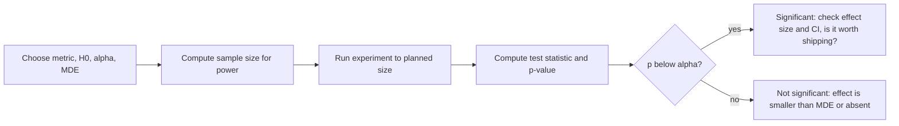
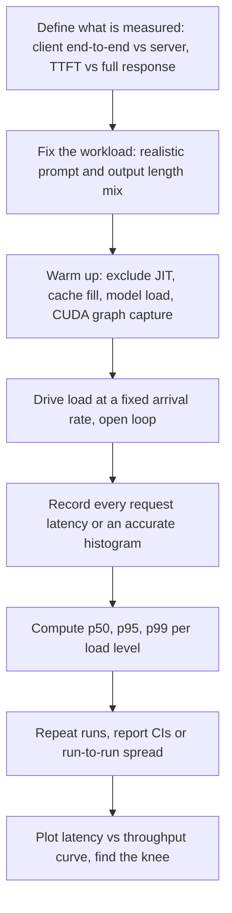

# Probability and Statistics for Machine Learning

> **Level:** Beginner to Advanced · **Study time:** ~120 min · **Prerequisites:** [What AI, Machine Learning, Deep Learning and Generative AI Are](./01-what-is-ai-ml-dl-and-genai.md), [Calculus for ML](./03-calculus-and-gradients.md) (only for the maximum likelihood derivation)

## Table of contents

- [Why this matters](#why-this-matters)
- [Random variables and the language of probability](#random-variables-and-the-language-of-probability)
- [Probability distributions you must know](#probability-distributions-you-must-know)
- [Expectation, variance and standard deviation](#expectation-variance-and-standard-deviation)
- [Conditional probability and independence](#conditional-probability-and-independence)
- [Bayes theorem with a worked medical-test example](#bayes-theorem-with-a-worked-medical-test-example)
- [Likelihood vs probability and maximum likelihood estimation](#likelihood-vs-probability-and-maximum-likelihood-estimation)
- [Mean vs median and why it matters for latency](#mean-vs-median-and-why-it-matters-for-latency)
- [Percentiles: p50, p95 and p99 by hand](#percentiles-p50-p95-and-p99-by-hand)
- [Sampling, sample size and confidence intervals](#sampling-sample-size-and-confidence-intervals)
- [Hypothesis testing and p-values](#hypothesis-testing-and-p-values)
- [A/B tests and comparing two models](#ab-tests-and-comparing-two-models)
- [Bootstrap confidence intervals](#bootstrap-confidence-intervals)
- [Correlation vs causation](#correlation-vs-causation)
- [Going deeper: benchmarking latency correctly](#going-deeper-benchmarking-latency-correctly)
- [Going deeper: statistics in production ML and LLM evaluation](#going-deeper-statistics-in-production-ml-and-llm-evaluation)
- [Common statistical traps in ML evaluation](#common-statistical-traps-in-ml-evaluation)
- [Common mistakes and misconceptions](#common-mistakes-and-misconceptions)
- [Interview questions and model answers](#interview-questions-and-model-answers)
- [Key takeaways](#key-takeaways)
- [Further reading](#further-reading)
- [Next](#next)

## Why this matters

Machine learning is applied probability. A classifier outputs a probability, an LLM outputs a probability distribution over the next token, and training is almost always "make the observed data as probable as possible" (maximum likelihood). Statistics is how you decide whether any of it worked: is model B really better than model A, or did you just get a lucky test set? Is the new prompt worth shipping based on an A/B test, or is the lift noise? Is your inference service meeting its p99 latency target, and did you even compute p99 correctly? Senior interviews probe exactly these questions because wrong answers ship bad models, burn GPU budgets and break SLAs (service level agreements: the latency and availability promises made to customers).

How this chapter is organized:

| Part | Sections | What you will be able to do |
|---|---|---|
| Probability basics | Random variables to Bayes | Describe uncertainty, compute expectations, reason with conditional probabilities |
| Learning from data | Likelihood and MLE | Explain why training minimizes cross-entropy and MSE |
| Describing data | Mean, median, percentiles | Report latency and metrics correctly, compute p95/p99 by hand |
| Inference | Confidence intervals, tests, bootstrap | Decide whether a difference is real, size an eval set or an A/B test |
| Senior practice | Causation, latency benchmarking, traps | Avoid the statistical mistakes that sink real ML projects |

---

## Random variables and the language of probability

> **Analogy:** A random variable is a slot machine with a label on it. Each pull gives you a number, you cannot predict the next pull, but over many pulls you can describe how often each number shows up.

### The basic vocabulary

- An **experiment** is any process with an uncertain outcome: sending an email through a spam filter, timing one inference request, sampling one token from an LLM.
- The **sample space** is the set of all possible outcomes. For one email: {spam, not spam}. For a die: {1, 2, 3, 4, 5, 6}.
- An **event** is a subset of outcomes we care about, for example "the die shows an even number" = {2, 4, 6}.
- A **probability** $P(A)$ is a number between 0 and 1 saying how likely event $A$ is. 0 means impossible, 1 means certain.

Three rules cover almost everything:

1. $0 \le P(A) \le 1$.
2. The probabilities of all outcomes in the sample space add up to 1.
3. **Complement rule:** $P(\text{not } A) = 1 - P(A)$. If 20% of emails are spam, 80% are not.

### Random variables

A **random variable** is a function that assigns a number to each outcome. We write it with a capital letter ($X$) and a specific value with a lowercase letter ($x$).

Examples from our running cases:

| Random variable | Possible values | Type |
|---|---|---|
| $X$ = 1 if an email is spam, 0 otherwise | {0, 1} | Discrete |
| $T$ = number of output tokens an LLM generates | {1, 2, 3, ...} | Discrete |
| $L$ = latency of one inference request, in ms | any positive real number | Continuous |
| $H$ = price of a house, in thousands of dollars | any positive real number | Continuous |

- A **discrete** random variable takes countable values (you can list them).
- A **continuous** random variable can take any value in a range.

### PMF, PDF and CDF

- A **probability mass function (PMF)** $P(X = x)$ gives the probability of each value of a discrete variable. For a fair die, $P(X = 3) = 1/6$.
- A **probability density function (PDF)** $p(x)$ describes a continuous variable. The probability of any single exact value is 0 (the chance a request takes exactly 103.000000... ms is zero). Instead, probability is the **area** under the density curve over a range: $P(a \le X \le b) = \int_a^b p(x)\,dx$. A density value can be larger than 1; only areas must be at most 1.
- A **cumulative distribution function (CDF)** $F(x) = P(X \le x)$ gives the probability of being at most $x$. It rises from 0 to 1. The CDF is the bridge to percentiles later: the p95 latency is the value $x$ where $F(x) = 0.95$.

```text
PDF of request latency (right-skewed)        CDF of the same latency

density                                       P(L <= x)
  |   ___                                    1.0 |                 ________
  |  /   \                                       |            ____/
  | /     \__                               0.95 |- - - - - -/
  |/         \_____                              |        /  |
  |                \__________________           |      /    |
  +---------------------------------> ms      0.0+----/------+-------> ms
      most requests     long tail                         p95 latency
```

---

## Probability distributions you must know

> **Analogy:** A distribution is a recipe for randomness. "Flip a coin that lands heads 30% of the time" is a recipe. Knowing the recipe tells you everything about what you will see in the long run.

A **probability distribution** describes all the values a random variable can take and how likely each one is. A **parameter** is a number that pins down which member of a family you have (for example, the bias $p$ of a coin).

### Bernoulli: one yes/no trial

A **Bernoulli** variable takes value 1 with probability $p$ and 0 with probability $1 - p$.

$$P(X = x) = p^x (1-p)^{1-x}, \quad x \in \{0, 1\}$$

- $x$: the outcome, 0 or 1.
- $p$: probability of a 1 ("success").

Worked example: an email is spam with $p = 0.2$.
- $P(X = 1) = 0.2^1 \cdot 0.8^0 = 0.2$
- $P(X = 0) = 0.2^0 \cdot 0.8^1 = 0.8$

The neat single-formula form matters: it is what turns into **binary cross-entropy** loss when we take its log (see [MLE](#likelihood-vs-probability-and-maximum-likelihood-estimation)).

Where it shows up: binary classification labels, a user clicking "thumbs up", a request either meeting or missing its latency target.

### Categorical: one trial, many outcomes

A **categorical** distribution generalizes Bernoulli to $K$ outcomes, each with its own probability $p_k$, where $\sum_k p_k = 1$.

Running example: an LLM with a tiny 3-word vocabulary predicts the next token after "the":

| Token | Probability |
|---|---|
| "cat" | 0.5 |
| "sat" | 0.3 |
| "the" | 0.2 |

$0.5 + 0.3 + 0.2 = 1.0$. Every LLM output step is a categorical distribution over the full vocabulary (often 32,000 to 200,000+ tokens), produced by a softmax. Sampling a token = drawing from this categorical. See [Softmax, Entropy, Cross-Entropy and KL Divergence](./05-softmax-entropy-cross-entropy-and-kl-divergence.md) and [Decoding Strategies](../05-llms/03-text-generation-and-decoding-strategies.md).

Related: the **binomial** distribution counts successes in $n$ independent Bernoulli trials ("how many of 1,000 test examples does the model get right?"). It powers the confidence interval for accuracy later.

### Uniform: every value equally likely

- **Discrete uniform:** a fair die, each of $K$ values has probability $1/K$.
- **Continuous uniform** on $[a, b]$: density $p(x) = \frac{1}{b-a}$ for $a \le x \le b$, 0 elsewhere.

Example: uniform on $[0, 4]$ has density $1/4 = 0.25$, and $P(1 \le X \le 2) = (2 - 1) \times 0.25 = 0.25$.

Where it shows up: random initialization (for example Kaiming uniform, which sizes the range from the number of inputs to a layer; see [Initialization](../02-deep-learning/05-vanishing-exploding-gradients-initialization-normalization-and-residuals.md)), random search over hyperparameters, `random.random()`, and the "uniform prior" that says "I have no preference".

### Gaussian (normal): the bell curve

The **Gaussian** or **normal** distribution $\mathcal{N}(\mu, \sigma^2)$ is the symmetric bell curve.

$$p(x) = \frac{1}{\sqrt{2\pi\sigma^2}} \exp\left(-\frac{(x-\mu)^2}{2\sigma^2}\right)$$

- $x$: the value whose density we want.
- $\mu$ (mu): the **mean**, the center of the bell.
- $\sigma$ (sigma): the **standard deviation**, the width of the bell. $\sigma^2$ is the **variance**.
- $\exp(z) = e^z$, where $e \approx 2.718$.
- $\frac{1}{\sqrt{2\pi\sigma^2}}$: a scaling constant that makes the total area exactly 1.

Worked example: the **standard normal** has $\mu = 0, \sigma = 1$.
- At $x = 0$: $\frac{1}{\sqrt{2\pi}} \cdot e^{0} = \frac{1}{2.5066} \cdot 1 \approx 0.3989$.
- At $x = 1$: $0.3989 \cdot e^{-1/2} = 0.3989 \cdot 0.6065 \approx 0.2420$.
- With $\sigma = 0.1$, the peak is $0.3989 / 0.1 = 3.989$: a density above 1, perfectly legal.

**The 68-95-99.7 rule:** about 68% of values fall within $1\sigma$ of the mean, 95% within $2\sigma$ (more precisely $1.96\sigma$), 99.7% within $3\sigma$. Example (illustrative): if house prices in a neighborhood are roughly normal with $\mu = 300$k and $\sigma = 50$k, about 95% of houses cost between 200k and 400k.

Why the Gaussian is everywhere: the **Central Limit Theorem** (covered [below](#sampling-sample-size-and-confidence-intervals)) says averages of many independent things are approximately Gaussian. Also: weight initialization, noise in diffusion models, the "MSE loss = Gaussian likelihood" link, and the error bars on every metric.

> **Common mistake:** Assuming latency is Gaussian. It almost never is. Latency is bounded below (it cannot be negative) and has a long right tail (garbage-collection pauses, cache misses, queueing, long prompts). It looks more like a **log-normal** or a mixture. That is why we use percentiles, not "mean plus 2 sigma".

### Comparison table

| Distribution | Values | Parameters | Mean | Variance | ML examples |
|---|---|---|---|---|---|
| Bernoulli | {0, 1} | $p$ | $p$ | $p(1-p)$ | Binary label, click, pass/fail |
| Binomial | 0..n | $n, p$ | $np$ | $np(1-p)$ | Number of correct answers on a test set |
| Categorical | one of $K$ classes | $p_1..p_K$ | n/a (classes) | n/a | Next-token prediction, multi-class labels |
| Uniform (continuous) | $[a, b]$ | $a, b$ | $\frac{a+b}{2}$ | $\frac{(b-a)^2}{12}$ | Init, random search |
| Gaussian | all reals | $\mu, \sigma$ | $\mu$ | $\sigma^2$ | Noise, init, regression errors, averages |
| Log-normal | positive reals | $\mu, \sigma$ of $\log X$ | right-skewed | heavy right tail | Latency, file sizes, prices |
| Poisson | 0, 1, 2, ... | rate $\lambda$ | $\lambda$ | $\lambda$ | Requests arriving per second |

Two rows return in the latency sections, so here is one sentence each:

- **Log-normal:** $X$ is log-normal if $\log X$ is Gaussian. Adding many small independent effects gives a Gaussian; *multiplying* many positive factors (each slowing the request by some percentage) gives a log-normal. It is always positive and right-skewed, a good first model for latency (real latency is often a mixture with an even heavier tail, so treat it as a starting point).
- **Poisson:** the count of independent events in a fixed window at average rate $\lambda$, with $P(X = k) = \frac{\lambda^k e^{-\lambda}}{k!}$. Example: at $\lambda = 2$ requests per second, the chance of a second with no requests is $e^{-2} \approx 0.135$. The gaps between Poisson arrivals follow an **exponential** distribution with mean $1/\lambda$, which is how load generators simulate realistic traffic.

```python
# pip install numpy
import numpy as np

rng = np.random.default_rng(seed=0)  # always seed for reproducibility

spam = rng.binomial(n=1, p=0.2, size=10)                 # Bernoulli = binomial with n=1
tokens = rng.choice(["cat", "sat", "the"], p=[0.5, 0.3, 0.2], size=10)  # categorical
init = rng.uniform(low=-0.1, high=0.1, size=5)           # continuous uniform
noise = rng.normal(loc=0.0, scale=1.0, size=5)           # Gaussian, mu=0, sigma=1
latency_ms = rng.lognormal(mean=np.log(100), sigma=0.5, size=5)  # skewed, median ~100 ms

print(spam, tokens, init.round(3), noise.round(3), latency_ms.round(1), sep="\n")
print("fraction spam in 100k draws:", rng.binomial(1, 0.2, 100_000).mean())  # close to 0.2
```

---

## Expectation, variance and standard deviation

> **Analogy:** The expectation is the balance point of a seesaw loaded with probability weights. The variance tells you how far from that balance point the weights sit, on average.

### Expectation (expected value, mean)

The **expectation** $E[X]$ is the probability-weighted average of all values: what you would get on average over infinitely many draws.

$$E[X] = \sum_x x \, P(X = x) \qquad \text{(discrete)}$$

- $x$: each possible value.
- $P(X = x)$: its probability.

Worked example 1 (fair die): $E[X] = \frac{1+2+3+4+5+6}{6} = \frac{21}{6} = 3.5$. Note that 3.5 is never actually rolled: the expectation need not be a possible value.

Worked example 2 (illustrative LLM cost planning): 70% of requests generate 200 output tokens, 30% generate 1,000 tokens.

$$E[T] = 0.7 \times 200 + 0.3 \times 1000 = 140 + 300 = 440 \text{ tokens}$$

If you pay per output token, your expected cost per request is $440 \times$ (price per token). Expectation is how you turn a mix of behaviors into a single budget number.

**Linearity of expectation** (always true, even for dependent variables): $E[aX + bY] = aE[X] + bE[Y]$. Expected cost of 1,000 requests is $1000 \times 440 = 440{,}000$ tokens.

For a dataset $x_1, \dots, x_n$, the **sample mean** is $\bar{x} = \frac{1}{n}\sum_{i=1}^n x_i$. It is our estimate of $E[X]$.

### Variance and standard deviation

The **variance** measures spread: the expected squared distance from the mean.

$$\mathrm{Var}(X) = E\left[(X - \mu)^2\right] = E[X^2] - (E[X])^2$$

- $\mu = E[X]$: the mean.
- Squaring makes all distances positive and punishes far values more.

The **standard deviation** is $\sigma = \sqrt{\mathrm{Var}(X)}$, which is back in the original units (ms, tokens, dollars), so it is easier to interpret.

Worked example 1 (the token mix above):
- $E[T^2] = 0.7 \times 200^2 + 0.3 \times 1000^2 = 0.7 \times 40{,}000 + 0.3 \times 1{,}000{,}000 = 28{,}000 + 300{,}000 = 328{,}000$
- $\mathrm{Var}(T) = 328{,}000 - 440^2 = 328{,}000 - 193{,}600 = 134{,}400$
- $\sigma = \sqrt{134{,}400} \approx 366.6$ tokens

A standard deviation (366.6) close to the mean (440) is a warning sign: "the average request" barely exists. Capacity planning must consider the mix, not only the mean.

Worked example 2 (a small dataset): $x = [2, 4, 4, 4, 5, 5, 7, 9]$.
1. Mean: $(2+4+4+4+5+5+7+9)/8 = 40/8 = 5$.
2. Deviations from the mean: $-3, -1, -1, -1, 0, 0, 2, 4$.
3. Squared deviations: $9, 1, 1, 1, 0, 0, 4, 16$, sum $= 32$.
4. **Population variance** (divide by $n$): $32 / 8 = 4$, so $\sigma = 2$.
5. **Sample variance** (divide by $n - 1$): $32 / 7 \approx 4.571$, so $s \approx 2.138$.

Why $n - 1$? This is **Bessel's correction**. The sample mean is computed from the same data, so deviations from it are slightly smaller than deviations from the true mean. Dividing by $n - 1$ makes the variance estimate unbiased. For large $n$ the difference is negligible; for small samples it matters.

> **Common mistake:** `np.var` and `np.std` divide by $n$ by default (`ddof=0`), while pandas `.var()` and `.std()` divide by $n - 1$ (`ddof=1`). Same data, different answers. Pass `ddof` explicitly.

### Two properties you will use constantly

For **independent** variables (defined in the [next section](#conditional-probability-and-independence)):

$$\mathrm{Var}(X + Y) = \mathrm{Var}(X) + \mathrm{Var}(Y), \qquad \mathrm{Var}(aX) = a^2\,\mathrm{Var}(X)$$

Combining these for the mean of $n$ independent draws with variance $\sigma^2$:

$$\mathrm{Var}(\bar{X}) = \frac{\sigma^2}{n} \quad\Rightarrow\quad \mathrm{SD}(\bar{X}) = \frac{\sigma}{\sqrt{n}}$$

This $\sigma / \sqrt{n}$ is the **standard error**, the single most important formula for evaluation. It says averages get more precise as you collect more data, but only with the square root: **4x the data halves the error**.

> **Senior insight:** Variances add, standard deviations do not. If tokenization takes 5 ms (sd 1) and generation takes 300 ms (sd 40), independent, the total sd is $\sqrt{1^2 + 40^2} \approx 40.01$, not 41. The noisiest stage dominates the variance, which tells you where to focus optimization for predictability.

```python
import numpy as np

x = np.array([2, 4, 4, 4, 5, 5, 7, 9])

# From scratch
mean = x.sum() / len(x)
pop_var = ((x - mean) ** 2).sum() / len(x)
sample_var = ((x - mean) ** 2).sum() / (len(x) - 1)
print(mean, pop_var, round(sample_var, 3))       # 5.0 4.0 4.571

# Library versions: be explicit about ddof
print(np.var(x, ddof=0), np.std(x, ddof=0))      # 4.0 2.0
print(round(np.var(x, ddof=1), 3))               # 4.571
```

---

## Conditional probability and independence

> **Analogy:** Conditional probability is "zooming in". Instead of asking "what fraction of all emails are spam?", you zoom into only the emails containing "free" and ask the same question inside that smaller world.

### Joint and conditional probability

- The **joint probability** $P(A, B)$ (also written $P(A \cap B)$) is the probability that both $A$ and $B$ happen.
- The **conditional probability** $P(A \mid B)$, read "probability of $A$ given $B$", is the probability of $A$ once we know $B$ happened.

$$P(A \mid B) = \frac{P(A, B)}{P(B)}$$

- $P(A, B)$: probability both happen.
- $P(B)$: probability of the condition (must be greater than 0).

Running spam example (illustrative counts). Out of 1,000 emails:

| | Contains "free" | No "free" | Total |
|---|---|---|---|
| Spam | 120 | 80 | 200 |
| Not spam (ham) | 40 | 760 | 800 |
| Total | 160 | 840 | 1,000 |

- $P(\text{spam}) = 200 / 1000 = 0.2$
- $P(\text{free}) = 160 / 1000 = 0.16$
- $P(\text{spam}, \text{free}) = 120 / 1000 = 0.12$
- $P(\text{spam} \mid \text{free}) = 0.12 / 0.16 = 0.75$ (equivalently, 120 of the 160 "free" emails)
- $P(\text{free} \mid \text{spam}) = 120 / 200 = 0.6$

Notice $P(\text{spam} \mid \text{free}) = 0.75$ but $P(\text{free} \mid \text{spam}) = 0.6$. **Conditional probability is not symmetric.** Mixing them up is called the **confusion of the inverse**, and Bayes theorem is the fix.

### Product rule and sum rule

Rearranging the definition gives the **product rule** (chain rule of probability):

$$P(A, B) = P(A \mid B)\,P(B)$$

Applied repeatedly, this is exactly how an autoregressive LLM scores a sentence: $P(w_1, w_2, w_3) = P(w_1)\,P(w_2 \mid w_1)\,P(w_3 \mid w_1, w_2)$. Example (illustrative) for "the cat sat": $0.1 \times 0.5 \times 0.4 = 0.02$. See [Pretraining and Next-Token Prediction](../05-llms/01-pretraining-and-next-token-prediction.md).

The **sum rule** (marginalization, or the law of total probability) recovers $P(B)$ by summing over all cases of $A$:

$$P(B) = \sum_a P(B \mid A = a)\,P(A = a)$$

Spam check: $P(\text{free}) = P(\text{free} \mid \text{spam})P(\text{spam}) + P(\text{free} \mid \text{ham})P(\text{ham}) = 0.6 \times 0.2 + 0.05 \times 0.8 = 0.12 + 0.04 = 0.16$. Matches the table ($P(\text{free} \mid \text{ham}) = 40/800 = 0.05$).

### Independence

Events $A$ and $B$ are **independent** if knowing one tells you nothing about the other:

$$P(A \mid B) = P(A) \quad\Longleftrightarrow\quad P(A, B) = P(A)\,P(B)$$

Spam check: $P(\text{spam} \mid \text{free}) = 0.75 \ne P(\text{spam}) = 0.2$, so "spam" and "contains free" are dependent. Good: that dependence is what makes "free" a useful feature.

**Conditional independence:** $A$ and $B$ are independent given $C$ if $P(A, B \mid C) = P(A \mid C)\,P(B \mid C)$. Naive Bayes assumes all words are conditionally independent given the class. It is false for real text, yet the classifier often works well. See [Naive Bayes and Other Classic Algorithms](../01-classical-ml/09-knn-svm-naive-bayes-and-other-classic-algorithms.md).

**i.i.d.** means **independent and identically distributed**: each data point is drawn independently from the same distribution. Nearly every formula in this chapter (standard errors, tests, cross-validation) assumes i.i.d. data. Real data often violates it: multiple rows per user, time series, near-duplicate documents, several questions about the same document. When i.i.d. breaks, your error bars are too narrow.

---

## Bayes theorem with a worked medical-test example

> **Analogy:** Bayes theorem is how a detective updates a hunch. You start with a prior belief ("most people are innocent"), see evidence ("fingerprints at the scene"), and weigh how likely that evidence would be under each story.

### The formula

$$P(H \mid E) = \frac{P(E \mid H)\,P(H)}{P(E)}$$

- $H$: a **hypothesis** (the person has the disease, the email is spam).
- $E$: the **evidence** (positive test, the word "free").
- $P(H)$: the **prior**, your belief before seeing evidence.
- $P(E \mid H)$: the **likelihood**, how probable the evidence is if the hypothesis is true.
- $P(E)$: the **evidence** or **marginal likelihood**, how probable the evidence is overall. Compute it with the sum rule: $P(E) = P(E \mid H)P(H) + P(E \mid \text{not } H)P(\text{not } H)$.
- $P(H \mid E)$: the **posterior**, your updated belief after seeing the evidence.

In words: **posterior is proportional to likelihood times prior**.

### Worked example: a medical test

A disease affects 1% of the population. A test for it has:
- **Sensitivity** (true positive rate) 99%: $P(+ \mid \text{sick}) = 0.99$.
- **Specificity** (true negative rate) 95%: $P(- \mid \text{healthy}) = 0.95$, so the **false positive rate** is $P(+ \mid \text{healthy}) = 0.05$.

You test positive. What is the probability you are actually sick? Most people guess around 95% to 99%. Let us compute.

Step 1, the evidence term:

$$P(+) = 0.99 \times 0.01 + 0.05 \times 0.99 = 0.0099 + 0.0495 = 0.0594$$

Step 2, Bayes:

$$P(\text{sick} \mid +) = \frac{0.99 \times 0.01}{0.0594} = \frac{0.0099}{0.0594} \approx 0.1667$$

**Only about 16.7%, roughly 1 in 6.** Five out of six positive results are false alarms.

### The same thing with natural frequencies

Counting people is the easiest way to explain this in an interview. Imagine 10,000 people:

```text
                         10,000 people
                       /               \
              1% sick                   99% healthy
              100                         9,900
            /      \                    /         \
     99% test +   1% test -      5% test +     95% test -
         99           1             495           9,405

Positive tests: 99 (true) + 495 (false) = 594
P(sick | positive) = 99 / 594 = 0.1667
```

The test is good, but the disease is rare, so the 5% false-positive rate applied to a huge healthy group swamps the true positives. Ignoring the prior is called the **base rate fallacy**.

> **Senior insight:** This is exactly the precision problem in imbalanced ML. A fraud model with 99% recall and a 5% false positive rate on a 1%-fraud dataset has precision of about 17%, so analysts would mostly review false alarms. Base rates are why accuracy is a useless metric for rare events. See [Classification Metrics and Imbalanced Data](../01-classical-ml/04-classification-metrics-and-imbalanced-data.md).

What helps? Raising the prior (test only symptomatic people, for example a population with 10% prevalence) or a second independent test. With a 10% prior: $P(+) = 0.99 \times 0.1 + 0.05 \times 0.9 = 0.099 + 0.045 = 0.144$, posterior $= 0.099 / 0.144 \approx 0.6875$. Same test, very different meaning.

### Bayes in the spam filter

$$P(\text{spam} \mid \text{free}) = \frac{P(\text{free} \mid \text{spam})\,P(\text{spam})}{P(\text{free})} = \frac{0.6 \times 0.2}{0.16} = \frac{0.12}{0.16} = 0.75$$

Same answer as the table. Naive Bayes classifiers are this formula applied to every word.

```python
def bayes_posterior(prior: float, sensitivity: float, false_positive_rate: float) -> float:
    """P(H | positive evidence) via Bayes theorem."""
    evidence = sensitivity * prior + false_positive_rate * (1 - prior)  # sum rule
    return sensitivity * prior / evidence

print(round(bayes_posterior(0.01, 0.99, 0.05), 4))  # 0.1667
print(round(bayes_posterior(0.10, 0.99, 0.05), 4))  # 0.6875
```

---

## Likelihood vs probability and maximum likelihood estimation

> **Analogy:** Probability asks "given this coin, how likely are these flips?". Likelihood asks the reverse: "given these flips, how plausible is each possible coin?". Same formula, different thing held fixed.

### Probability vs likelihood

Suppose a chatbot received 10 ratings: 7 thumbs-up, 3 thumbs-down. Model each rating as Bernoulli with unknown parameter $p$ (probability of thumbs-up), ratings independent.

- **Probability:** fix $p$, vary the data. "If $p = 0.5$, what is the probability of this exact sequence?" These sum to 1 over all possible datasets.
- **Likelihood:** fix the data, vary $p$. $L(p) = P(\text{data} \mid p)$ viewed as a function of $p$. It does **not** sum or integrate to 1 over $p$, so it is not a probability distribution over $p$.

For our data (multiplying 10 independent Bernoulli terms):

$$L(p) = p^7 (1 - p)^3$$

- $p$: the candidate parameter.
- $7$ and $3$: counts of 1s and 0s in the data.

| $p$ | $L(p) = p^7 (1-p)^3$ |
|---|---|
| 0.5 | $0.5^{10} = 0.000977$ |
| 0.6 | $0.0279936 \times 0.064 = 0.001792$ |
| 0.7 | $0.0823543 \times 0.027 = 0.002224$ |
| 0.8 | $0.2097152 \times 0.008 = 0.001678$ |

$p = 0.7$ makes the observed data most probable. (Check that it is not a distribution: $\int_0^1 p^7(1-p)^3\,dp = \frac{7!\,3!}{11!} \approx 0.000758$, not 1.)

### Maximum likelihood estimation (MLE)

**Maximum likelihood estimation** picks the parameter that maximizes the likelihood:

$$\hat{\theta}_{\text{MLE}} = \arg\max_\theta \; \prod_{i=1}^n p(x_i \mid \theta) = \arg\max_\theta \; \sum_{i=1}^n \log p(x_i \mid \theta)$$

- $\theta$ (theta): the parameters (here $p$; in a neural network, all the weights).
- $\prod$: product over data points (valid because of independence).
- $\log$: we maximize the **log-likelihood** instead. Log is increasing, so the maximizer is the same, but products become sums. This avoids numerical **underflow** (multiplying thousands of small probabilities gives a number too small for floating point) and makes derivatives easy.
- The hat in $\hat{\theta}$ means "estimate".

Derivation for the thumbs-up example (uses one derivative, see [Calculus](./03-calculus-and-gradients.md)):

1. $\log L(p) = 7 \log p + 3 \log(1-p)$
2. Derivative: $\frac{7}{p} - \frac{3}{1-p}$
3. Set to zero: $7(1 - p) = 3p \Rightarrow 7 = 10p \Rightarrow p = 0.7$

The MLE is just the observed fraction. Reassuring.

### Why this is the foundation of ML training

Optimizers minimize, so we minimize the **negative log-likelihood (NLL)**. Two famous losses fall out:

| Assume the label is... | NLL per example becomes | Name |
|---|---|---|
| Bernoulli with predicted $\hat{p}$ | $-[y \log \hat{p} + (1-y)\log(1-\hat{p})]$ | Binary cross-entropy (logistic regression) |
| Categorical with predicted $\hat{p}_k$ | $-\log \hat{p}_{\text{true class}}$ | Cross-entropy (classifiers, LLM next-token loss) |
| Gaussian with mean $\hat{y}$ and fixed $\sigma$ | $\frac{(y - \hat{y})^2}{2\sigma^2} + \text{const}$ | Mean squared error (linear regression) |

So "train with MSE" secretly means "assume Gaussian noise", and "pretrain an LLM with cross-entropy" means "maximum likelihood over next tokens". Details in [Softmax, Entropy, Cross-Entropy and KL Divergence](./05-softmax-entropy-cross-entropy-and-kl-divergence.md) and [Loss Functions](../02-deep-learning/04-loss-functions.md).

For a Gaussian, the MLE of the mean is the sample mean, and the MLE of the variance divides by $n$ (the biased version from earlier).

### MAP: adding a prior

**Maximum a posteriori (MAP)** estimation maximizes the posterior instead: $\arg\max_\theta \; \log p(\text{data} \mid \theta) + \log p(\theta)$. With a Gaussian prior on weights, the $\log p(\theta)$ term becomes an L2 penalty, which is **ridge regularization** (and equals weight decay for plain SGD; with Adam, decoupled weight decay as in AdamW is not the same as an L2 penalty). With a Laplace prior it becomes L1 (lasso). MLE overfits small data (one rating of thumbs-up gives $\hat{p} = 1.0$); a prior pulls the estimate toward something sensible. See [Overfitting and Regularization](../01-classical-ml/03-overfitting-regularization-and-data-leakage.md).

```python
# pip install numpy torch
import numpy as np
import torch
import torch.nn.functional as F

y = np.array([1, 1, 1, 1, 1, 1, 1, 0, 0, 0])  # 7 thumbs-up, 3 down

# From scratch: grid search over p for the max log-likelihood
grid = np.linspace(0.01, 0.99, 99)
loglik = y.sum() * np.log(grid) + (len(y) - y.sum()) * np.log(1 - grid)
print("MLE p:", round(grid[np.argmax(loglik)], 2))           # 0.7

# NLL per example equals binary cross-entropy
p = torch.full((10,), 0.7)
bce = F.binary_cross_entropy(p, torch.tensor(y, dtype=torch.float32))
manual = -(7 * np.log(0.7) + 3 * np.log(0.3)) / 10
print(round(bce.item(), 4), round(manual, 4))                 # 0.6109 0.6109
```

---

## Mean vs median and why it matters for latency

> **Analogy:** Ten people are in a bar earning 50k dollars a year each. A billionaire walks in. The mean income is now about 90 million dollars; the median is still 50k. Which number describes "a typical person in the bar"?

### Definitions

- The **mean** (average) is the sum divided by the count.
- The **median** is the middle value after sorting. With an even count, it is the average of the two middle values. Half the data is below it, half above.
- The **mode** is the most frequent value.
- A statistic is **robust** if a few extreme values (**outliers**) cannot move it much. The median is robust; the mean is not.

### Worked example: 10 request latencies

Measured latencies (ms): 120, 95, 110, 105, 2000, 100, 115, 98, 130, 102. One request hit a cold cache and took 2 seconds.

1. Sorted: 95, 98, 100, 102, 105, 110, 115, 120, 130, 2000.
2. Sum: $95+98+100+102+105+110+115+120+130+2000 = 2975$.
3. Mean: $2975 / 10 = 297.5$ ms.
4. Median: the 5th and 6th values are 105 and 110, so median $= (105 + 110)/2 = 107.5$ ms.

The mean (297.5 ms) is larger than 9 of the 10 requests. No user experienced anything like "297.5 ms". The median (107.5 ms) describes the typical user well.

### Why latency needs more than either

| Statistic | Answers | Weakness for latency |
|---|---|---|
| Mean | "What is the total time spent / throughput cost?" | Pulled by outliers; describes no real request; hides the tail |
| Median (p50) | "What does a typical request feel like?" | Completely blind to the tail: the 2,000 ms request could be 20,000 ms and p50 would not change |
| p95 / p99 | "How bad is it for the unlucky 5% / 1%?" | Needs many samples to estimate; noisy |
| Max | "What is the worst case seen?" | One sample; dominated by freak events |

Latency distributions are **right-skewed** (long tail to the right): mean is greater than median. The gap between mean and median is itself a quick skew detector.

So in production you report **p50 for the typical experience and p95/p99 for the tail**, and you keep the mean for capacity math (total GPU-seconds = mean latency x request count). The mean is not useless; it answers a different question.

> **Senior insight:** Users do not experience the median. A web page that makes 20 backend calls, or an agent that makes 10 LLM calls in sequence, experiences something closer to the slowest call. The tail of a component becomes the typical experience of the system. More on this in [Going deeper: benchmarking latency](#going-deeper-benchmarking-latency-correctly).

---

## Percentiles: p50, p95 and p99 by hand

> **Analogy:** Line up 100 runners by finishing time. The p95 time is that of the runner at position 95: 95% of runners were at least that fast.

### Definition

The **$q$-th percentile** is a value such that about $q\%$ of the data is less than or equal to it. **Quantile** is the same idea on a 0 to 1 scale (the 0.95 quantile = the 95th percentile). Shorthand: **p50** is the median, **p95** is the 95th percentile, **p99** is the 99th percentile.

"p99 latency = 800 ms" means 99% of requests finished in 800 ms or less, and 1% took longer.

Latency targets are written as percentiles. A **service level objective (SLO)** is an internal target such as "p99 below 500 ms, measured over each day"; an **SLA** is the contractual promise to customers, usually looser than the SLO to leave a safety margin.

### The data: 20 latencies (illustrative)

Already sorted, with 1-based **ranks** (position in sorted order):

| Rank | 1 | 2 | 3 | 4 | 5 | 6 | 7 | 8 | 9 | 10 |
|---|---|---|---|---|---|---|---|---|---|---|
| ms | 80 | 85 | 88 | 90 | 92 | 95 | 97 | 100 | 102 | 105 |

| Rank | 11 | 12 | 13 | 14 | 15 | 16 | 17 | 18 | 19 | 20 |
|---|---|---|---|---|---|---|---|---|---|---|
| ms | 108 | 110 | 115 | 120 | 125 | 130 | 140 | 180 | 250 | 900 |

Sum = 3,112, so the mean is $3112 / 20 = 155.6$ ms. Median = average of ranks 10 and 11 = $(105 + 108)/2 = 106.5$ ms.

There is no single universal percentile formula. Hyndman and Fan (1996) catalogued nine definitions used by statistical packages. Two matter in practice.

### Method 1: nearest rank

$$\text{rank} = \left\lceil \frac{q}{100} \times n \right\rceil, \qquad \text{percentile} = x_{(\text{rank})}$$

- $q$: the percentile you want (95 for p95).
- $n$: number of samples.
- $\lceil \cdot \rceil$: **ceiling**, round up to the next integer.
- $x_{(k)}$: the $k$-th smallest value (1-based).

It always returns an actual observed value.

- p50: $0.50 \times 20 = 10$, ceil $= 10$, so $x_{(10)} = $ **105 ms**.
- p95: $0.95 \times 20 = 19$, ceil $= 19$, so $x_{(19)} = $ **250 ms**.
- p99: $0.99 \times 20 = 19.8$, ceil $= 20$, so $x_{(20)} = $ **900 ms** (the max).

### Method 2: linear interpolation (NumPy's default)

Use a 0-based fractional position and interpolate between neighbors:

$$h = (n - 1) \times \frac{q}{100}, \qquad \text{percentile} = x_{[\lfloor h \rfloor]} + (h - \lfloor h \rfloor)\left(x_{[\lfloor h \rfloor + 1]} - x_{[\lfloor h \rfloor]}\right)$$

- $h$: fractional position in the 0-based sorted array.
- $\lfloor h \rfloor$: **floor**, round down.
- $x_{[i]}$: element at 0-based index $i$ (index 0 = 80 ms, index 19 = 900 ms).

- p50: $h = 19 \times 0.50 = 9.5$. Between index 9 (105) and 10 (108): $105 + 0.5 \times (108 - 105) = 105 + 1.5 = $ **106.5 ms**.
- p95: $h = 19 \times 0.95 = 18.05$. Between index 18 (250) and 19 (900): $250 + 0.05 \times 650 = 250 + 32.5 = $ **282.5 ms**.
- p99: $h = 19 \times 0.99 = 18.81$. Between index 18 and 19: $250 + 0.81 \times 650 = 250 + 526.5 = $ **776.5 ms**.

| | Nearest rank | Linear interpolation |
|---|---|---|
| p50 | 105 | 106.5 |
| p95 | 250 | 282.5 |
| p99 | 900 | 776.5 |
| Always an observed value? | Yes | No |
| Common in | SLA definitions, many monitoring tools, simple scripts | NumPy, pandas, many plotting tools |

### What this tiny example teaches

1. **Methods disagree at small $n$.** p99 is 900 vs 776.5. With 100,000 samples, they would agree to within noise. Always state the method or, better, collect enough data that it does not matter.
2. **p99 of 20 samples is basically "the max".** Only one sample sits above the 95th percentile and none really above the 99th. To estimate p99 you need many observations in the tail: with 10,000 requests, about 100 lie above p99, which gives a reasonably stable estimate. Rule of thumb: for p99 aim for at least several thousand samples; for p99.9, tens of thousands or more. Why: the number of samples below the true $q$-quantile is binomial with $n$ trials and probability $q$, so a distribution-free 95% CI for the percentile is the pair of sorted values at ranks $nq \pm 1.96\sqrt{nq(1-q)}$. For p99 with $n = 10{,}000$: $9{,}900 \pm 1.96\sqrt{99} \approx 9{,}900 \pm 20$, so the true p99 lies between roughly the 9,880th and 9,920th sorted values. With $n = 1{,}000$ the window is ranks 984 to 996, anything from about p98.4 to p99.6, which in a long tail can be a very wide latency range.
3. **The tail is where the story is.** p50 is about 106 ms, but 1 in 20 requests is 250 ms or worse.

```python
# pip install numpy
import math
import numpy as np

lat = [80, 85, 88, 90, 92, 95, 97, 100, 102, 105,
       108, 110, 115, 120, 125, 130, 140, 180, 250, 900]

def percentile_nearest_rank(values, q):
    """Smallest observed value with at least q% of data <= it."""
    xs = sorted(values)
    rank = max(1, math.ceil(q / 100 * len(xs)))   # 1-based rank
    return xs[rank - 1]

def percentile_linear(values, q):
    """Linear interpolation between closest ranks (NumPy's default method)."""
    xs = sorted(values)
    h = (len(xs) - 1) * q / 100                  # 0-based fractional position
    lo = math.floor(h)
    hi = min(lo + 1, len(xs) - 1)
    return xs[lo] + (h - lo) * (xs[hi] - xs[lo])

for q in (50, 95, 99):
    print(q, percentile_nearest_rank(lat, q), round(percentile_linear(lat, q), 2))
# 50 105 106.5
# 95 250 282.5
# 99 900 776.5

# Library versions (method= requires NumPy >= 1.22)
print(np.round(np.percentile(lat, [50, 95, 99]), 2))                         # [106.5 282.5 776.5]
print(np.percentile(lat, [50, 95, 99], method="inverted_cdf"))                # [105 250 900] (nearest rank)
```

> **Interview tip:** If asked "what is p99?", give the one-line definition, then immediately add the two senior caveats: you need enough samples in the tail, and you cannot average percentiles across servers or time windows (merge the raw data or histograms instead). That second point is covered in [benchmarking latency](#going-deeper-benchmarking-latency-correctly).

---

## Sampling, sample size and confidence intervals

> **Analogy:** You taste one spoonful to judge a pot of soup. If the pot is well stirred (random sampling), one spoonful tells you a lot. A bigger spoon helps, but tasting 4 spoons instead of 1 only makes your judgment twice as reliable, not four times.

### Population, sample and estimator

- The **population** is everything you care about: all future user queries, all requests your service will ever handle.
- A **sample** is the subset you actually observe: your 500-question test set, your 10-minute load test.
- A **statistic** or **estimator** is a number computed from the sample (sample mean, accuracy) to estimate a population **parameter** (true mean, true accuracy).

Your test-set accuracy is an estimate. A different random test set would give a different number. The **sampling distribution** is the distribution of the statistic across all possible samples, and its standard deviation is the **standard error (SE)**.

### Law of large numbers and the Central Limit Theorem

- **Law of large numbers:** as $n$ grows, the sample mean converges to the true mean.
- **Central Limit Theorem (CLT):** for i.i.d. data with finite variance, the sample mean is approximately Gaussian for large $n$, with mean $\mu$ and standard error $\sigma / \sqrt{n}$, **whatever the shape of the original distribution**.

The CLT is why we can put Gaussian error bars on accuracy (an average of 0/1 values) or mean latency (an average of skewed values). Caveat: with heavy tails, "large $n$" can be very large, and this CLT is about means, not percentiles (sample percentiles have their own, harder-to-use large-sample theory that depends on the unknown density at the percentile). That is where the [bootstrap](#bootstrap-confidence-intervals) helps.

### Confidence interval for a mean or a proportion

A **confidence interval (CI)** is a range that, under the procedure used to construct it, contains the true parameter a stated fraction of the time (the **confidence level**, usually 95%).

$$\text{CI}_{95\%} = \hat{\theta} \pm 1.96 \times \mathrm{SE}$$

- $\hat{\theta}$: the estimate (sample mean, accuracy).
- $1.96$: the value that leaves 2.5% in each tail of a standard normal (so 95% in the middle). Use 2.576 for 99%.
- $\mathrm{SE}$: standard error. For a mean, $s / \sqrt{n}$ where $s$ is the sample standard deviation. For a proportion (accuracy) $\hat{p}$, $\sqrt{\hat{p}(1-\hat{p}) / n}$ because a Bernoulli has variance $p(1-p)$.

Worked example: a model gets 85% accuracy on 500 test examples.

1. $\hat{p} = 0.85$, $n = 500$.
2. $\hat{p}(1 - \hat{p}) = 0.85 \times 0.15 = 0.1275$.
3. $\mathrm{SE} = \sqrt{0.1275 / 500} = \sqrt{0.000255} \approx 0.01597$.
4. Margin $= 1.96 \times 0.01597 \approx 0.0313$.
5. 95% CI $\approx [0.819, 0.881]$, so "85% plus or minus about 3 points".

That is wide. A rival model scoring 83% on the same set is well inside this range. **A 2-point leaderboard gap on 500 examples is not evidence of anything by itself.**

> **Common mistake:** Saying "there is a 95% probability the true accuracy is in [0.819, 0.881]". Strictly, in the frequentist view the true value is fixed; the 95% describes how often the procedure captures it. In interviews say: "If we repeated this experiment many times, about 95% of the intervals built this way would contain the true accuracy." (A Bayesian **credible interval** does support the probability statement, under its prior.)

For small samples, use the **t-distribution** (a bell curve with heavier tails, which accounts for the extra uncertainty of estimating $\sigma$ from the same few points) instead of 1.96 (for $n = 10$, the 95% multiplier is about 2.26). For proportions near 0 or 1 or with small $n$, the simple formula above (the **Wald interval**) behaves badly; use the **Wilson interval** instead.

### How big a sample do I need?

Invert the margin formula. For a proportion with desired margin $m$ at 95% confidence:

$$n = \frac{1.96^2 \, p(1-p)}{m^2}$$

- For accuracy near 85% and margin $\pm 1$ point: $n = 3.8416 \times 0.1275 / 0.0001 \approx 4{,}898$.
- Worst case $p = 0.5$: $n = 3.8416 \times 0.25 / 0.0001 = 9{,}604$.

So "plus or minus 1 point" needs roughly 5,000 to 10,000 independent examples. Plus or minus 3 points needs about 9 times fewer (a few hundred to about 1,000). This is the most practical formula in this chapter for sizing an eval set.

```python
# pip install numpy statsmodels
import math
from statsmodels.stats.proportion import proportion_confint

correct, n = 425, 500                      # 85% accuracy
p_hat = correct / n
se = math.sqrt(p_hat * (1 - p_hat) / n)
print(round(p_hat - 1.96 * se, 3), round(p_hat + 1.96 * se, 3))   # 0.819 0.881

# Wilson interval: better behaved near 0 or 1 and for small n
lo, hi = proportion_confint(correct, n, alpha=0.05, method="wilson")
print(round(lo, 3), round(hi, 3))                                  # 0.816 0.879
```

---

## Hypothesis testing and p-values

> **Analogy:** A courtroom. The defendant (your new model) is presumed "no different" (innocent) until the evidence is strong enough to reject that presumption beyond reasonable doubt. "Not guilty" does not mean "proven innocent"; it means "not enough evidence".

### The vocabulary

- **Null hypothesis $H_0$:** the boring default. "The new prompt does not change the conversion rate." "Models A and B have equal accuracy."
- **Alternative hypothesis $H_1$:** what you hope to show. "The rates differ."
- **Test statistic:** a number summarizing how far the data is from what $H_0$ predicts, usually in standard-error units (a **z-score**: $z = \frac{\text{observed difference}}{\mathrm{SE}}$).
- **p-value:** the probability, **assuming $H_0$ is true**, of seeing a result at least as extreme as the one observed.
- **Significance level $\alpha$:** the threshold you set in advance (commonly 0.05). If $p < \alpha$, reject $H_0$: the result is **statistically significant**.
- **Two-sided test:** you care about differences in either direction (usually the right default).

### Two kinds of errors

| | $H_0$ actually true (no effect) | $H_0$ actually false (real effect) |
|---|---|---|
| Reject $H_0$ | **Type I error** (false positive), rate $\alpha$ | Correct detection, rate = **power** $= 1 - \beta$ |
| Fail to reject $H_0$ | Correct | **Type II error** (false negative), rate $\beta$ |

- **Power** is the probability of detecting an effect that really exists. A common target is 80%.
- The **minimum detectable effect (MDE)** is the smallest true effect your test can reliably detect at the chosen $\alpha$ and power.



### What a p-value is not

The American Statistical Association's 2016 statement on p-values (Wasserstein and Lazar) exists because misuse is so common. A p-value is **not**:

- The probability that $H_0$ is true.
- The probability the result is a fluke.
- A measure of effect size or importance. With a million users per arm, a lift from 5.0% to 5.1% (0.1 points) gives $p \approx 0.001$ and may still be worthless; with enough users, any nonzero lift becomes "significant".

Always report the **effect size with a confidence interval** alongside the p-value: "+0.6 points, 95% CI [-0.02, +1.22], p = 0.058" says far more than "not significant".

### Multiple comparisons

If you test 20 independent metrics at $\alpha = 0.05$ and nothing really changed, the chance of at least one false positive is $1 - 0.95^{20} \approx 0.64$. Test enough slices and something will light up. Fixes:

- Pick one **primary metric** in advance; treat others as exploratory or guardrails.
- **Bonferroni correction:** use $\alpha / m$ for $m$ tests (conservative).
- **Benjamini-Hochberg:** controls the **false discovery rate**, less conservative, common when testing many slices.

---

## A/B tests and comparing two models

### A/B tests: comparing two groups of users

An **A/B test** (online controlled experiment) randomly splits users into **control** (A, current system) and **treatment** (B, new model or prompt), then compares a metric. **Randomization** is the key: it makes the groups alike on everything except the change, so a difference can be attributed to the change (more in [Correlation vs causation](#correlation-vs-causation)).

### Worked example: two-proportion z-test

An illustrative test of a new RAG answer format, measuring "user clicked a cited source":

| Group | Users | Clicks | Rate |
|---|---|---|---|
| A (control) | 10,000 | 500 | 5.0% |
| B (treatment) | 10,000 | 560 | 5.6% |

The test statistic:

$$z = \frac{\hat{p}_B - \hat{p}_A}{\sqrt{\hat{p}(1-\hat{p})\left(\frac{1}{n_A} + \frac{1}{n_B}\right)}}$$

- $\hat{p}_A, \hat{p}_B$: observed rates.
- $\hat{p}$: **pooled** rate assuming $H_0$ (both groups share one rate).
- $n_A, n_B$: group sizes.

1. Difference: $0.056 - 0.050 = 0.006$.
2. Pooled rate: $(500 + 560) / 20{,}000 = 1060 / 20{,}000 = 0.053$.
3. $\hat{p}(1-\hat{p}) = 0.053 \times 0.947 = 0.050191$.
4. $\frac{1}{10000} + \frac{1}{10000} = 0.0002$.
5. $\mathrm{SE} = \sqrt{0.050191 \times 0.0002} = \sqrt{0.0000100382} \approx 0.003168$.
6. $z = 0.006 / 0.003168 \approx 1.894$.
7. Two-sided p-value $= 2 \times P(Z > 1.894) \approx 0.058$.

$p \approx 0.058 > 0.05$: **not significant** at the 5% level, despite a 12% relative lift. The honest conclusion: "promising but underpowered; the true effect could be anything from roughly zero to about +1.2 points".

How many users would we have needed? For 80% power at $\alpha = 0.05$ (two-sided), per group:

$$n \approx \frac{(z_{1-\alpha/2} + z_{1-\beta})^2 \cdot 2\,p(1-p)}{\delta^2} \approx \frac{16\,p(1-p)}{\delta^2}$$

- $z_{1-\alpha/2} = 1.96$, $z_{1-\beta} = 0.84$ (for 80% power); $(1.96 + 0.84)^2 \times 2 \approx 15.7$, rounded to 16 (**Lehr's rule of thumb**).
- $p$: baseline rate; $\delta$: the absolute effect you want to detect.

With $p = 0.05$ and $\delta = 0.005$ (a 10% relative lift): $n \approx 16 \times 0.0475 / 0.000025 = 30{,}400$ users **per group**. Small baseline rates and small lifts need large experiments.

```python
# pip install statsmodels
import math
from statsmodels.stats.proportion import proportions_ztest

# From scratch
clicks, users = [560, 500], [10_000, 10_000]
p_pool = sum(clicks) / sum(users)
se = math.sqrt(p_pool * (1 - p_pool) * (1 / users[0] + 1 / users[1]))
z = (clicks[0] / users[0] - clicks[1] / users[1]) / se
p_value = math.erfc(abs(z) / math.sqrt(2))          # two-sided normal p-value
print(round(z, 3), round(p_value, 4))               # 1.894 0.0583

# Library version (pooled variance by default)
z_lib, p_lib = proportions_ztest(count=clicks, nobs=users)
print(round(z_lib, 3), round(p_lib, 4))             # 1.894 0.0583
```

### A/B testing pitfalls a senior engineer must know

- **Peeking:** checking the p-value daily and stopping the moment $p < 0.05$ inflates the false positive rate far above 5%. Fix the sample size in advance, or use methods built for continuous monitoring (sequential tests, "always-valid" p-values).
- **Unit of randomization vs unit of analysis:** if you randomize by user but compute per-request metrics, requests from the same user are correlated (not i.i.d.), and naive SEs are too small. Analyze per user or use cluster-robust methods.
- **Novelty and learning effects:** users click the new thing because it is new. Run long enough (often at least one or two full weekly cycles).
- **Sample ratio mismatch (SRM):** if you planned 50/50 but got 50,000 vs 48,500 users, the assignment is broken; do not trust the result.
- **Guardrail metrics:** latency, cost per request, error rate, safety flags. A "winning" LLM variant that doubles p95 latency or token cost may not ship.

See [Model Deployment Patterns](../10-mlops/04-model-deployment-patterns.md) for canary, shadow and A/B rollouts in practice.

### Comparing two models on the same test set: use a paired test

Offline, you usually evaluate both models on the **same** examples. That pairing is valuable information: both models see the same easy and hard examples, so most noise cancels out. Treating the two accuracies as independent samples throws that away.

Illustrative: 1,000 test examples. Model A gets 850 right, model B gets 870 right.

| | B correct | B wrong |
|---|---|---|
| A correct | 820 | $b$ = 30 |
| A wrong | $c$ = 50 | 100 |

Only the **discordant** examples (where the models disagree) carry information about which is better. **McNemar's test** asks: if the models were equally good, each disagreement would be a coin flip, so $b$ and $c$ should be similar.

$$\chi^2 = \frac{(|b - c| - 1)^2}{b + c}$$

- $b$: A right, B wrong. $c$: A wrong, B right.
- The $-1$ is a **continuity correction** for using a continuous approximation on counts.
- Compare to a chi-squared distribution with 1 degree of freedom, which is the distribution of the square of a standard normal variable. So the 5% cutoff is $1.96^2 \approx 3.84$.

Computation: $(|30 - 50| - 1)^2 / 80 = 19^2 / 80 = 361 / 80 \approx 4.51$, giving $p \approx 0.034$. The exact binomial version (is 30 out of 80 consistent with a fair coin?) gives $p \approx 0.033$. **Significant.**

Now the wrong way: treat 85% and 87% as two independent samples of 1,000. The two-proportion z-test gives $z \approx 1.29$, $p \approx 0.20$: **not significant**. Same data, opposite conclusion, because the unpaired test ignores that both models faced identical questions.

```python
# pip install statsmodels
from statsmodels.stats.contingency_tables import mcnemar

table = [[820, 30],
         [50, 100]]
print(mcnemar(table, exact=True).pvalue)                     # about 0.033 (exact binomial)
print(mcnemar(table, exact=False, correction=True).pvalue)   # about 0.034 (chi-squared)
```

| Comparison | Recommended approach |
|---|---|
| Two classifiers, same test set, accuracy | McNemar's test, or a paired bootstrap |
| Per-example continuous scores (BLEU per sentence, judge score) on the same set | Paired t-test on differences, Wilcoxon signed-rank (a rank-based version robust to outliers), or paired bootstrap |
| Any metric that is not an average (F1, AUC, p99) | Paired bootstrap |
| Training variance (different random seeds) | Train several seeds per model, compare distributions; report mean and spread |
| Two independent user groups (online) | Two-proportion z-test or Welch's t-test (compares two means without assuming equal variances), with power analysis |

Dietterich (1998) is the classic reference on which tests to trust when comparing learning algorithms.

---

## Bootstrap confidence intervals

> **Analogy:** You cannot go back and collect 1,000 new test sets. So you pretend your one sample is the population and draw many "fake new samples" from it, to see how much your metric wobbles.

### The idea

The **bootstrap** (Efron, 1979) estimates the sampling distribution of any statistic by **resampling with replacement** from your data.

1. You have $n$ data points.
2. Draw $n$ points from them **with replacement** (some appear twice, some not at all). This is one **bootstrap sample**.
3. Compute your statistic (p99, F1, accuracy difference) on it.
4. Repeat $B$ times (commonly 1,000 to 10,000).
5. The **percentile bootstrap** 95% CI is the 2.5th and 97.5th percentiles of the $B$ statistics.

Tiny illustration: data [2, 4, 9], mean 5. One resample might be [4, 4, 9] (mean 5.67), another [2, 2, 9] (mean 4.33), another [9, 4, 2] (mean 5). The spread of these means approximates the standard error.

Why it is so useful: no formula needed. There is no simple closed-form SE for p99 latency, F1, AUC, or "recall@5 minus recall@5". The bootstrap handles all of them.

### Code: CI for p99 latency, and a paired model comparison

```python
# pip install numpy
import numpy as np

rng = np.random.default_rng(42)
latency = rng.lognormal(mean=np.log(120), sigma=0.6, size=5_000)  # simulated, ms

def bootstrap_ci(data, stat_fn, n_boot=2_000, alpha=0.05, rng=rng):
    """Percentile bootstrap CI for any statistic of a 1-D array."""
    n = len(data)
    stats = np.empty(n_boot)
    for b in range(n_boot):
        idx = rng.integers(0, n, size=n)          # resample indices with replacement
        stats[b] = stat_fn(data[idx])
    return np.quantile(stats, [alpha / 2, 1 - alpha / 2])

p99 = lambda x: np.percentile(x, 99)
print("p99:", round(p99(latency), 1), "95% CI:", bootstrap_ci(latency, p99).round(1))

# Paired bootstrap: resample EXAMPLES, keep both models' results together
a_correct = rng.binomial(1, 0.85, size=1_000)     # simulated per-example correctness
b_correct = np.where(rng.random(1_000) < 0.9, a_correct, 1 - a_correct)  # correlated with A
diffs = []
for _ in range(2_000):
    idx = rng.integers(0, 1_000, size=1_000)
    diffs.append(b_correct[idx].mean() - a_correct[idx].mean())
lo, hi = np.quantile(diffs, [0.025, 0.975])
print(f"B - A accuracy: {b_correct.mean() - a_correct.mean():+.3f}, 95% CI [{lo:+.3f}, {hi:+.3f}]")
# If the CI excludes 0, the difference is significant at about the 5% level.
```

SciPy also provides `scipy.stats.bootstrap` (SciPy 1.7+), which supports the more accurate **BCa** (bias-corrected and accelerated) intervals.

### Limitations

- **Resample the right unit.** If the eval set has 5 questions per document, resample documents (a **cluster bootstrap**), not questions. For time series, resample contiguous blocks (**block bootstrap**). Resampling correlated items independently gives intervals that are too narrow.
- **Extreme quantiles from small samples.** The bootstrap cannot invent values beyond what you observed. p99 of 50 samples will have a misleadingly tight, biased interval. Collect more data instead.
- **It does not fix bias.** A non-representative test set gives a precise estimate of the wrong number.
- **Cost.** 10,000 resamples of a cheap metric is instant; re-running an expensive LLM judge is not needed (you resample the stored per-example scores, never re-run the model).

---

## Correlation vs causation

> **Analogy:** Ice cream sales and drowning deaths rise together. Ice cream does not cause drowning; summer causes both. Summer is the hidden third variable.

### Correlation

**Covariance** measures whether two variables move together: $\mathrm{Cov}(X, Y) = E[(X - \mu_X)(Y - \mu_Y)]$. Its scale depends on units, so we normalize it into the **Pearson correlation coefficient**:

$$r = \frac{\sum_i (x_i - \bar{x})(y_i - \bar{y})}{\sqrt{\sum_i (x_i - \bar{x})^2}\,\sqrt{\sum_i (y_i - \bar{y})^2}}$$

- $x_i, y_i$: paired observations.
- $\bar{x}, \bar{y}$: their means.
- $r$ ranges from $-1$ (perfect negative line) through 0 (no linear relationship) to $+1$ (perfect positive line).

Worked example (house size in 100 m$^2$ vs price in hundreds of thousands of dollars, illustrative): $x = [1, 2, 3]$, $y = [2, 4, 5]$.

1. $\bar{x} = 2$, $\bar{y} = 11/3 \approx 3.667$.
2. Deviations: $x$: $-1, 0, 1$. $y$: $-5/3, 1/3, 4/3$.
3. Products: $(-1)(-5/3) + 0 + (1)(4/3) = 5/3 + 4/3 = 3$.
4. $\sum (x - \bar{x})^2 = 1 + 0 + 1 = 2$. $\sum (y - \bar{y})^2 = 25/9 + 1/9 + 16/9 = 42/9 \approx 4.667$.
5. $r = 3 / \sqrt{2 \times 4.667} = 3 / \sqrt{9.333} \approx 3 / 3.055 \approx 0.982$.

Notice this is the **cosine similarity** of the mean-centered vectors, the same idea from [Linear Algebra for ML](./02-linear-algebra-for-ml.md).

Pearson measures only **linear** relationships. **Spearman's rank correlation** applies Pearson to the ranks, capturing any monotonic relationship and resisting outliers. Spearman (or Kendall's tau, another rank correlation) is a common choice for comparing an LLM-judge score with human ratings, or embedding similarity with human similarity judgments.

```python
# pip install numpy scipy
import numpy as np
from scipy import stats

x, y = [1, 2, 3], [2, 4, 5]
print(round(np.corrcoef(x, y)[0, 1], 3))                 # 0.982
print(round(stats.spearmanr(x, y).statistic, 3))         # 1.0 (perfectly monotonic)
# Note: .statistic attribute exists in recent SciPy; older versions use .correlation
```

> **Common mistake:** $r = 0$ does not mean "no relationship". $y = x^2$ on $x \in [-1, 1]$ has $r = 0$ but $y$ is completely determined by $x$.

### Why correlation is not causation

A correlation between $X$ and $Y$ can come from:

1. $X$ causes $Y$.
2. $Y$ causes $X$ (**reverse causation**).
3. A **confounder** $Z$ causes both.
4. **Selection bias**: you only look at a filtered subset (for example, only users who stayed long enough to be surveyed).
5. Chance, especially when you searched many variables.

ML examples:
- "Users who use the new RAG search retain better." Maybe engaged users try new features (confounder: engagement). Only a randomized test answers "does the feature cause retention?".
- "Longer prompts correlate with worse answers." Maybe hard questions produce both longer prompts and worse answers.
- A pneumonia model learned hospital-specific markers in chest X-rays, which correlated with disease prevalence at each hospital, and generalized poorly to new hospitals (Zech et al., 2018, PLOS Medicine). The model exploited correlation, not the causal signal. This is **shortcut learning** and it overlaps with [data leakage](../01-classical-ml/03-overfitting-regularization-and-data-leakage.md).

### Simpson's paradox

A trend that appears in every subgroup can reverse when groups are combined. Illustrative eval of two models on easy and hard questions:

| | Easy questions | Hard questions | Overall |
|---|---|---|---|
| Model A | 95/100 = 95.0% | 300/900 = 33.3% | 395/1000 = 39.5% |
| Model B | 800/900 = 88.9% | 20/100 = 20.0% | 820/1000 = 82.0% |

A wins on easy and on hard, yet loses overall, because A was tested mostly on hard questions. The confounder is the question mix. Lesson: compare models on the **same** examples, and slice results by meaningful segments.

### How to get causal answers

- **Randomized experiments** (A/B tests) are the gold standard: randomization breaks the link between the treatment and every confounder.
- When you cannot randomize: **observational causal inference** (adjust for confounders, difference-in-differences, instrumental variables). This is a field of its own; Pearl's work on causal graphs is the standard entry point.

---

## Going deeper: benchmarking latency correctly

This is the senior version of the percentile section. LLM-specific metrics (time to first token or **TTFT**, inter-token latency) are covered in [LLM Inference Fundamentals](../06-llm-inference/01-inference-fundamentals-prefill-decode-and-latency-metrics.md) and [Optimizing and Benchmarking LLM Latency and Cost](../06-llm-inference/07-optimizing-and-benchmarking-llm-latency-and-cost.md). The statistics are the same everywhere.

### A correct benchmarking procedure



### The rules, and why

1. **Record raw latencies or a high-resolution histogram.** Tools like **HdrHistogram** (bounded relative error) and **t-digest** (approximate, most accurate in the tails) store distributions compactly, so you can compute any percentile later. A latency **histogram** is just a set of counters, one per latency bucket (0 to 10 ms, 10 to 20 ms, ...), so histograms from many servers or minutes merge exactly by adding counts bucket by bucket.
2. **Never average percentiles.** The average of 10 servers' p99s is not the fleet p99. If one server is slow, its p99 dominates the true fleet tail, and averaging hides it. Example: server A serves 9,000 requests with p99 = 100 ms; server B serves 1,000 requests that all take about 1,000 ms. The average of the two p99s is 550 ms, but B's slow requests are 10% of all traffic, so the true fleet p99 (indeed every fleet percentile above p90) is about 1,000 ms. Same for time: the mean of 60 per-minute p99s is not the hourly p99. Merge the underlying histograms or raw data, then compute the percentile.
3. **Percentiles do not add.** p99 of (stage A + stage B) is not p99(A) + p99(B); usually it is less, because the slow cases rarely coincide (unless they are correlated, for example both hit the same garbage-collection pause). Quantiles are not guaranteed to be subadditive, though: with very heavy tails the p99 of a sum can even exceed the sum of the p99s. Measure end-to-end directly.
4. **Collect enough tail samples.** About 100 requests beyond the percentile is a reasonable minimum, so p99 needs about 10,000 requests per configuration and p99.9 needs about 100,000.
5. **Exclude warm-up, include everything else.** Do not drop "outliers" from a latency benchmark: the outliers are what p99 measures. The same goes for timeouts, which are by definition the slowest requests: dropping them biases p99 low, so record each at the timeout value. Report the error rate next to the percentiles too, because fast-failing errors can make a broken service look fast. Time with a monotonic clock (`time.perf_counter`), not wall-clock time that can jump.
6. **Beware coordinated omission.** A **closed-loop** load generator (send next request only after the previous one returns) slows down when the server stalls, so it records fewer requests during the bad periods, exactly when real users would keep arriving. The tail looks much better than reality. Use an **open-loop** generator that issues requests on a schedule (for example Poisson arrivals at a target rate) and measures from the intended send time. Gil Tene's talk "How NOT to Measure Latency" popularized this term.
7. **Report percentiles at a stated load.** "p99 = 400 ms" is meaningless without "at 50 requests per second with this prompt mix". Latency rises sharply as utilization approaches capacity (queueing), so plot the full curve. In the simplest queue model (one server, Poisson arrivals, exponential service times, called M/M/1), mean time in the system is $\frac{S}{1 - \rho}$, where $S$ is the mean service time and $\rho$ the utilization: 2x the bare service time at 50% load, 10x at 90%. Real servers differ in detail, but the hockey-stick shape appears in practically every queueing system.
8. **Mind histogram bucket error.** For classic (fixed-bucket) Prometheus histograms, `histogram_quantile` linearly interpolates within buckets, so if your buckets are 100 ms and 500 ms, a "p99 = 470 ms" might just be an interpolation artifact. Choose bucket edges around your SLO.
9. **Quantify noise.** Run the benchmark several times; report run-to-run spread or a bootstrap CI. A 5% "improvement" inside run-to-run noise is not an improvement.

### Tail at scale: why p99 becomes everyone's problem

If one request fans out to 100 backend shards in parallel and must wait for all of them, and each shard independently is slow 1% of the time:

$$P(\text{at least one slow}) = 1 - 0.99^{100} \approx 1 - 0.366 = 0.634$$

About 63% of user requests hit at least one slow shard. A component's p99 becomes the system's typical experience. This is the core argument of "The Tail at Scale" (Dean and Barroso, Communications of the ACM, 2013), which also describes mitigations such as **hedged requests** (send a backup request after a short delay and take whichever returns first).

The same multiplication applies to agents: an agent that makes 10 sequential LLM calls accumulates tail risk on every step. See [Debugging Case: Rising p95 Latency and Memory Usage](../11-system-design/08-debugging-case-rising-p95-latency-and-memory.md).

```python
# Sketch of an open-loop benchmark loop (conceptual; real tools add concurrency and HTTP clients)
import asyncio, time
import numpy as np

async def call_service():
    await asyncio.sleep(np.random.lognormal(np.log(0.1), 0.5))   # stand-in for a real request

async def open_loop(rate_per_s=20, duration_s=30, warmup_s=5):
    latencies, tasks = [], []
    start = time.perf_counter()
    rng = np.random.default_rng(0)
    t_next = start

    async def one(intended_send):
        await call_service()
        if intended_send - start >= warmup_s:                       # skip warm-up window
            latencies.append(time.perf_counter() - intended_send)   # from INTENDED send time

    while t_next - start < duration_s:
        t_next += rng.exponential(1 / rate_per_s)                   # Poisson arrivals
        await asyncio.sleep(max(0.0, t_next - time.perf_counter()))
        tasks.append(asyncio.create_task(one(t_next)))
    await asyncio.gather(*tasks)
    ms = np.array(latencies) * 1000
    print(len(ms), "samples; p50/p95/p99 ms:", np.percentile(ms, [50, 95, 99]).round(1))

asyncio.run(open_loop())
```

---

## Going deeper: statistics in production ML and LLM evaluation

### Sources of variance you must separate

| Source | Example | How to measure / control |
|---|---|---|
| Test-set sampling | Which 500 questions you happened to pick | Standard error, bootstrap CI over examples |
| Training randomness | Seed, data order, dropout | Train 3 to 5 seeds, report mean and spread |
| Generation randomness | LLM sampling with temperature > 0 | Multiple samples per question; average per question first |
| Judge noise | LLM-as-a-judge disagreeing with itself | Repeat judging, measure agreement with humans (Spearman, Cohen's kappa, which is agreement corrected for chance) |
| Infrastructure | Batch size, GPU kernels, nondeterministic ops | Fixed configs; expect small run-to-run differences even at temperature 0 |

A reported number should carry the variance from every source that would change in a re-run. Reporting a single run of a single seed on a small set, then claiming a 1-point win, is the most common statistical sin in ML.

### Practical rules of thumb

- **Eval set size:** use $n = 1.96^2\,p(1-p)/m^2$. For plus or minus 2 points at around 80% accuracy: $3.8416 \times 0.16 / 0.0004 \approx 1{,}537$ examples. A 100-question "golden set" has a margin of roughly plus or minus 8 to 10 points: fine for smoke tests and regression alarms, not for picking between close models.
- **Paired everything:** same examples, same prompts, same judge, compared per example.
- **Cluster awareness:** many questions per document, many turns per conversation, many requests per user. Resample or compute SEs at the cluster level.
- **Freeze the test set; use a separate dev set for iteration.** Every look at the test set while tuning is a small leak (you are fitting to its noise).
- **Slice metrics** (by language, document type, query length, customer) but correct for multiple comparisons, and expect small slices to be noisy.
- **Regression tests in CI:** compare against the previous model with a paired test or a bootstrap CI on the difference, and fail the build only when the drop is both statistically and practically meaningful. See [Building an LLM Evaluation Framework and Regression Tests](../05-llms/11-building-an-llm-evaluation-framework-and-regression-tests.md).

### Drift detection is a hypothesis test too

Monitoring compares a production window against a reference window: "is today's input distribution different from training?". Tests like Kolmogorov-Smirnov (continuous features) and chi-squared (categorical), or distances like the population stability index, are used. With millions of rows, **everything** is statistically significant, so thresholds on effect size matter more than p-values. See [Data Drift, Concept Drift and When to Retrain](../01-classical-ml/08-data-drift-concept-drift-and-retraining.md) and [Monitoring ML and LLM Systems](../10-mlops/06-monitoring-ml-and-llm-systems-in-production.md).

---

## Common statistical traps in ML evaluation

| Trap | What happens | How to avoid |
|---|---|---|
| Tiny eval set, big claims | 2-point gap on 200 examples declared a win | Compute CIs; size the set with the margin formula |
| Unpaired comparison | Ignores that models saw the same examples, loses power | McNemar, paired t-test, paired bootstrap |
| Single seed | Seed-to-seed variation larger than the claimed gain | Multiple seeds, report spread |
| Test-set overfitting | Repeated tuning against the test set inflates scores | Separate dev and test sets; touch test rarely |
| Data leakage / contamination | Test items (or near-duplicates) in training data | Dedup across splits; check LLM pretraining contamination (see [Catastrophic Forgetting, Contamination and Memorization](../05-llms/09-catastrophic-forgetting-contamination-and-memorization.md)) |
| Non-i.i.d. samples | Correlated items make SEs too small | Cluster bootstrap; group-aware splits |
| Multiple comparisons | Testing 30 slices, reporting the one that "won" | Pre-register primary metric; Bonferroni or Benjamini-Hochberg |
| Peeking in A/B tests | Stopping when $p < 0.05$ first appears | Fixed horizon or sequential methods |
| Base rate neglect | 99% accuracy on 1%-positive data looks great | Precision/recall, PR curves, cost-weighted metrics |
| Simpson's paradox | Different example mixes reverse conclusions | Same examples for both models; stratify |
| Regression to the mean | "Fixed" the worst slice, it improved, but it was partly noise | Re-measure on fresh data; compare with a control |
| Averaging percentiles | Fleet p99 reported as mean of host p99s | Merge histograms or raw samples |
| Statistical vs practical significance | Huge $n$ makes a 0.01% lift "significant" | Report effect size with CI; define the MDE that matters |
| Distribution shift | Offline test set no longer matches production traffic | Refresh eval sets from production samples; monitor drift |

---

## Common mistakes and misconceptions

- **"p = 0.03 means a 97% chance my model is better."** No. It is the probability of data this extreme if there were no difference.
- **"Not significant means no effect."** It means the experiment could not distinguish the effect from zero; it may be underpowered.
- **"Likelihood is the probability of the parameters."** Likelihood is the probability of the data as a function of the parameters; it does not integrate to 1 over parameters.
- **"$P(A \mid B) = P(B \mid A)$."** The confusion of the inverse. A test's sensitivity is not the probability you are sick given a positive result.
- **Using mean latency as the SLO.** Means hide tails; use percentiles, and keep the mean for cost and capacity math.
- **Computing p99 from 50 samples.** It is just the max with extra steps.
- **Averaging p99 across hosts or time windows.**
- **Forgetting `ddof`.** NumPy and pandas disagree by default on the variance denominator.
- **Assuming i.i.d. data** when samples share users, documents, conversations or time.
- **Treating correlation as causation** when deciding to ship a feature from observational dashboards.
- **Dropping outliers from latency data** because they "look wrong". In latency, outliers are the product experience for some users. Dropping timed-out requests before computing percentiles has the same effect.
- **Bootstrapping individual rows when the data is clustered**, producing intervals that are too tight.

---

## Interview questions and model answers

<details>
<summary><b>Q1. How would you benchmark p50, p95, and p99 latency? What are percentiles and how do you compute them correctly?</b></summary>

**Short answer:** A percentile is the value below which a given fraction of observations fall: p99 = 800 ms means 99% of requests took 800 ms or less. To benchmark, I define exactly what is timed (client end-to-end, or TTFT for an LLM), warm up and exclude the warm-up, drive a realistic workload at a fixed arrival rate with an open-loop load generator, record every latency (or an accurate histogram), collect enough samples that the tail is well populated (about 10,000 requests for a stable p99), compute percentiles from the full merged data, repeat runs to quantify noise, and report them at a stated throughput. I use p50 for the typical experience and p95/p99 for the tail, because latency is right-skewed and the mean is distorted by outliers.

**Deeper answer and follow-ups:**
- **Computation:** sort the $n$ values. Nearest rank: take the value at rank $\lceil q n / 100 \rceil$. NumPy default: linear interpolation at 0-based position $(n-1)q/100$. On 20 samples (80, 85, ..., 250, 900 ms) p95 is 250 ms by nearest rank and 282.5 ms by interpolation; p99 is 900 vs 776.5. Methods converge with enough data, so state the method and collect enough samples.
- **Sample size:** about 100 samples beyond the percentile. p99 needs about 10,000 requests per configuration, p99.9 about 100,000. p99 of 50 samples is just the max.
- **Uncertainty of a percentile:** the count of samples below the true p99 is Binomial($n$, $q$) with $q = 0.99$, so a distribution-free 95% CI is the sorted values at ranks $nq \pm 1.96\sqrt{nq(1-q)}$: roughly the 9,880th to 9,920th of 10,000. A bootstrap works too.
- **Never average percentiles** across hosts or time windows; merge raw data or histograms (HdrHistogram, t-digest), then compute. Histograms merge by adding bucket counts; percentiles cannot be merged.
- **Keep failures visible:** timeouts are by definition the slowest requests, so dropping them biases p99 low; count them at the timeout value. Fast-failing errors do the opposite (a broken service can look fast), so always report the error rate next to the percentiles. Time with a monotonic clock, on the client if you want what users feel (it includes network and queueing).
- **Coordinated omission:** closed-loop generators stop sending while the server stalls, hiding the tail. Use open-loop arrivals and measure from the intended send time.
- **Load matters:** report a latency vs throughput curve; percentiles rise sharply near saturation due to queueing (in an M/M/1 queue, mean latency is service time divided by $1 - \text{utilization}$, so 10x at 90% load). Define the target up front, for example "p99 under 500 ms at 50 requests per second".
- **Noise:** repeat runs or bootstrap the percentile to get a CI; do not claim a 5% improvement inside run-to-run variance.
- **Monitoring caveat:** Prometheus histogram quantiles interpolate within buckets, so choose bucket boundaries around the SLO.
- **Fan-out:** with 100 parallel shards each slow 1% of the time, $1 - 0.99^{100} \approx 63\%$ of requests are slow ("The Tail at Scale", Dean and Barroso, 2013). Mitigate with hedged requests, timeouts and reducing variance.
- **For LLMs:** measure TTFT, inter-token latency and end-to-end separately, under a realistic mix of prompt and output lengths, since output length dominates end-to-end time.

</details>

<details>
<summary><b>Q2. A test for a rare disease (1% prevalence) has 99% sensitivity and 95% specificity. If someone tests positive, what is the probability they have the disease? What does this have to do with ML?</b></summary>

**Short answer:** About 17%. In 10,000 people, 100 are sick and 99 of them test positive; 9,900 are healthy and 5% of them, 495, also test positive. So $99 / (99 + 495) = 99/594 \approx 16.7\%$. The low base rate means false positives from the large healthy group swamp the true positives.

**Deeper answer and follow-ups:**
- Bayes: $P(\text{sick} \mid +) = \frac{0.99 \times 0.01}{0.99 \times 0.01 + 0.05 \times 0.99} = 0.0099 / 0.0594$.
- In ML terms: sensitivity is recall, $1 -$ specificity is the false positive rate, and the posterior is **precision**. Precision depends on the base rate, recall and FPR do not. That is why precision collapses for rare-event models (fraud, abuse, defects) and why accuracy is misleading on imbalanced data.
- Fixes: raise the prior (pre-filter to a higher-risk population: at 10% prevalence the posterior becomes about 69%), add an independent second test or a second-stage model, or tune the threshold for precision.
- A model trained on balanced data but deployed on imbalanced traffic has miscalibrated probabilities; correct with prior adjustment or recalibration.

</details>

<details>
<summary><b>Q3. What is the difference between likelihood and probability? How does maximum likelihood estimation relate to the losses we train with?</b></summary>

**Short answer:** Probability fixes the parameters and asks how likely different data are; likelihood fixes the observed data and asks how well different parameter values explain it. MLE chooses the parameters that make the observed data most probable. Minimizing negative log-likelihood under a Bernoulli or categorical model is exactly minimizing cross-entropy, and under a Gaussian noise model with fixed variance it is minimizing mean squared error.

**Deeper answer and follow-ups:**
- Example: 7 thumbs-up in 10 ratings, $L(p) = p^7(1-p)^3$. Log-likelihood derivative $7/p - 3/(1-p) = 0$ gives $\hat{p} = 0.7$.
- Likelihood is not a distribution over parameters: $\int_0^1 p^7(1-p)^3 dp \approx 0.00076$, not 1.
- We use log-likelihood because products of many small probabilities underflow and sums are easier to differentiate.
- LLM pretraining is MLE: maximize $\sum_t \log P(x_t \mid x_{<t})$, equivalent to minimizing token-level cross-entropy; perplexity is the exponential of the average NLL.
- MAP adds a log-prior: a Gaussian prior gives L2 weight decay, a Laplace prior gives L1.
- MLE can overfit small data (1 rating gives $\hat{p} = 1$) and the Gaussian MLE variance is biased (divides by $n$).

</details>

<details>
<summary><b>Q4. Your new model scores 87% and the old one 85% on the same 1,000-example test set. Is the new model better?</b></summary>

**Short answer:** Not knowable from the two numbers alone. Because both models were evaluated on the same examples, I would run a paired test: McNemar's test on the examples where they disagree, or a paired bootstrap of the accuracy difference. If, say, A-right/B-wrong is 30 and A-wrong/B-right is 50, McNemar gives $p \approx 0.03$, so the gain is significant. If the disagreements were 80 vs 100, it would not be.

**Deeper answer and follow-ups:**
- An unpaired two-proportion test on the same numbers gives $z \approx 1.29$, $p \approx 0.20$: it wastes the pairing and is too conservative.
- McNemar: $\chi^2 = (|b - c| - 1)^2/(b + c) = 19^2/80 \approx 4.51$; the exact binomial version asks if 30 of 80 is consistent with a fair coin.
- Report the difference with a CI (paired bootstrap), not just a p-value.
- Check other variance sources: seeds (train several), sampling temperature, judge noise.
- Check practical significance and slices: a 2-point average gain might hide a regression on an important customer segment or language; also check latency and cost.
- Check the test set is clean (no contamination) and representative of production traffic.

</details>

<details>
<summary><b>Q5. What is a p-value, and what are the common ways people misinterpret it?</b></summary>

**Short answer:** The p-value is the probability of observing data at least as extreme as what we saw, assuming the null hypothesis (no effect) is true. A small p-value means the data would be surprising if there were no effect. It is not the probability that the null is true, not the probability the result is a fluke, and not a measure of effect size.

**Deeper answer and follow-ups:**
- Pair it with an effect size and a confidence interval; at huge sample sizes tiny, useless effects become "significant".
- $p > 0.05$ is not proof of no effect; check power and the CI width.
- $\alpha = 0.05$ is a convention, not a law; the cost of a false positive vs false negative should set it.
- Multiple comparisons: 20 tests at 0.05 with no real effects give at least one false positive with probability about 64%. Correct with Bonferroni or Benjamini-Hochberg, or pre-register one primary metric.
- Peeking and optional stopping invalidate the nominal false-positive rate.
- The ASA 2016 statement (Wasserstein and Lazar) is the standard reference on these misuses.

</details>

<details>
<summary><b>Q6. How would you design an A/B test for a new LLM prompt or RAG change in production?</b></summary>

**Short answer:** Pick one primary metric tied to user value (task success, thumbs-up rate, resolution without escalation), plus guardrails (p95 latency, cost per request, error and safety rates). Randomize at the user or conversation level, compute the sample size from the baseline rate, the minimum detectable effect, $\alpha = 0.05$ and 80% power, run for the planned duration covering weekly cycles, check for sample ratio mismatch, then analyze once with a test and confidence interval that respects the randomization unit.

**Deeper answer and follow-ups:**
- Sample size: $n \approx 16\,p(1-p)/\delta^2$ per group. Baseline 5%, detecting +0.5 points needs about 30,000 users per group.
- Worked check: 5.0% vs 5.6% with 10,000 per group gives $z \approx 1.89$, $p \approx 0.058$: promising but underpowered.
- Pitfalls: peeking (use a fixed horizon or sequential methods), novelty effects, SRM, interference between users, correlated requests within a user.
- LLM specifics: generation is stochastic, so variance is higher; online implicit signals are noisy, so combine with offline eval and LLM-as-a-judge on logged traffic; ramp via canary first to catch failures before exposing 50% of traffic.
- Decide in advance what ships: significant on primary, no guardrail regressions beyond tolerance.

</details>

<details>
<summary><b>Q7. How many examples does an evaluation set need?</b></summary>

**Short answer:** It depends on the precision you need. For an accuracy-like metric, the 95% margin is about $1.96\sqrt{p(1-p)/n}$. At 85% accuracy, 500 examples give about plus or minus 3 points; plus or minus 1 point needs about 5,000 examples. If you need to detect 1 to 2 point differences between models, you need thousands of independent examples, or a paired design that cancels shared noise.

**Deeper answer and follow-ups:**
- Formula: $n = 1.96^2\,p(1-p)/m^2$; worst case $p = 0.5$ and $m = 0.01$ gives 9,604.
- Paired comparisons need fewer examples than the single-model margin suggests, because noise from example difficulty cancels; what matters is the number of disagreements.
- Count independent units: 1,000 questions from 50 documents behave more like a smaller sample; use a cluster bootstrap.
- Small curated golden sets (50 to 200) are good for regression alarms and qualitative review, not for deciding between close models.
- Stratify so rare but important categories have enough examples to measure on their own.

</details>

<details>
<summary><b>Q8. What is the bootstrap, and when would you use it in ML?</b></summary>

**Short answer:** The bootstrap estimates the uncertainty of any statistic by resampling the data with replacement many times, recomputing the statistic each time, and using the spread of those values (for example the 2.5th and 97.5th percentiles) as a confidence interval. I use it for metrics without simple formulas, like F1, AUC, recall@k, p99 latency, or the difference between two models (paired bootstrap over examples).

**Deeper answer and follow-ups:**
- Resample stored per-example results; never re-run the model.
- Paired bootstrap: resample example indices and compute both models' metrics on the same resample; if the CI of the difference excludes 0, the difference is significant at about 5%.
- Resample the correct unit: documents, users or conversations for clustered data; blocks for time series.
- Limitations: cannot extrapolate tails beyond observed data (bad for p99 with few samples); does not fix a biased or unrepresentative sample; percentile intervals can be off for skewed statistics (BCa intervals help; `scipy.stats.bootstrap` supports them).
- Typical $B$: 1,000 to 10,000 resamples.

</details>

<details>
<summary><b>Q9. A dashboard shows that users who use the new AI assistant feature have 20% higher retention. Should we conclude the feature drives retention?</b></summary>

**Short answer:** No. That is a correlation from observational data. Users who adopt new features are likely more engaged to begin with (a confounder), so they would retain better anyway. To measure the causal effect, run a randomized experiment: randomly offer the feature to half the eligible users and compare retention between the randomized groups (intent-to-treat).

**Deeper answer and follow-ups:**
- Possible explanations: confounding (engagement), selection bias (only active users see the entry point), reverse causation (retained users have more chances to use it).
- If randomization is impossible: matching or adjusting for pre-period engagement, difference-in-differences around a staged rollout, holdout groups. All rely on assumptions that randomization does not need.
- Simpson's paradox can reverse aggregate trends when segment mixes differ, so slice by segment.
- The same logic applies to model analysis: features correlated with the label through leakage or shortcuts (hospital markers in X-rays) inflate offline metrics but fail in production.

</details>

---

## Key takeaways

- A **random variable** maps outcomes to numbers; distributions describe how likely each value is. Know Bernoulli (binary labels), categorical (every LLM token), uniform (init, search) and Gaussian (noise, averages).
- **Expectation** is the probability-weighted average and is linear; **variance** measures spread; the **standard error** of a mean is $\sigma/\sqrt{n}$, so 4x data halves the error.
- **Conditional probability is not symmetric.** Bayes: posterior $\propto$ likelihood $\times$ prior. A 99%-sensitive, 95%-specific test for a 1% disease gives only about 17% posterior: base rates dominate.
- **Likelihood** is the probability of the data viewed as a function of parameters. **MLE** maximizes it; minimizing NLL gives cross-entropy (Bernoulli/categorical) and MSE (Gaussian). LLM pretraining is MLE.
- Latency is right-skewed: **mean > median**. Report **p50 for typical, p95/p99 for the tail**, and keep the mean for capacity and cost math.
- **Percentiles:** nearest rank $\lceil qn/100 \rceil$ or linear interpolation at $(n-1)q/100$. They disagree at small $n$; p99 needs about 10,000 samples.
- **Never average percentiles**; merge histograms. Beware **coordinated omission**; use open-loop load, keep timeouts in the data, report the error rate alongside, and state the load level.
- A 95% **confidence interval** is estimate $\pm 1.96\,$SE. 85% accuracy on 500 examples is $\pm 3$ points; $\pm 1$ point needs about 5,000 examples.
- A **p-value** is $P(\text{data this extreme} \mid H_0)$, not $P(H_0)$. Always report effect size with a CI; correct for multiple comparisons; do not peek.
- **A/B sample size:** $n \approx 16\,p(1-p)/\delta^2$ per group. Small baselines and small lifts need tens of thousands of users.
- Compare models on the same examples with **paired tests** (McNemar, paired bootstrap); unpaired tests waste power and can flip conclusions.
- The **bootstrap** gives CIs for any metric (F1, p99, differences); resample the right unit (clusters, blocks).
- **Correlation is not causation**: confounders, selection bias and Simpson's paradox are everywhere. Randomization is the reliable route to causal claims.

---

## Further reading

- Larry Wasserman, *All of Statistics: A Concise Course in Statistical Inference* (Springer, 2004). Dense but complete reference for everything in this chapter.
- Allen B. Downey, *Think Stats* (O'Reilly). Programmer-friendly introduction using Python.
- Christopher M. Bishop, *Pattern Recognition and Machine Learning* (Springer, 2006), chapters 1 and 2: probability, distributions, MLE and Bayesian views for ML.
- Bradley Efron, "Bootstrap Methods: Another Look at the Jackknife" (Annals of Statistics, 1979), and Bradley Efron and Robert Tibshirani, *An Introduction to the Bootstrap* (1993).
- Rob J. Hyndman and Yanan Fan, "Sample Quantiles in Statistical Packages" (The American Statistician, 1996). The nine percentile definitions.
- Jeffrey Dean and Luiz Andre Barroso, "The Tail at Scale" (Communications of the ACM, 2013).
- Gil Tene, "How NOT to Measure Latency" (conference talk), on coordinated omission and HdrHistogram.
- Ron Kohavi, Diane Tang and Ya Xu, *Trustworthy Online Controlled Experiments: A Practical Guide to A/B Testing* (Cambridge University Press, 2020).
- Ronald L. Wasserstein and Nicole A. Lazar, "The ASA Statement on p-Values: Context, Process, and Purpose" (The American Statistician, 2016).
- Thomas G. Dietterich, "Approximate Statistical Tests for Comparing Supervised Classification Learning Algorithms" (Neural Computation, 1998).
- Rotem Dror, Gili Baumer, Segev Shlomov and Roi Reichart, "The Hitchhiker's Guide to Testing Statistical Significance in Natural Language Processing" (ACL, 2018).
- Judea Pearl and Dana Mackenzie, *The Book of Why: The New Science of Cause and Effect* (2018).
- John R. Zech et al., "Variable generalization performance of a deep learning model to detect pneumonia in chest radiographs: A cross-sectional study" (PLOS Medicine, 2018).
- Official docs: NumPy `numpy.percentile` (see the `method` parameter), SciPy `scipy.stats` (including `bootstrap`), statsmodels `stats.proportion` and `stats.contingency_tables`.

---

## Next

Next chapter: [Softmax, Entropy, Cross-Entropy and KL Divergence](./05-softmax-entropy-cross-entropy-and-kl-divergence.md), where the categorical distribution and negative log-likelihood from this chapter become the loss function behind every classifier and LLM.

Related chapters:

- [Linear Algebra for Machine Learning](./02-linear-algebra-for-ml.md)
- [The ML Workflow, Train/Validation/Test Splits and Cross-Validation](../01-classical-ml/01-ml-workflow-data-splits-and-cross-validation.md)
- [Classification Metrics and Imbalanced Data](../01-classical-ml/04-classification-metrics-and-imbalanced-data.md)
- [k-Nearest Neighbors, SVMs, Naive Bayes and Other Classic Algorithms](../01-classical-ml/09-knn-svm-naive-bayes-and-other-classic-algorithms.md)
- [Data Drift, Concept Drift and When to Retrain](../01-classical-ml/08-data-drift-concept-drift-and-retraining.md)
- [Evaluating LLMs: Metrics, Benchmarks and LLM-as-a-Judge](../05-llms/10-llm-evaluation-metrics-and-llm-as-a-judge.md)
- [LLM Inference Fundamentals: Prefill, Decode, TTFT and Throughput](../06-llm-inference/01-inference-fundamentals-prefill-decode-and-latency-metrics.md)
- [Optimizing and Benchmarking LLM Latency and Cost](../06-llm-inference/07-optimizing-and-benchmarking-llm-latency-and-cost.md)
- [Model Deployment Patterns: Batch, Online, Canary, Shadow and Rollback](../10-mlops/04-model-deployment-patterns.md)
- [Debugging Case: Rising p95 Latency and Memory Usage in an Inference Service](../11-system-design/08-debugging-case-rising-p95-latency-and-memory.md)
