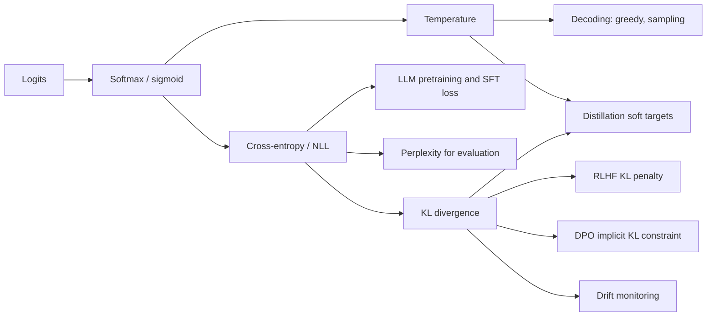

# Softmax, Entropy, Cross-Entropy and KL Divergence

> **Level:** Beginner to Advanced · **Study time:** ~110 min · **Prerequisites:** [Probability and Statistics for Machine Learning](./04-probability-and-statistics.md), [Calculus for ML: Derivatives, Gradients and the Chain Rule](./03-calculus-and-gradients.md)

## Table of contents

- [Why this matters](#why-this-matters)
- [The running examples](#the-running-examples)
- [Logits: the raw scores a model produces](#logits-the-raw-scores-a-model-produces)
- [Sigmoid: one score to one probability](#sigmoid-one-score-to-one-probability)
- [Softmax: many scores to a probability distribution](#softmax-many-scores-to-a-probability-distribution)
- [Numerically stable softmax and log-softmax](#numerically-stable-softmax-and-log-softmax)
- [Temperature: sharpening and flattening softmax](#temperature-sharpening-and-flattening-softmax)
- [Information and entropy](#information-and-entropy)
- [Cross-entropy and why the log](#cross-entropy-and-why-the-log)
- [Negative log-likelihood and maximum likelihood](#negative-log-likelihood-and-maximum-likelihood)
- [Binary vs categorical cross-entropy](#binary-vs-categorical-cross-entropy)
- [KL divergence](#kl-divergence)
- [Forward vs reverse KL: mode-covering vs mode-seeking](#forward-vs-reverse-kl-mode-covering-vs-mode-seeking)
- [Perplexity](#perplexity)
- [Where these ideas show up later in the course](#where-these-ideas-show-up-later-in-the-course)
- [Going deeper: production and senior-level concerns](#going-deeper-production-and-senior-level-concerns)
- [Common mistakes and misconceptions](#common-mistakes-and-misconceptions)
- [Interview questions and model answers](#interview-questions-and-model-answers)
- [Key takeaways](#key-takeaways)
- [Further reading](#further-reading)
- [Next](#next)

## Why this matters

Almost every model you will meet in this course ends the same way: it produces raw scores, turns them into probabilities with a sigmoid or softmax, and is trained by minimizing cross-entropy. A standard (autoregressive) LLM's pretraining objective is essentially "minimize the cross-entropy of the next token" (small auxiliary terms aside), and the number you see on its training dashboard (the loss, or its exponential, perplexity) is exactly that quantity. The temperature knob in most LLM APIs is a one-line change to softmax. Knowledge distillation trains a small model by minimizing a KL divergence to a big one, and RLHF and DPO (the post-training methods that tune an LLM toward human preferences) keep a fine-tuned model close to its starting point with a KL penalty. Interviewers love this material because a candidate who truly understands these five or six formulas can reason about loss curves, decoding behavior, distillation and alignment from first principles, instead of reciting buzzwords.

The math is lighter than it looks. If you can add, multiply, use $e^x$ and $\log$, you can follow every step here.

How this chapter is organized:

| Part | Sections | What you will be able to do |
|---|---|---|
| 1. From scores to probabilities | Logits, sigmoid, softmax, stability, temperature | Convert model outputs into probabilities safely and control their sharpness |
| 2. Measuring uncertainty and mismatch | Entropy, cross-entropy, NLL, BCE vs CE | Explain and compute the loss every classifier and LLM is trained with |
| 3. Comparing distributions | KL divergence, forward vs reverse KL, perplexity | Reason about distillation, RLHF/DPO and LLM evaluation |
| 4. Senior depth | Production concerns, mistakes, interview Q&A | Debug real training runs and answer follow-up questions |

## The running examples

We will reuse three tiny examples throughout so you can watch the same numbers flow through every formula.

| Example | Setup | Used for |
|---|---|---|
| **Next-word predictor** | A language model reads "The cat sat on the" and must pick the next word from a toy vocabulary of 3 words: `mat`, `floor`, `moon`. It outputs scores $[2.0,\ 1.0,\ 0.1]$. | Softmax, temperature, cross-entropy, gradients, distillation |
| **Spam filter** | An email classifier outputs a single score $2.0$ for "this email is spam". | Sigmoid and binary cross-entropy |
| **3-word sentence** | A model assigns probabilities $0.5$, $0.25$, $0.125$ to the three tokens of "the cat sat". | Negative log-likelihood and perplexity |

All numbers in these examples are illustrative, chosen to make the arithmetic clean.

## Logits: the raw scores a model produces

**Intuition.** Imagine three judges at a talent show who each shout out a raw score with no agreed scale: one says "2", another "1", another "0.1". You can tell who is ahead, but you cannot yet say "there is a 66% chance the first act wins". Those raw, unscaled scores are logits.

**Definition.** A **logit** is a raw, unbounded real number that a model outputs for a class (or token) before it is converted into a probability. Logits can be any real number: negative, zero, positive, large or small. Higher means "more likely", but logits are not probabilities: they do not lie between 0 and 1 and do not sum to 1.

In a neural network, the last layer is usually a linear layer $z = Wh + b$, where $h$ is the **hidden state** (the vector of features the earlier layers computed for this input) and $W$, $b$ are learned weights and biases (see [Linear Algebra for Machine Learning](./02-linear-algebra-for-ml.md)) that produces one logit per class. For an LLM with a vocabulary of 128,256 tokens (the size used by Llama 3), the model produces 128,256 logits at every position.

> **Where the name comes from:** in statistics, the logit of a probability $p$ is $\log\frac{p}{1-p}$, the "log-odds". The sigmoid function below is its inverse. Deep learning stretched the word to mean "any pre-softmax score".

```text
 hidden state h ──► [ linear layer W, b ] ──► logits z = [2.0, 1.0, 0.1]
                                                   │
                                     sigmoid or softmax
                                                   │
                                                   ▼
                                  probabilities p = [0.659, 0.242, 0.099]
```

## Sigmoid: one score to one probability

**Intuition.** The spam filter outputs one number. We need a dial that maps "very negative" to "almost certainly not spam" (near 0), "very positive" to "almost certainly spam" (near 1), and 0 to "coin flip" (0.5). The sigmoid is that dial: a smooth S-shaped squashing curve.

**Definition.** The **sigmoid** (also called the **logistic function**) maps any real number to the open interval $(0, 1)$:

$$\sigma(z) = \frac{1}{1 + e^{-z}}$$

- $z$: the logit (any real number).
- $e$: Euler's number, about 2.718.
- $e^{-z}$: large when $z$ is very negative (so $\sigma(z) \to 0$), tiny when $z$ is very positive (so $\sigma(z) \to 1$).
- $\sigma(z)$: the predicted probability of the positive class.

**Worked example (spam filter, logit $z = 2.0$):**

1. $e^{-2} \approx 0.1353$
2. $1 + 0.1353 = 1.1353$
3. $\sigma(2) = 1 / 1.1353 \approx 0.881$

So the filter says "88.1% spam". Some reference points: $\sigma(0) = 0.5$, $\sigma(-2) \approx 0.119$ (note $\sigma(-z) = 1 - \sigma(z)$), $\sigma(3) \approx 0.953$.

```text
 σ(z)
 1.0 ┤                          ___________
     │                     __---
 0.5 ┤ - - - - - - - - - -/- - - - - - - -
     │             ___---
 0.0 ┤____________/
     └──────┬──────┬──────┬──────┬──────► z
           -4     -2      0      2      4
```

Two useful facts:

- **Derivative:** $\sigma'(z) = \sigma(z)\,(1 - \sigma(z))$. It peaks at 0.25 when $z = 0$ and goes to 0 for large $|z|$. This is why sigmoid activations inside deep networks cause vanishing gradients (see [Vanishing and Exploding Gradients](../02-deep-learning/05-vanishing-exploding-gradients-initialization-normalization-and-residuals.md)). At the output layer, paired with cross-entropy, this problem cancels out, as you will see.
- **When to use it:** whenever you need an independent yes/no probability: binary classification (spam or not), or **multi-label** classification where each label is its own yes/no question (an image can contain both "dog" and "beach").

## Softmax: many scores to a probability distribution

**Intuition.** Back to the next-word predictor. We have three competing words, and exactly one of them comes next. We want probabilities that are positive and add up to 1, and we want a higher score to mean a higher probability. Softmax does it in two moves: make every score positive by exponentiating it, then divide by the total so they sum to 1. Think of it as "share of the pie": each word's slice is its exponentiated score divided by the size of the whole pie.

**Definition.** For a vector of $K$ logits $z = (z_1, \dots, z_K)$, the **softmax** returns a vector of $K$ probabilities:

$$\text{softmax}(z)_i = \frac{e^{z_i}}{\sum_{j=1}^{K} e^{z_j}}$$

- $K$: the number of classes (3 in our toy vocabulary; about 128k for a modern LLM).
- $z_i$: the logit of class $i$.
- $e^{z_i}$: always positive, and grows quickly with $z_i$, so the largest logit gets a disproportionate share.
- $\sum_{j} e^{z_j}$: the **normalizer** (also called the **partition function**, written $Z$), the sum over all classes. Dividing by it makes the outputs sum to 1.

The output is a **probability distribution** over the classes: a list of non-negative numbers summing to 1 (see [Probability and Statistics for Machine Learning](./04-probability-and-statistics.md)). The name "softmax" means it is a smooth, differentiable version of "pick the max": the largest logit gets the most probability, but the others are not zeroed out.

**Worked example (next-word predictor, logits $[2.0,\ 1.0,\ 0.1]$):**

| Step | `mat` | `floor` | `moon` |
|---|---|---|---|
| Logit $z_i$ | 2.0 | 1.0 | 0.1 |
| $e^{z_i}$ | 7.3891 | 2.7183 | 1.1052 |
| Sum $Z$ | 7.3891 + 2.7183 + 1.1052 = **11.2125** | | |
| $e^{z_i} / Z$ | 7.3891 / 11.2125 = **0.659** | 2.7183 / 11.2125 = **0.242** | 1.1052 / 11.2125 = **0.099** |

Check: $0.659 + 0.242 + 0.099 = 1.000$. Notice the gap: the logit for `mat` is only 2 times the logit for `floor`, but its probability is about 2.7 times larger. That ratio is exactly $e^{2.0 - 1.0} = e^1$. Softmax only cares about **differences** between logits.

### Three properties worth knowing cold

1. **Shift invariance.** Adding the same constant $c$ to every logit does not change the output: $\frac{e^{z_i + c}}{\sum_j e^{z_j + c}} = \frac{e^c e^{z_i}}{e^c \sum_j e^{z_j}}$. This is what makes the stability trick in the next section legal.
2. **Not scale invariant.** Multiplying all logits by 2 changes the output (it sharpens it). This is exactly what temperature exploits.
3. **Sigmoid is a 2-class softmax.** With logits $[z, 0]$: $\frac{e^z}{e^z + e^0} = \frac{e^z}{e^z + 1} = \frac{1}{1 + e^{-z}} = \sigma(z)$. So binary classification with a sigmoid is the same model as 2-class softmax with one logit pinned to 0.

### Code: from scratch, then the library way

```python
# pip install numpy torch
import numpy as np

def sigmoid(z):
    return 1.0 / (1.0 + np.exp(-z))

def softmax_naive(z):
    e = np.exp(z)          # make every score positive
    return e / e.sum()     # normalize so they sum to 1

logits = np.array([2.0, 1.0, 0.1])          # mat, floor, moon
print(round(float(sigmoid(2.0)), 3))        # 0.881  (spam filter)
print(softmax_naive(logits).round(3))       # [0.659 0.242 0.099]

import torch
t = torch.tensor([2.0, 1.0, 0.1])
print(torch.sigmoid(torch.tensor(2.0)))     # about 0.8808
print(torch.softmax(t, dim=-1))             # about [0.6590, 0.2424, 0.0986]
```

> **Common mistake:** applying softmax over the wrong axis. Logits for a batch usually have shape `(batch, num_classes)`, or `(batch, seq_len, vocab)` for an LLM. Softmax must run over the class axis (`dim=-1`), never the batch axis. A quick check: `probs.sum(dim=-1)` should be all ones.

## Numerically stable softmax and log-softmax

**Intuition.** Computers store numbers in a fixed number of bits. $e^{1000}$ is far larger than the biggest 64-bit float (about $1.8 \times 10^{308}$), so it becomes `inf`, and `inf / inf` is `NaN` (not a number). Logits of 1000 sound extreme, but in FP16 (half precision) the largest representable number is only 65,504, so $e^{12}$ (about 162,755) already overflows FP16. Overflow in softmax is a real, everyday bug.

**The fix: subtract the max.** Because softmax is shift invariant, we can subtract $m = \max_j z_j$ from every logit first:

$$\text{softmax}(z)_i = \frac{e^{z_i - m}}{\sum_{j} e^{z_j - m}}$$

- $m$: the largest logit. After subtracting it, the largest shifted logit is exactly 0, so the largest exponential is $e^0 = 1$ and nothing can overflow.
- The other shifted logits are negative, so their exponentials are between 0 and 1. Very negative ones may **underflow** to 0, which is harmless here because they would have had negligible probability anyway.
- The denominator is at least 1 (it contains the $e^0 = 1$ term), so we never divide by zero.

**Worked example:** logits $[1000, 1001, 1002]$.

1. Naive: $e^{1000}$ overflows to `inf`. Result: `[nan, nan, nan]`.
2. Stable: $m = 1002$. Shifted logits: $[-2, -1, 0]$.
3. Exponentials: $[0.1353,\ 0.3679,\ 1.0]$. Sum: $1.5032$.
4. Probabilities: $[0.1353/1.5032,\ 0.3679/1.5032,\ 1/1.5032] = [0.090,\ 0.245,\ 0.665]$.

Same answer as softmax of $[0, 1, 2]$, as shift invariance promises.

### Log-softmax and the log-sum-exp trick

Losses need the **log** of probabilities (you will see why soon). Computing `log(softmax(z))` in two steps is wasteful and dangerous: if a probability underflows to exactly 0, `log(0) = -inf`, and the loss becomes infinite or NaN. Instead, compute the log directly:

$$\log \text{softmax}(z)_i = z_i - \log \sum_j e^{z_j} = z_i - \underbrace{\left(m + \log \sum_j e^{z_j - m}\right)}_{\text{LSE}(z)}$$

- $\text{LSE}(z) = \log \sum_j e^{z_j}$: the **log-sum-exp**, a smooth approximation of $\max(z)$. It is always at least $\max(z)$ and at most $\max(z) + \log K$.
- Pulling out $m$ makes it stable for the same reason as before.
- **Log-softmax** is just "each logit minus the log-sum-exp". No division, no log of a tiny number.

**Worked example (next-word predictor):** $\text{LSE}([2.0, 1.0, 0.1]) = \log(11.2125) \approx 2.4170$. So log-softmax $= [2.0 - 2.4170,\ 1.0 - 2.4170,\ 0.1 - 2.4170] = [-0.4170,\ -1.4170,\ -2.3170]$. Check: $e^{-0.4170} \approx 0.659$. Correct.

```python
import numpy as np

def softmax(z, axis=-1):
    z = z - z.max(axis=axis, keepdims=True)       # stability: largest becomes 0
    e = np.exp(z)
    return e / e.sum(axis=axis, keepdims=True)

def log_softmax(z, axis=-1):
    m = z.max(axis=axis, keepdims=True)
    lse = m + np.log(np.exp(z - m).sum(axis=axis, keepdims=True))
    return z - lse

big = np.array([1000.0, 1001.0, 1002.0])
print(softmax(big).round(3))       # approximately [0.090 0.245 0.665]
print(log_softmax(np.array([2.0, 1.0, 0.1])).round(4))  # [-0.417 -1.417 -2.317]

# Library versions: always prefer these, they are stable and fused.
import torch, torch.nn.functional as F
from scipy.special import softmax as sp_softmax, logsumexp   # pip install scipy
t = torch.tensor([2.0, 1.0, 0.1])
print(F.log_softmax(t, dim=-1))            # about [-0.4170, -1.4170, -2.3170]
print(torch.logsumexp(t, dim=-1))          # about 2.4170
print(logsumexp([2.0, 1.0, 0.1]))          # about 2.4170
```

> **Senior insight:** this is why PyTorch's `nn.CrossEntropyLoss` takes **logits**, not probabilities. Internally it runs log-softmax and then picks out the target's log-probability, all in one numerically stable step. Feeding it softmax outputs applies softmax twice and silently hurts training.

## Temperature: sharpening and flattening softmax

**Intuition.** Think of temperature as a "confidence dial". Turn it down and the model becomes decisive, almost always picking its favorite. Turn it up and it becomes adventurous, giving underdogs a real chance. The physical metaphor: at low temperature, particles settle into the lowest-energy state; at high temperature, they bounce around randomly.

**Definition.** **Temperature** $T > 0$ divides the logits before softmax:

$$p_i(T) = \frac{e^{z_i / T}}{\sum_j e^{z_j / T}}$$

- $T = 1$: ordinary softmax.
- $T < 1$: logits are stretched apart, so the distribution gets **sharper** (more peaked).
- $T > 1$: logits are squeezed together, so the distribution gets **flatter** (more uniform).
- $T \to 0$: all probability goes to the largest logit (argmax). This is **greedy decoding**.
- $T \to \infty$: all probabilities approach $1/K$ (uniform).

Temperature never changes the **ranking** of the classes, only how spread out the probabilities are.

**Worked examples (next-word predictor, logits $[2.0, 1.0, 0.1]$):**

**$T = 0.5$:** divide by 0.5 (that is, multiply by 2): $[4.0,\ 2.0,\ 0.2]$.
$e^{4.0} = 54.5982$, $e^{2.0} = 7.3891$, $e^{0.2} = 1.2214$. Sum $= 63.2086$.
Probabilities: $54.5982/63.2086 = 0.864$, $7.3891/63.2086 = 0.117$, $1.2214/63.2086 = 0.019$.

**$T = 1$:** as computed before: $[0.659,\ 0.242,\ 0.099]$.

**$T = 2$:** divide by 2: $[1.0,\ 0.5,\ 0.05]$.
$e^{1.0} = 2.7183$, $e^{0.5} = 1.6487$, $e^{0.05} = 1.0513$. Sum $= 5.4183$.
Probabilities: $2.7183/5.4183 = 0.502$, $1.6487/5.4183 = 0.304$, $1.0513/5.4183 = 0.194$.

| Temperature | `mat` | `floor` | `moon` | Entropy (bits, defined below) | Behavior |
|---|---|---|---|---|---|
| $T = 0.5$ | 0.864 | 0.117 | 0.019 | 0.654 | Sharp, near-deterministic |
| $T = 1$ | 0.659 | 0.242 | 0.099 | 1.222 | The model's "native" distribution |
| $T = 2$ | 0.502 | 0.304 | 0.194 | 1.481 | Flat, diverse, riskier |
| $T \to \infty$ | 0.333 | 0.333 | 0.333 | 1.585 (maximum for 3 classes) | Uniform, random |

```text
 T = 0.5   mat   ██████████████████████████   0.864
           floor ███▌                         0.117
           moon  ▌                            0.019

 T = 1     mat   ████████████████████         0.659
           floor ███████▎                     0.242
           moon  ███                          0.099

 T = 2     mat   ███████████████              0.502
           floor █████████▏                   0.304
           moon  █████▊                       0.194
```

```python
import numpy as np

def softmax_t(z, T=1.0):
    z = np.asarray(z, dtype=float) / T
    z = z - z.max()
    e = np.exp(z)
    return e / e.sum()

for T in (0.5, 1.0, 2.0):
    print(T, softmax_t([2.0, 1.0, 0.1], T).round(3))
# 0.5 [0.864 0.117 0.019]
# 1.0 [0.659 0.242 0.099]
# 2.0 [0.502 0.304 0.194]
```

Where temperature appears in this course:

| Place | What $T$ does | Typical choice |
|---|---|---|
| LLM decoding ([Decoding Strategies](../05-llms/03-text-generation-and-decoding-strategies.md)) | Controls randomness of sampled text | Low (or 0, greedy) for extraction, code, classification; higher for brainstorming |
| Knowledge distillation ([Knowledge Distillation Fundamentals](../07-model-compression/05-knowledge-distillation-fundamentals.md)) | $T > 1$ reveals the teacher's "dark knowledge" in small probabilities | Commonly 2 to 5 in classic setups (a hyperparameter, tune it) |
| Calibration (temperature scaling) | A single $T$ fitted on validation data to make confidences honest | Fitted value, often $T > 1$ for overconfident networks |
| Attention ([The Attention Mechanism](../04-transformers/03-attention-mechanism-step-by-step.md)) | Dividing scores by $\sqrt{d_k}$ acts as a fixed temperature that keeps softmax from saturating | $\sqrt{d_k}$ |
| Contrastive models like CLIP ([Vision Transformers, CLIP and Multimodal LLMs](../03-computer-vision/05-vision-transformers-clip-and-multimodal-models.md)) | A learned temperature scales similarity logits | Learned during training |

> **Common mistake:** "temperature 0 makes the model deterministic." It makes token selection greedy (argmax), but outputs can still vary between runs because of floating-point non-determinism in batched GPU kernels, ties, and serving-side batching. Mathematically $T = 0$ is a division by zero; libraries special-case it as argmax.

## Information and entropy

Now we switch from "how to make probabilities" to "how to measure them". This is **information theory**, founded by Claude Shannon in "A Mathematical Theory of Communication" (1948).

### Information (surprisal)

**Intuition.** "The sun rose this morning" tells you nothing; you were certain of it. "It snowed in the Sahara" tells you a lot, because it was very unlikely. Information is surprise: the less likely an event, the more you learn when it happens.

**Definition.** The **information content** or **surprisal** of an event with probability $p$ is

$$I(p) = -\log p = \log \frac{1}{p}$$

- $p$: probability of the event, between 0 and 1.
- $\log$: with base 2 the unit is **bits**; with the natural log (base $e$) the unit is **nats**. $1 \text{ nat} = 1/\ln 2 \approx 1.443$ bits. Deep learning frameworks use natural logs, so losses are in nats.
- Certain events ($p = 1$) carry 0 information; rare events carry a lot.

Coin and dice examples, in bits:

| Event | $p$ | $-\log_2 p$ |
|---|---|---|
| Fair coin lands heads | 0.5 | 1 bit |
| A specific face of a fair 4-sided die | 0.25 | 2 bits |
| A biased coin's common side | 0.9 | 0.152 bits |
| A biased coin's rare side | 0.1 | 3.322 bits |
| A 1-in-100 event | 0.01 | 6.644 bits |

Why a log and not, say, $1/p$? Because information from **independent** events should **add**. Two fair coin flips have probability $0.5 \times 0.5 = 0.25$ and should carry $1 + 1 = 2$ bits. The log is the function that turns products into sums: $-\log(0.25) = -\log 0.5 - \log 0.5$.

### Entropy

**Intuition.** Entropy is the **average surprise** you expect from a random source. A fair coin keeps you guessing every time (high entropy). A coin that lands heads 99% of the time is boring (low entropy). Another view: entropy is the minimum average number of yes/no questions (bits) per outcome you need to communicate the outcomes, using the best possible code (exactly achievable when coding long sequences of outcomes; for a single outcome the best code needs between $H$ and $H + 1$ bits on average).

**Definition.** For a discrete distribution $P$ over outcomes $x$:

$$H(P) = -\sum_{x} P(x) \log P(x)$$

- $P(x)$: probability of outcome $x$.
- $-\log P(x)$: the surprise of outcome $x$.
- The sum weights each surprise by how often it happens, so $H$ is the expected surprise.
- By convention $0 \log 0 = 0$ (impossible outcomes contribute nothing).

**Worked coin examples (bits):**

1. **Fair coin** $(0.5, 0.5)$: $H = -(0.5 \log_2 0.5 + 0.5 \log_2 0.5) = -(0.5 \times (-1) + 0.5 \times (-1)) = 1$ bit.
2. **Biased coin** $(0.9, 0.1)$: $H = -(0.9 \log_2 0.9 + 0.1 \log_2 0.1) = 0.9 \times 0.152 + 0.1 \times 3.322 = 0.137 + 0.332 = 0.469$ bits.
3. **Very biased coin** $(0.99, 0.01)$: $H = 0.99 \times 0.0145 + 0.01 \times 6.644 = 0.0144 + 0.0664 = 0.081$ bits.
4. **Two-headed coin** $(1, 0)$: $H = -(1 \times 0) - 0 = 0$ bits. No uncertainty at all.
5. **Fair 6-sided die:** $H = \log_2 6 \approx 2.585$ bits.

```text
 H (bits)
 1.0 ┤               ___---___
     │          _--''         ''--_
 0.5 ┤      _-''                   ''-_
     │    /                            \
 0.0 ┤__/                                \__
     └──┬──────┬──────┬──────┬──────┬──────► P(heads)
        0     0.2    0.4    0.6    0.8     1
   Entropy of a coin: zero when certain, maximal (1 bit) when fair.
```

Key facts:

- $H(P) \ge 0$ always.
- For $K$ outcomes, the maximum is $\log K$, reached by the uniform distribution. For our 3-word vocabulary that is $\log_2 3 \approx 1.585$ bits (the last row of the temperature table).
- Higher temperature means higher entropy. That is the information-theoretic meaning of "more random".

```python
import numpy as np
from scipy.stats import entropy   # pip install scipy

def entropy_bits(p):
    p = np.asarray(p, dtype=float)
    p = p[p > 0]                  # 0 * log 0 = 0
    return float((p * np.log2(1 / p)).sum())   # p * log(1/p) avoids printing -0.0

for coin in ([0.5, 0.5], [0.9, 0.1], [0.99, 0.01], [1.0, 0.0]):
    print(coin, round(entropy_bits(coin), 3))
# [0.5, 0.5] 1.0
# [0.9, 0.1] 0.469
# [0.99, 0.01] 0.081
# [1.0, 0.0] 0.0

print(entropy([0.9, 0.1], base=2))   # same as above, about 0.469
```

> **Interview tip:** the entropy of an LLM's next-token distribution is a cheap, useful signal. High entropy means the model is unsure which token comes next. It is used as an uncertainty heuristic, for example in some hallucination-detection research (see "semantic entropy", Farquhar et al., Nature 2024, which measures entropy over meanings rather than raw tokens).

## Cross-entropy and why the log

**Intuition.** Suppose the true weather in your city follows distribution $P$, but you designed your weather-alert codebook based on a wrong belief $Q$. You will still be able to send messages, but they will be longer on average than necessary. **Cross-entropy** is the average message length (average surprise) when reality is $P$ but you are using $Q$ to anticipate it. The closer $Q$ is to $P$, the smaller it gets, and its minimum is the entropy of $P$ itself.

In machine learning: $P$ is the truth (the labels), $Q$ is the model's predicted distribution. Cross-entropy measures how surprised the model is, on average, by what actually happens.

**Definition.**

$$H(P, Q) = -\sum_{x} P(x) \log Q(x)$$

- $P(x)$: the true probability of outcome $x$ (from the data).
- $Q(x)$: the model's predicted probability of $x$.
- $-\log Q(x)$: how surprised the model is when $x$ happens.
- The weighted sum is the model's average surprise under the real world.

### The one-hot special case: the loss you will actually compute

For a single labeled example, the truth is a **one-hot** vector: probability 1 on the correct class $y$ and 0 elsewhere. All terms with $P(x) = 0$ vanish, leaving:

$$\mathcal{L} = -\log Q(y)$$

- $y$: the correct class.
- $Q(y)$: the probability the model gave to the correct class.

That is all cross-entropy loss is, for one example: **minus the log of the probability the model assigned to the right answer.**

**Worked example (next-word predictor):** the model predicted $[0.659,\ 0.242,\ 0.099]$.

- If the true next word is `mat`: $\mathcal{L} = -\ln 0.659 = 0.417$ nats.
- If the true next word is `floor`: $\mathcal{L} = -\ln 0.242 = 1.417$ nats.
- If the true next word is `moon`: $\mathcal{L} = -\ln 0.099 = 2.317$ nats.

Notice these are exactly the negated log-softmax values we computed earlier, $[-0.417, -1.417, -2.317]$. Cross-entropy loss is "pick out the target's log-softmax and flip its sign".

A soft-target example (true distribution not one-hot): let $P = [0.7, 0.2, 0.1]$ and the model $Q = [0.5, 0.3, 0.2]$. Then

$H(P, Q) = -(0.7 \ln 0.5 + 0.2 \ln 0.3 + 0.1 \ln 0.2) = 0.7 \times 0.693 + 0.2 \times 1.204 + 0.1 \times 1.609 = 0.485 + 0.241 + 0.161 = 0.887$ nats.

We will reuse this pair $P$, $Q$ for KL divergence.

### Why the log? Five reasons

This is a favorite interview question. Here are the reasons, from most to least fundamental:

1. **It is maximum likelihood.** Minimizing $-\log Q(y)$ summed over a dataset is the same as maximizing the probability of the whole dataset (next section). That gives the loss a principled statistical meaning.
2. **Products become sums.** The probability of a 1,000-token document is a product of 1,000 per-token probabilities. With each around 0.1, the product is $10^{-1000}$, which underflows to 0 even in 64-bit floats (smallest positive value about $5 \times 10^{-324}$). The sum of logs is $1000 \times \ln 0.1 = -2302.6$, perfectly representable.
3. **Confident mistakes are punished hard.** $-\log Q(y)$ goes to infinity as $Q(y) \to 0$. Predicting 0.01 for the true class costs $-\ln 0.01 = 4.6$ nats, while squared error on that probability is at most $(1 - 0.01)^2 = 0.98$. Cross-entropy refuses to let a model be confidently wrong.
4. **Beautiful gradients.** With softmax plus cross-entropy, the gradient with respect to the logits is simply $Q - P$ (predicted minus true). No vanishing factor from the sigmoid or softmax derivative (derivation below).
5. **Information-theoretic meaning.** The loss in bits is the average code length needed to encode the data with the model as the codebook. A better language model is literally a better compressor (explored in "Language Modeling Is Compression", Delétang et al., 2023).

### The gradient: predicted minus true

For softmax followed by cross-entropy with one-hot target $y$ (written as vector $P$):

$$\frac{\partial \mathcal{L}}{\partial z_i} = Q_i - P_i$$

- $z_i$: the logit for class $i$.
- $Q_i$: softmax probability for class $i$.
- $P_i$: 1 for the true class, 0 otherwise.

**Worked example:** logits $[2.0, 1.0, 0.1]$, true word `mat`. Gradient $= [0.659 - 1,\ 0.242 - 0,\ 0.099 - 0] = [-0.341,\ 0.242,\ 0.099]$. Gradient descent subtracts the gradient, so it **raises** the `mat` logit and **lowers** the others, in proportion to how wrong each was. If the model were already perfect ($Q = P$), the gradient would be zero. (Gradient descent itself is covered in [Backpropagation and Gradient Descent](../02-deep-learning/02-backpropagation-and-gradient-descent.md).)

Short derivation, if you want it: $\mathcal{L} = -z_y + \log\sum_j e^{z_j}$. The derivative of $-z_y$ with respect to $z_i$ is $-1$ if $i = y$ else 0, which is $-P_i$. The derivative of the log-sum-exp with respect to $z_i$ is $e^{z_i} / \sum_j e^{z_j} = Q_i$. Add them: $Q_i - P_i$.

```python
import torch
import torch.nn.functional as F

logits = torch.tensor([[2.0, 1.0, 0.1]], requires_grad=True)  # (batch=1, classes=3)
target = torch.tensor([0])                                      # class index of "mat"

loss = F.cross_entropy(logits, target)   # log-softmax + NLL in one stable op
loss.backward()
print(loss.item())        # about 0.4170
print(logits.grad)        # about [[-0.3410, 0.2424, 0.0986]]  = softmax - one_hot
```

## Negative log-likelihood and maximum likelihood

**Intuition.** A good model should find the data you actually observed "unsurprising", that is, it should assign it high probability. **Likelihood** is the probability the model assigns to the observed data. Training means turning the model's knobs to make that number as large as possible.

**Definitions.**

- **Likelihood** of parameters $\theta$ (all the model's weights, the "knobs") given data $x_1, \dots, x_N$: $L(\theta) = \prod_{n=1}^{N} Q_\theta(x_n)$ (assuming independent examples).
- **Maximum likelihood estimation (MLE):** choose $\theta$ that maximizes $L(\theta)$.
- **Negative log-likelihood (NLL):** $-\log L(\theta) = -\sum_n \log Q_\theta(x_n)$. Maximizing likelihood is identical to minimizing NLL, because $-\log$ is a decreasing function. We usually report the **mean** NLL per example (or per token).

$$\text{NLL}(\theta) = -\frac{1}{N}\sum_{n=1}^{N} \log Q_\theta(y_n \mid x_n)$$

- $N$: number of examples (or tokens).
- $y_n$: the correct label (or next token) for input $x_n$ (or context).
- $Q_\theta(y_n \mid x_n)$: the model's probability for that correct answer.

For one-hot labels, **mean cross-entropy and mean NLL are the same number**. The names differ by viewpoint: "cross-entropy" comes from information theory, "NLL" from statistics. PyTorch even splits it this way: `F.cross_entropy(logits, y)` equals `F.nll_loss(F.log_softmax(logits, -1), y)`.

**Worked example (3-word sentence "the cat sat").** The model gives the three tokens probabilities 0.5, 0.25 and 0.125.

1. Likelihood: $0.5 \times 0.25 \times 0.125 = 0.015625$.
2. Log-likelihood: $\ln 0.5 + \ln 0.25 + \ln 0.125 = -0.693 - 1.386 - 2.079 = -4.159$.
3. NLL (sum): $4.159$ nats. Mean NLL per token: $4.159 / 3 = 1.386$ nats ($= \ln 4$).

### Next-token prediction is exactly this

An LLM factors the probability of a sequence with the chain rule of probability:

$$Q_\theta(x_1, \dots, x_T) = \prod_{t=1}^{T} Q_\theta(x_t \mid x_{<t})$$

- $x_t$: the token at position $t$.
- $x_{<t}$: all tokens before position $t$ (the context).

Taking $-\log$ and averaging gives the LLM pretraining loss: the mean cross-entropy of each actual next token. This is covered in depth in [Pretraining and Next-Token Prediction](../05-llms/01-pretraining-and-next-token-prediction.md); for now, notice that it is the same one-line formula as our 3-word example, applied to trillions of tokens.

> **Senior insight:** averaged over a huge dataset, mean NLL estimates $H(P_{\text{data}}, Q_\theta)$, the cross-entropy between the true data distribution and the model. As you will see in the KL section, minimizing it is equivalent to minimizing $D_{KL}(P_{\text{data}} \,\|\, Q_\theta)$. "Next-token prediction" is, precisely, forward-KL minimization toward the distribution of human text.

## Binary vs categorical cross-entropy

**Binary cross-entropy (BCE)** is cross-entropy for a single yes/no outcome with a sigmoid output $\hat{p} = \sigma(z)$:

$$\text{BCE}(y, \hat{p}) = -\left[\,y \log \hat{p} + (1 - y)\log(1 - \hat{p})\,\right]$$

- $y \in \{0, 1\}$: true label (1 = spam).
- $\hat{p}$: predicted probability of the positive class.
- Only one of the two terms is active: if $y = 1$ the loss is $-\log \hat{p}$; if $y = 0$ it is $-\log(1 - \hat{p})$.

It is just the categorical formula with 2 classes, $P = (y, 1 - y)$ and $Q = (\hat{p}, 1 - \hat{p})$.

**Worked example (spam filter, logit 2.0, $\hat{p} = 0.881$):**

- If the email really is spam ($y = 1$): $-\ln 0.881 = 0.127$ nats. Small loss, good prediction.
- If it is not spam ($y = 0$): $-\ln(1 - 0.881) = -\ln 0.119 = 2.127$ nats. Large loss, confident mistake.

**Categorical cross-entropy (CE)** is the general $K$-class version with softmax, $-\log Q(y)$, as in the next-word example.

| | Binary cross-entropy (BCE) | Categorical cross-entropy (CE) |
|---|---|---|
| Output activation | Sigmoid, one per label | Softmax over all classes |
| Classes per example | One yes/no (or several independent yes/no) | Exactly one correct class out of $K$ |
| Typical tasks | Spam vs ham, click prediction, **multi-label** tagging, per-pixel binary masks | Image classification, intent detection, **next-token prediction** |
| Probabilities sum to 1? | No (each label independent) | Yes |
| PyTorch (stable) | `nn.BCEWithLogitsLoss` (takes logits) | `nn.CrossEntropyLoss` (takes logits) |
| Avoid | `nn.BCELoss` on sigmoid outputs (less stable) | Feeding softmax outputs into `CrossEntropyLoss` |
| Imbalance knob | `pos_weight` | `weight` per class, or focal loss |

```python
import torch
import torch.nn as nn

# Spam filter: one logit per email, labels as floats
bce = nn.BCEWithLogitsLoss()
print(bce(torch.tensor([2.0]), torch.tensor([1.0])).item())  # about 0.1269
print(bce(torch.tensor([2.0]), torch.tensor([0.0])).item())  # about 2.1269

# Multi-label: 3 independent tags per image -> BCE, not softmax
logits = torch.tensor([[1.5, -0.3, 2.2]])
tags   = torch.tensor([[1.0,  0.0, 1.0]])   # dog=yes, cat=no, beach=yes
print(bce(logits, tags).item())

# Multi-class: 3 mutually exclusive classes -> CE with class indices
ce = nn.CrossEntropyLoss(label_smoothing=0.0)   # label_smoothing needs PyTorch 1.10+
print(ce(torch.tensor([[2.0, 1.0, 0.1]]), torch.tensor([0])).item())  # about 0.4170
```

> **Common mistake:** using softmax + CE for a multi-label problem. Softmax forces labels to compete, so an image with both a dog and a beach cannot get high probability on both. Use independent sigmoids + BCE.

**Label smoothing** (Szegedy et al., "Rethinking the Inception Architecture for Computer Vision", 2016) replaces the one-hot target with $(1 - \varepsilon)\cdot\text{onehot} + \varepsilon / K$. With $\varepsilon = 0.1$ and $K = 3$, the target for `mat` becomes $[0.933,\ 0.033,\ 0.033]$. This discourages pushing logits to extremes and often improves calibration. Other loss variants such as focal loss belong to [Loss Functions](../02-deep-learning/04-loss-functions.md).

## KL divergence

**Intuition.** Cross-entropy $H(P, Q)$ mixes two things: the unavoidable uncertainty of the world, $H(P)$, plus the extra cost of using the wrong model. **KL divergence** isolates just the extra cost. Back to the codebook analogy: if the optimal code for the true weather needs 0.80 nats per message on average and your codebook built from a wrong belief needs 0.89, the KL divergence is the 0.09 you are wasting.

**Definition.** The **Kullback-Leibler (KL) divergence** from $Q$ to $P$ (Kullback and Leibler, "On Information and Sufficiency", 1951):

$$D_{KL}(P \,\|\, Q) = \sum_{x} P(x) \log \frac{P(x)}{Q(x)}$$

- $P$: the reference distribution (usually the truth, data, or a teacher).
- $Q$: the approximating distribution (usually the model or student).
- $\log \frac{P(x)}{Q(x)}$: how much more (or less) likely $x$ is under $P$ than under $Q$.
- The sum is weighted by $P$: we care about mismatches where $P$ puts probability.
- Read $D_{KL}(P \,\|\, Q)$ as "the KL divergence of $P$ from $Q$": the expectation is taken under $P$, and $Q$ is the approximation being judged. The order matters a lot.

**Worked example:** $P = [0.7, 0.2, 0.1]$ (true), $Q = [0.5, 0.3, 0.2]$ (model), natural logs.

| $x$ | $P(x)$ | $Q(x)$ | $P/Q$ | $\ln(P/Q)$ | $P \ln(P/Q)$ |
|---|---|---|---|---|---|
| 1 | 0.7 | 0.5 | 1.400 | 0.3365 | 0.2355 |
| 2 | 0.2 | 0.3 | 0.667 | -0.4055 | -0.0811 |
| 3 | 0.1 | 0.2 | 0.500 | -0.6931 | -0.0693 |
| **Sum** | | | | | **0.0851** |

So $D_{KL}(P \,\|\, Q) \approx 0.085$ nats. Individual terms can be negative, but the total never is.

Now swap the arguments:

| $x$ | $Q(x)$ | $P(x)$ | $Q/P$ | $\ln(Q/P)$ | $Q \ln(Q/P)$ |
|---|---|---|---|---|---|
| 1 | 0.5 | 0.7 | 0.714 | -0.3365 | -0.1682 |
| 2 | 0.3 | 0.2 | 1.500 | 0.4055 | 0.1216 |
| 3 | 0.2 | 0.1 | 2.000 | 0.6931 | 0.1386 |
| **Sum** | | | | | **0.0920** |

$D_{KL}(Q \,\|\, P) \approx 0.092 \ne 0.085$. **KL is asymmetric.**

### Properties

| Property | Statement | Why it matters |
|---|---|---|
| Non-negative | $D_{KL}(P \,\|\, Q) \ge 0$ (Gibbs' inequality) | Usable as a loss with a clear floor |
| Zero iff equal | $D_{KL} = 0$ exactly when $P = Q$ | "Perfect match" has a clear signature |
| Asymmetric | $D_{KL}(P \,\|\, Q) \ne D_{KL}(Q \,\|\, P)$ in general | Direction is a modeling choice (next section) |
| Not a distance | No symmetry, no triangle inequality | Call it a "divergence", not a "distance" |
| Can be infinite | If $Q(x) = 0$ where $P(x) > 0$, then $D_{KL}(P \,\|\, Q) = \infty$ | Models must never assign exactly zero probability; softmax guarantees this mathematically, but hard masks and floating-point underflow can break it (another reason to work in log space) |

### Cross-entropy equals entropy plus KL

Expand the KL definition using $\log \frac{P}{Q} = \log P - \log Q$:

$$D_{KL}(P \,\|\, Q) = \sum_x P(x)\log P(x) - \sum_x P(x)\log Q(x) = -H(P) + H(P, Q)$$

Rearranged:

$$H(P, Q) = H(P) + D_{KL}(P \,\|\, Q)$$

- $H(P, Q)$: cross-entropy, what the training loss measures.
- $H(P)$: entropy of the true distribution. It does **not** depend on the model.
- $D_{KL}(P \,\|\, Q)$: the part the model can actually reduce.

**Check with our numbers:** $H(P) = -(0.7 \ln 0.7 + 0.2 \ln 0.2 + 0.1 \ln 0.1) = 0.250 + 0.322 + 0.230 = 0.802$ nats. $H(P) + D_{KL} = 0.802 + 0.085 = 0.887$ nats, which matches the cross-entropy $0.887$ we computed earlier.

Two consequences you should be able to state in an interview:

1. **Minimizing cross-entropy over the model is the same as minimizing KL**, since $H(P)$ is a constant. They have identical gradients with respect to the model.
2. **The loss has a floor.** Cross-entropy can never go below $H(P)$. For language, $H(P)$ is the inherent unpredictability of text, which is why LLM loss curves flatten out above zero. Scaling-law papers model this with an "irreducible loss" term (for example Hoffmann et al., "Training Compute-Optimal Large Language Models", 2022, the Chinchilla paper).

```python
import numpy as np
import torch, torch.nn.functional as F
from scipy.stats import entropy

P = np.array([0.7, 0.2, 0.1])
Q = np.array([0.5, 0.3, 0.2])

kl_pq = float((P * np.log(P / Q)).sum())
print(round(kl_pq, 4))                       # 0.0851
print(entropy(P, Q))                         # scipy: KL(P||Q) when qk is given, about 0.0851

# PyTorch: F.kl_div(input, target) expects input = LOG-probs of the model Q,
# target = probs of P, and computes sum P * (log P - input) = KL(P || Q).
Pt, Qt = torch.tensor(P), torch.tensor(Q)
print(F.kl_div(Qt.log(), Pt, reduction="sum"))  # about 0.0851
```

> **Common mistake:** `F.kl_div(p, q)` with both arguments as plain probabilities, or with the arguments in the wrong order. The first argument must be log-probabilities of the model, the second the target distribution. Also use `reduction="batchmean"` for a per-example mean; the default `"mean"` divides by the number of elements (batch times classes) and gives a value that is not the true KL.

### Jensen-Shannon divergence, briefly

The **Jensen-Shannon (JS) divergence** symmetrizes KL: with $M = \frac{1}{2}(P + Q)$, $\text{JS}(P, Q) = \frac{1}{2}D_{KL}(P \,\|\, M) + \frac{1}{2}D_{KL}(Q \,\|\, M)$. It is symmetric, always finite (at most $\ln 2$), and its square root is a true metric. It shows up in drift monitoring (see [Data Drift, Concept Drift and When to Retrain](../01-classical-ml/08-data-drift-concept-drift-and-retraining.md)) and in the theory of the original GAN objective.

## Forward vs reverse KL: mode-covering vs mode-seeking

**Intuition.** Suppose the truth $P$ is a city with two busy downtowns and an empty park in between, and you may place only **one** coffee shop region $Q$ (your model is too simple to have two peaks). You have two ways to be judged:

- **Forward KL, $D_{KL}(P \,\|\, Q)$:** judged by the residents. Every resident (wherever $P > 0$) complains if you are far away. You spread out to cover both downtowns, even if that means a branch in the empty park. This is **mode-covering** (also called "zero-avoiding": $Q$ must not be zero where $P$ is not).
- **Reverse KL, $D_{KL}(Q \,\|\, P)$:** judged by your own customers. Every place you serve (wherever $Q > 0$) is penalized if there are no residents there. You pick one downtown and serve it well, ignoring the other. This is **mode-seeking** (also called "zero-forcing": $Q$ is pushed to zero where $P$ is small).

**Worked example.** Truth $P = [0.49,\ 0.02,\ 0.49]$ (two modes with a valley). Two candidate approximations:

- $Q_A = [0.33,\ 0.34,\ 0.33]$: spread out, covers both modes (and wastes mass on the valley).
- $Q_B = [0.96,\ 0.02,\ 0.02]$: commits to the first mode.

Forward KL, $D_{KL}(P \,\|\, Q)$:

- $Q_A$: $2 \times 0.49 \ln\frac{0.49}{0.33} + 0.02 \ln\frac{0.02}{0.34} = 2 \times 0.49 \times 0.3953 + 0.02 \times (-2.8332) = 0.3874 - 0.0567 = 0.331$.
- $Q_B$: $0.49 \ln\frac{0.49}{0.96} + 0.02 \ln 1 + 0.49 \ln\frac{0.49}{0.02} = 0.49 \times (-0.6725) + 0 + 0.49 \times 3.1987 = -0.3295 + 1.5674 = 1.238$.

Forward KL **prefers $Q_A$** (0.331 < 1.238): missing a real mode is very costly.

Reverse KL, $D_{KL}(Q \,\|\, P)$:

- $Q_A$: $2 \times 0.33 \ln\frac{0.33}{0.49} + 0.34 \ln\frac{0.34}{0.02} = 2 \times 0.33 \times (-0.3953) + 0.34 \times 2.8332 = -0.2609 + 0.9633 = 0.702$.
- $Q_B$: $0.96 \ln\frac{0.96}{0.49} + 0.02 \ln 1 + 0.02 \ln\frac{0.02}{0.49} = 0.96 \times 0.6725 + 0 + 0.02 \times (-3.1987) = 0.6456 - 0.0640 = 0.582$.

Reverse KL **prefers $Q_B$** (0.582 < 0.702): putting mass where the truth has almost none is very costly, while ignoring a mode is cheap.

```text
 Truth P (bimodal)          Forward KL fit             Reverse KL fit
                            (mode-covering)            (mode-seeking)
   █           █              ▄▄▄▄▄▄▄▄▄▄▄▄▄            █
   █           █             █             █           █
   █     ▁     █             █             █           █   ▁     ▁
 ──┴─────┴─────┴──         ──┴─────────────┴──       ──┴───┴─────┴──
 mode  valley  mode        covers both, blurs        locks onto one mode
```

| | Forward KL $D_{KL}(P \,\|\, Q)$ | Reverse KL $D_{KL}(Q \,\|\, P)$ |
|---|---|---|
| Expectation taken under | The target $P$ (needs samples from $P$) | The model $Q$ (needs samples from $Q$ and ability to evaluate $P$) |
| Behavior | Mode-covering, mass-spreading | Mode-seeking, mass-concentrating |
| Failure mode | Blurry, overly diverse; puts mass on implausible outputs | Collapses onto a subset of modes; loses diversity |
| Equivalent to | Maximum likelihood / cross-entropy training | KL-regularized RL, variational inference |
| Where you see it | LLM pretraining, SFT, classic distillation | RLHF's KL penalty, DPO's implicit objective, VAEs' KL term, some LLM distillation methods (for example MiniLLM, Gu et al., 2023) |

Two terms in the table, briefly: **variational inference** approximates an intractable distribution $P$ with a simpler $Q$ by minimizing $D_{KL}(Q \,\|\, P)$, and a **VAE** (variational autoencoder) is a generative model trained that way. SFT (supervised fine-tuning) is ordinary cross-entropy training on curated prompt-response pairs.

> **Senior insight:** this asymmetry explains some practical behavior. Pretraining with forward KL makes base models spread probability over many plausible continuations, including mediocre ones, which is one reason sampling tricks help: lower temperature, top-k (sample only among the $k$ most likely tokens) and top-p (sample only from the smallest set of tokens whose probabilities add up to $p$). RLHF optimizes reward minus a reverse-KL-style penalty to the reference model, which tends to concentrate probability on preferred responses and is commonly linked to reduced output diversity after alignment.

## Perplexity

**Intuition.** Loss in nats is hard to feel. **Perplexity** translates it into "the model is as confused as if it were choosing uniformly among $N$ options at each step". A perplexity of 4 means "on average, as uncertain as a fair 4-sided die".

**Definition.** For a sequence of $N$ tokens:

$$\text{PPL} = \exp\left(-\frac{1}{N}\sum_{t=1}^{N} \log Q_\theta(x_t \mid x_{<t})\right) = e^{\text{mean NLL}}$$

- The inner quantity is the mean cross-entropy (NLL) per token, in nats.
- Exponentiating undoes the log. If the loss is measured in bits, use $2^{\text{loss}}$ instead; the result is the same number.
- Range: 1 (perfect, always assigned probability 1 to the true token) to infinity. A model that is uniform over a vocabulary of size $V$ has perplexity exactly $V$.

**Worked example (3-word sentence):** mean NLL $= 1.386$ nats (computed earlier). $\text{PPL} = e^{1.386} = 4.0$. Equivalently, it is the inverse geometric mean of the probabilities: $(0.5 \times 0.25 \times 0.125)^{-1/3} = (0.015625)^{-1/3} = 4$.

**A sanity check every LLM engineer uses.** A freshly initialized model is close to uniform, so its loss should start near $\ln V$:

| Vocabulary size (example tokenizer) | $\ln V$ (initial loss, nats) | Initial perplexity |
|---|---|---|
| 32,000 (Llama 2) | 10.37 | about 32,000 |
| 50,257 (GPT-2) | 10.82 | about 50,257 |
| 128,256 (Llama 3) | 11.76 | about 128,256 |

If your step-0 loss is far above $\ln V$, your initialization or logit scale is off. If the loss later drops suspiciously close to 0 on text, suspect a bug such as the model seeing the label (for example, a broken causal mask), not genius.

```python
# pip install torch transformers
# Perplexity of a causal LM on a short text (conceptual; model choice is illustrative).
import math, torch
from transformers import AutoTokenizer, AutoModelForCausalLM

tok = AutoTokenizer.from_pretrained("gpt2")
model = AutoModelForCausalLM.from_pretrained("gpt2").eval()

enc = tok("The cat sat on the mat.", return_tensors="pt")
with torch.no_grad():
    # Passing labels=input_ids makes the model shift labels by one internally
    # and return the mean next-token cross-entropy (in nats).
    out = model(**enc, labels=enc["input_ids"])
print("mean NLL:", out.loss.item(), "perplexity:", math.exp(out.loss.item()))
```

Perplexity caveats (senior material):

- **Tokenizer dependence.** Perplexity is per token. Two models with different tokenizers split the same text into different numbers of tokens, so their perplexities are not comparable. Use a tokenizer-independent measure such as **bits per byte** or bits per character (total NLL in bits divided by the number of bytes) to compare across tokenizers.
- **Context length and windowing.** Long texts must be scored with a sliding window; the stride changes the result. Report how you computed it.
- **Not a quality metric for chat.** Lower perplexity on web text does not mean more helpful, safer or more truthful answers. Instruction-tuned models can have worse perplexity on raw text than their base models while being far more useful. See [Evaluating LLMs](../05-llms/10-llm-evaluation-metrics-and-llm-as-a-judge.md).
- **Contamination.** Unusually low perplexity on a benchmark can signal that the benchmark leaked into training data (see [Catastrophic Forgetting, Data Contamination and Memorization](../05-llms/09-catastrophic-forgetting-contamination-and-memorization.md)).

## Where these ideas show up later in the course



| Concept | Where it is used | How |
|---|---|---|
| **Cross-entropy** | [Pretraining](../05-llms/01-pretraining-and-next-token-prediction.md), [fine-tuning](../05-llms/07-fine-tuning-full-lora-and-qlora.md), every classifier | The training loss: mean $-\log Q(\text{correct token})$ |
| **Temperature** | [Decoding Strategies](../05-llms/03-text-generation-and-decoding-strategies.md) | Divide logits by $T$ before sampling; combined with top-k and top-p |
| **KL divergence + temperature** | [Knowledge Distillation Fundamentals](../07-model-compression/05-knowledge-distillation-fundamentals.md), [Distilling LLMs](../07-model-compression/06-distilling-large-language-models.md) | Student matches teacher's softened distribution |
| **KL penalty** | [Instruction Tuning, RLHF and DPO](../05-llms/02-instruction-tuning-rlhf-and-dpo.md) | Keep the policy close to a reference model while maximizing reward |
| **Perplexity, log-probs** | [Evaluating LLMs](../05-llms/10-llm-evaluation-metrics-and-llm-as-a-judge.md) | Intrinsic evaluation, scoring multiple-choice answers by log-likelihood |
| **Entropy** | [Hallucinations](../05-llms/06-hallucinations-and-grounding.md), active learning | Uncertainty signal |
| **Softmax** | [Attention](../04-transformers/03-attention-mechanism-step-by-step.md) | Turns query-key scores into attention weights |

### A preview of the three biggest uses

**1. Knowledge distillation (Hinton, Vinyals and Dean, "Distilling the Knowledge in a Neural Network", 2015).** A teacher's softened distribution carries **dark knowledge**: our teacher logits $[2.0, 1.0, 0.1]$ at $T = 2$ give $[0.502, 0.304, 0.194]$, telling the student that `floor` is a much better wrong answer than `moon`. A one-hot label would hide that. The student minimizes

$$\mathcal{L} = \alpha\, T^2\, D_{KL}\!\left(p^{\text{teacher}}_T \,\|\, p^{\text{student}}_T\right) + (1 - \alpha)\, \text{CE}(y, p^{\text{student}}_1)$$

- $p_T$: softmax at temperature $T$; $\alpha$: weight between soft and hard losses. Here $\alpha$ multiplies the soft (teacher) term; [Knowledge Distillation Fundamentals](../07-model-compression/05-knowledge-distillation-fundamentals.md) uses the opposite convention ($\alpha$ on the hard-label term), and codebases differ too, so always check which term $\alpha$ weights.
- $T^2$: the soft-target gradients scale like $1/T^2$, so multiplying by $T^2$ keeps the two terms balanced as you change $T$ (as noted by Hinton et al.).

**Worked example.** Suppose the student currently outputs equal logits (a simplification of an untrained model), so it is uniform, $[1/3, 1/3, 1/3]$, at any temperature. Against the $T = 2$ teacher $[0.502, 0.304, 0.194]$: $D_{KL} = \sum_x p^{t}(x) \ln\frac{p^{t}(x)}{1/3} = \ln 3 - H(p^{t}) = 1.099 - 1.026 = 0.072$ nats, so the soft term is $T^2 \times 0.072 \approx 0.29$. If the true label is `mat`, the hard term is $-\ln(1/3) = 1.099$. With $\alpha = 0.5$: $\mathcal{L} \approx 0.5 \times 0.29 + 0.5 \times 1.099 \approx 0.69$ nats. As the student learns, both terms shrink, and the soft term reaches 0 only when the student reproduces the teacher's whole distribution.

```python
import torch.nn.functional as F

def distillation_loss(student_logits, teacher_logits, labels, T=2.0, alpha=0.5):
    # Shapes: (N, K). For LLMs, flatten (batch, seq, vocab) -> (batch*seq, vocab)
    # so "batchmean" averages per token, and drop padding positions first.
    soft = F.kl_div(
        F.log_softmax(student_logits / T, dim=-1),   # student: log-probs
        F.softmax(teacher_logits / T, dim=-1),       # teacher: probs
        reduction="batchmean",
    ) * (T * T)                                       # KL(teacher || student)
    hard = F.cross_entropy(student_logits, labels)
    return alpha * soft + (1 - alpha) * hard
```

**2. RLHF and DPO.** In RLHF (reinforcement learning from human feedback; for example Ouyang et al., "Training language models to follow instructions with human feedback", 2022), the **policy** $\pi_\theta$ (reinforcement-learning vocabulary for the LLM being trained, viewed as a distribution over responses) maximizes reward minus a KL penalty to a frozen reference model $\pi_{\text{ref}}$:

$$\max_{\theta}\ \mathbb{E}\left[r(x, y)\right] - \beta\, D_{KL}\!\left(\pi_\theta(\cdot \mid x) \,\|\, \pi_{\text{ref}}(\cdot \mid x)\right)$$

- $r(x, y)$: reward model score for response $y$ to prompt $x$.
- $\beta$: strength of the leash. Too small and the policy **reward-hacks** (finds weird outputs the reward model overrates) and drifts into gibberish; too large and it barely changes.

DPO (Rafailov et al., "Direct Preference Optimization: Your Language Model is Secretly a Reward Model", 2023) derives a closed-form solution of this same KL-constrained objective and turns it into a simple classification-style loss on preference pairs (chosen $y_w$, rejected $y_l$), where $\beta$ plays the same role:

```python
import torch.nn.functional as F

def dpo_loss(pi_logp_w, pi_logp_l, ref_logp_w, ref_logp_l, beta=0.1):
    # Each argument: summed log-prob of a full response, shape (batch,).
    margin = beta * ((pi_logp_w - ref_logp_w) - (pi_logp_l - ref_logp_l))
    return -F.logsigmoid(margin).mean()   # binary cross-entropy on the margin
```

Notice the ingredients: log-probabilities, log-ratios to a reference (the building block of KL), and a sigmoid with binary cross-entropy. Everything in this chapter, combined.

**3. Evaluation.** Perplexity for language modeling quality, log-likelihood scoring for multiple-choice benchmarks (pick the option with the highest total or length-normalized log-prob), calibration of confidence scores, and token log-probs exposed by many LLM APIs (availability and format are vendor and version specific) for confidence estimation and routing.

## Going deeper: production and senior-level concerns

### Never materialize what you do not need: fused log-softmax + NLL

Frameworks fuse log-softmax and NLL into one kernel because the gradient is simply $Q - P$ and the fused path avoids storing an extra tensor and avoids `log(0)`. At LLM scale this matters for **memory**: the logits tensor has shape `(batch, seq_len, vocab)`.

Illustrative calculation: batch 8, sequence 4,096, vocabulary 128,256, FP32:
$8 \times 4096 \times 128{,}256 = 4{,}202{,}692{,}608$ values $\times$ 4 bytes $\approx 16.8$ GB, just for one copy of the logits, before the softmax output and gradients. This is why training stacks use **chunked or fused cross-entropy** kernels that compute the loss over slices of the sequence or vocabulary without ever materializing the full logit tensor (for example the fused linear cross-entropy in the open-source Liger Kernel project, and "Cut Your Losses in Large-Vocabulary Language Models", Wijmans et al., 2024). See [Distributed Training and Training Memory](../02-deep-learning/10-distributed-training-and-training-memory.md).

### Precision: compute softmax and losses in FP32

In [mixed-precision training](../02-deep-learning/09-mixed-precision-training.md), matrix multiplications run in FP16 or BF16, but softmax, log-sum-exp and the loss are typically computed in FP32. FP16 overflows above 65,504, and BF16 has only 8 bits of precision (roughly 2 to 3 significant decimal digits), so small probability differences and long sums lose precision. Autocast in PyTorch handles this for standard ops; custom kernels must do it deliberately.

### Masking and the all-masked row

Causal attention and padding use **masks** that set disallowed logits to $-\infty$ so softmax gives them exactly 0 (see [Multi-Head Attention and Causal Masking](../04-transformers/04-multi-head-attention-and-causal-masking.md)). If an entire row is masked, softmax computes $e^{-\infty} / \sum e^{-\infty} = 0/0 = $ NaN, and one NaN poisons the whole batch. Fixes: use a large negative finite value (respecting the dtype's range), guarantee each row has at least one valid position, and set ignored label positions to the loss's ignore index (`-100` by default in PyTorch's `CrossEntropyLoss`) so padding tokens do not contribute to the loss.

### Logit growth, z-loss and soft-capping

Because softmax is shift invariant, nothing in cross-entropy stops all logits from drifting upward together, and in large training runs that drift can cause instability. Two published remedies:

- **z-loss** (used in PaLM, Chowdhery et al., 2022): add a small penalty $\lambda (\log Z)^2$ that keeps the log-normalizer near 0.
- **Logit soft-capping** (used in Google's Gemma 2): pass logits through $c \cdot \tanh(z / c)$ so they cannot exceed $\pm c$.

You do not need the exact coefficients; know that "logits exploding" is a real failure mode and these are the standard tools.

### Calibration and temperature scaling

A model is **calibrated** if, among predictions made with 80% confidence, about 80% are correct. Modern deep networks are often overconfident (Guo et al., "On Calibration of Modern Neural Networks", 2017). **Temperature scaling** fits one scalar $T$ on a validation set by minimizing NLL, then divides logits by $T$ at inference. It does not change accuracy (rankings are preserved) but makes probabilities trustworthy for thresholds, routing ("escalate to a human if confidence < 0.7") and cost-sensitive decisions. Metrics like ECE are covered in [Classification Metrics and Imbalanced Data](../01-classical-ml/04-classification-metrics-and-imbalanced-data.md).

### Estimating KL in practice (RLHF)

Computing the exact KL between two LLMs means summing over every possible response, which is impossible. In practice, RLHF implementations estimate it from sampled responses using per-token log-ratios:

$$\widehat{D}_{KL} \approx \sum_{t} \left[\log \pi_\theta(y_t \mid x, y_{<t}) - \log \pi_{\text{ref}}(y_t \mid x, y_{<t})\right], \quad y \sim \pi_\theta$$

- This single-sample estimate is unbiased in expectation but noisy, and an **individual** estimate can be negative even though true KL never is. Alternative lower-variance estimators exist (discussed in John Schulman's note "Approximating KL Divergence", 2020).
- Monitor the KL during training. Some KL growth alongside reward is expected; a KL that keeps climbing while reward climbs but sample quality or held-out evaluations stall or degrade is a classic signature of reward hacking.
- The policy and reference must use the **same tokenizer and identical preprocessing**; otherwise the log-ratios are meaningless.

### Debugging checklist for loss values

| Symptom | Likely cause | What to check |
|---|---|---|
| Step-0 loss far from $\ln K$ (or $\ln V$) | Bad init, logits scaled wrongly, wrong number of classes | Print initial logits' mean and std |
| Loss is NaN or inf | Overflow, $\log 0$, fully masked rows, FP16 softmax | Use stable fused ops; check masks; check for inf in inputs |
| Loss stuck at $\ln K$ | Model not learning: labels shuffled, learning rate wrong, gradients not flowing | Overfit a single batch first |
| Loss below the data's entropy / near 0 on held-out text | Leakage, for example the label visible in the input or a broken causal mask | Inspect inputs and labels side by side; shift-by-one check |
| Train loss falls, validation NLL rises while accuracy stays flat | Overconfidence, overfitting | Calibration plot; regularization; early stopping |
| KL in RLHF explodes | $\beta$ too small, reward hacking | Inspect samples, raise $\beta$, check reward model |

> **Senior insight:** "loss" and "accuracy" disagree all the time. Cross-entropy cares about confidence, accuracy only about the top-1 choice. A model can keep improving accuracy while its validation cross-entropy worsens, because it becomes overconfident on the examples it gets wrong. Watch both.

## Common mistakes and misconceptions

| Mistake or misconception | Reality |
|---|---|
| "Logits are probabilities." | They are unbounded scores. Apply sigmoid or softmax to get probabilities. |
| Passing softmax outputs to `nn.CrossEntropyLoss` | It expects raw logits and applies log-softmax itself. Double softmax flattens predictions and weakens gradients. |
| Computing `torch.log(torch.softmax(z))` | Use `F.log_softmax(z)`. The two-step version can produce `log(0) = -inf`. |
| Using softmax for multi-label tasks | Softmax makes labels compete. Use one sigmoid per label with BCE. |
| "KL divergence is a distance." | It is asymmetric and violates the triangle inequality. It is a divergence. |
| Swapping the arguments of `F.kl_div` | First argument: model log-probs. Second: target probs. Result: $D_{KL}(\text{target} \,\|\, \text{model})$. |
| Using `reduction="mean"` in `F.kl_div` | Divides by all elements, not by the batch size. Use `"batchmean"`. |
| "Lower perplexity always means a better model." | Only on the same data with the same tokenizer and setup, and only for language-modeling quality, not helpfulness or truthfulness. |
| "Temperature changes which answer is best." | It never changes the ranking of tokens; it changes how much probability the non-top tokens receive. |
| "Temperature 0 guarantees identical outputs." | It means greedy selection; serving non-determinism can still change outputs. |
| "Cross-entropy can reach 0 on real text." | Its floor is the data's entropy $H(P)$; natural language is inherently uncertain. |
| Forgetting units | PyTorch losses are in nats (natural log). Divide by $\ln 2 \approx 0.693$ to get bits. |
| Forgetting the $T^2$ factor in distillation | Without it, changing $T$ silently rebalances the soft and hard losses. |

## Interview questions and model answers

<details>
<summary><b>Q1. Why is KL divergence commonly used, for example in knowledge distillation?</b></summary>

**Short answer:** KL divergence measures how much information is lost when one distribution is used to approximate another. In distillation we want the student's full output distribution to match the teacher's, not just its top answer, and KL is the natural "distribution mismatch" loss: it is zero exactly when they match, non-negative otherwise, and its gradient equals that of cross-entropy with the teacher's soft labels because the two differ only by the teacher's entropy, a constant. With a temperature above 1, it transfers the teacher's "dark knowledge" about which wrong answers are nearly right.

**Deeper answer and follow-ups:**

- **Formula:** $D_{KL}(P \,\|\, Q) = \sum_x P(x)\log\frac{P(x)}{Q(x)} = H(P, Q) - H(P)$. With $P$ = teacher and $Q$ = student, minimizing KL and minimizing soft-label cross-entropy give identical gradients; KL is preferred for reporting because it reads 0 at a perfect match.
- **Example:** teacher logits $[2.0, 1.0, 0.1]$ at $T = 2$ give $[0.502, 0.304, 0.194]$: `floor` is a far better mistake than `moon`. One-hot labels cannot carry that similarity structure.
- **Hinton recipe:** $\alpha T^2 \cdot \text{KL}(p^t_T \,\|\, p^s_T) + (1 - \alpha)\,\text{CE}(y, p^s)$. The $T^2$ keeps gradient magnitudes comparable across temperatures.
- **Why it is used elsewhere too:** it is the information-theoretic "extra cost of using the wrong distribution", it connects directly to maximum likelihood (forward KL), and it is the regularizer in RLHF/DPO (keep the policy near a reference), in VAEs (posterior near prior) and in drift monitoring.
- **Direction matters:** forward $\text{KL}(\text{teacher} \,\|\, \text{student})$ is mode-covering: the student tries to cover everything the teacher considers possible, which can make a small generative student spread mass onto low-quality outputs. Reverse KL is mode-seeking and has been proposed for LLM distillation (for example MiniLLM, Gu et al., 2023), at the cost of needing student samples (on-policy).
- **Alternatives:** MSE between logits (Hinton et al. show KL matching approaches logit matching in the high-temperature limit), JS divergence, or sequence-level distillation (train on teacher-generated text) when you lack teacher logits, for example with a closed API model.
- **Pitfalls:** `F.kl_div` argument order and `reduction="batchmean"`; teacher and student must share a tokenizer/vocabulary for token-level KL; padding positions must be masked.
- **How to measure it worked:** track held-out KL to the teacher (and top-1 agreement) next to the real task metrics, and always compare against the same student trained on hard labels only; if that baseline is just as good, the soft targets added nothing.
- **Production trade-offs:** teacher forward passes are expensive, so teacher outputs are often precomputed offline. For an LLM with a Llama 3 sized vocabulary, a full distribution is 128,256 numbers per token (about 256 KB in BF16), so a common compromise is to store only the top-k probabilities, which slightly distorts the target. A very large teacher-student capacity gap can also make distillation less effective (Mirzadeh et al., "Improved Knowledge Distillation via Teacher Assistant", 2020).

</details>

<details>
<summary><b>Q2. What does next-token prediction optimize? Explain it from the cross-entropy view.</b></summary>

**Short answer:** It minimizes the average cross-entropy between the actual next token and the model's predicted distribution, that is, the mean of $-\log Q_\theta(x_t \mid x_{<t})$ over every position in the corpus. That is the negative log-likelihood of the training text, so it is maximum likelihood estimation, and since cross-entropy equals data entropy plus KL, it is equivalent to minimizing the forward KL divergence from the true distribution of text to the model.

**Deeper answer and follow-ups:**

- **Chain rule:** $Q_\theta(x_{1:T}) = \prod_t Q_\theta(x_t \mid x_{<t})$, so $-\log Q_\theta(x_{1:T}) = \sum_t -\log Q_\theta(x_t \mid x_{<t})$. Every position is a $V$-way classification problem with softmax over the vocabulary, trained in parallel thanks to causal masking.
- **Decomposition:** $H(P_{\text{data}}, Q_\theta) = H(P_{\text{data}}) + D_{KL}(P_{\text{data}} \,\|\, Q_\theta)$. The first term is the irreducible entropy of language (the loss floor that scaling-law fits include as a constant); only the KL term can be reduced.
- **Gradient per position:** $\text{softmax}(z) - \text{onehot}(x_t)$: push up the correct token, push down others in proportion to their probability. Running example: after "The cat sat on the" with $Q = [0.659, 0.242, 0.099]$ and true token `mat`, this position adds $-\ln 0.659 = 0.417$ nats to the loss, with logit gradient $[-0.341, 0.242, 0.099]$.
- **Units and metrics:** the loss is in nats per token; $e^{\text{loss}}$ is perplexity. Random init should start near $\ln V$ (about 11.76 for a 128,256-token vocabulary).
- **Consequences:** forward KL is mode-covering, so base models assign probability to many continuations, including poor ones; hence decoding controls (temperature, top-p). It also optimizes imitation of the data, not helpfulness, honesty or instruction following, which is why post-training (SFT, RLHF, DPO) follows.
- **Compression view:** total loss in bits is the length of the corpus compressed with arithmetic coding using the model, so better LMs are better compressors.
- **Training detail follow-ups:** teacher forcing (always condition on the true prefix) creates a train/inference mismatch called exposure bias; loss is usually averaged over non-padding tokens; in SFT, prompt tokens are often masked out of the loss so the model is trained only on responses.
- **How to measure, and a production gotcha:** report held-out per-token loss (or perplexity) broken down by data domain, and bits per byte when tokenizers differ; validation loss does not map one-to-one onto downstream capabilities, so pair it with task evals. Average over all real (non-padding) tokens: taking the mean per micro-batch and then averaging across gradient-accumulation steps (several small batches summed into one update) over-weights tokens in short sequences when lengths vary, a subtle bug that widely used training libraries have shipped and later fixed.

</details>

<details>
<summary><b>Q3. Why do we subtract the maximum logit before softmax, and why use log-softmax?</b></summary>

**Short answer:** Softmax is invariant to adding a constant to all logits, so subtracting the max changes nothing mathematically but guarantees the largest exponential is $e^0 = 1$, which prevents overflow to infinity and division by zero. Log-softmax computes $z_i - \text{logsumexp}(z)$ directly, avoiding $\log(0)$ when a tiny probability underflows, and it is exactly what cross-entropy needs.

**Deeper answer and follow-ups:**

- Naive softmax of $[1000, 1001, 1002]$ gives NaN; the stable version gives $[0.090, 0.245, 0.665]$, the same as softmax of $[0, 1, 2]$.
- In FP16 the max value is 65,504, so $e^{12}$ already overflows: this is not only a theoretical concern.
- Log-sum-exp: $\text{LSE}(z) = m + \log\sum_j e^{z_j - m}$; it is a smooth max between $\max z$ and $\max z + \log K$.
- This is why `nn.CrossEntropyLoss` takes logits and fuses log-softmax with NLL. The fused gradient $Q - P$ is also cheap.
- Follow-up: the same trick appears in attention kernels like FlashAttention, which maintain a running max and running sum to compute softmax in tiles without materializing the full score matrix (see [Modern LLM Architecture](../04-transformers/08-modern-llm-architecture-improvements.md)).

</details>

<details>
<summary><b>Q4. What does temperature do to an LLM's output distribution? Walk through an example.</b></summary>

**Short answer:** Temperature divides the logits by $T$ before softmax. $T < 1$ sharpens the distribution toward the top token, $T > 1$ flattens it toward uniform, $T \to 0$ becomes greedy argmax. It never changes the ranking of tokens, only how much probability the lower-ranked ones get, and therefore how random sampled text is.

**Deeper answer and follow-ups:**

- Example with logits $[2.0, 1.0, 0.1]$: $T = 0.5 \to [0.864, 0.117, 0.019]$; $T = 1 \to [0.659, 0.242, 0.099]$; $T = 2 \to [0.502, 0.304, 0.194]$. Entropy rises from 0.654 to 1.222 to 1.481 bits.
- Choosing it: low or zero for extraction, classification, code and structured output; moderate for chat; higher for brainstorming, and for generating multiple candidates when you later select or vote (self-consistency).
- Interaction with top-k and top-p: those truncate the candidate set; temperature reshapes it. Implementations differ in the order they apply these, which is vendor and library specific.
- High temperature increases the chance of low-probability, possibly incoherent tokens, and errors compound over long generations.
- Temperature 0 is not a determinism guarantee because of floating-point non-determinism in batched GPU inference.
- The same knob appears in distillation (soften teacher), calibration (temperature scaling) and contrastive learning (learned temperature in CLIP).

</details>

<details>
<summary><b>Q5. When do you use sigmoid with binary cross-entropy versus softmax with categorical cross-entropy?</b></summary>

**Short answer:** Use softmax plus categorical cross-entropy when each example has exactly one correct class out of $K$ (mutually exclusive), such as next-token prediction or single-label image classification. Use one sigmoid per output with binary cross-entropy when outputs are independent yes/no questions: binary classification or multi-label tagging. For two classes they are mathematically equivalent, since softmax over $[z, 0]$ equals $\sigma(z)$.

**Deeper answer and follow-ups:**

- BCE: $-[y\log\hat{p} + (1 - y)\log(1 - \hat{p})]$. Spam filter with logit 2.0: loss 0.127 if spam, 2.127 if not.
- Use the logits versions (`BCEWithLogitsLoss`, `CrossEntropyLoss`) for numerical stability.
- Imbalance: `pos_weight` in BCE, class weights in CE, or focal loss; thresholds for sigmoid outputs should be tuned on validation data rather than fixed at 0.5.
- Multi-label with softmax is a bug: labels compete, so two true labels cannot both be near 1.
- Follow-up: DPO and reward-model training use a sigmoid and BCE on a score difference (the Bradley-Terry model of pairwise preferences).

</details>

<details>
<summary><b>Q6. Explain forward vs reverse KL. Which one appears in RLHF and DPO, and why does it matter?</b></summary>

**Short answer:** Forward KL, $D_{KL}(P \,\|\, Q)$, averages over the target $P$ and heavily penalizes the model for missing any region where $P$ has mass, so it is mode-covering. Reverse KL, $D_{KL}(Q \,\|\, P)$, averages over the model $Q$ and heavily penalizes putting mass where $P$ has little, so it is mode-seeking. Maximum likelihood training (pretraining, SFT) minimizes forward KL. RLHF penalizes $D_{KL}(\pi_\theta \,\|\, \pi_{\text{ref}})$, the policy's divergence from the reference measured under the policy's own samples, and DPO is derived from that same KL-constrained objective.

**Deeper answer and follow-ups:**

- Numeric example: truth $[0.49, 0.02, 0.49]$; a spread model $[0.33, 0.34, 0.33]$ wins under forward KL (0.331 vs 1.238), a one-mode model $[0.96, 0.02, 0.02]$ wins under reverse KL (0.582 vs 0.702).
- Practical implication: forward-KL-trained base models are diverse but sometimes produce low-quality samples; reverse-KL-regularized RL tends to sharpen toward preferred modes and can reduce diversity.
- Computation: forward KL needs samples from the target (the dataset). Reverse KL needs samples from the model (on-policy generation) and the ability to score them under the target, which is why RLHF needs rollouts.
- $\beta$ controls the trade-off: too small invites reward hacking and drift; too large means little improvement.
- Infinity behavior: forward KL is infinite if the model assigns 0 where the target is positive ("zero-avoiding"); reverse KL is infinite if the model puts mass where the target is 0 ("zero-forcing").

</details>

<details>
<summary><b>Q7. What is perplexity, and can you compare perplexities across two LLMs?</b></summary>

**Short answer:** Perplexity is the exponential of the mean per-token cross-entropy: $\exp(\text{mean NLL})$. It is the effective number of equally likely choices the model is torn between at each step. You can compare it only when both models are evaluated on the same text with the same tokenizer and the same evaluation protocol; otherwise use a tokenizer-independent measure such as bits per byte.

**Deeper answer and follow-ups:**

- Worked example: token probabilities 0.5, 0.25, 0.125 give mean NLL $= \ln 4 = 1.386$ and perplexity 4.
- Uniform over $V$ tokens gives perplexity $V$; this is the step-0 sanity check.
- Different tokenizers produce different token counts for the same text, so per-token numbers are not comparable; normalize total NLL by bytes or characters.
- Sliding-window stride and maximum context change the value; report them.
- Perplexity measures language-modeling fit, not helpfulness, factuality or instruction following; aligned chat models may score worse on raw-text perplexity while being better products.
- Suspiciously low perplexity on a benchmark can indicate contamination.

</details>

<details>
<summary><b>Q8. Why use cross-entropy instead of mean squared error for classification?</b></summary>

**Short answer:** Cross-entropy is the maximum-likelihood loss for a categorical (or Bernoulli) output, it punishes confident mistakes without bound, and combined with softmax or sigmoid its gradient with respect to the logits is simply predicted minus true. MSE on probabilities saturates: with a sigmoid output its gradient includes the factor $\sigma(z)(1 - \sigma(z))$, which is near zero whenever the output saturates, including when the model is confidently wrong, so learning stalls exactly where it is most needed. (MSE on sigmoid outputs is also non-convex in the parameters even for logistic regression, while BCE is convex there.)

**Deeper answer and follow-ups:**

- Numbers: predicting 0.01 for the true class costs 4.6 nats in cross-entropy but at most 0.98 in squared error.
- Gradient of softmax + CE: $\partial\mathcal{L}/\partial z = Q - P$. For logits $[2.0, 1.0, 0.1]$ and target `mat`: $[-0.341, 0.242, 0.099]$.
- MSE is the maximum-likelihood loss under Gaussian noise, which suits regression, not class probabilities.
- Cross-entropy yields probabilistic outputs that can be calibrated and thresholded.
- Follow-up: cross-entropy's unboundedness makes it sensitive to label noise; remedies include label smoothing, robust losses, or cleaning data.

</details>

<details>
<summary><b>Q9. Your LLM training run starts at a loss of 11.8 and later shows NaN. Walk me through what these numbers tell you.</b></summary>

**Short answer:** A starting loss of about 11.8 nats is $\ln V$ for a vocabulary of roughly 128k tokens, which is exactly what an untrained, near-uniform model should give, so initialization looks healthy. NaN later is usually numerical: overflow in softmax or attention in low precision, a fully masked row producing 0/0, a log of zero from a non-fused loss, or an exploding update from a learning-rate or logit-growth problem.

**Deeper answer and follow-ups:**

- Check $\ln 128{,}256 \approx 11.76$ (equivalently $e^{11.76} \approx 128{,}000$), consistent with a Llama 3 sized vocabulary.
- Debug order: find the first step with a non-finite value; log gradient norms and max logit magnitude; check for all-masked rows and padding labels set to the ignore index; confirm softmax and loss run in FP32; lower learning rate or add warmup; consider gradient clipping, z-loss or logit soft-capping.
- Loss stuck at $\ln V$ means no learning at all (data pipeline or optimizer issue). Loss near 0 on text means leakage (for example a broken causal mask letting the model see the next token).
- Express progress in perplexity for intuition: loss 2.0 nats is a perplexity of about 7.4.

</details>

<details>
<summary><b>Q10. A classifier is 95% accurate but its confidence scores are unreliable. How would you fix that, and how does it relate to softmax?</b></summary>

**Short answer:** That is miscalibration, usually overconfidence. Fit a single temperature $T$ on a held-out validation set by minimizing NLL, then divide logits by $T$ at inference (temperature scaling, Guo et al., 2017). Accuracy is unchanged because rankings are preserved, but confidence values become trustworthy.

**Deeper answer and follow-ups:**

- Measure first: reliability diagram and expected calibration error on validation data.
- Typical cause: training long with cross-entropy pushes logits to large magnitudes; label smoothing during training also reduces overconfidence.
- Alternatives: Platt scaling (a logistic regression on logits, for binary), isotonic regression (more flexible, needs more data), vector or matrix scaling for multi-class.
- Production relevance: calibrated confidences drive thresholds, human-in-the-loop routing and abstention; recalibrate after retraining or when data drifts.
- For LLMs, token probabilities are not the same as calibrated answer-level confidence; aggregate over sequences or meanings, and validate against labeled outcomes.

</details>

## Key takeaways

- **Logits** are raw, unbounded scores; **sigmoid** turns one into an independent probability, **softmax** turns $K$ into a distribution that sums to 1.
- Softmax depends only on logit **differences** (shift invariant). Always subtract the max, and use **log-softmax / log-sum-exp** for losses.
- **Temperature** $p_i \propto e^{z_i/T}$: $T < 1$ sharpens, $T > 1$ flattens, $T \to 0$ is greedy. Logits $[2, 1, 0.1]$ give $[0.864, 0.117, 0.019]$, $[0.659, 0.242, 0.099]$, $[0.502, 0.304, 0.194]$ at $T = 0.5, 1, 2$.
- **Surprisal** $-\log p$; **entropy** $H(P) = -\sum P\log P$ is average surprise: fair coin 1 bit, 90/10 coin 0.469 bits, certain coin 0 bits. Maximum $\log K$ at uniform.
- **Cross-entropy** $H(P, Q) = -\sum P\log Q$; with one-hot labels it is $-\log Q(\text{correct})$. It equals mean **NLL**, so minimizing it is **maximum likelihood**.
- Softmax + cross-entropy has gradient **$Q - P$** with respect to the logits.
- Use **BCE + sigmoid** for binary and multi-label; **CE + softmax** for mutually exclusive classes and next-token prediction. Always pass **logits** to the stable PyTorch losses.
- **KL divergence** $D_{KL}(P \,\|\, Q) = \sum P\log(P/Q) \ge 0$, zero iff equal, asymmetric, can be infinite.
- **$H(P, Q) = H(P) + D_{KL}(P \,\|\, Q)$**: minimizing cross-entropy is minimizing forward KL; $H(P)$ is the loss floor.
- **Forward KL** is mode-covering (MLE, pretraining, classic distillation); **reverse KL** is mode-seeking (RLHF KL penalty, DPO, VAEs).
- **Perplexity** $= e^{\text{mean NLL}}$; uniform over $V$ gives $V$, so step-0 loss should be near $\ln V$. Compare only with the same tokenizer and protocol.
- Distillation: $\alpha T^2\,\text{KL}(\text{teacher}_T \,\|\, \text{student}_T) + (1 - \alpha)\,\text{CE}$; `F.kl_div(log_student, teacher, reduction="batchmean")`.
- Production: compute softmax and losses in FP32, guard fully masked rows, use fused or chunked cross-entropy for huge vocabularies, monitor KL in RLHF, calibrate with temperature scaling.

## Further reading

- Claude E. Shannon, "A Mathematical Theory of Communication", Bell System Technical Journal (1948). The origin of entropy as information.
- Solomon Kullback and Richard A. Leibler, "On Information and Sufficiency", Annals of Mathematical Statistics (1951). The original KL divergence paper.
- Thomas M. Cover and Joy A. Thomas, *Elements of Information Theory* (2nd ed., 2006). The standard textbook; chapters 2 and 5 cover entropy, KL and coding.
- David J. C. MacKay, *Information Theory, Inference, and Learning Algorithms* (2003). Very readable, and freely available from the author.
- Ian Goodfellow, Yoshua Bengio and Aaron Courville, *Deep Learning* (2016), chapters 3 (probability and information theory) and 6 (output units and cost functions).
- Geoffrey Hinton, Oriol Vinyals and Jeff Dean, "Distilling the Knowledge in a Neural Network" (2015).
- Long Ouyang et al., "Training language models to follow instructions with human feedback" (2022). RLHF with a KL penalty (InstructGPT).
- Rafael Rafailov et al., "Direct Preference Optimization: Your Language Model is Secretly a Reward Model" (2023).
- Chuan Guo, Geoff Pleiss, Yu Sun and Kilian Q. Weinberger, "On Calibration of Modern Neural Networks" (ICML 2017). Temperature scaling.
- Christian Szegedy et al., "Rethinking the Inception Architecture for Computer Vision" (CVPR 2016). Label smoothing.
- Yuxian Gu, Li Dong, Furu Wei and Minlie Huang, "MiniLLM: Knowledge Distillation of Large Language Models" (2023). Reverse KL for LLM distillation.
- Grégoire Delétang et al., "Language Modeling Is Compression" (2023).
- PyTorch documentation for `torch.nn.CrossEntropyLoss`, `torch.nn.BCEWithLogitsLoss` and `torch.nn.KLDivLoss` (check the version you use; argument conventions are documented there).
- Hugging Face Transformers documentation, "Perplexity of fixed-length models" guide.

## Next

Next chapter: [Python Tooling for ML: NumPy, pandas, scikit-learn, PyTorch and Hugging Face](./06-python-numpy-pandas-pytorch-essentials.md), where you get fluent with the libraries used in every code example of this course.

Related chapters:

- [Probability and Statistics for Machine Learning](./04-probability-and-statistics.md)
- [Linear and Logistic Regression from Scratch](../01-classical-ml/02-linear-and-logistic-regression.md) (sigmoid + BCE in action)
- [Loss Functions: What They Are and How to Choose Them](../02-deep-learning/04-loss-functions.md)
- [How LLMs Are Trained, Part 1: Pretraining and Next-Token Prediction](../05-llms/01-pretraining-and-next-token-prediction.md)
- [How LLMs Are Trained, Part 2: Instruction Tuning, RLHF and DPO](../05-llms/02-instruction-tuning-rlhf-and-dpo.md)
- [How LLMs Generate Text: Decoding Strategies](../05-llms/03-text-generation-and-decoding-strategies.md)
- [Knowledge Distillation Fundamentals](../07-model-compression/05-knowledge-distillation-fundamentals.md)
- [Evaluating LLMs: Metrics, Benchmarks and LLM-as-a-Judge](../05-llms/10-llm-evaluation-metrics-and-llm-as-a-judge.md)
