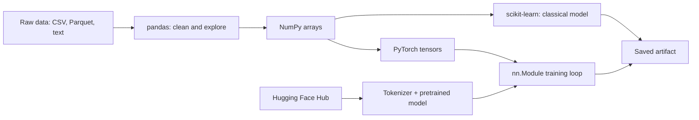
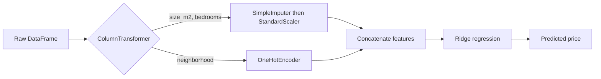
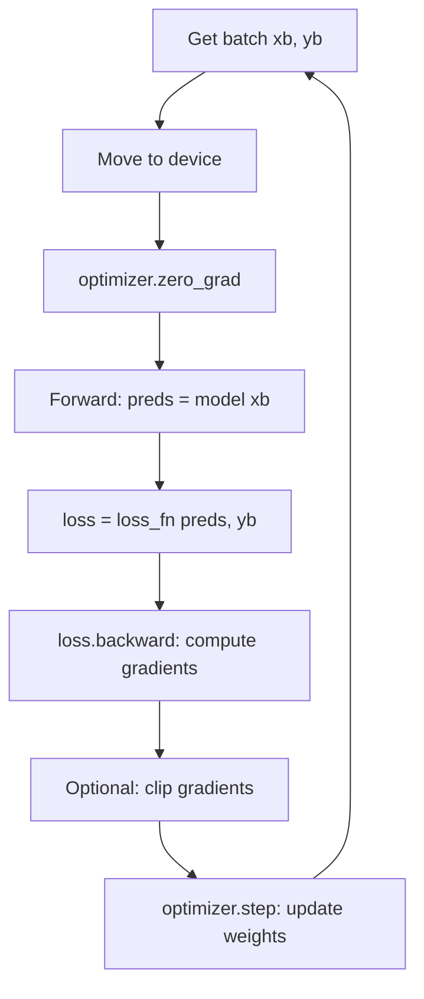
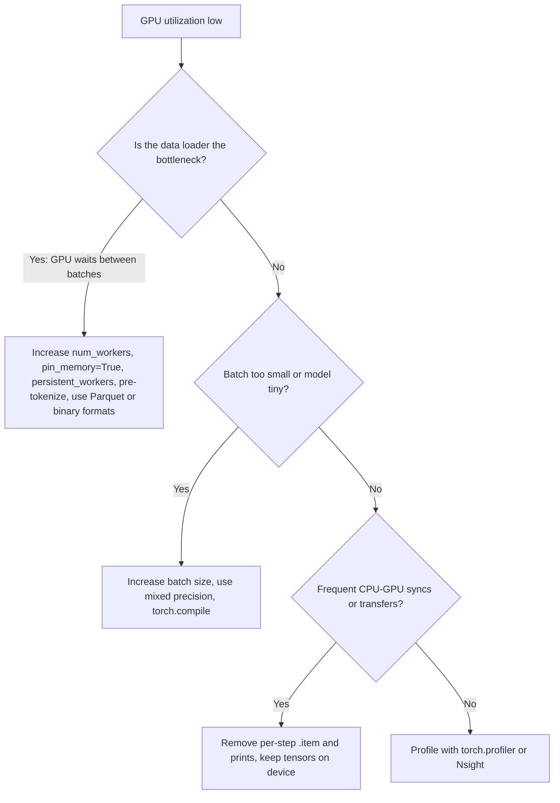

# Python Tooling for ML: NumPy, pandas, scikit-learn, PyTorch and Hugging Face

> **Level:** Beginner to Advanced · **Study time:** ~150 min · **Prerequisites:** [Linear Algebra for Machine Learning](./02-linear-algebra-for-ml.md), [Calculus for ML: Derivatives, Gradients and the Chain Rule](./03-calculus-and-gradients.md)

## Table of contents

- [Why this matters](#why-this-matters)
- [The tool map: which library does what](#the-tool-map-which-library-does-what)
- [Setting up an environment](#setting-up-an-environment)
- [NumPy: arrays, shapes and indexing](#numpy-arrays-shapes-and-indexing)
- [NumPy: axes, broadcasting and vectorization](#numpy-axes-broadcasting-and-vectorization)
- [pandas: DataFrame essentials](#pandas-dataframe-essentials)
- [scikit-learn: the estimator API, Pipeline and ColumnTransformer](#scikit-learn-the-estimator-api-pipeline-and-columntransformer)
- [PyTorch: tensors, devices and autograd](#pytorch-tensors-devices-and-autograd)
- [PyTorch: nn.Module, Dataset and DataLoader](#pytorch-nnmodule-dataset-and-dataloader)
- [A reusable training and evaluation loop](#a-reusable-training-and-evaluation-loop)
- [Saving and loading models](#saving-and-loading-models)
- [Hugging Face Transformers basics](#hugging-face-transformers-basics)
- [Reproducibility: seeds and determinism](#reproducibility-seeds-and-determinism)
- [Jupyter tips that save hours](#jupyter-tips-that-save-hours)
- [Shape bugs and how to debug them](#shape-bugs-and-how-to-debug-them)
- [Going deeper: performance, memory and production practice](#going-deeper-performance-memory-and-production-practice)
- [Common mistakes and misconceptions](#common-mistakes-and-misconceptions)
- [Interview questions and model answers](#interview-questions-and-model-answers)
- [Key takeaways](#key-takeaways)
- [Further reading](#further-reading)
- [Next](#next)

## Why this matters

Every idea in this course eventually becomes code, and that code is almost always written with the same five libraries: NumPy, pandas, scikit-learn, PyTorch and Hugging Face Transformers. In interviews, "write a training loop", "why is this loss not going down", "why is my GPU at 10% utilization" and "how do you save this model so production can load it" are standard questions, and they are really questions about these tools. In real systems, the most common bugs are not deep math errors: they are a `(N,)` tensor silently broadcast against a `(N, 1)` tensor, a model left in training mode during evaluation, a scaler fitted on the test set, or a checkpoint that cannot be loaded six months later. This chapter gives you a working, senior-level command of the toolkit so the rest of the course can focus on ideas.

## The tool map: which library does what

> **Analogy:** Think of a kitchen. NumPy is the knife and cutting board (raw numeric operations). pandas is the pantry with labeled shelves (tables of mixed data). scikit-learn is a set of reliable appliances with the same buttons on every one (classical models). PyTorch is a professional stove you can build any dish on (neural networks with gradients and GPUs). Hugging Face is a shop of pre-cooked meals you can reheat or adapt (pretrained transformer models).

| Library | Core object | What it is for | When to reach for it |
|---|---|---|---|
| NumPy | `ndarray` | Fast numeric arrays on the CPU | Math, from-scratch algorithms, glue between libraries |
| pandas | `DataFrame` | Labeled tables with mixed column types | Loading CSV/Parquet, cleaning, exploring, feature building |
| scikit-learn | Estimator (`fit`, `predict`, `transform`) | Classical ML and preprocessing | Tabular models, baselines, pipelines, cross-validation |
| PyTorch | `Tensor`, `nn.Module` | Arrays with GPU support and automatic gradients | Deep learning, custom models, training loops |
| Hugging Face Transformers | `AutoModel`, `AutoTokenizer`, `pipeline` | Pretrained transformer models | NLP, LLMs, embeddings, fine-tuning |



## Setting up an environment

A **virtual environment** is an isolated folder containing its own Python interpreter and installed packages, so project A can use `torch 2.5` while project B uses `torch 2.8` without conflict.

> **Analogy:** A virtual environment is a separate toolbox per job. You do not want the plumber's wrench set mixed into the electrician's kit.

### Option 1: venv and pip (built into Python)

**pip** is Python's standard package installer. **venv** is Python's built-in environment tool.

```bash
# Create and activate an environment (macOS/Linux)
python -m venv .venv
source .venv/bin/activate

# On Windows (PowerShell): .venv\Scripts\Activate.ps1

pip install --upgrade pip
pip install numpy pandas scikit-learn matplotlib jupyter
pip install torch            # see the GPU note below
pip install transformers accelerate safetensors

# Record exact versions so others can reproduce your setup
pip freeze > requirements.txt
```

### Option 2: uv (fast, modern, lockfile-based)

**uv** is a fast Python package and project manager (from Astral, written in Rust). It can replace `pip`, `venv` and tools like `pip-tools` and `poetry`. It writes a **lockfile** (`uv.lock`), a file that pins the exact version of every direct and indirect dependency so installs are repeatable.

```bash
# One-off environment, pip-style
uv venv                       # creates .venv
uv pip install numpy pandas torch

# Project-style (recommended for real projects)
uv init my-ml-project
cd my-ml-project
uv add numpy pandas scikit-learn torch transformers
uv run python train.py        # runs inside the project environment
uv sync                       # recreate the exact environment from uv.lock
```

| Tool | What it is | Pros | Cons |
|---|---|---|---|
| venv + pip | Built-in env plus standard installer | Always available, universal | Slow resolver, no lockfile by default |
| uv | Fast all-in-one manager | Very fast, lockfiles, manages Python versions | Newer; team must adopt it |
| conda / mamba | Env + package manager with non-Python binaries | Handles C/CUDA libraries, popular in science | Heavier, mixing conda and pip can get messy |
| Docker | Whole OS-level image | Reproduces system libs and CUDA runtime, standard for deployment | Image size, build time |

### Installing PyTorch with GPU support

A **GPU** (graphics processing unit) runs thousands of simple arithmetic operations in parallel, which is exactly what matrix multiplication needs. **CUDA** is NVIDIA's platform for running general computation on its GPUs. PyTorch ships separate builds ("wheels") per CUDA version, so the install command depends on your OS and driver. Use the selector on the official PyTorch "Get Started" page; a typical Linux command looks like this (the `cu126` tag is an example and changes over time):

```bash
pip install torch --index-url https://download.pytorch.org/whl/cu126
```

Then check what you actually got:

```python
import torch

print(torch.__version__)               # e.g. "2.x.y+cu126"
print(torch.cuda.is_available())       # True if an NVIDIA GPU + driver + CUDA build work
if torch.cuda.is_available():
    print(torch.cuda.get_device_name(0))
    print(torch.version.cuda)          # CUDA version PyTorch was built with

# Apple Silicon uses the "mps" backend instead of CUDA
print(torch.backends.mps.is_available())

# A device-agnostic pattern used everywhere in this course
device = (
    "cuda" if torch.cuda.is_available()
    else "mps" if torch.backends.mps.is_available()
    else "cpu"
)
print("Using", device)
```

On the command line, `nvidia-smi` shows the GPU, driver version, memory use and running processes.

> **Common mistake:** `torch.cuda.is_available()` returns `False` on a machine with a GPU. The usual causes are: you installed the CPU-only wheel, the NVIDIA driver is too old for that CUDA build, or you are in a different environment than you think (check `which python` or `where python`).

> **Senior insight:** In production, pin everything: Python version, library versions (lockfile), CUDA and driver versions (container base image). "Works on my machine" in ML is usually a version mismatch between training and serving. See [Reproducible Training and Training-Serving Skew](../10-mlops/03-reproducibility-and-training-serving-skew.md).

## NumPy: arrays, shapes and indexing

**NumPy** (Numerical Python) gives you the **ndarray**: an n-dimensional array of numbers that all share one data type and live in one contiguous block of memory. That layout is why NumPy is fast: the heavy work runs in compiled C code, not in the Python interpreter.

> **Analogy:** A Python list is a shelf of labeled boxes, each holding anything. A NumPy array is an egg carton: every slot is the same size and holds the same kind of thing, so a machine can process the whole carton at once.

### Creating arrays and reading their metadata

Three attributes matter most:

- **shape**: a tuple giving the size of each dimension (each dimension is called an **axis**). A table of 3 houses with 2 features has shape `(3, 2)`.
- **ndim**: the number of axes (2 for a table).
- **dtype**: the data type of every element, such as `float64`, `float32` or `int64`.

```python
# pip install numpy
import numpy as np

# Running example: 3 houses, 2 features each [size_m2, bedrooms]
X = np.array([[100, 2],
              [150, 3],
              [200, 4]], dtype=np.float64)

print(X.shape)   # (3, 2)
print(X.ndim)    # 2
print(X.dtype)   # float64
print(X.size)    # 6 elements
print(X.nbytes)  # 48 bytes = 6 elements * 8 bytes each

# Common constructors
np.zeros((2, 3))             # 2x3 of 0.0
np.ones(4)                   # [1., 1., 1., 1.]
np.arange(0, 10, 2)          # [0, 2, 4, 6, 8]
np.linspace(0, 1, 5)         # [0., 0.25, 0.5, 0.75, 1.]
np.eye(3)                    # 3x3 identity matrix

# Random numbers: prefer the Generator API with an explicit seed
rng = np.random.default_rng(seed=0)
noise = rng.normal(loc=0.0, scale=1.0, size=(3, 2))
```

> **Common mistake:** NumPy's default float type is `float64` (8 bytes). PyTorch's default is `float32` (4 bytes). Converting a NumPy array with `torch.from_numpy` keeps `float64`, which then clashes with a `float32` model. Cast explicitly with `.astype(np.float32)` or `dtype=torch.float32`.

### Reshaping

**Reshaping** changes how the same numbers are grouped into axes without changing the numbers. The total element count must stay the same.

```python
a = np.arange(6)          # [0 1 2 3 4 5], shape (6,)
b = a.reshape(2, 3)       # [[0 1 2], [3 4 5]], shape (2, 3)
c = a.reshape(3, -1)      # -1 means "infer this axis": shape (3, 2)
d = a[:, np.newaxis]      # shape (6, 1): a column vector
e = a[np.newaxis, :]      # shape (1, 6): a row vector
f = b.T                   # transpose, shape (3, 2)
g = b.ravel()             # flatten back to shape (6,)
```

Note the difference between shape `(6,)` (a 1-D array), `(6, 1)` (a column) and `(1, 6)` (a row). They hold the same numbers but behave very differently in broadcasting, as you will see shortly. Many real bugs come from mixing these up.

### Indexing and slicing

```python
X = np.array([[100, 2],
              [150, 3],
              [200, 4]], dtype=np.float64)

X[0]          # first row: [100., 2.]
X[0, 1]       # row 0, column 1: 2.0
X[:, 0]       # all rows, column 0 (sizes): [100., 150., 200.]  shape (3,)
X[:, 0:1]     # same values but shape (3, 1): slicing keeps the axis
X[1:]         # rows 1 and 2
X[-1]         # last row

# Boolean indexing: select rows where size > 120
mask = X[:, 0] > 120      # [False, True, True]
X[mask]                   # rows for 150 and 200

# Fancy (integer array) indexing: pick rows 2 and 0 in that order
X[[2, 0]]
```

### Views vs copies

A **view** is a new array object that shares memory with the original. A **copy** has its own memory. Basic slicing (`a[1:4]`) returns a view. Boolean and fancy indexing return copies.

```python
a = np.arange(6)
v = a[1:4]        # view
v[0] = 99
print(a)          # [ 0 99  2  3  4  5]  the original changed!

c = a[[1, 2, 3]]  # fancy indexing makes a copy
c[0] = -1
print(a)          # unchanged: [ 0 99  2  3  4  5]

safe = a[1:4].copy()  # explicit copy when you plan to modify
```

> **Interview tip:** Views are why slicing a 10 GB array is instant and free. Copies are why boolean masking a 10 GB array can double your memory. Knowing which operations copy is a real performance skill.

## NumPy: axes, broadcasting and vectorization

### Reductions along an axis

A **reduction** collapses an axis into a summary (sum, mean, max). The `axis` argument names the axis that disappears.

```text
X (shape 3x2)          X.mean(axis=0)            X.mean(axis=1)
                       collapse rows ->          collapse columns ->
[[100, 2],             one value per column      one value per row
 [150, 3],             [150., 3.]                [51., 76.5, 102.]
 [200, 4]]             shape (2,)                shape (3,)
```

Check the row means: (100 + 2) / 2 = 51, (150 + 3) / 2 = 76.5, (200 + 4) / 2 = 102.

Use `keepdims=True` to keep the collapsed axis with size 1, which makes the result broadcast cleanly later: `X.mean(axis=0, keepdims=True)` has shape `(1, 2)`.

### Broadcasting

**Broadcasting** is NumPy's (and PyTorch's) rule for combining arrays of different shapes in elementwise operations, by virtually stretching size-1 axes without copying data. Linear algebra theory is covered in [Linear Algebra for Machine Learning](./02-linear-algebra-for-ml.md); here we focus on using it correctly in code.

> **Analogy:** You want to subtract each column's average from every row of a table. Instead of photocopying the averages row three times, you hold one strip of averages and slide it down the table.

The rule: line the shapes up from the right. For each pair of axis sizes, they are compatible if they are equal or one of them is 1 (a missing axis counts as 1). The result takes the larger size in each position.

```text
X          shape: (3, 2)
mean       shape:    (2,)   -> treated as (1, 2) -> stretched to (3, 2)
X - mean   shape: (3, 2)    OK

a          shape: (3, 1)
b          shape: (1, 4)
a + b      shape: (3, 4)    each axis has a 1 that stretches

c          shape: (3, 2)
d          shape: (3,)      -> treated as (1, 3); compare 2 vs 3 -> ERROR
```

### Worked example: standardizing house features

**Standardization** (also called z-scoring) rescales each feature to have mean 0 and standard deviation 1, which helps most models train well:

$$z_{ij} = \frac{x_{ij} - \mu_j}{\sigma_j}$$

- $x_{ij}$: the value of feature $j$ for house $i$.
- $\mu_j$: the mean of feature $j$ over all houses.
- $\sigma_j$: the standard deviation of feature $j$, here the population version $\sigma_j = \sqrt{\frac{1}{n}\sum_i (x_{ij} - \mu_j)^2}$.
- $n$: the number of houses (3).
- $z_{ij}$: the standardized value.

By hand, with sizes [100, 150, 200] and bedrooms [2, 3, 4]:

1. Means: size $\mu_0 = (100 + 150 + 200) / 3 = 450 / 3 = 150$. Bedrooms $\mu_1 = (2 + 3 + 4) / 3 = 3$.
2. Deviations: size [-50, 0, 50]; bedrooms [-1, 0, 1].
3. Squared deviations: size [2500, 0, 2500], sum 5000; bedrooms [1, 0, 1], sum 2.
4. Divide by $n = 3$ and take the square root: $\sigma_0 = \sqrt{5000 / 3} = \sqrt{1666.67} \approx 40.82$. $\sigma_1 = \sqrt{2 / 3} = \sqrt{0.6667} \approx 0.8165$.
5. First house: $z_{00} = -50 / 40.82 \approx -1.2247$ and $z_{01} = -1 / 0.8165 \approx -1.2247$. The middle house is [0, 0] and the last is [1.2247, 1.2247].

```python
X = np.array([[100, 2], [150, 3], [200, 4]], dtype=np.float64)

mu = X.mean(axis=0)          # [150., 3.]        shape (2,)
sigma = X.std(axis=0)        # approx [40.8248, 0.8165]
Z = (X - mu) / sigma         # broadcasting: (3, 2) with (2,) -> (3, 2)
print(Z.round(4))
# [[-1.2247 -1.2247]
#  [ 0.      0.    ]
#  [ 1.2247  1.2247]]
```

> **Common mistake:** `np.std` defaults to the population formula (divide by $n$, `ddof=0`), but pandas `DataFrame.std()` defaults to the sample formula (divide by $n - 1$, `ddof=1`). On this data pandas gives $\sigma_0 = \sqrt{5000/2} = 50$ and $\sigma_1 = \sqrt{2/2} = 1$, so the first house becomes [-1.0, -1.0] instead of [-1.2247, -1.2247]. Neither is wrong, but mixing them between training and serving is a classic source of training-serving skew.

### Vectorization vs Python loops

**Vectorization** means expressing a computation as whole-array operations instead of explicit Python loops, so the work happens inside optimized compiled code. That code often uses **SIMD** (single instruction, multiple data: CPU instructions that process several numbers at once) and multithreaded **BLAS** libraries (Basic Linear Algebra Subprograms, heavily tuned matrix routines such as OpenBLAS or Intel MKL).

```python
import numpy as np
rng = np.random.default_rng(0)
a = rng.random(1_000_000)
b = rng.random(1_000_000)

# Loop version: one interpreted Python step per element
def dot_loop(a, b):
    total = 0.0
    for i in range(len(a)):
        total += a[i] * b[i]
    return total

# Vectorized version: one call into compiled code
def dot_vec(a, b):
    return a @ b            # same as np.dot(a, b)

# In Jupyter, compare:
# %timeit dot_loop(a, b)
# %timeit dot_vec(a, b)
```

On typical hardware the vectorized version is one to several orders of magnitude faster (illustrative: measure on your own machine with `%timeit`). The reason is not magic: the loop pays Python's per-element overhead (type checks, object boxing, bytecode dispatch) a million times, while `a @ b` pays it once.

A practical vectorization pattern from the course's RAG chapters: scoring one query embedding against a matrix of document embeddings.

```python
# 4-document corpus, each embedded as a 3-dim vector (illustrative numbers)
docs = np.array([[0.1, 0.9, 0.0],
                 [0.8, 0.1, 0.1],
                 [0.0, 1.0, 0.0],
                 [0.5, 0.5, 0.7]], dtype=np.float32)   # shape (4, 3)
query = np.array([0.0, 1.0, 0.0], dtype=np.float32)   # shape (3,)

scores = docs @ query            # shape (4,): one dot product per doc
# scores = [0.9, 0.1, 1.0, 0.5]
top2 = np.argsort(-scores)[:2]   # indices of the 2 highest scores: [2, 0]
```

Check: doc 0 gives 0.1·0 + 0.9·1 + 0·0 = 0.9; doc 1 gives 0.1; doc 2 gives 1.0; doc 3 gives 0.5. Sorted descending: doc 2 (1.0), doc 0 (0.9).

> **Senior insight:** Loops are fine when the loop body is already heavy (one iteration per training epoch, meaning one full pass over the data, per file, per batch). What you must avoid is a Python loop over individual elements or rows of large arrays. When an operation is hard to vectorize, the next steps are `np.einsum` (Einstein-summation notation that expresses multi-axis products and sums in one call), Numba (a just-in-time compiler that turns numeric Python loops into machine code), or moving the work to PyTorch on a GPU.

## pandas: DataFrame essentials

**pandas** provides the **DataFrame**: a table with named columns, where each column can have its own dtype (numbers, strings, dates, categories), plus a row **index** (labels for rows). A single column is a **Series**.

> **Analogy:** A DataFrame is a spreadsheet you can drive from code, with the important difference that every operation is reproducible.

### Loading and inspecting

```python
# pip install pandas pyarrow
import numpy as np
import pandas as pd

# Running example: a tiny house-price table with missing values
df = pd.DataFrame({
    "id":           [1, 2, 3, 4, 5],
    "neighborhood": ["North", "North", "South", "South", "East"],
    "size_m2":      [100, 150, 200, 120, 90],
    "bedrooms":     [2, 3, 4, np.nan, 2],
    "price_k":      [300, 420, np.nan, 330, 250],
})

# Real data usually comes from files:
# df = pd.read_csv("houses.csv")
# df = pd.read_parquet("houses.parquet")   # faster, typed, compressed

df.head()          # first 5 rows
df.shape           # (5, 5)
df.info()          # dtypes, non-null counts, memory
df.describe()      # count, mean, std, min, quartiles, max per numeric column
df.dtypes
df["neighborhood"].value_counts()
df.isna().sum()    # missing values per column: bedrooms 1, price_k 1
```

### Selecting and filtering

```python
df["size_m2"]                    # one column (Series)
df[["size_m2", "bedrooms"]]      # several columns (DataFrame)

df.loc[0, "price_k"]             # by label: row label 0, column "price_k" -> 300.0
df.iloc[0, 4]                    # by integer position -> 300.0

# Boolean filtering: combine conditions with & and |, and wrap each in parentheses
big_north = df[(df["size_m2"] > 100) & (df["neighborhood"] == "North")]
# only id 2 (150 m2, North)

df.query("size_m2 > 100 and neighborhood == 'North'")   # same thing, string syntax

# New columns are vectorized, just like NumPy
df["price_per_m2"] = df["price_k"] * 1000 / df["size_m2"]
```

> **Common mistake:** Using `and` / `or` instead of `&` / `|` in filters raises "The truth value of a Series is ambiguous". Python's `and` wants a single True or False; `&` works elementwise. Forgetting the parentheses also breaks, because `&` binds tighter than `>`.

### groupby: split, apply, combine

**groupby** splits rows into groups by a key, applies a function to each group, and combines the results.

```python
df.groupby("neighborhood")["price_k"].mean()
# neighborhood
# East     250.0
# North    360.0
# South    330.0
# Name: price_k, dtype: float64

df.groupby("neighborhood").agg(
    n_houses=("id", "count"),
    avg_price=("price_k", "mean"),
    max_size=("size_m2", "max"),
)
```

Check by hand: North = (300 + 420) / 2 = 360. South has prices [NaN, 330]; pandas skips NaN by default, so the mean is 330. East is just 250. Group keys are sorted by default.

```text
split                        apply (mean of price_k)    combine
North: [300, 420]       ->   360                   ->   East   250
South: [NaN, 330]       ->   330 (NaN skipped)          North  360
East:  [250]            ->   250                        South  330
```

> **Common mistake:** Silently skipping NaN is convenient but can hide problems. South's "average" is based on one house. Always check counts alongside means.

### Handling missing values

`NaN` ("not a number") is pandas' usual marker for a missing float value.

```python
df.isna().sum()                         # how many missing per column
df.dropna(subset=["price_k"])           # drop rows with missing target
med = df["bedrooms"].median()           # median of [2, 3, 4, 2] = 2.5
df["bedrooms_filled"] = df["bedrooms"].fillna(med)
df["bedrooms_missing"] = df["bedrooms"].isna().astype(int)  # keep the signal
```

Median check: the non-missing bedrooms are [2, 3, 4, 2], sorted [2, 2, 3, 4]; with an even count the median is the average of the middle two, (2 + 3) / 2 = 2.5.

Rows with a missing **target** (the value you predict, here `price_k`) are usually dropped for training. Missing **features** are usually **imputed** (filled with an estimate such as the median), ideally with a missing-indicator column, and the imputation statistic (the median) must be computed on training data only. Strategy choices are covered in [Feature Engineering: Missing Values, Categorical Encoding and Scaling](../01-classical-ml/07-feature-engineering-missing-values-and-encoding.md).

### Joining tables and handing data to models

```python
regions = pd.DataFrame({"neighborhood": ["North", "South", "East"],
                        "crime_rate":   [0.2, 0.5, 0.3]})
df = df.merge(regions, on="neighborhood", how="left")   # SQL-style left join

X = df[["size_m2", "bedrooms_filled"]].to_numpy(dtype=np.float32)
```

> **Senior insight:** Modifying a filtered DataFrame (`sub = df[df.x > 0]; sub["y"] = 1`) historically triggered the confusing `SettingWithCopyWarning`. pandas 3.0 makes **Copy-on-Write** the default: any derived DataFrame behaves as a copy, so chained assignment like `df[df.x > 0]["y"] = 1` never modifies `df`. The robust habit in any version is `df.loc[mask, "y"] = 1`.

## scikit-learn: the estimator API, Pipeline and ColumnTransformer

**scikit-learn** is the standard library for classical ML. Its superpower is a uniform interface: every model and preprocessing step is an **estimator** with the same methods.

> **Analogy:** Every appliance in the kitchen has the same two buttons: "learn from this" and "apply to that". You can chain them without reading a new manual each time.

| Method | Meaning | Who has it |
|---|---|---|
| `fit(X, y)` | Learn parameters from training data (weights, means, vocabulary) | All estimators |
| `predict(X)` | Output predictions | Models (regressors, classifiers) |
| `predict_proba(X)` | Output class probabilities | Most classifiers |
| `transform(X)` | Convert data using learned parameters | Transformers (scalers, encoders, vectorizers) |
| `fit_transform(X)` | `fit` then `transform` in one step, on the same data | Transformers |
| `score(X, y)` | Default metric (accuracy or $R^2$) | Models |

Learned attributes end with an underscore, such as `scaler.mean_` or `model.coef_`, which tells you they only exist after `fit`. Here **X** is the feature matrix with shape `(n_samples, n_features)` and **y** is the target vector with shape `(n_samples,)`.

```python
# pip install scikit-learn
import numpy as np
from sklearn.preprocessing import StandardScaler

X_train = np.array([[100, 2], [150, 3], [200, 4]], dtype=float)
X_new = np.array([[175, 3]], dtype=float)

scaler = StandardScaler()
scaler.fit(X_train)                 # learns mean_ = [150, 3], scale_ ~ [40.82, 0.8165]
print(scaler.transform(X_new))      # approx [[0.6124, 0.]]
```

Check: (175 - 150) / 40.82 = 25 / 40.82 ≈ 0.6124, and (3 - 3) / 0.8165 = 0. `StandardScaler` uses the population standard deviation, matching NumPy's default.

> **Common mistake:** Calling `fit_transform` on the test set. That re-learns the mean and scale from test data, which is a form of **data leakage** (information from the evaluation data leaking into training decisions). Fit on train, then only `transform` validation, test and production data. See [Overfitting, Bias-Variance, Regularization and Data Leakage](../01-classical-ml/03-overfitting-regularization-and-data-leakage.md).

### Pipeline: one object from raw input to prediction

A **Pipeline** chains transformers and a final model into a single estimator. Calling `pipe.fit` fits each step in order on training data; `pipe.predict` applies the already-fitted steps. This makes leakage much harder and gives you one object to save and deploy.

Running example: a tiny spam filter.

```python
from sklearn.pipeline import Pipeline
from sklearn.feature_extraction.text import TfidfVectorizer
from sklearn.linear_model import LogisticRegression

texts = ["win money now", "meeting at noon",
         "win a free prize", "lunch at noon?"]
labels = ["spam", "ham", "spam", "ham"]

spam_clf = Pipeline([
    ("tfidf", TfidfVectorizer()),          # text -> sparse word-weight vectors
    ("clf", LogisticRegression()),          # vectors -> spam probability
])
spam_clf.fit(texts, labels)
print(spam_clf.predict(["free money"]))    # both words appear only in spam examples
print(spam_clf.classes_)                   # ['ham' 'spam'] (sorted)
```

Logistic regression is taught in [Linear and Logistic Regression from Scratch](../01-classical-ml/02-linear-and-logistic-regression.md), and TF-IDF in [Retrieval Methods: BM25, Dense Retrieval and Hybrid Search](../08-rag/05-retrieval-bm25-dense-and-hybrid-search.md). Here the point is the pattern: the vectorizer's vocabulary is learned only inside `fit`.

### ColumnTransformer: different preprocessing per column

Real tables mix numbers and categories. A **ColumnTransformer** applies different transformers to different columns and concatenates the results side by side. Two new pieces appear below: **one-hot encoding** turns a category into a vector of 0s with a single 1 (North becomes [0, 1, 0] over the sorted categories East, North, South), and **Ridge** is linear regression with an L2 penalty on the weights.

```python
import numpy as np
import pandas as pd
from sklearn.compose import ColumnTransformer
from sklearn.pipeline import Pipeline
from sklearn.impute import SimpleImputer
from sklearn.preprocessing import StandardScaler, OneHotEncoder
from sklearn.linear_model import Ridge
from sklearn.model_selection import train_test_split, cross_val_score

df = pd.DataFrame({
    "neighborhood": ["North", "North", "South", "South", "East", "East", "North", "South"],
    "size_m2":      [100, 150, 200, 120, 90, 110, 130, 180],
    "bedrooms":     [2, 3, 4, np.nan, 2, 2, 3, 4],
    "price_k":      [300, 420, 520, 330, 250, 280, 380, 500],
})
X = df.drop(columns="price_k")
y = df["price_k"]

numeric = ["size_m2", "bedrooms"]
categorical = ["neighborhood"]

preprocess = ColumnTransformer([
    ("num", Pipeline([
        ("impute", SimpleImputer(strategy="median", add_indicator=True)),
        ("scale", StandardScaler()),
    ]), numeric),
    ("cat", OneHotEncoder(handle_unknown="ignore"), categorical),
])

model = Pipeline([("prep", preprocess), ("reg", Ridge(alpha=1.0))])

X_tr, X_te, y_tr, y_te = train_test_split(X, y, test_size=0.25, random_state=42)
model.fit(X_tr, y_tr)              # imputer median, scaler stats, categories: train only
print(model.predict(X_te))
print(model.named_steps["prep"].get_feature_names_out())

# Cross-validation refits the whole pipeline in every fold, so no leakage
scores = cross_val_score(model, X, y, cv=4, scoring="neg_mean_absolute_error")
mae_per_fold = -scores   # scikit-learn maximizes scores, so error metrics are negated
```



`handle_unknown="ignore"` matters in production: if a new neighborhood appears at serving time, the encoder outputs all zeros for it instead of crashing. Cross-validation is covered in [The ML Workflow, Train/Validation/Test Splits and Cross-Validation](../01-classical-ml/01-ml-workflow-data-splits-and-cross-validation.md).

> **Interview tip:** If asked "how do you avoid leakage in preprocessing?", the strong answer is "put every learned preprocessing step inside a Pipeline and cross-validate the Pipeline, never the already-transformed matrix."

## PyTorch: tensors, devices and autograd

**PyTorch** is the dominant deep-learning framework in research and very widely used in industry. Its core object, the **tensor**, is like a NumPy array with two extra powers: it can live on a GPU, and it can record the operations applied to it so gradients can be computed automatically.

### Tensors

```python
# pip install torch
import numpy as np
import torch

t = torch.tensor([[1.0, 2.0], [3.0, 4.0]])   # float32 by default
t.shape, t.dtype, t.device                   # torch.Size([2, 2]), torch.float32, cpu

torch.zeros(2, 3); torch.ones(4); torch.arange(6); torch.randn(3, 2)

# NumPy interop
a = np.array([1.0, 2.0, 3.0])                # float64
shared = torch.from_numpy(a)                 # shares memory, keeps float64
a[0] = 100.0
print(shared[0])                             # tensor(100., dtype=torch.float64)
owned = torch.tensor(a, dtype=torch.float32) # copies and casts

back = owned.numpy()                         # shares memory again (CPU only)

# Shape operations mirror NumPy, with a few PyTorch names
x = torch.arange(6)
x.reshape(2, 3); x.view(2, 3)                # view requires contiguous memory
x.unsqueeze(0).shape                         # torch.Size([1, 6])  add an axis
x.reshape(1, 6).squeeze(0).shape             # torch.Size([6])     remove a size-1 axis
torch.cat([x, x]).shape                      # torch.Size([12])    join along existing axis
torch.stack([x, x]).shape                    # torch.Size([2, 6])  join along a new axis
```

### Devices

A tensor's **device** is where its memory lives: `"cpu"`, `"cuda"` (an NVIDIA GPU, `"cuda:0"` for the first one) or `"mps"` (Apple GPU). Operations require all inputs on the same device.

```python
device = "cuda" if torch.cuda.is_available() else "cpu"
x = torch.randn(4, 3).to(device)
w = torch.randn(3, 2, device=device)   # create directly on the device: no copy
y = x @ w                              # runs on the GPU if device == "cuda"

result = y.detach().cpu().numpy()      # GPU tensor -> NumPy needs .cpu() first
```

> **Common mistake:** `RuntimeError: Expected all tensors to be on the same device`. Typically the model was moved with `model.to(device)` but the batch was not, or a new tensor (like a mask) was created inside `forward` without `device=x.device`.

### Autograd: automatic gradients

**Autograd** is PyTorch's automatic differentiation engine. When a tensor has `requires_grad=True`, PyTorch records every operation on it in a **computational graph**. Calling `.backward()` on a scalar result walks that graph backwards using the chain rule (see [Calculus for ML](./03-calculus-and-gradients.md)) and stores each gradient in the `.grad` attribute of the **leaf tensors** (tensors you created directly, such as model parameters, rather than results of operations).

> **Analogy:** Autograd is a cooking log. As you cook, it writes down every step. When the dish tastes wrong, it reads the log backwards to tell you how much each ingredient contributed to the problem.

Worked example: a one-feature linear model for house prices (in hundreds of thousands, illustrative).

$$\hat{y} = w x + b, \qquad L = (\hat{y} - y)^2$$

- $x$: the input feature (here 2).
- $y$: the true target (here 7).
- $w$, $b$: the weight and bias we want to learn (start at 3 and 0.5).
- $\hat{y}$: the prediction.
- $L$: the squared error loss.

The gradients by the chain rule:

$$\frac{\partial L}{\partial w} = 2(\hat{y} - y)\,x, \qquad \frac{\partial L}{\partial b} = 2(\hat{y} - y)$$

By hand:

1. $\hat{y} = 3 \times 2 + 0.5 = 6.5$.
2. Error $\hat{y} - y = 6.5 - 7 = -0.5$, so $L = (-0.5)^2 = 0.25$.
3. $\partial L / \partial w = 2 \times (-0.5) \times 2 = -2$.
4. $\partial L / \partial b = 2 \times (-0.5) = -1$.
5. A gradient-descent step with learning rate (step size) $\eta = 0.1$: $w \leftarrow 3 - 0.1 \times (-2) = 3.2$ and $b \leftarrow 0.5 - 0.1 \times (-1) = 0.6$. New prediction: $3.2 \times 2 + 0.6 = 7.0$, which hits the target exactly.

```python
import torch

x = torch.tensor(2.0)
y = torch.tensor(7.0)
w = torch.tensor(3.0, requires_grad=True)
b = torch.tensor(0.5, requires_grad=True)

y_hat = w * x + b
loss = (y_hat - y) ** 2
loss.backward()                  # fills w.grad and b.grad
print(loss.item(), w.grad.item(), b.grad.item())   # 0.25 -2.0 -1.0

with torch.no_grad():            # the update itself must not be recorded
    w -= 0.1 * w.grad
    b -= 0.1 * b.grad
print(w.item(), b.item())        # approx 3.2 and 0.6 (float32 rounding)

# Gradients ACCUMULATE: without zeroing, a second backward adds to .grad
w.grad = None; b.grad = None     # what optimizer.zero_grad() does
```

Key autograd facts:

- Gradients **accumulate** in `.grad` across `backward()` calls. That is why every training step starts with `optimizer.zero_grad()`. Accumulation is also a feature: it enables **gradient accumulation**, summing gradients over several small batches to simulate a larger batch.
- `tensor.detach()` returns a tensor that shares data but is cut out of the graph.
- `torch.no_grad()` is a context in which operations are not recorded, saving memory and time.
- `.item()` converts a one-element tensor into a Python number (and forces a GPU sync, discussed later).

Backpropagation in depth is in [Backpropagation and Gradient Descent Explained](../02-deep-learning/02-backpropagation-and-gradient-descent.md).

## PyTorch: nn.Module, Dataset and DataLoader

### nn.Module

**nn.Module** is the base class for every layer and model in PyTorch. You define layers in `__init__` (which registers their parameters automatically) and the computation in `forward`. Below, `nn.Sequential` chains layers so each one's output feeds the next, `nn.Linear` computes $xW^\top + b$, and `nn.ReLU` applies $\max(0, x)$ elementwise.

```python
from torch import nn

class PriceMLP(nn.Module):
    def __init__(self, n_features: int = 2, hidden: int = 16):
        super().__init__()
        self.net = nn.Sequential(
            nn.Linear(n_features, hidden),   # weights (16 x 2) + bias (16)
            nn.ReLU(),
            nn.Linear(hidden, 1),            # weights (1 x 16) + bias (1)
        )

    def forward(self, x: torch.Tensor) -> torch.Tensor:
        # x: (batch, n_features) -> returns (batch, 1)
        return self.net(x)

model = PriceMLP()
print(sum(p.numel() for p in model.parameters()))   # 65
out = model(torch.randn(8, 2))                       # call the module, not .forward()
print(out.shape)                                     # torch.Size([8, 1])
```

A linear layer has $\text{params} = d_{in} \times d_{out} + d_{out}$, where $d_{in}$ is the input size and $d_{out}$ the output size (weights plus one bias per output). First layer: $2 \times 16 + 16 = 48$. Second layer: $16 \times 1 + 1 = 17$. Total $48 + 17 = 65$. The same arithmetic, scaled up, is how you get to "7B parameters" for an LLM.

> **Common mistake:** Calling `model.forward(x)` directly. Use `model(x)`, which runs `forward` plus any registered hooks (callbacks that run before or after `forward`, used for logging, debugging and some libraries). Another classic: storing layers in a plain Python list. Use `nn.ModuleList`, or the parameters will not be registered, not moved by `.to(device)` and not trained.

### Dataset and DataLoader

A **Dataset** answers two questions: how many examples are there (`__len__`) and what is example number `i` (`__getitem__`). A **DataLoader** wraps a Dataset to produce shuffled **mini-batches** (small groups of examples processed together), optionally using background worker processes.

> **Analogy:** The Dataset is the library catalog that can fetch any single book. The DataLoader is the librarian who shuffles requests, bundles books into stacks of 32 and has helpers fetching the next stack while you read the current one.

```python
from torch.utils.data import Dataset, DataLoader

class HouseDataset(Dataset):
    def __init__(self, X, y):
        self.X = torch.as_tensor(X, dtype=torch.float32)                  # (N, F)
        self.y = torch.as_tensor(y, dtype=torch.float32).reshape(-1, 1)   # (N, 1)

    def __len__(self) -> int:
        return len(self.X)

    def __getitem__(self, idx):
        return self.X[idx], self.y[idx]

loader = DataLoader(
    HouseDataset(np.random.rand(100, 2), np.random.rand(100)),
    batch_size=32,
    shuffle=True,          # shuffle for training, not for evaluation
    num_workers=0,         # >0 loads batches in parallel processes
    drop_last=False,
)
xb, yb = next(iter(loader))
print(xb.shape, yb.shape)  # torch.Size([32, 2]) torch.Size([32, 1])
```

With 100 examples and `batch_size=32`, one **epoch** (one full pass over the data) yields batches of 32, 32, 32 and 4. `drop_last=True` would discard the final 4.

For variable-length data such as text, the default batching (stacking) fails because examples have different lengths. You pass a `collate_fn` that pads them to a common length. For data too large to index randomly (streams, huge shards), use an `IterableDataset`.

## A reusable training and evaluation loop

Here is the template you will reuse, in some form, for nearly every model in this course. First the shape of one training step:



Two mode switches matter:

- **`model.train()` / `model.eval()`** change how certain layers behave. **Dropout** (randomly zeroing activations during training as regularization) is active in train mode and turned off in eval mode. **Batch normalization** uses per-batch statistics in train mode and stored running averages in eval mode. These calls do not turn gradients on or off.
- **`torch.no_grad()`** (or the stricter `torch.inference_mode()`) stops autograd from recording, which saves memory and time. It does not change dropout or batch norm.

You need both during evaluation.

| | `model.eval()` | `torch.no_grad()` | `torch.inference_mode()` |
|---|---|---|---|
| What it changes | Layer behavior (dropout off, BN uses running stats) | Disables graph recording | Disables recording plus version tracking; fastest |
| Saves memory | No | Yes | Yes, slightly more |
| Typical use | Validation, test, serving | Validation, test | Pure serving or eval where outputs never re-enter autograd |
| Forget it and... | Noisy, wrong metrics | Memory blow-up, slower eval | Small missed speedup |

The complete, runnable template (synthetic house-price data, so you can run it anywhere):

```python
import copy
import numpy as np
import torch
from torch import nn
from torch.utils.data import Dataset, DataLoader


class HouseDataset(Dataset):
    def __init__(self, X, y):
        self.X = torch.as_tensor(X, dtype=torch.float32)
        self.y = torch.as_tensor(y, dtype=torch.float32).reshape(-1, 1)

    def __len__(self):
        return len(self.X)

    def __getitem__(self, idx):
        return self.X[idx], self.y[idx]


def train_one_epoch(model, loader, loss_fn, optimizer, device, max_grad_norm=None):
    model.train()                                    # dropout/BN in training mode
    total, count = 0.0, 0
    for xb, yb in loader:
        xb, yb = xb.to(device), yb.to(device)
        optimizer.zero_grad(set_to_none=True)        # clear old gradients
        preds = model(xb)                            # forward pass
        loss = loss_fn(preds, yb)                    # scalar loss (batch mean)
        loss.backward()                              # backward pass
        if max_grad_norm is not None:
            nn.utils.clip_grad_norm_(model.parameters(), max_grad_norm)
        optimizer.step()                             # update weights
        total += loss.item() * xb.size(0)            # .item(): a float, not a graph
        count += xb.size(0)
    return total / count                             # mean loss per example


@torch.no_grad()                                     # no graph during evaluation
def evaluate(model, loader, loss_fn, device):
    model.eval()                                     # dropout off, BN running stats
    total, count = 0.0, 0
    for xb, yb in loader:
        xb, yb = xb.to(device), yb.to(device)
        preds = model(xb)
        total += loss_fn(preds, yb).item() * xb.size(0)
        count += xb.size(0)
    return total / count


def main():
    torch.manual_seed(0)
    rng = np.random.default_rng(0)

    # Synthetic data: price_k = 2*size + 30*bedrooms + noise (illustrative)
    n = 1000
    size = rng.uniform(50, 250, n)
    beds = rng.integers(1, 6, n).astype(float)
    price = 2.0 * size + 30.0 * beds + rng.normal(0, 20, n)
    X = np.column_stack([size, beds])

    # Split first, then compute normalization stats on TRAIN only
    idx = rng.permutation(n)
    tr, va = idx[:800], idx[800:]
    x_mu, x_sd = X[tr].mean(axis=0), X[tr].std(axis=0)
    y_mu, y_sd = price[tr].mean(), price[tr].std()
    Xn = (X - x_mu) / x_sd
    yn = (price - y_mu) / y_sd

    train_loader = DataLoader(HouseDataset(Xn[tr], yn[tr]), batch_size=64, shuffle=True)
    val_loader = DataLoader(HouseDataset(Xn[va], yn[va]), batch_size=256, shuffle=False)

    device = "cuda" if torch.cuda.is_available() else "cpu"
    model = nn.Sequential(nn.Linear(2, 16), nn.ReLU(), nn.Linear(16, 1)).to(device)
    loss_fn = nn.MSELoss()
    optimizer = torch.optim.AdamW(model.parameters(), lr=1e-2)

    best_val, best_state, patience, bad_epochs = float("inf"), None, 5, 0
    for epoch in range(1, 101):
        train_loss = train_one_epoch(model, train_loader, loss_fn, optimizer, device)
        val_loss = evaluate(model, val_loader, loss_fn, device)
        if val_loss < best_val:
            best_val, bad_epochs = val_loss, 0
            best_state = copy.deepcopy(model.state_dict())   # snapshot, not a reference
        else:
            bad_epochs += 1
            if bad_epochs >= patience:                       # early stopping
                break
        if epoch % 10 == 0:
            print(f"epoch {epoch:3d}  train {train_loss:.4f}  val {val_loss:.4f}")

    model.load_state_dict(best_state)
    torch.save({
        "model_state": model.state_dict(),
        "optimizer_state": optimizer.state_dict(),
        "epoch": epoch,
        "best_val_loss": best_val,
        # Preprocessing travels WITH the model (as plain floats, see next section)
        "x_mu": x_mu.tolist(), "x_sd": x_sd.tolist(),
        "y_mu": float(y_mu), "y_sd": float(y_sd),
    }, "house_mlp.pt")


if __name__ == "__main__":
    main()
```

Why each line matters:

- `zero_grad(set_to_none=True)`: without it, gradients from every previous batch pile up and the updates become huge and wrong. `set_to_none=True` (the default in PyTorch 2.x) frees the memory instead of filling it with zeros.
- `loss.item()` in the running total: adding the `loss` tensor itself would keep every batch's computational graph alive, a classic memory leak.
- `copy.deepcopy(model.state_dict())`: `state_dict()` returns references to the live tensors; without a copy, your "best" snapshot keeps changing as training continues.
- Normalization stats are computed on the training split and saved with the model, so serving applies exactly the same transform.
- `AdamW` is Adam with decoupled weight decay, a common default optimizer for neural networks (especially transformers).
- `clip_grad_norm_` (gradient clipping) rescales all gradients together when their combined norm exceeds `max_grad_norm`, so one bad batch cannot cause a huge update.
- **Early stopping**: stop once validation loss has not improved for `patience` epochs, then restore the best snapshot rather than the last weights.

For classification, swap in `nn.CrossEntropyLoss()` and add accuracy in `evaluate` via `preds.argmax(dim=1) == yb`. Optimizers and learning-rate schedules are covered in [Optimizers: SGD, Momentum, RMSProp, Adam, AdamW and Learning Rate Schedules](../02-deep-learning/03-optimizers-sgd-momentum-adam-and-learning-rate-schedules.md), and diagnosing loops that do not learn in [Regularization and Debugging Neural Network Training](../02-deep-learning/06-regularization-and-debugging-neural-network-training.md).

> **Interview tip:** When asked to write a training loop on a whiteboard, say the five core lines out loud in order: zero_grad, forward, loss, backward, step. Then mention `model.train()`/`model.eval()`, `no_grad` in eval, device moves and checkpointing the best model. That checklist is what interviewers listen for.

## Saving and loading models

A model's **state_dict** is an ordered dictionary mapping each parameter and **buffer** (a saved tensor that is not trained, such as batch norm's running averages) name, like `"0.weight"`, to its tensor. It contains numbers only, not code.

| Approach | What is saved | Pros | Cons |
|---|---|---|---|
| `torch.save(model.state_dict())` | Weights only | Standard, robust to code refactors | You need the class definition to rebuild the model |
| `torch.save(model)` | Pickled whole object | One line | Brittle: depends on exact module paths and code; pickle security risk |
| Full checkpoint dict | Weights, optimizer, scheduler, epoch, config, preprocessing | Resume training exactly | Larger file |
| `safetensors` | Tensors only, in a simple safe format | No code execution on load, fast, memory-mappable | Tensors only (store config separately) |
| Hugging Face `save_pretrained` | safetensors weights + config JSON + tokenizer files | Reload with one `from_pretrained` call | HF-specific layout |
| ONNX (open cross-framework format) / TorchScript (legacy) / `torch.export` | Graph plus weights | Run without the Python class, other runtimes | Export can fail on dynamic code |

```python
# Save and load weights for inference (here `model` is a trained PriceMLP;
# its keys look like "net.0.weight", so it must be reloaded into a PriceMLP)
torch.save(model.state_dict(), "weights.pt")

model = PriceMLP()                                   # rebuild the architecture first
state = torch.load("weights.pt", map_location="cpu", weights_only=True)
model.load_state_dict(state)                         # strict=True by default: names must match
model.eval()                                         # do not forget before inference

# Resume training from the template's full checkpoint:
# rebuild the SAME architecture (parameter names must match the saved keys)
model = nn.Sequential(nn.Linear(2, 16), nn.ReLU(), nn.Linear(16, 1))
optimizer = torch.optim.AdamW(model.parameters(), lr=1e-2)
ckpt = torch.load("house_mlp.pt", map_location="cpu", weights_only=True)
model.load_state_dict(ckpt["model_state"])
optimizer.load_state_dict(ckpt["optimizer_state"])
start_epoch = ckpt["epoch"] + 1
```

- `map_location` lets a checkpoint saved on a GPU load on a CPU-only machine.
- `weights_only=True` restricts unpickling to tensors and basic Python types (dicts, lists, numbers, strings). PyTorch 2.6 made it the default. That is why the template stored NumPy statistics with `.tolist()`: NumPy objects can be rejected by the safe loader.
- `.pt` files from `torch.save` are Python **pickle** files, and unpickling untrusted data can execute arbitrary code. Prefer `safetensors` for sharing weights and never load pickles from unknown sources.

```python
# pip install safetensors
from safetensors.torch import save_file, load_file
save_file(model.state_dict(), "model.safetensors")
model.load_state_dict(load_file("model.safetensors"))
```

For scikit-learn, the usual approach is `joblib.dump(pipeline, "model.joblib")`, which is also pickle based: load it only from trusted sources and with the same scikit-learn version, since cross-version loading is not guaranteed. Model registries and versioning are covered in [Data Versioning, Model Versioning and the Model Registry](../10-mlops/02-data-and-model-versioning-and-model-registry.md).

## Hugging Face Transformers basics

**Hugging Face Transformers** is a library that loads thousands of pretrained models from the **Hugging Face Hub** (a public model and dataset repository) with a common API. Version note: this library evolves quickly (for example, the argument for model precision was renamed from `torch_dtype` to `dtype` in recent releases, and recent major versions focus on PyTorch). The concepts below are stable; check the docs for exact argument names in your version.

```bash
pip install transformers accelerate safetensors
```

### Level 1: pipeline

A **pipeline** bundles tokenization, the model and post-processing behind one call. Great for demos and baselines.

```python
from transformers import pipeline

clf = pipeline("text-classification",
               model="distilbert/distilbert-base-uncased-finetuned-sst-2-english")
print(clf("This chapter finally made broadcasting click."))
# a list like [{'label': 'POSITIVE', 'score': ...}]
```

Always pass `model=` explicitly: the default model for a task can change between versions, which silently changes behavior.

### Level 2: AutoTokenizer and AutoModel

A **tokenizer** converts text into integer **token IDs** (see [Tokenization: How Text Becomes Numbers](../04-transformers/01-tokenization.md)). The `Auto*` classes read the model's config from the Hub and instantiate the right architecture.

```python
import torch
from transformers import AutoTokenizer, AutoModel

name = "bert-base-uncased"
tok = AutoTokenizer.from_pretrained(name)
model = AutoModel.from_pretrained(name).eval()

batch = tok(["the cat sat", "hello"], padding=True, truncation=True, return_tensors="pt")
print(batch["input_ids"].shape)     # torch.Size([2, 5])
print(batch["attention_mask"])
# tensor([[1, 1, 1, 1, 1],
#         [1, 1, 1, 0, 0]])

with torch.no_grad():
    out = model(**batch)
print(out.last_hidden_state.shape)  # torch.Size([2, 5, 768]) = (batch, tokens, hidden)
```

Our 3-word sentence becomes 5 tokens: `[CLS] the cat sat [SEP]`. The shorter "hello" becomes `[CLS] hello [SEP]` plus 2 `[PAD]` tokens to match the length. The **attention mask** marks real tokens with 1 and padding with 0 so the model ignores the padding. The output has one 768-dimensional contextual vector per token (768 is BERT-base's hidden size).

To get one embedding per sentence, a common recipe is **mean pooling**: average the token vectors, counting only real tokens.

```python
mask = batch["attention_mask"].unsqueeze(-1).float()     # (2, 5, 1)
summed = (out.last_hidden_state * mask).sum(dim=1)        # (2, 768)
counts = mask.sum(dim=1).clamp(min=1e-9)                  # (2, 1): real-token counts
sentence_emb = summed / counts                             # (2, 768)
```

Notice how broadcasting does the work: `(2, 5, 768) * (2, 5, 1)` zeroes out padding vectors, and `(2, 768) / (2, 1)` divides each row by its own count. Embedding models for retrieval are covered in [Text Embeddings and Similarity Search](../08-rag/02-text-embeddings-and-similarity-search.md).

### Level 3: text generation with generate

For decoder-only LLMs, use `AutoModelForCausalLM` and `generate`. **Causal LM** means the model predicts the next token from previous ones.

```python
import torch
from transformers import AutoTokenizer, AutoModelForCausalLM

model_id = "Qwen/Qwen2.5-0.5B-Instruct"     # small open model; any chat model works
tok = AutoTokenizer.from_pretrained(model_id)
model = AutoModelForCausalLM.from_pretrained(
    model_id,
    dtype="auto",          # older versions: torch_dtype="auto"
    device_map="auto",     # needs `accelerate`; places weights on available GPUs/CPU
)

messages = [{"role": "user", "content": "Explain broadcasting in one sentence."}]
inputs = tok.apply_chat_template(
    messages, add_generation_prompt=True, return_tensors="pt", return_dict=True
).to(model.device)

with torch.inference_mode():
    out = model.generate(**inputs, max_new_tokens=60, do_sample=False)

new_tokens = out[0, inputs["input_ids"].shape[1]:]   # strip the prompt tokens
print(tok.decode(new_tokens, skip_special_tokens=True))
```

- `apply_chat_template` formats messages with the model's own special tokens. Using the wrong template is a common cause of mysteriously bad outputs.
- `generate` returns prompt plus continuation, so you slice off the prompt.
- `do_sample=False` is greedy decoding; `do_sample=True, temperature=0.7, top_p=0.9` samples. See [How LLMs Generate Text: Decoding Strategies](../05-llms/03-text-generation-and-decoding-strategies.md).
- Memory check: weights alone need roughly parameters × bytes per parameter. A 0.5B model in BF16 (bfloat16, a 2-byte float format) needs about 1 GB; a 7B model needs about 14 GB, before the **KV cache** (the attention keys and values stored for every past token so they are not recomputed at each step). See [Number Formats and Model Memory](../07-model-compression/01-number-formats-and-model-memory.md).

> **Senior insight:** `model.generate` is fine for experiments, but it is not a production server. Plain `generate` handles one static batch at a time, without continuous batching or paged KV-cache management (recent Transformers releases add continuous-batching utilities such as `generate_batch` and `transformers serve`, but they are newer and less battle-tested than dedicated engines). Production serving uses engines like vLLM, SGLang or TGI; see [LLM Serving Frameworks](../06-llm-inference/06-serving-frameworks-vllm-sglang-tgi-tensorrt-llm-and-ollama.md).

> **Common mistake:** Batched generation with a decoder-only model and right padding. The model continues from the last position, which for short prompts is a pad token. Set `tok.padding_side = "left"` for batched generation, and if the tokenizer has no pad token, a common fix is `tok.pad_token = tok.eos_token`.

## Reproducibility: seeds and determinism

A **random seed** is the starting value of a pseudo-random number generator; the same seed produces the same sequence of "random" numbers. ML code has several independent generators (Python's `random`, NumPy, PyTorch CPU, PyTorch CUDA), and you must seed all of them.

```python
import os
import random
import numpy as np
import torch

def set_seed(seed: int = 42, deterministic: bool = False) -> None:
    random.seed(seed)
    np.random.seed(seed)                 # legacy global NumPy RNG
    torch.manual_seed(seed)              # seeds the CPU and all CUDA devices
    if deterministic:
        # cuBLAS / cuDNN: NVIDIA's GPU libraries for matrix math / neural-net ops
        # Must be set before CUDA work starts for deterministic cuBLAS
        os.environ["CUBLAS_WORKSPACE_CONFIG"] = ":4096:8"
        torch.use_deterministic_algorithms(True)   # error on nondeterministic ops
        torch.backends.cudnn.benchmark = False     # no autotuning of conv algorithms

set_seed(42)

# DataLoader shuffling: give it its own seeded generator
g = torch.Generator().manual_seed(42)
# loader = DataLoader(ds, batch_size=32, shuffle=True, generator=g)
```

Other sources: scikit-learn's `random_state=` argument, `transformers.set_seed(seed)` (which seeds the libraries above), and each DataLoader worker process (the PyTorch docs show a `worker_init_fn` recipe for seeding NumPy inside workers).

| Level | What you get | Cost |
|---|---|---|
| Seeds only | Same initialization and data order; results close but GPU math may differ in the last bits | Free |
| Seeds + deterministic algorithms | Bitwise repeatable on the same hardware and software (single process; multi-GPU collectives add their own caveats) | Some ops slower or unsupported |
| Across GPUs, drivers, library versions | Not guaranteed to be bitwise identical | Accept it; compare with tolerances |

Why GPUs are nondeterministic: floating-point addition is not associative ($(a + b) + c$ can differ slightly from $a + (b + c)$), and parallel kernels (for example, those using atomic adds, where many GPU threads add into the same memory location in whatever order they finish) may sum in different orders run to run.

> **Senior insight:** Seeds make bugs reproducible; they do not make results trustworthy. Report the mean and spread over several seeds before claiming one model beats another. A 0.3-point gain that disappears with a different seed is noise. Experiment discipline is covered in [Reproducible Training and Training-Serving Skew](../10-mlops/03-reproducibility-and-training-serving-skew.md).

## Jupyter tips that save hours

**Jupyter** notebooks mix code, output and notes in cells, and keep a live Python process (the **kernel**) with all variables in memory.

| Tip | Command | Why |
|---|---|---|
| Restart and run all before trusting a result | Kernel menu: Restart and Run All | Cells run out of order leave hidden state |
| Auto-reload edited modules | `%load_ext autoreload` then `%autoreload 2` | Edit `.py` files without restarting the kernel |
| Time code | `%timeit expr`, `%%time` (whole cell) | Quick benchmarking (on GPU, see the sync caveat below) |
| Debug after an exception | `%debug` | Opens a post-mortem debugger at the crash point |
| Progress bars | `from tqdm.auto import tqdm` | Works in notebooks and terminals |
| Shell commands | `!nvidia-smi`, `!pip list` | Check GPU memory without leaving the notebook (prefer `%pip install` for installs) |
| Free GPU memory | `del model; import gc; gc.collect(); torch.cuda.empty_cache()` | Notebooks keep references alive (including in `Out[]` history) |
| Clean diffs | `nbstripout`, or Jupytext to pair notebooks with `.py` files | Notebook JSON with outputs is painful in code review |

> **Senior insight:** Notebooks are for exploration. Once code works, move it into importable `.py` modules with tests, and keep the notebook as a thin driver. Production training runs as scripts or pipeline jobs, not as notebooks someone clicks through. See [CI/CD and Testing for ML Pipelines](../10-mlops/07-ci-cd-and-testing-for-ml-pipelines.md).

## Shape bugs and how to debug them

Shape bugs are the most common bugs in ML code. The loud ones crash. The dangerous ones broadcast silently and produce a wrong number.

### The silent broadcast: (N, 1) vs (N,)

Predictions often come out of a model as `(N, 1)` while targets are stored as `(N,)`. Subtracting them broadcasts to `(N, N)`.

```text
preds (3, 1)        targets (3,) -> (1, 3)      preds - targets (3, 3)
[[1],               [1, 2, 3]                   [[ 0, -1, -2],
 [2],                                            [ 1,  0, -1],
 [3]]                                            [ 2,  1,  0]]
```

The predictions are perfect, so the true MSE is 0. But the broadcast squared differences are [0, 1, 4, 1, 0, 1, 4, 1, 0], sum 12, and the mean is 12 / 9 ≈ 1.333. The model trains against a meaningless loss and nothing crashes.

```python
import torch
from torch import nn

preds = torch.tensor([[1.0], [2.0], [3.0]])    # (3, 1)
targets = torch.tensor([1.0, 2.0, 3.0])        # (3,)

print(((preds - targets) ** 2).mean())         # tensor(1.3333)  WRONG
print(((preds.squeeze(1) - targets) ** 2).mean())   # tensor(0.)  correct
nn.MSELoss()(preds, targets)   # also 1.3333, but PyTorch emits a UserWarning
                               # about the target size differing from input size
```

Fix it at the source: make the Dataset return targets as `(N, 1)` for regression (as in our template), or squeeze predictions to `(N,)`, and assert shapes match.

### Loss function shape contracts

A **logit** is a raw, unnormalized model score before softmax or sigmoid (see [Softmax, Entropy, Cross-Entropy and KL Divergence](./05-softmax-entropy-cross-entropy-and-kl-divergence.md)). `CrossEntropyLoss` applies log-softmax internally, and `BCEWithLogitsLoss` applies sigmoid internally, so you feed both raw logits.

| Loss | Input (predictions) | Target | Common bug |
|---|---|---|---|
| `nn.MSELoss` | `(N, *)` float | Same shape, float | `(N, 1)` vs `(N,)` silent broadcast |
| `nn.BCEWithLogitsLoss` | `(N, *)` raw logits | Same shape, float 0/1 | Applying sigmoid first (double sigmoid); int targets |
| `nn.CrossEntropyLoss` | `(N, C)` raw logits | `(N,)` int64 class indices (or `(N, C)` probabilities) | Applying softmax first; one-hot ints; float targets |
| `nn.CrossEntropyLoss` on sequences | `(N, C, T)` (classes on dim 1!) | `(N, T)` | Passing `(N, T, C)` from a language model |

The LLM case deserves a code example, because language models output logits of shape `(B, T, V)`: batch, sequence length, vocabulary size.

```python
B, T, V = 2, 5, 100
logits = torch.randn(B, T, V)                 # model output
labels = torch.randint(0, V, (B, T))          # next-token ids

loss_fn = nn.CrossEntropyLoss()
# Option 1: flatten batch and time into one axis
loss = loss_fn(logits.reshape(B * T, V), labels.reshape(B * T))
# Option 2: move classes to dim 1
loss2 = loss_fn(logits.permute(0, 2, 1), labels)   # (B, V, T) vs (B, T)
# loss and loss2 are equal (up to float rounding)
```

### Other frequent shape and type bugs

| Symptom | Likely cause | Fix |
|---|---|---|
| `mat1 and mat2 shapes cannot be multiplied (32x10 and 20x5)` | Layer `in_features` (20) does not match the data's last dim (10) | Print `x.shape` before the layer; fix `nn.Linear(10, ...)` |
| `view size is not compatible with input tensor's size and stride` | `.view` after `.transpose`/`.permute` (non-contiguous memory) | Use `.reshape`, or `.contiguous().view(...)` |
| Code fails only on the last batch | `squeeze()` removed the batch axis when batch size was 1 | Always `squeeze(dim)` with an explicit dim |
| Dtype mismatch errors | NumPy `float64` met a `float32` model; or float targets for `CrossEntropyLoss` | `.float()` inputs, `.long()` class targets |
| Accuracy is stuck near chance though loss falls | Comparing `(N, 1)` with `(N,)` in the metric, or argmax on the wrong dim | `preds.argmax(dim=1)`; assert shapes |
| Image model sees garbage | Channels-last `(N, H, W, C)` data into a model expecting `(N, C, H, W)` | `x.permute(0, 3, 1, 2)` |

### A debugging workflow

1. **Annotate shapes in comments**, using letters: `# (B, T, C)`. It forces you to think and documents intent.
2. **Assert at boundaries**: `assert preds.shape == yb.shape, (preds.shape, yb.shape)`.
3. **Run one tiny batch** (batch size 2 or 3, which exposes broadcasting bugs better than a square size that hides axis swaps) and print every intermediate shape.
4. **Use hooks or a summary tool** to print layer-by-layer shapes: `model.register_forward_hook`, or `torchinfo.summary(model, input_size=(8, 2))` (`pip install torchinfo`).
5. **Overfit a single batch**: a correct model and loop should drive the loss on one small batch close to zero. If it cannot, the bug is in the code, not the data.
6. **Name your axes** for complex reshapes with `einops` (`rearrange(x, "b t (h d) -> b h t d", h=8)`) or `torch.einsum`, which fail loudly when dimensions do not match.

> **Interview tip:** When asked "your loss is not decreasing, what do you check?", start with shapes and dtypes of predictions and targets at the loss call, then `model.train()` and `zero_grad`, then the learning rate, then overfit-one-batch. That order goes from cheapest-to-check to most expensive.

## Going deeper: performance, memory and production practice

### Memory arithmetic

Memory in bytes = number of elements × bytes per element.

| dtype | Bytes | 1M elements | 7B parameters |
|---|---|---|---|
| float64 | 8 | 8 MB | 56 GB |
| float32 | 4 | 4 MB | 28 GB |
| bfloat16 / float16 | 2 | 2 MB | 14 GB |
| int8 | 1 | 1 MB | 7 GB |

(Here MB and GB mean $10^6$ and $10^9$ bytes. A 7B model at 2 bytes is $7 \times 10^9 \times 2 = 14 \times 10^9$ bytes.) Training needs far more than the weights: gradients, optimizer state (Adam keeps two extra values per parameter) and activations. A common accounting for Adam with mixed precision is about 16 bytes per parameter before activations: 2 (BF16 weights) + 2 (BF16 gradients) + 4 (FP32 master copy of the weights) + 4 + 4 (Adam's two moment estimates in FP32). For a 7B model that is $7 \times 10^9 \times 16 \approx 112$ GB, which is why full fine-tuning of a 7B model with standard AdamW does not fit on a single 80 GB GPU without sharding, optimizer-state tricks (8-bit optimizers, CPU offloading) or parameter-efficient methods. See [Distributed Training and Training Memory](../02-deep-learning/10-distributed-training-and-training-memory.md) and [Mixed-Precision Training](../02-deep-learning/09-mixed-precision-training.md).

### GPUs are asynchronous: time them correctly

CUDA operations are queued and the Python call returns before the GPU finishes. Timing with `time.time()` around a GPU op measures only the launch.

```python
import time, torch

x = torch.randn(4096, 4096, device="cuda")
torch.cuda.synchronize()                 # wait for setup work
start = time.perf_counter()
y = x @ x
torch.cuda.synchronize()                 # wait for the matmul to finish
print(f"{(time.perf_counter() - start) * 1000:.2f} ms")
```

Also run a few warm-up iterations first (the first call pays one-time costs such as kernel selection and memory allocation). For real profiling, use `torch.profiler` or NVIDIA Nsight Systems.

The flip side: anything that needs a GPU value on the CPU forces a **synchronization** (the CPU waits for the GPU): `.item()`, `.cpu()`, `print(tensor)`, Python `if tensor > 0:`. One `.item()` per step is usually fine; dozens per step inside the hot loop can starve the GPU.

### Why is my GPU utilization low?



- `num_workers > 0` loads and preprocesses batches in parallel processes while the GPU computes.
- `pin_memory=True` puts batches in page-locked CPU memory, enabling faster host-to-GPU copies, which combine with `.to(device, non_blocking=True)` to overlap transfer and compute.
- `torch.compile(model)` (PyTorch 2.0+) traces the model and generates fused kernels. It often speeds up training and inference, at the cost of compile time on the first calls and recompilation when input shapes change.

### Memory leaks and out-of-memory errors

Typical causes of CUDA **out-of-memory (OOM)** errors and creeping memory:

- Accumulating loss tensors (`total += loss`) instead of floats (`loss.item()`): keeps every graph alive.
- Storing model outputs in a list for later metrics without `.detach().cpu()`.
- Evaluating without `torch.no_grad()`: activations are stored for a backward pass that never comes.
- Batch size or sequence length too large: activation memory grows with both.

Remedies, roughly from cheapest: reduce batch size and use gradient accumulation, use mixed precision (BF16), use activation (gradient) checkpointing to trade compute for memory, then shard with FSDP or ZeRO. `torch.cuda.memory_allocated()` and `torch.cuda.max_memory_allocated()` tell you what tensors use; `nvidia-smi` shows more because PyTorch's caching allocator keeps freed blocks reserved for reuse (`torch.cuda.memory_reserved()`) and the CUDA context itself takes several hundred MB.

### pandas at scale

| Problem | Remedy |
|---|---|
| CSV loading is slow and loses types | Store as Parquet: columnar, compressed, typed |
| DataFrame uses too much RAM | Downcast numerics (`float32`), use `category` dtype for repeated strings, load only needed columns (`usecols=`) |
| Data bigger than RAM | Process in chunks (`chunksize=`), or use Polars (lazy, multithreaded), DuckDB (SQL on files) or Spark |
| `df.apply(row_func, axis=1)` is slow | It is a Python loop in disguise: vectorize with column operations or `np.where` |

### Production concerns

- **Same preprocessing in training and serving.** Ship the fitted scikit-learn Pipeline, or save normalization statistics inside the checkpoint, as in our template. Re-implementing preprocessing in another language for serving is a top source of training-serving skew.
- **Pin versions and record them.** Save library versions with every model artifact. Pickled scikit-learn models and PyTorch checkpoints can break across versions.
- **Prefer safe formats.** safetensors for weights, JSON or YAML for configs; treat pickles as code.
- **Inference mode in serving.** `model.eval()` plus `torch.inference_mode()`, models loaded once at startup, not per request. See [Building a Scalable Inference API](../10-mlops/05-building-a-scalable-inference-api.md).
- **Track experiments.** Log hyperparameters, seeds, data versions, metrics and the code commit for every run. See [The ML Lifecycle, MLOps and Experiment Tracking](../10-mlops/01-ml-lifecycle-and-experiment-tracking.md).

## Common mistakes and misconceptions

- **"`model.eval()` turns off gradients."** It does not. It changes dropout and batch norm behavior. Use `torch.no_grad()` or `torch.inference_mode()` for gradients.
- **"`torch.no_grad()` is enough for evaluation."** Also not true: dropout stays active without `model.eval()`, so metrics are noisy and pessimistic.
- **Forgetting `optimizer.zero_grad()`.** Gradients accumulate across steps and training diverges or behaves erratically.
- **Fitting preprocessing on the full dataset** (or on the test set) before splitting. This leaks test information. Fit on train only, ideally inside a Pipeline.
- **Silent `(N, 1)` vs `(N,)` broadcasting** in losses and metrics. Assert shapes at the loss call.
- **Applying softmax or sigmoid before `CrossEntropyLoss` or `BCEWithLogitsLoss`.** These losses expect raw logits.
- **`float64` NumPy arrays fed to a `float32` model**, or float targets to `CrossEntropyLoss` (which expects `int64` class indices).
- **Accumulating `loss` instead of `loss.item()`**, keeping graphs alive and leaking memory.
- **Assuming a slice is a copy** (NumPy basic slicing returns a view) or that a pandas filter result writes back to the original (it does not under Copy-on-Write; use `.loc`).
- **Timing GPU code without `torch.cuda.synchronize()`**, which measures kernel launch, not execution.
- **Trusting a notebook result** that was never re-run top to bottom after a kernel restart.
- **Loading untrusted `.pt` or `.joblib` files.** They are pickles and can execute code.
- **Believing seeds give bitwise reproducibility on GPUs.** Only with deterministic algorithms, and only on the same hardware and software stack.

## Interview questions and model answers

<details>
<summary><b>Q1. Walk me through a PyTorch training loop. What does each line do, and what happens if you forget zero_grad?</b></summary>

**Short answer:** For each batch: move it to the device, `optimizer.zero_grad()`, forward pass `preds = model(xb)`, compute `loss = loss_fn(preds, yb)`, `loss.backward()` to fill `.grad` on every parameter, optionally clip gradients, then `optimizer.step()` to update weights. Call `model.train()` before the epoch. If you forget `zero_grad`, gradients from all previous batches accumulate in `.grad`, so each update uses a growing sum of stale gradients and training becomes erratic or diverges.

**Deeper answer and follow-ups:**
- `backward()` adds into `.grad` by design, which enables gradient accumulation: call backward on `loss / k` for k micro-batches, then step once, to simulate a k-times-larger batch when memory is tight.
- `zero_grad(set_to_none=True)` (default in PyTorch 2.x) frees gradient memory rather than writing zeros.
- Track the epoch loss with `loss.item()`, not the tensor, or you keep every graph alive.
- Autograd rebuilds the graph on every forward pass ("define-by-run"), so Python control flow just works, but `.item()`, `.detach()` (including a `.detach().numpy()` round trip through NumPy), code under `no_grad` and non-differentiable steps like `argmax` cut it silently. (Calling `.numpy()` directly on a tensor that requires grad raises an error rather than failing silently.) To measure, after one `backward()` flag any parameter whose `.grad` is `None` or all zeros.
- In-place ops (`x += 1`, `relu_()`) can overwrite values saved for backward; autograd's per-tensor version counters catch this and raise "modified by an inplace operation".
- Add an evaluation loop with `model.eval()` and `torch.no_grad()`, save the best checkpoint by validation metric and use early stopping.
- With mixed precision you add autocast and possibly a gradient scaler (FP16); with a scheduler you call `scheduler.step()` at the right cadence (per step or per epoch, depending on the scheduler).

</details>

<details>
<summary><b>Q2. What is the difference between model.eval(), torch.no_grad() and torch.inference_mode()? Do you need all of them?</b></summary>

**Short answer:** `model.eval()` changes layer behavior: dropout is disabled and batch norm uses its stored running statistics. `torch.no_grad()` stops autograd from recording operations, saving memory and compute. `torch.inference_mode()` is a stricter, slightly faster version of `no_grad` whose outputs cannot later be used in autograd. For evaluation you need `eval()` plus one of the two gradient contexts; they are independent.

**Deeper answer and follow-ups:**
- Forgetting `eval()` gives noisy, usually worse metrics (random dropout) and, with batch norm, predictions that depend on what else is in the batch, which is a serious production bug.
- Forgetting `no_grad` does not change outputs but stores activations for a backward pass that never comes: higher memory, possible OOM on large eval batches.
- Remember to switch back to `model.train()` after validation inside a training run.
- Fine-tuning detail: some practitioners keep batch norm in eval mode while fine-tuning with tiny batches, because batch statistics from 2 examples are unreliable.

</details>

<details>
<summary><b>Q3. Explain broadcasting. Give an example of a real bug it causes and how you would catch it.</b></summary>

**Short answer:** Broadcasting lets elementwise operations combine arrays of different shapes: align shapes from the right, and each pair of sizes must be equal or one of them must be 1, which is virtually stretched without copying. It is what makes `X - X.mean(axis=0)` work. The classic bug is predictions of shape `(N, 1)` minus targets of shape `(N,)`, which broadcasts to `(N, N)` and computes a meaningless loss without any error.

**Deeper answer and follow-ups:**
- Worked numbers: perfect predictions [1, 2, 3] as `(3, 1)` against targets [1, 2, 3] as `(3,)` give an "MSE" of 12 / 9 ≈ 1.333 instead of 0.
- PyTorch's `MSELoss` warns about mismatched sizes, but manual loss code does not.
- Catch it with `assert preds.shape == target.shape`, shape comments like `# (B, 1)`, and testing with non-square tiny batches (3 examples, 2 features) so swapped axes cannot hide.
- Use `keepdims=True` in reductions so results broadcast as intended.

</details>

<details>
<summary><b>Q4. Why is vectorized NumPy or PyTorch code so much faster than Python loops? When is a loop acceptable?</b></summary>

**Short answer:** A Python loop pays interpreter overhead (dynamic type checks, boxed objects, bytecode dispatch) on every element. Vectorized operations make one call into compiled C, C++ or CUDA code that runs over contiguous memory with SIMD instructions, multithreaded BLAS or thousands of GPU threads. Loops are fine when each iteration is already heavy: over epochs, batches or files, not over individual elements.

**Deeper answer and follow-ups:**
- Example: scoring a query embedding against a document matrix is `docs @ query`, one call, instead of a loop of dot products.
- `df.apply(f, axis=1)` in pandas is a hidden Python loop; prefer column arithmetic, `np.where` or `groupby` aggregations.
- When vectorization is awkward: `np.einsum`, Numba JIT compilation, or moving to PyTorch on a GPU (and `torch.compile` to fuse operations).
- Vectorization can cost memory: building a huge intermediate array (for example, all pairwise distances) may not fit; chunk the computation.
- Always measure with `%timeit` (and `torch.cuda.synchronize()` for GPU work) rather than assuming.

</details>

<details>
<summary><b>Q5. How do you prevent data leakage when preprocessing with scikit-learn?</b></summary>

**Short answer:** Split the data first, then fit every learned preprocessing step (imputer medians, scaler means, encoder categories, TF-IDF vocabulary, feature selection) on the training data only, and only `transform` validation, test and production data. The robust way is to put preprocessing and model in one `Pipeline` (using `ColumnTransformer` for mixed column types) and pass that Pipeline to `cross_val_score` or `GridSearchCV`, which refits it inside each fold.

**Deeper answer and follow-ups:**
- The common bug: `StandardScaler().fit_transform(X)` on all data, then cross-validation on the transformed matrix. Each validation fold already influenced the scaling.
- Leakage is worse with target-dependent steps (target encoding, feature selection by correlation with y), which can massively inflate scores.
- Time series: use time-ordered splits, and compute rolling features only from the past.
- The Pipeline is also the deployment artifact, so serving applies exactly the training-time transforms, preventing training-serving skew.
- `OneHotEncoder(handle_unknown="ignore")` keeps production from crashing on unseen categories.

</details>

<details>
<summary><b>Q6. How do you save and load a PyTorch model? What goes in a checkpoint, and what are the security concerns?</b></summary>

**Short answer:** Save the `state_dict` (the parameter tensors), not the pickled model object. For inference, rebuild the class, `load_state_dict(torch.load(path, map_location=..., weights_only=True))`, then call `model.eval()`. To resume training, a checkpoint should also hold the optimizer and scheduler state, the epoch or step, RNG states if needed, the config, and any preprocessing statistics. `torch.save` files are pickles, which can execute code when loaded, so use `weights_only=True` (default since PyTorch 2.6) and prefer `safetensors` for distributing weights.

**Deeper answer and follow-ups:**
- Saving the whole model with `torch.save(model)` ties the file to exact module paths and code versions; refactors break loading.
- Optimizer state matters: Adam's moment estimates are part of training state, and resuming without them often causes a loss spike (the optimizer restarts its moment estimates from zero).
- `map_location="cpu"` loads GPU-saved checkpoints on CPU machines.
- Hugging Face's `save_pretrained` writes safetensors weights plus config and tokenizer files; `from_pretrained` restores everything.
- For non-Python serving, export to ONNX or `torch.export`; for scikit-learn, `joblib` (a pickle, same caveats, pin the library version).
- Record the model version, data version and code commit in a model registry.

</details>

<details>
<summary><b>Q7. How do you make a training run reproducible, and why might two runs with the same seed still differ?</b></summary>

**Short answer:** Seed Python's `random`, NumPy and PyTorch (CPU and CUDA), give the DataLoader a seeded generator and seed its workers, set `random_state` in scikit-learn, and pin library and CUDA versions. For bitwise repeatability, also call `torch.use_deterministic_algorithms(True)`, disable `cudnn.benchmark` and set `CUBLAS_WORKSPACE_CONFIG`. Runs can still differ because floating-point addition is not associative and some GPU kernels sum in nondeterministic orders, and because different GPUs, drivers or library versions pick different kernels.

**Deeper answer and follow-ups:**
- Deterministic mode can slow training and some operations raise an error because they have no deterministic implementation.
- Data order is part of reproducibility: shuffling, sharding across workers and distributed ranks must be seeded.
- Reproducibility also needs versioned data and code; a seed does not help if the dataset changed.
- For model comparison, run several seeds and report the mean and spread rather than chasing bitwise equality.

</details>

<details>
<summary><b>Q8. Your GPU utilization is around 20% during training. How do you diagnose it?</b></summary>

**Short answer:** The GPU is mostly waiting. The usual causes are the input pipeline (data loading and preprocessing on the CPU too slow), batches too small for the GPU, or frequent CPU-GPU synchronization. I would profile with `torch.profiler` to see where time goes, then try more `num_workers`, `pin_memory=True` with `non_blocking=True` transfers, larger batches, mixed precision and removing per-step `.item()` or print calls.

**Deeper answer and follow-ups:**
- Quick test: time a loop that only iterates the DataLoader without the model. If that alone is as slow as training, data loading is the bottleneck.
- Fixes for data: pre-tokenize or pre-decode once, store in efficient formats (Parquet, memory-mapped arrays, sharded binary files), do augmentation on the GPU, `persistent_workers=True`.
- Fixes for compute efficiency: larger batch (adjust learning rate), BF16 autocast, `torch.compile` for kernel fusion.
- Remember `nvidia-smi` utilization only means "a kernel was running", not that the GPU was efficiently used; for transformers, think in terms of compute-bound vs memory-bound work. See [GPU Fundamentals for LLMs](../06-llm-inference/03-gpu-fundamentals-compute-bound-vs-memory-bound.md).

</details>

<details>
<summary><b>Q9. You get "CUDA out of memory". What do you check and what do you change?</b></summary>

**Short answer:** First check for leaks: accumulating loss tensors instead of `loss.item()`, storing outputs without `.detach()`, and evaluation without `no_grad`. Then reduce memory per step: smaller batch with gradient accumulation to keep the effective batch size, mixed precision (BF16), shorter sequences, activation checkpointing, and if still not enough, sharding (FSDP or ZeRO) or parameter-efficient fine-tuning like LoRA (see [Fine-Tuning LLMs: Full Fine-Tuning, LoRA and QLoRA](../05-llms/07-fine-tuning-full-lora-and-qlora.md)).

**Deeper answer and follow-ups:**
- Memory budget for training is roughly weights + gradients + optimizer state + activations. For full fine-tuning with Adam in mixed precision, optimizer state often dominates the parameter-related memory; activations grow with batch size and sequence length.
- Use `torch.cuda.max_memory_allocated()` to measure peak memory, and the PyTorch memory snapshot tools to find what holds it.
- If memory grows step after step, it is a leak, not a capacity problem.
- `torch.cuda.empty_cache()` releases cached blocks to other processes but does not free tensors you still reference; it is not a fix for leaks.
- In notebooks, old variables and the output history keep tensors alive; restart the kernel.

</details>

<details>
<summary><b>Q10. A language model outputs logits of shape (B, T, V). How do you compute the next-token cross-entropy loss correctly?</b></summary>

**Short answer:** `nn.CrossEntropyLoss` expects class scores on dimension 1, so either flatten to `logits.reshape(B*T, V)` with `labels.reshape(B*T)`, or permute logits to `(B, V, T)` with labels `(B, T)`. Labels must be `int64` token IDs, logits must be raw (no softmax), and labels must be shifted by one position relative to inputs so each position predicts the next token. Padding positions get label `-100`, the default `ignore_index`.

**Deeper answer and follow-ups:**
- The shift: logits at position t predict token t+1, so use `logits[:, :-1]` with `labels[:, 1:]` (Hugging Face causal LM models do this shift internally when you pass `labels`).
- Passing `(B, T, V)` directly makes PyTorch treat dim 1 (time) as the class axis: usually a shape-mismatch error, but in the rare case $T = V$ a silently wrong loss.
- Masking padding with -100 prevents the model from being trained to predict pad tokens and keeps the average over real tokens only.
- In instruction tuning, prompt tokens are often also masked to -100 so the loss covers only the response. See [How LLMs Are Trained, Part 1](../05-llms/01-pretraining-and-next-token-prediction.md).

</details>

<details>
<summary><b>Q11. What does a Hugging Face tokenizer return, and what is the attention mask for? Why does padding side matter for generation?</b></summary>

**Short answer:** It returns `input_ids` (token IDs), `attention_mask` (1 for real tokens, 0 for padding) and, for some models, `token_type_ids`. Batching requires equal lengths, so shorter sequences are padded; the attention mask tells the model to ignore pad positions in attention and lets you exclude them in pooling. For decoder-only generation, pad on the left, because generation continues from the last position and with right padding that position is a pad token.

**Deeper answer and follow-ups:**
- Example: "the cat sat" and "hello" with BERT become shape `(2, 5)` with masks `[1,1,1,1,1]` and `[1,1,1,0,0]`.
- Mean pooling for sentence embeddings must use the mask, or pad vectors pollute the average.
- Many decoder-only tokenizers have no pad token; setting `pad_token = eos_token` is common, and the attention mask is what keeps it from being confused with a real end of sequence. Caveat for fine-tuning: if you then mask every pad-id position to -100 in the labels, you also mask the genuine EOS, and the model never learns to stop; mask by the attention mask (or use a dedicated pad token) instead.
- Use `apply_chat_template` for chat models; a mismatched template degrades output quality quietly.
- Truncation (`max_length`) silently drops text; for RAG and classification, decide deliberately what gets cut. See [Chunking Strategies](../08-rag/04-chunking-strategies.md).

</details>

<details>
<summary><b>Q12. When would you use NumPy vs pandas vs PyTorch, and what goes wrong when moving data between them?</b></summary>

**Short answer:** pandas for labeled, mixed-type tabular data: loading, cleaning, joining, grouping. NumPy for homogeneous numeric arrays on the CPU and from-scratch math. PyTorch when you need GPUs or gradients. Data typically flows pandas to NumPy to PyTorch. The usual problems at the boundaries are dtypes (`float64` vs `float32`, int vs long targets), shared memory surprises, and devices.

**Deeper answer and follow-ups:**
- `df.to_numpy()` on mixed types produces an `object` array, which is slow and breaks tensor conversion; select numeric columns and pass `dtype=np.float32`.
- `torch.from_numpy` and `.numpy()` share memory: modifying one modifies the other. `torch.tensor(...)` copies.
- GPU tensors need `.detach().cpu().numpy()`; the detach is needed when the tensor requires grad.
- Column order is part of the contract: if serving builds features in a different column order than training, predictions are silently wrong. Store the feature list with the model.
- For larger-than-memory tables, Polars, DuckDB or Spark replace pandas; for GPU dataframes, cuDF exists.

</details>

## Key takeaways

- Use an isolated environment (venv or uv) with pinned versions; verify GPU access with `torch.cuda.is_available()` and `nvidia-smi`.
- NumPy arrays have a shape, a single dtype and contiguous memory; default float is `float64`, while PyTorch defaults to `float32`.
- Basic slicing returns views; boolean and fancy indexing return copies.
- Broadcasting aligns shapes from the right; sizes must match or be 1. It powers normalization and pooling, and it causes silent `(N, 1)` vs `(N,)` bugs.
- Vectorize element-level work; loops are fine only over heavy units like batches or epochs.
- pandas: inspect with `head`, `info`, `describe`, `isna().sum()`; filter with `&`, `|` and parentheses; `groupby` skips NaN; `np.std` uses `ddof=0`, pandas `.std()` uses `ddof=1`.
- scikit-learn: `fit` learns, `transform`/`predict` apply. Put preprocessing in a `Pipeline` with `ColumnTransformer` and cross-validate the whole Pipeline to avoid leakage.
- Training step: `zero_grad`, forward, loss, `backward`, `step`. Gradients accumulate unless cleared.
- Autograd records a fresh graph each forward pass; `.item()`, `.detach()` (and any NumPy round trip) and `argmax` cut it, so check for `grad is None` after one backward when a model will not learn.
- Evaluation needs both `model.eval()` (layer behavior) and `torch.no_grad()` or `inference_mode()` (no graph).
- Save `state_dict` or full checkpoints (plus optimizer state and preprocessing stats); load with `weights_only=True`; prefer safetensors; pickles can execute code.
- Hugging Face: `pipeline` for quick use, `AutoTokenizer` + `AutoModel` for control, `generate` for LLM text; always pass the attention mask and use left padding for batched decoder-only generation.
- Seed all RNGs; bitwise reproducibility on GPUs needs deterministic algorithms and the same software and hardware stack.
- `CrossEntropyLoss` wants raw logits `(N, C)` and int64 targets `(N,)`; for LLM logits `(B, T, V)` flatten or permute.
- GPU work is asynchronous: synchronize before timing, avoid per-step syncs, and fix data loading first when utilization is low.

## Further reading

- Harris et al., "Array programming with NumPy", Nature, 2020. The design of NumPy arrays, views and broadcasting.
- Paszke et al., "PyTorch: An Imperative Style, High-Performance Deep Learning Library", NeurIPS 2019.
- Pedregosa et al., "Scikit-learn: Machine Learning in Python", Journal of Machine Learning Research, 2011.
- Buitinck et al., "API design for machine learning software: experiences from the scikit-learn project", 2013. The origin of the fit/predict/transform interface.
- Wolf et al., "Transformers: State-of-the-Art Natural Language Processing", EMNLP 2020 (System Demonstrations).
- Wes McKinney, "Python for Data Analysis" (O'Reilly, 3rd edition, 2022). By the creator of pandas.
- Official docs: the NumPy user guide (broadcasting section), the pandas user guide (Copy-on-Write and groupby), the scikit-learn user guide (Pipelines and composite estimators, common pitfalls), the PyTorch tutorials and "Reproducibility" notes, the Hugging Face Transformers documentation, and the uv documentation.
- https://pytorch.org/docs/stable/notes/randomness.html (PyTorch reproducibility notes).

## Next

Next chapter: [The ML Workflow, Train/Validation/Test Splits and Cross-Validation](../01-classical-ml/01-ml-workflow-data-splits-and-cross-validation.md), where these tools become a disciplined experimental process.

Related chapters:

- [Linear Algebra for Machine Learning](./02-linear-algebra-for-ml.md)
- [Softmax, Entropy, Cross-Entropy and KL Divergence](./05-softmax-entropy-cross-entropy-and-kl-divergence.md)
- [Feature Engineering: Missing Values, Categorical Encoding and Scaling](../01-classical-ml/07-feature-engineering-missing-values-and-encoding.md)
- [Neural Networks from Scratch: Neurons, Layers and Activations](../02-deep-learning/01-neural-networks-from-scratch.md)
- [Regularization and Debugging Neural Network Training](../02-deep-learning/06-regularization-and-debugging-neural-network-training.md)
- [Mixed-Precision Training: FP32, FP16 and BF16](../02-deep-learning/09-mixed-precision-training.md)
- [Tokenization: How Text Becomes Numbers](../04-transformers/01-tokenization.md)
- [Reproducible Training and Training-Serving Skew](../10-mlops/03-reproducibility-and-training-serving-skew.md)
- [Coding Exercises: Classical ML and Deep Learning from Scratch](../12-interview-practice/01-coding-exercises-ml-from-scratch.md)
