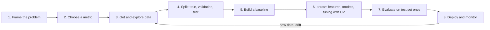
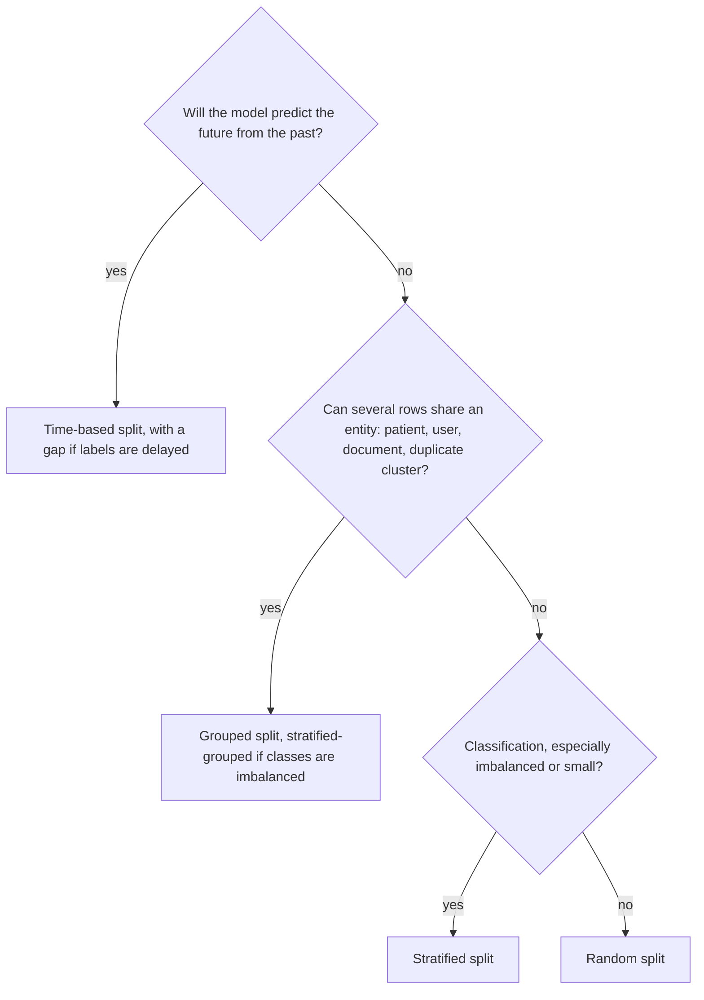

# The ML Workflow, Train/Validation/Test Splits and Cross-Validation

> **Level:** Beginner to Advanced · **Study time:** ~100 min · **Prerequisites:** [Probability and Statistics for Machine Learning](../00-foundations/04-probability-and-statistics.md), [Python Tooling for ML](../00-foundations/06-python-numpy-pandas-pytorch-essentials.md)

## Table of contents

- [Why this matters](#why-this-matters)
- [The ML workflow at a glance](#the-ml-workflow-at-a-glance)
- [Problem framing: turning a goal into an ML task](#problem-framing-turning-a-goal-into-an-ml-task)
- [Choosing a metric](#choosing-a-metric)
- [Baselines first](#baselines-first)
- [Why we split data at all](#why-we-split-data-at-all)
- [Train, validation and test: three sets, three jobs](#train-validation-and-test-three-sets-three-jobs)
- [How to split: random, stratified, grouped and time-based](#how-to-split-random-stratified-grouped-and-time-based)
- [Cross-validation](#cross-validation)
- [Hyperparameter tuning: grid, random and Bayesian search](#hyperparameter-tuning-grid-random-and-bayesian-search)
- [Nested cross-validation](#nested-cross-validation)
- [Fit preprocessing on training data only](#fit-preprocessing-on-training-data-only)
- [Test-set hygiene](#test-set-hygiene)
- [Going deeper: validation in production systems](#going-deeper-validation-in-production-systems)
- [Common mistakes and misconceptions](#common-mistakes-and-misconceptions)
- [Interview questions and model answers](#interview-questions-and-model-answers)
- [Key takeaways](#key-takeaways)
- [Further reading](#further-reading)
- [Next](#next)

## Why this matters

Almost every "the model was great offline and terrible in production" story traces back to this chapter: a split that did not match how the model is used, preprocessing that peeked at the test data, or a test set that was quietly tuned on fifty times. The ideas here are old (they come from classical statistics and ML), but they apply unchanged to deep learning, to fine-tuning LLMs, and even to iterating on prompts and RAG pipelines, where your "eval set" is just a test set by another name. Interviewers use split and validation questions as a fast filter: a senior engineer is expected to pick the right split for a scenario in seconds and explain exactly how leakage happens. Get this chapter solid and every later chapter becomes easier to evaluate honestly.

## The ML workflow at a glance

Before any math, here is the whole loop a working ML engineer runs. Each box gets its own section below.



> **Analogy:** Building a model is like preparing a student for an exam. You decide what the exam tests (framing and metric), find a fair way to grade (the split), check how a lazy student would do (baseline), let the student practice and adjust study habits (training and tuning), and only then sit the real exam once (the test set).

Two running examples will follow us through the chapter:

- **Spam filter:** 1,000 emails, of which 50 are spam (5%). Classify each email as spam or not spam.
- **House prices:** predict a house's sale price from square footage, bedrooms, age and neighborhood.

## Problem framing: turning a goal into an ML task

**Problem framing** means translating a vague business goal ("reduce spam complaints") into a precise prediction task. It is the step most often skipped and the one whose mistakes are the most expensive, because everything downstream optimizes the wrong thing.

Answer these questions before writing code:

| Question | Spam filter answer | Why it matters |
|---|---|---|
| What decision will the prediction drive? | Move email to the spam folder | Defines what errors cost |
| What is the **label** (the correct answer we learn from)? | "User marked as spam" | Labels can be noisy or delayed |
| What is the **unit of prediction**? | One email | Determines what a "row" is, and later how to split |
| When is the prediction made, and what is known at that moment? | On arrival; only headers and body | Features from the future cause leakage |
| What do mistakes cost? | False positive (real email hidden) is worse than a false negative | Drives the metric and threshold |
| Constraints? | Under 50 ms per email (illustrative), explainable to support staff | Rules out some model families |
| Does this need ML at all? | A blocklist catches some spam, but not novel spam | Simple rules may be enough |

A few terms from that table:

- A **feature** is an input variable the model uses (word counts, sender domain, square footage).
- A **label** (or **target**) is the output the model must predict.
- A **supervised learning** task has labeled examples; the model learns a mapping from features to labels. **Classification** predicts a category (spam or not); **regression** predicts a number (price).
- **Data leakage** is any information that would not be available at prediction time (future events, test rows, the label itself) reaching the model or its preprocessing. It makes offline scores look better than production will be, and much of this chapter is about preventing it.

> **Senior insight:** The "unit of prediction" and "what is known at prediction time" answers decide your split strategy later. If one user sends many emails, emails are not independent of each other. If labels arrive weeks later, your validation must respect that delay. Frame first, split second.

## Choosing a metric

A **metric** is the number you use to judge a model. You need two kinds:

- The **business metric** (or online metric): what the company actually cares about, such as complaints per 1,000 users, or revenue.
- The **offline metric**: something you can compute on held-out labeled data, such as accuracy, precision, recall or mean absolute error. It should correlate with the business metric.

### The accuracy trap (worked example)

**Accuracy** is the fraction of predictions that are correct.

$$\text{accuracy} = \frac{\text{number of correct predictions}}{\text{total number of predictions}}$$

- Numerator: count of examples where the prediction equals the label.
- Denominator: count of all examples evaluated.

Take our spam dataset: 1,000 emails, 50 spam, 950 not spam. A "model" that always says "not spam":

- Correct predictions: all 950 non-spam emails. Wrong: all 50 spam emails.
- Accuracy = 950 / 1,000 = 0.95, or 95%.
- Fraction of spam caught = 0 / 50 = 0%.

A 95% accurate model that catches no spam at all. This is why for imbalanced problems we use metrics such as **precision** (of the emails flagged as spam, how many really were spam) and **recall** (of the real spam, how much did we catch). Those, plus **ROC AUC** (the probability that the model scores a random positive above a random negative: 0.5 is random guessing, 1.0 is perfect ranking) and PR AUC, are covered in depth in [Classification Metrics and Imbalanced Data](./04-classification-metrics-and-imbalanced-data.md). Regression metrics (MAE, RMSE, MAPE) live in [Regression Metrics, Baselines and Model Selection](./05-regression-metrics-baselines-and-model-selection.md).

### Rules of thumb for picking the metric

1. Pick it **before** looking at model results, so you are not tempted to choose whichever metric makes your model look best.
2. Match it to error costs. If hiding a real email is 10 times worse than letting spam through, the metric (or the decision threshold) must reflect that.
3. Have one **primary metric** you optimize, plus **guardrail metrics** that must not get worse (latency, fairness across user groups, calibration).
4. Make sure the metric can be computed the same way offline and online.

> **Common mistake:** Optimizing a metric the business does not care about. A recommender tuned for click-through rate can increase clickbait while reducing long-term user satisfaction.

## Baselines first

A **baseline** is the simplest reasonable model you can build. You build it first, before anything clever.

> **Analogy:** Before claiming your new diet works, you check what happens with no diet at all. The baseline is the "no diet" group.

Why baselines matter:

- They tell you whether the problem is easy or hard. If a baseline already scores 95%, a model scoring 96% is less impressive than it sounds.
- They catch bugs. If your fancy model loses to "always predict the average", something is broken (often the data pipeline, not the model).
- They give you a fallback to ship if the fancy model is late.

Common baselines, from dumbest to smartest:

| Baseline | Classification example | Regression example |
|---|---|---|
| Constant | Always predict the most common class | Always predict the training mean (or median) |
| Heuristic or rule | "Flag if sender is not in contacts and contains 'free money'" | Price = neighborhood average price per sq ft × sq ft |
| Simple model | Logistic regression on word counts | Linear regression on a few features |
| Current production system | Whatever the existing filter does | The current pricing tool |

### Worked example: a mean baseline for house prices

Training prices (in thousands of dollars, illustrative): 200, 250, 300, 350, 400.

- Mean = (200 + 250 + 300 + 350 + 400) / 5 = 1,500 / 5 = 300.

The baseline predicts 300 for every house. Three test houses sold for 280, 330 and 410.

- Absolute errors: |280 - 300| = 20, |330 - 300| = 30, |410 - 300| = 110.
- **Mean absolute error (MAE)** = (20 + 30 + 110) / 3 = 160 / 3 ≈ 53.3.

Any real model must beat an MAE of about 53.3 thousand on this data, or it is not adding value.

```python
# pip install scikit-learn numpy
import numpy as np
from sklearn.dummy import DummyClassifier, DummyRegressor
from sklearn.metrics import mean_absolute_error

# Regression baseline: always predict the training mean
y_train = np.array([200, 250, 300, 350, 400])
y_test = np.array([280, 330, 410])
X_train = np.zeros((5, 1))   # Dummy models ignore features
X_test = np.zeros((3, 1))

reg = DummyRegressor(strategy="mean").fit(X_train, y_train)
print(mean_absolute_error(y_test, reg.predict(X_test)))  # 53.333...

# Classification baseline: always predict the most frequent class
y_spam = np.array([0] * 950 + [1] * 50)            # 1 = spam
clf = DummyClassifier(strategy="most_frequent").fit(np.zeros((1000, 1)), y_spam)
print(clf.score(np.zeros((1000, 1)), y_spam))      # 0.95 (accuracy)
```

> **Interview tip:** When asked "how would you approach problem X?", say "first a baseline" early. It signals that you measure before you optimize.

## Why we split data at all

The whole point of ML is **generalization**: performing well on new data the model has never seen, not on the data it learned from.

> **Analogy:** A student who memorizes last year's exam answers scores 100% on last year's exam and fails this year's. Grading a model on its own training data is grading the student on the exact questions they memorized.

**Overfitting** is when a model learns patterns specific to the training data (including noise) that do not hold on new data. Its training score is high and its score on new data is much lower. **Underfitting** is the opposite: the model is too simple to capture the real pattern, so it does poorly everywhere. The full story (bias-variance trade-off, learning curves, regularization) is in [Overfitting, Bias-Variance, Regularization and Data Leakage](./03-overfitting-regularization-and-data-leakage.md). For this chapter, you only need one consequence:

> **The score on data used for training is an optimistic, often useless, estimate of future performance.** To estimate future performance, evaluate on data the model did not learn from.

That is why we split. The held-out data stands in for the future.

Two tools fight overfitting from different sides, and interviewers like to check that you can separate them:

| | Regularization | Validation and cross-validation |
|---|---|---|
| What it is | A penalty or constraint added to training (penalty on large weights, maximum tree depth, early stopping) | An evaluation procedure on held-out data |
| Changes the fitted model? | Yes, it pulls the model toward simpler fits | No, it only scores models |
| Role | The knob that limits complexity | The gauge that tells you where to set the knob |

Q3 in the interview section works through both with numbers.

## Train, validation and test: three sets, three jobs

### The three roles

| Set | Job | Who "learns" from it | Typical use |
|---|---|---|---|
| **Training set** | Fit the model's parameters | The learning algorithm | `model.fit(X_train, y_train)` |
| **Validation set** (also "dev set") | Compare models, tune hyperparameters, pick decision thresholds, decide when to stop training (early stopping) | You, the engineer | Many evaluations during development |
| **Test set** (also "holdout set") | Give one final, unbiased estimate of performance | Nobody | Evaluated once at the end |

Two definitions you need:

- **Parameters** are the values the training algorithm learns from data, such as the weights of a linear regression.
- **Hyperparameters** are settings you choose before training that control how learning happens, such as the regularization strength, tree depth, or learning rate. The algorithm does not learn them; you pick them, usually by checking validation performance.

> **Analogy:** Training data is the homework. Validation data is the practice exams you take repeatedly to decide how to study. The test set is the final exam, taken once. If you peek at the final exam while studying, your grade no longer measures what you learned.

Why do we need a validation set separate from the test set? Because every time you use a dataset to make a decision (pick model A over B, pick depth 5 over depth 7), you leak a little information from it into your model. After dozens of decisions, the validation score is optimistic too. The test set is kept clean so it still gives an honest number.

```text
Full labeled dataset (1,000 spam-filter emails)
+------------------------------------------+-------------+-------------+
|              TRAIN (60%)                 |  VAL (20%)  |  TEST (20%) |
|              600 emails                  | 200 emails  | 200 emails  |
|  fit parameters                          | tune, pick  | final check |
+------------------------------------------+-------------+-------------+
```

### Code: a three-way split

scikit-learn has no single three-way split function, so call `train_test_split` twice.

```python
import numpy as np
from sklearn.model_selection import train_test_split

rng = np.random.default_rng(0)
X = rng.normal(size=(1000, 20))           # 1,000 emails, 20 features (synthetic)
y = np.array([0] * 950 + [1] * 50)        # 5% spam

# First carve off the test set (20%), then split the rest into train and val.
X_temp, X_test, y_temp, y_test = train_test_split(
    X, y, test_size=0.20, stratify=y, random_state=42)
X_train, X_val, y_train, y_val = train_test_split(
    X_temp, y_temp, test_size=0.25, stratify=y_temp, random_state=42)  # 0.25 * 0.80 = 0.20

print(len(X_train), len(X_val), len(X_test))  # 600 200 200
print(y_train.sum(), y_val.sum(), y_test.sum())  # 30 10 10 (stratified, see next section)
```

### How big should the test set be?

People quote ratios like 80/20 or 60/20/20. Ratios are a crutch. The real question is: **how precise does my estimate need to be?**

For a metric like accuracy, each test example is a coin flip that comes up "correct" with some probability $p$. The **standard error** (the typical size of the random error in our estimate) is:

$$\text{SE} = \sqrt{\frac{p(1-p)}{n}}$$

- $p$: the model's true accuracy (we plug in the measured accuracy as an estimate).
- $n$: the number of independent test examples.
- $\text{SE}$: the standard deviation of the measured accuracy across hypothetical re-draws of the test set.

A rough 95% confidence interval is the measured value $\pm 1.96 \times \text{SE}$ (the normal-approximation, or Wald, interval; for small $n$ or accuracy near 0 or 1, prefer a Wilson or exact binomial interval).

Worked example, model accuracy $p = 0.90$:

- $n = 100$: $0.90 \times 0.10 = 0.09$; $0.09 / 100 = 0.0009$; $\sqrt{0.0009} = 0.03$. Interval: $\pm 1.96 \times 0.03 = \pm 0.059$, so about **±5.9 percentage points**.
- $n = 1{,}000$: $0.09 / 1{,}000 = 0.00009$; $\sqrt{0.00009} \approx 0.0095$. Interval: $\pm 1.96 \times 0.0095 \approx \pm 0.019$, so about **±1.9 points**.
- $n = 10{,}000$: $0.09 / 10{,}000 = 0.000009$; $\sqrt{0.000009} = 0.003$. Interval: $\pm 1.96 \times 0.003 \approx \pm 0.006$, so about **±0.6 points**.

Precision improves with $\sqrt{n}$: 10 times more test data gives about 3.2 times tighter intervals. Turned around, to get a ±1 point interval at 90% accuracy you need roughly $n = 1.96^2 \times 0.09 / 0.01^2 = 3.8416 \times 0.09 / 0.0001 \approx 3{,}457$ examples.

Practical consequences:

- With 1,000,000 examples, a 1% test set (10,000 examples) is already very precise. Give the rest to training.
- With 500 examples, any single split is noisy. Use cross-validation (below).
- For rare classes, what matters is the number of **positive** examples. A test set with only 10 spam emails measures spam recall in steps of 10% per email.
- The formula assumes independent examples. If 10 rows come from the same patient, your effective $n$ is closer to the number of patients.

## How to split: random, stratified, grouped and time-based

The golden rule of splitting:

> **Your validation and test data must relate to your training data the same way future production data will relate to it.**

If in production the model will see new users, the test set must contain users never seen in training. If it will predict next month, the test set must be from a later period than training. Every split strategy below is this rule applied to a different situation.

### Random split

A **random split** shuffles rows and assigns them to sets at random. It is correct when rows are **i.i.d.** (independent and identically distributed): each row is an independent draw from the same distribution, with no row "related" to another and no time ordering that matters.

- Example: classifying a large set of product photos where each photo is a distinct product and there is no time dimension.
- Risk: with small data or rare classes, chance can give you an unrepresentative split.

### Stratified split

A **stratified split** keeps the class proportions the same in every set. "Stratum" means layer: you split each class separately, then combine.

Worked example with our spam data (1,000 emails, 50 spam, test size 20% = 200 emails):

- Stratified: the test set gets exactly 5% of 200 = **10 spam** and 190 non-spam.
- Purely random: the number of spam emails in the test set varies with the shuffle. Its average is 10, but its standard deviation is about 2.8, so you commonly get anywhere from about 5 to 15 (illustrative calculation using the hypergeometric distribution: $\sqrt{200 \times 0.05 \times 0.95 \times 800/999} \approx 2.76$).

With only 5 spam emails in a test set, a single misclassified spam email moves recall by 20 points. Stratification removes that needless noise.

- Use for: classification, especially with imbalanced classes or small datasets. It is cheap and almost never hurts, so it is a sensible default for classification.
- For regression you can stratify on binned target values (for example, price quintiles) when the target is skewed.

### Grouped split

A **grouped split** makes sure all rows belonging to the same **group** (a patient, a user, a document, a device) land in the same set. No group is split across train and test.

Why: rows from the same group share hidden characteristics. If the same patient appears in train and test, the model can score well by recognizing the patient, not by learning the disease.

**Patients example.** You have 1,000 chest X-rays from 100 patients (10 scans each), and you want to detect pneumonia in **new** patients.

- Random split by image: about 80% of each patient's scans land in train and 20% in test. The model can learn patient-specific cues (body shape, implants, scanner settings, even the hospital's text marker on the film) and match them. The test score looks great. On truly new patients it drops.
- Grouped split by patient: 80 patients in train, 20 in test. Every test patient is a stranger, exactly like production.

**Users example.** A spam filter where 30% of emails come from 10 prolific spammers. A random split lets the model memorize those 10 senders' style. If the real goal is to catch new spammers, group by sender so test senders are unseen. (If the goal is to keep blocking known spammers, a random split might actually match production. The framing decides.)

**Near-duplicates example.** Duplicates and near-duplicates (the same news article syndicated on 5 sites, the same product photographed twice, a support ticket and its reply quoting it) are a hidden group structure. If one copy is in train and another in test, the test set contains questions the model has effectively seen. The fix:

1. Detect duplicates: exact duplicates via a hash of normalized content; near-duplicates via MinHash with locality-sensitive hashing for text, perceptual hashes for images, or embedding cosine similarity above a threshold.
2. Assign every cluster of near-duplicates a cluster ID.
3. Use the cluster ID as the group in a grouped split.

> **Senior insight:** This exact problem is called **contamination** when it happens to LLM benchmarks: test questions (or paraphrases) leaked into pretraining data. See [Catastrophic Forgetting, Data Contamination and Memorization](../05-llms/09-catastrophic-forgetting-contamination-and-memorization.md).

### Time-based split

A **time-based split** (also "temporal" or "out-of-time" split) trains on earlier data and tests on later data, with a cutoff date in between.

Why: when the model predicts the future, the future must not leak into training. A random split of time-ordered data lets the model "see" next week's patterns while predicting last week, which never happens in production. It also hides **drift**, the tendency of data and relationships to change over time (see [Data Drift, Concept Drift and When to Retrain](./08-data-drift-concept-drift-and-retraining.md)).

**Time-series example.** Daily sales from January 2023 to June 2025. Train on January 2023 to December 2024, validate on January to March 2025, test on April to June 2025.

```text
time ---->
| 2023-01 ................. 2024-12 | 2025-01 .. 2025-03 | 2025-04 .. 2025-06 |
|             TRAIN                 |       VAL          |       TEST         |
```

**Fraud example.** Labels (chargebacks) can arrive weeks after a transaction. If you train on transactions up to the cutoff, the most recent ones have not "matured" yet: some fraud is still labeled as legitimate. Practitioners leave a **gap** (also called an **embargo**) between the train window and the test window, and only use labels that would have been known at training time.

Time-based splits also require **point-in-time correct features**: a feature such as "number of purchases by this user" must be computed using only events before the prediction timestamp, not using the user's full history including the future.

```python
import pandas as pd

# df has a 'timestamp' column; one row per transaction
df = pd.DataFrame({
    "timestamp": pd.date_range("2024-01-01", periods=365, freq="D"),
    "amount": range(365),
})
train = df[df["timestamp"] < "2024-09-01"]
gap_end = pd.Timestamp("2024-09-01") + pd.Timedelta(days=30)   # 30-day label-maturity gap
test = df[df["timestamp"] >= gap_end]
print(train["timestamp"].max().date(), test["timestamp"].min().date())  # 2024-08-31 2024-10-01
```

### Combining strategies

Real data often needs two at once:

- **Stratified + grouped:** imbalanced labels and repeated patients. scikit-learn has `StratifiedGroupKFold`.
- **Grouped + time-based:** predict for new users in the future. Split by time, then remove from the test window any users who appear in the train window (if the product goal is "new users").

### Choosing a split: decision guide



| Strategy | What it guarantees | Use when | Pros | Cons |
|---|---|---|---|---|
| Random | Nothing beyond randomness | Rows are i.i.d., data is large | Simple, unbiased if i.i.d. | Unstable for rare classes; leaks if rows are related or time-ordered |
| Stratified | Same class proportions in each set | Classification, imbalance, small data | Lower variance in metrics | Does not fix groups or time |
| Grouped | No entity appears in two sets | Repeated patients, users, sessions, duplicates | Measures generalization to new entities | Fewer effective samples; group sizes can make sets uneven |
| Time-based | Training data is strictly before test data | Forecasting, fraud, recommendations, anything deployed forward in time | Matches production, exposes drift | Less training data for the latest period; one test period may be unusual (holiday season) |

### From scratch: a grouped split in NumPy

Seeing the mechanism makes the library version obvious: shuffle **group IDs**, not rows.

```python
import numpy as np

def group_train_test_split(groups, test_frac=0.2, seed=0):
    """Return (train_idx, test_idx) so that no group appears in both."""
    rng = np.random.default_rng(seed)
    unique_groups = np.unique(groups)
    rng.shuffle(unique_groups)                         # shuffle groups, not rows
    n_test = int(round(len(unique_groups) * test_frac))
    test_groups = unique_groups[:n_test]
    test_mask = np.isin(groups, test_groups)
    return np.where(~test_mask)[0], np.where(test_mask)[0]

# 100 patients x 10 scans each = 1,000 rows
patient_ids = np.repeat(np.arange(100), 10)
train_idx, test_idx = group_train_test_split(patient_ids)
overlap = set(patient_ids[train_idx]) & set(patient_ids[test_idx])
print(len(train_idx), len(test_idx), len(overlap))  # 800 200 0
```

The scikit-learn equivalent:

```python
from sklearn.model_selection import GroupShuffleSplit

gss = GroupShuffleSplit(n_splits=1, test_size=0.2, random_state=0)
train_idx, test_idx = next(gss.split(X=np.zeros(len(patient_ids)), groups=patient_ids))
```

Note that `test_size` in `GroupShuffleSplit` refers to the proportion of **groups**, not rows. If groups differ in size, the row proportions will not be exactly 80/20.

## Cross-validation

### Intuition

A single validation split has two problems. It wastes data (20% never trains the model) and it is noisy (a lucky or unlucky split can swing the score). **Cross-validation (CV)** fixes both by rotating which part of the data is held out.

> **Analogy:** Instead of judging a chef on one dish, you ask them to cook five different dishes and average the ratings. Every ingredient (data point) gets used both for cooking practice and for judging, just never at the same time.

### k-fold cross-validation

In **k-fold cross-validation**:

1. Shuffle the data (if appropriate) and cut it into $k$ equal parts called **folds**.
2. For each fold $i$ from 1 to $k$: train on the other $k - 1$ folds, evaluate on fold $i$, record the score $s_i$.
3. Report the mean (and spread) of the $k$ scores.

```text
5-fold CV on 1,000 rows (each fold = 200 rows)

          fold1   fold2   fold3   fold4   fold5
Split 1: [ VAL ] [train] [train] [train] [train]  -> s1
Split 2: [train] [ VAL ] [train] [train] [train]  -> s2
Split 3: [train] [train] [ VAL ] [train] [train]  -> s3
Split 4: [train] [train] [train] [ VAL ] [train]  -> s4
Split 5: [train] [train] [train] [train] [ VAL ]  -> s5

Every row is validated exactly once and used for training k-1 = 4 times.
Each model trains on 800 rows and is validated on 200.
```

The summary statistics:

$$\bar{s} = \frac{1}{k}\sum_{i=1}^{k} s_i \qquad \text{SD} = \sqrt{\frac{1}{k-1}\sum_{i=1}^{k}\left(s_i - \bar{s}\right)^2}$$

- $k$: number of folds.
- $s_i$: score (for example, accuracy) on fold $i$.
- $\bar{s}$: the cross-validated score, our estimate of performance.
- $\text{SD}$: the sample standard deviation across folds, a rough measure of how stable the estimate is.

Worked example: five fold accuracies 0.82, 0.85, 0.80, 0.84, 0.79.

- Sum: 0.82 + 0.85 + 0.80 + 0.84 + 0.79 = 4.10. Mean $\bar{s} = 4.10 / 5 = 0.82$.
- Deviations from the mean: 0.00, +0.03, -0.02, +0.02, -0.03.
- Squared: 0.0000, 0.0009, 0.0004, 0.0004, 0.0009. Sum = 0.0026.
- Divide by $k - 1 = 4$: 0.0026 / 4 = 0.00065. Square root: $\sqrt{0.00065} \approx 0.0255$.
- Report: **0.82 ± 0.025** (mean ± SD across folds).

(NumPy's `np.std` divides by $k$ by default, giving $\sqrt{0.0026/5} = \sqrt{0.00052} \approx 0.0228$. Either is fine if you are consistent and say which.)

> **Senior insight:** Fold scores are not independent, because the training sets overlap heavily. So the fold SD understates the true uncertainty, and there is no unbiased estimator of the variance of k-fold CV (Bengio and Grandvalet, 2004). Treat the SD as a stability signal, not a precise confidence interval.

### From scratch: k-fold in NumPy

```python
import numpy as np
from sklearn.datasets import make_classification
from sklearn.linear_model import LogisticRegression

def kfold_indices(n, k, seed=0):
    """Yield (train_idx, val_idx) for k folds over n rows."""
    rng = np.random.default_rng(seed)
    idx = rng.permutation(n)                 # shuffle once
    folds = np.array_split(idx, k)           # k nearly equal chunks
    for i in range(k):
        val_idx = folds[i]
        train_idx = np.concatenate([folds[j] for j in range(k) if j != i])
        yield train_idx, val_idx

X, y = make_classification(n_samples=1000, n_features=20, weights=[0.95], random_state=0)
scores = []
for train_idx, val_idx in kfold_indices(len(X), k=5):
    model = LogisticRegression(max_iter=1000)          # fresh model every fold
    model.fit(X[train_idx], y[train_idx])
    scores.append(model.score(X[val_idx], y[val_idx]))
print(f"{np.mean(scores):.3f} +/- {np.std(scores, ddof=1):.3f}")
```

Note the fresh model in every fold. Reusing a fitted model across folds is a subtle leak.

### Library version

```python
from sklearn.model_selection import StratifiedKFold, cross_validate

cv = StratifiedKFold(n_splits=5, shuffle=True, random_state=0)
res = cross_validate(LogisticRegression(max_iter=1000), X, y, cv=cv,
                     scoring=["accuracy", "roc_auc"], return_train_score=True)
print(res["test_roc_auc"].mean(), res["train_roc_auc"].mean())
```

`return_train_score=True` is a cheap overfitting check: a large gap between train and validation scores signals overfitting.

> **Common mistake:** `KFold` does **not** shuffle by default. If your rows are sorted (all spam at the end, or sorted by date), unshuffled k-fold gives very strange folds. For classification, `cross_val_score(model, X, y, cv=5)` uses stratified folds (without shuffling) automatically; for regressors it uses plain `KFold`.

### The CV family

**Stratified k-fold** keeps class proportions in every fold. Default choice for classification.

**Group k-fold** keeps each group entirely inside one fold, so a patient's scans are never split between training and validation in the same round.

```python
from sklearn.model_selection import GroupKFold, StratifiedGroupKFold, cross_val_score

# Fragment: assumes an estimator `model`, data X, y, and a groups array.
# groups: one entry per row, e.g. patient ID
scores = cross_val_score(model, X, y, groups=patient_ids_for_X, cv=GroupKFold(n_splits=5))
# With imbalanced labels as well:
cv = StratifiedGroupKFold(n_splits=5, shuffle=True, random_state=0)
```

**Time-series cross-validation** (scikit-learn's `TimeSeriesSplit`) uses an **expanding window**: each split trains on everything up to a point and validates on the block right after it. Training data always precedes validation data.

```python
import numpy as np
from sklearn.model_selection import TimeSeriesSplit

months = np.arange(12)   # 12 months of data, in time order
for train_idx, val_idx in TimeSeriesSplit(n_splits=3).split(months):
    print(train_idx, val_idx)
# [0 1 2] [3 4 5]
# [0 1 2 3 4 5] [6 7 8]
# [0 1 2 3 4 5 6 7 8] [ 9 10 11]
```

```text
Expanding window (TimeSeriesSplit default)      Sliding window (max_train_size set)
month: 0 1 2 3 4 5 6 7 8 9 10 11                month: 0 1 2 3 4 5 6 7 8 9 10 11
  1:   T T T V V V                                1:   T T T V V V
  2:   T T T T T T V V V                          2:         T T T V V V
  3:   T T T T T T T T T V V  V                   3:               T T T V V  V
```

- **Expanding window**: uses all history; good when old data is still relevant.
- **Sliding (rolling) window**: fixed-size training window (`max_train_size`); good when old data is stale due to drift.
- **Gap**: `TimeSeriesSplit(gap=g)` drops `g` samples between train and validation, for label delays or features that use trailing windows.

**Leave-one-out CV (LOOCV)** is k-fold with $k = n$: train on all rows but one, test on that one, repeat $n$ times. Nearly unbiased but expensive ($n$ fits), and its estimate often has high variance (the $n$ training sets are almost identical, so errors are highly correlated; this is not universal and depends on the model's stability); occasionally used on tiny datasets or with models that have closed-form shortcuts. **Repeated k-fold** runs k-fold several times with different shuffles and averages, reducing the noise from one particular fold assignment.

| Method | Use when | Pros | Cons |
|---|---|---|---|
| k-fold | Regression, i.i.d. rows | Uses all data, simple | Ignores classes, groups, time |
| Stratified k-fold | Classification | Stable class ratios | Ignores groups and time |
| Group k-fold | Repeated entities | Honest for new entities | Uneven fold sizes if groups vary |
| Stratified group k-fold | Repeated entities + imbalance | Both guarantees, approximately | Balance is best-effort |
| Time-series split | Temporal data | No future leakage, shows drift | Early folds have little training data |
| LOOCV | Tiny data | Max training data per fit | $n$ fits, high variance |
| Repeated k-fold | Small data, need a stable estimate | Lower variance of the estimate | $r \times k$ fits |

### Choosing k

- With $k = 5$ on 1,000 rows, each model trains on 800 rows; with $k = 10$, on 900 rows; with LOOCV, on 999.
- Larger $k$: training sets closer to the full data, so less pessimistic bias, but $k$ times the compute and more correlated fold models.
- Smaller $k$: cheaper, somewhat pessimistic (each model sees less data).
- $k = 5$ or $k = 10$ is the standard compromise. Kohavi (1995) found stratified 10-fold CV a good choice for model selection on real datasets.
- With very large data or expensive models (deep learning, LLM fine-tuning), a single well-built validation split is usually enough; CV is a small and medium data tool.

### What do you ship after cross-validation?

Cross-validation evaluates a **procedure** ("logistic regression with C = 1 and these features"), not one specific fitted model. The usual practice: once CV picks the procedure, **refit it on all the training data** and ship that single model. The CV score is your estimate of how that refit model will perform. An alternative, common in competitions, is to average the predictions of the $k$ fold models (an ensemble), which costs $k$ times the inference.

## Hyperparameter tuning: grid, random and Bayesian search

**Hyperparameter tuning** (or **hyperparameter optimization, HPO**) means searching for the hyperparameter values that give the best validation score. Each candidate set of values is a **configuration**. Each configuration is evaluated with CV (or on the validation set), and the best one wins.

### Grid search

**Grid search** tries every combination of a list of values for each hyperparameter.

Worked example, gradient boosting (illustrative grid):

- learning_rate in {0.01, 0.03, 0.1, 0.3}: 4 values
- max_depth in {3, 5, 7}: 3 values
- n_estimators in {100, 300, 1000}: 3 values
- Configurations: 4 × 3 × 3 = 36. With 5-fold CV: 36 × 5 = **180 model fits**, plus 1 final refit.
- Add one more hyperparameter with 4 values: 36 × 4 = 144 configurations, 720 fits.

The cost multiplies with every hyperparameter. This exponential blow-up is the main weakness of grid search.

### Random search

**Random search** samples each configuration randomly from ranges or distributions you specify, for a fixed budget of trials.

Bergstra and Bengio (2012) showed why it usually beats grid search: typically only a few hyperparameters really matter, and grid search wastes trials re-testing the same values of the important one.

```text
Grid search, 9 trials                Random search, 9 trials
(important param on x-axis)          (important param on x-axis)

unimportant                          unimportant
   ^  x     x     x                     ^    x        x
   |  x     x     x                     |        x          x
   |  x     x     x                     |  x         x   x
   +------------------> important       |      x            x   x
      only 3 distinct values tried       +------------------> important
                                            9 distinct values tried
```

A second argument. Suppose the "good" configurations make up 5% of the search space. Each random trial independently has a 0.95 chance of missing that region, so the chance that $n$ trials **all** miss is $0.95^n$, and:

$$P(\text{at least one good trial}) = 1 - (1 - q)^n$$

- $q$: fraction of the search space that counts as "good" (here 0.05).
- $n$: number of random trials.

For $n = 60$: $\ln(0.95) \approx -0.0513$; $60 \times -0.0513 \approx -3.078$; $e^{-3.078} \approx 0.046$. So $P \approx 1 - 0.046 = 0.954$. **Sixty random trials find a top-5% configuration about 95% of the time**, regardless of how many hyperparameters there are. The caveat: "top 5%" is relative to the search distribution you defined, so this only helps if your ranges actually contain good values, and a top-5% configuration is not necessarily close to the global optimum.

Tips: sample scale-type hyperparameters (learning rate, regularization strength) on a **log scale**, because 0.001 vs 0.01 matters as much as 0.1 vs 1.

### Bayesian optimization

**Bayesian optimization** is a smarter search that learns from previous trials. It keeps a cheap **surrogate model** that predicts "what validation score would this configuration get, and how uncertain am I?", and uses an **acquisition function** (for example, expected improvement) to choose the next configuration, balancing **exploitation** (try near the current best) and **exploration** (try where the surrogate is uncertain).

> **Analogy:** Finding the best restaurant in a new city. Grid search eats at every restaurant on every 5th street. Random search picks restaurants at random. Bayesian optimization remembers which neighborhoods had good meals and which it has not visited, and picks the next restaurant to maximize the chance of a better meal.

Common implementations: Gaussian-process surrogates (Snoek, Larochelle and Adams, 2012), and the Tree-structured Parzen Estimator (TPE, Bergstra et al., 2011), which is the default sampler for single-objective studies in Optuna (Akiba et al., 2019). Bayesian methods shine when each trial is expensive and the budget is tens to low hundreds of trials. They are sequential by nature, so they parallelize less easily than random search.

### Early stopping of bad trials: successive halving and Hyperband

Many trials are obviously bad early. **Successive halving** gives many configurations a small budget (few epochs, few trees, a data subsample), keeps the best fraction, and gives the survivors more budget.

Worked example (keep the top third each round, budget in "units", say epochs):

- Round 1: 27 configs × 1 unit = 27 units. Keep 9.
- Round 2: 9 configs × 3 units = 27 units. Keep 3.
- Round 3: 3 configs × 9 units = 27 units. Keep 1.
- Round 4: 1 config × 27 units = 27 units.
- Total: 108 units, versus 27 × 27 = 729 units to fully train all 27 configs.

**Hyperband** (Li et al., 2018) runs successive halving with several different starting trade-offs, to hedge against configurations that start slow but finish strong. Optuna calls this idea **pruning**; scikit-learn offers `HalvingGridSearchCV` and `HalvingRandomSearchCV` (still marked experimental, so they require an explicit enabling import).

### Comparison

| Method | How it picks configs | Best when | Pros | Cons |
|---|---|---|---|---|
| Grid search | Every combination | 1 to 3 hyperparameters, cheap models | Simple, exhaustive, reproducible | Exponential cost; wastes trials on unimportant params |
| Random search | Random samples | Default for most problems, many params | Simple, parallel, robust | Does not learn from past trials |
| Bayesian (GP, TPE) | Surrogate + acquisition | Expensive trials, limited budget | Fewer trials to a good result | Sequential, more complex, overhead per trial |
| Successive halving / Hyperband | Many cheap trials, prune losers | Iterative learners (boosting, neural nets) | Big compute savings | Early performance can mislead |

### Code: grid, random and Optuna

```python
# pip install scikit-learn scipy optuna
import numpy as np
from scipy.stats import loguniform, randint
from sklearn.datasets import make_classification
from sklearn.ensemble import HistGradientBoostingClassifier
from sklearn.model_selection import (GridSearchCV, RandomizedSearchCV,
                                     StratifiedKFold, train_test_split)

X, y = make_classification(n_samples=2000, n_features=20, weights=[0.9], random_state=0)
X_train, X_test, y_train, y_test = train_test_split(X, y, test_size=0.2,
                                                    stratify=y, random_state=0)
cv = StratifiedKFold(n_splits=5, shuffle=True, random_state=0)
model = HistGradientBoostingClassifier(random_state=0)

# Grid search: 3 x 3 = 9 configs x 5 folds = 45 fits (+1 refit)
grid = GridSearchCV(model, {"learning_rate": [0.03, 0.1, 0.3],
                            "max_depth": [3, 5, None]},
                    cv=cv, scoring="roc_auc", n_jobs=-1)
grid.fit(X_train, y_train)
print("grid:", grid.best_params_, round(grid.best_score_, 3))

# Random search: 30 sampled configs, log-uniform learning rate
rand = RandomizedSearchCV(model, {"learning_rate": loguniform(1e-3, 0.3),
                                  "max_depth": randint(2, 9),
                                  "max_iter": randint(100, 1001)},
                          n_iter=30, cv=cv, scoring="roc_auc",
                          random_state=0, n_jobs=-1)
rand.fit(X_train, y_train)
print("random:", rand.best_params_, round(rand.best_score_, 3))
```

```python
# Bayesian optimization with Optuna (TPE sampler by default)
import optuna
from sklearn.model_selection import cross_val_score

def objective(trial):
    params = {
        "learning_rate": trial.suggest_float("learning_rate", 1e-3, 0.3, log=True),
        "max_depth": trial.suggest_int("max_depth", 2, 8),
        "max_iter": trial.suggest_int("max_iter", 100, 1000, log=True),
    }
    clf = HistGradientBoostingClassifier(**params, random_state=0)
    return cross_val_score(clf, X_train, y_train, cv=cv, scoring="roc_auc").mean()

study = optuna.create_study(direction="maximize")
study.optimize(objective, n_trials=50)
print("optuna:", study.best_params, round(study.best_value, 3))
```

Notice that all three searches use only `X_train`. The test set is untouched until the very end.

## Nested cross-validation

### The problem: the winner's curse

After a search over many configurations, `best_score_` is the **maximum** of many noisy estimates. The maximum of noisy numbers is biased upward, even if every configuration were equally good. This is the **winner's curse** (also called selection bias or overfitting the validation set).

Illustrative example: 20 configurations that all truly score 0.80 accuracy, each CV estimate with noise of standard deviation 0.015. The expected maximum of 20 independent standard normal draws is about 1.87 standard deviations above the mean, so the best CV score you report will typically be about $0.80 + 1.87 \times 0.015 \approx 0.828$. You "found" 2.8 points of improvement that do not exist. The more configurations you try, the bigger the bias. Cawley and Talbot (2010) document how serious this can be on small datasets.

A separate test set fixes this. But when data is too small to spare a test set, use nested CV.

### How nested CV works

**Nested cross-validation** wraps the whole tuning procedure inside an outer CV loop:

- **Inner loop:** on the outer-training portion only, run CV to choose hyperparameters.
- **Outer loop:** evaluate the chosen configuration on the outer-validation fold, which the inner loop never saw.

```text
Outer 5-fold (estimates performance of "tune + train" as a whole)
+------------------------------------------------------------+
| Outer split 1:  [ outer-train (80%)               ][ OUT ] |
|                    |                                       |
|                    v  Inner 3-fold CV on outer-train only  |
|                 [ in-train ][ in-train ][ in-val ]         |
|                 ... try each config, pick the best ...     |
|                    |                                       |
|                    v  refit best config on outer-train,   |
|                       score on OUT  -> outer score 1       |
+------------------------------------------------------------+
  repeat for outer splits 2..5, report mean of outer scores
```

The outer score estimates "how good is my whole pipeline, including the tuning step, on new data?" The hyperparameters chosen may differ across outer folds; that is fine and even informative (if they vary wildly, the tuning is unstable).

In scikit-learn, nested CV is one line, because a `GridSearchCV` object is itself an estimator:

```python
from sklearn.model_selection import GridSearchCV, StratifiedKFold, cross_val_score
from sklearn.linear_model import LogisticRegression

inner = StratifiedKFold(n_splits=3, shuffle=True, random_state=1)
outer = StratifiedKFold(n_splits=5, shuffle=True, random_state=2)
search = GridSearchCV(LogisticRegression(max_iter=1000),
                      {"C": [0.01, 0.1, 1, 10]}, cv=inner, scoring="roc_auc")
nested_scores = cross_val_score(search, X, y, cv=outer, scoring="roc_auc")
print(f"nested CV AUC: {nested_scores.mean():.3f} +/- {nested_scores.std():.3f}")
```

### Cost

Outer 5 folds, inner 3 folds, 20 configurations: each outer fold runs 20 × 3 = 60 inner fits plus 1 refit = 61 fits; times 5 outer folds = **305 fits**. To get the model you actually deploy, you then run the inner search once more on all the data (another 61 fits).

When to use it: small or medium datasets where you cannot afford a separate test set, research papers comparing algorithms, and any time you need an honest number for "tuned model X" without a holdout. With plenty of data, a train/validation/test split is simpler and cheaper.

## Fit preprocessing on training data only

### The rule

**Preprocessing** is any transformation applied to the data before the model: scaling, imputing missing values, encoding categories, selecting features, oversampling, building a vocabulary. Many of these have their own learned state:

- A **scaler** learns a mean and standard deviation.
- An **imputer** learns the value to fill in (say, the median).
- A **feature selector** learns which columns correlate with the label.
- A **target encoder** learns the average label per category.

The rule: **fit every preprocessing step on the training data only, then apply (transform) it unchanged to validation and test data.** Inside cross-validation, that means refitting the preprocessing inside each training fold.

Breaking this rule is a form of **data leakage**: information from outside the training data entering the model or its preprocessing, making evaluation optimistic. (A full taxonomy of leakage, including target leakage, is in [Overfitting, Bias-Variance, Regularization and Data Leakage](./03-overfitting-regularization-and-data-leakage.md).)

> **Analogy:** Before the final exam, the teacher announces the class average. A student who adjusts their answers based on that average is using information from the exam itself. In production, the model never gets to see the future's statistics before predicting.

### Worked example: scaling with and without leakage

**Standardization** rescales a feature to mean 0 and standard deviation 1:

$$z = \frac{x - \mu}{\sigma}$$

- $x$: the raw value.
- $\mu$: the mean learned during fitting.
- $\sigma$: the standard deviation learned during fitting.
- $z$: the scaled value ("how many standard deviations from the mean").

House-buyer incomes (thousands): training rows 40, 50, 60; test row 150.

**Correct (fit on train only):**

- $\mu = (40 + 50 + 60) / 3 = 50$.
- Squared deviations: $(-10)^2 = 100$, $0$, $10^2 = 100$. Sum 200. Population variance $200 / 3 \approx 66.67$, so $\sigma \approx 8.165$.
- Test row: $z = (150 - 50) / 8.165 \approx 12.25$. The model correctly sees an extreme, never-before-seen value.

**Leaky (fit on all four rows):**

- $\mu = (40 + 50 + 60 + 150) / 4 = 300 / 4 = 75$.
- Squared deviations: $(-35)^2 = 1225$, $(-25)^2 = 625$, $(-15)^2 = 225$, $75^2 = 5625$. Sum 7,700. Variance $7700 / 4 = 1925$, so $\sigma \approx 43.87$.
- Training rows become $-0.80, -0.57, -0.34$; test row becomes $(150 - 75) / 43.87 \approx 1.71$.

The leaky version changed the **training data** using knowledge of the test row, and made the test row look ordinary (1.71 instead of 12.25). Your evaluation now describes a world where the model knew the future distribution in advance. That world does not exist in production.

With scaling the effect is often small. With steps that look at the **label** it can be dramatic, as the next example shows.

### A dramatic leak: feature selection on pure noise

This is the classic "wrong way to do cross-validation" from *The Elements of Statistical Learning* (Hastie, Tibshirani and Friedman). The features and labels below are pure random noise, so no honest procedure can beat 50% accuracy.

```python
import numpy as np
from sklearn.feature_selection import SelectKBest, f_classif
from sklearn.linear_model import LogisticRegression
from sklearn.model_selection import cross_val_score
from sklearn.pipeline import make_pipeline

rng = np.random.default_rng(0)
X = rng.normal(size=(100, 5000))     # 100 rows, 5,000 noise features
y = rng.integers(0, 2, size=100)     # random labels: true accuracy is 50%

# WRONG: pick the 20 "best" features using ALL rows (labels included), then CV
X_selected = SelectKBest(f_classif, k=20).fit_transform(X, y)
leaky = cross_val_score(LogisticRegression(max_iter=1000), X_selected, y, cv=5).mean()

# RIGHT: selection is refit inside each training fold by the pipeline
pipe = make_pipeline(SelectKBest(f_classif, k=20), LogisticRegression(max_iter=1000))
honest = cross_val_score(pipe, X, y, cv=5).mean()

print(f"leaky CV accuracy:  {leaky:.2f}")   # typically far above 0.5
print(f"honest CV accuracy: {honest:.2f}")  # close to 0.5, as it should be
```

With 5,000 noise features, some will correlate with the labels by pure chance across all 100 rows, **including the validation rows**. Selecting them before CV bakes that chance correlation into every fold.

### The fix: scikit-learn `Pipeline`

A **`Pipeline`** chains preprocessing steps and a model into a single estimator. When you call `fit`, each step is fit on the data passed in; when you call `predict` or `score`, each step only transforms. Passed to `cross_val_score` or `GridSearchCV`, the whole pipeline is refit in every fold, so preprocessing never sees validation rows.

```python
# pip install scikit-learn pandas numpy
import numpy as np
import pandas as pd
from sklearn.compose import ColumnTransformer
from sklearn.impute import SimpleImputer
from sklearn.linear_model import Ridge
from sklearn.metrics import mean_absolute_error
from sklearn.model_selection import GridSearchCV, KFold, train_test_split
from sklearn.pipeline import Pipeline
from sklearn.preprocessing import OneHotEncoder, StandardScaler

# Synthetic house-price data (prices in thousands, illustrative)
rng = np.random.default_rng(0)
n = 500
df = pd.DataFrame({
    "sqft": rng.normal(1800, 400, n),
    "bedrooms": rng.integers(1, 6, n).astype(float),
    "age": rng.uniform(0, 80, n),
    "neighborhood": rng.choice(["north", "south", "east", "west"], n),
})
price = (50 + 0.15 * df["sqft"] + 10 * df["bedrooms"] - 0.5 * df["age"]
         + rng.normal(0, 20, n))
df.loc[rng.choice(n, 25, replace=False), "sqft"] = np.nan   # some missing values

X_train, X_test, y_train, y_test = train_test_split(df, price, test_size=0.2, random_state=0)

numeric = ["sqft", "bedrooms", "age"]
categorical = ["neighborhood"]
preprocess = ColumnTransformer([
    ("num", Pipeline([("impute", SimpleImputer(strategy="median")),
                      ("scale", StandardScaler())]), numeric),
    ("cat", OneHotEncoder(handle_unknown="ignore"), categorical),
])
model = Pipeline([("prep", preprocess), ("reg", Ridge())])

# Hyperparameters of pipeline steps are addressed as <step>__<param>
search = GridSearchCV(model, {"reg__alpha": [0.1, 1.0, 10.0, 100.0]},
                      cv=KFold(n_splits=5, shuffle=True, random_state=0),
                      scoring="neg_mean_absolute_error")
search.fit(X_train, y_train)              # imputer, scaler, encoder refit in every fold
print("best alpha:", search.best_params_["reg__alpha"])
print("CV MAE:", round(-search.best_score_, 1))   # scores are negated MAE
print("test MAE:", round(mean_absolute_error(y_test, search.predict(X_test)), 1))
```

Extra payoffs of pipelines:

- **One artifact to deploy.** The exact same fitted preprocessing ships with the model, which prevents **training-serving skew** (preprocessing in production that differs from training; see [Reproducible Training and Training-Serving Skew](../10-mlops/03-reproducibility-and-training-serving-skew.md)).
- **Preprocessing choices become tunable**, for example `{"prep__num__impute__strategy": ["mean", "median"]}`.

Steps that most often leak if done before splitting:

| Step | Leak if fit on all data | Correct approach |
|---|---|---|
| Scaling, normalization | Test mean and spread shape training features | Fit scaler on train fold |
| Imputation | Fill values computed using test rows | Fit imputer on train fold |
| Feature selection | Chance correlations with test labels | Inside pipeline |
| Target or mean encoding | Test labels flow into features directly | Inside pipeline, with out-of-fold encoding on train |
| Oversampling (SMOTE, duplication) | Copies or synthetic neighbors of a row land in both train and validation | Oversample training fold only (`imblearn.pipeline.Pipeline`) |
| PCA, vocabulary, TF-IDF | Components or IDF weights use test documents | Fit on train fold |
| Deduplication | Not a fitting step, but must be done **before** splitting | Dedupe or group first, then split |

More on encoding and imputation choices in [Feature Engineering: Missing Values, Categorical Encoding and Scaling](./07-feature-engineering-missing-values-and-encoding.md).

> **Common mistake:** Using `imblearn`'s SMOTE before `train_test_split`. Synthetic minority examples are interpolations of real ones, so near-copies of training rows end up in the validation set and recall looks wonderful.

## Test-set hygiene

The test set is only valuable while it is unbiased. **Test-set hygiene** is the set of habits that keep it that way.

1. **Split first, explore second.** Carve off the test set before exploratory data analysis. Looking at test rows while designing features is a soft leak.
2. **Touch it once (or rarely).** Every decision made using test results ("model B beat model A on test, ship B") turns the test set into a validation set. Kaggle participants learn this the hard way: tuning against the public leaderboard often loses places on the private leaderboard.
3. **Log every test evaluation.** If the test set has been used 30 times, say so; its estimate is now optimistic.
4. **Version and freeze it.** Save the exact row IDs (or the split seed plus a data snapshot hash), so results are comparable across months. See [Data Versioning, Model Versioning and the Model Registry](../10-mlops/02-data-and-model-versioning-and-model-registry.md).
5. **Refresh it periodically.** Production data drifts, so a test set from two years ago may no longer represent reality. Keep the old one for regression comparisons and add a fresh one.
6. **Report slices, not only the total.** Accuracy on new users, on each country, on rare classes. A good average can hide a broken slice.
7. **Keep it representative of production.** Same preprocessing, same label definition, same population, same time direction.

> **Senior insight:** Recht et al. (2019), "Do ImageNet Classifiers Generalize to ImageNet?", built a fresh ImageNet-style test set and found top-1 accuracy dropped by roughly 11 to 14 points across models, while the ranking of models was largely preserved. Notably, the authors attribute the drop mainly to subtle distribution shift in how the new test set was collected, not to adaptive overfitting from years of test-set reuse. Two lessons: absolute numbers are fragile even to small shifts in data collection, and relative comparisons on a well-used benchmark held up better than many feared. Neither licenses tuning on your own test set: with a small test set and many decisions, adaptive overfitting is real. Dwork et al. (2015), "The reusable holdout", proposed ways to reuse a holdout more safely by adding noise to answers.

The same discipline applies to LLM work: your prompt iteration set is a validation set, and you keep a separate frozen eval set for release decisions. See [Building an LLM Evaluation Framework and Regression Tests](../05-llms/11-building-an-llm-evaluation-framework-and-regression-tests.md).

## Going deeper: validation in production systems

### Make offline validation mirror the deployment

Ask: "When this model runs in production, what will be new to it?" Then make that thing new in your test set.

| Production reality | Validation must... |
|---|---|
| Predicts next week | Test on a later period than training |
| Serves brand-new users (cold start) | Hold out entire users |
| Serves existing users on new items | Hold out items, keep users |
| Deployed to a new hospital | Hold out an entire hospital (group by site) |
| Labels arrive 60 days late (illustrative) | Leave a gap; train only on matured labels |
| Retrained weekly | Backtest: simulate weekly retrain and score each following week |

**Backtesting** (or **walk-forward validation**) is the time-series CV idea run as a simulation of your real retraining schedule: train on data up to week $t$, predict week $t+1$, slide forward, repeat. It answers "how would this system have performed if we had run it over the last year?", which is exactly what stakeholders want to know.

### Detect train/test mismatch: adversarial validation

**Adversarial validation** checks whether your test set looks like your training set. Label every training row 0 and every test row 1, then train a classifier to tell them apart.

- ROC AUC near 0.5: the classifier cannot tell them apart; the sets look alike.
- AUC near 1.0: the sets differ substantially. The most important features of that classifier show you **what** differs (often a timestamp-like feature or an ID).

```python
import numpy as np
from sklearn.ensemble import HistGradientBoostingClassifier
from sklearn.model_selection import cross_val_score

def adversarial_auc(X_train, X_test):
    X_all = np.vstack([X_train, X_test])
    is_test = np.r_[np.zeros(len(X_train)), np.ones(len(X_test))]
    clf = HistGradientBoostingClassifier(random_state=0)
    return cross_val_score(clf, X_all, is_test, cv=5, scoring="roc_auc").mean()
```

This is also a quick drift check between last month's and this month's production data.

### Comparing two models honestly

"Model B scored 0.83 and model A scored 0.82" may be noise. Good practice:

- **Use the same folds (paired comparison).** Compare per-fold differences, not two separate averages; the shared fold difficulty cancels out.
- **Use an appropriate test.** McNemar's test on a single test set for classifiers (it looks only at examples where the two models disagree), or the corrected resampled t-test of Nadeau and Bengio (2003) for CV results, which accounts for overlapping training sets. Dietterich (1998) compares common tests and their pitfalls.
- **Bootstrap the test set**: resample its rows with replacement (say 1,000 times), recompute the difference between the two models on each resample, and take the middle 95% of those differences as a confidence interval.
- **Ask whether the difference matters.** A statistically real 0.2-point gain that costs 3 times the inference latency may not be worth shipping.

### What changes at scale

- **Big data, expensive models:** a single large validation and test set replaces CV, and effort moves to better splits and slices. For deep nets and LLM fine-tunes, use random search with pruning, small proxy experiments and known-good defaults rather than large grids. Random search and Hyperband parallelize trivially; Bayesian optimization needs batch or asynchronous variants.
- **Cost estimate habit:** fits = configs × folds (× outer folds for nested CV). 36 configs × 5 folds × 20 minutes per fit = 3,600 minutes, or 60 hours of compute. Say this number out loud in design discussions.

### Offline is not the final judge

A clean offline evaluation tells you the model is promising, not that it helps the business. Offline metrics can disagree with online outcomes (users react to the model, feedback loops change the data). The final check is an online experiment such as an A/B test or a canary rollout, covered in [Model Deployment Patterns](../10-mlops/04-model-deployment-patterns.md), plus monitoring for drift afterwards ([Monitoring ML and LLM Systems in Production](../10-mlops/06-monitoring-ml-and-llm-systems-in-production.md)).

When offline scores far exceed production performance, work through the checklist in interview question Q6 below: split mismatch, leakage, duplicates, test-set overuse, training-serving skew, label or population differences, and drift, in that order.

## Common mistakes and misconceptions

- **Fitting a scaler, imputer, encoder or feature selector on the full dataset before splitting.** Wrap preprocessing in a `Pipeline`.
- **Random splits on time-ordered data.** The model sees the future; production never does.
- **Random splits when rows share an entity.** Patients, users, sessions, devices, near-duplicates: group them.
- **Tuning on the test set.** Even "just checking which of two models is better" is tuning.
- **Reporting `best_score_` from a big search as the expected performance.** It is optimistically biased; use a held-out test set or nested CV.
- **Believing CV prevents overfitting.** CV **measures** generalization and helps you **select** less overfit models; it does not change how a model trains.
- **Oversampling or deduplicating at the wrong time.** Oversample only inside training folds; deduplicate (or group duplicates) before splitting.
- **Using `KFold` without `shuffle=True` on sorted data.**
- **Choosing split sizes by ratio instead of by needed precision.** 20% of 200 rows is too few; 20% of 50 million rows is wasteful.
- **Assuming stratification is enough for imbalanced, grouped data.** It does nothing about groups.
- **Treating the fold standard deviation as an exact confidence interval.** Folds are correlated.

## Interview questions and model answers

<details>
<summary><b>Q1. When would you use random, stratified, grouped, or time-based splits?</b></summary>

**Short answer:** The split must mimic how production data relates to training data. Random splits are fine when rows are i.i.d. and the dataset is large. Stratified splits keep class ratios stable, so I use them for classification, especially imbalanced or small datasets. Grouped splits are needed when multiple rows share an entity (patient, user, document, near-duplicate cluster) and production will see new entities. Time-based splits are needed whenever the model predicts the future from the past, such as forecasting, fraud or recommendations.

**Deeper answer and follow-ups:**

- **Random:** assumes independence and no temporal order. Unstable with rare classes: with 5% spam and a 200-row test set, a random split can give 5 or 15 spam emails, so each misclassified email moves recall by 7 to 20 points.
- **Stratified:** splits each class separately; cheap, rarely hurts, sensible default for classification. For skewed regression targets, stratify on binned targets.
- **Grouped:** 1,000 X-rays from 100 patients; a random split lets the model recognize patients rather than disease. Group by patient so test patients are strangers. Same for users in recommendation, documents chunked into passages, or near-duplicate clusters found via hashing or embeddings.
- **Time-based:** train on the past, test on the future, with a gap if labels mature late (fraud chargebacks) or features use trailing windows. Features must be point-in-time correct.
- **Combinations:** `StratifiedGroupKFold` for imbalance plus groups; time split plus excluding seen users for "new users in the future".
- **Pitfall:** the right split depends on the product question. For a spam filter that must keep blocking known spammers, a random split may be fine; for catching new spammers, group by sender.
- **How to verify the choice:** cross-validate with both a random splitter and the production-like one (grouped or time-based). A large gap means the random split was leaking entity or future information; trust the lower number. In the pipeline, assert that no group ID appears in two sets and that the latest training timestamp precedes the earliest test timestamp, so a refactor cannot silently break the split.

</details>

<details>
<summary><b>Q2. Why should preprocessing be fitted only on training data?</b></summary>

**Short answer:** Because the validation and test sets stand in for future data the model has never seen. If a scaler, imputer, encoder or feature selector learns its statistics from those rows, information from the evaluation data leaks into the model, the evaluation becomes optimistic, and it no longer reflects production, where future statistics are unknown at prediction time. The fix is to put preprocessing inside a scikit-learn `Pipeline` so it is refit within each training fold.

**Deeper answer and follow-ups:**

- **Mechanism:** fitting is learning. A scaler learns $\mu$ and $\sigma$; a selector learns which features correlate with labels; a target encoder learns label averages. Fitting on all rows means learning from test rows.
- **Small leak example:** incomes 40, 50, 60 (train) and 150 (test). Train-only scaling gives the test row $z \approx 12.25$ (correctly extreme); fitting on all rows gives $z \approx 1.71$ and also shifts the training features.
- **Big leak example:** selecting 20 of 5,000 pure-noise features using all rows, then cross-validating, gives accuracy well above the true 50%; the same selection inside a pipeline gives about 50%.
- **Worst offenders:** label-aware steps (feature selection, target encoding) and oversampling (SMOTE) before splitting.
- **Production angle:** the fitted pipeline is the deployable artifact, so serving applies exactly the training-time transformations, preventing training-serving skew.
- **Hidden version in data pipelines:** statistics computed in SQL or a feature store over the whole table (a global normalization constant, "average spend per user" over all time, a vocabulary built from every document) leak the same way. Freeze fitted statistics at the training cutoff and version them with the model. To size a suspected leak, compare CV scores with the step inside versus outside the pipeline.
- **Follow-up, "is it okay for unsupervised steps like PCA?":** still fit on train only. The leak is smaller (no labels), but it is free to avoid and keeps evaluation honest; in transductive settings where test inputs are genuinely available at training time, it can be a deliberate choice, and you should say so.

</details>

<details>
<summary><b>Q3. How do regularization and cross-validation help against overfitting?</b></summary>

**Short answer:** They play different roles. Regularization changes training: it penalizes complexity (for example, large weights) so the model prefers simpler explanations and fits less noise. Cross-validation does not change training; it measures how well a model generalizes by evaluating on held-out folds, and therefore lets you choose the amount of regularization (and other complexity settings) that generalizes best. Regularization is the knob; CV tells you where to set it.

**Deeper answer and follow-ups:**

- **Regularization example (L2, ridge):** $\text{loss} = \text{data loss} + \lambda \sum_j w_j^2$, where $w_j$ are the weights and $\lambda$ the strength. With weights $(3, -1)$ and $\lambda = 0.1$, the penalty is $0.1 \times (9 + 1) = 1.0$, so the optimizer is pushed toward smaller weights. Other forms: L1 (sparsity), dropout, early stopping, max tree depth, data augmentation. Details in [Overfitting, Bias-Variance, Regularization and Data Leakage](./03-overfitting-regularization-and-data-leakage.md).
- **CV's role:** try $\lambda \in \{0.01, 0.1, 1, 10\}$, compute CV error for each. Too small $\lambda$: low training error, high CV error (overfitting). Too large: both high (underfitting). Pick the minimum of the CV curve.
- **CV as a detector:** a large gap between train and validation scores (`return_train_score=True`) flags overfitting.
- **How to measure:** plot a validation curve (train and CV score against $\lambda$; scikit-learn's `validation_curve`). A common tie-breaker is the one-standard-error rule from *The Elements of Statistical Learning*: choose the most regularized model whose CV error is within one standard error of the best one.
- **Early stopping is both at once:** it regularizes (limits how far training goes), and its strength, the stopping step, is chosen on validation data, so that data cannot double as the final test set.
- **Production:** the best strength depends on data size, noise and how the library scales the penalty (some sum the data loss, some average it), so re-tune when training volume changes substantially rather than copying an old value, then refit on all training data with the chosen value.
- **Caveat:** CV itself can be overfit if you search over a huge number of configurations; the best CV score is optimistically biased. Guard with a held-out test set or nested CV.
- **Caveat 2:** neither helps if the split is wrong (leakage, random split on time data). They then select the model that exploits the leak best.

</details>

<details>
<summary><b>Q4. What is nested cross-validation and when do you need it?</b></summary>

**Short answer:** Nested CV puts hyperparameter tuning (an inner CV loop) inside an outer CV loop used only for evaluation. It gives an honest estimate of the whole "tune then train" procedure, because each outer validation fold was never used for tuning. I use it when data is too small to set aside a separate test set, or when comparing algorithms rigorously.

**Deeper answer and follow-ups:**

- **Why needed:** `best_score_` is the max of many noisy estimates, biased upward (winner's curse). Illustrative: 20 equally good configs at 0.80 with estimate noise SD 0.015 give an expected best score near 0.828.
- **Cost:** outer 5 × (inner 3 × 20 configs + 1 refit) = 305 fits.
- **In scikit-learn:** `cross_val_score(GridSearchCV(model, grid, cv=inner), X, y, cv=outer)`.
- **Output interpretation:** the outer mean estimates performance of the procedure; hyperparameters may differ by outer fold. To deploy, rerun the inner search on all data.
- **Pitfall:** nested CV is an evaluation method, not a selection method. Do not pick the hyperparameters from the outer fold with the best score; that reintroduces the selection bias nested CV was meant to remove.
- **When not needed:** large datasets with a clean held-out test set.

</details>

<details>
<summary><b>Q5. Compare grid search, random search and Bayesian optimization.</b></summary>

**Short answer:** Grid search tries every combination; it is simple but its cost grows exponentially with the number of hyperparameters and it wastes trials on unimportant ones. Random search samples configurations; for the same budget it explores more distinct values of each important hyperparameter and is my default. Bayesian optimization fits a surrogate model of score versus configuration and picks promising points with an acquisition function; it needs fewer trials when each trial is expensive, but is more sequential.

**Deeper answer and follow-ups:**

- **Grid cost:** 4 × 3 × 3 = 36 configs × 5 folds = 180 fits; one more 4-valued parameter makes it 720.
- **Random search math:** if 5% of the space is "good", 60 trials hit it with probability $1 - 0.95^{60} \approx 0.954$, independent of dimensionality (Bergstra and Bengio, 2012).
- **Bayesian:** Gaussian processes (Snoek et al., 2012) or TPE (Optuna's default); exploration vs exploitation.
- **Multi-fidelity:** successive halving and Hyperband cut costs by stopping bad trials early (27 configs: 108 budget units instead of 729 in the halving example).
- **Practical tips:** log-scale for learning rates and regularization; tune on train data only with CV; fix seeds; record every trial in an experiment tracker ([The ML Lifecycle, MLOps and Experiment Tracking](../10-mlops/01-ml-lifecycle-and-experiment-tracking.md)).

</details>

<details>
<summary><b>Q6. Your cross-validated AUC is 0.92, but in production the model performs much worse. How do you debug it?</b></summary>

**Short answer:** I assume the offline evaluation did not mirror production until proven otherwise. I check the split (random vs grouped or time-based), leakage (preprocessing outside a pipeline, features that use future information), duplicates across splits, test-set overuse, training-serving skew in the feature pipeline, and finally real drift or population differences.

**Deeper answer and follow-ups:**

- **Re-split to mimic production** (time-based or grouped) and recompute; a big drop pinpoints the split.
- **Leakage hunt:** look at feature importances; a single dominant feature is suspicious ("days since account closed" in churn). Check that each feature is computable at prediction time.
- **Adversarial validation** between training data and logged production inputs: high AUC reveals which features shifted.
- **Skew:** log serving-time features and compare distributions with training features for the same entities.
- **Labels:** does production "fraud" mean the same thing as the training label? Are labels delayed?
- **Metric mismatch:** AUC measures ranking only. Production usually judges a thresholded decision (precision at an alert budget), and a shift in base rate or calibration can hurt that even if AUC is unchanged. Recompute the production metric offline, at the production threshold, on a production-like split.
- **Feedback loops:** once deployed, the model changes what gets labeled (blocked transactions never produce chargebacks), so production labels can be biased in ways the offline set was not.
- **Fix forward:** pipelines, point-in-time feature joins, frozen test set, monitoring ([Monitoring ML and LLM Systems in Production](../10-mlops/06-monitoring-ml-and-llm-systems-in-production.md)).

</details>

<details>
<summary><b>Q7. How do you choose k in k-fold cross-validation?</b></summary>

**Short answer:** 5 or 10 is the standard compromise. Larger k gives training sets closer to the full data (less pessimistic estimate) but costs more fits and produces more correlated fold models; smaller k is cheaper and slightly pessimistic. For tiny data consider repeated k-fold or LOOCV; for huge data or expensive models, a single validation split is usually enough.

**Deeper answer and follow-ups:**

- On 1,000 rows, 5-fold trains on 800 per fit, 10-fold on 900, LOOCV on 999 with 1,000 fits.
- Kohavi (1995) recommended stratified 10-fold CV for model selection on real-world datasets.
- Repeated k-fold (different shuffles) reduces the variance due to one particular fold assignment.
- With groups or time, k is constrained by the number of groups or time periods; ensure each validation fold has enough positives to be meaningful.
- Report the mean and fold SD, noting the SD underestimates uncertainty because folds overlap (Bengio and Grandvalet, 2004).

</details>

<details>
<summary><b>Q8. After cross-validation, which model do you actually deploy?</b></summary>

**Short answer:** CV evaluates a procedure, not a single model. After choosing the best configuration, I refit it on all available training data (often train plus validation) and deploy that model; the CV score is the estimate of its performance. Alternatively, I can average the k fold models as an ensemble, at k times the inference cost.

**Deeper answer and follow-ups:**

- Refit on more data usually performs slightly better than any fold model.
- For iterative models tuned with early stopping, the number of iterations found on a smaller fold may need scaling up slightly when refitting on more data; a common practical choice is to keep a small validation split for early stopping during the final fit.
- Before shipping, run the final model once on the untouched test set and compare with the CV estimate; a large gap signals leakage or validation overfitting.
- Version the refit model, its data snapshot and preprocessing pipeline together ([Data Versioning, Model Versioning and the Model Registry](../10-mlops/02-data-and-model-versioning-and-model-registry.md)).

</details>

<details>
<summary><b>Q9. How large should your test set be?</b></summary>

**Short answer:** Large enough that its estimate is precise enough for the decisions you will make, not a fixed percentage. For accuracy the standard error is $\sqrt{p(1-p)/n}$: at 90% accuracy, 1,000 independent examples give roughly ±1.9 points (95% interval), 10,000 give about ±0.6 points. For rare classes, count positives, not rows.

**Deeper answer and follow-ups:**

- Precision scales with $\sqrt{n}$; ±1 point at 90% accuracy needs about $1.96^2 \times 0.09 / 0.01^2 \approx 3{,}500$ examples.
- With grouped data, effective sample size is closer to the number of groups. With millions of rows, 1% may suffice; with hundreds, prefer CV (nested if tuning).
- To compare two models, use paired tests on the same test set (McNemar, paired bootstrap), which are more sensitive than comparing two separate intervals.

</details>

<details>
<summary><b>Q10. How would you set up validation for a card-fraud model?</b></summary>

**Short answer:** Time-based, because the model scores future transactions, with a gap for label maturity (chargebacks arrive late), point-in-time correct features, and grouping or monitoring by card or account so the same fraud ring is not trivially memorized. I evaluate with walk-forward backtests that mimic the retraining schedule and use precision-recall style metrics because fraud is rare.

**Deeper answer and follow-ups:**

- Train on months 1 to 9, skip a gap (say 30 to 60 days, illustrative, set by observed chargeback delay), validate on the next month, test on the one after.
- Only include labels known at the training cutoff, otherwise training sees "future" fraud labels.
- Features such as "transactions in the last 24 hours" must use only events before each transaction's timestamp.
- Check slices: new cards vs existing cards, merchant categories, countries.
- Metrics: precision at a fixed alert budget, recall, PR AUC, and expected money saved; see [Classification Metrics and Imbalanced Data](./04-classification-metrics-and-imbalanced-data.md). Full design in [System Design: A Classic ML System (Real-Time Fraud Detection)](../11-system-design/05-design-a-real-time-fraud-detection-system.md).

</details>

## Key takeaways

- Frame first: define the decision, label, unit of prediction, prediction time and error costs before any modeling.
- Pick one primary metric (plus guardrails) before seeing results; accuracy is misleading on imbalanced data (95% for a spam filter that catches nothing).
- Always build a baseline (constant, heuristic, simple model); if you cannot beat it, look for bugs.
- Training fits parameters, validation selects models and hyperparameters, the test set gives one final unbiased estimate.
- The split must mirror production: random for i.i.d., stratified for classification, grouped for shared entities and near-duplicates, time-based for anything forecasting the future.
- Size test sets by precision: $\text{SE} = \sqrt{p(1-p)/n}$; ±1.9 points at $n = 1{,}000$ and 90% accuracy.
- k-fold CV (k = 5 or 10) uses all data for both training and validation and reports mean ± SD; use stratified, group or time-series variants as the data demands.
- CV evaluates a procedure; after choosing it, refit on all training data.
- Prefer random search over grid search; use Bayesian optimization or Hyperband when trials are expensive. Fits = configs × folds.
- The best CV score after tuning is optimistically biased; use a held-out test set or nested CV.
- Fit all preprocessing on training data only; a scikit-learn `Pipeline` enforces this inside CV and becomes the deployable artifact.
- Label-aware preprocessing (feature selection, target encoding) and oversampling before splitting are the most dangerous leaks.
- Test-set hygiene: split before exploring, touch the test set rarely, log uses, version it, refresh it, report slices.
- Regularization reduces overfitting during training; CV measures generalization and chooses the regularization strength.

## Further reading

- Hastie, Tibshirani and Friedman, *The Elements of Statistical Learning* (2nd ed., 2009), Chapter 7 "Model Assessment and Selection", including the "wrong way to do cross-validation" example.
- James, Witten, Hastie and Tibshirani, *An Introduction to Statistical Learning*, Chapter 5 "Resampling Methods" (free PDF from the authors).
- Kohavi, "A Study of Cross-Validation and Bootstrap for Accuracy Estimation and Model Selection", IJCAI 1995.
- Bengio and Grandvalet, "No Unbiased Estimator of the Variance of K-Fold Cross-Validation", JMLR 2004.
- Bergstra and Bengio, "Random Search for Hyper-Parameter Optimization", JMLR 2012.
- Snoek, Larochelle and Adams, "Practical Bayesian Optimization of Machine Learning Algorithms", NeurIPS 2012.
- Li, Jamieson, DeSalvo, Rostamizadeh and Talwalkar, "Hyperband: A Novel Bandit-Based Approach to Hyperparameter Optimization", JMLR 2018.
- Akiba, Sano, Yanase, Ohta and Koyama, "Optuna: A Next-generation Hyperparameter Optimization Framework", KDD 2019.
- Cawley and Talbot, "On Over-fitting in Model Selection and Subsequent Selection Bias in Performance Evaluation", JMLR 2010.
- Varma and Simon, "Bias in error estimation when using cross-validation for model selection", BMC Bioinformatics 2006.
- Kaufman, Rosset, Perlich and Stitelman, "Leakage in Data Mining: Formulation, Detection, and Avoidance", ACM TKDD 2012.
- Dietterich, "Approximate Statistical Tests for Comparing Supervised Classification Learning Algorithms", Neural Computation 1998.
- Nadeau and Bengio, "Inference for the Generalization Error", Machine Learning 2003.
- Recht, Roelofs, Schmidt and Shankar, "Do ImageNet Classifiers Generalize to ImageNet?", ICML 2019.
- Dwork, Feldman, Hardt, Pitassi, Reingold and Roth, "The reusable holdout: Preserving validity in adaptive data analysis", Science 2015.
- scikit-learn User Guide, "Cross-validation: evaluating estimator performance": https://scikit-learn.org/stable/modules/cross_validation.html
- scikit-learn User Guide, "Common pitfalls and recommended practices" (data leakage section): https://scikit-learn.org/stable/common_pitfalls.html

## Next

Next chapter: [Linear and Logistic Regression from Scratch](./02-linear-and-logistic-regression.md), where you will train your first models and evaluate them with the splits and CV from this chapter.

Related chapters:

- [Overfitting, Bias-Variance, Regularization and Data Leakage](./03-overfitting-regularization-and-data-leakage.md)
- [Classification Metrics and Imbalanced Data](./04-classification-metrics-and-imbalanced-data.md)
- [Regression Metrics, Baselines and Model Selection](./05-regression-metrics-baselines-and-model-selection.md)
- [Feature Engineering: Missing Values, Categorical Encoding and Scaling](./07-feature-engineering-missing-values-and-encoding.md)
- [Data Drift, Concept Drift and When to Retrain](./08-data-drift-concept-drift-and-retraining.md)
- [Reproducible Training and Training-Serving Skew](../10-mlops/03-reproducibility-and-training-serving-skew.md)
- [Building an LLM Evaluation Framework and Regression Tests](../05-llms/11-building-an-llm-evaluation-framework-and-regression-tests.md)
