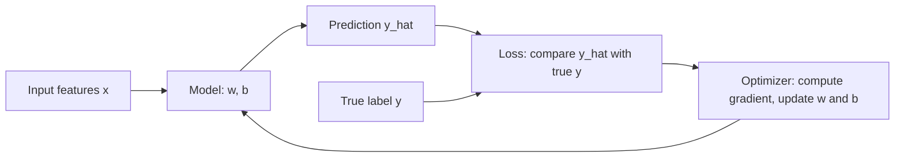

# Linear and Logistic Regression from Scratch

> **Level:** Beginner to Advanced · **Study time:** ~120 min · **Prerequisites:** [Linear Algebra for ML](../00-foundations/02-linear-algebra-for-ml.md), [Calculus and Gradients](../00-foundations/03-calculus-and-gradients.md), [Probability and Statistics](../00-foundations/04-probability-and-statistics.md), [Softmax and Cross-Entropy](../00-foundations/05-softmax-entropy-cross-entropy-and-kl-divergence.md), [The ML Workflow](./01-ml-workflow-data-splits-and-cross-validation.md)

## Table of contents

- [Why this matters](#why-this-matters)
- [The big picture: model, loss, optimizer](#the-big-picture-model-loss-optimizer)
- [Linear regression: the model](#linear-regression-the-model)
- [Measuring error: mean squared error](#measuring-error-mean-squared-error)
- [The closed-form solution: the normal equation](#the-closed-form-solution-the-normal-equation)
- [Gradient descent from scratch in NumPy](#gradient-descent-from-scratch-in-numpy)
- [Feature scaling and why gradient descent needs it](#feature-scaling-and-why-gradient-descent-needs-it)
- [Logistic regression: from scores to probabilities](#logistic-regression-from-scores-to-probabilities)
- [Log loss: how logistic regression is trained](#log-loss-how-logistic-regression-is-trained)
- [Decision boundary and a full worked example](#decision-boundary-and-a-full-worked-example)
- [Multiclass: softmax regression](#multiclass-softmax-regression)
- [Interpreting coefficients and odds ratios](#interpreting-coefficients-and-odds-ratios)
- [Assumptions and limitations](#assumptions-and-limitations)
- [Regularized versions: ridge, lasso and elastic net](#regularized-versions-ridge-lasso-and-elastic-net)
- [scikit-learn in practice](#scikit-learn-in-practice)
- [Going deeper: why logistic regression is a strong, calibrated baseline](#going-deeper-why-logistic-regression-is-a-strong-calibrated-baseline)
- [Going deeper: production, scale and debugging](#going-deeper-production-scale-and-debugging)
- [Common mistakes and misconceptions](#common-mistakes-and-misconceptions)
- [Interview questions and model answers](#interview-questions-and-model-answers)
- [Key takeaways](#key-takeaways)
- [Further reading](#further-reading)
- [Next](#next)

## Why this matters

Linear and logistic regression are the "hello world" of machine learning, but they are not toys. Logistic regression still powers credit scorecards, fraud rules, click-through-rate models and the "is this ticket urgent?" classifier sitting in front of many LLM applications. Every neural network classifier ends in a layer that *is* logistic (or softmax) regression, and the gradient you derive in this chapter, $(p - y)\,x$, is the same one that flows backward through a transformer's output layer. Interviewers love these models because a candidate who truly understands them can explain loss functions, gradient descent, regularization, calibration and interpretability from first principles. And in production, a well-built logistic regression baseline is how senior engineers find out whether a fancy model is actually earning its cost.

## The big picture: model, loss, optimizer

> **Analogy:** Learning a model is like tuning a guitar. The **model** is the guitar (what sounds it can possibly make). The **loss** is your ear telling you how far off the note is. The **optimizer** is your hand turning the pegs in the direction that makes the note less wrong.

Almost every supervised ML method, from linear regression to a 70B-parameter LLM, is built from three parts:

1. **Model** (also called the **hypothesis**): a function with adjustable numbers called **parameters** (or **weights**) that maps an input to a prediction.
2. **Loss function**: a single number that says how bad the predictions are on the training data. Lower is better.
3. **Optimizer**: a procedure that changes the parameters to reduce the loss.



This chapter uses two running examples:

- **House prices (regression):** predict a number, the price of a house, from its size.
- **Spam filter (classification):** predict a category, spam or not spam, from features of an email.

**Regression** means predicting a continuous number. **Classification** means predicting a category. Confusingly, *logistic regression* is a classification method; the name is historical (it regresses the log-odds, which you will meet soon).

## Linear regression: the model

> **Analogy:** A taxi fare. There is a fixed charge when you get in, plus a fixed amount per kilometer. Fare = base + rate × distance. That is linear regression with one feature.

A **feature** is one measurable input property (house size, number of bedrooms). A **label** or **target** is the value we want to predict (price).

Linear regression predicts the target as a weighted sum of the features plus a constant:

$$
\hat{y} = w_1 x_1 + w_2 x_2 + \dots + w_d x_d + b = \mathbf{w}^\top \mathbf{x} + b
$$

- $\hat{y}$ ("y-hat"): the model's prediction.
- $x_1, \dots, x_d$: the $d$ feature values of one example, collected into the vector $\mathbf{x}$.
- $w_1, \dots, w_d$: the **weights** (also called **coefficients**), one per feature, collected into $\mathbf{w}$. Each says how much the prediction changes when that feature increases by one unit.
- $b$: the **bias** or **intercept**, the prediction when every feature is zero (the taxi's base fare).
- $\mathbf{w}^\top \mathbf{x}$: the dot product, $\sum_j w_j x_j$ (see [Linear Algebra for ML](../00-foundations/02-linear-algebra-for-ml.md)).

**Our running house dataset (illustrative numbers):**

| House | Size $x$ (1000 sq ft) | Price $y$ (100k dollars) |
|---|---|---|
| A | 1 | 3 |
| B | 2 | 4 |
| C | 3 | 6 |
| D | 4 | 7 |

So house A is 1000 sq ft and sold for 300k dollars. With one feature, the model is a straight line: $\hat{y} = w x + b$. Our job is to find the $w$ and $b$ that make the line fit these four points best. But "best" needs a definition. That is the loss.

```text
price (100k dollars)
 8 |
 7 |                        * D
 6 |                  * C
 5 |
 4 |            * B
 3 |      * A
 2 |
   +-----+-----+-----+-----+--> size (1000 sq ft)
         1     2     3     4
```

## Measuring error: mean squared error

> **Analogy:** You are throwing darts. Each miss has a distance from the bullseye. Squaring the distance means a miss twice as far costs four times as much, so the thrower is strongly discouraged from wild misses.

A **residual** (or error) is the difference between prediction and truth for one example: $\hat{y}_i - y_i$. The **mean squared error (MSE)** averages the squared residuals:

$$
\text{MSE}(\mathbf{w}, b) = \frac{1}{n}\sum_{i=1}^{n} \left(\hat{y}_i - y_i\right)^2
$$

- $n$: number of training examples.
- $i$: index of an example.
- $\hat{y}_i = \mathbf{w}^\top \mathbf{x}_i + b$: prediction for example $i$.
- $y_i$: true target for example $i$.

**Worked example: a guessed line.** Try $w = 1$, $b = 2$, so $\hat{y} = x + 2$.

| House | $x$ | $y$ | $\hat{y} = x + 2$ | $\hat{y} - y$ | squared |
|---|---|---|---|---|---|
| A | 1 | 3 | 3 | 0 | 0 |
| B | 2 | 4 | 4 | 0 | 0 |
| C | 3 | 6 | 5 | -1 | 1 |
| D | 4 | 7 | 6 | -1 | 1 |

MSE $= (0 + 0 + 1 + 1) / 4 = 2 / 4 = 0.5$.

**Worked example: the best line.** We will soon prove the best line is $w = 1.4$, $b = 1.5$.

| House | $x$ | $y$ | $\hat{y} = 1.4x + 1.5$ | $\hat{y} - y$ | squared |
|---|---|---|---|---|---|
| A | 1 | 3 | 2.9 | -0.1 | 0.01 |
| B | 2 | 4 | 4.3 | 0.3 | 0.09 |
| C | 3 | 6 | 5.7 | -0.3 | 0.09 |
| D | 4 | 7 | 7.1 | 0.1 | 0.01 |

MSE $= (0.01 + 0.09 + 0.09 + 0.01) / 4 = 0.2 / 4 = 0.05$. Ten times better than our guess.

In plain words: the model says a house costs 150k dollars plus 140k dollars per 1000 sq ft.

**Why squared error and not something else?**

- It is smooth and differentiable everywhere, which makes optimization easy.
- For linear models, MSE is a **convex** function of the parameters: its surface is a single bowl, so there are no bad local minima to get stuck in (the bottom is a single point when no feature is a linear combination of the others; with perfectly collinear features it becomes a flat trough of equally good solutions).
- Statistically, minimizing MSE is the same as **maximum likelihood estimation** (choosing parameters that make the observed data most probable) if you assume the noise around the line is Gaussian. See [Probability and Statistics](../00-foundations/04-probability-and-statistics.md).
- Downside: squaring makes it very sensitive to **outliers** (a single mansion in a dataset of apartments drags the line toward it). Alternatives like mean absolute error and Huber loss are covered in [Loss Functions](../02-deep-learning/04-loss-functions.md), and regression metrics like RMSE and $R^2$ in [Regression Metrics](./05-regression-metrics-baselines-and-model-selection.md).

## The closed-form solution: the normal equation

> **Analogy:** If you want the lowest point of a perfectly smooth bowl, you can either walk downhill step by step (gradient descent) or, if you know the bowl's exact equation, solve for the spot where the slope is zero in one go (the normal equation).

Because MSE for a linear model is a convex bowl, its minimum is where the **gradient** (the vector of partial derivatives, see [Calculus and Gradients](../00-foundations/03-calculus-and-gradients.md)) is zero. Setting it to zero and solving gives a formula. First, a trick: fold the bias into the weights by adding a column of ones to the data.

$$
\boldsymbol{\theta}^* = \left(X^\top X\right)^{-1} X^\top \mathbf{y}
$$

- $X$: the **design matrix**, shape $n \times (d+1)$. Each row is one example; the first column is all ones (for the bias).
- $\mathbf{y}$: column vector of the $n$ targets.
- $\boldsymbol{\theta}^*$: the optimal parameters $[b, w_1, \dots, w_d]$.
- $X^\top X$: a $(d+1) \times (d+1)$ matrix summarizing how features relate to each other.
- $X^\top \mathbf{y}$: how each feature relates to the target.
- $(\cdot)^{-1}$: matrix inverse.

**Where it comes from.** In matrix form the MSE is $\frac{1}{n}\lVert X\boldsymbol{\theta} - \mathbf{y}\rVert^2$, and its gradient is $\frac{2}{n}X^\top(X\boldsymbol{\theta} - \mathbf{y})$ (the vectorized "average of error times input" you will meet again in gradient descent). Setting that gradient to zero gives the equation below.

**Intuition.** At the optimum, the residual vector $X\boldsymbol{\theta} - \mathbf{y}$ is **orthogonal** (perpendicular) to every feature column: $X^\top(X\boldsymbol{\theta} - \mathbf{y}) = 0$. In words: no feature can explain any of the leftover error, otherwise we could reduce the error further by adjusting that feature's weight. Rearranging gives $X^\top X \boldsymbol{\theta} = X^\top \mathbf{y}$, the "normal equations" (normal meaning perpendicular).

**Worked example by hand.**

$$
X = \begin{bmatrix} 1 & 1 \\ 1 & 2 \\ 1 & 3 \\ 1 & 4 \end{bmatrix}, \quad
\mathbf{y} = \begin{bmatrix} 3 \\ 4 \\ 6 \\ 7 \end{bmatrix}
$$

Step 1, $X^\top X$:

- top-left: sum of ones $= 4$
- off-diagonal: $\sum x = 1+2+3+4 = 10$
- bottom-right: $\sum x^2 = 1+4+9+16 = 30$

$$
X^\top X = \begin{bmatrix} 4 & 10 \\ 10 & 30 \end{bmatrix}
$$

Step 2, $X^\top \mathbf{y}$:

- $\sum y = 3+4+6+7 = 20$
- $\sum xy = 3 + 8 + 18 + 28 = 57$

Step 3, invert the 2x2 matrix. Determinant $= 4 \cdot 30 - 10 \cdot 10 = 120 - 100 = 20$.

$$
(X^\top X)^{-1} = \frac{1}{20}\begin{bmatrix} 30 & -10 \\ -10 & 4 \end{bmatrix}
$$

Step 4, multiply:

- $b = (30 \cdot 20 - 10 \cdot 57)/20 = (600 - 570)/20 = 30/20 = 1.5$
- $w = (-10 \cdot 20 + 4 \cdot 57)/20 = (-200 + 228)/20 = 28/20 = 1.4$

That matches the "best line" we used above.

```python
import numpy as np

x = np.array([1.0, 2.0, 3.0, 4.0])
y = np.array([3.0, 4.0, 6.0, 7.0])
X = np.c_[np.ones_like(x), x]            # add bias column -> shape (4, 2)

# Solve X^T X theta = X^T y. Never call np.linalg.inv in real code.
theta = np.linalg.solve(X.T @ X, X.T @ y)
print(theta)                             # [1.5 1.4]  (b, w), up to float rounding

# Even better: least squares via a stable decomposition, works when X^T X is singular
theta_ls, *_ = np.linalg.lstsq(X, y, rcond=None)
```

**When the normal equation breaks down:**

| Issue | Why | What to do |
|---|---|---|
| Many features ($d$ in the tens of thousands) | Building and solving the $d \times d$ system costs roughly $O(nd^2 + d^3)$ | Use gradient descent or iterative solvers |
| Huge $n$ that does not fit in memory | Needs all data at once | Mini-batch gradient descent |
| $X^\top X$ singular (duplicate or perfectly correlated features, or $d > n$) | Inverse does not exist; infinitely many solutions | `lstsq` / pseudo-inverse, or ridge regularization |
| Nearly singular (strong multicollinearity) | Tiny data changes swing the weights wildly | Ridge, drop or combine features |
| Logistic regression | No closed form exists | Iterative optimization (gradient descent, Newton, L-BFGS; see "Solvers at a glance" later in this chapter) |

> **Senior insight:** Libraries like scikit-learn's `LinearRegression` do not literally invert $X^\top X$. They use numerically stable least-squares routines (based on matrix decompositions such as QR or SVD). Explicitly forming $X^\top X$ squares the **condition number** (a measure of how sensitive a solution is to small input changes), which loses floating-point precision.

## Gradient descent from scratch in NumPy

> **Analogy:** You are on a foggy hillside and want to reach the valley floor. You cannot see the valley, but you can feel the slope under your feet. Take a step downhill, feel again, repeat. The **learning rate** is your step length.

**Gradient descent** repeatedly nudges each parameter in the direction that reduces the loss:

$$
w \leftarrow w - \eta \frac{\partial J}{\partial w}, \qquad b \leftarrow b - \eta \frac{\partial J}{\partial b}
$$

- $J$: the loss (here MSE).
- $\frac{\partial J}{\partial w}$: the **partial derivative** of the loss with respect to $w$, the slope in the $w$ direction.
- $\eta$ (eta): the **learning rate**, a small positive number such as 0.01. It is a **hyperparameter**: a setting you choose before training, as opposed to a parameter ($w$, $b$) the model learns.
- The minus sign: we move *against* the slope, downhill.

For MSE, applying the chain rule gives:

$$
\frac{\partial J}{\partial w} = \frac{2}{n}\sum_{i=1}^n (\hat{y}_i - y_i)\, x_i, \qquad
\frac{\partial J}{\partial b} = \frac{2}{n}\sum_{i=1}^n (\hat{y}_i - y_i)
$$

Read it as: "average of (error times input)". If we overpredict ($\hat{y} > y$) on a big house, the gradient for $w$ is positive, so we decrease $w$. Exactly what you would do by hand.

**Worked example: one step by hand.** Start at $w = 0$, $b = 0$, learning rate $\eta = 0.01$.

1. Predictions are all 0, so errors $\hat{y} - y = [-3, -4, -6, -7]$.
2. Starting MSE $= (9 + 16 + 36 + 49)/4 = 110/4 = 27.5$.
3. $\sum (\hat{y}-y) = -20$, so $\partial J / \partial b = (2/4)(-20) = -10$.
4. $\sum (\hat{y}-y)x = -3 - 8 - 18 - 28 = -57$, so $\partial J/\partial w = (2/4)(-57) = -28.5$.
5. Update: $w = 0 - 0.01 \cdot (-28.5) = 0.285$, and $b = 0 - 0.01 \cdot (-10) = 0.1$.
6. New MSE is about $19.14$. Lower, so we are heading downhill.

Repeat thousands of times and you land on $w = 1.4$, $b = 1.5$.

One **epoch** is one full pass over the training data. In the batch version below, each epoch is exactly one update step on all $n$ examples.

```python
import numpy as np

X = np.array([[1.0], [2.0], [3.0], [4.0]])   # size in 1000 sq ft, shape (n, d)
y = np.array([3.0, 4.0, 6.0, 7.0])           # price in $100k

def fit_linear_gd(X, y, lr=0.05, epochs=5000):
    """Batch gradient descent for linear regression with MSE loss."""
    n, d = X.shape
    w = np.zeros(d)
    b = 0.0
    for epoch in range(epochs):
        y_hat = X @ w + b                    # predictions, shape (n,)
        err = y_hat - y                      # residuals
        grad_w = (2 / n) * (X.T @ err)       # vectorized "average of error * x"
        grad_b = (2 / n) * err.sum()
        w -= lr * grad_w
        b -= lr * grad_b
        if epoch % 1000 == 0:
            print(f"epoch {epoch:5d}  mse {np.mean(err ** 2):.4f}")
    return w, b

w, b = fit_linear_gd(X, y)
print(w, b)   # approximately [1.4] 1.5
# The first printed line is "epoch     0  mse 27.5000"
```

**Three flavors of gradient descent:**

| Variant | Gradient computed on | Pros | Cons |
|---|---|---|---|
| Batch GD | All $n$ examples per step | Smooth, deterministic | Slow per step on big data |
| Stochastic GD (SGD) | One example per step | Cheap steps, works on streams | Noisy path |
| Mini-batch GD | A batch (e.g., 32 to 1024 examples) | Best of both, GPU friendly | One more hyperparameter |

Mini-batch is what deep learning uses. Momentum, Adam and learning rate schedules are covered in [Optimizers](../02-deep-learning/03-optimizers-sgd-momentum-adam-and-learning-rate-schedules.md).

**Choosing the learning rate:**

```text
lr too small          lr about right        lr too large
loss                  loss                  loss
 |\                    |\                    |      /\  /
 | \                   | \                   |  /\ /  \/
 |  \                  |  \__                | /  V
 |   \                 |     \______         |/
 |    \______          |                     |
 +-----------> step    +-----------> step    +-----------> step
 slow progress         fast, then flat       oscillates or explodes
```

## Feature scaling and why gradient descent needs it

> **Analogy:** Imagine a valley that is 1 meter wide but 10 kilometers long. Downhill points almost straight at the nearest valley wall, not along the valley toward the exit. You zigzag wall to wall forever. Feature scaling reshapes the valley into a round bowl where downhill points at the bottom.

Suppose we record house size in raw square feet (1000 to 4000) instead of thousands. The weight for size now multiplies numbers a thousand times bigger, so:

- The gradient for $w$ is about 1000 times bigger than for $b$ (it contains a factor of $x$).
- The curvature of the loss in the $w$ direction is about a million times bigger (it contains $x^2$).

A learning rate small enough to be stable for $w$ is far too small to move $b$. A learning rate big enough to move $b$ makes $w$ explode.

```text
Unscaled features: elongated bowl     Scaled features: round bowl
(contours of the loss)                (contours of the loss)

   b ^                                   b ^
     |  ___________________                |      .---.
     | (  _______________  )               |    /  .-.  \
     | ( (       *       ) )               |   |  ( * )  |
     | (  ---------------  )               |    \  '-'  /
     |  -------------------                |      '---'
     +-------------------------> w         +-------------> w
   GD zigzags across the narrow axis     GD heads straight to the center *
```

**Standardization** (also called z-scoring) rescales each feature to mean 0 and standard deviation 1:

$$
z = \frac{x - \mu}{\sigma}
$$

- $x$: original feature value.
- $\mu$: mean of that feature **on the training set**.
- $\sigma$: standard deviation of that feature on the training set.
- $z$: standardized value.

**Worked example.** Sizes in raw square feet: $[1000, 2000, 3000, 4000]$.

1. $\mu = (1000+2000+3000+4000)/4 = 2500$.
2. Squared deviations: $1500^2 = 2{,}250{,}000$; $500^2 = 250{,}000$; $250{,}000$; $2{,}250{,}000$. Average $= 5{,}000{,}000 / 4 = 1{,}250{,}000$.
3. $\sigma = \sqrt{1{,}250{,}000} \approx 1118.03$.
4. $z = [-1500, -500, 500, 1500]/1118.03 \approx [-1.342, -0.447, 0.447, 1.342]$.

```python
import numpy as np

sqft = np.array([[1000.0], [2000.0], [3000.0], [4000.0]])
y = np.array([3.0, 4.0, 6.0, 7.0])

# With raw sqft, lr=0.05 diverges: the weights blow up to astronomically large values
# within ~10 steps, then overflow to inf/nan.
# w_bad, b_bad = fit_linear_gd(sqft, y, lr=0.05)   # do not do this

mu, sigma = sqft.mean(axis=0), sqft.std(axis=0)    # fit scaler on TRAINING data only
z = (sqft - mu) / sigma
w, b = fit_linear_gd(z, y, lr=0.1, epochs=500)    # converges quickly

# To predict a new 2500 sq ft house, apply the SAME mu and sigma:
x_new = (np.array([[2500.0]]) - mu) / sigma
print(x_new @ w + b)   # approximately [5.0], i.e. $500k
```

> **Senior insight:** The precise version of "elongated bowl" is the **condition number** of the **Hessian** (the matrix of second derivatives, which measures curvature). For MSE the Hessian is $\frac{2}{n}X^\top X$. With raw square feet plus a bias column, that is $\begin{bmatrix} 2 & 5000 \\ 5000 & 1.5\times 10^7 \end{bmatrix}$, whose eigenvalues are about $1.5 \times 10^7$ and $0.33$: a condition number around $4.5 \times 10^7$. Gradient descent is stable only if $\eta < 2/\lambda_{\max} \approx 1.3 \times 10^{-7}$, and at that rate the flat direction needs tens of millions of steps. After standardizing, the Hessian is $\begin{bmatrix} 2 & 0 \\ 0 & 2 \end{bmatrix}$, condition number 1, and gradient descent converges in a handful of steps.

**When scaling matters and when it does not:**

| Situation | Scaling needed? | Why |
|---|---|---|
| Gradient descent / SGD on linear or logistic models | Yes | Conditioning, as above |
| Ridge, lasso, regularized logistic regression | Yes, even with closed-form solvers | The penalty treats all weights equally; a feature whose units make its values small (e.g., distance in kilometers rather than millimeters) needs a large weight and gets unfairly punished |
| Comparing coefficient magnitudes for importance | Yes | Raw coefficients depend on units |
| Plain OLS via normal equation / `lstsq` | Not for the answer (predictions are unchanged), helps numerically | Solution is scale-equivariant |
| Decision trees, random forests, gradient boosting | No | Splits only depend on the order of values |

Other scalers (min-max, robust scaling, log transforms) and how to put them in a leak-free pipeline are covered in [Feature Engineering](./07-feature-engineering-missing-values-and-encoding.md).

> **Common mistake:** Computing $\mu$ and $\sigma$ on the full dataset before splitting into train and test. The test set's statistics leak into training. Always fit the scaler on the training split only. See [Data Leakage](./03-overfitting-regularization-and-data-leakage.md).

## Logistic regression: from scores to probabilities

Now switch to the spam filter. The target is binary: $y = 1$ for spam, $y = 0$ for not spam (often called "ham").

**Why not just use linear regression with 0/1 labels?** Its outputs are unbounded: it might predict 1.7 or -0.4 for an email, which are not probabilities. It is also dragged around by extreme points far from the boundary.

> **Analogy:** A **sigmoid** is a dimmer switch with soft ends. Turn the knob (the score) far left and the light is basically off (probability near 0); far right and it is basically on (near 1); near the middle, small turns make a big difference.

Logistic regression keeps the linear score but squashes it into $(0, 1)$:

$$
z = \mathbf{w}^\top \mathbf{x} + b, \qquad p = \sigma(z) = \frac{1}{1 + e^{-z}}
$$

- $z$: the **logit** (raw score), any real number.
- $\sigma$: the **sigmoid** (logistic) function.
- $e$: Euler's number, about 2.718.
- $p$: the model's estimate of $P(y = 1 \mid \mathbf{x})$, the probability the email is spam given its features.

Key sigmoid facts:

- $\sigma(0) = 0.5$; $\sigma(z) \to 1$ as $z \to \infty$; $\sigma(z) \to 0$ as $z \to -\infty$.
- Symmetry: $\sigma(-z) = 1 - \sigma(z)$.
- Derivative: $\sigma'(z) = \sigma(z)\,(1 - \sigma(z))$. This makes the gradient beautifully simple, as you will see.

```text
 p = sigmoid(z)
1.0 |                                   **************
    |                              *****
    |                            **
    |                          **
0.5 |                       ***
    |                     **
    |                   **
    |              *****
0.0 |**************
    +--------+-------+-------+-------+-------+-------+-> z
   -6       -4      -2       0       2       4       6
```

**Odds and log-odds.** The **odds** of an event are $p/(1-p)$: odds of 4 mean "4 to 1 in favor", i.e., $p = 0.8$. Inverting the sigmoid shows

$$
z = \ln\frac{p}{1-p}
$$

so the linear score $z$ *is* the **log-odds**. That is the precise statement of what logistic regression assumes: the log-odds of the positive class are a linear function of the features. It is also why the method is called "regression".

**Running spam model (illustrative weights).** Two features:

- $x_1$ = number of times the word "free" appears.
- $x_2$ = 1 if the email contains a link, else 0.

Weights: $w_1 = 1.2$, $w_2 = 2.0$, $b = -3$.

| Email | free count $x_1$ | link $x_2$ | $z = 1.2x_1 + 2.0x_2 - 3$ | $p = \sigma(z)$ |
|---|---|---|---|---|
| A | 2 | 1 | $2.4 + 2.0 - 3 = 1.4$ | 0.802 |
| B | 0 | 1 | $0 + 2.0 - 3 = -1.0$ | 0.269 |
| C | 3 | 0 | $3.6 + 0 - 3 = 0.6$ | 0.646 |
| D | 0 | 0 | $-3$ | 0.047 |

Hand calculation for email A: $e^{-1.4} \approx 0.2466$, so $p = 1/(1 + 0.2466) = 1/1.2466 \approx 0.802$.

## Log loss: how logistic regression is trained

> **Analogy:** A weather forecaster says "99% chance of sun" and it pours. That should hurt their reputation a lot more than if they had said "60% chance of sun". Log loss punishes confident wrong answers brutally and barely punishes cautious ones.

The **log loss**, also called **binary cross-entropy**, for one example is:

$$
\ell(p, y) = -\left[\, y \ln p + (1 - y)\ln(1 - p) \,\right]
$$

and the training loss is the average over all $n$ examples.

- $y \in \{0, 1\}$: true label.
- $p$: predicted probability of class 1.
- $\ln$: natural logarithm.
- When $y = 1$ the formula reduces to $-\ln p$; when $y = 0$ it reduces to $-\ln(1-p)$. Only one term is ever "on".

**Worked numbers** (for a spam email, $y = 1$):

| Predicted $p$ | Loss $-\ln p$ | Comment |
|---|---|---|
| 0.9 | 0.105 | Confident and right: tiny loss |
| 0.6 | 0.511 | Unsure: moderate loss |
| 0.1 | 2.303 | Confident and wrong: big loss |
| 0.01 | 4.605 | Very confident and wrong: huge loss |

Email A had $p = 0.802$. If it is truly spam: loss $= -\ln 0.802 \approx 0.220$. If it is actually a legitimate email: loss $= -\ln(1 - 0.802) = -\ln 0.198 \approx 1.62$.

Log loss is exactly the negative log-likelihood of a Bernoulli (coin flip) model, so minimizing it is maximum likelihood estimation. It is also the binary case of cross-entropy, explained in [Softmax, Entropy and Cross-Entropy](../00-foundations/05-softmax-entropy-cross-entropy-and-kl-divergence.md).

**The gradient: the most important three-line derivation in ML.** Using the chain rule through $z \to p \to \ell$:

1. $\dfrac{\partial \ell}{\partial p} = -\dfrac{y}{p} + \dfrac{1-y}{1-p}$
2. $\dfrac{\partial p}{\partial z} = p(1-p)$
3. Multiply: $\dfrac{\partial \ell}{\partial z} = -y(1-p) + (1-y)p = p - y$

and since $z = \mathbf{w}^\top\mathbf{x} + b$:

$$
\frac{\partial \ell}{\partial \mathbf{w}} = (p - y)\,\mathbf{x}, \qquad \frac{\partial \ell}{\partial b} = p - y
$$

- $p - y$: the prediction error, between -1 and 1.
- $\mathbf{x}$: the input features.

This has the same "error times input" shape as linear regression. The same $p - y$ appears at the output of every neural network classifier trained with cross-entropy (see [Backpropagation](../02-deep-learning/02-backpropagation-and-gradient-descent.md)).

**Why not train logistic regression with MSE?** Two reasons:

1. **Non-convexity:** MSE composed with a sigmoid is not convex in $\mathbf{w}$, so gradient descent can stall on flat regions. Log loss with a linear model is convex, so every local minimum is a global minimum. A minimizer exists and is unique when the data are not perfectly separable and the features are not redundant; with separable data and no regularization there is no finite minimizer at all (the weights grow without bound, see "No perfect separation" below).
2. **Vanishing gradient when confidently wrong:** with MSE, $\partial / \partial z$ contains the factor $p(1-p)$. Take a spam email with $z = -5$: $p \approx 0.0067$. The MSE gradient is $2(p - 1)\,p(1-p) \approx -0.013$, almost zero, so the model barely learns from its worst mistake. The log-loss gradient is $p - 1 \approx -0.993$, a strong push.

## Decision boundary and a full worked example

A probability becomes a decision with a **threshold**: predict spam if $p \ge t$. With the default $t = 0.5$, that is the same as $z \ge 0$ because $\sigma(0) = 0.5$. The set of points where $z = 0$ is the **decision boundary**:

$$
\mathbf{w}^\top \mathbf{x} + b = 0
$$

With two features this is a line; with three a plane; in general a **hyperplane**. That is why logistic regression is called a **linear classifier**: it can only separate classes with a flat boundary (in the features you give it).

For our spam model: $1.2x_1 + 2.0x_2 - 3 = 0$.

- Emails without a link ($x_2 = 0$): boundary at $x_1 = 3/1.2 = 2.5$, so 3 or more "free"s are flagged.
- Emails with a link ($x_2 = 1$): $1.2x_1 = 1$, so $x_1 \approx 0.83$, meaning 1 or more "free"s are flagged.

```text
 link x2
   1 | oB   \      xA
     |        \
     |           \
     |              \
   0 | oD             \  xC
     +-+-----+-----+-----+-----+--------> free count x1
       0     1     2     3     4

 o = predicted not spam (z < 0)    x = predicted spam (z >= 0)
 The boundary (\) crosses x2 = 1 at x1 = 0.83 and x2 = 0 at x1 = 2.5.
```

> **Interview tip:** The threshold is a business decision, not a model property. A spam filter might use $t = 0.9$ because losing a real email is worse than letting spam through. Choosing thresholds with precision/recall trade-offs is covered in [Classification Metrics](./04-classification-metrics-and-imbalanced-data.md).

**One gradient step by hand.** Email A is truly spam ($y = 1$), currently $p = 0.802$. With learning rate $\eta = 0.5$:

1. Error: $p - y = 0.802 - 1 = -0.198$.
2. Gradients: $\partial \ell/\partial w_1 = -0.198 \cdot 2 = -0.396$; $\partial \ell/\partial w_2 = -0.198 \cdot 1 = -0.198$; $\partial \ell/\partial b = -0.198$.
3. Updates: $w_1 = 1.2 + 0.5 \cdot 0.396 = 1.398$; $w_2 = 2.0 + 0.5\cdot 0.198 = 2.099$; $b = -3 + 0.5 \cdot 0.198 = -2.901$.
4. New score: $z = 1.398 \cdot 2 + 2.099 - 2.901 = 1.994$, so $p = \sigma(1.994) \approx 0.880$. The model became more confident in the right answer.

**Logistic regression from scratch in NumPy.** We generate synthetic emails from the "true" weights above and check that training recovers them.

```python
import numpy as np

def sigmoid(z):
    # Numerically stable: identical to 1/(1+exp(-z)) but never overflows.
    return 0.5 * (1.0 + np.tanh(0.5 * z))

def log_loss(p, y, eps=1e-12):
    p = np.clip(p, eps, 1 - eps)              # avoid log(0)
    return -np.mean(y * np.log(p) + (1 - y) * np.log(1 - p))

def fit_logistic_gd(X, y, lr=0.5, epochs=5000, l2=0.0):
    n, d = X.shape
    w, b = np.zeros(d), 0.0
    for epoch in range(epochs):
        p = sigmoid(X @ w + b)
        err = p - y                            # the famous (p - y)
        grad_w = X.T @ err / n + l2 * w        # optional L2 penalty (see ridge below)
        grad_b = err.mean()                    # bias is usually not penalized
        w -= lr * grad_w
        b -= lr * grad_b
        if epoch % 1000 == 0:
            print(f"epoch {epoch:4d}  log loss {log_loss(p, y):.4f}")
    return w, b

# Synthetic spam data generated from known weights
rng = np.random.default_rng(0)
n = 5000
free_count = rng.poisson(1.0, n)
has_link = rng.integers(0, 2, n)
X = np.c_[free_count, has_link].astype(float)
true_p = sigmoid(1.2 * free_count + 2.0 * has_link - 3.0)
y = (rng.random(n) < true_p).astype(float)

w, b = fit_logistic_gd(X, y)
print("learned w:", w.round(2), "b:", round(b, 2))
# Expect values roughly near w = [1.2, 2.0], b = -3.0. Exact numbers depend on the
# random sample; more data or more epochs bring them closer.
# The first line prints log loss ln(2) = 0.6931, because p = 0.5 everywhere at w = 0.

pred = (sigmoid(X @ w + b) >= 0.5).astype(float)
print("train accuracy:", (pred == y).mean())
```

## Multiclass: softmax regression

What if emails go into three folders: spam, promotions, primary? **Softmax regression** (also called **multinomial logistic regression**) gives each class $k$ its own weight vector and computes one logit per class, then turns logits into probabilities that sum to 1 with the **softmax** function:

$$
z_k = \mathbf{w}_k^\top \mathbf{x} + b_k, \qquad
p_k = \frac{e^{z_k}}{\sum_{j=1}^{K} e^{z_j}}
$$

- $K$: number of classes.
- $\mathbf{w}_k, b_k$: weights and bias for class $k$. Stacked together they form a $d \times K$ weight matrix $W$.
- $z_k$: logit for class $k$.
- $p_k$: predicted probability of class $k$; all $p_k > 0$ and $\sum_k p_k = 1$.

The loss is **cross-entropy**: $-\ln p_{\text{true class}}$.

**Worked example.** An email gets logits $[2.0, 1.0, 0.1]$ for [spam, promotions, primary].

1. Exponentiate: $e^{2.0} \approx 7.389$, $e^{1.0} \approx 2.718$, $e^{0.1} \approx 1.105$.
2. Sum: $7.389 + 2.718 + 1.105 = 11.212$.
3. Divide: $p \approx [0.659, 0.242, 0.099]$ (sums to 1.000).
4. If the true folder is spam, loss $= -\ln 0.659 \approx 0.417$.

The gradient generalizes neatly: $\partial \ell / \partial W = \mathbf{x}\,(\mathbf{p} - \mathbf{y}_{\text{onehot}})^\top$, again "input times error".

**Binary logistic regression is softmax with two classes.** With logits $[z, 0]$, softmax gives $e^z/(e^z + 1) = 1/(1 + e^{-z}) = \sigma(z)$. Only the *difference* of logits matters, which is why adding a constant to every logit changes nothing (and why stable implementations subtract the max logit before exponentiating).

**Softmax (multinomial) vs one-vs-rest (OvR):**

| Approach | How | Pros | Cons |
|---|---|---|---|
| Multinomial softmax | One joint model, probabilities sum to 1 | Coherent probabilities, single fit | Assumes exactly one class per example |
| One-vs-rest | $K$ separate binary classifiers | Simple, parallel, works for multi-label | Scores are not a proper distribution; need normalization |
| Independent sigmoids (multi-label) | One sigmoid per label | An email can be both "promotions" and "travel" | Not for mutually exclusive classes |

A neural network's final classification layer is exactly softmax regression applied to learned features; an LLM's output layer is softmax regression over a vocabulary of tens of thousands to a few hundred thousand tokens (see [Pretraining and Next-Token Prediction](../05-llms/01-pretraining-and-next-token-prediction.md)).

## Interpreting coefficients and odds ratios

Interpretability is the main reason teams keep linear models in production. Here is how to read them correctly.

**Linear regression coefficients.** $w_j$ is the expected change in $\hat{y}$ when feature $j$ increases by one unit, **holding all other features constant**. In our house model, $w = 1.4$ means each extra 1000 sq ft adds 140k dollars to the predicted price. The intercept $b = 1.5$ (150k dollars) is the prediction for a 0 sq ft house: mathematically required, physically meaningless. Intercepts often are.

**Logistic regression coefficients.** Because $z$ is the log-odds, $w_j$ is the change in **log-odds** per unit of $x_j$. Exponentiate to get the **odds ratio**:

$$
\text{OR}_j = e^{w_j}
$$

- $\text{OR}_j > 1$: the feature increases the odds of the positive class.
- $\text{OR}_j = 1$ (i.e., $w_j = 0$): no effect.
- $\text{OR}_j < 1$: decreases the odds.

**Worked example with the spam model:**

- Link: $e^{2.0} \approx 7.39$. Having a link multiplies the odds of spam by about 7.4, holding the "free" count fixed.
- Each "free": $e^{1.2} \approx 3.32$. Each extra "free" multiplies the odds by 3.32.

Check with the table. Email D (no link, no "free") has $z = -3$, odds $e^{-3} \approx 0.0498$. Add a link (email B): odds $= 0.0498 \times 7.39 \approx 0.368 = e^{-1}$, $p = 0.269$. Add two "free"s (email A): odds $= 0.368 \times 3.32^2 \approx 0.368 \times 11.02 \approx 4.06 = e^{1.4}$, $p = 4.06/5.06 \approx 0.802$. Consistent.

> **Common mistake:** Saying "each 'free' increases the probability of spam by X%". The effect is constant on the odds scale, not on the probability scale. From email B ($p = 0.269$), one more "free" moves $z$ from -1.0 to 0.2 and $p$ to 0.550 (+0.28). From email A ($p = 0.802$), one more "free" moves $z$ to 2.6 and $p$ to 0.931 (only +0.13). The sigmoid flattens near 0 and 1.

**Rules for comparing coefficients:**

1. **Units matter.** A coefficient per dollar and one per million dollars are not comparable. Standardize features first, then a coefficient means "effect of a one-standard-deviation change".
2. **Correlation is not causation.** Coefficients describe associations in the data. "Has link" might be a proxy for "is a newsletter".
3. **Correlated features share credit unpredictably.** See multicollinearity below.
4. **Regularization shrinks coefficients**, so penalized coefficients are biased toward zero. Fine for prediction, misleading for precise effect estimates.
5. **For confidence intervals and p-values**, use a statistics package such as `statsmodels`, not scikit-learn, and remember that p-values are invalid if you selected features using the same data.

## Assumptions and limitations

Linear models are only as good as their assumptions. A senior engineer knows which ones matter for prediction versus for statistical inference.

**Linear regression assumptions (classical OLS):**

| Assumption | What it means | What breaks if violated | Check / fix |
|---|---|---|---|
| Linearity | $y$ is linear in the features (as given) | Systematic bias, poor fit | Residual vs prediction plot; add log, polynomial, spline or interaction features |
| Independent errors | One example's error tells nothing about another's | Overconfident standard errors (time series, grouped data) | Group-aware validation; time-series models |
| Homoscedasticity | Error variance is constant | Unreliable confidence intervals | Residual plot fans out; log-transform target; robust standard errors |
| Normal errors | Errors roughly Gaussian | Only matters for small-sample inference | Q-Q plot; usually ignorable for prediction |
| No perfect multicollinearity | No feature is an exact linear combination of others | $X^\top X$ singular, no unique solution | Drop duplicates; ridge |

**Logistic regression assumptions:**

- **Linearity in the log-odds**, not in the probability.
- **Independent observations.**
- **No perfect separation.** If some combination of features perfectly separates the classes, the likelihood keeps improving as weights grow, so unregularized weights head to infinity (you will see convergence warnings and huge coefficients). Regularization fixes this.
- **Enough examples per feature**, especially of the rarer class.

Notably, logistic regression does **not** assume normally distributed features or errors.

**Multicollinearity in depth.** **Multicollinearity** means two or more features are strongly correlated. Example: a house dataset with both `size_sqft` and `num_rooms` (bigger houses have more rooms).

- Predictions can still be fine.
- But the model cannot tell which feature deserves the credit, so the individual weights become unstable: retrain on a slightly different sample and `size_sqft` may go from +1.4 to +0.3 while `num_rooms` jumps up, or a sign may flip.
- Extreme case: `size_sqft` and `size_m2` (exactly proportional). $X^\top X$ is singular and infinitely many weight combinations give the same predictions.

Detect it with the **variance inflation factor (VIF)**:

$$
\text{VIF}_j = \frac{1}{1 - R_j^2}
$$

- $R_j^2$: the $R^2$ (fraction of variance explained, 0 to 1) when predicting feature $j$ from all the *other* features.
- Example: if the other features explain 90% of `num_rooms`, $R_j^2 = 0.9$ and $\text{VIF} = 1/(1-0.9) = 1/0.1 = 10$. The variance of that coefficient's estimate is inflated tenfold compared with uncorrelated features.
- Common rules of thumb flag VIF above 5 or 10.

Fixes: drop or combine correlated features, use ridge (which spreads weight stably across correlated features), or use **PCA** (principal component analysis, which replaces correlated features with uncorrelated combinations; see [Unsupervised Learning](./10-unsupervised-learning-clustering-and-dimensionality-reduction.md)). If you only care about predictions, multicollinearity may not need fixing at all.

**Fundamental limitations:**

- **Linear boundaries only** (in the given features). The classic counterexample is XOR: spam if exactly one of two conditions holds. No straight line separates it. You must engineer an interaction feature $x_1 x_2$ or use a nonlinear model.
- **No automatic interactions.** A tree learns "big house AND good neighborhood"; a linear model needs you to add that product feature.
- **Extrapolation is linear.** A linear model happily predicts negative prices for tiny houses or ever-growing prices for huge ones.
- **Outliers** pull least-squares fits strongly (logistic regression is less affected because the loss grows only linearly in $|z|$ for badly misclassified points, but still affected).
- **Missing values** are not handled natively; you must impute (see [Feature Engineering](./07-feature-engineering-missing-values-and-encoding.md)).

## Regularized versions: ridge, lasso and elastic net

> **Analogy:** Regularization is a budget. The model wants to fit the training data, but every unit of weight costs money. With a tight budget, it only spends on features that really pay off.

**Regularization** adds a penalty on weight size to the loss, trading a little training accuracy for better generalization and stability. The full story of overfitting and the bias-variance trade-off is in [Overfitting and Regularization](./03-overfitting-regularization-and-data-leakage.md); here we focus on how it changes linear models.

**Ridge (L2):**

$$
J_{\text{ridge}} = \sum_{i=1}^n (\hat{y}_i - y_i)^2 + \alpha \sum_{j=1}^d w_j^2
$$

**Lasso (L1):**

$$
J_{\text{lasso}} = \frac{1}{2n}\sum_{i=1}^n (\hat{y}_i - y_i)^2 + \alpha \sum_{j=1}^d |w_j|
$$

**Elastic net (L1 + L2):**

$$
J_{\text{EN}} = \frac{1}{2n}\sum_{i=1}^n (\hat{y}_i - y_i)^2 + \alpha\rho \sum_{j=1}^d |w_j| + \frac{\alpha(1-\rho)}{2}\sum_{j=1}^d w_j^2
$$

- $\alpha \ge 0$: regularization strength. 0 means plain least squares; larger means more shrinkage.
- $\rho \in [0, 1]$: the L1 share (`l1_ratio` in scikit-learn's `ElasticNet`). $\rho = 1$ is pure lasso; $\rho = 0$ is pure ridge-style shrinkage.
- $\sum w_j^2$: the squared **L2 norm** of the weights.
- $\sum |w_j|$: the **L1 norm** of the weights.
- The intercept $b$ is normally not penalized (shifting all prices up by a constant should be free).
- The scaling of the data term ($\sum$ vs $\frac{1}{2n}\sum$) here matches scikit-learn's `Ridge`, `Lasso` and `ElasticNet`, so the same $\alpha$ value means different strengths in `Ridge` than in `Lasso`/`ElasticNet`. Always tune $\alpha$ by cross-validation.

Ridge still has a closed form: $\mathbf{w} = (X^\top X + \alpha I)^{-1} X^\top \mathbf{y}$ (with centered data). For any $\alpha > 0$, adding $\alpha I$ makes the matrix invertible even with perfect collinearity and well conditioned under strong collinearity; stabilizing estimates for ill-conditioned ("nonorthogonal") $X^\top X$ was the original motivation in Hoerl and Kennard (1970).

**Worked example: ridge on the house data.** With one centered feature, the ridge slope is

$$
w_{\text{ridge}} = \frac{\sum (x_i - \bar{x})(y_i - \bar{y})}{\sum (x_i - \bar{x})^2 + \alpha}
$$

- $\bar{x} = 2.5$, $\bar{y} = 5$.
- Deviations: $x - \bar{x} = [-1.5, -0.5, 0.5, 1.5]$, $y - \bar{y} = [-2, -1, 1, 2]$.
- Numerator: $3 + 0.5 + 0.5 + 3 = 7$. Denominator without penalty: $2.25 + 0.25 + 0.25 + 2.25 = 5$.

| $\alpha$ | $w = 7 / (5 + \alpha)$ | $b = \bar{y} - w\bar{x}$ |
|---|---|---|
| 0 | 1.400 | 1.500 |
| 1 | 1.167 | 2.083 |
| 5 | 0.700 | 3.250 |

The slope shrinks smoothly toward zero but never reaches it.

**Worked example: lasso on the same data.** For a single centered feature, lasso's solution is a **soft threshold**: $w = \text{sign}(c)\max(|c| - \alpha, 0) / s$, where $c = \frac{1}{n}\sum(x_i-\bar{x})(y_i-\bar{y}) = 7/4 = 1.75$ and $s = \frac{1}{n}\sum(x_i - \bar{x})^2 = 5/4 = 1.25$.

- $\alpha = 0.5$: $w = (1.75 - 0.5)/1.25 = 1.0$.
- $\alpha \ge 1.75$: $w = 0$ exactly. The feature is removed.

**Why L1 produces exact zeros and L2 does not.** The L2 penalty's gradient is $2\alpha w$, which fades to nothing as $w$ approaches zero, so weights get small but rarely exactly zero. The L1 penalty's gradient is $\alpha \cdot \text{sign}(w)$, a constant push toward zero no matter how small $w$ is, so weights with weak evidence get pushed all the way to zero and stay there. Geometrically, the L1 constraint region is a diamond with corners on the axes, and the loss contours usually touch it at a corner, where some weights are zero.

```text
 L2 (ridge): circle                    L1 (lasso): diamond
          w2                                  w2
          |                                   *   <- corner: w1 = 0
       .--+--.                               /|\
     /    |    \                            / | \
 ---+-----+-----+--- w1                ----*--+--*---- w1
     \    |    /                            \ | /
       '--+--'                               \|/
          |                                   *
 Growing loss contours usually first     Growing loss contours often first
 touch the circle off-axis: both         touch a corner, which lies on an
 weights small but nonzero.              axis: some weights exactly zero.
```

**Comparison:**

| Method | Penalty | Effect on weights | Correlated features | Use when |
|---|---|---|---|---|
| OLS / unregularized | None | Unbiased, can be huge and unstable | Unstable, arbitrary split | Few features, lots of data, inference |
| Ridge (L2) | $\alpha \sum w_j^2$ | Shrinks all smoothly, none exactly zero | Spreads weight evenly, stable | Many useful features, multicollinearity |
| Lasso (L1) | $\alpha \sum \lvert w_j \rvert$ | Many exactly zero (feature selection) | Picks one somewhat arbitrarily | Many features, few believed relevant, want a sparse model |
| Elastic net | Mix of L1 and L2 | Sparse but stable | Tends to keep groups together | Many correlated features, want sparsity |

Lasso is from "Regression Shrinkage and Selection via the Lasso" (Tibshirani, 1996); elastic net from "Regularization and Variable Selection via the Elastic Net" (Zou and Hastie, 2005).

**Regularized logistic regression** works the same way: add the penalty to the log loss. In scikit-learn's `LogisticRegression` the strength is set by `C`, the **inverse** of the regularization strength: small `C` means strong regularization. L2 regularization with `C=1.0` is on by default.

> **Senior insight:** L2-regularized least squares is equivalent to placing a Gaussian **prior** (a probability distribution expressing your belief about the weights before seeing data) on the weights and taking the most probable weights given the data, the **maximum a posteriori (MAP)** estimate; L1 corresponds to a Laplace prior. This Bayesian view explains why regularization is "the prior belief that weights are small" and connects to weight decay in neural networks (see [Optimizers](../02-deep-learning/03-optimizers-sgd-momentum-adam-and-learning-rate-schedules.md)).

## scikit-learn in practice

```bash
pip install numpy scikit-learn statsmodels
```

**Linear, ridge and lasso regression:**

```python
import numpy as np
from sklearn.linear_model import LinearRegression, Ridge, Lasso

X = np.array([[1.0], [2.0], [3.0], [4.0]])   # size in 1000 sq ft
y = np.array([3.0, 4.0, 6.0, 7.0])           # price in $100k

ols = LinearRegression().fit(X, y)
print(ols.coef_, ols.intercept_)              # approximately [1.4] 1.5

ridge = Ridge(alpha=1.0).fit(X, y)
print(ridge.coef_, ridge.intercept_)          # approximately [1.1667] 2.0833 (matches our hand calc)

lasso = Lasso(alpha=0.5).fit(X, y)
print(lasso.coef_, lasso.intercept_)          # approximately [1.0] 2.5
```

**Logistic regression the production way: a pipeline.** A **pipeline** chains preprocessing and the model so the scaler is fit only on training data and the exact same transformation is applied at prediction time. The code reports log loss and **ROC AUC** (the probability that a random positive is scored above a random negative; 0.5 is random, 1.0 is perfect, see [Classification Metrics](./04-classification-metrics-and-imbalanced-data.md)).

```python
import numpy as np
from sklearn.datasets import make_classification
from sklearn.model_selection import train_test_split
from sklearn.pipeline import make_pipeline
from sklearn.preprocessing import StandardScaler
from sklearn.linear_model import LogisticRegression, LogisticRegressionCV
from sklearn.metrics import log_loss, roc_auc_score

# Synthetic stand-in for spam features
X, y = make_classification(n_samples=5000, n_features=10, n_informative=4,
                           random_state=42)
X_train, X_test, y_train, y_test = train_test_split(
    X, y, test_size=0.2, stratify=y, random_state=42)

clf = make_pipeline(
    StandardScaler(),
    LogisticRegression(C=1.0, max_iter=1000),   # L2 by default; C = 1 / strength
)
clf.fit(X_train, y_train)

p_test = clf.predict_proba(X_test)[:, 1]        # probability of class 1
print("log loss:", log_loss(y_test, p_test))
print("ROC AUC :", roc_auc_score(y_test, p_test))

# Coefficients are per one standard deviation because we standardized
model = clf.named_steps["logisticregression"]
odds_ratios = np.exp(model.coef_[0])
print("odds ratio per +1 std:", odds_ratios.round(2))

# Tune C with built-in cross-validation, scoring by log loss.
# On scikit-learn 1.8+ this may print FutureWarnings about changing defaults
# (l1_ratios, use_legacy_attributes); they do not affect the result here.
cv_clf = make_pipeline(
    StandardScaler(),
    LogisticRegressionCV(Cs=10, cv=5, scoring="neg_log_loss", max_iter=1000),
).fit(X_train, y_train)
```

**Key knobs of `LogisticRegression`:**

| Parameter | Meaning | Practical advice |
|---|---|---|
| `C` | Inverse regularization strength (default 1.0) | Tune on a log grid, e.g., 0.001 to 1000 |
| `solver` | Optimization algorithm: `lbfgs` (default), `liblinear`, `newton-cg`, `newton-cholesky`, `sag`, `saga` | `lbfgs` for most; `saga` for L1/elastic net on large data; `liblinear` for small data with L1 |
| `penalty` / `l1_ratio` | Type of regularization | L2 default; L1 or elastic net need a compatible solver. Since scikit-learn 1.8, `penalty` is deprecated in favor of `l1_ratio` alone (0 = L2, 1 = L1, in between = elastic net; `C=np.inf` = no penalty) |
| `class_weight` | Reweight classes, e.g., `"balanced"` | Helps ranking of a rare class but distorts probabilities (see below) |
| `max_iter` | Iteration cap | Raise it, and scale features, if you see a `ConvergenceWarning` |

> **Version note:** `LogisticRegression`'s parameter surface has been changing across recent scikit-learn releases (for example, `multi_class` was deprecated in 1.5 and later removed; `penalty` was deprecated in 1.8, with removal planned for 1.10, in favor of `l1_ratio` and `C`; and in 1.8+ `LogisticRegressionCV` emits `FutureWarning`s about upcoming default changes such as `l1_ratios` and its fitted attributes). Older tutorials that pass `penalty="l1"` still run on 1.8/1.9 but warn. For multiclass targets the default `lbfgs` solver fits a multinomial softmax model. Check the documentation for your installed version.

**Statistical inference with statsmodels** (standard errors, confidence intervals, p-values):

```python
import statsmodels.api as sm

# Continues from the pipeline example above (reuses X_train, y_train)
X_const = sm.add_constant(X_train)            # statsmodels does not add an intercept for you
result = sm.Logit(y_train, X_const).fit(disp=0)
print(result.summary())                       # coefficients, std errors, z-scores, p-values, CIs
```

## Going deeper: why logistic regression is a strong, calibrated baseline

A **baseline** is the simplest reasonable model you build first, so every later model has a number to beat. Logistic regression is the default baseline for classification for several reasons.

**1. It is well calibrated by construction.** A model is **calibrated** if, among all emails it scores at 0.8, about 80% really are spam. Calibration matters whenever probabilities feed a decision: expected-cost thresholds, ranking ads by expected revenue, combining scores from several models, or showing a confidence to a user.

Why logistic regression tends to be calibrated:

- Log loss is a **proper scoring rule**: it is minimized in expectation only by reporting the true probability, so the training objective directly rewards honest probabilities.
- For an unregularized fit with an intercept, the optimality condition for $b$ is $\sum_i (p_i - y_i) = 0$: the average predicted probability exactly equals the observed positive rate on the training data. The same condition holds within any group defined by a binary feature in the model.
- Niculescu-Mizil and Caruana ("Predicting Good Probabilities with Supervised Learning", 2005) found that logistic regression (like neural nets and bagged trees) gave reasonably well-calibrated probabilities out of the box, while max-margin methods such as boosted trees and SVMs, and naive Bayes, benefited substantially from post-hoc calibration.

Calibration is not guaranteed. It degrades when the model is misspecified (the true log-odds are not linear in your features), under heavy regularization (probabilities shrink toward the base rate), with `class_weight` or resampling (see below), and when the data distribution drifts after deployment (see [Data Drift](./08-data-drift-concept-drift-and-retraining.md)). Always check with a **reliability diagram** (predicted probability bins vs observed frequency) on held-out data.

**2. It is fast, cheap and simple to serve.** Inference is one dot product: $d$ multiply-adds plus a sigmoid. That is microseconds on a CPU, needs no GPU, fits in a SQL query or a spreadsheet, and can run inside a database, at the edge or in a mobile app.

**3. It is interpretable and auditable.** Coefficients and odds ratios can be shown to a regulator, a doctor or a product manager. This is why logistic-regression-based scorecards have long been standard in credit risk.

**4. It is hard to overfit badly** with regularization, and it works well with little data or very high-dimensional sparse data (text bag-of-words, one-hot categorical features with millions of values).

**5. It is a diagnostic tool.**

- If a gradient-boosted model barely beats logistic regression, the extra complexity may not be worth the latency and maintenance cost.
- If logistic regression gets suspiciously near-perfect results, suspect **data leakage** (a feature that encodes the label). A simple model surfacing the leaking feature as a gigantic coefficient is a fast way to find it.

**6. It is the calibrator for other models.** **Platt scaling** (Platt, 1999) fits a one-feature logistic regression on a model's raw scores to turn them into calibrated probabilities. **Temperature scaling** for neural networks ("On Calibration of Modern Neural Networks", Guo et al., 2017) is a close cousin: a single learned divisor for the logits before the softmax. In scikit-learn, `CalibratedClassifierCV(method="sigmoid")` is Platt scaling.

**7. It is the "linear probe" of the embedding era.** Take a frozen embedding model or LLM, compute an embedding vector for each text, and train logistic regression on top. This **linear probe** is a cheap, strong classifier for intent routing, topic tagging, toxicity flags or "should this query go to RAG?" decisions, and it trains in seconds. See [Text Embeddings](../08-rag/02-text-embeddings-and-similarity-search.md).

## Going deeper: production, scale and debugging

**Class imbalance and the probability trap.** Suppose 1% of emails are spam. Teams often set `class_weight="balanced"` or undersample the majority class. This can help the model pay attention to the rare class, but it shifts the intercept and inflates predicted probabilities: the model now behaves as if spam were far more common than it is.

If you undersampled negatives, keeping a fraction $\beta$ of them, you can correct the logit:

$$
\text{logit}(p) = \text{logit}(p_s) + \ln \beta
$$

- $p_s$: probability predicted by the model trained on sampled data.
- $\beta$: fraction of negatives kept (e.g., 0.1).
- $p$: corrected probability for the real-world class balance.
- $\text{logit}(q) = \ln\frac{q}{1-q}$.

Worked example: $\beta = 0.1$ and the model says $p_s = 0.5$ (odds 1). Corrected odds $= 1 \times 0.1 = 0.1$, so $p = 0.1/1.1 \approx 0.091$. A "coin flip" on the sampled data is really about a 9% chance in production. Alternatively, recalibrate on an untouched validation set. Imbalance strategies in general are in [Classification Metrics and Imbalanced Data](./04-classification-metrics-and-imbalanced-data.md).

**Huge sparse feature spaces.** Ad click and spam systems have billions of possible features (every word, every user-ad pair). Production practice:

- **Feature hashing** (the hashing trick): map each feature name through a hash function into a fixed-size vector, e.g., $2^{24}$ slots, accepting occasional collisions in exchange for bounded memory and no vocabulary to maintain. scikit-learn provides `HashingVectorizer` and `FeatureHasher`.
- **Online learning** with SGD on streaming data (`SGDClassifier(loss="log_loss")` and `partial_fit` in scikit-learn), so the model updates continuously.
- "Ad Click Prediction: a View from the Trenches" (McMahan et al., 2013) describes large-scale online logistic regression at Google with the FTRL-Proximal algorithm, L1 for sparsity and many memory-saving tricks; it is a classic read for this setting.

**Adding nonlinearity while staying linear in the parameters.** The model only has to be linear in its *weights*, not in the raw inputs:

| Technique | Example | Note |
|---|---|---|
| Transforms | $\log(\text{income})$, $\sqrt{\text{count}}$ | Fixes skew and diminishing returns |
| Binning | Age buckets 18-25, 26-35, ... | Captures arbitrary shapes, loses within-bin detail |
| Polynomial and interaction features | $x_1^2$, $x_1 x_2$ (solves XOR) | Number of features grows fast; regularize |
| Splines | `SplineTransformer` in scikit-learn | Smooth, flexible per-feature curves |
| Learned embeddings | Logistic regression on top of a neural encoder | The linear probe pattern |

When you find yourself hand-crafting many interactions, it is usually time to try gradient-boosted trees (see [Decision Trees, Random Forests and Gradient Boosting](./06-decision-trees-random-forests-and-gradient-boosting.md)).

**Solvers at a glance.** Logistic regression has no closed form, but its loss is smooth and convex, so second-order methods work great:

- **Newton's method / IRLS** (iteratively reweighted least squares): uses curvature, converges in few iterations, but each costs $O(nd^2 + d^3)$ (forming and solving with the $d \times d$ Hessian). This is what `statsmodels` uses by default.
- **L-BFGS**: approximates curvature cheaply; scikit-learn's default.
- **SAG / SAGA**: stochastic variance-reduced methods, good for large $n$; SAGA supports L1.
- **Coordinate descent** (`liblinear`): efficient for L1 on small to medium data.

**Numerical stability.** Never compute `1 / (1 + np.exp(-z))` naively for large negative $z$ (overflow), and never take `log(sigmoid(z))` directly (it can produce `log(0) = -inf`). Libraries compute loss straight from logits using the **log-sum-exp** identity: $-\ln\sigma(z) = \ln(1 + e^{-z})$, computed stably as `np.logaddexp(0, -z)`. In PyTorch, use `BCEWithLogitsLoss` (takes raw logits) instead of `Sigmoid` followed by `BCELoss`.

**Debugging playbook:**

| Symptom | Likely cause | Fix |
|---|---|---|
| Loss goes up or becomes `nan` | Learning rate too high; unscaled features | Lower LR; standardize |
| Loss decreases painfully slowly | LR too low; badly conditioned features | Standardize; use L-BFGS |
| `ConvergenceWarning` in scikit-learn | Unscaled features, too few iterations, separation | Scale, raise `max_iter`, regularize |
| Enormous coefficients (e.g., above 10 on standardized features) | Perfect or quasi-perfect separation, or a leaking feature | Inspect that feature; regularize |
| Coefficient signs flip between retrains | Multicollinearity | Check VIF; ridge; drop or combine features |
| Great offline AUC, poor production results | Training-serving skew (e.g., scaler stats differ), drift, leakage | Ship the whole pipeline as one artifact; monitor inputs (see [Training-Serving Skew](../10-mlops/03-reproducibility-and-training-serving-skew.md)) |
| Probabilities systematically too high | `class_weight` or resampling; drift | Intercept correction or recalibrate |

**What to monitor in production:** input feature distributions (the model is a weighted sum, so a shift in a high-weight feature shifts every score), the mean predicted probability versus the observed positive rate (a cheap calibration check), the score distribution, and coefficient changes between retrains. See [Monitoring ML and LLM Systems](../10-mlops/06-monitoring-ml-and-llm-systems-in-production.md).

## Common mistakes and misconceptions

- **"Logistic regression is a regression algorithm."** It is a classifier. It regresses the log-odds, and outputs a probability you then threshold.
- **"Logistic regression can only produce linear relationships."** It produces a linear boundary in *the features you provide*. Add transforms, interactions or embeddings and the boundary in the original input space can be curved.
- **Forgetting to scale before regularization or gradient descent.** Both silently give worse results rather than errors.
- **Fitting the scaler on all data before the split.** Classic leakage.
- **Reading coefficients as importance without standardizing.** Units decide the magnitude.
- **Interpreting a logistic coefficient as a change in probability.** It is a change in log-odds; the probability effect depends on where you start.
- **Assuming 0.5 is the right threshold.** Pick it from business costs and validation data.
- **Trusting probabilities after `class_weight="balanced"` or undersampling.** They are inflated; correct or recalibrate.
- **Inverting $X^\top X$ explicitly.** Use `solve`, `lstsq` or a library.
- **Confusing `C` with `alpha`.** In `LogisticRegression`, larger `C` means *less* regularization; in `Ridge` and `Lasso`, larger `alpha` means *more*.
- **Using MSE to train a classifier.** Non-convex with a sigmoid, weak gradients when confidently wrong.
- **Expecting lasso to pick "the right" feature from a correlated group.** It picks one somewhat arbitrarily; use elastic net if you want the group kept together.
- **Treating coefficients as causal effects.** They are associations conditional on the other features in the model.

## Interview questions and model answers

<details>
<summary><b>Q1. Compare Random Forest, XGBoost, and Logistic Regression. What are logistic regression's strengths and weaknesses, and when would you choose it?</b></summary>

**Short answer:** Logistic regression is a linear model of the log-odds: fast, interpretable, well calibrated, great with small or very high-dimensional sparse data, but it cannot learn nonlinearities or interactions unless you engineer them. Random forests average many deep, decorrelated trees: robust and low-tuning, they capture interactions automatically. XGBoost builds shallow trees sequentially to fix previous errors: usually the most accurate on tabular data with nonlinear structure, but it needs more tuning and is less interpretable. I choose logistic regression as the baseline every time, and as the final model when interpretability, calibration, latency, or sparse high-dimensional features dominate, or when it is within noise of the tree models.

**Deeper answer and follow-ups:**

| Aspect | Logistic regression | Random forest | XGBoost (gradient boosting) |
|---|---|---|---|
| Model | Linear in features, sigmoid on top | Average of deep trees, each trained on a bootstrap sample (rows drawn with replacement, i.e. bagging) with a random feature subset considered at each split | Sum of shallow trees, each fit to the previous errors (boosting) |
| Nonlinearity and interactions | Only if engineered | Automatic | Automatic |
| Accuracy on tabular data | Strong baseline | Strong | Often best |
| Interpretability | Coefficients, odds ratios | Feature importances, SHAP values (per-prediction feature attributions) | Feature importances, SHAP values |
| Probability calibration | Usually good out of the box | Often needs calibration | Often reasonable with log loss objective, verify and calibrate if needed |
| Feature scaling | Needed (for regularization and solvers) | Not needed | Not needed |
| Missing values | Must impute | Depends on implementation | Handled natively |
| High-dimensional sparse data (text) | Excellent | Weak | Workable, but usually not better than linear |
| Extrapolation | Linear, continues the trend | Flat outside training range | Flat outside training range |
| Training cost | Very low | Moderate, parallel | Moderate to high, many hyperparameters |
| Inference latency and size | One dot product, tiny | Hundreds of trees, larger | Hundreds to thousands of trees |

- **Strengths (with the mechanism behind each):** convex training, so one optimum and reproducible fits; good calibration because it directly minimizes log loss, a proper scoring rule; global, signed coefficients that explain every prediction exactly; one dot product at inference; regularization makes it stable on small data and on millions of sparse features.
- **Choose logistic regression when:** regulators or stakeholders need explanations (credit, healthcare); probabilities feed decisions (expected cost, bidding); data is small, or text and one-hot features make it huge and sparse; latency or memory budgets are tight; or you need a baseline and a leakage check.
- **Weaknesses to state honestly:** misses interactions and nonlinear effects without feature engineering; sensitive to multicollinearity (unstable coefficients) and to outliers; needs scaling and imputation; can blow up under perfect separation without regularization.
- **Failure mode to watch for:** silent underfitting. If the true log-odds are curved (risk rises then falls with age), the fitted straight line is systematically wrong at both ends of that feature's range, while the overall AUC can still look acceptable. Detect it with reliability diagrams per segment and by plotting the observed log-odds per feature bin; fix with bins, splines or interactions, or switch to trees.
- **How to measure the comparison:** same cross-validation folds for all three models, a proper metric (log loss or **Brier score**, the mean squared error between predicted probability and the 0/1 label, for probabilities; ROC AUC or **PR-AUC**, the area under the precision-recall curve, for ranking a rare class), the spread across folds rather than one number, and calibration checked separately from ranking.
- **Production considerations:** a logistic model is a short list of coefficients, so it is easy to version, diff between retrains, audit and even serve from SQL; its preprocessing pipeline (imputer, encoder, scaler) is where training-serving skew usually hides. Tree ensembles need less preprocessing but are larger, slower per prediction and harder to explain to an auditor.
- **Hybrids are common:** use boosted-tree leaf indices as one-hot features for a logistic model ("Practical Lessons from Predicting Clicks on Ads at Facebook", He et al., 2014), or use logistic regression as the **stacking** layer (a model trained on other models' predictions) or as the calibrator on top of tree scores.
- **Pitfall:** comparing models without the same validation protocol, or comparing a tuned XGBoost against an untuned, unscaled logistic regression.
- **Follow-up, "XGBoost beat logistic regression by 0.5% AUC, do you ship it?"** It depends on whether that gain is outside fold-to-fold noise, what it is worth to the business, and the cost in latency, monitoring, explainability and retraining complexity. Tree details are in [Decision Trees, Random Forests and Gradient Boosting](./06-decision-trees-random-forests-and-gradient-boosting.md).

</details>

<details>
<summary><b>Q2. Why do we train logistic regression with log loss instead of mean squared error?</b></summary>

**Short answer:** Log loss is the negative log-likelihood of a Bernoulli model, so minimizing it is maximum likelihood. With a linear model it is convex, so there is one global optimum, and its gradient with respect to the logit is simply $p - y$, which stays large when the model is confidently wrong. MSE through a sigmoid is non-convex and its gradient contains $p(1-p)$, which vanishes for confident mistakes.

**Deeper answer and follow-ups:**

- Example: true label 1, logit $z = -5$, so $p \approx 0.0067$. MSE gradient wrt $z$: $2(p-1)p(1-p) \approx -0.013$. Log-loss gradient: $p - 1 \approx -0.993$, about 75 times stronger.
- Log loss is a proper scoring rule, so the objective rewards honest probabilities; that is why logistic regression is usually well calibrated, though misspecification, heavy regularization, reweighting and drift can still break calibration.
- It punishes confident errors heavily: predicting 0.01 for a positive costs $-\ln 0.01 \approx 4.6$.
- Same reason every neural classifier uses cross-entropy (see [Loss Functions](../02-deep-learning/04-loss-functions.md)).
- Pitfall: computing it as `log(sigmoid(z))` naively; use a from-logits implementation for stability.

</details>

<details>
<summary><b>Q3. Derive the gradient of logistic regression. Why does it look like linear regression's?</b></summary>

**Short answer:** With $p = \sigma(z)$ and $\ell = -[y\ln p + (1-y)\ln(1-p)]$, the chain rule gives $\partial\ell/\partial p = -y/p + (1-y)/(1-p)$ and $\partial p/\partial z = p(1-p)$. Multiplying, everything cancels to $p - y$. Since $z = \mathbf{w}^\top\mathbf{x} + b$, the gradient is $(p - y)\mathbf{x}$, "error times input", the same shape as linear regression's $(\hat{y} - y)\mathbf{x}$.

**Deeper answer and follow-ups:**

- The resemblance is not a coincidence: linear regression with Gaussian noise and logistic regression with Bernoulli labels are both **generalized linear models** (GLMs: a linear score passed through a **link** function that maps it to the mean of a chosen noise distribution) using their **canonical link** functions (identity and logit, the natural choices for Gaussian and Bernoulli), and for every such pair the gradient takes the form (prediction minus target) times input, up to a constant factor (MSE's factor of 2 is one).
- Vectorized over a batch: $\nabla_{\mathbf{w}} = \frac{1}{n}X^\top(\mathbf{p} - \mathbf{y})$.
- Softmax generalizes it to $\mathbf{x}(\mathbf{p} - \mathbf{y}_{\text{onehot}})^\top$.
- Hessian is $\frac{1}{n}X^\top S X$ with $S = \text{diag}(p_i(1-p_i))$, positive semidefinite, which proves convexity and is what Newton/IRLS uses.
- Follow-up: implement it in NumPy in 10 lines (see [Coding Exercises](../12-interview-practice/01-coding-exercises-ml-from-scratch.md)).

</details>

<details>
<summary><b>Q4. Normal equation or gradient descent: when do you use each for linear regression?</b></summary>

**Short answer:** The normal equation (or better, a QR/SVD least-squares solver) gives the exact answer in one shot and is ideal when the number of features is modest (up to a few thousand) and the data fits in memory. Gradient descent (especially mini-batch SGD) scales to huge $n$, huge $d$, streaming data and models without a closed form, at the cost of tuning a learning rate and scaling features.

**Deeper answer and follow-ups:**

- Cost: forming $X^\top X$ is $O(nd^2)$ and solving is $O(d^3)$; one GD epoch is $O(nd)$.
- The normal equation fails when $X^\top X$ is singular (collinear features, $d > n$); use `lstsq`/pseudo-inverse or ridge, which adds $\alpha I$.
- Avoid the textbook formula in code: forming $X^\top X$ squares the condition number, and an explicit inverse adds further error and cost. Prefer QR/SVD (`lstsq`), or at least `solve` on the normal equations.
- GD needs scaled features; closed-form OLS predictions do not depend on scaling.
- Lasso and logistic regression have no closed form, so iterative methods are required anyway.

</details>

<details>
<summary><b>Q5. L1 vs L2 regularization: what is the difference, and why does L1 give sparse models?</b></summary>

**Short answer:** L2 (ridge) adds $\alpha\sum w_j^2$ and shrinks all weights smoothly toward zero; L1 (lasso) adds $\alpha\sum|w_j|$ and sets many weights exactly to zero, performing feature selection. L1 is sparse because its gradient has constant magnitude $\alpha$ no matter how small the weight, so weak weights get pushed all the way to zero, while the L2 gradient $2\alpha w$ fades as $w$ shrinks.

**Deeper answer and follow-ups:**

- Geometry: L1's constraint region is a diamond with corners on the axes; loss contours tend to touch it at corners.
- 1-D solution: lasso is a soft threshold; with our house data, $c = 1.75$, $s = 1.25$, so $\alpha = 0.5$ gives $w = 1.0$ and any $\alpha \ge 1.75$ gives $w = 0$. Ridge gives $7/(5+\alpha)$, never zero.
- Correlated features: ridge spreads weight across them stably; lasso picks one somewhat arbitrarily; elastic net mixes both to keep groups.
- Bayesian view: L2 is a Gaussian prior, L1 a Laplace prior.
- Always standardize first, normally leave the intercept unpenalized (note that scikit-learn's `liblinear` solver does penalize it unless `intercept_scaling` is large), and tune strength with cross-validation (remember `C` in `LogisticRegression` is the inverse).

</details>

<details>
<summary><b>Q6. A logistic regression coefficient for "has_link" is 2.0. How do you explain it to a product manager?</b></summary>

**Short answer:** Holding the other features fixed, having a link multiplies the odds of spam by $e^{2.0} \approx 7.4$. It does not mean a fixed increase in probability: an email at 27% spam probability and one at 80% would move by different amounts.

**Deeper answer and follow-ups:**

- Coefficients live on the log-odds scale; exponentiate to get odds ratios.
- Probability impact depends on the starting point because the sigmoid is flat near 0 and 1. In our example, one extra "free" moves an email from 0.269 to 0.550 but another from 0.802 to only 0.931.
- Compare magnitudes only on standardized features, and remember association is not causation.
- Correlated features make individual coefficients unstable; regularization biases them toward zero.
- For uncertainty, report confidence intervals from `statsmodels` or the **bootstrap** (refit on many resamples of the rows drawn with replacement and look at the spread of the coefficient).
- Very large coefficients (say, above 10 on standardized data) suggest separation or a leaking feature.

</details>

<details>
<summary><b>Q7. What is multicollinearity, why does it matter, and what do you do about it?</b></summary>

**Short answer:** Multicollinearity is strong correlation among features. It usually does not hurt predictions, but it makes individual coefficients unstable and uninterpretable (large variance, flipping signs), and with perfect collinearity there is no unique solution. Detect it with correlation matrices or VIF, and fix it by dropping or combining features, using ridge, or using PCA.

**Deeper answer and follow-ups:**

- $\text{VIF}_j = 1/(1 - R_j^2)$; $R_j^2 = 0.9$ gives VIF 10, a common warning threshold.
- Mechanism: $X^\top X$ becomes nearly singular, so small data changes produce large weight changes.
- Ridge stabilizes by adding $\alpha I$; lasso arbitrarily picks one; elastic net keeps groups.
- When it matters: interpretation, causal-ish analysis, feature importance reports. When it does not: pure prediction with stable data.
- Production angle: if the correlation between the features changes after deployment, a model that split credit arbitrarily can degrade unexpectedly.

</details>

<details>
<summary><b>Q8. Is logistic regression a linear model? How can it model a nonlinear boundary?</b></summary>

**Short answer:** It is linear in its parameters and its decision boundary $\mathbf{w}^\top\mathbf{x} + b = 0$ is a hyperplane in the feature space. But you control the features: adding polynomial terms, interactions, splines, bins, or learned embeddings makes the boundary nonlinear in the original inputs while training stays convex.

**Deeper answer and follow-ups:**

- XOR cannot be separated by a line in $(x_1, x_2)$, but adding $x_1x_2$ makes it separable.
- Kernel methods take this idea further (see [SVMs](./09-knn-svm-naive-bayes-and-other-classic-algorithms.md)); neural networks learn the features automatically, and their last layer is still logistic or softmax regression (see [Neural Networks from Scratch](../02-deep-learning/01-neural-networks-from-scratch.md)).
- The probability output is nonlinear (sigmoid) even though the logit is linear.
- Trade-off: hand-crafted features need domain knowledge and explode in number; at that point trees or neural networks are usually more efficient.

</details>

<details>
<summary><b>Q9. You trained with class_weight="balanced" on a 1% positive dataset. The probabilities look much too high in production. Why, and how do you fix it?</b></summary>

**Short answer:** Reweighting (or undersampling) makes the model train as if positives were far more common, mostly by shifting the intercept, so the probabilities no longer reflect the real base rate. Ranking (AUC) may be fine, but calibration is broken. Fix it with an intercept or prior correction, or recalibrate on an untouched validation set (Platt scaling, or **isotonic regression**, which fits a non-decreasing step function from scores to probabilities), or train unweighted and handle imbalance by choosing the threshold.

**Deeper answer and follow-ups:**

- Undersampling negatives at rate $\beta$: $\text{logit}(p) = \text{logit}(p_s) + \ln\beta$. With $\beta = 0.1$, $p_s = 0.5$ becomes $p \approx 0.091$.
- Class weights act like resampling, so the same correction applies with $\beta = w_{\text{neg}}/w_{\text{pos}}$ (for `"balanced"` at 1% positives, $\beta = 1/99$). It is exact only if the model is well specified; otherwise the slopes shift too, so recalibrate on held-out data.
- Check calibration with a reliability diagram and by comparing the mean predicted probability to the observed positive rate.
- Logistic regression with plain log loss is often the best-calibrated choice for a rare class; you rarely need reweighting just to "see" the minority.
- Use `CalibratedClassifierCV` with a held-out calibration split; isotonic needs more data than sigmoid.
- See [Classification Metrics and Imbalanced Data](./04-classification-metrics-and-imbalanced-data.md).

</details>

## Key takeaways

- Every supervised model is **model + loss + optimizer**; linear and logistic regression are the simplest complete examples.
- Linear regression: $\hat{y} = \mathbf{w}^\top\mathbf{x} + b$, trained with MSE, which is convex and equals maximum likelihood under Gaussian noise.
- The normal equation $(X^\top X)^{-1}X^\top\mathbf{y}$ gives the exact OLS solution; in practice solve it with `lstsq`/QR, and switch to gradient descent for huge data or no closed form.
- Gradient descent: $w \leftarrow w - \eta\,\nabla J$; for both models the gradient is "error times input".
- **Scale features** for gradient descent and regularization; fit the scaler on training data only.
- Logistic regression: $p = \sigma(\mathbf{w}^\top\mathbf{x} + b)$; the linear score is the **log-odds**.
- Train with **log loss**, not MSE: convex, gradient $p - y$, strong signal on confident mistakes.
- The decision boundary $\mathbf{w}^\top\mathbf{x} + b = 0$ is a hyperplane; the threshold is a business choice.
- Softmax regression generalizes to $K$ classes; binary logistic regression is the 2-class case, and it is the output layer of every neural classifier.
- Coefficients: linear = units of $y$ per unit of $x$; logistic = log-odds, with odds ratio $e^{w}$. Standardize before comparing; association is not causation.
- Multicollinearity destabilizes coefficients, not necessarily predictions; detect with VIF.
- Ridge (L2) shrinks smoothly and handles collinearity; lasso (L1) zeroes out weights; elastic net mixes both. In `LogisticRegression`, `C` is the *inverse* strength.
- Logistic regression is the go-to baseline: calibrated, interpretable, microsecond inference, strong on sparse high-dimensional data, and a leakage detector. Move to random forests or boosting when nonlinear interactions matter and the gain beats fold-to-fold noise and the added serving cost.
- `class_weight` and resampling break calibration; correct the intercept or recalibrate.

## Further reading

- Gareth James, Daniela Witten, Trevor Hastie, Robert Tibshirani, *An Introduction to Statistical Learning* (2nd ed., 2021), chapters on linear regression, classification and regularization. Free at https://www.statlearning.com/
- Trevor Hastie, Robert Tibshirani, Jerome Friedman, *The Elements of Statistical Learning* (2nd ed., 2009), chapters 3 and 4, for the mathematical depth.
- Christopher Bishop, *Pattern Recognition and Machine Learning* (2006), chapters 3 and 4, for the probabilistic view.
- Kevin Murphy, *Probabilistic Machine Learning: An Introduction* (2022), chapters on linear and logistic regression.
- Andrew Ng, Stanford CS229 lecture notes on supervised learning and generalized linear models.
- Arthur Hoerl and Robert Kennard, "Ridge Regression: Biased Estimation for Nonorthogonal Problems" (1970).
- Robert Tibshirani, "Regression Shrinkage and Selection via the Lasso" (1996).
- Hui Zou and Trevor Hastie, "Regularization and Variable Selection via the Elastic Net" (2005).
- Alexandru Niculescu-Mizil and Rich Caruana, "Predicting Good Probabilities with Supervised Learning" (ICML 2005).
- John Platt, "Probabilistic Outputs for Support Vector Machines and Comparisons to Regularized Likelihood Methods" (1999).
- Chuan Guo, Geoff Pleiss, Yu Sun, Kilian Weinberger, "On Calibration of Modern Neural Networks" (ICML 2017).
- H. Brendan McMahan et al., "Ad Click Prediction: a View from the Trenches" (KDD 2013).
- Xinran He et al., "Practical Lessons from Predicting Clicks on Ads at Facebook" (ADKDD 2014), for the boosted-trees-plus-logistic-regression hybrid.
- scikit-learn User Guide, Linear Models: https://scikit-learn.org/stable/modules/linear_model.html
- scikit-learn User Guide, Probability calibration: https://scikit-learn.org/stable/modules/calibration.html

## Next

- **Next chapter:** [Overfitting, Bias-Variance, Regularization and Data Leakage](./03-overfitting-regularization-and-data-leakage.md), which generalizes the regularization ideas from this chapter and explains how to tell when a model has memorized instead of learned.
- **Related:**
  - [Classification Metrics and Imbalanced Data](./04-classification-metrics-and-imbalanced-data.md) for thresholds, precision/recall, ROC and calibration metrics.
  - [Regression Metrics, Baselines and Model Selection](./05-regression-metrics-baselines-and-model-selection.md) for RMSE, MAE, $R^2$ and comparing models.
  - [Decision Trees, Random Forests and Gradient Boosting](./06-decision-trees-random-forests-and-gradient-boosting.md) for the other side of the Q1 comparison.
  - [Feature Engineering](./07-feature-engineering-missing-values-and-encoding.md) for scaling, encoding and the features linear models depend on.
  - [Neural Networks from Scratch](../02-deep-learning/01-neural-networks-from-scratch.md), where logistic regression units become neurons.
  - [Coding Exercises: Classical ML from Scratch](../12-interview-practice/01-coding-exercises-ml-from-scratch.md) to practice implementing these models under interview conditions.
