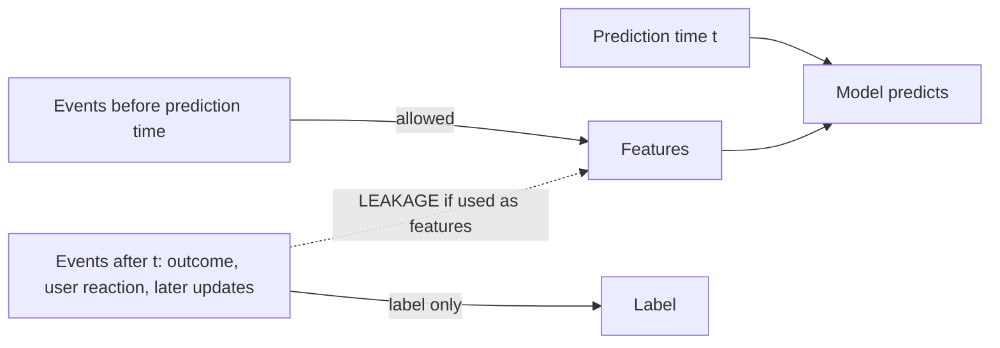
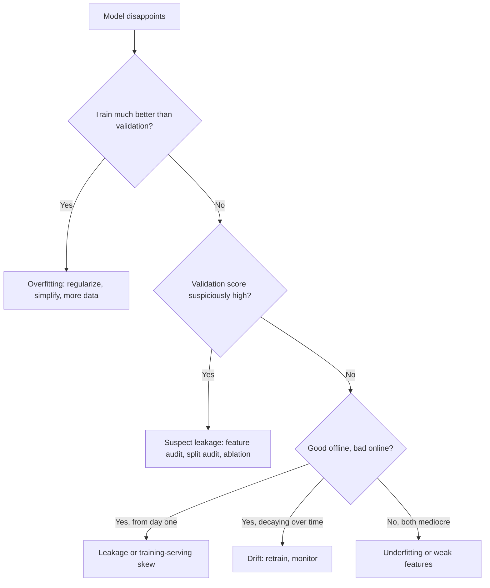

# Overfitting, Bias-Variance, Regularization and Data Leakage

> **Level:** Beginner to Advanced · **Study time:** ~150 min · **Prerequisites:** [The ML Workflow, Train/Validation/Test Splits and Cross-Validation](./01-ml-workflow-data-splits-and-cross-validation.md), [Linear and Logistic Regression from Scratch](./02-linear-and-logistic-regression.md), [Probability and Statistics for Machine Learning](../00-foundations/04-probability-and-statistics.md)

## Table of contents

- [Why this matters](#why-this-matters)
- [Generalization: the real goal](#generalization-the-real-goal)
- [Underfitting vs overfitting: a polynomial example](#underfitting-vs-overfitting-a-polynomial-example)
- [Learning curves and validation curves](#learning-curves-and-validation-curves)
- [The bias-variance trade-off](#the-bias-variance-trade-off)
- [Regularization: L1, L2 and elastic net](#regularization-l1-l2-and-elastic-net)
- [More ways to fight overfitting](#more-ways-to-fight-overfitting)
- [Data leakage: the silent killer](#data-leakage-the-silent-killer)
- [The six types of data leakage](#the-six-types-of-data-leakage)
- [Choosing a split: random, stratified, grouped or time-based](#choosing-a-split-random-stratified-grouped-or-time-based)
- [Preprocessing leakage and pipelines](#preprocessing-leakage-and-pipelines)
- [Detecting leakage](#detecting-leakage)
- [Overfitting vs leakage: telling them apart](#overfitting-vs-leakage-telling-them-apart)
- [Going deeper: leakage and generalization in production](#going-deeper-leakage-and-generalization-in-production)
- [Prevention checklist](#prevention-checklist)
- [Common mistakes and misconceptions](#common-mistakes-and-misconceptions)
- [Interview questions and model answers](#interview-questions-and-model-answers)
- [Key takeaways](#key-takeaways)
- [Further reading](#further-reading)
- [Next](#next)

## Why this matters

A model is only useful if it works on data it has never seen. Two things quietly break that promise: **overfitting**, where the model memorizes its training data instead of learning the pattern, and **data leakage**, where information the model will not have in production sneaks into training or evaluation and makes your offline numbers lie. Both are behind a huge share of real failures: the fraud model with 0.99 offline accuracy that catches nothing live, the medical imaging model that learned to recognize the hospital instead of the disease, the LLM benchmark score inflated because the test questions were in the training data. Interviewers love this topic because it separates people who can call `.fit()` from people who can ship a model that keeps working. By the end of this chapter you will be able to diagnose both problems from curves and metrics, fix them, and explain the difference crisply.

## Generalization: the real goal

> **Analogy:** A student preparing for an exam can either understand the material or memorize last year's answer sheet. Both score 100% on last year's exam. Only one passes this year's exam. Machine learning has exactly the same problem.

**Generalization** is a model's ability to perform well on new, unseen data drawn from the same source as its training data. Everything in this chapter is about measuring and protecting generalization.

A few terms we will use constantly (the splits themselves are covered in [the ML workflow chapter](./01-ml-workflow-data-splits-and-cross-validation.md)):

- **Training error**: the model's error on the data it was fitted on.
- **Validation error**: the error on held-out data used to make choices (which model, which settings).
- **Test error**: the error on held-out data touched only once, at the very end, to estimate real-world performance.
- **Generalization gap**: validation (or test) error minus training error. A small gap means the model behaves similarly on seen and unseen data.
- **Model capacity** (or complexity): how flexible a model is, meaning how many different patterns it can represent. A straight line has low capacity; a degree-15 polynomial or a deep neural network has high capacity.
- **Hyperparameter**: a setting you choose before training (polynomial degree, tree depth, regularization strength), as opposed to a **parameter** (a weight) that training learns.
- **Regularization**: any technique that discourages a model from fitting noise, most often a penalty on large weights. It gets its own section below.

We will measure error mostly with **mean squared error (MSE)**: the average of the squared differences between predictions and true values, $\text{MSE} = \frac{1}{n}\sum_{i=1}^{n}(y_i - \hat{y}_i)^2$. Regression metrics are covered in depth in [Regression Metrics, Baselines and Model Selection](./05-regression-metrics-baselines-and-model-selection.md).

## Underfitting vs overfitting: a polynomial example

### Intuition

- **Underfitting**: the model is too simple to capture the real pattern. It does badly on training data and badly on new data. Like summarizing a novel as "stuff happens".
- **Overfitting**: the model is so flexible that it fits the noise (random quirks) in the training data. It does great on training data and badly on new data. Like memorizing the answer sheet.
- **Good fit**: the model captures the real pattern and ignores the noise.

### The setup

This is the classic example from Bishop's *Pattern Recognition and Machine Learning* (2006). The true relationship is a smooth wave, $y = \sin(2\pi x)$, but every observation has a little random noise added. We get only 10 training points and fit polynomials of different **degree** (the highest power of $x$).

A degree-$d$ polynomial is:

$$\hat{y} = w_0 + w_1 x + w_2 x^2 + \dots + w_d x^d$$

- $\hat{y}$: the model's prediction.
- $x$: the input (one number here).
- $w_0, \dots, w_d$: the $d + 1$ weights the model learns.
- $d$: the degree, a hyperparameter controlling capacity.

Tiny numeric example: with $d = 2$ and weights $w_0 = 1, w_1 = 2, w_2 = -3$, the prediction at $x = 0.5$ is $1 + 2(0.5) - 3(0.5)^2 = 1 + 1 - 0.75 = 1.25$.

The key fact: a degree-9 polynomial has 10 weights. With 10 training points, it can pass **exactly** through every point, so its training error is zero, no matter how noisy the points are.

```text
 degree 1 (underfit)        degree 3 (good fit)        degree 9 (overfit)
  y                          y                          y
  |  o    o                  |   .-o-.                  |  o\   /o\
  | o  ------___             |  o     o                 | /  \ /   \   /o
  |----   o   ---___         | /       \     o          |/    o     \ / \
  |    o      o    ---o      |/         o   /           |           o    \o
  |              o     o     |           \_o_/          |                 \__ wild
  +-------------------- x    +-------------------- x    +-------------------- x
  misses the wave            follows the wave           hits every point, but
                                                        swings wildly between them
```

| Degree | Weights | Train MSE | Validation MSE | Diagnosis |
|---|---|---|---|---|
| 1 | 2 | ~0.20 | ~0.21 | Underfit: both errors high |
| 3 | 4 | ~0.01 | ~0.02 | Good fit: both low, small gap |
| 9 | 10 | ~0.00 | much larger (from ~0.1 to 1000+, depending on the noise draw) | Overfit: train perfect, validation terrible |

*All numbers are illustrative; they depend on the random noise. With noise standard deviation 0.1, the noise variance is $0.1^2 = 0.01$, so ~0.01 is the best MSE any model can achieve on new data.*

Notice the pattern: as capacity goes up, training error keeps falling (for nested least-squares models like these polynomials it can never rise), but validation error first falls and then rises.

### Code: from scratch with NumPy

```python
# pip install numpy
import numpy as np

rng = np.random.default_rng(0)

# 10 noisy training points from y = sin(2*pi*x), at random positions
x_train = rng.uniform(0, 1, size=10)
y_train = np.sin(2 * np.pi * x_train) + rng.normal(0, 0.1, size=10)

# 100 fresh validation points from the same process
x_val = rng.uniform(0, 1, size=100)
y_val = np.sin(2 * np.pi * x_val) + rng.normal(0, 0.1, size=100)

for degree in [1, 3, 9]:
    coefs = np.polyfit(x_train, y_train, deg=degree)      # least-squares fit
    train_mse = np.mean((np.polyval(coefs, x_train) - y_train) ** 2)
    val_mse = np.mean((np.polyval(coefs, x_val) - y_val) ** 2)
    print(f"degree={degree}: train MSE={train_mse:.4f}  val MSE={val_mse:.4f}")
# With seed 0: degree 1 ~0.20 / 0.31, degree 3 ~0.007 / 0.019, degree 9 ~0.0000 / 0.10.
# Degree 9 has essentially 0 train MSE and a val MSE ~5x worse than degree 3. How much
# worse is very seed-dependent: with other seeds it is often 100s or 1000s, because the
# interpolating curve swings wildly in gaps between training points and near the edges.
# (With evenly spaced x_train and this small noise the blow-up is much milder; try it.)
# (NumPy may print a RankWarning for very high degrees: the fit is ill-conditioned.)
```

### Code: scikit-learn with cross-validation

**Cross-validation (CV)** splits the data into $k$ folds, trains on $k-1$ and validates on the remaining one, rotating $k$ times (full treatment in [the workflow chapter](./01-ml-workflow-data-splits-and-cross-validation.md)). It gives a more stable estimate than a single split.

```python
# pip install scikit-learn numpy
import numpy as np
from sklearn.pipeline import make_pipeline
from sklearn.preprocessing import PolynomialFeatures
from sklearn.linear_model import LinearRegression
from sklearn.model_selection import cross_validate

rng = np.random.default_rng(0)
X = rng.uniform(0, 1, size=(30, 1))
y = np.sin(2 * np.pi * X[:, 0]) + rng.normal(0, 0.1, size=30)

for degree in [1, 3, 15]:
    model = make_pipeline(PolynomialFeatures(degree), LinearRegression())
    res = cross_validate(model, X, y, cv=5,
                         scoring="neg_mean_squared_error",
                         return_train_score=True)
    # sklearn maximizes scores, so MSE comes back negated
    print(degree, -res["train_score"].mean(), -res["test_score"].mean())
```

> **Common mistake:** Judging a model by its training error. Training error almost always improves with more capacity, so it tells you nothing about generalization on its own. Always compare it to validation error.

## Learning curves and validation curves

Two plots diagnose most fitting problems. Learn to read both.

### Validation curve: error vs model complexity

A **validation curve** plots training and validation error against a complexity hyperparameter (degree, tree depth, regularization strength).

```text
 error
   |
   | V                                          V    V = validation error
   |  V                                      V       T = training error
   | T  V                                 V
   |  T   V                            V
   |   T    V V                    V V
   |    T       V V V V V V V V V
   |     T              ^
   |       T            sweet spot (lowest validation error)
   |         T T
   |             T T T
   |                   T T T T
   |                           T T T T T T T T T
   +--------------------------------------------- complexity
     underfitting  |  just right  |  overfitting
```

You pick the complexity at the bottom of the validation curve. In scikit-learn, `sklearn.model_selection.validation_curve` computes this for you. If the hyperparameter is regularization strength, the picture is mirrored: a small penalty is the flexible (overfitting) end and a large penalty is the simple (underfitting) end.

### Learning curve: error vs training set size

A **learning curve** plots training and validation error against the number of training examples, with model complexity fixed. It answers a business-critical question: **will collecting more data help?** (The labels below use **high bias** for underfitting and **high variance** for overfitting; both terms are defined precisely in the next section.)

```text
  HIGH BIAS (underfitting)               HIGH VARIANCE (overfitting)
  error                                  error
   |                                      |\
   |\____                                 | \___
   |     \_____________ validation        |     \______
   |      ______________ training         |            \_______ validation
   |     /                                |                    (still falling)
   |    /     both high, gap small        |          ____----- training
   |   /      plateau above target        |    __----   big gap
   |  /                                   |  _/
   | /   - - - - - - - - - target         | /  - - - - - - - - - target
   +------------------------- n           +------------------------- n
  More data will NOT help.               More data WILL help (gap closes).
```

How to read them:

| What you see | Diagnosis | What helps | What does not help |
|---|---|---|---|
| Training and validation error both high, close together, flat | High bias (underfitting) | More capacity, better features, less regularization | More data |
| Training error low, validation error much higher, gap shrinking as $n$ grows | High variance (overfitting) | More data, regularization, simpler model, augmentation | More capacity |
| Both low and close | Good fit | Ship it (after a test-set check) | |
| Validation error *lower* than training error | Suspicious: possible leakage, a much easier validation set, or regularization like dropout active only at training time | Investigate the split | |
| Validation error noisy and jumpy | Validation set too small | Bigger validation set, CV, report variance | |

```python
# pip install scikit-learn numpy
import numpy as np
from sklearn.model_selection import learning_curve
from sklearn.pipeline import make_pipeline
from sklearn.preprocessing import PolynomialFeatures
from sklearn.linear_model import LinearRegression

rng = np.random.default_rng(0)
X = rng.uniform(0, 1, size=(300, 1))
y = np.sin(2 * np.pi * X[:, 0]) + rng.normal(0, 0.1, size=300)

model = make_pipeline(PolynomialFeatures(9), LinearRegression())
sizes, train_scores, val_scores = learning_curve(
    model, X, y, cv=5,
    train_sizes=np.linspace(0.1, 1.0, 5),
    scoring="neg_mean_squared_error",
)
for n, tr, va in zip(sizes, -train_scores.mean(axis=1), -val_scores.mean(axis=1)):
    print(f"n={n:4d}  train MSE={tr:.4f}  val MSE={va:.4f}")
# Expect: the gap between train and val MSE shrinks as n grows.
```

> **Interview tip:** When asked "your model is not good enough, what do you do?", start with "I'd plot learning curves to see whether it's a bias or a variance problem, because the fixes are opposite." That single sentence signals seniority.

## The bias-variance trade-off

### Intuition: the dartboard

> **Analogy:** Imagine training the same kind of model many times, each time on a different random training set from the same source, and throwing a dart (a prediction) for the same house each time. **Bias** is how far the center of your darts is from the bullseye. **Variance** is how spread out your darts are. A simple model throws a tight cluster in the wrong place (high bias, low variance). A very flexible model throws darts centered on the bullseye but scattered everywhere (low bias, high variance).

```text
   low bias, low variance    high bias, low variance
        .-----.                    .-----.
       /       \                  /  xxx  \
      |   xx    |                |   xx    |
      |   x+    |                |    +    |
       \       /                  \       /
        '-----'                    '-----'
   low bias, high variance   high bias, high variance
        .-----.                    .-----.
     x /   x   \                  / x   x \ x
      | x   +  x|                |x   +    |
      |  x    x |                |  x   x  |
       \x      /  x               \     x /
        '-----'                    '-----'
   (+ = true value, x = predictions from models trained on different datasets)
```

### Precise definitions

- **Bias**: the error from wrong assumptions in the model. It is the difference between the *average* prediction (over many possible training sets) and the true value. High bias means systematic underfitting.
- **Variance**: how much the model's prediction changes when it is trained on a different sample of data. High variance means the model is sensitive to the particular training set: overfitting.
- **Irreducible error** (noise): randomness in the data itself that no model can predict, like a house selling for a bit more because the buyer fell in love with the garden.

### The formula

For squared error, the expected error at a point $x$ decomposes exactly (Geman, Bienenstock and Doursat, "Neural Networks and the Bias/Variance Dilemma", 1992):

$$\mathbb{E}\big[(y - \hat{f}(x))^2\big] = \underbrace{\big(\mathbb{E}[\hat{f}(x)] - f(x)\big)^2}_{\text{Bias}^2} + \underbrace{\mathbb{E}\big[(\hat{f}(x) - \mathbb{E}[\hat{f}(x)])^2\big]}_{\text{Variance}} + \underbrace{\sigma^2}_{\text{Irreducible noise}}$$

- $x$: the input we predict for (one specific house).
- $y = f(x) + \varepsilon$: the observed target, the true function plus noise $\varepsilon$ with mean 0 and variance $\sigma^2$.
- $f(x)$: the true (unknown) value.
- $\hat{f}(x)$: our model's prediction. It is random because the training set is random.
- $\mathbb{E}[\cdot]$: the average over all possible training sets (and noise).
- $\mathbb{E}[\hat{f}(x)]$: the average prediction across those training sets, the "center of the darts".
- $\sigma^2$: the noise variance, a floor no model can beat.

### Worked example: three house-price models

The true price of a house is $f(x) = 300$ (thousand dollars). Noise variance $\sigma^2 = 100$ (a noise standard deviation of 10 thousand). We train each model on 5 different training sets and record its prediction for this house. All numbers are illustrative.

**Model A, straight line (simple):** predictions 270, 272, 268, 271, 269.

- Mean: $(270 + 272 + 268 + 271 + 269) / 5 = 1350 / 5 = 270$.
- Bias: $270 - 300 = -30$, so Bias$^2 = 900$.
- Deviations from the mean: $0, 2, -2, 1, -1$. Squares: $0, 4, 4, 1, 1$. Variance $= 10 / 5 = 2$.
- Expected error: $900 + 2 + 100 = 1002$.

**Model B, degree-15 polynomial (very flexible):** predictions 250, 340, 290, 330, 290.

- Mean: $1500 / 5 = 300$. Bias $= 0$, Bias$^2 = 0$.
- Deviations: $-50, 40, -10, 30, -10$. Squares: $2500, 1600, 100, 900, 100$. Variance $= 5200 / 5 = 1040$.
- Expected error: $0 + 1040 + 100 = 1140$.

**Model C, moderate complexity:** predictions 291, 301, 294, 298, 296.

- Mean: $1480 / 5 = 296$. Bias $= -4$, Bias$^2 = 16$.
- Deviations: $-5, 5, -2, 2, 0$. Squares: $25, 25, 4, 4, 0$. Variance $= 58 / 5 = 11.6$.
- Expected error: $16 + 11.6 + 100 = 127.6$.

Model C wins by accepting a little bias in exchange for a huge cut in variance. That is the trade-off in one example: **the best model is rarely the one with zero bias.**

```text
 error
   |
   | T                                         T      T = total error
   |  T                                      T        B = bias^2
   | B  T                                  T    V     V = variance
   |  B   T                              T    V
   |   B    T T                      T T    V
   |    B       T T T    best   T T       V
   |     B           T T T T T          V
   |       B              ^          V
   |         B            |       V
   |           B B               V
   |               B B      V V
   | V V V V V V V V  V B B B B B B B B B B
   +-------------------------------------------- complexity
     simple (high bias)            complex (high variance)
   (total error also includes the constant noise floor sigma^2)
```

### What moves bias and variance

| Knob | Bias | Variance |
|---|---|---|
| More model capacity (higher degree, deeper trees, bigger network) | Down | Up |
| Stronger regularization | Up | Down |
| More training data | Unchanged (roughly) | Down |
| Better, more informative features | Down | Can go either way |
| Bagging: training many models on bootstrap resamples (rows drawn with replacement) and averaging them (see [random forests](./06-decision-trees-random-forests-and-gradient-boosting.md)) | Roughly unchanged | Down |
| Boosting (sequentially correcting errors) | Down | Can go up if not regularized |
| Early stopping (stop training sooner) | Up | Down |

> **Senior insight:** The classical U-shaped curve is not the whole story for modern deep learning. Very large neural networks can fit random labels perfectly yet still generalize on real labels (Zhang et al., "Understanding Deep Learning Requires Rethinking Generalization", 2017), and test error can fall again after the point where the model can interpolate the training data (fit every training point exactly), a phenomenon called **double descent** (Belkin et al., "Reconciling Modern Machine-Learning Practice and the Classical Bias-Variance Trade-off", 2019; Nakkiran et al., "Deep Double Descent", 2019). The decomposition formula is still exactly true; what changes is how variance behaves as capacity grows, partly because the implicit regularization of SGD (together with explicit weight decay and architectural inductive biases) steers training toward simple solutions among the many that fit the data. Say this in an interview and you show you know where textbook intuition stops.

## Regularization: L1, L2 and elastic net

### Intuition

> **Analogy:** Regularization is a "complexity tax". The model can still use any weights it likes, but it pays a fee for big weights. It will only pay that fee when the weight buys a real reduction in error, so weights that exist only to chase noise get taxed away.

**Regularization** is any technique that discourages a model from fitting noise, usually by adding a penalty on the size of its weights to the loss function. The general form is:

$$\text{Loss}_{\text{total}}(\mathbf{w}) = \text{Loss}_{\text{data}}(\mathbf{w}) + \lambda \cdot \Omega(\mathbf{w})$$

- $\mathbf{w}$: the vector of model weights.
- $\text{Loss}_{\text{data}}$: how badly the model fits the training data (for example, sum of squared errors).
- $\Omega(\mathbf{w})$: the **penalty**, a number that grows as weights get bigger.
- $\lambda$ (lambda): the **regularization strength**, a hyperparameter. $\lambda = 0$ means no regularization; huge $\lambda$ forces all weights toward zero (a very simple, underfit model).

Why do big weights mean overfitting? Look back at the degree-9 polynomial: to swing through every noisy point, it needs enormous weights of opposite signs that nearly cancel. Penalizing big weights forbids those wild swings.

### L2 regularization (ridge regression, weight decay)

**L2 regularization** penalizes the sum of squared weights. Linear regression with L2 is called **ridge regression** (Hoerl and Kennard, 1970).

$$\text{Loss} = \sum_{i=1}^{n}(y_i - \hat{y}_i)^2 + \lambda \sum_{j=1}^{p} w_j^2$$

- $n$: number of training examples; $p$: number of features (weights).
- $y_i, \hat{y}_i$: true and predicted values for example $i$.
- $w_j$: the weight on feature $j$.
- $\lambda \sum w_j^2$: the L2 penalty. It is $\lambda$ times the squared **L2 norm** $\lVert\mathbf{w}\rVert_2^2$ (norms are covered in [linear algebra](../00-foundations/02-linear-algebra-for-ml.md)).

**Worked example (one feature, no intercept).** Houses with size $x$ (in hundreds of square meters) and price $y$ (in hundreds of thousands): $x = [1, 2, 3]$, $y = [2, 4, 6]$. The model is $\hat{y} = w x$.

Setting the derivative of the loss to zero (see [calculus](../00-foundations/03-calculus-and-gradients.md)):

$$\frac{d}{dw}\Big[\sum (y_i - w x_i)^2 + \lambda w^2\Big] = -2\sum x_i(y_i - w x_i) + 2\lambda w = 0 \;\Rightarrow\; w = \frac{\sum x_i y_i}{\sum x_i^2 + \lambda}$$

Compute the pieces:

- $\sum x_i y_i = 1 \cdot 2 + 2 \cdot 4 + 3 \cdot 6 = 2 + 8 + 18 = 28$.
- $\sum x_i^2 = 1 + 4 + 9 = 14$.

| $\lambda$ | Calculation | $w$ |
|---|---|---|
| 0 | $28 / (14 + 0)$ | 2.00 |
| 2 | $28 / (14 + 2) = 28 / 16$ | 1.75 |
| 14 | $28 / (14 + 14) = 28 / 28$ | 1.00 |
| 1000 | $28 / 1014$ | ~0.028 |

The weight shrinks smoothly toward zero as $\lambda$ grows, **but never reaches exactly zero**. That is the signature of L2.

**L2 as weight decay.** In gradient descent, the penalty's gradient is $\frac{d}{dw}(\lambda w^2) = 2\lambda w$. The update becomes:

$$w \leftarrow w - \eta\big(\nabla_w \text{Loss}_{\text{data}} + 2\lambda w\big) = (1 - 2\eta\lambda)\,w - \eta\,\nabla_w \text{Loss}_{\text{data}}$$

- $\eta$ (eta): the learning rate.
- $(1 - 2\eta\lambda)$: a factor slightly below 1 that shrinks ("decays") every weight each step.

Example: $\eta = 0.1$, $\lambda = 0.5$ gives $1 - 2(0.1)(0.5) = 1 - 0.1 = 0.9$, so every step first multiplies each weight by 0.9 and then applies the data gradient. This is why L2 is called **weight decay** in deep learning. (For adaptive optimizers like Adam, adding L2 to the loss and decaying weights directly are *not* equivalent; that is why AdamW exists. See [Optimizers](../02-deep-learning/03-optimizers-sgd-momentum-adam-and-learning-rate-schedules.md).)

### L1 regularization (lasso) and sparsity

**L1 regularization** penalizes the sum of absolute weights. Linear regression with L1 is the **lasso** (Tibshirani, "Regression Shrinkage and Selection via the Lasso", 1996).

$$\text{Loss} = \sum_{i=1}^{n}(y_i - \hat{y}_i)^2 + \lambda \sum_{j=1}^{p} |w_j|$$

- $|w_j|$: the absolute value of weight $j$; $\sum |w_j| = \lVert\mathbf{w}\rVert_1$, the **L1 norm**.

The big difference: L1 drives many weights to **exactly zero**, producing a **sparse** model (one where most weights are zero). That makes L1 a built-in **feature selection** method.

**Worked example (same data).** For $w > 0$, the derivative is $-2\sum x_i y_i + 2w\sum x_i^2 + \lambda = 0$, giving:

$$w = \max\!\Big(0,\; \frac{\sum x_i y_i - \lambda/2}{\sum x_i^2}\Big)$$

This is called **soft thresholding**: subtract a fixed amount, and clamp at zero.

| $\lambda$ | Calculation | $w$ |
|---|---|---|
| 0 | $(28 - 0) / 14$ | 2.00 |
| 14 | $(28 - 7) / 14 = 21 / 14$ | 1.50 |
| 56 | $(28 - 28) / 14$ | 0 (exactly) |
| 100 | $(28 - 50) / 14 < 0$, clamp | 0 (exactly) |

Once $\lambda/2 \geq \sum x_i y_i$, the feature is switched off entirely.

**Why L1 zeroes weights and L2 does not: the gradient view.** Compare the penalty's push on a big weight ($w = 3$) and a small weight ($w = 0.1$) with $\lambda = 0.5$:

| Penalty | Gradient formula | Push on $w = 3$ | Push on $w = 0.1$ |
|---|---|---|---|
| L2 | $2\lambda w$ | $2(0.5)(3) = 3.0$ | $2(0.5)(0.1) = 0.1$ |
| L1 | $\lambda \cdot \text{sign}(w)$ | $0.5$ | $0.5$ |

L2's push fades as a weight gets small, so small weights linger near zero forever. L1 pushes with constant force all the way to zero, so unhelpful weights get there and stay.

### Geometric intuition

An equivalent way to view regularization: minimize the data loss **subject to** the weights staying inside a budget region. For two weights $(w_1, w_2)$:

- L2 budget: $w_1^2 + w_2^2 \leq t$, a **circle**.
- L1 budget: $|w_1| + |w_2| \leq t$, a **diamond** with corners on the axes.

The data loss has elliptical contour lines centered on the unregularized best solution. The regularized solution is where the smallest ellipse first touches the budget region.

```text
          L1: diamond                            L2: circle

             w2                                     w2
             |                                      |   X <- loss ellipse
             X <- loss ellipse                   .--+-'.    touches here
            /|\    touches here                /    |    \
           / | \                              |     |     |
   -------<--+-->------- w1          ---------+-----+-----+------- w1
           \ | /                              |     |     |
            \|/                                \    |    /
             |                                  '--.+.--'
             |                                      |

   Contact at a corner on the w2 axis:      Contact on the smooth curve, off
   w1 = 0 exactly (sparse). Corners         the axes: w1 and w2 both small
   stick out, so they are usually hit       but nonzero. A circle has no
   first.                                   corners to favor.
```

In high dimensions the diamond has many corners and edges lying on axes, so the lasso solution typically has many exact zeros.

### Elastic net

**Elastic net** (Zou and Hastie, "Regularization and Variable Selection via the Elastic Net", 2005) combines both:

$$\text{Loss} = \sum_{i}(y_i - \hat{y}_i)^2 + \lambda_1 \sum_j |w_j| + \lambda_2 \sum_j w_j^2$$

- $\lambda_1$: L1 strength (sparsity).
- $\lambda_2$: L2 strength (smooth shrinkage, stability).

Why bother? Lasso has a weakness with **correlated features** (features that move together, like "square meters" and "number of rooms"). It tends to pick one somewhat arbitrarily and zero the others, and the pick can flip between training runs. Elastic net's L2 part makes correlated features share weight (a "grouping effect") while the L1 part still removes useless ones.

scikit-learn parameterizes it with an overall strength `alpha` ($\alpha$) and a mix `l1_ratio` ($\rho$):

$$\frac{1}{2n}\lVert \mathbf{y} - X\mathbf{w}\rVert_2^2 + \alpha\rho\lVert\mathbf{w}\rVert_1 + \frac{\alpha(1-\rho)}{2}\lVert\mathbf{w}\rVert_2^2$$

Worked example: $\alpha = 1$, $\rho = 0.5$, $\mathbf{w} = [3, 0.1]$.

- $\lVert\mathbf{w}\rVert_1 = 3 + 0.1 = 3.1$, so the L1 term is $1 \times 0.5 \times 3.1 = 1.55$.
- $\lVert\mathbf{w}\rVert_2^2 = 9 + 0.01 = 9.01$, so the L2 term is $\frac{1 \times 0.5}{2} \times 9.01 = 0.25 \times 9.01 = 2.2525$.
- Total penalty: $1.55 + 2.2525 = 3.8025$.

> **Common mistake:** Assuming $\lambda$ means the same thing across libraries. Ridge in scikit-learn uses the raw sum of squared errors, Lasso and ElasticNet divide it by $2n$, and `LogisticRegression` uses `C`, the **inverse** of regularization strength (smaller `C` = stronger regularization). Always check the docs before transferring a value.

### Comparison table

| | L2 (ridge) | L1 (lasso) | Elastic net |
|---|---|---|---|
| Penalty | $\lambda\sum w_j^2$ | $\lambda\sum \lvert w_j\rvert$ | both |
| Effect on weights | Shrinks all smoothly, rarely exactly zero | Many exactly zero (sparse) | Sparse, but correlated features share weight |
| Geometry | Circle / sphere | Diamond / cross-polytope | Rounded diamond |
| Feature selection | No | Yes | Yes |
| Correlated features | Spreads weight across them (stable) | Picks one, unstable | Groups them (stable) |
| Closed form | Yes (for linear regression) | No (coordinate descent) | No |
| Use when | Many small useful effects; default choice | You expect few relevant features; want interpretability | Many correlated features, $p \gg n$ (genomics, text) |

### Regularization in practice

Three rules matter more than the formulas:

1. **Scale your features first.** The penalty treats all weights equally, but a feature measured in meters needs a weight 1000 times bigger than the same feature in millimeters. Without **standardization** (subtract mean, divide by standard deviation), regularization punishes features based on their units. Tree models do not need this; linear models and neural nets do.
2. **Do not penalize the intercept** ($w_0$). It just sets the average level. Libraries handle this for you.
3. **Tune $\lambda$ with cross-validation**, never on the test set, and fit the scaler *inside* the CV loop (we will see why in the leakage section).

```python
# pip install scikit-learn numpy
import numpy as np
from sklearn.pipeline import make_pipeline
from sklearn.preprocessing import StandardScaler
from sklearn.linear_model import RidgeCV, LassoCV, ElasticNetCV

rng = np.random.default_rng(0)
n, p = 200, 50
X = rng.normal(size=(n, p))
true_w = np.zeros(p)
true_w[:5] = [3, -2, 1.5, 1, -1]            # only 5 features truly matter
y = X @ true_w + rng.normal(0, 1.0, size=n)

alphas = np.logspace(-3, 2, 30)
ridge = make_pipeline(StandardScaler(), RidgeCV(alphas=alphas)).fit(X, y)
lasso = make_pipeline(StandardScaler(), LassoCV(alphas=alphas, cv=5)).fit(X, y)
enet = make_pipeline(StandardScaler(),
                     ElasticNetCV(l1_ratio=[0.2, 0.5, 0.8], cv=5)).fit(X, y)

for name, m in [("ridge", ridge), ("lasso", lasso), ("enet", enet)]:
    coef = m[-1].coef_
    print(f"{name:5s} best alpha={m[-1].alpha_:.4f} "
          f"nonzero weights={np.sum(np.abs(coef) > 1e-8)} / {p}")
# Expect: ridge keeps all 50 weights nonzero; lasso and elastic net set many
# of the 45 useless features to exactly zero (how many depends on the chosen alpha).
```

For classifiers: `LogisticRegression(C=...)` in scikit-learn applies L2 by default; tune `C` with `LogisticRegressionCV` or `GridSearchCV`. The way you request L1 or elastic net for logistic regression has changed across scikit-learn versions (the `penalty` and `l1_ratio` arguments and compatible solvers), so check the documentation for your installed version.

## More ways to fight overfitting

Weight penalties are one tool. Here is the full toolbox.

| Technique | How it reduces variance | Cost / trade-off | Typical use |
|---|---|---|---|
| More (real) data | Harder to memorize; noise averages out | Data collection and labeling cost | Always the best fix when feasible |
| Simpler model | Lower capacity | May underfit | Small datasets, need for interpretability |
| Feature selection | Fewer weights to fit noise | Risk dropping useful signal; must be done inside CV | Many irrelevant features |
| L1 / L2 / elastic net | Penalize large weights | Adds a hyperparameter | Linear models, neural nets (weight decay) |
| Early stopping | Limits how far training can go | Needs a validation set; one more choice | Neural nets, gradient boosting |
| Data augmentation | Creates realistic variations of training data | Must preserve labels; domain knowledge | Images, audio, text |
| Ensembling (bagging) | Averages away individual models' variance | More compute at inference | Random forests, model averaging |
| Dropout | Randomly disables neurons during training | Slower convergence | Neural networks |
| Tree constraints (max depth, min samples per leaf) | Limits how finely trees split | May underfit | Decision trees, boosting |

### Early stopping

> **Analogy:** Baking bread. Take it out too early and it is raw (underfit); too late and it burns (overfit). Early stopping means checking the oven regularly and pulling the bread out when it looks best.

**Early stopping**: monitor validation loss during iterative training and stop when it has not improved for a set number of steps (the **patience**), then restore the best weights seen. Training error keeps falling, but past some point the model starts fitting noise and validation error rises.

```text
 loss
   |\
   | \.                         validation loss
   |   \.                 ...'''''''
   |     '..        ..''''
   |        ''....''   ^ best epoch: stop here, restore these weights
   |  \            |<-- patience -->|
   |   '-.__
   |        '''---.......______ training loss
   +------------------------------------------- epochs
```

Why it regularizes: gradient descent starting from small weights first learns the strong, simple patterns and only later grows the large weights needed to fit noise. Stopping early keeps weights small; for linear models trained with gradient descent, early stopping behaves approximately like L2 regularization (Goodfellow, Bengio and Courville, *Deep Learning*, 2016, section 7.8).

From scratch, on the degree-9 polynomial features:

```python
# pip install numpy
import numpy as np

rng = np.random.default_rng(0)
x = rng.uniform(0, 1, 40)
y = np.sin(2 * np.pi * x) + rng.normal(0, 0.1, 40)
X = np.vander(x, 10, increasing=True)          # columns: 1, x, x^2, ..., x^9
X_tr, y_tr, X_va, y_va = X[:10], y[:10], X[10:], y[10:]   # 10 train (easy to overfit), 30 val

w = np.zeros(10)
lr, patience = 0.1, 500
best_val, best_w, best_epoch, bad = np.inf, w.copy(), 0, 0

for epoch in range(50_000):
    grad = 2 * X_tr.T @ (X_tr @ w - y_tr) / len(y_tr)   # gradient of train MSE
    w -= lr * grad
    val_mse = np.mean((X_va @ w - y_va) ** 2)
    if val_mse < best_val - 1e-7:                         # meaningful improvement
        best_val, best_w, best_epoch, bad = val_mse, w.copy(), epoch, 0
    else:
        bad += 1
        if bad >= patience:                               # ran out of patience
            break

print(f"stopped at epoch {epoch}, best epoch {best_epoch}, best val MSE {best_val:.4f}")
w = best_w                                                # restore best weights
# With seed 0: stopped at epoch 3476, best epoch 2976, best val MSE ~0.104.
# Whether and when patience runs out depends on the data draw: plain gradient descent on
# raw polynomial features is ill-conditioned and fits slowly (itself a form of implicit
# regularization), so with more training points it may simply run to the epoch budget.
```

Library versions: `HistGradientBoostingClassifier(early_stopping=True)`, `MLPClassifier(early_stopping=True)` and `SGDRegressor(early_stopping=True, n_iter_no_change=5)` in scikit-learn; `early_stopping_rounds` in XGBoost and LightGBM (exact argument placement varies by version); an `EarlyStopping` callback in Keras and PyTorch Lightning.

> **Common mistake:** Using the test set for early stopping. The stopping point is a choice made by looking at that data, so that set becomes a validation set, and your "test" score is now optimistically biased.

### More data and simpler models

More data is the most reliable cure for variance, but only if the learning curve says you are variance-limited. Synthetic data and augmentation help when they reflect variation you will see in production (flipped photos of cats are still cats; a flipped "6" is a "9"). Simpler models (fewer features, shallower trees, a linear model before a deep net) are underrated: they are cheaper, faster, easier to debug and often only slightly worse.

### Dropout (preview)

**Dropout** (Srivastava et al., "Dropout: A Simple Way to Prevent Neural Networks from Overfitting", 2014) randomly sets a fraction $p$ of a layer's activations to zero at each training step, scaling the survivors by $1/(1-p)$ so the expected value is unchanged (with $p = 0.5$, an activation of 2.0 becomes either 0 or 4.0, averaging 2.0). At inference, dropout is turned off. This "inverted dropout" is what modern frameworks implement; the original paper instead left training activations unscaled and multiplied the weights by the keep probability $1-p$ at test time, which is equivalent in expectation. Neurons cannot rely on specific partners, so the network learns redundant, robust features; it behaves somewhat like training and averaging many thinned networks. Dropout, weight decay, label smoothing and how to debug neural network training are covered in [Regularization and Debugging Neural Network Training](../02-deep-learning/06-regularization-and-debugging-neural-network-training.md).

## Data leakage: the silent killer

> **Analogy:** A student who gets the answer key the night before the exam. Their score is spectacular and completely meaningless. Worse, nobody notices until they face a real problem without the key.

**Data leakage** is when information that would not be available at prediction time in production is used during training or evaluation, making offline performance estimates unrealistically optimistic.

Two things make leakage more dangerous than overfitting:

1. **It is invisible offline.** Overfitting shows up as a train-validation gap. Leakage makes the validation score *look great*, because the validation set is contaminated too.
2. **Regularization does not fix it.** A leaky feature is genuinely predictive in your dataset; regularization will happily keep it.

The single most useful question for spotting leakage:

> **For every feature and every evaluation example: at the exact moment the model makes this prediction in production, would this information exist, and would the model have it?**

We define a **prediction time** (or cutoff time) for each example: the moment the model is called. Anything known only after that moment is off-limits.



## The six types of data leakage

We will use two running examples: a **spam filter** (predict whether an incoming email is spam) and a **house-price model** (predict sale price when a house is listed).

### 1. Target leakage

**Target leakage**: a feature that is a consequence of the target, or is computed from it, and would not be available at prediction time.

- Spam filter: the feature `user_reported_spam_count` (how many users clicked "report spam" on this email). It is extremely predictive and only exists *after* the email has been delivered and judged by humans.
- House prices: `price_per_sqft`, computed from the sale price. Or `property_tax_assessment` updated after the sale.
- Churn: `account_closed_date` is not null. Medicine: "received antibiotic" when predicting infection (the treatment follows the diagnosis).

Fix: for every feature, document when it becomes known relative to prediction time; drop or recompute features that come later.

### 2. Train-test contamination

**Train-test contamination**: test (or validation) examples, or information derived from them, influence training.

- The same rows appear in both train and test (for example, a dataset concatenated twice by mistake).
- **Oversampling** (duplicating or synthesizing minority-class examples, for example SMOTE) done *before* splitting, so copies or interpolations of test points end up in training. See [Classification Metrics and Imbalanced Data](./04-classification-metrics-and-imbalanced-data.md).
- Data augmentation applied before splitting, so a rotated photo is in train and the original in test.
- Tuning hyperparameters on the test set (a subtle version: the test set now influenced model choice).

Fix: split first, then do everything else using training data only.

### 3. Temporal leakage

**Temporal leakage**: using information from the future relative to the prediction time, usually by ignoring time when splitting or building features.

- A random split of house sales from 2015 to 2024 trains on 2024 sales and tests on 2019 sales. The model learns "the market went up" from the future. In production you predict 2025 with nothing from 2025.
- A feature like "average sale price in this neighborhood" computed over the *whole* dataset includes sales that happened after the house being predicted.
- A centered rolling average (window covers both past and future days) in a time series.

Fix: split by time (train on the past, test on the future), and build features with **point-in-time correctness**: each row's features use only data with timestamps strictly before its prediction time.

### 4. Preprocessing leakage

**Preprocessing leakage**: fitting a data transformation (scaler, imputer, encoder, feature selector, PCA, vocabulary) on the full dataset before splitting, so statistics of the validation/test data shape the training inputs.

- `StandardScaler().fit(X_all)`: the mean and standard deviation include test rows.
- Imputing missing values with the global median.
- **Target encoding** (replacing a category with the average target for that category) computed on all rows, including the row's own label. This one is severe: it directly copies label information into features. See [Feature Engineering](./07-feature-engineering-missing-values-and-encoding.md) for out-of-fold target encoding.
- Feature selection on all data (we will demonstrate how dramatic this is below).

Fix: put every fitted transformation inside a pipeline that is fit only on training folds.

### 5. Duplicate and near-duplicate leakage

**Duplicate leakage**: identical or nearly identical examples appear on both sides of the split, so the test measures memorization, not generalization.

- Spam campaigns send thousands of almost identical emails ("Win a FREE prize now!!" vs "Win a free prize today"). A random split puts siblings in both train and test.
- Image datasets with the same photo resized, re-encoded or slightly cropped.
- Fine-tuning a 7B model on customer-support tickets where the evaluation set was sampled from the same ticket dump, including re-opened and copy-pasted tickets.
- LLM benchmark **contamination**: test questions present in web-scale pretraining data. See [Catastrophic Forgetting, Data Contamination and Memorization](../05-llms/09-catastrophic-forgetting-contamination-and-memorization.md).

Fix: deduplicate before splitting (exact hashes for exact copies, MinHash, perceptual hashes or embeddings for near copies), or group near-duplicates and split by group.

### 6. Group leakage

**Group leakage**: examples are not independent because several belong to the same entity (patient, user, sender, device, house), and a random split puts the same entity in both train and test. The model learns to recognize the entity rather than the general pattern.

- Medical imaging: one patient contributes 20 X-rays. The model learns that patient's anatomy, implant or scanner artifact, then "recognizes" them in test.
- Spam: one sender sends 500 emails. The model memorizes the sender's signature.
- House prices: the same house sold three times in ten years.

Fix: split by group (all of a patient's data goes to train or all to test) with `GroupKFold` or `GroupShuffleSplit`. The deciding question is: **in production, will the model see new entities?** If yes, evaluate on unseen entities.

### Summary table

| Type | What leaks | Example | Prevention |
|---|---|---|---|
| Target leakage | Label-derived or post-outcome feature | `user_reported_spam_count`, `price_per_sqft` | Feature timestamp audit; "known at prediction time?" |
| Train-test contamination | Test rows or their copies into training | Oversampling or augmenting before split | Split first; process after |
| Temporal | Future information | Random split of time-ordered data; full-history aggregates | Time-based splits; point-in-time features |
| Preprocessing | Test-set statistics | Scaler, imputer, target encoder fit on all data | Pipelines fit inside each fold |
| Duplicate / near-duplicate | Same content on both sides | Spam campaign copies | Dedupe before split; group near-dups |
| Group | Same entity on both sides | Same patient in train and test | Group-aware splits |

## Choosing a split: random, stratified, grouped or time-based

The validation scheme must **mimic how the model will be used in production**. That one principle decides everything. (Mechanics of holdout and k-fold CV are in [the workflow chapter](./01-ml-workflow-data-splits-and-cross-validation.md).)

| Split | What it does | Use when | Pitfall it prevents | scikit-learn |
|---|---|---|---|---|
| Random | Shuffles rows, assigns at random | Rows are independent and identically distributed (i.i.d.), no time order, no groups | (baseline) | `KFold(shuffle=True)`, `train_test_split` |
| Stratified | Keeps the class proportions equal in every fold | Classification, especially imbalanced (1% fraud) or small data | A fold with almost no positives; noisy metrics | `StratifiedKFold`, `train_test_split(stratify=y)` |
| Grouped | Keeps every group entirely in one fold | Multiple rows per patient, user, sender, device, session | Group leakage | `GroupKFold`, `GroupShuffleSplit`, `StratifiedGroupKFold` |
| Time-based | Train on the past, validate on the future, folds move forward in time | Forecasting, anything where production predicts the future (fraud, churn, demand, prices) | Temporal leakage; also measures robustness to drift | `TimeSeriesSplit` (with `gap`) |

Combinations are common: grouped plus stratified (`StratifiedGroupKFold`), or time-based plus grouped (new users in the future period).

```text
 Time-based, expanding window (TimeSeriesSplit), with a gap:

 fold 1: [train train train]  gap  [val]
 fold 2: [train train train train train]  gap  [val]
 fold 3: [train train train train train train train]  gap  [val]
         |------------------------- time ------------------------->

 Grouped (GroupKFold): patient IDs never straddle the line
 fold 1:  train = {P1, P2, P3, P5}   val = {P4}
 fold 2:  train = {P1, P3, P4, P5}   val = {P2}
```

The **gap** (also called an embargo) leaves a buffer between training and validation periods. You need it when labels take time to become known (a chargeback arrives 60 days after a transaction) or when features use rolling windows that would otherwise overlap the validation period. Financial ML formalizes this as purging (dropping training rows whose label windows overlap the validation period) and embargo (López de Prado, *Advances in Financial Machine Learning*, 2018).

```python
# pip install scikit-learn numpy
import numpy as np
from sklearn.model_selection import GroupKFold, StratifiedKFold, TimeSeriesSplit

X = np.arange(20).reshape(-1, 1)
y = np.array([0, 1] * 10)
patient_ids = np.repeat([1, 2, 3, 4, 5], 4)           # 5 patients, 4 rows each

# Grouped: no patient appears in both train and validation
for tr, va in GroupKFold(n_splits=5).split(X, y, groups=patient_ids):
    assert set(patient_ids[tr]).isdisjoint(patient_ids[va])

# Stratified: each fold keeps the 50/50 class ratio
for tr, va in StratifiedKFold(n_splits=5, shuffle=True, random_state=0).split(X, y):
    print("val positive rate:", y[va].mean())          # 0.5 for every fold

# Time-based: rows must be sorted by time; gap=2 skips 2 rows between train and val
for tr, va in TimeSeriesSplit(n_splits=3, gap=2).split(X):
    print(f"train rows {tr.min()}-{tr.max()}  val rows {va.min()}-{va.max()}")
```

> **Senior insight:** If your production model predicts the future, a random split usually *overestimates* performance even without any leaky feature, because it hides **drift** (the input distribution, or the relationship between inputs and label, changing over time). A time-based split tells you what accuracy to expect next month and, combined with a backtest over several periods, how fast performance decays (useful for choosing a retraining cadence; see [Data Drift, Concept Drift and When to Retrain](./08-data-drift-concept-drift-and-retraining.md)).

## Preprocessing leakage and pipelines

### Why preprocessing must be fit only on training data

Every transformation with a `.fit()` step learns statistics from data: a mean, a standard deviation, a vocabulary, a median, category averages, which features correlate with the label. If those statistics come from the validation or test rows, then the "unseen" data has already influenced the model's inputs. In production, the scaler will only ever have been fit on historical training data; your evaluation must reproduce that situation exactly.

The size of the error depends on the transform:

- **Scaling or imputation on all data**: usually a small optimistic bias, bigger with small datasets or shifted test data.
- **Target encoding or feature selection on all data**: can be enormous, because the transform uses the labels.

Worked micro-example: training house sizes are $[100, 120, 140]$ square meters; one test house is $400$.

- Fit on train only: mean $= (100 + 120 + 140) / 3 = 360 / 3 = 120$. The test house is far above the mean, as it would be in production.
- Fit on all four: mean $= (100 + 120 + 140 + 400) / 4 = 760 / 4 = 190$. The training data is now centered using a statistic that "knows" an unusually large house is coming. The model trains on inputs it would never have had in production.

### Wrong vs right

```python
# pip install scikit-learn numpy
from sklearn.datasets import make_classification
from sklearn.model_selection import train_test_split, cross_val_score
from sklearn.preprocessing import StandardScaler
from sklearn.impute import SimpleImputer
from sklearn.linear_model import LogisticRegression
from sklearn.pipeline import make_pipeline

X, y = make_classification(n_samples=500, n_features=20, random_state=0)

# WRONG: statistics computed on all rows, then split
X_scaled = StandardScaler().fit_transform(X)
X_tr, X_te, y_tr, y_te = train_test_split(X_scaled, y, random_state=0)

# RIGHT: split first; the pipeline fits imputer + scaler on training data only
X_tr, X_te, y_tr, y_te = train_test_split(X, y, random_state=0, stratify=y)
pipe = make_pipeline(SimpleImputer(strategy="median"),
                     StandardScaler(),
                     LogisticRegression(max_iter=1000))
pipe.fit(X_tr, y_tr)                       # fit learns medians/means from X_tr only
print("test accuracy:", pipe.score(X_te, y_te))

# RIGHT with CV: cross_val_score refits the whole pipeline inside each fold
print("cv accuracy:", cross_val_score(pipe, X_tr, y_tr, cv=5).mean())
```

The pipeline is also what you deploy, which removes a whole class of **training-serving skew** (preprocessing in production differing from preprocessing in training; see [Reproducible Training and Training-Serving Skew](../10-mlops/03-reproducibility-and-training-serving-skew.md)).

### A dramatic demonstration: feature selection on noise

This is the "wrong way to do cross-validation" from Hastie, Tibshirani and Friedman's *The Elements of Statistical Learning* (section 7.10.2). The labels are pure coin flips, so the true achievable accuracy is 50%.

```python
# pip install scikit-learn numpy
import numpy as np
from sklearn.feature_selection import SelectKBest, f_classif
from sklearn.linear_model import LogisticRegression
from sklearn.model_selection import cross_val_score
from sklearn.pipeline import make_pipeline

rng = np.random.default_rng(42)
X = rng.normal(size=(100, 10_000))        # 10,000 features of pure noise
y = rng.integers(0, 2, size=100)          # random labels: nothing to learn

# WRONG: pick the 20 features most correlated with y using ALL rows, then CV
X_sel = SelectKBest(f_classif, k=20).fit_transform(X, y)
wrong = cross_val_score(LogisticRegression(max_iter=1000), X_sel, y, cv=5).mean()

# RIGHT: selection happens inside each training fold
pipe = make_pipeline(SelectKBest(f_classif, k=20), LogisticRegression(max_iter=1000))
right = cross_val_score(pipe, X, y, cv=5).mean()

print(f"wrong CV accuracy: {wrong:.2f}")  # typically far above 0.5
print(f"right CV accuracy: {right:.2f}")  # close to 0.5, the truth
```

With 10,000 noise features, some will correlate with the random labels by chance *in this specific sample*, including the validation rows. Selecting them on all rows bakes the validation labels into the feature choice. This is also a useful **leakage test**: run your full pipeline on shuffled labels; anything well above chance means your pipeline leaks.

## Detecting leakage

Leakage rarely announces itself. These are the signals and tools, roughly from cheapest to most thorough.

### Signal 1: too-good-to-be-true metrics

Here **AUC** means the area under the ROC curve: 0.5 is random ranking, 1.0 is perfect (fully defined in [Classification Metrics](./04-classification-metrics-and-imbalanced-data.md)).

- Results far above published baselines, domain experts' intuition, or a simple model's score (a jump from 0.75 to 0.99 AUC by adding one feature).
- Near-perfect scores on a problem humans find hard (predicting next month's churn at 99%).
- Validation score higher than training score, or a test score better than validation.

> **Interview tip:** Say it plainly: "When a result looks too good, my first hypothesis is a bug or leakage, not a breakthrough."

### Signal 2: suspicious feature importance

**Feature importance** scores how much a model relies on each feature: tree-based importances, **permutation importance** (how much the validation score drops when one feature's values are shuffled), or **SHAP values** (per-prediction attributions of the output to each feature). Leakage often appears as **one feature dominating** everything, especially one with an innocent name: an ID, a timestamp, a "status" or "updated_at" column, a free-text notes field written after the outcome.

A quick scan: compute each feature's AUC against the label on its own. Any single feature that nearly separates the classes deserves a timestamp audit.

```python
# pip install scikit-learn pandas numpy
import pandas as pd
from sklearn.metrics import roc_auc_score

def single_feature_auc(df: pd.DataFrame, y) -> pd.Series:
    """AUC of each numeric column used alone as a score (direction-agnostic)."""
    out = {}
    for col in df.select_dtypes("number").columns:
        x = df[col].fillna(df[col].median())
        auc = roc_auc_score(y, x)
        out[col] = max(auc, 1 - auc)      # 0.2 is as informative as 0.8
    return pd.Series(out).sort_values(ascending=False)

# Usage: anything near 0.95+ on its own, in a hard problem, needs an explanation.
# print(single_feature_auc(train_df.drop(columns="label"), train_df["label"]).head(10))
```

Follow up with an **ablation**: retrain without the suspicious feature. If performance drops from 0.99 to a believable 0.80, you have found your likely leak.

### Signal 3: the offline/online gap

The model scores 0.95 offline and 0.70 in production (or in an A/B test). Leakage is a prime suspect, alongside training-serving skew and drift. A useful triage:

| Check | If true, suspect |
|---|---|
| Gap appears immediately at launch | Leakage or training-serving skew |
| Gap grows gradually over weeks | Drift |
| A feature's production distribution differs from training (for example, always null online) | Training-serving skew, or a feature that only exists after the fact |
| A time-based backtest already shows the low number | Your original random split leaked through time |

### Signal 4: split sanity checks

- **Overlap checks**: assert no shared IDs, groups, or exact-duplicate hashes between train and test.
- **Timestamp checks**: assert `max(train_time) < min(test_time)` for time-based problems, and that every feature timestamp is before its row's prediction time.
- **Adversarial validation**: train a classifier to distinguish training rows from test rows. AUC near 0.5 means the sets look alike; AUC near 1.0 means they differ systematically, and the features it uses (row IDs, timestamps, batch codes) reveal both drift and columns that secretly encode "when" or "who".

```python
# pip install scikit-learn pandas numpy
import numpy as np
import pandas as pd
from sklearn.ensemble import HistGradientBoostingClassifier
from sklearn.model_selection import cross_val_score

def adversarial_auc(train_df: pd.DataFrame, test_df: pd.DataFrame) -> float:
    """Numeric features only. ~0.5: indistinguishable. ~1.0: systematically different."""
    X = pd.concat([train_df, test_df], ignore_index=True)
    is_test = np.r_[np.zeros(len(train_df)), np.ones(len(test_df))]
    clf = HistGradientBoostingClassifier()   # handles missing values natively
    return cross_val_score(clf, X, is_test, cv=5, scoring="roc_auc").mean()
```

### Signal 5: duplicates and near-duplicates

Exact duplicates: hash a normalized version of each example. Near-duplicates: compare sets of words or **shingles** (overlapping chunks of $k$ words or characters) with the **Jaccard similarity**:

$$J(A, B) = \frac{|A \cap B|}{|A \cup B|}$$

- $A, B$: the sets of words (or shingles) in two documents.
- $|A \cap B|$: number of items in both. $|A \cup B|$: number of distinct items in either.

Worked example with two spam emails:

- Email 1: "win a free prize now" gives $A = \{\text{win, a, free, prize, now}\}$.
- Email 2: "win a free prize today" gives $B = \{\text{win, a, free, prize, today}\}$.
- Intersection: $\{\text{win, a, free, prize}\}$, size 4.
- Union: $\{\text{win, a, free, prize, now, today}\}$, size 6.
- $J = 4 / 6 \approx 0.67$. With a threshold like 0.5 (illustrative; tune it per domain), these are near-duplicates and belong in the same split.

```python
import hashlib
import re

def normalize(text: str) -> str:
    return re.sub(r"\s+", " ", text.lower()).strip()

def exact_hash(text: str) -> str:
    return hashlib.sha256(normalize(text).encode()).hexdigest()

def jaccard(a: str, b: str) -> float:
    A, B = set(normalize(a).split()), set(normalize(b).split())
    return len(A & B) / len(A | B) if A | B else 1.0

print(exact_hash("Win a FREE prize!") == exact_hash("win a free   prize!"))  # True
print(round(jaccard("win a free prize now", "win a free prize today"), 2))   # 0.67
```

Comparing every pair is $O(n^2)$, too slow for millions of documents. At scale, use **MinHash** (a compact signature whose collision rate estimates Jaccard similarity; Broder, "On the Resemblance and Containment of Documents", 1997) with **locality-sensitive hashing** (LSH: hashing that puts similar documents in the same bucket with high probability, so only same-bucket pairs are compared), available in libraries such as `datasketch`, perceptual hashes for images, or embedding similarity search (see [Text Embeddings and Similarity Search](../08-rag/02-text-embeddings-and-similarity-search.md)).

## Overfitting vs leakage: telling them apart

Both produce a model that disappoints on real data, but the symptoms and fixes are different.

| Signal | Overfitting | Leakage |
|---|---|---|
| Train vs validation gap | Large: train much better | Small: both look great |
| Validation score vs expectations | Normal or disappointing | Suspiciously high |
| Where the problem shows up | Offline, in your validation numbers | Only in production, or after fixing the split |
| Feature importance | Spread across many noisy features | One or a few features dominate |
| Regularization helps? | Yes | No (the leaky feature is genuinely predictive in your data) |
| More data helps? | Yes | No (more leaky data, same leak) |
| Shuffled-label test | Near chance | Can be above chance (pipeline leakage) |
| Fix | Reduce capacity, regularize, more data, early stopping | Remove the feature, fix the split, move preprocessing into the pipeline |



There is a hybrid: **overfitting to the validation set**. If you try hundreds of configurations and pick the best validation score, the winner is partly lucky. The validation score is now optimistic, which looks like leakage (the evaluation data influenced model choice) but is caused by repeated selection. The fix is a final untouched test set, or nested cross-validation (see the next section).

## Going deeper: leakage and generalization in production

### Point-in-time correctness and feature stores

In real systems, features come from tables that are constantly updated. If you build training data by joining the *current* `user_profile` table to historical transactions, every historical row sees today's values: a classic temporal leak. The fix is a **point-in-time join** (also called an "as-of" join): for each training example, use the feature values as they were at that example's prediction time.

```sql
-- For each prediction, count purchases in the 30 days BEFORE the prediction time
SELECT p.user_id,
       p.prediction_time,
       p.label,
       COUNT(e.event_id) AS purchases_last_30d
FROM predictions p
LEFT JOIN events e
  ON  e.user_id = p.user_id
  AND e.event_time <  p.prediction_time
  AND e.event_time >= p.prediction_time - INTERVAL '30 days'
GROUP BY p.user_id, p.prediction_time, p.label;
```

In pandas, `pd.merge_asof(..., direction="backward")` does the same for one latest value; note that by default it also matches rows with exactly the same timestamp (`allow_exact_matches=True`), so pass `allow_exact_matches=False` to get the strict "before prediction time" rule used in the SQL above. **Feature stores** (systems that serve the same feature definitions for training and online inference) exist largely to make point-in-time joins and train/serve consistency the default. Two subtle traps remain:

- **Late-arriving data**: an event with `event_time` before prediction time but *ingested* after it. Offline it looks available; online it was not. Filter on ingestion time (when the system knew the fact), not just event time.
- **Overwritten records**: a mutable `status` field that was later updated. Keep history (append-only logs, or slowly changing dimension tables that store every past version of a record with its validity dates) or you cannot reconstruct the past.

### Selection leakage, test-set reuse and nested CV

Every time you look at a test score and change something, information flows from the test set into your model. Over many iterations the test score becomes optimistic. This is called **adaptive overfitting**, studied formally under the name adaptive data analysis (Dwork et al., "The Reusable Holdout: Preserving Validity in Adaptive Data Analysis", 2015). At community scale, Recht et al. ("Do ImageNet Classifiers Generalize to ImageNet?", 2019) built a fresh ImageNet test set and found accuracy drops for all models they evaluated; interestingly, the ranking of models was largely preserved, which suggests the drop came mostly from distribution differences in the new set rather than from heavy test-set overfitting.

Practical defenses:

- Keep a final test set touched once per major decision; log every time it is used.
- Use **nested cross-validation** when you need an unbiased estimate while also tuning: an inner CV picks hyperparameters, an outer CV scores the whole tuning procedure.

```python
# pip install scikit-learn
from sklearn.datasets import make_classification
from sklearn.model_selection import GridSearchCV, cross_val_score
from sklearn.pipeline import make_pipeline
from sklearn.preprocessing import StandardScaler
from sklearn.linear_model import LogisticRegression

X, y = make_classification(n_samples=500, n_features=20, random_state=0)
pipe = make_pipeline(StandardScaler(), LogisticRegression(max_iter=1000))
inner = GridSearchCV(pipe, {"logisticregression__C": [0.01, 0.1, 1, 10]}, cv=5)
outer_scores = cross_val_score(inner, X, y, cv=5)   # tuning repeated in each outer fold
print("unbiased estimate of the tuned pipeline:", outer_scores.mean())
```

- Prefer fewer, more meaningful comparisons, and report variance across folds or seeds, not just one number.

### Leakage in LLM, RAG and agent systems

The same ideas reappear with new names:

- **Benchmark contamination**: public benchmark questions present in pretraining data inflate scores. Mitigations: held-out private evals, n-gram or embedding overlap checks, freshly written test items. See [Catastrophic Forgetting, Data Contamination and Memorization](../05-llms/09-catastrophic-forgetting-contamination-and-memorization.md).
- **Fine-tuning splits**: when fine-tuning a 7B model on support conversations, split by customer or by conversation thread (group leakage) and by date (temporal), and deduplicate templated replies first.
- **RAG evaluation**: tuning prompts, chunk sizes and retrievers on the same question set you report is selection leakage. Keep a separate held-out question set; also check that evaluation answers are not trivially copied from a single document the generator was tuned on. See [Evaluating RAG](../08-rag/10-rag-evaluation-metrics-and-ragas.md) and [Building an LLM Evaluation Framework](../05-llms/11-building-an-llm-evaluation-framework-and-regression-tests.md).
- **LLM-as-judge on its own outputs**: not leakage strictly, but a related evaluation bias. Covered in [Evaluating LLMs](../05-llms/10-llm-evaluation-metrics-and-llm-as-a-judge.md).

### What changes at scale

| Concern | Small project | Production at scale |
|---|---|---|
| Dedup | Exact hash in pandas | MinHash/LSH or embedding approximate-nearest-neighbor (ANN) search over billions of items; dedup before split is a pipeline stage |
| Splits | `train_test_split` | Versioned split manifests (which IDs are in which split), stored with the data version (see [Data and Model Versioning](../10-mlops/02-data-and-model-versioning-and-model-registry.md)) |
| Preprocessing | sklearn `Pipeline` | Same transformation code in training and serving, or a feature store; tested for parity |
| Leakage checks | Manual review | Automated CI checks: ID overlap, timestamp ordering, single-feature AUC alarms (see [CI/CD and Testing for ML Pipelines](../10-mlops/07-ci-cd-and-testing-for-ml-pipelines.md)) |
| Validation | Offline only | Offline, then shadow deployment (the new model scores live traffic but its outputs are not acted on) or canary deployment (it serves a small slice of real users) to measure the true online number (see [Model Deployment Patterns](../10-mlops/04-model-deployment-patterns.md)) |

Cost angle: leakage is expensive precisely because it is discovered late. A leaked model can pass offline review, consume weeks of integration work, and fail in an A/B test. A one-hour feature timestamp audit before training is the cheapest insurance in ML.

### Debugging playbook: "great offline, bad online"

1. **Reproduce the online number offline.** Log production inputs and outcomes, score them with the training-time model, compare.
2. **Compare feature distributions** between the training set and production logs, feature by feature. A feature that is never null offline but often null online is a red flag.
3. **Rebuild the evaluation with a time-based, group-aware split.** If the offline score collapses to the online number, the old split was leaking.
4. **Ablate top features one at a time.** A huge drop from removing one feature means it deserves a timestamp audit.
5. **Audit feature lineage**: for the top 10 features, write down exactly when each value becomes known relative to prediction time.
6. **Check preprocessing code paths**: training notebook vs serving service, same library versions, same fitted artifacts.

## Prevention checklist

Use this before trusting any offline number.

- [ ] **Define prediction time** for each example and write it down.
- [ ] **Audit every feature**: when does it become known? Is it derived from the label or from events after prediction time?
- [ ] **Deduplicate** exact and near-duplicate examples *before* splitting.
- [ ] **Choose the split to mimic production**: time-based if you predict the future, grouped if production sees new entities, stratified for imbalanced classes.
- [ ] **Split first.** Oversampling, augmentation, imputation, scaling, encoding, feature selection all happen after the split, on training data only.
- [ ] **Use pipelines** so every fitted step is refit inside each CV fold, and deploy the same pipeline.
- [ ] **Build features point-in-time correct**, using ingestion time where data can arrive late.
- [ ] **Tune on validation or inner CV**, keep a test set untouched until the end; use nested CV for small data.
- [ ] **Add automated assertions**: no ID/group overlap, train timestamps before test timestamps.
- [ ] **Sanity-check results**: compare against a simple baseline; investigate anything too good; run a shuffled-label test.
- [ ] **Inspect feature importance** and single-feature AUCs; ablate suspicious features.
- [ ] **Validate online** with shadow or canary deployment before full rollout, and monitor the offline/online gap.

## Common mistakes and misconceptions

- **"Low training error means a good model."** Training error is not a measure of generalization. Compare it with validation error.
- **"More data always helps."** Only for variance problems. A high-bias model plateaus; check the learning curve first.
- **"Regularization fixes leakage."** It does not. A leaky feature is genuinely predictive in the leaked data, so the model keeps it.
- **"L2 does feature selection."** L2 shrinks weights but almost never sets them exactly to zero. L1 and elastic net select features.
- **Regularizing unscaled features.** The penalty then depends on units, not importance.
- **Fitting the scaler, imputer, encoder or feature selector before splitting.** Classic preprocessing leakage; use a pipeline.
- **Oversampling (SMOTE) or augmenting before the split.** Copies of test examples land in training.
- **Random splits on time-ordered data.** Hides drift and leaks the future.
- **Random splits when there are repeated entities.** Patients, users, senders and devices must be grouped.
- **Using the test set for early stopping or tuning.** It silently becomes a validation set.
- **Celebrating a 0.99 AUC.** Treat it as a bug report until proven otherwise.
- **Assuming the bias-variance U-curve always holds.** Very large neural networks can show double descent; the decomposition is still true, the shape of the curve is not universal.
- **Treating `C` like `lambda`.** In scikit-learn's logistic regression, smaller `C` means *stronger* regularization.

## Interview questions and model answers

<details>
<summary><b>Q1. How do you detect and prevent overfitting and data leakage?</b></summary>

**Short answer:** I detect overfitting by comparing training and validation error, ideally with learning and validation curves: a large gap that shrinks with more data means high variance. I prevent it with regularization, simpler models, early stopping, more data and cross-validated hyperparameter tuning. Leakage is different: it hides offline, so I detect it through suspicious signs (too-good metrics, one dominant feature, offline/online gaps, overlap checks) and prevent it structurally: define prediction time, audit features, dedupe, split to mimic production, split first and fit all preprocessing inside pipelines.

**Deeper answer and follow-ups:**

- Overfitting detection: train vs validation curves; validation curve over complexity; learning curve over data size. Report CV mean and standard deviation, not one split.
- Overfitting prevention: L2/L1/elastic net, early stopping with patience and restored best weights, dropout and augmentation for neural nets, tree depth and min-leaf limits, bagging.
- Leakage detection: compare to a simple baseline and domain expectations; single-feature AUC scan; ablation of top features; ID, group and timestamp overlap assertions; adversarial validation; shuffled-label test for pipeline leaks; shadow deployment to measure the real number.
- Leakage prevention: the checklist in this chapter, automated in CI so it does not depend on memory.
- Trade-off: honest evaluation has a price. Grouped and time-based splits usually report lower scores (and early time folds train on less history), and strong regularization can tip into underfitting. Accept the lower, trustworthy number; the inflated one fails at launch.
- Production: both problems end up as an offline/online gap, so compare the live metric with the offline estimate after launch and alert when it diverges.
- Pitfall: thinking regularization addresses leakage. It cannot.

</details>

<details>
<summary><b>Q2. How do you distinguish overfitting from data leakage?</b></summary>

**Short answer:** Overfitting shows up offline as a large gap between training and validation performance; validation is honest but disappointing. Leakage shows up as a validation score that is suspiciously *good*, with a small train-validation gap, and the disappointment comes only in production or after fixing the split. Regularization and more data help overfitting; they do nothing for leakage, which requires removing the leaky feature or fixing the split or pipeline.

**Deeper answer and follow-ups:**

- Feature importance: overfitting spreads weight over noisy features; leakage concentrates it in one or two features, often IDs, timestamps or post-outcome fields.
- Timing: a gap present from launch day suggests leakage or training-serving skew; a gap that grows over weeks suggests drift.
- Test: rebuild evaluation with a time-based, group-aware split. If the score collapses toward the production number, it was leakage.
- Hybrid case: overfitting to the validation set through heavy tuning. The fix is an untouched test set or nested CV.
- They can coexist: a leaky model can also overfit. Fix leakage first, because it invalidates every other number you would use to tune capacity.
- Example: a spam model with 0.99 validation AUC that relies on `user_reported_spam_count` is leaking; a degree-15 polynomial with near-zero train error and huge validation error is overfitting.

</details>

<details>
<summary><b>Q3. When would you use random, stratified, grouped, or time-based splits?</b></summary>

**Short answer:** The split should mimic production. Random for independent rows with no time order or groups. Stratified for classification, especially imbalanced or small datasets, so every fold has the same class ratio. Grouped when several rows belong to the same patient, user or sender and production will see new entities. Time-based whenever production predicts the future: train on the past, validate on later periods, often with a gap.

**Deeper answer and follow-ups:**

- Stratified: with 1% fraud and 5 folds of 200 rows, a random fold could have 0 or 4 positives; stratifying keeps about 2 in each, making metrics stable.
- Grouped: `GroupKFold`, `GroupShuffleSplit`, `StratifiedGroupKFold`. Example: chest X-rays per patient, emails per sender.
- Time-based: `TimeSeriesSplit` with expanding or rolling windows; add a `gap` (embargo) when labels mature late (chargebacks) or features use rolling windows.
- Combine when needed: time-based outer split, grouped within it ("future periods, new customers").
- Random splits on temporal data overestimate performance by hiding drift; use backtests over several periods to estimate decay and retraining cadence.
- Failure modes: a few very large groups make grouped folds uneven and their scores noisy; too few time folds give a high-variance estimate; stratifying on the label does nothing about groups (use `StratifiedGroupKFold`).
- How to check the split: adversarial validation between your validation fold and recent production data. If a classifier separates them easily, your split does not resemble production.
- Pitfall: after a time-based split, still fit preprocessing on the training period only.

</details>

<details>
<summary><b>Q4. Why should preprocessing be fitted only on training data?</b></summary>

**Short answer:** Fitted preprocessing learns statistics from data: means, medians, vocabularies, category target averages, selected features. If those statistics include validation or test rows, the evaluation data has influenced the model, so the score no longer reflects production, where the transform is fit only on historical training data. The fix is to split first and wrap all fitted steps in a pipeline so they are refit inside every CV fold.

**Deeper answer and follow-ups:**

- Size of the effect: scaling and imputation leaks are usually small; target encoding and feature selection on all data can be huge because they use labels. In the classic noise demo (10,000 random features, random labels), selecting features before CV gives accuracy far above 50%; inside the pipeline it drops to about 50%.
- Micro-example: train sizes [100, 120, 140] give mean 120; including a test house of 400 gives mean 190, shifting every training input by information from the test set.
- Production benefit: the same fitted pipeline is deployed, which prevents training-serving skew. Fitted artifacts (means, encoder maps, vocabularies) are versioned with the model and change only at retraining; serving calls `transform`, never `fit`, on incoming data.
- Failure mode: a pipeline only protects what is inside it. Global aggregates or label-based features computed earlier in SQL or a notebook still leak.
- Target encoding: use out-of-fold encoding plus smoothing.
- Unfitted, row-wise transforms (log of a value, lowercasing text) are safe either way, because they learn nothing from other rows.

</details>

<details>
<summary><b>Q5. How do regularization and cross-validation help?</b></summary>

**Short answer:** Regularization reduces variance by penalizing complexity, typically large weights: L2 shrinks all weights smoothly, L1 zeroes out unhelpful ones, elastic net mixes both. Cross-validation gives a reliable, lower-variance estimate of generalization by averaging over several train/validation splits, and that estimate is what we use to choose the regularization strength and other hyperparameters. Together: regularization offers a dial, CV tells you where to set it.

**Deeper answer and follow-ups:**

- Formula: $\text{Loss} = \text{data loss} + \lambda\,\Omega(\mathbf{w})$. Larger $\lambda$ means more bias, less variance.
- Example: ridge on $x = [1,2,3]$, $y = [2,4,6]$ gives $w = 28/(14 + \lambda)$: 2.0 at $\lambda = 0$, 1.0 at $\lambda = 14$.
- How to tune: search $\lambda$ on a log-spaced grid, plot the validation curve, and pick the minimum (or the simplest model within one standard error of it, the "one-standard-error rule"). Then refit on all training data with that value.
- Trade-offs: $k$-fold CV costs $k$ trainings; larger $k$ trains each fold on more data but costs more compute. With very large datasets a single well-built holdout is often enough.
- CV caveats: the CV score of the best of many configurations is optimistic (selection bias); use nested CV or a held-out test set for the final estimate.
- CV must respect structure: stratified, grouped or time-based folds, and pipelines inside folds. CV with a leaky split just averages leaky scores.
- Neither helps against leakage; CV can even make leakage look more convincing because the inflated score is now "stable".

</details>

<details>
<summary><b>Q6. Explain the bias-variance trade-off. Does it still hold for large neural networks?</b></summary>

**Short answer:** Expected squared error splits into bias squared (systematic error from too-simple assumptions), variance (sensitivity to the particular training set) and irreducible noise. Increasing capacity usually lowers bias and raises variance, so classical validation error is U-shaped with a sweet spot. For very large neural networks the decomposition still holds, but test error can decrease again past the interpolation point (double descent), so "bigger always overfits" is wrong for modern deep learning.

**Deeper answer and follow-ups:**

- Formula: $\mathbb{E}[(y-\hat f)^2] = \text{Bias}^2 + \text{Variance} + \sigma^2$.
- Example: a model with bias $-4$ and variance 11.6 (error 127.6 with $\sigma^2 = 100$) beats an unbiased model with variance 1040 (error 1140).
- Knobs: regularization and early stopping trade variance for bias; bagging cuts variance; boosting cuts bias.
- Modern view: Zhang et al. (2017) showed networks can memorize random labels; Belkin et al. (2019) and Nakkiran et al. (2019) documented double descent. Implicit regularization from SGD, plus explicit weight decay and architectural inductive biases, matters.
- Pitfall: the clean decomposition is for squared error; for 0-1 loss there are analogues but no single agreed-upon decomposition.

</details>

<details>
<summary><b>Q7. Why does L1 regularization produce sparse weights while L2 does not?</b></summary>

**Short answer:** Geometrically, the L1 constraint region is a diamond with corners on the axes, and loss contours usually first touch it at a corner, where some weights are exactly zero; the L2 region is a circle with no corners. From the gradient view, L2's push is proportional to the weight ($2\lambda w$), so it fades near zero, while L1's push is a constant $\lambda$, which drives small weights all the way to zero.

**Deeper answer and follow-ups:**

- Soft thresholding in 1-D: $w = \max(0, (S_{xy} - \lambda/2)/S_{xx})$; with $S_{xy} = 28$, $S_{xx} = 14$, $\lambda = 56$ gives exactly 0, while ridge gives $28/70 = 0.4$.
- L1 is not differentiable at 0; solvers use coordinate descent or proximal methods rather than plain gradient descent.
- With correlated features, lasso picks one arbitrarily and unstably; elastic net groups them.
- Use L1 for interpretability and feature selection, L2 as the default when many features carry small effects.

</details>

<details>
<summary><b>Q8. A model shows 0.99 AUC offline but performs like 0.70 in production. Walk me through it.</b></summary>

**Short answer:** I would treat 0.99 as a bug report. First reproduce the online number offline by scoring logged production traffic. Then check, in order: feature distribution differences between training data and production (skew), a time-based and group-aware re-split (leakage through time or entities), ablation of top features (target leakage), and the preprocessing code paths (training-serving skew). The timing of the gap (from launch vs gradual) separates leakage and skew from drift.

**Deeper answer and follow-ups:**

- Common culprits: a feature populated after the outcome; features joined from current-state tables instead of point-in-time; random split over time; duplicates across splits.
- Tools: single-feature AUC scan, adversarial validation, lineage audit of top features, comparing null rates online vs offline.
- Fix and prevent: point-in-time feature store, split assertions in CI, shadow deployment before launch.
- Communicate: give stakeholders the corrected offline estimate; the honest 0.75 is more valuable than the fake 0.99.

</details>

<details>
<summary><b>Q9. How does early stopping act as a regularizer, and what are the pitfalls?</b></summary>

**Short answer:** Gradient descent learns broad, strong patterns first and fits noise later, which needs larger weights. Stopping when validation loss stops improving, and restoring the best weights, limits how far the weights can grow; for linear models with gradient descent it approximates L2 regularization. It is cheap and nearly free to add.

**Deeper answer and follow-ups:**

- Mechanics: monitor validation loss each epoch; patience $k$; keep a checkpoint of the best model.
- Pitfalls: using the test set for stopping (it becomes validation); patience too small with a noisy validation loss (stops on a random blip); comparing models with different stopping rules unfairly.
- In gradient boosting, early stopping chooses the number of trees; tune the learning rate together with it.
- When retraining on train plus validation data for the final model, reuse the best iteration count (possibly scaled up slightly for the larger dataset) since there is no validation set left to stop on.

</details>

<details>
<summary><b>Q10. You evaluated 300 hyperparameter configurations on one validation set. Is the best score trustworthy?</b></summary>

**Short answer:** Not fully. The maximum of 300 noisy scores is biased upward: some of the winner's advantage is luck on that particular validation set. I would confirm on an untouched test set or use nested cross-validation, and report variance across folds or seeds.

**Deeper answer and follow-ups:**

- This is selection bias or adaptive overfitting: information from the validation labels shaped the choice.
- The smaller the validation set and the more configurations, the bigger the optimism.
- Nested CV: inner loop tunes, outer loop scores the entire tuning procedure.
- At community scale, reused benchmarks are exposed to the same effect, which is why fresh test sets and private holdouts matter. Nuance worth knowing: Recht et al. (2019) rebuilt ImageNet and CIFAR-10 test sets and found that accuracy dropped but model rankings were largely preserved, so they attributed the drop mainly to distribution shift rather than to adaptive overfitting on the reused test set.

</details>

<details>
<summary><b>Q11. How does data leakage show up in LLM and RAG systems?</b></summary>

**Short answer:** Through benchmark contamination (test items in pretraining or fine-tuning data), duplicate and group leakage in fine-tuning splits (the same conversation or customer in train and eval), and selection leakage when prompts, chunking and retrievers are tuned on the same question set that is reported. The defenses are the same as classical ML: dedupe, group and time-aware splits, private held-out evaluation sets, and overlap checks.

**Deeper answer and follow-ups:**

- Contamination checks: n-gram overlap, embedding similarity, or freshly authored items created after the model's data cutoff.
- For fine-tuning a 7B model on support tickets: dedupe templates, split by customer and by date, keep a frozen regression set.
- RAG: keep a held-out question set separate from the development set; version both.
- A suspiciously large jump on one benchmark after a data refresh is the LLM version of "too good to be true".

</details>

<details>
<summary><b>Q12. What is target encoding leakage and how do you avoid it?</b></summary>

**Short answer:** Target encoding replaces a category with the mean label for that category. If computed on all rows, each row's own label is baked into its feature, and rare categories effectively memorize their labels, so validation scores become inflated. Avoid it with out-of-fold encoding (compute each row's encoding from other folds only), smoothing toward the global mean, and fitting the encoder inside the CV pipeline.

**Deeper answer and follow-ups:**

- Example: a category seen once with label 1 gets encoding 1.0, a perfect but fake signal.
- Smoothing: blend the category mean with the global mean, weighted by category count.
- scikit-learn's `TargetEncoder` (added in version 1.3) uses internal cross-fitting during `fit_transform` (but plain `fit(...).transform(...)` on the same training data does not, so call `fit_transform` on training data); CatBoost uses ordered target statistics for the same reason. Details in [Feature Engineering](./07-feature-engineering-missing-values-and-encoding.md).

</details>

## Key takeaways

- Generalization to unseen data is the goal; training error alone says nothing about it.
- Underfitting: both errors high. Overfitting: training error low, validation error high. Use validation curves to pick complexity and learning curves to decide whether more data will help.
- Expected squared error $= \text{Bias}^2 + \text{Variance} + \sigma^2$ (irreducible noise); the best model usually accepts some bias to cut variance.
- Regularization adds a complexity penalty: L2 shrinks weights smoothly (weight decay), L1 sets many to exactly zero (diamond corners, constant push), elastic net combines sparsity with stability for correlated features.
- Scale features before penalizing, do not penalize the intercept, tune $\lambda$ (or `C`, its inverse) with cross-validation.
- Early stopping, more data, simpler models, augmentation, bagging and dropout are all variance reducers.
- Data leakage is information unavailable at prediction time sneaking into training or evaluation; it inflates offline scores and is not fixed by regularization.
- The six leakage types: target, train-test contamination, temporal, preprocessing, duplicate/near-duplicate, group.
- Choose splits that mimic production: random for i.i.d., stratified for classes, grouped for repeated entities, time-based (with a gap) for predicting the future.
- Split first, then fit every transform inside a pipeline on training data only.
- Leakage signals: too-good metrics, one dominant feature, offline/online gaps, overlap and timestamp violations, above-chance scores on shuffled labels.
- Overfitting shows as a train-validation gap; leakage shows as suspiciously high validation with a small gap and a production collapse.
- Repeated tuning on the same validation or test set causes selection bias; use nested CV or an untouched test set.
- In production: point-in-time joins, versioned splits, automated leakage checks in CI, and shadow or canary deployments to measure the real number.

## Further reading

- Christopher M. Bishop, *Pattern Recognition and Machine Learning* (2006), chapter 1 (the polynomial curve-fitting example) and chapter 3 (regularized least squares and the bias-variance decomposition).
- Trevor Hastie, Robert Tibshirani and Jerome Friedman, *The Elements of Statistical Learning* (2nd ed., 2009), chapters 3 and 7, including section 7.10.2 on the wrong way to do cross-validation.
- Ian Goodfellow, Yoshua Bengio and Aaron Courville, *Deep Learning* (2016), chapter 7, "Regularization for Deep Learning".
- Geman, Bienenstock and Doursat, "Neural Networks and the Bias/Variance Dilemma" (Neural Computation, 1992).
- Hoerl and Kennard, "Ridge Regression: Biased Estimation for Nonorthogonal Problems" (Technometrics, 1970).
- Tibshirani, "Regression Shrinkage and Selection via the Lasso" (JRSS-B, 1996).
- Zou and Hastie, "Regularization and Variable Selection via the Elastic Net" (JRSS-B, 2005).
- Srivastava et al., "Dropout: A Simple Way to Prevent Neural Networks from Overfitting" (JMLR, 2014).
- Prechelt, "Early Stopping - But When?" (in *Neural Networks: Tricks of the Trade*, 1998).
- Kaufman, Rosset, Perlich and Stitelman, "Leakage in Data Mining: Formulation, Detection, and Avoidance" (ACM TKDD, 2012).
- Kapoor and Narayanan, "Leakage and the Reproducibility Crisis in Machine-Learning-Based Science" (Patterns, 2023).
- Zhang et al., "Understanding Deep Learning Requires Rethinking Generalization" (ICLR, 2017).
- Belkin, Hsu, Ma and Mandal, "Reconciling Modern Machine-Learning Practice and the Classical Bias-Variance Trade-off" (PNAS, 2019).
- Nakkiran et al., "Deep Double Descent: Where Bigger Models and More Data Hurt" (2019).
- Dwork et al., "The Reusable Holdout: Preserving Validity in Adaptive Data Analysis" (Science, 2015).
- Recht, Roelofs, Schmidt and Shankar, "Do ImageNet Classifiers Generalize to ImageNet?" (ICML, 2019).
- Marcos López de Prado, *Advances in Financial Machine Learning* (2018), chapter 7 on purged and embargoed cross-validation.
- scikit-learn User Guide: "Common pitfalls and recommended practices" (data leakage section), "Cross-validation: evaluating estimator performance", and "Validation curves: plotting scores to evaluate models".

## Next

Continue with [Classification Metrics and Imbalanced Data](./04-classification-metrics-and-imbalanced-data.md), where you will learn how to measure classifiers properly (precision, recall, ROC and PR curves) and why stratified splits and correct resampling matter for rare classes.

Related chapters:

- [The ML Workflow, Train/Validation/Test Splits and Cross-Validation](./01-ml-workflow-data-splits-and-cross-validation.md): split and CV mechanics.
- [Feature Engineering: Missing Values, Categorical Encoding and Scaling](./07-feature-engineering-missing-values-and-encoding.md): leakage-safe imputation and target encoding.
- [Data Drift, Concept Drift and When to Retrain](./08-data-drift-concept-drift-and-retraining.md): when the offline/online gap is drift rather than leakage.
- [Regularization and Debugging Neural Network Training](../02-deep-learning/06-regularization-and-debugging-neural-network-training.md): dropout, weight decay and more for deep nets.
- [Reproducible Training and Training-Serving Skew](../10-mlops/03-reproducibility-and-training-serving-skew.md): keeping training and serving consistent.
- [Catastrophic Forgetting, Data Contamination and Memorization](../05-llms/09-catastrophic-forgetting-contamination-and-memorization.md): leakage in the LLM era.
