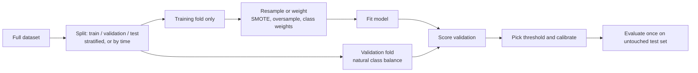

# Classification Metrics and Imbalanced Data

> **Level:** Beginner to Advanced · **Study time:** ~165 min · **Prerequisites:** [The ML Workflow, Train/Validation/Test Splits and Cross-Validation](01-ml-workflow-data-splits-and-cross-validation.md), [Linear and Logistic Regression from Scratch](02-linear-and-logistic-regression.md), [Probability and Statistics for Machine Learning](../00-foundations/04-probability-and-statistics.md)

## Table of contents

- [Why this matters](#why-this-matters)
- [The running example: a spam filter](#the-running-example-a-spam-filter)
- [The confusion matrix](#the-confusion-matrix)
- [Accuracy, precision, recall, specificity and F1](#accuracy-precision-recall-specificity-and-f1)
- [F-beta: when one error matters more](#f-beta-when-one-error-matters-more)
- [Why accuracy misleads on imbalanced data](#why-accuracy-misleads-on-imbalanced-data)
- [Other single-number metrics: balanced accuracy and MCC](#other-single-number-metrics-balanced-accuracy-and-mcc)
- [Scores, thresholds and the ROC curve](#scores-thresholds-and-the-roc-curve)
- [ROC-AUC and its probabilistic meaning](#roc-auc-and-its-probabilistic-meaning)
- [The precision-recall curve and average precision](#the-precision-recall-curve-and-average-precision)
- [ROC-AUC vs PR-AUC under heavy imbalance](#roc-auc-vs-pr-auc-under-heavy-imbalance)
- [Choosing a threshold from business costs](#choosing-a-threshold-from-business-costs)
- [Probability calibration](#probability-calibration)
- [Multiclass metrics: macro, micro and weighted averaging](#multiclass-metrics-macro-micro-and-weighted-averaging)
- [Handling imbalanced data](#handling-imbalanced-data)
- [Class weights vs oversampling vs threshold moving](#class-weights-vs-oversampling-vs-threshold-moving)
- [Fairness and slice-based evaluation](#fairness-and-slice-based-evaluation)
- [Evaluation pitfalls: resampling before splitting and friends](#evaluation-pitfalls-resampling-before-splitting-and-friends)
- [Going deeper: imbalanced classification in production](#going-deeper-imbalanced-classification-in-production)
- [Common mistakes and misconceptions](#common-mistakes-and-misconceptions)
- [Interview questions and model answers](#interview-questions-and-model-answers)
- [Key takeaways](#key-takeaways)
- [Further reading](#further-reading)
- [Next](#next)

## Why this matters

Almost every real classifier you will ship (fraud detection, spam filtering, medical triage, content moderation, defect detection, an LLM guardrail that flags unsafe prompts) is evaluated with the metrics in this chapter, and almost all of those problems are **imbalanced**: the interesting class is rare. On rare-event problems the "obvious" metric, accuracy, can report 99.9% while the model catches nothing. Picking the wrong metric means you optimize the wrong thing, pick the wrong model, and set the wrong decision threshold, which costs real money. Interviewers ask about this constantly because it separates people who have run `model.score()` from people who have owned a model in production and had to explain its false alarms to a business team.

## The running example: a spam filter

We will reuse one example through the whole chapter so you can see every metric on the same numbers.

You built a spam filter. You test it on **1,000 emails**: **100 are spam** and **900 are legitimate** (often called **ham**). Spam is the **positive class**, meaning the class we are trying to detect. "Positive" does not mean "good"; it means "the thing the alarm is for". Ham is the **negative class**.

Your filter outputs, for each email, a **score**: a number between 0 and 1, where higher means "more likely spam". If the model is a logistic regression (see [Linear and Logistic Regression from Scratch](02-linear-and-logistic-regression.md)), the score is its predicted probability. To turn a score into a yes/no decision you pick a **decision threshold** $t$: predict spam if score $\ge t$. For now assume $t = 0.5$. Later we will see that choosing $t$ is one of the most important decisions you make.

## The confusion matrix

> **Analogy:** a smoke alarm. It can ring when there is a fire (good), stay quiet when there is no fire (good), ring when you are just making toast (annoying false alarm), or stay quiet during a real fire (disaster). Those four outcomes are the whole story of binary classification.

A **confusion matrix** is a table that counts, for every combination of actual class and predicted class, how many examples fell into it. For a binary problem it has four cells:

- **True positive (TP):** actually positive, predicted positive. Spam caught.
- **False negative (FN):** actually positive, predicted negative. Spam that slipped into the inbox. Also called a **Type II error** or a **miss**.
- **False positive (FP):** actually negative, predicted positive. A real email sent to the spam folder. Also called a **Type I error** or a **false alarm**.
- **True negative (TN):** actually negative, predicted negative. Real email delivered.

Our filter at threshold 0.5 produces:

```text
                        PREDICTED
                    spam (+)    ham (-)
               +-------------+-------------+
 ACTUAL spam(+)|   TP = 80   |   FN = 20   |   100 actual spam
               +-------------+-------------+
 ACTUAL ham (-)|   FP = 30   |   TN = 870  |   900 actual ham
               +-------------+-------------+
                 110 flagged    890 passed     1,000 total
```

Two sanity checks you should always do: rows sum to the actual class counts (80 + 20 = 100, 30 + 870 = 900), and all four cells sum to the total (80 + 20 + 30 + 870 = 1,000).

> **Common mistake:** libraries disagree on layout. scikit-learn's `confusion_matrix` puts **actual classes on rows and predicted on columns**, sorted by label, so for labels `[0, 1]` it returns `[[TN, FP], [FN, TP]]` (negatives first). Many textbooks put positives first. Always check which corner is which before reading off numbers.

Every metric below is just a different ratio of these four numbers. The trick is knowing which ratio answers the business question.

## Accuracy, precision, recall, specificity and F1

### Accuracy

**Accuracy** is the fraction of all predictions that were correct.

$$\text{Accuracy} = \frac{TP + TN}{TP + TN + FP + FN}$$

- $TP, TN, FP, FN$: the four confusion matrix counts.
- The denominator is simply the total number of examples $N$.

Worked example: $\frac{80 + 870}{1000} = \frac{950}{1000} = 0.95$. The filter is "95% accurate". Hold that thought; we will see why it can be meaningless.

### Precision

> **Analogy:** precision answers "when the alarm rings, how often is there really a fire?"

**Precision** (also called **positive predictive value**, PPV) is the fraction of predicted positives that are actually positive.

$$\text{Precision} = \frac{TP}{TP + FP}$$

- $TP + FP$: everything the model flagged as positive (the "predicted spam" column).

Worked example: $\frac{80}{80 + 30} = \frac{80}{110} \approx 0.727$. When the filter says "spam", it is right about 73% of the time. The other 27% are real emails wrongly sent to the spam folder.

### Recall (sensitivity)

> **Analogy:** recall answers "of all the real fires, how many did the alarm catch?"

**Recall**, also called **sensitivity** or **true positive rate (TPR)**, is the fraction of actual positives the model caught.

$$\text{Recall} = \text{TPR} = \frac{TP}{TP + FN}$$

- $TP + FN$: all actual positives (the "actual spam" row).

Worked example: $\frac{80}{80 + 20} = \frac{80}{100} = 0.80$. The filter catches 80% of spam; 20% slips through.

### Specificity and the false positive rate

**Specificity**, also called the **true negative rate (TNR)**, is recall for the negative class: of all actual negatives, how many were correctly left alone.

$$\text{Specificity} = \frac{TN}{TN + FP}$$

Its complement is the **false positive rate (FPR)**, the fraction of actual negatives that were wrongly flagged:

$$\text{FPR} = \frac{FP}{FP + TN} = 1 - \text{Specificity}$$

Worked example: specificity $= \frac{870}{870 + 30} = \frac{870}{900} \approx 0.967$, so $\text{FPR} = \frac{30}{900} \approx 0.033$. About 3.3% of real emails get wrongly flagged.

> **Senior insight:** notice the denominators. Recall, specificity and FPR divide by an *actual* class count (a row), so they do not depend on how common the positive class is. Precision divides by a *predicted* count (a column), which mixes both classes, so precision **changes when the class balance changes** even if the model is identical. This one fact explains most of the ROC vs PR debate later in the chapter.

### The precision-recall trade-off

Precision and recall pull against each other through the threshold:

- **Lower the threshold** (flag more emails): you catch more spam (recall up) but also flag more real email (precision usually down).
- **Raise the threshold** (flag fewer): flagged emails are more surely spam (precision usually up) but more spam slips through (recall down).

You can always get recall = 1.0 by flagging everything, and you can usually get very high precision by flagging only the single most obvious spam. Neither is useful, which is why we need metrics that balance the two.

### F1 score

**F1** is the **harmonic mean** of precision and recall. The harmonic mean of two numbers $a$ and $b$ is $\frac{2ab}{a + b}$; unlike the ordinary average, it is dragged down hard by the smaller number, so you cannot get a good F1 by being great at one and terrible at the other.

$$F_1 = \frac{2 \cdot P \cdot R}{P + R} = \frac{2\,TP}{2\,TP + FP + FN}$$

- $P$: precision. $R$: recall.
- The second form is the same quantity written in counts (substitute the definitions and simplify). It is handy for hand calculation and shows that F1 **ignores TN entirely**.

Worked example, using the counts form: $\frac{2 \cdot 80}{2 \cdot 80 + 30 + 20} = \frac{160}{160 + 50} = \frac{160}{210} \approx 0.762$.

Check with the other form: $\frac{2 \cdot 0.7273 \cdot 0.8}{0.7273 + 0.8} = \frac{1.1636}{1.5273} \approx 0.762$. Same answer.

Why harmonic and not arithmetic? A model with $P = 1.0, R = 0.01$ has an arithmetic mean of 0.505 (looks decent) but an F1 of $\frac{2 \cdot 1.0 \cdot 0.01}{1.01} \approx 0.0198$ (correctly terrible).

### Summary table on the running example

| Metric | Formula | Question it answers | Spam filter value |
|---|---|---|---|
| Accuracy | $(TP+TN)/N$ | How often is the model right overall? | 0.950 |
| Precision | $TP/(TP+FP)$ | When it says spam, is it spam? | 0.727 |
| Recall (sensitivity, TPR) | $TP/(TP+FN)$ | How much of the spam did it catch? | 0.800 |
| Specificity (TNR) | $TN/(TN+FP)$ | How much real email did it leave alone? | 0.967 |
| FPR | $FP/(FP+TN)$ | How much real email did it wrongly flag? | 0.033 |
| F1 | $2PR/(P+R)$ | Balanced precision and recall | 0.762 |

### Code: from scratch, then scikit-learn

```python
# pip install numpy scikit-learn
import numpy as np
from sklearn.metrics import (confusion_matrix, accuracy_score, precision_score,
                             recall_score, f1_score, fbeta_score, classification_report)

# Rebuild the running example: 100 spam (1), 900 ham (0)
y_true = np.array([1] * 100 + [0] * 900)
# 80 spam caught, 20 missed, 30 ham wrongly flagged, 870 ham passed
y_pred = np.array([1] * 80 + [0] * 20 + [1] * 30 + [0] * 870)

# From scratch: count the four cells with boolean masks
tp = np.sum((y_true == 1) & (y_pred == 1))
fn = np.sum((y_true == 1) & (y_pred == 0))
fp = np.sum((y_true == 0) & (y_pred == 1))
tn = np.sum((y_true == 0) & (y_pred == 0))

precision = tp / (tp + fp)
recall = tp / (tp + fn)
specificity = tn / (tn + fp)
f1 = 2 * precision * recall / (precision + recall)
print(tp, fn, fp, tn)                        # 80 20 30 870
print(f"{precision:.4f} {recall:.4f} {specificity:.4f} {f1:.4f}")
# 0.7273 0.8000 0.9667 0.7619

# scikit-learn equivalents
print(confusion_matrix(y_true, y_pred))      # [[870  30]
                                             #  [ 20  80]]   rows = actual 0, 1
print(f"{accuracy_score(y_true, y_pred):.4f}")    # 0.9500
print(f"{f1_score(y_true, y_pred):.4f}")          # 0.7619
print(classification_report(y_true, y_pred, target_names=["ham", "spam"]))
```

## F-beta: when one error matters more

F1 treats a missed positive and a false alarm as equally bad. Real problems rarely do. Missing a cancer is far worse than an extra biopsy; flagging a VIP customer's legitimate payment as fraud may be worse than missing a small fraud.

**F-beta** ($F_\beta$) generalizes F1 with a knob $\beta$ that says how many times more you care about recall than precision.

$$F_\beta = (1 + \beta^2)\,\frac{P \cdot R}{\beta^2 P + R} = \frac{(1+\beta^2)\,TP}{(1+\beta^2)\,TP + \beta^2 FN + FP}$$

- $\beta$: a positive number you choose. $\beta = 1$ gives F1. $\beta > 1$ weights recall more (for example $F_2$). $\beta < 1$ weights precision more (for example $F_{0.5}$).
- $\beta^2$ multiplies $FN$ in the counts form, which makes the effect easy to see: a larger $\beta$ makes each missed positive cost more.

Worked example, $F_2$ (recall matters more): $\beta^2 = 4$.

$$F_2 = \frac{5 \cdot 80}{5 \cdot 80 + 4 \cdot 20 + 30} = \frac{400}{400 + 80 + 30} = \frac{400}{510} \approx 0.784$$

Worked example, $F_{0.5}$ (precision matters more): $\beta^2 = 0.25$.

$$F_{0.5} = \frac{1.25 \cdot 80}{1.25 \cdot 80 + 0.25 \cdot 20 + 30} = \frac{100}{100 + 5 + 30} = \frac{100}{135} \approx 0.741$$

Our filter's recall (0.80) is higher than its precision (0.727), so $F_2 > F_1 > F_{0.5}$, as expected.

```python
print(f"{fbeta_score(y_true, y_pred, beta=2):.4f}")    # 0.7843
print(f"{fbeta_score(y_true, y_pred, beta=0.5):.4f}")  # 0.7407
```

> **Interview tip:** F-beta is a blunt instrument. If you actually know the dollar cost of each error type, skip F-beta and minimize expected cost directly (see [Choosing a threshold from business costs](#choosing-a-threshold-from-business-costs)). F-beta is useful when costs are only roughly known ("recall is about twice as important").

## Why accuracy misleads on imbalanced data

A dataset is **imbalanced** when one class is much rarer than the other. The **prevalence** (or **base rate**) is the fraction of examples that are positive. Our spam set has prevalence $100/1000 = 10\%$, which is mildly imbalanced. Fraud is far more extreme.

**The fraud example.** A payment company processes **100,000 transactions** a day, and **100 are fraudulent** (prevalence 0.1%, illustrative but realistic in order of magnitude). Consider a "model" that is just `return "not fraud"`.

```text
                    PREDICTED
                 fraud     legit
ACTUAL fraud   TP = 0    FN = 100
ACTUAL legit   FP = 0    TN = 99,900
```

- Accuracy $= \frac{0 + 99{,}900}{100{,}000} = 0.999$. That is **99.9% accurate**.
- Recall $= \frac{0}{0 + 100} = 0$. It catches **zero** fraud.
- Precision $= \frac{0}{0 + 0}$, undefined (it never predicts fraud). Libraries return 0 and warn.

This is sometimes called the **accuracy paradox**. Accuracy is dominated by the majority class: 99,900 of the 100,000 "votes" come from legitimate transactions, so the metric barely notices what happens to the 100 that matter.

The **null accuracy** (accuracy of always predicting the majority class) equals $1 - \text{prevalence}$, here 0.999. Any accuracy number must be compared with null accuracy, and on rare-event problems that bar is so high that accuracy stops carrying information.

Accuracy also silently assumes **every error costs the same**. In fraud, a missed fraud might cost hundreds of dollars and a false alarm a few dollars of analyst time. Accuracy counts both as "one mistake".

> **Common mistake:** reporting "95% accuracy" on any problem without stating the class balance. On a 95/5 dataset that is exactly the do-nothing baseline.

When is accuracy fine? When classes are roughly balanced **and** errors have similar costs, for example classifying handwritten digits. Even then, look at the confusion matrix.

## Other single-number metrics: balanced accuracy and MCC

Two more metrics show up in interviews and in imbalanced-data papers.

**Balanced accuracy** is the average of recall on each class:

$$\text{Balanced accuracy} = \frac{\text{TPR} + \text{TNR}}{2}$$

Spam example: $\frac{0.80 + 0.967}{2} \approx 0.883$. The do-nothing fraud model gets $\frac{0 + 1}{2} = 0.5$, which correctly exposes it as useless. Balanced accuracy is what you get from accuracy if you reweight the data so both classes count equally.

The **Matthews correlation coefficient (MCC)** is the correlation between actual and predicted labels. It uses all four cells and ranges from $-1$ (always wrong) through $0$ (no better than random) to $+1$ (perfect).

$$\text{MCC} = \frac{TP \cdot TN - FP \cdot FN}{\sqrt{(TP+FP)(TP+FN)(TN+FP)(TN+FN)}}$$

Spam example:

- Numerator: $80 \cdot 870 - 30 \cdot 20 = 69{,}600 - 600 = 69{,}000$.
- Denominator: $\sqrt{110 \cdot 100 \cdot 900 \cdot 890} = \sqrt{11{,}000 \cdot 801{,}000} = \sqrt{8{,}811{,}000{,}000} \approx 93{,}867$.
- MCC $\approx 69{,}000 / 93{,}867 \approx 0.735$.

| Metric | Uses TN? | Sensitive to prevalence? | Good for |
|---|---|---|---|
| Accuracy | Yes | Yes, dominated by majority | Balanced classes, equal costs |
| F1 | No | Yes (through precision) | Positive class is what matters; TN is huge and uninteresting |
| Balanced accuracy | Yes | No | Both classes matter equally |
| MCC | Yes | Somewhat | One robust summary of the whole confusion matrix |

All of these are **threshold-dependent**: they evaluate one specific yes/no decision rule. The next sections look at metrics that evaluate the model's scores across *all* thresholds.

## Scores, thresholds and the ROC curve

### From one threshold to all thresholds

> **Analogy:** a metal detector with a sensitivity dial. Turn it up and it beeps at every coin and bottle cap (high recall, many false alarms). Turn it down and it only beeps at large objects (few false alarms, misses small finds). The ROC curve is a picture of the detector's behavior at **every** dial setting.

A model that outputs scores defines a whole family of classifiers, one per threshold. To compare models before you have chosen a threshold, you sweep the threshold and plot what happens.

The **ROC curve** (Receiver Operating Characteristic, a name from WWII radar engineering) plots **TPR (recall) on the y-axis against FPR on the x-axis**, one point per threshold.

- Threshold above every score: nothing is flagged, so TPR = 0 and FPR = 0. Point $(0, 0)$.
- Threshold below every score: everything is flagged, so TPR = 1 and FPR = 1. Point $(1, 1)$.
- A perfect model passes through $(0, 1)$: all positives caught before any negative is flagged.
- A model that scores randomly follows the diagonal from $(0,0)$ to $(1,1)$.

### A worked example with 10 emails

To keep the arithmetic by hand, take a tiny validation set of **10 emails: 4 spam (P) and 6 ham (N)**, sorted by score:

| Rank | Score | Actual | TP so far | FP so far | TPR = TP/4 | FPR = FP/6 | Precision = TP/rank |
|---|---|---|---|---|---|---|---|
| 1 | 0.95 | P | 1 | 0 | 0.25 | 0.000 | 1.000 |
| 2 | 0.85 | P | 2 | 0 | 0.50 | 0.000 | 1.000 |
| 3 | 0.75 | N | 2 | 1 | 0.50 | 0.167 | 0.667 |
| 4 | 0.65 | P | 3 | 1 | 0.75 | 0.167 | 0.750 |
| 5 | 0.55 | N | 3 | 2 | 0.75 | 0.333 | 0.600 |
| 6 | 0.45 | N | 3 | 3 | 0.75 | 0.500 | 0.500 |
| 7 | 0.35 | P | 4 | 3 | 1.00 | 0.500 | 0.571 |
| 8 | 0.25 | N | 4 | 4 | 1.00 | 0.667 | 0.500 |
| 9 | 0.15 | N | 4 | 5 | 1.00 | 0.833 | 0.444 |
| 10 | 0.05 | N | 4 | 6 | 1.00 | 1.000 | 0.400 |

Each row is "set the threshold equal to this score and flag everything at or above it". For example, at threshold 0.65 we flag the top 4 emails: 3 spam and 1 ham, so TPR $= 3/4 = 0.75$ and FPR $= 1/6 \approx 0.167$.

Plotting (FPR, TPR) gives a staircase. Each positive moves you **up** by $1/4$; each negative moves you **right** by $1/6$:

```text
 TPR
 1.00 |              ****************
      |              *
 0.75 |    ***********
      |    *
 0.50 ******
      *
 0.25 *
      *
 0.00 *----+----+----+----+----+----+---> FPR
      0   1/6  2/6  3/6  4/6  5/6   1
```

## ROC-AUC and its probabilistic meaning

### Area under the curve

**ROC-AUC** (often just **AUC**) is the area under the ROC curve. It ranges from 0 to 1: 1.0 is perfect, 0.5 is random guessing, and below 0.5 means the scores are worse than random (flip them and you get above 0.5, which usually signals a label or sign bug).

Compute it for the staircase above as a sum of rectangles (width in FPR times height in TPR):

- FPR from 0 to 1/6, TPR = 0.50: area $= \frac{1}{6} \times 0.50 \approx 0.0833$.
- FPR from 1/6 to 3/6, TPR = 0.75: area $= \frac{2}{6} \times 0.75 = 0.25$.
- FPR from 3/6 to 1, TPR = 1.00: area $= \frac{3}{6} \times 1.00 = 0.50$.
- Total: $0.0833 + 0.25 + 0.50 \approx 0.8333$.

### The probabilistic meaning

Here is the interpretation interviewers want to hear:

> **ROC-AUC is the probability that a randomly chosen positive gets a higher score than a randomly chosen negative.** Ties count as one half.

$$\text{AUC} = P\big(s(x^+) > s(x^-)\big) + \tfrac{1}{2}\,P\big(s(x^+) = s(x^-)\big)$$

- $x^+$: a randomly drawn positive example. $x^-$: a randomly drawn negative example.
- $s(\cdot)$: the model's score.

Verify on our 10 emails. There are $4 \times 6 = 24$ (positive, negative) pairs. For each spam, count the ham emails that scored lower:

- Spam at 0.95: all 6 ham are lower. 6 pairs won.
- Spam at 0.85: all 6 ham are lower. 6.
- Spam at 0.65: ham at 0.55, 0.45, 0.25, 0.15, 0.05 are lower. 5.
- Spam at 0.35: ham at 0.25, 0.15, 0.05 are lower. 3.

Total wins $= 6 + 6 + 5 + 3 = 20$, so AUC $= 20/24 \approx 0.8333$. Exactly the area. This is not a coincidence: AUC equals the normalized **Mann-Whitney U statistic**, a classic rank-based statistical test (Hanley and McNeil, 1982).

What this tells you:

- AUC is a **ranking metric**. It only cares about the *order* of scores, not their values. Multiply every score by 0.1 and AUC is unchanged. So a model can have excellent AUC and badly wrong probabilities (see [calibration](#probability-calibration)).
- AUC is **threshold-free**: it summarizes all thresholds at once, including ones you would never use in practice.
- AUC is **prevalence-invariant**: TPR and FPR are each computed within one class, so duplicating all negatives 10 times leaves the ROC curve unchanged.

```python
import numpy as np
from sklearn.metrics import roc_auc_score, roc_curve

scores = np.array([0.95, 0.85, 0.75, 0.65, 0.55, 0.45, 0.35, 0.25, 0.15, 0.05])
labels = np.array([1,    1,    0,    1,    0,    0,    1,    0,    0,    0])

# From scratch: fraction of (pos, neg) pairs ranked correctly, ties count 0.5
pos, neg = scores[labels == 1], scores[labels == 0]
diff = pos[:, None] - neg[None, :]                 # 4 x 6 matrix of score gaps
auc_pairs = (np.sum(diff > 0) + 0.5 * np.sum(diff == 0)) / diff.size
print(f"{auc_pairs:.4f}")                          # 0.8333

print(f"{roc_auc_score(labels, scores):.4f}")      # 0.8333
fpr, tpr, thresholds = roc_curve(labels, scores)   # the staircase points
```

The pairwise version is $O(n_+ \cdot n_-)$ (number of positives times number of negatives) and only for teaching; libraries sort once and use ranks, which is $O(n \log n)$.

## The precision-recall curve and average precision

The **precision-recall (PR) curve** plots **precision on the y-axis against recall on the x-axis**, again one point per threshold. It ignores true negatives entirely and focuses on the question "as I try to catch more positives, how polluted do my alerts become?"

From the table above, the PR points (recall, precision) are: (0.25, 1.00), (0.50, 1.00), (0.50, 0.667), (0.75, 0.75), (0.75, 0.60), (0.75, 0.50), (1.00, 0.571), (1.00, 0.50), (1.00, 0.444), (1.00, 0.40).

Key properties:

- The PR curve is **not monotonic**: precision can go up and down as the threshold drops (from 0.667 back up to 0.75 above).
- A random classifier has precision equal to the prevalence at every recall, so the **random baseline is a horizontal line at the prevalence** (here $4/10 = 0.4$), not 0.5. On a fraud set with 0.1% prevalence the random baseline is 0.001.

### PR-AUC and average precision

**PR-AUC** is the area under the PR curve. The most common way to compute it is **average precision (AP)**: the average of the precision values at each rank where a new positive is found, weighted by how much recall increased there.

$$\text{AP} = \sum_{k} (R_k - R_{k-1})\, P_k$$

- $k$: a threshold position in the sorted list (rank).
- $P_k$, $R_k$: precision and recall when flagging the top $k$ items.
- $R_k - R_{k-1}$: the recall gained at step $k$. It is $1/(\text{number of positives})$ when item $k$ is a positive and 0 otherwise, so only ranks holding a positive contribute.

Worked example. Positives sit at ranks 1, 2, 4 and 7, each adding recall $1/4 = 0.25$:

- Rank 1: precision $1/1 = 1.000$
- Rank 2: precision $2/2 = 1.000$
- Rank 4: precision $3/4 = 0.750$
- Rank 7: precision $4/7 \approx 0.571$

$$\text{AP} = 0.25 \times (1.000 + 1.000 + 0.750 + 0.571) = 0.25 \times 3.321 \approx 0.830$$

Compare with the random baseline of 0.4: the model is clearly better than chance.

```python
from sklearn.metrics import average_precision_score, precision_recall_curve
# reuses scores and labels from the previous block

# From scratch: mean of precision@k at each rank k that holds a positive
order = np.argsort(-scores)                 # sort by score, descending
hits = labels[order]
precision_at_k = np.cumsum(hits) / np.arange(1, len(hits) + 1)
ap = precision_at_k[hits == 1].mean()       # equals sum of (R_k - R_{k-1}) * P_k
print(f"{ap:.4f}")                                       # 0.8304

print(f"{average_precision_score(labels, scores):.4f}")  # 0.8304
precision, recall, thr = precision_recall_curve(labels, scores)
```

> **Common mistake:** computing PR-AUC with the trapezoidal rule (`sklearn.metrics.auc(recall, precision)`). Linear interpolation between PR points is optimistic because precision does not change linearly with recall (Davis and Goadrich, 2006). Prefer `average_precision_score`, which uses the step-wise sum above. Also state which one you report, since "PR-AUC" is used loosely.

## ROC-AUC vs PR-AUC under heavy imbalance

Here is the core argument, with numbers.

Precision can be written in terms of TPR, FPR and prevalence $\pi$ (this follows from Bayes' rule; see [Probability and Statistics for Machine Learning](../00-foundations/04-probability-and-statistics.md)):

$$\text{Precision} = \frac{\text{TPR} \cdot \pi}{\text{TPR} \cdot \pi + \text{FPR} \cdot (1 - \pi)}$$

- $\pi$: prevalence, the fraction of examples that are positive.
- $\text{TPR} \cdot \pi$: the fraction of all examples that are true positives.
- $\text{FPR} \cdot (1-\pi)$: the fraction of all examples that are false positives.

Take one fixed operating point that *looks* excellent on an ROC plot: TPR = 0.80, FPR = 0.01.

- At $\pi = 1\%$: precision $= \frac{0.8 \times 0.01}{0.8 \times 0.01 + 0.01 \times 0.99} = \frac{0.008}{0.008 + 0.0099} = \frac{0.008}{0.0179} \approx 0.447$.
- At $\pi = 0.1\%$: precision $= \frac{0.0008}{0.0008 + 0.00999} = \frac{0.0008}{0.01079} \approx 0.074$.

Same ROC point, but at 0.1% prevalence **93% of alerts are false alarms**. Concretely, with 1,000 frauds and 999,000 legit transactions: TP $= 800$, FP $\approx 9{,}990$, so precision $\approx 800 / 10{,}790 \approx 0.074$.

Now compare two models (illustrative) on this fraud data, both with TPR = 0.80:

| | Model A | Model B |
|---|---|---|
| FPR | 0.010 | 0.001 |
| False positives (of 999,000 legit) | about 9,990 | about 999 |
| Precision | about 0.074 | about 0.445 |
| How far apart on the ROC plot | 0.009 along the x-axis: barely visible | |
| How far apart on the PR plot | 0.074 vs 0.445: obvious | |

On an ROC plot, everything interesting happens squeezed against the left edge (FPR between 0 and 0.01), and both curves look nearly perfect, with AUCs that may differ only in the third decimal. On a PR plot the difference is huge, because the PR curve measures exactly what the fraud team experiences: how many of the alerts they review are real.

This is why **PR-AUC (average precision) is more informative than ROC-AUC under heavy imbalance** (Saito and Rehmsmeier, 2015; Davis and Goadrich, 2006): the huge pool of true negatives inflates specificity and hides false positives in the ROC view, while precision exposes them.

| | ROC curve / ROC-AUC | PR curve / PR-AUC (AP) |
|---|---|---|
| Axes | TPR vs FPR | Precision vs recall |
| Uses true negatives? | Yes (in FPR) | No |
| Random baseline | 0.5 | The prevalence $\pi$ |
| Changes with prevalence? | No | Yes |
| Probabilistic meaning | P(random positive outranks random negative) | Approximately the mean precision over recall levels |
| Best when | Classes are fairly balanced, both classes matter, or you need a metric comparable across datasets with different base rates | Positives are rare, the cost is in reviewing alerts, true negatives are plentiful and uninteresting |
| Pitfall | Looks great while precision is terrible at low prevalence | Not comparable across datasets with different prevalence; noisy with few positives |

> **Senior insight:** "PR is better than ROC under imbalance" is not the full answer. ROC-AUC's prevalence invariance is a *feature* when prevalence will change (say you train on one month and deploy on another with a different fraud rate) or when comparing across segments with different base rates. Report both, plus the metric at your actual **operating point** (the one threshold you deploy, and therefore the one precision/recall pair users experience), for example "recall at 1% FPR" or "precision at the top 500 alerts per day". Summary curves cover thresholds you will never use; the business lives at one point.

### When to use which metric

| Situation | Primary metric | Why |
|---|---|---|
| Balanced classes, equal error costs | Accuracy (plus confusion matrix) | Simple and meaningful when the null baseline is about 50% |
| False alarms are expensive (spam to junk, blocking payments) | Precision (at a recall floor) | Measures how trustworthy each alert is |
| Misses are expensive (cancer screening, safety filters) | Recall (at a precision or FPR floor) | Measures how much you catch |
| Need one number, both errors matter about equally | F1 | Harmonic mean punishes neglecting either |
| Unequal but roughly known importance | F-beta | Tilt toward recall ($\beta > 1$) or precision ($\beta < 1$) |
| Comparing rankers, moderate imbalance, before picking a threshold | ROC-AUC | Threshold-free, prevalence-invariant |
| Rare positives, alerts are reviewed | PR-AUC / average precision, precision@k (precision among the $k$ highest-scored items) | Focuses on positives, exposes false alarms |
| Probabilities feed a downstream decision or price | Log loss, Brier score, calibration (all defined in [Probability calibration](#probability-calibration)) | Measures probability quality, not just ranking |
| Known dollar costs | Expected cost at chosen threshold | The metric the business actually pays |

## Choosing a threshold from business costs

The default threshold of 0.5 is arbitrary. It is only optimal when the model's probabilities are calibrated **and** a false positive costs exactly as much as a false negative. Neither is usually true.

> **Analogy:** a store security guard deciding whether to stop a customer. Stopping an innocent shopper costs a little goodwill. Letting a thief walk out costs the price of the goods. If the goods are diamonds, the guard should stop people on much weaker suspicion than if the goods are chewing gum.

### The decision rule

Suppose the model outputs a **calibrated** probability $p$ that a transaction is fraud (calibrated means "of all transactions scored 0.1, about 10% really are fraud"; see the next section). Assign a cost to each error:

- $C_{FP}$: cost of a false positive (blocking a legit payment: analyst review time, customer friction).
- $C_{FN}$: cost of a false negative (the fraud loss you did not prevent).
- Assume correct decisions cost 0 (you can generalize; see below).

If you **flag** the transaction, you pay $C_{FP}$ only if it is legit, which happens with probability $1 - p$. Expected cost of flagging: $(1-p)\,C_{FP}$.

If you **let it through**, you pay $C_{FN}$ only if it is fraud, probability $p$. Expected cost of passing: $p\,C_{FN}$.

Flag when flagging is cheaper:

$$(1-p)\,C_{FP} < p\,C_{FN} \quad\Longleftrightarrow\quad p > t^* = \frac{C_{FP}}{C_{FP} + C_{FN}}$$

- $t^*$: the cost-optimal threshold.

Worked example (illustrative costs, in dollars): $C_{FP} = 10$, $C_{FN} = 500$.

$$t^* = \frac{10}{10 + 500} = \frac{10}{510} \approx 0.0196$$

Flag anything above about 2% fraud probability. That is far from 0.5, and it makes sense: a miss is 50 times more expensive than a false alarm, so you should tolerate many false alarms. With nonzero costs for correct decisions, the general form is $t^* = \frac{C_{FP} - C_{TN}}{(C_{FP} - C_{TN}) + (C_{FN} - C_{TP})}$ (Elkan, 2001).

### Expected-cost calculation on a validation set

The formula requires calibrated probabilities. The more robust practical method, which works for any score, is to **sweep thresholds on a validation set and compute the total cost directly**:

$$\text{Total cost}(t) = FN(t) \cdot C_{FN} + FP(t) \cdot C_{FP}$$

Validation set (illustrative): 100,000 transactions, 200 fraud. Same costs.

| Threshold $t$ | Flagged | TP | FP | FN | Cost of misses ($FN \times 500$) | Cost of false alarms ($FP \times 10$) | **Total cost** |
|---|---|---|---|---|---|---|---|
| Never flag | 0 | 0 | 0 | 200 | 100,000 | 0 | **100,000** |
| 0.50 | 140 | 100 | 40 | 100 | 50,000 | 400 | **50,400** |
| 0.20 | 240 | 130 | 110 | 70 | 35,000 | 1,100 | **36,100** |
| 0.05 | 540 | 160 | 380 | 40 | 20,000 | 3,800 | **23,800** |
| **0.02** | 1,140 | 178 | 962 | 22 | 11,000 | 9,620 | **20,620** |
| 0.01 | 1,940 | 188 | 1,752 | 12 | 6,000 | 17,520 | **23,520** |

Check one row, $t = 0.02$: flagged = TP + FP = 178 + 962 = 1,140; FN = 200 - 178 = 22; cost = $22 \times 500 + 962 \times 10 = 11{,}000 + 9{,}620 = 20{,}620$.

The minimum is at $t = 0.02$, matching the theoretical $t^* \approx 0.0196$ (this illustrative model is calibrated). Moving from the default 0.5 to 0.02 cuts the cost from 50,400 to 20,620, about 59% lower, and the expected cost per transaction becomes $20{,}620 / 100{,}000 \approx 0.21$ dollars. Note that precision at this threshold is only $178 / 1{,}140 \approx 0.156$: **the cost-optimal threshold can have "bad-looking" precision**, which is exactly why you should optimize cost, not F1, when costs are known.

You can read the marginal logic off the table too. Lowering from 0.02 to 0.01 catches 10 more frauds (saving $10 \times 500 = 5{,}000$) but adds 790 false alarms (costing $790 \times 10 = 7{,}900$), so it is a net loss.

```python
import numpy as np

def expected_cost(y_true, scores, threshold, c_fp, c_fn):
    """Total cost of decisions at one threshold."""
    y_pred = scores >= threshold
    fp = np.sum(y_pred & (y_true == 0))
    fn = np.sum(~y_pred & (y_true == 1))
    return fp * c_fp + fn * c_fn

def best_threshold(y_true, scores, c_fp, c_fn):
    """Sweep every distinct score as a candidate threshold (validation set only!)."""
    candidates = np.unique(scores)
    costs = [expected_cost(y_true, scores, t, c_fp, c_fn) for t in candidates]
    i = int(np.argmin(costs))
    return candidates[i], costs[i]

# Usage: t, cost = best_threshold(y_val, model.predict_proba(X_val)[:, 1], c_fp=10, c_fn=500)
```

scikit-learn 1.5 added `TunedThresholdClassifierCV`, which does this sweep with cross-validation for any scorer (by default over a grid of 100 candidate thresholds, not every distinct score). The API is recent, so check your installed version:

```python
# scikit-learn >= 1.5
from sklearn.metrics import make_scorer
from sklearn.model_selection import TunedThresholdClassifierCV

def negative_cost(y_true, y_pred, c_fp=10, c_fn=500):
    fp = np.sum((y_pred == 1) & (y_true == 0))
    fn = np.sum((y_pred == 0) & (y_true == 1))
    return -(fp * c_fp + fn * c_fn)          # scorers are maximized, so negate cost

tuned = TunedThresholdClassifierCV(base_model, scoring=make_scorer(negative_cost), cv=5)
tuned.fit(X_train, y_train)
print(tuned.best_threshold_)
```

### Other ways to pick a threshold

| Method | When |
|---|---|
| Minimize expected cost | Costs are known (best option) |
| Capacity constraint: flag the top $k$ per day | A review team can only handle $k$ alerts; report **precision@k** |
| Fix a minimum recall (or maximum FPR) and maximize the other | Regulatory or safety floor, for example "catch at least 95% of positives" |
| Maximize F1 or F-beta | Costs unknown, need a reasonable default |
| Youden's J (maximize TPR - FPR) | Common in medicine; equivalent to maximizing balanced accuracy |

> **Common mistake:** tuning the threshold on the test set. The threshold is a hyperparameter. Choose it on validation data (or with cross-validation), then report test performance once. Otherwise your test metrics are optimistically biased (see [Overfitting, Bias-Variance, Regularization and Data Leakage](03-overfitting-regularization-and-data-leakage.md)).

## Probability calibration

### What calibration means

> **Analogy:** a weather forecaster is well calibrated if, on all the days she says "70% chance of rain", it actually rains on about 70% of them. She can be calibrated and still unhelpful (always saying "30%" in a city where it rains 30% of days), so calibration is necessary but not sufficient.

A classifier is **calibrated** if its predicted probabilities match observed frequencies: among all examples with predicted probability about $p$, a fraction of about $p$ are actually positive.

Calibration is a different property from **discrimination** (ranking positives above negatives, which AUC measures). A model can rank perfectly yet be badly calibrated: squash every score into $[0.4, 0.6]$ while keeping the order, and AUC is unchanged but the probabilities are useless for cost decisions.

Calibration matters whenever the probability *value* is used, not just its rank:

- Cost-based thresholds like $t^* = C_{FP}/(C_{FP}+C_{FN})$ above.
- Expected-value calculations (expected loss = $p \times$ amount).
- Combining models or feeding probabilities into another system.
- Showing a "confidence" to users.

Which models tend to be miscalibrated (general tendencies, not laws; Niculescu-Mizil and Caruana, 2005):

- Logistic regression is often reasonably calibrated, because it directly minimizes log loss.
- Naive Bayes tends to push probabilities toward 0 and 1 (overconfident).
- SVM decision values are not probabilities at all.
- Random forests tend to avoid the extremes (averaging many trees rarely gives 0 or 1).
- Boosted trees can be distorted, depending on the loss and settings.
- Modern deep neural networks are often overconfident (Guo et al., 2017).
- **Any model trained with resampling or class weights** has probabilities shifted toward the minority class (more on this later).

### The reliability diagram

A **reliability diagram** (calibration plot) groups predictions into bins by predicted probability, then plots each bin's **mean predicted probability** (x) against its **observed fraction of positives** (y). A perfectly calibrated model lies on the diagonal $y = x$.

Illustrative example with 100 predictions in 3 bins:

| Bin | Examples $n_b$ | Mean predicted prob. | Observed fraction positive | Gap |
|---|---|---|---|---|
| 0.00-0.33 | 50 | 0.10 | 0.08 | 0.02 |
| 0.33-0.67 | 30 | 0.50 | 0.40 | 0.10 |
| 0.67-1.00 | 20 | 0.90 | 0.70 | 0.20 |

```text
observed
fraction
 1.0 |                              .
 0.9 |                           .
 0.8 |                        .
 0.7 |                     .     o   <- says 0.90, reality 0.70: overconfident
 0.6 |                  .
 0.5 |               .
 0.4 |            .  o   <- says 0.50, reality 0.40
 0.3 |         .
 0.2 |      .
 0.1 |   o   <- nearly on the line: says 0.10, reality 0.08
 0.0 +------------------------------->
      0.0            0.5            1.0   mean predicted probability
      ( . = perfect calibration diagonal, o = observed bin )
```

Points to the **right of (below)** the diagonal mean the model predicts higher probabilities than reality (overconfident about the positive class); points above it mean the opposite.

**Expected calibration error (ECE)** summarizes the diagram as a weighted average gap:

$$\text{ECE} = \sum_{b=1}^{B} \frac{n_b}{N} \left|\, \text{acc}_b - \text{conf}_b \,\right|$$

- $B$: number of bins. $n_b$: examples in bin $b$. $N$: total examples.
- $\text{conf}_b$: mean predicted probability in bin $b$. $\text{acc}_b$: observed fraction of positives in bin $b$.

Worked example: $\text{ECE} = 0.5 \times 0.02 + 0.3 \times 0.10 + 0.2 \times 0.20 = 0.01 + 0.03 + 0.04 = 0.08$.

ECE depends on the binning choice (number and placement of bins), so treat it as a diagnostic, not a precise quantity. On heavily imbalanced data most predictions land in the lowest bin; use quantile bins (equal counts per bin) so the high-probability region has enough examples.

### Log loss and Brier score

Calibration plots are visual. Two **proper scoring rules** give single numbers that reward both good calibration and good discrimination. A scoring rule is **proper** if a model gets its best expected score by reporting its true belief, so it cannot "game" the metric by shading probabilities.

**Log loss** (binary cross-entropy, covered in depth in [Softmax, Entropy, Cross-Entropy and KL Divergence](../00-foundations/05-softmax-entropy-cross-entropy-and-kl-divergence.md)):

$$\text{LogLoss} = -\frac{1}{N} \sum_{i=1}^{N} \Big[ y_i \ln p_i + (1 - y_i) \ln (1 - p_i) \Big]$$

- $y_i \in \{0, 1\}$: true label of example $i$. $p_i$: predicted probability that $y_i = 1$.
- $\ln$: natural logarithm. Only one of the two terms is active per example.
- Lower is better. A confident wrong prediction is punished severely ($-\ln(0.01) \approx 4.6$).

**Brier score** (Brier, 1950): the mean squared error between probability and label.

$$\text{Brier} = \frac{1}{N} \sum_{i=1}^{N} (p_i - y_i)^2$$

Lower is better, range 0 to 1. Much gentler on confident mistakes than log loss.

Worked example with 4 predictions:

| $y$ | $p$ | Log loss term | Brier term $(p-y)^2$ |
|---|---|---|---|
| 1 | 0.9 | $-\ln 0.9 \approx 0.105$ | $0.1^2 = 0.01$ |
| 0 | 0.2 | $-\ln 0.8 \approx 0.223$ | $0.2^2 = 0.04$ |
| 1 | 0.6 | $-\ln 0.6 \approx 0.511$ | $0.4^2 = 0.16$ |
| 0 | 0.7 | $-\ln 0.3 \approx 1.204$ | $0.7^2 = 0.49$ |
| **Mean** | | $2.043 / 4 \approx 0.511$ | $0.70 / 4 = 0.175$ |

The last row (a confident wrong answer, 0.7 for a negative) contributes more than half of the total log loss.

```python
from sklearn.metrics import log_loss, brier_score_loss

y = np.array([1, 0, 1, 0])
p = np.array([0.9, 0.2, 0.6, 0.7])

ll = -np.mean(y * np.log(p) + (1 - y) * np.log(1 - p))
brier = np.mean((p - y) ** 2)
print(f"{ll:.4f} {brier:.4f}")                                   # 0.5108 0.1750
print(f"{log_loss(y, p):.4f} {brier_score_loss(y, p):.4f}")      # 0.5108 0.1750
```

> **Senior insight:** on rare-event data, compare Brier score against the Brier score of always predicting the base rate, $\pi(1-\pi)$. With $\pi = 0.001$ that baseline is about 0.000999, so a "Brier of 0.0009" may be barely better than knowing nothing. The **Brier skill score**, $1 - \text{Brier}/\text{Brier}_{\text{baseline}}$, makes this explicit.

### Fixing calibration: Platt scaling and isotonic regression

Both methods learn a mapping from the model's raw score to a calibrated probability, fitted on **held-out data the model was not trained on** (a calibration split or cross-validation folds). They are post-processing; the underlying model is unchanged.

**Platt scaling** (Platt, 1999, originally for SVMs) fits a one-feature logistic regression on the scores:

$$p_{\text{cal}} = \sigma(a \cdot s + b) = \frac{1}{1 + e^{-(a s + b)}}$$

- $s$: the model's raw score (or logit). $\sigma$: the sigmoid function.
- $a, b$: two learned numbers, fitted by minimizing log loss on the calibration set.

Worked example: with learned $a = 2$, $b = -1$, a raw score $s = 0.8$ becomes $\sigma(2 \times 0.8 - 1) = \sigma(0.6) = \frac{1}{1 + e^{-0.6}} \approx 0.646$.

Because it has only two parameters it needs little data and rarely overfits, but it can only fix S-shaped distortions.

**Isotonic regression** (applied to calibration by Zadrozny and Elkan, 2002) fits any **non-decreasing step function** from score to probability. It can fix arbitrary monotonic distortions, but with many free parameters it needs more calibration data (a common rule of thumb is at least on the order of a thousand examples) and can overfit on small sets, producing jagged steps.

**Temperature scaling** (Guo et al., 2017) is the multiclass neural-network cousin of Platt scaling: divide all logits (the raw pre-softmax scores) by a single learned temperature $T > 0$ before the softmax. It preserves the argmax, so accuracy is unchanged, while fixing overconfidence. Example: logits $(2, 1, 0)$ give softmax probabilities of about $(0.665, 0.245, 0.090)$; with $T = 2$ they become $(1, 0.5, 0)$ and the probabilities soften to about $(0.506, 0.307, 0.186)$, with the same top class.

| Method | Parameters | Data needed | Fixes | Risk |
|---|---|---|---|---|
| Platt (sigmoid) | 2 | Small | S-shaped distortion | Too rigid for complex distortions |
| Isotonic | Many (step function) | Larger | Any monotonic distortion | Overfits small calibration sets |
| Temperature scaling | 1 | Small | Uniform over/underconfidence of softmax | Cannot fix per-class or non-uniform issues |

Post-hoc calibration of a fixed model barely changes the ranking (Platt scaling with a positive slope and temperature scaling are strictly increasing maps, so ROC-AUC is unchanged; isotonic can create ties that change it slightly). One exception: `CalibratedClassifierCV` with `cv=5` averages five separately trained model-plus-calibrator pairs, so its ranking, and therefore its AUC, can differ somewhat from a single model trained on all the data. It changes the probability values, which changes log loss, Brier score, and which threshold is cost-optimal.

```python
# pip install scikit-learn  (estimator= replaced base_estimator= in 1.2; base_estimator was removed in 1.4)
from sklearn.calibration import CalibratedClassifierCV, calibration_curve
from sklearn.metrics import brier_score_loss, log_loss
from sklearn.datasets import make_classification
from sklearn.ensemble import RandomForestClassifier
from sklearn.model_selection import train_test_split

X, y = make_classification(n_samples=20_000, weights=[0.95], random_state=0)
X_tr, X_te, y_tr, y_te = train_test_split(X, y, stratify=y, test_size=0.3, random_state=0)
# stratify=y keeps the same ~5% positive rate in train and test

raw = RandomForestClassifier(n_estimators=200, random_state=0).fit(X_tr, y_tr)
# cv=5: fits 5 forest+calibrator pairs on folds, so calibrators never see their own training data
cal = CalibratedClassifierCV(estimator=RandomForestClassifier(n_estimators=200, random_state=0),
                             method="isotonic", cv=5).fit(X_tr, y_tr)

for name, m in [("raw", raw), ("isotonic", cal)]:
    p = m.predict_proba(X_te)[:, 1]
    frac_pos, mean_pred = calibration_curve(y_te, p, n_bins=10, strategy="quantile")
    print(name, f"brier={brier_score_loss(y_te, p):.4f}", f"logloss={log_loss(y_te, p):.4f}")
```

`sklearn.calibration.CalibrationDisplay.from_predictions(y_te, p)` draws the reliability diagram.

## Multiclass metrics: macro, micro and weighted averaging

With more than two classes, precision, recall and F1 are computed **per class** by treating each class as "positive" and all others as "negative" (**one-vs-rest**). You then need a rule for combining them into one number.

Extend the running example: an email classifier with three classes. Test set of 100 emails: **personal 60, promotions 30, spam 10**.

```text
                          PREDICTED
                  personal  promotions  spam   | actual total
ACTUAL personal      55         4         1    |     60
ACTUAL promotions     5        22         3    |     30
ACTUAL spam           2         3         5    |     10
                  ----------------------------
predicted total      62        29         9    |    100
```

Per-class metrics (TP is the diagonal cell; precision divides by the column total; recall by the row total):

| Class | TP | Precision | Recall | F1 = $2TP/(\text{col} + \text{row})$ | Support |
|---|---|---|---|---|---|
| personal | 55 | $55/62 \approx 0.887$ | $55/60 \approx 0.917$ | $110/122 \approx 0.902$ | 60 |
| promotions | 22 | $22/29 \approx 0.759$ | $22/30 \approx 0.733$ | $44/59 \approx 0.746$ | 30 |
| spam | 5 | $5/9 \approx 0.556$ | $5/10 = 0.500$ | $10/19 \approx 0.526$ | 10 |

(The F1 shortcut $2TP/(\text{column total} + \text{row total})$ is the counts form $2TP/(2TP + FP + FN)$, since column total $= TP + FP$ and row total $= TP + FN$.)

**Support** is the number of actual examples of each class.

### Three averaging rules

**Macro average:** plain mean over classes. Every class counts equally, regardless of size.

$$F1_{\text{macro}} = \frac{0.902 + 0.746 + 0.526}{3} = \frac{2.174}{3} \approx 0.725$$

**Weighted average:** mean weighted by support. Big classes dominate.

$$F1_{\text{weighted}} = 0.6 \times 0.9016 + 0.3 \times 0.7458 + 0.1 \times 0.5263 \approx 0.5410 + 0.2237 + 0.0526 = 0.8173$$

**Micro average:** pool all the TP, FP and FN counts across classes first, then compute the metric once. In single-label multiclass, every wrong prediction is one FP (for the predicted class) and one FN (for the true class), so micro precision = micro recall = micro F1 = accuracy.

$$F1_{\text{micro}} = \text{accuracy} = \frac{55 + 22 + 5}{100} = \frac{82}{100} = 0.82$$

Look at what happened: the rare spam class has F1 of only 0.53, and macro F1 (0.725) shows it, while micro (0.82) and weighted (0.817) hide it behind the large personal class.

| Averaging | How | Treats classes | Use when | Hides |
|---|---|---|---|---|
| Macro | Mean of per-class metrics | Equally | Rare classes matter as much as common ones (usually the case with imbalance) | Nothing per class, but noisy when rare classes have few examples |
| Weighted | Support-weighted mean | Proportional to size | You want overall performance but per-class style metrics | Poor rare-class performance |
| Micro | Pool counts, compute once | Each example equally | Overall per-example performance; multi-label problems | Poor rare-class performance (equals accuracy in single-label) |

```python
from sklearn.metrics import f1_score, classification_report

cm = [[55, 4, 1], [5, 22, 3], [2, 3, 5]]          # rows = actual, cols = predicted
y_true, y_pred = [], []
for actual, row in enumerate(cm):
    for predicted, count in enumerate(row):
        y_true += [actual] * count
        y_pred += [predicted] * count

for avg in ["macro", "weighted", "micro"]:
    print(avg, f"{f1_score(y_true, y_pred, average=avg):.4f}")
# macro 0.7246
# weighted 0.8173
# micro 0.8200
print(classification_report(y_true, y_pred, target_names=["personal", "promotions", "spam"]))
```

> **Common mistake:** macro F1 in scikit-learn is the **mean of per-class F1 scores**. Some papers instead compute F1 from macro precision (0.734) and macro recall (0.717), which here happens to give almost the same value (0.7251 vs 0.7246) but can diverge noticeably on other data. Say which one you use.

For multiclass ROC-AUC, `roc_auc_score(y, proba, multi_class="ovr", average="macro")` averages one-vs-rest AUCs; `multi_class="ovo"` averages over all class pairs, and its macro form is less sensitive to imbalance (Hand and Till, 2001).

## Handling imbalanced data

First, the honest framing: imbalance is often **not a problem for the model's ranking ability** if you have enough minority examples. A logistic regression or gradient boosted model trained on 1% positives can rank perfectly well. What actually goes wrong is usually:

1. You evaluate with accuracy (fixed by the metrics above).
2. You use the default 0.5 threshold, which with rare positives flags almost nothing (fixed by threshold moving).
3. You have too few minority examples in absolute terms, so the model cannot learn their pattern (only more data, better features or strong priors really fix this; resampling helps a little).
4. The loss is dominated by easy majority examples, so training spends its effort on them (fixed by reweighting or focal loss).

The techniques below address points 2 to 4. Always start with a correct metric and threshold before reaching for resampling.

### Class weights (cost-sensitive learning)

> **Analogy:** a teacher grading a test where one rare question type is worth ten times more points. Students (the model) naturally study that topic harder.

Instead of changing the data, change the loss: each example's loss is multiplied by a weight for its class, so mistakes on the minority class hurt more.

The common **"balanced"** heuristic sets

$$w_c = \frac{N}{K \cdot n_c}$$

- $N$: total training examples. $K$: number of classes. $n_c$: examples in class $c$.

Spam example (1,000 emails, 100 spam, 900 ham, $K = 2$):

- $w_{\text{spam}} = \frac{1000}{2 \times 100} = 5.0$
- $w_{\text{ham}} = \frac{1000}{2 \times 900} \approx 0.556$

Each spam email now counts 9 times as much as a ham email ($5.0 / 0.556 \approx 9$), and the total weight of each class is equal ($100 \times 5 = 900 \times 0.556 \approx 500$).

The weighted log loss becomes

$$L = -\frac{1}{N}\sum_{i} w_{y_i}\Big[y_i \ln p_i + (1-y_i)\ln(1-p_i)\Big]$$

```python
from sklearn.linear_model import LogisticRegression
from sklearn.utils.class_weight import compute_class_weight

y_spam = np.array([1] * 100 + [0] * 900)
print(compute_class_weight("balanced", classes=np.array([0, 1]), y=y_spam))
# approximately [0.5556 5.0]

clf = LogisticRegression(class_weight="balanced", max_iter=1000)   # or {0: 1, 1: 9}: same ratio, but the
                                                                   # overall weight scale interacts with C

# Gradient boosting: XGBoost and LightGBM expose scale_pos_weight (often set near n_neg / n_pos)
# PyTorch: torch.nn.BCEWithLogitsLoss(pos_weight=torch.tensor([9.0]))
#          torch.nn.CrossEntropyLoss(weight=torch.tensor([w0, w1, w2]))
```

"Balanced" is a starting point, not a law. Treat the weight as a hyperparameter, or better, set it from the real cost ratio.

### Random oversampling

**Random oversampling** duplicates minority examples (sampling with replacement) until the classes are more balanced. Simple, keeps all information, no new assumptions.

Downsides: the model sees exact copies many times, which encourages **overfitting** to those specific points (especially for flexible models such as deep trees), and training gets slower because the dataset grows.

For models trained with plain gradient descent, duplicating each minority example $k$ times has the same expected effect on the loss as giving it weight $k$, which is why oversampling and class weights often perform similarly. The difference is in variance, training time and how specific learners (trees, mini-batch training) react.

### SMOTE

**SMOTE** (Synthetic Minority Over-sampling Technique; Chawla et al., 2002) creates **new synthetic** minority examples by interpolating between a minority example and one of its nearest minority neighbors.

For a minority example $x_i$:

1. Find its $k$ nearest neighbors among minority examples (default $k = 5$).
2. Pick one neighbor $x_{nn}$ at random.
3. Create a new point on the line segment between them:

$$x_{\text{new}} = x_i + \lambda\,(x_{nn} - x_i), \qquad \lambda \sim \text{Uniform}(0, 1)$$

- $\lambda$: a random number between 0 and 1 drawn fresh for each new point.

Worked example: $x_i = (2, 3)$, $x_{nn} = (4, 7)$, $\lambda = 0.25$.

- Difference: $(4 - 2,\; 7 - 3) = (2, 4)$.
- Scaled: $0.25 \times (2, 4) = (0.5, 1.0)$.
- New point: $(2 + 0.5,\; 3 + 1.0) = (2.5, 4.0)$.

```text
 feature 2
   7 |              x_nn (4,7)
     |             /
   5 |           /
   4 |       * (2.5,4.0)   <- synthetic point, 25% of the way along
   3 |  x_i (2,3)
     +---------------------- feature 1
        2   2.5      4
```

```python
def smote_point(x_i, minority, k=5, rng=np.random.default_rng(0)):
    """Generate one synthetic sample from minority point x_i (teaching version)."""
    dists = np.linalg.norm(minority - x_i, axis=1)
    neighbors = np.argsort(dists)[1:k + 1]        # skip index 0 (x_i itself)
    x_nn = minority[rng.choice(neighbors)]
    lam = rng.uniform(0, 1)
    return x_i + lam * (x_nn - x_i)
```

Library version: `pip install imbalanced-learn`, then `from imblearn.over_sampling import SMOTE`.

SMOTE's caveats, which interviewers like to probe:

- It assumes the space **between** two minority points is also minority territory. If minority examples are scattered among majority ones (noisy or overlapping classes), SMOTE fills majority regions with fake minority points and adds noise.
- It needs a meaningful distance, so **scale features first**, and it does not work directly on categorical features (variants such as SMOTE-NC exist for mixed data).
- It is a poor fit for high-dimensional sparse data (text bag-of-words) and raw images or sequences, where interpolating inputs does not produce realistic examples. For those, use class weights, focal loss or domain-appropriate augmentation (see [Data Augmentation, Transfer Learning and Small Datasets in Vision](../03-computer-vision/03-data-augmentation-transfer-learning-and-small-datasets.md)).
- In practice, with strong learners like gradient boosting, SMOTE often gives little or no gain over class weights plus a tuned threshold. Treat it as a hypothesis to test, not a default.
- Variants: Borderline-SMOTE (only near the decision boundary), ADASYN (more samples where minority points are harder to learn).

### Undersampling

**Random undersampling** throws away majority examples until the ratio is more balanced.

- **Pros:** much faster training (fraud with 100 million legit transactions and 50,000 fraud can be trained on a tiny fraction of the data), and often surprisingly effective when the majority class is highly redundant.
- **Cons:** discards information, increases variance, and badly distorts predicted probabilities (they must be corrected; see below).
- Smarter variants: **Tomek links** (a Tomek link is a pair of opposite-class points that are each other's nearest neighbors; deleting the majority member of each pair cleans the class boundary), **NearMiss**, and **EasyEnsemble / balanced bagging** (train many models, each on a different undersample of the majority, then average, which recovers the discarded information).

### Focal loss (preview)

**Focal loss** (Lin et al., 2017, "Focal Loss for Dense Object Detection", the RetinaNet paper) reshapes cross-entropy so that **easy, already-correct examples contribute almost nothing** and training focuses on hard ones. It was designed for object detection, where nearly all candidate boxes are easy background.

$$\text{FL}(p_t) = -\alpha_t\,(1 - p_t)^{\gamma}\,\ln(p_t)$$

- $p_t$: the predicted probability of the **true** class ($p_t = p$ if $y = 1$, else $1 - p$).
- $\gamma \ge 0$: the **focusing parameter**. $\gamma = 0$ gives ordinary (weighted) cross-entropy; the paper found $\gamma = 2$ worked well.
- $(1 - p_t)^\gamma$: the **modulating factor**, close to 0 for easy examples ($p_t$ near 1).
- $\alpha_t$: an optional class-balancing weight. Counterintuitively, the paper's best setting gave the rare positive class $\alpha = 0.25$ (negatives $0.75$), because $\gamma = 2$ already suppresses the easy negatives; the two parameters interact and should be tuned together.

Worked example, $\gamma = 2$, ignoring $\alpha$:

- Easy example, $p_t = 0.9$: cross-entropy $= -\ln 0.9 \approx 0.105$. Factor $(1 - 0.9)^2 = 0.01$. Focal loss $\approx 0.00105$.
- Hard example, $p_t = 0.1$: cross-entropy $= -\ln 0.1 \approx 2.303$. Factor $(0.9)^2 = 0.81$. Focal loss $\approx 1.865$.

Under cross-entropy the hard example's loss is about 22 times the easy one's; under focal loss it is about 1,770 times. Thousands of easy negatives can no longer drown out the few hard examples.

```python
import torch
import torch.nn.functional as F

def binary_focal_loss(logits, targets, alpha=0.25, gamma=2.0):
    """targets are floats in {0., 1.}. Mirrors torchvision.ops.sigmoid_focal_loss(..., reduction="mean")."""
    ce = F.binary_cross_entropy_with_logits(logits, targets, reduction="none")
    p = torch.sigmoid(logits)
    p_t = p * targets + (1 - p) * (1 - targets)
    alpha_t = alpha * targets + (1 - alpha) * (1 - targets)
    return (alpha_t * (1 - p_t) ** gamma * ce).mean()
```

The full treatment of loss design is in [Loss Functions: What They Are and How to Choose Them](../02-deep-learning/04-loss-functions.md), and its detection context is in [Object Detection in Depth: Faster R-CNN, YOLO, DETR and mAP](../03-computer-vision/02-object-detection-yolo-faster-rcnn-and-map.md). Focal loss also distorts calibration, so recalibrate if you need probabilities.

### Threshold moving

**Threshold moving** means training normally on the natural distribution and simply choosing a decision threshold other than 0.5, using the cost-based method above. It is the simplest and often the most effective imbalance technique, because the model's ranking is usually fine; only the cut-off was wrong.

It also keeps the probabilities interpretable (no resampling distortion), and the threshold can be changed later without retraining when costs or capacity change.

### Resampling and weighting shift probabilities: prior correction

Training on a rebalanced distribution teaches the model a different base rate. If true prevalence is 1% but you undersampled to 50/50, the model believes positives are 50 times more common than they are, and its probabilities are inflated.

If the model was trained at prevalence $\pi'$ and the real prevalence is $\pi$, you can correct the **odds** (odds $= p/(1-p)$):

$$\text{odds}_{\text{corrected}} = \text{odds}_{\text{model}} \times \frac{\pi/(1-\pi)}{\pi'/(1-\pi')}$$

Worked example: $\pi = 0.01$, $\pi' = 0.5$, model outputs $p = 0.9$.

- Model odds $= 0.9 / 0.1 = 9$.
- Correction factor $= \frac{0.01/0.99}{0.5/0.5} = \frac{0.010101}{1} \approx 0.0101$.
- Corrected odds $= 9 \times 0.0101 \approx 0.0909$.
- Corrected probability $= \frac{0.0909}{1 + 0.0909} \approx 0.083$.

A "90% fraud" score is really about 8%. This correction is exact for undersampling the majority uniformly at random (Dal Pozzolo et al., 2015 analyze this); class weights produce a similar shift. For anything else, recalibrate on a held-out set with the natural distribution using Platt or isotonic.

## Class weights vs oversampling vs threshold moving

| Technique | What it does | Pros | Cons | Best when |
|---|---|---|---|---|
| Threshold moving | Train normally, pick the cost-optimal cut-off | Simplest, keeps calibrated probabilities, change threshold without retraining | Does not help if the model never learned the minority pattern | Almost always: do this first |
| Class weights | Upweight minority loss | No data duplication, no training-time increase, easy in most libraries | Weight is a hyperparameter; shifts probabilities; very large weights can make training unstable (large, noisy gradients) | Default "training-side" fix; model supports sample weights; large datasets |
| Random oversampling | Duplicate minority rows | Works with any learner, even ones without weight support | Bigger dataset, slower; exact copies encourage overfitting | Learner lacks weight support; small datasets |
| SMOTE | Interpolate synthetic minority rows | Adds variety instead of copies | Needs meaningful distances; adds noise when classes overlap; poor for text, images, categorical data | Low-dimensional continuous features, weak learners, clean minority clusters |
| Undersampling | Drop majority rows | Big speedups, often fine when majority is redundant | Throws away data, higher variance, distorted probabilities | Huge majority class, compute-bound; use ensembles of undersamples |
| Focal loss | Down-weight easy examples | Handles extreme imbalance with many easy negatives | Extra hyperparameters ($\gamma$, $\alpha$); distorts calibration | Deep learning, dense detection, many trivially easy negatives |

**When to use class weights versus oversampling** (an assigned interview question, in short):

- Prefer **class weights** when your learner supports them (logistic regression, SVMs, gradient boosting, neural networks). They have the same expected effect as duplicating rows, without enlarging the dataset or creating exact copies the model can memorize, and they are cheap to tune.
- Prefer **oversampling** when the learner or pipeline cannot take weights, or in mini-batch deep learning where weighting leaves many batches with zero minority examples; **balanced batch sampling** (for example PyTorch `WeightedRandomSampler`) guarantees every batch sees the minority class, which can give steadier gradients than a few heavily weighted examples.
- Prefer **SMOTE over random oversampling** only for low-dimensional continuous features with coherent minority clusters, and validate that it actually helps.
- In all cases, **move the threshold** afterwards and **recalibrate** if you need probabilities.

## Fairness and slice-based evaluation

> **Analogy:** a building's average temperature can read a comfortable 21 degrees while the server room overheats and the lobby freezes. An overall metric is that average; slice-based evaluation walks into every room.

Every number so far summarizes all 1,000 emails at once, and a model can look fine on average while failing one subset of people badly. **Slice-based evaluation** means computing the same metrics separately on **slices**: subsets of the evaluation data defined by a feature, such as country, device, language, new vs returning customers, or transaction size. When the slices are defined by a **protected attribute** (a characteristic protected by anti-discrimination law, such as race, sex, religion, age or disability; the list varies by jurisdiction), comparing metrics across them is called **group fairness** evaluation. Senior interviewers ask about it for credit, hiring and fraud models because those decisions are **allocative** (they give or withhold a loan, an interview, a payment) and regulated.

### The running example, split into two groups

Suppose each email's sender belongs to one of two groups, A and B. For a spam filter this might be two languages or regions; in a credit, hiring or fraud model it would be a protected attribute or something correlated with one. The overall matrix (TP 80, FN 20, FP 30, TN 870) splits like this (illustrative):

| Group | Emails | Actual spam | TP | FN | FP | TN |
|---|---|---|---|---|---|---|
| A | 520 | 20 | 12 | 8 | 10 | 490 |
| B | 480 | 80 | 68 | 12 | 20 | 380 |
| **Total** | 1,000 | 100 | 80 | 20 | 30 | 870 |

Sanity check: each count column sums to the overall matrix (12 + 68 = 80, 8 + 12 = 20, 10 + 20 = 30, 490 + 380 = 870).

A group's **base rate** is its prevalence, and its **selection rate** (also called the positive prediction rate) is the fraction of the group the model flags, $(TP + FP)/n$, where $n$ is the group's size:

| Metric | Group A | Group B | Overall |
|---|---|---|---|
| Base rate $(TP+FN)/n$ | $20/520 \approx 0.038$ | $80/480 \approx 0.167$ | 0.100 |
| Selection rate $(TP+FP)/n$ | $22/520 \approx 0.042$ | $88/480 \approx 0.183$ | 0.110 |
| TPR (recall) $TP/(TP+FN)$ | $12/20 = 0.60$ | $68/80 = 0.85$ | 0.800 |
| FPR $FP/(FP+TN)$ | $10/500 = 0.02$ | $20/400 = 0.05$ | 0.033 |
| Precision $TP/(TP+FP)$ | $12/22 \approx 0.545$ | $68/88 \approx 0.773$ | 0.727 |

The overall recall of 0.80 hides a split of 0.60 vs 0.85: 40% of group A's spam reaches the inbox. Group B's legitimate email is wrongly sent to junk 2.5 times as often (5% vs 2%), and a "spam" verdict on a group-A email is right only about 55% of the time.

> **Common mistake:** trusting small slices. Group A has only 20 spam emails, so its TPR of 0.60 has a standard error of $\sqrt{0.6 \times 0.4 / 20} \approx 0.11$ (a 95% interval of roughly $\pm 0.21$). The TPR gap of 0.25 has a standard error of $\sqrt{0.6 \times 0.4 / 20 + 0.85 \times 0.15 / 80} \approx 0.117$, so its 95% interval is about 0.02 to 0.48: probably real, but its size is very uncertain. Report per-slice counts and confidence intervals (bootstrap is safer than the normal approximation at these sizes), and remember that checking many slices turns up some large gaps by chance alone.

### Four group fairness criteria

Write $A$ for the group attribute, $Y$ for the true label, $\hat{Y}$ for the model's yes/no decision and $S$ for its score.

**Demographic parity** (also called statistical parity): every group is flagged at the same rate.

$$P(\hat{Y}=1 \mid A=a) = P(\hat{Y}=1 \mid A=b)$$

Example: selection rates 0.042 vs 0.183, a ratio of $0.042 / 0.183 \approx 0.23$. Parity ignores the labels, which is both its appeal (useful when the labels themselves are suspected of bias, such as past hiring decisions) and its problem: here spam really is more common in group B (base rates 3.8% vs 16.7%), so forcing equal selection rates would mean flagging legitimate group-A email or letting group-B spam through.

**Equal opportunity** (Hardt, Price and Srebro, 2016): equal TPR, so actual positives are caught at the same rate in every group.

$$P(\hat{Y}=1 \mid Y=1, A=a) = P(\hat{Y}=1 \mid Y=1, A=b)$$

Example: 0.60 vs 0.85, a gap of 0.25. Hardt et al. state it for the outcome people want (positive = loan approved, candidate advanced): qualified people should be accepted at the same rate. When the positive prediction is the adverse one (flagged as fraud, sent to junk), the matching concern is usually equal FPR: innocent people should be wrongly flagged at the same rate.

**Equalized odds** (same paper): equal TPR **and** equal FPR, so error rates match within each true class.

$$P(\hat{Y}=1 \mid Y=y, A=a) = P(\hat{Y}=1 \mid Y=y, A=b) \quad \text{for } y \in \{0, 1\}$$

Example: TPR gap 0.25 and FPR gap $0.05 - 0.02 = 0.03$. A common single-number summary is the larger of the two gaps, here 0.25.

**Calibration within groups:** a given score means the same thing in every group.

$$P(Y=1 \mid S=s, A=g) = s \quad \text{for every group } g \text{ and score } s$$

Example: among emails scored about 0.3, suppose group A has 20 spam out of 100 and group B has 40 out of 100. Pooled, 60 of 200 are spam, exactly 0.3, so the overall [reliability diagram](#the-reliability-diagram) looks perfect, yet the score overstates group A's risk and understates group B's. At a fixed threshold, the related binary check is **predictive parity**, equal precision across groups: here 0.545 vs 0.773, which fails. Related is not the same as equivalent: precision at threshold $t$ is the average true risk of the flagged cases, so two perfectly calibrated groups can still have different precision at a shared threshold when one group has more of its flagged scores near the top. Check calibration with per-group reliability curves, not with precision alone.

| Criterion | Equalizes across groups | Running example (A vs B) | Natural fit |
|---|---|---|---|
| Demographic parity | Selection rate | 0.042 vs 0.183 | Labels are distrusted, or policy requires equal allocation |
| Equal opportunity | TPR | 0.60 vs 0.85 | The harm is denying deserving people a benefit (loans, interviews) |
| Equalized odds | TPR and FPR | TPR as above; FPR 0.02 vs 0.05 | Both errors land on people (fraud: legitimate customers blocked, fraud missed) |
| Calibration within groups (predictive parity at a threshold) | Meaning of a score (precision) | Precision 0.545 vs 0.773 | The score is used as a probability (pricing, risk scores shown to a reviewer) |

### Why they cannot all hold: the impossibility results

Rewrite the precision formula from [ROC-AUC vs PR-AUC under heavy imbalance](#roc-auc-vs-pr-auc-under-heavy-imbalance) in **odds** form (odds $= p/(1-p)$), using $\text{Precision} / (1 - \text{Precision}) = TP/FP$:

$$\frac{\text{Precision}}{1 - \text{Precision}} = \frac{\pi}{1 - \pi} \times \frac{\text{TPR}}{\text{FPR}}$$

- $\pi$: the group's base rate, so $\pi/(1-\pi)$ is its base-rate odds.
- $\text{TPR}/\text{FPR}$: how much more often a positive gets flagged than a negative (the **positive likelihood ratio**). The whole formula is Bayes' rule in odds form.

Equalized odds forces the same TPR/FPR in every group, so the groups' precision odds must then differ exactly as their base-rate odds differ. Worked example: lower group A's threshold until its TPR also reaches 0.85 (illustrative new counts for group A: TP 17, FN 3, FP 25, TN 475). Both groups now have TPR 0.85 and FPR 0.05, so equalized odds holds, with $\text{TPR}/\text{FPR} = 17$ in both.

- Group A: base-rate odds $20/500 = 0.04$; precision odds $0.04 \times 17 = 0.68$; precision $0.68 / 1.68 \approx 0.405$ (check: $17/42$).
- Group B: base-rate odds $80/400 = 0.20$; precision odds $0.20 \times 17 = 3.4$; precision $3.4 / 4.4 \approx 0.773$ (check: $68/88$).

Predictive parity got **worse** (0.405 vs 0.773). Demographic parity fails too, because the selection rate is

$$\text{Selection rate} = \pi \cdot \text{TPR} + (1-\pi) \cdot \text{FPR} = \text{FPR} + \pi\,(\text{TPR} - \text{FPR})$$

so with TPR and FPR shared, groups with different base rates get different selection rates unless $\text{TPR} = \text{FPR}$ (a classifier no better than chance). Group A: $0.05 + 0.0385 \times 0.80 \approx 0.081$ (that is, $42/520$); group B: $0.05 + 0.1667 \times 0.80 \approx 0.183$.

The published results state this in general:

- **Chouldechova (2017):** for a binary classifier, when base rates differ, equal precision, equal FPR and equal FNR ($= 1 - \text{TPR}$) cannot all hold, apart from degenerate cases such as a classifier with no false positives. The odds identity above is the whole proof.
- **Kleinberg, Mullainathan and Raghavan (2016):** for risk scores, calibration within groups, **balance for the positive class** (actual positives get the same average score in every group, a score version of equal TPR) and **balance for the negative class** (the same for actual negatives, a score version of equal FPR) cannot all hold unless the predictor is perfect or the base rates are equal.

This is the 2016 COMPAS recidivism debate in miniature: ProPublica showed unequal false positive rates across racial groups, the vendor answered that a given score had similar precision for both groups, and with different base rates both can be true at once. Choosing which criterion matters is a policy and legal decision, driven by who is harmed by which error, not a purely technical one.

### Per-group thresholds and business costs

Connect this to [Choosing a threshold from business costs](#choosing-a-threshold-from-business-costs). If scores are calibrated within every group, the rule "flag when $p > t^* = C_{FP}/(C_{FP}+C_{FN})$" minimizes expected cost for each individual, so **one shared threshold minimizes total cost** and treats equal risk equally (Corbett-Davies et al., 2017). Because score distributions differ between groups, that shared threshold generally produces unequal TPR, FPR and selection rates, which is exactly what the split at 0.5 above shows.

Equalizing TPR or FPR therefore requires **group-specific thresholds** $t_A \ne t_B$ (Hardt et al. show this post-processing can reach equalized odds, sometimes by randomizing between two thresholds for one group), and moving any group away from $t^*$ raises expected cost. In the worked example, lowering group A's threshold caught 5 more spam and added 15 false alarms, so the cost changed by

$$\Delta\text{Cost} = 15\,C_{FP} - 5\,C_{FN}$$

With equal costs (the setting in which 0.5 is cost-optimal for calibrated scores) that is 10 extra errors, and group A's accuracy falls from $502/520 \approx 0.965$ to $492/520 \approx 0.946$. If a lost legitimate email costs 5 times as much as a missed spam, it is $15 \times 5 - 5 \times 1 = 70$ cost units.

In practice, make the trade-off explicit. On validation data, sweep pairs of thresholds and solve

$$\min_{t_A,\, t_B}\; \text{Cost}_A(t_A) + \text{Cost}_B(t_B) \quad \text{subject to} \quad \big|\text{TPR}_A(t_A) - \text{TPR}_B(t_B)\big| \le \varepsilon$$

- $\text{Cost}_g(t) = FN_g(t)\,C_{FN} + FP_g(t)\,C_{FP}$: group $g$'s total cost at threshold $t$.
- $\varepsilon$: the largest gap the policy tolerates. The worked example is the case $\varepsilon = 0$ with $t_B$ held at 0.5, at a price of 10 extra errors under equal costs. Swap in an FPR gap to target equal FPR instead, or constrain both gaps to target equalized odds (exact equalized odds may need the randomized thresholds mentioned above).

Report the cost at several values of $\varepsilon$ (the "price of fairness" curve) so business, legal and policy owners choose the point. Remember that threshold changes only move each group along its own ROC curve. If the model separates one group worse (its ROC curve sits lower, often because that group is under-represented in training data or its features are noisier), more representative data and better features can shrink the gap without paying for it in cost.

### Legal caveats: protected attributes and proxies

This is not legal advice; real deployments need legal and compliance review. Points engineers are expected to know:

- **Using the attribute to decide can itself be unlawful.** Group-specific thresholds condition the decision on the protected attribute, which is **disparate treatment** in many settings. For example, US employment law (Title VII) explicitly bans using different cutoff scores on employment-related tests by race, color, religion, sex or national origin, and US lending law (the Equal Credit Opportunity Act) generally bars considering such attributes in credit decisions. Prefer fixes that do not use the attribute at decision time (better data and features, constrained training) unless counsel approves.
- **Removing the attribute does not remove the bias.** "Fairness through unawareness" fails because **proxies** (features correlated with the attribute, such as postcode, first name, language, device type or shopping patterns) let the model reconstruct it. A facially neutral model whose outcomes fall disproportionately on a protected group can still create **disparate impact** liability, particularly if it is not justified by a legitimate business need or a less discriminatory alternative exists.
- **You need the attribute to measure fairness,** even where you may not use it to decide. Store it separately with restricted access or, where it is not collected, estimate group membership for auditing only (US fair-lending analysis commonly uses BISG, Bayesian Improved Surname Geocoding). In the EU, ethnicity and health data are special-category data under GDPR, and the EU AI Act treats credit scoring and hiring as high-risk uses.
- **The labels can be biased too.** Historical approvals, arrests or analyst decisions encode past behavior, and lenders observe repayment only for applicants they approved (the selection bias described in [Label delay and selection bias](#label-delay-and-selection-bias)). A model that perfectly matches biased labels passes every label-based criterion above.

### Code: metrics by slice

```python
# pip install numpy pandas scikit-learn
import numpy as np
import pandas as pd
from sklearn.metrics import confusion_matrix

def expand(group, tp, fn, fp, tn):
    """Turn one group's confusion-matrix counts into one row per email."""
    y_true = [1] * (tp + fn) + [0] * (fp + tn)
    y_pred = [1] * tp + [0] * fn + [1] * fp + [0] * tn
    return pd.DataFrame({"group": group, "y_true": y_true, "y_pred": y_pred})

# In real work df is your validation set: one row per example, with the slice column attached
df = pd.concat([expand("A", 12, 8, 10, 490), expand("B", 68, 12, 20, 380)], ignore_index=True)

def slice_metrics(g):
    tn, fp, fn, tp = confusion_matrix(g["y_true"], g["y_pred"], labels=[0, 1]).ravel()
    return pd.Series({
        "n": len(g),
        "positives": tp + fn,                      # TPR is only as reliable as this count
        "base_rate": (tp + fn) / len(g),
        "selection_rate": (tp + fp) / len(g),
        "TPR": tp / (tp + fn) if tp + fn else np.nan,
        "FPR": fp / (fp + tn) if fp + tn else np.nan,
        "precision": tp / (tp + fp) if tp + fp else np.nan,
    })

report = (df.groupby("group")[["y_true", "y_pred"]].apply(slice_metrics)
            .astype({"n": int, "positives": int}))
print(report.round(3))
#          n  positives  base_rate  selection_rate   TPR   FPR  precision
# group
# A      520         20      0.038           0.042  0.60  0.02      0.545
# B      480         80      0.167           0.183  0.85  0.05      0.773

gap = report.max() - report.min()
print(f"demographic parity ratio: {report.selection_rate.min() / report.selection_rate.max():.2f}")  # 0.23
print(f"equal opportunity gap (TPR): {gap.TPR:.2f}")                                    # 0.25
print(f"equalized odds gap (larger of TPR and FPR gaps): {max(gap.TPR, gap.FPR):.2f}")  # 0.25
```

The same `groupby` works for any slice column (country, device, or a group crossed with a country). Intersections matter because failures hide in small cross-slices, but they are also where noise is largest, so add bootstrap intervals before acting. The `fairlearn` library's `MetricFrame` packages this pattern, including per-group differences and ratios. For the LLM side (counterfactual testing of prompts, representational harms, the four-fifths rule for selection-rate ratios), see [Bias and fairness evaluation](../05-llms/13-llm-safety-guardrails-and-responsible-ai.md#bias-and-fairness-evaluation) in the LLM safety chapter.

## Evaluation pitfalls: resampling before splitting and friends

### Resampling before splitting

This is the classic bug. Someone runs SMOTE (or oversampling) on the **whole dataset**, then splits into train and test, or runs cross-validation on the resampled data.

What goes wrong:

- With random oversampling, copies of the same minority example land in **both** train and test. The model has memorized them, so test recall looks fantastic.
- With SMOTE, synthetic test points are interpolations of training points, so they are trivially close to what the model saw. Again, inflated scores.
- The test set no longer has the real-world class balance, so precision, PR-AUC and expected cost are all computed on a distribution that will never occur in production.

This is a form of **data leakage**: information from the evaluation data influencing training (see [Overfitting, Bias-Variance, Regularization and Data Leakage](03-overfitting-regularization-and-data-leakage.md)).

The correct flow: **split first, resample only the training portion, evaluate on untouched data with the natural class distribution.** Inside cross-validation, resampling must happen inside each training fold.



`imblearn.pipeline.Pipeline` applies samplers only during `fit`, never during `predict` or scoring, so putting SMOTE inside it makes cross-validation correct automatically:

```python
# pip install imbalanced-learn scikit-learn
from imblearn.over_sampling import SMOTE
from imblearn.pipeline import Pipeline as ImbPipeline
from sklearn.linear_model import LogisticRegression
from sklearn.model_selection import StratifiedKFold, cross_val_score
from sklearn.preprocessing import StandardScaler
from sklearn.datasets import make_classification

X, y = make_classification(n_samples=20_000, weights=[0.99], random_state=0)
cv = StratifiedKFold(n_splits=5, shuffle=True, random_state=0)

# WRONG: resample everything, then cross-validate. Synthetic neighbors leak across folds.
X_bad, y_bad = SMOTE(random_state=0).fit_resample(X, y)
wrong = cross_val_score(LogisticRegression(max_iter=1000), X_bad, y_bad, cv=cv,
                        scoring="average_precision")

# RIGHT: scaler and SMOTE are refit inside each training fold; validation folds stay natural.
pipe = ImbPipeline([
    ("scale", StandardScaler()),
    ("smote", SMOTE(random_state=0)),
    ("clf", LogisticRegression(max_iter=1000)),
])
right = cross_val_score(pipe, X, y, cv=cv, scoring="average_precision")
print(f"wrong={wrong.mean():.3f}  right={right.mean():.3f}")  # 'wrong' is typically much higher
```

Note that the "wrong" score is also computed on a 50/50 validation set, so its average precision is inflated by the changed prevalence alone, before any leakage.

### Other evaluation pitfalls

- **Non-stratified splits.** With 50 positives, a random split can leave a fold with 3. Use **stratified** splitting so every fold keeps the class ratio (see [The ML Workflow, Train/Validation/Test Splits and Cross-Validation](01-ml-workflow-data-splits-and-cross-validation.md)).
- **Ignoring time and groups.** Fraud patterns drift and the same card or user appears many times. Random splits leak future information and per-user patterns; use time-based splits and group splits.
- **Tiny positive counts.** With 100 positives, a recall of 0.80 has a standard error of about $\sqrt{0.8 \times 0.2 / 100} = \sqrt{0.0016} = 0.04$, so a 95% interval of roughly $0.80 \pm 0.08$. A "2 point improvement" is noise. Use bootstrap confidence intervals or repeated cross-validation, and compare models on the **same** resamples (paired).
- **Selecting thresholds, weights or calibrators on the test set.** All of these are fitted parameters; tune them on validation data.
- **Calibrating on resampled data.** Calibrate on data with the real class balance, or the calibrator learns the wrong base rate.
- **Comparing PR-AUC across datasets with different prevalence.** A PR-AUC of 0.3 at 0.1% prevalence can be far more impressive than 0.6 at 20%. Always report the prevalence (the random baseline) next to it.

## Going deeper: imbalanced classification in production

### Prevalence shift changes precision overnight

Recall and FPR are properties of the model on each class; precision depends on prevalence. If a fraud attack doubles the fraud rate, precision rises with no model change (assuming TPR and FPR hold, which a genuinely new attack pattern may break); if a marketing campaign brings in many new legitimate users, precision falls. Monitor the **alert rate** and **score distribution** alongside model metrics, and re-derive expected precision from the precision formula when prevalence changes. Drift detection is covered in [Data Drift, Concept Drift and When to Retrain](08-data-drift-concept-drift-and-retraining.md).

### Label delay and selection bias

In fraud, a chargeback can arrive weeks after the transaction, so real-time recall is unknowable. In production you typically see:

- **Fast proxies:** score distribution, flag rate, analyst-confirmed precision on reviewed alerts.
- **Slow truth:** chargebacks and disputes, giving recall weeks later.
- **Selection bias:** you only get high-quality labels for cases you flagged and reviewed. Transactions you blocked never become confirmed fraud, and ones you let through are only labeled if a customer complains. Mature teams reserve a small, random **exploration sample** (reviewed regardless of score) to get unbiased estimates of recall and to train future models on data the current model did not filter.

### Operating-point metrics beat summary curves

Business stakeholders do not experience ROC-AUC. They experience:

- **Precision@k:** of the top $k$ alerts per day the team reviews, how many are real.
- **Recall at a fixed FPR** (or at a fixed alert budget).
- **Expected cost or savings** per day versus the current system.

Use AUC-style metrics for model development and comparison, and operating-point metrics for launch decisions and dashboards (see [Monitoring ML and LLM Systems in Production](../10-mlops/06-monitoring-ml-and-llm-systems-in-production.md)).

### Thresholds are configuration, not code

Store the threshold (and the calibrator) as versioned configuration next to the model in the registry. Costs change (fraud losses grow, the review team is expanded), and re-tuning a threshold from fresh validation data is far cheaper and safer than retraining. Segment-specific thresholds (per country, per merchant category) are common, but each segment needs enough positives to tune reliably, and per-segment thresholds raise fairness and legal questions when segments align with protected attributes (see [Per-group thresholds and business costs](#per-group-thresholds-and-business-costs)).

### Multi-stage systems

At very large scale, a common design is a cheap, high-recall first stage (rules or a small model at a low threshold) followed by an expensive, high-precision second stage (a larger model, or human review). Each stage is evaluated with the metric that matches its job: recall for the filter, precision and cost for the final decision. The full design is worked through in [System Design: A Classic ML System (Real-Time Fraud Detection)](../11-system-design/05-design-a-real-time-fraud-detection-system.md).

### The same ideas in LLM systems

These metrics are not only for classical ML. An LLM guardrail that flags unsafe prompts, a RAG "is this answer grounded?" checker, or an LLM-as-a-judge used as a classifier are all binary classifiers on imbalanced data: precision means "how often do we wrongly block a legitimate user", recall means "how much harmful content slips through", and the threshold (or the judge's prompt) sets the trade-off. See [Evaluating LLMs: Metrics, Benchmarks and LLM-as-a-Judge](../05-llms/10-llm-evaluation-metrics-and-llm-as-a-judge.md) and [LLM Safety, Guardrails and Responsible AI](../05-llms/13-llm-safety-guardrails-and-responsible-ai.md).

## Common mistakes and misconceptions

- **"95% accuracy is good."** Not without the class balance. Always compare with null accuracy.
- **"0.5 is the threshold."** It is a default, only optimal for calibrated probabilities with equal costs. Choose it from costs or capacity.
- **"High ROC-AUC means few false alarms."** At low prevalence, a small FPR on a huge negative class still means many false positives. Look at precision or PR-AUC.
- **"ROC-AUC 0.9 means 90% accuracy."** AUC is a ranking probability, not an accuracy at any threshold.
- **"PR-AUC of 0.4 is bad."** Depends on prevalence. At 0.5% prevalence, 0.4 is 80 times the random baseline.
- **"Predicted probability 0.9 means 90% likely."** Only if the model is calibrated, and never after resampling or class weighting without correction.
- **Resampling before splitting**, or resampling the validation/test sets. Evaluate on the natural distribution.
- **Assuming SMOTE always helps.** It often does not with strong learners; test it against class weights plus threshold moving.
- **Comparing a weighted and an unweighted model at the same 0.5 threshold.** Weighting shifts scores, so tune a threshold for each before comparing.
- **Reporting micro F1 on an imbalanced multiclass problem** and calling it a win. In single-label problems it is just accuracy and hides the rare classes.
- **Tuning thresholds or calibration on the test set.** Optimistic bias.
- **Ignoring uncertainty.** With few positives, metric differences of a few points are often noise.
- **"We removed the protected attribute, so the model is fair."** Proxies such as postcode or first name let the model reconstruct it, and without the attribute you cannot even measure per-group error rates.
- **Expecting one model to satisfy every fairness metric.** When base rates differ, calibration (or equal precision), equal TPR and FPR, and demographic parity conflict; pick the criterion that matches the harm.
- **Confusing sensitivity/specificity with precision.** Sensitivity is recall (divide by actual positives); precision divides by predicted positives.

## Interview questions and model answers

<details>
<summary><b>Q1. How do you evaluate a classification model on an imbalanced dataset?</b></summary>

**Short answer:** I never rely on accuracy. I start with the confusion matrix and the prevalence, then use threshold-free metrics that focus on the rare class (PR-AUC / average precision, plus ROC-AUC for comparison), and then evaluate at the actual operating point with metrics tied to the business: precision and recall at the chosen threshold, precision@k for a review budget, or expected cost. I use stratified (or time-based) splits, keep validation and test sets at the natural class balance, check calibration if probabilities are used, and report confidence intervals because positive counts are small.

**Deeper answer and follow-ups:**

- Baselines: null accuracy $= 1 - \pi$; random PR-AUC $= \pi$; random ROC-AUC $= 0.5$. Every number is reported next to its baseline.
- Threshold-dependent metrics: precision, recall, F1/F-beta, MCC, balanced accuracy, all at a threshold chosen on validation data.
- Threshold-free: average precision (preferred under heavy imbalance), ROC-AUC (prevalence-invariant, good for comparisons across segments or periods).
- Probability quality: log loss, Brier (versus the base-rate Brier $\pi(1-\pi)$), reliability diagram.
- Statistical care: with 100 positives, recall 0.80 has a 95% interval of about $\pm 0.08$. Use bootstrap or repeated stratified CV, and paired comparisons.
- Pitfalls: resampling before splitting; tuning on the test set; random splits on temporal or grouped data.
- Slices and production: report metrics per segment (country, merchant type, new vs returning users), since a good average can hide a segment with near-zero recall (see [Fairness and slice-based evaluation](#fairness-and-slice-based-evaluation)). In production, precision moves with prevalence and recall labels arrive late, so pair offline metrics with alert rate, analyst-confirmed precision and an unbiased random review sample.

</details>

<details>
<summary><b>Q2. When would you use precision, recall, F1, ROC-AUC, or PR-AUC?</b></summary>

**Short answer:** Precision when false alarms are costly (each alert consumes review time or blocks a customer). Recall when misses are costly (disease screening, safety filters). F1 when I need one number and both errors matter about equally, F-beta if one matters more. ROC-AUC to compare rankers threshold-free when classes are not extremely imbalanced or when I need prevalence invariance. PR-AUC (average precision) when positives are rare and the cost lives in the alerts, because it exposes false positives that ROC hides.

**Deeper answer and follow-ups:**

- Precision $= TP/(TP+FP)$ depends on prevalence; recall $= TP/(TP+FN)$ does not.
- F1 ignores true negatives, which is good when TN is huge and uninteresting, bad when correctly rejecting negatives matters.
- ROC-AUC = P(random positive outranks random negative); it can be 0.98 while precision at every useful threshold is below 10% at 0.1% prevalence.
- PR-AUC's baseline is $\pi$, so it is not comparable across datasets with different prevalence.
- If dollar costs are known, none of these are the final metric: expected cost at the chosen threshold is.
- Maximizing F1 implicitly picks a cost trade-off you never stated. For a calibrated model, the F1-optimal threshold equals half the best achievable F1 (Lipton, Elkan and Naryanaswamy, 2014): if the best F1 is 0.4, the F1-optimal threshold is about 0.2, not 0.5.
- Usually report several: AP for model selection, ROC-AUC for stability across segments, precision/recall at the operating point for the launch decision.

</details>

<details>
<summary><b>Q3. Why can accuracy be misleading?</b></summary>

**Short answer:** Accuracy counts all correct predictions equally, so on imbalanced data it is dominated by the majority class. A fraud model that always says "legit" on data with 0.1% fraud is 99.9% accurate and catches nothing. Accuracy also assumes every error costs the same, which is rarely true, and it depends on a single (often default) threshold.

**Deeper answer and follow-ups:**

- Null accuracy $= 1 - \pi$ is the real baseline; on rare-event problems it is so close to 1 that accuracy loses resolution.
- Two models can have identical accuracy with very different FN/FP mixes (20 FN + 30 FP vs 50 FN + 0 FP), which have very different business costs.
- Alternatives: balanced accuracy $(\text{TPR} + \text{TNR})/2$ gives 0.5 for the do-nothing model; MCC uses all four cells; precision/recall focus on the positive class.
- Accuracy can move for reasons unrelated to the model: if fraud prevalence halves, accuracy can rise even while recall drops, so an accuracy dashboard can show "improvement" while the model gets worse.
- Accuracy is fine for balanced classes with symmetric costs, and even then the confusion matrix should be inspected.

</details>

<details>
<summary><b>Q4. How do you select the classification threshold based on business costs?</b></summary>

**Short answer:** Assign a cost to each error type, then pick the threshold that minimizes total expected cost on a validation set. If probabilities are calibrated, the optimal rule is to flag when $p > C_{FP}/(C_{FP} + C_{FN})$; for example, with a false-alarm cost of 10 dollars and a missed-fraud cost of 500 dollars the threshold is about 0.02, not 0.5. In practice I sweep thresholds on validation data, compute $FN \cdot C_{FN} + FP \cdot C_{FP}$ for each, take the minimum, then confirm on the test set.

**Deeper answer and follow-ups:**

- Derivation: flag when $(1-p)C_{FP} < p\,C_{FN}$.
- The empirical sweep works even when the model is not calibrated, because it uses actual counts.
- Worked example (illustrative): the cost-optimal threshold of 0.02 cost 20,620 versus 50,400 at 0.5, even though its precision was only about 16%.
- Add constraints: review capacity (top-$k$ per day), a regulatory recall floor, or customer-friction limits. Then optimize cost subject to them.
- Costs are often asymmetric per example (missing a 5,000-dollar fraud is worse than missing a 5-dollar one); you can make the cost amount-dependent, which turns the threshold into a per-transaction rule.
- Costs are usually rough estimates: run a sensitivity analysis (optimal threshold and total cost across a range of $C_{FN}/C_{FP}$ ratios) and prefer a threshold in the flat part of the cost curve, so small cost errors do not matter much.
- Store the threshold as versioned config, re-tune when costs or prevalence change or the model is retrained (a new model has a new score distribution), and tune on validation data, never on test.

</details>

<details>
<summary><b>Q5. When would you use class weights versus oversampling?</b></summary>

**Short answer:** I default to class weights when the learner supports them: they shift the loss toward the minority class without duplicating data, so there is no extra training time and no exact copies to memorize. I use oversampling when the algorithm or pipeline cannot take sample weights, or in mini-batch deep learning where balanced batch sampling keeps minority examples in every batch and gives steadier gradients. Either way I still tune the threshold, and recalibrate if probabilities matter.

**Deeper answer and follow-ups:**

- In expectation, duplicating a row $k$ times equals weight $k$ under gradient-based training; differences are variance, speed and learner-specific behavior (for example how trees count samples in leaves).
- Oversampling risks overfitting exact duplicates (deep trees, k-NN) and increases training time.
- Very large weights can destabilize SGD (rare, huge gradients); balanced sampling with moderate weights is often smoother.
- SMOTE only for low-dimensional continuous features with coherent minority regions; not for text, images or heavy categorical data.
- Undersampling when the majority is huge and redundant (speed), ideally as an ensemble of undersamples.
- Both methods distort probabilities; correct with prior correction or Platt/isotonic on natural-distribution data.
- Honest answer: often the biggest win is just threshold moving, and resampling adds little with strong learners. Validate with PR-AUC and expected cost.
- Compare fairly: evaluate "no reweighting", "class weights" and "oversampling" on the same CV folds, each with its **own** tuned threshold. Weighting shifts scores upward, so comparing all variants at 0.5 measures the threshold, not the method.

</details>

<details>
<summary><b>Q6. What is the probabilistic meaning of ROC-AUC, and what does an AUC below 0.5 tell you?</b></summary>

**Short answer:** ROC-AUC is the probability that a randomly chosen positive example gets a higher score than a randomly chosen negative one, with ties counted as half. It is equivalent to the normalized Mann-Whitney U statistic. An AUC below 0.5 means the ranking is inverted. Slightly below 0.5 on a small evaluation set is usually just noise around a model with no signal; clearly below 0.5 usually indicates a bug such as flipped labels, using the wrong column of `predict_proba`, or a sign error, though it can also come from a real relationship that reversed between training and evaluation data (distribution shift or leakage that does not hold at test time).

**Deeper answer and follow-ups:**

- Hand example: 4 positives and 6 negatives, 20 of 24 pairs correctly ordered, AUC $= 0.833$, matching the area under the staircase.
- Consequences: AUC only depends on ranks, so it is invariant to any monotonic transform of scores, and it says nothing about calibration.
- It is prevalence-invariant, which is useful for comparing across periods and segments, but means it cannot reflect alert volume.
- Partial AUC (area up to a maximum FPR) focuses on the region that matters operationally.
- Computing it: sort once, use rank sums, $O(n \log n)$.

</details>

<details>
<summary><b>Q7. Your fraud model has a ROC-AUC of 0.98, but the operations team says most alerts are false. How can both be true?</b></summary>

**Short answer:** Because fraud is rare. ROC-AUC uses FPR, which divides false positives by the huge number of legitimate transactions, so even a tiny FPR means many false positives in absolute terms. With TPR 0.8 and FPR 1% at 0.1% prevalence, precision is only about 7%. The fix is to evaluate with precision, PR-AUC and precision@k, and to tune the threshold for the team's capacity and costs.

**Deeper answer and follow-ups:**

- Formula: $\text{Precision} = \frac{\text{TPR}\,\pi}{\text{TPR}\,\pi + \text{FPR}(1-\pi)}$; at $\pi = 0.001$, TPR 0.8 and FPR 0.01 give about 0.074.
- Improving FPR from 1% to 0.1% looks tiny on ROC but lifts precision from about 7% to about 44%.
- Check if prevalence changed between validation and production (precision moves with it).
- Options: raise the threshold, add a second-stage model or rules, better features targeting the false-positive pattern, and report AP rather than ROC-AUC for model selection.

</details>

<details>
<summary><b>Q8. What is calibration, how do you measure it, and how do you fix it?</b></summary>

**Short answer:** A model is calibrated if, among examples it scores at 0.3, about 30% are positive. I measure it with a reliability diagram, expected calibration error, and proper scoring rules (log loss, Brier score). I fix it with post-hoc calibration on held-out data: Platt scaling (a 2-parameter sigmoid, data-efficient), isotonic regression (a flexible monotonic step function, needs more data), or temperature scaling for neural networks.

**Deeper answer and follow-ups:**

- Calibration matters when probability values are used: cost thresholds, expected loss, pricing, combining models, displaying confidence.
- Discrimination (AUC) and calibration are separate; monotonic calibration leaves AUC (nearly) unchanged.
- Typical tendencies: naive Bayes overconfident, random forests underconfident at extremes, deep nets often overconfident, resampled or class-weighted models inflated toward the minority.
- Calibrate on data with the natural class balance; fit the calibrator on data the model did not train on (`CalibratedClassifierCV` with `cv=5` does this).
- ECE depends on binning; on imbalanced data use quantile bins. Compare Brier with the base-rate Brier $\pi(1-\pi)$.

</details>

<details>
<summary><b>Q9. For an imbalanced multiclass problem, would you report macro, micro or weighted F1?</b></summary>

**Short answer:** Usually macro F1 as the headline, because every class counts equally and a failing rare class shows up. Micro F1 in single-label multiclass equals accuracy and is dominated by large classes; weighted F1 is also dominated by large classes. I would always include the per-class report as well.

**Deeper answer and follow-ups:**

- Example: per-class F1 of 0.90, 0.75 and 0.53 (supports 60, 30, 10) gives macro about 0.725, weighted about 0.817, micro 0.82. Only macro reveals the weak rare class.
- Macro F1 is noisy when rare classes have few examples; add confidence intervals.
- Micro averaging is the natural choice for multi-label problems where you care about every individual label decision.
- Clarify whether "macro F1" means mean of per-class F1 (scikit-learn) or F1 of macro precision and macro recall.
- If classes have different business importance, use a custom weighted average with business weights rather than support weights.

</details>

<details>
<summary><b>Q10. You applied SMOTE and cross-validated recall jumped from 0.55 to 0.95, but production recall is 0.5. What went wrong?</b></summary>

**Short answer:** Almost certainly leakage from resampling before splitting. If SMOTE ran on the full dataset, synthetic points derived from validation examples ended up in training (and vice versa), and the validation folds were also rebalanced, so the scores measured the model on an artificial, leaked distribution. The fix is to put SMOTE inside the pipeline so it is fit only on each training fold, and to validate on the natural class balance.

**Deeper answer and follow-ups:**

- Use `imblearn.pipeline.Pipeline`; samplers run only in `fit`.
- Also check: random rather than time-based splits on temporal data, duplicate customers across folds (need group splits), threshold tuned on the evaluation set.
- Even without leakage, SMOTE changes the base rate the model learns, so probabilities and the 0.5 threshold are off in production; recalibrate and re-tune the threshold.
- Compare against a simpler baseline: class weights plus threshold moving.

</details>

<details>
<summary><b>Q11. How do resampling and class weights affect predicted probabilities, and how do you correct them?</b></summary>

**Short answer:** They make the model believe the minority class is more common than it is, so predicted probabilities are inflated. For uniform undersampling the shift is exact and can be undone by rescaling the odds by the ratio of true to training prior odds; more generally, I recalibrate with Platt or isotonic on a held-out set with the real class distribution.

**Deeper answer and follow-ups:**

- Correction: $\text{odds}_{\text{true}} = \text{odds}_{\text{model}} \times \frac{\pi/(1-\pi)}{\pi'/(1-\pi')}$.
- Example: trained at 50/50, true prevalence 1%, model says 0.9; corrected odds $9 \times 0.0101 \approx 0.091$, so about 0.083.
- If you only need a decision (not a probability), you can skip correction and just choose the threshold on natural-distribution validation data; ranking is unchanged by the uniform shift.
- Forgetting this breaks cost-based thresholds, expected-loss calculations, and any downstream system consuming the probability.

</details>

<details>
<summary><b>Q12. How would you monitor an imbalanced classifier (say fraud) in production when labels arrive weeks later?</b></summary>

**Short answer:** Track fast proxies immediately (score distribution drift, alert rate, analyst-confirmed precision on reviewed alerts), and true outcome metrics as labels mature (recall and cost from chargebacks, computed on cohorts once their labels are complete). Keep a small random exploration sample reviewed regardless of score so recall estimates are not biased by the model's own decisions.

**Deeper answer and follow-ups:**

- Selection bias: blocked transactions never get "true" labels; unreviewed passed transactions are labeled only if someone complains.
- Prevalence shifts move precision without model change; monitor prevalence estimates and re-derive expected precision.
- Alert on sudden changes in flag rate (could be an attack, a data pipeline bug, or a feature going null).
- Re-tune thresholds when costs, capacity or prevalence change; retrain when the score distribution or delayed metrics degrade (see the drift and monitoring chapters).
- Dashboards show operating-point metrics (precision@k, recall at the chosen threshold, daily cost) rather than AUC.

</details>

<details>
<summary><b>Q13. Your fraud model blocks legitimate payments from group B twice as often as from group A, yet it is calibrated in both groups and has similar ROC-AUC. Is it unfair, and can you make it satisfy every fairness metric?</b></summary>

**Short answer:** Both facts can be true at once. If group B has a higher fraud base rate (or proxy features make its legitimate customers look riskier), calibrated scores in group B sit higher on average, so one shared threshold typically flags more of its legitimate customers: equal calibration and equal AUC do not imply equal FPR. I would compute per-group confusion matrices at the deployed threshold (base rate, selection rate, TPR, FPR, precision, plus per-group reliability curves) with confidence intervals. I cannot satisfy every metric: when base rates differ, calibration within groups cannot coexist with equal average scores for actual positives and for actual negatives except for a perfect predictor (Kleinberg et al., 2016), and at a threshold, equal precision, equal FPR and equal FNR cannot all hold except in degenerate cases (Chouldechova, 2017). So I would agree with the business, legal and policy owners which harm matters most (here, wrongly blocked legitimate customers, so equal FPR or equalized odds), quantify what closing the gap costs, and prefer fixes that improve the model for the disadvantaged group over fixes that only move thresholds.

**Deeper answer and follow-ups:**

- Identity: precision odds $=$ base-rate odds $\times$ TPR/FPR. With equal TPR and FPR, precision must differ when base rates differ; with equal precision and equal TPR, FPR must differ.
- A shared threshold on calibrated scores is cost-optimal (Corbett-Davies et al., 2017). Equalizing FPR by post-processing needs group-specific thresholds, which raises expected cost: minimize total cost subject to an FPR gap of at most $\varepsilon$ on validation data and show the cost at several values of $\varepsilon$.
- Group-specific thresholds use the protected attribute at decision time, which can be unlawful disparate treatment (for example in US credit and employment). Dropping the attribute does not help either, because proxies such as postcode or device reconstruct it.
- Investigate causes first: is the group under-represented in training data, are its features noisier (a lower per-group ROC curve), are there proxy features, are the fraud labels themselves biased (if group B is reviewed more often, more of its fraud gets found and labeled)?
- Check uncertainty: small groups give wide intervals, so bootstrap the gap and allow for the many slices you tested.
- In production, monitor per-group FPR, selection rate and complaint or appeal rates, since prevalence shifts can reopen the gap.

</details>

## Key takeaways

- The confusion matrix (TP, FP, FN, TN) is the source of every threshold metric; check the library's row and column order.
- Precision $= TP/(TP+FP)$ answers "are alerts real?"; recall $= TP/(TP+FN)$ answers "did we catch them?"; specificity $= TN/(TN+FP)$; FPR $= 1 -$ specificity.
- F1 is the harmonic mean of precision and recall and ignores TN; F-beta with $\beta > 1$ favors recall, $\beta < 1$ favors precision.
- Accuracy misleads on imbalanced data: always compare with null accuracy $1 - \pi$. The always-legit fraud model is 99.9% accurate with zero recall.
- ROC-AUC = P(random positive scores above random negative); it is rank-only, threshold-free and prevalence-invariant, with a 0.5 random baseline.
- PR-AUC / average precision has a random baseline equal to the prevalence and exposes false positives that ROC hides; prefer it under heavy imbalance, but do not compare it across different prevalences.
- Precision depends on prevalence: $\text{TPR}\,\pi / (\text{TPR}\,\pi + \text{FPR}(1-\pi))$. Same model, different base rate, different precision.
- With calibrated probabilities, the cost-optimal threshold is $C_{FP}/(C_{FP}+C_{FN})$; in practice sweep thresholds on validation data and minimize $FN \cdot C_{FN} + FP \cdot C_{FP}$.
- Calibration (probabilities match frequencies) is separate from discrimination; measure it with reliability diagrams, ECE, log loss and Brier; fix it with Platt, isotonic or temperature scaling on held-out data.
- Multiclass: macro treats classes equally (exposes weak rare classes), weighted and micro are dominated by big classes; single-label micro F1 equals accuracy.
- Imbalance toolbox, in order: correct metric, threshold moving, class weights, then resampling (oversampling, SMOTE, undersampling) or focal loss if they demonstrably help.
- Prefer class weights when the learner supports them; use oversampling or balanced batch sampling when it does not or for mini-batch stability; SMOTE only for low-dimensional continuous features.
- Resampling and weighting inflate minority probabilities; correct with prior-odds adjustment or recalibration.
- Evaluate every metric per slice, with counts and confidence intervals: the overall recall of 0.80 hid 0.60 vs 0.85 across two groups.
- Demographic parity (equal selection rates), equal opportunity (equal TPR), equalized odds (equal TPR and FPR) and calibration within groups cannot all hold when base rates differ. A shared threshold on calibrated scores is cost-optimal; group-specific thresholds buy equal error rates at a measurable cost and may be legally restricted.
- Split first, resample only training folds (use `imblearn` pipelines), evaluate on the natural distribution, and tune thresholds and calibrators on validation, never test.
- In production, monitor operating-point metrics, prevalence, alert rate and delayed labels, and keep an unbiased exploration sample.

## Further reading

- Fawcett, T. (2006). "An Introduction to ROC Analysis." Pattern Recognition Letters.
- Hanley, J. A. and McNeil, B. J. (1982). "The Meaning and Use of the Area under a Receiver Operating Characteristic (ROC) Curve." Radiology.
- Davis, J. and Goadrich, M. (2006). "The Relationship Between Precision-Recall and ROC Curves." ICML.
- Saito, T. and Rehmsmeier, M. (2015). "The Precision-Recall Plot Is More Informative than the ROC Plot When Evaluating Binary Classifiers on Imbalanced Datasets." PLoS ONE.
- Elkan, C. (2001). "The Foundations of Cost-Sensitive Learning." IJCAI.
- Lipton, Z. C., Elkan, C. and Naryanaswamy, B. (2014). "Optimal Thresholding of Classifiers to Maximize F1 Measure." ECML PKDD.
- Platt, J. (1999). "Probabilistic Outputs for Support Vector Machines and Comparisons to Regularized Likelihood Methods." In Advances in Large Margin Classifiers.
- Zadrozny, B. and Elkan, C. (2002). "Transforming Classifier Scores into Accurate Multiclass Probability Estimates." KDD.
- Niculescu-Mizil, A. and Caruana, R. (2005). "Predicting Good Probabilities with Supervised Learning." ICML.
- Guo, C., Pleiss, G., Sun, Y. and Weinberger, K. Q. (2017). "On Calibration of Modern Neural Networks." ICML.
- Brier, G. W. (1950). "Verification of Forecasts Expressed in Terms of Probability." Monthly Weather Review.
- Chawla, N. V., Bowyer, K. W., Hall, L. O. and Kegelmeyer, W. P. (2002). "SMOTE: Synthetic Minority Over-sampling Technique." Journal of Artificial Intelligence Research.
- He, H. and Garcia, E. A. (2009). "Learning from Imbalanced Data." IEEE Transactions on Knowledge and Data Engineering.
- Lin, T.-Y., Goyal, P., Girshick, R., He, K. and Dollar, P. (2017). "Focal Loss for Dense Object Detection." ICCV.
- Dal Pozzolo, A., Caelen, O., Johnson, R. A. and Bontempi, G. (2015). "Calibrating Probability with Undersampling for Unbalanced Classification." IEEE SSCI.
- Hand, D. J. and Till, R. J. (2001). "A Simple Generalisation of the Area Under the ROC Curve for Multiple Class Classification Problems." Machine Learning.
- Hardt, M., Price, E. and Srebro, N. (2016). "Equality of Opportunity in Supervised Learning." NeurIPS.
- Kleinberg, J., Mullainathan, S. and Raghavan, M. (2016). "Inherent Trade-Offs in the Fair Determination of Risk Scores." arXiv:1609.05807 (also ITCS 2017).
- Chouldechova, A. (2017). "Fair Prediction with Disparate Impact: A Study of Bias in Recidivism Prediction Instruments." Big Data.
- Corbett-Davies, S., Pierson, E., Feller, A., Goel, S. and Huq, A. (2017). "Algorithmic Decision Making and the Cost of Fairness." KDD.
- Barocas, S., Hardt, M. and Narayanan, A. (2023). "Fairness and Machine Learning: Limitations and Opportunities." MIT Press, free online at https://fairmlbook.org/
- scikit-learn User Guide: "Metrics and scoring", "Probability calibration" and "Tuning the decision threshold for class prediction" sections: https://scikit-learn.org/stable/user_guide.html
- imbalanced-learn documentation: https://imbalanced-learn.org/

## Next

- **Next chapter:** [Regression Metrics, Baselines and Model Selection](05-regression-metrics-baselines-and-model-selection.md), the same "pick the metric that matches the business" thinking for continuous targets.
- Related:
  - [The ML Workflow, Train/Validation/Test Splits and Cross-Validation](01-ml-workflow-data-splits-and-cross-validation.md)
  - [Overfitting, Bias-Variance, Regularization and Data Leakage](03-overfitting-regularization-and-data-leakage.md)
  - [Decision Trees, Random Forests and Gradient Boosting (XGBoost, LightGBM, CatBoost)](06-decision-trees-random-forests-and-gradient-boosting.md)
  - [Data Drift, Concept Drift and When to Retrain](08-data-drift-concept-drift-and-retraining.md)
  - [Loss Functions: What They Are and How to Choose Them](../02-deep-learning/04-loss-functions.md)
  - [Object Detection in Depth: Faster R-CNN, YOLO, DETR and mAP](../03-computer-vision/02-object-detection-yolo-faster-rcnn-and-map.md)
  - [Monitoring ML and LLM Systems in Production](../10-mlops/06-monitoring-ml-and-llm-systems-in-production.md)
  - [System Design: A Classic ML System (Real-Time Fraud Detection)](../11-system-design/05-design-a-real-time-fraud-detection-system.md)
  - [LLM Safety, Guardrails and Responsible AI](../05-llms/13-llm-safety-guardrails-and-responsible-ai.md) (bias and fairness evaluation for LLM systems)
