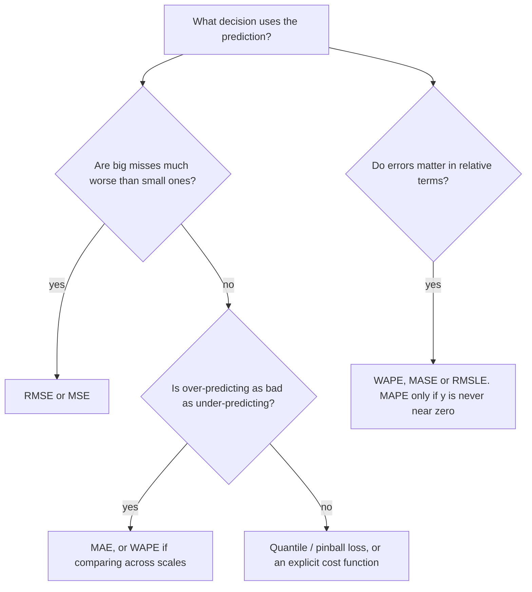
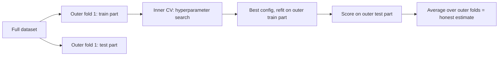
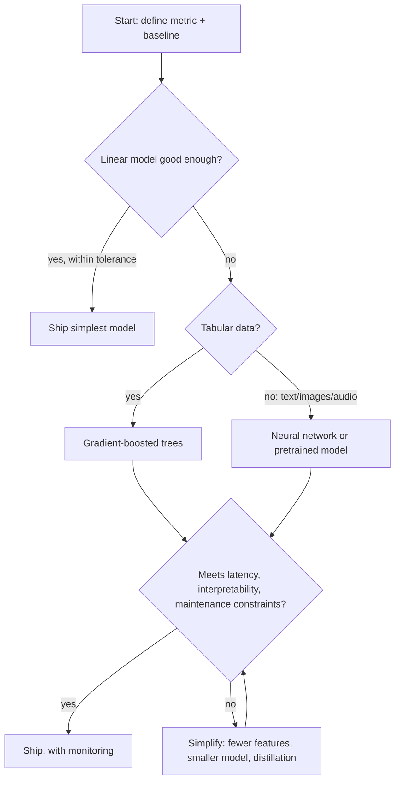

# Regression Metrics, Baselines and Model Selection

> **Level:** Beginner to Advanced · **Study time:** ~110 min · **Prerequisites:** [Probability and Statistics for ML](../00-foundations/04-probability-and-statistics.md), [The ML Workflow, Splits and Cross-Validation](./01-ml-workflow-data-splits-and-cross-validation.md), [Linear and Logistic Regression](./02-linear-and-logistic-regression.md), [Overfitting, Bias-Variance and Leakage](./03-overfitting-regularization-and-data-leakage.md)

## Table of contents

- [Why this matters](#why-this-matters)
- [The running example and a few definitions](#the-running-example-and-a-few-definitions)
- [The core regression metrics: MAE, MSE, RMSE, MAPE and R-squared](#the-core-regression-metrics-mae-mse-rmse-mape-and-r-squared)
- [Sensitivity to outliers](#sensitivity-to-outliers)
- [MSE vs MAE as a loss: mean vs median](#mse-vs-mae-as-a-loss-mean-vs-median)
- [Choosing a metric aligned with the business](#choosing-a-metric-aligned-with-the-business)
- [Baselines: the models you must beat first](#baselines-the-models-you-must-beat-first)
- [Comparing models fairly](#comparing-models-fairly)
- [Hyperparameter search strategies](#hyperparameter-search-strategies)
- [Choosing a model under real constraints](#choosing-a-model-under-real-constraints)
- [No free lunch](#no-free-lunch)
- [Going deeper: regression evaluation in production](#going-deeper-regression-evaluation-in-production)
- [The model selection checklist](#the-model-selection-checklist)
- [Common mistakes and misconceptions](#common-mistakes-and-misconceptions)
- [Interview questions and model answers](#interview-questions-and-model-answers)
- [Key takeaways](#key-takeaways)
- [Further reading](#further-reading)
- [Next](#next)

## Why this matters

Most models that touch money predict a number: a house price, tomorrow's demand, a delivery time, the latency of an LLM request, the GPU hours a training job will need. How you score those numbers decides which model ships, and a badly chosen metric quietly optimizes the wrong thing (for example, a forecast that systematically under-predicts because MAPE rewarded it). Interviewers use this topic to separate people who can call `model.fit` from people who can say *why* a model is better, *by how much*, and *whether that difference is real*. The same skills (strong baselines, paired comparisons, confidence intervals, disciplined tuning) carry straight over to evaluating LLMs and RAG systems later in the course.

## The running example and a few definitions

We will reuse one tiny example throughout: **predicting house prices** (in thousands of dollars) for five houses.

| House | Actual price $y$ | Predicted price $\hat{y}$ | Error $y - \hat{y}$ |
|---|---|---|---|
| 1 | 200 | 210 | -10 |
| 2 | 300 | 290 | +10 |
| 3 | 400 | 430 | -30 |
| 4 | 500 | 480 | +20 |
| 5 | 600 | 600 | 0 |

A few terms first:

- **Regression**: a supervised learning task where the target is a continuous number (price, temperature, minutes), as opposed to **classification**, where the target is a category (spam or not spam).
- **Target** ($y$): the true value we want to predict. Also called the label or ground truth.
- **Prediction** ($\hat{y}$, read "y-hat"): the model's guess.
- **Residual** (or **error**) $e = y - \hat{y}$: how far off the prediction is. Positive means we **under-predicted** (guessed too low); negative means we **over-predicted**.
- **Metric**: a number that summarizes how good predictions are, used to *evaluate* and *compare* models. It is for humans and decisions.
- **Loss function**: a number the training algorithm *minimizes* by adjusting the model's parameters. It must usually be differentiable (smooth enough to compute gradients, see [Calculus and Gradients](../00-foundations/03-calculus-and-gradients.md)).

> **Analogy:** The loss is the drill the athlete practices every day. The metric is the score in the actual match. They should be related, but they do not have to be identical, and confusing the two causes many mistakes.

## The core regression metrics: MAE, MSE, RMSE, MAPE and R-squared

### MAE: Mean Absolute Error

**Intuition:** "On average, how many thousand dollars am I off by?" You ignore the direction of the error and just average the distances.

**Mean Absolute Error (MAE)** is the average absolute size of the errors:

$$
\text{MAE} = \frac{1}{n}\sum_{i=1}^{n} \left| y_i - \hat{y}_i \right|
$$

- $n$: number of examples.
- $y_i$: the true value for example $i$.
- $\hat{y}_i$: the prediction for example $i$.
- $|\cdot|$: absolute value (drop the minus sign).
- $\sum_{i=1}^{n}$: add up over all examples.

**Worked example (houses):**

- Absolute errors: $|-10| = 10$, $|10| = 10$, $|-30| = 30$, $|20| = 20$, $|0| = 0$.
- Sum: $10 + 10 + 30 + 20 + 0 = 70$.
- MAE $= 70 / 5 = 14$, so we are off by **\$14k** on a typical house.

MAE is in the **same units as the target** (thousands of dollars), which makes it easy to explain to non-technical stakeholders.

### MSE: Mean Squared Error

**Intuition:** Square every error before averaging. Small errors stay small, big errors become *huge*. MSE says "I really hate big misses."

$$
\text{MSE} = \frac{1}{n}\sum_{i=1}^{n} \left( y_i - \hat{y}_i \right)^2
$$

- Same symbols as above; $(\cdot)^2$ means multiply the error by itself.

**Worked example:**

- Squared errors: $(-10)^2 = 100$, $10^2 = 100$, $(-30)^2 = 900$, $20^2 = 400$, $0^2 = 0$.
- Sum: $100 + 100 + 900 + 400 + 0 = 1500$.
- MSE $= 1500 / 5 = 300$.

The unit is "thousand dollars **squared**", which is meaningless to a business person. That is why we usually report RMSE instead.

### RMSE: Root Mean Squared Error

**Root Mean Squared Error (RMSE)** is the square root of MSE, which brings the unit back to the target's unit:

$$
\text{RMSE} = \sqrt{\text{MSE}} = \sqrt{\frac{1}{n}\sum_{i=1}^{n} \left( y_i - \hat{y}_i \right)^2}
$$

**Worked example:** $\sqrt{300} \approx 17.32$, so RMSE is about **\$17.3k**.

Notice RMSE (17.32) is larger than MAE (14). That is always true or equal:

$$
\text{MAE} \le \text{RMSE} \le \sqrt{n}\cdot\text{MAE}
$$

- RMSE equals MAE only when every absolute error is the same size.
- The bigger the gap between RMSE and MAE, the more **uneven** your errors are (a few large misses mixed with many small ones). Check: $14 \le 17.32 \le \sqrt{5}\times 14 \approx 31.3$.

> **Interview tip:** "RMSE is much bigger than MAE" is a diagnostic statement: it tells you the error distribution has a heavy tail. Go look at the worst predictions.

### MAPE: Mean Absolute Percentage Error, and its pitfalls

**Intuition:** "On average, how many percent am I off by?" Being \$10k off on a \$200k house feels worse than being \$10k off on a \$2M house, so we divide each error by the true value.

$$
\text{MAPE} = \frac{100\%}{n}\sum_{i=1}^{n} \left| \frac{y_i - \hat{y}_i}{y_i} \right|
$$

- The fraction $\frac{y_i - \hat{y}_i}{y_i}$ is the error **relative** to the true value.
- Multiplying by $100\%$ turns it into a percentage.

**Worked example:**

- House 1: $10 / 200 = 0.0500$
- House 2: $10 / 300 \approx 0.0333$
- House 3: $30 / 400 = 0.0750$
- House 4: $20 / 500 = 0.0400$
- House 5: $0 / 600 = 0$
- Sum: $0.0500 + 0.0333 + 0.0750 + 0.0400 + 0 = 0.1983$
- MAPE $= 0.1983 / 5 \approx 0.0397$, so about **3.97%**.

MAPE is popular because it is scale-free and sounds intuitive. It also has serious pitfalls that interviewers love:

1. **Division by zero.** If any $y_i = 0$ (zero sales of a product on a given day), MAPE is undefined or infinite. Some libraries (scikit-learn included) quietly replace the zero with a tiny epsilon instead of raising an error, which produces astronomically large values (around $10^{15}$ times the error).
2. **Explodes for small actuals.** Actual sales = 1 unit, forecast = 3 units: error is $|1 - 3| / 1 = 200\%$. One slow-moving product can dominate the average across thousands of products.
3. **Asymmetric: it rewards under-forecasting.** For non-negative forecasts, an under-forecast can cost at most 100% (forecast 0), but an over-forecast is unbounded. Concretely: actual 100, forecast 200 gives 100% error; actual 200, forecast 100 gives only 50% error, even though both misses are 100 units. A model trained or selected on MAPE learns to **predict low**.
4. **Meaningless on interval scales.** Percentages only make sense when zero means "none". Temperature in Celsius has an arbitrary zero, so MAPE on it is nonsense.

**Better alternatives when you want a relative metric:**

| Metric | Formula (idea) | Fixes | Caveat |
|---|---|---|---|
| **WAPE** (Weighted Absolute Percentage Error, also called MAD/Mean ratio) | $\frac{\sum_i \lvert y_i - \hat{y}_i\rvert}{\sum_i \lvert y_i\rvert}$ | Zeros in individual rows, small-actual blow-ups | Dominated by large items (often what the business wants) |
| **sMAPE** (symmetric MAPE) | divide by $(\lvert y_i\rvert + \lvert\hat{y}_i\rvert)/2$ | Partially reduces asymmetry | Still unstable near zero; several competing definitions exist |
| **MASE** (Mean Absolute Scaled Error, Hyndman and Koehler, 2006) | MAE divided by the MAE of a naive (last value) forecast on the training data | Scale-free, handles zeros, built-in baseline comparison | Needs a sensible naive forecast; less intuitive to business users |
| **RMSLE** (root mean squared log error) | RMSE of $\log(1+y)$ vs $\log(1+\hat{y})$ | Relative errors, robust to huge targets | Only for non-negative targets; penalizes under-prediction slightly more than over-prediction |

For our houses, WAPE $= 70 / (200+300+400+500+600) = 70 / 2000 = 3.5\%$. Note it differs from MAPE (3.97%) because the bigger houses, which had smaller relative errors, now carry more weight.

### R-squared: the coefficient of determination

**Intuition:** "How much better am I than the laziest possible model, which always predicts the average price?" $R^2$ answers that as a fraction.

**R-squared** ($R^2$, the **coefficient of determination**) compares your squared error to the squared error of always predicting the mean:

$$
R^2 = 1 - \frac{SS_{\text{res}}}{SS_{\text{tot}}} = 1 - \frac{\sum_{i}(y_i - \hat{y}_i)^2}{\sum_{i}(y_i - \bar{y})^2}
$$

- $SS_{\text{res}}$: the **residual sum of squares**, your model's total squared error.
- $SS_{\text{tot}}$: the **total sum of squares**, the squared error of a model that always predicts $\bar{y}$.
- $\bar{y}$ (read "y-bar"): the mean of the true values.

Dividing top and bottom by $n$ shows $R^2 = 1 - \text{MSE}/\text{Var}(y)$, so $R^2$ is just MSE rescaled by how spread out the target is.

**Worked example:**

- $\bar{y} = (200 + 300 + 400 + 500 + 600) / 5 = 2000 / 5 = 400$.
- $SS_{\text{tot}} = (200-400)^2 + (300-400)^2 + (400-400)^2 + (500-400)^2 + (600-400)^2$
  $= 40000 + 10000 + 0 + 10000 + 40000 = 100000$.
- $SS_{\text{res}} = 1500$ (computed in the MSE example).
- $R^2 = 1 - 1500 / 100000 = 1 - 0.015 = 0.985$.

How to read $R^2$:

| Value | Meaning |
|---|---|
| $1$ | Perfect predictions |
| $0$ | No better than predicting the mean |
| $< 0$ | **Worse** than predicting the mean (yes, this happens on test data) |

$R^2$ can be negative on a test set because nothing forces your model to beat the mean on data it did not see. A negative test $R^2$ is a loud alarm: overfitting, a bug, a feature that is computed differently at test time than in training, or distribution shift.

**Adjusted R-squared** penalizes adding features, because plain $R^2$ on the *training* set never decreases when you add a feature:

$$
R^2_{\text{adj}} = 1 - (1 - R^2)\frac{n - 1}{n - p - 1}
$$

- $p$: number of features (predictors).
- With our $R^2 = 0.985$, $n = 5$, $p = 1$: $(1 - 0.985)\times\frac{4}{3} = 0.015 \times 1.333 = 0.02$, so $R^2_{\text{adj}} = 0.98$.

Adjusted $R^2$ is mostly a statistics-class tool for in-sample linear models. In ML practice, held-out evaluation (cross-validation) is the better guard against too many features.

> **Common mistake:** Comparing $R^2$ across different datasets. Because $R^2$ divides by the target's variance, the same model with the same MSE gets a higher $R^2$ on a dataset with a wider spread of prices. $R^2$ is a relative score, not an absolute quality measure.

### Code: metrics from scratch, then scikit-learn

```python
# pip install numpy scikit-learn   (root_mean_squared_error needs scikit-learn >= 1.4)
import numpy as np
from sklearn.metrics import (
    mean_absolute_error, mean_squared_error, root_mean_squared_error,
    mean_absolute_percentage_error, r2_score,
)

y_true = np.array([200, 300, 400, 500, 600], dtype=float)
y_pred = np.array([210, 290, 430, 480, 600], dtype=float)

# --- From scratch: each metric is one line of NumPy ---
def mae(y, p):  return np.mean(np.abs(y - p))
def mse(y, p):  return np.mean((y - p) ** 2)
def rmse(y, p): return np.sqrt(mse(y, p))
def mape(y, p): return np.mean(np.abs((y - p) / y)) * 100   # breaks if any y == 0
def wape(y, p): return np.sum(np.abs(y - p)) / np.sum(np.abs(y)) * 100
def r2(y, p):
    ss_res = np.sum((y - p) ** 2)
    ss_tot = np.sum((y - y.mean()) ** 2)
    return 1 - ss_res / ss_tot

print(f"MAE  {mae(y_true, y_pred):.2f}")    # MAE  14.00
print(f"MSE  {mse(y_true, y_pred):.2f}")    # MSE  300.00
print(f"RMSE {rmse(y_true, y_pred):.2f}")   # RMSE 17.32
print(f"MAPE {mape(y_true, y_pred):.2f}%")  # MAPE 3.97%
print(f"WAPE {wape(y_true, y_pred):.2f}%")  # WAPE 3.50%
print(f"R2   {r2(y_true, y_pred):.3f}")     # R2   0.985

# --- scikit-learn equivalents ---
print(mean_absolute_error(y_true, y_pred))          # 14.0
print(mean_squared_error(y_true, y_pred))           # 300.0
print(root_mean_squared_error(y_true, y_pred))      # about 17.32
print(mean_absolute_percentage_error(y_true, y_pred))  # about 0.0397 (a FRACTION, not percent)
print(r2_score(y_true, y_pred))                     # 0.985
```

> **Common mistake:** scikit-learn's `mean_absolute_percentage_error` returns a fraction (0.0397), not a percent (3.97). Also, older code uses `mean_squared_error(..., squared=False)` for RMSE; that argument was deprecated in scikit-learn 1.4 and later removed, so use `root_mean_squared_error`.

### Summary table

| Metric | Unit | Outlier sensitivity | Best for | Main weakness |
|---|---|---|---|---|
| MAE | Target unit | Low (linear) | Explaining "typical error"; robust evaluation | Not smooth at 0 as a loss; ignores how bad the worst cases are |
| MSE | Target unit squared | High (quadratic) | Training loss (smooth, and convex, meaning bowl-shaped with a single minimum, for linear models) | Uninterpretable unit; dominated by outliers |
| RMSE | Target unit | High | Reporting when big errors are disproportionately costly | Dominated by a few large errors |
| MAPE | Percent | Very high for small $y$ | Quick relative communication when $y$ is never near 0 | Zeros, small actuals, rewards under-forecasting |
| WAPE | Percent | Low | Aggregate demand forecasting | Hides poor accuracy on small items |
| $R^2$ | Unitless | High (it is MSE-based) | "How much better than the mean?" | Not comparable across datasets; can be negative |

## Sensitivity to outliers

An **outlier** is an example whose value or error is far away from the rest. It might be a data error (a price typed with an extra zero) or a genuinely rare case (a mansion in a street of bungalows).

Let us break house 5: the model predicts 400 instead of 600, an error of 200.

| Metric | Before | After one bad prediction | Growth |
|---|---|---|---|
| Sum of absolute errors | 70 | $70 + 200 = 270$ | |
| MAE | 14 | $270 / 5 = 54$ | 3.9x |
| Sum of squared errors | 1500 | $1500 + 200^2 = 41500$ | |
| MSE | 300 | $41500 / 5 = 8300$ | 27.7x |
| RMSE | 17.32 | $\sqrt{8300} \approx 91.10$ | 5.3x |
| $R^2$ | 0.985 | $1 - 41500/100000 = 0.585$ | |

One bad house out of five moved MSE by a factor of almost 28. Squaring means an error of 200 counts as much as **400** errors of size 10.

```text
Penalty for an error of size e

 penalty
   ^
   |                          * MSE (e^2)
   |                       *
   |                    *
   |                *
   |            *                 . . . MAE (|e|)
   |       *            . . . .
   |  * . . . . . . .
   +-------------------------------> |e|
      small errors: similar     large errors: MSE explodes
```

Is outlier sensitivity good or bad? **It depends on what the outlier is.**

- If big misses are genuinely more costly (a delivery-time model where a 3-hour miss loses a customer but a 5-minute miss does not matter), you *want* RMSE's sensitivity.
- If the outliers are noise or data errors, RMSE lets a handful of junk rows decide which model wins. Use MAE, or clean the data, or evaluate both.

> **Senior insight:** Before choosing a robust metric to "fix" outliers, look at them. Ten minutes of inspecting the 20 worst residuals often reveals a unit bug, a duplicated row, or a whole segment (new-build homes, a new country) the model has never seen. The metric choice should follow from that diagnosis, not replace it.

## MSE vs MAE as a loss: mean vs median

Metrics and losses meet here. The key fact:

- The single constant that **minimizes MSE** is the **mean** of the targets.
- The single constant that **minimizes MAE** is the **median** of the targets.

More generally, a flexible model trained with MSE learns the **conditional mean** $E[y \mid x]$ (the average price for houses with these features), and one trained with MAE learns the **conditional median** (the middle price for such houses).

**Worked example.** Five houses on a street sell for 200, 300, 400, 500 and 2000 (a mansion). You must guess one number for "a house on this street."

- Mean $= (200+300+400+500+2000)/5 = 3400/5 = 680$.
- Median (middle value when sorted) $= 400$.

Score both guesses:

| Guess | MAE | MSE |
|---|---|---|
| 680 (mean) | $(480+380+280+180+1320)/5 = 2640/5 = 528$ | $(230400+144400+78400+32400+1742400)/5 = 2228000/5 = 445600$ |
| 400 (median) | $(200+100+0+100+1600)/5 = 2000/5 = 400$ | $(40000+10000+0+10000+2560000)/5 = 2620000/5 = 524000$ |

Each metric prefers the guess it is "built for." The mansion drags the mean up to 680, a price no ordinary house on the street sells for; the median ignores how extreme the mansion is.

```python
import numpy as np

y = np.array([200, 300, 400, 500, 2000], dtype=float)
candidates = np.arange(0, 2001)                       # try every integer guess

best_for_mse = candidates[np.argmin([np.mean((y - c) ** 2) for c in candidates])]
best_for_mae = candidates[np.argmin([np.mean(np.abs(y - c)) for c in candidates])]
print(best_for_mse, y.mean())      # 680 680.0
print(best_for_mae, np.median(y))  # 400 400.0
```

**Why does this happen? Look at the gradients.**

- MSE loss for one example: $L = (y - \hat{y})^2$, gradient $\frac{\partial L}{\partial \hat{y}} = -2(y - \hat{y})$. The push is **proportional to the error**, so at the guess 680 the mansion (error 1320) pulls about 13x harder than a house that is 100 off.
- MAE loss: $L = |y - \hat{y}|$, gradient $= -\text{sign}(y - \hat{y})$, which is $-1$ or $+1$. Every example pushes with the **same strength**, so the optimum is where half the points push up and half push down: the median.

**Training trade-offs:**

| | MSE loss | MAE loss |
|---|---|---|
| Learns | Conditional mean | Conditional median |
| Gradient | Smooth, shrinks near the optimum (nice for gradient descent) | Constant magnitude, undefined at exactly 0 (needs subgradients; can oscillate near the optimum unless the learning rate decays) |
| Closed form for linear models | Yes (ordinary least squares) | No (needs linear programming or iterative solvers) |
| Outliers in labels | Dragged toward them | Robust |
| Probabilistic view | Maximum likelihood under **Gaussian** noise | Maximum likelihood under **Laplace** noise (heavier tails) |

Two terms from the table. A **subgradient** is any slope that fits under a kink: at $e = 0$ the absolute value has no single derivative, so optimizers pick a value in $[-1, 1]$ (usually 0) and carry on. **Maximum likelihood** means choosing parameters that make the observed labels most probable under an assumed noise model. The Gaussian log-likelihood contains $-(y - \hat{y})^2$ and the Laplace one contains $-|y - \hat{y}|$, so choosing MSE or MAE is choosing what you believe the noise looks like.

**Huber loss** combines both: quadratic for small errors, linear for large ones.

$$
L_\delta(e) =
\begin{cases}
\frac{1}{2}e^2 & \text{if } |e| \le \delta \\
\delta\left(|e| - \frac{1}{2}\delta\right) & \text{otherwise}
\end{cases}
$$

- $e = y - \hat{y}$: the error.
- $\delta$: the threshold where quadratic switches to linear (a hyperparameter, in target units).

With $\delta = 10$: an error of 5 costs $\frac{1}{2}\times 25 = 12.5$ (quadratic zone). An error of 200 costs $10 \times (200 - 5) = 1950$, compared with $\frac{1}{2}\times 200^2 = 20000$ under half-MSE. Smooth near zero like MSE, robust to outliers like MAE. The deep learning [loss functions chapter](../02-deep-learning/04-loss-functions.md) covers Huber, smooth L1 and friends in more detail.

> **Senior insight:** You can train with one objective and evaluate with another, but be deliberate. If the business metric is MAE, training with MSE produces a mean-predictor, which on skewed targets (prices, durations, revenue) is systematically above the median and leaves MAE on the table. Gradient-boosting libraries (XGBoost, LightGBM, scikit-learn's `HistGradientBoostingRegressor`) support absolute-error and quantile objectives directly, and LightGBM, XGBoost (as pseudo-Huber) and scikit-learn's `GradientBoostingRegressor` also offer Huber, so aligning them is cheap. Conversely, if the noise is roughly symmetric, the conditional mean and median nearly coincide, and training with MSE costs little even when you are judged on MAE.

## Choosing a metric aligned with the business

A metric is a **proxy for a decision**. Work backwards from the decision and the cost of being wrong.



### Asymmetric costs: the quantile (pinball) loss

**Analogy:** A bakery deciding how many loaves to bake. An unsold loaf costs \$1 (waste). A customer who finds the shelf empty costs \$3 (lost profit and goodwill). You should not aim for the "average" demand; you should bake a bit more.

The **quantile loss** (also called **pinball loss**) for quantile level $\tau$ is:

$$
L_\tau(y, \hat{y}) =
\begin{cases}
\tau\,(y - \hat{y}) & \text{if } y \ge \hat{y} \quad \text{(under-prediction)} \\
(1 - \tau)\,(\hat{y} - y) & \text{if } y < \hat{y} \quad \text{(over-prediction)}
\end{cases}
$$

- $\tau$ (tau): a number between 0 and 1. The model that minimizes this loss predicts the $\tau$-th **quantile** of $y$ given $x$ (the value that the true $y$ falls below a fraction $\tau$ of the time).
- With $\tau = 0.5$ the loss is half the absolute error, so you get the median.

For the bakery, the optimal quantile is the **critical ratio** from the classic newsvendor problem:

$$
\tau^* = \frac{c_{\text{under}}}{c_{\text{under}} + c_{\text{over}}} = \frac{3}{3 + 1} = 0.75
$$

- $c_{\text{under}}$: cost per unit of under-predicting (\$3).
- $c_{\text{over}}$: cost per unit of over-predicting (\$1).

So you should bake the **75th percentile** of demand. Check the loss by hand with $\tau = 0.75$ and true demand $y = 100$:

- Bake 90 (under by 10): loss $= 0.75 \times 10 = 7.5$.
- Bake 110 (over by 10): loss $= 0.25 \times 10 = 2.5$.

Under-predicting is penalized 3x as hard, exactly matching the business costs.

```python
# pip install scikit-learn
import numpy as np
from sklearn.datasets import make_regression
from sklearn.model_selection import train_test_split
from sklearn.ensemble import HistGradientBoostingRegressor
from sklearn.metrics import mean_pinball_loss

X, y = make_regression(n_samples=4000, n_features=8, noise=30.0, random_state=0)
X_tr, X_te, y_tr, y_te = train_test_split(X, y, test_size=0.25, random_state=0)

mean_model = HistGradientBoostingRegressor(random_state=0).fit(X_tr, y_tr)  # squared error
q75_model = HistGradientBoostingRegressor(loss="quantile", quantile=0.75,
                                          random_state=0).fit(X_tr, y_tr)

def business_cost(y, p, c_under=3.0, c_over=1.0):
    under = np.clip(y - p, 0, None)    # how much we fell short
    over = np.clip(p - y, 0, None)     # how much we overshot
    return np.mean(c_under * under + c_over * over)

for name, m in [("mean model", mean_model), ("q0.75 model", q75_model)]:
    p = m.predict(X_te)
    print(f"{name:12s} pinball={mean_pinball_loss(y_te, p, alpha=0.75):6.2f} "
          f"cost={business_cost(y_te, p):7.2f} "
          f"share of y below prediction={np.mean(y_te <= p):.2f}")
# Expect the quantile model to have lower pinball loss and lower business cost
# (about 16.3 vs 17.4 pinball, 65 vs 70 cost with scikit-learn 1.9), and a share of
# true values below its predictions near 0.75 (about 0.69 here; boosted quantile
# models often under-cover a little on test data) vs about 0.5 for the mean model.
```

Note that the business cost here is exactly $4\times$ the pinball loss with $\tau = 0.75$, which is why the critical ratio works.

> **Interview tip:** When an interviewer describes a forecasting problem, ask "what does it cost to be too high versus too low?" before naming a metric. That one question signals seniority.

### Other alignment questions to ask

- **Who consumes the prediction, at what granularity?** A store-level forecast evaluated per SKU (stock keeping unit, one product) needs a different metric than one evaluated in aggregate.
- **Are some examples more important?** Weight the metric (by revenue, by customer tier). scikit-learn metrics accept `sample_weight`.
- **Is a range more useful than a point?** If the downstream decision needs uncertainty (safety stock, capacity planning), predict quantiles or intervals and evaluate **coverage** (how often the true value lands inside the interval) and interval width.
- **Is the target heavily skewed?** Durations, prices and revenue usually are. Consider modeling $\log(y)$ and evaluating with relative error metrics, remembering that exponentiating a prediction of the mean of $\log y$ gives something closer to the median of $y$, not its mean.

## Baselines: the models you must beat first

**Analogy:** Before claiming your new running shoes make you faster, time yourself in your old shoes on the same track.

A **baseline** is a deliberately simple model that sets the bar any real model must clear. Without one, "MAE = 14" means nothing: maybe predicting the average already gets 15, or maybe it gets 80.

| Baseline | Prediction | When to use it | Notes |
|---|---|---|---|
| **Mean predictor** | Training-set mean of $y$ | Any regression | Has $R^2 = 0$ on training data by definition. Optimal constant for MSE |
| **Median predictor** | Training-set median | When evaluating MAE | Optimal constant for MAE |
| **Group mean** | Mean per segment (per neighborhood, per product) | Strong categorical signal | Often surprisingly hard to beat |
| **Last value (naive forecast)** | $\hat{y}_t = y_{t-1}$ | Time series | The reference that MASE divides by |
| **Seasonal naive** | $\hat{y}_t = y_{t-s}$ (same day last week, $s = 7$) | Series with weekly or yearly cycles | Very strong for retail and traffic |
| **Simple rule** | Domain formula, such as price per square foot in this zip code times area | When experts already have a heuristic | Shows whether ML adds value over the current process |
| **Simple model** | Linear or ridge regression on a few features | Always, before anything fancy | Linear regression is covered in [the previous regression chapter](./02-linear-and-logistic-regression.md) |
| **Current production model** | Whatever is serving today | Any model update | The baseline that actually matters for shipping |

```python
# Baselines vs real models with identical cross-validation folds
import numpy as np
from sklearn.datasets import make_regression
from sklearn.dummy import DummyRegressor
from sklearn.linear_model import Ridge
from sklearn.ensemble import HistGradientBoostingRegressor
from sklearn.model_selection import KFold, cross_val_score

X, y = make_regression(n_samples=2000, n_features=10, noise=20.0, random_state=0)
cv = KFold(n_splits=5, shuffle=True, random_state=42)   # SAME folds for every model

models = {
    "mean":   DummyRegressor(strategy="mean"),
    "median": DummyRegressor(strategy="median"),
    "ridge":  Ridge(alpha=1.0),
    "hgbt":   HistGradientBoostingRegressor(random_state=0),
}
for name, model in models.items():
    maes = -cross_val_score(model, X, y, cv=cv, scoring="neg_mean_absolute_error")
    print(f"{name:7s} MAE = {maes.mean():7.2f} +/- {maes.std():.2f}")
# make_regression generates a LINEAR target plus noise, so expect ridge to beat
# the boosted trees here. A preview of "no free lunch".
```

scikit-learn scorers follow "higher is better", so error metrics come back negated (`neg_mean_absolute_error`); flip the sign.

For time series, the naive baselines need ordered data and no shuffling:

```python
import numpy as np

rng = np.random.default_rng(0)
t = np.arange(365)
# daily sales: level + weekly cycle + slow random drift
sales = 100 + 10 * np.sin(2 * np.pi * t / 7) + np.cumsum(rng.normal(0, 2, size=365))

test = sales[300:]                         # last 65 days, predicted one day ahead
pred_mean = np.full_like(test, sales[:300].mean())
pred_naive = sales[299:364]                # yesterday's value
pred_seasonal = sales[293:358]             # same weekday last week

for name, p in [("mean", pred_mean), ("naive", pred_naive), ("seasonal", pred_seasonal)]:
    print(f"{name:9s} MAE = {np.mean(np.abs(test - p)):.2f}")
# Because of the drift, the training mean is a poor forecast for later days.
# Which naive baseline wins depends on the relative size of the weekly cycle
# and the day-to-day noise: run it and see.
```

> **Senior insight:** In real forecasting projects, a well-tuned seasonal naive or simple exponential smoothing (a weighted average of past values whose weights shrink for older observations) baseline regularly holds its own against complex models. The large M-competitions run by Spyros Makridakis and colleagues repeatedly found that simple statistical methods were hard to beat (although ML and combination methods have improved in recent editions, such as M4 and M5). Always report your improvement **relative to the baseline**, for example "18% lower MAE than seasonal naive."

## Comparing models fairly

Model B has MAE 14.1 and model A has MAE 14.5. Is B better? Maybe. Maybe B just got luckier on this particular test set. Fair comparison has three ingredients.

### 1. Same data, same splits, same preprocessing

- Evaluate every candidate on **identical folds** (fix the `random_state` and reuse the same `cv` object, as above). Different splits add noise that has nothing to do with the models.
- Fit all preprocessing (scaling, imputation, target encoding) **inside** each training fold using a `Pipeline`, or the comparison is contaminated by leakage (see [Overfitting and Data Leakage](./03-overfitting-regularization-and-data-leakage.md)).
- Use the right split type: time-ordered splits for time series, grouped splits when the same entity (house, user, patient) appears multiple times (see [Splits and Cross-Validation](./01-ml-workflow-data-splits-and-cross-validation.md)).
- Give each model a comparable **tuning budget**. Comparing a carefully tuned favorite against a default-settings rival is the most common unfair comparison in practice.

### 2. Confidence intervals: how noisy is the metric?

A metric computed on a finite test set is an *estimate*. A **confidence interval** (CI) is a range that, under repeated sampling, would contain the true value a stated fraction of the time (for example 95%).

Quick approximation for MAE: the **standard error** (how much the metric itself would wobble if you drew a different test set of the same size) is roughly the standard deviation of the per-example absolute errors divided by $\sqrt{n}$. Since it shrinks with $\sqrt{n}$, quadrupling the test set only halves the uncertainty.

**Worked example (houses):** the absolute errors 10, 10, 30, 20, 0 have mean 14 and sample standard deviation $\sqrt{520/4} \approx 11.4$, so the standard error is $11.4/\sqrt{5} \approx 5.1$ and a rough 95% interval is $14 \pm 1.96 \times 5.1 \approx [4, 24]$. With five examples the normal approximation is crude, but the message is right: "MAE = 14" on a tiny test set is barely informative.

A more general tool is the **bootstrap**: resample the test set with replacement many times, recompute the metric each time, and take the 2.5th and 97.5th percentiles as a 95% interval. It works for any metric, including RMSE and $R^2$, without formulas.

### 3. Paired comparisons: compare differences, not two separate numbers

**Analogy:** To test whether new shoes are faster, have the *same* runners run in both shoes and look at each runner's difference. Comparing a group of runners in new shoes to a different group in old shoes drowns the shoe effect in runner-to-runner variation.

Models evaluated on the same examples (or folds) are **paired**. Some houses are hard for every model; pairing cancels that shared difficulty out. The right question is "what is the distribution of (error of A minus error of B) on the same examples?"

**Paired bootstrap on a test set:**

```python
# pip install numpy scipy scikit-learn
import numpy as np
from scipy.stats import wilcoxon
from sklearn.datasets import make_regression
from sklearn.model_selection import train_test_split
from sklearn.linear_model import Ridge
from sklearn.ensemble import HistGradientBoostingRegressor

X, y = make_regression(n_samples=2000, n_features=10, noise=20.0, random_state=0)
X_tr, X_te, y_tr, y_te = train_test_split(X, y, test_size=0.25, random_state=0)

err_a = np.abs(y_te - Ridge().fit(X_tr, y_tr).predict(X_te))
err_b = np.abs(y_te - HistGradientBoostingRegressor(random_state=0)
               .fit(X_tr, y_tr).predict(X_te))

diff = err_b - err_a            # per-example; positive means A (ridge) is better
rng = np.random.default_rng(0)
n = len(diff)
boot = np.array([diff[rng.integers(0, n, n)].mean() for _ in range(10_000)])
lo, hi = np.percentile(boot, [2.5, 97.5])
print(f"MAE(B) - MAE(A) = {diff.mean():.2f}   95% CI [{lo:.2f}, {hi:.2f}]")
# If the interval excludes 0, the difference is unlikely to be test-set luck.

# Non-parametric paired test on per-example absolute errors
print(wilcoxon(err_a, err_b))
```

The **Wilcoxon signed-rank test** is a paired test that does not assume the differences are normally distributed. Strictly, it tests whether the differences are distributed symmetrically around zero (roughly, whether their pseudo-median is zero), which is close to, but not the same as, "MAE differs."

**Paired t-test across cross-validation folds, worked by hand.** Five folds, MAE per fold (illustrative numbers):

| Fold | Model A | Model B | Difference $d = A - B$ |
|---|---|---|---|
| 1 | 14.2 | 13.9 | 0.3 |
| 2 | 15.1 | 14.8 | 0.3 |
| 3 | 13.8 | 13.9 | -0.1 |
| 4 | 14.9 | 14.4 | 0.5 |
| 5 | 14.5 | 14.1 | 0.4 |

The paired t-statistic is:

$$
t = \frac{\bar{d}}{s_d / \sqrt{k}}
$$

- $\bar{d}$: the mean of the per-fold differences.
- $s_d$: the sample standard deviation of the differences (divide by $k - 1$).
- $k$: the number of folds. Compare $t$ to a t-distribution with $k - 1$ degrees of freedom.

Step by step:

- $\bar{d} = (0.3 + 0.3 - 0.1 + 0.5 + 0.4) / 5 = 1.4 / 5 = 0.28$.
- Deviations from the mean: $0.02, 0.02, -0.38, 0.22, 0.12$.
- Squared: $0.0004, 0.0004, 0.1444, 0.0484, 0.0144$, sum $= 0.208$.
- $s_d^2 = 0.208 / 4 = 0.052$, so $s_d = \sqrt{0.052} \approx 0.228$.
- Standard error $= 0.228 / \sqrt{5} = 0.228 / 2.236 \approx 0.102$.
- $t = 0.28 / 0.102 \approx 2.75$.

The two-sided 5% critical value for 4 degrees of freedom is about 2.776 (the threshold $|t|$ must exceed for the difference to count as significant at the 5% level), so $t = 2.75$ falls just **short** of significance at the 5% level, even though B won 4 of 5 folds.

And it is worse than that: the folds share most of their training data, so the per-fold scores are correlated and the naive t-test **underestimates** the variance (it is overconfident). Nadeau and Bengio (2003) proposed a **corrected resampled t-test** that inflates the variance factor from $\frac{1}{k}$ to $\frac{1}{k} + \frac{n_{\text{test}}}{n_{\text{train}}}$. It was derived for repeated random train/test splits and is commonly applied to (repeated) k-fold as well. For 5-fold CV, $n_{\text{test}}/n_{\text{train}} = 1/4$, so the factor goes from $0.2$ to $0.45$, the standard error grows by $\sqrt{0.45/0.2} = 1.5$, and the corrected $t \approx 2.75 / 1.5 \approx 1.83$. Not significant.

```python
import numpy as np
from scipy import stats

def corrected_paired_ttest(scores_a, scores_b, n_train, n_test):
    """Nadeau-Bengio corrected resampled t-test on per-split scores."""
    d = np.asarray(scores_a) - np.asarray(scores_b)
    k = len(d)
    se = np.sqrt((1 / k + n_test / n_train) * d.var(ddof=1))
    t = d.mean() / se
    p = 2 * stats.t.sf(abs(t), df=k - 1)
    return t, p

a = [14.2, 15.1, 13.8, 14.9, 14.5]
b = [13.9, 14.8, 13.9, 14.4, 14.1]
print(stats.ttest_rel(a, b))                                  # naive: t about 2.75
print(corrected_paired_ttest(a, b, n_train=800, n_test=200))  # t about 1.83
```

Other tests worth recognizing by name:

- **5x2cv paired t-test** (Dietterich, 1998): five repetitions of 2-fold CV, designed to control false positives when comparing learners.
- **Diebold-Mariano test** (Diebold and Mariano, 1995): compares the accuracy of two time-series forecasts while accounting for autocorrelated errors.
- **Repeated k-fold CV** (for example 5 folds x 10 repeats): more stable estimates; pair it with the corrected t-test.

> **Senior insight:** Statistical significance is not practical significance. A 0.3% MAE improvement can be "significant" on a million examples and still not be worth a more complex model, a new feature pipeline and an on-call burden. Decide the **minimum improvement worth shipping** before you look at the results, and also run multiple comparisons cautiously: testing 50 variants at the 5% level will produce a couple of false winners by chance.

## Hyperparameter search strategies

A **hyperparameter** is a setting you choose *before* training that the training algorithm does not learn: tree depth, learning rate, regularization strength $\alpha$ in ridge regression, number of neighbors $k$. **Hyperparameter search** (or **tuning**) tries different settings and keeps the one with the best validation score.

**Analogy:** Tuning a guitar by ear. You can try every peg position systematically (grid), poke around randomly (random search), or use what each pluck told you to decide the next adjustment (Bayesian optimization).

| Strategy | How it works | Pros | Cons | Use when |
|---|---|---|---|---|
| **Manual** | Expert intuition, one change at a time | Builds understanding | Slow, biased, not reproducible | Early exploration |
| **Grid search** | Try every combination of listed values | Simple, exhaustive, parallel | Cost multiplies with each hyperparameter; wastes trials on unimportant ones | 1-2 hyperparameters, cheap models |
| **Random search** (Bergstra and Bengio, 2012) | Sample combinations from distributions | Covers important dimensions better than grid for the same budget; trivially parallel | No learning from past trials | Default first choice for 3+ hyperparameters |
| **Bayesian optimization** (for example TPE, the Tree-structured Parzen Estimator, Bergstra et al., 2011; Gaussian processes) | Build a model of "score vs settings", pick the next trial where improvement looks likely | Fewer trials for expensive models | Sequential by nature; overhead; more moving parts | Each trial is expensive (minutes to hours) |
| **Successive halving / Hyperband** (successive halving for tuning: Jamieson and Talwalkar, 2016; Hyperband: Li et al., 2017) | Start many configurations on a small budget (few samples or epochs), keep the best fraction, give them more | Kills bad configs early; huge savings | Assumes early performance predicts final performance | Many configs, training can be stopped early |
| **Population-based training** (Jaderberg et al., 2017) | Train a population in parallel, copy and perturb the winners' hyperparameters mid-training | Finds schedules, not just constants | Needs a lot of parallel compute | Large deep learning runs |

**Why random beats grid.** Usually only a couple of hyperparameters really matter. With a 3x3 grid over (learning rate, an unimportant parameter), you test only **3** distinct learning rates in 9 trials. Nine random trials test **9** distinct learning rates.

```text
Grid (9 trials)              Random (9 trials)
important ->                 important ->
 x   x   x                    x      x
 x   x   x                         x      x
 x   x   x                     x       x   x
                                 x        x
3 distinct values of the      9 distinct values of the
important hyperparameter      important hyperparameter
```

**Search on the right scale.** Learning rates and regularization strengths matter in ratios (0.001 vs 0.01 is as big a jump as 0.01 vs 0.1), so sample them **log-uniformly**.

```python
# pip install scikit-learn scipy
from scipy.stats import loguniform, randint
from sklearn.datasets import make_regression
from sklearn.ensemble import HistGradientBoostingRegressor
from sklearn.model_selection import KFold, RandomizedSearchCV, cross_val_score

X, y = make_regression(n_samples=3000, n_features=10, noise=20.0, random_state=0)
cv = KFold(n_splits=5, shuffle=True, random_state=42)

param_dist = {
    "learning_rate": loguniform(1e-3, 0.3),      # log scale
    "max_leaf_nodes": randint(8, 128),
    "min_samples_leaf": randint(5, 100),
    "l2_regularization": loguniform(1e-4, 10.0),
}
search = RandomizedSearchCV(
    HistGradientBoostingRegressor(max_iter=300, random_state=0),
    param_distributions=param_dist,
    n_iter=40,
    cv=cv,
    scoring="neg_mean_absolute_error",
    n_jobs=-1,
    random_state=0,
)
search.fit(X, y)
print(search.best_params_, -search.best_score_)

# Successive halving variant (still marked experimental in scikit-learn)
from sklearn.experimental import enable_halving_search_cv  # noqa: F401
from sklearn.model_selection import HalvingRandomSearchCV

halving = HalvingRandomSearchCV(
    HistGradientBoostingRegressor(max_iter=300, random_state=0),
    param_dist, factor=3, cv=cv, scoring="neg_mean_absolute_error", random_state=0,
)
halving.fit(X, y)
```

### The winner's curse and nested cross-validation

`search.best_score_` is **optimistically biased**: you picked the maximum of many noisy estimates, and the maximum of noisy numbers tends to be lucky. This is the **winner's curse**. The more configurations you try, the bigger the bias.

Two fixes:

1. **Hold out a final test set** that the search never sees, and report the score there once.
2. **Nested cross-validation**: an inner CV loop picks hyperparameters, an outer CV loop measures how good the *whole procedure* (search plus training) is. Use this when data is too small to spare a test set.

```python
# Nested CV: the outer loop evaluates "RandomizedSearchCV as a learning algorithm"
outer = KFold(n_splits=5, shuffle=True, random_state=1)
nested_mae = -cross_val_score(search, X, y, cv=outer, scoring="neg_mean_absolute_error")
print(f"Nested CV MAE: {nested_mae.mean():.2f} +/- {nested_mae.std():.2f}")
```



### Bayesian optimization in practice (Optuna)

Optuna (Akiba et al., 2019) is a widely used library implementing TPE-style Bayesian optimization plus pruning of unpromising trials. Its core API has been stable for years, but check the docs for your version:

```python
# pip install optuna   (API shown is the long-stable core; verify against your version)
# Reuses X, y, cv and HistGradientBoostingRegressor from the search example above.
import optuna
from sklearn.model_selection import cross_val_score

def objective(trial):
    model = HistGradientBoostingRegressor(
        learning_rate=trial.suggest_float("learning_rate", 1e-3, 0.3, log=True),
        max_leaf_nodes=trial.suggest_int("max_leaf_nodes", 8, 128),
        min_samples_leaf=trial.suggest_int("min_samples_leaf", 5, 100),
        max_iter=300, random_state=0,
    )
    return -cross_val_score(model, X, y, cv=cv, scoring="neg_mean_absolute_error").mean()

study = optuna.create_study(direction="minimize")
study.optimize(objective, n_trials=50)
print(study.best_params, study.best_value)
```

> **Senior insight:** Tuning usually gives smaller gains than better features, better data or a better metric. A practical order for tabular regression: strong baseline, a sensible model with library defaults, feature work, *then* a bounded random or Bayesian search with early stopping. Track every trial in an experiment tracker (see [Experiment Tracking](../10-mlops/01-ml-lifecycle-and-experiment-tracking.md)) so results are reproducible.

## Choosing a model under real constraints

The model with the best offline metric is not automatically the right one to ship. Real constraints:

| Constraint | Questions to ask | Leans toward |
|---|---|---|
| **Data size** | Hundreds, thousands or millions of rows? | Small: linear/ridge, small trees, strong regularization. Medium tabular: gradient-boosted trees. Huge or unstructured (text, images): neural networks |
| **Interpretability** | Must you explain individual predictions to regulators or customers? | Linear models, shallow trees, monotonic constraints in gradient-boosted decision trees (GBDTs); post-hoc explanations (SHAP, which attributes each prediction to its features) for complex models |
| **Latency** | p99 budget per prediction (the latency 99% of requests stay under)? Called once or millions of times per second? | Linear models and small tree ensembles are very fast on CPU; large ensembles and deep nets cost more; kNN cost grows with the dataset |
| **Extrapolation** | Will inputs go beyond the training range (new price levels, inflation)? | Linear models extrapolate (sometimes wrongly but at least they move); tree models predict a flat value outside the range they saw |
| **Maintenance** | Who retrains it, how often, with what tooling? | Fewer features, fewer dependencies, simpler pipelines |
| **Training cost and frequency** | Retrain hourly? | Models that train in minutes |
| **Memory and footprint** | Edge device, browser, serverless? | Compact models; quantization or distillation for neural nets (see [Model Compression](../07-model-compression/05-knowledge-distillation-fundamentals.md)) |
| **Uncertainty** | Do downstream consumers need intervals? | Quantile models, conformal prediction, probabilistic models |

A quick map of common regression model families (the tree-based ones are taught in depth in [the next chapter](./06-decision-trees-random-forests-and-gradient-boosting.md)):

| Model family | Strengths | Weaknesses | Typical use |
|---|---|---|---|
| Linear / ridge / lasso | Fast, interpretable, extrapolates, works with little data | Misses non-linearity and interactions unless you engineer features | Baseline; regulated settings; very low latency |
| Random forest | Robust with little tuning | Larger models, slower inference, no extrapolation | Solid default, quick wins |
| Gradient-boosted trees (XGBoost, LightGBM, CatBoost) | Usually the top performers on tabular data | More hyperparameters, no extrapolation | Default for serious tabular regression |
| k-nearest neighbors | No training, simple | Slow at scale, needs good scaling, poor in high dimensions | Small data, similarity-based estimates |
| Neural networks | Unstructured inputs, multi-task, embeddings | Data-hungry, more tuning, harder to explain | Text, images, very large datasets |

> **Senior insight:** A rule of thumb used by many teams: "Ship the simplest model within a tolerance of the best." If ridge regression is within 2% MAE of a 2,000-tree ensemble (illustrative numbers), the ridge model's speed, stability and debuggability may be worth more than the 2%. State the tolerance up front.



## No free lunch

**Intuition:** There is no universally best restaurant: the best one depends on what you are hungry for. Likewise, there is no universally best learning algorithm.

The **No Free Lunch (NFL) theorem** for supervised learning (Wolpert, 1996, "The Lack of A Priori Distinctions Between Learning Algorithms"; a related result for optimization is Wolpert and Macready, 1997) says, informally: **averaged uniformly over all possible target functions, every learning algorithm has the same expected performance on unseen (off-training-set) data.** Any algorithm that wins on some problems must lose on others.

What it does **not** mean:

- It does not mean all algorithms are equally good on *your* problem. Real-world problems are not "all possible problems"; they have structure (smoothness, locality, hierarchy).
- It does not mean experience is useless. Gradient-boosted trees really are a strong default on tabular data; convolutional and transformer models really are strong on images and text. Those priors reflect the structure of real data.

What it means in practice:

1. Every algorithm has an **inductive bias** (built-in assumptions, such as "the relationship is linear" or "nearby points have similar targets"). Performance depends on how well that bias matches your data.
2. You must **validate empirically** on your own data, with a baseline and fair comparisons.
3. Be suspicious of any claim that one method is "the best" without saying for which data.

The baseline code above shows this concretely: on `make_regression` data, which is linear by construction, ridge regression (whose inductive bias is linearity) beats boosted trees.

## Going deeper: regression evaluation in production

### Look beyond the single number: residual analysis

A single aggregate metric hides structure. Plot and slice the residuals:

- **Residuals vs predicted value.** A healthy model shows a shapeless cloud around zero. A funnel shape (errors grow with the prediction) is **heteroscedasticity** (non-constant error variance), a hint to model $\log(y)$ or use relative metrics. A curve means missed non-linearity.
- **Mean residual (bias).** Should be near zero. A consistently positive mean residual means you systematically under-predict.
- **Residuals by segment.** Compute MAE per neighborhood, per price band, per product category, per new vs returning customer. A model can improve overall MAE while getting much worse on a segment that matters (expensive homes, a new market).
- **Worst-k examples.** Read the top 20 errors. They reveal data bugs and missing features faster than any chart.

```python
import pandas as pd

# df has columns: y_true, y_pred, segment
df["abs_err"] = (df["y_true"] - df["y_pred"]).abs()
df["resid"] = df["y_true"] - df["y_pred"]
print(df.groupby("segment").agg(mae=("abs_err", "mean"),
                                bias=("resid", "mean"),
                                n=("abs_err", "size")))
print(df.nlargest(20, "abs_err"))   # read these rows by hand
```

### Offline metric vs online outcome

An offline metric is a proxy. The real test is the business outcome after deployment, measured with an A/B test or a canary release (serving the new model to a small slice of traffic first; see [Model Deployment Patterns](../10-mlops/04-model-deployment-patterns.md)). Common gaps:

- **Feedback loops.** A pricing model changes prices, which changes demand, which changes future training data.
- **Delayed labels.** The true sale price arrives months later, so online monitoring must rely on proxies such as input drift and prediction distribution (see [Data Drift and Concept Drift](./08-data-drift-concept-drift-and-retraining.md)).
- **Training-serving skew.** Features computed differently online and offline (see [Training-Serving Skew](../10-mlops/03-reproducibility-and-training-serving-skew.md)).

### Prediction intervals and calibration

If you output intervals (for example a 10th to 90th percentile range), evaluate them:

- **Coverage:** fraction of true values inside the interval. A nominal 80% interval should cover about 80%.
- **Width:** narrower is better *at the same coverage*.
- **Conformal prediction** is a model-agnostic way to wrap any regressor and get intervals with a finite-sample coverage guarantee under the assumption that data are exchangeable (roughly, independent and identically distributed). The guarantee is *marginal* (on average over inputs), not per input or per segment, and it breaks under distribution shift. Libraries such as MAPIE implement it.

### What changes at scale

- **Many series or many segments.** With thousands of products, choose aggregation deliberately: WAPE or revenue-weighted MAE across products, and per-product MASE to compare forecastability.
- **Metric stability.** On millions of examples, CIs become tiny, so almost any difference is "significant". Use a practical-significance threshold.
- **Cost of evaluation.** Large backtests (repeated time-series evaluation over many cutoff dates) can cost more compute than training. Sample cutoffs and cache features.
- **Latency budgets.** Measure p50 and p99 inference latency of each candidate under realistic batch sizes and hardware; the "best" model may blow the budget.

### Where this shows up in GenAI systems

Regression metrics are everywhere in LLM platforms, even when the product is a chatbot:

- **Capacity planning:** predicting output token counts or request latency to size GPU fleets. Under-predicting causes SLO (service level objective) violations, so a high quantile (pinball loss at $\tau = 0.95$) is often the right target rather than the mean.
- **Cost forecasting:** predicting monthly token spend per tenant; WAPE across tenants is a natural metric.
- **Judge agreement:** when an LLM-as-a-judge outputs numeric scores, you compare them with human scores using correlation and MAE (see [Evaluating LLMs](../05-llms/10-llm-evaluation-metrics-and-llm-as-a-judge.md)).
- **Fair comparison:** comparing two prompts or two RAG configurations on the same eval set is a paired comparison, and the paired bootstrap above applies directly (see [Building an LLM Evaluation Framework](../05-llms/11-building-an-llm-evaluation-framework-and-regression-tests.md)).

## The model selection checklist

Use this before, during and after any model comparison:

1. **Decision and costs.** What decision does the prediction drive? What does an over-prediction cost vs an under-prediction? Are large misses disproportionately bad?
2. **Metric.** Pick one primary metric that matches those costs (MAE, RMSE, pinball, WAPE, a custom cost) plus 1-3 guardrail metrics (bias, worst-segment MAE, latency).
3. **Split.** Choose a split that mirrors production: time-based for forecasting, grouped for repeated entities. Lock the test set away.
4. **Baselines.** Mean/median, naive or seasonal naive, a domain rule, a linear model, the current production model.
5. **Leakage check.** All preprocessing inside pipelines; no features from the future.
6. **Candidates.** A small set of model families suited to the data size and constraints.
7. **Tuning.** Equal, bounded budgets; random or Bayesian search; log scales; early stopping. Track every run.
8. **Fair comparison.** Same folds, paired differences, confidence intervals, corrected tests; a pre-declared minimum worthwhile improvement.
9. **Error analysis.** Residual plots, slices, worst examples, mean bias.
10. **Constraints.** Latency, memory, interpretability, retraining cost, maintenance owner.
11. **Final check.** Evaluate the chosen model **once** on the held-out test set. Do not iterate on it.
12. **Ship safely.** Shadow or canary deployment, online metrics, monitoring and a rollback plan.

## Common mistakes and misconceptions

- **Reporting a metric without a baseline.** "RMSE = 17" is meaningless until you know the mean predictor gets 70 (or 18).
- **Using MAPE when actuals can be zero or tiny.** It explodes, and it biases model selection toward under-forecasting.
- **Believing $R^2$ cannot be negative.** It can on any data the model was not fit on.
- **Comparing $R^2$ or RMSE across different datasets or target scales.** Use the same test data, or a scale-free metric such as MASE.
- **Training with MSE but being judged on MAE (or vice versa) without noticing.** You get the mean when the business wanted the median, which matters on skewed targets.
- **Assuming MAE as a training loss "does not work".** It works with subgradient methods and is built into GBDT libraries; it just converges less smoothly than MSE.
- **Different splits for different models.** Noise from the split gets mistaken for model quality.
- **Unpaired or naive t-tests on CV folds.** Folds overlap, so naive tests are overconfident.
- **Reporting `best_score_` from a hyperparameter search as the expected performance.** It is optimistically biased (winner's curse). Use a held-out test set or nested CV.
- **Grid search over many hyperparameters on a linear scale.** Use random or Bayesian search with log-uniform ranges.
- **Tuning the favorite model heavily and the rival lightly.** Unequal budgets make comparisons unfair.
- **Ignoring segments.** Overall MAE can improve while an important segment gets worse.
- **"No free lunch means it does not matter which model I pick."** No: it means you must validate on your data, because the right inductive bias matters a lot.
- **Treating statistical significance as business value.** Tiny gains on huge test sets are significant but may not justify the added complexity.

## Interview questions and model answers

<details>
<summary><b>Q1. When would you use MSE or MAE, as an evaluation metric and as a loss?</b></summary>

**Short answer:** As a metric, use MAE when every unit of error costs about the same and you want a robust, explainable "typical error" in the target's units; use MSE (reported as RMSE) when large errors are disproportionately costly and you want the metric to punish them. As a loss, MSE makes the model predict the conditional mean, is smooth and has nice gradients; MAE makes it predict the conditional median and is robust to outliers in the labels, but its gradient is constant and undefined at zero. Match the loss to the metric and to what you want to predict (mean vs median), or use Huber as a compromise.

**Deeper answer and follow-ups:**

- **Mechanism:** MSE gradient is $-2(y - \hat{y})$, proportional to the error, so outliers pull hard. MAE gradient is $-\text{sign}(y - \hat{y})$, so every point pulls equally, giving the median.
- **Example:** prices {200, 300, 400, 500, 2000}: best constant under MSE is the mean 680, under MAE the median 400. MAE at 400 is 400 vs 528 at 680.
- **Probabilistic view:** MSE is maximum likelihood under Gaussian noise, MAE under Laplace (heavier-tailed) noise.
- **When MSE as a metric is right:** delivery time where a 2-hour miss is far worse than two 1-hour misses; safety-related estimates.
- **When MAE is right:** noisy labels with data-entry outliers, skewed targets where the median is the useful "typical" value, stakeholders who want "we are off by \$14k on average".
- **Optimization details:** MSE has a closed-form solution for linear regression; MAE needs iterative or linear programming solvers and decaying learning rates in SGD. GBDT libraries support both objectives directly.
- **Compromises:** Huber loss (quadratic near 0, linear in the tails), or quantile loss when costs are asymmetric.
- **Pitfall:** training with MSE and evaluating with MAE on a skewed target leaves easy gains on the table; report both MAE and RMSE, because their gap reveals heavy-tailed errors.
- **When the choice barely matters:** with roughly symmetric noise the conditional mean and median nearly coincide; the choice matters on skewed targets and with label outliers.
- **Failure mode of MAE:** on intermittent demand where more than half the actuals are 0, the median is 0, so an MAE-optimal forecast can be "always zero": great MAE, useless for stocking. Scaling does not help (MASE has the same minimizer). Use a higher quantile or an explicit cost function, or a squared-error metric that targets the mean; the M5 forecasting competition used a scaled squared-error metric (RMSSE) partly for this reason.
- **Failure mode of MSE:** a few corrupted labels (a price with an extra zero) can dominate both training and model selection; inspect the worst residuals before trusting RMSE.
- **Log targets:** training with MSE on $\log(y)$ and exponentiating gives roughly the conditional *median* of $y$, not the mean; if downstream sums predictions (total revenue, total cost), you need a retransformation correction such as Duan's smearing estimate (1983), or you will under-predict totals.
- **How to decide in practice:** score models trained with MSE, MAE and Huber on the real business cost using validation data and paired bootstrap intervals; in production, track MAE, RMSE and mean bias together, since a jump in RMSE/MAE flags new outliers or drift.

</details>

<details>
<summary><b>Q2. What are the problems with MAPE, and what would you use instead?</b></summary>

**Short answer:** MAPE is undefined when an actual is zero, explodes when actuals are small, and is asymmetric: under-forecasts are capped at 100% error while over-forecasts are unbounded, so selecting models on MAPE biases toward predicting low. I would use WAPE for aggregate relative error, MASE for scale-free comparison across series, or an explicit cost-based or pinball loss if costs are asymmetric.

**Deeper answer and follow-ups:**

- **Asymmetry example:** actual 100, forecast 200 gives 100% error; actual 200, forecast 100 gives 50%. Same 100-unit miss.
- **Small actuals:** actual 1, forecast 3 gives 200%, which can dominate an average over thousands of products.
- **WAPE** $= \sum|e| / \sum|y|$: robust to individual zeros, weights big items more. On our house example it is 3.5% vs MAPE 3.97%.
- **MASE** (Hyndman and Koehler, 2006): MAE divided by the in-sample MAE of a naive forecast; below 1 means better than naive.
- **sMAPE** exists but has multiple definitions and still misbehaves near zero.
- **Library gotcha:** scikit-learn's `mean_absolute_percentage_error` returns a fraction and replaces zero denominators with a tiny epsilon, producing huge values instead of an error.

</details>

<details>
<summary><b>Q3. Can R-squared be negative? What does it tell you, and when is it misleading?</b></summary>

**Short answer:** Yes. $R^2 = 1 - SS_{\text{res}}/SS_{\text{tot}}$ compares the model to predicting the mean. On data the model was not fit on, it can be worse than the mean, giving $R^2 < 0$. That is a red flag for overfitting, bugs, or distribution shift.

**Deeper answer and follow-ups:**

- On the training set of an ordinary least squares model with an intercept, $R^2$ is between 0 and 1; on test data no such guarantee exists.
- $R^2 = 1 - \text{MSE}/\text{Var}(y)$, so it inherits MSE's outlier sensitivity and depends on the target's spread: the same MSE gives a higher $R^2$ on a more spread-out dataset. Do not compare $R^2$ across datasets.
- A high $R^2$ does not mean the errors are small in business terms, and a low $R^2$ can still be useful (noisy targets like stock returns).
- Adjusted $R^2$ penalizes the number of features; in ML, held-out evaluation is the better tool.
- Subtlety: scikit-learn's `r2_score` uses the mean of the test targets as the reference, not the training mean. That reference baseline peeks at the test labels, so it is slightly stronger than any constant you could actually deploy, and test $R^2$ is slightly conservative as a result.

</details>

<details>
<summary><b>Q4. Your new model improves cross-validated MAE from 14.5 to 14.2. How do you decide whether the improvement is real and worth shipping?</b></summary>

**Short answer:** First make sure the comparison is fair: same folds, same preprocessing in pipelines, comparable tuning budgets. Then look at the paired differences per fold or per example, compute a confidence interval (paired bootstrap) or a corrected paired test, and compare the effect size to a minimum worthwhile improvement agreed in advance. Finally check slices and constraints like latency before shipping, then confirm online with a canary or A/B test.

**Deeper answer and follow-ups:**

- **Why paired:** shared difficulty of examples cancels, giving much tighter intervals than comparing two independent CIs.
- **Worked numbers:** five fold differences 0.3, 0.3, -0.1, 0.5, 0.4 give mean 0.28, $s_d \approx 0.228$, $t \approx 2.75$ with 4 degrees of freedom, just below the 2.776 critical value.
- **Fold correlation:** training sets overlap, so the naive test is overconfident. The Nadeau-Bengio correction multiplies the variance by $(1/k + n_{\text{test}}/n_{\text{train}})$ instead of $1/k$; for 5-fold this inflates the standard error by 1.5x, giving $t \approx 1.83$.
- **Alternatives:** repeated k-fold, 5x2cv (Dietterich, 1998), paired bootstrap on a large held-out set, Wilcoxon signed-rank on per-example errors, Diebold-Mariano for forecasts.
- **Practical significance:** a 2% gain may not justify a heavier model, new feature pipelines or extra latency.
- **Multiple comparisons:** if you tried 30 variants, expect some false winners; confirm on a fresh test set.

</details>

<details>
<summary><b>Q5. Compare grid search, random search, Bayesian optimization and Hyperband. Which would you use?</b></summary>

**Short answer:** Grid search is fine for one or two hyperparameters. Random search is a strong default because only a few hyperparameters usually matter and random sampling explores many more distinct values of them for the same budget (Bergstra and Bengio, 2012). Bayesian optimization (TPE, Gaussian processes) is worth it when each trial is expensive. Successive halving and Hyperband save compute by stopping bad configurations early. In practice I often combine them: Optuna-style TPE with pruning.

**Deeper answer and follow-ups:**

- Grid cost multiplies: 5 values for each of 6 hyperparameters is $5^6 = 15625$ trials.
- Sample learning rates and regularization strengths log-uniformly.
- Bayesian optimization is sequential, so it parallelizes less well than random search; batch variants exist.
- Hyperband assumes early performance predicts final performance; this can fail for settings that only pay off late (for example a small learning rate).
- The best CV score from a search is optimistically biased (winner's curse): report on a held-out test set or with nested CV.
- Tuning is often worth less than better features or data; give all compared models equal budgets.

</details>

<details>
<summary><b>Q6. A forecasting team says under-stocking costs three times as much as over-stocking. How do you train and evaluate the model?</b></summary>

**Short answer:** Predict a quantile instead of the mean. With under-cost 3 and over-cost 1, the cost-minimizing forecast is the $3/(3+1) = 0.75$ quantile of demand (the newsvendor critical ratio). Train with quantile (pinball) loss at $\tau = 0.75$ and evaluate with the pinball loss or, better, the explicit business cost, plus coverage (about 75% of actuals should fall below the forecast).

**Deeper answer and follow-ups:**

- Pinball loss: $\tau(y - \hat{y})$ when under-predicting, $(1-\tau)(\hat{y} - y)$ when over-predicting. With $\tau = 0.75$ and $y = 100$, forecasting 90 costs 7.5 and forecasting 110 costs 2.5.
- The business cost $3\cdot\text{under} + 1\cdot\text{over}$ is exactly $4\times$ the pinball loss at $\tau = 0.75$, so optimizing one optimizes the other.
- GBDT libraries and scikit-learn's `HistGradientBoostingRegressor(loss="quantile", quantile=0.75)` support this; `mean_pinball_loss` evaluates it.
- Check calibration of the quantile per segment: coverage can be 75% overall but 60% for promoted items.
- Baselines: the seasonal naive forecast scaled up, or an empirical quantile of recent demand.

</details>

<details>
<summary><b>Q7. What baselines would you build before training a complex regression model, and why?</b></summary>

**Short answer:** A mean or median predictor (what you get with zero intelligence), a naive or seasonal naive forecast for time series, a domain rule the business already uses, a regularized linear model, and the current production model. They tell you whether the problem is learnable, whether ML adds value over existing heuristics, and give a reference for reporting improvements.

**Deeper answer and follow-ups:**

- The mean predictor defines $R^2 = 0$; the median is the optimal constant for MAE.
- Last value is the denominator of MASE; seasonal naive (same day last week) is often very strong in retail and traffic.
- A complex model that barely beats a baseline often signals leakage-free but weak features, or a mis-specified target.
- A complex model that beats the baseline by an implausibly large margin often signals leakage.
- `sklearn.dummy.DummyRegressor` provides mean, median, quantile and constant strategies.
- Report improvements relative to the baseline ("22% lower MAE than seasonal naive").

</details>

<details>
<summary><b>Q8. How would you choose between a linear model and gradient-boosted trees for a production price-prediction service?</b></summary>

**Short answer:** Start with the linear model as a baseline, then compare both fairly on the business-aligned metric. If boosting wins by more than a pre-agreed tolerance and still meets latency, interpretability and maintenance constraints, ship it; otherwise ship the simpler model. Also consider extrapolation: trees predict flat values beyond the training range, which matters if prices trend upward.

**Deeper answer and follow-ups:**

- Data size: with a few hundred rows, a regularized linear model often wins; with tens of thousands of rows and non-linear interactions, GBDTs usually win on tabular data.
- Interpretability: linear coefficients are directly explainable; GBDTs need SHAP or monotonic constraints.
- Latency: both are usually fast on CPU, but large ensembles with thousands of deep trees cost more; benchmark p99 at realistic batch sizes.
- Extrapolation and drift: retrain cadence matters more for trees if the target trends.
- Maintenance: feature count and pipeline complexity often dominate long-term cost.
- No free lunch: the answer depends on the data; validate rather than assume.

</details>

<details>
<summary><b>Q9. What does the no free lunch theorem say, and how does it affect your work?</b></summary>

**Short answer:** Averaged over all possible problems, no learning algorithm outperforms any other (Wolpert, 1996). Every algorithm's success comes from an inductive bias that matches some problems and not others. Practically, it means there is no universal best model, so I rely on domain-informed priors (GBDTs for tabular data, transformers for text) but always validate empirically against baselines on my own data.

**Deeper answer and follow-ups:**

- Real-world problems are a tiny, structured subset of "all problems", which is why some methods dominate in practice.
- Inductive bias examples: linearity (linear regression), locality (kNN), axis-aligned piecewise constant functions (trees), translation equivariance (CNNs).
- A companion result exists for optimization algorithms (Wolpert and Macready, 1997).
- Misreading it as "model choice does not matter" is wrong: on a given problem the choice matters a lot.

</details>

<details>
<summary><b>Q10. Your RMSE is much larger than your MAE. What does that tell you and what would you do?</b></summary>

**Short answer:** The errors are uneven: most are small but a few are very large, because squaring amplifies the large ones. I would look at the worst predictions and slice errors by segment to see whether they are data errors, a missing feature, or a genuinely different population, and then decide whether to fix data, add features, train a robust loss, or change the metric.

**Deeper answer and follow-ups:**

- Bounds: $\text{MAE} \le \text{RMSE} \le \sqrt{n}\cdot\text{MAE}$; equality on the left only if all absolute errors are equal.
- Example: one error of 200 among small errors moved MAE from 14 to 54 but RMSE from 17.3 to 91.1.
- If the large errors are real and costly, keep optimizing RMSE; if they are noise, MAE or Huber loss plus data cleaning.
- Also check heteroscedasticity: if errors grow with the target, model $\log(y)$ or use relative metrics.

</details>

## Key takeaways

- **MAE** = average absolute error, in target units, robust, optimal constant is the median.
- **MSE** squares errors and is dominated by large misses; optimal constant is the mean. Report **RMSE** for interpretable units.
- $\text{MAE} \le \text{RMSE}$; a large gap means heavy-tailed errors worth investigating.
- **MAPE** breaks on zeros and small actuals and rewards under-forecasting; prefer WAPE, MASE or RMSLE when you need relative error.
- $R^2 = 1 - \text{MSE}/\text{Var}(y)$: "how much better than the mean". It can be negative on test data and is not comparable across datasets.
- As a loss, MSE learns the conditional mean, MAE the conditional median, Huber is the compromise, and **quantile (pinball) loss** handles asymmetric costs with $\tau^* = c_{\text{under}}/(c_{\text{under}} + c_{\text{over}})$.
- Choose the metric by working backward from the decision and the cost of over vs under prediction.
- Always build **baselines**: mean/median, naive and seasonal naive, a domain rule, a linear model, the current production model.
- Compare models on **identical splits** with **paired** differences, **confidence intervals** (paired bootstrap), and corrected tests (Nadeau-Bengio, 5x2cv).
- Statistical significance is not business significance; set a minimum worthwhile improvement up front.
- **Random search** usually beats grid for 3+ hyperparameters; Bayesian optimization for expensive trials; successive halving/Hyperband to stop bad configs early; sample scale-type hyperparameters log-uniformly.
- The best search score is optimistically biased; use a held-out test set or **nested CV**.
- Choose among models under constraints: data size, interpretability, latency, extrapolation, maintenance. Ship the simplest model within tolerance of the best.
- **No free lunch:** no algorithm is best on all problems; inductive bias must match your data, so validate empirically.

## Further reading

- Rob J. Hyndman and George Athanasopoulos, *Forecasting: Principles and Practice* (free online textbook; chapters on forecast accuracy, MASE and naive baselines): https://otexts.com/fpp3/
- Rob J. Hyndman and Anne B. Koehler, "Another look at measures of forecast accuracy", *International Journal of Forecasting*, 2006.
- James Bergstra and Yoshua Bengio, "Random Search for Hyper-Parameter Optimization", *Journal of Machine Learning Research*, 2012.
- James Bergstra, Remi Bardenet, Yoshua Bengio and Balazs Kegl, "Algorithms for Hyper-Parameter Optimization", NeurIPS 2011 (introduces TPE).
- Lisha Li, Kevin Jamieson, Giulia DeSalvo, Afshin Rostamizadeh and Ameet Talwalkar, "Hyperband: A Novel Bandit-Based Approach to Hyperparameter Optimization", JMLR, 2017/2018.
- Takuya Akiba et al., "Optuna: A Next-generation Hyperparameter Optimization Framework", KDD 2019.
- Thomas G. Dietterich, "Approximate Statistical Tests for Comparing Supervised Classification Learning Algorithms", *Neural Computation*, 1998.
- C. Nadeau and Yoshua Bengio, "Inference for the Generalization Error", *Machine Learning*, 2003.
- Francis X. Diebold and Roberto S. Mariano, "Comparing Predictive Accuracy", *Journal of Business and Economic Statistics*, 1995.
- David H. Wolpert, "The Lack of A Priori Distinctions Between Learning Algorithms", *Neural Computation*, 1996.
- Trevor Hastie, Robert Tibshirani and Jerome Friedman, *The Elements of Statistical Learning* (chapter 7, model assessment and selection).
- scikit-learn User Guide: "Metrics and scoring" (regression metrics section) and "Tuning the hyper-parameters of an estimator": https://scikit-learn.org/stable/

## Next

- **Next chapter:** [Decision Trees, Random Forests and Gradient Boosting (XGBoost, LightGBM, CatBoost)](./06-decision-trees-random-forests-and-gradient-boosting.md)
- **Related:**
  - [Classification Metrics and Imbalanced Data](./04-classification-metrics-and-imbalanced-data.md) (the classification counterpart of this chapter)
  - [The ML Workflow, Splits and Cross-Validation](./01-ml-workflow-data-splits-and-cross-validation.md)
  - [Loss Functions: What They Are and How to Choose Them](../02-deep-learning/04-loss-functions.md)
  - [Data Drift, Concept Drift and When to Retrain](./08-data-drift-concept-drift-and-retraining.md)
  - [The ML Lifecycle, MLOps and Experiment Tracking](../10-mlops/01-ml-lifecycle-and-experiment-tracking.md)
  - [Evaluating LLMs: Metrics, Benchmarks and LLM-as-a-Judge](../05-llms/10-llm-evaluation-metrics-and-llm-as-a-judge.md)
