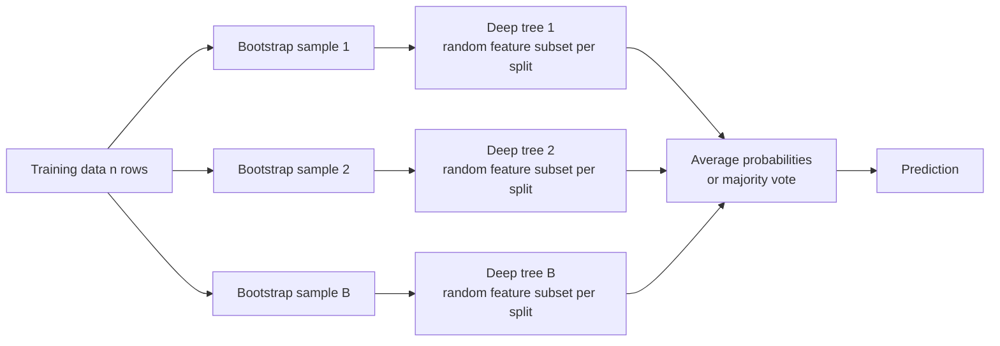

# Decision Trees, Random Forests and Gradient Boosting (XGBoost, LightGBM, CatBoost)

> **Level:** Beginner to Advanced · **Study time:** ~150 min · **Prerequisites:** [Softmax, Entropy, Cross-Entropy and KL Divergence](../00-foundations/05-softmax-entropy-cross-entropy-and-kl-divergence.md), [The ML Workflow and Cross-Validation](01-ml-workflow-data-splits-and-cross-validation.md), [Linear and Logistic Regression](02-linear-and-logistic-regression.md), [Overfitting, Bias-Variance and Regularization](03-overfitting-regularization-and-data-leakage.md)

## Table of contents

- [Why this matters](#why-this-matters)
- [Decision trees: the 20 questions model](#decision-trees-the-20-questions-model)
- [How a tree chooses a split: Gini impurity and entropy](#how-a-tree-chooses-a-split-gini-impurity-and-entropy)
- [Depth, overfitting and pruning](#depth-overfitting-and-pruning)
- [Ensembles: why many models beat one](#ensembles-why-many-models-beat-one)
- [Bagging and random forests](#bagging-and-random-forests)
- [Boosting and AdaBoost](#boosting-and-adaboost)
- [Gradient boosting: fitting residuals step by step](#gradient-boosting-fitting-residuals-step-by-step)
- [XGBoost: regularized second-order boosting](#xgboost-regularized-second-order-boosting)
- [LightGBM and CatBoost](#lightgbm-and-catboost)
- [Controlling overfitting in XGBoost](#controlling-overfitting-in-xgboost)
- [Feature importance and its limits](#feature-importance-and-its-limits)
- [Logistic regression vs random forest vs XGBoost](#logistic-regression-vs-random-forest-vs-xgboost)
- [Gradient-boosted trees vs neural networks on tabular data](#gradient-boosted-trees-vs-neural-networks-on-tabular-data)
- [Going deeper: trees in production](#going-deeper-trees-in-production)
- [Common mistakes and misconceptions](#common-mistakes-and-misconceptions)
- [Interview questions and model answers](#interview-questions-and-model-answers)
- [Key takeaways](#key-takeaways)
- [Further reading](#further-reading)
- [Next](#next)

## Why this matters

Most of the world's business data lives in tables: transactions, customers, sensor readings, loan applications. On that kind of data, gradient-boosted decision trees (**GBDT**; the main libraries are XGBoost, LightGBM and CatBoost) are still the default strong model in 2026, powering fraud detection, credit scoring, ad click prediction, churn models and search ranking. Even in GenAI-heavy teams, the "classic" pieces around the LLM (routing, risk scoring, ranking features, anomaly flags) are frequently tree models because they are fast, cheap and accurate. Interviewers love this topic because it tests whether you understand bias vs variance, regularization and interpretability in a concrete way, not just whether you can call `.fit()`. A senior candidate is expected to explain *why* boosting works, tune it without overfitting, and know when a neural network is the better tool.

---

## Decision trees: the 20 questions model

> **Analogy:** A decision tree is the game "20 Questions". To guess an animal you ask "Does it fly?", then "Is it bigger than a cat?", and so on. Each yes/no question cuts the space of possibilities, and good questions cut it the most.

A **decision tree** is a model that predicts by asking a sequence of yes/no questions about the input features. Its parts:

- **Root node:** the first question, applied to every example.
- **Internal node (split node):** a question of the form "is feature $x_j \le t$?" where $t$ is a **threshold**.
- **Branch:** the path taken for "yes" or "no".
- **Leaf (terminal node):** the end of a path. It stores a prediction: the majority class (classification) or the average target value (regression) of the training examples that landed there.
- **Depth:** the number of questions on the longest root-to-leaf path.

Our running example is a **spam filter** with features like "contains the word *free*", "sender is unknown", "number of links".

```text
                    [contains "free"?]
                     /             \
                   yes              no
                   /                  \
        [sender unknown?]         [links > 5?]
           /        \               /       \
         yes        no            yes       no
         /            \           /           \
     SPAM          HAM(0.6)    SPAM(0.7)     HAM
```

Each leaf can also store class proportions (for example "70% of training emails here were spam"), which gives a probability estimate.

Key properties that matter later:

- Trees split on **one feature at a time**, so the decision boundary is made of **axis-aligned** rectangles (boxes).
- Trees do not care about feature scale: "income $\le$ 50,000" works the same whether income is in dollars or thousands. No standardization needed.
- Trees naturally capture **interactions** (the effect of "sender unknown" depends on whether "free" appeared) and **non-linearity**.
- Trees predict a **piecewise-constant** function: inside each box, the prediction is a constant. This means a tree **cannot extrapolate**: for a house bigger than any in the training data, it predicts the value of the largest-house leaf.

The standard algorithm is **CART** (Classification and Regression Trees, Breiman, Friedman, Olshen and Stone, 1984). It builds binary trees **greedily**: at each node it picks the single best split right now, without looking ahead. Finding the globally optimal tree is computationally intractable (NP-hard in general), so greedy is the practical choice.

---

## How a tree chooses a split: Gini impurity and entropy

### Intuition

A good question produces children that are **purer** than the parent: ideally one side all spam, the other all ham. We need a number that measures "how mixed" a node is, called **impurity**. The best split is the one that reduces impurity the most.

### Gini impurity

$$
G = 1 - \sum_{k=1}^{K} p_k^2
$$

- $K$: number of classes (2 for spam vs ham).
- $p_k$: fraction of examples in the node belonging to class $k$.
- $G$: the probability that two examples drawn at random (with replacement) from the node have different labels. $G=0$ means pure; the maximum for 2 classes is $0.5$ (a 50/50 node).

### Entropy and information gain

**Entropy** (recapped from the [entropy chapter](../00-foundations/05-softmax-entropy-cross-entropy-and-kl-divergence.md)) measures uncertainty in bits:

$$
H = -\sum_{k=1}^{K} p_k \log_2 p_k
$$

- $p_k$: same class fraction as above (terms with $p_k = 0$ count as 0).
- $H = 0$ for a pure node; $H = 1$ bit for a 50/50 two-class node.

**Information gain** is the drop in entropy caused by a split:

$$
\text{IG} = H(\text{parent}) - \sum_{c \in \{L, R\}} \frac{n_c}{n} H(c)
$$

- $n$: number of examples in the parent; $n_c$: number in child $c$ (left $L$ or right $R$).
- $\frac{n_c}{n}$: weight of each child, so a big child counts more.

The same weighted formula with Gini instead of $H$ gives the **Gini decrease** (also called impurity decrease).

### Worked example: which question is better?

We have 10 training emails: **4 spam, 6 ham**. Two candidate splits:

| Split | Left child (yes) | Right child (no) |
|---|---|---|
| A: contains "free" | 4 emails: 3 spam, 1 ham | 6 emails: 1 spam, 5 ham |
| B: sender unknown | 5 emails: 3 spam, 2 ham | 5 emails: 1 spam, 4 ham |

**Step 1: impurity of the root** ($p_\text{spam} = 0.4$, $p_\text{ham} = 0.6$).

- Gini: $1 - (0.4^2 + 0.6^2) = 1 - (0.16 + 0.36) = 0.48$.
- Entropy: $-0.4\log_2 0.4 - 0.6 \log_2 0.6 = 0.4(1.3219) + 0.6(0.7370) = 0.5288 + 0.4422 = 0.971$ bits.

**Step 2: split A ("free").**

- Left (3 spam, 1 ham): $p = (0.75, 0.25)$.
  - Gini: $1 - (0.5625 + 0.0625) = 0.375$.
  - Entropy: $0.75(0.4150) + 0.25(2) = 0.3113 + 0.5 = 0.811$.
- Right (1 spam, 5 ham): $p = (1/6, 5/6)$.
  - Gini: $1 - (1/36 + 25/36) = 10/36 = 0.278$.
  - Entropy: $\tfrac16(2.5850) + \tfrac56(0.2630) = 0.4308 + 0.2192 = 0.650$.
- Weighted Gini: $0.4(0.375) + 0.6(0.278) = 0.150 + 0.167 = 0.317$. **Gini decrease** $= 0.48 - 0.317 = 0.163$.
- Weighted entropy: $0.4(0.811) + 0.6(0.650) = 0.3245 + 0.3900 = 0.7145$. **Information gain** $= 0.971 - 0.7145 = 0.256$ bits.

**Step 3: split B ("sender unknown").**

- Left (3 spam, 2 ham): Gini $1 - (0.36 + 0.16) = 0.48$; entropy $0.971$ (same 60/40 mix as the root).
- Right (1 spam, 4 ham): Gini $1 - (0.04 + 0.64) = 0.32$; entropy $0.2(2.3219) + 0.8(0.3219) = 0.4644 + 0.2575 = 0.722$.
- Weighted Gini: $0.5(0.48) + 0.5(0.32) = 0.40$. Gini decrease $= 0.48 - 0.40 = 0.08$.
- Weighted entropy: $0.5(0.971) + 0.5(0.722) = 0.8465$. Information gain $= 0.971 - 0.8465 = 0.125$ bits.

**Result:** split A wins under both criteria (0.163 vs 0.08 Gini decrease, 0.256 vs 0.125 bits). The tree puts "contains *free*" at the root, then repeats the whole procedure inside each child.

### How numeric features are searched

For a numeric feature like "number of links", the algorithm sorts the values and tries thresholds at the midpoints between consecutive distinct values. For $n$ examples that is up to $n-1$ candidate thresholds per feature, scored efficiently with running counts after one sort ($O(n \log n)$ per feature per node). Modern libraries speed this up further with **histogram binning**: bucket each feature into, say, 256 bins once, then only try bin boundaries.

### Regression trees

For a numeric target (house prices), impurity is the **variance** (equivalently, mean squared error around the node mean). The best split is the one with the lowest total **sum of squared errors (SSE)** in the two children, and each leaf predicts the mean target of its examples. We use exactly this in the gradient boosting example later.

### Gini vs entropy: does it matter?

Rarely. They rank splits almost identically. Gini is slightly cheaper (no logarithm) and is scikit-learn's default. Older algorithms (ID3 by Quinlan, 1986; C4.5 by Quinlan, 1993) used information gain; Quinlan proposed **gain ratio** (already discussed in the 1986 ID3 paper and used as C4.5's default criterion) to correct information gain's bias toward features with many distinct values.

### Code: impurity from scratch, then scikit-learn

```python
import numpy as np

def gini(counts):
    p = np.asarray(counts, dtype=float) / np.sum(counts)
    return 1.0 - np.sum(p ** 2)

def entropy(counts):
    p = np.asarray(counts, dtype=float) / np.sum(counts)
    p = p[p > 0]                                  # 0 * log(0) is treated as 0
    return -np.sum(p * np.log2(p))

def split_score(parent, left, right, impurity):
    n, nl, nr = sum(parent), sum(left), sum(right)
    weighted = nl / n * impurity(left) + nr / n * impurity(right)
    return impurity(parent) - weighted            # decrease in impurity

root = [4, 6]                                     # [spam, ham]
for name, l, r in [("free", [3, 1], [1, 5]), ("sender", [3, 2], [1, 4])]:
    print(f"{name:6s} gini_dec={split_score(root, l, r, gini):.3f} "
          f"info_gain={split_score(root, l, r, entropy):.3f}")
# free   gini_dec=0.163 info_gain=0.256
# sender gini_dec=0.080 info_gain=0.125
```

```python
# pip install scikit-learn
from sklearn.datasets import load_breast_cancer
from sklearn.model_selection import train_test_split
from sklearn.tree import DecisionTreeClassifier, export_text

X, y = load_breast_cancer(return_X_y=True, as_frame=True)
X_tr, X_te, y_tr, y_te = train_test_split(X, y, test_size=0.25, stratify=y, random_state=0)

tree = DecisionTreeClassifier(criterion="gini", max_depth=3, random_state=0)
tree.fit(X_tr, y_tr)
print(export_text(tree, feature_names=list(X.columns)))   # human-readable rules
print("train acc:", tree.score(X_tr, y_tr), "test acc:", tree.score(X_te, y_te))
```

---

## Depth, overfitting and pruning

> **Analogy:** A student who memorizes every past exam answer word for word scores 100% on old exams and fails the new one. A fully grown tree does exactly that.

If you let a tree keep splitting, it ends with one training example per leaf: 100% training accuracy, and it has memorized every noisy label. That is **overfitting** (see [the overfitting chapter](03-overfitting-regularization-and-data-leakage.md)). In bias-variance terms:

- A **shallow tree** (depth 1-3) has **high bias**: too simple to capture the pattern.
- A **deep tree** has **low bias but very high variance**: a small change in the training data (drop a few rows) can change the root split and produce a totally different tree.

That **instability** is the single most important fact about trees, because it is exactly what ensembles fix.

Two ways to control size:

1. **Pre-pruning (early stopping of growth):** stop splitting using hyperparameters such as `max_depth`, `min_samples_split`, `min_samples_leaf` (a leaf must contain at least this many examples), `max_leaf_nodes` and `min_impurity_decrease`.
2. **Post-pruning:** grow a large tree, then cut back branches that do not pay for themselves. CART's **cost-complexity pruning** minimizes

$$
R_\alpha(T) = R(T) + \alpha \, |T|
$$

- $R(T)$: total training error (impurity) of tree $T$.
- $|T|$: number of leaves.
- $\alpha \ge 0$: price per leaf. Larger $\alpha$ means a smaller tree.

Tiny example: tree $T_1$ has error 10 with 8 leaves, its pruned version $T_2$ has error 12 with 4 leaves. With $\alpha = 1$: $R_1 = 10 + 8 = 18$, $R_2 = 12 + 4 = 16$, so the pruned tree wins. With $\alpha = 0.25$: $R_1 = 10 + 2 = 12$, $R_2 = 12 + 1 = 13$, so the bigger tree wins. You choose $\alpha$ by cross-validation (`ccp_alpha` in scikit-learn).

> **Interview tip:** A single tree is rarely used in production for accuracy. It is used for interpretability (a rule list an auditor can read) or as the building block of an ensemble.

---

## Ensembles: why many models beat one

An **ensemble** combines the predictions of several models (the **base learners**) into one prediction. The two big families:

| | Bagging | Boosting |
|---|---|---|
| How models are trained | In **parallel**, independently, each on a random resample | **Sequentially**, each one fixing the errors of the ones before |
| Typical base learner | Deep, low-bias, high-variance trees | Shallow, high-bias trees ("weak learners") |
| Main effect | Reduces **variance** | Reduces **bias** (and variance, when regularized) |
| Combination | Average (regression) or vote/average probabilities (classification) | Weighted sum |
| Overfits by adding more models? | No, more trees only stabilize the average | Yes, eventually; needs early stopping |
| Flagship algorithm | Random forest | AdaBoost, gradient boosting, XGBoost, LightGBM, CatBoost |

> **Analogy:** Bagging is asking 500 independent experts and averaging their opinions (the crowd cancels individual mistakes). Boosting is a relay of specialists: each one studies only what the previous ones got wrong.

A third family, **stacking**, trains a small "meta-model" on the out-of-fold predictions of diverse base models (each row is predicted by a model trained on the other folds, so no prediction is on memorized rows). It is common in competitions and occasionally in production.

---

## Bagging and random forests

### Bootstrap samples

A **bootstrap sample** is a dataset of size $n$ drawn **with replacement** from the original $n$ rows. Some rows appear twice or more, some not at all.

**Bagging** (bootstrap aggregating, Breiman, 1996) trains one model per bootstrap sample and averages them.

How many rows does a bootstrap sample miss? The chance a given row is never picked in $n$ draws is

$$
\left(1 - \frac{1}{n}\right)^n \xrightarrow{n \to \infty} \frac{1}{e} \approx 0.368
$$

- $1 - \frac1n$: probability one draw misses the row.
- Raised to the $n$: all $n$ draws miss it.

For $n = 10$: $0.9^{10} = 0.349$. So each tree sees roughly 63% of the distinct rows and never sees the other ~37%.

### Why averaging reduces variance

If you average $B$ models whose predictions each have variance $\sigma^2$ and pairwise correlation $\rho$, the variance of the average is (Hastie, Tibshirani and Friedman, *The Elements of Statistical Learning*):

$$
\operatorname{Var}(\bar{f}) = \rho \sigma^2 + \frac{1 - \rho}{B}\sigma^2
$$

- $B$: number of trees.
- $\sigma^2$: variance of a single tree's prediction.
- $\rho$: correlation between two trees' predictions.

Worked example with $\sigma^2 = 1$ and $B = 100$:

- $\rho = 0.8$: $0.8 + 0.2/100 = 0.802$. Barely better than one tree.
- $\rho = 0.3$: $0.3 + 0.7/100 = 0.307$. About 3x less variance.

The second term shrinks with more trees, but the first term $\rho\sigma^2$ never does. **The only way to go lower is to make trees less correlated.** Plain bagging leaves trees correlated: if one feature is very strong, every tree puts it at the root.

### Random forests: bagging plus feature subsampling

A **random forest** (Breiman, 2001) adds one trick: **at every split**, the tree may only choose among a random subset of `max_features` features (commonly $\sqrt{p}$ for classification, where $p$ is the number of features). The strong feature is unavailable at some splits, other features get a chance, trees become different, $\rho$ drops, and the average improves.



Practical facts:

- Trees are usually grown **deep** (low bias), because averaging handles the variance.
- More trees does not cause overfitting; beyond a point it mostly costs compute (the test-error curve can wiggle slightly, but it does not turn upward the way boosting's does). Accuracy plateaus, typically somewhere in the hundreds of trees (illustrative).
- Main knobs: `n_estimators`, `max_features`, `min_samples_leaf`, `max_depth`.
- Defaults depend on version: in recent scikit-learn, `RandomForestClassifier` defaults to `max_features="sqrt"` and `RandomForestRegressor` to all features (`1.0`). Check the docs for your version.

### Out-of-bag (OOB) error

Each row is left out of about 37% of the trees. Predict each row using **only the trees that did not see it**, and compute the error. That is the **out-of-bag (OOB) error**: a nearly free estimate of test error without a separate validation set. It is handy for quick tuning, but for final model selection, time-series data or grouped data you still want a proper validation scheme (see [cross-validation](01-ml-workflow-data-splits-and-cross-validation.md)), because OOB assumes rows are independent.

```python
from sklearn.ensemble import RandomForestClassifier

rf = RandomForestClassifier(
    n_estimators=500,        # number of trees
    max_features="sqrt",     # features considered at each split
    min_samples_leaf=1,      # deep trees: averaging handles variance
    oob_score=True,          # compute OOB accuracy
    n_jobs=-1,               # trees are independent: train in parallel
    random_state=0,
)
rf.fit(X_tr, y_tr)
print("OOB accuracy:", rf.oob_score_)
print("test accuracy:", rf.score(X_te, y_te))
```

> **Senior insight:** Random forests are the "hard to mess up" model: few important hyperparameters, embarrassingly parallel training, no early stopping needed. They are a great strong baseline. Gradient boosting usually wins on accuracy, but needs more careful tuning.

---

## Boosting and AdaBoost

### The idea

**Boosting** builds an ensemble **sequentially**. Each new model focuses on the examples the current ensemble gets wrong. The base learners are **weak learners**: models only slightly better than guessing, typically very shallow trees. A depth-1 tree (one split) is called a **decision stump**.

### AdaBoost intuition

**AdaBoost** (Adaptive Boosting, Freund and Schapire, 1997) keeps a weight on every training example:

1. Start with equal weights $w_i = 1/n$.
2. Train a stump on the weighted data. Compute its weighted error $\varepsilon$.
3. Give the stump a vote weight $\alpha = \tfrac12 \ln\frac{1-\varepsilon}{\varepsilon}$. Accurate stumps get bigger votes.
4. Multiply weights of misclassified examples by $e^{\alpha}$ and correct ones by $e^{-\alpha}$, then normalize so weights sum to 1.
5. Repeat. Final prediction: the sign of $\sum_m \alpha_m h_m(x)$, where $h_m(x) \in \{-1, +1\}$ is stump $m$'s prediction.

**Tiny example:** 10 emails, weight 0.1 each. The first stump misclassifies 2, so $\varepsilon = 0.2$.

- $\alpha = \tfrac12 \ln(0.8/0.2) = \tfrac12 \ln 4 = 0.693$.
- $e^{0.693} = 2$, $e^{-0.693} = 0.5$.
- Misclassified: $0.1 \times 2 = 0.2$ each. Correct: $0.1 \times 0.5 = 0.05$ each.
- Total: $2(0.2) + 8(0.05) = 0.4 + 0.4 = 0.8$. Normalize: misclassified become $0.2/0.8 = 0.25$ each, correct become $0.05/0.8 = 0.0625$ each.

The 2 hard emails now carry half of all the weight (0.5 total), so the next stump is forced to care about them. Friedman, Hastie and Tibshirani (2000) later showed AdaBoost is equivalent to stage-wise minimization of the **exponential loss** $e^{-y F(x)}$, which led directly to the general framework below. A known weakness: exponential loss punishes badly misclassified points enormously, so AdaBoost is sensitive to label noise and outliers.

---

## Gradient boosting: fitting residuals step by step

### Intuition

> **Analogy:** You are estimating a house's price. Your first guess is the neighborhood average. A friend looks at your errors and says "you are underestimating big houses". You add a correction. Another friend spots the next pattern in what is still wrong. Each friend fixes part of the remaining error.

**Gradient boosting** (Friedman, 2001) builds the model as a sum:

$$
F_M(x) = F_0(x) + \eta \sum_{m=1}^{M} h_m(x)
$$

- $F_0$: a constant starting prediction (the mean target for squared error).
- $h_m$: the $m$-th small regression tree.
- $\eta$: the **learning rate** (also called **shrinkage**), between 0 and 1. Each tree only moves the prediction part of the way.
- $M$: number of trees (boosting rounds).

Each new tree $h_m$ is trained to predict the **pseudo-residuals**:

$$
r_i^{(m)} = -\left.\frac{\partial L(y_i, F)}{\partial F}\right|_{F = F_{m-1}(x_i)}
$$

- $L$: the loss function, for example squared error.
- $r_i^{(m)}$: the negative gradient of the loss for example $i$ at the current prediction. It points in the direction that reduces the loss fastest (see [gradients](../00-foundations/03-calculus-and-gradients.md)).

For squared error $L = \tfrac12(y - F)^2$, the derivative is $\partial L / \partial F = -(y - F)$, so the pseudo-residual is simply $y - F$: **the ordinary residual**. That is why people say "gradient boosting fits the residuals". For log loss in binary classification, $F(x)$ is a raw score in **log-odds** units, the probability is $p = \sigma(F(x))$ (the sigmoid from [logistic regression](02-linear-and-logistic-regression.md)), and the pseudo-residual is $y - p$ (label minus predicted probability). The trees add up in log-odds space, not probability space. The name "gradient boosting" means: **gradient descent in function space**. Ordinary gradient descent nudges parameters; here we nudge each training prediction downhill, and fitting a tree to those nudges turns them into a rule that also works on new inputs.

### Worked example: four houses

Feature: size in m². Target: price in $1000s. Learning rate $\eta = 0.5$, each tree is a stump. Candidate thresholds are midpoints: 60, 80, 100.

| House | Size | Price $y$ |
|---|---|---|
| 1 | 50 | 190 |
| 2 | 70 | 210 |
| 3 | 90 | 230 |
| 4 | 110 | 370 |

**Round 0.** $F_0 = (190 + 210 + 230 + 370)/4 = 1000/4 = 250$.
Residuals: $-60, -40, -20, +120$. MSE $= (3600 + 1600 + 400 + 14400)/4 = 20000/4 = 5000$.

**Round 1: fit a stump to the residuals.** Score each threshold by SSE of residuals around each side's mean:

- $< 60$: left $\{-60\}$ (SSE 0); right $\{-40, -20, 120\}$, mean 20, SSE $= 3600 + 1600 + 10000 = 15200$. Total 15200.
- $< 80$: left $\{-60, -40\}$, mean $-50$, SSE $100 + 100 = 200$; right $\{-20, 120\}$, mean 50, SSE $4900 + 4900 = 9800$. Total 10000.
- $< 100$: left $\{-60, -40, -20\}$, mean $-40$, SSE $400 + 0 + 400 = 800$; right $\{120\}$, SSE 0. Total **800**. Winner.

Stump 1: size $< 100 \Rightarrow -40$, else $+120$. Update with $\eta = 0.5$:
houses 1-3: $250 + 0.5(-40) = 230$; house 4: $250 + 0.5(120) = 310$.
New residuals: $-40, -20, 0, +60$. MSE $= (1600 + 400 + 0 + 3600)/4 = 1400$.

**Round 2.** Thresholds on residuals $\{-40, -20, 0, 60\}$:

- $< 60$: right $\{-20, 0, 60\}$ mean 13.33, SSE $\approx 1111.1 + 177.8 + 2177.8 = 3466.7$.
- $< 80$: left mean $-30$, SSE 200; right $\{0, 60\}$ mean 30, SSE 1800. Total 2000.
- $< 100$: left $\{-40, -20, 0\}$ mean $-20$, SSE 800; right SSE 0. Total **800**. Winner.

Stump 2: size $< 100 \Rightarrow -20$, else $+60$. Update: houses 1-3: $230 - 10 = 220$; house 4: $310 + 30 = 340$.
Residuals: $-30, -10, +10, +30$. MSE $= (900 + 100 + 100 + 900)/4 = 500$.

**Round 3.** Residuals $\{-30, -10, 10, 30\}$:

- $< 60$: right $\{-10, 10, 30\}$ mean 10, SSE $400 + 0 + 400 = 800$. Total 800.
- $< 80$: left mean $-20$, SSE 200; right mean 20, SSE 200. Total **400**. Winner.
- $< 100$: left $\{-30, -10, 10\}$ mean $-10$, SSE 800. Total 800.

Stump 3: size $< 80 \Rightarrow -20$, else $+20$. Update: houses 1-2: $220 - 10 = 210$; house 3: $220 + 10 = 230$; house 4: $340 + 10 = 350$.
Residuals: $-20, 0, 0, +20$. MSE $= (400 + 0 + 0 + 400)/4 = 200$.

| Round | Predictions | Residuals | Training MSE |
|---|---|---|---|
| 0 | 250, 250, 250, 250 | -60, -40, -20, 120 | 5000 |
| 1 | 230, 230, 230, 310 | -40, -20, 0, 60 | 1400 |
| 2 | 220, 220, 220, 340 | -30, -10, 10, 30 | 500 |
| 3 | 210, 210, 230, 350 | -20, 0, 0, 20 | 200 |

Notice three things. The training error falls every round. Round 3 switched to a new split once the old one stopped paying off. And because $\eta = 0.5$, no single tree "commits" fully, which leaves room for later trees to correct mistakes. That is why a small learning rate plus more trees usually generalizes better.

### Code: the same example from scratch

```python
import numpy as np

X = np.array([50, 70, 90, 110], dtype=float)    # size in m^2
y = np.array([190, 210, 230, 370], dtype=float)  # price in $1000s

def fit_stump(x, r):
    """Return the stump (threshold, left value, right value) minimizing SSE on residuals r."""
    best = None
    xs = np.unique(x)
    for t in (xs[:-1] + xs[1:]) / 2:             # midpoints between sorted values
        left, right = r[x < t], r[x >= t]
        sse = ((left - left.mean()) ** 2).sum() + ((right - right.mean()) ** 2).sum()
        if best is None or sse < best[0]:
            best = (sse, t, left.mean(), right.mean())
    _, t, lv, rv = best
    return t, lv, rv

lr = 0.5
F = np.full_like(y, y.mean())                    # round 0: predict the mean
print(f"round 0: pred={F} MSE={np.mean((y - F) ** 2):.0f}")
for m in range(1, 4):
    r = y - F                                    # residuals = negative gradient of squared loss
    t, lv, rv = fit_stump(X, r)
    F = F + lr * np.where(X < t, lv, rv)         # shrunken step
    print(f"round {m}: split<{t:.0f} leaves=({lv:.0f},{rv:.0f}) "
          f"pred={F} MSE={np.mean((y - F) ** 2):.0f}")
# round 0: pred=[250. 250. 250. 250.] MSE=5000
# round 1: split<100 leaves=(-40,120) pred=[230. 230. 230. 310.] MSE=1400
# round 2: split<100 leaves=(-20,60) pred=[220. 220. 220. 340.] MSE=500
# round 3: split<80 leaves=(-20,20) pred=[210. 210. 230. 350.] MSE=200
```

The scikit-learn equivalents are `GradientBoostingRegressor` (exact, slower) and `HistGradientBoostingRegressor` (histogram-based, much faster, handles missing values natively).

> **Common mistake:** Saying "boosting reduces bias, so it can't overfit". It absolutely can. Training error keeps falling forever; validation error falls, flattens, then rises. You must early-stop on a validation set.

### Stochastic gradient boosting

Friedman (2002) showed that training each tree on a random subsample of rows (for example 50-80%) improves generalization and speeds training. This **row subsampling** idea, plus column subsampling borrowed from random forests, is built into all modern libraries.

---

## XGBoost: regularized second-order boosting

**XGBoost** (Chen and Guestrin, 2016, "XGBoost: A Scalable Tree Boosting System") is gradient boosting with three upgrades: an explicitly **regularized objective**, a **second-order (Newton) approximation** of the loss, and heavy systems engineering (sparsity-aware split finding, cache-aware blocks, parallel and distributed training, GPU support).

### The regularized objective

$$
\mathcal{L} = \sum_{i=1}^{n} l(y_i, \hat{y}_i) + \sum_{k=1}^{K} \Omega(f_k),
\qquad
\Omega(f) = \gamma T + \frac{1}{2}\lambda \sum_{j=1}^{T} w_j^2 + \alpha \sum_{j=1}^{T} |w_j|
$$

- $l$: per-example loss (squared error, log loss, ...).
- $\hat{y}_i$: the ensemble's prediction for example $i$.
- $f_k$: the $k$-th tree; $K$ trees total.
- $T$: number of leaves in a tree. $\gamma$ is a **penalty per leaf**, so a split must earn at least $\gamma$ to be kept.
- $w_j$: the output value (**leaf weight**) of leaf $j$.
- $\lambda$: **L2 penalty** on leaf weights (shrinks them toward 0). $\alpha$: **L1 penalty** (can zero them out). These are the same ideas as ridge and lasso from the [regularization chapter](03-overfitting-regularization-and-data-leakage.md), applied to leaf values instead of coefficients. (This $\alpha$ is unrelated to AdaBoost's vote weight or the pruning $\alpha$ above; the letter is just reused.)

### Gradients and hessians

When adding tree $t$, XGBoost approximates the loss with a second-order Taylor expansion around the current prediction. For each example it computes:

- $g_i = \partial l / \partial \hat{y}_i$: the **gradient** (first derivative).
- $h_i = \partial^2 l / \partial \hat{y}_i^2$: the **hessian** (second derivative, curvature).

For squared error $l = \tfrac12(y - \hat y)^2$: $g_i = \hat{y}_i - y_i$ and $h_i = 1$. For log loss with predicted probability $p_i$ (derivatives taken with respect to the log-odds score): $g_i = p_i - y_i$ and $h_i = p_i(1 - p_i)$.

Intuition: the gradient says which way to move a prediction; the hessian (curvature) says how far it is safe to move. This is Newton's method, leaf by leaf. If the new tree adds $f(x_i)$, the loss is approximated by a parabola:

$$
l(y_i, \hat{y}_i + f(x_i)) \approx l(y_i, \hat{y}_i) + g_i f(x_i) + \tfrac12 h_i f(x_i)^2
$$

Every row in leaf $j$ gets the same output $w_j$, so with $G_j = \sum g_i$ and $H_j = \sum h_i$ over the leaf's rows plus the L2 penalty, the leaf's objective is $G_j w_j + \tfrac12 (H_j + \lambda) w_j^2$ (ignoring $\alpha$). Its minimum gives the optimal weight, and the best achievable loss is $-\tfrac12 G_j^2/(H_j + \lambda)$. The **split gain** is how much the children lower that loss versus the parent, minus $\gamma$ for the extra leaf:

$$
w_j^* = -\frac{G_j}{H_j + \lambda}
\qquad
\text{Gain} = \frac{1}{2}\left[\frac{G_L^2}{H_L + \lambda} + \frac{G_R^2}{H_R + \lambda} - \frac{(G_L + G_R)^2}{H_L + H_R + \lambda}\right] - \gamma
$$

- $G_L, H_L$ and $G_R, H_R$: gradient and hessian sums in the left and right child.
- The bracket is "score of children minus score of parent". If Gain $\le 0$, the split is not made: that is how $\gamma$ prunes.

### Worked example: the first house tree with $\lambda = 1$

Start at $\hat{y} = 250$. Gradients $g_i = \hat y_i - y_i$: $60, 40, 20, -120$. Hessians: all 1. Split "size < 100":

- Left (houses 1-3): $G_L = 60 + 40 + 20 = 120$, $H_L = 3$.
- Right (house 4): $G_R = -120$, $H_R = 1$.
- Parent: $G = 0$, $H = 4$.

Leaf weights with $\lambda = 1$:

- $w_L = -120/(3 + 1) = -30$ (without regularization: $-120/3 = -40$, the plain residual mean we used earlier).
- $w_R = 120/(1 + 1) = 60$ (without regularization: $120/1 = 120$).

Gain: $\tfrac12\left[\frac{120^2}{4} + \frac{120^2}{2} - \frac{0^2}{5}\right] - \gamma = \tfrac12[3600 + 7200 - 0] - \gamma = 5400 - \gamma$.

Look at what $\lambda$ did: the leaf with **one** example was shrunk by half (120 to 60), the leaf with three examples only by 25% (40 to 30). L2 regularization distrusts leaves built on little evidence. And the split survives unless $\gamma \ge 5400$.

> **Senior insight:** `min_child_weight` is a minimum on $H$, the **sum of hessians** in a child, not a row count. For squared error $h = 1$, so it equals the row count. For log loss $h = p(1-p) \le 0.25$, and for confident predictions it is tiny: at $p = 0.01$, $h \approx 0.0099$, so a child needs about 100 such rows to reach `min_child_weight=1`. This stops the model from carving out tiny leaves around already-confident examples.

### XGBoost hyperparameters you must know

| Parameter (sklearn alias) | Default | What it does | Overfitting direction |
|---|---|---|---|
| `eta` (`learning_rate`) | 0.3 | Shrinks each tree's contribution | Lower = less overfit, needs more trees |
| `n_estimators` / `num_boost_round` | library-dependent | Number of trees | Set high, choose with early stopping |
| `max_depth` | 6 | Max tree depth; controls interaction order | Lower = less overfit |
| `min_child_weight` | 1 | Min hessian sum per child | Higher = less overfit |
| `gamma` (`min_split_loss`) | 0 | Min gain to make a split | Higher = less overfit |
| `subsample` | 1.0 | Fraction of rows per tree | Lower (0.5-0.9) = less overfit |
| `colsample_bytree` | 1.0 | Fraction of features per tree (also `_bylevel`, `_bynode`) | Lower = less overfit, decorrelates trees |
| `lambda` (`reg_lambda`) | 1 | L2 on leaf weights | Higher = less overfit |
| `alpha` (`reg_alpha`) | 0 | L1 on leaf weights | Higher = less overfit, sparser |
| `early_stopping_rounds` | off | Stop when validation metric stops improving for N rounds | Essential |
| `scale_pos_weight` | 1 | Up-weights positive class gradients for imbalance | Affects calibration |
| `tree_method` | `hist` in recent versions | Exact vs histogram split finding | `hist` is the fast default |

(Defaults are from XGBoost's documentation; verify against your installed version.)

**Missing values:** XGBoost's sparsity-aware algorithm learns a **default direction** at every split: rows with a missing value go left or right, whichever gave higher gain during training. You can feed `NaN` directly.

### Code: XGBoost with early stopping

```python
# pip install xgboost scikit-learn
import xgboost as xgb
from sklearn.datasets import load_breast_cancer
from sklearn.model_selection import train_test_split
from sklearn.metrics import roc_auc_score

X, y = load_breast_cancer(return_X_y=True, as_frame=True)
# 60% train, 20% validation (for early stopping), 20% test (touched once)
X_tr, X_tmp, y_tr, y_tmp = train_test_split(X, y, test_size=0.4, stratify=y, random_state=42)
X_val, X_te, y_val, y_te = train_test_split(X_tmp, y_tmp, test_size=0.5, stratify=y_tmp, random_state=42)

model = xgb.XGBClassifier(
    n_estimators=2000,          # upper bound; early stopping picks the real number
    learning_rate=0.05,
    max_depth=4,
    min_child_weight=1,
    gamma=0.0,
    subsample=0.8,
    colsample_bytree=0.8,
    reg_lambda=1.0,
    reg_alpha=0.0,
    tree_method="hist",
    eval_metric="logloss",
    early_stopping_rounds=50,   # constructor argument since XGBoost 1.6; the old fit() argument has been removed in 2.x/3.x
    random_state=42,
)
model.fit(X_tr, y_tr, eval_set=[(X_val, y_val)], verbose=False)

print("best iteration:", model.best_iteration)
proba = model.predict_proba(X_te)[:, 1]          # uses the best iteration
print("test ROC AUC:", roc_auc_score(y_te, proba))
```

> **Common mistake:** Using the test set as the early-stopping `eval_set`. The number of trees is then tuned on the test set, and your reported test score is optimistic. Early stopping is tuning: use a validation split.

---

## LightGBM and CatBoost

All three libraries implement regularized gradient-boosted trees. They differ in how they grow trees, how they find splits and how they handle categorical features.

### LightGBM

**LightGBM** (Ke et al., 2017, "LightGBM: A Highly Efficient Gradient Boosting Decision Tree", Microsoft) is built for speed on large data:

- **Histogram-based splits:** features are pre-bucketed into bins (`max_bin`, default 255), so split search is over bins, not raw values. (XGBoost's `hist` method uses the same idea.)
- **Leaf-wise (best-first) growth:** instead of growing a full level at a time, it always splits the leaf with the largest gain. This reaches lower loss with fewer leaves but can grow deep, lopsided trees that overfit small data. The main complexity control is `num_leaves` (default 31), not `max_depth` (default -1, unlimited). Keep `num_leaves` below $2^{\text{max\_depth}}$ if you set both.
- **GOSS (Gradient-based One-Side Sampling):** keeps all rows with large gradients (badly predicted) and randomly samples rows with small gradients, reweighting them to stay unbiased.
- **EFB (Exclusive Feature Bundling):** bundles sparse features that are rarely non-zero at the same time (like one-hot columns) into one feature, reducing work.
- **Native categorical support:** splits a categorical feature by grouping categories, without one-hot encoding.

```text
Level-wise (XGBoost default)          Leaf-wise (LightGBM)
        o                                    o
      /   \                                /   \
     o     o                              o     o
    / \   / \                                  / \
   o   o o   o                                o   o
                                                 / \
 balanced, every level filled                   o   o
                                         grows where loss drops most
```

### CatBoost

**CatBoost** (Prokhorenkova et al., 2018, "CatBoost: unbiased boosting with categorical features", Yandex) focuses on categorical data and robustness to defaults:

- **Ordered target statistics:** high-cardinality categoricals (city, merchant ID) are encoded with the mean target, but each row's encoding uses only rows that come **before** it in a random permutation. This prevents **target leakage**, where a row's own label leaks into its feature (see [feature engineering](07-feature-engineering-missing-values-and-encoding.md)).
- **Ordered boosting:** a similar permutation trick for computing residuals, reducing the **prediction shift** caused by using the same rows to build and evaluate trees.
- **Symmetric (oblivious) trees:** every node at the same depth uses the same split. Trees are very regular, which acts as regularization and makes inference extremely fast (a leaf index is just a bit pattern).
- Good results with default hyperparameters, often less tuning than the others.

### Comparison

| | XGBoost | LightGBM | CatBoost |
|---|---|---|---|
| Tree growth | Level-wise (depth-wise) by default; `lossguide` option | Leaf-wise | Symmetric (oblivious) |
| Main size control | `max_depth` | `num_leaves`, `min_data_in_leaf` | `depth` |
| Categoricals | Native support in recent versions (`enable_categorical`) | Native | Strongest built-in handling (ordered target statistics) |
| Speed on large data | Fast with `hist`, strong GPU support | Usually fastest CPU training | Slower training, very fast inference |
| Tuning effort | Moderate | Moderate, overfits small data if `num_leaves` too high | Lowest, strong defaults |
| Choose when | Mature ecosystem, broad deployment tooling | Very large datasets, fast iteration | Many categorical features, little tuning time |

```python
# pip install lightgbm catboost
import lightgbm as lgb
from catboost import CatBoostClassifier

lgbm = lgb.LGBMClassifier(
    n_estimators=2000, learning_rate=0.05,
    num_leaves=15, min_child_samples=20,        # min_child_samples = min_data_in_leaf
    subsample=0.8, subsample_freq=1,            # row bagging needs a frequency > 0
    colsample_bytree=0.8, reg_lambda=1.0, verbose=-1,
)
# LightGBM >= 4.7 prefers fit(..., eval_X=X_val, eval_y=y_val); eval_set still works but warns
lgbm.fit(X_tr, y_tr, eval_set=[(X_val, y_val)],
         callbacks=[lgb.early_stopping(50, verbose=False)])

cat = CatBoostClassifier(iterations=2000, learning_rate=0.05, depth=6,
                         early_stopping_rounds=50, verbose=False)
cat.fit(X_tr, y_tr, eval_set=(X_val, y_val))    # pass cat_features=[...] for categorical columns
```

> **Interview tip:** Do not claim one library is "best". Say: the accuracy differences after tuning are usually small; the choice is driven by data shape (categoricals, size), training speed and deployment tooling. Then benchmark on your data.

---

## Controlling overfitting in XGBoost

Group the knobs by what they control. This structure is the interview answer.

```text
1. Number of steps     -> learning_rate (eta) + early_stopping_rounds
2. Tree complexity     -> max_depth, min_child_weight, gamma, (max_leaves)
3. Leaf values         -> lambda (L2), alpha (L1)
4. Randomness          -> subsample, colsample_bytree / bylevel / bynode
5. Data and validation -> more data, leak-free features, validation that matches production
```

A practical tuning recipe:

1. **Set up validation correctly first.** Random K-fold for i.i.d. (independent and identically distributed) rows, **time-based splits** for anything temporal (fraud, demand), **group splits** when rows share a user or patient. A wrong split makes every later number meaningless.
2. Fix `learning_rate` around 0.05-0.1, set `n_estimators` large (thousands), and use `early_stopping_rounds` (for example 50-200).
3. Tune tree complexity: `max_depth` (try 3-10) and `min_child_weight` (try 1-20+). These matter most.
4. Add randomness: `subsample` and `colsample_bytree` in 0.6-0.9.
5. Tune `gamma`, `lambda`, `alpha` if still overfitting.
6. Finally lower `learning_rate` (for example 0.01-0.02) with proportionally more trees for a small last gain.
7. Retrain on train + validation with the chosen number of trees (often scaled up slightly for the extra data), then evaluate once on the test set.

**How to diagnose:** plot training and validation loss per round (`model.evals_result()`). A large and growing gap means overfitting: reduce complexity or increase randomness. Both curves high and close means underfitting: deeper trees, more rounds, better features.

> **Senior insight:** The single largest cause of "XGBoost overfits" in practice is not hyperparameters, it is **leakage**: a feature computed with future information, a target-encoded column built on the full dataset, or duplicated users across train and validation. GBDTs are excellent at finding leaks. If validation accuracy looks too good, inspect the top features first.

Hyperparameter search tools like Optuna (Bayesian optimization) or random search work well; a full grid search over 8 parameters does not.

---

## Feature importance and its limits

"Which features matter?" sounds simple. There are at least four different answers, and they can disagree.

### The four main types

1. **Split count (XGBoost `weight`, LightGBM `split`):** how many times the feature is used in a split across all trees. Cheap, but a feature used in many tiny, unimportant splits looks important.
2. **Gain (XGBoost `gain`/`total_gain`, LightGBM `gain`, scikit-learn's `feature_importances_` which is Mean Decrease in Impurity, MDI):** total or average loss reduction from splits on that feature. Better than counts, but computed **on training data** and biased (see below). XGBoost also offers `cover` (the hessian sum of the rows affected by its splits; equal to the row count for squared error).
3. **Permutation importance** (introduced with random forests by Breiman, 2001): on a **held-out** set, shuffle one column and measure how much the metric drops. Model-agnostic and tied to real predictive value.
4. **SHAP values** (Lundberg and Lee, 2017, "A Unified Approach to Interpreting Model Predictions"): a game-theory method (Shapley values) that splits each individual prediction into additive contributions per feature: $\hat{y}(x) = \phi_0 + \sum_j \phi_j(x)$, where $\phi_0$ is the average prediction and $\phi_j(x)$ is feature $j$'s contribution for this specific row. **TreeSHAP** computes them exactly and fast for tree ensembles. Global importance is usually the mean of $|\phi_j|$ over rows. Intuition: features are players sharing a team bonus (this prediction minus the average); each one's Shapley value is its marginal contribution averaged over every order in which players could join. Example (illustrative): average fraud score $\phi_0 = -3.0$ log-odds; for one transaction $\phi_\text{amount} = +1.5$, $\phi_\text{new device} = +0.8$, $\phi_\text{account age} = -0.3$, so $\hat y = -1.0$ log-odds, a probability of $\sigma(-1) \approx 0.27$.

**Permutation importance worked example (illustrative numbers):** a fraud model has validation ROC AUC 0.90. Shuffling `transaction_amount` drops it to 0.78 (importance 0.12). Shuffling `merchant_category` drops it to 0.89 (importance 0.01). Repeat each shuffle several times and report the mean and spread, because one shuffle is noisy.

| Type | Local or global | Data used | Cost | Main weakness |
|---|---|---|---|---|
| Split count | Global | Train | Free | Ignores how useful splits were |
| Gain / MDI | Global | Train | Free | Biased to high-cardinality and continuous features; reflects overfitting |
| Permutation | Global | Held-out | Re-scoring per feature per repeat | Misleading with correlated features; creates unrealistic rows |
| SHAP | Local and global | Any rows | Fast for trees (TreeSHAP), slow model-agnostic | Credit splitting among correlated features; still not causal |

### The limitations (know these cold)

- **Bias toward high-cardinality features.** A feature with many unique values (a user ID, a continuous number with noise) offers many possible thresholds, so by chance it finds splits that reduce training impurity. MDI and gain reward this even when the feature is useless (Strobl et al., 2007, "Bias in random forest variable importance measures"). A classic sanity test: add a random-noise column; if it ranks above real features in gain importance, distrust the ranking. Permutation importance on held-out data is much more resistant.
- **Correlated features.** If `house_size_m2` and `num_rooms` carry the same information, the model may split on either. Gain importance gets divided between them arbitrarily, so both look moderately important. Permutation importance can make **both look unimportant**: shuffle one and the model just uses the other. SHAP also distributes credit across them. Remedy: group correlated features and permute or explain them together.
- **Importance is not causality.** Importance says "the model relies on this feature to predict", not "changing this feature changes the outcome". A `used_coupon` feature may be important for churn because loyal customers use coupons, not because coupons prevent churn. Causal questions need experiments (A/B tests) or causal inference methods.
- **Importance describes the model, not the world.** A bad or leaky model has confidently wrong importances. Check model quality first.
- **Permutation can create impossible rows** (age 5 with 20 years of credit history), so the model is evaluated off its training distribution.
- **Different types, different rankings.** Always state which type you report.

```python
# pip install shap  (the shap API changes across versions; treat this as a sketch)
from sklearn.inspection import permutation_importance
import shap

# Permutation importance on the held-out validation set
perm = permutation_importance(model, X_val, y_val, scoring="roc_auc",
                              n_repeats=10, random_state=0)
order = perm.importances_mean.argsort()[::-1][:5]
for i in order:
    print(f"{X.columns[i]:25s} {perm.importances_mean[i]:.4f} +/- {perm.importances_std[i]:.4f}")

# Built-in gain importance (note: XGBoost defaults differ between APIs and versions)
gain = model.get_booster().get_score(importance_type="gain")

# SHAP: per-row explanations and a global summary
explainer = shap.TreeExplainer(model)
shap_values = explainer.shap_values(X_val)     # one value per row per feature (log-odds units)
shap.summary_plot(shap_values, X_val)
```

> **Interview tip:** The strongest answer structure is: "Which importance? On which data? What are the correlations? And remember it is not causal." That covers everything an interviewer is probing for.

---

## Logistic regression vs random forest vs XGBoost

(Logistic regression is taught in [its own chapter](02-linear-and-logistic-regression.md).)

| Aspect | Logistic regression | Random forest | XGBoost / GBDT |
|---|---|---|---|
| Model form | Linear in features, sigmoid output | Average of many deep trees | Sum of many shallow trees, built sequentially |
| Non-linearity and interactions | Only those you engineer by hand | Learned automatically | Learned automatically |
| Bias / variance | High bias, low variance | Low bias, variance reduced by averaging | Bias reduced step by step; variance controlled by regularization |
| Typical accuracy on tabular data | Good baseline, lower ceiling | Strong | Usually strongest after tuning |
| Feature scaling | Needed (for regularization and optimization) | Not needed | Not needed |
| Missing values | Must impute | Depends on library version | Native |
| Interpretability | High: coefficients, odds ratios | Medium: importances, SHAP | Medium: importances, SHAP |
| Probability calibration | Usually good out of the box | Often pushed away from 0 and 1; calibrate | Reasonable with log loss; distorts with `scale_pos_weight` or sampling |
| Extrapolation | Yes, linearly (can be good or terrible) | No, flat outside training range | No, flat outside training range |
| Tuning effort | Low (regularization strength) | Low | Moderate to high |
| Overfitting risk | Low | Low-moderate | Moderate, needs early stopping |
| Training | Very fast | Parallel across trees | Sequential across trees, parallel within a tree |
| Inference | Fastest, one dot product | Slower: many deep trees | Fast-ish: many shallow trees |
| Model size | Tiny | Large (deep trees) | Moderate |
| Best when | Need transparency, regulation, very high-dimensional sparse data (text n-grams), tiny data, strong baseline | Fast robust baseline with little tuning, OOB estimate | Max accuracy on tabular data with tuning budget |

> **Senior insight:** In regulated domains (credit), teams often ship logistic regression or monotonic-constrained GBDTs because they must explain each decision and guarantee that, say, higher income never lowers a credit score. XGBoost and LightGBM support **monotonic constraints** for exactly this.

---

## Gradient-boosted trees vs neural networks on tabular data

### Why GBDTs usually win on tables

Large benchmarks (for example Grinsztajn, Oyallon and Varoquaux, 2022, "Why do tree-based models still outperform deep learning on typical tabular data?", and Shwartz-Ziv and Armon, 2022, "Tabular Data: Deep Learning is Not All You Need") found tree ensembles matching or beating deep models on typical medium-sized tabular datasets, with far less tuning. The reasons:

1. **Irregular target functions.** Tabular targets often jump sharply (a fee kicks in above a threshold). Trees model step functions naturally; neural networks are biased toward smooth functions.
2. **Uninformative features.** Tables often contain many irrelevant columns. Trees ignore a column by never splitting on it; MLPs are hurt more by them.
3. **Columns have individual meaning.** Each column (age, income) means something on its own, and trees split along those axes. MLPs are **rotation-invariant** learners: their first layer mixes all columns, so they would learn just as well from a rotated (linearly mixed) copy of the table, and get no head start from the original axes being meaningful.
4. **Heterogeneous features.** Mixed scales, skewed distributions, categoricals and missing values need careful preprocessing for a network; trees handle them almost raw.
5. **Data size.** Many business tables have thousands to a few million rows: plenty for GBDT, often small for deep learning.
6. **Cost.** GBDTs train in minutes on CPUs and tune more reliably.

### When a neural network is the better choice

- **Unstructured inputs:** text, images, audio, video. Trees on raw pixels or tokens are hopeless. (A common hybrid: an NN produces embeddings, and a GBDT consumes them alongside tabular columns.)
- **Very large data with high-cardinality IDs**, such as recommender systems with millions of users and items, where learned **embeddings** capture similarity that trees cannot.
- **Sequences and raw event streams** where order matters and you do not want to hand-engineer aggregates.
- **Multimodal or multi-task learning**, and **end-to-end training** with other differentiable components.
- **Transfer learning and pretraining** are possible (including tabular foundation models such as TabPFN, Hollmann et al., an active research area worth knowing exists).
- **Smooth extrapolation** or physics-like relationships, and settings needing incremental online updates.

| Situation | Prefer |
|---|---|
| Typical business table, < ~10M rows, mixed column types | GBDT |
| Images, text, audio | Neural network |
| Tabular + text fields | Hybrid: text embeddings (NN) fed into GBDT, or a multimodal NN |
| Huge user/item ID spaces (recsys, ads at scale) | NN with embeddings (often with GBDT features) |
| Need strong baseline today, limited GPU budget | GBDT |
| Need to extrapolate beyond the training range | Linear model or NN (with care), not trees |

> **Interview tip:** Answer with "it depends on the data modality and scale", then give the default ("GBDT first on tabular data, as a baseline at minimum") and the exceptions. Mention you would benchmark both if the stakes justified it.

---

## Going deeper: trees in production

### Inference latency and model size

Prediction cost is roughly **number of trees x depth** node comparisons. 1,000 trees of depth 6 means about 6,000 comparisons per row: microseconds to low milliseconds on a CPU, depending on implementation (illustrative). The bottleneck in real services is often **feature fetching** (database lookups, aggregations), not the model. Tricks to go faster:

- Fewer, slightly deeper trees, or a higher learning rate with early stopping (trade a bit of accuracy for latency).
- Compile the model: tools like Treelite generate optimized code from tree ensembles; ONNX conversion lets you serve with ONNX Runtime; NVIDIA's Forest Inference Library runs trees on GPUs for large batches.
- Batch predictions where latency budgets allow (see [deployment patterns](../10-mlops/04-model-deployment-patterns.md)).
- CatBoost's symmetric trees are particularly fast to evaluate.

### Training at scale

- Histogram methods make training roughly linear in rows. XGBoost and LightGBM support multi-threading, GPUs and distributed training (Dask, Spark). Row and column subsampling also speed things up.
- For hundreds of millions of rows, consider downsampling the majority class (and correcting probabilities afterward) before reaching for a cluster.

### Probabilities and calibration

If you need real probabilities (expected-loss calculations, thresholds tied to cost), check a reliability curve. Random forests tend to produce probabilities pushed away from 0 and 1 (Niculescu-Mizil and Caruana, 2005, "Predicting Good Probabilities With Supervised Learning"). Up-weighting with `scale_pos_weight` or resampling shifts GBDT probabilities. Fix with Platt scaling (a one-feature logistic regression on the scores) or isotonic regression (a monotone step function from score to observed frequency) on a held-out set (`CalibratedClassifierCV`). See [classification metrics](04-classification-metrics-and-imbalanced-data.md) for imbalance handling.

### Failure modes to watch

- **Extrapolation:** trees predict a constant outside the training range. After inflation pushes prices above anything seen in training, a price model silently caps out. Monitor input ranges.
- **Training-serving skew:** missing values encoded as `NaN` in training but `0` or `-1` in serving go down a different branch. Category-to-index mappings must be identical. See [training-serving skew](../10-mlops/03-reproducibility-and-training-serving-skew.md).
- **Drift:** tree models are only as good as the distribution they saw; see [data drift and retraining](08-data-drift-concept-drift-and-retraining.md).
- **Unseen categories** at inference: decide and test the behavior (CatBoost and LightGBM handle them, but differently).
- **Non-determinism:** multi-threaded or GPU training can produce slightly different models; fix seeds and record library versions for reproducibility.

### Debugging checklist

1. Validation score suspiciously high: look for leakage in the top features (SHAP or gain).
2. Validation good, production bad: compare feature distributions between training and live traffic; check skew in preprocessing.
3. Training loss not decreasing: learning rate too small, constraints too strict (`min_child_weight`, `gamma` too high), or a broken label.
4. Big train/validation gap: reduce depth, raise `min_child_weight`, add subsampling, lower learning rate with early stopping.
5. Slices: break metrics down by segment (country, device, new vs returning users); averages hide failures.

A full classic-ML design built on these ideas is in [the fraud detection system design chapter](../11-system-design/05-design-a-real-time-fraud-detection-system.md).

---

## Common mistakes and misconceptions

- **"More trees always overfit."** True for boosting without early stopping; false for random forests, where more trees only reduce variance of the average.
- **"Random forests use random subsets of features per tree."** The classic algorithm samples features **at every split**. (Per-tree sampling exists too, for example XGBoost's `colsample_bytree`, but it is a different knob.)
- **Scaling features for trees.** Unnecessary. Monotonic transformations (log, standardization) do not change which rows go left or right.
- **One-hot encoding a high-cardinality categorical for trees.** It creates thousands of sparse columns, each weak; native categorical handling or target encoding (done leak-free) usually works better.
- **Early stopping on the test set.** That tunes on test data.
- **Reading `feature_importances_` as truth.** It is training-data gain, biased toward high-cardinality features, and never causal.
- **Expecting trees to extrapolate trends.** A tree on a time trend predicts a flat line beyond the last training date.
- **Random K-fold on time-series data.** Leaks the future; use time-based splits.
- **Assuming the probabilities are calibrated.** Check, especially after class reweighting.
- **Tuning `max_depth` in LightGBM and forgetting `num_leaves`.** In leaf-wise growth, `num_leaves` is the main complexity knob.
- **"Gradient boosting fits residuals" for every loss.** It fits the **negative gradient**, which equals the residual only for squared error.

---

## Interview questions and model answers

<details>
<summary><b>Q1. Compare Random Forest, XGBoost, and Logistic Regression.</b></summary>

**Short answer:** Logistic regression is a linear model: fast, interpretable, well calibrated, but it only captures non-linearity and interactions you engineer. Random forest averages many deep, decorrelated trees trained on bootstrap samples: it reduces variance, needs little tuning and gives an OOB error estimate. XGBoost builds shallow trees sequentially, each fitting the negative gradient of the loss (using second-order information), with regularization: it is usually the most accurate on tabular data but needs early stopping and more tuning. I would start with logistic regression as a baseline, try a random forest as a robust second, and use XGBoost when I want the best accuracy.

**Deeper answer and follow-ups:**

- Bias-variance: LR high bias/low variance; RF low bias with variance cut by averaging ($\rho\sigma^2 + \frac{1-\rho}{B}\sigma^2$); GBDT reduces bias stage-wise and controls variance with shrinkage, subsampling and $\lambda$/$\gamma$.
- Preprocessing: LR needs scaling, imputation and manual interactions; trees need neither scaling nor (for XGBoost/LightGBM) imputation.
- Calibration: LR is usually best out of the box; RF probabilities are compressed away from 0 and 1; GBDT with log loss is reasonable unless reweighted.
- Interpretability: LR coefficients map directly to odds ratios; tree ensembles need SHAP.
- Extrapolation: LR extrapolates linearly; trees are flat beyond the training range.
- Production: LR is a dot product (microseconds, tiny); RF has many deep trees (larger, slower); GBDT has many shallow trees.
- Pitfall: claiming XGBoost always wins. On very high-dimensional sparse data (bag-of-words) or tiny datasets, regularized LR is often competitive.
- How I would decide: the same leak-free splits for all three, comparing the business metric, a calibration measure (log loss or Brier score) and latency. If LR is within noise of XGBoost, ship LR: it is easier to explain, monitor and retrain.

</details>

<details>
<summary><b>Q2. When would you choose gradient-boosted trees over a neural network?</b></summary>

**Short answer:** On typical tabular data (mixed numeric and categorical columns, missing values, thousands to millions of rows), gradient-boosted trees are my default: they are usually as accurate or more accurate, need less preprocessing and tuning, train fast on CPUs and are easier to explain. I would choose a neural network for unstructured data (text, images, audio), very large datasets with high-cardinality IDs that benefit from embeddings, sequence modeling, multimodal or end-to-end setups, or when I need transfer learning.

**Deeper answer and follow-ups:**

- Why trees win on tables (Grinsztajn et al., 2022): tabular targets are irregular (thresholds), trees ignore uninformative features, columns have individual meaning that axis-aligned splits exploit while MLPs are rotation-invariant, and trees handle heterogeneous scales and missing values natively.
- Operational reasons: cheaper training and inference, fewer hyperparameters that matter, SHAP support, monotonic constraints for regulated domains.
- When NN wins: recommender systems at scale (embeddings for millions of IDs), raw event sequences, text fields, and when combining modalities.
- Hybrid patterns: NN or LLM embeddings of text fed as features into a GBDT; GBDT predictions as features in a larger system.
- Caveat: trees cannot extrapolate; if the target must follow a trend beyond seen ranges, consider linear or NN components.
- Good practice: benchmark both on a proper validation split if the stakes justify it; tabular deep learning and tabular foundation models are active research areas.
- What to compare: the metric over several seeds (NNs on tables vary more run to run), training cost, serving hardware and latency, and engineering effort. NN failure modes on tables: sensitivity to scaling and outliers, missing values and categoricals all need extra machinery.

</details>

<details>
<summary><b>Q3. How do bagging and boosting differ?</b></summary>

**Short answer:** Bagging trains many models independently and in parallel on bootstrap resamples and averages them, which mainly reduces variance; it uses deep, high-variance trees and does not overfit as you add more. Boosting trains models sequentially, each one focusing on the errors of the current ensemble, which mainly reduces bias; it uses shallow, weak trees, combines them in a weighted sum, and will overfit with too many rounds unless you use shrinkage and early stopping.

**Deeper answer and follow-ups:**

- Bagging math: variance of an average is $\rho\sigma^2 + \frac{1-\rho}{B}\sigma^2$, so more trees help until the correlation floor; random forests lower $\rho$ with feature subsampling per split.
- Boosting math: $F_m = F_{m-1} + \eta h_m$, with $h_m$ fit to pseudo-residuals $-\partial L/\partial F$ (residuals for squared error). AdaBoost is the special case of exponential loss with reweighted samples.
- Parallelism: bagging is embarrassingly parallel across trees; boosting is sequential across trees (libraries parallelize split finding within a tree).
- Noise sensitivity: boosting (especially AdaBoost) can chase noisy labels; bagging is robust to them.
- Extras: bagging gives OOB error for free; boosting needs a validation set for early stopping.
- Hybrid: stochastic gradient boosting borrows bagging's row and column subsampling.
- How to see it: plot validation error against the number of models. A forest's curve plateaus; boosting's falls, flattens, then rises. Noisy labels or little tuning time favor a forest; maximum accuracy with sound validation favors boosting.

</details>

<details>
<summary><b>Q4. How do you control overfitting in XGBoost?</b></summary>

**Short answer:** Five levers. First, the number of steps: a smaller learning rate with early stopping on a validation set. Second, tree complexity: lower `max_depth`, higher `min_child_weight`, higher `gamma`. Third, leaf-weight regularization: `lambda` (L2) and `alpha` (L1). Fourth, randomness: `subsample` and `colsample_bytree` below 1. Fifth, the data: a leak-free feature set and a validation split that mirrors production (time-based if temporal).

**Deeper answer and follow-ups:**

- Mechanisms: leaf weight $w^* = -G/(H+\lambda)$ shrinks leaves with little evidence; a split is kept only if $\text{Gain} > \gamma$; `min_child_weight` bounds the hessian sum $H$ per child (for log loss $h = p(1-p)$, so confident regions need many rows).
- Recipe: fix learning rate 0.05-0.1 with large `n_estimators` and early stopping, tune `max_depth` and `min_child_weight`, then subsampling, then $\gamma$/$\lambda$/$\alpha$, then lower the learning rate for a final gain.
- Diagnosis: plot train vs validation loss per round; a widening gap is overfitting.
- Pitfalls: early stopping on the test set; random K-fold on time series; target encoding computed on the full data.
- Imbalance: `scale_pos_weight` helps ranking metrics but distorts probabilities; recalibrate.
- Senior point: if validation looks too good, suspect leakage before hyperparameters.
- Domain knowledge as regularization: `monotone_constraints` and `interaction_constraints` restrict what trees may learn; in production, also check slices, since overfitting often shows up first on small segments.

</details>

<details>
<summary><b>Q5. How do you interpret feature importance, and what are its limitations?</b></summary>

**Short answer:** First I clarify which importance: split count, gain (impurity decrease), permutation importance or SHAP. Gain and split count are free but computed on training data and biased toward high-cardinality features. Permutation importance on held-out data measures real predictive contribution. SHAP gives per-prediction, additive explanations and a consistent global view. Limitations: correlated features share or hide importance, rankings differ between methods, importance reflects the model (including its leaks), and importance is never causality.

**Deeper answer and follow-ups:**

- High cardinality bias: a noisy ID-like feature finds spurious splits that reduce training impurity (Strobl et al., 2007). Sanity check: add a random column and see where it ranks.
- Correlation: with two near-duplicate features, gain splits credit arbitrarily, and permutation can mark both as unimportant because the model falls back on the other one. Fix: permute groups, or cluster correlated features.
- Permutation creates unrealistic rows (out of distribution); results have variance, so repeat and report spread.
- SHAP: $\hat y(x) = \phi_0 + \sum_j \phi_j(x)$; TreeSHAP is exact and fast for trees; still splits credit among correlated features and depends on the background distribution choice.
- Causality: "used_coupon is important for churn" does not mean coupons reduce churn. Use A/B tests or causal inference to answer intervention questions.
- Practical use: debugging (spotting leaks), stakeholder communication, feature pruning (validate removal by retraining, not by importance alone).
- How to measure trust: recompute importance across CV folds and check the ranking is stable; instability usually means arbitrary choices among correlated features.
- Production: per-decision SHAP values serve as reason codes (for example, explaining a declined credit application); log the top contributors and watch for shifts as an early drift signal.

</details>

<details>
<summary><b>Q6. Walk me through how a decision tree picks a split. Gini or entropy?</b></summary>

**Short answer:** For each feature and each candidate threshold, it computes the weighted impurity of the two children and picks the split with the largest impurity decrease, greedily. Gini is $1 - \sum p_k^2$, entropy is $-\sum p_k\log_2 p_k$. They almost always choose the same split; Gini is a bit cheaper, so it is the scikit-learn default.

**Deeper answer and follow-ups:**

- Example: root 4 spam / 6 ham has Gini 0.48 and entropy 0.971; splitting into (3,1) and (1,5) gives Gini decrease 0.163 and information gain 0.256 bits.
- Numeric features: sort, test midpoints, $O(n\log n)$ per feature per node; histogram binning reduces it to bins.
- Regression: minimize SSE (variance) of children; leaves predict the mean.
- Greedy is not globally optimal; optimal trees are NP-hard to find in general.
- Information gain favors many-valued features; C4.5's gain ratio corrects that.

</details>

<details>
<summary><b>Q7. What is out-of-bag error, and when should you not trust it?</b></summary>

**Short answer:** Each bootstrap sample leaves out about 37% of rows ($(1-1/n)^n \to 1/e$). Predicting each row using only the trees that did not train on it gives the OOB error, a nearly free estimate of generalization error for bagging and random forests.

**Deeper answer and follow-ups:**

- It is computed with only about a third of the trees per row, so it is slightly pessimistic for small forests.
- It assumes rows are independent: with time series, grouped data (multiple rows per user) or duplicates, OOB is optimistic. Use time or group splits instead.
- Any preprocessing fit on all data (target encoding, feature selection) leaks into OOB as well.
- Not the standard tool for boosting, which uses a validation set and early stopping. (scikit-learn's `GradientBoosting*` with `subsample < 1` does report out-of-bag loss improvements, but they are a rough guide, and XGBoost/LightGBM do not offer an OOB score.)

</details>

<details>
<summary><b>Q8. Derive or explain XGBoost's leaf weight and split gain. What do lambda and gamma do?</b></summary>

**Short answer:** XGBoost uses a second-order Taylor expansion of the loss. With gradient sum $G$ and hessian sum $H$ in a leaf, the optimal weight is $w^* = -G/(H+\lambda)$, and a split's gain is $\tfrac12[G_L^2/(H_L+\lambda) + G_R^2/(H_R+\lambda) - G^2/(H+\lambda)] - \gamma$. Lambda shrinks leaf values, especially for small leaves; gamma is the minimum gain needed to split, which prunes the tree.

**Deeper answer and follow-ups:**

- Derivation sketch: for one leaf the objective is $Gw + \tfrac12(H+\lambda)w^2$; set the derivative to zero: $G + (H+\lambda)w = 0$.
- Example: residual-based gradients $60, 40, 20, -120$ with $h=1$: left leaf $-120/(3+1) = -30$, right leaf $120/(1+1)=60$, gain $5400 - \gamma$.
- Using hessians gives Newton steps, which adapts step sizes per leaf for losses like log loss, and enables arbitrary custom losses if you supply $g$ and $h$.
- `min_child_weight` constrains $H$ per child.

</details>

<details>
<summary><b>Q9. What is the trade-off between learning rate and number of trees?</b></summary>

**Short answer:** They trade off almost inversely: halving the learning rate needs roughly twice the trees to reach the same training loss. Smaller learning rates usually generalize slightly better because each tree only takes a small step, but training and inference become slower and the model larger.

**Deeper answer and follow-ups:**

- In the house example with $\eta = 0.5$, each stump only moved predictions halfway, leaving later trees room to correct.
- Practice: tune other parameters at 0.05-0.1, then lower to 0.01-0.02 at the end with early stopping.
- Production: latency scales with tree count, so a latency budget can cap how low the learning rate goes.
- Always pair with early stopping; the optimal number of trees depends on the learning rate.

</details>

<details>
<summary><b>Q10. Can tree models extrapolate? Why does it matter?</b></summary>

**Short answer:** No. A tree predicts a constant per leaf, so for inputs beyond the training range it outputs the value of the edge leaf. Ensembles of trees inherit this: the prediction is flat outside the data.

**Deeper answer and follow-ups:**

- Example: a house-price model trained on houses up to 110 m² predicts the same price for 150 m² and 500 m².
- Matters for time trends (sales growth, inflation), new regimes and any drift beyond training ranges.
- Fixes: model the trend separately (for example predict a ratio or a detrended target, or use a linear base model and boost the residuals), use linear trees (LightGBM has a `linear_tree` option), retrain frequently, and monitor input ranges.

</details>

<details>
<summary><b>Q11. How do you handle high-cardinality categorical features in gradient boosting?</b></summary>

**Short answer:** Avoid naive one-hot for thousands of categories. Options are native categorical support (LightGBM, CatBoost, recent XGBoost), leak-free target encoding (out-of-fold or CatBoost's ordered target statistics), frequency encoding, or learned embeddings. The key risk is target leakage when encoding with the label.

**Deeper answer and follow-ups:**

- Naive target encoding uses each row's own label in its feature: rare categories get near-perfect encodings, and the model overfits. Out-of-fold encoding or CatBoost's ordered statistics fix this.
- Add smoothing toward the global mean for rare categories.
- Handle unseen categories at serving time explicitly.
- See [feature engineering](07-feature-engineering-missing-values-and-encoding.md) for encodings in depth.

</details>

<details>
<summary><b>Q12. Your XGBoost model had excellent validation AUC but performs poorly in production. How do you debug it?</b></summary>

**Short answer:** Suspect, in order: leakage in validation (features using future information, wrong split type), training-serving skew (features computed differently online, missing values encoded differently), and distribution drift. Check top features with SHAP, recompute validation with a time-based split, and compare feature distributions between training data and live logs.

**Deeper answer and follow-ups:**

- Leakage signals: a single feature dominating importance, or AUC that drops sharply with a time-based split.
- Skew: log live feature vectors, replay them offline, and compare to the training pipeline's values for the same entities.
- Drift: population stability or distribution tests per feature; see [drift and retraining](08-data-drift-concept-drift-and-retraining.md).
- Extrapolation: inputs outside training ranges.
- Threshold and calibration: production base rate differs from training, so the chosen threshold no longer gives the expected precision/recall.
- Process fix: shadow deployment before full rollout (see [monitoring](../10-mlops/06-monitoring-ml-and-llm-systems-in-production.md)).

</details>

---

## Key takeaways

- A decision tree asks greedy yes/no questions, choosing each split to maximize impurity decrease (Gini $1-\sum p_k^2$ or information gain from entropy); regression trees minimize squared error.
- Single deep trees overfit and are unstable (high variance); control depth with pre-pruning or cost-complexity pruning, or better, use an ensemble.
- Bagging averages independently trained models on bootstrap samples to cut variance; random forests also sample features at each split to decorrelate trees, since averaged variance is $\rho\sigma^2 + \frac{1-\rho}{B}\sigma^2$.
- Each bootstrap misses about 37% of rows, giving the free out-of-bag error estimate (trust it only for independent rows).
- Boosting trains sequentially to reduce bias; AdaBoost reweights hard examples, gradient boosting fits the negative gradient of the loss (the residual, for squared error).
- Learning rate (shrinkage) plus early stopping on a validation set is the core of every boosting setup; boosting does overfit with too many rounds.
- XGBoost adds a regularized objective ($\gamma T + \tfrac12\lambda\sum w^2 + \alpha\sum|w|$), Newton-style leaf weights $w^* = -G/(H+\lambda)$, native missing-value handling and fast histogram training.
- Control XGBoost overfitting via steps (learning rate, early stopping), tree complexity (`max_depth`, `min_child_weight`, `gamma`), leaf regularization (`lambda`, `alpha`), randomness (`subsample`, `colsample_*`) and leak-free validation.
- LightGBM: histograms, leaf-wise growth (`num_leaves` is the key knob), GOSS and EFB for speed. CatBoost: ordered target statistics for categoricals, ordered boosting, symmetric trees, strong defaults.
- Feature importance comes in flavors (split count, gain, permutation, SHAP); gain is biased toward high-cardinality features, correlated features share or hide importance, and no importance is causal.
- On typical tabular data GBDTs usually beat neural networks; choose NNs for unstructured data, huge ID spaces with embeddings, sequences and multimodal problems.
- Trees cannot extrapolate beyond the training range, and their probabilities may need calibration.
- In production, latency scales with trees x depth, feature fetching often dominates, and training-serving skew in missing-value and category encoding is a classic bug.

## Further reading

- Breiman, Friedman, Olshen and Stone, *Classification and Regression Trees* (1984).
- Quinlan, "Induction of Decision Trees", Machine Learning (1986); Quinlan, *C4.5: Programs for Machine Learning* (1993).
- Breiman, "Bagging Predictors", Machine Learning (1996).
- Breiman, "Random Forests", Machine Learning (2001).
- Freund and Schapire, "A Decision-Theoretic Generalization of On-Line Learning and an Application to Boosting" (1997).
- Friedman, Hastie and Tibshirani, "Additive Logistic Regression: A Statistical View of Boosting", Annals of Statistics (2000).
- Friedman, "Greedy Function Approximation: A Gradient Boosting Machine", Annals of Statistics (2001); Friedman, "Stochastic Gradient Boosting" (2002).
- Chen and Guestrin, "XGBoost: A Scalable Tree Boosting System", KDD (2016).
- Ke et al., "LightGBM: A Highly Efficient Gradient Boosting Decision Tree", NeurIPS (2017).
- Prokhorenkova et al., "CatBoost: unbiased boosting with categorical features", NeurIPS (2018).
- Lundberg and Lee, "A Unified Approach to Interpreting Model Predictions", NeurIPS (2017); Lundberg et al., "From local explanations to global understanding with explainable AI for trees", Nature Machine Intelligence (2020).
- Strobl, Boulesteix, Zeileis and Hothorn, "Bias in random forest variable importance measures", BMC Bioinformatics (2007).
- Grinsztajn, Oyallon and Varoquaux, "Why do tree-based models still outperform deep learning on typical tabular data?", NeurIPS Datasets and Benchmarks (2022).
- Shwartz-Ziv and Armon, "Tabular Data: Deep Learning is Not All You Need", Information Fusion (2022).
- Niculescu-Mizil and Caruana, "Predicting Good Probabilities With Supervised Learning", ICML (2005).
- Hastie, Tibshirani and Friedman, *The Elements of Statistical Learning*, chapters 9, 10 and 15 (trees, boosting, random forests).
- Official documentation: XGBoost (parameters and "Notes on Parameter Tuning"), LightGBM ("Parameters Tuning"), CatBoost, scikit-learn user guide sections on decision trees, ensembles and permutation importance.

## Next

- **Next chapter:** [Feature Engineering: Missing Values, Categorical Encoding and Scaling](07-feature-engineering-missing-values-and-encoding.md)
- Related:
  - [Overfitting, Bias-Variance, Regularization and Data Leakage](03-overfitting-regularization-and-data-leakage.md)
  - [Classification Metrics and Imbalanced Data](04-classification-metrics-and-imbalanced-data.md)
  - [Regression Metrics, Baselines and Model Selection](05-regression-metrics-baselines-and-model-selection.md)
  - [Data Drift, Concept Drift and When to Retrain](08-data-drift-concept-drift-and-retraining.md)
  - [Neural Networks from Scratch](../02-deep-learning/01-neural-networks-from-scratch.md)
  - [System Design: Real-Time Fraud Detection](../11-system-design/05-design-a-real-time-fraud-detection-system.md)
  - [Coding Exercises: Classical ML and Deep Learning from Scratch](../12-interview-practice/01-coding-exercises-ml-from-scratch.md)
