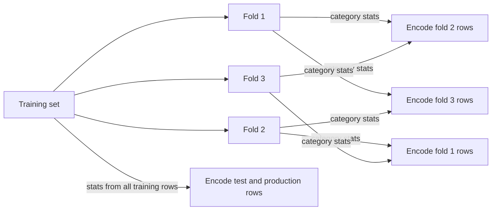
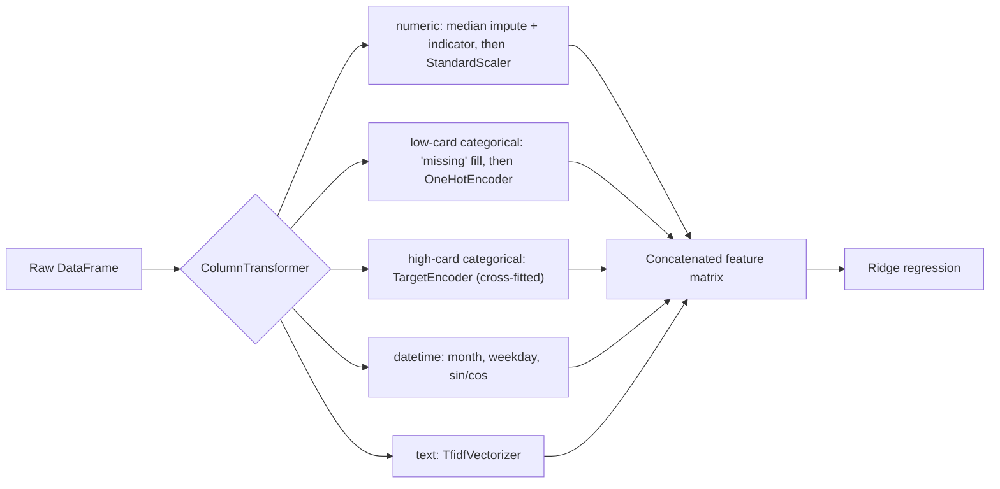

# Feature Engineering: Missing Values, Categorical Encoding and Scaling

> **Level:** Beginner to Advanced · **Study time:** ~110 min · **Prerequisites:** [The ML Workflow, Splits and Cross-Validation](01-ml-workflow-data-splits-and-cross-validation.md), [Overfitting, Regularization and Data Leakage](03-overfitting-regularization-and-data-leakage.md), [Decision Trees, Random Forests and Gradient Boosting](06-decision-trees-random-forests-and-gradient-boosting.md), [Python Tooling for ML](../00-foundations/06-python-numpy-pandas-pytorch-essentials.md)

## Table of contents

- [Why this matters](#why-this-matters)
- [The running example: house prices](#the-running-example-house-prices)
- [Feature types](#feature-types)
- [Why values go missing: MCAR, MAR and MNAR](#why-values-go-missing-mcar-mar-and-mnar)
- [Imputation strategies](#imputation-strategies)
- [Categorical encoding: one-hot, ordinal and frequency](#categorical-encoding-one-hot-ordinal-and-frequency)
- [Target encoding and target leakage](#target-encoding-and-target-leakage)
- [High-cardinality features: hashing and learned embeddings](#high-cardinality-features-hashing-and-learned-embeddings)
- [Scaling and transforming numeric features](#scaling-and-transforming-numeric-features)
- [Date and time features](#date-and-time-features)
- [Interaction features](#interaction-features)
- [Text features with TF-IDF](#text-features-with-tf-idf)
- [Building a leak-free scikit-learn pipeline](#building-a-leak-free-scikit-learn-pipeline)
- [Going deeper: feature engineering in production](#going-deeper-feature-engineering-in-production)
- [Common mistakes and misconceptions](#common-mistakes-and-misconceptions)
- [Interview questions and model answers](#interview-questions-and-model-answers)
- [Key takeaways](#key-takeaways)
- [Further reading](#further-reading)
- [Next](#next)

## Why this matters

Real data is messy: fields are blank, cities are strings, prices span five orders of magnitude, and timestamps hide weekly cycles. A model only sees numbers, so every production ML system has a layer that turns raw records into clean numeric **features** (the input columns a model learns from). On tabular problems such as fraud, credit risk, churn and pricing, this layer often matters more than the choice of algorithm. It is also where the most expensive bugs live: a target encoder fitted on the whole dataset or a scaler that differs between training and serving can make a model look brilliant offline and fail silently in production. Interviewers know this, so questions like "how do you handle missing values and categorical features?" are a fast way to separate people who have shipped models from people who have only run notebooks.

## The running example: house prices

We will reuse one tiny dataset of house listings throughout. The goal is to predict `price` (in thousands of dollars). All numbers are illustrative.

| house | sqft | bedrooms | bathrooms | neighborhood | year_built | price ($k) |
|---|---|---|---|---|---|---|
| A | 1200 | 2 | 1 | Rural | 1950 | 150 |
| B | 1600 | 3 | 2 | Suburb | 1995 | 300 |
| C | 1800 | 3 | 2 | Suburb | 2001 | 320 |
| D | 4000 | 5 | 4 | Downtown | 2015 | 540 |
| E | 1500 | 3 | 1 | Suburb | 1988 | 280 |
| F | *missing* | 3 | 2 | *missing* | 1990 | 300 |

House F has two blanks. By the end of this chapter you will know several ways to fill them, how to turn `neighborhood` into numbers, how to put `sqft` and `bedrooms` on comparable scales, and how to wrap all of it in a pipeline that cannot leak.

For text features we will also use a small spam filter example, introduced in the TF-IDF section.

## Feature types

> **Analogy:** A feature type is like the type of a variable in a programming language. You would not add a string to an integer without converting it first, and a model cannot use "Downtown" until you decide how to convert it.

Before choosing any technique, classify each column. The type decides the treatment.

| Type | Definition | Example | Typical treatment |
|---|---|---|---|
| **Continuous numeric** | A measurement that can take any value in a range | `sqft`, temperature | Impute, maybe log-transform, scale |
| **Discrete numeric** | A count (whole numbers) | `bedrooms`, number of logins | Treat as numeric, sometimes cap or bucket |
| **Binary** | Exactly two values | `has_pool` | Encode as 0/1 |
| **Nominal categorical** | Labels with no natural order | `neighborhood`, `color` | One-hot, target encoding, hashing, embeddings |
| **Ordinal categorical** | Labels with a meaningful order | `condition`: Poor < Fair < Good < Excellent | Ordinal integers that respect the order |
| **Datetime** | A point in time | `listed_at`, `transaction_time` | Extract components, cyclical encoding, elapsed time |
| **Text** | Free-form strings | listing description, email body | Bag of words, TF-IDF, embeddings |
| **Identifier** | Unique or near-unique keys | `user_id`, `zip_code`, `house_id` | Usually drop, or treat as a high-cardinality categorical |

**Cardinality** means the number of distinct values a categorical feature takes. `neighborhood` with 3 values is **low-cardinality**. `zip_code` with 40,000 values or `user_id` with 10 million values is **high-cardinality**, and that changes which encodings are practical.

> **Common mistake:** Treating a numeric-looking code as a number. Zip code 94110 is not "bigger" than 10001 in any meaningful way. Store such columns as strings so no tool accidentally scales or averages them.

## Why values go missing: MCAR, MAR and MNAR

> **Analogy:** Missing values are like gaps in a witness's testimony. Before filling the gap, a detective asks *why* the witness is silent. Forgot? Was it because of something else we know? Or is the silence itself the clue?

Statistician Donald Rubin ("Inference and Missing Data", 1976) gave three **missing data mechanisms**. A mechanism is the process that decides which values end up blank. Knowing it tells you which fixes are safe.

### MCAR: Missing Completely At Random

**Definition:** whether a value is missing has nothing to do with any data, observed or unobserved. The blanks are a pure random sample.

**Examples:** a sensor drops 2% of readings because of random network glitches. A data-entry intern randomly skips some rows. A lab tube breaks at random.

**Consequence:** the rows you still have are a fair sample, so even dropping rows gives unbiased estimates (you just lose data). MCAR is the easiest case and the rarest in practice.

### MAR: Missing At Random

**Definition:** missingness depends on *other observed* features, but not on the missing value itself once you account for those features. The name is confusing: it is not "random" in the everyday sense.

**Examples:** `sqft` is missing more often for houses built before 1960, because older records were on paper. Since `year_built` is observed, you can model that. In a survey, younger respondents skip the income question more often, and age is recorded.

**Consequence:** dropping rows can bias your data (you lose old houses disproportionately, so the remaining sample no longer represents the population; some estimates, such as a regression conditioned on the variables that drive missingness, can still be unbiased), but methods that use the other features to fill the gap (KNN, iterative imputation, tree models) can correct for it.

### MNAR: Missing Not At Random

**Definition:** missingness depends on the missing value itself (or on something unobserved).

**Examples:** sellers of very small houses leave `sqft` blank because a small number hurts the listing. High earners decline to report income. Patients with severe symptoms drop out of a study.

**Consequence:** no imputation from the observed data can fully fix it, because the information you need is exactly what is hidden. The practical move is to **make the missingness itself a feature** (a missing indicator), because "this seller hid the size" is predictive. Often you also need domain knowledge or a different data source.

```text
Is missingness related to anything?
        |
        +-- No -----------------------------------------> MCAR
        |                                                 (dropping rows is unbiased, just wasteful)
        |
        +-- Yes, to other columns we observe -----------> MAR
        |                                                 (impute using other columns)
        |
        +-- Yes, to the hidden value itself ------------> MNAR
                                                          (add missing indicator, use domain knowledge)
```

A fourth practical category deserves a name: **structural missingness**, where the value does not exist rather than being unknown. `garage_area` is blank because the house has no garage. The right fill is usually 0 (or "None") plus an indicator, not an average garage size.

### How to tell which mechanism you have

You can never prove MAR versus MNAR from the data alone (the evidence is hidden by definition), but you can gather clues:

1. **Missing rate per column.** A column that is 95% missing is a different problem from one that is 2% missing.
2. **Compare rows with and without the value.** If houses missing `sqft` have a much older average `year_built`, missingness is at least related to observed data (so not MCAR).
3. **Predict missingness.** Train a quick classifier to predict "is `sqft` missing?" from the other columns and measure its **AUC** (area under the ROC curve: 0.5 means it ranks no better than a coin flip, 1.0 means perfectly; see [Classification Metrics and Imbalanced Data](04-classification-metrics-and-imbalanced-data.md)). An AUC near 0.5 is consistent with MCAR (though it cannot rule out MNAR). Clearly higher means missingness depends on observed columns, so it is not MCAR.
4. **Check the target.** If the target mean differs a lot between missing and non-missing rows, the missingness is informative and an indicator feature will help.
5. **Ask the data owner.** Many "mysteries" are a form field that became optional on a known date.

Little's MCAR test (Little, 1988) is a formal statistical test, but in industry the checks above are more common.

> **Interview tip:** When asked how you handle missing values, start with "first I find out *why* they are missing", then name MCAR/MAR/MNAR with one example each. That sentence alone signals seniority.

## Imputation strategies

**Imputation** means filling missing values with estimates. The golden rule, from the [leakage chapter](03-overfitting-regularization-and-data-leakage.md): **learn any imputation statistic on the training data only**, then apply it to validation, test and production data.

### Option 0: drop rows or columns

- **Drop rows** (listwise deletion): fine if the data is MCAR and you have plenty of rows. Often biased under MAR and MNAR. Useless in production, because you cannot refuse to score a live request just because a field is blank.
- **Drop columns:** reasonable if a column is mostly missing *and* its missingness is not predictive. Check the second part before dropping.

### Option 1: mean, median or mode

> **Analogy:** If you do not know someone's height, guessing the average height is not crazy. But if one basketball player is in the group, the median is the safer guess.

- **Mean imputation:** fill with the average of the observed values.
- **Median imputation:** fill with the middle value. Robust to outliers.
- **Mode imputation:** fill with the most frequent value. Used for categoricals.

**Worked example** with houses A to E (F is missing `sqft`):

Observed `sqft`: 1200, 1500, 1600, 1800, 4000.

- Mean $= (1200 + 1500 + 1600 + 1800 + 4000) / 5 = 10100 / 5 = 2020$.
- Median: sort the values (1200, 1500, **1600**, 1800, 4000), the middle one is $1600$.

The single 4000 sqft mansion drags the mean up to 2020, larger than four of the five houses. The median, 1600, is a much more typical house. For skewed features like size, income or price, prefer the median.

Mode of `neighborhood` among A to E: Rural (1), Suburb (3), Downtown (1). The mode is **Suburb**, so F gets "Suburb".

**Downsides:** every imputed row gets the same value, which shrinks the feature's variance and weakens its correlations with other features. It also ignores everything else we know about the row (F has 3 bedrooms and 2 bathrooms, which says a lot about its size).

### Option 2: constant plus a missing indicator

Fill with a constant (the median, 0, or the string `"missing"` for categoricals) **and** add a binary **missing indicator** column that is 1 where the value was missing.

| house | sqft (imputed with median) | sqft_was_missing |
|---|---|---|
| A | 1200 | 0 |
| ... | ... | ... |
| F | 1600 | 1 |

Why it works: the model can learn "when `sqft_was_missing` = 1, adjust the prediction". Under MNAR (small houses hide their size), the indicator carries exactly the signal imputation cannot recover. For categoricals, treating `"missing"` as its own category achieves the same thing without an extra column.

This is the default most practitioners reach for first: simple, fast, safe at serving time, and it never throws away the information that a value was missing.

### Option 3: KNN imputation

**KNN imputation** (k-nearest neighbors) fills a missing value with the average of that feature across the $k$ most similar rows, where similarity is measured on the features that *are* present. (KNN as a model is covered in [k-Nearest Neighbors, SVMs and Naive Bayes](09-knn-svm-naive-bayes-and-other-classic-algorithms.md).)

**Worked example:** impute F's `sqft` with $k = 2$, using `bedrooms` and `bathrooms` to measure distance. F has (bedrooms 3, bathrooms 2). Euclidean distance $d = \sqrt{(\Delta \text{bed})^2 + (\Delta \text{bath})^2}$:

| house | (bed, bath) | distance to F (3, 2) | sqft |
|---|---|---|---|
| A | (2, 1) | $\sqrt{1^2 + 1^2} = \sqrt{2} \approx 1.41$ | 1200 |
| B | (3, 2) | $\sqrt{0 + 0} = 0$ | 1600 |
| C | (3, 2) | $\sqrt{0 + 0} = 0$ | 1800 |
| D | (5, 4) | $\sqrt{2^2 + 2^2} = \sqrt{8} \approx 2.83$ | 4000 |
| E | (3, 1) | $\sqrt{0 + 1^2} = 1$ | 1500 |

The 2 nearest are B and C, so F's `sqft` $= (1600 + 1800) / 2 = 1700$. That is more sensible than the mean (2020), because it uses what we know about F.

**Caveats:** distances are dominated by large-scale features, so scale first (see [scaling](#scaling-and-transforming-numeric-features)). Prediction-time cost grows with training-set size, because each imputation searches the training rows. It struggles in high dimensions.

### Option 4: iterative imputation (MICE-style)

**Iterative imputation** models each feature with missing values as a function of the other features, in rounds:

1. Start by filling every gap with a simple guess (for example, the mean).
2. For feature 1, train a regressor (for example, linear regression) on rows where feature 1 is observed, predicting it from all other features. Use it to re-fill feature 1's gaps.
3. Repeat for feature 2, 3, and so on, each time using the latest filled values.
4. Repeat the whole cycle several times until the filled values stop changing much.

This is the idea behind **MICE** (Multiple Imputation by Chained Equations; see van Buuren and Groothuis-Oudshoorn, 2011). True *multiple* imputation creates several filled datasets with randomness, fits a model on each and pools the results, which matters for statistical inference (correct confidence intervals). For prediction, a single iterative imputation is common.

**Trade-offs:** captures relationships between features (good for MAR), but is slower, has more knobs, can overfit, and is harder to reproduce at serving time.

### Option 5: let the model handle it

Some models accept missing values directly, stored as `NaN` ("Not a Number", the floating-point marker NumPy and pandas use for a blank):

- **XGBoost** uses "sparsity-aware split finding" (Chen and Guestrin, 2016): at each split it tries sending all missing rows left and then right, and keeps whichever direction reduces the loss more. That learned **default direction** is used at prediction time.
- **LightGBM** handles missing values natively in a similar spirit by default.
- **CatBoost** by default treats missing numeric values as smaller than every observed value (its `nan_mode` setting controls this).
- **scikit-learn's `HistGradientBoostingClassifier/Regressor`** accept `NaN` natively. Recent scikit-learn versions also added missing-value support to single decision trees and random forests (roughly 1.3 and 1.4 respectively; check your version).

The tree learns, from data, where missing rows should go. That is effectively a learned missing indicator, and it often beats manual imputation for tree ensembles. See [Decision Trees, Random Forests and Gradient Boosting](06-decision-trees-random-forests-and-gradient-boosting.md) for how splits work.

Linear models, SVMs, KNN and neural networks do **not** accept `NaN`. They need imputation first.

### Comparison

| Strategy | Best when | Pros | Cons |
|---|---|---|---|
| Drop rows | MCAR, lots of data, offline analysis only | Simple, unbiased under MCAR | Wastes data, often biased otherwise, impossible at serving time |
| Mean/median/mode | Quick baseline, low missing rate | Fast, trivially reproducible in production | Ignores other features, shrinks variance |
| Constant + indicator | Default for most production models, MNAR suspected | Keeps "was missing" signal, simple, robust | Adds columns, still a crude fill |
| KNN | MAR, moderate size, related features | Uses similar rows, fairly accurate | Needs scaling, slow at scale, curse of dimensionality |
| Iterative (MICE) | MAR, strong feature correlations | Captures multivariate structure | Slow, complex, harder to serve, can overfit |
| Model-native (XGBoost, LightGBM, HistGB) | Tree ensembles | Learns the handling from data, zero preprocessing | Only some model families, serving data must use the same missing encoding |

### Code: from scratch, then scikit-learn

```python
# pip install numpy pandas scikit-learn
import numpy as np
import pandas as pd

houses = pd.DataFrame({
    "sqft":         [1200, 1600, 1800, 4000, 1500, np.nan],
    "bedrooms":     [2, 3, 3, 5, 3, 3],
    "bathrooms":    [1, 2, 2, 4, 1, 2],
    "neighborhood": ["Rural", "Suburb", "Suburb", "Downtown", "Suburb", np.nan],
})

# From scratch: median + indicator. "Fit" means learn the statistic from training data.
train_median = houses["sqft"].median()                # 1600.0 (NaN is skipped)
houses["sqft_was_missing"] = houses["sqft"].isna().astype(int)
houses["sqft_filled"] = houses["sqft"].fillna(train_median)
print(houses[["sqft", "sqft_filled", "sqft_was_missing"]])
```

```python
from sklearn.impute import SimpleImputer, KNNImputer
from sklearn.experimental import enable_iterative_imputer  # noqa: F401, required import
from sklearn.impute import IterativeImputer

num = houses[["sqft", "bedrooms", "bathrooms"]]

# Median + missing indicator in one object
median_imp = SimpleImputer(strategy="median", add_indicator=True)
print(median_imp.fit_transform(num)[-1])  # F row: [1600., 3., 2., 1.]

# KNN with k=2 (uses a NaN-aware Euclidean distance on the present features)
knn_imp = KNNImputer(n_neighbors=2)
print(knn_imp.fit_transform(num)[-1])     # F row: [1700., 3., 2.]

# Iterative imputation (still flagged experimental in scikit-learn, hence the extra import)
iter_imp = IterativeImputer(max_iter=10, random_state=0)
print(iter_imp.fit_transform(num)[-1])    # F's sqft is predicted from bedrooms and bathrooms

# Categorical: treat missing as its own category
cat_imp = SimpleImputer(strategy="constant", fill_value="missing")
print(cat_imp.fit_transform(houses[["neighborhood"]]).ravel())
```

The KNN result matches our hand calculation (1700): B and C are at distance 0 in the NaN-aware metric.

> **Senior insight:** For prediction, the goal is not to recover the "true" missing value. It is to give the model the most useful input. That is why a crude median plus an indicator often beats a sophisticated imputer: the indicator tells the model "do not trust this number", and the model decides what to do with that.

## Categorical encoding: one-hot, ordinal and frequency

Models do arithmetic, so strings must become numbers. **Encoding** is the mapping from category to number(s). The wrong mapping silently injects false information.

### Why not just number the categories?

Suppose we map Rural = 0, Suburb = 1, Downtown = 2. A linear model now believes Downtown is "twice Suburb" and that Suburb sits exactly halfway between Rural and Downtown. Those are invented facts. For *nominal* categories we need an encoding with no fake order.

### One-hot encoding

> **Analogy:** A row of light switches, one per category. Exactly one switch is on.

**One-hot encoding** creates one binary column per category. A row has 1 in its category's column and 0 elsewhere.

```text
neighborhood      ->   is_Downtown  is_Rural  is_Suburb
Rural                       0           1          0
Suburb                      0           0          1
Downtown                    1           0          0
```

- **Pros:** no fake order, every category gets its own coefficient in a linear model, easy to interpret.
- **Cons:** creates $K$ columns for $K$ categories. With 40,000 zip codes you get 40,000 mostly-zero columns. Stored as a **sparse matrix** (only non-zero entries are kept in memory) that is manageable for linear models, but it is bad for tree models (each split can isolate only one category) and wasteful for neural nets.

**The dummy variable trap:** the $K$ one-hot columns always sum to 1, which duplicates the intercept term of a linear model. In unregularized linear regression this is **perfect multicollinearity** (one column is an exact linear combination of others), so coefficients are not unique. Fix: drop one column (`drop="first"`), or use regularization (see [Linear and Logistic Regression](02-linear-and-logistic-regression.md)): Ridge's L2 penalty makes the solution unique, while Lasso stabilizes the fit but its solution need not be unique when columns are perfectly collinear. Tree models do not care.

**Production details that matter:**

- **Unseen categories:** a new neighborhood appears in production. `OneHotEncoder(handle_unknown="ignore")` encodes it as all zeros instead of crashing.
- **Rare categories:** group categories with few rows into an "infrequent" bucket (`min_frequency=` or `max_categories=` in scikit-learn 1.1+). Rare categories give noisy coefficients anyway.
- **Fixed column order:** the encoder remembers the training categories, so column 17 always means the same thing. Hand-rolled `pd.get_dummies` on each batch does not, which is a classic training-serving bug.

### Ordinal encoding

**Ordinal encoding** maps each category to one integer. It is correct when categories truly have an order:

| condition | encoded |
|---|---|
| Poor | 0 |
| Fair | 1 |
| Good | 2 |
| Excellent | 3 |

You must supply the order explicitly (`OrdinalEncoder(categories=[["Poor", "Fair", "Good", "Excellent"]])`). The default alphabetical order would put "Excellent" first, which is nonsense.

For *tree models*, arbitrary integer codes on nominal categories often work acceptably, because a tree can carve out ranges with several splits. It is a cheap, low-memory encoding for gradient boosting. For linear models and neural nets, arbitrary codes on nominal data are wrong.

### Frequency (count) encoding

**Frequency encoding** replaces each category with how often it appears in the training data. On an 8-house slice with 3 Downtown, 4 Suburb and 1 Rural:

- Downtown $\to 3/8 = 0.375$
- Suburb $\to 4/8 = 0.5$
- Rural $\to 1/8 = 0.125$

It produces one column, never uses the target (so no target leakage), and works when popularity correlates with the outcome (common in fraud: rare merchants are riskier). Downside: two different categories with the same count become indistinguishable.

## Target encoding and target leakage

### The idea

> **Analogy:** To guess a new house's price, a real estate agent asks "what do houses in this neighborhood usually sell for?" That one number summarizes the whole neighborhood.

**Target encoding** (also called **mean encoding**) replaces each category with the average of the **target** (the value we are predicting) for that category in the training data. For classification, the target mean is the fraction of positives, which is an estimate of $P(y = 1 \mid \text{category})$. Micci-Barreca (2001) popularized it for high-cardinality categoricals.

It turns a 40,000-value zip code into **one** dense, highly informative numeric column. That is why it is a favorite for gradient boosting on tabular data.

### Worked example

Here is a slightly bigger slice of our listings (8 houses):

| house | neighborhood | price ($k) |
|---|---|---|
| 1 | Downtown | 500 |
| 2 | Downtown | 460 |
| 3 | Downtown | 540 |
| 4 | Suburb | 300 |
| 5 | Suburb | 320 |
| 6 | Suburb | 280 |
| 7 | Suburb | 300 |
| 8 | Rural | 150 |

**Step 1, global mean** (the average over all rows):

$$\bar{y} = \frac{500 + 460 + 540 + 300 + 320 + 280 + 300 + 150}{8} = \frac{2850}{8} = 356.25$$

**Step 2, per-category means:**

- Downtown: $(500 + 460 + 540) / 3 = 1500 / 3 = 500$
- Suburb: $(300 + 320 + 280 + 300) / 4 = 1200 / 4 = 300$
- Rural: $150 / 1 = 150$

So the naive target encoding is Downtown $\to 500$, Suburb $\to 300$, Rural $\to 150$.

### The leakage problem

Look at Rural. It has one house, and its encoding (150) **is that house's price**. When the model trains on row 8, the feature literally contains the answer.

**Target encoding leakage** happens when a row's encoded value is computed using that same row's target. The model learns to trust the encoding far more than it should, because on training rows it is suspiciously accurate. On new data, where the encoding was computed from *other* rows, it is much less accurate. The result: excellent training and (if you encoded before splitting) validation scores, then a disappointing production model.

The leak is worst for **rare categories**. With $n$ rows in a category, each row contributes $1/n$ of its own encoding. At $n = 1$ the encoding equals the label. With 10 million user IDs, most of which appear a handful of times, naive target encoding is close to handing the model the labels.

There is a second, more blatant leak: computing the encoding on the **full dataset before splitting** into train and validation. Then validation targets are baked into the features, and your validation score is fiction. The general idea is covered in [the leakage chapter](03-overfitting-regularization-and-data-leakage.md). Target encoding is the most common real-world instance.

### Fix 1: smoothing (shrink toward the global mean)

Do not fully trust a category mean computed from few rows. Blend it with the global mean, weighted by how much data the category has:

$$\text{enc}(c) = \frac{n_c \cdot \bar{y}_c + m \cdot \bar{y}}{n_c + m}$$

- $c$: the category (for example, Rural).
- $n_c$: number of training rows in category $c$.
- $\bar{y}_c$: mean target within category $c$.
- $\bar{y}$: global mean target (the **prior**: our best guess with no category information).
- $m$: smoothing strength, a hyperparameter. Think of it as "$m$ pretend rows at the global mean". Larger $m$ means more shrinkage.

With $m = 2$ and $\bar{y} = 356.25$, so $m \cdot \bar{y} = 2 \times 356.25 = 712.5$:

- Rural ($n = 1$): $\dfrac{1 \times 150 + 712.5}{1 + 2} = \dfrac{862.5}{3} = 287.5$
- Downtown ($n = 3$): $\dfrac{3 \times 500 + 712.5}{3 + 2} = \dfrac{2212.5}{5} = 442.5$
- Suburb ($n = 4$): $\dfrac{4 \times 300 + 712.5}{4 + 2} = \dfrac{1912.5}{6} = 318.75$

Rural moved a lot (150 to 287.5) because one house is weak evidence. Suburb moved little (300 to 318.75) because four houses are stronger evidence. As $n_c \to \infty$, the encoding approaches the category mean. This is a simple form of **empirical Bayes** shrinkage (using the data to set the prior); see [Probability and Statistics](../00-foundations/04-probability-and-statistics.md) for the Bayesian intuition.

Smoothing reduces the leak but does not eliminate it: the row's own target still contributes to its encoding.

### Fix 2: out-of-fold encoding (the main fix)

Compute each training row's encoding **only from other rows**. The standard way uses $K$ folds, just like [cross-validation](01-ml-workflow-data-splits-and-cross-validation.md):

1. Split the training set into $K$ folds.
2. For each fold, compute category statistics from the other $K - 1$ folds and use them to encode the rows in this fold.
3. Categories unseen in the other folds get the global mean of those folds.
4. For the test set and production, use statistics from the **entire** training set.

**Worked example with $K = 2$.** Fold A = houses {1, 3, 4, 6}, fold B = houses {2, 5, 7, 8}.

Statistics from fold A: Downtown $(500 + 540)/2 = 520$, Suburb $(300 + 280)/2 = 290$, global $(500 + 540 + 300 + 280)/4 = 1620/4 = 405$. No Rural.

Statistics from fold B: Downtown $460$, Suburb $(320 + 300)/2 = 310$, Rural $150$.

| house | fold | neighborhood | encoded using | encoding |
|---|---|---|---|---|
| 1 | A | Downtown | fold B | 460 |
| 3 | A | Downtown | fold B | 460 |
| 4 | A | Suburb | fold B | 310 |
| 6 | A | Suburb | fold B | 310 |
| 2 | B | Downtown | fold A | 520 |
| 5 | B | Suburb | fold A | 290 |
| 7 | B | Suburb | fold A | 290 |
| 8 | B | Rural | fold A (unseen) | 405 (fold A global mean) |

House 8's own price (150) never touched its own encoding. The model now sees a feature that behaves on training rows the same way it will behave on new data: a noisy estimate built from *other* houses. In practice, combine out-of-fold with smoothing.



> **Common mistake:** Using **leave-one-out** encoding (each row encoded from all other rows in its category) and thinking the leak is gone. For a binary target, take a category with 4 rows, 2 positive. A positive row is encoded as $1/3$ (one other positive out of 3 others) and a negative row as $2/3$. The encoding perfectly separates the labels inside the category, and a tree will find the threshold at $0.5$ immediately. K-fold with reasonably large folds avoids this.

### Fix 3: add noise

Add small random noise (for example, Gaussian noise) to the training encodings only. This stops the model from memorizing exact encoding values. It is a weaker fix, best used on top of smoothing and out-of-fold, and the noise scale is one more hyperparameter.

### Other fixes worth knowing

- **Ordered target statistics (CatBoost):** CatBoost (Prokhorenkova et al., "CatBoost: unbiased boosting with categorical features", 2018) shuffles the rows and encodes each row using only the rows *before* it in that random order, with a prior. No row ever sees its own label. This is why CatBoost handles raw categoricals well out of the box.
- **Time-aware encoding:** when data has a time order (fraud, ads), encode each event using only *past* events (an expanding mean). Random folds would let the future leak into the past.
- **Minimum count threshold:** categories below some count get only the global mean.

### Code: from scratch, then scikit-learn

```python
import numpy as np
import pandas as pd
from sklearn.model_selection import KFold

def oof_target_encode(cat: pd.Series, y: pd.Series, n_splits=5, m=10.0, seed=0):
    """Out-of-fold, smoothed target encoding for training rows."""
    cat, y = cat.reset_index(drop=True), y.reset_index(drop=True)
    enc = np.empty(len(cat))
    for fit_idx, enc_idx in KFold(n_splits, shuffle=True, random_state=seed).split(cat):
        prior = y.iloc[fit_idx].mean()
        stats = y.iloc[fit_idx].groupby(cat.iloc[fit_idx]).agg(["sum", "count"])
        smoothed = (stats["sum"] + m * prior) / (stats["count"] + m)  # = (n*mean + m*prior)/(n+m)
        enc[enc_idx] = cat.iloc[enc_idx].map(smoothed).fillna(prior).to_numpy()
    return enc

def fit_full_encoding(cat: pd.Series, y: pd.Series, m=10.0):
    """Mapping learned on ALL training rows, used for test and production."""
    prior = y.mean()
    stats = y.groupby(cat).agg(["sum", "count"])
    return (stats["sum"] + m * prior) / (stats["count"] + m), prior

nb = pd.Series(["Downtown"] * 3 + ["Suburb"] * 4 + ["Rural"])
price = pd.Series([500, 460, 540, 300, 320, 280, 300, 150], dtype=float)
mapping, prior = fit_full_encoding(nb, price, m=2.0)
print(mapping.round(2).to_dict())  # {'Downtown': 442.5, 'Rural': 287.5, 'Suburb': 318.75}
```

scikit-learn 1.3+ ships `TargetEncoder`, which does both smoothing (empirical Bayes by default) and internal **cross-fitting** (the out-of-fold scheme above):

```python
from sklearn.preprocessing import TargetEncoder

# Assumes X_train / X_test DataFrames with a string "zip_code" column and a numeric y_train.
te = TargetEncoder(target_type="continuous", cv=5, random_state=0)  # see version note below
X_train_enc = te.fit_transform(X_train[["zip_code"]], y_train)  # out-of-fold encodings
X_test_enc = te.transform(X_test[["zip_code"]])                 # full-training-set encodings
```

Note a subtle API point: for `TargetEncoder`, `fit(X, y).transform(X)` is **not** the same as `fit_transform(X, y)`. Only `fit_transform` gives out-of-fold values. Inside a `Pipeline` this is handled correctly, because pipelines call `fit_transform` during training.

**Version note:** the `random_state=` argument used in this chapter works in scikit-learn 1.3 to 1.10, but scikit-learn 1.9 deprecated `TargetEncoder`'s `shuffle` and `random_state` (removal planned for 1.11) and now emits a `FutureWarning`. From 1.9 on, pass a splitter instead, for example `TargetEncoder(cv=KFold(5, shuffle=True, random_state=0))`; older versions accept only an integer `cv`.

### A leakage demo you can run

Here is the leak made visible: a categorical feature with **no** relationship to the label.

```python
import numpy as np
import pandas as pd
from sklearn.linear_model import LogisticRegression
from sklearn.model_selection import cross_val_score
from sklearn.pipeline import make_pipeline
from sklearn.preprocessing import TargetEncoder

rng = np.random.default_rng(42)
n = 1000
X = pd.DataFrame({"user_id": rng.integers(0, 300, n).astype(str)})  # ~3 rows per user
y = rng.integers(0, 2, n)                                            # labels are pure noise

# LEAKY: naive mean encoding on ALL data, then cross-validate
leaky_feature = X.assign(y=y).groupby("user_id")["y"].transform("mean").to_frame()
leaky = cross_val_score(LogisticRegression(), leaky_feature, y, cv=5, scoring="roc_auc").mean()

# CORRECT: encoding is learned inside each training fold, out-of-fold
pipe = make_pipeline(TargetEncoder(target_type="binary", random_state=0), LogisticRegression())
correct = cross_val_score(pipe, X, y, cv=5, scoring="roc_auc").mean()

print(f"leaky AUC={leaky:.2f}  correct AUC={correct:.2f}")
# Expect the leaky AUC to be far above 0.5 and the correct AUC to hover near 0.5.
```

The label is random noise, so the honest answer is AUC of about 0.5. The leaky version "finds" signal that does not exist. If you ever see a validation score that looks too good after adding a target-encoded ID, run this kind of shuffle test.

## High-cardinality features: hashing and learned embeddings

When a categorical has millions of values (user IDs, product IDs, search queries, IP addresses), one-hot is too wide and even target encoding loses information (it compresses each category into one number). Two other tools scale.

### The hashing trick

> **Analogy:** A coat check with a fixed 1,000 hooks. Instead of a hook per guest, a rule assigns each name to a hook number. Occasionally two guests share a hook. You accept that small mess in exchange for never running out of hooks.

The **hashing trick** (feature hashing) applies a **hash function** (a deterministic function that maps any string to a large integer) to each category string, then takes it modulo $m$ to pick one of $m$ columns:

$$\text{column}(c) = h(c) \bmod m$$

- $h$: a hash function such as MurmurHash3 (scikit-learn's `FeatureHasher` uses it).
- $c$: the category string, usually prefixed with the feature name, like `"zip=94110"`, so the same value in different features hashes differently.
- $m$: the number of output columns, often a power of 2 like $2^{18} = 262{,}144$.

**Collisions:** two categories can land in the same column. If $k$ categories are hashed into $m$ buckets, any specific pair collides with probability $1/m$, so the expected number of colliding pairs is about $\binom{k}{2} / m$, where $\binom{k}{2} = k(k-1)/2$ is the number of distinct pairs. For $k = 1000$ and $m = 2^{18}$: $\binom{1000}{2} = 499{,}500$, and $499{,}500 / 262{,}144 \approx 1.9$ colliding pairs. Negligible. For $k$ = 10 million into the same $m$, nearly every bucket is shared, so collisions become a real accuracy cost and you would raise $m$.

**Signed hashing:** Weinberger et al. ("Feature Hashing for Large Scale Multitask Learning", 2009) use a second hash function to choose $+1$ or $-1$ for the value, so colliding features tend to cancel in expectation instead of piling up (the hashed inner product becomes an unbiased estimate of the original one). scikit-learn's `FeatureHasher` does this by default (`alternate_sign=True`).

**Why it is loved in production:**

- **No vocabulary to store:** no dictionary of 10 million IDs to version, ship and keep in sync.
- **Unseen categories just work:** a new ID hashes to some column. No retraining of the encoder.
- **Fixed memory:** the feature space size is set by $m$, not by data growth.
- **Streaming friendly:** each row can be encoded independently.

**Costs:** collisions, no way to map a column back to a category (bad for interpretability and debugging), and $m$ is a hyperparameter.

```python
import hashlib

def hash_bucket(token: str, n_buckets: int = 2**18) -> int:
    # Use a STABLE hash. Python's built-in hash() for strings is randomized per process
    # (PYTHONHASHSEED), so training and serving would disagree.
    return int(hashlib.md5(token.encode("utf-8")).hexdigest(), 16) % n_buckets

print(hash_bucket("zip=94110"), hash_bucket("zip=10001"))  # two bucket indices in [0, 262143]
```

```python
from sklearn.feature_extraction import FeatureHasher

hasher = FeatureHasher(n_features=2**18, input_type="string")
rows = [["neighborhood=Downtown", "zip=94110"], ["neighborhood=Rural", "zip=59001"]]
X_hashed = hasher.transform(rows)   # sparse matrix of shape (2, 262144)
print(X_hashed.shape, X_hashed.nnz)  # (2, 262144) 4  (unless two tokens collide)
```

> **Senior insight:** The stable-hash point is a real production bug. If a training job uses one hash function and the serving service (maybe in Java or Go) uses another, every hashed feature is scrambled at serving time and nothing crashes. Pin the hash function, the seed and $m$ in your feature spec, and test that both sides produce identical buckets.

### Learned embeddings

> **Analogy:** Instead of giving each customer an ID badge, you place each customer on a map where customers with similar shopping habits stand close together. The map coordinates become the features.

An **embedding** is a small dense vector of learned numbers (say 16 or 32) that represents one category. An **embedding table** is a matrix with one row per category. During training of a neural network, the rows are updated by gradient descent like any other weight, so categories that behave similarly end up with similar vectors.

Guo and Berkhahn ("Entity Embeddings of Categorical Variables", 2016) showed this works well for tabular data. It is the backbone of recommender systems (user and item embeddings) and the same mechanism LLMs use for tokens (see [Embeddings: From One-Hot to Contextual](../04-transformers/02-embeddings-from-one-hot-to-contextual.md)).

Mathematically, looking up an embedding is the same as multiplying a one-hot vector by the embedding matrix $E$ (shape $K \times d$): $\mathbf{e}_c = \text{onehot}(c)^\top E$, which simply selects row $c$. Libraries skip the multiplication and index directly.

**Sizing:** with $K$ categories and dimension $d$ the table has $K \times d$ parameters. For 1 million users and $d = 32$: $10^6 \times 32 = 3.2 \times 10^7$ floats, and at 4 bytes each (FP32) that is $1.28 \times 10^8$ bytes $= 128$ MB. Dimension is a hyperparameter. Rules of thumb (for example, roughly the fourth root of $K$, or a capped power law) are only starting points.

```python
# pip install torch
import torch
import torch.nn as nn

class TabularNet(nn.Module):
    def __init__(self, n_users: int, n_numeric: int, emb_dim: int = 16):
        super().__init__()
        # Row 0 is reserved for "unknown or rare user", so unseen IDs map to index 0.
        self.user_emb = nn.Embedding(n_users + 1, emb_dim)
        self.mlp = nn.Sequential(nn.Linear(emb_dim + n_numeric, 64), nn.ReLU(), nn.Linear(64, 1))

    def forward(self, user_idx: torch.Tensor, x_numeric: torch.Tensor) -> torch.Tensor:
        z = torch.cat([self.user_emb(user_idx), x_numeric], dim=1)
        return self.mlp(z).squeeze(1)

model = TabularNet(n_users=1000, n_numeric=3)
pred = model(torch.tensor([5, 0]), torch.randn(2, 3))
print(pred.shape)  # torch.Size([2])
```

**Practical concerns:** you need a vocabulary (ID to index map) and an "unknown" index for new IDs (the **cold-start** problem: a brand-new user has an untrained vector). Rare IDs get few gradient updates, so their vectors stay noisy. Combining hashing *and* embeddings (hash IDs into a fixed number of embedding rows) is common at very large scale.

### Encoding comparison

| Encoding | What it does | When to use | Pros | Cons |
|---|---|---|---|---|
| One-hot | One binary column per category | Low cardinality (up to roughly tens to a few hundred), linear models, neural nets | No fake order, interpretable | Width grows with $K$, poor for trees at high $K$ |
| Ordinal | One integer per category | True order (Poor < Good); also as a cheap code for trees | Compact | Fake order for nominal data in linear models |
| Frequency | Category count or share | Popularity is predictive | No target leakage, 1 column | Equal counts collide |
| Target (mean) | Smoothed out-of-fold target mean | High cardinality, tree models, strong category effects | 1 dense informative column | Leakage risk, needs CV discipline, loses within-category detail |
| Hashing | $h(c) \bmod m$ columns | Huge or open-ended vocabularies, streaming | No vocabulary, unseen values work, fixed memory | Collisions, not interpretable |
| Embeddings | Learned dense vector per category | Neural nets, recommenders, millions of IDs with lots of data | Learns similarity, compact and expressive | Needs a neural model and data, cold start, vocabulary management |
| Native (CatBoost, LightGBM) | Library handles categoricals itself | Gradient boosting | Less preprocessing, CatBoost avoids target leakage by design | Ties you to that library's behavior |

The same table as a quick decision rule for a *nominal* feature:

```text
How many distinct values (K), and which model?
        |
        +-- K small (up to tens) ---------------> one-hot (linear, NN); ordinal codes or native (trees)
        |
        +-- K large (hundreds to many thousands) -> out-of-fold smoothed target encoding or frequency
        |                                           encoding, or native CatBoost / LightGBM (trees)
        |
        +-- K huge, growing or streaming -------> hashing (linear, online) or embeddings (NN)

Every branch also needs a plan for unseen and rare categories.
```

## Scaling and transforming numeric features

### Why scale at all?

> **Analogy:** Comparing two runners by "seconds of race time" and "kilometers trained per year" in one distance formula is like weighing gold and feathers on the same scale. The bigger-number feature wins by default, not on merit.

Features measured in different units have wildly different ranges: `sqft` is in the thousands, `bedrooms` is 1 to 5. **Feature scaling** puts features on comparable ranges. It matters for three kinds of models:

1. **Distance-based** (KNN, k-means, SVM with RBF kernel): a difference of 300 sqft would swamp a difference of 2 bedrooms.
2. **Regularized linear models** (Ridge, Lasso, logistic regression with a penalty): the penalty punishes coefficient size, and coefficient size depends on units. Without scaling, the penalty is unfair across features.
3. **Gradient-descent-trained models** (neural networks, linear models trained with SGD): unscaled inputs create badly shaped loss surfaces and slow, unstable training (see [Backpropagation and Gradient Descent](../02-deep-learning/02-backpropagation-and-gradient-descent.md)).

Tree models split on one feature at a time using thresholds, and a threshold works the same whether `sqft` is in square feet or square meters. **Trees do not need scaling.**

We will use the five observed `sqft` values: 1200, 1500, 1600, 1800, 4000.

### Standardization (z-score)

$$z = \frac{x - \mu}{\sigma}$$

- $x$: the original value.
- $\mu$: the mean of the feature in the **training** data.
- $\sigma$: the standard deviation of the feature in the training data (how spread out the values are).
- $z$: how many standard deviations $x$ is above or below the mean.

**By hand:** $\mu = 2020$ (computed earlier). Deviations from the mean: $-820, -520, -420, -220, 1980$. Squared: $672{,}400$, $270{,}400$, $176{,}400$, $48{,}400$, $3{,}920{,}400$. Sum $= 5{,}088{,}000$. Divide by 5: variance $= 1{,}017{,}600$. Square root: $\sigma \approx 1008.8$.

- 1200: $z = -820 / 1008.8 \approx -0.81$
- 1800: $z = -220 / 1008.8 \approx -0.22$
- 4000: $z = 1980 / 1008.8 \approx 1.96$

Result: mean 0, standard deviation 1. (scikit-learn's `StandardScaler` divides by $n$, the "population" standard deviation, as we did here.) Standardization is the default choice for linear models, SVMs and neural nets. It does not bound the range, and outliers still inflate $\sigma$.

### Min-max scaling

$$x' = \frac{x - x_{\min}}{x_{\max} - x_{\min}}$$

- $x_{\min}, x_{\max}$: the smallest and largest training values.
- $x'$: the value mapped into $[0, 1]$.

**By hand:** $x_{\min} = 1200$, $x_{\max} = 4000$, range $= 2800$.

- 1200: $0 / 2800 = 0$
- 1500: $300 / 2800 \approx 0.107$
- 1600: $400 / 2800 \approx 0.143$
- 1800: $600 / 2800 \approx 0.214$
- 4000: $2800 / 2800 = 1$

Notice the problem: one mansion squashes the four normal houses into $[0, 0.21]$. Min-max is great for features with natural bounds (pixel intensities 0 to 255, percentages) and poor with outliers. At serving time, values outside the training range map outside $[0, 1]$, which some models handle badly; you may need clipping.

### Robust scaling

$$x' = \frac{x - \text{median}}{\text{IQR}}, \qquad \text{IQR} = Q_3 - Q_1$$

- **median**: the middle value.
- $Q_1$, $Q_3$: the 25th and 75th **percentiles** (the values below which 25% and 75% of data fall).
- **IQR** (interquartile range): the spread of the middle 50% of the data. Outliers barely move it.

**By hand:** sorted values 1200, 1500, 1600, 1800, 4000. Median $= 1600$. Using linear interpolation (NumPy's default), $Q_1$ sits at position $0.25 \times 4 = 1$ in the zero-indexed sorted list, which is $1500$, and $Q_3$ at position $3$, which is $1800$. IQR $= 1800 - 1500 = 300$.

- 1200: $(1200 - 1600)/300 \approx -1.33$
- 1500: $-100 / 300 \approx -0.33$
- 1600: $0$
- 1800: $200 / 300 \approx 0.67$
- 4000: $2400 / 300 = 8$

The four normal houses keep a healthy spread, and the mansion stands out clearly as an outlier at 8. Use robust scaling when outliers are real but should not distort everything else.

### Log and power transforms

Many real-world quantities are **right-skewed**: most values are small and a long tail stretches far to the right (incomes, prices, page views, transaction amounts). A **log transform** compresses the tail:

$$x' = \log(1 + x)$$

Using $\log(1 + x)$ (`np.log1p`) instead of $\log(x)$ keeps zeros valid: $\log(1 + 0) = 0$.

**Intuition with base-10 logs:** prices of \$100,000, \$1,000,000 and \$10,000,000 become 5, 6 and 7. A tenfold jump becomes a step of 1. Multiplicative differences become additive, which suits linear models.

Related tools:

- **Box-Cox** transform: a family of power transforms that includes the log; requires strictly positive values.
- **Yeo-Johnson** transform: like Box-Cox but works with zero and negative values. Both are in `sklearn.preprocessing.PowerTransformer`, which fits the best power from training data.
- **Quantile transform:** maps values to their rank, then to a uniform or normal distribution. Very robust, but it destroys distances between values.
- **Clipping (winsorizing):** cap values at, say, the 1st and 99th training percentiles.

Transforming the **target** is also common for regression (predict $\log(\text{price})$, then exponentiate). `TransformedTargetRegressor` wraps this. Be aware that $\exp(\text{mean of }\log)$ is closer to a median than a mean, so predictions are biased low for the mean if you do not correct for it.

### Which models need scaling?

| Model | Needs scaling? | Why |
|---|---|---|
| Linear/logistic regression (unregularized, closed-form) | Not for accuracy | Coefficients rescale to compensate, but scaling helps interpretation and numerical stability |
| Ridge, Lasso, penalized logistic regression (including scikit-learn's `LogisticRegression`, which applies an L2 penalty by default) | **Yes** | Penalty depends on coefficient size, which depends on units |
| SVM (especially RBF kernel) | **Yes** | Kernel uses distances |
| KNN, k-means, DBSCAN | **Yes** | Purely distance-based |
| PCA (principal component analysis) | **Yes** | Finds directions of maximum variance; large-unit features dominate |
| Neural networks | **Yes** | Gradient descent conditioning, activation saturation |
| Decision trees, random forests, gradient boosting | No | Splits use per-feature thresholds, invariant to monotonic transforms |
| Gaussian Naive Bayes | No | Models each feature's distribution separately |

Even for trees, a log transform changes nothing (it is monotonic), but it can still help *other* parts of the pipeline, such as KNN imputation before the tree.

### Code: from scratch, then scikit-learn

```python
import numpy as np

class MyStandardScaler:
    def fit(self, X):
        self.mean_ = X.mean(axis=0)
        self.std_ = X.std(axis=0)        # population std (ddof=0), like scikit-learn
        self.std_[self.std_ == 0] = 1.0  # avoid division by zero for constant columns
        return self

    def transform(self, X):
        return (X - self.mean_) / self.std_

X_train = np.array([[1200.0], [1500.0], [1600.0], [1800.0], [4000.0]])
scaler = MyStandardScaler().fit(X_train)         # learn mu and sigma from TRAIN only
print(scaler.transform(X_train).ravel().round(2))  # values: -0.81, -0.52, -0.42, -0.22, 1.96
```

```python
from sklearn.preprocessing import StandardScaler, MinMaxScaler, RobustScaler, FunctionTransformer
import numpy as np

for s in [StandardScaler(), MinMaxScaler(), RobustScaler()]:
    print(type(s).__name__, s.fit_transform(X_train).ravel().round(3))
# StandardScaler [-0.813 -0.515 -0.416 -0.218  1.963]
# MinMaxScaler [0.    0.107 0.143 0.214 1.   ]
# RobustScaler [-1.333 -0.333  0.     0.667  8.   ]

log_tf = FunctionTransformer(np.log1p, inverse_func=np.expm1)  # usable inside pipelines
```

## Date and time features

> **Analogy:** A raw timestamp is like a phone number: one big number whose digits hide structure. You have to split it into area code and local number to make it useful.

A raw timestamp (for example, seconds since 1970) is a single huge, ever-increasing number. Models cannot extract "it is Saturday evening" from it. Useful derived features:

- **Calendar components:** year, month, day of month, day of week, hour, `is_weekend`, `is_holiday` (needs a holiday calendar for the right country).
- **Elapsed time:** `house_age = sale_year - year_built`, `days_since_last_purchase`, `account_age_days`. Differences between two dates are usually more predictive than either date alone.
- **Time since reference events:** days until Christmas, minutes since the start of a session.
- **Aggregates over windows:** "number of transactions by this card in the last hour" (central in fraud detection; see [System Design: Real-Time Fraud Detection](../11-system-design/05-design-a-real-time-fraud-detection-system.md)).

### Cyclical encoding

Hour 23 and hour 0 are one hour apart, but as numbers they are 23 apart. **Cyclical encoding** places the value on a circle using sine and cosine:

$$x_{\sin} = \sin\left(\frac{2\pi \, t}{P}\right), \qquad x_{\cos} = \cos\left(\frac{2\pi \, t}{P}\right)$$

- $t$: the value (hour of day, month, day of week).
- $P$: the period (24 for hours, 12 for months, 7 for days of the week).
- Two columns are needed, because sine alone maps two different times to the same value: the sine of 15 degrees equals the sine of 165 degrees (both about 0.2588), so hours 1 and 11 would look identical. The pair (sin, cos) is unique for every point on the circle.

**By hand** with $P = 24$ (each hour is 360 degrees / 24 = 15 degrees):

| hour | angle | sin | cos |
|---|---|---|---|
| 0 | 0° | 0.0000 | 1.0000 |
| 1 | 15° | 0.2588 | 0.9659 |
| 12 | 180° | 0.0000 | -1.0000 |
| 23 | 345° | -0.2588 | 0.9659 |

Distance from hour 23 to hour 0: $\sqrt{(-0.2588 - 0)^2 + (0.9659 - 1)^2} = \sqrt{0.0670 + 0.0012} \approx 0.261$.
Distance from hour 23 to hour 1: $\sqrt{(-0.2588 - 0.2588)^2 + 0^2} = 0.5176$.

So 23 is now closer to 0 than to 1, at about half the distance (0.261 versus 0.518), exactly as on a clock. The distance from hour 0 to hour 12 is 2, the maximum, as it should be.

Cyclical encoding helps linear models, KNN and neural nets. Trees can handle raw hour with a couple of splits, so for them it is optional.

**Pitfalls:**

- **Time zones:** "hour of day" in UTC versus the user's local time are different features. Store UTC, derive local time explicitly.
- **Future leakage:** a feature like "total purchases this month" computed at month end leaks future information into mid-month predictions. Features must be computed **as of** the prediction time (**point-in-time correctness**).
- **Raw year as a trend:** a model trained on 2023-2025 has never seen 2026, and trees cannot extrapolate beyond the training range. Prefer relative features (age, elapsed time).

## Interaction features

An **interaction feature** combines two or more features so a model can capture effects that depend on combinations.

> **Analogy:** Flour alone and heat alone do not make bread. The combination does. A linear model only adds ingredients up; it cannot see "flour AND heat" unless you hand it that combination.

A linear model predicts $\hat{y} = w_1 x_1 + w_2 x_2 + b$, so the effect of $x_1$ is the same regardless of $x_2$. But a square foot downtown is worth more than a square foot in a rural area. Adding $x_1 \cdot x_2$ (for example, `sqft * is_Downtown`) lets a linear model learn a different slope per neighborhood.

Common kinds:

- **Products:** `sqft * is_Downtown`.
- **Ratios:** `bathrooms / bedrooms`, `debt / income`, `clicks / impressions`. Ratios often encode domain knowledge directly. Guard against division by zero.
- **Differences:** `price - neighborhood_median_price`, `current_amount - user_avg_amount` (a classic fraud feature).
- **Feature crosses:** concatenate categoricals into one new categorical, like `city=Paris_x_device=mobile`, then one-hot or hash it. Wide linear models in ads and recommendation rely heavily on crosses.
- **Polynomial features:** all products up to a degree. With $d$ features and degree 2, `PolynomialFeatures` produces $\frac{(d+1)(d+2)}{2}$ columns including the bias: for $d = 10$ that is $\frac{11 \times 12}{2} = 66$, for $d = 100$ it is $\frac{101 \times 102}{2} = 5151$. The count explodes, so use it selectively and with regularization.

**Trees and neural nets** discover interactions themselves (a tree split on neighborhood followed by a split on sqft *is* an interaction), so hand-built interactions matter most for linear models. Even for gradient boosting, well-chosen ratios and differences often help, because trees approximate a ratio only with many splits.

> **Common mistake:** Building a "price per square foot" feature for a house price model. It uses the target, so it is pure leakage. A legitimate version is "*neighborhood's* median price per square foot, computed from past sales in the training data", which is just target encoding in disguise and needs the same out-of-fold care.

## Text features with TF-IDF

Running example: a tiny spam filter with a 4-document corpus (a **corpus** is a collection of documents).

| doc | text | label |
|---|---|---|
| d1 | "win free cash" | spam |
| d2 | "free free prize" | spam |
| d3 | "meeting at noon" | ham |
| d4 | "free lunch meeting" | ham |

### Bag of words

A **bag of words** representation counts how many times each vocabulary word appears in each document, ignoring order. The **vocabulary** is the set of distinct words seen in training: {at, cash, free, lunch, meeting, noon, prize, win}. Each document becomes an 8-dimensional count vector. d2 has `free = 2`, `prize = 1`, all else 0.

Problem: common words like "free" (or "the") dominate the counts while carrying little information. TF-IDF fixes this.

### TF-IDF

**TF-IDF** (term frequency times inverse document frequency) weights each word by how often it appears in this document and how rare it is across the corpus. The IDF idea goes back to Karen Sparck Jones (1972).

$$\text{tfidf}(t, d) = \text{tf}(t, d) \times \text{idf}(t), \qquad \text{idf}(t) = \ln\frac{N}{\text{df}(t)}$$

- $t$: a term (word).
- $d$: a document.
- $\text{tf}(t, d)$: term frequency, the count of $t$ in $d$.
- $N$: number of documents in the corpus.
- $\text{df}(t)$: document frequency, the number of documents that contain $t$ at least once.
- $\ln$: natural logarithm.

**By hand** ($N = 4$):

- "free" appears in d1, d2, d4, so $\text{df} = 3$ and $\text{idf} = \ln(4/3) \approx 0.288$.
- "meeting" appears in d3, d4, so $\text{idf} = \ln(4/2) = \ln 2 \approx 0.693$.
- "prize", "win", "cash", "at", "noon", "lunch" each appear once: $\text{idf} = \ln 4 \approx 1.386$.

For d2 = "free free prize":

- free: $2 \times 0.288 = 0.575$
- prize: $1 \times 1.386 = 1.386$

Even though "free" appears twice, "prize" gets more than twice the weight, because it is rare and therefore distinctive.

**scikit-learn's variant:** `TfidfVectorizer` by default uses a smoothed IDF, $\text{idf}(t) = \ln\frac{1 + N}{1 + \text{df}(t)} + 1$, and then scales each document vector to unit length (L2 normalization). For d2: free gets $2 \times (\ln(5/4) + 1) \approx 2.446$, prize gets $\ln(5/2) + 1 \approx 1.916$. The vector length is $\sqrt{2.446^2 + 1.916^2} \approx 3.107$, so after normalization free $\approx 0.787$ and prize $\approx 0.617$. Different numbers, same idea.

```python
from sklearn.feature_extraction.text import TfidfVectorizer

docs = ["win free cash", "free free prize", "meeting at noon", "free lunch meeting"]
vec = TfidfVectorizer()               # fit learns vocabulary and IDF from TRAINING docs only
X = vec.fit_transform(docs)           # sparse matrix, shape (4, 8)
print(vec.get_feature_names_out())    # ['at' 'cash' 'free' 'lunch' 'meeting' 'noon' 'prize' 'win']
print(X[1].toarray().round(3))        # d2: free ~0.787, prize ~0.617, zeros elsewhere
```

Useful options: `ngram_range=(1, 2)` adds word pairs like "free prize", `min_df` drops very rare words, `max_features` caps vocabulary size, `sublinear_tf=True` uses $1 + \ln(\text{tf})$ to dampen repeated words.

**Where TF-IDF stands today:** TF-IDF plus logistic regression is still a strong, fast, interpretable baseline for text classification. The same scoring family (BM25) remains central to search and RAG retrieval; see [Retrieval Methods: BM25, Dense and Hybrid Search](../08-rag/05-retrieval-bm25-dense-and-hybrid-search.md). Dense sentence embeddings from transformer models capture meaning and synonyms that TF-IDF misses ([Text Embeddings and Similarity Search](../08-rag/02-text-embeddings-and-similarity-search.md)) and can be fed into a tabular model as features, at higher compute cost.

## Building a leak-free scikit-learn pipeline

Every technique above has a "fit" step that learns something from data: medians, categories, target means, scaling statistics, vocabulary and IDF. **Every one of those must be learned from training rows only, separately inside every cross-validation fold.** Doing that by hand is error-prone. scikit-learn's `Pipeline` and `ColumnTransformer` make it automatic.

- A **`Pipeline`** chains steps: transformers, then a final model. Calling `fit` fits each step in order on the training data; calling `predict` applies the already-fitted transforms, then the model.
- A **`ColumnTransformer`** applies different transformers to different columns and concatenates the results side by side.



When you pass this whole pipeline to `cross_val_score` or `GridSearchCV`, each fold refits every transformer on that fold's training part only. No validation row ever influences a median, a category list, a target mean or an IDF.

```python
# pip install "scikit-learn>=1.3" pandas numpy
import numpy as np
import pandas as pd
from sklearn.compose import ColumnTransformer
from sklearn.feature_extraction.text import TfidfVectorizer
from sklearn.impute import SimpleImputer
from sklearn.linear_model import Ridge
from sklearn.model_selection import GridSearchCV, KFold, cross_val_score
from sklearn.pipeline import Pipeline, make_pipeline
from sklearn.preprocessing import FunctionTransformer, OneHotEncoder, StandardScaler, TargetEncoder

# ---------- Synthetic house data (illustrative) ----------
rng = np.random.default_rng(0)
n = 2000
df = pd.DataFrame({
    "sqft": rng.normal(1800, 500, n).clip(400, None),
    "bedrooms": rng.integers(1, 6, n).astype(float),
    "neighborhood": rng.choice(["Downtown", "Suburb", "Rural"], n, p=[0.3, 0.5, 0.2]),
    "zip_code": rng.integers(0, 500, n).astype(str),                # high cardinality
    "sold_at": pd.Timestamp("2023-01-01") + pd.to_timedelta(rng.integers(0, 730, n), unit="D"),
    "description": rng.choice(["renovated kitchen", "needs work", "pool and garden", "quiet street"], n),
})
zip_effect = rng.normal(0, 30, 500)[df["zip_code"].astype(int)]
price = (50 + 0.15 * df["sqft"] + 10 * df["bedrooms"]
         + df["neighborhood"].map({"Downtown": 150, "Suburb": 50, "Rural": 0})
         + zip_effect
         + np.where(df["description"].str.contains("renovated"), 40, 0)
         - np.where(df["description"].str.contains("needs work"), 40, 0)
         + rng.normal(0, 20, n))
# Inject missing values AFTER computing the target
df.loc[rng.random(n) < 0.10, "sqft"] = np.nan
df.loc[rng.random(n) < 0.05, "neighborhood"] = np.nan
X, y = df, price

# ---------- Feature transformers ----------
def date_features(X_dates: pd.DataFrame) -> np.ndarray:
    s = pd.to_datetime(X_dates.iloc[:, 0])
    month = s.dt.month.to_numpy()
    return np.column_stack([
        month,
        s.dt.day_of_week.to_numpy(),          # `dayofweek` alias is deprecated in pandas 3
        np.sin(2 * np.pi * month / 12),
        np.cos(2 * np.pi * month / 12),
    ])

numeric = make_pipeline(SimpleImputer(strategy="median", add_indicator=True), StandardScaler())
low_card = make_pipeline(SimpleImputer(strategy="constant", fill_value="missing"),
                         OneHotEncoder(handle_unknown="ignore"))

preprocess = ColumnTransformer([
    ("num", numeric, ["sqft", "bedrooms"]),
    ("cat", low_card, ["neighborhood"]),
    ("zip", TargetEncoder(random_state=0), ["zip_code"]),   # cross-fitted inside fit_transform
    ("date", make_pipeline(FunctionTransformer(date_features), StandardScaler()), ["sold_at"]),
    ("text", TfidfVectorizer(), "description"),              # a string, not a list: 1-D input
])

model = Pipeline([("prep", preprocess), ("reg", Ridge(alpha=1.0))])

# ---------- Honest evaluation: every fold refits every transformer ----------
cv = KFold(n_splits=5, shuffle=True, random_state=0)
rmse = -cross_val_score(model, X, y, cv=cv, scoring="neg_root_mean_squared_error")
print(f"CV RMSE: {rmse.mean():.1f} +/- {rmse.std():.1f}")

# ---------- Tune preprocessing and model together ----------
grid = GridSearchCV(
    model,
    param_grid={
        "reg__alpha": [0.1, 1.0, 10.0],
        "prep__num__simpleimputer__strategy": ["mean", "median"],
    },
    cv=cv, scoring="neg_root_mean_squared_error",
)
grid.fit(X, y)
print(grid.best_params_)
```

What to notice:

- **Parameter names** follow `step__substep__param`. `make_pipeline` names steps after the lowercase class name (`simpleimputer`, `standardscaler`). This lets you tune imputation strategy and model strength jointly, honestly.
- **Missing values are injected after the target is computed**, mimicking real data where the label exists regardless of a blank form field.
- **Text column as a string:** `TfidfVectorizer` expects a 1-D sequence of strings, so pass `"description"`, not `["description"]`.
- **The fitted pipeline is the deployable artifact.** Save it with `joblib` (or `skops` for safer loading) and serve the *same object*, so training and serving run identical transforms.

> **Senior insight:** "Fit on train, transform on everything" is the whole discipline. The pipeline is not a convenience; it is how you make leakage structurally impossible, and how you make the serving path byte-for-byte the training path.

For tree ensembles, a simpler pipeline is often better: ordinal or native categorical handling, no scaling, and native missing values. `HistGradientBoostingRegressor` supports both `NaN` and categorical features directly.

## Going deeper: feature engineering in production

### Training-serving skew

**Training-serving skew** is any difference between the features a model saw in training and the features it receives in production. Feature engineering is its main source:

- Training code is pandas in a notebook; serving code is a reimplementation in Java. The two disagree on rounding, missing-value handling or hash functions.
- Training computed "average spend over 30 days" from a clean warehouse table; serving computes it from a stream that lags by an hour.
- A categorical is lowercased in one path but not the other, so every serving value is "unseen".

Defenses: ship the fitted pipeline itself as the artifact, or use a **feature store** (a system that computes features once and serves the same definitions offline for training and online for inference, with point-in-time correct joins). Log the features actually used at serving time and compare their distributions with training. Full treatment in [Reproducible Training and Training-Serving Skew](../10-mlops/03-reproducibility-and-training-serving-skew.md).

### Robustness to change and distribution drift

**Distribution drift** (also called data drift or dataset shift) means production data no longer follows the distribution the model was trained on. Two kinds matter here: **input drift** (covariate drift), where $P(x)$ changes (more listings from a new city), and **concept drift**, where the relationship $P(y \mid x)$ changes (the same house now sells for more). Feature pipelines are where input drift shows up first.

Your encoders encode assumptions about the data. When the world changes, they fail in specific ways:

| Change in production | What breaks | Defense |
|---|---|---|
| New category appears (new city, new product) | One-hot crashes or encodes all zeros; target encoder has no stats | `handle_unknown="ignore"`, "infrequent" buckets, fall back to the prior, hashing |
| Missing rate jumps (a form field became optional, an upstream API fails) | Imputed values dominate; indicator suddenly fires constantly | Monitor missing rate per feature; alert on jumps |
| Numeric distribution shifts (inflation raises prices) | Scaled values drift off the training range; min-max outputs exceed 1 | Relative features (ratios, percentiles), monitoring, retraining |
| Category meanings shift (a neighborhood gentrifies) | Target encodings become stale | Periodic re-fitting, time-weighted statistics |
| Upstream units change (cents vs dollars) | Silent catastrophic shift | Schema and range validation before scoring |

Two standard per-feature drift checks:

- **Population Stability Index (PSI):** bin the feature using training-time bin edges, then compare the share of rows per bin: $\text{PSI} = \sum_i (q_i - p_i) \ln(q_i / p_i)$, with $p_i$ the training share and $q_i$ the production share of bin $i$. Example: training shares 0.5, 0.3, 0.2 and production shares 0.3, 0.3, 0.4 give $(-0.2)\ln 0.6 + 0 + (0.2)\ln 2 \approx 0.102 + 0.139 = 0.24$. A common rule of thumb reads below 0.1 as stable, 0.1 to 0.25 as moderate shift and above 0.25 as major shift.
- **Kolmogorov-Smirnov (KS) test:** compares two samples of a numeric feature by the largest vertical gap between their cumulative distribution functions. On large samples it flags tiny, harmless shifts, so look at the statistic's size, not only the p-value.

Drift in an input does not always hurt accuracy, so pair these checks with model metrics once labels arrive. Deeper treatment of monitoring, deciding when shift matters, and deciding when to retrain is in [Data Drift, Concept Drift and When to Retrain](08-data-drift-concept-drift-and-retraining.md) and [Monitoring ML and LLM Systems in Production](../10-mlops/06-monitoring-ml-and-llm-systems-in-production.md).

### Scale, cost and latency

- **Width:** one-hot on a 1-million-value feature gives 1 million columns. Sparse matrices keep memory proportional to non-zeros, but tree libraries and dense neural layers do not benefit. Hashing fixes the width; target encoding collapses it to 1 column.
- **Vocabulary state:** one-hot and embedding vocabularies are state that must be versioned and shipped with the model. Hashing is stateless. This is often the deciding factor in large online systems.
- **Serving latency:** median imputation and scaling are a subtraction and division, essentially free. KNN imputation at serving time requires a neighbor search over training data, which can dominate the latency budget. Iterative imputation runs several models per request. Window aggregates ("transactions in the last hour") need a low-latency online store.
- **Embedding tables** can be the largest part of a recommender model (the 128 MB example above grows to many gigabytes with more IDs and dimensions), which drives sharding and memory decisions.
- **Batch vs online:** expensive features (graph features, long-window aggregates) are often precomputed in batch and looked up online. Freshness then becomes a trade-off: a feature updated nightly cannot reflect what happened five minutes ago.

### How to measure whether a feature helps

1. **Ablation under the same CV:** add or remove one feature group, keep everything else fixed, compare cross-validated metrics. Look at the fold-to-fold spread, not just the mean (see [Regression Metrics, Baselines and Model Selection](05-regression-metrics-baselines-and-model-selection.md)).
2. **Permutation importance** on a validation set: shuffle one feature and measure the drop in score. Unlike split-count importance from trees, it is measured on held-out data.
3. **Too-good-to-be-true check:** if one new feature jumps AUC from 0.75 to 0.98, assume leakage until proven otherwise. Inspect how and *when* it is computed.
4. **Shuffled-label test:** retrain with shuffled labels. Any score clearly above chance means something in the feature pipeline leaks.
5. **Time-based validation:** for temporal data, validate on a later period than training. Random splits hide leaks from the future.

### A debugging checklist for feature pipelines

- Offline metrics great, production bad: check for target leakage (encoders fitted outside CV, features computed after the prediction time), then for training-serving skew (compare logged serving features with training features for the same entity).
- Model suddenly degrades: check missing rates and unseen-category rates per feature first. They are the cheapest signals and catch most upstream breakages.
- Coefficients unstable or huge: unscaled features, perfect multicollinearity from one-hot without dropping or regularizing.
- KNN or SVM performs oddly badly: scaling missing, or one huge-range feature dominating distances.

### Where feature engineering sits in the deep learning and LLM era

Deep learning reduced *manual* feature engineering for images, audio and text: a CNN or transformer learns features from raw pixels and tokens. For **tabular** data, gradient-boosted trees with good features remain a very strong default, and the topics in this chapter remain daily work. In LLM systems the same ideas reappear in new form: metadata features for RAG reranking, embedding vectors as features, categorical routing signals for agents, and the same leakage and skew discipline in evaluation pipelines.

## Common mistakes and misconceptions

- **Fitting preprocessing on the full dataset before splitting.** Imputer medians, scalers, vocabularies and especially target encoders must be fitted inside each training fold. Use a `Pipeline`.
- **Naive target encoding on rare categories.** A category with one row encodes its own label. Use out-of-fold encoding plus smoothing (or CatBoost / `TargetEncoder`).
- **Thinking leave-one-out target encoding is safe.** For binary targets it creates a within-category encoding that perfectly separates the labels.
- **Dropping rows with missing values by reflex.** Risks bias unless MCAR, and impossible at serving time.
- **Imputing without an indicator when missingness is informative.** You erase the signal "this value was hidden".
- **Integer-coding nominal categories for a linear model.** It invents an order and spacing.
- **Using `pd.get_dummies` separately on train and test.** Column sets and orders can differ silently. Use a fitted `OneHotEncoder`.
- **Scaling for tree models and calling it a fix.** Trees are invariant to monotonic transforms; scaling neither helps nor hurts them.
- **Forgetting that KNN imputation needs scaling.** Large-unit features dominate the distance.
- **Using Python's built-in `hash()` for the hashing trick.** It is randomized per process for strings, so buckets change between runs and between training and serving.
- **Features computed with future information.** "Total refunds this month" used to predict a mid-month purchase is leakage, even if it never touches the label column directly.
- **Assuming deep learning made feature engineering obsolete.** Not for tabular data, and not for the leakage and skew problems, which are about process rather than algorithms.

## Interview questions and model answers

<details>
<summary><b>Q1. How do you handle missing values, categorical features, and distribution drift?</b></summary>

**Short answer:** For missing values, I first find out why they are missing (MCAR, MAR or MNAR) and how often. My default is median or constant imputation plus a missing indicator for linear models and neural nets, or native missing handling for gradient boosting, with KNN or iterative imputation only when features are strongly related and it measurably helps. For categoricals I choose by cardinality and model: one-hot for low cardinality, out-of-fold smoothed target encoding or native handling for high cardinality with trees, hashing or learned embeddings for huge vocabularies. For drift, I make encoders robust to unseen values, monitor feature distributions, missing rates and new-category rates in production, and retrain or re-fit encoders when shift hurts performance. Everything is fitted inside a pipeline on training data only.

**Deeper answer and follow-ups:**

- **Missing values:** MCAR (random sensor drops) allows deletion without bias; MAR (old houses missing size) is fixable by imputing from other features; MNAR (small houses hiding size) needs the indicator because the missingness is the signal. Structural missingness (no garage) gets 0 plus an indicator.
- **Categoricals:** always plan for unseen categories (`handle_unknown="ignore"`, an "unknown" index, prior fallback) and rare categories (`min_frequency`, smoothing).
- **Drift:** distinguish input drift (feature distributions change) from concept drift (the relationship to the target changes). Track Population Stability Index or KS statistics per feature, missing rates, unseen-category rates, and model metrics once labels arrive. Target encodings and scalers are snapshots of the training period, so schedule re-fits. Details in [Data Drift, Concept Drift and When to Retrain](08-data-drift-concept-drift-and-retraining.md).
- **How to measure and decide:** treat the imputer and encoder as pipeline hyperparameters and compare them under the same CV (time-based for temporal data); use permutation importance to confirm a missing indicator or encoded column carries signal. In production, alert on PSI above roughly 0.25, missing-rate jumps and unseen-category rates, but retrain only when label-based metrics or a business metric confirm the shift hurts.
- **Pitfall to mention:** a sudden spike in missing rate is often an upstream bug, not real drift. Validate schemas and ranges before scoring.

</details>

<details>
<summary><b>Q2. When would you use imputation, one-hot encoding, or target encoding?</b></summary>

**Short answer:** Imputation is for missing values in models that cannot accept them (linear models, SVMs, KNN, neural nets), usually with an indicator. One-hot is for nominal categoricals with low to moderate cardinality, especially with linear models and neural nets, where it adds no fake order. Target encoding is for high-cardinality categoricals, especially with tree models, where one-hot would be too wide and the category's relationship to the target is strong, and only with out-of-fold fitting and smoothing.

**Deeper answer and follow-ups:**

- **Imputation choice:** median for skewed numeric data, mode or `"missing"` for categoricals, KNN or iterative when features are correlated and data is MAR. You can usually skip it for XGBoost, LightGBM, CatBoost and HistGradientBoosting, which learn where to send missing values (an indicator or domain fill can still help when missingness is structural).
- **One-hot limits:** width equals cardinality; drop one column or regularize to avoid the dummy-variable trap in linear regression; weak for trees at high cardinality because each split isolates one category.
- **Target encoding strengths:** one dense column regardless of cardinality, directly informative. Weaknesses: leakage risk, compresses each category into a single number (loses interactions within the category), stale when category behavior changes.
- **Alternatives to name:** frequency encoding (no target use), hashing (unbounded vocabulary, streaming), embeddings (neural nets, millions of IDs), native categorical handling in CatBoost or LightGBM.
- **Production and measurement:** imputation statistics, one-hot category lists and target-encoding maps are fitted state; version them with the model, define the fallback for unseen values (all zeros, the prior, an "unknown" bucket), and refresh target encodings when category behavior drifts. When unsure between encoders, compare them as pipeline options under identical CV rather than arguing from first principles.
- **Example:** fraud model with `merchant_id` (500k values) and `card_type` (4 values): one-hot `card_type`, target-encode or embed `merchant_id`, impute `device_age` with median plus indicator for a logistic baseline, leave `NaN` for LightGBM.

</details>

<details>
<summary><b>Q3. What is target encoding leakage?</b></summary>

**Short answer:** Target encoding replaces a category with the mean target of that category. Leakage happens when a row's encoding is computed using that row's own target (or validation and test targets, if you encode before splitting). The feature then partially contains the answer, so the model over-trusts it, and offline scores are inflated versus production. It is worst for rare categories: a category with one row is encoded as exactly its own label. The fixes are out-of-fold encoding, smoothing toward the global mean, optional noise, and fitting the encoder only on training data inside the CV loop.

**Deeper answer and follow-ups:**

- **Smoothing formula:** $\text{enc}(c) = \frac{n_c \bar{y}_c + m \bar{y}}{n_c + m}$. With one Rural house at 150, a global mean of 356.25 and $m = 2$, the encoding is $(150 + 712.5)/3 = 287.5$ instead of 150.
- **Out-of-fold:** $K$ folds; each fold's rows are encoded from the other folds; test and production use full-training-set statistics. scikit-learn's `TargetEncoder.fit_transform` does this internally, but `fit().transform()` on the same data does not.
- **Why out-of-fold works:** each training row's encoding is built from rows that exclude its own label, so on training rows the feature is exactly as noisy as it will be on new data, and the model learns the right amount of trust.
- **Leave-one-out trap:** for binary labels, a category with 4 rows and 2 positives encodes positives as 1/3 and negatives as 2/3, which perfectly separates them. Setting $K$ equal to the number of rows turns out-of-fold into leave-one-out, so keep folds reasonably large (5 folds is scikit-learn's default).
- **CatBoost's answer:** ordered target statistics, encoding each row only from rows earlier in a random permutation.
- **Temporal data:** encode using only past events; random folds leak the future.
- **How to detect it:** a target-encoded ID that produces a suspiciously large jump in validation score; a shuffled-label run that still scores above chance.

</details>

<details>
<summary><b>Q4. Explain MCAR, MAR and MNAR with an example each. Why does the distinction matter in practice?</b></summary>

**Short answer:** MCAR means missingness is unrelated to anything (random sensor glitches). MAR means it depends on other observed features (sqft missing for old houses, and we know the year built). MNAR means it depends on the missing value itself (high earners hiding income). It matters because it determines what is safe: deletion is guaranteed unbiased only under MCAR, imputation from other features handles MAR, and only an indicator plus domain knowledge or new data addresses MNAR.

**Deeper answer and follow-ups:**

- You cannot prove MAR versus MNAR from the observed data alone, because the evidence is the hidden values.
- Practical diagnostics: compare feature and target distributions between missing and non-missing rows; train a classifier to predict missingness; ask data owners about form or pipeline changes.
- For prediction (not inference), informative missingness is an *asset*: the indicator often becomes one of the more useful features.
- For statistical inference (unbiased effects, confidence intervals), multiple imputation with pooled estimates (Rubin's rules) is the principled tool.

</details>

<details>
<summary><b>Q5. Which models need feature scaling, and which scaler would you choose?</b></summary>

**Short answer:** Distance-based models (KNN, k-means, RBF SVM), PCA, regularized linear models and neural networks need scaling. Tree-based models do not, because splits are per-feature thresholds. I default to standardization, use robust scaling when there are real outliers, min-max for naturally bounded features, and log or Yeo-Johnson transforms first for heavily right-skewed data.

**Deeper answer and follow-ups:**

- Standardization $z = (x - \mu)/\sigma$; min-max $(x - x_{\min})/(x_{\max} - x_{\min})$; robust $(x - \text{median})/\text{IQR}$.
- Example: sqft values 1200, 1500, 1600, 1800, 4000. Min-max squashes the four normal houses into 0 to 0.21; robust scaling gives -1.33, -0.33, 0, 0.67 and leaves the mansion at 8.
- Regularization fairness: Ridge penalizes $\sum w_j^2$, and a coefficient's size depends on units, so unscaled features are penalized unequally.
- Fit scalers on training data only; at serving time, min-max outputs can exceed $[0, 1]$, so consider clipping.

</details>

<details>
<summary><b>Q6. You have a feature with 10 million distinct user IDs. How would you encode it?</b></summary>

**Short answer:** It depends on the model and the data per ID. With a neural model and lots of interactions per user, learned embeddings (often with hashing to bound the table size). With gradient boosting, out-of-fold smoothed target encoding or frequency encoding, plus aggregate behavioral features per user. For a streaming linear model, the hashing trick. Never one-hot, and often the best approach is to replace the raw ID with features *about* the user.

**Deeper answer and follow-ups:**

- **Embeddings:** 10M users at 32 dimensions in FP32 is $10^7 \times 32 \times 4 = 1.28$ GB. Rare users barely get trained; cold-start users need an "unknown" vector or fallback features.
- **Hashing:** $m$ buckets; expected colliding pairs about $\binom{k}{2}/m$, so with $10^7$ IDs collisions are certain and $m$ trades memory for accuracy.
- **Target encoding:** most IDs are rare, so smoothing and out-of-fold are mandatory; otherwise the model memorizes labels.
- **Generalization:** an ID-memorizing model fails on new users. Aggregates (tenure, average order value, recent activity counts) generalize better.

</details>

<details>
<summary><b>Q7. Why should preprocessing live inside a pipeline, and what goes wrong if it does not?</b></summary>

**Short answer:** Every preprocessing step learns something from data (medians, categories, target means, IDF). If that learning sees validation or test rows, evaluation is optimistically biased. A `Pipeline` with a `ColumnTransformer`, passed to cross-validation, refits every step on each fold's training part only. It also guarantees that the exact same fitted transforms are used at serving time.

**Deeper answer and follow-ups:**

- Severity varies: a global mean leaks a little; a target encoder or a feature-selection step fitted on all data can leak a lot.
- Tuning preprocessing hyperparameters jointly (`prep__num__simpleimputer__strategy`) is only honest inside a pipeline.
- Production: serialize the fitted pipeline as one artifact and version it with the model, which removes a whole class of training-serving skew bugs.
- Limits: a pipeline does not fix leakage from features computed with future data or from duplicate entities across splits; those need correct split design (group or time-based splits).

</details>

<details>
<summary><b>Q8. How does the hashing trick work, and what are its trade-offs?</b></summary>

**Short answer:** Hash each category string (prefixed with the feature name) with a stable hash function and take it modulo $m$ to choose a column. It needs no stored vocabulary, handles unseen values automatically, and fixes memory in advance. The costs are collisions, which merge unrelated categories, and loss of interpretability, since you cannot map a column back to a category.

**Deeper answer and follow-ups:**

- Signed hashing (Weinberger et al., 2009) uses an extra hash bit for a $\pm 1$ sign so collisions cancel in expectation.
- Collision math: a specific pair collides with probability $1/m$; with 1000 categories in $2^{18}$ buckets, about 1.9 colliding pairs expected.
- Production pitfall: use a stable hash (MurmurHash, MD5), not Python's per-process randomized `hash()`, and make training and serving share the exact function, seed and $m$.
- Common uses: ad click prediction with feature crosses, online learning, hashed embedding tables in recommenders.

</details>

<details>
<summary><b>Q9. How would you encode hour of day or day of week, and when does it matter?</b></summary>

**Short answer:** Use sine and cosine of $2\pi t / P$ so the encoding wraps around: hour 23 ends up next to hour 0. It matters for linear models, neural nets and distance-based models. Trees can handle the raw value with extra splits, so for them it is optional. I would also add derived flags like `is_weekend` and make sure the hour is in the right time zone.

**Deeper answer and follow-ups:**

- With $P = 24$: hour 23 is at $(-0.259, 0.966)$, hour 0 at $(0, 1)$, distance about 0.26; hour 1 is at $(0.259, 0.966)$, so 23 to 1 is about 0.52; 0 to 12 is 2.
- Both sine and cosine are needed: sine alone maps different hours to the same value.
- Bigger wins usually come from elapsed-time and windowed aggregate features, computed point-in-time correctly.

</details>

<details>
<summary><b>Q10. Your model's offline AUC is 0.97 but production AUC is 0.70. How do you debug the feature pipeline?</b></summary>

**Short answer:** I suspect leakage first, then training-serving skew. For leakage, I check which features drive the model, how and when each was computed, whether any encoder was fitted outside the CV loop, and run a shuffled-label test. For skew, I log production features, recompute the same features offline for the same entities, and diff them. Then I check drift: missing rates, unseen categories and distribution shift between the training period and now.

**Deeper answer and follow-ups:**

- Leakage suspects: target-encoded IDs, aggregates that include the prediction time or later, features derived from the target (price per sqft), duplicate entities across train and test.
- Validate with a time-based split; random splits mask temporal leakage.
- Skew suspects: different code paths, different hash functions, case or whitespace normalization, default values for missing fields that differ between systems.
- Fix structurally: one fitted pipeline artifact or a feature store with point-in-time joins, plus feature monitoring. See [Reproducible Training and Training-Serving Skew](../10-mlops/03-reproducibility-and-training-serving-skew.md).

</details>

<details>
<summary><b>Q11. When would you build interaction features by hand, and when is it unnecessary?</b></summary>

**Short answer:** By hand for linear models, which can only add effects, so they need products, ratios or crosses to capture "sqft is worth more downtown". It is less necessary for trees and neural nets, which learn interactions, though domain ratios and differences (debt to income, amount minus user average) still often help gradient boosting because trees approximate ratios poorly.

**Deeper answer and follow-ups:**

- Polynomial expansion grows as $(d+1)(d+2)/2$ for degree 2 (66 columns for $d = 10$, 5151 for $d = 100$), so use regularization or select interactions with domain knowledge.
- Categorical crosses (city x device) are typically hashed in large systems.
- Watch for target-derived "interactions" that leak.

</details>

## Key takeaways

- Classify every column first (numeric, binary, nominal, ordinal, datetime, text, identifier); the type decides the treatment.
- Ask *why* data is missing: MCAR (random), MAR (explained by observed features), MNAR (depends on the hidden value). Deletion is only guaranteed safe under MCAR.
- Default imputation: median (numeric) or `"missing"` (categorical) plus a missing indicator. Gradient boosting libraries handle `NaN` natively.
- KNN and iterative imputation use other features and suit MAR data, at higher cost and complexity; scale before KNN.
- One-hot for low-cardinality nominal features; set `handle_unknown="ignore"` and group rare categories. Ordinal encoding only for truly ordered categories (or as a cheap code for trees).
- Target encoding gives one dense column for high-cardinality features but leaks if a row's own target shapes its encoding. Fix with out-of-fold encoding, smoothing $\frac{n_c \bar{y}_c + m\bar{y}}{n_c + m}$ and optional noise; beware leave-one-out.
- Hashing trick: $h(c) \bmod m$, no vocabulary, handles unseen values, costs collisions and interpretability. Use a stable hash.
- Learned embeddings suit neural models with millions of IDs; plan for the unknown index, cold start and table memory.
- Scale for KNN, SVM, PCA, regularized linear models and neural nets; not for trees. Standardize by default, robust-scale with outliers, log-transform skewed data.
- Dates: extract components, elapsed times and point-in-time aggregates; use sin/cos for cyclical values in non-tree models.
- Interactions matter most for linear models; trees and neural nets learn many of them.
- TF-IDF weights words by in-document frequency times rarity; still a strong text baseline.
- Put every fitted step in a `Pipeline` + `ColumnTransformer` and cross-validate the whole thing: leakage becomes structurally impossible and serving uses the same transforms.
- In production, monitor missing rates, unseen-category rates and feature distributions (PSI, KS), and confirm with label-based metrics before retraining; most "model" failures start as feature pipeline failures.

## Further reading

- Donald B. Rubin, "Inference and Missing Data", *Biometrika*, 1976. The origin of MCAR, MAR and MNAR.
- Roderick J. A. Little and Donald B. Rubin, *Statistical Analysis with Missing Data* (book).
- Stef van Buuren, *Flexible Imputation of Missing Data* (book), and van Buuren and Groothuis-Oudshoorn, "mice: Multivariate Imputation by Chained Equations in R", *Journal of Statistical Software*, 2011.
- Daniele Micci-Barreca, "A preprocessing scheme for high-cardinality categorical attributes in classification and prediction problems", *SIGKDD Explorations*, 2001.
- Liudmila Prokhorenkova et al., "CatBoost: unbiased boosting with categorical features", NeurIPS 2018.
- Tianqi Chen and Carlos Guestrin, "XGBoost: A Scalable Tree Boosting System", KDD 2016.
- Kilian Weinberger et al., "Feature Hashing for Large Scale Multitask Learning", ICML 2009.
- Cheng Guo and Felix Berkhahn, "Entity Embeddings of Categorical Variables", 2016.
- Karen Sparck Jones, "A statistical interpretation of term specificity and its application in retrieval", *Journal of Documentation*, 1972.
- Alice Zheng and Amanda Casari, *Feature Engineering for Machine Learning* (O'Reilly, 2018).
- Max Kuhn and Kjell Johnson, *Feature Engineering and Selection: A Practical Approach for Predictive Models* (2019).
- scikit-learn User Guide: "Imputation of missing values" (https://scikit-learn.org/stable/modules/impute.html) and "Preprocessing data" (https://scikit-learn.org/stable/modules/preprocessing.html), plus the `ColumnTransformer` and `TargetEncoder` documentation.

## Next

Continue with [Data Drift, Concept Drift and When to Retrain](08-data-drift-concept-drift-and-retraining.md), which picks up where the production section left off: detecting when your features and their relationship to the target change.

Related chapters:

- [Overfitting, Bias-Variance, Regularization and Data Leakage](03-overfitting-regularization-and-data-leakage.md) for the general theory of leakage.
- [Decision Trees, Random Forests and Gradient Boosting](06-decision-trees-random-forests-and-gradient-boosting.md) for native missing-value and categorical handling.
- [Embeddings: From One-Hot Vectors to Word2Vec to Contextual Embeddings](../04-transformers/02-embeddings-from-one-hot-to-contextual.md) for how embeddings evolved into the core of transformers.
- [Reproducible Training and Training-Serving Skew](../10-mlops/03-reproducibility-and-training-serving-skew.md) for keeping features identical across training and serving.
- [System Design: A Classic ML System (Real-Time Fraud Detection)](../11-system-design/05-design-a-real-time-fraud-detection-system.md) for feature engineering under real-time constraints.
