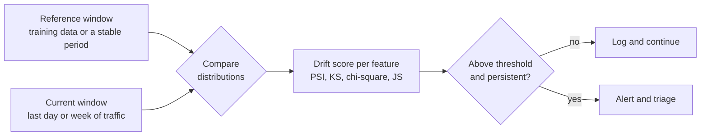
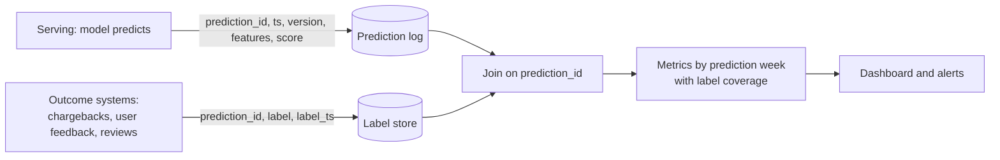
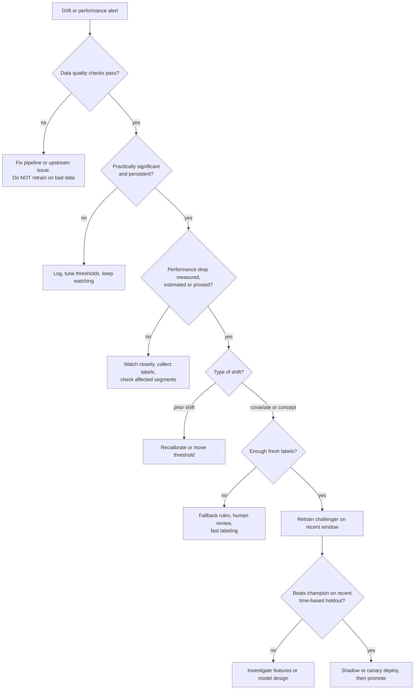
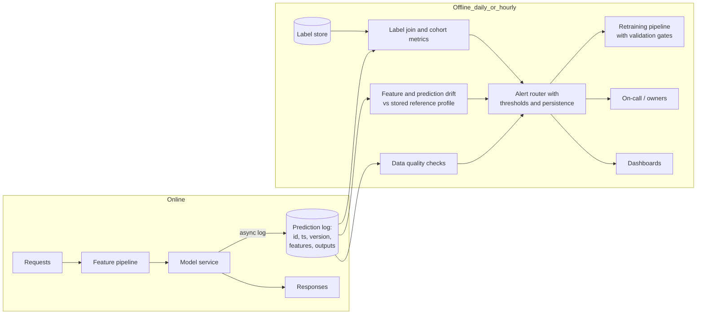

# Data Drift, Concept Drift and When to Retrain

> **Level:** Beginner to Advanced · **Study time:** ~80 min · **Prerequisites:** [Probability and Statistics for ML](../00-foundations/04-probability-and-statistics.md), [Softmax, Entropy, Cross-Entropy and KL Divergence](../00-foundations/05-softmax-entropy-cross-entropy-and-kl-divergence.md), [The ML Workflow and Data Splits](01-ml-workflow-data-splits-and-cross-validation.md), [Classification Metrics](04-classification-metrics-and-imbalanced-data.md)

## Table of contents

- [Why this matters](#why-this-matters)
- [The stationarity assumption](#the-stationarity-assumption)
- [A vocabulary for change: P(X), P(Y) and P(Y | X)](#a-vocabulary-for-change-px-py-and-py--x)
- [Covariate shift (data drift)](#covariate-shift-data-drift)
- [Prior shift (label shift)](#prior-shift-label-shift)
- [Concept drift and its four shapes](#concept-drift-and-its-four-shapes)
- [Detecting data drift: the statistical toolbox](#detecting-data-drift-the-statistical-toolbox)
- [Drift in high dimensions: embeddings for text and images](#drift-in-high-dimensions-embeddings-for-text-and-images)
- [Monitoring prediction distributions](#monitoring-prediction-distributions)
- [Detecting concept drift when labels arrive late](#detecting-concept-drift-when-labels-arrive-late)
- [Statistical vs practical significance, and alert fatigue](#statistical-vs-practical-significance-and-alert-fatigue)
- [Retraining strategies and when to retrain](#retraining-strategies-and-when-to-retrain)
- [Drift in LLM applications](#drift-in-llm-applications)
- [Going deeper: running drift monitoring in production](#going-deeper-running-drift-monitoring-in-production)
- [Common mistakes and misconceptions](#common-mistakes-and-misconceptions)
- [Interview questions and model answers](#interview-questions-and-model-answers)
- [Key takeaways](#key-takeaways)
- [Further reading](#further-reading)
- [Next](#next)

## Why this matters

Every model is trained on a snapshot of the past and then asked to make predictions about the future. The world does not stand still: customers change habits, fraudsters adapt, prices inflate, products launch, and documents in your knowledge base get rewritten. A model that scored beautifully on its test set can quietly lose accuracy for months without a single error in the logs, because nothing crashes when the data changes. That is why "how do you detect and handle drift?" is one of the most common production questions in senior ML interviews: it tests whether you understand that shipping a model is the start of its life, not the end. By the end of this chapter you will be able to name each kind of drift precisely, detect it with the right statistic, avoid drowning in false alarms, and decide when retraining is (and is not) the right response.

## The stationarity assumption

> **Analogy:** You learn to drive in a sunny town with wide roads. Then you move to a snowy mountain city. Your skills were real, but the world they were tuned for has changed. Nobody tells you "the distribution shifted"; you just start sliding on corners.

Almost all of supervised learning rests on one quiet assumption. When we split data into train, validation and test sets (see [the ML workflow chapter](01-ml-workflow-data-splits-and-cross-validation.md)), we assume that all three, and also the future production data, are drawn from the **same probability distribution**. A **distribution** is simply a description of how likely each possible value (or combination of values) is.

Two related ideas:

- **i.i.d. (independent and identically distributed):** each example is drawn independently of the others, and all of them come from the same distribution. "Identically distributed" is the part drift breaks.
- **Stationarity:** a process is **stationary** if its statistical properties (mean, spread, relationships between variables) do not change over time. A stationary world means yesterday's data is a fair sample of tomorrow's.

Your test-set score is only an estimate of future performance **if stationarity holds**. The moment the production distribution differs from the training distribution, the test score becomes an estimate of performance on a world that no longer exists.

```text
 Training time                         Production time
 +---------------------------+         +---------------------------+
 | data drawn from P_train   |  model  | data drawn from P_prod    |
 | test score = 0.92         | ------> | real score = ???          |
 +---------------------------+         +---------------------------+
          The test score transfers only if P_prod == P_train
```

**Dataset shift** (also called **distribution shift**) is the umbrella term for any difference between the training distribution and the distribution the model faces in production. **Drift** usually means dataset shift that develops *over time* in a live system. In practice people use the words interchangeably.

> **Senior insight:** Stationarity is never exactly true in production. The real question is not "has the distribution changed?" (it always has, a little) but "has it changed enough to hurt the business, and what should we do about it?" Keep that framing in mind; it resolves most of the confusion around drift alerts.

## A vocabulary for change: P(X), P(Y) and P(Y | X)

To talk about drift precisely you need three probability objects. Quick recap (full treatment in [Probability and Statistics for ML](../00-foundations/04-probability-and-statistics.md)):

- $X$ is the **input** (the features: house size, email words, transaction amount).
- $Y$ is the **target** or **label** (price, spam or not, fraud or not).
- $P(X)$ is the **marginal distribution of inputs**: how often each kind of input shows up.
- $P(Y)$ is the **marginal distribution of labels**, also called the **prior** or **base rate**: for example, "20% of emails are spam".
- $P(Y \mid X)$ is the **conditional distribution**, read "probability of $Y$ given $X$". It is the relationship the model is trying to learn: "given these words, how likely is spam?" This relationship is called the **concept**.
- $P(X \mid Y)$ is the **class-conditional distribution**: "what do spam emails look like?"

The **joint distribution** $P(X, Y)$ describes inputs and labels together. It can be factored two ways:

$$
P(X, Y) = P(X)\,P(Y \mid X) = P(Y)\,P(X \mid Y)
$$

- $P(X, Y)$: probability of seeing input $X$ together with label $Y$.
- $P(X)\,P(Y \mid X)$: "first pick an input, then the label depends on it".
- $P(Y)\,P(X \mid Y)$: "first pick a label, then the input depends on it".

**Tiny numeric check.** Suppose 20% of emails are spam, so $P(\text{spam}) = 0.2$, and 60% of spam emails contain the word "winner", so $P(\text{winner} \mid \text{spam}) = 0.6$. Then $P(\text{winner}, \text{spam}) = 0.2 \times 0.6 = 0.12$: 12% of all emails are spam containing "winner".

Drift means $P_{\text{train}}(X, Y) \neq P_{\text{prod}}(X, Y)$. Which *factor* changed tells you what kind of drift you have, and what to do about it:

| Type | What changes | What stays the same | Everyday example (spam filter) |
|---|---|---|---|
| **Covariate shift** (data drift) | $P(X)$ | $P(Y \mid X)$ | More emails now arrive in Spanish, but a Spanish spam email is still spam for the same reasons |
| **Prior shift** (label shift) | $P(Y)$ | $P(X \mid Y)$ | A spam wave: spam rises from 20% to 50% of traffic, but spam looks the same as before |
| **Concept drift** | $P(Y \mid X)$ | (possibly nothing) | The word "crypto" used to signal spam; now it appears in many legitimate newsletters |

> **Interview tip:** When asked "what is drift?", answer with this decomposition. Saying "the joint distribution $P(X,Y)$ changed, and it matters whether the change is in $P(X)$, $P(Y)$ or $P(Y \mid X)$" immediately signals precision. Moreno-Torres et al. (2012, "A unifying view on dataset shift in classification") is the standard reference for this taxonomy.

Some literature calls changes in $P(X)$ alone **virtual drift** (the decision boundary is still right, the data just moved around it) and changes in $P(Y \mid X)$ **real drift** (the boundary itself is now wrong). Gama et al. (2014, "A Survey on Concept Drift Adaptation") uses this terminology.

## Covariate shift (data drift)

> **Analogy:** A restaurant critic who has only reviewed Italian restaurants is sent to review sushi bars. Their taste ("what makes food good") has not changed, but they are now judging dishes they barely saw during training.

**Definition.** **Covariate shift** means the input distribution changes, $P_{\text{prod}}(X) \neq P_{\text{train}}(X)$, while the input-to-label relationship stays the same, $P_{\text{prod}}(Y \mid X) = P_{\text{train}}(Y \mid X)$. **Covariates** is a statistics word for input features. In industry, "data drift" or "feature drift" almost always means this: the features look different from training.

**Running example: house prices.** You trained a price model on a city where most houses are 80 to 160 square meters. A new suburb opens and many listings are now 200 to 300 square meters. The pricing logic ("price per square meter given location and condition") has not changed. Only the inputs moved.

Does covariate shift hurt? It depends on *where* the inputs moved:

```text
 price
   ^                                              * true price keeps rising
   |                                         *
   |                                    *
   |                               * - - - - - - - - -  tree model: flat
   |                          *                         (cannot extrapolate)
   |                     *
   |                *
   |           *
   |      *
   +------------------------------------------------------> size (sqm)
          |<------ training data ------>|<-- new suburb -->|
              model learned this well      little or no training data
```

- **If production inputs stay inside the region covered by training data** (just with different proportions), a model flexible enough to represent the true relationship (a **well-specified** model) usually still works. Your *aggregate* metric may change because the mix of easy and hard cases changed, but per-example quality is similar.
- **If production inputs move into regions with little or no training data**, the model must **extrapolate** (predict outside the range it has seen). Tree-based models (see [Decision Trees, Random Forests and Gradient Boosting](06-decision-trees-random-forests-and-gradient-boosting.md)) predict a constant beyond the edge of the training data, so a 300 sqm house gets roughly the price of the largest houses in training. Linear models keep extending a straight line, which may or may not be right.

> **Common mistake:** Assuming covariate shift is always harmless "because the concept did not change". Even with a perfectly stable concept, a model fitted on limited data has learned the concept well only where it had data. Shift into sparse regions exposes that.

**Fix ideas for covariate shift:**

1. Collect labeled data from the new region and retrain (the most common answer).
2. **Importance weighting:** reweight training examples by $w(x) = \frac{P_{\text{prod}}(x)}{P_{\text{train}}(x)}$ so training emphasizes examples that look like production. Shimodaira (2000, "Improving predictive inference under covariate shift by weighting the log-likelihood function") is the classic reference. Example: if houses of 160 to 200 sqm were 5% of training data but are 15% of production, each such training example gets weight $0.15 / 0.05 = 3$; if small houses fell from 30% to 15%, theirs get $0.5$. In practice $w(x)$ is often estimated with a **domain classifier** (covered later in this chapter). Weights can have huge variance when the two distributions barely overlap, so this is a refinement, not a cure.
3. Build features that are more invariant (for example, price per square meter relative to the neighborhood instead of raw size).

## Prior shift (label shift)

> **Analogy:** A doctor is trained in a clinic where 1 in 100 patients has the flu. During flu season, 1 in 5 has it. The symptoms of flu look the same as ever, but the doctor should now be quicker to say "flu" for borderline cases.

**Definition.** **Prior shift**, also called **label shift** or **target shift**, means the label distribution changes, $P_{\text{prod}}(Y) \neq P_{\text{train}}(Y)$, while the class-conditional distribution stays the same, $P_{\text{prod}}(X \mid Y) = P_{\text{train}}(X \mid Y)$.

**Running example: spam filter.** Spam is 20% of training emails. A spam campaign pushes it to 50% this week. Spam emails look like spam always looked. Because the base rate changed, the model's probabilities are now **miscalibrated** (its "50% spam" no longer means a 50% chance) and the best decision threshold has moved.

### Correcting for prior shift without retraining

If the model outputs well-calibrated probabilities and you know (or can estimate) the new prior, Bayes' rule gives a cheap correction. Saerens, Latinne and Decaestecker (2002, "Adjusting the outputs of a classifier to new a priori probabilities: a simple procedure") describe this and an expectation-maximization (EM) method to estimate the new prior from unlabeled data.

$$
p_{\text{new}}(y \mid x) \;\propto\; p_{\text{old}}(y \mid x)\,\frac{\pi_{\text{new}}(y)}{\pi_{\text{old}}(y)}
$$

- $p_{\text{old}}(y \mid x)$: the model's predicted probability of class $y$ for input $x$ (trained under the old prior).
- $\pi_{\text{old}}(y)$: the class's share in training data (the old prior).
- $\pi_{\text{new}}(y)$: the class's share in production now (the new prior).
- $\propto$: "proportional to". You compute the right side for every class, then divide by their sum so the probabilities add to 1.

**Worked example.** The spam model says $p_{\text{old}}(\text{spam} \mid x) = 0.5$ for some email. Old prior: spam 0.2, ham 0.8. New prior: spam 0.5, ham 0.5.

1. Spam ratio: $\pi_{\text{new}} / \pi_{\text{old}} = 0.5 / 0.2 = 2.5$. Unnormalized spam score: $0.5 \times 2.5 = 1.25$.
2. Ham ratio: $0.5 / 0.8 = 0.625$. Unnormalized ham score: $0.5 \times 0.625 = 0.3125$.
3. Normalize: $1.25 / (1.25 + 0.3125) = 1.25 / 1.5625 = 0.8$.

The same email is now 80% likely to be spam. Nothing about the email changed; the world around it did.

```python
# pip install numpy
import numpy as np

def adjust_for_new_prior(p_pos, old_prior, new_prior):
    """Re-weight binary classifier probabilities for a new positive-class rate.
    Assumes label shift (P(X|Y) unchanged) and a calibrated model."""
    pos = p_pos * new_prior / old_prior
    neg = (1 - p_pos) * (1 - new_prior) / (1 - old_prior)
    return pos / (pos + neg)

print(adjust_for_new_prior(0.5, old_prior=0.2, new_prior=0.5))   # 0.8
print(adjust_for_new_prior(np.array([0.1, 0.5, 0.9]), 0.2, 0.5))
# [0.30769231 0.8        0.97297297]
```

How do you know the new prior if labels are delayed? Lipton, Wang and Smola (2018, "Detecting and Correcting for Label Shift with Black Box Predictors") show you can estimate it from the model's own prediction distribution plus its confusion matrix on validation data (**Black Box Shift Estimation**). The intuition: if the model predicts "spam" much more often than before, and we know how often it confuses classes, we can back out how many emails really are spam.

> **Senior insight:** Prior shift often matters most for **thresholds** and **capacity planning**, not model weights. If fraud doubles, a fixed threshold now catches roughly twice as many true frauds (recall is unchanged, so true positives scale with the fraud rate) on top of a similar number of false positives, so the review queue grows sharply: the review team is overwhelmed before anyone looks at model metrics. Precision depends on the base rate (see [Classification Metrics](04-classification-metrics-and-imbalanced-data.md)), so it can fall or rise with zero change to the model; under pure label shift, recall and the false positive rate do not change, because each class still looks the same.

## Concept drift and its four shapes

> **Analogy:** The rules of the game change mid-season. Last year, a pass to the goalkeeper was fine; this year, it is a foul. Your players (features) look the same, but what counts as a good play (the label) is different.

**Definition.** **Concept drift** means the relationship between inputs and labels changes: $P_{\text{prod}}(Y \mid X) \neq P_{\text{train}}(Y \mid X)$. The same input now deserves a different answer. This is the most dangerous kind because **you cannot see it from inputs alone**. Feature distributions can be perfectly stable while the model becomes wrong.

Concrete examples:

- **House prices:** inflation and interest-rate changes mean the same 120 sqm house sells for 10% more a year later. $X$ is identical; $Y$ moved.
- **Spam:** words that once marked spam ("crypto", "webinar") become common in legitimate mail.
- **Fraud:** fraudsters learn which patterns get blocked and change tactics. This is **adversarial drift**: the drift is a *reaction* to your model.
- **Credit risk:** a recession changes who defaults even among applicants with identical profiles.
- **Recommendations:** a viral trend changes what "relevant" means for the same user history.

### The four shapes of concept drift

How the concept changes over time matters for detection and response. The standard typology (used in Gama et al., 2014, and Lu et al., 2018, "Learning under Concept Drift: A Review") has four shapes:

```text
Which concept is active over time (A = old concept, B = new concept)

SUDDEN       A A A A A A A A B B B B B B B B     switch at one point in time

GRADUAL      A A A A B A A B A B B A B B B B     old and new alternate,
                                                 the new one wins over time

INCREMENTAL  A A A A ~ ~ ~ ~ ~ ~ ~ ~ B B B B     smooth slide through many
                                                 intermediate concepts (~)

RECURRING    A A A A B B B A A A A B B B A A     an old concept comes back
                                                 (for example, seasonality)
             ------------------------------> time
```

| Shape | What happens | Example | Detection implication | Typical response |
|---|---|---|---|---|
| **Sudden** (abrupt) | Concept switches from A to B at a point in time | A regulation changes overnight; the COVID-19 lockdowns of 2020 changed shopping behavior within days; a fraud ring launches a new attack | Easy to spot once labels arrive; error rate jumps | Fast retrain on post-change data only; temporary rules or fallbacks while you wait for labels |
| **Gradual** | Old and new concepts coexist; the new one appears more and more often | Users migrating from a desktop app to a mobile app over months, with different behavior on each | Noisy at first; looks like random errors | Sliding-window retraining, segment-level models |
| **Incremental** | The concept moves continuously through many small intermediate states | Price per sqm creeping up with inflation; sensor calibration slowly wearing | Hard: no single change point; each window looks "almost fine" | Regular scheduled retraining, recency weighting, features that capture the trend (for example, a price index) |
| **Recurring** (seasonal) | A past concept comes back | Holiday shopping, weekend vs weekday traffic, tax season, back-to-school | Will trigger "drift" every season if your reference window ignores seasonality | Train on multiple full seasons, add calendar features, compare to the same period last year |

> **Common mistake:** Treating recurring drift as new drift. If December always looks different from November, an alert every December is noise, not insight. Either include past Decembers in training or compare December to last December.

### Things that look like drift but are not

Before blaming the world, blame your pipeline. In practice, a large share of "drift" alerts are **data quality bugs**:

- An upstream team changes a unit (meters to feet, cents to dollars).
- A feature starts arriving as null because an API timed out, and your pipeline fills nulls with 0.
- A new app version sends a categorical value in a different case ("US" vs "us").
- Production features are computed by different code than training features. This is **training-serving skew**, covered in [Reproducible Training and Training-Serving Skew](../10-mlops/03-reproducibility-and-training-serving-skew.md).

> **Senior insight:** The first question on any drift alert is "is the world different, or is our data broken?" Retraining on broken data bakes the bug into the next model. Check schema, null rates, value ranges and upstream deploy logs before anything else.

## Detecting data drift: the statistical toolbox

All the detectors in this section answer one question: **do two samples look like they come from the same distribution?** One sample is the **reference window** (usually training data or a known-good recent period). The other is the **current window** (for example, the last day or week of production traffic).



### Summary statistics and data quality checks

Start simple. For every feature, track per window:

- **Numeric features:** count, null rate, mean, standard deviation, min, max, and a few quantiles (p1, p50, p99: the values below which 1%, 50% and 99% of the data fall).
- **Categorical features:** null rate, number of distinct values, share of the top categories, share of **unseen categories** (values never seen in training).
- **Schema:** column present, type correct, value inside allowed range.

These are cheap, interpretable and catch most pipeline bugs. "The p99 of `transaction_amount` jumped 100x" is easier to act on than "KS p-value = 1e-30".

Their weakness: means and standard deviations can stay the same while the shape changes (for example, a distribution becoming bimodal with the same mean). That is why we also compare whole distributions.

### Kolmogorov-Smirnov (KS) test for numeric features

> **Analogy:** Line up both samples from smallest to largest and draw a "percentage of values at or below x" staircase for each. If the staircases are far apart anywhere, the distributions differ.

The **empirical cumulative distribution function (ECDF)** $F(x)$ is the fraction of sample values that are less than or equal to $x$. The **two-sample KS statistic** is the largest vertical gap between the two ECDFs:

$$
D = \max_{x} \left| F_{\text{ref}}(x) - F_{\text{cur}}(x) \right|
$$

- $F_{\text{ref}}(x)$: fraction of reference values $\le x$.
- $F_{\text{cur}}(x)$: fraction of current values $\le x$.
- $\max_x$: the largest gap over all values of $x$.
- $D$ ranges from 0 (identical ECDFs) to 1 (no overlap at all).

The KS test also gives a **p-value**: the probability of seeing a gap at least this large if both samples truly came from the same distribution. A small p-value (say below 0.05) is evidence of a difference. For large samples, the gap needed to reach significance at the 5% level is approximately

$$
D_{\text{crit}} \approx 1.36 \sqrt{\frac{n + m}{n\,m}}
$$

- $n$, $m$: the two sample sizes.
- 1.36: the constant for a 5% significance level.

**Worked example by hand.** Reference sample: [1, 2, 3, 4, 5]. Current sample: [3, 4, 5, 6, 7] (everything shifted up by 2).

| $x$ | $F_{\text{ref}}(x)$ | $F_{\text{cur}}(x)$ | gap |
|---|---|---|---|
| 1 | 1/5 = 0.2 | 0/5 = 0.0 | 0.2 |
| 2 | 2/5 = 0.4 | 0/5 = 0.0 | 0.4 |
| 3 | 3/5 = 0.6 | 1/5 = 0.2 | 0.4 |
| 4 | 4/5 = 0.8 | 2/5 = 0.4 | 0.4 |
| 5 | 5/5 = 1.0 | 3/5 = 0.6 | 0.4 |
| 6 | 1.0 | 4/5 = 0.8 | 0.2 |
| 7 | 1.0 | 5/5 = 1.0 | 0.0 |

So $D = 0.4$. SciPy's exact p-value for this case is about 0.87: with only 5 points per side, even an obvious shift is **not** statistically significant. Remember this; the opposite problem (huge samples making tiny shifts significant) appears below.

**Pros:** no binning, no distribution assumptions, sensitive to shifts in location and shape. **Cons:** numeric (continuous) features only, most sensitive near the middle of the distribution and less sensitive in the tails, and with large samples it flags trivial differences.

### Chi-square test for categorical features

For a categorical feature, compare category counts in the current window with the counts you would **expect** if the reference proportions still held:

$$
\chi^2 = \sum_{k=1}^{K} \frac{(O_k - E_k)^2}{E_k}
$$

- $K$: number of categories.
- $O_k$: observed count of category $k$ in the current window.
- $E_k$: expected count = (reference proportion of $k$) $\times$ (current window size).
- **Degrees of freedom** $= K - 1$: how many category shares can vary freely once the total is fixed.

**Worked example (spam filter, feature = email language).** In training: English 70%, Spanish 20%, other 10%. This week: 1,000 emails with 600 English, 250 Spanish, 150 other.

1. Expected counts: $E = (0.70, 0.20, 0.10) \times 1000 = (700, 200, 100)$.
2. English: $(600 - 700)^2 / 700 = 10000 / 700 = 14.29$.
3. Spanish: $(250 - 200)^2 / 200 = 2500 / 200 = 12.50$.
4. Other: $(150 - 100)^2 / 100 = 2500 / 100 = 25.00$.
5. Sum: $\chi^2 = 14.29 + 12.50 + 25.00 = 51.79$, with $3 - 1 = 2$ degrees of freedom.

The critical value at 5% significance with 2 degrees of freedom is 5.99, so 51.79 is far beyond it (p is about $6 \times 10^{-12}$). The language mix has shifted.

Treating the reference proportions as exact makes this a **goodness-of-fit** test. If your reference is also a sample of modest size, use a **contingency-table** chi-square test (`scipy.stats.chi2_contingency`) on the two count vectors instead. Merge very rare categories (expected count below about 5) into "other", because the chi-square approximation is unreliable for tiny expected counts.

### Population Stability Index (PSI)

PSI comes from credit-risk modeling, where banks have used it for decades to check whether the population applying for loans still resembles the population the scorecard was built on. It is popular because it gives one number per feature with widely used rule-of-thumb thresholds.

**Recipe:**

1. Split the feature into $B$ bins (commonly 10) using the **reference** data. Quantile bins (each holding about 10% of reference data) are the usual choice.
2. Compute $e_i$, the fraction of reference data in bin $i$ ("expected").
3. Compute $a_i$, the fraction of current data in the same bin ("actual").
4. Sum:

$$
\text{PSI} = \sum_{i=1}^{B} (a_i - e_i)\,\ln\!\left(\frac{a_i}{e_i}\right)
$$

- $B$: number of bins.
- $a_i$: share of current (actual) data in bin $i$.
- $e_i$: share of reference (expected) data in bin $i$.
- $\ln$: natural logarithm.

Each term is always $\ge 0$: if $a_i > e_i$ both factors are positive; if $a_i < e_i$ both are negative. So PSI is 0 only when every bin matches.

PSI is exactly the **symmetric KL divergence** (also called **Jeffreys divergence**): $\text{PSI} = \text{KL}(a \,\|\, e) + \text{KL}(e \,\|\, a)$. If KL divergence is new to you, see [Softmax, Entropy, Cross-Entropy and KL Divergence](../00-foundations/05-softmax-entropy-cross-entropy-and-kl-divergence.md).

**Worked example (house prices, feature = size in sqm).** Use 4 bins at the training quartiles, so each bin holds exactly 25% of training data: $e = (0.25, 0.25, 0.25, 0.25)$. This month's listings fall into the bins as $a = (0.10, 0.20, 0.30, 0.40)$: buyers are listing bigger houses.

| Bin | $e_i$ | $a_i$ | $a_i - e_i$ | $a_i / e_i$ | $\ln(a_i / e_i)$ | term |
|---|---|---|---|---|---|---|
| 1 (smallest) | 0.25 | 0.10 | -0.15 | 0.4 | -0.9163 | 0.1374 |
| 2 | 0.25 | 0.20 | -0.05 | 0.8 | -0.2231 | 0.0112 |
| 3 | 0.25 | 0.30 | +0.05 | 1.2 | +0.1823 | 0.0091 |
| 4 (largest) | 0.25 | 0.40 | +0.15 | 1.6 | +0.4700 | 0.0705 |
| **Sum** | | | | | | **0.2282** |

Step by step for bin 1: $-0.15 \times -0.9163 = 0.1374$. Bin 2: $-0.05 \times -0.2231 = 0.0112$. Bin 3: $0.05 \times 0.1823 = 0.0091$. Bin 4: $0.15 \times 0.4700 = 0.0705$. Total: $0.1374 + 0.0112 + 0.0091 + 0.0705 = 0.2282$.

**Common thresholds (industry rules of thumb, not statistical laws):**

| PSI | Usual reading | Typical action |
|---|---|---|
| < 0.10 | No significant shift | Nothing |
| 0.10 to 0.25 | Moderate shift | Investigate, watch closely |
| > 0.25 | Significant shift | Investigate urgently; consider retraining or recalibration |

Our 0.228 sits in the "moderate, investigate" band, close to the upper edge.

**PSI from scratch:**

```python
# pip install numpy
import numpy as np

def psi(reference, current, n_bins=10, eps=1e-6):
    """Population Stability Index for one numeric feature.
    Bin edges come from reference quantiles, so each reference bin holds ~1/n_bins."""
    reference = np.asarray(reference, dtype=float)
    current = np.asarray(current, dtype=float)
    inner_q = np.linspace(0, 1, n_bins + 1)[1:-1]            # 0.1, 0.2, ..., 0.9
    edges = np.unique(np.quantile(reference, inner_q))      # unique: handles discrete data
    ref_idx = np.searchsorted(edges, reference, side="right")
    cur_idx = np.searchsorted(edges, current, side="right")  # values beyond edges go to end bins
    n = len(edges) + 1
    e = np.bincount(ref_idx, minlength=n) / len(reference)
    a = np.bincount(cur_idx, minlength=n) / len(current)
    e, a = np.clip(e, eps, None), np.clip(a, eps, None)     # avoid log(0) for empty bins
    return float(np.sum((a - e) * np.log(a / e)))

# The hand example: pass bin shares directly
e = np.array([0.25, 0.25, 0.25, 0.25]); a = np.array([0.10, 0.20, 0.30, 0.40])
print(round(float(np.sum((a - e) * np.log(a / e))), 4))   # 0.2282

rng = np.random.default_rng(42)
train_sqm = rng.normal(120, 30, 50_000)       # house sizes at training time
same_world = rng.normal(120, 30, 5_000)       # this week, nothing changed
bigger_houses = rng.normal(140, 30, 5_000)    # this week, mean size +20 sqm
print(f"PSI, no drift: {psi(train_sqm, same_world):.3f}")     # close to 0
print(f"PSI, +20 sqm:  {psi(train_sqm, bigger_houses):.3f}")  # roughly 0.4, above 0.25
```

**PSI weaknesses to mention in interviews:**

- It depends on the binning. Different bin counts or edges give different numbers, so fix the binning and store it with the model.
- Empty bins make $\ln(0)$ blow up; you need a small epsilon, which itself affects the score.
- Thresholds of 0.1 and 0.25 are conventions from credit scoring, not calibrated to your business impact.
- Bins hide changes inside a bin, and it says nothing about whether the shift hurts the model.

### Jensen-Shannon (JS) divergence

KL divergence is not symmetric and becomes infinite if one distribution has zero probability where the other does not. **Jensen-Shannon divergence** fixes both by comparing each distribution to their average:

$$
\text{JS}(P \,\|\, Q) = \tfrac{1}{2}\,\text{KL}(P \,\|\, M) + \tfrac{1}{2}\,\text{KL}(Q \,\|\, M), \qquad M = \tfrac{1}{2}(P + Q)
$$

- $P$, $Q$: the two distributions (binned or categorical), for example reference and current.
- $M$: the **mixture**, the average of $P$ and $Q$ bin by bin.
- $\text{KL}(P \,\|\, M) = \sum_i P_i \ln(P_i / M_i)$.
- JS is symmetric, always finite, and bounded: between 0 and $\ln 2 \approx 0.693$ with natural logs (the unit is called **nats**), or between 0 and 1 with base-2 logs (**bits**).
- The square root of JS is a true distance metric, called the **Jensen-Shannon distance**.

**Worked example (spam rate as a 2-category distribution).** Reference $P = (0.5, 0.5)$, current $Q = (0.9, 0.1)$.

1. Mixture: $M = (0.7, 0.3)$.
2. $\text{KL}(P \,\|\, M) = 0.5 \ln(0.5/0.7) + 0.5 \ln(0.5/0.3) = 0.5(-0.3365) + 0.5(0.5108) = -0.1682 + 0.2554 = 0.0872$.
3. $\text{KL}(Q \,\|\, M) = 0.9 \ln(0.9/0.7) + 0.1 \ln(0.1/0.3) = 0.9(0.2513) + 0.1(-1.0986) = 0.2262 - 0.1099 = 0.1163$.
4. $\text{JS} = 0.5 \times (0.0872 + 0.1163) = 0.1017$ nats. In bits: $0.1017 / \ln 2 = 0.1468$.
5. JS distance $= \sqrt{0.1017} = 0.319$.

> **Common mistake:** `scipy.spatial.distance.jensenshannon` returns the JS **distance** (the square root), not the divergence. Square it if you want the divergence. Mixing these up makes thresholds meaningless.

### KS, chi-square and PSI/JS in code

```python
# pip install numpy scipy
import numpy as np
from scipy import stats
from scipy.spatial.distance import jensenshannon

rng = np.random.default_rng(42)
train_sqm = rng.normal(120, 30, 50_000)
bigger_houses = rng.normal(140, 30, 5_000)

# 1) KS test on a numeric feature
ks = stats.ks_2samp(train_sqm, bigger_houses)
print(f"KS D = {ks.statistic:.3f}, p = {ks.pvalue:.1e}")      # D about 0.27, p astronomically small

# 2) Chi-square goodness of fit on a categorical feature (the language example)
expected_props = np.array([0.70, 0.20, 0.10])
observed = np.array([600, 250, 150])
chi = stats.chisquare(f_obs=observed, f_exp=expected_props * observed.sum())
print(f"chi2 = {chi.statistic:.2f}, p = {chi.pvalue:.1e}")    # chi2 = 51.79, p = 5.7e-12

# 3) Jensen-Shannon (note: SciPy returns the DISTANCE)
P, Q = np.array([0.5, 0.5]), np.array([0.9, 0.1])
d = jensenshannon(P, Q)
print(f"JS distance = {d:.4f}, JS divergence = {d**2:.4f} nats")  # 0.3190, 0.1017
```

### Choosing a detector

Two kinds of tools are mixed in this section, and the distinction matters:

- **Hypothesis tests** (KS, chi-square) answer "is there *any* difference?" and return a p-value that depends heavily on sample size.
- **Distance or effect-size measures** (PSI, JS, Wasserstein) answer "*how big* is the difference?" and do not automatically grow with sample size.

The **Wasserstein distance** (also called **earth mover's distance**) is worth knowing too: for one numeric feature it measures how far, on average, you would have to move probability mass to turn one distribution into the other, in the feature's own units. "The size distribution moved by about 20 sqm" is very interpretable.

| Method | Feature type | Output | Pros | Cons | Use when |
|---|---|---|---|---|---|
| Summary stats | Any | Means, nulls, quantiles | Cheap, interpretable, catches pipeline bugs | Misses shape changes | Always, as a first layer |
| KS test | Numeric | $D$ and p-value | No binning, no assumptions | Over-sensitive with big $n$; weak in tails | Small to medium samples; as a secondary check |
| Chi-square | Categorical | $\chi^2$ and p-value | Standard, simple | Over-sensitive with big $n$; needs merging of rare categories | Categorical features, small to medium samples |
| PSI | Numeric (binned) or categorical | One score | Familiar thresholds, symmetric | Binning-dependent; epsilon hack; thresholds are conventions | Regulated or tabular settings, dashboards |
| JS divergence | Binned or categorical | Bounded score (0 to ln 2) | Symmetric, finite, bounded | Binning-dependent; less intuitive scale | General-purpose effect size |
| Wasserstein | Numeric | Distance in feature units | Interpretable units, no binning | Scale-dependent; compare across features only after normalizing | When "how far did it move" matters |
| Domain classifier | Multivariate, embeddings | AUC | Catches joint and high-dimensional shifts | Needs training; less interpretable | Many features, text and image embeddings |

> **Interview tip:** A strong answer is layered: "data quality checks first, then per-feature effect-size metrics like PSI or JS with thresholds, a multivariate check like a domain classifier, and prediction-distribution monitoring, all weighted by feature importance and evaluated on persistence, not single windows."

## Drift in high dimensions: embeddings for text and images

Per-feature tests work for tabular data with tens or hundreds of columns. Text and images are different: the raw input is a string or a grid of pixels. The usual approach is to monitor **embeddings**: dense vectors that a neural network produces to represent each input, where similar inputs get nearby vectors (see [Embeddings: From One-Hot Vectors to Contextual Embeddings](../04-transformers/02-embeddings-from-one-hot-to-contextual.md) and [Text Embeddings and Similarity Search](../08-rag/02-text-embeddings-and-similarity-search.md)).

> **Analogy:** Instead of comparing every pixel of every photo, you describe each photo with a short list of traits ("outdoor, night, crowded"), then ask whether this week's photos have a different mix of traits.

Why per-dimension KS on 384 or 768 embedding dimensions is a poor idea: hundreds of tests produce many false alarms (see the alert-fatigue section), and drift often lives in *combinations* of dimensions that no single dimension shows.

Practical methods, from simplest to strongest:

| Method | How it works | Pros | Cons |
|---|---|---|---|
| **Centroid distance** | Cosine distance between the mean embedding of reference and current windows | One number, cheap | Misses changes that keep the mean (for example, a new cluster balanced by a shrinking one) |
| **Cluster share drift** | Cluster reference embeddings (for example, k-means with 20 to 50 clusters); assign current embeddings to nearest cluster; run PSI or chi-square on cluster shares | Interpretable: "cluster 7 (billing questions) grew from 5% to 15%" | Depends on clustering; new topics land in the "nearest" old cluster |
| **Novelty / distance to nearest neighbor** | For each current item, distance to its nearest reference cluster or neighbor; track the share above a threshold | Directly finds new kinds of inputs | Needs a threshold; nearest-neighbor search cost |
| **Dimensionality reduction + tests** | PCA to 10 to 50 components, then per-component KS or a multivariate test | Fewer, more meaningful tests | Can discard the directions where drift happens |
| **Maximum Mean Discrepancy (MMD)** | A kernel two-sample test (Gretton et al., 2012, "A Kernel Two-Sample Test"). A **kernel** is a similarity function, such as a Gaussian of the distance. MMD compares the average similarity *within* each window with the average similarity *across* windows; about 0 means the windows look alike | Principled, multivariate | Quadratic cost in sample size; kernel choice |
| **Domain classifier** | Train a classifier to tell reference from current; its held-out AUC measures how separable they are | Works on any features; tells you *which* examples are new | Needs care (cross-validation, class balance) |

Rabanser, Günnemann and Lipton (2019, "Failing Loudly: An Empirical Study of Methods for Detecting Dataset Shift") compared many of these on image data and found that dimensionality reduction followed by two-sample tests is a strong, practical baseline, and that domain classifiers are especially useful for characterizing *what* changed.

### The domain classifier (classifier two-sample test)

Label every reference embedding 0 and every current embedding 1, train a simple classifier, and measure **AUC** (area under the ROC curve; see [Classification Metrics](04-classification-metrics-and-imbalanced-data.md)) on held-out data. If the windows are indistinguishable, the best the classifier can do is guess, so AUC is about 0.5. The more separable the windows, the closer AUC gets to 1. This idea is formalized in Lopez-Paz and Oquab (2017, "Revisiting Classifier Two-Sample Tests").

A useful mental model: if a fraction $f$ of the current window is completely new and the rest is indistinguishable from the reference, the best achievable AUC is about $0.5 + f/2$. For $f = 0.2$: a random current example is novel with probability 0.2 (and always ranks above reference examples) or ordinary with probability 0.8 (and ranks above a reference example half the time), so AUC $= 0.2 \times 1 + 0.8 \times 0.5 = 0.6$.

```python
# pip install numpy scikit-learn
import numpy as np
from sklearn.linear_model import LogisticRegression
from sklearn.model_selection import cross_val_predict
from sklearn.metrics import roc_auc_score

def domain_classifier_auc(ref_emb, cur_emb):
    """AUC of a classifier separating reference (0) from current (1). ~0.5 means no drift."""
    X = np.vstack([ref_emb, cur_emb])
    y = np.r_[np.zeros(len(ref_emb)), np.ones(len(cur_emb))]
    proba = cross_val_predict(LogisticRegression(max_iter=1000), X, y,
                              cv=5, method="predict_proba")[:, 1]   # out-of-fold scores only
    return roc_auc_score(y, proba)

def fake_embeddings(rng, centers, n, weights, noise=0.6):
    """Simulated unit-length 'sentence embeddings' drawn around topic centers."""
    idx = rng.choice(len(centers), size=n, p=weights)
    x = centers[idx] + noise * rng.normal(size=(n, centers.shape[1])) / np.sqrt(centers.shape[1])
    return x / np.linalg.norm(x, axis=1, keepdims=True)

rng = np.random.default_rng(0)
centers = rng.normal(size=(6, 384))
centers /= np.linalg.norm(centers, axis=1, keepdims=True)
old_mix = [0.2, 0.2, 0.2, 0.2, 0.2, 0.0]        # 5 known topics
new_mix = [0.16, 0.16, 0.16, 0.16, 0.16, 0.20]  # a 6th topic is now 20% of traffic

ref  = fake_embeddings(rng, centers, 3000, old_mix)
same = fake_embeddings(rng, centers, 3000, old_mix)
cur  = fake_embeddings(rng, centers, 3000, new_mix)
print(f"no drift:      AUC = {domain_classifier_auc(ref, same):.2f}")   # about 0.5
print(f"20% new topic: AUC = {domain_classifier_auc(ref, cur):.2f}")    # about 0.6, as predicted
```

A bonus: the current-window examples with the highest classifier scores are the ones that look *most unlike* the reference. Pull 20 of them and read them. That turns "AUC rose to 0.6" into "users started asking about the new pricing plan".

The classifier's probabilities also give importance weights for covariate shift correction: $w(x) \approx \frac{p(x)}{1 - p(x)} \cdot \frac{n_{\text{ref}}}{n_{\text{cur}}}$, where $p(x)$ is the predicted probability that $x$ came from the current window. This only works if those probabilities are reasonably calibrated, and the weights should be clipped because near-certain predictions ($p(x)$ close to 1) explode.

> **Senior insight:** For images, monitor embeddings from a fixed, general-purpose encoder (for example, a pretrained CNN or a CLIP image encoder; see [Vision Transformers, CLIP and Multimodal Models](../03-computer-vision/05-vision-transformers-clip-and-multimodal-models.md)) plus cheap image statistics (brightness, contrast, resolution, blur). A camera firmware update changing exposure is a classic image drift that brightness statistics catch instantly. More on this in [Computer Vision in Production](../03-computer-vision/04-computer-vision-in-production.md).

> **Common mistake:** Monitoring embeddings from the model you are retraining. If the encoder changes with each retrain, embeddings from different versions live in different spaces and are not comparable. Use a frozen reference encoder for monitoring, or recompute the reference with the new encoder.

## Monitoring prediction distributions

The model's own outputs are a feature you always have, with no label delay. Track per window:

- **Classification:** share of each predicted class, the distribution of predicted probabilities (histogram or PSI on scores), the mean confidence, and the share of predictions near the decision threshold.
- **Regression:** mean, spread and quantiles of predicted values.
- **Ranking and recommendation:** score distributions, diversity and coverage of recommended items.

Why it is valuable:

- **It summarizes all features weighted by what the model actually uses.** A shift in an unimportant feature will not move predictions; a shift in an important one usually will.
- **It catches prior shift.** If the spam filter's predicted spam rate jumps from 20% to 45% overnight, either spam surged or something broke.
- **It is low-dimensional.** One PSI on the score distribution instead of 300 per-feature tests.

Its limits:

- **Stable predictions do not prove the model is right.** Under pure concept drift, inputs (and therefore predictions) can look the same while the correct answers changed.
- **Changing predictions do not prove the model is wrong.** If inputs moved into a region where the model is correct, predictions *should* change.

> **Interview tip:** Say it this way: "Prediction drift is my cheapest early-warning signal and the best label-free proxy for impact, but it cannot detect pure concept drift. For that I need labels, or proxies for labels."

## Detecting concept drift when labels arrive late

Concept drift is a change in $P(Y \mid X)$, so by definition you need $Y$ to see it. The problem: in many systems the true label arrives late, or never.

| System | When the true label arrives (illustrative) |
|---|---|
| Ad click prediction | Seconds to minutes |
| Spam filter | Hours to days (user marks spam, or never) |
| Product recommendations | Minutes (click) to weeks (return or repurchase) |
| Card fraud | Weeks to months (chargebacks) |
| Loan default | Months to years |

This label delay is the core difficulty. There are four complementary tools.

### 1. Proxy metrics

A **proxy metric** is a quickly available signal that correlates with the true outcome:

- Spam filter: the rate at which users move emails in or out of the spam folder.
- Search or RAG: click-through rate, query reformulations, thumbs up or down.
- Fraud: customer complaints, manual review outcomes on a sample, the share of transactions blocked.
- Support chatbot: escalation-to-human rate, conversation abandonment.

Proxies are noisy and can be biased (only some users give feedback), but they arrive fast. Use them to *prioritize* investigation, not as ground truth.

### 2. Label backfill and cohort-based evaluation

**Label backfill** means logging every prediction with a unique ID, its timestamp, model version and features, then joining the true label onto that log whenever it arrives. You then compute metrics by **prediction cohort**: all predictions made in a given week, evaluated once their labels are **mature** (enough time has passed that nearly all labels have arrived). Next to each metric, report **label coverage**: the share of the cohort whose labels have arrived so far.



```python
# pip install numpy pandas scikit-learn
import numpy as np
import pandas as pd
from sklearn.metrics import roc_auc_score

def weekly_performance(preds: pd.DataFrame, labels: pd.DataFrame, as_of: pd.Timestamp) -> pd.DataFrame:
    """AUC per prediction week, using only labels known at time `as_of`.
    preds:  prediction_id, predicted_at, score
    labels: prediction_id, is_fraud, label_at"""
    known = labels[labels["label_at"] <= as_of]                  # no peeking into the future
    df = preds[preds["predicted_at"] <= as_of].merge(known, on="prediction_id", how="left")
    df["week"] = df["predicted_at"].dt.to_period("W").dt.start_time
    rows = []
    for week, g in df.groupby("week"):
        lab = g.dropna(subset=["is_fraud"])
        auc = roc_auc_score(lab["is_fraud"], lab["score"]) if lab["is_fraud"].nunique() == 2 else np.nan
        rows.append({"week": week.date(), "n_preds": len(g),
                     "label_coverage": round(len(lab) / len(g), 2),  # share of labels arrived so far
                     "auc": round(auc, 3)})
    return pd.DataFrame(rows)

# Toy data: 20k predictions over 10 weeks; labels arrive 1 to 44 days later
rng = np.random.default_rng(1)
n = 20_000
preds = pd.DataFrame({
    "prediction_id": np.arange(n),
    "predicted_at": pd.Timestamp("2026-01-01") + pd.to_timedelta(rng.integers(0, 70, n), unit="D"),
    "score": rng.random(n),
})
p_fraud = 0.02 + 0.10 * preds["score"]                     # score is genuinely informative
labels = pd.DataFrame({
    "prediction_id": preds["prediction_id"],
    "is_fraud": (rng.random(n) < p_fraud).astype(int),
    "label_at": preds["predicted_at"] + pd.to_timedelta(rng.integers(1, 45, n), unit="D"),
})
print(weekly_performance(preds, labels, as_of=pd.Timestamp("2026-03-12")).to_string(index=False))
# label_coverage is 1.0 for old weeks and shrinks toward 0 for the most recent weeks
```

> **Senior insight:** Labels that arrive *early* are often not a random sample. Fast chargebacks may come from one fraud type; fast complaints from one user segment. A metric computed on a 20%-labeled recent week can be biased, not just noisy. Report label coverage next to every metric, and compare a recent cohort with an older cohort *at the same label age* (for example, "AUC at 14 days of maturity").

There is a nastier bias too: **feedback loops**. If the fraud model blocks a transaction, you never learn whether it was really fraud. Labels exist only for transactions the model allowed. A common fix is a small **holdout** or **exploration** slice (for example, sending a random sample to manual review regardless of score) so you keep an unbiased label stream.

### 3. Windowed performance with uncertainty

Once labels arrive, compute the metric over a **rolling window** (last 7 days of mature labels, last 5,000 labeled examples) and compare it with the baseline from validation. Always ask: is this drop larger than noise?

For accuracy (a proportion), the **standard error** is:

$$
\text{SE} = \sqrt{\frac{p\,(1 - p)}{n}}
$$

- $p$: the measured accuracy (a fraction).
- $n$: number of labeled examples in the window.
- A rough 95% confidence interval is $p \pm 1.96 \times \text{SE}$.

**Worked example.** Validation accuracy was 0.90. This week, 400 labeled examples, accuracy 0.88.

1. $\text{SE} = \sqrt{0.90 \times 0.10 / 400} = \sqrt{0.09 / 400} = \sqrt{0.000225} = 0.015$.
2. 95% half-width: $1.96 \times 0.015 = 0.0294$.
3. The interval around 0.90 is about 0.871 to 0.929. A reading of 0.88 is inside it: **not distinguishable from noise**.

With 10,000 labeled examples, $\text{SE} = \sqrt{0.09 / 10000} = 0.003$ and the half-width is $1.96 \times 0.003 = 0.0059$, so 0.88 would be a clear drop. Small windows mean noisy alarms; large windows mean slow detection. That is the core trade-off of windowed monitoring.

### 4. Streaming change detectors

When labels do arrive in a stream (for example, ad clicks), sequential detectors watch the error rate and fire when it rises. Classic ones:

- **CUSUM** (Page, 1954, "Continuous Inspection Schemes") and its variant **Page-Hinkley**: accumulate how much the error exceeds its running mean; alarm when the accumulation rises well above its minimum.
- **DDM** (Drift Detection Method; Gama et al., 2004, "Learning with Drift Detection"): tracks error rate and its standard deviation, with warning and drift levels.
- **ADWIN** (Adaptive Windowing; Bifet and Gavaldà, 2007, "Learning from Time-Changing Data with Adaptive Windowing"): keeps a variable-length window and drops old data when two sub-windows have significantly different means.

A from-scratch Page-Hinkley detector shows the mechanism:

```python
# pip install numpy
import numpy as np

class PageHinkley:
    """Detects an upward shift in the mean of a stream (e.g., 0/1 errors)."""
    def __init__(self, delta=0.02, threshold=15.0):
        self.delta = delta              # tolerated change: ignore drifts smaller than this
        self.threshold = threshold      # alarm level: higher = fewer false alarms, slower detection
        self.n, self.mean, self.cum, self.min_cum = 0, 0.0, 0.0, 0.0

    def update(self, x: float) -> bool:
        self.n += 1
        self.mean += (x - self.mean) / self.n           # running mean of the stream
        self.cum += x - self.mean - self.delta          # cumulative excess over the mean
        self.min_cum = min(self.min_cum, self.cum)
        return self.cum - self.min_cum > self.threshold # far above its lowest point -> drift

rng = np.random.default_rng(3)
# Error rate 10% for 2,000 predictions, then concept drift: 20%
errors = np.r_[rng.random(2000) < 0.10, rng.random(2000) < 0.20].astype(float)
ph = PageHinkley()
for t, e in enumerate(errors):
    if ph.update(e):
        print(f"drift detected at step {t}")   # a bit after step 2000 (2141 with this seed)
        break
```

In a 30-seed run of this toy setup (with `delta=0.02`), `threshold=10` gave false alarms (before step 2,000) in 12 of 30 runs, while `threshold=15` gave none but detected drift later (median of about 130 steps after the change). That is the universal detector trade-off: **sensitivity vs false alarms vs detection delay**. Libraries such as River provide tested implementations of ADWIN, Page-Hinkley and others; their APIs have changed across versions, so check the docs for your installed version.

### Estimating performance without labels

Tools such as NannyML offer **confidence-based performance estimation (CBPE)**: if the model is well calibrated, a prediction with probability 0.8 is right 80% of the time, so you can estimate expected accuracy (and even a confusion matrix) from the scores alone. This is useful under covariate shift. But it relies on $P(Y \mid X)$ being unchanged (and on the model staying calibrated in the regions the inputs moved into), so **it is blind to concept drift by construction**. Mention that caveat whenever you bring it up.

| Signal | Label needed? | Speed | Detects covariate shift | Detects concept drift |
|---|---|---|---|---|
| Feature drift (PSI, KS) | No | Immediate | Yes | No |
| Prediction drift | No | Immediate | Yes (if it matters to the model) | No (pure concept drift is invisible) |
| CBPE-style estimation | No | Immediate | Estimates its impact | No |
| Proxy metrics | Partial | Fast | Indirectly | Partially |
| Windowed performance on backfilled labels | Yes | Slow (label delay) | Yes, via impact | **Yes** |
| Streaming detectors (DDM, ADWIN) | Yes, streaming | As fast as labels | Via impact | **Yes** |

## Statistical vs practical significance, and alert fatigue

This is where junior and senior answers diverge most.

> **Analogy:** A bathroom scale precise to 0.1 gram tells you that you "gained weight" after drinking a glass of water. True, measurable, and irrelevant.

**Statistical significance** answers "is the difference real (unlikely to be random noise)?" **Practical significance** answers "is the difference big enough to matter?" With enough data, *every* nonzero difference becomes statistically significant.

**Worked example.** Production values are shifted by just 0.01 standard deviations, a change nobody should care about. For a normal distribution, that shift produces a maximum ECDF gap of about $0.3989 \times 0.01 \approx 0.004$ (0.3989 is the height of the standard normal density at its center).

- With $n = m = 1{,}000$: $D_{\text{crit}} \approx 1.36 \sqrt{2000 / 10^6} = 1.36 \times 0.0447 = 0.061$. The gap of 0.004 is far below it: **not significant**.
- With $n = m = 1{,}000{,}000$: $D_{\text{crit}} \approx 1.36 \sqrt{2 \times 10^6 / 10^{12}} = 1.36 \times 0.00141 = 0.0019$. The gap of 0.004 is about twice the critical value: **significant**.

Same trivial shift, opposite conclusions. The only thing that changed was sample size.

```python
# pip install numpy scipy   (reuses psi() from the PSI section)
import numpy as np
from scipy import stats

rng = np.random.default_rng(42)
for n in [1_000, 1_000_000]:
    ref = rng.normal(0.00, 1, n)
    cur = rng.normal(0.01, 1, n)        # a trivially small shift
    r = stats.ks_2samp(ref, cur)
    print(f"n={n:>9,}: D={r.statistic:.4f}  p={r.pvalue:.3g}  PSI={psi(ref, cur):.5f}")
# Expect: n=1,000 -> p well above 0.05; n=1,000,000 -> p far below 0.05,
# while PSI stays tiny (far below 0.1) in both cases.
```

**Alert fatigue** is what happens next. Suppose you monitor 200 features with a daily test at $\alpha = 0.05$ (the significance level). Even if *nothing* changes, you expect $200 \times 0.05 = 10$ false alarms per day. Add the large-sample effect above and real but harmless shifts, and the on-call engineer soon ignores every drift alert, including the one that matters.

How to fix it:

1. **Threshold on effect size, not p-values.** Alert on PSI > 0.25 or JS > some calibrated value, or Wasserstein distance above a fraction of the feature's standard deviation. Use p-values only as a secondary filter.
2. **Correct for multiple testing** if you do use p-values. The simplest is **Bonferroni**: divide $\alpha$ by the number of tests ($0.05 / 200 = 0.00025$). It is conservative; the **Benjamini-Hochberg** procedure controls the **false discovery rate** (the expected share of fired alerts that are false) and is less strict.
3. **Weight by feature importance.** A big shift in a feature the model barely uses matters less than a moderate shift in the top feature. Rank alerts by drift score times importance (for example, mean absolute SHAP values, which attribute each prediction to its features, or permutation importance, which measures how much the validation metric drops when one feature's values are shuffled).
4. **Require persistence.** Alert only if drift exceeds the threshold for, say, 3 consecutive windows. One noisy day is not a trend.
5. **Use seasonality-aware references.** Compare Monday with previous Mondays, December with last December.
6. **Tier the alerts.** Data quality failures (schema, nulls) page someone; feature drift goes to a daily report; performance degradation pages someone.
7. **Calibrate thresholds from history.** Replay the last 6 to 12 months of data and pick thresholds that would have fired on known incidents but rarely otherwise.
8. **Tie alerts to impact.** The most useful alert says "drift on the top-3 features **and** estimated or measured performance below the agreed floor".

> **Senior insight:** A drift alert is only useful if it has an owner and a runbook. Before adding a monitor, write down who receives it and what they do. If you cannot say what action an alert triggers, it should be a dashboard panel, not an alert.

## Retraining strategies and when to retrain

Detecting drift is half the job. The other half is deciding what to do. Retraining is common, but it is not the only response, and it is not free.

### The main strategies

> **Analogy:** Servicing a car. You can service it every 10,000 km no matter what (scheduled), when a warning light comes on (drift-triggered), or when it actually starts driving badly (performance-triggered). Most people combine all three.

| Strategy | Trigger | Pros | Cons | Good fit |
|---|---|---|---|---|
| **Scheduled** (periodic) | Calendar: daily, weekly, monthly | Simple, predictable, easy to automate and staff; handles slow incremental drift | Wastes compute when nothing changed; too slow for sudden drift; retrains even on broken data unless gated | Most production systems as the baseline; fast-changing domains (ads, recommendations) retrain often |
| **Drift-triggered** | Input or prediction drift above threshold | Reacts without waiting for labels; saves compute in stable periods | Drift does not always mean worse performance; false alarms cause pointless retrains; fresh labels may not exist yet | Long label delays, where waiting for performance drops is too slow |
| **Performance-triggered** | Measured (or estimated) metric below a floor | Directly tied to what matters; few unnecessary retrains | Needs labels, so it is slow when labels are delayed; damage is already happening when it fires | Systems with fast labels (clicks, short-horizon forecasts) |
| **Online / incremental learning** | Every new labeled example or mini-batch | Adapts continuously | Hard to validate and roll back; vulnerable to poisoned or buggy data; can forget older patterns | Very fast-moving domains with streaming labels and strong safeguards |

A common mature setup is a **hybrid**: a scheduled retrain (for example, weekly) as the heartbeat, plus an early retrain when performance drops below a floor, plus drift alerts that trigger *investigation* (and sometimes an early retrain) rather than automatic retraining.

### When should drift trigger retraining?

Drift alone is a reason to **investigate**, not automatically to retrain. Retraining is the right move when **all** of these hold:

1. **It is real, not a bug.** Data quality checks pass; no upstream schema or unit change explains the shift.
2. **It is practically significant and persistent.** The effect size is above threshold on features that matter to the model, for more than one window.
3. **It hurts, or is likely to hurt.** Measured performance (or a credible estimate or proxy) has dropped below an agreed floor, or the inputs have moved into regions where the model is known to be weak.
4. **Retraining can fix it.** Labeled data reflecting the new regime exists in sufficient quantity. If the concept changed yesterday and labels take 60 days, retraining today mostly re-learns the old concept.
5. **The new model actually wins.** The retrained **challenger** beats the current **champion** on a recent holdout window and passes the same validation gates as any release.

When retraining is *not* the answer:

| Situation | Better response |
|---|---|
| Upstream data bug | Fix the pipeline; maybe backfill; do not retrain on corrupted data |
| Pure prior shift with stable class-conditionals | Recalibrate probabilities or adjust the threshold (prior correction above) |
| Sudden concept change with no new labels yet | Temporary business rules, a conservative fallback, more human review; collect labels fast |
| The features no longer carry the signal | New features or a new model design; retraining the same features will not help |
| Recurring seasonal pattern | Train on full seasons, add calendar features, use seasonal references |
| LLM or RAG app with new topics | Update documents, prompts and eval sets before considering fine-tuning (see the LLM section) |

### What data to retrain on

- **Sliding window** (last N weeks only): adapts fastest, forgets old patterns. Good after sudden drift.
- **Expanding window** (all history): most data, slow to adapt. Good for stable concepts.
- **Recency-weighted** (all history, newer examples weigh more): a middle ground for incremental drift.
- **Fine-tune / warm start** from the current model on recent data: cheap, but watch for forgetting older patterns (the same issue appears in LLMs; see [Catastrophic Forgetting, Contamination and Memorization](../05-llms/09-catastrophic-forgetting-contamination-and-memorization.md)).

Always evaluate on the **most recent** labeled period, held out in time (see time-based splits in [the ML workflow chapter](01-ml-workflow-data-splits-and-cross-validation.md)). A random split mixes old and new data and overstates how well the model handles the present.

### The retraining decision flow



In a **shadow** deploy the challenger scores live traffic but its outputs are only logged, never acted on; in a **canary** deploy it serves a small share of real traffic (say 5%) before a full rollout. Both patterns are covered in [Model Deployment Patterns](../10-mlops/04-model-deployment-patterns.md); versioning the data and model for each retrain is covered in [Data Versioning, Model Versioning and the Model Registry](../10-mlops/02-data-and-model-versioning-and-model-registry.md).

### A retraining trigger policy in code

This is the kind of logic that runs in a daily monitoring job. It encodes the "investigate vs retrain" distinction explicitly.

```python
from dataclasses import dataclass

@dataclass
class WindowReport:
    data_quality_ok: bool            # schema, null rates, ranges all pass
    weighted_drift: float            # sum over features of PSI * normalized importance
    drift_windows_in_a_row: int      # persistence of drift above threshold
    metric: float | None             # e.g. AUC on mature labels; None if not available yet
    label_coverage: float            # share of the window with labels
    days_since_last_train: int

def decide(r: WindowReport, metric_floor=0.80, drift_thr=0.25, max_age_days=30) -> str:
    if not r.data_quality_ok:
        return "PAGE: data quality failure, block retraining"
    if r.metric is not None and r.label_coverage >= 0.5 and r.metric < metric_floor:
        return "RETRAIN: performance below floor (validate challenger before promoting)"
    if r.weighted_drift > drift_thr and r.drift_windows_in_a_row >= 3:
        return "INVESTIGATE: persistent drift on important features; consider early retrain"
    if r.days_since_last_train >= max_age_days:
        return "RETRAIN: scheduled refresh"
    return "OK"

print(decide(WindowReport(True, 0.31, 3, None, 0.0, 12)))
# INVESTIGATE: persistent drift on important features; consider early retrain
```

> **Senior insight:** The thresholds (`metric_floor`, `drift_thr`, `max_age_days`) are business decisions, not ML constants. Derive them from the cost of a bad prediction, the cost of a retrain (compute, validation, human review, deployment risk) and how fast the domain changes. Backtest the policy on historical data: "if this policy had run over the last year, how many retrains would it have triggered, and would it have caught the incidents we know about?"

## Drift in LLM applications

LLM applications drift too, but the moving parts are different. You usually do not train the model, so "retrain" is rarely the first response. The drift happens in what users ask, what your documents say, and sometimes in the model behind an API.

> **Analogy:** A help-desk team with a binder of manuals. Drift is when customers start asking about a product that is not in the binder, when someone replaces pages in the binder, or when a new team member who answers differently takes over the desk.

| Drift source | What it looks like | How to detect | Typical response |
|---|---|---|---|
| **New topics** in user queries | A product launch, outage or news event brings questions your system never saw | Query embedding drift: cluster share PSI, novelty rate (queries far from all known clusters), domain classifier; topic labeling on a sample | Add documents, add eval cases for the topic, adjust prompts or routing |
| **New user behavior** | Longer prompts, new languages, multi-turn usage, new jailbreak styles, users pasting files | Prompt length distribution, language mix (chi-square), conversation length, guardrail trigger rate | Update prompts and guardrails (see [LLM Safety and Guardrails](../05-llms/13-llm-safety-guardrails-and-responsible-ai.md)), extend eval sets |
| **Changing documents** (RAG corpus) | Policies rewritten, products renamed, old docs not deleted, stale index | Retrieval score distributions (top-1 similarity dropping), share of "no relevant context" answers, document freshness metrics, ingestion lag | Fix ingestion and deletion, re-index, re-embed (see [Production Ingestion Pipelines](../08-rag/12-production-ingestion-pipelines-at-scale.md)) |
| **Model or provider changes** | A hosted model is updated or deprecated; an alias now points to a newer snapshot | Output length, refusal rate, format-error rate, eval scores after the change date | Pin model versions, run regression evals before switching (see [Building an LLM Evaluation Framework](../05-llms/11-building-an-llm-evaluation-framework-and-regression-tests.md)) |
| **Embedding model changes** | Upgrading the embedding model without re-embedding the corpus | Retrieval quality collapses; query and document vectors are in different spaces | Re-embed the whole corpus with the new model; never mix versions in one index |
| **Quality drift** (the LLM version of concept drift) | Answers that used to be right are now wrong because the facts changed | Sampled LLM-as-a-judge evaluation on live traffic, user feedback, escalations (see [Evaluating LLMs](../05-llms/10-llm-evaluation-metrics-and-llm-as-a-judge.md)) | Update knowledge sources; add regression tests with the new correct answers |

A minimal sketch of query drift monitoring for a support chatbot. The embedding call is shown with Sentence Transformers, whose `encode` API has been stable for years; any embedding model works.

```python
# pip install numpy scikit-learn sentence-transformers
# Conceptual sketch: downloads a small embedding model on first run.
import numpy as np
from sklearn.cluster import KMeans
from sentence_transformers import SentenceTransformer

encoder = SentenceTransformer("all-MiniLM-L6-v2")   # frozen monitoring encoder

def embed(texts):
    return encoder.encode(texts, normalize_embeddings=True)  # unit vectors

def fit_reference(ref_queries, k=30):
    km = KMeans(n_clusters=k, n_init=10, random_state=0).fit(embed(ref_queries))
    ref_share = np.bincount(km.labels_, minlength=k) / len(ref_queries)
    # distance to nearest centroid for reference queries -> novelty threshold
    ref_dist = km.transform(embed(ref_queries)).min(axis=1)
    return km, ref_share, np.quantile(ref_dist, 0.99)

def query_drift_report(km, ref_share, novelty_thr, cur_queries, eps=1e-6):
    E = embed(cur_queries)
    labels = km.predict(E)
    cur_share = np.bincount(labels, minlength=len(ref_share)) / len(cur_queries)
    e, a = np.clip(ref_share, eps, None), np.clip(cur_share, eps, None)
    cluster_psi = float(np.sum((a - e) * np.log(a / e)))
    novel = km.transform(E).min(axis=1) > novelty_thr      # far from every known topic
    return {"cluster_psi": cluster_psi,
            "novel_rate": float(novel.mean()),             # ~1% (a bit more) expected with no drift
            "top_growing_clusters": np.argsort(a - e)[::-1][:3].tolist(),
            "novel_examples": [q for q, n in zip(cur_queries, novel) if n][:20]}
```

The `novel_examples` list is the most valuable output: a human (or an LLM tagging step) reads it and says "these are all about the new subscription tier, which is not in our knowledge base". That turns a statistic into a backlog item.

> **Senior insight:** In RAG systems, the most common "drift" fix is a **data fix, not a model fix**: add or update documents, re-index, add eval cases. Fine-tuning is for changes in *behavior or style*, not for keeping facts fresh (see [Prompting vs RAG vs Fine-Tuning](../05-llms/08-prompting-vs-rag-vs-fine-tuning-decision-guide.md)). An interviewer who asks "how do you handle drift in an LLM app?" wants to hear about query monitoring, retrieval score monitoring, document freshness, version pinning and continuous evaluation, not "retrain the LLM".

## Going deeper: running drift monitoring in production

### A reference architecture



Key design choices:

- **Log asynchronously.** Drift monitoring must never add latency to the request path. Write predictions to a queue or log stream and compute statistics offline.
- **Store a reference profile with each model version.** Bin edges, category lists, quantiles and score histograms from the training data, versioned in the model registry. Then "drift relative to the model's own training data" is always computable, and PSI binning is fixed.
- **Sample when volume is huge.** Distribution statistics on 100,000 sampled rows are nearly as informative as on 100 million, and much cheaper. Use stratified sampling if small segments matter.
- **Separate windows by purpose.** Short windows (hourly) catch data bugs fast; daily or weekly windows estimate drift robustly; monthly windows show slow trends.

### Choosing the reference window

| Reference | Answers | Pros | Cons |
|---|---|---|---|
| Training data | "Has the world moved away from what the model learned?" | Directly relevant to model validity | Old; alerts forever once the world moves, even if the model is fine |
| Recent stable window (for example, last month) | "Did something change *recently*?" | Catches sudden changes, low noise | Slow drift becomes the new normal and is never flagged |
| Same period last year | "Is this normal for the season?" | Handles recurring drift | Needs a year of history; ignores real year-over-year change |

Mature systems often track two: drift versus training data (slow, model-validity question) and drift versus last week (fast, incident question).

### Segment-level drift

An aggregate metric can hide a disaster. If a new mobile app version breaks one feature for 5% of users, overall accuracy might fall by under a point while accuracy for those users collapses. Monitor key **segments** (country, device, customer tier, traffic source) separately. The cost is more tests and more false alarms, so apply the same persistence and effect-size discipline, and focus on segments with business owners.

### Debugging a drift alert: a runbook

1. **Scope:** which features, which segments, since when? Does the start time line up with a deploy, an upstream change or a calendar event?
2. **Data quality:** nulls, defaults, units, new categories, schema changes. Look at raw examples, not just statistics.
3. **Real-world check:** marketing campaigns, launches, holidays, outages, news. Ask the business owners.
4. **Impact:** prediction drift, proxy metrics, mature-label cohort metrics, segment metrics.
5. **Classify:** covariate, prior or concept drift, or a bug? Is it sudden, gradual, incremental or recurring?
6. **Respond:** fix pipeline, recalibrate, adjust threshold, add rules, collect labels, retrain, or redesign features.
7. **Learn:** add a test or monitor for this failure; tune thresholds that were too noisy or too quiet.

### Cost and latency implications

- **Monitoring cost** grows with features × segments × windows × metric complexity. Per-feature PSI on sampled data is cheap; MMD or domain classifiers on embeddings cost more (MMD is quadratic in sample size), so run them less often or on samples.
- **Retraining cost** includes compute, data labeling, validation, human sign-off and deployment risk. For a large deep model, a retrain can cost far more than the drift it fixes; for a small gradient-boosted model it can be minutes. Choose strategy accordingly.
- **Label cost:** a small random holdout for unbiased labels costs real money (for example, letting some risky transactions through or paying reviewers), but without it you cannot measure concept drift honestly.

### Feedback loops and adversarial drift

- **Degenerate feedback loops:** a recommender shows only popular items, so only popular items get clicks, so the next model recommends them even more. Retraining on the model's own consequences amplifies bias. Remedies: exploration traffic, logging **propensities** (the probability with which each item was shown, so later training can correct for the model's own selection), and evaluating on randomized slices.
- **Adversarial drift:** fraudsters and spammers adapt *because* of your model. Expect it, shorten retraining cycles, combine models with rules that can be updated within hours, and monitor for new clusters of behavior. See [System Design: Real-Time Fraud Detection](../11-system-design/05-design-a-real-time-fraud-detection-system.md).

> **Senior insight:** Hidden technical debt in ML systems (Sculley et al., 2015, "Hidden Technical Debt in Machine Learning Systems") includes exactly these issues: undeclared consumers, feedback loops and changes in the external world. A good answer connects drift monitoring to ownership, versioning and testing, not just statistics. Broader monitoring (latency, errors, cost, LLM traces) is covered in [Monitoring ML and LLM Systems in Production](../10-mlops/06-monitoring-ml-and-llm-systems-in-production.md).

## Common mistakes and misconceptions

- **"Data drift means the model is broken."** Not necessarily. Covariate shift inside well-covered regions may not affect performance at all. Drift is a signal to investigate; performance is the verdict.
- **"No feature drift means the model is fine."** Pure concept drift leaves inputs unchanged. You need labels, proxies or sampled human review to catch it.
- **Alerting on p-values with millions of rows.** Every feature becomes "significant". Use effect sizes, persistence and importance weighting.
- **Running hundreds of tests without correction.** At $\alpha = 0.05$, 200 tests give about 10 false alarms per day by chance alone.
- **Retraining on broken data.** If a unit changed upstream, retraining teaches the model the bug. Data quality checks must gate retraining.
- **Evaluating the retrained model with a random split.** Use the most recent time-based holdout; the question is "does it work on the present?"
- **Ignoring label delay.** Computing "this week's accuracy" from the 15% of labels that arrived early gives a biased number. Report coverage and compare cohorts at equal label age.
- **Confusing recurring seasonality with drift.** Compare with the same season, or include several seasons in training.
- **Comparing embeddings from different encoder versions.** Vectors from different models are not comparable; monitor with a frozen encoder.
- **Changing PSI bins between runs.** Bins must come from the reference and be stored; otherwise scores are not comparable over time.
- **Mixing up JS distance and JS divergence.** SciPy returns the distance (square root).
- **"Retraining fixes everything."** It does not fix missing signal, bugs, feedback loops, or a concept that changed yesterday with no labels yet.
- **For LLM apps, reaching for fine-tuning first.** Most LLM drift is fixed with documents, prompts, routing and eval updates.

## Interview questions and model answers

<details>
<summary><b>Q1. How do you handle distribution drift?</b></summary>

**Short answer:** I treat it as a monitoring, triage and response loop. I log every prediction with its features and model version, compare production distributions with a stored reference profile using effect-size metrics such as PSI or JS divergence plus data quality checks, monitor prediction distributions, and track performance on labels as they arrive. When an alert fires, I first rule out pipeline bugs, then classify the shift (covariate, prior or concept), measure its impact, and choose the cheapest effective response: fix the data, recalibrate or move the threshold, add temporary rules, or retrain on a recent window and promote the new model only if it beats the current one on a recent time-based holdout.

**Deeper answer and follow-ups:**
- **Prevention:** robust features (ratios, relative values instead of raw values that inflate), training on multiple seasons, time-based validation that simulates deployment.
- **Detection layers:** data quality (schema, nulls, ranges) -> per-feature drift (PSI, KS, chi-square, JS, Wasserstein) -> multivariate or embedding drift (domain classifier, MMD) -> prediction drift -> proxy metrics -> mature-label performance by cohort.
- **Response by type:** prior shift -> recalibrate with $p_{\text{new}}(y \mid x) \propto p_{\text{old}}(y \mid x)\,\pi_{\text{new}}(y)/\pi_{\text{old}}(y)$; covariate shift -> more data from the new region or importance weighting; concept drift -> fresh labels and retraining, possibly new features.
- **Operational:** owners and runbooks for each alert, persistence rules to avoid alert fatigue, versioned reference profiles, shadow or canary deploys for retrained models.
- **Pitfall:** retraining automatically on every drift alert. That wastes compute and can bake bugs into the model.
- **Measuring the process itself:** track time-to-detect on known incidents, false alerts per week, and how much of the lost metric each response recovered. A drift program that pages people weekly but has never caught a real incident needs retuning.

</details>

<details>
<summary><b>Q2. How do you detect data drift versus concept drift?</b></summary>

**Short answer:** Data drift is a change in $P(X)$, so I can detect it from inputs alone, with no labels: compare feature distributions between a reference and a current window using PSI, KS, chi-square or JS, and use a domain classifier or embedding-based methods for high-dimensional inputs. Concept drift is a change in $P(Y \mid X)$, so inputs can look identical while the right answers change; it needs labels. I detect it with windowed performance on backfilled labels, streaming detectors on the error rate (DDM, ADWIN, Page-Hinkley) when labels are fast, and proxy metrics (user feedback, escalations, sampled human review) when labels are slow.

**Deeper answer and follow-ups:**
- **The decomposition:** $P(X, Y) = P(X)\,P(Y \mid X)$. Data drift lives in the first factor, concept drift in the second. Prior shift is a change in $P(Y)$ with $P(X \mid Y)$ fixed.
- **Telltale pattern:** performance drops but feature drift is low -> suspect concept drift (or a label pipeline change). Feature drift is high but performance holds -> harmless covariate shift.
- **Label delay:** compare cohorts at equal label age, report label coverage, and watch for biased early labels.
- **Label-free estimation** (CBPE) assumes $P(Y \mid X)$ is unchanged, so it cannot detect concept drift. Say this explicitly.
- **Feedback loops:** if the model's decisions hide labels (blocked fraud), keep a randomized holdout to measure concept drift without bias.
- **Localize it:** concept drift often starts in one segment (one merchant type, one region). Compare error rates by segment and by feature bucket between an older and a recent cohort to find where $P(Y \mid X)$ moved.
- **Failure mode:** a change in how labels are produced (new review guidelines, a new chargeback policy) looks exactly like concept drift. Check the label pipeline before concluding the world changed.

</details>

<details>
<summary><b>Q3. When should drift trigger retraining?</b></summary>

**Short answer:** Drift should trigger investigation; retraining should be triggered when the drift is real (not a data bug), practically significant and persistent on features that matter, and is hurting or likely to hurt performance beyond an agreed floor, and when enough labeled data from the new regime exists for retraining to help. Even then, the retrained model is only promoted if it beats the current model on a recent time-based holdout. Most teams combine a scheduled retrain as a baseline with performance-triggered retrains and drift-triggered investigations.

**Deeper answer and follow-ups:**
- **Strategies:** scheduled (simple, predictable, wasteful when stable, slow for sudden drift), drift-triggered (fast, label-free, but noisy and not tied to impact), performance-triggered (tied to impact, but delayed by labels), online learning (fast adaptation, hard to validate and roll back).
- **Do not retrain when:** a pipeline bug caused it; it is pure prior shift (recalibrate or move the threshold); the concept just changed and labels do not exist yet (rules, fallback, human review); the features lost their signal (redesign).
- **Training window:** sliding window after sudden drift, recency weighting for incremental drift, multiple seasons for recurring drift.
- **Thresholds are business decisions:** weigh the cost of degraded predictions against retraining, labeling and deployment risk; backtest the trigger policy on historical incidents.
- **Setting the scheduled cadence:** score a frozen old model on each later week of labeled data and plot the metric against model age. Retrain somewhat before the decay curve crosses your floor; a flat curve means monthly or quarterly is fine, a steep one means daily or weekly.
- **Example:** a fraud model sees PSI 0.3 on `merchant_category` for 3 days, data checks pass, and 30-day-mature AUC on the affected segment fell from 0.91 to 0.86. That justifies a retrain on the last 8 weeks, a champion-challenger comparison, and a canary release.

</details>

<details>
<summary><b>Q4. Explain the Population Stability Index. How do you compute it, and what are its weaknesses?</b></summary>

**Short answer:** PSI measures how much a feature's distribution moved between a reference and a current window. You bin the feature using reference quantiles, compute the reference share $e_i$ and current share $a_i$ per bin, and sum $(a_i - e_i)\ln(a_i / e_i)$. It is the symmetric KL divergence. Rules of thumb: below 0.1 stable, 0.1 to 0.25 moderate, above 0.25 significant.

**Deeper answer and follow-ups:**
- **Example:** reference quartiles $(0.25, 0.25, 0.25, 0.25)$, current $(0.10, 0.20, 0.30, 0.40)$: terms $0.1374 + 0.0112 + 0.0091 + 0.0705 = 0.228$, moderate drift.
- **Weaknesses:** sensitive to bin choice; empty bins need an epsilon; the thresholds come from credit scoring and are not calibrated to your business; changes within a bin are invisible; it says nothing about impact on the model.
- **Good practice:** store bin edges with the model version, use quantile bins from the reference, merge rare categories, and combine PSI with feature importance and performance metrics.
- **Unlike KS p-values,** PSI does not automatically grow with sample size, which makes it better for alerting on large data (though very small samples make it noisy).

</details>

<details>
<summary><b>Q5. You run a KS test on 200 features every day, and 40 of them are flagged as drifting. What do you do?</b></summary>

**Short answer:** I would assume most of these are statistically significant but practically irrelevant, because with large samples KS flags tiny shifts, and 200 daily tests produce about 10 false positives by chance at $\alpha = 0.05$. I would switch alerting to effect sizes (PSI, JS or normalized Wasserstein), weight by feature importance, require persistence over several windows, correct for multiple testing if p-values remain, and check whether prediction distributions and performance moved.

**Deeper answer and follow-ups:**
- **Why KS fires:** the critical gap is $D_{\text{crit}} \approx 1.36\sqrt{(n+m)/(nm)}$; with a million rows per side it is about 0.002, so a 0.01-standard-deviation shift (gap about 0.004) is "significant".
- **Triage the 40:** 40 is four times the ~10 expected by chance, so do not dismiss them all; something real (often one shared upstream change) is likely in there. Group by upstream source (one broken table often explains many features), check for a shared start time, rank by drift × importance.
- **Corrections:** Bonferroni ($0.05/200 = 0.00025$) or Benjamini-Hochberg for false discovery rate control.
- **Long-term fix:** calibrate thresholds by replaying historical data against known incidents; tier alerts so only data quality failures and performance drops page someone.

</details>

<details>
<summary><b>Q6. How would you monitor a fraud model whose labels (chargebacks) arrive up to 60 days later?</b></summary>

**Short answer:** Layer fast label-free signals with slow label-based ones. Immediately: data quality, feature drift, score distribution and flag rate. Within days: proxies such as manual review outcomes on a sample and customer complaints. Over weeks: backfill chargebacks onto the prediction log and compute metrics by prediction cohort, always reporting label coverage and comparing cohorts at the same label age.

**Deeper answer and follow-ups:**
- **Bias in early labels:** fast chargebacks may over-represent certain fraud types, so a partially labeled recent cohort can mislead. Compare "AUC at 14 days maturity" across cohorts.
- **Feedback loop:** blocked transactions never get labels. Keep a small randomized holdout or route a random sample to manual review to get unbiased labels.
- **Prior shift:** if the flag rate rises, the review queue overflows before metrics move; monitor capacity and adjust thresholds.
- **Adversarial drift:** fraudsters adapt, so expect sudden concept drift; keep fast-to-update rules alongside the model and a short retraining cadence.
- **Label-free estimation** helps under covariate shift but is blind to concept drift.

</details>

<details>
<summary><b>Q7. How do you detect drift in text or image inputs?</b></summary>

**Short answer:** Convert inputs to embeddings with a frozen encoder, then compare embedding distributions: cluster the reference embeddings and track cluster shares with PSI or chi-square, measure the share of novel inputs far from all clusters, and run a multivariate test such as a domain classifier (AUC near 0.5 means no drift) or MMD. Add cheap raw statistics: text length and language mix; image brightness, resolution and blur.

**Deeper answer and follow-ups:**
- **Why not per-dimension KS:** hundreds of correlated tests produce false alarms and miss shifts that live in combinations of dimensions.
- **Domain classifier intuition:** if a fraction $f$ of current data is new and perfectly separable, AUC is about $0.5 + f/2$ (0.6 for 20% new data). Its top-scoring examples show *what* is new.
- **Frozen encoder:** embeddings from different model versions are not comparable.
- **References:** Rabanser et al. (2019, "Failing Loudly") for an empirical comparison; Gretton et al. (2012) for MMD; Lopez-Paz and Oquab (2017) for classifier two-sample tests.

</details>

<details>
<summary><b>Q8. Feature distributions and prediction distributions look stable, but the business KPI the model supports dropped 10%. What could be going on?</b></summary>

**Short answer:** The leading suspect is concept drift: the inputs look the same but the correct outputs changed, which feature and prediction monitors cannot see. I would confirm with mature labels or sampled human review. Other candidates: a segment-level problem hidden in aggregates, a change downstream of the model (thresholds, UI, business rules), a label or KPI definition change, or an external factor unrelated to the model.

**Deeper answer and follow-ups:**
- **Concept drift check:** compare performance by cohort on labeled data; look at residuals by segment and time.
- **Segment masking:** a 5% segment can collapse while aggregates barely move; slice by device, region, tier and source.
- **Downstream changes:** a new UI might show recommendations differently; a business rule may now override predictions.
- **Counterfactual:** compare with a holdout or the previous model in shadow to separate model effects from market effects.
- **Lesson:** monitor outcomes and business metrics, not just inputs.

</details>

<details>
<summary><b>Q9. How does drift show up in an LLM or RAG application, and how do you respond?</b></summary>

**Short answer:** Through new query topics and user behavior, documents that change or go stale, and model or provider updates. I monitor query embeddings (cluster share drift, novelty rate), prompt length and language mix, retrieval similarity scores and "no answer" rates, document freshness and ingestion lag, and quality via sampled LLM-as-a-judge evaluation and user feedback. Responses are usually data and prompt fixes (add or update documents, re-index, add eval cases, pin model versions), not retraining the LLM.

**Deeper answer and follow-ups:**
- **Retrieval signal:** a falling top-1 similarity for a cluster of queries often means a knowledge gap: users ask about something the corpus does not cover.
- **Embedding model upgrades:** require re-embedding the full corpus; mixing vector spaces silently breaks retrieval.
- **Provider drift:** pin snapshots, and run regression evals before switching versions.
- **Eval drift:** your offline eval set ages too; refresh it with real recent traffic so it reflects current usage.
- **Fine-tuning** is for behavior and format changes, not for keeping facts current.

</details>

<details>
<summary><b>Q10. What is label shift, and how can you correct for it without retraining?</b></summary>

**Short answer:** Label shift (prior shift) is when the class balance $P(Y)$ changes but each class still looks the same ($P(X \mid Y)$ fixed), for example a spam wave raising spam from 20% to 50%. If the model is calibrated, multiply each class probability by $\pi_{\text{new}}(y)/\pi_{\text{old}}(y)$ and renormalize; also revisit the decision threshold.

**Deeper answer and follow-ups:**
- **Example:** $p_{\text{old}}(\text{spam} \mid x) = 0.5$ with priors 0.2 to 0.5: spam $0.5 \times 2.5 = 1.25$, ham $0.5 \times 0.625 = 0.3125$, normalized $1.25 / 1.5625 = 0.8$.
- **Estimating the new prior without labels:** EM procedure (Saerens et al., 2002) or Black Box Shift Estimation using the confusion matrix (Lipton et al., 2018).
- **Requirements:** calibration (check with reliability curves, which plot predicted probability against the observed frequency of the class) and the label-shift assumption; if $P(X \mid Y)$ also changed, this correction is not enough.
- **Operational effect:** precision and alert volume change with the base rate even if the model is unchanged.

</details>

<details>
<summary><b>Q11. Can retraining make things worse? Give examples.</b></summary>

**Short answer:** Yes. Retraining on corrupted data teaches the model the bug; retraining on partial, early labels learns a biased picture; retraining on a short window after a one-off event overfits to it and forgets normal behavior; and retraining on outcomes the model itself influenced reinforces feedback loops. Automated retraining without validation gates can also ship a worse model silently.

**Deeper answer and follow-ups:**
- **Gates:** data quality checks, minimum label coverage, champion-challenger comparison on a recent time-based holdout, segment-level checks, shadow or canary deployment, one-click rollback.
- **Window choice:** sliding windows forget; expanding windows adapt slowly; recency weighting is a compromise.
- **Feedback loops:** recommenders and fraud systems need exploration or randomized holdouts to keep labels unbiased.
- **Adversarial settings:** an attacker can poison data that feeds online learning; prefer batch retraining with review for high-risk models.

</details>

<details>
<summary><b>Q12. What are the different shapes of concept drift, and how does each affect your strategy?</b></summary>

**Short answer:** Sudden (switch at a point in time, for example a regulation change), gradual (old and new concepts alternate with the new one winning), incremental (a smooth slide, like inflation), and recurring (seasonal patterns that come back). Sudden drift calls for fast detection and a sliding-window retrain; gradual and incremental drift call for regular scheduled retraining and recency weighting; recurring drift calls for multi-season training data, calendar features and seasonal reference windows.

**Deeper answer and follow-ups:**
- **Detection difficulty:** sudden is easiest once labels arrive; incremental is hardest because each window looks almost fine, so compare against a fixed older reference too.
- **Detector tuning:** Page-Hinkley or ADWIN thresholds trade false alarms against detection delay.
- **Reference:** Gama et al. (2014) and Lu et al. (2018) describe this typology.

</details>

## Key takeaways

- Supervised learning assumes production data comes from the same distribution as training data (stationarity); test scores only transfer when that holds.
- Use the decomposition $P(X,Y) = P(X)\,P(Y \mid X)$: **covariate shift** changes $P(X)$, **prior shift** changes $P(Y)$ with $P(X \mid Y)$ fixed, **concept drift** changes $P(Y \mid X)$.
- Covariate shift hurts most when inputs move into regions with little training data; tree models cannot extrapolate.
- Prior shift can be fixed without retraining for calibrated models: multiply by $\pi_{\text{new}}/\pi_{\text{old}}$ and renormalize, and revisit thresholds.
- Concept drift comes in four shapes (sudden, gradual, incremental, recurring), and each needs a different response.
- Detection toolbox: data quality and summary stats first; KS for numeric and chi-square for categorical (hypothesis tests); PSI, JS and Wasserstein as effect sizes; domain classifiers, cluster shares and MMD for embeddings.
- PSI $= \sum (a_i - e_i)\ln(a_i/e_i)$; rules of thumb: < 0.1 stable, 0.1 to 0.25 moderate, > 0.25 significant. Fix and store the bins.
- Prediction drift is the cheapest label-free proxy for impact, but nothing label-free can detect pure concept drift.
- With delayed labels: log predictions with IDs, backfill labels, evaluate by cohort at equal label age, report label coverage, and keep a randomized holdout against feedback loops.
- With big data everything is statistically significant: alert on effect size, weight by feature importance, require persistence, correct for multiple tests, and give every alert an owner and a runbook.
- Drift triggers investigation; retrain when drift is real, persistent, harmful, fixable with available labels, and the challenger beats the champion on a recent time-based holdout.
- Combine scheduled retraining (baseline) with performance-triggered retraining and drift-triggered investigation.
- First rule out data bugs; retraining on broken data bakes the bug in.
- In LLM apps, drift is mostly new topics, new behavior, changed documents and model version changes; the fix is usually data, retrieval, prompts, version pinning and evals, not retraining the model.

## Further reading

- Joaquin Quiñonero-Candela, Masashi Sugiyama, Anton Schwaighofer and Neil D. Lawrence (eds.), *Dataset Shift in Machine Learning*, MIT Press, 2009.
- Jose G. Moreno-Torres et al., "A unifying view on dataset shift in classification", *Pattern Recognition*, 2012.
- João Gama, Indrė Žliobaitė, Albert Bifet, Mykola Pechenizkiy and Abdelhamid Bouchachia, "A Survey on Concept Drift Adaptation", *ACM Computing Surveys*, 2014.
- Jie Lu, Anjin Liu, Fan Dong, Feng Gu, João Gama and Guangquan Zhang, "Learning under Concept Drift: A Review", *IEEE Transactions on Knowledge and Data Engineering*, 2018.
- Hidetoshi Shimodaira, "Improving predictive inference under covariate shift by weighting the log-likelihood function", *Journal of Statistical Planning and Inference*, 2000.
- Marco Saerens, Patrice Latinne and Christine Decaestecker, "Adjusting the outputs of a classifier to new a priori probabilities: a simple procedure", *Neural Computation*, 2002.
- Zachary C. Lipton, Yu-Xiang Wang and Alexander J. Smola, "Detecting and Correcting for Label Shift with Black Box Predictors", ICML 2018.
- Stephan Rabanser, Stephan Günnemann and Zachary C. Lipton, "Failing Loudly: An Empirical Study of Methods for Detecting Dataset Shift", NeurIPS 2019.
- Arthur Gretton et al., "A Kernel Two-Sample Test", *Journal of Machine Learning Research*, 2012.
- David Lopez-Paz and Maxime Oquab, "Revisiting Classifier Two-Sample Tests", ICLR 2017.
- João Gama, Pedro Medas, Gladys Castillo and Pedro Rodrigues, "Learning with Drift Detection", SBIA 2004.
- Albert Bifet and Ricard Gavaldà, "Learning from Time-Changing Data with Adaptive Windowing", SIAM International Conference on Data Mining, 2007.
- E. S. Page, "Continuous Inspection Schemes", *Biometrika*, 1954.
- D. Sculley et al., "Hidden Technical Debt in Machine Learning Systems", NeurIPS 2015.
- Chip Huyen, *Designing Machine Learning Systems*, O'Reilly, 2022 (the chapter on data distribution shifts and monitoring).
- Official documentation: SciPy (`scipy.stats.ks_2samp`, `scipy.stats.chisquare`, `scipy.spatial.distance.jensenshannon`), and the docs of drift tooling such as Evidently, NannyML, Alibi Detect and River (APIs change between versions; check the version you install).

## Next

- **Next chapter:** [k-Nearest Neighbors, SVMs, Naive Bayes and Other Classic Algorithms](09-knn-svm-naive-bayes-and-other-classic-algorithms.md)
- **Related:**
  - [Feature Engineering: Missing Values, Categorical Encoding and Scaling](07-feature-engineering-missing-values-and-encoding.md) (unseen categories and missing values are common drift symptoms)
  - [Reproducible Training and Training-Serving Skew](../10-mlops/03-reproducibility-and-training-serving-skew.md)
  - [Model Deployment Patterns: Batch, Online, Canary, Shadow and Rollback](../10-mlops/04-model-deployment-patterns.md)
  - [Monitoring ML and LLM Systems in Production](../10-mlops/06-monitoring-ml-and-llm-systems-in-production.md)
  - [Computer Vision in Production: Domain Shift, Debugging and Latency](../03-computer-vision/04-computer-vision-in-production.md)
  - [Production Ingestion Pipelines: Idempotency, Updates, Deletions and Re-Embedding](../08-rag/12-production-ingestion-pipelines-at-scale.md)
  - [System Design: A Classic ML System (Real-Time Fraud Detection)](../11-system-design/05-design-a-real-time-fraud-detection-system.md)
