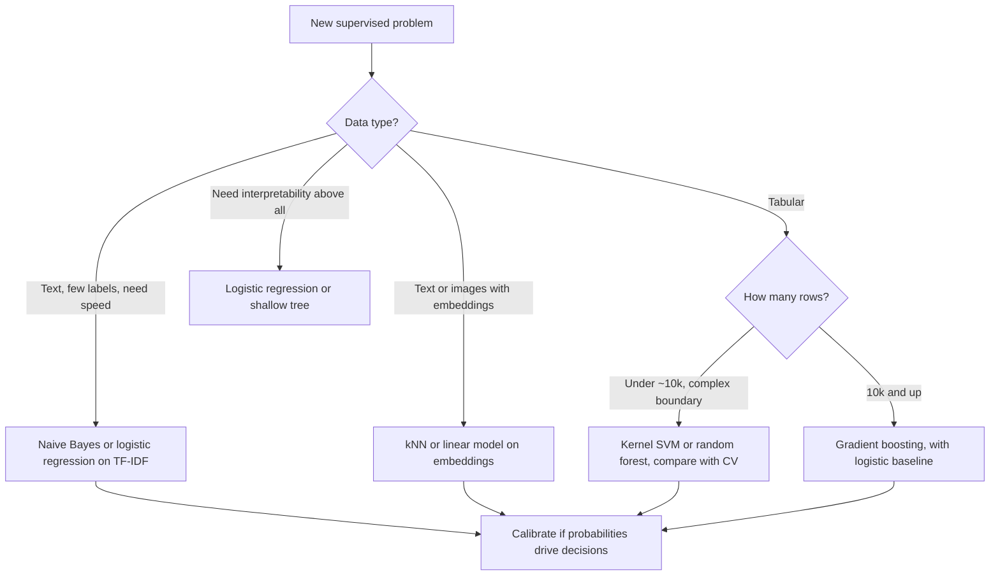
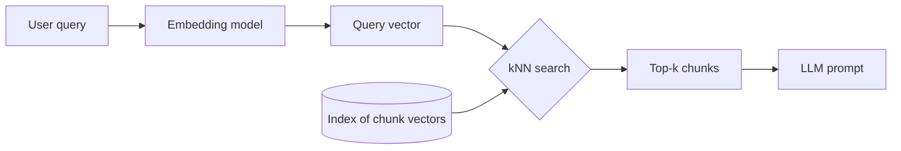
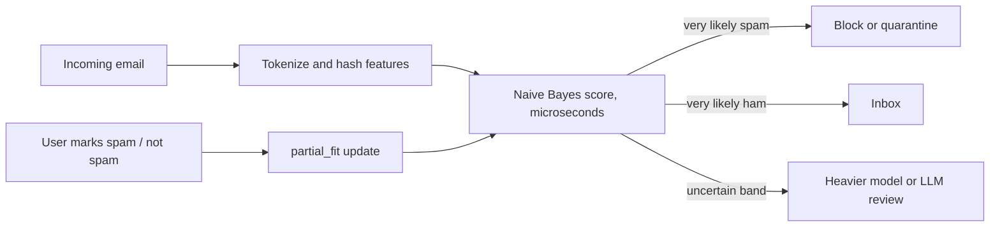

# k-Nearest Neighbors, SVMs, Naive Bayes and Other Classic Algorithms

> **Level:** Beginner to Advanced · **Study time:** ~100 min · **Prerequisites:** [Linear Algebra for ML](../00-foundations/02-linear-algebra-for-ml.md), [Probability and Statistics](../00-foundations/04-probability-and-statistics.md), [Linear and Logistic Regression](02-linear-and-logistic-regression.md), [Overfitting and Regularization](03-overfitting-regularization-and-data-leakage.md), [Feature Engineering and Scaling](07-feature-engineering-missing-values-and-encoding.md)

## Table of contents

- [Why this matters](#why-this-matters)
- [The running examples](#the-running-examples)
- [k-Nearest Neighbors](#k-nearest-neighbors)
- [Support Vector Machines](#support-vector-machines)
- [Naive Bayes](#naive-bayes)
- [Other classic algorithms worth recognizing](#other-classic-algorithms-worth-recognizing)
- [When each algorithm is still used today](#when-each-algorithm-is-still-used-today)
- [Comparing all classic supervised algorithms](#comparing-all-classic-supervised-algorithms)
- [Going deeper: kNN at scale and the bridge to vector search](#going-deeper-knn-at-scale-and-the-bridge-to-vector-search)
- [Going deeper: SVMs and Naive Bayes in production](#going-deeper-svms-and-naive-bayes-in-production)
- [Common mistakes and misconceptions](#common-mistakes-and-misconceptions)
- [Interview questions and model answers](#interview-questions-and-model-answers)
- [Key takeaways](#key-takeaways)
- [Further reading](#further-reading)
- [Next](#next)

## Why this matters

These three algorithms look old-fashioned next to transformers, but their ideas are everywhere in modern AI systems. The dense-retrieval step of most RAG (retrieval-augmented generation: fetch relevant documents, then hand them to an LLM) pipelines and the candidate-retrieval stage of many recommendation engines are, at heart, a **k-nearest neighbors** search over **embeddings** (vectors produced by a neural network so that similar items land close together). The SVM's idea of a **margin** and its **kernel trick** shaped how the field thinks about generalization and similarity functions. Naive Bayes is still one of the fastest, cheapest text-classification baselines you can ship, and a senior engineer is expected to know when a 2 ms classical model beats a 2 second LLM call. In interviews, these algorithms are a favorite way to test whether you understand distance, scaling, regularization and probability rather than just library calls.

## The running examples

We reuse three tiny examples so you can check every number by hand.

1. **House prices (kNN):** three houses with size in square meters and number of bedrooms, and one new house whose price we want to predict.
2. **Four points on a line (SVM):** two "negative" points and two "positive" points in 2D.
3. **A 4-document spam corpus (Naive Bayes):** two spam emails and two normal ("ham") emails.

Quick vocabulary recap (taught in [the ML workflow chapter](01-ml-workflow-data-splits-and-cross-validation.md)): a **feature** is an input column (house size), a **label** is the answer we want to predict (price, or spam/ham), **classification** predicts a category and **regression** predicts a number.

---

## k-Nearest Neighbors

### The intuition

> **Analogy:** You move to a new city and want to know what a fair rent is for your apartment. You don't build a formula. You ask the three neighbors with the most similar apartments what they pay and take the average. That is kNN.

**k-nearest neighbors (kNN)** predicts the label of a new point by finding the $k$ training points closest to it and combining their labels:

- **Classification:** majority vote among the $k$ neighbors.
- **Regression:** average (or weighted average) of the neighbors' values.

kNN is called a **lazy learner** (or **instance-based learner**): "training" just stores the data, and all the work happens at prediction time. It is also **non-parametric**: it has no fixed set of learned weights. The "model" is the training set itself, so it grows with the data.

```text
          bedrooms
             ^
           3 |        H3 o   o H2
             |      Q *
           2 |
           1 |    o H1
             +------------------------> size (m2)
                 118 120 125 130

   Q = query house. Which houses are "closest"? It depends on how you measure.
```

### The algorithm in four steps

1. Choose $k$ and a **distance metric** (a rule for measuring how far apart two points are).
2. For a query point, compute its distance to every training point.
3. Take the $k$ smallest distances.
4. Vote (classification) or average (regression).

### Distance metrics

A **vector** is just a list of numbers, here the features of one example (see [Linear Algebra for ML](../00-foundations/02-linear-algebra-for-ml.md)). Let $\mathbf{a}$ and $\mathbf{b}$ be two vectors with $d$ features each.

**Euclidean distance** (straight-line, "as the crow flies"):

$$
d_{\text{euc}}(\mathbf{a}, \mathbf{b}) = \sqrt{\sum_{j=1}^{d} (a_j - b_j)^2}
$$

**Manhattan distance** (city blocks, you can only walk along streets):

$$
d_{\text{man}}(\mathbf{a}, \mathbf{b}) = \sum_{j=1}^{d} |a_j - b_j|
$$

**Minkowski distance** generalizes both with a parameter $p$: $p=1$ gives Manhattan, $p=2$ gives Euclidean.

$$
d_p(\mathbf{a}, \mathbf{b}) = \left(\sum_{j=1}^{d} |a_j - b_j|^p\right)^{1/p}
$$

**Cosine similarity** measures the angle between vectors, ignoring their length. **Cosine distance** is $1 - \cos$.

$$
\cos(\mathbf{a}, \mathbf{b}) = \frac{\mathbf{a} \cdot \mathbf{b}}{\lVert \mathbf{a} \rVert \, \lVert \mathbf{b} \rVert}
$$

Symbols:

- $d$: number of features (dimensions).
- $a_j, b_j$: the $j$-th feature of each vector.
- $|x|$: absolute value.
- $p$: the Minkowski order (1, 2, ...).
- $\mathbf{a} \cdot \mathbf{b} = \sum_j a_j b_j$: the **dot product**.
- $\lVert \mathbf{a} \rVert = \sqrt{\sum_j a_j^2}$: the **norm** (length) of a vector.

**Worked example.** Let $\mathbf{a} = (1, 2)$ and $\mathbf{b} = (4, 6)$.

- Differences: $4 - 1 = 3$ and $6 - 2 = 4$.
- Euclidean: $\sqrt{3^2 + 4^2} = \sqrt{9 + 16} = \sqrt{25} = 5$.
- Manhattan: $3 + 4 = 7$.
- Cosine: dot product $= 1 \cdot 4 + 2 \cdot 6 = 4 + 12 = 16$. Norms: $\lVert \mathbf{a} \rVert = \sqrt{1 + 4} = \sqrt{5} \approx 2.236$, $\lVert \mathbf{b} \rVert = \sqrt{16 + 36} = \sqrt{52} \approx 7.211$. So $\cos = 16 / (2.236 \times 7.211) = 16 / 16.125 \approx 0.992$. The vectors point in almost the same direction, even though they are 5 units apart.

| Metric | What it measures | Use when | Watch out for |
|---|---|---|---|
| Euclidean | Straight-line distance | Dense numeric features on comparable scales | Very sensitive to feature scale and outliers |
| Manhattan | Sum of absolute differences | Grid-like data, somewhat more robust to single large differences | Still scale-sensitive |
| Cosine | Angle (direction), not length | Text vectors, embeddings, anything where magnitude is noise | Undefined for zero vectors |
| Hamming | Number of positions that differ | Binary or categorical codes, hashes | Only meaningful for equal-length discrete vectors |

> **Senior insight:** If vectors are **L2-normalized** (scaled to length 1), Euclidean distance and cosine similarity give the same ranking, because $\lVert \mathbf{a} - \mathbf{b} \rVert^2 = 2 - 2\cos(\mathbf{a}, \mathbf{b})$. This is why vector databases often normalize embeddings and then use the fast inner product.

### Worked example: why scaling matters

Our houses (prices are illustrative):

| House | Size (m2) | Bedrooms | Price (k USD) |
|---|---|---|---|
| H1 | 118 | 1 | 300 |
| H2 | 130 | 3 | 360 |
| H3 | 125 | 3 | 340 |
| Query Q | 120 | 3 | ? |

**Unscaled Euclidean distances from Q:**

- H1: differences $(118-120, 1-3) = (-2, -2)$, distance $\sqrt{4 + 4} = \sqrt{8} \approx 2.83$.
- H2: differences $(10, 0)$, distance $10$.
- H3: differences $(5, 0)$, distance $5$.

With $k = 2$ the neighbors are H1 and H3, prediction $(300 + 340)/2 = 320$. But H1 has **one** bedroom while Q has three. Size dominates because its numbers are bigger: a 2 m2 difference counts the same as a 2-bedroom difference, which is absurd.

**Fix: standardize.** **Standardization** rescales each feature to $z = (x - \mu)/\sigma$, where $\mu$ is the feature's mean and $\sigma$ its **standard deviation** (typical spread). Suppose that across the full dataset $\sigma_{\text{size}} = 20$ m2 and $\sigma_{\text{bedrooms}} = 1$ (illustrative). The mean cancels when we subtract two points, so we just divide differences by $\sigma$:

- H1: $(-2/20, -2/1) = (-0.1, -2)$, distance $\sqrt{0.01 + 4} = \sqrt{4.01} \approx 2.00$.
- H2: $(10/20, 0) = (0.5, 0)$, distance $0.5$.
- H3: $(5/20, 0) = (0.25, 0)$, distance $0.25$.

Now the 2 nearest are H3 and H2, prediction $(340 + 360)/2 = 350$. Same data, same algorithm, a different answer because of scaling. Scaling techniques are covered in [the feature engineering chapter](07-feature-engineering-missing-values-and-encoding.md).

> **Common mistake:** Fitting the scaler on all data before splitting. Fit it on the training fold only (use a scikit-learn `Pipeline`), otherwise test-set statistics leak into training. See [data leakage](03-overfitting-regularization-and-data-leakage.md).

### Weighted kNN

Plain kNN gives every neighbor an equal vote. **Distance-weighted kNN** gives closer neighbors more say, typically with weight $w_i = 1/d_i$:

$$
\hat{y} = \frac{\sum_{i=1}^{k} w_i \, y_i}{\sum_{i=1}^{k} w_i}, \qquad w_i = \frac{1}{d_i}
$$

- $\hat{y}$: the prediction.
- $y_i$: label of the $i$-th neighbor.
- $d_i$: its distance to the query.

**Worked example** (scaled distances, $k = 3$): weights are $1/0.25 = 4$, $1/0.5 = 2$, $1/2.0025 \approx 0.499$.

- Numerator: $4 \times 340 + 2 \times 360 + 0.499 \times 300 = 1360 + 720 + 149.8 = 2229.8$.
- Denominator: $4 + 2 + 0.499 = 6.499$.
- Prediction: $2229.8 / 6.499 \approx 343.1$.

Compare with unweighted $k = 3$: $(300 + 360 + 340)/3 \approx 333.3$. Weighting pulls the answer toward the closest, most similar houses.

### Code: kNN from scratch, then scikit-learn

```python
# pip install numpy scikit-learn
import numpy as np

def knn_predict(X_train, y_train, x_query, k=3, weighted=False):
    """kNN regression with Euclidean distance."""
    dists = np.sqrt(((X_train - x_query) ** 2).sum(axis=1))  # distance to every training point
    idx = np.argsort(dists)[:k]                               # indices of the k closest
    if not weighted:
        return y_train[idx].mean()
    w = 1.0 / (dists[idx] + 1e-12)                            # avoid division by zero
    return (w * y_train[idx]).sum() / w.sum()

X = np.array([[118, 1], [130, 3], [125, 3]], dtype=float)
y = np.array([300, 360, 340], dtype=float)
q = np.array([120, 3], dtype=float)

print(knn_predict(X, y, q, k=2))                       # 320.0  (unscaled: size dominates)
scale = np.array([20.0, 1.0])                          # illustrative std devs
print(knn_predict(X / scale, y, q / scale, k=2))       # 350.0  (scaled)
print(round(knn_predict(X / scale, y, q / scale, k=3, weighted=True), 1))  # 343.1
```

In practice you use scikit-learn with a pipeline so scaling is fit only on training folds:

```python
from sklearn.datasets import load_breast_cancer
from sklearn.model_selection import GridSearchCV, train_test_split
from sklearn.neighbors import KNeighborsClassifier
from sklearn.pipeline import Pipeline
from sklearn.preprocessing import StandardScaler

X, y = load_breast_cancer(return_X_y=True)
X_tr, X_te, y_tr, y_te = train_test_split(X, y, test_size=0.2, stratify=y, random_state=0)

pipe = Pipeline([
    ("scale", StandardScaler()),          # fit on training folds only
    ("knn", KNeighborsClassifier()),
])
grid = GridSearchCV(
    pipe,
    param_grid={
        "knn__n_neighbors": [1, 3, 5, 7, 11, 15, 21],
        "knn__weights": ["uniform", "distance"],
        "knn__metric": ["euclidean", "manhattan"],
    },
    cv=5,
    scoring="f1",
)
grid.fit(X_tr, y_tr)
print(grid.best_params_)
print("test F1:", grid.score(X_te, y_te))
```

### Choosing k

$k$ is a **hyperparameter**: a setting you choose rather than learn from data. It controls the **bias-variance trade-off** (see [Overfitting, Bias-Variance and Regularization](03-overfitting-regularization-and-data-leakage.md)).

| k | Behavior | Risk |
|---|---|---|
| $k = 1$ | Decision boundary follows every training point; zero training error (unless identical points carry different labels) | High **variance**: overfits noise and mislabeled points |
| Moderate $k$ (5-30 typical) | Smooth boundary, averages out noise | Usually the sweet spot, find it by cross-validation |
| $k = n$ (all points) | With uniform weights, always predicts the global majority class or the global mean | High **bias**: ignores the query entirely |

Practical rules:

- **Use cross-validation** to pick $k$ (see [cross-validation](01-ml-workflow-data-splits-and-cross-validation.md)). Search on a rough grid such as 1, 3, 5, 11, 21, 51.
- For binary classification, use **odd** $k$ to avoid tied votes.
- $\sqrt{n}$ is a folk rule of thumb for a starting point, not a law.
- With **imbalanced classes**, large $k$ drowns the minority class. Use distance weighting and evaluate with the right metrics ([classification metrics](04-classification-metrics-and-imbalanced-data.md)).

> **Interview tip:** A classic theoretical result (Cover and Hart, 1967) says that as the training set grows without limit, the error of 1-NN is at most twice the **Bayes error** (the lowest error any classifier could achieve). Mentioning it shows you know kNN is not "just a heuristic".

### Cost: training is free, prediction is expensive

With $n$ training points and $d$ features:

- **Training:** store the data, $O(nd)$ memory, essentially no compute.
- **Prediction (brute force):** compute $n$ distances, each costing $O(d)$, so $O(nd)$ per query, plus selecting the top $k$.

This is the opposite of most models, which are slow to train and fast to predict. Tree-based indexes (**KD-tree**, **ball tree**) speed up search by pruning regions of space, but they work well only in low dimensions (roughly tens of features at most). For high-dimensional data you need **approximate nearest neighbor (ANN)** methods, which return almost the closest points far faster, covered [below](#going-deeper-knn-at-scale-and-the-bridge-to-vector-search).

### The curse of dimensionality

> **Analogy:** In a 1D hallway, your 10 nearest neighbors are within a few steps. In a 1000-dimensional "building", everyone is roughly equally far away, so "nearest" stops meaning "similar".

The **curse of dimensionality** is the set of problems that appear as the number of features $d$ grows. Two effects matter for kNN.

**1. Neighborhoods stop being local.** Put points uniformly in a unit hypercube (a cube with side 1 in $d$ dimensions). To capture a fraction $r$ of the points in a smaller sub-cube, its side must be $s = r^{1/d}$. For $r = 1\%$:

- $d = 1$: $s = 0.01$ (1% of the range, very local).
- $d = 10$: $s = 0.01^{0.1} = 10^{-0.2} \approx 0.63$ (63% of every feature's range).
- $d = 100$: $s = 0.01^{0.01} = 10^{-0.02} \approx 0.955$ (95.5% of every range).

In 100 dimensions, your "1% nearest neighbors" span almost the entire range of every feature. They are not local at all.

**2. Distances concentrate.** For many random distributions, the ratio between the farthest and nearest distance approaches 1 as $d$ grows, so the contrast between "near" and "far" disappears (Beyer et al., 1999, "When Is 'Nearest Neighbor' Meaningful?").

```python
import numpy as np

rng = np.random.default_rng(0)
for d in [2, 10, 100, 1000]:
    X = rng.random((1000, d))                 # 1000 uniform random points
    q = rng.random(d)                         # one random query
    dist = np.linalg.norm(X - q, axis=1)
    contrast = (dist.max() - dist.min()) / dist.min()
    print(f"d={d:5d}  relative contrast={contrast:.3f}")
# The contrast shrinks sharply as d grows: nearest and farthest become similar.
```

**So why does vector search work on 768- or 1536-dimensional embeddings?** Because real data is not uniform noise. Embedding models are trained so that semantically similar items end up close together, and the data lies near a much lower-dimensional structure (a **manifold**) inside the big space. The curse hits hardest when dimensions are random, irrelevant or unscaled. Mitigations for classic kNN:

- Remove irrelevant features (feature selection).
- Reduce dimensions with PCA (principal component analysis, which keeps only the few directions along which the data varies most; see [dimensionality reduction](10-unsupervised-learning-clustering-and-dimensionality-reduction.md)).
- Use a **learned metric**: train an embedding model so distances mean something. Modern text embeddings are exactly this ([Text Embeddings and Similarity Search](../08-rag/02-text-embeddings-and-similarity-search.md)).

---

## Support Vector Machines

### The intuition: the widest street

> **Analogy:** You are painting a road between two neighborhoods (red houses and blue houses). Many roads separate them, but the safest is the **widest** road that touches no house. Only the houses right at the edge of the road decide where it goes. Move a house far from the road and nothing changes.

A **support vector machine (SVM)** is a classifier that finds the boundary separating two classes with the **largest possible margin**. The kernelized maximum-margin classifier was introduced by Boser, Guyon and Vapnik (1992), and the modern soft-margin form by Cortes and Vapnik ("Support-Vector Networks", 1995).

Key terms:

- **Hyperplane:** a flat boundary. In 2D it is a line, in 3D a plane, in $d$ dimensions a $(d-1)$-dimensional flat surface. Written $\mathbf{w} \cdot \mathbf{x} + b = 0$.
- **Margin:** the distance between the hyperplane and the closest training points. The "width of the street".
- **Support vectors:** the training points that lie on the edge of the margin (or inside it). They alone determine the boundary.

```text
      x2
       ^           margin
       |      \  <------->  \
       |   -   \     |     \   +
       |  -  (-)\    |      \(+)  +       (-), (+) = support vectors
       |   -     \   |       \   +
       |          \  |        \
       +-----------\-|---------\-------> x1
              w.x+b=-1  w.x+b=0  w.x+b=+1
```

### The math of the hard margin

Labels are $y_i \in \{-1, +1\}$. The classifier predicts $\text{sign}(\mathbf{w} \cdot \mathbf{x} + b)$. We call $f(\mathbf{x}) = \mathbf{w} \cdot \mathbf{x} + b$ the **decision function** or **score**.

The distance from a point $\mathbf{x}$ to the hyperplane is $|f(\mathbf{x})| / \lVert \mathbf{w} \rVert$. We fix the scale of $\mathbf{w}$ so that the closest points have $|f(\mathbf{x})| = 1$ (allowed, because multiplying $\mathbf{w}$ and $b$ by the same constant describes the same hyperplane). Then the margin on each side is $1/\lVert \mathbf{w} \rVert$ and the full street width is:

$$
\text{margin width} = \frac{2}{\lVert \mathbf{w} \rVert}
$$

Maximizing the width means minimizing $\lVert \mathbf{w} \rVert$. The **hard-margin SVM** solves:

$$
\min_{\mathbf{w}, b} \; \frac{1}{2}\lVert \mathbf{w} \rVert^2 \quad \text{subject to} \quad y_i(\mathbf{w} \cdot \mathbf{x}_i + b) \ge 1 \;\; \text{for all } i
$$

- $\mathbf{w}$: weight vector, perpendicular to the boundary.
- $b$: bias (offset) term.
- $\mathbf{x}_i, y_i$: the $i$-th training point and its label.
- $y_i(\mathbf{w} \cdot \mathbf{x}_i + b) \ge 1$: every point is on the correct side **and** at least one margin unit away.
- The $\frac{1}{2}$ and the square make the math cleaner without changing the answer.

### Worked example: four points on a line

Negatives: $(0,0)$ and $(1,1)$. Positives: $(3,3)$ and $(4,4)$.

The closest cross-class pair is $(1,1)$ and $(3,3)$, so the best boundary is the perpendicular bisector of that pair. The midpoint is $(2,2)$ and the direction between them is $(1,1)$, so the boundary is $x_1 + x_2 = 4$. In the form $\mathbf{w} \cdot \mathbf{x} + b = 0$ with $\mathbf{w} = (a, a)$ and $b = -4a$.

Scale so the support vector $(3,3)$ has score exactly 1: $3a + 3a - 4a = 2a = 1$, so $a = 0.5$.

- $\mathbf{w} = (0.5, 0.5)$, $b = -2$.
- Check $(1,1)$: $0.5 + 0.5 - 2 = -1$. With $y = -1$: $y \cdot f = 1$. On the margin edge, a support vector.
- Check $(4,4)$: $2 + 2 - 2 = 2$. $y \cdot f = 2 > 1$. Not a support vector.
- Check $(0,0)$: $-2$, $y \cdot f = 2$. Not a support vector.
- $\lVert \mathbf{w} \rVert = \sqrt{0.25 + 0.25} = \sqrt{0.5} \approx 0.707$.
- Margin width $= 2 / 0.707 \approx 2.83$, which equals the distance from $(1,1)$ to $(3,3)$: $\sqrt{2^2 + 2^2} = \sqrt{8} \approx 2.83$. It checks out.

Delete $(0,0)$ and $(4,4)$ and the answer does not change. That is the defining property of SVMs: **the solution depends only on the support vectors**.

### Soft margin, hinge loss and C

Real data overlaps, and a hard margin may not exist or may contort itself around one noisy point. The **soft-margin SVM** allows violations but charges for them using the **hinge loss**:

$$
\ell_{\text{hinge}}(y, f) = \max\big(0,\; 1 - y \cdot f(\mathbf{x})\big)
$$

$$
\min_{\mathbf{w}, b} \; \frac{1}{2}\lVert \mathbf{w} \rVert^2 + C \sum_{i=1}^{n} \max\big(0,\; 1 - y_i(\mathbf{w} \cdot \mathbf{x}_i + b)\big)
$$

- $y \cdot f$: the **functional margin**. Positive means correct side; $\ge 1$ means safely outside the margin.
- Loss is 0 when $y \cdot f \ge 1$, grows linearly as the point enters the margin, and keeps growing when it is misclassified.
- $C > 0$: how much you care about violations relative to a wide margin.

**Worked example** with $\mathbf{w} = (0.5, 0.5)$, $b = -2$ and three positive points ($y = +1$):

| Point | $f = 0.5x_1 + 0.5x_2 - 2$ | $y \cdot f$ | Hinge loss $\max(0, 1 - yf)$ |
|---|---|---|---|
| $(4, 4)$ | $2 + 2 - 2 = 2$ | 2 | $\max(0, -1) = 0$ (safe) |
| $(2.5, 2)$ | $1.25 + 1 - 2 = 0.25$ | 0.25 | $0.75$ (correct but inside the margin) |
| $(1.5, 1.5)$ | $0.75 + 0.75 - 2 = -0.5$ | $-0.5$ | $1.5$ (misclassified) |

With $C = 1$ the objective for this $\mathbf{w}, b$ is $\frac{1}{2}(0.5) + 1 \times (0 + 0.75 + 1.5) = 0.25 + 2.25 = 2.5$. The optimizer would trade off shrinking $\lVert \mathbf{w} \rVert$ against these penalties.

| C | Effect | Analogy |
|---|---|---|
| Large C | Violations are expensive, so a narrow margin that fits training data tightly | Strict teacher: low bias, high variance |
| Small C | Violations are cheap, so a wide margin that ignores some points | Lenient teacher: higher bias, lower variance |

> **Senior insight:** The soft-margin objective is just **L2-regularized hinge loss**. $C$ plays the role of $1/\lambda$ in ridge-style regularization: bigger $C$ means **less** regularization. Compare logistic regression, which is L2-regularized log loss (see [Linear and Logistic Regression](02-linear-and-logistic-regression.md)). Hinge loss is exactly zero for points beyond the margin, which is why most points end up irrelevant and the solution is **sparse** in support vectors. Log loss is never exactly zero, so every point keeps a small influence.

```text
 y*f (functional margin):   -2     -1      0      1      2      3
 hinge  max(0, 1 - y*f):     3      2      1      0      0      0     <- exactly 0 past the margin
 log loss ln(1 + e^-y*f):  2.13   1.31   0.69   0.31   0.13   0.05   <- smooth, never exactly 0
```

### Code: verify the worked example

```python
import numpy as np
from sklearn.svm import SVC

# Hinge loss by hand for the three evaluation points
w, b = np.array([0.5, 0.5]), -2.0
pts = np.array([[4, 4], [2.5, 2], [1.5, 1.5]])
ys = np.array([1, 1, 1])
margins = ys * (pts @ w + b)
hinge = np.maximum(0, 1 - margins)
print(margins, hinge)                    # [ 2.    0.25 -0.5 ] [0.   0.75 1.5 ]
print(0.5 * w @ w + 1.0 * hinge.sum())   # 2.5

# Let a solver find the max-margin line (a huge C approximates a hard margin)
X = np.array([[0, 0], [1, 1], [3, 3], [4, 4]], dtype=float)
y = np.array([-1, -1, 1, 1])
clf = SVC(kernel="linear", C=1e6).fit(X, y)
print(clf.coef_, clf.intercept_)   # approximately [[0.5 0.5]] [-2.]
print(clf.support_vectors_)        # [[1. 1.] [3. 3.]]
```

### The dual view: why kernels become possible

Solving the SVM with Lagrange multipliers (the **dual problem**, which you do not need to derive in an interview) shows that the optimal weights are a weighted sum of training points:

$$
\mathbf{w} = \sum_{i=1}^{n} \alpha_i y_i \mathbf{x}_i, \qquad f(\mathbf{x}) = \sum_{i=1}^{n} \alpha_i y_i \, (\mathbf{x}_i \cdot \mathbf{x}) + b
$$

- $\alpha_i \ge 0$: a learned weight per training point. $\alpha_i > 0$ **only for support vectors**; for all other points it is 0.
- In the soft-margin case, $\alpha_i \le C$.

Check on our example: support vectors $(1,1)$ with $y=-1$ and $(3,3)$ with $y=+1$, both with $\alpha = 0.25$. Then $\mathbf{w} = 0.25 \times (+1)(3,3) + 0.25 \times (-1)(1,1) = (0.75, 0.75) - (0.25, 0.25) = (0.5, 0.5)$. Exactly our $\mathbf{w}$. (scikit-learn exposes $\alpha_i y_i$ as `clf.dual_coef_`, approximately `[[-0.25, 0.25]]` here.)

The crucial observation: **the data only appears inside dot products** $\mathbf{x}_i \cdot \mathbf{x}$. That opens the door to the kernel trick.

### The kernel trick, with an example

> **Analogy:** Red and blue marbles are mixed on a table, with the blue ones in the middle and the red ones on the outside. No straight line separates them. Now slap the table so the marbles fly up, the outer ones higher than the inner ones. In 3D, a flat sheet now separates them. Kernels let you "lift" the data like this without ever computing the lifted coordinates.

**Step 1: a feature map makes the data separable.** In 1D, negatives sit at $x \in \{-1, 0, 1\}$ and positives at $x \in \{-3, 3\}$. No single threshold separates them. Map each point with $\phi(x) = (x, x^2)$:

- Negatives: $(-1, 1), (0, 0), (1, 1)$.
- Positives: $(-3, 9), (3, 9)$.

Now the horizontal line "second coordinate $= 5$" separates them perfectly. Back in the original space this is the nonlinear rule $|x| > \sqrt{5} \approx 2.24$.

```text
 original 1D:   +    -  -  -    +          not separable by one threshold
               -3   -1  0  1    3

 after phi(x) = (x, x^2):
   x^2
    9 |  +                 +
    5 |- - - - - - - - - - - -   linear boundary x^2 = 5
    1 |       -     -
    0 |          -
      +-------------------------> x
```

**Step 2: a kernel computes the dot product in the lifted space directly.** A **kernel** is a function $K(\mathbf{x}, \mathbf{z}) = \phi(\mathbf{x}) \cdot \phi(\mathbf{z})$ that returns the dot product after mapping, often far more cheaply than computing $\phi$. Since the SVM only needs dot products, replace every $\mathbf{x}_i \cdot \mathbf{x}$ with $K(\mathbf{x}_i, \mathbf{x})$:

$$
f(\mathbf{x}) = \sum_{i \in \text{SV}} \alpha_i y_i \, K(\mathbf{x}_i, \mathbf{x}) + b
$$

**Worked example: the degree-2 polynomial kernel** $K(\mathbf{x}, \mathbf{z}) = (\mathbf{x} \cdot \mathbf{z})^2$ in 2D equals the dot product under $\phi(\mathbf{x}) = (x_1^2, \sqrt{2}\,x_1 x_2, x_2^2)$.

Take $\mathbf{x} = (1, 2)$ and $\mathbf{z} = (3, 1)$.

- **Kernel route:** $\mathbf{x} \cdot \mathbf{z} = 1 \cdot 3 + 2 \cdot 1 = 5$, squared $= 25$. Two multiplications, one addition, one square.
- **Explicit route:** $\phi(\mathbf{x}) = (1, 2\sqrt{2}, 4)$ and $\phi(\mathbf{z}) = (9, 3\sqrt{2}, 1)$. Dot product $= 1 \cdot 9 + (2\sqrt{2})(3\sqrt{2}) + 4 \cdot 1 = 9 + 12 + 4 = 25$.

Same answer. For degree-$p$ polynomials over $d$ features, the explicit space has on the order of $d^p$ dimensions, but the kernel still costs $O(d)$.

```python
import numpy as np

x, z = np.array([1.0, 2.0]), np.array([3.0, 1.0])
phi = lambda v: np.array([v[0]**2, np.sqrt(2) * v[0] * v[1], v[1]**2])
print((x @ z) ** 2)          # 25.0
print(phi(x) @ phi(z))       # approximately 25.0 (tiny floating-point error possible)
```

A function is a valid kernel if it corresponds to a dot product in some feature space; formally, the matrix of pairwise kernel values must be **positive semi-definite** for any set of points (**Mercer's condition**). You rarely need to prove this, but know the term.

### The RBF kernel

The most widely used kernel is the **radial basis function (RBF)**, also called the **Gaussian kernel**:

$$
K(\mathbf{x}, \mathbf{z}) = \exp\big(-\gamma \, \lVert \mathbf{x} - \mathbf{z} \rVert^2\big)
$$

- $\lVert \mathbf{x} - \mathbf{z} \rVert^2$: squared Euclidean distance.
- $\gamma > 0$: controls how fast similarity decays with distance.
- Output is between 0 and 1: 1 for identical points, near 0 for far-apart points.

It is a **similarity** score. The decision function becomes "a weighted vote of support vectors, each weighted by how close it is to the query", which looks a lot like a smooth, learned kNN. Its implicit feature space is infinite-dimensional, which is why you can only use it through the kernel.

**Worked example:** $\mathbf{x} = (1, 2)$, $\mathbf{z} = (3, 1)$. Squared distance $= (1-3)^2 + (2-1)^2 = 4 + 1 = 5$.

- $\gamma = 0.1$: $K = e^{-0.5} \approx 0.607$ (still fairly similar).
- $\gamma = 1$: $K = e^{-5} \approx 0.0067$ (essentially unrelated).

| Hyperparameter | Too small | Too large |
|---|---|---|
| $\gamma$ (RBF width) | Each support vector influences a huge region, so the boundary is nearly linear (underfit) | Each support vector influences only a tiny bubble around itself, so the model memorizes training points (overfit) |
| $C$ | Wide margin, many violations (underfit) | Narrow margin, fits noise (overfit) |

Tune $C$ and $\gamma$ **together** on a logarithmic grid, because they interact.

```python
from sklearn.datasets import make_moons
from sklearn.model_selection import GridSearchCV, cross_val_score
from sklearn.pipeline import make_pipeline
from sklearn.preprocessing import StandardScaler
from sklearn.svm import SVC

X, y = make_moons(n_samples=500, noise=0.25, random_state=0)   # two interleaving half-circles

linear = make_pipeline(StandardScaler(), SVC(kernel="linear", C=1.0))
print("linear:", cross_val_score(linear, X, y, cv=5).mean())

rbf = make_pipeline(StandardScaler(), SVC(kernel="rbf"))
grid = GridSearchCV(
    rbf,
    {"svc__C": [0.1, 1, 10, 100], "svc__gamma": [0.01, 0.1, 1, 10]},
    cv=5,
)
grid.fit(X, y)
print("rbf:", grid.best_score_, grid.best_params_)
# Expect the RBF model to beat the linear one, since the classes are not linearly separable.
```

### Multiclass and regression

- SVMs are binary by nature. Multiclass uses **one-vs-rest** (one classifier per class against all others) or **one-vs-one** (one classifier per pair of classes, then vote). scikit-learn's `SVC` trains one-vs-one classifiers internally (its `decision_function_shape="ovr"` default only reshapes the output); `LinearSVC` uses one-vs-rest by default. Single-problem multiclass formulations also exist (Crammer and Singer, 2001; `LinearSVC(multi_class="crammer_singer")`).
- **Support Vector Regression (SVR)** uses an **epsilon-insensitive loss**: errors smaller than $\epsilon$ cost nothing, so only points on or outside an "epsilon tube" become support vectors.

---

## Naive Bayes

### The intuition

> **Analogy:** A seasoned mail clerk sorts letters by glancing at words. "Lottery" and "winner" push toward junk, "invoice" and "meeting" push toward real mail. Each word is treated as an independent clue, and the clerk multiplies the clues together. That is Naive Bayes.

**Naive Bayes** is a family of classifiers that apply **Bayes' theorem** with a simplifying ("naive") assumption that features are independent of each other once you know the class.

### Bayes' theorem

(Probability basics are in [Probability and Statistics](../00-foundations/04-probability-and-statistics.md).)

$$
P(c \mid \mathbf{x}) = \frac{P(\mathbf{x} \mid c)\, P(c)}{P(\mathbf{x})}
$$

- $c$: a class (spam or ham).
- $\mathbf{x}$: the observed features (the words in the email).
- $P(c)$: the **prior**, how common the class is before seeing the email.
- $P(\mathbf{x} \mid c)$: the **likelihood**, how probable these words are in emails of class $c$.
- $P(\mathbf{x})$: the **evidence**, the same for every class, so we can ignore it when comparing classes and normalize at the end.
- $P(c \mid \mathbf{x})$: the **posterior**, what we want.

### The naive assumption

Estimating $P(\mathbf{x} \mid c)$ for a whole email directly is impossible: almost every email is unique. The **conditional independence assumption** says that, given the class, each word's probability does not depend on the other words:

$$
P(x_1, x_2, \dots, x_d \mid c) = \prod_{j=1}^{d} P(x_j \mid c)
$$

So the classifier picks:

$$
\hat{c} = \arg\max_{c} \; P(c) \prod_{j=1}^{d} P(x_j \mid c)
$$

- $\prod$: product (multiply all terms).
- $\arg\max_c$: "the class $c$ that gives the largest value".

This is obviously false for language ("New" and "York" are not independent), which is why it's called naive. It works surprisingly well anyway; we will see why.

### Worked example: a spam filter

Our 4-document training corpus:

| Doc | Text | Class |
|---|---|---|
| D1 | win money now | spam |
| D2 | win free money | spam |
| D3 | meeting now | ham |
| D4 | free lunch meeting | ham |

We use the **multinomial** model: each class has a probability distribution over words, estimated from word counts.

**Step 1: priors.** 2 of 4 documents are spam: $P(\text{spam}) = 2/4 = 0.5$, $P(\text{ham}) = 0.5$.

**Step 2: count words per class.**

| Word | Count in spam | Count in ham |
|---|---|---|
| win | 2 | 0 |
| money | 2 | 0 |
| now | 1 | 1 |
| free | 1 | 1 |
| meeting | 0 | 2 |
| lunch | 0 | 1 |
| **Total tokens** | **6** | **5** |

Vocabulary size $|V| = 6$.

**Step 3: classify "free money meeting" without smoothing.** The maximum-likelihood estimate is $P(w \mid c) = \text{count}(w, c) / \text{total}_c$.

- Spam: $P(\text{meeting} \mid \text{spam}) = 0/6 = 0$, so the whole product is 0.
- Ham: $P(\text{money} \mid \text{ham}) = 0/5 = 0$, so this product is 0 too.

Both scores are zero. A single unseen word vetoes a class completely, no matter how strong the other evidence is. This is the **zero-frequency problem**.

### Laplace smoothing

**Laplace (add-one) smoothing** pretends every word appeared $\alpha$ extra times in every class (classic Laplace uses $\alpha = 1$; other values are called **additive** or **Lidstone** smoothing):

$$
P(w \mid c) = \frac{\text{count}(w, c) + \alpha}{\text{total}_c + \alpha \, |V|}
$$

- $\text{count}(w, c)$: times word $w$ appears in class $c$ documents.
- $\text{total}_c$: total word tokens in class $c$.
- $|V|$: vocabulary size. Adding $\alpha|V|$ to the denominator keeps the probabilities summing to 1.
- $\alpha$: the smoothing strength, a hyperparameter you can tune.

**Step 4: smoothed likelihoods** ($\alpha = 1$). Spam denominator $= 6 + 6 = 12$, ham denominator $= 5 + 6 = 11$.

| Word | $P(w \mid \text{spam})$ | $P(w \mid \text{ham})$ |
|---|---|---|
| free | $(1+1)/12 = 2/12$ | $(1+1)/11 = 2/11$ |
| money | $(2+1)/12 = 3/12$ | $(0+1)/11 = 1/11$ |
| meeting | $(0+1)/12 = 1/12$ | $(2+1)/11 = 3/11$ |
| win | $(2+1)/12 = 3/12$ | $(0+1)/11 = 1/11$ |

**Step 5: score "free money meeting".**

- Spam: $0.5 \times \frac{2}{12} \times \frac{3}{12} \times \frac{1}{12} = 0.5 \times \frac{6}{1728} = \frac{3}{1728} \approx 0.001736$.
- Ham: $0.5 \times \frac{2}{11} \times \frac{1}{11} \times \frac{3}{11} = 0.5 \times \frac{6}{1331} = \frac{3}{1331} \approx 0.002254$.

Normalize (divide each by the sum, which is the evidence $P(\mathbf{x})$):

$$
P(\text{spam} \mid \mathbf{x}) = \frac{3/1728}{3/1728 + 3/1331} = \frac{1331}{1331 + 1728} = \frac{1331}{3059} \approx 0.435
$$

So $P(\text{ham} \mid \mathbf{x}) \approx 0.565$. Verdict: **ham** (the "meeting" evidence slightly outweighs "money").

**Step 6: score "win free money".**

- Spam: $0.5 \times \frac{3}{12} \times \frac{2}{12} \times \frac{3}{12} = 0.5 \times \frac{18}{1728} = \frac{9}{1728} \approx 0.005208$.
- Ham: $0.5 \times \frac{1}{11} \times \frac{2}{11} \times \frac{1}{11} = 0.5 \times \frac{2}{1331} = \frac{1}{1331} \approx 0.000751$.
- $P(\text{spam} \mid \mathbf{x}) = 0.005208 / (0.005208 + 0.000751) \approx 0.874$.

Verdict: **spam**, about 87%.

### Work in log space

Multiplying hundreds of small probabilities **underflows**: the result becomes smaller than the smallest representable floating-point number and rounds to 0. Since $\log$ is increasing, compare sums of logs instead:

$$
\log P(c) + \sum_j \log P(x_j \mid c)
$$

For "free money meeting" (natural log):

- Spam: $\ln 0.5 + \ln\frac{2}{12} + \ln\frac{3}{12} + \ln\frac{1}{12} = -0.693 - 1.792 - 1.386 - 2.485 = -6.356$.
- Ham: $\ln 0.5 + \ln\frac{2}{11} + \ln\frac{1}{11} + \ln\frac{3}{11} = -0.693 - 1.705 - 2.398 - 1.299 = -6.095$.

Ham's score is higher (less negative), same verdict. Check: $e^{-6.356} \approx 0.001736$, matching step 5. To turn log scores back into probabilities safely, use the **log-sum-exp trick** (subtract the max score before exponentiating). Here: subtracting the max ($-6.095$) gives $-0.261$ for spam and $0$ for ham; exponentiating gives $0.770$ and $1$; normalizing gives $P(\text{spam} \mid \mathbf{x}) = 0.770 / 1.770 \approx 0.435$, with no tiny numbers ever computed.

### Naive Bayes is a linear model in disguise

Subtract the two log scores and you get the **log-odds** of spam:

$$
\log\frac{P(\text{spam} \mid \mathbf{x})}{P(\text{ham} \mid \mathbf{x})} = \log\frac{P(\text{spam})}{P(\text{ham})} + \sum_j \log\frac{P(x_j \mid \text{spam})}{P(x_j \mid \text{ham})}
$$

Each word contributes a fixed weight, its **log-likelihood ratio**:

- money: $\ln\frac{3/12}{1/11} = \ln 2.75 \approx +1.012$ (pushes toward spam).
- meeting: $\ln\frac{1/12}{3/11} = \ln 0.3056 \approx -1.186$ (pushes toward ham).
- free: $\ln\frac{2/12}{2/11} = \ln 0.9167 \approx -0.087$ (nearly neutral).

Sum $\approx 1.012 - 1.186 - 0.087 = -0.261$, prior term $\ln(0.5/0.5) = 0$. Applying the **sigmoid** $1/(1 + e^{-z})$: $1/(1 + e^{0.261}) \approx 1/2.298 \approx 0.435$. Same answer.

So multinomial Naive Bayes is a **linear classifier** over word counts, exactly the same form as logistic regression. The difference is how the weights are found: NB computes them from counts in one pass, logistic regression optimizes them directly to predict labels. Those per-word weights are also a great interpretability tool: you can list the top spam-indicating words.

### Code: from scratch, then scikit-learn

```python
import math
from collections import Counter

train = [("win money now", "spam"), ("win free money", "spam"),
         ("meeting now", "ham"), ("free lunch meeting", "ham")]

def fit(docs, alpha=1.0):
    classes = sorted({c for _, c in docs})
    vocab = sorted({w for d, _ in docs for w in d.split()})
    prior, counts, totals = {}, {}, {}
    for c in classes:
        cdocs = [d for d, cc in docs if cc == c]
        prior[c] = len(cdocs) / len(docs)
        counts[c] = Counter(w for d in cdocs for w in d.split())
        totals[c] = sum(counts[c].values())
    def log_lik(w, c):  # Laplace-smoothed log P(w | c)
        return math.log((counts[c][w] + alpha) / (totals[c] + alpha * len(vocab)))
    return classes, vocab, prior, log_lik

def predict_proba(model, text):
    classes, vocab, prior, log_lik = model
    words = [w for w in text.split() if w in vocab]          # ignore words never seen in training
    scores = {c: math.log(prior[c]) + sum(log_lik(w, c) for w in words) for c in classes}
    m = max(scores.values())                                 # log-sum-exp trick
    exps = {c: math.exp(s - m) for c, s in scores.items()}
    z = sum(exps.values())
    return {c: round(e / z, 4) for c, e in exps.items()}

model = fit(train)
print(predict_proba(model, "free money meeting"))  # {'ham': 0.5649, 'spam': 0.4351}
print(predict_proba(model, "win free money"))      # {'ham': 0.1261, 'spam': 0.8739}
```

```python
# pip install scikit-learn
from sklearn.feature_extraction.text import CountVectorizer
from sklearn.naive_bayes import MultinomialNB

texts = ["win money now", "win free money", "meeting now", "free lunch meeting"]
labels = ["spam", "spam", "ham", "ham"]

vec = CountVectorizer()                       # word counts per document
X = vec.fit_transform(texts)
nb = MultinomialNB(alpha=1.0).fit(X, labels)  # alpha=1.0 is Laplace smoothing

X_new = vec.transform(["free money meeting", "win free money"])
print(nb.classes_)                            # ['ham' 'spam']
print(nb.predict_proba(X_new).round(4))       # [[0.5649 0.4351]
                                              #  [0.1261 0.8739]]
```

### Naive Bayes variants

| Variant | Feature type | Likelihood model | Typical use |
|---|---|---|---|
| **Multinomial NB** | Counts (word counts; TF-IDF, i.e. counts down-weighted for words common across all documents, works in practice) | Word-frequency distribution per class | Text classification, spam, topic labeling |
| **Bernoulli NB** | Binary present/absent | Each word is a coin flip per class; **absence** of a word is also evidence | Short texts, binary features |
| **Gaussian NB** | Continuous numbers | Each feature is a bell curve (normal distribution) per class, with its own mean and variance | Quick baseline on numeric data |
| **Complement NB** | Counts | Estimates weights from the complement of each class (Rennie et al., 2003) | Imbalanced text classes, often beats multinomial NB |
| **Categorical NB** | Categories | One categorical distribution per feature per class | Categorical tabular data |

For Gaussian NB, the likelihood of a feature value $x_j$ is $P(x_j \mid c) = \frac{1}{\sqrt{2\pi\sigma_{c,j}^2}} \exp\left(-\frac{(x_j - \mu_{c,j})^2}{2\sigma_{c,j}^2}\right)$, where $\mu_{c,j}$ and $\sigma_{c,j}^2$ are the mean and variance of feature $j$ within class $c$. Training is literally computing means and variances. Example: if within class $c$ a feature (say, height in cm) has $\mu = 170$ and $\sigma^2 = 25$ ($\sigma = 5$), a new value $x = 175$ gets $P(x \mid c) = \frac{1}{\sqrt{2\pi \cdot 25}} e^{-25/50} = \frac{0.607}{12.53} \approx 0.048$ (a density, not a probability, which is fine because only the comparison across classes matters).

### Why does a "wrong" assumption work so well?

1. **Classification only needs the ranking.** You need the correct class to have the highest score, not accurate probabilities. Domingos and Pazzani (1997) showed NB can be optimal under zero-one loss (plain error rate: cost 1 for a wrong label, 0 for a right one) even when independence is badly violated.
2. **Low variance.** NB estimates very few parameters per feature from simple counts, so it rarely overfits small datasets.
3. **Generative models learn fast.** NB is **generative** (it models how features arise within each class, $P(\mathbf{x} \mid c)$, plus $P(c)$), while logistic regression is **discriminative** (it models $P(c \mid \mathbf{x})$ directly). Ng and Jordan (2001) compared the two: NB tends to approach its (higher) best-possible error with fewer training examples, while logistic regression eventually wins with more data.

The cost of the false assumption shows up in the **probabilities**: correlated words are counted as independent evidence, so the same signal is double-counted and probabilities are pushed toward 0 or 1. **NB probabilities are usually poorly calibrated**: a model is **calibrated** when, among cases it scores at 0.9, about 90% really are positive; NB's 0.99s are often right far less often. Calibrate them (see [below](#going-deeper-svms-and-naive-bayes-in-production)) if downstream logic uses thresholds.

---

## Other classic algorithms worth recognizing

You will rarely be asked to derive these, but you should recognize them and know one sentence about each.

| Algorithm | One-line idea | Status today |
|---|---|---|
| **Perceptron** (Rosenblatt, 1958) | Linear classifier updated only on mistakes; the ancestor of neural networks ([Neural Networks from Scratch](../02-deep-learning/01-neural-networks-from-scratch.md)) | Teaching tool; the update rule lives on in online learning |
| **Linear / Quadratic Discriminant Analysis (LDA / QDA)** | Generative: model each class as a Gaussian (shared covariance for LDA, separate for QDA); boundary is linear or quadratic | Strong small-data baseline; LDA also used for supervised dimensionality reduction |
| **Nearest centroid** | Represent each class by its mean vector; assign to the closest mean | Ultra-fast baseline; the idea behind prototype-based few-shot classification over embeddings |
| **Gaussian processes** | Kernel method that gives a full predictive distribution (mean and uncertainty) | Small data with uncertainty needs, Bayesian optimization of hyperparameters |
| **Ridge, lasso, elastic net** | Regularized linear models | See [Overfitting and Regularization](03-overfitting-regularization-and-data-leakage.md) |
| **Decision trees, random forests, boosting** | Recursive splits and ensembles | See [Decision Trees, Random Forests and Gradient Boosting](06-decision-trees-random-forests-and-gradient-boosting.md) |

> **Note:** "LDA" also stands for Latent Dirichlet Allocation, a topic model. In an interview, say which one you mean.

---

## When each algorithm is still used today

| Algorithm | Where it still earns its place | Why |
|---|---|---|
| **kNN** | Vector search in RAG and semantic search; recommendations ("users who liked this also liked"); retrieving similar examples for few-shot prompts; anomaly scores (distance to k-th neighbor); `KNNImputer` for missing values; deduplication | Pretrained embeddings made "define a good distance" far easier for text, images and many other domains; kNN then needs no training and updates instantly when you add data |
| **Linear SVM** | High-dimensional sparse text (TF-IDF features) in low-latency settings; a linear head on frozen embeddings | Fast, strong with many features, few hyperparameters (Joachims, 1998, showed SVMs were strong for text categorization) |
| **Kernel SVM** | Small to medium datasets (up to tens of thousands of rows) with complex boundaries: bioinformatics, chemistry, sensor data | Excellent accuracy when data is small and well-scaled |
| **One-class SVM** | Novelty and anomaly detection (Schölkopf et al., 2001) | Learns a boundary around "normal" data |
| **Naive Bayes** | Spam and text baselines, cheap pre-filters before an expensive LLM call, streaming data, edge devices, tiny labeled sets | Trains in one pass, updates incrementally (`partial_fit`), predicts in microseconds, needs little data |

> **Senior insight:** A pattern you'll see in LLM systems: a cheap classical model (NB or logistic regression on TF-IDF, or a linear classifier on embeddings) routes or filters 80-95% of traffic (illustrative), and only ambiguous cases go to the LLM. This can cut cost and latency dramatically. Always propose a classical baseline before reaching for an LLM classifier, and measure both.

---

## Comparing all classic supervised algorithms

Notation: $n$ = training examples, $d$ = features, $k$ = neighbors, $T$ = trees, $D$ = tree depth, $n_{sv}$ = number of support vectors, $c$ = classes. Complexities are typical, simplified orders of magnitude, not exact bounds for every solver.

| Algorithm | Best data size | Interpretability | Training cost | Inference cost per example | Needs feature scaling? | Nonlinear? | Probabilities |
|---|---|---|---|---|---|---|---|
| **Linear regression** | Any; great when $n$ is small or huge | High (coefficients) | Closed form $O(nd^2 + d^3)$, or $O(nd)$ per epoch with SGD | $O(d)$ | Not for plain OLS predictions; yes with regularization or gradient descent | Only via engineered features | N/A (regression) |
| **Logistic regression** | Any | High (coefficients as log-odds) | $O(nd)$ per iteration | $O(d)$ | Yes (regularization and solver convergence) | Only via engineered features | Often reasonably well calibrated (strong regularization or a misspecified model can distort it) |
| **kNN** | Small to medium for brute force; huge with ANN indexes | Medium (explain by showing the neighbors) | ~None (store data; index build if ANN) | $O(nd)$ brute force; sublinear with ANN | **Yes, critical** | Yes | Rough (vote fractions) |
| **SVM (linear)** | Medium to large, high-dimensional sparse | High (weights) | Roughly $O(nd)$ per pass with liblinear-style solvers | $O(d)$ | **Yes** | No | No (needs calibration) |
| **SVM (kernel, RBF)** | Small to medium (up to tens of thousands) | Low | Between $O(n^2)$ and $O(n^3)$ | $O(n_{sv} \cdot d)$ | **Yes, critical** | Yes | No (needs calibration) |
| **Naive Bayes** | Tiny to huge; shines on small data and text | High (per-feature log-likelihood ratios) | $O(nd)$, one pass | $O(cd)$ | No (multinomial needs non-negative features) | Multinomial/Bernoulli: no (linear in log space); Gaussian NB: quadratic boundary when class variances differ | Poorly calibrated |
| **Decision tree** | Small to medium | High if shallow | $O(nd \log n)$ | $O(D)$ | No | Yes | Rough |
| **Random forest** | Medium to large tabular | Medium (feature importances, SHAP) | $T \times$ tree cost, parallel | $O(T \cdot D)$ | No | Yes | Often needs calibration |
| **Gradient boosting** | Medium to large tabular; usually the tabular accuracy leader | Medium (SHAP) | $T \times$ tree cost, sequential across trees | $O(T \cdot D)$ | No | Yes | Often decent, check calibration |

How to read this table in an interview:

- **Distance and margin methods (kNN, SVM) need scaling; tree methods don't.** Trees split one feature at a time on thresholds, so the units don't matter.
- **Lazy vs eager.** kNN moves cost from training to inference. That's fine for offline batch scoring, risky for a 10 ms latency budget without an index.
- **Kernel SVM training is superlinear in $n$.** The scikit-learn docs warn that `SVC` fit time scales at least quadratically and becomes impractical beyond tens of thousands of samples.
- **For tabular data, gradient boosting is the default to beat**, but always run a logistic regression baseline first ([Model Selection](05-regression-metrics-baselines-and-model-selection.md)).



A quick benchmark harness you can adapt (no results shown, run it yourself):

```python
import time
from sklearn.datasets import load_breast_cancer
from sklearn.ensemble import HistGradientBoostingClassifier, RandomForestClassifier
from sklearn.linear_model import LogisticRegression
from sklearn.model_selection import cross_validate
from sklearn.naive_bayes import GaussianNB
from sklearn.neighbors import KNeighborsClassifier
from sklearn.pipeline import make_pipeline
from sklearn.preprocessing import StandardScaler
from sklearn.svm import SVC
from sklearn.tree import DecisionTreeClassifier

X, y = load_breast_cancer(return_X_y=True)
models = {
    "logreg": make_pipeline(StandardScaler(), LogisticRegression(max_iter=1000)),
    "knn": make_pipeline(StandardScaler(), KNeighborsClassifier(n_neighbors=7)),
    "svm_rbf": make_pipeline(StandardScaler(), SVC(kernel="rbf")),
    "gauss_nb": GaussianNB(),
    "tree": DecisionTreeClassifier(max_depth=5, random_state=0),
    "forest": RandomForestClassifier(n_estimators=300, random_state=0),
    "hgb": HistGradientBoostingClassifier(random_state=0),
}
for name, model in models.items():
    res = cross_validate(model, X, y, cv=5, scoring="roc_auc")
    print(f"{name:9s} AUC={res['test_score'].mean():.3f} "
          f"fit={res['fit_time'].mean()*1000:.1f}ms score={res['score_time'].mean()*1000:.1f}ms")
```

Look at `score_time` for kNN versus the linear models: that is the lazy-learner inference cost made visible.

---

## Going deeper: kNN at scale and the bridge to vector search

### From kNN classifier to retrieval engine

Swap "house features" for "embedding of a document chunk" and "predict a price" for "return the top 5 chunks", and you have the retrieval step of RAG. Same algorithm, same metric choices, same curse of dimensionality concerns. What changes is scale.



**Back-of-the-envelope for exact (brute-force) kNN** (illustrative sizes):

- 10 million chunks, 768-dimensional float32 embeddings (4 bytes each).
- Memory: $10{,}000{,}000 \times 768 \times 4 = 30{,}720{,}000{,}000$ bytes $\approx 30.7$ GB.
- Compute per query: one dot product per vector costs about $2d$ floating-point operations, so $2 \times 768 \times 10^7 \approx 1.5 \times 10^{10}$ FLOPs per query.

That's feasible on a GPU for modest query rates, but at thousands of queries per second, or billions of vectors, you need **approximate nearest neighbor (ANN)** search: indexes like **HNSW** (graph-based), **IVF** (cluster then search a few clusters) and **product quantization** (compress vectors). They trade a little **recall** (fraction of the true top-k you actually return) for orders-of-magnitude speedups. All of this is covered in [Vector Search Algorithms](../08-rag/06-vector-search-ann-hnsw-ivf-and-product-quantization.md) and [Vector Databases in Practice](../08-rag/07-vector-databases-in-practice.md).

```python
# pip install faiss-cpu numpy
import numpy as np
import faiss

d = 384
rng = np.random.default_rng(0)
xb = rng.standard_normal((100_000, d)).astype("float32")  # stand-in for embeddings
faiss.normalize_L2(xb)                 # in-place L2 normalization: inner product == cosine

index = faiss.IndexFlatIP(d)           # exact (brute-force) inner-product search
index.add(xb)

xq = xb[:5].copy()                     # use the first 5 vectors as queries
D, I = index.search(xq, 4)             # top-4 similarities and ids per query
print(I[:, 0])                         # [0 1 2 3 4]: each query's nearest neighbor is itself
```

Exact flat search like this is also the **ground truth** you use to measure an ANN index's recall.

### What a senior engineer worries about with kNN

| Concern | Why it matters | What to do |
|---|---|---|
| **Inference latency** | Cost is at query time and grows with $n$ | ANN index, GPU search, sharding, caching hot queries |
| **Memory** | You keep every vector in RAM for fast search | Quantize vectors (int8, PQ), smaller embedding dims, disk-based indexes |
| **Metric mismatch** | Embedding models are trained for a specific similarity (often cosine) | Use the metric the model was trained with; normalize if using inner product |
| **Near-duplicate leakage** | If test items have near-copies in training, kNN looks brilliant offline and fails in production | Deduplicate before splitting; split by group (user, document, time) |
| **Hubness** | In high dimensions, a few points appear in many other points' neighbor lists, dominating results | Normalize, center embeddings, or use hubness-reduction rescoring |
| **Data updates** | Adding a point is instant (a big plus); deleting one may be lazy in some ANN indexes | Plan for tombstones and periodic rebuilds ([Production Ingestion Pipelines](../08-rag/12-production-ingestion-pipelines-at-scale.md)) |
| **Privacy** | The model **is** the training data; a prediction can reveal neighbors | Access control on retrieved items ([Secure Multi-Tenant RAG](../08-rag/13-secure-multi-tenant-rag.md)); on the flip side, "forgetting" a record is as easy as deleting it |

> **Senior insight:** kNN is the most honest model for "learning from memory". Research systems such as kNN-LM (Khandelwal et al., 2020, "Generalization through Memorization: Nearest Neighbor Language Models") combine a language model with nearest-neighbor lookups over a datastore. RAG is the production cousin of that idea: keep knowledge in an index you can update without retraining.

### Learned metrics

Classic kNN assumes a hand-picked metric. **Metric learning** learns a transformation so that same-class points are close and different-class points are far (for example LMNN, Weinberger and Saul, 2009). Modern **contrastive** embedding models are metric learning at scale: they are trained so that a query and its relevant document have high cosine similarity. That is why kNN went from "beginner algorithm" to the backbone of retrieval.

---

## Going deeper: SVMs and Naive Bayes in production

### Scaling SVMs beyond small data

Kernel SVM training needs (implicitly) the $n \times n$ kernel matrix. For $n = 1{,}000{,}000$, a dense float32 kernel matrix would need $10^{12} \times 4$ bytes $= 4$ TB, which is why solvers like **SMO** (Platt, 1998) work on small subsets at a time and cache kernel rows. Even so, runtime grows superlinearly. Options when you have millions of rows:

| Option | Idea | Trade-off |
|---|---|---|
| **Linear SVM** (`LinearSVC`, `SGDClassifier(loss="hinge")`) | Drop the kernel; solvers like LIBLINEAR (Fan et al., 2008) scale to millions of sparse rows | Linear boundary only |
| **Kernel approximation** (`Nystroem`, `RBFSampler`) then a linear model | Build an explicit, finite feature map that approximates the RBF kernel: `Nystroem` uses a low-rank approximation from a subset of training points (Williams and Seeger, 2001), `RBFSampler` uses random Fourier features (Rahimi and Recht, 2007) | Approximation quality vs number of components |
| **Subsample** | Train the kernel SVM on a representative sample | Loses information |
| **Switch model family** | Gradient boosting for tabular, a neural net or embeddings plus a linear head for unstructured data | Different tuning and infrastructure |

```python
from sklearn.kernel_approximation import Nystroem
from sklearn.linear_model import SGDClassifier
from sklearn.pipeline import make_pipeline
from sklearn.preprocessing import StandardScaler

# Approximate RBF-kernel SVM that trains in roughly linear time in n
approx_svm = make_pipeline(
    StandardScaler(),
    Nystroem(kernel="rbf", gamma=0.1, n_components=500, random_state=0),
    SGDClassifier(loss="hinge", alpha=1e-4, random_state=0),
)
# approx_svm.fit(X_big, y_big)
```

**Inference cost** of a kernel SVM is proportional to the number of support vectors: each prediction evaluates $K(\mathbf{x}_i, \mathbf{x})$ for every support vector. On noisy data with large overlap, a large fraction of training points can become support vectors, so the model gets slow and big. Check `len(clf.support_)` before you ship.

### Getting probabilities out of SVMs

An SVM outputs a score $f(\mathbf{x})$, not a probability. **Platt scaling** (Platt, 1999) fits a logistic regression on the scores, $P(y = 1 \mid \mathbf{x}) = 1/(1 + e^{A f(\mathbf{x}) + B})$, using held-out data. In scikit-learn, `SVC(probability=True)` does this with internal cross-validation, which makes training noticeably slower, and the docs note that `predict_proba` can occasionally disagree with `predict`. A cleaner approach is `CalibratedClassifierCV` around the model, with `method="sigmoid"` (Platt) or `"isotonic"` (fits any monotone, step-shaped mapping from score to probability; more flexible but, as a rule of thumb, needs over about a thousand held-out examples to avoid overfitting).

### Calibrating Naive Bayes

The same tool fixes Naive Bayes' overconfident probabilities. Measure calibration with a **reliability diagram** (predicted probability vs observed frequency) and the **Brier score** (mean squared error of probabilities). Calibration matters whenever a threshold drives action, such as "block emails with $P(\text{spam}) > 0.95$". See [Classification Metrics](04-classification-metrics-and-imbalanced-data.md) for threshold selection.

```python
from sklearn.calibration import CalibratedClassifierCV
from sklearn.naive_bayes import MultinomialNB

calibrated_nb = CalibratedClassifierCV(MultinomialNB(alpha=0.5), method="sigmoid", cv=5)
# calibrated_nb.fit(X_train_counts, y_train)
# probs = calibrated_nb.predict_proba(X_test_counts)[:, 1]
```

### Naive Bayes in a streaming spam pipeline



Production practices:

- **Incremental learning:** `MultinomialNB.partial_fit` updates counts with each new batch, so the model tracks new spam campaigns without full retraining. Monitor for drift anyway ([Data Drift and Retraining](08-data-drift-concept-drift-and-retraining.md)).
- **Feature hashing** (`HashingVectorizer`) maps words to a fixed number of buckets, so the vocabulary never needs rebuilding as new words appear. Note `HashingVectorizer` can produce negative values by default (`alternate_sign=True`), which multinomial NB rejects; set `alternate_sign=False`.
- **Adversarial drift:** spammers misspell words ("fr3e m0ney") and append innocent words to shift the log-odds (studied as "good word attacks", Lowd and Meek, 2005). Character n-grams and regular retraining help.
- **Tune alpha:** $\alpha = 1$ is a default, not a law. Values like 0.01 to 1.0 are common; choose by cross-validation.
- **Strong baseline trick:** NB log-count ratios used as features for a linear SVM or logistic regression (NBSVM, Wang and Manning, 2012) was a famously strong text baseline.

### Debugging checklist for these models

| Symptom | Likely cause | Check |
|---|---|---|
| kNN or SVM accuracy barely above baseline | Unscaled features | Is there a `StandardScaler` in the pipeline? Compare feature ranges |
| kNN great offline, poor in production | Near-duplicate leakage or train/serve skew in features | Dedupe, group-aware splits, compare feature distributions ([Training-Serving Skew](../10-mlops/03-reproducibility-and-training-serving-skew.md)) |
| RBF SVM: 100% train accuracy, poor validation | $\gamma$ or $C$ too large | Grid search on log scale; count support vectors |
| RBF SVM predicts nearly one class everywhere | $\gamma$ too large (far from all support vectors, scores collapse toward the bias) or heavy imbalance | Lower $\gamma$; try `class_weight="balanced"` |
| SVM fit takes hours | Kernel SVM on large $n$ | Linear SVM or kernel approximation |
| NB outputs 0.9999 for everything | Correlated features double-counting evidence | Calibrate; consider logistic regression |
| NB throws error on input | Negative features (for example standardized data or signed hashing) into multinomial NB | Use counts or TF-IDF; `alternate_sign=False` |
| All NB probabilities NaN or zero | Multiplying probabilities instead of summing logs (custom code) | Log space plus log-sum-exp |

---

## Common mistakes and misconceptions

- **"kNN doesn't need preprocessing."** It needs more than most: scaling, sensible features and a suitable metric. Without scaling, the feature with the largest units decides everything.
- **"Larger k is always safer."** Too large and you predict the majority class everywhere. Tune $k$ with cross-validation.
- **"kNN is cheap because training is free."** Inference is $O(nd)$ per query. It moves cost to the worst place for a low-latency service.
- **"The curse of dimensionality means kNN on embeddings can't work."** It hurts uniform, unstructured or irrelevant dimensions. Learned embeddings concentrate meaning so distances stay informative.
- **"Large C means more regularization."** The reverse: large $C$ means violations are expensive, so less regularization and a narrower margin.
- **"The kernel trick transforms the data."** It never computes the transformed data. It computes dot products in the transformed space directly.
- **"SVMs output probabilities."** They output signed distances (scores). Use Platt scaling or `CalibratedClassifierCV` for probabilities.
- **"Naive Bayes is useless because features are never independent."** Its ranking is often right even when its probabilities are wrong. It is a strong, cheap baseline, especially for text and small data.
- **"Laplace smoothing is a hack to avoid errors."** It is a principled prior (the estimate equals the posterior mean under a uniform Dirichlet prior on word probabilities, a prior belief that every word has some chance in every class) and $\alpha$ is a tunable regularization strength.
- **"Gaussian NB works on any numeric feature."** It assumes each feature is roughly bell-shaped within each class. Heavily skewed features (prices, counts) often need a log transform first.
- **"Old algorithms are irrelevant in the LLM era."** kNN is the retrieval layer of RAG, linear models on embeddings are common production classifiers, and NB-style filters cut LLM costs.

---

## Interview questions and model answers

<details>
<summary><b>Q1. Explain how kNN works. What are its training and inference costs, and why is feature scaling critical?</b></summary>

**Short answer:** kNN stores the training set. To predict, it computes the distance from the query to every training point, takes the $k$ closest and votes (classification) or averages (regression). Training is essentially free; inference is $O(nd)$ per query with brute force. Because it relies on raw distances, features with large numeric ranges dominate unless you standardize.

**Deeper answer and follow-ups:**
- It is lazy and non-parametric: the training data is the model, so memory grows with $n$.
- Scaling example: house size in m2 (differences of 5-10) vs bedrooms (differences of 0-2). Unscaled, a 1-bedroom house can look "nearest" to a 3-bedroom query.
- Fit the scaler inside a `Pipeline` on training folds only to avoid leakage.
- Speedups: KD-tree or ball tree in low dimensions; ANN indexes (HNSW, IVF, PQ) in high dimensions.
- Pitfall: categorical features need encoding and a suitable metric (Hamming, or one-hot with care).
- Production: track p95 query latency and memory as $n$ grows; if you switch to an ANN index, measure its recall@k against exact search on a sample of real queries.

</details>

<details>
<summary><b>Q2. How do you choose k, and what happens at k = 1 and k = n?</b></summary>

**Short answer:** $k$ controls bias vs variance. $k = 1$ memorizes the training set (zero training error unless duplicate points have conflicting labels, high variance, sensitive to label noise). $k = n$ with uniform weights always predicts the global majority or mean (maximum bias). I pick $k$ by cross-validation over a grid, using odd values for binary classification and distance weighting when neighbors vary a lot in distance.

**Deeper answer and follow-ups:**
- Optimal $k$ tends to grow with dataset size, since more data supports more averaging.
- Under class imbalance, large $k$ swamps the minority class; use weighted voting and PR-AUC or F1 rather than accuracy.
- Cover and Hart (1967): asymptotically, 1-NN error is at most twice the Bayes error.
- Follow-up "what about ties?": odd $k$ for binary, distance weighting, or fall back to the nearest neighbor's label.

</details>

<details>
<summary><b>Q3. What is the curse of dimensionality? If it is real, why does vector search over 1,536-dimensional embeddings work?</b></summary>

**Short answer:** As dimensions grow, data becomes sparse, neighborhoods must stretch across most of every feature's range, and distances concentrate so nearest and farthest points look similar. Embedding search still works because embeddings are not uniform random vectors: they are trained so semantic similarity maps to geometric closeness, and the data lies near a much lower-dimensional manifold.

**Deeper answer and follow-ups:**
- Hypercube example: capturing 1% of uniform data needs a sub-cube side of $0.01^{1/d}$: 0.01 in 1D, about 0.63 in 10D, about 0.955 in 100D.
- Distance concentration: Beyer et al. (1999) showed the max/min distance ratio tends to 1 for many distributions as $d$ grows.
- Mitigations for classic kNN: feature selection, PCA, learned metrics.
- Related high-dimensional effect: hubness, where a few points appear in many neighbor lists.
- In RAG, cosine on normalized vectors is the common default because most text embedding models are trained with that similarity; check the model card, since some are trained for raw dot product.
- How to measure on your own data: compare nearest-neighbor vs random-pair distances (relative contrast); if they are close, distances carry little signal. The real test is retrieval quality (recall@k on labeled query-document pairs), not dimensionality.

</details>

<details>
<summary><b>Q4. Explain the SVM margin and support vectors. Why maximize the margin?</b></summary>

**Short answer:** An SVM finds the hyperplane $\mathbf{w} \cdot \mathbf{x} + b = 0$ that separates classes with the widest gap, width $2/\lVert \mathbf{w} \rVert$. The support vectors are the training points on or inside the margin; they alone determine the boundary. A wide margin means small perturbations of the inputs don't flip predictions, which generalizes better, and theory links larger margins to tighter generalization bounds.

**Deeper answer and follow-ups:**
- Hard margin: minimize $\frac{1}{2}\lVert \mathbf{w} \rVert^2$ subject to $y_i(\mathbf{w} \cdot \mathbf{x}_i + b) \ge 1$.
- Example: points $(1,1)$ negative and $(3,3)$ positive give $\mathbf{w} = (0.5, 0.5)$, $b = -2$, margin $2/0.707 \approx 2.83$, the distance between the two points.
- Removing non-support vectors leaves the solution unchanged: the model is sparse in training points.
- Dual: $\mathbf{w} = \sum_i \alpha_i y_i \mathbf{x}_i$ with $\alpha_i > 0$ only for support vectors.
- Pitfall: the hard margin breaks on overlapping or noisy data, hence the soft margin.
- Failure mode: the margin is a Euclidean distance in feature units, so an unscaled large-range feature dominates it, while small-range features need large weights and are unfairly penalized by $\lVert \mathbf{w} \rVert^2$; standardize inside a pipeline first.

</details>

<details>
<summary><b>Q5. What does the C hyperparameter do in a soft-margin SVM? How does it relate to regularization?</b></summary>

**Short answer:** The soft-margin objective is $\frac{1}{2}\lVert \mathbf{w} \rVert^2 + C\sum_i \max(0, 1 - y_i f(\mathbf{x}_i))$. $C$ sets the price of margin violations. Large $C$ punishes violations heavily, giving a narrow margin that fits training data closely (low bias, high variance). Small $C$ tolerates violations for a wider margin (more regularization). $C$ acts like $1/\lambda$ in L2 regularization.

**Deeper answer and follow-ups:**
- Hinge loss: 0 for $yf \ge 1$, linear penalty for points inside the margin or misclassified.
- Example: with $\mathbf{w} = (0.5, 0.5), b = -2$, a positive point at $(2.5, 2)$ has $yf = 0.25$ and hinge loss $0.75$.
- Smaller $C$ typically produces more support vectors (a wider margin contains more points), which also makes kernel SVM inference slower.
- Tune $C$ on a log scale (0.01 to 1000), jointly with $\gamma$ for RBF.
- For imbalanced data, `class_weight="balanced"` effectively uses a larger $C$ for the minority class.

</details>

<details>
<summary><b>Q6. Explain the kernel trick with a concrete example. What is the RBF kernel and what does gamma control?</b></summary>

**Short answer:** Many algorithms, including the SVM dual, only use dot products between data points. A kernel $K(\mathbf{x}, \mathbf{z}) = \phi(\mathbf{x}) \cdot \phi(\mathbf{z})$ computes the dot product in a richer feature space without ever building $\phi(\mathbf{x})$, so a linear boundary in that space is a nonlinear boundary in the original space. The RBF kernel $\exp(-\gamma\lVert \mathbf{x} - \mathbf{z} \rVert^2)$ is a similarity that decays with distance; $\gamma$ sets how fast.

**Deeper answer and follow-ups:**
- Example: $(\mathbf{x} \cdot \mathbf{z})^2$ in 2D equals the dot product under $\phi(\mathbf{x}) = (x_1^2, \sqrt{2}x_1x_2, x_2^2)$. For $\mathbf{x} = (1,2), \mathbf{z} = (3,1)$: kernel $5^2 = 25$; explicit $9 + 12 + 4 = 25$.
- 1D intuition: points at $-1, 0, 1$ vs $\pm 3$ are separable after mapping $x \to (x, x^2)$.
- RBF has an infinite-dimensional feature space; the decision function is a weighted sum of similarities to support vectors.
- Large $\gamma$: tiny influence radius, memorization; small $\gamma$: nearly linear boundary.
- Valid kernels must produce positive semi-definite kernel matrices (Mercer's condition).
- Cost: kernel methods need $O(n^2)$ kernel evaluations in training, which limits scale.

</details>

<details>
<summary><b>Q7. Hinge loss vs logistic loss: when would you choose an SVM over logistic regression?</b></summary>

**Short answer:** Both are linear classifiers with L2 regularization; they differ in loss. Hinge loss is exactly zero beyond the margin, so only support vectors matter and the model ignores well-classified points. Logistic loss is smooth and never zero, so every point contributes and the outputs are calibrated-ish probabilities. I choose logistic regression when I need probabilities, interpretability and simple scaling; a kernel SVM when the dataset is small to medium and the boundary is nonlinear; a linear SVM for very high-dimensional sparse text where it is often slightly stronger.

**Deeper answer and follow-ups:**
- In practice linear SVM and logistic regression usually perform similarly; try both.
- Hinge loss is less sensitive to points that are already confidently correct, and the margin makes it robust to some noise, but it still penalizes outliers linearly.
- SVM scores need Platt scaling or `CalibratedClassifierCV` for probabilities.
- Logistic regression extends naturally to multiclass softmax; SVMs usually use one-vs-rest or one-vs-one (a joint Crammer-Singer multiclass SVM exists but is less common).
- Kernelized logistic regression exists but is not sparse, so it is rarely used.

</details>

<details>
<summary><b>Q8. Walk me through a Naive Bayes spam filter, including Laplace smoothing. What breaks without smoothing?</b></summary>

**Short answer:** Compute class priors and per-class word probabilities from counts. For a new email, score each class as $\log P(c) + \sum_w \log P(w \mid c)$ and pick the highest. Without smoothing, any word never seen in a class gets probability 0 and vetoes that class entirely. Laplace smoothing adds $\alpha$ to every count: $P(w \mid c) = (\text{count} + \alpha)/(\text{total}_c + \alpha|V|)$.

**Deeper answer and follow-ups:**
- Example corpus: spam {"win money now", "win free money"}, ham {"meeting now", "free lunch meeting"}. Spam has 6 tokens, ham 5, $|V| = 6$.
- "free money meeting": unsmoothed, both classes score 0 ("meeting" unseen in spam, "money" unseen in ham). Smoothed: spam $0.5 \cdot \frac{2}{12}\cdot\frac{3}{12}\cdot\frac{1}{12} = 3/1728$, ham $0.5 \cdot \frac{2}{11}\cdot\frac{1}{11}\cdot\frac{3}{11} = 3/1331$, so $P(\text{spam}) = 1331/3059 \approx 0.435$.
- Use log space to avoid underflow; log-sum-exp to recover probabilities.
- $\alpha$ is a tunable hyperparameter; it corresponds to a symmetric Dirichlet prior.
- Production: `partial_fit` for incremental updates, hashing for open vocabularies, calibration for thresholding, and retraining against adversarial spam.

</details>

<details>
<summary><b>Q9. Why does Naive Bayes work despite its false independence assumption? Can you trust its probabilities?</b></summary>

**Short answer:** Classification only requires the right class to score highest, and the independence errors often distort all classes similarly, so the argmax survives even when the probabilities are wrong (Domingos and Pazzani, 1997). It also has very few parameters estimated from simple counts, so it has low variance and works with little data. But its probabilities are usually overconfident, because correlated features are counted as independent evidence. Don't trust them without calibration.

**Deeper answer and follow-ups:**
- Example: "New" and "York" both push toward a class, effectively doubling one piece of evidence.
- Fix: `CalibratedClassifierCV` (sigmoid or isotonic) on held-out data; check reliability diagrams and Brier score.
- Multinomial NB is linear in log-odds space, with per-word weights $\log\frac{P(w \mid \text{spam})}{P(w \mid \text{ham})}$.
- When independence violations hurt ranking too, logistic regression on the same features usually wins with enough data.

</details>

<details>
<summary><b>Q10. Generative vs discriminative: compare Naive Bayes and logistic regression.</b></summary>

**Short answer:** Naive Bayes is **generative**: it models $P(\mathbf{x} \mid c)$ and $P(c)$ and uses Bayes' theorem. Logistic regression is **discriminative**: it models $P(c \mid \mathbf{x})$ directly. For text, both end up as linear classifiers over word counts, but NB gets its weights from counts under the independence assumption while logistic regression optimizes them to predict labels. Ng and Jordan (2001) found NB tends to reach its asymptotic error with fewer examples (on the order of $\log d$ vs $d$ in their analysis), while logistic regression has lower (or equal) asymptotic error with more data.

**Deeper answer and follow-ups:**
- Small labeled set (hundreds of examples): NB is a great first model. Large set: logistic regression or linear SVM usually wins.
- Generative models can handle missing features naturally (just drop the term) and can, in principle, generate data.
- NB training is a single counting pass, trivially parallel and incremental.
- Discriminative models handle correlated and overlapping features gracefully.
- How to decide in practice: plot learning curves (validation score vs number of training examples) for both on your data; the crossover point tells you which to ship at your current and expected label volume.

</details>

<details>
<summary><b>Q11. Your RBF SVM takes hours to train on 2 million rows and is slow at inference. What do you do?</b></summary>

**Short answer:** Kernel SVM training scales roughly between $O(n^2)$ and $O(n^3)$, and inference scales with the number of support vectors, so this is a model-family mismatch, not a tuning problem. I'd try a linear SVM or logistic regression first, then approximate the RBF kernel with Nystroem or random Fourier features feeding a linear model, and compare against gradient boosting for tabular data or embeddings plus a linear head for unstructured data.

**Deeper answer and follow-ups:**
- Check the basics: is data scaled? Scaling also speeds solver convergence.
- Count support vectors: if a large fraction of points are support vectors, the data is noisy or $C/\gamma$ is off, and inference will be slow.
- Kernel matrix at $n = 10^6$ would be $10^{12}$ entries, about 4 TB in float32, so exact kernel methods are out.
- Subsampling plus a kernel SVM can be a quick baseline.
- Measure: accuracy and latency at p95, training time, model size; pick the cheapest model that meets the quality bar.

</details>

<details>
<summary><b>Q12. Where do these classic algorithms show up in a modern LLM, RAG or agent system?</b></summary>

**Short answer:** kNN is the retrieval core of RAG and semantic search: embed the query, find the nearest chunk embeddings, pass them to the LLM. Linear models (logistic regression or linear SVM) on embeddings are common lightweight classifiers for intent routing, moderation and tagging. Naive Bayes or TF-IDF linear models serve as cheap pre-filters that keep easy traffic away from expensive LLM calls.

**Deeper answer and follow-ups:**
- kNN-specific concerns at scale: ANN indexes (HNSW, IVF, PQ), recall vs latency, memory (10M x 768 float32 is about 30.7 GB), metadata filtering, deletes.
- Few-shot prompting often retrieves the most similar labeled examples by kNN over embeddings.
- kNN distances to a reference set give simple anomaly or out-of-distribution signals for monitoring.
- Routing pattern: a classical model handles confident cases; the LLM handles the uncertain band; measure cost, latency and quality for both paths.
- The senior point: always establish a classical baseline before proposing an LLM, and justify the LLM by the measured gap.

</details>

---

## Key takeaways

- **kNN** predicts from the $k$ closest training points; training is free, inference is $O(nd)$ per query, and the training data is the model.
- **Scale features** for any distance- or margin-based method (kNN, SVM); trees don't care.
- **Choose k by cross-validation**: small $k$ overfits, large $k$ underfits; use odd $k$ for binary and distance weighting for uneven neighborhoods.
- **Curse of dimensionality**: in high dimensions, neighborhoods stop being local and distances concentrate; learned embeddings escape it because meaningful data lies on low-dimensional structure.
- **On normalized vectors**, Euclidean and cosine rank neighbors identically: $\lVert \mathbf{a}-\mathbf{b} \rVert^2 = 2 - 2\cos$.
- **kNN at scale is vector search**: exact search is the ground truth, ANN (HNSW, IVF, PQ) trades a little recall for big speed and memory wins.
- **SVM** maximizes the margin $2/\lVert \mathbf{w} \rVert$; only **support vectors** define the boundary.
- **Soft margin** = L2-regularized **hinge loss**; large $C$ means less regularization, a narrower margin and higher variance.
- **Kernel trick**: replace dot products with $K(\mathbf{x}, \mathbf{z})$ to get nonlinear boundaries without computing the feature map; **RBF** $\gamma$ large means wiggly and overfit.
- **Kernel SVMs** shine on small to medium data; they scale poorly in $n$, and inference cost grows with the number of support vectors. Use linear SVMs or kernel approximations for big data.
- **SVM and NB outputs need calibration** (Platt scaling, isotonic) before using them as probabilities.
- **Naive Bayes**: Bayes' theorem plus conditional independence; compute in log space; **Laplace smoothing** prevents zero-probability vetoes.
- **Multinomial NB is a linear model** in log-odds; it learns from tiny data and updates incrementally, but its probabilities are overconfident.
- **Comparison rule of thumb**: logistic regression as a baseline, gradient boosting for tabular accuracy, NB for fast text baselines, kNN on embeddings for retrieval, kernel SVM for small complex datasets.

## Further reading

- Cover, T. and Hart, P. (1967). "Nearest Neighbor Pattern Classification." IEEE Transactions on Information Theory.
- Beyer, K., Goldstein, J., Ramakrishnan, R. and Shaft, U. (1999). "When Is 'Nearest Neighbor' Meaningful?" ICDT.
- Cortes, C. and Vapnik, V. (1995). "Support-Vector Networks." Machine Learning.
- Boser, B., Guyon, I. and Vapnik, V. (1992). "A Training Algorithm for Optimal Margin Classifiers." COLT.
- Platt, J. (1998). "Sequential Minimal Optimization: A Fast Algorithm for Training Support Vector Machines." Microsoft Research technical report.
- Platt, J. (1999). "Probabilistic Outputs for Support Vector Machines and Comparisons to Regularized Likelihood Methods."
- Joachims, T. (1998). "Text Categorization with Support Vector Machines: Learning with Many Relevant Features." ECML.
- Rahimi, A. and Recht, B. (2007). "Random Features for Large-Scale Kernel Machines." NIPS.
- Williams, C. and Seeger, M. (2001). "Using the Nystrom Method to Speed Up Kernel Machines." NIPS.
- Crammer, K. and Singer, Y. (2001). "On the Algorithmic Implementation of Multiclass Kernel-based Vector Machines." JMLR.
- Fan, R.-E. et al. (2008). "LIBLINEAR: A Library for Large Linear Classification." JMLR.
- Domingos, P. and Pazzani, M. (1997). "On the Optimality of the Simple Bayesian Classifier under Zero-One Loss." Machine Learning.
- Ng, A. and Jordan, M. (2001). "On Discriminative vs. Generative Classifiers: A Comparison of Logistic Regression and Naive Bayes." NIPS.
- McCallum, A. and Nigam, K. (1998). "A Comparison of Event Models for Naive Bayes Text Classification." AAAI Workshop on Learning for Text Categorization.
- Rennie, J., Shih, L., Teevan, J. and Karger, D. (2003). "Tackling the Poor Assumptions of Naive Bayes Text Classifiers." ICML.
- Wang, S. and Manning, C. (2012). "Baselines and Bigrams: Simple, Good Sentiment and Topic Classification." ACL.
- Khandelwal, U. et al. (2020). "Generalization through Memorization: Nearest Neighbor Language Models." ICLR.
- Hastie, T., Tibshirani, R. and Friedman, J. *The Elements of Statistical Learning* (chapters on nearest neighbors, SVMs and kernel methods).
- James, G., Witten, D., Hastie, T. and Tibshirani, R. *An Introduction to Statistical Learning*: https://www.statlearning.com/
- scikit-learn user guide: Nearest Neighbors (https://scikit-learn.org/stable/modules/neighbors.html), Support Vector Machines (https://scikit-learn.org/stable/modules/svm.html), Naive Bayes (https://scikit-learn.org/stable/modules/naive_bayes.html).

## Next

- **Next chapter:** [Unsupervised Learning: Clustering, Dimensionality Reduction and Anomaly Detection](10-unsupervised-learning-clustering-and-dimensionality-reduction.md), where k-means, PCA and distance-based anomaly detection build directly on the distance ideas from this chapter.
- **Related:**
  - [Decision Trees, Random Forests and Gradient Boosting](06-decision-trees-random-forests-and-gradient-boosting.md) for the tree-based rows of the comparison table.
  - [Classification Metrics and Imbalanced Data](04-classification-metrics-and-imbalanced-data.md) for evaluating and thresholding these classifiers.
  - [Text Embeddings and Similarity Search](../08-rag/02-text-embeddings-and-similarity-search.md) and [Vector Search Algorithms](../08-rag/06-vector-search-ann-hnsw-ivf-and-product-quantization.md) for kNN at production scale.
  - [Coding Exercises: Classical ML and Deep Learning from Scratch](../12-interview-practice/01-coding-exercises-ml-from-scratch.md) to implement kNN and Naive Bayes under interview conditions.
