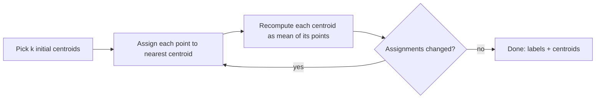
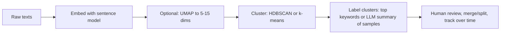
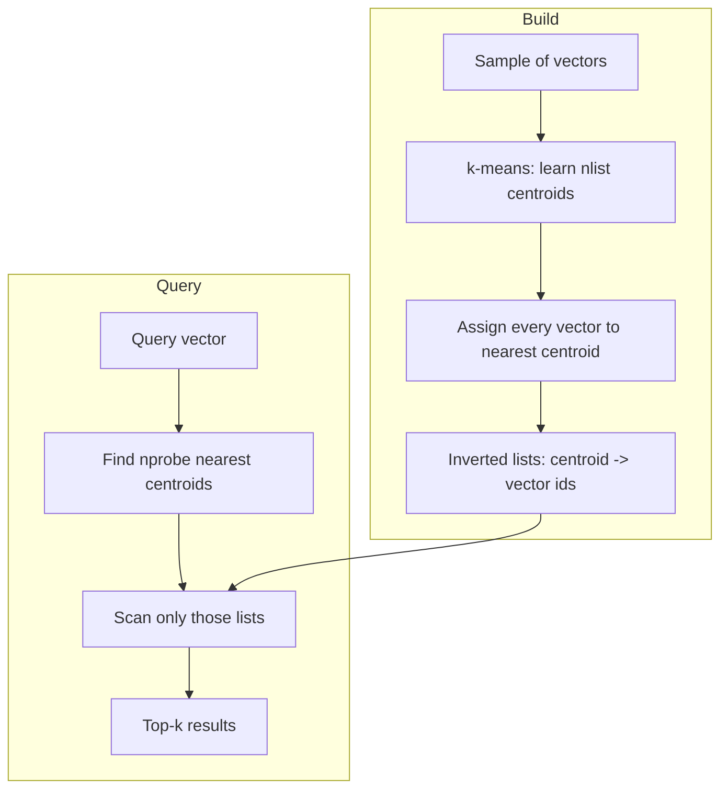

# Unsupervised Learning: Clustering, Dimensionality Reduction and Anomaly Detection

> **Level:** Beginner to Advanced · **Study time:** ~130 min · **Prerequisites:** [Linear Algebra for ML](../00-foundations/02-linear-algebra-for-ml.md), [Probability and Statistics](../00-foundations/04-probability-and-statistics.md), [The ML Workflow and Cross-Validation](01-ml-workflow-data-splits-and-cross-validation.md), [Feature Engineering and Scaling](07-feature-engineering-missing-values-and-encoding.md)

## Table of contents

- [Why this matters](#why-this-matters)
- [What unsupervised learning is](#what-unsupervised-learning-is)
- [Distances and scaling: the foundation of everything](#distances-and-scaling-the-foundation-of-everything)
- [k-means clustering step by step](#k-means-clustering-step-by-step)
- [Choosing k: the elbow method and the silhouette score](#choosing-k-the-elbow-method-and-the-silhouette-score)
- [k-means++ initialization and other practical fixes](#k-means-initialization-and-other-practical-fixes)
- [Limitations of k-means](#limitations-of-k-means)
- [Hierarchical clustering](#hierarchical-clustering)
- [DBSCAN and HDBSCAN: density-based clustering](#dbscan-and-hdbscan-density-based-clustering)
- [Gaussian mixture models: soft clustering](#gaussian-mixture-models-soft-clustering)
- [Choosing a clustering algorithm and evaluating the result](#choosing-a-clustering-algorithm-and-evaluating-the-result)
- [Principal component analysis (PCA)](#principal-component-analysis-pca)
- [t-SNE and UMAP for visualizing embeddings](#t-sne-and-umap-for-visualizing-embeddings)
- [Anomaly detection with isolation forest](#anomaly-detection-with-isolation-forest)
- [Unsupervised learning in the LLM era](#unsupervised-learning-in-the-llm-era)
- [Going deeper: production, scale and debugging](#going-deeper-production-scale-and-debugging)
- [Common mistakes and misconceptions](#common-mistakes-and-misconceptions)
- [Interview questions and model answers](#interview-questions-and-model-answers)
- [Key takeaways](#key-takeaways)
- [Further reading](#further-reading)
- [Next](#next)

## Why this matters

Most real data has no labels. Nobody has tagged your 2 million support tickets by topic, marked which of last night's 40 million transactions are fraud, or explained why a RAG system's 5% worst queries fail. Unsupervised learning is how you find structure in that data: groups (clustering), compact summaries (dimensionality reduction) and oddities (anomaly detection). In the LLM era these classic tools quietly power core infrastructure: the IVF index offered by FAISS and many vector databases is trained with k-means, topic discovery over user queries is clustering on embeddings, and most "embedding maps" in dashboards are UMAP or t-SNE. Interviewers use this topic to check whether you understand algorithms well enough to know when their output is meaningless, which is a very senior skill.

## What unsupervised learning is

> **Analogy:** You dump a box of mixed LEGO pieces on the floor. Nobody tells you the categories, yet you naturally sort them by color or shape (clustering), notice that "size" and "number of studs" mostly tell the same story (dimensionality reduction), and spot the one coin that is not a LEGO piece at all (anomaly detection).

**Supervised learning** learns a mapping from inputs $x$ to known labels $y$ (spam or not spam, house price). **Unsupervised learning** gets only the inputs $x$ and must discover structure on its own. There is no "right answer" column to compute accuracy against, which makes evaluation the hardest part.

Three jobs you will be asked about:

| Job | Question it answers | Classic algorithms | LLM-era use |
|---|---|---|---|
| **Clustering** | Which items belong together? | k-means, hierarchical, DBSCAN/HDBSCAN, GMM | Topic discovery, IVF vector indexes, deduplication |
| **Dimensionality reduction** | Can I describe the data with fewer numbers? | PCA, t-SNE, UMAP | Shrinking embeddings, visualizing embedding spaces |
| **Anomaly detection** | Which items do not fit? | Isolation forest, LOF, one-class SVM | Fraud, bad training data, unusual prompts |

A **cluster** is a group of data points that are more similar to each other than to points in other groups. A **feature** is one input column (for example "monthly visits"). A **data point** (or sample) is one row, which we treat as a vector of features.

## Distances and scaling: the foundation of everything

Almost every algorithm in this chapter measures "how close are two points?" so get this right first.

**Euclidean distance** is the straight-line distance between two vectors:

$$
d(\mathbf{a}, \mathbf{b}) = \sqrt{\sum_{j=1}^{d} (a_j - b_j)^2}
$$

- $\mathbf{a}, \mathbf{b}$: two data points (vectors).
- $d$: the number of features (dimensions).
- $a_j, b_j$: the $j$-th feature of each point.

Example: $\mathbf{a} = (1, 1)$, $\mathbf{b} = (8, 8)$. Differences are $7$ and $7$. Squares are $49 + 49 = 98$. $\sqrt{98} \approx 9.90$.

**Cosine similarity** measures the angle between vectors and ignores their length: $\cos(\mathbf{a}, \mathbf{b}) = \frac{\mathbf{a} \cdot \mathbf{b}}{\lVert \mathbf{a} \rVert \lVert \mathbf{b} \rVert}$. Text embeddings are usually compared with cosine (see [Text Embeddings and Similarity Search](../08-rag/02-text-embeddings-and-similarity-search.md)). A useful identity: if both vectors are **L2-normalized** (scaled to length 1), then

$$
\lVert \mathbf{a} - \mathbf{b} \rVert^2 = 2 - 2\cos(\mathbf{a}, \mathbf{b})
$$

Example: cosine $0.8$ gives squared distance $2 - 2(0.8) = 2 - 1.6 = 0.4$. So on normalized vectors, "small Euclidean distance" and "high cosine" rank neighbors identically. This is why you can run Euclidean k-means on normalized embeddings and get cosine-style clusters.

**Scaling matters enormously.** If one feature is "annual income in dollars" (range 20,000 to 200,000) and another is "age in years" (range 18 to 90), income dominates every distance and age is effectively ignored. Standardize features (subtract the mean, divide by the standard deviation) before distance-based methods. Scaling is covered in [Feature Engineering](07-feature-engineering-missing-values-and-encoding.md).

> **Common mistake:** Running k-means or PCA on raw, unscaled tabular features. The "clusters" you find are just the feature with the biggest units.

**High dimensions break distance intuition.** As the number of features grows, the distance from a point to its nearest neighbor and to its farthest neighbor become nearly equal for generic data, so "close" stops meaning much. This **distance concentration** is part of the [curse of dimensionality](09-knn-svm-naive-bayes-and-other-classic-algorithms.md#the-curse-of-dimensionality). It is why this chapter keeps saying "reduce dimensions first" before density-based clustering. Real embeddings suffer less than random data because they lie near a lower-dimensional structure, but radius-based parameters like DBSCAN's eps still become hard to set.

**Running examples used in this chapter:**

1. **Six customers** described by two already-scaled features (x = visit frequency, y = basket size): A(1,1), B(2,1), C(1,2), D(8,8), E(9,8), F(8,9).
2. **Four houses** described by standardized size and number of rooms, for PCA.
3. **Transaction amounts** for anomaly detection.
4. **Support tickets** embedded by a sentence-embedding model, for the LLM-era sections.

## k-means clustering step by step

### Intuition

> **Analogy:** You are opening k pizza shops in a city. Each customer goes to the nearest shop. Then each shop moves to the center of its customers. Customers re-pick their nearest shop, shops move again, and so on until nobody switches. That is k-means.

**k-means** partitions $n$ points into $k$ clusters, each represented by a **centroid** (the mean of its points). Each point belongs to the cluster with the nearest centroid.

### The objective

k-means tries to minimize the **inertia**, also called **within-cluster sum of squares (WCSS)**:

$$
J = \sum_{i=1}^{n} \lVert \mathbf{x}_i - \boldsymbol{\mu}_{c_i} \rVert^2
$$

- $n$: number of points.
- $\mathbf{x}_i$: the $i$-th point.
- $c_i$: the cluster index assigned to point $i$ (a number from 1 to $k$).
- $\boldsymbol{\mu}_{c_i}$: the centroid of that cluster.
- $\lVert \cdot \rVert^2$: squared Euclidean distance.

In words: add up how far every point is from its own centroid (squared). Small $J$ means tight clusters.

### The algorithm (Lloyd's algorithm)

The standard procedure is **Lloyd's algorithm** (Stuart Lloyd, "Least squares quantization in PCM", written 1957, published 1982):

```text
1. Initialize: pick k starting centroids (randomly, or with k-means++).
2. Assignment step: assign every point to its nearest centroid.
3. Update step: move each centroid to the mean of the points assigned to it.
4. Repeat steps 2-3 until assignments stop changing (or a max iteration count).
```



Why the mean? For a fixed group of points, the single point that minimizes the sum of squared distances to all of them is exactly their mean. So the update step is the best possible move for the current assignments, and the assignment step is the best possible move for the current centroids. Each step can only lower (or keep) $J$, and there are finitely many ways to partition $n$ points, so the algorithm always terminates. But it terminates at a **local minimum**, not necessarily the best clustering. Finding the global optimum is NP-hard in general (no known algorithm solves every instance efficiently), which is why we restart from several seeds instead of searching for the true best.

### Worked example by hand

Six customers, $k = 2$. We deliberately start with a bad initialization: centroid 1 at A(1,1) and centroid 2 at B(2,1), which are both in the lower-left group.

```text
 y
 9 |                 F
 8 |                 D  E
 . |
 2 |  C
 1 |  A  B
   +--------------------------- x
      1  2           8  9
```

**Iteration 1, assignment step.** We compare squared distances (taking the square root does not change which is smaller).

| Point | Sq. dist to $\mu_1 = (1,1)$ | Sq. dist to $\mu_2 = (2,1)$ | Assigned |
|---|---|---|---|
| A(1,1) | $0 + 0 = 0$ | $1 + 0 = 1$ | 1 |
| B(2,1) | $1 + 0 = 1$ | $0 + 0 = 0$ | 2 |
| C(1,2) | $0 + 1 = 1$ | $1 + 1 = 2$ | 1 |
| D(8,8) | $49 + 49 = 98$ | $36 + 49 = 85$ | 2 |
| E(9,8) | $64 + 49 = 113$ | $49 + 49 = 98$ | 2 |
| F(8,9) | $49 + 64 = 113$ | $36 + 64 = 100$ | 2 |

**Iteration 1, update step.**

- Cluster 1 = {A, C}: $\mu_1 = \left(\frac{1+1}{2}, \frac{1+2}{2}\right) = (1, 1.5)$.
- Cluster 2 = {B, D, E, F}: $x = \frac{2+8+9+8}{4} = \frac{27}{4} = 6.75$, $y = \frac{1+8+8+9}{4} = \frac{26}{4} = 6.5$. So $\mu_2 = (6.75, 6.5)$.

Notice how B dragged centroid 2 toward the lower left. That is what bad initialization does.

**Iteration 2, assignment step.**

| Point | Sq. dist to $\mu_1 = (1, 1.5)$ | Sq. dist to $\mu_2 = (6.75, 6.5)$ | Assigned |
|---|---|---|---|
| A(1,1) | $0 + 0.25 = 0.25$ | $5.75^2 + 5.5^2 = 33.0625 + 30.25 = 63.3125$ | 1 |
| B(2,1) | $1 + 0.25 = 1.25$ | $4.75^2 + 5.5^2 = 22.5625 + 30.25 = 52.8125$ | 1 |
| C(1,2) | $0 + 0.25 = 0.25$ | $5.75^2 + 4.5^2 = 33.0625 + 20.25 = 53.3125$ | 1 |
| D(8,8) | $49 + 42.25 = 91.25$ | $1.25^2 + 1.5^2 = 1.5625 + 2.25 = 3.8125$ | 2 |
| E(9,8) | $64 + 42.25 = 106.25$ | $2.25^2 + 1.5^2 = 5.0625 + 2.25 = 7.3125$ | 2 |
| F(8,9) | $49 + 56.25 = 105.25$ | $1.25^2 + 2.5^2 = 1.5625 + 6.25 = 7.8125$ | 2 |

B switched to cluster 1.

**Iteration 2, update step.**

- Cluster 1 = {A, B, C}: $\mu_1 = \left(\frac{1+2+1}{3}, \frac{1+1+2}{3}\right) = \left(\frac{4}{3}, \frac{4}{3}\right) \approx (1.333, 1.333)$.
- Cluster 2 = {D, E, F}: $\mu_2 = \left(\frac{8+9+8}{3}, \frac{8+8+9}{3}\right) = \left(\frac{25}{3}, \frac{25}{3}\right) \approx (8.333, 8.333)$.

**Iteration 3.** Every point is still closest to the same centroid, so assignments do not change. Converged.

**Final inertia.** For cluster 1 with centroid $(4/3, 4/3)$:

- A(1,1): $(1/3)^2 + (1/3)^2 = 1/9 + 1/9 = 2/9$
- B(2,1): $(2/3)^2 + (1/3)^2 = 4/9 + 1/9 = 5/9$
- C(1,2): $(1/3)^2 + (2/3)^2 = 1/9 + 4/9 = 5/9$
- Sum: $12/9 = 4/3 \approx 1.333$

Cluster 2 is a mirror image, so it also contributes $4/3$. Total $J = 8/3 \approx 2.667$.

### From-scratch NumPy implementation

```python
# pip install numpy
import numpy as np

def kmeans(X, k, init=None, n_iters=100, seed=0):
    """Plain Lloyd's k-means. Returns labels, centroids, inertia."""
    rng = np.random.default_rng(seed)
    # Start from given centroids, or k random distinct data points
    centroids = X[rng.choice(len(X), size=k, replace=False)] if init is None else init.copy()
    for _ in range(n_iters):
        # Squared distance from every point to every centroid: shape (n, k)
        d2 = ((X[:, None, :] - centroids[None, :, :]) ** 2).sum(axis=2)
        labels = d2.argmin(axis=1)                       # assignment step
        new = np.array([
            X[labels == j].mean(axis=0) if np.any(labels == j) else centroids[j]
            for j in range(k)                            # update step (keep empty clusters in place)
        ])
        if np.allclose(new, centroids):
            break
        centroids = new
    d2 = ((X[:, None, :] - centroids[None, :, :]) ** 2).sum(axis=2)
    labels = d2.argmin(axis=1)
    return labels, centroids, d2.min(axis=1).sum()

X = np.array([[1, 1], [2, 1], [1, 2], [8, 8], [9, 8], [8, 9]], dtype=float)
labels, centroids, inertia = kmeans(X, k=2, init=X[[0, 1]])   # same bad init as the hand example
print(labels)                    # [0 0 0 1 1 1]
print(np.round(centroids, 3))    # [[1.333 1.333] [8.333 8.333]]
print(round(inertia, 3))         # 2.667
```

The scikit-learn version adds k-means++ initialization and multiple restarts for you:

```python
# pip install scikit-learn
from sklearn.cluster import KMeans

km = KMeans(n_clusters=2, init="k-means++", n_init=10, random_state=0).fit(X)
print(km.labels_, km.cluster_centers_, km.inertia_)   # inertia_ is about 2.667
```

The cluster numbers (0 vs 1) may be swapped between runs. Cluster IDs are arbitrary names, not meaningful categories.

**Cost:** each iteration computes $n \times k$ distances in $d$ dimensions, so it is $O(nkd)$ per iteration. That is linear in $n$, which is why k-means scales to billions of vectors (with tricks covered later).

## Choosing k: the elbow method and the silhouette score

k-means needs $k$ up front, and inertia always decreases as $k$ grows (with $k = n$, every point is its own centroid and $J = 0$). So "pick the $k$ with lowest inertia" is useless. Two standard heuristics:

### The elbow method

Plot inertia against $k$ and look for the "elbow" where adding more clusters stops helping much.

For our six customers (all values computed by hand):

- $k = 1$: the single centroid is the overall mean, $(29/6, 29/6) \approx (4.833, 4.833)$. Sum of $x^2$ values is $1+4+1+64+81+64 = 215$, so the x-part of the squared error is $215 - 6 \times (29/6)^2 = 215 - 140.167 = 74.833$. The y-part is identical. Total $\approx 149.67$.
- $k = 2$: $2.667$ (computed above).
- $k = 3$: the best option splits one tight group, for example {A, C}, {B}, {D, E, F}. {A, C} has centroid $(1, 1.5)$ with error $0.25 + 0.25 = 0.5$, {B} has $0$, so total $= 0.5 + 1.333 = 1.833$.

```text
inertia
150 | *
    |
    |
    |
  3 |    *  <- elbow at k = 2
  2 |       *
    +------------
      1  2  3   k
```

The huge drop from $k=1$ to $k=2$ and the tiny drop after it say $k = 2$. Real data rarely has such a clean elbow, which is the method's main weakness: it is subjective.

### The silhouette score

The **silhouette score** measures, for each point, how much closer it is to its own cluster than to the next-nearest cluster:

$$
s(i) = \frac{b(i) - a(i)}{\max\big(a(i), b(i)\big)}
$$

- $a(i)$: average distance from point $i$ to the other points in **its own** cluster (cohesion).
- $b(i)$: average distance from point $i$ to the points of the **nearest other** cluster (separation).
- $s(i)$ ranges from $-1$ to $+1$: near $+1$ means well clustered, near $0$ means on a boundary, negative means probably in the wrong cluster.

The overall score is the mean of $s(i)$ over all points.

**Worked example for point A** with clusters {A, B, C} and {D, E, F}:

- $a(A)$: distance to B is $1$, to C is $1$. Average $= 1$.
- $b(A)$: distance to D is $\sqrt{49+49} = \sqrt{98} \approx 9.899$; to E is $\sqrt{64+49} = \sqrt{113} \approx 10.630$; to F is also $\sqrt{113} \approx 10.630$. Average $= (9.899 + 10.630 + 10.630)/3 = 31.159 / 3 \approx 10.387$.
- $s(A) = (10.387 - 1)/10.387 = 9.387/10.387 \approx 0.904$.

Doing this for all six points gives a mean silhouette of about $0.885$ for $k = 2$. For the best $k=3$ split above it drops to about $0.49$ (B becomes a singleton, which scikit-learn scores as 0, and A sits exactly between C and B). Higher is better, so silhouette also picks $k = 2$.

```python
from sklearn.metrics import silhouette_score

for k in range(2, 5):
    km = KMeans(n_clusters=k, n_init=10, random_state=0).fit(X)
    print(k, round(km.inertia_, 3), round(silhouette_score(X, km.labels_), 3))
# k=2 gives inertia about 2.667 and silhouette about 0.885
```

| Method | What it measures | Pros | Cons |
|---|---|---|---|
| Elbow | Inertia vs k | Cheap, intuitive | Subjective, often no clear elbow |
| Silhouette | Cohesion vs separation per point | Single number, works for any clustering | $O(n^2)$ distances (sample for big data), favors convex blobs |
| Gap statistic (Tibshirani, Walther and Hastie, 2001) | Inertia vs inertia on random uniform data | More principled | Expensive, needs many reference runs |
| BIC/AIC with a GMM (defined in the GMM section below) | Likelihood penalized by model size | Statistical footing | Assumes Gaussian clusters |
| Business usefulness | Can people act on the clusters? | What actually matters | Needs humans |

> **Senior insight:** In practice, $k$ is often set by the downstream use, not by a metric. A marketing team can run 5 campaigns, not 37. An IVF index picks $k$ (called nlist) from a latency/recall budget. Metrics narrow the range, product needs pick the number.

## k-means++ initialization and other practical fixes

The worked example showed that a bad start (two centroids in the same group) costs extra iterations, and on harder data it can trap k-means in a poor local minimum permanently.

**k-means++** (Arthur and Vassilvitskii, "k-means++: The Advantages of Careful Seeding", 2007) spreads the initial centroids out:

```text
1. Pick the first centroid uniformly at random from the data.
2. For every point x, compute D(x) = distance to the nearest centroid chosen so far.
3. Pick the next centroid at random with probability proportional to D(x)^2.
4. Repeat 2-3 until you have k centroids, then run normal k-means.
```

$$
P(\mathbf{x}) = \frac{D(\mathbf{x})^2}{\sum_{\mathbf{x}'} D(\mathbf{x}')^2}
$$

- $D(\mathbf{x})$: distance from $\mathbf{x}$ to its nearest already-chosen centroid.
- The denominator sums over all points so the probabilities add to 1.

**Worked example.** Suppose the first random pick is A(1,1). Squared distances to A: B $=1$, C $=1$, D $=98$, E $=113$, F $=113$ (A itself is $0$). The sum is $1 + 1 + 98 + 113 + 113 = 326$.

- $P(B) = P(C) = 1/326 \approx 0.3\%$ each.
- $P(D) = 98/326 \approx 30.1\%$, $P(E) = P(F) = 113/326 \approx 34.7\%$ each.

So there is a $324/326 \approx 99.4\%$ chance the second centroid lands in the far group. The paper proves the expected cost after seeding is within $O(\log k)$ of the optimum.

Other standard fixes:

- **Multiple restarts (`n_init`)**: run k-means several times with different seeds and keep the lowest inertia.
- **Mini-batch k-means** (Sculley, "Web-scale k-means clustering", 2010): update centroids from small random batches. Much faster on large data, slightly worse inertia. `sklearn.cluster.MiniBatchKMeans`.
- **Empty clusters**: if a centroid gets no points, re-seed it (for example at the point farthest from its centroid). Libraries handle this.

## Limitations of k-means

k-means implicitly assumes clusters are roughly **spherical** (round), **similar in size and spread**, and **separable by straight boundaries**. Every boundary between two k-means clusters is a straight line (a hyperplane) halfway between their centroids. This partition of space is called a **Voronoi diagram**.

| Limitation | What goes wrong | Fix or alternative |
|---|---|---|
| Must choose k | Wrong k merges or splits real groups | Elbow/silhouette, or HDBSCAN (no k) |
| Non-spherical shapes (moons, rings, long thin clusters) | Cuts shapes in half with straight lines | DBSCAN/HDBSCAN, spectral clustering, GMM with full covariance |
| Different densities or sizes | Big sparse clusters get split, small dense ones absorbed | GMM, HDBSCAN |
| Outliers | One extreme point drags a centroid (means are sensitive) | Remove outliers first, k-medoids, DBSCAN |
| Scale-sensitive | Big-unit features dominate | Standardize |
| Local minima | Different seeds give different results | k-means++, `n_init` restarts |
| Only Euclidean geometry | Means do not make sense for arbitrary distances (e.g. edit distance) | **k-medoids** (centers must be real data points) |
| High dimensions | Distances become similar to each other, clusters blur | Reduce dimensions first (PCA, UMAP) |
| Hard assignments | Boundary points forced into one cluster | GMM gives probabilities |

> **Interview tip:** When asked "what are the assumptions of k-means?", say: spherical, similar-variance clusters, Euclidean distance, a known k, and sensitivity to initialization, scale and outliers. Then give the matching alternative for each. That structure signals seniority.

## Hierarchical clustering

> **Analogy:** A family tree built backwards. Start with every person alone, merge siblings into families, families into clans, clans into nations. You can then "cut" the tree at whatever level you need.

**Agglomerative (bottom-up) hierarchical clustering** starts with every point as its own cluster and repeatedly merges the two closest clusters until one remains. The result is a tree called a **dendrogram**. Cutting the dendrogram at a chosen height gives you a flat clustering, so you can decide $k$ after seeing the structure. (**Divisive**, top-down clustering exists but is rarely used.)

The key choice is the **linkage**: how to measure distance between two clusters.

| Linkage | Cluster distance = | Behavior |
|---|---|---|
| **Single** | Closest pair of points | Finds long, chained shapes; prone to "chaining" through noise bridges |
| **Complete** | Farthest pair of points | Compact, similar-diameter clusters |
| **Average** | Average over all pairs | Middle ground |
| **Ward** | Increase in total within-cluster variance if merged | Compact, k-means-like clusters; the usual default |

**Worked example (single linkage)** on five 1D points: A=1, B=2, C=4, D=8, E=9.

1. Closest pairs: A-B (distance 1) and D-E (distance 1). Merge {A,B} at height 1.
2. Merge {D,E} at height 1.
3. Remaining clusters: {A,B}, {C}, {D,E}. Single-linkage distances: {A,B} to C $= \min(3, 2) = 2$; C to {D,E} $= \min(4, 5) = 4$; {A,B} to {D,E} $= \min(6,7,7,8) = 6$. Merge {A,B} with C at height 2.
4. Finally {A,B,C} to {D,E} $= \min$ over pairs $=$ C-D $= 4$. Merge at height 4.

```text
height
  4 |        +--------------+
    |        |              |
  2 |    +---+---+          |
    |    |       |          |
  1 |  +-+-+     |       +--+--+
    |  |   |     |       |     |
  0 |  A   B     C       D     E
       1   2     4       8     9
```

Cut at height 3 and you get two clusters: {A, B, C} and {D, E}. With complete linkage the last merge would happen at height $9 - 1 = 8$ (the farthest pair A-E), showing how linkage changes the tree.

```python
# pip install scipy scikit-learn
import numpy as np
from scipy.cluster.hierarchy import linkage, fcluster
from sklearn.cluster import AgglomerativeClustering

pts = np.array([[1], [2], [4], [8], [9]], dtype=float)
Z = linkage(pts, method="single")                   # full merge history (the dendrogram)
print(fcluster(Z, t=3, criterion="distance"))      # cut at height 3 -> two clusters
# scipy.cluster.hierarchy.dendrogram(Z) draws it with matplotlib

agg = AgglomerativeClustering(n_clusters=2, linkage="ward").fit(pts)
print(agg.labels_)
```

**Trade-offs:** no need to fix $k$ in advance, any distance metric works (except Ward, which needs Euclidean), and the dendrogram is interpretable. But standard implementations need the $O(n^2)$ pairwise distance matrix in memory and at least $O(n^2)$ time, so it is practical for thousands to tens of thousands of points, not millions. A common trick: run k-means with a few thousand clusters first, then hierarchically cluster the centroids.

## DBSCAN and HDBSCAN: density-based clustering

> **Analogy:** Look at a city at night from a plane. Dense patches of lights are towns. Lights connected by continuous bright streets belong to the same town. A lone farmhouse light far from everything is noise.

**DBSCAN** (Density-Based Spatial Clustering of Applications with Noise; Ester, Kriegel, Sander and Xu, 1996) defines clusters as dense regions separated by sparse regions. It has two parameters:

- **eps** ($\varepsilon$): the neighborhood radius.
- **min_samples**: how many points (in scikit-learn, including the point itself) must lie within eps for a point to count as dense.

Each point gets one of three roles:

- **Core point**: has at least min_samples points within eps.
- **Border point**: not core, but within eps of a core point.
- **Noise point**: neither. Labeled $-1$.

A cluster is a set of core points that are reachable from each other through chains of core-point neighborhoods, plus their border points.

**Worked example.** Points on a line: 1, 2, 3, 10, 11, 12, 25 with eps $= 1.5$, min_samples $= 3$.

- Point 1: neighbors within 1.5 are {1, 2} (3 is at distance 2). Count 2, so not core.
- Point 2: neighbors {1, 2, 3}. Count 3, so **core**.
- Point 3: neighbors {2, 3}. Not core, but within eps of core point 2, so **border**.
- Point 1 is also within eps of core point 2, so **border**.
- Same pattern for 10, 11, 12 (11 is core).
- Point 25: no neighbors, so **noise**.

Result: clusters {1, 2, 3} and {10, 11, 12}, and 25 is noise. Note we never told DBSCAN how many clusters to find.

```python
from sklearn.cluster import DBSCAN

pts = np.array([[1], [2], [3], [10], [11], [12], [25]], dtype=float)
db = DBSCAN(eps=1.5, min_samples=3).fit(pts)
print(db.labels_)                 # [ 0  0  0  1  1  1 -1]
print(db.core_sample_indices_)    # [1 4]
```

**Choosing eps:** compute each point's distance to its $k$-th nearest neighbor (with $k$ = min_samples), sort these distances, and plot them. The "knee" where the curve shoots up is a reasonable eps. This is the **k-distance plot**.

**Strengths:** finds arbitrary shapes, does not need $k$, explicitly flags noise. **Weaknesses:** a single global eps cannot handle clusters of very different densities, and in high dimensions eps is very hard to set because distances concentrate (all pairs look about equally far apart).

**HDBSCAN** (Campello, Moulavi and Sander, 2013) fixes the single-eps problem: it effectively runs DBSCAN across all eps values, builds a hierarchy, and keeps the clusters that are most stable across scales. Its main parameter is `min_cluster_size`, which is much easier to reason about ("I don't care about topics with fewer than 20 tickets"). It is available as `sklearn.cluster.HDBSCAN` (scikit-learn 1.3 and later) and in the standalone `hdbscan` package. HDBSCAN is a popular default for clustering text embeddings after UMAP reduction, as in BERTopic (covered later).

## Gaussian mixture models: soft clustering

> **Analogy:** k-means says "this customer is a bargain hunter." A Gaussian mixture says "this customer is 80% bargain hunter, 20% premium shopper."

A **Gaussian mixture model (GMM)** assumes the data was generated by $K$ Gaussian (bell-shaped) distributions, each with its own center, shape and weight:

$$
p(\mathbf{x}) = \sum_{k=1}^{K} \pi_k \, \mathcal{N}(\mathbf{x} \mid \boldsymbol{\mu}_k, \boldsymbol{\Sigma}_k)
$$

- $\pi_k$: the **mixing weight** of component $k$ (what fraction of data it generates); they sum to 1.
- $\mathcal{N}(\mathbf{x} \mid \boldsymbol{\mu}_k, \boldsymbol{\Sigma}_k)$: the Gaussian density with mean $\boldsymbol{\mu}_k$ and **covariance matrix** $\boldsymbol{\Sigma}_k$ (which controls the shape: round, stretched or tilted ellipse). Gaussians are reviewed in [Probability and Statistics](../00-foundations/04-probability-and-statistics.md).

It is fit with the **Expectation-Maximization (EM)** algorithm, which looks just like k-means with soft assignments:

- **E-step:** compute each point's **responsibility** $r_{ik}$, the probability that point $i$ came from component $k$.
- **M-step:** re-estimate $\pi_k$, $\boldsymbol{\mu}_k$, $\boldsymbol{\Sigma}_k$ as responsibility-weighted averages. For example, $\boldsymbol{\mu}_k = \frac{\sum_i r_{ik} \mathbf{x}_i}{\sum_i r_{ik}}$ and $\pi_k = \frac{1}{n}\sum_i r_{ik}$. With hard 0/1 responsibilities this is exactly the k-means update step.

**Tiny example.** 1D, two components with equal weights, $\mu_1 = 0$, $\mu_2 = 4$, both with standard deviation 1. For a point $x = 1$, the Gaussian density is proportional to $e^{-(x-\mu)^2/2}$ (the shared constant cancels):

- Component 1: $e^{-(1-0)^2/2} = e^{-0.5} \approx 0.6065$.
- Component 2: $e^{-(1-4)^2/2} = e^{-4.5} \approx 0.0111$.
- Responsibility of component 1: $0.6065 / (0.6065 + 0.0111) \approx 0.982$.

For $x = 2$ (exactly halfway), both are $e^{-2}$, so the responsibility is $0.5$ each: an honest "I don't know" that k-means cannot express.

```python
from sklearn.mixture import GaussianMixture

gmm = GaussianMixture(n_components=2, covariance_type="full", random_state=0).fit(X)
print(gmm.predict_proba(X).round(3))   # soft memberships per point
print(gmm.bic(X))                      # lower BIC is better; compare across n_components
```

Key facts: k-means is the limiting case of a GMM fit by EM where all components have equal weights and the same spherical covariance $\sigma^2 \mathbf{I}$ with $\sigma \to 0$, which makes the responsibilities hard 0/1 assignments. `covariance_type` ("spherical", "diag", "tied", "full") trades flexibility for parameter count, and "full" in high dimensions needs $d(d+1)/2$ parameters per component, which overfits quickly. The **Bayesian Information Criterion (BIC)** penalizes extra parameters and is a principled way to pick the number of components:

$$
\text{BIC} = p \ln n - 2 \ln \hat{L}
$$

- $p$: number of free parameters; $n$: number of points; $\hat{L}$: the maximized likelihood of the data under the model.
- Lower is better. **AIC** $= 2p - 2\ln\hat{L}$ penalizes parameters less, so it tends to pick more components.

Example: with $n = 1{,}000$ points in 2D, adding one full-covariance component adds 6 parameters (2 for the mean, 3 for the symmetric covariance, 1 for the weight), so the penalty grows by $6 \ln 1000 \approx 6 \times 6.908 = 41.4$. The extra component is kept only if it raises the log-likelihood by more than $41.4 / 2 \approx 20.7$.

A GMM-specific failure mode: EM can shrink one component onto a single point, its covariance becomes singular and the likelihood shoots to infinity. scikit-learn guards against this by adding a small `reg_covar` to the covariance diagonal. GMMs also give a density $p(\mathbf{x})$, so a very low $p(\mathbf{x})$ can flag anomalies.

## Choosing a clustering algorithm and evaluating the result

| Algorithm | Needs k? | Cluster shapes | Handles noise? | Scales to | Best for |
|---|---|---|---|---|---|
| k-means / mini-batch | Yes | Spherical, similar size | No | Billions (with FAISS/GPU) | Large data, vector index partitioning, quick baselines |
| Hierarchical (Ward) | No (cut later) | Compact | No | ~10k to 50k points | Small data, interpretable taxonomies |
| DBSCAN | No | Arbitrary | Yes | Large in low dims | Spatial data, clear density gaps |
| HDBSCAN | No | Arbitrary, varying density | Yes | Large in low dims | Topic discovery on reduced embeddings |
| GMM | Yes | Ellipses | Partly (low density) | Medium | Soft membership, density estimates |

### Evaluating clusters

- **Internal metrics** (no labels): silhouette (higher is better), **Davies-Bouldin index** (average similarity of each cluster to its most similar one, lower is better), **Calinski-Harabasz index** (between-cluster vs within-cluster dispersion, higher is better). All favor convex, well-separated blobs, so they can unfairly penalize DBSCAN-style shapes.
- **External metrics** (you have some ground-truth labels): **Adjusted Rand Index (ARI)** and **Normalized Mutual Information (NMI)** compare two labelings regardless of cluster ID names. ARI counts the pairs of points on which the two labelings agree ("same cluster" in both, or "different clusters" in both) and corrects for chance, so it is near 0 for random labelings and 1 for identical ones. NMI measures how much knowing one labeling tells you about the other, scaled to $[0, 1]$. Unlike ARI, plain NMI is not corrected for chance and tends to rise as the number of clusters grows; **Adjusted Mutual Information (AMI)** is the chance-corrected version.
- **Stability:** re-run with different seeds or bootstrap samples and compute ARI between runs. Clusters that vanish under resampling are not real.
- **Human review:** sample 10 to 20 items per cluster and ask "can I name this cluster?" For text, this is the evaluation that matters most.

> **Senior insight:** There is no "correct" clustering of real data, only useful ones. Always tie evaluation to the decision the clusters drive.

## Principal component analysis (PCA)

### Intuition

> **Analogy:** Photographing a flat pencil. From most angles its shadow is a long line, from one angle it is a dot. PCA finds the camera angle that shows the most "spread", so a 2D photo keeps as much of the 3D information as possible.

Often several features tell nearly the same story. House size and number of rooms are strongly correlated: knowing one mostly tells you the other. **Dimensionality reduction** replaces many correlated features with fewer new ones while keeping most of the information.

**Principal component analysis (PCA)** finds new axes, called **principal components**, that are:

1. Directions (unit vectors) in the original feature space.
2. Ordered so that the first captures the most **variance** (spread) of the data, the second captures the most remaining variance, and so on.
3. All perpendicular (**orthogonal**) to each other, so the new features are uncorrelated.

Projecting the data onto the first few components gives a compressed representation. PCA is a linear method: each component is a weighted sum of the original features.

### The math

Steps:

1. **Center** the data: subtract each feature's mean so the data cloud sits at the origin. (Usually also standardize, unless features share units.)
2. Compute the **covariance matrix** $\mathbf{C}$, where entry $(j, l)$ says how features $j$ and $l$ vary together:

$$
\mathbf{C} = \frac{1}{n} \mathbf{X}_c^\top \mathbf{X}_c
$$

- $\mathbf{X}_c$: the centered data matrix, $n$ rows (points) by $d$ columns (features).
- $\mathbf{X}_c^\top$: its transpose.
- $\frac{1}{n}$: averaging. (Libraries use $\frac{1}{n-1}$, the unbiased version. It scales all variances equally, so components and ratios are unchanged.)

3. Find the **eigenvectors** and **eigenvalues** of $\mathbf{C}$ (reviewed in [Linear Algebra for ML](../00-foundations/02-linear-algebra-for-ml.md)):

$$
\mathbf{C}\mathbf{v} = \lambda \mathbf{v}
$$

- $\mathbf{v}$: an eigenvector, a direction that $\mathbf{C}$ only stretches, never rotates. These are the principal components.
- $\lambda$: its eigenvalue, which equals the variance of the data along that direction.

4. Sort by eigenvalue, keep the top $m$, and project: $\mathbf{Z} = \mathbf{X}_c \mathbf{V}_m$, where $\mathbf{V}_m$ holds the top $m$ eigenvectors as columns.

The **explained variance ratio** of component $j$ is the share of total variance it captures:

$$
\text{EVR}_j = \frac{\lambda_j}{\sum_{l=1}^{d} \lambda_l}
$$

### Worked 2D example

Four houses, with size and rooms already standardized and centered: $(-2, -1)$, $(-1, -2)$, $(1, 2)$, $(2, 1)$.

**Step 1, check the mean.** x: $(-2 - 1 + 1 + 2)/4 = 0$. y: $(-1 - 2 + 2 + 1)/4 = 0$. Already centered.

**Step 2, covariance matrix** (using $1/n$):

- $\text{Var}(x) = (4 + 1 + 1 + 4)/4 = 10/4 = 2.5$
- $\text{Var}(y) = (1 + 4 + 4 + 1)/4 = 2.5$
- $\text{Cov}(x, y) = \big((-2)(-1) + (-1)(-2) + (1)(2) + (2)(1)\big)/4 = (2 + 2 + 2 + 2)/4 = 2$

$$
\mathbf{C} = \begin{pmatrix} 2.5 & 2 \\ 2 & 2.5 \end{pmatrix}
$$

**Step 3, eigenvalues.** Solve $\det(\mathbf{C} - \lambda \mathbf{I}) = 0$:

$$
(2.5 - \lambda)^2 - 2^2 = 0 \;\Rightarrow\; 2.5 - \lambda = \pm 2 \;\Rightarrow\; \lambda_1 = 4.5,\; \lambda_2 = 0.5
$$

**Eigenvectors.** For $\lambda_1 = 4.5$: $(2.5 - 4.5)v_1 + 2v_2 = 0$ gives $-2v_1 + 2v_2 = 0$, so $v_1 = v_2$. Normalized: $\mathbf{v}_1 = (1, 1)/\sqrt{2} \approx (0.707, 0.707)$. The second is perpendicular: $\mathbf{v}_2 = (1, -1)/\sqrt{2}$.

PC1 is the diagonal "bigger house" direction (more size and more rooms together). PC2 is "size relative to rooms".

**Step 4, explained variance ratio.** Total variance $= 4.5 + 0.5 = 5$ (which equals $2.5 + 2.5$, the sum of the original variances, as it always must). $\text{EVR}_1 = 4.5/5 = 0.9$, $\text{EVR}_2 = 0.1$. One number per house keeps 90% of the variance.

**Step 5, project onto PC1.** The coordinate is $(x + y)/\sqrt{2}$:

- $(-2,-1) \to -3/\sqrt{2} \approx -2.121$
- $(-1,-2) \to -2.121$
- $(1,2) \to +2.121$
- $(2,1) \to +2.121$

Check: variance of these values is $(4 \times 4.5)/4 = 4.5 = \lambda_1$, since $(3/\sqrt{2})^2 = 9/2 = 4.5$.

The lost information is each point's PC2 coordinate, $(x - y)/\sqrt{2} = \pm 0.707$, whose square is $0.5$. So the mean squared **reconstruction error** (distance between a point and its 1D approximation mapped back to 2D) is $0.5 = \lambda_2$. In general, the reconstruction error of PCA equals the sum of the discarded eigenvalues: PCA is the best linear compression in the squared-error sense.

```text
rooms
  2 |  .    .    .    B    .        A = (2, 1)    B = (1, 2)
  1 |  .    .    .    .    A        C = (-2,-1)   D = (-1,-2)
  0 |  .    .    +    .    .
 -1 |  C    .    .    .    .        PC1 runs along the diagonal (1,1): 90% of the spread
 -2 |  .    D    .    .    .        PC2 runs along (1,-1): only 10%
      -2   -1    0    1    2   size
```

### Code: from scratch and with scikit-learn

```python
import numpy as np

X = np.array([[-2, -1], [-1, -2], [1, 2], [2, 1]], dtype=float)
Xc = X - X.mean(axis=0)                  # center
C = Xc.T @ Xc / len(Xc)                  # covariance with 1/n, matches the hand math
eigvals, eigvecs = np.linalg.eigh(C)     # eigh: for symmetric matrices, ascending order
order = np.argsort(eigvals)[::-1]        # sort descending
eigvals, eigvecs = eigvals[order], eigvecs[:, order]
print(eigvals)                           # [4.5 0.5]
print(eigvals / eigvals.sum())           # [0.9 0.1]
Z = Xc @ eigvecs[:, :1]                  # 1D projection; sign of the eigenvector is arbitrary
print(Z.ravel().round(3))                # +/-2.121 for each house
```

```python
from sklearn.decomposition import PCA
from sklearn.pipeline import make_pipeline
from sklearn.preprocessing import StandardScaler

pca = PCA(n_components=2).fit(X)
print(pca.explained_variance_ratio_)     # [0.9 0.1]
print(pca.explained_variance_)           # [6.0 0.667] because sklearn divides by n-1

# Typical usage: scale, then keep enough components for 95% of the variance
pipe = make_pipeline(StandardScaler(), PCA(n_components=0.95))
```

In practice libraries compute PCA via the **singular value decomposition (SVD)** of the centered data, $\mathbf{X}_c = \mathbf{U}\mathbf{S}\mathbf{V}^\top$: the rows of $\mathbf{V}^\top$ are the principal components and the variances are $s_j^2/(n-1)$. SVD is more numerically stable than forming $\mathbf{C}$. For big data, use **randomized PCA** (`svd_solver="randomized"`) or **IncrementalPCA**, which processes data in batches.

### How many components?

- Keep enough for a target cumulative explained variance (90%, 95%, 99%).
- Look at a **scree plot** (eigenvalues by index) for an elbow.
- Best: pick by downstream performance (classifier accuracy, retrieval recall) on validation data.

### What PCA is and is not

| PCA is good for | PCA is bad for |
|---|---|
| Removing correlated, redundant features | Nonlinear structure (a curled "swiss roll") |
| Compression with minimal squared error | Features where the useful signal has low variance |
| Denoising (drop low-variance components) | Interpretability (components mix all features) |
| A fast first look at data in 2D | Categorical data without encoding |

> **Common mistake:** Assuming high-variance directions are the useful ones. PCA is unsupervised: if the signal that separates spam from not-spam lives in a low-variance direction, PCA may throw it away. Always validate on the downstream task.

> **Common mistake:** Fitting PCA on the full dataset before the train/test split. That leaks test information into training. Fit on train only, then `transform` validation and test (see [Data Leakage](03-overfitting-regularization-and-data-leakage.md)).

PCA is closely related to low-rank factorization used to compress neural network weights, covered in [Pruning and Low-Rank Factorization](../07-model-compression/07-pruning-low-rank-factorization-and-choosing-a-compression-method.md).

## t-SNE and UMAP for visualizing embeddings

### Why not just PCA to 2D?

Text embeddings live in hundreds or thousands of dimensions, and their structure is nonlinear. PCA to 2D usually produces one big overlapping blob. **Manifold learning** methods assume the data lies on a lower-dimensional curved surface (a **manifold**) and try to preserve **local neighborhoods**: points that are neighbors in high dimensions should stay neighbors in 2D.

### t-SNE

**t-SNE** (t-distributed Stochastic Neighbor Embedding; van der Maaten and Hinton, "Visualizing Data using t-SNE", 2008) works in three ideas:

1. In high dimensions, convert distances into probabilities $p_{ij}$ that point $i$ would pick $j$ as a neighbor, using a Gaussian around each point.
2. In 2D, define similar probabilities $q_{ij}$ using a heavy-tailed **Student-t distribution** (with one degree of freedom). The heavy tails let dissimilar points be placed far apart, which avoids everything crowding into the center.
3. Move the 2D points by gradient descent to minimize the **KL divergence** $\text{KL}(P \,\|\, Q)$, which heavily penalizes placing true neighbors far apart (KL is explained in [Softmax, Entropy and KL Divergence](../00-foundations/05-softmax-entropy-cross-entropy-and-kl-divergence.md)).

The key knob is **perplexity**, which you can read as "the effective number of neighbors each point pays attention to". Perplexity is $2^H$, where $H$ is the entropy (in bits) of a point's neighbor distribution. Example: if a point spreads its neighbor probability evenly over 30 points, $H = \log_2 30 \approx 4.91$ bits and perplexity $= 2^{4.91} \approx 30$. Typical values are 5 to 50.

### UMAP

**UMAP** (Uniform Manifold Approximation and Projection; McInnes, Healy and Melville, 2018) builds a weighted **k-nearest-neighbor graph** in high dimensions, then optimizes a low-dimensional layout whose graph matches it (using a cross-entropy objective). Main knobs:

- `n_neighbors`: small values emphasize fine local structure, large values more global structure (typical 5 to 50, default 15).
- `min_dist`: how tightly points may pack in the output (small = tight clumps, good for clustering; larger = more even spread, good for viewing).
- `metric`: use `"cosine"` for text embeddings.

| | PCA | t-SNE | UMAP |
|---|---|---|---|
| Type | Linear | Nonlinear | Nonlinear |
| Preserves | Global variance | Local neighborhoods | Local neighborhoods, somewhat more global structure |
| Speed | Very fast | Slow on large n (Barnes-Hut or FFT approximations help) | Faster than t-SNE, scales to millions |
| Transform new points? | Yes, exactly | No (scikit-learn's TSNE has no `transform`) | Yes (`transform`, approximate) |
| Deterministic? | Yes (up to sign) | No: stochastic, reproducible only with a fixed seed | No: stochastic, reproducible only with a fixed seed (umap-learn then runs single-threaded) |
| Output dims | Any | Usually 2-3 | Any (2 for plots, 5-50 before clustering) |
| Main use | Compression, preprocessing | Visualization | Visualization and preprocessing for clustering |

```python
# pip install scikit-learn umap-learn
from sklearn.datasets import load_digits
from sklearn.decomposition import PCA
from sklearn.manifold import TSNE
import umap

X, y = load_digits(return_X_y=True)                  # 1,797 images, 64 features
X50 = PCA(n_components=50, random_state=0).fit_transform(X)   # common: PCA first to denoise and speed up
tsne_2d = TSNE(n_components=2, perplexity=30, init="pca", random_state=0).fit_transform(X50)
umap_2d = umap.UMAP(n_neighbors=15, min_dist=0.1, random_state=42).fit_transform(X)
# Plot each with points colored by y: digits form separate islands in both
```

### Pitfalls (these are interview gold)

The Distill article "How to Use t-SNE Effectively" (Wattenberg, Viegas and Johnson, 2016) demonstrates most of these:

1. **Cluster sizes mean nothing.** t-SNE expands dense clusters and shrinks sparse ones. A big blob is not necessarily a big or diverse group.
2. **Distances between clusters mean little.** Two islands far apart in the plot may not be far apart in the original space. UMAP is somewhat better here but still not trustworthy.
3. **Random noise can look clustered**, especially at low perplexity. Always compare against a plot of shuffled or random data if you are unsure.
4. **Results change with seed and hyperparameters.** Never draw conclusions from a single run. Try several perplexities or `n_neighbors` values.
5. **Do not feed t-SNE output to a downstream model.** It has no reliable transform for new data and distorts distances. UMAP with 5 to 50 output dimensions is sometimes used as a preprocessing step for clustering, but validate it.
6. **Visual clusters are a hypothesis, not a finding.** Confirm by clustering in the original (or a PCA-reduced) space and by reading samples.

> **Interview tip:** If someone says "the t-SNE plot shows cluster A is twice as spread out as cluster B, and B is closer to C than to A", the senior answer is that t-SNE does not preserve either of those properties.

## Anomaly detection with isolation forest

### What anomaly detection is

An **anomaly** (or **outlier**) is a data point that differs markedly from the majority. Examples: a fraudulent transaction, a broken sensor reading, a corrupted training example, a prompt-injection attempt that looks unlike normal user queries. Labels are rare or nonexistent, so we usually model "normal" and flag what does not fit.

Two settings matter:

- **Outlier detection**: training data is contaminated with some anomalies; find them.
- **Novelty detection**: training data is clean; flag new points that differ from it.

### The isolation forest idea

> **Analogy:** A game of "20 questions" with random questions. Guessing an ordinary person in a crowd takes many questions. Guessing the one person wearing a full astronaut suit takes one question: "Is this person wearing a space helmet?" Things that are easy to isolate are anomalies.

**Isolation forest** (Liu, Ting and Zhou, "Isolation Forest", 2008) does not model density or distance at all. It builds many random trees:

```text
For each tree:
  1. Take a random subsample of the data (default 256 points).
  2. Recursively: pick a random feature, pick a random split value
     between that feature's min and max, and split the points.
  3. Stop when a point is alone (or a depth limit is reached).
Score each point by its average path length (number of splits to isolate it)
across all trees. Short average path = anomaly.
```

**Tiny example.** Transaction amounts 1, 2, 3, 4 and 100. A random split is drawn uniformly between 1 and 100. The value 100 ends up alone after one split whenever the split lands between 4 and 100, which happens with probability $(100 - 4)/(100 - 1) = 96/99 \approx 0.97$. The normal points usually need 2 to 4 splits.

This pure-Python simulation reveals the mechanism:

```python
import random

def path_length(x, data, depth=0, max_depth=10):
    """Count random splits needed to isolate x from the rest of data."""
    if len(data) <= 1 or depth >= max_depth:
        return depth
    lo, hi = min(data), max(data)
    if lo == hi:                      # duplicates cannot be split further
        return depth
    split = random.uniform(lo, hi)    # random threshold between min and max
    same_side = [v for v in data if (v < split) == (x < split)]
    return path_length(x, same_side, depth + 1, max_depth)

amounts = [1, 2, 3, 4, 100]
random.seed(0)
for x in amounts:
    avg = sum(path_length(x, amounts) for _ in range(5000)) / 5000
    print(f"amount={x:>3}  average path length={avg:.2f}")
# 100 averages about 1.0 split; the others need roughly 3
```

### The anomaly score

Path lengths depend on sample size, so the paper normalizes them:

$$
s(x, n) = 2^{-\frac{E[h(x)]}{c(n)}}, \qquad c(n) = 2H(n-1) - \frac{2(n-1)}{n}
$$

- $h(x)$: the path length of $x$ in one tree; $E[h(x)]$ is its average over all trees.
- $n$: the subsample size used to build each tree.
- $c(n)$: the average path length of an unsuccessful search in a binary search tree of $n$ points, used as a "typical depth" normalizer.
- $H(i)$: the harmonic number $1 + \frac{1}{2} + \dots + \frac{1}{i}$, approximately $\ln(i) + 0.5772$ (Euler's constant).
- $s$ near 1: clear anomaly. $s$ around 0.5 or below: normal. If all points score about 0.5, there are no distinct anomalies.

**Worked numbers** for $n = 256$:

- $H(255) \approx \ln 255 + 0.5772 = 5.5413 + 0.5772 = 6.1185$.
- $c(256) = 2(6.1185) - 2(255)/256 = 12.2370 - 1.9922 = 10.2448$. (The exact harmonic number $H(255) \approx 6.1204$ gives $10.2487$; scikit-learn uses the same $\ln + 0.5772$ approximation, and the difference does not matter.)
- A point isolated in 4 splits on average: $s = 2^{-4/10.2448} = 2^{-0.3904} \approx 0.763$ (anomalous).
- A point at average depth $10.2448$: $s = 2^{-1} = 0.5$.
- A point needing 14 splits: $s = 2^{-14/10.2448} = 2^{-1.3665} \approx 0.388$ (normal).

### scikit-learn

```python
import numpy as np
from sklearn.ensemble import IsolationForest

rng = np.random.default_rng(0)
normal = rng.normal(loc=50, scale=10, size=(1000, 1))     # typical transaction amounts
odd = np.array([[250.0], [400.0], [1.0]])                  # three unusual ones
X_tx = np.vstack([normal, odd])

iso = IsolationForest(n_estimators=200, max_samples=256, contamination="auto", random_state=0)
iso.fit(X_tx)
paper_score = -iso.score_samples(X_tx)   # sklearn returns the NEGATED paper score
pred = iso.predict(X_tx)                 # -1 = anomaly, 1 = normal
print(paper_score[-3:].round(3), pred[-3:])   # roughly [0.80 0.82 0.80] [-1 -1 -1]
print((pred == -1).sum())                # over 100 points flagged: "auto" also catches the normal tails
top10 = np.argsort(paper_score)[::-1][:10]   # rank and review the most anomalous
```

Notes: `score_samples` returns the opposite of the paper's score (lower means more abnormal), `decision_function` shifts it so that negative means anomaly, and `contamination` sets the threshold as an expected fraction of anomalies (with `contamination="auto"` the threshold is the paper's fixed score of 0.5, which in the example above flags more than 10% of the data, mostly ordinary tail values). In production, set the threshold from an **alert budget** (for example "analysts can review 200 cases a day") rather than a guessed contamination.

**Why it works well:** linear time, low memory (each tree uses a small subsample), no distance computations, handles many features, and subsampling actually helps by reducing **swamping** (normal points near anomalies being flagged) and **masking** (clumps of anomalies hiding each other). **Weaknesses:** axis-parallel splits struggle with anomalies that are only unusual in a combination of features (the Extended Isolation Forest variant uses random hyperplanes), it is weak on local anomalies inside dense regions, and it does not handle categorical features natively.

### Other anomaly detection methods

| Method | Idea | When to use | Weakness |
|---|---|---|---|
| Z-score / IQR rules | Distance from mean or quartiles, per feature | Single metrics, monitoring dashboards | Misses multivariate anomalies |
| Mahalanobis distance | Distance accounting for feature correlations | Roughly Gaussian data | Assumes one elliptical blob |
| Isolation forest | Easy to isolate with random splits | Tabular data, strong default | Local anomalies, categorical features |
| Local Outlier Factor (Breunig et al., 2000) | Point's density vs its neighbors' density | Local anomalies, varying density | $O(n^2)$ naive, sensitive to k |
| One-class SVM | Boundary around normal data | Small, clean novelty detection | Slow on big data, kernel tuning |
| Autoencoder reconstruction error | Hard-to-reconstruct inputs are odd | Images, sequences, high-dim data | Needs training, threshold tuning |
| kNN distance on embeddings | Far from all known items | Text/image embeddings, out-of-distribution queries | Needs a good embedding and index |

Fraud is the classic production application, covered end to end in [System Design: Real-Time Fraud Detection](../11-system-design/05-design-a-real-time-fraud-detection-system.md). Unsupervised detectors are often combined with a supervised model trained on whatever confirmed fraud labels exist.

**Evaluating without labels:** inject synthetic anomalies and measure how many are caught; have experts review the top-ranked cases and measure **precision@k** (fraction of the top $k$ that are real problems); once a few labels accumulate, report precision and recall on them (see [Classification Metrics and Imbalanced Data](04-classification-metrics-and-imbalanced-data.md)).

## Unsupervised learning in the LLM era

An **embedding** is a vector (for example 384 or 1,536 numbers) produced by a model so that semantically similar items get nearby vectors (see [Embeddings](../04-transformers/02-embeddings-from-one-hot-to-contextual.md) and [Text Embeddings and Similarity Search](../08-rag/02-text-embeddings-and-similarity-search.md)). Once text, images or user sessions are embeddings, every technique in this chapter applies to them directly.

### Clustering embeddings for topic discovery

Problem: you have 2 million support tickets (or user prompts, or RAG queries) and want to know what people are asking about, without predefining categories.



This is roughly the design of **BERTopic** (Grootendorst, "BERTopic: Neural topic modeling with a class-based TF-IDF procedure", 2022): embeddings, UMAP, HDBSCAN, then class-based TF-IDF to describe each cluster with keywords.

```python
# pip install sentence-transformers scikit-learn umap-learn
# Conceptual pipeline; model names and package versions change over time.
from sentence_transformers import SentenceTransformer
from sklearn.cluster import HDBSCAN, KMeans
import umap

tickets = ["Refund not received after 10 days", "How do I reset my password?",
           "Charged twice for one order", "Login link expired"]  # placeholder: thousands in practice
# With only these 4 texts the clustering calls below raise errors (HDBSCAN needs at least
# min_cluster_size points, KMeans needs at least n_clusters points); load your real corpus first.

model = SentenceTransformer("all-MiniLM-L6-v2")                   # 384-dim embeddings
emb = model.encode(tickets, normalize_embeddings=True)            # unit length -> cosine geometry

# Option A: density-based, finds its own number of topics and a noise bucket
reduced = umap.UMAP(n_neighbors=15, n_components=10, min_dist=0.0,
                    metric="cosine", random_state=42).fit_transform(emb)
topics = HDBSCAN(min_cluster_size=20).fit_predict(reduced)        # -1 = unassigned

# Option B: fixed number of buckets, simple and scalable
topics_km = KMeans(n_clusters=50, n_init=5, random_state=0).fit_predict(emb)
```

Labeling clusters: for each cluster, take the 10 to 20 tickets closest to its center plus a few random ones, and either extract top TF-IDF terms or ask an LLM to "name this group in five words and describe what these tickets have in common". Then a human merges, splits and renames. Store centroids so new tickets can be assigned to the nearest topic in real time.

> **Senior insight:** Expect a sizable fraction of points in HDBSCAN's noise cluster on real text. That is not a bug: many texts are genuinely unique. Decide whether to leave them unassigned or assign them to the nearest centroid, depending on the product need.

### Dataset analysis and curation

Clustering embeddings is now a standard tool for understanding and cleaning data for LLM systems:

- **Coverage analysis:** cluster production queries and your evaluation set together. Clusters with lots of production traffic but no eval examples are blind spots in your [evaluation framework](../05-llms/11-building-an-llm-evaluation-framework-and-regression-tests.md).
- **Failure analysis:** cluster the queries with low ratings or failed RAG retrievals. A failure cluster ("questions about invoices from before 2020") points to a specific fix, such as missing documents or a chunking problem (see [Debugging RAG Systems](../08-rag/11-debugging-rag-systems.md)).
- **Semantic deduplication:** near-duplicate training examples waste compute and encourage memorization. Clustering first (so you only compare items within a cluster) makes pairwise similarity checks tractable. SemDeDup (Abbas et al., 2023) uses exactly this: k-means on embeddings, then removing pairs above a cosine threshold inside each cluster.
- **Diverse sampling:** to pick 1,000 examples to label or fine-tune on, sample a few from each of many clusters instead of uniformly, so rare topics are represented.
- **Anomaly detection on embeddings:** prompts far from every cluster centroid (or with a large kNN distance) can flag out-of-distribution traffic, new abuse patterns or data pipeline bugs (for example a sudden cluster of empty or garbled documents after a parser change). Shifts in cluster proportions over time are a simple drift signal (see [Data Drift and Concept Drift](08-data-drift-concept-drift-and-retraining.md)).

### k-means inside IVF vector indexes

Exact nearest-neighbor search compares a query to every vector, $O(N)$ per query. With 100 million vectors that is too slow. The **IVF (inverted file) index** uses k-means to avoid it:



- **Training:** k-means learns **nlist** centroids (the "coarse quantizer"). Each centroid's cluster becomes a bucket (an **inverted list**).
- **Querying:** compare the query to the nlist centroids, pick the **nprobe** closest, and search only the vectors in those buckets.

Back-of-the-envelope (illustrative, assuming balanced clusters): $N = 10{,}000{,}000$, nlist $= 10{,}000$, so about $1{,}000$ vectors per list. With nprobe $= 10$, a query does $10{,}000$ centroid comparisons plus $10 \times 1{,}000 = 10{,}000$ vector comparisons, about $20{,}000$ total instead of $10{,}000{,}000$: roughly 500 times less work. The price is **recall**: if a true neighbor sits in a bucket you did not probe (it lies just across a Voronoi boundary), you miss it. Raising nprobe trades speed for recall. It is measured as **recall@k**: the fraction of the true top-$k$ neighbors (found by exact search) that the approximate index returns. If exact search finds 10 neighbors and IVF returns 9 of them, recall@10 $= 0.9$.

**Product quantization (PQ)** also runs k-means, separately in each subspace of the vector, to build codebooks (small lists of centroids per subspace) that compress vectors to a few bytes. The full treatment of IVF, PQ and HNSW is in [Vector Search Algorithms](../08-rag/06-vector-search-ann-hnsw-ivf-and-product-quantization.md); here the point is that the k-means you just learned is the engine.

```python
# pip install faiss-cpu numpy
import faiss
import numpy as np

d, N = 384, 100_000
xb = np.random.default_rng(0).standard_normal((N, d)).astype("float32")  # stand-in for embeddings
faiss.normalize_L2(xb)                       # unit vectors: inner product == cosine

nlist = 2048                                 # FAISS guidelines: roughly 4*sqrt(N) to 16*sqrt(N), here 1,265 to 5,060
quantizer = faiss.IndexFlatIP(d)             # exact index over the centroids
index = faiss.IndexIVFFlat(quantizer, d, nlist, faiss.METRIC_INNER_PRODUCT)
index.train(xb)                              # <- this is k-means learning 2,048 centroids
index.add(xb)                                # each vector goes to its nearest centroid's list
index.nprobe = 16                            # lists scanned per query: the recall/latency knob
D, I = index.search(xb[:5], 10)              # top-10 neighbors for 5 queries

# FAISS also exposes k-means directly, handy for clustering millions of embeddings fast
km = faiss.Kmeans(d, 50, niter=20, seed=0, spherical=True)  # spherical: renormalize centroids
km.train(xb)
_, labels = km.index.search(xb, 1)           # nearest centroid id per vector
```

Practical IVF facts a senior engineer should know:

- **Training data size:** k-means needs enough points per centroid. FAISS warns when it gets fewer than about 39 training points per centroid. Training on a representative sample (not the whole corpus) is normal.
- **Imbalanced lists:** k-means on real embeddings produces some huge lists, and queries that hit them are slow. Watch the list-size distribution.
- **Drift:** centroids are trained once. If new data (a new product line, a new language) lands far from old centroids, lists become imbalanced and recall drops. Monitor and periodically retrain the index, which means re-assigning every vector (see [Production Ingestion Pipelines](../08-rag/12-production-ingestion-pipelines-at-scale.md)).
- **Filters:** a metadata filter applied after probing can leave too few results; vector databases handle this differently (see [Vector Databases in Practice](../08-rag/07-vector-databases-in-practice.md)).

### Dimensionality reduction of embeddings

Memory cost of raw float32 embeddings (simple arithmetic): $10{,}000{,}000 \text{ vectors} \times 1{,}536 \text{ dims} \times 4 \text{ bytes} = 61{,}440{,}000{,}000$ bytes $\approx 61.4$ GB. At 256 dimensions it is $10{,}000{,}000 \times 256 \times 4 = 10.24$ GB, six times smaller, and similarity computations get proportionally cheaper.

Options to shrink embeddings:

| Approach | How | Pros | Cons |
|---|---|---|---|
| PCA | Fit on a sample, project corpus and queries | Model-agnostic, simple, also decorrelates | Some recall loss; must apply the identical transform to queries; refit when the model changes |
| Matryoshka truncation (Kusupati et al., "Matryoshka Representation Learning", 2022) | Model trained so the first m dims are a good embedding; just keep them | No extra fitting; supported by several recent embedding models and APIs | Only works for models trained this way |
| Quantization (int8, binary, PQ) | Fewer bits per dimension | Often bigger savings for less recall loss | Needs index support; covered in the vector search chapter |
| Smaller embedding model | Use a lower-dim model | Cheaper embedding too | May hurt quality more |

Rules for using PCA on embeddings:

1. Fit PCA on a representative sample of **document** embeddings (optionally plus queries).
2. Apply the **same** fitted transform (same mean, same components) to documents and queries.
3. **Re-normalize** the reduced vectors to unit length before cosine or inner-product search, because projection changes lengths.
4. Measure **recall@k** against the full-dimensional exact search on a held-out query set. Do not trust explained variance alone: 90% variance does not mean 90% recall.

A side benefit: embeddings from transformer models tend to be **anisotropic** (they occupy a narrow cone and share a large common component; Ethayarajh, "How Contextual are Contextualized Word Representations?", 2019). Centering, and sometimes removing the top principal component or **whitening** (rescaling every principal component to unit variance), can improve similarity quality for some models. Test it rather than assuming.

## Going deeper: production, scale and debugging

### Scaling clustering

- **Sample, fit, assign:** fit k-means on 1 to 5 million sampled vectors, then assign the rest to the nearest centroid in a cheap batch job. The centroids barely change with more data.
- **Mini-batch k-means** for streaming or out-of-core data.
- **GPU k-means** (FAISS, cuML) clusters millions of high-dimensional vectors far faster than CPU scikit-learn (speed depends on hardware, $N$, $d$ and $k$).
- **Hierarchical k-means:** cluster into 100 groups, then cluster each group again. Gives a topic taxonomy and scales well.
- **Avoid $O(n^2)$ algorithms** (agglomerative, naive silhouette, naive DBSCAN in high dimensions) on millions of points: sample for metrics and use approximate nearest neighbor graphs.

### Stability and versioning

- **Label switching:** cluster "7" today might be cluster "12" tomorrow because IDs are arbitrary. Keep stable topic IDs by matching new centroids to old ones (for example with the Hungarian algorithm, which finds the minimum-cost one-to-one matching, on centroid distances) and version the centroid set like a model (see [Data and Model Versioning](../10-mlops/02-data-and-model-versioning-and-model-registry.md)).
- **Seeds:** fix `random_state` and record library versions so runs are reproducible.
- **Embedding model upgrades** invalidate everything downstream: clusters, PCA transforms, IVF centroids and thresholds. Plan a full rebuild when you change the embedding model.

### Debugging checklist

| Symptom | Likely cause | Check |
|---|---|---|
| One giant cluster plus tiny ones | Unscaled features, or a dominant direction (anisotropic embeddings) | Standardize; inspect PCA; center embeddings |
| Clusters split by format, not meaning ("tickets starting with Hi") | Embedding captures style/length/language | Clean boilerplate before embedding; try another model |
| Every run gives different clusters | No real structure, or bad init | Stability ARI across seeds; k-means++; more `n_init` |
| DBSCAN: everything is noise, or everything is one cluster | eps too small or too large; high-dimensional distances | k-distance plot; reduce dims first; switch to HDBSCAN |
| Isolation forest flags many normal points | Contamination too high; irrelevant noisy features | Use an alert budget; remove ID-like and timestamp features |
| IVF recall dropped after months | Data drift away from trained centroids | List-size distribution; retrain index |
| Beautiful UMAP clusters that k-means cannot find | Visualization artifact or nonlinear structure | Check in original space; try HDBSCAN on UMAP-reduced dims |

**Cost note:** the embedding step (a model forward pass per text) usually costs far more than the clustering. Cache embeddings and reuse them for clustering, dedup, search and drift monitoring. Assigning a new item online is just $k$ dot products of length $d$, cheap enough for every request.

## Common mistakes and misconceptions

- **"k-means finds the best clustering."** It finds a local minimum of inertia for one chosen $k$, under spherical-cluster assumptions.
- **Picking k by lowest inertia.** Inertia always falls as $k$ grows.
- **Forgetting to scale features** before k-means, DBSCAN, PCA or kNN-based anomaly detection.
- **Treating cluster IDs as meaningful or stable.** They are arbitrary and change between runs.
- **Running Euclidean k-means on unnormalized text embeddings** when the model was trained for cosine similarity.
- **Reading t-SNE/UMAP cluster sizes and inter-cluster distances as real**, or using t-SNE coordinates as model features.
- **Fitting PCA (or any unsupervised transform) on train plus test.** That is leakage.
- **Assuming variance equals relevance**, whether for predictive signal or for retrieval quality. Validate on the task (accuracy, recall@k).
- **Setting the isolation forest `contamination` arbitrarily** and calling the result "the anomalies".
- **Running DBSCAN directly on 768-dimensional embeddings.** Reduce dimensions first or use HDBSCAN.
- **Forgetting that the IVF index is a trained model** that drifts and needs retraining.

## Interview questions and model answers

<details>
<summary><b>Q1. Walk me through k-means. What does it optimize, and is it guaranteed to find the best solution?</b></summary>

**Short answer:** k-means picks k centroids, assigns each point to the nearest one, moves each centroid to the mean of its points, and repeats until assignments stop changing. It minimizes inertia, the sum of squared distances from points to their centroids. It always converges, but only to a local minimum, so the result depends on initialization; we use k-means++ and several restarts and keep the lowest inertia.

**Deeper answer and follow-ups:**
- Objective: $J = \sum_i \lVert x_i - \mu_{c_i} \rVert^2$. Each step is optimal given the other (the mean minimizes squared error), so $J$ never increases and the algorithm terminates.
- Global optimum is NP-hard in general. Cost is $O(nkd)$ per iteration.
- Follow-up "why the mean?": it minimizes squared Euclidean error; absolute error gives k-medians, and real data points as centers gives k-medoids (any distance).
- Follow-up "relation to GMM?": k-means is the hard-assignment, equal-spherical-covariance limit of EM for a Gaussian mixture.

</details>

<details>
<summary><b>Q2. How do you choose the number of clusters k?</b></summary>

**Short answer:** Combine heuristics with the business need. The elbow method plots inertia vs k and looks for diminishing returns; the silhouette score measures cohesion vs separation and you pick the k that maximizes it; for GMMs, BIC. Then I check stability across seeds and whether humans can name and act on the clusters. Often the downstream use constrains k more than any metric.

**Deeper answer and follow-ups:**
- Inertia always decreases with k, so you cannot minimize it directly.
- Silhouette: $s = (b - a)/\max(a, b)$ in $[-1, 1]$. It is $O(n^2)$, so compute it on a sample for large data.
- Other options: gap statistic, Davies-Bouldin (lower is better), Calinski-Harabasz (higher is better).
- If no k looks good, maybe the data is not k-means-shaped: try HDBSCAN, which chooses the number of clusters from density.
- In IVF indexes, k (nlist) is a latency/recall engineering choice, commonly a few times $\sqrt{N}$, validated by measuring recall and latency.

</details>

<details>
<summary><b>Q3. What problem does k-means++ solve and how does it work?</b></summary>

**Short answer:** Random initialization can place several centroids in the same true cluster, leading to slow convergence and bad local minima. k-means++ picks the first centroid at random, then each next centroid with probability proportional to its squared distance to the nearest chosen centroid, which spreads the seeds out. It comes with an $O(\log k)$ expected approximation guarantee and is the default in scikit-learn.

**Deeper answer and follow-ups:**
- $P(x) = D(x)^2 / \sum D(x')^2$. A point 10 units away gets $10^2 = 100$ times the weight of a point 1 unit away.
- Still randomized, so combine with `n_init` restarts.
- Seeding costs $k$ passes over the data; for huge data, k-means|| (a parallel variant used in Spark) or sampling-based seeding is used.
- Squaring also raises the chance of picking outliers as seeds, so remove extreme outliers first.

</details>

<details>
<summary><b>Q4. When does k-means fail, and what would you use instead?</b></summary>

**Short answer:** It fails on non-spherical shapes (moons, rings), clusters with very different sizes or densities, data with outliers, unscaled features, and when k is unknown. I would use DBSCAN or HDBSCAN for arbitrary shapes and noise, a Gaussian mixture for elliptical or overlapping clusters with soft membership, hierarchical clustering for small data where I want a taxonomy, and k-medoids for non-Euclidean distances.

**Deeper answer and follow-ups:**
- k-means boundaries are straight hyperplanes halfway between centroids (a Voronoi partition), so curved boundaries are impossible.
- Means are sensitive to outliers; in high dimensions distances concentrate, so reduce dimensionality first.
- HDBSCAN costs scalability and returns a noise label the product must handle.
- Spectral clustering also handles nonconvex shapes on small to medium data (it clusters eigenvectors of a similarity graph).
- GMM has its own failure modes: full covariance needs $d(d+1)/2$ parameters per component and overfits in high dimensions (use "diag" or reduce dimensions first), and EM can collapse a component onto one point (scikit-learn's `reg_covar` prevents the singular covariance). Pick the component count with BIC, not raw likelihood.

</details>

<details>
<summary><b>Q5. Explain PCA. How do you decide how many components to keep, and why do you scale first?</b></summary>

**Short answer:** PCA finds orthogonal directions of maximum variance: the eigenvectors of the covariance matrix of centered data, ordered by eigenvalue, where each eigenvalue is the variance along that direction. Projecting onto the top m gives the best m-dimensional linear approximation in squared error. I keep enough components for a target cumulative explained variance, like 95%, or choose m by downstream validation performance. I standardize because otherwise features with large units dominate the variance.

**Deeper answer and follow-ups:**
- Explained variance ratio: $\lambda_j / \sum_l \lambda_l$. In a 2D example with covariance $\begin{pmatrix}2.5 & 2\\2 & 2.5\end{pmatrix}$, eigenvalues are 4.5 and 0.5, so PC1 explains 90%.
- Reconstruction error equals the sum of discarded eigenvalues.
- Computed via SVD in practice; randomized or incremental PCA for large data.
- Pitfalls: linear only; variance is not relevance to the label; fit on train only to avoid leakage; component signs are arbitrary.
- Follow-up "PCA vs feature selection?": PCA creates mixtures of all features (less interpretable); selection keeps original columns.

</details>

<details>
<summary><b>Q6. Compare PCA, t-SNE and UMAP. Can you trust the distances and cluster sizes in a t-SNE plot?</b></summary>

**Short answer:** PCA is linear, fast, deterministic and preserves global variance, so it is good for compression and preprocessing. t-SNE and UMAP are nonlinear and preserve local neighborhoods, so they are good for visualizing embeddings. UMAP is faster, scales better and can transform new points. In t-SNE plots, neither cluster sizes nor distances between clusters are meaningful, and results change with perplexity and seed, so plots are hypotheses to verify in the original space.

**Deeper answer and follow-ups:**
- t-SNE minimizes $\text{KL}(P\|Q)$ between Gaussian high-dim and Student-t low-dim neighbor probabilities; perplexity is roughly the effective number of neighbors (5 to 50). UMAP optimizes a layout matching a kNN graph (`n_neighbors`, `min_dist`).
- Common practice: PCA to about 50 dims, then t-SNE or UMAP to 2.
- Do not use t-SNE outputs as features. UMAP to 5 to 15 dims before HDBSCAN is an accepted pipeline, but validate it.
- Low perplexity can manufacture clusters from pure noise.

</details>

<details>
<summary><b>Q7. How does isolation forest work, and how would you evaluate an anomaly detector when you have almost no labels?</b></summary>

**Short answer:** Isolation forest builds many random trees on small subsamples, splitting on random features at random values. Anomalies are few and different, so they get isolated in very few splits. The anomaly score is based on the average path length normalized by the expected path length for that sample size; short paths mean anomalous. To evaluate without labels, I inject synthetic anomalies, have analysts review the top-ranked cases to compute precision@k, and set the threshold from review capacity rather than a guessed contamination rate.

**Deeper answer and follow-ups:**
- Score: $s = 2^{-E[h(x)]/c(n)}$ with $c(256) \approx 10.24$. Average path 4 gives $s \approx 0.76$ (anomalous); about 10.24 gives 0.5.
- Strengths: linear time, small memory, no distance computations, handles many features.
- Weaknesses: axis-parallel splits (Extended Isolation Forest helps), local anomalies inside dense regions (LOF is better), categorical features.
- Remove ID-like and timestamp features; they create spurious "unique" points.
- Once some labels exist, combine with a supervised model; track precision and recall on confirmed cases and the alert volume over time.

</details>

<details>
<summary><b>Q8. You have 2 million user prompts sent to an LLM product. How would you discover what users are asking about?</b></summary>

**Short answer:** Embed every prompt with a sentence-embedding model (normalized), optionally reduce with UMAP to around 10 dimensions, cluster with HDBSCAN (or k-means with a few hundred clusters for simplicity and scale), then label each cluster by sampling representative prompts and summarizing them with keywords or an LLM. Humans review, merge and name the topics, and I store centroids so new prompts get assigned in real time and topic shares can be tracked over time.

**Deeper answer and follow-ups:**
- Preprocess: strip boilerplate, PII and templated system text, or clusters will form around formatting.
- Scale: 2 million vectors is small for FAISS or mini-batch k-means, so fit on all of them or on a few hundred thousand sampled prompts, then assign everything; HDBSCAN is the slower step, so run it on UMAP-reduced vectors or a sample.
- Expect a large HDBSCAN noise share on text; decide whether to leave it unassigned.
- Evaluate: label-ability of clusters, stability across seeds (ARI), and usefulness (do the topics map to product actions?).
- Extensions: hierarchical topics (cluster centroids again), cluster-level metrics (thumbs-down rate per topic) to find failure areas, comparing against the eval set to find coverage gaps.
- Privacy: prompts may contain sensitive data; keep LLM labeling on approved infrastructure.

</details>

<details>
<summary><b>Q9. How is k-means used inside an IVF vector index, and what are nlist and nprobe?</b></summary>

**Short answer:** IVF trains k-means on a sample of vectors to get nlist centroids, then stores each vector in the inverted list of its nearest centroid. At query time it finds the nprobe nearest centroids and scans only their lists. nlist sets how finely space is partitioned; nprobe sets how many partitions are searched, trading recall for latency.

**Deeper answer and follow-ups:**
- Illustrative: 10M vectors, nlist 10,000, nprobe 10 means about 20,000 distance computations per query instead of 10M.
- Misses happen when a true neighbor sits just across a cluster boundary in an unprobed list; raise nprobe to fix.
- Heuristics: nlist on the order of $4\sqrt{N}$ to $16\sqrt{N}$ (FAISS guidelines); enough training points per centroid (FAISS warns below about 39).
- Imbalanced lists cause latency spikes; data drift degrades recall over time, so retrain the coarse quantizer and re-assign vectors.
- PQ also uses k-means (per subspace codebooks). HNSW is the graph-based alternative with no clustering step.

</details>

<details>
<summary><b>Q10. Would you use PCA to reduce embedding dimensions in a production RAG system? What are the trade-offs?</b></summary>

**Short answer:** It can work: fewer dimensions mean less memory and faster search (10M vectors at 1,536 float32 dims is about 61 GB; at 256 dims about 10 GB). But I would compare it with Matryoshka truncation if the model supports it, and with vector quantization, which often saves more memory for less recall loss. Whatever I choose, I measure recall@k against full-dimension exact search on real queries before shipping.

**Deeper answer and follow-ups:**
- Fit PCA on a representative sample; apply the identical transform to documents and queries; re-normalize after projection.
- Explained variance is not recall; 90% variance can still lose important neighbors.
- An embedding model upgrade means refitting PCA and re-embedding everything.
- Combine: reduced dimensions plus int8 or PQ compression, with full-precision re-scoring or a reranker on the top candidates.

</details>

<details>
<summary><b>Q11. How do DBSCAN and HDBSCAN work, and when would you prefer them over k-means?</b></summary>

**Short answer:** DBSCAN marks points with at least min_samples neighbors within radius eps as core points, grows clusters through chains of core points, attaches border points, and labels everything else as noise. HDBSCAN removes the single-eps limitation by considering all density levels and keeping the most stable clusters, with min_cluster_size as the main knob. I prefer them when k is unknown, shapes are irregular, densities vary (HDBSCAN), or I need an explicit noise label.

**Deeper answer and follow-ups:**
- Choose eps with a k-distance plot.
- DBSCAN struggles with varying density and high dimensions (distances concentrate), so reduce dimensions first.
- Noise labels are a feature: they keep outliers from polluting cluster centers.
- Cost: with spatial indexes often close to $O(n \log n)$ in low dimensions when eps is small, but the worst case is $O(n^2)$ (large eps, or high dimensions where indexes stop pruning).
- Prediction on new points is not native in DBSCAN; you assign to the nearest core point's cluster or retrain.

</details>

<details>
<summary><b>Q12. How do you cluster text embeddings correctly when the model was trained for cosine similarity?</b></summary>

**Short answer:** L2-normalize the embeddings, then run standard k-means. For unit vectors, $\lVert a - b \rVert^2 = 2 - 2\cos(a, b)$, so Euclidean distance and cosine similarity rank neighbors identically. Optionally renormalize centroids each iteration (spherical k-means), which FAISS supports.

**Deeper answer and follow-ups:**
- Example: cosine 0.8 corresponds to squared distance 0.4.
- Without normalization, vector length (which can correlate with text length or frequency) leaks into clusters.
- For HDBSCAN on UMAP output, set `metric="cosine"` in UMAP.
- Check for anisotropy: if all pairwise cosines are high (for example above 0.7), centering the embeddings can make clusters more distinct.
- Validate by reading samples per cluster; good metrics with unnamed clusters is a failed clustering.

</details>

## Key takeaways

- Unsupervised learning finds groups, compact representations and oddities without labels; evaluation is the hard part.
- Scale features before any distance-based method; normalize text embeddings so Euclidean matches cosine ($\lVert a-b \rVert^2 = 2 - 2\cos$).
- k-means alternates "assign to nearest centroid" and "move centroid to mean", minimizing inertia; it converges to a local minimum in $O(nkd)$ per iteration.
- Choose k with elbow, silhouette ($s = (b-a)/\max(a,b)$), BIC or the gap statistic, then let the downstream use decide.
- k-means++ seeds with probability proportional to $D(x)^2$, giving faster convergence and better minima; add `n_init` restarts.
- k-means assumes spherical, similar-sized clusters and is sensitive to outliers and scale; use HDBSCAN, GMM, hierarchical clustering or k-medoids when those assumptions fail.
- DBSCAN finds arbitrary shapes and noise using eps and min_samples; HDBSCAN handles varying density and is the go-to for embedding-based topic discovery.
- GMMs give soft memberships and densities via EM; k-means is their hard-assignment, equal-spherical-covariance limiting case.
- PCA = eigenvectors of the covariance matrix (via SVD); eigenvalues are variances; explained variance ratio guides how many to keep; fit on train only.
- t-SNE and UMAP are for visualization: local neighborhoods are meaningful, cluster sizes and inter-cluster distances are not, and results vary with seed and hyperparameters.
- Isolation forest flags points that random splits isolate quickly; set thresholds from review capacity and evaluate with precision@k and injected anomalies.
- The IVF vector index is k-means: nlist centroids partition the space, nprobe trades recall for latency, and centroids drift and need retraining.
- Clustering embeddings powers topic discovery, eval coverage analysis, failure analysis, semantic dedup and diverse sampling.
- Reduce embedding dimensions with PCA or Matryoshka truncation only after measuring recall@k; quantization is often the better lever.

## Further reading

- Stuart Lloyd, "Least squares quantization in PCM", IEEE Transactions on Information Theory, 1982 (the k-means algorithm).
- David Arthur and Sergei Vassilvitskii, "k-means++: The Advantages of Careful Seeding", SODA 2007.
- D. Sculley, "Web-scale k-means clustering", WWW 2010 (mini-batch k-means).
- Martin Ester, Hans-Peter Kriegel, Jörg Sander and Xiaowei Xu, "A Density-Based Algorithm for Discovering Clusters in Large Spatial Databases with Noise", KDD 1996 (DBSCAN).
- Ricardo Campello, Davoud Moulavi and Jörg Sander, "Density-Based Clustering Based on Hierarchical Density Estimates", PAKDD 2013 (HDBSCAN).
- Robert Tibshirani, Guenther Walther and Trevor Hastie, "Estimating the number of clusters in a data set via the gap statistic", 2001.
- Laurens van der Maaten and Geoffrey Hinton, "Visualizing Data using t-SNE", JMLR 2008.
- Leland McInnes, John Healy and James Melville, "UMAP: Uniform Manifold Approximation and Projection for Dimension Reduction", 2018.
- Martin Wattenberg, Fernanda Viegas and Ian Johnson, "How to Use t-SNE Effectively", Distill, 2016: https://distill.pub/2016/misread-tsne/
- Fei Tony Liu, Kai Ming Ting and Zhi-Hua Zhou, "Isolation Forest", ICDM 2008.
- Markus Breunig, Hans-Peter Kriegel, Raymond Ng and Jörg Sander, "LOF: Identifying Density-Based Local Outliers", SIGMOD 2000.
- Maarten Grootendorst, "BERTopic: Neural topic modeling with a class-based TF-IDF procedure", 2022.
- Amro Abbas et al., "SemDeDup: Data-efficient learning at web-scale through semantic deduplication", 2023.
- Aditya Kusupati et al., "Matryoshka Representation Learning", NeurIPS 2022.
- Hervé Jégou, Matthijs Douze and Cordelia Schmid, "Product Quantization for Nearest Neighbor Search", IEEE TPAMI 2011.
- Trevor Hastie, Robert Tibshirani and Jerome Friedman, *The Elements of Statistical Learning*, Chapter 14 (Unsupervised Learning).
- scikit-learn User Guide, sections "Clustering", "Decomposing signals in components" and "Novelty and Outlier Detection": https://scikit-learn.org/stable/user_guide.html
- FAISS documentation and wiki (index guidelines, k-means): https://github.com/facebookresearch/faiss/wiki

## Next

Next chapter: [Neural Networks from Scratch: Neurons, Layers and Activations](../02-deep-learning/01-neural-networks-from-scratch.md), where we move from classical ML to deep learning.

Related chapters:

- [k-Nearest Neighbors, SVMs, Naive Bayes and Other Classic Algorithms](09-knn-svm-naive-bayes-and-other-classic-algorithms.md) (distance-based learning, the supervised cousin of clustering)
- [Linear Algebra for ML](../00-foundations/02-linear-algebra-for-ml.md) (eigenvectors and SVD behind PCA)
- [Embeddings: From One-Hot to Contextual](../04-transformers/02-embeddings-from-one-hot-to-contextual.md)
- [Text Embeddings and Similarity Search](../08-rag/02-text-embeddings-and-similarity-search.md)
- [Vector Search Algorithms: Exact kNN, HNSW, IVF and Product Quantization](../08-rag/06-vector-search-ann-hnsw-ivf-and-product-quantization.md)
- [Data Drift, Concept Drift and When to Retrain](08-data-drift-concept-drift-and-retraining.md)
- [System Design: Real-Time Fraud Detection](../11-system-design/05-design-a-real-time-fraud-detection-system.md)
- [Coding Exercises: Classical ML and Deep Learning from Scratch](../12-interview-practice/01-coding-exercises-ml-from-scratch.md) (implement k-means and PCA yourself)
