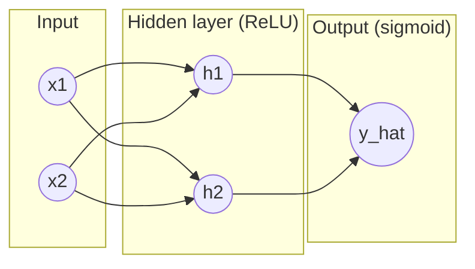
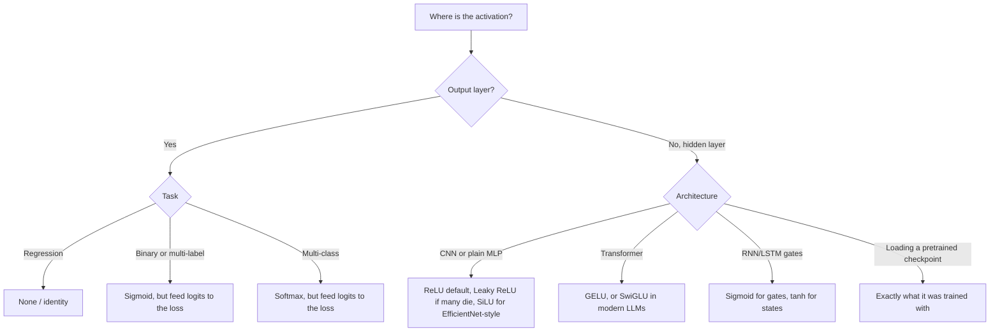

# Neural Networks from Scratch: Neurons, Layers and Activations

> **Level:** Beginner to Advanced · **Study time:** ~100 min · **Prerequisites:** [Linear Algebra for ML](../00-foundations/02-linear-algebra-for-ml.md), [Calculus and Gradients](../00-foundations/03-calculus-and-gradients.md), [Linear and Logistic Regression](../01-classical-ml/02-linear-and-logistic-regression.md)

## Table of contents

- [Why this matters](#why-this-matters)
- [1. Biological inspiration (briefly)](#1-biological-inspiration-briefly)
- [2. The perceptron](#2-the-perceptron)
- [3. The modern neuron: weighted sum, bias, activation](#3-the-modern-neuron-weighted-sum-bias-activation)
- [4. From one neuron to a layer: the matrix view](#4-from-one-neuron-to-a-layer-the-matrix-view)
- [5. Why non-linearity is essential](#5-why-non-linearity-is-essential)
- [6. Activation functions](#6-activation-functions)
- [7. The multilayer perceptron (MLP)](#7-the-multilayer-perceptron-mlp)
- [8. A fully worked forward pass through a 2-2-1 network](#8-a-fully-worked-forward-pass-through-a-2-2-1-network)
- [9. Counting parameters](#9-counting-parameters)
- [10. Universal approximation: why MLPs can learn (almost) anything](#10-universal-approximation-why-mlps-can-learn-almost-anything)
- [11. Solving XOR with a NumPy network, end to end](#11-solving-xor-with-a-numpy-network-end-to-end)
- [12. The same network in PyTorch](#12-the-same-network-in-pytorch)
- [13. Going deeper: activations and MLPs in production](#13-going-deeper-activations-and-mlps-in-production)
- [14. Going deeper: debugging a small network](#14-going-deeper-debugging-a-small-network)
- [Common mistakes and misconceptions](#common-mistakes-and-misconceptions)
- [Interview questions and model answers](#interview-questions-and-model-answers)
- [Key takeaways](#key-takeaways)
- [Further reading](#further-reading)
- [Next](#next)

## Why this matters

Every model you will discuss in a GenAI interview, from a ResNet to a 70B-parameter LLM, is built from the pieces in this chapter: weighted sums, biases and non-linear activation functions stacked into layers. Roughly two thirds of the weights in a typical decoder-only LLM sit inside plain **multilayer perceptrons** (the "feed-forward" blocks), so when someone asks you why Llama uses SwiGLU, why quantizing activations is harder than quantizing weights, or how much memory a 7B model needs, the answer starts here. Interviewers use this material to separate people who can call `model.fit()` from people who understand what happens inside. By the end you will be able to compute a forward pass by hand, count parameters in your head, and train a network from scratch in NumPy and PyTorch.

---

## 1. Biological inspiration (briefly)

> **Analogy:** A biological neuron is like a person in a group chat who only forwards a message when enough friends have pinged them about it. Some friends are more persuasive (stronger connections) than others.

A biological **neuron** is a brain cell. It receives electrical signals from other neurons through branches called **dendrites**. The connection points, called **synapses**, have different strengths. If the combined incoming signal is strong enough to cross a threshold, the neuron "fires" and sends a signal down its **axon** to other neurons.

Early researchers (McCulloch and Pitts, "A Logical Calculus of the Ideas Immanent in Nervous Activity", 1943) turned this into a math model:

| Biology | Artificial neural network |
|---|---|
| Incoming signals on dendrites | Input numbers $x_1, x_2, \dots$ |
| Synapse strength | Weights $w_1, w_2, \dots$ |
| Firing threshold | Bias $b$ (a shifted threshold) |
| Fire or not | Activation function |
| Axon output | Output number passed to the next layer |

> **Senior insight:** Do not oversell the biology in an interview. Modern artificial neurons are a loose caricature. Real neurons spike in time, have complex chemistry, and the brain almost certainly does not learn with backpropagation. Treat "neural network" as a historical name for "a stack of parameterized differentiable functions".

---

## 2. The perceptron

### Intuition

The **perceptron** (Rosenblatt, 1958) is the simplest artificial neuron that learns. It looks at a few input numbers, multiplies each by a weight that says how important it is, adds them up, and says "yes" (1) if the total is above zero, otherwise "no" (0).

Think of our running **spam filter**: inputs might be "how many times does the word *free* appear" and "how many links does the email contain". The perceptron learns how much each clue should count.

### Definition

$$
\hat{y} = \text{step}(w_1 x_1 + w_2 x_2 + \dots + w_n x_n + b), \qquad \text{step}(z) = \begin{cases} 1 & z > 0 \\ 0 & z \le 0 \end{cases}
$$

- $x_i$: the $i$-th input **feature** (a measurable property of the example, such as a word count).
- $w_i$: the **weight** for feature $i$, a learned number saying how strongly and in which direction that feature pushes the decision.
- $b$: the **bias**, a learned number that shifts the decision threshold. Without it the decision boundary would be forced through the origin.
- $\text{step}$: the **step function** (also called the Heaviside function), which outputs 1 for positive input and 0 otherwise.
- $\hat{y}$: the prediction ("y-hat"), 0 or 1.

### Worked example: a perceptron computing AND

Pick $w_1 = 1$, $w_2 = 1$, $b = -1.5$.

| $x_1$ | $x_2$ | $z = x_1 + x_2 - 1.5$ | $\hat{y}$ | AND |
|---|---|---|---|---|
| 0 | 0 | $0 + 0 - 1.5 = -1.5$ | 0 | 0 |
| 0 | 1 | $0 + 1 - 1.5 = -0.5$ | 0 | 0 |
| 1 | 0 | $1 + 0 - 1.5 = -0.5$ | 0 | 0 |
| 1 | 1 | $1 + 1 - 1.5 = 0.5$ | 1 | 1 |

Geometrically, the perceptron draws a straight line ($x_1 + x_2 = 1.5$) through the input plane and labels one side 1 and the other side 0. A boundary like this (a line in 2D, a flat plane or **hyperplane** in higher dimensions) is called a **linear decision boundary**.

### The perceptron learning rule

For each training example with true label $y$:

$$
w_i \leftarrow w_i + \eta\,(y - \hat{y})\,x_i, \qquad b \leftarrow b + \eta\,(y - \hat{y})
$$

- $\eta$ ("eta"): the **learning rate**, how big each correction step is.
- $(y - \hat{y})$: the error. It is 0 if the prediction is right (no change), $+1$ if we said 0 but should have said 1, and $-1$ for the reverse.

Tiny trace with $\eta = 1$, starting from $w = (0, 0)$, $b = 0$:

1. Example $x = (1, 1)$, $y = 1$. $z = 0 + 0 + 0 = 0$, so $\hat{y} = 0$. Error $= 1 - 0 = 1$. Update: $w = (0 + 1 \cdot 1, 0 + 1 \cdot 1) = (1, 1)$, $b = 0 + 1 = 1$.
2. Example $x = (0, 0)$, $y = 0$. $z = 0 + 0 + 1 = 1$, so $\hat{y} = 1$. Error $= 0 - 1 = -1$. Update: $w$ unchanged (because $x = 0$), $b = 1 - 1 = 0$.

Keep cycling and it settles on weights that separate the AND data. The **perceptron convergence theorem** (Novikoff, 1962) guarantees this happens in a finite number of steps *if* the data is **linearly separable** (some straight line or hyperplane separates the classes perfectly).

### The famous limitation: XOR

**XOR** ("exclusive or") outputs 1 when exactly one input is 1:

```text
 x2
  1 |  (0,1)=1      (1,1)=0
    |
  0 |  (0,0)=0      (1,0)=1
    +---------------------- x1
       0            1
```

The 1s sit on one diagonal and the 0s on the other. No single straight line separates them. Minsky and Papert highlighted this kind of limitation in their book *Perceptrons* (1969), which contributed to a long slowdown in neural network research. The fix, as we will see, is to add a **hidden layer** with a non-linear activation. Keep XOR in mind: we will solve it three ways in this chapter (by hand, in NumPy, in PyTorch).

---

## 3. The modern neuron: weighted sum, bias, activation

### Intuition

The modern neuron keeps the perceptron's "weighted vote plus bias", but replaces the hard step with a smooth or piecewise-linear **activation function**. Why? The step function is flat almost everywhere, so its slope is zero and gives no hint about which direction to nudge the weights. Training means minimizing a **loss**: a single number that measures how wrong the predictions are on the training data (lower is better). **Gradient descent** does this by repeatedly moving every weight a little in the direction that reduces the loss, using the **gradient** (the vector of slopes of the loss with respect to each weight; see [Calculus and Gradients](../00-foundations/03-calculus-and-gradients.md)). That needs useful slopes.

### Definition

A neuron computes two things:

$$
z = \sum_{i=1}^{n} w_i x_i + b = \mathbf{w}^\top \mathbf{x} + b, \qquad a = f(z)
$$

- $\mathbf{x}$: the input vector $(x_1, \dots, x_n)$.
- $\mathbf{w}$: the weight vector, same length as $\mathbf{x}$.
- $\mathbf{w}^\top \mathbf{x}$: the **dot product**, $w_1 x_1 + \dots + w_n x_n$ (see [Linear Algebra for ML](../00-foundations/02-linear-algebra-for-ml.md)).
- $b$: the bias.
- $z$: the **pre-activation** (also called the **logit** when it is the final output before a sigmoid or softmax). It is just a number.
- $f$: the activation function.
- $a$: the **activation**, the neuron's output.

```text
 x1 --w1--\
           \
 x2 --w2----( sum + b ) --z--> [ f ] --a-->
           /
 x3 --w3--/
```

### Worked example: one spam neuron

Features of one email (illustrative):

- $x_1 = 3$ (the word *free* appears 3 times)
- $x_2 = 1$ (one link)
- $x_3 = 0$ (sender is **not** in the contact list; 1 would mean known sender)

Weights $\mathbf{w} = (0.8, 1.2, -2.0)$, bias $b = -2.5$, activation = sigmoid $\sigma(z) = 1/(1+e^{-z})$ (explained in Section 6).

1. Weighted sum: $0.8 \cdot 3 + 1.2 \cdot 1 + (-2.0) \cdot 0 = 2.4 + 1.2 + 0 = 3.6$
2. Add bias: $z = 3.6 - 2.5 = 1.1$
3. Activation: $e^{-1.1} \approx 0.3329$, so $a = 1 / 1.3329 \approx 0.7503$

The neuron says "75% spam". Notice the negative weight on "known sender": it pulls the score down, exactly as you would want.

> **Interview tip:** A single neuron with a sigmoid activation is *exactly* logistic regression. Saying this out loud shows you see the continuity between classical ML and deep learning (see [Linear and Logistic Regression](../01-classical-ml/02-linear-and-logistic-regression.md)).

---

## 4. From one neuron to a layer: the matrix view

### Intuition

A **layer** is a group of neurons that all look at the same inputs, each with its own weights. Instead of one spam detector, imagine a small committee: one neuron looks for "money talk", another for "urgency", another for "suspicious links". Each produces its own score.

Computing them one at a time with loops is slow. Stacking every neuron's weights as rows (or columns) of a matrix lets a single **matrix multiplication** compute the whole layer at once, which is exactly what GPUs are good at.

### Definition

For a layer with $n_{\text{in}}$ inputs and $n_{\text{out}}$ neurons, processing a **batch** (a group of examples handled together) of $N$ examples:

$$
Z = X W + \mathbf{b}, \qquad A = f(Z)
$$

- $X$: input matrix of shape $(N, n_{\text{in}})$, one example per row.
- $W$: weight matrix of shape $(n_{\text{in}}, n_{\text{out}})$. Column $j$ holds the weights of neuron $j$.
- $\mathbf{b}$: bias vector of length $n_{\text{out}}$, added to every row (this automatic stretching is called **broadcasting**).
- $Z$: pre-activations, shape $(N, n_{\text{out}})$.
- $f$: applied **elementwise** (to each number independently).
- $A$: activations, shape $(N, n_{\text{out}})$.

This kind of layer, where every input connects to every neuron, is called a **fully connected**, **dense** or **linear** layer.

```text
 X (N x n_in)   @   W (n_in x n_out)   +   b (n_out)   =   Z (N x n_out)
```

> **Common mistake:** PyTorch's `nn.Linear(in_features, out_features)` stores its weight with shape `(out_features, in_features)` and computes `x @ W.T + b`. NumPy code in textbooks often uses `(in, out)`. Both are correct; mixing them up is a very common source of shape bugs.

```python
import numpy as np

X = np.array([[3.0, 1.0, 0.0],      # email 1: free x3, 1 link, unknown sender
              [0.0, 0.0, 1.0]])     # email 2: no free, no links, known sender
W = np.array([[ 0.8, 0.1],          # shape (3 inputs, 2 neurons)
              [ 1.2, 0.5],
              [-2.0, 0.3]])
b = np.array([-2.5, 0.0])

Z = X @ W + b                        # (2, 2)
print(Z)
# [[ 1.1  0.8]
#  [-4.5  0.3]]
```

Check the first entry by hand: $3 \cdot 0.8 + 1 \cdot 1.2 + 0 \cdot (-2.0) - 2.5 = 1.1$. It matches the single neuron from Section 3. Second column, first row: $3 \cdot 0.1 + 1 \cdot 0.5 + 0 \cdot 0.3 + 0 = 0.8$.

---

## 5. Why non-linearity is essential

### Intuition

> **Analogy:** Stacking linear layers is like stacking magnifying glasses. Two lenses in a row still just magnify (and maybe shift) the image; you could replace them with one stronger lens. You never get a new kind of effect, like bending a straight line into a curve.

If you remove the activation functions (or use $f(z) = z$), a deep network of 100 layers is mathematically identical to a network of one layer. All that depth buys you nothing.

### The 1D proof with numbers

Layer 1: $h = 2x + 1$. Layer 2: $y = 3h + 4$.

Substitute: $y = 3(2x + 1) + 4 = 6x + 3 + 4 = 6x + 7$.

Check at $x = 1$: layer 1 gives $h = 2 \cdot 1 + 1 = 3$; layer 2 gives $y = 3 \cdot 3 + 4 = 13$. The single collapsed layer gives $6 \cdot 1 + 7 = 13$. Same answer, one layer.

### The general proof

Two linear layers without activation:

$$
\mathbf{y} = W_2(W_1 \mathbf{x} + \mathbf{b}_1) + \mathbf{b}_2 = \underbrace{(W_2 W_1)}_{W'}\mathbf{x} + \underbrace{(W_2 \mathbf{b}_1 + \mathbf{b}_2)}_{\mathbf{b}'}
$$

- $W_1, \mathbf{b}_1$: first layer's weights and bias.
- $W_2, \mathbf{b}_2$: second layer's weights and bias.
- $W' = W_2 W_1$: a single matrix (the product of two matrices is a matrix).
- $\mathbf{b}' = W_2 \mathbf{b}_1 + \mathbf{b}_2$: a single vector.

By induction, any number of linear layers collapses to one. So a "deep linear network" can only draw straight-line (hyperplane) decision boundaries, and it can never solve XOR.

```python
import numpy as np
rng = np.random.default_rng(0)
W1, b1 = rng.normal(size=(3, 5)), rng.normal(size=5)
W2, b2 = rng.normal(size=(5, 2)), rng.normal(size=2)
x = rng.normal(size=(4, 3))

deep = (x @ W1 + b1) @ W2 + b2            # two layers, no activation
W_, b_ = W1 @ W2, b1 @ W2 + b2            # collapsed single layer (row-vector convention)
print(np.allclose(deep, x @ W_ + b_))     # True
```

> **Senior insight:** "Linear in, linear out" has a subtle cousin: a deep linear network has the same *function class* (the set of functions it can represent) as one layer but *different training dynamics* (the loss landscape is non-convex). Researchers study deep linear networks precisely because they isolate the optimization effects of depth from the expressivity effects. If an interviewer pushes, this is a strong follow-up point.

### What the non-linearity buys you

With a non-linear $f$ between layers, the first layer can *re-map* the input into a new space where the problem becomes linearly separable, and the next layer draws a straight line *there*. That is the core idea of **representation learning**: hidden layers learn useful features automatically. Section 7 shows this concretely for XOR.

---

## 6. Activation functions

Below, every function gets: intuition, formula, a plot described in words, its derivative (slope), and when to use it. Numbers at $z = -2, 0, 2$ are given so you can sanity-check code. The **derivative** $f'(z)$ matters because training multiplies these slopes together layer after layer (the details are in [Backpropagation and Gradient Descent](02-backpropagation-and-gradient-descent.md)).

Three terms used throughout:

- **Saturation:** the function flattens out at its extremes, so its slope is near zero there and gradients that pass through it nearly vanish.
- **Vanishing gradients:** when many small slopes are multiplied across layers, the gradient reaching the early layers becomes so tiny that those layers barely learn.
- **Zero-centered:** the outputs can be both positive and negative, averaging around zero. This tends to make optimization smoother.

### 6.1 Sigmoid (logistic)

**Intuition:** squashes any number into a probability-like value between 0 and 1. A soft version of the perceptron's step.

$$
\sigma(z) = \frac{1}{1 + e^{-z}}, \qquad \sigma'(z) = \sigma(z)\,(1 - \sigma(z))
$$

- $e \approx 2.718$ is Euler's number; $e^{-z}$ is large for very negative $z$ and tiny for very positive $z$.

**Plot in words:** an S-shaped curve. Near 0 for very negative $z$, exactly 0.5 at $z = 0$, near 1 for very positive $z$. Steepest at the center, flat at both ends. Its slope peaks at only **0.25** (at $z = 0$).

**Worked values:** $\sigma(2) = 1/(1 + e^{-2}) = 1/(1 + 0.1353) = 0.8808$; $\sigma(0) = 0.5$; $\sigma(-2) = 1 - 0.8808 = 0.1192$. Slope at 2: $0.8808 \times 0.1192 \approx 0.105$.

**When to use:** the output layer for **binary classification** (spam or not) and **multi-label classification** (independent yes/no per label). Inside **gates** of LSTMs (recurrent networks for sequences) and GLU-style layers (gated linear units, Section 13.2), where a 0-to-1 "how much to let through" value is exactly what you want. Avoid it in hidden layers of deep networks: it saturates, is not zero-centered, and its max slope of 0.25 means the activation alone shrinks gradients by at least 4x per layer.

### 6.2 Tanh (hyperbolic tangent)

**Intuition:** a sigmoid stretched to the range $-1$ to $1$, so it is zero-centered.

$$
\tanh(z) = \frac{e^{z} - e^{-z}}{e^{z} + e^{-z}} = 2\sigma(2z) - 1, \qquad \tanh'(z) = 1 - \tanh^2(z)
$$

**Plot in words:** the same S shape as sigmoid but passing through the origin, flattening toward $-1$ on the left and $+1$ on the right. Max slope is 1 at $z = 0$.

**Worked values:** $\tanh(2) \approx 0.9640$, $\tanh(0) = 0$, $\tanh(-2) \approx -0.9640$. Slope at 2: $1 - 0.9640^2 \approx 0.0707$ (already small: saturation).

**When to use:** hidden states of classic RNNs and LSTMs; small networks (like our XOR net); when you need bounded, zero-centered outputs. Still saturates, so it is rare in hidden layers of modern deep feed-forward nets.

### 6.3 ReLU (Rectified Linear Unit)

**Intuition:** "if positive, pass it through; if negative, output zero". A one-sided gate.

$$
\text{ReLU}(z) = \max(0, z), \qquad \text{ReLU}'(z) = \begin{cases} 1 & z > 0 \\ 0 & z < 0 \end{cases}
$$

(At exactly $z = 0$ the derivative is undefined; frameworks just pick 0.)

**Plot in words:** a flat line along zero for all negative inputs, then a 45-degree straight line for positive inputs. A "hockey stick" with the corner at the origin.

**Worked values:** $\text{ReLU}(2) = 2$, $\text{ReLU}(0) = 0$, $\text{ReLU}(-2) = 0$.

**Why it took over** (Nair and Hinton, 2010; Glorot, Bordes and Bengio, "Deep Sparse Rectifier Neural Networks", 2011; popularized by AlexNet in 2012):

- Slope is exactly 1 for positive inputs, so gradients do not shrink as they pass through active units.
- Extremely cheap: a comparison, no exponentials.
- **Sparse activations**: many units output exactly 0, which can make representations more efficient.

**Downsides:** not zero-centered, and the **dying ReLU** problem: if a neuron's pre-activation becomes negative for every input (for example after a large bad update), its gradient is 0 forever and it never recovers.

**When to use:** the default for hidden layers in CNNs and general MLPs. A strong, fast baseline.

### 6.4 Leaky ReLU (and PReLU)

**Intuition:** ReLU, but the negative side "leaks" a small slope so neurons never go fully dead.

$$
\text{LeakyReLU}(z) = \begin{cases} z & z > 0 \\ \alpha z & z \le 0 \end{cases}
$$

- $\alpha$: the small negative-side slope, typically 0.01 (Maas, Hannun and Ng, 2013). In **PReLU** (He et al., 2015), $\alpha$ is learned.

**Plot in words:** the ReLU hockey stick, but the left side tilts gently downward instead of being flat.

**Worked values ($\alpha = 0.01$):** $2 \to 2$, $0 \to 0$, $-2 \to -0.02$.

**When to use:** when you observe many dead ReLUs; in GAN discriminators (the real-vs-fake classifier in a generative adversarial network), where it is a common choice. Gains over ReLU are often small and task-dependent.

### 6.5 GELU (Gaussian Error Linear Unit)

**Intuition:** a smooth ReLU. Instead of a hard "pass or block" decision, GELU passes each input weighted by *how likely it is to be large* compared to typical inputs. Big positive values pass almost unchanged, big negative values are almost zeroed, and values near zero are partially passed.

$$
\text{GELU}(z) = z\,\Phi(z) \approx 0.5\,z\left(1 + \tanh\!\left[\sqrt{2/\pi}\,\left(z + 0.044715\,z^3\right)\right]\right)
$$

- $\Phi(z)$: the **cumulative distribution function (CDF)** of the standard normal distribution, i.e. the probability that a standard normal random variable is at most $z$ (see [Probability and Statistics](../00-foundations/04-probability-and-statistics.md)). It rises smoothly from 0 to 1.
- The tanh formula is a fast approximation from the original paper (Hendrycks and Gimpel, 2016).

**Plot in words:** looks like ReLU from a distance, but the corner at the origin is rounded and there is a small dip below zero for negative inputs (minimum about $-0.17$ near $z \approx -0.75$), after which it returns toward 0 for very negative inputs.

**Worked values:** $\Phi(2) \approx 0.9772$, so $\text{GELU}(2) \approx 2 \times 0.9772 = 1.9545$. $\text{GELU}(0) = 0$. $\Phi(-2) \approx 0.0228$, so $\text{GELU}(-2) \approx -0.0455$.

**When to use:** the standard activation in BERT, the GPT-2/GPT-3 family and Vision Transformers. Smoothness (non-zero gradient for slightly negative inputs) tends to help optimization in transformers.

> **Common mistake:** The exact (erf-based) GELU and the tanh approximation differ slightly (around the 4th decimal place for typical inputs). If you load pretrained weights trained with one and run inference with the other, outputs drift a little. In PyTorch, `nn.GELU()` is exact and `nn.GELU(approximate="tanh")` is the approximation. Match what the checkpoint was trained with.

### 6.6 SiLU / Swish

**Intuition:** the input gates itself: multiply $z$ by the sigmoid of $z$. Very similar shape to GELU.

$$
\text{SiLU}(z) = z\,\sigma(z) = \frac{z}{1 + e^{-z}}, \qquad \text{Swish}_\beta(z) = z\,\sigma(\beta z)
$$

- **SiLU** (Sigmoid Linear Unit; Elfwing, Uchibe and Doya, 2017) is Swish with $\beta = 1$.
- **Swish** (Ramachandran, Zoph and Le, "Searching for Activation Functions", 2017) was found by automated search; $\beta$ can be fixed or learned.

**Plot in words:** a smooth, rounded ReLU with a slightly deeper dip below zero than GELU (minimum about $-0.28$ near $z \approx -1.28$). It is **non-monotonic**: it goes down a bit, then back up toward 0 as $z$ becomes very negative.

**Worked values:** $\text{SiLU}(2) = 2 \times 0.8808 = 1.7616$; $\text{SiLU}(0) = 0$; $\text{SiLU}(-2) = -2 \times 0.1192 = -0.2384$.

**When to use:** EfficientNet-style CNNs; and, most importantly for this course, inside **SwiGLU** feed-forward blocks of modern LLMs such as Llama, Mistral and Qwen (Shazeer, "GLU Variants Improve Transformer", 2020). SwiGLU is covered in [Modern LLM Architecture](../04-transformers/08-modern-llm-architecture-improvements.md); Section 13 previews it.

### 6.7 Softmax (output layer for multi-class)

Softmax is fully taught in [Softmax, Entropy, Cross-Entropy and KL Divergence](../00-foundations/05-softmax-entropy-cross-entropy-and-kl-divergence.md). Quick recap for this chapter:

**Intuition:** turns a vector of arbitrary scores (logits) into a probability distribution: all outputs positive, summing to 1, with the largest score getting the largest share.

$$
\text{softmax}(\mathbf{z})_i = \frac{e^{z_i}}{\sum_{j=1}^{K} e^{z_j}}
$$

- $\mathbf{z}$: vector of $K$ logits, one per class.
- $K$: number of classes.

**Worked example:** logits for (spam, promotions, inbox) $= (2.0, 1.0, 0.1)$. $e^{2.0} = 7.389$, $e^{1.0} = 2.718$, $e^{0.1} = 1.105$. Sum $= 11.213$. Probabilities $\approx (0.659, 0.242, 0.099)$.

**"Plot" in words:** softmax is not elementwise, so there is no single curve. Its behavior: adding the same constant to every logit changes nothing; doubling all logits makes the distribution sharper (more peaked on the winner); halving them makes it flatter. With $K = 2$, softmax reduces to a sigmoid of the logit difference.

**When to use:** output layer for **multi-class, single-label** classification (each example belongs to exactly one class), and inside attention ([Attention Mechanism](../04-transformers/03-attention-mechanism-step-by-step.md)). For multi-label problems use independent sigmoids instead.

### A rough sketch of the shapes

```text
 Sigmoid (0..1)              Tanh (-1..1)               ReLU / GELU / SiLU
  1 |         ______          1 |        _____           |            /
    |       /                   |      /                 |          /
0.5 |-----/------               0 |----/--------          |        /
    |   /                         |  /                    |      /   ReLU: sharp corner at 0
  0 |__/                       -1 |_/                   0 |_____/    GELU/SiLU: rounded corner,
    +-------------> z            +-------------> z        \_/        small dip below 0 (left)
                                                         +-------------> z
```

### Comparison table

| Activation | Range | Max slope | Zero-centered | Main pros | Main cons | Typical use |
|---|---|---|---|---|---|---|
| Sigmoid | (0, 1) | 0.25 | No | Probability output, smooth | Saturates, vanishing gradients, exp cost | Binary / multi-label output, gates |
| Tanh | (-1, 1) | 1 | Yes | Zero-centered, bounded | Saturates | RNN/LSTM states, small nets |
| ReLU | [0, inf) | 1 | No | Cheap, no saturation for z>0, sparse | Dying units | Default hidden layer for CNNs/MLPs |
| Leaky ReLU | (-inf, inf) | 1 | No (tiny negative side) | No dead units | Extra hyperparameter, small gains | When many ReLUs die, GANs |
| GELU | about [-0.17, inf) | about 1.13 | No (small negative dip) | Smooth, strong in transformers | Costlier than ReLU | BERT, GPT-2/3, ViT |
| SiLU / Swish | about [-0.28, inf) | about 1.1 | No (small negative dip) | Smooth, self-gated | Costlier than ReLU | EfficientNet, SwiGLU in Llama-style LLMs |
| Softmax | (0, 1), sums to 1 | n/a (vector) | No | Proper distribution over K classes | Needs max-subtraction for stability | Multi-class output, attention weights |

(Max slopes for GELU and SiLU are slightly above 1 because of their curvature for small positive $z$; the exact values are not important, only that they do not shrink gradients the way sigmoid does.)

> **Interview tip:** A crisp default answer: "ReLU for CNN and MLP hidden layers, GELU or SwiGLU for transformers, sigmoid at the output for binary or multi-label, softmax at the output for multi-class, and linear (no activation) at the output for regression."

---

## 7. The multilayer perceptron (MLP)

### Intuition

A **multilayer perceptron** (MLP), also called a **feed-forward neural network**, is a chain of dense layers with activation functions in between. Information flows one way, from inputs to outputs, with no loops. (The name is historical: the neurons are not step-function perceptrons any more.)

> **Analogy:** An assembly line. The first station turns raw parts (pixels, word counts) into simple components (edges, "money words"). Later stations assemble those into higher-level concepts (shapes, "this looks like a scam"). The final station makes the decision.

### Vocabulary

- **Input layer:** the raw features. It has no weights and is usually not counted as a layer.
- **Hidden layer:** any layer between input and output. "Hidden" because its values are not given in the data; the network invents them.
- **Output layer:** produces the prediction. Its activation is chosen to match the task.
- **Width:** number of neurons in a layer.
- **Depth:** number of layers with weights. "Deep learning" just means networks with more than one or two hidden layers.
- **Forward pass:** computing the output from the input, layer by layer.
- **Architecture notation:** "2-2-1" means 2 inputs, one hidden layer of 2 neurons, 1 output.



### The general forward pass

For an MLP with $L$ layers:

$$
\mathbf{a}^{(0)} = \mathbf{x}, \qquad \mathbf{z}^{(\ell)} = W^{(\ell)} \mathbf{a}^{(\ell-1)} + \mathbf{b}^{(\ell)}, \qquad \mathbf{a}^{(\ell)} = f^{(\ell)}\big(\mathbf{z}^{(\ell)}\big), \qquad \hat{\mathbf{y}} = \mathbf{a}^{(L)}
$$

- $\ell$: layer index, from 1 to $L$.
- $W^{(\ell)}$: weight matrix of layer $\ell$, shape $(n_\ell, n_{\ell-1})$ in this column-vector convention.
- $\mathbf{b}^{(\ell)}$: bias of layer $\ell$, length $n_\ell$.
- $f^{(\ell)}$: activation of layer $\ell$ (hidden layers share one choice; the output layer often differs).

This is Section 4's $Z = XW + \mathbf{b}$ written for one example as a column vector instead of a batch of rows, so the weight matrix appears transposed. PyTorch's `(out, in)` weight layout matches this column-vector form.

### Choosing the output layer

| Task | Output units | Output activation | Paired loss (see [Loss Functions](04-loss-functions.md)) |
|---|---|---|---|
| Regression (house price) | 1 per target | None (identity) | Mean squared error |
| Binary classification (spam) | 1 | Sigmoid | Binary cross-entropy |
| Multi-class, one label (digit 0-9) | K | Softmax | Categorical cross-entropy |
| Multi-label (tags on a post) | K | Sigmoid per unit | Binary cross-entropy per unit |
| Next-token prediction (LLM) | Vocabulary size | Softmax | Cross-entropy |

### XOR solved by hand: watching the hidden layer work

Here is a 2-2-1 ReLU network with hand-picked weights that computes XOR exactly:

$$
h_1 = \text{ReLU}(x_1 + x_2), \qquad h_2 = \text{ReLU}(x_1 + x_2 - 1), \qquad y = h_1 - 2h_2
$$

| $x_1$ | $x_2$ | $h_1$ | $h_2$ | $y = h_1 - 2h_2$ | XOR |
|---|---|---|---|---|---|
| 0 | 0 | ReLU(0) = 0 | ReLU(-1) = 0 | $0 - 0 = 0$ | 0 |
| 0 | 1 | ReLU(1) = 1 | ReLU(0) = 0 | $1 - 0 = 1$ | 1 |
| 1 | 0 | ReLU(1) = 1 | ReLU(0) = 0 | $1 - 0 = 1$ | 1 |
| 1 | 1 | ReLU(2) = 2 | ReLU(1) = 1 | $2 - 2 = 0$ | 0 |

Look at the hidden space $(h_1, h_2)$: the four inputs land at $(0,0)$, $(1,0)$, $(1,0)$, $(2,1)$. The two "1" cases merge into a single point, and the output layer, which is just a linear function of $h$, separates them. **The hidden layer bent the space so a straight line works.** That is the whole story of deep learning in one table.

---

## 8. A fully worked forward pass through a 2-2-1 network

Back to the spam filter. Two features per email:

- $x_1$ = number of times *free* appears $= 2$
- $x_2$ = number of links $= 1$

Network: 2 inputs, 2 hidden ReLU neurons, 1 sigmoid output. All weights below are illustrative.

```text
   inputs              hidden layer (ReLU)                     output (sigmoid)

   x1 = 2  --w11= 1.0-->  [ h1 ]  bias b1 = -1.0  --v1= 2.0-->
   x2 = 1  --w21= 0.5-->                                       [ out ] bias c = -1.0 --> y_hat
   x1 = 2  --w12=-1.0-->  [ h2 ]  bias b2 =  0.5  --v2=-1.0-->
   x2 = 1  --w22= 1.0-->

   (x1 and x2 are drawn twice because each input feeds both hidden neurons)
```

Parameters:

| Neuron | Weight from $x_1$ | Weight from $x_2$ | Bias |
|---|---|---|---|
| $h_1$ | $w_{11} = 1.0$ | $w_{21} = 0.5$ | $b_1 = -1.0$ |
| $h_2$ | $w_{12} = -1.0$ | $w_{22} = 1.0$ | $b_2 = 0.5$ |
| output | $v_1 = 2.0$ (from $h_1$) | $v_2 = -1.0$ (from $h_2$) | $c = -1.0$ |

**Step 1: hidden neuron 1.**

$z_1 = w_{11} x_1 + w_{21} x_2 + b_1 = 1.0 \cdot 2 + 0.5 \cdot 1 + (-1.0) = 2 + 0.5 - 1 = 1.5$

$h_1 = \text{ReLU}(1.5) = 1.5$

**Step 2: hidden neuron 2.**

$z_2 = w_{12} x_1 + w_{22} x_2 + b_2 = (-1.0) \cdot 2 + 1.0 \cdot 1 + 0.5 = -2 + 1 + 0.5 = -0.5$

$h_2 = \text{ReLU}(-0.5) = 0$ (this neuron is "off" for this email)

**Step 3: output pre-activation (the logit).**

$z_{\text{out}} = v_1 h_1 + v_2 h_2 + c = 2.0 \cdot 1.5 + (-1.0) \cdot 0 + (-1.0) = 3 + 0 - 1 = 2.0$

**Step 4: output activation.**

$\hat{y} = \sigma(2.0) = \dfrac{1}{1 + e^{-2}} = \dfrac{1}{1 + 0.1353} = \dfrac{1}{1.1353} \approx 0.8808$

The network says about **88% spam**.

**What if we removed the ReLU?** Then $h_2 = -0.5$ instead of 0, and $z_{\text{out}} = 2.0 \cdot 1.5 + (-1.0)(-0.5) - 1.0 = 3 + 0.5 - 1 = 2.5$, giving $\sigma(2.5) \approx 0.924$. The activation changed the answer because it switched $h_2$ off. Different inputs switch different neurons on and off, and that switching is what makes the overall function non-linear.

The same computation in NumPy (row-vector convention, so weights are stored as `(in, out)`):

```python
import numpy as np

x  = np.array([2.0, 1.0])
W1 = np.array([[1.0, -1.0],     # row = input x1, columns = (h1, h2)
               [0.5,  1.0]])    # row = input x2
b1 = np.array([-1.0, 0.5])
W2 = np.array([[2.0], [-1.0]])  # (2 hidden, 1 output)
b2 = np.array([-1.0])

z1 = x @ W1 + b1                # [ 1.5 -0.5]
h  = np.maximum(0, z1)          # [ 1.5  0. ]
z2 = h @ W2 + b2                # [2.]
y_hat = 1 / (1 + np.exp(-z2))   # [0.88079708]
print(z1, h, z2, y_hat)
```

---

## 9. Counting parameters

**Parameters** are the numbers the model learns: weights and biases. Counting them tells you model size, memory and roughly compute cost.

### The formula

A dense layer from $n_{\text{in}}$ inputs to $n_{\text{out}}$ outputs has:

$$
\text{params} = \underbrace{n_{\text{in}} \times n_{\text{out}}}_{\text{weights}} + \underbrace{n_{\text{out}}}_{\text{biases}} = (n_{\text{in}} + 1) \times n_{\text{out}}
$$

Activation functions like ReLU, GELU and SiLU have **no** parameters (PReLU is an exception: one learned slope per channel or one in total).

### Worked examples

**Our 2-2-1 network:**

- Hidden: $2 \times 2 + 2 = 6$
- Output: $2 \times 1 + 1 = 3$
- Total: $6 + 3 = 9$ (count the table in Section 8: 6 weights, 3 biases).

**An MLP for 28x28 digit images (the MNIST dataset, flattened to 784 pixels), 784-128-64-10:**

| Layer | Weights | Biases | Total |
|---|---|---|---|
| 784 to 128 | $784 \times 128 = 100{,}352$ | 128 | 100,480 |
| 128 to 64 | $128 \times 64 = 8{,}192$ | 64 | 8,256 |
| 64 to 10 | $64 \times 10 = 640$ | 10 | 650 |
| **Total** | | | **109,386** |

Notice that the first layer holds about 92% of the parameters. In MLPs, the widest connection dominates.

**A 7B LLM's feed-forward blocks (Llama 2 7B, published configuration):** hidden size $d = 4096$ (the length of each token's vector), feed-forward inner size $d_{ff} = 11008$, 32 layers, and a SwiGLU **feed-forward network (FFN)** block with three weight matrices and no biases (Section 13.2).

- Per layer FFN: $3 \times 4096 \times 11008 = 135{,}266{,}304$
- 32 layers: $135{,}266{,}304 \times 32 = 4{,}328{,}521{,}728 \approx 4.33\text{B}$
- Attention projections per layer (query, key, value and output matrices, each $4096 \times 4096$; see [Attention Mechanism](../04-transformers/03-attention-mechanism-step-by-step.md)): $4 \times 4096^2 = 67{,}108{,}864$; times 32 $\approx 2.15\text{B}$
- Token embeddings plus output head: $2 \times 32{,}000 \times 4096 \approx 0.26\text{B}$
- Total $\approx 6.74\text{B}$, of which the MLPs are about **64%**.

So "a 7B model" is, to a first approximation, mostly a stack of MLPs with attention in between.

### Why parameter counts matter in production

| Question | Rule of thumb |
|---|---|
| Memory for weights | params x bytes per param. 7B in BF16 (a 16-bit float format, 2 bytes) is about 14 GB; in INT4 (4-bit integers, half a byte) about 3.5 GB plus overhead (see [Number Formats and Model Memory](../07-model-compression/01-number-formats-and-model-memory.md)). |
| Compute per example (forward) | About 2 FLOPs (floating-point operations) per weight per input (one multiply, one add). A 7B LLM needs roughly 14 GFLOPs per generated token, ignoring attention over the context. |
| Training memory | Much more than weights: gradients, optimizer state and stored activations (see [Distributed Training and Training Memory](10-distributed-training-and-training-memory.md)). |

> **Interview tip:** If asked to count parameters, say the formula out loud first, $(n_{\text{in}} + 1) \times n_{\text{out}}$ per dense layer, then compute. Interviewers care more about the method than the arithmetic, and it protects you from slips.

---

## 10. Universal approximation: why MLPs can learn (almost) anything

### Intuition

> **Analogy:** With enough Lego bricks you can build an approximation of any shape. It may look blocky, but more bricks make it smoother.

A ReLU network computes a **piecewise linear** function: a curve made of straight segments joined at "kinks", where each kink comes from some neuron switching on or off. With enough segments, you can trace any reasonable curve as closely as you like.

### Building a bump from three ReLUs

A triangular "bump" between $a$ and $b$ with peak at the midpoint $m = (a+b)/2$:

$$
\text{bump}(x) = \text{ReLU}(x - a) - 2\,\text{ReLU}(x - m) + \text{ReLU}(x - b)
$$

Check with $a = 0$, $m = 1$, $b = 2$:

| $x$ | ReLU($x$) | $-2\cdot$ReLU($x-1$) | ReLU($x-2$) | bump |
|---|---|---|---|---|
| -1 | 0 | 0 | 0 | 0 |
| 0.5 | 0.5 | 0 | 0 | 0.5 |
| 1 | 1 | 0 | 0 | 1 (peak) |
| 1.5 | 1.5 | -1 | 0 | 0.5 |
| 3 | 3 | -4 | 1 | 0 |

Three hidden neurons make one bump. Add many scaled and shifted bumps and you can approximate any continuous 1D function. The same idea extends to more dimensions.

### The theorem (stated carefully)

The **universal approximation theorem** (Cybenko, 1989, for sigmoids; Hornik, Stinchcombe and White, 1989; generalized by Leshno et al., 1993, to any non-polynomial activation) says roughly:

> A feed-forward network with a single hidden layer and a suitable non-linear activation can approximate any continuous function on a bounded region to any desired accuracy, given enough hidden units.

What it does **not** say:

- It does not say how many units you need. For some functions the required width grows exponentially with input dimension.
- It does not say gradient descent will *find* those weights.
- It does not say the network will *generalize* to unseen data. Fitting the training set is not the same as learning the pattern (see [Overfitting and Regularization](../01-classical-ml/03-overfitting-regularization-and-data-leakage.md)).

### Why depth then?

If one wide layer is enough in principle, why go deep? Because depth is often *exponentially more efficient*. The number of linear pieces a ReLU network can produce can grow exponentially with depth but only polynomially with width (Montufar et al., "On the Number of Linear Regions of Deep Neural Networks", 2014; Telgarsky, "Benefits of Depth in Neural Networks", 2016). Depth also matches how real data is structured: features built from features (edges, then shapes, then objects). The price is harder optimization, which is what [Vanishing and Exploding Gradients, Normalization and Residuals](05-vanishing-exploding-gradients-initialization-normalization-and-residuals.md) is about.

| | Wide and shallow | Deep and narrow |
|---|---|---|
| Expressivity per parameter | Lower for compositional functions | Higher |
| Ease of optimization | Easier | Harder without residuals, normalization, good init |
| Parallelism | High (one big matmul) | Sequential across layers, which adds latency |
| Typical modern use | Inside transformer FFNs (width about 2.7-4x hidden size) | Overall model design (tens of layers) |

---

## 11. Solving XOR with a NumPy network, end to end

Time to train, not hand-pick. The plan:

1. **Data:** the four XOR points.
2. **Model:** 2-4-1 MLP, tanh hidden layer, sigmoid output.
3. **Loss:** **binary cross-entropy (BCE)**, which measures how surprised the model is by the true label: $L = -\frac{1}{N}\sum [y \log p + (1-y)\log(1-p)]$, where $p$ is the predicted probability of class 1 and $\log$ is the natural log (taught fully in [Softmax, Entropy, Cross-Entropy and KL Divergence](../00-foundations/05-softmax-entropy-cross-entropy-and-kl-divergence.md)). Worked example for one example with $y = 1$: predicting $p = 0.9$ costs $-\ln 0.9 \approx 0.105$; predicting $p = 0.5$ costs $-\ln 0.5 = \ln 2 \approx 0.693$; predicting $p = 0.1$ costs $-\ln 0.1 \approx 2.303$. Confident wrong answers are punished hardest.
4. **Gradients:** computed by **backpropagation**, the chain rule applied layer by layer from output back to input. Here we just write the formulas; the next chapter derives them step by step.
5. **Update:** plain gradient descent, $W \leftarrow W - \eta \cdot \partial L / \partial W$, repeated for many **epochs** (one epoch is one full pass over the training data; here that is all 4 points at once).

Why 4 hidden units and not 2? A 2-2-1 network *can* represent XOR (we did it by hand), but with random starting weights gradient descent often gets stuck in a poor solution. Extra width gives the optimizer more routes to a good solution. This is a small-scale version of a big empirical pattern: **over-parameterization usually makes optimization easier** (more reliable, not guaranteed; see the note after the code).

```python
# pip install numpy
import numpy as np

rng = np.random.default_rng(1)   # seed 0 happens to get stuck; see the note below

# 1. Data: the four XOR points
X = np.array([[0, 0], [0, 1], [1, 0], [1, 1]], dtype=float)  # (4, 2)
y = np.array([[0], [1], [1], [0]], dtype=float)              # (4, 1)

# 2. Parameters: 2 -> 4 -> 1. Random weights break symmetry; biases can start at 0.
H = 4
W1 = rng.normal(0.0, 1.0, size=(2, H))
b1 = np.zeros((1, H))
W2 = rng.normal(0.0, 1.0, size=(H, 1))
b2 = np.zeros((1, 1))

def sigmoid(z):
    return 1.0 / (1.0 + np.exp(-z))

lr, epochs, N = 0.5, 5000, X.shape[0]

for epoch in range(epochs + 1):
    # ---- forward pass ----
    z1 = X @ W1 + b1          # (4, H) hidden pre-activations
    a1 = np.tanh(z1)          # (4, H) hidden activations
    z2 = a1 @ W2 + b2         # (4, 1) output logits
    p = sigmoid(z2)           # (4, 1) predicted P(y=1)

    eps = 1e-12               # avoid log(0)
    loss = -np.mean(y * np.log(p + eps) + (1 - y) * np.log(1 - p + eps))

    # ---- backward pass (derived in the next chapter) ----
    dz2 = (p - y) / N                      # dL/dz2: sigmoid + BCE simplify to this
    dW2 = a1.T @ dz2                       # (H, 1)
    db2 = dz2.sum(axis=0, keepdims=True)   # (1, 1)
    da1 = dz2 @ W2.T                       # (4, H)
    dz1 = da1 * (1 - a1 ** 2)              # tanh'(z) = 1 - tanh(z)^2
    dW1 = X.T @ dz1                        # (2, H)
    db1 = dz1.sum(axis=0, keepdims=True)   # (1, H)

    # ---- gradient descent update ----
    W1 -= lr * dW1; b1 -= lr * db1
    W2 -= lr * dW2; b2 -= lr * db2

    if epoch % 1000 == 0:
        print(f"epoch {epoch:5d}  loss {loss:.4f}")

print("predictions:", np.round(p.ravel(), 3))
print("classes:    ", (p.ravel() > 0.5).astype(int))
```

What you should see: with seed 1 the loss starts at about 0.67 (near $\ln 2 \approx 0.693$, the loss of a model that outputs 0.5 for everything; with these unit-variance random weights other seeds start anywhere from about 0.6 to 1.4) and falls toward 0 (about 0.001 after 5,000 epochs). The final predicted probabilities end up close to `[0, 1, 1, 0]`, and the printed classes are `[0 1 1 0]`. Exact digits depend on the random seed and NumPy version.

> **Common mistake:** assuming a correct implementation always converges. With `default_rng(0)` this exact code gets stuck: the loss plateaus near 0.347 (about $\frac{1}{2}\ln 2$), two of the four predictions sit at 0.5, and the printed classes are wrong. That is a poor local solution, not a bug. Even with 4 hidden units, a few seeds fail; re-running with another seed usually fixes it.

Line by line, the important ideas:

- **Shapes are documented in comments.** Doing this in every piece of tensor code you write is the single best habit for avoiding bugs.
- **`dz2 = (p - y) / N`**: when sigmoid is paired with BCE, the gradient with respect to the logit simplifies to "prediction minus target". This is not a coincidence; it is one reason the pairing is standard.
- **`(1 - a1 ** 2)`**: the activation's derivative appears in the backward pass. If you swapped tanh for ReLU you would use `(z1 > 0)` here instead.
- **Full-batch gradient descent**: all 4 examples per step. Real datasets use **mini-batches** (see [Optimizers](03-optimizers-sgd-momentum-adam-and-learning-rate-schedules.md)).

---

## 12. The same network in PyTorch

PyTorch gives us three things that replace most of the code above:

- **Modules** (`nn.Linear`, `nn.Tanh`) that hold parameters and define the forward pass.
- **Autograd**: PyTorch records every operation in the forward pass and computes all gradients automatically when you call `loss.backward()`.
- **Optimizers** (`torch.optim.SGD`, `Adam`) that apply the update rule.

```python
# pip install torch
import torch
from torch import nn

torch.manual_seed(0)

X = torch.tensor([[0., 0.], [0., 1.], [1., 0.], [1., 1.]])
y = torch.tensor([[0.], [1.], [1.], [0.]])

model = nn.Sequential(
    nn.Linear(2, 4),   # weight shape (4, 2), bias (4,)
    nn.Tanh(),
    nn.Linear(4, 1),   # outputs a raw logit, no sigmoid here
)

# BCEWithLogitsLoss = sigmoid + BCE in one numerically stable function
loss_fn = nn.BCEWithLogitsLoss()
optimizer = torch.optim.SGD(model.parameters(), lr=0.5)

for epoch in range(3001):
    logits = model(X)              # forward
    loss = loss_fn(logits, y)

    optimizer.zero_grad()          # clear old gradients (they accumulate by default)
    loss.backward()                # autograd computes d(loss)/d(every parameter)
    optimizer.step()               # W <- W - lr * grad

    if epoch % 500 == 0:
        print(f"epoch {epoch:4d}  loss {loss.item():.4f}")

model.eval()
with torch.no_grad():              # no graph needed for inference
    probs = torch.sigmoid(model(X)).squeeze()
print("probs:", probs.round(decimals=3))
print("classes:", (probs > 0.5).int().tolist())   # expected [0, 1, 1, 0]

n_params = sum(p.numel() for p in model.parameters())
print("parameters:", n_params)     # 17 = (2*4 + 4) + (4*1 + 1)
```

Mapping NumPy to PyTorch:

| NumPy version | PyTorch version |
|---|---|
| `W1`, `b1`, `W2`, `b2` arrays | `nn.Linear` modules own them (`model[0].weight`, etc.) |
| Hand-written forward | `model(X)` |
| Hand-written `sigmoid` + BCE | `nn.BCEWithLogitsLoss` (fused and stable) |
| Hand-derived `dW1`, `db1`, ... | `loss.backward()` |
| `W -= lr * dW` | `optimizer.step()` |
| Nothing to reset | `optimizer.zero_grad()` each step |

> **Common mistake:** Putting `nn.Sigmoid()` as the last layer *and* using `BCEWithLogitsLoss`. That applies sigmoid twice, which squashes outputs into roughly 0.5 to 0.73 and makes training stall. Use either `Sigmoid` + `BCELoss`, or (preferred) no final sigmoid + `BCEWithLogitsLoss`. The same rule applies to `nn.CrossEntropyLoss`, which expects raw logits and applies log-softmax internally.

> **Senior insight:** Swapping `SGD(lr=0.5)` for `Adam(lr=0.05)` usually converges faster on this toy problem. On real problems, optimizer choice interacts with learning rate, batch size and normalization; that is the topic of [Optimizers](03-optimizers-sgd-momentum-adam-and-learning-rate-schedules.md).

---

## 13. Going deeper: activations and MLPs in production

### 13.1 Where MLPs live in real systems

| System | Where the MLP is | Notes |
|---|---|---|
| Transformer LLMs | The FFN block in every layer | About two thirds of parameters in a Llama-2-7B-style model (Section 9) |
| CNN classifiers | The classification "head" after the conv layers | Often a single linear layer in modern designs |
| Recommendation systems | User and item "towers", ranking heads | Wide embeddings feed into small, fast MLPs |
| Tabular ML | Whole model | Gradient-boosted trees are often stronger on tabular data (see [Decision Trees and Gradient Boosting](../01-classical-ml/06-decision-trees-random-forests-and-gradient-boosting.md)) |
| Embedding models, RAG rerankers | Projection and classification heads | Small MLPs on top of transformer outputs |

### 13.2 The transformer FFN and SwiGLU (preview)

The classic transformer FFN (Vaswani et al., "Attention Is All You Need", 2017) is a 2-layer MLP applied to each token independently:

$$
\text{FFN}(\mathbf{x}) = W_2\,f(W_1 \mathbf{x} + \mathbf{b}_1) + \mathbf{b}_2
$$

with inner width usually $4d$ and $f$ = ReLU (original) or GELU (BERT, GPT-2). Many modern LLMs use **SwiGLU** instead:

$$
\text{FFN}_{\text{SwiGLU}}(\mathbf{x}) = W_2\big(\text{SiLU}(W_1 \mathbf{x}) \odot W_3 \mathbf{x}\big)
$$

- $\odot$: elementwise multiplication.
- $W_3 \mathbf{x}$: a second linear projection that acts as a learned "gate" on the SiLU branch. This is a **gated linear unit (GLU)** variant.

Because SwiGLU has three matrices instead of two, the inner width is shrunk to about $\frac{2}{3} \cdot 4d = \frac{8}{3}d$ to keep parameter count similar. For $d = 4096$: $\frac{8}{3} \times 4096 \approx 10{,}923$, which Llama rounds up to a hardware-friendly multiple of 256, giving 11,008. Full treatment in [Modern LLM Architecture](../04-transformers/08-modern-llm-architecture-improvements.md).

### 13.3 Cost and latency of activations

- **FLOPs are dominated by matrix multiplications**, not activations. A dense layer costs about $2 \times n_{\text{in}} \times n_{\text{out}}$ FLOPs per example; an activation costs a handful of operations per *output element*. ReLU vs GELU barely changes total FLOPs.
- **But activations are memory-bound.** An elementwise op reads and writes every value of a large tensor while doing almost no math. Run as a separate GPU kernel (one function launched on the GPU), that memory traffic can cost noticeable time. Production stacks **fuse** bias-add and activation into the matmul's epilogue (cuBLASLt epilogues, TensorRT) or at least into a single fused elementwise kernel with neighboring ops (`torch.compile`, or vLLM's fused SiLU-and-multiply kernel for SwiGLU), so the activation's cost becomes small. Why memory-bound ops behave this way is covered in [GPU Fundamentals](../06-llm-inference/03-gpu-fundamentals-compute-bound-vs-memory-bound.md).
- **Training memory:** the backward pass needs values saved from the forward pass. ReLU only needs to know *where* the input was positive; GELU and SiLU need the input itself. For large models, stored activations can dominate training memory, which is why **activation checkpointing** (recomputing them in the backward pass) exists (see [Distributed Training and Training Memory](10-distributed-training-and-training-memory.md)).

### 13.4 Activations and quantization

- ReLU outputs are never negative, so post-ReLU tensors fit naturally into unsigned or asymmetric integer ranges (see [Quantization Fundamentals](../07-model-compression/02-quantization-fundamentals-scale-and-zero-point.md)).
- **ReLU6** ($\min(\max(0, z), 6)$), used in MobileNetV2 (Sandler et al., 2018), caps outputs so the range is known ahead of time, which helps low-precision mobile inference.
- In LLMs, a few hidden dimensions develop very large **activation outliers**. They make activation quantization much harder than weight quantization, motivating methods like LLM.int8() and SmoothQuant (see [Practical LLM Quantization](../07-model-compression/04-llm-quantization-gptq-awq-and-outliers.md)).

### 13.5 Numerical stability

- **Sigmoid overflow:** `np.exp(-z)` for $z = -1000$ overflows to infinity (NumPy warns, the sigmoid result becomes 0, which is fine), but `log(sigmoid(z))` then becomes `log(0) = -inf`, and the loss becomes `inf` (if the label is 1) or NaN (if the label is 0, because the BCE formula computes `0 * -inf`). Fix: compute losses from logits with stable formulas (`BCEWithLogitsLoss`, `CrossEntropyLoss`, or `scipy.special.expit` / `log_expit`).
- **Softmax overflow:** $e^{1000}$ overflows. Fix: subtract the max logit first, $\text{softmax}(\mathbf{z}) = \text{softmax}(\mathbf{z} - \max_j z_j)$, which is mathematically identical. Every serious implementation does this.
- **Low precision:** in FP16, exponentials overflow at much smaller values than in FP32; this is one reason BF16 is popular for training (see [Mixed-Precision Training](09-mixed-precision-training.md)).

### 13.6 Initialization and symmetry breaking

If every weight starts at the same value (say 0), every hidden neuron in a layer computes the same output, receives the same gradient and gets the same update. They stay identical forever, so a layer of 512 neurons behaves like one neuron. **Random initialization breaks this symmetry.** Biases can safely start at 0.

The *scale* of the random weights matters too: too large and tanh/sigmoid saturate or activations explode; too small and signals fade layer by layer. Schemes like Xavier/Glorot (for tanh) and He/Kaiming (for ReLU) pick the scale based on layer width. Full treatment in [Initialization, Normalization and Residuals](05-vanishing-exploding-gradients-initialization-normalization-and-residuals.md).

### 13.7 Choosing an activation: a decision guide



> **Senior insight:** For a pretrained model, the activation is part of the weights' contract. Changing it (or even switching exact GELU to approximate GELU) without fine-tuning is a silent accuracy regression. Treat it like changing a tokenizer.

---

## 14. Going deeper: debugging a small network

When a network will not train, work through these checks in order. They catch the large majority of bugs. (A complete playbook is in [Regularization and Debugging Neural Network Training](06-regularization-and-debugging-neural-network-training.md).)

1. **Check the loss at initialization.** With small random weights, a balanced binary classifier should start near $\ln 2 \approx 0.693$, and a $K$-class softmax classifier near $\ln K$ (for 10 classes, $\ln 10 \approx 2.303$). The reason: an untrained model is roughly equally unsure, so it gives the true class probability about $1/K$, and the cross-entropy is $-\ln(1/K) = \ln K$. A much larger starting loss usually means badly scaled init (overconfident initial logits), a wrong output activation, or labels that do not match what the loss expects. (A double sigmoid does not show up here: it starts near 0.72, close to $\ln 2$, and reveals itself later as a loss that stops improving.)
2. **Overfit a tiny batch.** XOR is exactly this test: 4 examples, the network must reach near-zero loss. If it cannot memorize 4 points, there is a bug, not a capacity problem.
3. **Assert shapes.** Broadcasting silently "works" on wrong shapes. A classic: `y` with shape `(4,)` and predictions with shape `(4, 1)` broadcast to `(4, 4)`, and the loss is computed on 16 meaningless pairs.
4. **Gradient check** your hand-written backward pass against finite differences:

```python
import numpy as np

def numerical_grad(f, W, h=1e-5):
    """Central-difference estimate of df/dW, one entry at a time."""
    g = np.zeros_like(W)
    for idx in np.ndindex(W.shape):
        old = W[idx]
        W[idx] = old + h; f_plus = f()
        W[idx] = old - h; f_minus = f()
        W[idx] = old
        g[idx] = (f_plus - f_minus) / (2 * h)
    return g

# Usage idea, with the XOR code above wrapped in a function loss_fn() that
# runs the forward pass and returns the loss:
# rel_err = np.abs(dW1 - numerical_grad(loss_fn, W1)).max() / (np.abs(dW1).max() + 1e-12)
# A relative error around 1e-6 or smaller (in float64) means the gradient is right.
```

5. **Watch activation statistics.** Log, per layer: the fraction of ReLU outputs that are exactly 0 (near 100% means dead units), the fraction of tanh/sigmoid outputs beyond $\pm 0.99$ (saturation), and the mean and standard deviation. Healthy layers keep a stable scale from layer to layer.

```python
import torch
from torch import nn

def dead_relu_fraction(model: nn.Module, x: torch.Tensor) -> dict[str, float]:
    """Fraction of units that output 0 for every example in the batch."""
    stats, hooks = {}, []
    for name, m in model.named_modules():
        if isinstance(m, nn.ReLU):
            def hook(_m, _inp, out, name=name):
                stats[name] = (out <= 0).all(dim=0).float().mean().item()
            hooks.append(m.register_forward_hook(hook))
    with torch.no_grad():
        model(x)
    for h in hooks:
        h.remove()
    return stats
```

6. **Lower the learning rate** if loss goes to NaN or many ReLUs die early. A learning rate that is too high is the most common cause of both.

| Symptom | Likely cause | First fix |
|---|---|---|
| Loss stuck at $\ln 2$ or $\ln K$ | No learning: lr too small, gradients zero, frozen params, bug in update | Check gradients are non-zero; try larger lr |
| Loss NaN or inf | Overflow in exp/log, lr too high | Use logits-based losses, lower lr, gradient clipping |
| Many dead ReLUs | lr too high, bad init, large negative biases | Lower lr, He init, Leaky ReLU or GELU |
| Training loss falls, validation does not | Overfitting | Regularization, more data (see the debugging chapter) |
| Works on 4 points, fails on full data | Data pipeline bug, wrong labels, no normalization | Inspect batches and input scaling |

---

## Common mistakes and misconceptions

- **"More layers always help."** Without residual connections, normalization and careful init, deeper plain MLPs often train *worse*. Depth helps expressivity but hurts optimization unless you manage it.
- **"Neural networks work like the brain."** The analogy is historical and loose. Do not make it the core of an interview answer.
- **Forgetting the activation between layers.** `nn.Sequential(nn.Linear(10, 64), nn.Linear(64, 1))` is just one linear model with extra parameters.
- **Applying sigmoid or softmax before a loss that expects logits** (`BCEWithLogitsLoss`, `CrossEntropyLoss`). Double squashing silently ruins training.
- **Using softmax for multi-label problems.** Softmax forces classes to compete (probabilities sum to 1). If an email can be both "promotion" and "newsletter", use independent sigmoids.
- **Sigmoid or tanh in the hidden layers of a deep network** without good reason. Saturation leads to vanishing gradients.
- **Initializing all weights to zero.** Symmetry is never broken; all hidden units remain identical.
- **Confusing weight shapes** between NumPy `(in, out)` and PyTorch `(out, in)` conventions.
- **Reading the universal approximation theorem as a guarantee of learning.** It is about existence of weights, not about finding them or generalizing.
- **Assuming the activation choice dominates speed.** Matmuls dominate FLOPs; activations matter mainly via memory traffic, which fusion largely removes.
- **Swapping exact and approximate GELU in a pretrained model** and being surprised by small output drift.

---

## Interview questions and model answers

<details>
<summary><b>Q1. Why do neural networks need non-linear activation functions? What happens if you remove them?</b></summary>

**Short answer:** Without non-linearities, a stack of linear layers collapses into a single linear layer: $W_2(W_1 x + b_1) + b_2 = (W_2 W_1)x + (W_2 b_1 + b_2)$. The network can then only represent linear functions and linear decision boundaries, so it cannot solve even XOR. Non-linear activations let hidden layers re-map the input into a space where the problem becomes simpler, which is what gives depth its power.

**Deeper answer and follow-ups:**
- The collapse holds for any number of layers by induction; depth adds parameters but no expressivity.
- A ReLU network computes a piecewise linear function; the number of linear regions can grow exponentially with depth, which is where expressive power comes from.
- Follow-up: "Is a deep linear network useless then?" Same function class as one layer, but different (non-convex) training dynamics; it is a research tool for studying optimization.
- Follow-up: "Does the non-linearity need to be everywhere?" Not at the output: regression outputs are usually linear, and the loss supplies the final non-linearity for classification.
- Pitfall: forgetting an activation between two `nn.Linear` layers is a real bug that does not raise any error.

</details>

<details>
<summary><b>Q2. Compare sigmoid, tanh and ReLU. Why did ReLU replace sigmoid in hidden layers?</b></summary>

**Short answer:** Sigmoid maps to (0, 1) with maximum slope 0.25 and saturates at both ends; tanh maps to (-1, 1), is zero-centered and has maximum slope 1 but also saturates; ReLU is $\max(0, z)$, slope exactly 1 for positive inputs, very cheap and does not saturate on the positive side. In deep networks, gradients are multiplied by the activation's slope at every layer, so sigmoid's small slopes make gradients vanish. ReLU keeps them intact for active units, which made deep networks much easier to train.

**Deeper answer and follow-ups:**
- Numbers: $0.25^{10} \approx 9.5 \times 10^{-7}$, the best-case gradient shrinkage through 10 sigmoid layers (ignoring weights).
- Sigmoid outputs are always positive, so for a neuron in the *next* layer (whose inputs are those outputs) the gradients on all its incoming weights share one sign, causing zig-zag updates; zero-centered tanh avoids that.
- ReLU's downside: dying units and non-zero-centered outputs; mitigated by careful init, normalization, Leaky ReLU or smooth variants.
- Sigmoid and tanh remain correct choices in specific places: output probabilities, LSTM gates and states, GLU gates.
- Historical refs: Glorot, Bordes and Bengio (2011) and AlexNet (Krizhevsky et al., 2012) popularized ReLU.

</details>

<details>
<summary><b>Q3. What is the dying ReLU problem? How do you detect and fix it?</b></summary>

**Short answer:** A ReLU neuron "dies" when its pre-activation is negative for every input, so its output and gradient are always zero and its weights never update again. It is usually caused by a too-high learning rate, a large negative bias or bad initialization. Detect it by logging the fraction of units that output zero across a whole batch; fix it by lowering the learning rate, using He initialization, adding normalization, or switching to Leaky ReLU, GELU or SiLU.

**Deeper answer and follow-ups:**
- Detection: a forward hook that computes, per unit, whether output is zero for all examples in a large batch. A few dead units are normal; a large fraction early in training is a red flag.
- Why it is permanent: gradient of ReLU is 0 for negative input, so no signal reaches the weights. Leaky ReLU's slope $\alpha$ (often 0.01) keeps a small gradient flowing.
- Normalization layers (BatchNorm, LayerNorm) keep pre-activations centered, reducing the chance of a unit drifting entirely negative.
- Trade-off: dead units waste capacity and compute, but sparsity of *some* zeros per example is desirable; distinguish "zero for this input" from "zero for all inputs".

</details>

<details>
<summary><b>Q4. Why do transformers use GELU or SwiGLU instead of ReLU?</b></summary>

**Short answer:** GELU, $z\Phi(z)$, and SiLU, $z\sigma(z)$, are smooth versions of ReLU: they have no hard corner and let small negative values pass with a small non-zero gradient. Empirically this trains better in transformers (BERT and GPT-2 use GELU). SwiGLU goes further by multiplying a SiLU branch with a second linear "gate" branch, $W_2(\text{SiLU}(W_1x) \odot W_3x)$, which Shazeer (2020) found improves quality at equal parameter count; Llama, Mistral and many other modern LLMs use it.

**Deeper answer and follow-ups:**
- The gating is multiplicative, so the FFN can express interactions between features that a single activation cannot as easily.
- Cost: SwiGLU has three matrices, so inner width is reduced to about $\frac{8}{3}d$ (Llama 2 7B: 11,008 for $d = 4096$) to keep parameters comparable to a $4d$ two-matrix FFN.
- The gains are empirical; there is no complete theory for why. Saying "it was found empirically and adopted widely" is the honest answer.
- How to measure it yourself: an ablation that swaps only the FFN variant at matched parameter count, training tokens and learning-rate tuning, comparing validation loss (perplexity) and downstream evals across a couple of seeds. Small differences are easily within seed noise.
- Production note: GELU/SiLU need the pre-activation stored for backward (more training memory than ReLU's sign mask), and they are usually fused into matmul kernels at inference.
- Pitfall: exact vs tanh-approximate GELU must match the checkpoint.

</details>

<details>
<summary><b>Q5. Why can't a single perceptron solve XOR, and how does one hidden layer fix it?</b></summary>

**Short answer:** A single perceptron draws one straight line (hyperplane) and XOR's positive points sit on opposite corners, so no line separates them: the data is not linearly separable. A hidden layer with a non-linear activation transforms the inputs into a new space where they are separable. For example $h_1 = \text{ReLU}(x_1 + x_2)$, $h_2 = \text{ReLU}(x_1 + x_2 - 1)$, $y = h_1 - 2h_2$ computes XOR exactly.

**Deeper answer and follow-ups:**
- In hidden space the four inputs map to (0,0), (1,0), (1,0), (2,1); the two positive cases merge, and a linear output separates them.
- Historical: Minsky and Papert (1969) emphasized limitations of single-layer perceptrons; backpropagation for multi-layer networks (Rumelhart, Hinton and Williams, 1986) made hidden layers trainable.
- Follow-up: "Why does a trained 2-2-1 net sometimes fail on XOR?" Bad random starts lead to poor local solutions or saturated/dead units; widening to 4 hidden units makes training far more reliable, though still not guaranteed (some seeds of the Section 11 2-4-1 net also stall near loss 0.35), so restarts or a different init scale remain a practical fix.
- General lesson: hidden layers learn representations; the last layer is often just a linear classifier on top.

</details>

<details>
<summary><b>Q6. How many parameters does a 784-128-64-10 MLP have? And roughly how many of a 7B LLM's parameters are in its MLPs?</b></summary>

**Short answer:** Each dense layer has $(n_{\text{in}} + 1) \times n_{\text{out}}$ parameters. So $785 \times 128 = 100{,}480$, $129 \times 64 = 8{,}256$, $65 \times 10 = 650$, total 109,386. For Llama 2 7B, each SwiGLU FFN has $3 \times 4096 \times 11008 \approx 135\text{M}$ parameters; over 32 layers that is about 4.33B of 6.74B, roughly 64%.

**Deeper answer and follow-ups:**
- Memory: params x bytes. 6.74B in BF16 is about 13.5 GB of weights; in INT4 about 3.4 GB plus quantization metadata.
- Compute: about 2 FLOPs per parameter per token for the forward pass (multiply plus add), so about 13.5 GFLOPs per token for a 6.74B model, ignoring the attention-over-context term.
- Training memory is several times larger than weights (gradients, Adam's two moment buffers, activations).
- Pitfall: forgetting biases, or double-counting tied embeddings. Many LLMs have no biases in linear layers.
- Follow-up: "Why does the first layer of the MNIST MLP dominate?" Parameters scale with $n_{\text{in}} \times n_{\text{out}}$, and 784 inputs is the widest connection. This is one motivation for convolutions, which share weights spatially.

</details>

<details>
<summary><b>Q7. What does the universal approximation theorem say, and what does it not say?</b></summary>

**Short answer:** It says a feed-forward network with one hidden layer and a suitable non-linear (non-polynomial) activation can approximate any continuous function on a bounded domain to arbitrary accuracy, given enough hidden units (Cybenko 1989; Hornik et al. 1989; Leshno et al. 1993). It does not say how many units are needed, that gradient descent will find the weights, or that the result will generalize to new data.

**Deeper answer and follow-ups:**
- Intuition: three ReLUs build a triangular bump; sums of bumps approximate any 1D curve.
- The required width can be exponential in input dimension for some functions; depth can represent certain functions exponentially more compactly (Telgarsky 2016; Montufar et al. 2014).
- In practice the bottlenecks are optimization and generalization, not representational capacity, which is why architecture design (convolutions, attention, residuals) matters so much.
- Pitfall: using the theorem to justify "just make it bigger" ignores data, regularization and compute constraints.

</details>

<details>
<summary><b>Q8. Why not initialize all weights to zero? Would random initialization with a huge variance be fine?</b></summary>

**Short answer:** With all-zero (or all-equal) weights, every neuron in a layer computes the same output and receives the same gradient, so they stay identical forever: symmetry is never broken and the layer acts like a single neuron. Random initialization breaks the symmetry. But the scale matters: too large saturates sigmoid/tanh or makes activations and gradients explode; too small makes signals vanish. Xavier/Glorot and He/Kaiming initialization set the variance based on layer width.

**Deeper answer and follow-ups:**
- Biases can start at zero because weights already break symmetry.
- With zero weights in a ReLU net, outputs and many gradients are exactly zero, so learning may not start at all.
- He init uses variance $2/n_{\text{in}}$ for ReLU (to compensate for ReLU zeroing about half the inputs); Xavier uses about $1/n_{\text{in}}$ or $2/(n_{\text{in}} + n_{\text{out}})$ for tanh-like activations.
- Normalization layers and residual connections make modern networks less sensitive to init, but not immune.
- How to check: run one forward pass at init and log each layer's activation standard deviation (and gradient norms after one backward pass). A good init keeps them roughly constant across depth; steady growth or decay layer by layer means the scale is wrong.
- Follow-up: LLM training often scales down the init of residual output projections to keep the residual stream stable as depth grows.

</details>

<details>
<summary><b>Q9. Why do PyTorch losses like BCEWithLogitsLoss and CrossEntropyLoss take logits instead of probabilities?</b></summary>

**Short answer:** Numerical stability and simplicity. Computing sigmoid or softmax and then taking a log separately can produce $\log(0) = -\infty$ or overflow for large logits. Combining them lets the library use stable identities (log-sum-exp with max subtraction, $\log\sigma(z) = -\text{softplus}(-z)$), and the gradient with respect to the logit simplifies to $p - y$.

**Deeper answer and follow-ups:**
- Softmax stability trick: subtract $\max_j z_j$ from all logits; softmax is invariant to adding a constant.
- The $p - y$ gradient is clean and well-scaled, which is part of why sigmoid+BCE and softmax+CE are standard pairings.
- Bug pattern: model ends with `nn.Sigmoid()` and uses `BCEWithLogitsLoss`, double-squashing outputs and stalling training. Similarly, applying softmax before `CrossEntropyLoss`.
- At inference you apply sigmoid/softmax yourself to get probabilities, or skip them entirely if you only need the argmax.
- Mixed precision makes this more important because FP16's range is small.

</details>

<details>
<summary><b>Q10. Softmax or sigmoid at the output: how do you choose?</b></summary>

**Short answer:** Softmax when each example belongs to exactly one of $K$ classes (multi-class, single-label): probabilities compete and sum to 1. Independent sigmoids when labels are not mutually exclusive (multi-label): each label gets its own yes/no probability. For binary classification, one sigmoid output is equivalent to a 2-class softmax.

**Deeper answer and follow-ups:**
- Example: email category (spam, promotions, inbox) is softmax; tags (has-attachment, urgent, from-boss) are sigmoids.
- With $K = 2$, $\text{softmax}(z_1, z_2)_1 = \sigma(z_1 - z_2)$, so one output unit suffices.
- Thresholds: multi-label needs per-label thresholds, often tuned on validation data for precision/recall goals (see [Classification Metrics](../01-classical-ml/04-classification-metrics-and-imbalanced-data.md)).
- Calibration: neither guarantees calibrated probabilities; modern deep nets are often overconfident, and temperature scaling is a common fix. Measure it with a reliability diagram or expected calibration error (ECE) on held-out data before using the scores as probabilities.
- In LLMs, the output is a softmax over the full vocabulary, which is why the output projection and softmax are significant costs for large vocabularies.

</details>

<details>
<summary><b>Q11. Wide and shallow versus deep and narrow: what are the trade-offs?</b></summary>

**Short answer:** Depth composes features and can represent many functions with far fewer parameters than a single wide layer, but it is harder to optimize (vanishing/exploding gradients) and adds sequential latency because layers run one after another. Width is easy to parallelize and optimize but less parameter-efficient for compositional problems. Modern architectures combine both: tens of layers deep, with wide FFNs inside each layer, and use residual connections and normalization to make depth trainable.

**Deeper answer and follow-ups:**
- Latency: within a layer, a GPU parallelizes a wide matmul; across layers, computation is sequential, so for a fixed parameter budget deeper models tend to have higher per-token latency at small batch sizes.
- Tensor parallelism splits wide layers across GPUs; pipeline parallelism splits depth (see [Distributed Training](10-distributed-training-and-training-memory.md)).
- Over-parameterization (extra width) often makes optimization easier, as in XOR with 4 vs 2 hidden units.
- For distillation and compression, removing layers (depth pruning) often reduces latency more than shrinking width, but tends to hurt quality more; it must be measured (see [Pruning and Low-Rank Factorization](../07-model-compression/07-pruning-low-rank-factorization-and-choosing-a-compression-method.md)).

</details>

<details>
<summary><b>Q12. Your MLP training loss sits at 0.693 and never moves. How do you debug it?</b></summary>

**Short answer:** 0.693 is $\ln 2$, the BCE loss of a model predicting 0.5 for everything, so the model is not learning at all. I would check that gradients are non-zero and actually applied (missing `optimizer.step()`, missing `zero_grad` causing weird accumulation, frozen parameters, parameters not passed to the optimizer), check for dead ReLUs or saturated units, check the learning rate, and confirm the labels and inputs are correct and not shuffled independently. Then I would try to overfit 4-10 examples.

**Deeper answer and follow-ups:**
- Print `p.grad.abs().mean()` per parameter after `backward()`: all zeros points to a detached graph (`.detach()`, `.item()`, or NumPy round-trips in the forward), dead units or a `torch.no_grad()` block.
- Check for double sigmoid with `BCEWithLogitsLoss` (outputs stuck near 0.5 to 0.73).
- Check shapes: `(N,)` vs `(N, 1)` broadcasting can make the loss compare every prediction with every label.
- Check the labels themselves: if they are effectively random with respect to the inputs (a wrong join, features and labels shuffled separately), $\ln 2$ is the best achievable loss on balanced data, and no model change will help.
- Unnormalized inputs with huge scale can saturate tanh/sigmoid immediately; standardize features (see [Feature Engineering](../01-classical-ml/07-feature-engineering-missing-values-and-encoding.md)).

</details>

---

## Key takeaways

- A neuron computes $a = f(\mathbf{w}^\top \mathbf{x} + b)$: weighted sum, plus bias, through an activation. One sigmoid neuron is logistic regression.
- A layer is a matrix multiply plus bias plus elementwise activation: $Z = XW + \mathbf{b}$, $A = f(Z)$. Watch PyTorch's `(out, in)` weight layout.
- Without non-linear activations, any stack of linear layers collapses to one linear layer and cannot solve XOR.
- Default activations: ReLU for CNN/MLP hidden layers, GELU or SwiGLU for transformers, sigmoid/tanh for gates, sigmoid or softmax only at classification outputs, identity for regression outputs.
- Sigmoid's max slope is 0.25 and both sigmoid and tanh saturate, which causes vanishing gradients in deep stacks.
- ReLU can die (zero output and gradient for all inputs); detect by logging zero-fraction per unit, fix with lower lr, He init, normalization or Leaky ReLU/GELU.
- Dense layer parameters: $(n_{\text{in}} + 1) \times n_{\text{out}}$. The 2-2-1 net has 9; 784-128-64-10 has 109,386.
- In a Llama-2-7B-style model the MLPs hold about 64% of parameters; forward compute is about 2 FLOPs per parameter per token.
- Universal approximation guarantees existence of a good network, not that training finds it or that it generalizes. Depth is often exponentially more efficient than width.
- Hidden layers learn representations that make the problem linearly separable for the next layer.
- Pass logits to `BCEWithLogitsLoss` / `CrossEntropyLoss`; never apply sigmoid/softmax twice. Subtract the max before softmax.
- Initialize weights randomly with a width-aware scale; zero init never breaks symmetry.
- Activations are cheap in FLOPs but memory-bound; production stacks fuse them into matmuls. Exact vs approximate GELU must match the checkpoint.
- Debug in order: initial loss ($\ln 2$, $\ln K$), overfit a tiny batch, assert shapes, gradient check, activation stats.

## Further reading

- Rosenblatt, F. (1958). "The Perceptron: A Probabilistic Model for Information Storage and Organization in the Brain." *Psychological Review*.
- Minsky, M. and Papert, S. (1969). *Perceptrons*. MIT Press.
- Rumelhart, D., Hinton, G. and Williams, R. (1986). "Learning Representations by Back-Propagating Errors." *Nature*.
- Cybenko, G. (1989). "Approximation by Superpositions of a Sigmoidal Function." *Mathematics of Control, Signals and Systems*.
- Hornik, K., Stinchcombe, M. and White, H. (1989). "Multilayer Feedforward Networks Are Universal Approximators." *Neural Networks*.
- Glorot, X., Bordes, A. and Bengio, Y. (2011). "Deep Sparse Rectifier Neural Networks." AISTATS.
- Hendrycks, D. and Gimpel, K. (2016). "Gaussian Error Linear Units (GELUs)."
- Ramachandran, P., Zoph, B. and Le, Q. (2017). "Searching for Activation Functions."
- Shazeer, N. (2020). "GLU Variants Improve Transformer."
- Goodfellow, I., Bengio, Y. and Courville, A. (2016). *Deep Learning*, chapter 6 (Deep Feedforward Networks). https://www.deeplearningbook.org/
- Nielsen, M. *Neural Networks and Deep Learning* (free online book), chapters 1 and 4 (visual proof of universality). http://neuralnetworksanddeeplearning.com/
- Zhang, A., Lipton, Z., Li, M. and Smola, A. *Dive into Deep Learning*, chapter on multilayer perceptrons. https://d2l.ai/
- PyTorch documentation for `torch.nn` (Linear, activation modules, BCEWithLogitsLoss, CrossEntropyLoss).

## Next

- **Next chapter:** [Backpropagation and Gradient Descent Explained](02-backpropagation-and-gradient-descent.md), where we derive every line of the XOR backward pass by hand.
- Related:
  - [Softmax, Entropy, Cross-Entropy and KL Divergence](../00-foundations/05-softmax-entropy-cross-entropy-and-kl-divergence.md)
  - [Loss Functions: What They Are and How to Choose Them](04-loss-functions.md)
  - [Vanishing and Exploding Gradients, Initialization, Normalization and Residual Connections](05-vanishing-exploding-gradients-initialization-normalization-and-residuals.md)
  - [Modern LLM Architecture: Pre-Norm, RMSNorm, SwiGLU, GQA, MoE and FlashAttention](../04-transformers/08-modern-llm-architecture-improvements.md)
  - [Coding Exercises: Classical ML and Deep Learning from Scratch](../12-interview-practice/01-coding-exercises-ml-from-scratch.md)
