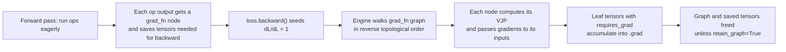

# Backpropagation and Gradient Descent Explained

> **Level:** Beginner to Advanced · **Study time:** ~100 min · **Prerequisites:** [Calculus for ML: Derivatives, Gradients and the Chain Rule](../00-foundations/03-calculus-and-gradients.md), [Linear Algebra for Machine Learning](../00-foundations/02-linear-algebra-for-ml.md), [Neural Networks from Scratch](./01-neural-networks-from-scratch.md)

## Table of contents

- [Why this matters](#why-this-matters)
- [Loss functions: a quick recap](#loss-functions-a-quick-recap)
- [Gradient descent: a quick recap](#gradient-descent-a-quick-recap)
- [Computational graphs](#computational-graphs)
- [The chain rule, applied backward](#the-chain-rule-applied-backward)
- [A complete worked example: backprop through a tiny network](#a-complete-worked-example-backprop-through-a-tiny-network)
- [Vectorized backprop and matrix shapes](#vectorized-backprop-and-matrix-shapes)
- [How autograd frameworks implement backprop](#how-autograd-frameworks-implement-backprop)
- [Batch, mini-batch and stochastic gradient descent](#batch-mini-batch-and-stochastic-gradient-descent)
- [Epochs, iterations and steps](#epochs-iterations-and-steps)
- [How the learning rate affects training](#how-the-learning-rate-affects-training)
- [How batch size affects training](#how-batch-size-affects-training)
- [Learning rate and batch size together: linear scaling and warmup](#learning-rate-and-batch-size-together-linear-scaling-and-warmup)
- [Gradient checking](#gradient-checking)
- [Going deeper: the compute and memory cost of backprop](#going-deeper-the-compute-and-memory-cost-of-backprop)
- [Going deeper: training at scale in production](#going-deeper-training-at-scale-in-production)
- [Common mistakes and misconceptions](#common-mistakes-and-misconceptions)
- [Interview questions and model answers](#interview-questions-and-model-answers)
- [Key takeaways](#key-takeaways)
- [Further reading](#further-reading)
- [Next](#next)

## Why this matters

Every neural network you will discuss in an AI/ML interview, from a small image classifier to a 7B-parameter LLM being fine-tuned with LoRA (a cheap fine-tuning method that trains small add-on matrices), learns the same way: compute a loss, use **backpropagation** to get the gradient of that loss with respect to every parameter, then take a **gradient descent** step. When training diverges, when a fine-tune produces NaNs ("not a number" values, the floating-point result of operations like $0/0$ or $\infty - \infty$), when doubling your GPUs makes the model worse, or when a training job runs out of memory, the explanation is almost always somewhere in this chapter. Interviewers ask "explain backpropagation" not because the definition is hard, but because a precise answer (computational graph, chain rule, reverse-mode, cached activations, vector-Jacobian products) separates people who have trained models from people who have only called `.fit()`. And "how do learning rate and batch size affect training?" is one of the most common follow-ups because it tests whether you can reason about real training runs, not just formulas.

---

## Loss functions: a quick recap

> **Analogy:** A loss function is a referee's scorecard. After each play (prediction), the referee writes down one number saying how bad it was. Training is the team watching the replay and adjusting so the next score is lower.

A **loss function** (also called a cost or objective) takes the model's prediction and the true answer and returns a single number: how wrong the prediction was. Lower is better. Training means finding parameters that make the average loss over the training data small.

The three you need for this chapter (the full menu, and how to choose, lives in [Loss Functions](./04-loss-functions.md) and [Softmax, Entropy, Cross-Entropy and KL Divergence](../00-foundations/05-softmax-entropy-cross-entropy-and-kl-divergence.md)):

| Loss | Formula (one example) | Typical use | Running example |
|---|---|---|---|
| Mean squared error (MSE) | $(\hat{y} - y)^2$ | Regression | House prices |
| Binary cross-entropy (BCE) | $-[y \ln \hat{y} + (1-y)\ln(1-\hat{y})]$ | Two-class classification | Spam filter |
| Cross-entropy (CE) | $-\ln \hat{p}_{\text{true class}}$ | Multi-class, next-token prediction | LLM pretraining |

Symbols:

- $y$: the true label (for BCE, 1 = spam, 0 = not spam).
- $\hat{y}$: the model's prediction (for BCE, the predicted probability of spam).
- $\ln$: natural logarithm.
- $\hat{p}_{\text{true class}}$: the probability the model assigned to the correct class.

Tiny BCE example. The email is spam ($y = 1$), so BCE reduces to $-\ln \hat{y}$:

- Model says $\hat{y} = 0.9$: loss $= -\ln 0.9 = 0.1054$. Confident and right, small loss.
- Model says $\hat{y} = 0.1$: loss $= -\ln 0.1 = 2.3026$. Confident and wrong, large loss.

What matters for backprop: the loss is a **scalar** (a single number) that depends on every parameter. That single-number output is exactly why backpropagation is so efficient, as you will see.

---

## Gradient descent: a quick recap

> **Analogy:** You are standing on a foggy hillside and want to reach the valley. You cannot see the valley, but you can feel the slope under your feet. So you take a step in the steepest downhill direction, feel again, and repeat. The size of each step is the learning rate.

The **gradient** of the loss, written $\nabla_\theta L$, is the vector of partial derivatives of the loss with respect to each parameter. It points in the direction in which the loss increases fastest. (Full background in [Calculus for ML](../00-foundations/03-calculus-and-gradients.md).) **Gradient descent** moves the parameters a small amount in the opposite direction:

$$
\theta \leftarrow \theta - \eta \, \nabla_\theta L(\theta)
$$

- $\theta$ (theta): all model parameters (weights and biases) stacked into one vector.
- $\eta$ (eta): the **learning rate**, a positive number that sets the step size.
- $\nabla_\theta L(\theta)$: the gradient of the loss with respect to the parameters.
- $\leftarrow$: "replace with". This is one update, also called one **step**.

**Worked example (house prices).** A one-parameter model predicts price from size: $\hat{y} = w x$. One house has size $x = 2$ (thousand square feet) and price $y = 6$ (hundred thousand dollars). Loss is $L = (wx - y)^2$, so $\frac{dL}{dw} = 2(wx - y)\,x$.

1. Start at $w = 1$. Prediction $= 1 \times 2 = 2$. Error $= 2 - 6 = -4$. Loss $= (-4)^2 = 16$.
2. Gradient $= 2 \times (-4) \times 2 = -16$. Negative means "increasing $w$ reduces the loss".
3. Step with $\eta = 0.05$: $w \leftarrow 1 - 0.05 \times (-16) = 1 + 0.8 = 1.8$.
4. New prediction $= 1.8 \times 2 = 3.6$. Error $= -2.4$. Loss $= 5.76$. Down from 16.

Repeat and $w$ approaches 3, where the loss is 0. For one parameter, the derivative was easy to write by hand. For a network with 7 billion parameters arranged in dozens of layers, you need a systematic, efficient way to compute all 7 billion partial derivatives at once. That method is backpropagation.

> **Senior insight:** Keep the two ideas separate. **Backpropagation** computes gradients. **Gradient descent** (or Adam, or any optimizer) uses gradients to update parameters. You can backprop without gradient descent (for example, to compute saliency maps, which show which input pixels most affect a prediction) and you can do gradient descent with gradients from other sources (finite differences, closed forms). Interviewers notice when candidates blur the two.

---

## Computational graphs

> **Analogy:** A computational graph is a recipe written as a flowchart. Each box is one simple operation ("multiply", "add", "square"), and arrows show which results feed into which. To figure out how much the final dish depends on the amount of salt, you trace the arrows back from the dish to the salt.

A **computational graph** is a directed acyclic graph (a network of nodes and one-way arrows with no loops) where each node is an elementary operation and each edge carries a value. Any neural network forward pass, however large, is just a very big computational graph built from small pieces like `matmul`, `add`, `relu`, `exp` and `log`.

Take the simplest regression loss with a bias: $L = (wx + b - y)^2$. Break it into elementary steps with intermediate names:

$$
u = w x, \quad z = u + b, \quad e = z - y, \quad L = e^2
$$

```text
   w ──┐
       (×)── u ──┐
   x ──┘         (+)── z ──┐
            b ───┘         (-)── e ──(square)── L
                      y ───┘
```

The **forward pass** evaluates the graph from inputs to the loss. With $w = 2, x = 3, b = 1, y = 10$:

| Node | Computation | Value |
|---|---|---|
| $u$ | $2 \times 3$ | 6 |
| $z$ | $6 + 1$ | 7 |
| $e$ | $7 - 10$ | -3 |
| $L$ | $(-3)^2$ | 9 |

Each node only needs to know one thing for the backward pass: its **local derivative**, the derivative of its output with respect to each of its inputs. Those are trivial:

| Node | Local derivatives |
|---|---|
| $u = wx$ | $\partial u/\partial w = x = 3$, $\ \partial u/\partial x = w = 2$ |
| $z = u + b$ | $\partial z/\partial u = 1$, $\ \partial z/\partial b = 1$ |
| $e = z - y$ | $\partial e/\partial z = 1$ |
| $L = e^2$ | $\partial L/\partial e = 2e = -6$ |

The trick of backprop is to combine these local derivatives with the chain rule, walking backward through the graph.

---

## The chain rule, applied backward

> **Analogy:** A company misses its profit target. The CEO asks each division head "how much of this is on you?" Each division head asks their managers the same, and so on down. Each person only needs to know two things: how much blame came down to them from above, and how much of their own output each of their reports was responsible for. Multiply those, pass it down. That is backpropagation.

The **chain rule** says that if $L$ depends on $e$, and $e$ depends on $z$, then

$$
\frac{\partial L}{\partial z} = \frac{\partial L}{\partial e} \cdot \frac{\partial e}{\partial z}
$$

- $\frac{\partial L}{\partial e}$: the **upstream gradient**, how sensitive the loss is to this node's output. It arrives from the node above.
- $\frac{\partial e}{\partial z}$: the **local gradient** of this node.
- Their product is the **downstream gradient**, which is passed further back.

**Backpropagation** (short for "backward propagation of errors") is the algorithm that applies this rule node by node, starting from the loss and moving toward the inputs, so that every intermediate result is computed once and reused. It was popularized for neural networks by "Learning representations by back-propagating errors" (Rumelhart, Hinton and Williams, 1986), though the underlying reverse-mode differentiation idea is older (Linnainmaa, 1970; Werbos, 1974).

Back to our graph. We start with $\frac{\partial L}{\partial L} = 1$ (the "seed") and walk backward:

| Step | Gradient | Computation (upstream × local) | Value |
|---|---|---|---|
| 1 | $\partial L/\partial e$ | $2e$ | $2 \times (-3) = -6$ |
| 2 | $\partial L/\partial z$ | $-6 \times 1$ | $-6$ |
| 3 | $\partial L/\partial b$ | $-6 \times 1$ | $-6$ |
| 4 | $\partial L/\partial u$ | $-6 \times 1$ | $-6$ |
| 5 | $\partial L/\partial w$ | $-6 \times x = -6 \times 3$ | $-18$ |
| 6 | $\partial L/\partial x$ | $-6 \times w = -6 \times 2$ | $-12$ |

Sanity check by direct differentiation: $\frac{\partial L}{\partial w} = 2(wx + b - y)\,x = 2 \times (-3) \times 3 = -18$. Matches.

### Four patterns worth memorizing

Once you see these, you can backprop through almost anything in your head:

| Operation in forward pass | What it does to the gradient in the backward pass |
|---|---|
| **Add** ($z = a + b$) | **Distributes**: both $a$ and $b$ receive the upstream gradient unchanged |
| **Multiply** ($z = a \cdot b$) | **Swaps**: $a$ gets upstream × $b$, $b$ gets upstream × $a$ |
| **Max / ReLU** ($z = \max(a, b)$) | **Routes**: the winner gets the whole gradient, the loser gets 0 |
| **Fan-out** (a value used in two places) | **Sums**: the gradients arriving from each use are added together |

The fan-out rule is the one people forget. It is the reason gradients **accumulate** (`+=`) rather than overwrite, and it is why biases (which are broadcast across every example in a batch) end up with gradients that are sums over the batch.

> **Common mistake:** Thinking backprop computes the derivative of the network as a symbolic formula. It does not. It computes numeric gradient values at one specific point (the current parameters and this batch of data), reusing numbers stored during the forward pass.

---

## A complete worked example: backprop through a tiny network

Now the full thing: a real two-layer network, every partial derivative, one gradient descent step, and a check that the loss went down.

### The setup: a tiny spam filter

Each email is described by two features:

- $x_1 = 1.0$: how often the word "free" appears (scaled).
- $x_2 = 2.0$: number of links (scaled).

This email is spam: $y = 1$.

The network has 2 inputs, 2 hidden neurons with **ReLU** activation ($\text{ReLU}(z) = \max(0, z)$), and 1 output neuron with **sigmoid** activation ($\sigma(z) = \frac{1}{1 + e^{-z}}$) that produces a spam probability. The loss is BCE. (Neurons and activations are defined in [Neural Networks from Scratch](./01-neural-networks-from-scratch.md).)

```text
  inputs          hidden layer (ReLU)            output (sigmoid)       loss

  x1 = 1.0 ─┬── w11 ──►┐
            │          (z1) ─ReLU─► a1 ── v1 ──►┐
  x2 = 2.0 ─┼── w12 ──►┘   (+b1)               │
            │                                  (z3) ─σ─► ŷ ──► L = BCE(ŷ, y=1)
            ├── w21 ──►┐                       │   (+c)
            │          (z2) ─ReLU─► a2 ── v2 ──►┘
            └── w22 ──►┘   (+b2)
```

Nine parameters, initial values chosen by hand so the arithmetic stays readable:

| Hidden neuron 1 | Hidden neuron 2 | Output neuron |
|---|---|---|
| $w_{11} = 0.5$ | $w_{21} = 0.3$ | $v_1 = 0.6$ |
| $w_{12} = -0.2$ | $w_{22} = 0.1$ | $v_2 = -0.5$ |
| $b_1 = 0.1$ | $b_2 = -0.1$ | $c = 0.2$ |

### Forward pass (save every intermediate value)

$$
z_1 = w_{11}x_1 + w_{12}x_2 + b_1 = 0.5(1) + (-0.2)(2) + 0.1 = 0.5 - 0.4 + 0.1 = 0.2
$$

$$
a_1 = \text{ReLU}(0.2) = 0.2
$$

$$
z_2 = w_{21}x_1 + w_{22}x_2 + b_2 = 0.3(1) + 0.1(2) - 0.1 = 0.3 + 0.2 - 0.1 = 0.4
$$

$$
a_2 = \text{ReLU}(0.4) = 0.4
$$

$$
z_3 = v_1 a_1 + v_2 a_2 + c = 0.6(0.2) + (-0.5)(0.4) + 0.2 = 0.12 - 0.20 + 0.20 = 0.12
$$

$$
\hat{y} = \sigma(0.12) = \frac{1}{1 + e^{-0.12}} = \frac{1}{1 + 0.88692} = 0.52996 \approx 0.5300
$$

$$
L = -\ln(0.52996) = 0.6349
$$

The network thinks this spam email is only 53% likely to be spam. The loss of 0.6349 says "could be much better". From here on, values are rounded to 4 decimal places.

### Backward pass, step by step

**Step 1: loss with respect to the prediction.** BCE is $L = -[y\ln\hat{y} + (1-y)\ln(1-\hat{y})]$, so

$$
\frac{\partial L}{\partial \hat{y}} = -\frac{y}{\hat{y}} + \frac{1-y}{1-\hat{y}} = -\frac{1}{0.52996} + 0 = -1.8869
$$

Negative: increasing $\hat{y}$ would reduce the loss. Correct for a spam email.

**Step 2: through the sigmoid.** The sigmoid's derivative is $\sigma'(z) = \sigma(z)(1 - \sigma(z))$:

$$
\frac{\partial \hat{y}}{\partial z_3} = 0.52996 \times (1 - 0.52996) = 0.52996 \times 0.47004 = 0.2491
$$

$$
\frac{\partial L}{\partial z_3} = \frac{\partial L}{\partial \hat{y}} \cdot \frac{\partial \hat{y}}{\partial z_3} = -1.8869 \times 0.2491 = -0.4700
$$

Terminology: $z_3$, the raw score that goes *into* the sigmoid, is called a **logit**. Loss functions with "WithLogits" in their name expect this raw score, not a probability.

Notice $-0.4700 = 0.5300 - 1 = \hat{y} - y$. That is not a coincidence: for sigmoid plus BCE, $\frac{\partial L}{\partial z_3} = \hat{y} - y$ exactly, because the $\hat{y}(1-\hat{y})$ from the sigmoid cancels the denominators from the log. This clean "prediction minus target" gradient is why frameworks fuse them (`BCEWithLogitsLoss`, and softmax plus cross-entropy in `CrossEntropyLoss`), which is also more numerically stable.

**Step 3: output-layer parameters.** $z_3 = v_1 a_1 + v_2 a_2 + c$. Multiply "swaps", add "distributes":

$$
\frac{\partial L}{\partial v_1} = \frac{\partial L}{\partial z_3} \cdot a_1 = -0.4700 \times 0.2 = -0.0940
$$

$$
\frac{\partial L}{\partial v_2} = \frac{\partial L}{\partial z_3} \cdot a_2 = -0.4700 \times 0.4 = -0.1880
$$

$$
\frac{\partial L}{\partial c} = \frac{\partial L}{\partial z_3} \cdot 1 = -0.4700
$$

**Step 4: back into the hidden activations.** Same multiply rule, now with respect to $a_1$ and $a_2$:

$$
\frac{\partial L}{\partial a_1} = \frac{\partial L}{\partial z_3} \cdot v_1 = -0.4700 \times 0.6 = -0.2820
$$

$$
\frac{\partial L}{\partial a_2} = \frac{\partial L}{\partial z_3} \cdot v_2 = -0.4700 \times (-0.5) = 0.2350
$$

**Step 5: through the ReLUs.** $\text{ReLU}'(z) = 1$ if $z > 0$, else 0. Both $z_1 = 0.2$ and $z_2 = 0.4$ are positive, so the gradient passes straight through:

$$
\frac{\partial L}{\partial z_1} = -0.2820 \times 1 = -0.2820, \qquad \frac{\partial L}{\partial z_2} = 0.2350 \times 1 = 0.2350
$$

(If $z_2$ had been negative, $\frac{\partial L}{\partial z_2}$ would be 0 and none of neuron 2's weights would learn from this example. Keep that in mind for the "dying ReLU" discussion in [Vanishing and Exploding Gradients](./05-vanishing-exploding-gradients-initialization-normalization-and-residuals.md).)

**Step 6: first-layer parameters.** $z_1 = w_{11}x_1 + w_{12}x_2 + b_1$, so the local gradients are the inputs:

$$
\frac{\partial L}{\partial w_{11}} = -0.2820 \times x_1 = -0.2820 \times 1 = -0.2820
$$

$$
\frac{\partial L}{\partial w_{12}} = -0.2820 \times x_2 = -0.2820 \times 2 = -0.5640
$$

$$
\frac{\partial L}{\partial b_1} = -0.2820 \times 1 = -0.2820
$$

$$
\frac{\partial L}{\partial w_{21}} = 0.2350 \times 1 = 0.2350, \quad \frac{\partial L}{\partial w_{22}} = 0.2350 \times 2 = 0.4700, \quad \frac{\partial L}{\partial b_2} = 0.2350
$$

### All nine gradients at a glance

| Parameter | Value | Gradient | Meaning of the sign |
|---|---|---|---|
| $w_{11}$ | 0.5 | -0.2820 | increase it |
| $w_{12}$ | -0.2 | -0.5640 | increase it (strongest push: $x_2$ is large) |
| $b_1$ | 0.1 | -0.2820 | increase it |
| $w_{21}$ | 0.3 | +0.2350 | decrease it |
| $w_{22}$ | 0.1 | +0.4700 | decrease it |
| $b_2$ | -0.1 | +0.2350 | decrease it |
| $v_1$ | 0.6 | -0.0940 | increase it |
| $v_2$ | -0.5 | -0.1880 | increase it (make it less negative) |
| $c$ | 0.2 | -0.4700 | increase it |

Read it like an engineer. Neuron 1 feeds the output with a positive weight ($v_1 = 0.6$), so the network wants neuron 1 to fire more. Neuron 2 feeds the output with a negative weight ($v_2 = -0.5$), so the network wants neuron 2 to fire less. That is the "blame assignment" flowing backward.

### One gradient descent step

Use $\eta = 0.1$ and $\theta \leftarrow \theta - 0.1 \times \text{gradient}$:

| Parameter | Old | Update | New |
|---|---|---|---|
| $w_{11}$ | 0.5 | $0.5 - 0.1(-0.2820)$ | 0.5282 |
| $w_{12}$ | -0.2 | $-0.2 - 0.1(-0.5640)$ | -0.1436 |
| $b_1$ | 0.1 | $0.1 - 0.1(-0.2820)$ | 0.1282 |
| $w_{21}$ | 0.3 | $0.3 - 0.1(0.2350)$ | 0.2765 |
| $w_{22}$ | 0.1 | $0.1 - 0.1(0.4700)$ | 0.0530 |
| $b_2$ | -0.1 | $-0.1 - 0.1(0.2350)$ | -0.1235 |
| $v_1$ | 0.6 | $0.6 - 0.1(-0.0940)$ | 0.6094 |
| $v_2$ | -0.5 | $-0.5 - 0.1(-0.1880)$ | -0.4812 |
| $c$ | 0.2 | $0.2 - 0.1(-0.4700)$ | 0.2470 |

New forward pass:

- $z_1 = 0.5282 - 0.2872 + 0.1282 = 0.3692$, so $a_1 = 0.3692$
- $z_2 = 0.2765 + 0.1060 - 0.1235 = 0.2590$, so $a_2 = 0.2590$
- $z_3 = 0.6094(0.3692) - 0.4812(0.2590) + 0.2470 = 0.2250 - 0.1246 + 0.2470 = 0.3474$
- $\hat{y} = \sigma(0.3474) = 0.5860$, and $L = -\ln(0.5860) = 0.5345$

**Loss went from 0.6349 to 0.5345, and the spam probability rose from 0.530 to 0.586.** One step of learning, fully by hand.

> **Senior insight:** Try the same step with $\eta = 0.5$. The loss drops further on this example (to about 0.284), but $z_2$ becomes $-0.305$, so hidden neuron 2 switches off for this input and stops receiving gradient from it. A big learning rate can push ReLU units into a region where they never activate again. Faster progress on one example is not the same as healthier training.

### Verify with code: a 50-line autograd engine

The best way to understand how frameworks do this is to build a miniature one. This is in the spirit of Andrej Karpathy's well-known `micrograd` project: each `Value` remembers its parents and its local gradients, and `backward()` applies the chain rule in reverse topological order (a topological order lists every node after all the nodes it was computed from, so reversing it guarantees a node's gradient is complete before it is passed further back). Pure Python, no installs.

```python
import math

class Value:
    """A scalar that remembers how it was computed, so it can backpropagate."""
    def __init__(self, data, parents=(), local_grads=()):
        self.data = data            # forward value
        self.grad = 0.0             # dL/dself, filled in by backward()
        self._parents = parents     # the Values this one was computed from
        self._local = local_grads   # d(self)/d(parent) for each parent

    def __add__(self, other):
        other = other if isinstance(other, Value) else Value(other)
        return Value(self.data + other.data, (self, other), (1.0, 1.0))

    def __mul__(self, other):
        other = other if isinstance(other, Value) else Value(other)
        return Value(self.data * other.data, (self, other), (other.data, self.data))

    def relu(self):
        return Value(max(0.0, self.data), (self,), (1.0 if self.data > 0 else 0.0,))

    def sigmoid(self):
        s = 1 / (1 + math.exp(-self.data))
        return Value(s, (self,), (s * (1 - s),))

    def log(self):
        return Value(math.log(self.data), (self,), (1 / self.data,))

    def __neg__(self):
        return self * -1.0

    def backward(self):
        # 1) topological order: every node appears after the nodes it depends on
        order, seen = [], set()
        def visit(v):
            if id(v) not in seen:
                seen.add(id(v))
                for p in v._parents:
                    visit(p)
                order.append(v)
        visit(self)
        # 2) seed dL/dL = 1, then walk the graph in reverse
        self.grad = 1.0
        for v in reversed(order):
            for parent, local in zip(v._parents, v._local):
                parent.grad += v.grad * local   # chain rule; += handles fan-out

# The tiny spam network from the worked example
x1, x2, y = 1.0, 2.0, 1.0
w11, w12, b1 = Value(0.5), Value(-0.2), Value(0.1)
w21, w22, b2 = Value(0.3), Value(0.1), Value(-0.1)
v1, v2, c = Value(0.6), Value(-0.5), Value(0.2)

a1 = (w11 * x1 + w12 * x2 + b1).relu()
a2 = (w21 * x1 + w22 * x2 + b2).relu()
y_hat = (v1 * a1 + v2 * a2 + c).sigmoid()
loss = -(y_hat.log())          # BCE with y = 1 reduces to -log(y_hat)

loss.backward()
print(f"loss = {loss.data:.4f}")
for name, p in [("w11", w11), ("w12", w12), ("b1", b1), ("w21", w21),
                ("w22", w22), ("b2", b2), ("v1", v1), ("v2", v2), ("c", c)]:
    print(f"dL/d{name} = {p.grad:+.4f}")
# loss = 0.6349
# dL/dw11 = -0.2820
# dL/dw12 = -0.5640
# dL/db1 = -0.2820
# dL/dw21 = +0.2350
# dL/dw22 = +0.4700
# dL/db2 = +0.2350
# dL/dv1 = -0.0940
# dL/dv2 = -0.1880
# dL/dc = -0.4700
```

Every number matches the hand calculation. Notice that this engine never "knows" the network's formula. It only knows how to differentiate `+`, `*`, `relu`, `sigmoid` and `log` locally, and the chain rule stitches the rest together.

The same check in PyTorch (`pip install torch`), using matrices for the layers:

```python
import torch
import torch.nn.functional as F

x = torch.tensor([1.0, 2.0])
y = torch.tensor([1.0])
W1 = torch.tensor([[0.5, -0.2],     # row = hidden neuron, column = input
                   [0.3,  0.1]], requires_grad=True)
b1 = torch.tensor([0.1, -0.1], requires_grad=True)
W2 = torch.tensor([[0.6, -0.5]], requires_grad=True)
b2 = torch.tensor([0.2], requires_grad=True)

h = torch.relu(W1 @ x + b1)
logit = W2 @ h + b2
loss = F.binary_cross_entropy_with_logits(logit, y)   # fused sigmoid + BCE
loss.backward()

print(round(loss.item(), 4))   # 0.6349
print(W1.grad)                 # approx [[-0.2820, -0.5640], [0.2350, 0.4700]]
print(W2.grad, b2.grad)        # approx [[-0.0940, -0.1880]] and [-0.4700]
```

---

## Vectorized backprop and matrix shapes

Real networks do not loop over scalar neurons. They process a **batch** of $B$ examples at once with matrix multiplications, because GPUs are extremely fast at those. Backprop works exactly the same way, just with matrices.

### The forward pass with shapes

Convention (rows are examples, as in NumPy and PyTorch):

$$
Z_1 = X W_1 + b_1, \quad A_1 = \text{ReLU}(Z_1), \quad Z_2 = A_1 W_2 + b_2, \quad P = \sigma(Z_2)
$$

Using the spam filter with $B = 32$ emails, $d_{in} = 3$ features, $d_h = 4$ hidden units, $d_{out} = 1$:

| Tensor | Shape | Example shape |
|---|---|---|
| $X$ (inputs) | $(B, d_{in})$ | (32, 3) |
| $W_1$ | $(d_{in}, d_h)$ | (3, 4) |
| $b_1$ | $(d_h,)$, broadcast over rows | (4,) |
| $Z_1, A_1$ | $(B, d_h)$ | (32, 4) |
| $W_2$ | $(d_h, d_{out})$ | (4, 1) |
| $Z_2, P, Y$ | $(B, d_{out})$ | (32, 1) |

### The backward pass with shapes

With mean BCE over the batch, the fused sigmoid plus BCE gradient from the worked example becomes, per row, $(P - Y)$, divided by $B$ because of the mean:

| Gradient | Formula | Shape | Why |
|---|---|---|---|
| $dZ_2$ | $(P - Y)/B$ | (32, 1) | sigmoid + BCE, averaged |
| $dW_2$ | $A_1^\top dZ_2$ | (4, 1) | matches $W_2$ |
| $db_2$ | $\sum_{\text{rows}} dZ_2$ | (1,) | bias was broadcast (fan-out), so sum |
| $dA_1$ | $dZ_2 W_2^\top$ | (32, 4) | matches $A_1$ |
| $dZ_1$ | $dA_1 \odot \mathbb{1}[Z_1 > 0]$ | (32, 4) | ReLU mask, elementwise |
| $dW_1$ | $X^\top dZ_1$ | (3, 4) | matches $W_1$ |
| $db_1$ | $\sum_{\text{rows}} dZ_1$ | (4,) | sum over batch |

Symbols: $dZ$ is shorthand for $\frac{\partial L}{\partial Z}$; $\top$ is transpose; $\odot$ is elementwise multiplication; $\mathbb{1}[Z_1 > 0]$ is a 0/1 mask that is 1 wherever $Z_1$ was positive.

### Where $dW = X^\top dZ$ comes from

For $Z = XW$, each entry is $Z_{bj} = \sum_i X_{bi} W_{ij}$. Weight $W_{ij}$ appears in every row $b$ of column $j$ (fan-out across the batch), and its local derivative there is $X_{bi}$. Summing over the fan-out:

$$
\frac{\partial L}{\partial W_{ij}} = \sum_{b} X_{bi} \frac{\partial L}{\partial Z_{bj}} = (X^\top dZ)_{ij}
$$

Similarly, $\frac{\partial L}{\partial X_{bi}} = \sum_j \frac{\partial L}{\partial Z_{bj}} W_{ij} = (dZ\, W^\top)_{bi}$.

> **Interview tip:** If you forget the formulas, derive them from shapes. The gradient of a parameter always has the same shape as the parameter. $dW_1$ must be (3, 4). You have $X$ (32, 3) and $dZ_1$ (32, 4). The only way to multiply them into (3, 4) is $X^\top dZ_1$. This "shape game" is how many practitioners check their backward code.

> **Senior insight:** PyTorch's `nn.Linear` stores its weight as `(out_features, in_features)` and computes `x @ W.T + b`, so its gradient is `dZ.T @ X` with shape `(out, in)`. Same math, transposed storage. Know which convention your code uses before you debug a shape error.

### From scratch in NumPy

A complete mini-batch training loop for the spam filter, with backprop written by hand (`pip install numpy`):

```python
import numpy as np

rng = np.random.default_rng(0)

# Synthetic spam data (illustrative): 3 features per email, label 1 = spam
N, d_in, d_h = 1000, 3, 4
X = rng.normal(size=(N, d_in))
true_w = np.array([2.0, -1.0, 0.5])
Y = ((X @ true_w + 0.3 * rng.normal(size=N)) > 0).astype(float).reshape(-1, 1)

W1 = rng.normal(scale=0.5, size=(d_in, d_h)); b1 = np.zeros(d_h)
W2 = rng.normal(scale=0.5, size=(d_h, 1));    b2 = np.zeros(1)

def sigmoid(z):
    return 1 / (1 + np.exp(-z))

lr, batch_size, epochs = 0.5, 32, 20
for epoch in range(epochs):
    perm = rng.permutation(N)                    # reshuffle every epoch
    for start in range(0, N, batch_size):
        idx = perm[start:start + batch_size]
        Xb, Yb, B = X[idx], Y[idx], len(idx)

        # forward (cache Z1 and A1, the backward pass needs them)
        Z1 = Xb @ W1 + b1                        # (B, d_h)
        A1 = np.maximum(0, Z1)                   # (B, d_h)
        P = sigmoid(A1 @ W2 + b2)                # (B, 1)

        # backward
        dZ2 = (P - Yb) / B                       # (B, 1)
        dW2 = A1.T @ dZ2                         # (d_h, 1)
        db2 = dZ2.sum(axis=0)                    # (1,)
        dA1 = dZ2 @ W2.T                         # (B, d_h)
        dZ1 = dA1 * (Z1 > 0)                     # (B, d_h)
        dW1 = Xb.T @ dZ1                         # (d_in, d_h)
        db1 = dZ1.sum(axis=0)                    # (d_h,)

        # gradient descent step
        W1 -= lr * dW1; b1 -= lr * db1
        W2 -= lr * dW2; b2 -= lr * db2

    P_all = sigmoid(np.maximum(0, X @ W1 + b1) @ W2 + b2)
    loss = -np.mean(Y * np.log(P_all + 1e-12) + (1 - Y) * np.log(1 - P_all + 1e-12))
    acc = np.mean((P_all > 0.5) == Y)
    print(f"epoch {epoch:2d}  loss {loss:.3f}  acc {acc:.3f}")
```

### The standard PyTorch version

The same model in idiomatic PyTorch. Autograd writes the backward pass for you:

```python
import torch
from torch import nn
from torch.utils.data import DataLoader, TensorDataset

torch.manual_seed(0)
X = torch.randn(1000, 3)
y = ((X @ torch.tensor([2.0, -1.0, 0.5]) + 0.3 * torch.randn(1000)) > 0).float().unsqueeze(1)
loader = DataLoader(TensorDataset(X, y), batch_size=32, shuffle=True)

model = nn.Sequential(nn.Linear(3, 4), nn.ReLU(), nn.Linear(4, 1))
loss_fn = nn.BCEWithLogitsLoss()
opt = torch.optim.SGD(model.parameters(), lr=0.5)

for epoch in range(20):
    for xb, yb in loader:
        loss = loss_fn(model(xb), yb)   # forward: builds the graph
        opt.zero_grad()                 # clear old .grad (they accumulate!)
        loss.backward()                 # backward: fills p.grad for every parameter
        opt.step()                      # gradient descent: p -= lr * p.grad
```

---

## How autograd frameworks implement backprop

**Automatic differentiation** (autodiff, or **autograd** in PyTorch's naming) is a family of techniques that compute exact derivatives of programs by applying the chain rule to the elementary operations the program executes. It is neither of the two things people often confuse it with:

| Method | How it works | Accuracy | Cost for $n$ parameters, scalar loss | Used for |
|---|---|---|---|---|
| **Numerical differentiation** | Nudge each input, measure change in output | Approximate (rounding and truncation error) | $\sim n$ extra forward passes | Gradient checking only |
| **Symbolic differentiation** | Manipulate formulas like a computer algebra system | Exact, but expressions can blow up in size | Can be very expensive | Math software (SymPy, Mathematica) |
| **Forward-mode autodiff** | Carry derivatives forward alongside values | Exact (to floating point) | $\sim n$ forward passes (one per input direction) | Few inputs, many outputs |
| **Reverse-mode autodiff** (backprop) | Record the forward pass, then propagate gradients backward | Exact (to floating point) | $\sim 1$ backward pass, roughly 2x a forward pass | Neural network training |

### Why reverse mode wins for neural networks

Training has **millions or billions of inputs** (the parameters) and **one output** (the scalar loss). Forward mode answers "if I nudge this one input, how do all outputs change?", so it needs one pass per parameter. Reverse mode answers "how does this one output depend on all inputs?", so it gets every parameter's gradient in a single backward pass. For a 7B-parameter model, that is the difference between one backward pass and 7 billion forward passes.

The general rule: for a function from $n$ inputs to $m$ outputs, forward mode costs about $n$ passes and reverse mode about $m$ passes. Neural network training has $m = 1$.

### Vector-Jacobian products: what backward really computes

The **Jacobian** of a function with vector input and vector output is the matrix of all partial derivatives of outputs with respect to inputs. For a layer mapping a 4,096-dimensional vector to a 4,096-dimensional vector, the Jacobian has $4096^2 \approx 16.8$ million entries, per example.

Frameworks never build it. Each operation's backward function computes a **vector-Jacobian product (VJP)**: given the upstream gradient vector $v = \frac{\partial L}{\partial \text{output}}$, it returns $v^\top J = \frac{\partial L}{\partial \text{input}}$ directly. For an elementwise op like ReLU, the Jacobian is diagonal, so the VJP is just an elementwise multiply by the mask. For a matrix multiply, the VJP is the $dZ\, W^\top$ and $X^\top dZ$ you saw above. (Forward mode, correspondingly, computes Jacobian-vector products, JVPs. JAX exposes both as `jax.vjp` and `jax.jvp`.)

### What PyTorch does under the hood



Key facts to know for interviews:

- **Define-by-run (dynamic graph).** PyTorch records the graph as your Python code executes, so `if` statements and loops just work, and the graph can differ every iteration. Older TensorFlow 1.x built a **static graph** first and ran it later. JAX traces Python functions into a graph for transformation and compilation (`jax.grad`, `jax.jit`).
- **Leaf tensors** are tensors you created (like parameters) rather than results of operations. Only leaves with `requires_grad=True` keep `.grad` by default. Intermediate gradients are freed (use `.retain_grad()` to inspect one).
- **Gradients accumulate.** `.backward()` adds into `.grad`, which is why you call `optimizer.zero_grad()` each step. This is deliberate: it makes gradient accumulation across micro-batches trivial.
- **Saved tensors cost memory.** Every op saves what its backward needs (the input of a matmul, the mask of a ReLU, the output of a sigmoid). This is the activation memory discussed below.
- **In-place ops can break backward.** If you modify a tensor in place after an op saved it, PyTorch's version counter usually detects the change and raises an error during `backward()` rather than silently computing wrong gradients (writes that bypass autograd, such as through `.data`, are not caught).
- **Turning it off.** `torch.no_grad()` and `torch.inference_mode()` stop graph recording, which saves memory and time at inference. `.detach()` cuts a tensor out of the graph (gradients will not flow through it).
- **Custom backward.** `torch.autograd.Function` lets you define your own forward and backward, for fused kernels or tricks like the straight-through estimator used in [quantization-aware training](../07-model-compression/03-ptq-vs-qat-and-calibration.md).
- **Non-differentiable ops** (`argmax`, rounding, sampling a token) have zero or undefined gradients. Gradients do not flow through them, which matters for RL-style LLM training (see [Instruction Tuning, RLHF and DPO](../05-llms/02-instruction-tuning-rlhf-and-dpo.md)).

---

## Batch, mini-batch and stochastic gradient descent

> **Analogy:** To learn what voters think, you could interview every voter (accurate, slow), one random voter (fast, very noisy), or a random sample of 1,000 (fast and reasonably accurate). Gradient descent faces exactly this choice about training examples.

The true training objective is the average loss over all $N$ training examples:

$$
L(\theta) = \frac{1}{N}\sum_{i=1}^{N} \ell_i(\theta)
$$

- $\ell_i(\theta)$: the loss on example $i$.
- $N$: number of training examples.

Its gradient is the average of the per-example gradients. The three flavors of gradient descent differ only in how many examples they average before each update:

$$
g_B = \frac{1}{B}\sum_{i \in \text{batch}} \nabla_\theta \ell_i(\theta), \qquad \theta \leftarrow \theta - \eta\, g_B
$$

- $B$: the **batch size**, the number of examples used for one gradient estimate.
- $g_B$: the gradient estimated from that batch.

| Variant | Batch size | Gradient quality | Updates per pass over data | Pros | Cons | When used |
|---|---|---|---|---|---|---|
| **Batch (full-batch) GD** | $B = N$ | Exact | 1 | Deterministic, stable | Very slow per step, does not fit in memory for big data | Small datasets, convex problems, L-BFGS (a quasi-Newton optimizer) |
| **Stochastic GD (SGD)**, strict sense | $B = 1$ | Very noisy | $N$ | Many cheap updates, noise can help escape bad regions | Cannot use GPU parallelism, very noisy | Online learning, theory |
| **Mini-batch GD** | $1 < B < N$ (e.g. 32 to 4,096 examples, or millions of tokens for LLMs) | Noisy but useful | $N / B$ | GPU-efficient, good balance | Must tune $B$ with learning rate | Essentially all deep learning |

> **Common mistake:** In practice "SGD" almost always means mini-batch SGD. `torch.optim.SGD` does not care what batch size you feed it. When an interviewer says "SGD", clarify whether they mean the optimizer (plain SGD, optionally with momentum, but no per-parameter adaptive scaling) or batch size 1.

### Why noisy gradients still work

If the batch is sampled at random, $g_B$ is an **unbiased estimator** of the true gradient: on average it points the right way. It just has noise. If per-example gradients have variance $\sigma^2$, the mini-batch gradient's variance is about

$$
\text{Var}(g_B) \approx \frac{\sigma^2}{B}
$$

so its standard deviation shrinks like $1/\sqrt{B}$. A 4x larger batch only halves the noise.

**Tiny example (one parameter, illustrative numbers).** Four training emails produce per-example gradients $2, 4, -1, 3$. The full-batch gradient is $(2 + 4 - 1 + 3)/4 = 8/4 = 2$.

- Mini-batch $\{2, 4\}$: estimate $= 3$.
- Mini-batch $\{-1, 3\}$: estimate $= 1$.
- Average of the two estimates $= (3 + 1)/2 = 2$. Unbiased, but each single step is off.

Each mini-batch step points roughly downhill, and you get many more steps for the same compute. That trade almost always wins.

---

## Epochs, iterations and steps

These terms appear in every training config and log, and they are often used loosely:

| Term | Definition | Spam example |
|---|---|---|
| **Epoch** | One full pass over the training set | All 50,000 emails seen once |
| **Iteration** / **step** | One parameter update (one optimizer step) | One batch of 100 emails processed and weights updated |
| **Micro-batch** | The chunk processed in one forward/backward pass when using gradient accumulation or multiple devices | 25 emails on one GPU |
| **Global (effective) batch size** | Examples contributing to one update | micro-batch × accumulation steps × number of devices |

$$
\text{steps per epoch} = \left\lceil \frac{N}{B} \right\rceil
$$

- $\lceil \cdot \rceil$: round up (the last batch may be smaller unless you drop it).

Worked numbers:

- $N = 50{,}000$ emails, $B = 100$: steps per epoch $= 500$. Ten epochs $= 5{,}000$ steps.
- $N = 50{,}050$ emails, $B = 100$: $\lceil 500.5 \rceil = 501$ steps, with a final batch of 50 (or 500 steps if you set `drop_last=True`).
- Effective batch for an LLM fine-tune: 8 GPUs × micro-batch 4 sequences × 8 accumulation steps $= 256$ sequences per step. At 4,096 tokens per sequence that is $256 \times 4096 = 1{,}048{,}576$ tokens, about 1M tokens per step.

> **Senior insight:** Large-scale LLM pretraining usually measures progress in **tokens** and **steps**, not epochs, because the model often sees most of its data roughly once. When comparing runs with different batch sizes, compare at equal tokens (or examples) processed, not equal steps, or you will draw the wrong conclusion.

---

## How the learning rate affects training

> **Analogy:** The learning rate is your stride length on that foggy hillside. Tiny steps and you will be there next week. Huge steps and you leap over the valley and land higher up the opposite slope, possibly further away than you started.

The learning rate is usually the **single most important hyperparameter** (a setting you choose rather than learn). Its effects:

| Learning rate | What you see | Why |
|---|---|---|
| Too small | Loss decreases very slowly; may stall in plateaus | Steps are tiny relative to the distance to travel |
| Good | Loss falls quickly then steadily | Steps are as large as the curvature allows |
| Somewhat too large | Loss is noisy, bounces, plateaus at a higher value | Steps overshoot the bottom of the valley |
| Far too large | Loss explodes to inf or NaN | Overshoot grows each step (divergence) |

### A one-line demonstration

Take $L(w) = w^2$ (a bowl with minimum at 0). The gradient is $2w$, so one step is

$$
w \leftarrow w - \eta \cdot 2w = (1 - 2\eta)\,w
$$

Start at $w = 1$:

| $\eta$ | Multiplier $1 - 2\eta$ | Step 1 | Step 2 | Step 3 | Behavior |
|---|---|---|---|---|---|
| 0.1 | 0.8 | 0.8 | 0.64 | 0.512 | Smooth, steady convergence |
| 0.9 | -0.8 | -0.8 | 0.64 | -0.512 | Converges, but zig-zags across the valley |
| 1.1 | -1.2 | -1.2 | 1.44 | -1.728 | Diverges, growing oscillation |

Convergence needs $|1 - 2\eta| < 1$, that is $0 < \eta < 1$. In general, for a bowl with **curvature** $\lambda$ (the second derivative, how sharply the slope changes), gradient descent is stable only when

$$
\eta < \frac{2}{\lambda}
$$

Here $\lambda = 2$, giving $\eta < 1$. In a neural network the relevant $\lambda$ is the largest eigenvalue of the **Hessian** (the matrix of second derivatives), the sharpest direction in the loss landscape. The sharpest direction limits the learning rate for all directions, which is why plain gradient descent struggles on landscapes that are steep in some directions and flat in others. Momentum (which keeps a running average of recent gradients to smooth the path) and Adam (which additionally rescales each parameter's step by a running estimate of that parameter's gradient magnitude), covered in [Optimizers](./03-optimizers-sgd-momentum-adam-and-learning-rate-schedules.md), exist largely to fix this.

> **Senior insight:** Real networks do not sit politely inside the $2/\lambda$ bound. "Gradient Descent on Neural Networks Typically Occurs at the Edge of Stability" (Cohen et al., 2021) observed that, with full-batch gradient descent, the sharpness rises until it hovers around $2/\eta$, and training keeps making progress anyway. Practically: the learning rate partly controls *which* regions of the landscape training can settle in, not just how fast it moves.

### How to pick it in practice

- Start from a known-good default for the optimizer and architecture (published recipes), then sweep on a log scale (for example 1e-4, 3e-4, 1e-3, 3e-3).
- An **LR range test** (Smith, "Cyclical Learning Rates for Training Neural Networks", 2017) increases the learning rate over a short run (linearly in the original paper, exponentially in popular implementations such as fastai's `lr_find`) and picks a value somewhat below where the loss starts to blow up.
- Almost all modern training uses a **schedule** (warmup, then decay such as cosine). Schedules are covered in [Optimizers](./03-optimizers-sgd-momentum-adam-and-learning-rate-schedules.md). Warmup gets a short treatment below because it is tied to batch size.

---

## How batch size affects training

Batch size changes four things at once: gradient noise, hardware efficiency, the number of updates, and memory. That is why it is such a popular interview question.

| Aspect | Small batch (e.g. 32) | Large batch (e.g. 8,192) |
|---|---|---|
| Gradient noise | High | Low |
| Steps per epoch | Many | Few |
| Time per step | Short, but GPU may be underused | Longer, GPU well utilized |
| Wall-clock per epoch | Often slower (poor parallelism) | Often faster (if hardware scales) |
| Progress per example seen | Usually higher | Usually lower (diminishing returns) |
| Generalization (default hyperparameters) | Often good: noise acts as a regularizer (discourages fitting quirks of the training set) | Can be worse without retuning |
| Memory | Low | High (activations scale with $B$) |
| Best learning rate | Smaller | Larger (see linear scaling) |
| Batch-dependent layers | BatchNorm (normalizes each feature with the current batch's mean and variance) gets noisy statistics at very small $B$ | Fine |

### Convergence speed: the critical batch size

Doubling the batch halves the number of steps per epoch. Does it halve the number of steps to reach a given loss? Only up to a point.

"An Empirical Model of Large-Batch Training" (McCandlish et al., 2018) introduced the **gradient noise scale**, roughly the ratio of the gradient's variance to its squared magnitude. Below a **critical batch size** around that noise scale, doubling the batch nearly halves the steps needed (almost perfect scaling: you buy speed with parallel hardware). Above it, returns diminish sharply: you spend twice the compute per step for little reduction in steps.

A simplified form of their model (learning rate tuned for each batch size) says the steps needed to reach a target loss are

$$
S(B) \approx S_{\min}\left(1 + \frac{B_{\text{noise}}}{B}\right)
$$

- $S_{\min}$: the fewest steps possible (what an infinitely large batch would need).
- $B_{\text{noise}}$: the gradient noise scale, measured in examples.

**Worked example (illustrative), with $B_{\text{noise}} = 1{,}000$:**

| Batch $B$ | Steps $S / S_{\min}$ | Examples processed $S \cdot B$, in units of $S_{\min}$ |
|---|---|---|
| 250 | 5.0 | 1,250 |
| 500 | 3.0 | 1,500 |
| 1,000 | 2.0 | 2,000 |
| 4,000 | 1.25 | 5,000 |
| 8,000 | 1.125 | 9,000 |

Going from 250 to 500 cuts steps by 40% for 20% more total compute. Going from 4,000 to 8,000 cuts steps by only 10% while nearly doubling total compute. The noise scale also tends to grow as training progresses and the loss falls, which is one reason some large runs increase the batch size during training (the GPT-3 paper, Brown et al., 2020, describes ramping the batch size up early in training).

### Generalization: does noise help?

"On Large-Batch Training for Deep Learning: Generalization Gap and Sharp Minima" (Keskar et al., 2017) reported that large-batch training tended to generalize worse and argued it converges to **sharp minima** (narrow valleys where small parameter changes increase loss a lot), while small-batch noise steers toward **flat minima**. Later work showed much of this gap closes with proper tuning: "Train longer, generalize better" (Hoffer et al., 2017) and Goyal et al. (2017, below) trained with large batches without accuracy loss by adjusting the learning rate, warmup and training length. The durable lesson: **batch size and learning rate must be tuned together**; a "large batch generalizes worse" result often really means "large batch with an untuned learning rate".

A useful mental model from "A Bayesian Perspective on Generalization and Stochastic Gradient Descent" (Smith and Le, 2018): the scale of SGD noise is roughly proportional to $\eta / B$. Increase $B$ without increasing $\eta$ and you have reduced the noise (and the regularizing effect). This also explains "Don't Decay the Learning Rate, Increase the Batch Size" (Smith et al., 2018): growing $B$ has a similar effect on noise to shrinking $\eta$.

---

## Learning rate and batch size together: linear scaling and warmup

### The linear scaling rule

> **Linear scaling rule:** when you multiply the batch size by $k$, multiply the learning rate by $k$ (for SGD with or without momentum).

**Intuition.** Compare $k$ small steps, each with batch $B$ and learning rate $\eta$, to one big step with batch $kB$. If the gradient does not change much across those $k$ steps, the $k$ small steps move the weights by about $\eta \sum_{j=1}^{k} g_j$. The single big step uses the average gradient $\frac{1}{k}\sum_j g_j$, so to move the same distance it needs learning rate $k\eta$:

$$
k\eta \cdot \frac{1}{k}\sum_{j=1}^{k} g_j = \eta \sum_{j=1}^{k} g_j
$$

**Worked example.** "Accurate, Large Minibatch SGD: Training ImageNet in 1 Hour" (Goyal et al., 2017) used $\eta = 0.1 \times \frac{B}{256}$ for ResNet-50. At their largest batch of 8,192 (on 256 GPUs): $\eta = 0.1 \times \frac{8192}{256} = 0.1 \times 32 = 3.2$.

**When it breaks.**

- **Early in training**, gradients change rapidly, so the "gradients barely change over $k$ steps" assumption fails. A learning rate of 3.2 at random initialization can diverge immediately. Fix: warmup.
- **Beyond the critical batch size**, scaling the learning rate further stops helping and eventually destabilizes training.
- **Adaptive optimizers** (Adam, AdamW) do not follow the linear rule cleanly because they normalize gradient magnitudes. A **square-root scaling** rule ($\eta \propto \sqrt{B}$) is often a better starting point for them; see "On the SDEs and Scaling Rules for Adaptive Gradient Algorithms" (Malladi et al., 2022). Treat both rules as starting points for a sweep, not laws.
- For very large batches, layer-wise adaptive methods such as LARS ("Large Batch Training of Convolutional Networks", You et al., 2017) and LAMB ("Large Batch Optimization for Deep Learning: Training BERT in 76 minutes", You et al., 2019) scale each layer's update by the ratio of weight norm to update norm.

### Learning rate warmup

**Warmup** means starting with a small learning rate and increasing it (usually linearly) to the target over the first part of training. Goyal et al. used gradual warmup over the first 5 epochs; the original Transformer paper ("Attention Is All You Need", Vaswani et al., 2017) used 4,000 warmup steps. Nearly every LLM training and fine-tuning recipe uses warmup.

Linear warmup formula:

$$
\eta_t = \eta_{\text{peak}} \cdot \min\left(1, \frac{t}{T_{\text{warmup}}}\right)
$$

- $\eta_t$: learning rate at step $t$.
- $\eta_{\text{peak}}$: the target learning rate after warmup.
- $T_{\text{warmup}}$: number of warmup steps.

Illustrative numbers: $\eta_{\text{peak}} = 3 \times 10^{-4}$, $T_{\text{warmup}} = 1{,}000$.

- Step 100: $3\times10^{-4} \times 100/1000 = 3\times10^{-5}$
- Step 500: $3\times10^{-4} \times 0.5 = 1.5\times10^{-4}$
- Step 1,000 and after: $3\times10^{-4}$ (then the decay schedule takes over)

**Why warmup helps:**

1. At initialization, the network is far from any good region and the curvature can be high; a big step can throw it somewhere it never recovers from (exploding loss, dead ReLUs, saturated attention).
2. Adam's estimates of gradient variance are based on very few samples at the start and are unreliable, making early updates erratic ("On the Variance of the Adaptive Learning Rate and Beyond", Liu et al., 2020).
3. With the large learning rates that large batches require, warmup lets the model reach a smoother region before taking full-size steps.

```python
# Linear warmup then constant, with a standard PyTorch scheduler (illustrative values)
import torch
model = torch.nn.Linear(3, 1)
opt = torch.optim.AdamW(model.parameters(), lr=3e-4)
warmup_steps = 1000
sched = torch.optim.lr_scheduler.LambdaLR(opt, lambda step: min(1.0, (step + 1) / warmup_steps))
# in the training loop: loss.backward(); opt.step(); sched.step(); opt.zero_grad()
```

---

## Gradient checking

> **Analogy:** Backprop is a clever shortcut for computing slopes. Gradient checking is measuring the slope the slow, obvious way (move a tiny bit, see how much the loss changed) and confirming the shortcut gives the same answer.

**Gradient checking** compares your analytic gradients (from backprop) to numerical estimates. You need it whenever you write a backward pass by hand: a custom CUDA kernel, a `torch.autograd.Function`, a from-scratch implementation in an interview.

### The formula

The **central difference** estimate of the derivative with respect to one parameter $\theta_i$:

$$
\frac{\partial L}{\partial \theta_i} \approx \frac{L(\theta_i + \epsilon) - L(\theta_i - \epsilon)}{2\epsilon}
$$

- $\epsilon$ (epsilon): a small nudge, typically around $10^{-5}$ to $10^{-6}$ in float64.
- All other parameters are held fixed.

Its error shrinks like $\epsilon^2$, versus $\epsilon$ for the one-sided **forward difference** $\frac{L(\theta+\epsilon) - L(\theta)}{\epsilon}$. Tiny example with $L(w) = w^2$ at $w = 3$ (true derivative $2w = 6$) and $\epsilon = 0.01$:

- Forward difference: $\frac{3.01^2 - 3^2}{0.01} = \frac{9.0601 - 9}{0.01} = \frac{0.0601}{0.01} = 6.01$. Off by 0.01.
- Central difference: $\frac{3.01^2 - 2.99^2}{0.02} = \frac{9.0601 - 8.9401}{0.02} = \frac{0.12}{0.02} = 6.0$. Exact here (for a quadratic the error term vanishes).

Compare with **relative error**, not absolute, because gradients can be tiny or huge:

$$
\text{relative error} = \frac{|g_{\text{analytic}} - g_{\text{numeric}}|}{\max(|g_{\text{analytic}}|, |g_{\text{numeric}}|, \text{tiny})}
$$

Rough guidance in float64 (popularized by the Stanford CS231n notes): around $10^{-7}$ or smaller is a pass, around $10^{-4}$ is suspicious, $10^{-2}$ or larger means a bug. Deeper networks accumulate more error, so allow some slack.

**On our worked example**, nudging $w_{11}$ by $\epsilon = 10^{-4}$ in both directions and recomputing the loss gives a numeric gradient of $-0.28202$, matching the backprop value $-0.28202$ with relative error around $10^{-11}$.

### Code

```python
import numpy as np

def numerical_grad(f, params, eps=1e-5):
    """Central-difference gradient of scalar f() w.r.t. array params (modified in place, then restored)."""
    grad = np.zeros_like(params)
    for i in range(params.size):
        old = params.flat[i]
        params.flat[i] = old + eps; f_plus = f()
        params.flat[i] = old - eps; f_minus = f()
        params.flat[i] = old                       # restore!
        grad.flat[i] = (f_plus - f_minus) / (2 * eps)
    return grad

def rel_error(a, b):
    # sum of magnitudes in the denominator: a common variant of the max() form above
    return np.max(np.abs(a - b) / np.maximum(1e-12, np.abs(a) + np.abs(b)))

# Example: check dL/dW for L = sum((X @ W)**2), whose true gradient is 2 * X.T @ (X @ W)
rng = np.random.default_rng(0)
X, W = rng.normal(size=(5, 3)), rng.normal(size=(3, 2))
loss = lambda: np.sum((X @ W) ** 2)
analytic = 2 * X.T @ (X @ W)
print(rel_error(analytic, numerical_grad(loss, W)))   # a very small number, e.g. below 1e-8
```

PyTorch has this built in. Use float64 inputs:

```python
import torch
from torch.autograd import gradcheck

class MySigmoid(torch.autograd.Function):
    @staticmethod
    def forward(ctx, x):
        s = 1 / (1 + torch.exp(-x))
        ctx.save_for_backward(s)          # save what backward needs
        return s

    @staticmethod
    def backward(ctx, grad_out):
        (s,) = ctx.saved_tensors
        return grad_out * s * (1 - s)     # upstream gradient x local gradient

x = torch.randn(5, dtype=torch.double, requires_grad=True)
print(gradcheck(MySigmoid.apply, (x,), eps=1e-6, atol=1e-4))   # True
```

### Gradient checking pitfalls

- **Use float64.** In float32, rounding error in $L(\theta+\epsilon) - L(\theta-\epsilon)$ swamps the signal for small $\epsilon$.
- **Turn off randomness.** Dropout, data augmentation and random sampling must use the same randomness on both sides of the difference, or be disabled.
- **Beware kinks.** At points where ReLU or max is not differentiable (input exactly 0), the two sides of the nudge can fall on different branches. Occasional failures there are not bugs.
- **Check a sample of parameters.** Each parameter needs two forward passes, so check a few hundred random coordinates per layer, not all of them.
- **Check without regularization first,** then with it, to isolate which part has the bug.
- **Never in the training loop.** It is a unit test, not a training technique.

---

## Going deeper: the compute and memory cost of backprop

### Compute: backward is about twice the forward

For a linear layer $Z = XW$ with $X$ of shape $(B, d_{in})$ and $W$ of shape $(d_{in}, d_{out})$:

- Forward: one matmul, about $2 B\, d_{in}\, d_{out}$ floating-point operations (FLOPs; each multiply-add counts as 2).
- Backward: two matmuls of the same size, $dX = dZ\,W^\top$ and $dW = X^\top dZ$, about $4 B\, d_{in}\, d_{out}$ FLOPs.

Example: $B = 32$, $d_{in} = d_{out} = 1024$. Forward $= 2 \times 32 \times 1024 \times 1024 = 67{,}108{,}864 \approx 67$ MFLOPs. Backward $\approx 134$ MFLOPs. One training step $\approx 3\times$ the forward cost.

This gives the famous rule of thumb for transformers ("Scaling Laws for Neural Language Models", Kaplan et al., 2020): about $2N$ FLOPs per token for the forward pass and about $6N$ per token for training, where $N$ is the parameter count. For a 7B model: $6 \times 7\times10^9 = 4.2\times10^{10}$ FLOPs per training token. Training on 1 trillion tokens is therefore roughly $4.2\times10^{22}$ FLOPs (ignoring attention's extra cost, which grows with sequence length).

> **Senior insight:** The first layer's $dX$ is not needed (nobody updates the input data), and frozen layers need $dX$ but not $dW$. That is part of why parameter-efficient fine-tuning like LoRA is cheaper than full fine-tuning: gradients for the frozen base weights are never computed or stored, though the backward pass still flows through those layers. See [Fine-Tuning LLMs: Full, LoRA and QLoRA](../05-llms/07-fine-tuning-full-lora-and-qlora.md).

### Memory: backprop needs the past

Reverse mode needs values from the forward pass (inputs to matmuls, ReLU masks, softmax outputs, normalization statistics). Those **activations** must be kept in memory from the moment they are computed in the forward pass until they are used in the backward pass. Activation memory grows with batch size × sequence length × hidden size × number of layers, and for long-context LLM training it often dominates.

Training memory therefore has four big parts: weights, gradients, optimizer state (Adam keeps two extra values per parameter) and activations. For a 7B model with mixed-precision Adam, the commonly used accounting is about 16 bytes per parameter before activations: $16 \times 7\times10^9 = 112$ GB. That is why a 7B full fine-tune does not fit on a single 80 GB GPU without tricks. The breakdown and the fixes (ZeRO, FSDP) are in [Distributed Training and Training Memory](./10-distributed-training-and-training-memory.md), and the number formats in [Mixed-Precision Training](./09-mixed-precision-training.md).

**Activation (gradient) checkpointing** trades compute for memory: store activations only at some checkpoints (for example, each transformer block's input), discard the rest, and recompute them during the backward pass ("Training Deep Nets with Sublinear Memory Cost", Chen et al., 2016). Typical cost: roughly one extra forward pass, which is about a third more compute on top of forward plus backward (nominally from $3\times$ to $4\times$ forward), in exchange for large activation savings.

| Technique | Saves | Costs |
|---|---|---|
| Smaller micro-batch + gradient accumulation | Activation memory | More sequential steps, lower GPU utilization |
| Activation checkpointing | Activation memory | Extra recompute (often about 20-35% slower in practice, model-dependent) |
| Mixed precision (BF16) | Activation memory (and gradient memory when gradients are kept in BF16; PyTorch autocast keeps FP32 weights and gradients), faster math | Care with numerics |
| Freezing layers / LoRA | Gradient and optimizer memory | Fewer trainable parameters |
| `torch.no_grad()` at inference | All activation storage for backward | Nothing (you are not training) |

---

## Going deeper: training at scale in production

### Data parallelism is a bigger batch

In **data-parallel** training, each of $G$ GPUs holds a copy of the model, processes its own micro-batch, runs backprop locally, and then the gradients are averaged across GPUs with an **all-reduce** (a collective operation that sums or averages tensors across devices). Mathematically, this is identical to one big batch of size $G \times$ micro-batch. So adding GPUs silently increases the effective batch size, and you must revisit the learning rate (linear or square-root scaling, plus warmup). See [Distributed Training](./10-distributed-training-and-training-memory.md).

### Gradient accumulation and its traps

**Gradient accumulation** runs several forward/backward passes, letting gradients sum in `.grad`, before taking one optimizer step. It reproduces a large batch on limited memory:

```python
accum_steps = 8
opt.zero_grad()
for i, (xb, yb) in enumerate(loader):
    loss = loss_fn(model(xb), yb) / accum_steps   # scale so the summed grads equal a mean
    loss.backward()                               # gradients add up in p.grad
    if (i + 1) % accum_steps == 0:
        opt.step()
        opt.zero_grad()
```

Traps that bite real systems:

- **Forgetting to divide by `accum_steps`** makes the gradient 8x too large: with plain SGD that is an 8x larger effective learning rate. Adam and AdamW are nearly invariant to a constant gradient scale, but gradient clipping thresholds (and Adam's epsilon) are not, so the run still changes.
- **Token-count weighting in LLMs.** If each micro-batch averages loss over its own non-padding tokens, and micro-batches contain different numbers of tokens, then averaging the micro-batch means is not the same as averaging over all tokens in the global batch. The correct approach normalizes by the total token count across all micro-batches. This mismatch has caused real bugs in popular fine-tuning libraries.
- **BatchNorm** computes statistics per micro-batch, so accumulation does not reproduce true large-batch BatchNorm behavior (LayerNorm and RMSNorm, used in transformers, do not have this problem).
- **Learning rate schedulers** should step once per optimizer step, not per micro-batch.

### Monitoring and debugging gradients

What production training dashboards track, and what each signal means:

| Signal | Healthy | Warning sign | Likely causes |
|---|---|---|---|
| Training loss | Falls, then flattens | Spikes, NaN | LR too high, bad batch, numeric overflow, missing warmup |
| Global gradient norm | Stable or slowly changing | Sudden spikes, steady growth, or near zero | Exploding/vanishing gradients, data issues, dead units |
| Per-layer gradient norms | Similar order of magnitude | One layer orders of magnitude off | Initialization, normalization, a detached tensor |
| Update-to-weight ratio ($\lVert \Delta w \rVert / \lVert w \rVert$, which is $\eta \lVert g \rVert / \lVert w \rVert$ for plain SGD) | Small (a common heuristic is around $10^{-3}$) | Much larger or much smaller | LR mis-set for that layer |
| Parameters with `grad is None` | None (for trainable params) | Any | Part of the model not connected to the loss, `.detach()` or `no_grad` misuse |

Fast debugging moves:

1. **Overfit one small batch.** A correct model plus correct backprop can drive the loss on 1 to 10 examples to near zero. If it cannot, you have a bug, not a tuning problem.
2. **Check that every trainable parameter gets a gradient** after the first `backward()`.
3. **Lower the learning rate by 10x.** If the NaNs disappear, it was instability, not a bug.
4. **Clip the gradient norm** (`torch.nn.utils.clip_grad_norm_`) as a safety net against rare spikes, and log how often clipping triggers. More in [Vanishing and Exploding Gradients](./05-vanishing-exploding-gradients-initialization-normalization-and-residuals.md) and [Debugging Neural Network Training](./06-regularization-and-debugging-neural-network-training.md).

### Choosing batch size in practice

A pragmatic order of decisions:

1. **Memory sets the micro-batch.** The largest micro-batch (and sequence length) that fits, possibly with checkpointing.
2. **Throughput and the critical batch size set the global batch.** Increase it (via more GPUs or accumulation) while steps-to-target keeps dropping roughly proportionally. Past that, extra compute is mostly wasted.
3. **Retune the learning rate and warmup** for the new global batch, starting from the scaling rule and sweeping around it.
4. **Validate on held-out data**, not training loss, because batch size can shift generalization.
5. **For fine-tuning**, smaller global batches and smaller learning rates than pretraining are typical, because the model starts in a good region and large steps can cause [catastrophic forgetting](../05-llms/09-catastrophic-forgetting-contamination-and-memorization.md).

> **Senior insight:** Cost framing helps in interviews. If your batch is below the critical batch size, doubling GPUs roughly halves wall-clock time at the same total compute cost: a pure win if you need speed. Above it, doubling GPUs doubles cost for a small speedup. "How big should the batch be?" is ultimately a time-versus-money question bounded by where scaling stops being efficient.

---

## Common mistakes and misconceptions

- **"Backprop is the learning algorithm."** Backprop only computes gradients. The optimizer (SGD, Adam) does the learning.
- **"Backprop computes a symbolic formula for the derivative."** It computes numeric gradient values at the current point, reusing cached forward values.
- **Forgetting `zero_grad()`.** Gradients accumulate by design, so each step silently uses the sum of all previous gradients.
- **Calling `optimizer.step()` before `loss.backward()`**, or zeroing gradients between `backward()` and `step()`. The order is forward, zero, backward, step (zero can also come first).
- **Applying sigmoid or softmax before `BCEWithLogitsLoss` / `CrossEntropyLoss`.** Those losses expect raw logits; applying the activation twice gives wrong gradients and poor training.
- **Changing batch size without touching the learning rate.** Batch and learning rate are coupled; comparing batch sizes at a fixed learning rate is not a fair comparison.
- **Comparing runs at equal steps** when batch sizes differ. Compare at equal examples or tokens seen.
- **Believing "large batches always generalize worse."** Often true with untuned hyperparameters, much less so with proper learning rate scaling, warmup and enough training.
- **Expecting linear scaling to work forever.** It breaks early in training (hence warmup) and beyond the critical batch size, and fits Adam less well than SGD.
- **Gradient checking in float32**, or with dropout enabled, then "finding" bugs that are just noise.
- **Thinking the backward pass is free.** It costs about twice the forward pass in FLOPs and requires storing activations, which is often the memory bottleneck.
- **Assuming more GPUs means the same training dynamics.** Data parallelism changes the effective batch size.

---

## Interview questions and model answers

<details>
<summary><b>Q1. Explain backpropagation and gradient descent.</b></summary>

**Short answer:** Training minimizes a scalar loss over the parameters. Gradient descent is the update rule: move every parameter a small step opposite its gradient, $\theta \leftarrow \theta - \eta \nabla_\theta L$. Backpropagation is how we get that gradient efficiently: we view the forward pass as a computational graph of simple operations, cache intermediate values, then start from $\partial L/\partial L = 1$ and apply the chain rule backward through the graph, multiplying each node's upstream gradient by its local derivative. One backward pass, costing about twice a forward pass, gives the gradient for every parameter. In practice we use mini-batches, so each step uses a noisy but unbiased estimate of the gradient.

**Deeper answer and follow-ups:**

- **Mechanism:** forward pass stores activations; backward pass computes vector-Jacobian products per op (for $Z = XW$: $dW = X^\top dZ$, $dX = dZ\,W^\top$); gradients from multiple uses of a value are summed (fan-out).
- **Why it is efficient:** it is reverse-mode autodiff. With $n$ parameters and one scalar output, reverse mode needs one backward pass, forward mode would need $n$ passes, finite differences $2n$ forward passes.
- **Example:** in a 2-2-1 spam network, $\partial L/\partial z_{\text{out}} = \hat{y} - y$ for sigmoid plus BCE, then $\partial L/\partial v_1 = (\hat{y} - y)\,a_1$, and so on down to the first layer.
- **Costs:** about 3x forward FLOPs per training step (roughly $6N$ FLOPs per token for an $N$-parameter transformer); activation memory proportional to batch, sequence length and depth.
- **Pitfalls to mention:** vanishing/exploding gradients through deep chains of multiplications, dead ReLUs (zero local gradient), non-differentiable ops (argmax, sampling), and that backprop gives a local slope, not a guarantee of reaching a global minimum.
- **Separation of concerns:** backprop computes gradients; the optimizer (SGD, momentum, Adam) decides how to use them.
- **How to verify and measure:** gradient-check any hand-written backward in float64; confirm the model can overfit one small batch; after the first `backward()`, check every trainable parameter has a non-`None` gradient; in long runs, log the global and per-layer gradient norms and how often clipping fires.
- **Production considerations:** activation memory, not parameters, usually sets the micro-batch, so teams trade compute for memory with activation checkpointing; mixed precision needs loss scaling (FP16) or BF16 so small gradients do not underflow; frozen layers (LoRA) skip weight gradients but gradients still flow through them.

</details>

<details>
<summary><b>Q2. How do learning rate and batch size affect training?</b></summary>

**Short answer:** The learning rate sets the step size: too small and training is slow, too large and loss oscillates or diverges; for a quadratic, stability requires $\eta < 2/\lambda$ where $\lambda$ is the sharpest curvature. Batch size sets gradient noise (variance scales like $1/B$), hardware utilization, steps per epoch and memory. They are coupled: SGD noise scales roughly with $\eta/B$, so when you increase the batch you usually increase the learning rate (linear scaling for SGD, often closer to square-root for Adam) and add warmup. Larger batches give faster wall-clock training up to a critical batch size, after which returns diminish, and with untuned hyperparameters they can generalize worse.

**Deeper answer and follow-ups:**

- **Learning rate symptoms:** slow decline (too low), noisy plateau (slightly high), NaN or exploding loss (too high). Use an LR range test, log-scale sweeps, warmup and decay schedules.
- **Batch size and noise:** gradient std shrinks like $1/\sqrt{B}$, so 4x the batch only halves the noise. Noise can act as a regularizer and help find flatter minima (Keskar et al., 2017), but much of the large-batch generalization gap closes with tuning (Hoffer et al., 2017; Goyal et al., 2017).
- **Linear scaling rule:** multiply $\eta$ by $k$ when multiplying $B$ by $k$; Goyal et al. used $\eta = 0.1 \times B/256$, so 3.2 at batch 8,192, with 5 epochs of gradual warmup.
- **Critical batch size** (McCandlish et al., 2018): below it, doubling batch roughly halves steps; above it, compute is wasted.
- **Practical coupling:** adding GPUs in data-parallel training increases the effective batch; gradient accumulation does the same on fewer GPUs. Retune the learning rate whenever the global batch changes.
- **Memory:** activation memory grows with batch size; the micro-batch is bounded by GPU memory, the global batch by optimization efficiency.
- **Pitfall:** comparing different batch sizes at equal steps rather than equal examples or tokens.
- **How to measure:** plot steps-to-target-loss against batch size (with the learning rate retuned per batch) to see where scaling flattens; estimate the gradient noise scale from per-micro-batch gradient variance; watch the update-to-weight ratio, gradient norm spikes and early-training loss spikes after any batch or learning rate change; judge the final choice on validation metrics.
- **Trade-off framing:** below the critical batch size, a bigger batch buys wall-clock speed at roughly constant total compute; above it, you pay more compute for little speed. The learning rate is the knob that keeps the step size and noise level sensible as you move along that curve.

</details>

<details>
<summary><b>Q3. Why do neural networks use reverse-mode rather than forward-mode automatic differentiation?</b></summary>

**Short answer:** Cost depends on the shape of the function. For $f: \mathbb{R}^n \to \mathbb{R}^m$, forward mode needs about $n$ passes and reverse mode about $m$ passes to get the full gradient. Training has billions of inputs (parameters) and one output (the scalar loss), so reverse mode gets every gradient in a single backward pass.

**Deeper answer and follow-ups:**

- Forward mode computes Jacobian-vector products (JVPs) and needs no stored activations; reverse mode computes vector-Jacobian products (VJPs) and must store the forward pass, which is its main cost (memory).
- Forward mode is useful when inputs are few and outputs many, or for Hessian-vector products combined with reverse mode ("forward-over-reverse").
- Frameworks never materialize Jacobians; a 4,096-to-4,096 layer would have about 16.8M Jacobian entries per example.
- JAX exposes both (`jax.jvp`, `jax.vjp`); PyTorch has `torch.func.jvp` and `torch.func.vjp` in recent versions.

</details>

<details>
<summary><b>Q4. Derive the gradients of a linear layer Z = XW + b and give their shapes.</b></summary>

**Short answer:** With upstream gradient $dZ$ of shape $(B, d_{out})$: $dW = X^\top dZ$ with shape $(d_{in}, d_{out})$, $dX = dZ\,W^\top$ with shape $(B, d_{in})$, and $db = \sum_{\text{rows}} dZ$ with shape $(d_{out},)$.

**Deeper answer and follow-ups:**

- Derivation: $Z_{bj} = \sum_i X_{bi}W_{ij} + b_j$, so $\partial L/\partial W_{ij} = \sum_b X_{bi}\,dZ_{bj}$. The sum over $b$ appears because $W$ is shared across all examples (fan-out).
- The bias gradient is a sum over the batch because the bias was broadcast to every row.
- Shape check: every gradient has the same shape as its tensor; this alone pins down where the transposes go.
- If the loss is a mean over the batch, the $1/B$ is already inside $dZ$; forgetting it makes the effective learning rate scale with batch size.
- PyTorch's `nn.Linear` stores $W$ as $(d_{out}, d_{in})$, so its gradient is $dZ^\top X$.

</details>

<details>
<summary><b>Q5. Your 7B fine-tuning job runs out of GPU memory during the backward pass. Why the backward pass, and what are your options?</b></summary>

**Short answer:** Reverse mode must keep the activations from the forward pass until the backward pass uses them, and the backward pass also allocates gradients (and the optimizer will need its state). Options: smaller micro-batch with gradient accumulation, activation checkpointing, mixed precision (BF16), parameter-efficient fine-tuning (LoRA or QLoRA), sharding states across GPUs (ZeRO or FSDP), and shorter sequences.

**Deeper answer and follow-ups:**

- Rough budget: mixed-precision Adam costs about 16 bytes per parameter before activations, about 112 GB for 7B, so full fine-tuning needs sharding or multiple GPUs; LoRA avoids gradients and optimizer state for frozen weights.
- Activation memory scales with micro-batch × sequence length × hidden size × layers; checkpointing stores only block inputs and recomputes, costing roughly one extra forward pass.
- Gradient accumulation keeps the effective batch while shrinking the micro-batch; remember to normalize the loss correctly (by total tokens for LLMs).
- Check for accidental graph retention: code like `total_loss += loss` (instead of `loss.item()`) keeps autograd history alive across steps and makes memory grow.

</details>

<details>
<summary><b>Q6. You scale data-parallel training from 8 to 64 GPUs, keeping the per-GPU batch fixed. What changes and what do you adjust?</b></summary>

**Short answer:** The global batch grows 8x. Gradients are averaged across GPUs with all-reduce, so each step is a lower-noise, larger-batch step and there are 8x fewer steps per epoch. I would scale the learning rate (linear rule for SGD, closer to square-root for Adam as a starting point), add or lengthen warmup, adjust the schedule's step counts, and verify on validation metrics. If 8x exceeds the critical batch size, I would expect diminishing speedups.

**Deeper answer and follow-ups:**

- Example: SGD at $\eta = 0.1$ for batch 256 becomes $\eta = 0.8$ at batch 2,048 under linear scaling.
- Schedules defined in steps (warmup steps, total steps) must be recomputed because steps per epoch drop 8x.
- Communication overhead grows; overlap all-reduce with backward computation (PyTorch DDP does this with gradient buckets).
- For very large batches consider LARS or LAMB.
- If quality drops, try reducing the global batch with fewer GPUs per job, or compare at equal tokens rather than equal steps before concluding anything.

</details>

<details>
<summary><b>Q7. How would you verify that a custom backward implementation is correct?</b></summary>

**Short answer:** Gradient checking: compare the analytic gradient to a central-difference estimate $\frac{L(\theta+\epsilon) - L(\theta-\epsilon)}{2\epsilon}$ in float64 on small random inputs, using relative error. In PyTorch, `torch.autograd.gradcheck` does this for a custom `autograd.Function`. Then confirm the model can overfit a tiny batch.

**Deeper answer and follow-ups:**

- Central difference has $O(\epsilon^2)$ error versus $O(\epsilon)$ for forward difference.
- Rule of thumb in float64: relative error near $10^{-7}$ passes, $10^{-2}$ indicates a bug.
- Disable dropout and other randomness, avoid evaluating exactly at ReLU kinks, check a random subset of coordinates for large tensors.
- Also test edge cases: zero-size dims, broadcasting of biases, non-contiguous inputs, and that gradients for unused inputs are zero or `None` as intended.
- `gradgradcheck` verifies second derivatives if anything uses double backward.

</details>

<details>
<summary><b>Q8. Why does PyTorch accumulate gradients instead of overwriting them, and what bugs does this cause?</b></summary>

**Short answer:** Accumulation is the correct semantics for fan-out (a tensor used in several places receives the sum of gradients) and it makes gradient accumulation across micro-batches free. The cost is that you must zero gradients each optimizer step; forgetting to do so sums gradients across steps, so each update uses stale gradients from every earlier step (with plain SGD this acts like an ever-growing learning rate).

**Deeper answer and follow-ups:**

- `optimizer.zero_grad()` (which by default in recent versions sets grads to `None`) should run once per optimizer step, not per micro-batch when accumulating.
- Calling `backward()` twice on the same graph fails unless `retain_graph=True`, because saved tensors are freed after the first backward.
- Accumulating `loss` tensors for logging keeps graphs alive; use `loss.item()` or `loss.detach()`.
- Shared (tied) weights, such as input embedding and output projection in many language models, rely on this summation to get the right gradient.

</details>

<details>
<summary><b>Q9. Is the noise in stochastic gradient descent a bug or a feature?</b></summary>

**Short answer:** Mostly a feature with a cost. Mini-batch noise lets us take many cheap steps instead of few expensive exact ones, and it can act as implicit regularization that helps escape saddle points (where the gradient is zero but the point is not a minimum) and sharp minima. But too much noise (very small batch with high learning rate) slows convergence, so in late training we reduce it by decaying the learning rate or increasing the batch.

**Deeper answer and follow-ups:**

- The mini-batch gradient is unbiased with variance about $\sigma^2/B$; the effective noise scale is roughly $\eta/B$ (Smith and Le, 2018).
- Decaying the learning rate and increasing the batch size have similar effects on the noise ("Don't Decay the Learning Rate, Increase the Batch Size", Smith et al., 2018).
- The flat-versus-sharp-minima explanation for generalization is useful intuition but debated; sharpness depends on parameterization, so present it as a hypothesis, not a law.
- In LLM pretraining, data is so large that overfitting is rarely the issue; batch size is chosen mainly for throughput and stability, up to the critical batch size.

</details>

<details>
<summary><b>Q10. Your training loss is fine for 2,000 steps and then becomes NaN. How do you debug it?</b></summary>

**Short answer:** Find whether it is instability or a bug. Look at the gradient-norm and loss curves just before the NaN, find the offending batch, and check for overflow in the forward pass (logits, exp, log of zero, division by zero). Typical fixes: lower the peak learning rate or lengthen warmup, add gradient clipping, use numerically stable fused losses, use BF16 instead of FP16 or fix loss scaling, and filter bad data.

**Deeper answer and follow-ups:**

- A rising gradient norm before the NaN suggests instability (learning rate, missing normalization); a sudden NaN on one batch suggests bad data or a numeric edge case.
- Enable `torch.autograd.set_detect_anomaly(True)` briefly to locate the op that produced NaN in the backward pass (it is slow, so only for debugging).
- Check `log(sigmoid(x))` style code; use `logsigmoid` or `BCEWithLogitsLoss`.
- In FP16, overflow above about 65,504 is a classic cause; see [Mixed-Precision Training](./09-mixed-precision-training.md).
- Re-run from the last checkpoint with the same data order to confirm reproducibility before and after a fix.

</details>

---

## Key takeaways

- A **loss function** turns predictions into one scalar; training minimizes its average over the data.
- **Gradient descent** updates $\theta \leftarrow \theta - \eta \nabla_\theta L$; **backpropagation** is how the gradient is computed. They are different things.
- A forward pass is a **computational graph**; backprop seeds $\partial L/\partial L = 1$ and applies the **chain rule** backward: downstream = upstream × local.
- Gradient patterns: add distributes, multiply swaps, max/ReLU routes, fan-out sums (hence `+=` and summed bias gradients).
- For sigmoid + BCE (and softmax + cross-entropy), the gradient at the logits is simply $\hat{y} - y$, which is why fused losses exist.
- Vectorized linear layer: $dW = X^\top dZ$, $dX = dZ\,W^\top$, $db = \sum_{\text{rows}} dZ$. A gradient always has its parameter's shape.
- Autograd is **reverse-mode autodiff**: one backward pass gives all gradients of a scalar loss, by chaining **vector-Jacobian products**, never full Jacobians.
- Backward costs about **2x the forward** (training about 3x, or $\approx 6N$ FLOPs per token for transformers) and requires storing **activations**, the usual memory bottleneck.
- **Mini-batch SGD** gives unbiased, noisy gradients; noise std shrinks like $1/\sqrt{B}$.
- An **epoch** is a full pass over the data; a **step** is one optimizer update; global batch = micro-batch × accumulation steps × devices.
- Learning rate too high diverges (for a quadratic, stable only if $\eta < 2/\lambda$); too low crawls.
- Larger batches: less noise, better hardware use, fewer steps, but diminishing returns past the **critical batch size** and possibly worse generalization unless retuned.
- **Linear scaling rule:** scale $\eta$ with $B$ (SGD); use **warmup** because the rule fails early in training; adaptive optimizers often prefer gentler (square-root) scaling.
- **Gradient checking** with central differences in float64 and relative error is the unit test for any hand-written backward.

---

## Further reading

- Rumelhart, Hinton and Williams, "Learning representations by back-propagating errors", *Nature*, 1986.
- Goodfellow, Bengio and Courville, *Deep Learning* (MIT Press, 2016), Chapter 6 (back-propagation) and Chapter 8 (optimization). Free online at https://www.deeplearningbook.org/
- Baydin, Pearlmutter, Radul and Siskind, "Automatic Differentiation in Machine Learning: a Survey", *JMLR*, 2018.
- Goyal et al., "Accurate, Large Minibatch SGD: Training ImageNet in 1 Hour", 2017.
- McCandlish, Kaplan, Amodei et al., "An Empirical Model of Large-Batch Training", 2018.
- Keskar et al., "On Large-Batch Training for Deep Learning: Generalization Gap and Sharp Minima", ICLR 2017.
- Hoffer, Hubara and Soudry, "Train longer, generalize better: closing the generalization gap in large batch training of neural networks", NeurIPS 2017.
- Smith and Le, "A Bayesian Perspective on Generalization and Stochastic Gradient Descent", ICLR 2018; Smith, Kindermans, Ying and Le, "Don't Decay the Learning Rate, Increase the Batch Size", ICLR 2018.
- Chen, Xu, Zhang and Guestrin, "Training Deep Nets with Sublinear Memory Cost", 2016.
- Kaplan et al., "Scaling Laws for Neural Language Models", 2020 (source of the $6N$ FLOPs-per-token approximation).
- Stanford CS231n course notes on backpropagation and on gradient checking.
- Andrej Karpathy's `micrograd` repository and his "Neural Networks: Zero to Hero" lectures, for building autograd from scratch.
- PyTorch documentation: "Autograd mechanics" and the `torch.autograd` API reference.

---

## Next

Continue to **[Optimizers: SGD, Momentum, RMSProp, Adam, AdamW and Learning Rate Schedules](./03-optimizers-sgd-momentum-adam-and-learning-rate-schedules.md)**, which takes the gradients you now know how to compute and shows smarter ways to use them.

Related chapters:

- [Loss Functions: What They Are and How to Choose Them](./04-loss-functions.md)
- [Vanishing and Exploding Gradients, Initialization, Normalization and Residual Connections](./05-vanishing-exploding-gradients-initialization-normalization-and-residuals.md)
- [Regularization and Debugging Neural Network Training](./06-regularization-and-debugging-neural-network-training.md)
- [Mixed-Precision Training: FP32, FP16 and BF16](./09-mixed-precision-training.md)
- [Distributed Training and Training Memory](./10-distributed-training-and-training-memory.md)
- [Coding Exercises: Classical ML and Deep Learning from Scratch](../12-interview-practice/01-coding-exercises-ml-from-scratch.md)
