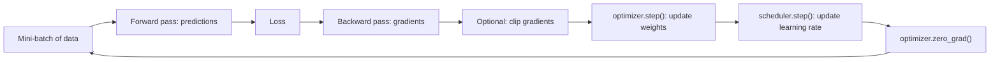

# Optimizers: SGD, Momentum, RMSProp, Adam, AdamW and Learning Rate Schedules

> **Level:** Beginner to Advanced · **Study time:** ~100 min · **Prerequisites:** [Calculus for ML: Derivatives, Gradients and the Chain Rule](../00-foundations/03-calculus-and-gradients.md), [Backpropagation and Gradient Descent Explained](./02-backpropagation-and-gradient-descent.md)

## Table of contents

- [Why this matters](#why-this-matters)
- [The setup: what an optimizer actually does](#the-setup-what-an-optimizer-actually-does)
- [Vanilla SGD](#vanilla-sgd)
- [Momentum and Nesterov momentum](#momentum-and-nesterov-momentum)
- [Per-parameter adaptive rates: AdaGrad and RMSProp](#per-parameter-adaptive-rates-adagrad-and-rmsprop)
- [Adam: momentum plus adaptive rates](#adam-momentum-plus-adaptive-rates)
- [AdamW and decoupled weight decay](#adamw-and-decoupled-weight-decay)
- [Comparing optimizers in code](#comparing-optimizers-in-code)
- [Adam vs SGD: behavior, tuning and generalization](#adam-vs-sgd-behavior-tuning-and-generalization)
- [Optimizer memory cost, 8-bit optimizers and Adafactor](#optimizer-memory-cost-8-bit-optimizers-and-adafactor)
- [Learning rate schedules](#learning-rate-schedules)
- [The learning rate range test](#the-learning-rate-range-test)
- [Learning rate and batch size together](#learning-rate-and-batch-size-together)
- [Practical defaults and a production training loop](#practical-defaults-and-a-production-training-loop)
- [Going deeper: debugging optimization in production](#going-deeper-debugging-optimization-in-production)
- [Common mistakes and misconceptions](#common-mistakes-and-misconceptions)
- [Interview questions and model answers](#interview-questions-and-model-answers)
- [Key takeaways](#key-takeaways)
- [Further reading](#further-reading)
- [Next](#next)

## Why this matters

Every neural network you will ever train, from a tiny spam classifier to a 70B-parameter LLM, is trained by an **optimizer**: the rule that turns gradients into weight updates. The optimizer and its learning rate schedule decide whether training converges in hours, takes days, or blows up into `NaN`. They also decide memory: for LLM training, the optimizer's internal state is often larger than the model itself, which is why "how much GPU memory do I need to fine-tune a 7B model?" is a standard interview question. Interviewers ask "How do Adam and SGD differ?" and "How do learning rate and batch size affect training?" because the answers reveal whether you have actually trained models or only called `.fit()`. By the end of this chapter you will be able to derive every update rule, compute a step by hand, pick sensible defaults, and debug a training run that is misbehaving.

## The setup: what an optimizer actually does

> **Analogy:** You are standing on a foggy mountain and want to reach the lowest valley. You cannot see the map, but you can feel the slope under your feet. Each step, you check the slope and step downhill. The **optimizer** is your walking strategy: how big a step to take, whether to keep some momentum from previous steps, and whether to take smaller steps on steep, slippery ground.

Quick recap from the [previous chapter](./02-backpropagation-and-gradient-descent.md):

- A model has **parameters** (weights) $w$. A **loss function** $L(w)$ measures how wrong the model is. Lower is better.
- **Backpropagation** computes the **gradient** $\nabla L(w)$: a vector with one entry per parameter saying how much the loss would increase if you nudged that parameter up. The gradient points uphill.
- **Gradient descent** steps the opposite way: $w \leftarrow w - \eta \nabla L(w)$.

The **learning rate** $\eta$ (eta) is the step size multiplier. It is a **hyperparameter**: a setting you choose before training rather than something the model learns.

An **optimizer** is everything that happens between "I have a gradient" and "I have updated the weights". In PyTorch that is literally one call:



### Our running example

We will reuse one tiny problem throughout so you can check every number by hand. Imagine a house-price model with a single weight $w$ and a loss

$$
L(w) = (w - 3)^2
$$

- The best weight is $w^* = 3$ (loss 0).
- The gradient is $L'(w) = 2(w - 3)$.
- We start at $w_0 = 0$, so the first gradient is $2(0 - 3) = -6$. Negative gradient means "increasing $w$ lowers the loss", so we should move right.

Later we will use a 2D version to show what happens when the landscape is a long narrow valley, and a 7B-parameter LLM to talk about memory.

### Why plain gradient descent is not enough

Real loss landscapes have three nasty features:

1. **Ravines (ill-conditioning).** The loss is steep in some directions and flat in others. Think of house prices with two features: square footage (values in the thousands) and number of bedrooms (values 1 to 5). Unscaled, the loss surface becomes a long, thin valley. A step size small enough to be stable in the steep direction is painfully slow in the flat direction. **Curvature** is how fast the slope itself changes (the second derivative): high curvature means a narrow, steep-walled direction. The ratio of steepest to flattest curvature is called the **condition number**; large means ill-conditioned.
2. **Noise.** We compute gradients on small random subsets of data, so each gradient is a noisy estimate.
3. **Plateaus and saddle points.** A **saddle point** is a spot where the gradient is near zero but it is not a minimum (downhill exists in some direction, like the middle of a horse saddle). Plain gradient descent slows to a crawl there.

```text
 Ravine seen from above (contour lines of the loss):

   steep direction (w1)
        ^
        |    .-----------------------------------.
        |   (    zig    zag    zig    zag     *   )   * = minimum
        |    '-----------------------------------'
        +------------------------------------------> flat direction (w0)

 Plain gradient descent bounces between the steep walls (zig-zag)
 while creeping slowly along the flat floor toward *.
```

Every optimizer in this chapter is an answer to one or more of these problems.

## Vanilla SGD

### Intuition

**Stochastic gradient descent (SGD)** is plain gradient descent where the gradient is computed on a random sample of the data rather than all of it. "Stochastic" just means "random".

> **Analogy:** To decide which way is downhill you poll 32 random hikers instead of surveying the whole mountain. The answer is a little noisy but you get it 1000 times faster, so you can take many more steps.

### Definitions

- **Batch gradient descent:** gradient over the whole dataset each step. Accurate but slow.
- **Mini-batch:** a random subset of examples, for example 32 emails out of 1 million in a spam dataset. The **batch size** $B$ is how many examples are in it.
- **Step** (or **iteration**): one weight update, computed from one mini-batch.
- **Epoch:** one full pass over the training data. With 1,000,000 emails and $B = 32$, one epoch is $1{,}000{,}000 / 32 = 31{,}250$ steps.

In modern usage, "SGD" almost always means **mini-batch SGD**.

### The update rule

$$
w_{t+1} = w_t - \eta \, g_t, \qquad g_t = \frac{1}{B} \sum_{i=1}^{B} \nabla \ell(w_t; x_i, y_i)
$$

- $w_t$: the parameter vector at step $t$.
- $\eta$: the learning rate.
- $g_t$: the mini-batch gradient at step $t$, the average of the per-example gradients.
- $\ell(w; x_i, y_i)$: the loss on one example $(x_i, y_i)$.
- $B$: the batch size.

### Worked example

Learning rate $\eta = 0.1$, start $w_0 = 0$, loss $(w-3)^2$ (no noise in this toy).

| Step | $w_t$ | Gradient $2(w_t - 3)$ | Update $-\eta g$ | $w_{t+1}$ |
|---|---|---|---|---|
| 1 | 0 | $2(0-3) = -6$ | $-0.1 \times (-6) = +0.6$ | 0.6 |
| 2 | 0.6 | $2(0.6-3) = -4.8$ | $+0.48$ | 1.08 |
| 3 | 1.08 | $2(1.08-3) = -3.84$ | $+0.384$ | 1.464 |

Notice the steps shrink as the gradient shrinks near the minimum. Each step closes 20% of the remaining gap: $w - 3$ goes $-3 \to -2.4 \to -1.92 \to -1.536$.

### What the learning rate does

- **Too small:** progress is slow and you may stall on a plateau.
- **Too large:** you overshoot the minimum. On our loss, any $\eta > 1$ makes $|w - 3|$ grow every step, which is divergence. (Each step multiplies the gap by $1 - 2\eta$; for $\eta = 1.1$ that factor is $-1.2$, and $|{-1.2}| > 1$.)
- **Just right:** fast, stable decrease.

In general, for a quadratic with curvature $h$ (second derivative), gradient descent is stable only when $\eta < 2/h$. Check on our toy: $L(w) = (w-3)^2$ has $h = 2$, so the limit is $\eta < 2/2 = 1$, exactly the threshold above. In a ravine the steepest direction sets $h$, so it caps $\eta$ for every direction. That is the core weakness that momentum and adaptive methods address.

> **Senior insight:** SGD noise is not purely bad. The randomness helps escape saddle points and **sharp minima** (narrow pits where a small change to the weights makes the loss jump; a **flat minimum** stays low over a wide neighborhood and tends to be more robust to the shift from training to test data). Many researchers argue the noise acts as an **implicit regularizer**: it discourages overfitting without any explicit penalty term. The noise level scales roughly like $\eta / B$, which is why learning rate and batch size must be tuned together (see [Learning rate and batch size together](#learning-rate-and-batch-size-together)).

## Momentum and Nesterov momentum

### Intuition: a ball rolling downhill

> **Analogy:** Plain SGD is a hiker who forgets every previous step. Momentum is a heavy ball rolling down the valley. It builds up speed along directions where the slope is consistent (the valley floor) and the back-and-forth pushes from the steep walls cancel out.

**Momentum** (Polyak's "heavy ball" method, 1964) keeps a running **velocity** that accumulates past gradients.

### The update rule (PyTorch convention)

$$
v_t = \beta \, v_{t-1} + g_t, \qquad w_{t+1} = w_t - \eta \, v_t
$$

- $v_t$: the velocity (also called the momentum buffer), starting at $v_0 = 0$.
- $\beta$: the momentum coefficient, typically 0.9. It controls how much of the old velocity survives each step ("friction" is $1 - \beta$).
- $g_t$, $\eta$: gradient and learning rate as before.

Some textbooks write $v_t = \beta v_{t-1} + (1-\beta) g_t$ instead. That is an **exponential moving average (EMA)**: a running average where each older value's weight shrinks by a factor $\beta$ per step. Both forms move in the same direction; they differ only by a constant factor that you absorb into $\eta$. Know which convention your framework uses when copying learning rates between papers.

Two useful facts:

- **Effective memory:** the velocity mostly reflects the last $\approx 1/(1-\beta)$ steps. With $\beta = 0.9$, about 10 steps.
- **Effective speed-up:** if the gradient is constant, the velocity grows to $g / (1 - \beta)$, so with $\beta = 0.9$ the ball moves up to **10x faster** than plain SGD along consistent directions.

### Worked example

Same toy problem, $\eta = 0.1$, $\beta = 0.9$, $w_0 = 0$, $v_0 = 0$.

| Step | $w_t$ | $g_t$ | $v_t = 0.9 v_{t-1} + g_t$ | $w_{t+1} = w_t - 0.1 v_t$ |
|---|---|---|---|---|
| 1 | 0 | $-6$ | $0 + (-6) = -6$ | $0 + 0.6 = 0.6$ |
| 2 | 0.6 | $-4.8$ | $0.9(-6) + (-4.8) = -5.4 - 4.8 = -10.2$ | $0.6 + 1.02 = 1.62$ |
| 3 | 1.62 | $2(1.62-3) = -2.76$ | $0.9(-10.2) + (-2.76) = -9.18 - 2.76 = -11.94$ | $1.62 + 1.194 = 2.814$ |

After 3 steps momentum is at 2.814 versus SGD's 1.464. Momentum got much closer, but notice that the velocity is still large: on the next step it will overshoot past 3 and then oscillate back. That overshoot is the price of momentum, and it is exactly what Nesterov's variant reduces.

### Nesterov momentum: look before you leap

> **Analogy:** A smart skier looks at the slope where their momentum is about to carry them, not where they are standing now. If the slope ahead flattens, they start braking early.

**Nesterov accelerated gradient (NAG)** (Nesterov, 1983; popularized for deep learning by Sutskever et al., 2013, "On the importance of initialization and momentum in deep learning") evaluates the gradient at a **look-ahead** point. Written with velocity as a displacement:

$$
v_t = \beta \, v_{t-1} - \eta \, \nabla L(w_{t-1} + \beta v_{t-1}), \qquad w_t = w_{t-1} + v_t
$$

- $w_{t-1} + \beta v_{t-1}$: where the ball would coast to with momentum alone. We measure the slope there.
- All other symbols as before.

**Worked look-ahead.** After step 1 we are at $w_1 = 0.6$ with displacement velocity $v_1 = +0.6$ (the same first step as momentum, since the look-ahead from $v_0 = 0$ is just $w_0$).

- Look-ahead point: $0.6 + 0.9 \times 0.6 = 0.6 + 0.54 = 1.14$.
- Gradient there: $2(1.14 - 3) = -3.72$ (smaller in size than $-4.8$ at $w = 0.6$, because we are getting closer to the minimum).
- New velocity: $0.9 \times 0.6 - 0.1 \times (-3.72) = 0.54 + 0.372 = 0.912$.
- New weight: $0.6 + 0.912 = 1.512$.

Classic momentum went to 1.62 at this step; Nesterov went to 1.512 because it "felt" the slope flattening ahead and braked slightly. In practice Nesterov often gives a modest improvement, though not on every task. PyTorch exposes it as `torch.optim.SGD(params, lr=..., momentum=0.9, nesterov=True)` and implements an algebraically equivalent reformulation, so the intermediate numbers it stores differ from the ones above.

## Per-parameter adaptive rates: AdaGrad and RMSProp

### Intuition

SGD and momentum use one learning rate for every parameter. But parameters live in very different situations. In a spam filter with one weight per word, the weight for "the" gets a gradient on almost every email, while the weight for "lottery" gets one only occasionally. We would like rare features to take bigger steps when they finally get a signal, and frequently hit, steep directions to take smaller steps.

> **Analogy:** Each parameter gets its own personal step size, like a hiker who takes small careful steps on loose scree and long strides on firm flat ground.

### AdaGrad

**AdaGrad** (Duchi, Hazan and Singer, 2011, "Adaptive Subgradient Methods for Online Learning and Stochastic Optimization") divides each parameter's step by the square root of the sum of all its past squared gradients:

$$
G_t = G_{t-1} + g_t^2, \qquad w_{t+1} = w_t - \frac{\eta}{\sqrt{G_t} + \epsilon} \, g_t
$$

- $g_t^2$: the gradient squared **element-wise** (each parameter separately).
- $G_t$: per-parameter running sum of squared gradients, starting at 0.
- $\epsilon$: a tiny constant such as $10^{-8}$ to avoid dividing by zero.
- Division and square root are element-wise too: every parameter gets its own effective learning rate $\eta / \sqrt{G_t}$.

**Worked example** ($\eta = 0.1$, $w_0 = 0$, ignoring the tiny $\epsilon$):

- Step 1: $g = -6$, $G = 36$, $\sqrt{G} = 6$, step $= 0.1 \times (-6)/6 = -0.1$, so $w = 0 - (-0.1) = 0.1$.
- Step 2: $g = 2(0.1 - 3) = -5.8$, $G = 36 + 33.64 = 69.64$, $\sqrt{G} \approx 8.345$, step $= 0.1 \times (-5.8)/8.345 \approx -0.0695$, so $w \approx 0.1695$.

Two lessons. First, the very first step has size exactly $\eta$ regardless of the gradient's size: AdaGrad normalizes away the scale. Second, because $G$ only ever grows, the effective learning rate $\eta/\sqrt{G_t}$ keeps shrinking ($0.1/6 \approx 0.0167$, then $0.1/8.345 \approx 0.0120$, then smaller), and the actual steps shrink with it (0.1, then 0.0695). Great for convex problems with sparse features (it was popular for large linear models and early word embeddings), but for deep networks it often decays the learning rate to near zero before training finishes.

### RMSProp

**RMSProp** (Hinton, Coursera lecture 6e, 2012; never formally published) fixes AdaGrad's ever-shrinking rate by replacing the sum with an exponential moving average, so old gradients are gradually forgotten:

$$
s_t = \rho \, s_{t-1} + (1 - \rho) \, g_t^2, \qquad w_{t+1} = w_t - \frac{\eta}{\sqrt{s_t} + \epsilon} \, g_t
$$

- $s_t$: per-parameter EMA of squared gradients (an estimate of the gradient's typical squared size).
- $\rho$: decay rate, typically 0.9 or 0.99.
- $\sqrt{s_t}$: the **root mean square (RMS)** of recent gradients, hence the name.

**Worked example** ($\eta = 0.1$, $\rho = 0.9$, $w_0 = 0$, $s_0 = 0$):

- Step 1: $g = -6$, $s = 0.9 \times 0 + 0.1 \times 36 = 3.6$, $\sqrt{s} \approx 1.897$, step $= 0.1 \times (-6)/1.897 \approx -0.316$, so $w \approx 0.316$.

Wait: the step is 0.316, more than 3 times the learning rate. Why? Because $s$ started at 0, after one step it is only 10% of the true squared gradient (3.6 instead of 36). Dividing by an underestimate inflates the step. This **initialization bias** is the problem Adam's bias correction solves.

## Adam: momentum plus adaptive rates

### Intuition

**Adam** ("Adam: A Method for Stochastic Optimization", Kingma and Ba, 2014, published at ICLR 2015) combines the two ideas:

- From momentum: keep an EMA of gradients (the **first moment**, roughly the average direction).
- From RMSProp: keep an EMA of squared gradients (the **second moment**, roughly the typical magnitude).
- Step in the direction of the first, scaled down by the square root of the second.
- Correct both averages for their zero initialization.

> **Analogy:** A heavy ball (momentum) wearing adaptive shoes (per-parameter step sizes), with a calibration fix for the first few steps when the shoes have not warmed up yet.

The name comes from "adaptive moment estimation". A **moment** here is a statistic of a distribution: the first moment is the mean, the second (uncentered) moment is the mean of the square.

### The update equations

For each step $t = 1, 2, 3, \dots$:

$$
m_t = \beta_1 m_{t-1} + (1 - \beta_1) g_t
$$

$$
v_t = \beta_2 v_{t-1} + (1 - \beta_2) g_t^2
$$

$$
\hat{m}_t = \frac{m_t}{1 - \beta_1^t}, \qquad \hat{v}_t = \frac{v_t}{1 - \beta_2^t}
$$

$$
w_{t+1} = w_t - \eta \, \frac{\hat{m}_t}{\sqrt{\hat{v}_t} + \epsilon}
$$

- $m_t$: first-moment estimate (EMA of gradients), starts at $m_0 = 0$.
- $v_t$: second-moment estimate (EMA of squared gradients), starts at $v_0 = 0$. Do not confuse it with the momentum velocity from earlier.
- $\beta_1$: decay for $m$, default 0.9 (averages over about 10 steps).
- $\beta_2$: decay for $v$, default 0.999 (averages over about 1000 steps).
- $\beta_1^t$, $\beta_2^t$: $\beta$ raised to the power $t$ (the step number), not a superscript index.
- $\hat{m}_t$, $\hat{v}_t$: **bias-corrected** estimates.
- $\epsilon$: stability constant, default $10^{-8}$.
- $\eta$: learning rate, default $10^{-3}$ in the paper and in PyTorch.
- All operations are element-wise: each parameter has its own $m$ and $v$.

### Why bias correction?

Because $m_0 = 0$, after the first step $m_1 = (1 - \beta_1) g_1 = 0.1 g_1$: ten times too small. More generally, if the gradient were constant at $g$, then $m_t = (1 - \beta_1^t) g$. Dividing by $(1 - \beta_1^t)$ undoes exactly that shrinkage:

- $t = 1$: $1 - 0.9^1 = 0.1$, so divide by 0.1 (multiply by 10).
- $t = 2$: $1 - 0.9^2 = 1 - 0.81 = 0.19$.
- $t = 10$: $1 - 0.9^{10} \approx 0.651$.
- $t = 50$: $1 - 0.9^{50} \approx 0.995$, correction has essentially vanished.

The same logic applies to $v$, but with $\beta_2 = 0.999$ the bias lasts thousands of steps ($1 - 0.999^1 = 0.001$). Without correction, early steps would be inflated by a factor $(1 - \beta_1)/\sqrt{1 - \beta_2} = 0.1/\sqrt{0.001} \approx 3.16$, exactly the inflation we just saw in RMSProp.

### One fully worked Adam step (and a second one)

Toy loss $(w - 3)^2$, $\eta = 0.1$, $\beta_1 = 0.9$, $\beta_2 = 0.999$, $\epsilon = 10^{-8}$, $w_1 = 0$ (Adam counts steps from $t = 1$), $m_0 = v_0 = 0$.

**Step $t = 1$**

1. Gradient: $g_1 = 2(0 - 3) = -6$.
2. First moment: $m_1 = 0.9 \times 0 + 0.1 \times (-6) = -0.6$.
3. Second moment: $v_1 = 0.999 \times 0 + 0.001 \times (-6)^2 = 0.001 \times 36 = 0.036$.
4. Bias correction: $\hat{m}_1 = -0.6 / (1 - 0.9) = -0.6 / 0.1 = -6$.
5. Bias correction: $\hat{v}_1 = 0.036 / (1 - 0.999) = 0.036 / 0.001 = 36$.
6. Denominator: $\sqrt{36} + 10^{-8} \approx 6$.
7. Step: $0.1 \times (-6) / 6 = -0.1$.
8. Update: $w_2 = 0 - (-0.1) = 0.1$.

**Step $t = 2$**

1. Gradient: $g_2 = 2(0.1 - 3) = -5.8$.
2. $m_2 = 0.9 \times (-0.6) + 0.1 \times (-5.8) = -0.54 - 0.58 = -1.12$.
3. $v_2 = 0.999 \times 0.036 + 0.001 \times 33.64 = 0.035964 + 0.03364 = 0.069604$.
4. $\hat{m}_2 = -1.12 / (1 - 0.81) = -1.12 / 0.19 \approx -5.8947$.
5. $\hat{v}_2 = 0.069604 / (1 - 0.998001) = 0.069604 / 0.001999 \approx 34.819$, and $\sqrt{34.819} \approx 5.9008$.
6. Step: $0.1 \times (-5.8947) / 5.9008 \approx -0.09990$.
7. Update: $w_3 \approx 0.1 + 0.0999 = 0.1999$.

Compare with SGD at the same learning rate: SGD jumped to 0.6 then 1.08, while Adam moved 0.1 then about 0.2. Adam's step is roughly $\eta$ in size when gradients point consistently in one direction, no matter how big the gradient is. That is the single most important thing to understand about Adam's behavior.

### Per-parameter adaptivity in one picture

Now take three parameters with wildly different first gradients: $-6$, $0.01$, and $600$ (think: a house-price weight on square footage, one on a tiny normalized feature, and one on an unnormalized dollar amount). Running step 1 for each:

| Parameter | $g_1$ | $\hat{m}_1$ | $\hat{v}_1$ | Step $-\eta \hat{m}_1/\sqrt{\hat{v}_1}$ |
|---|---|---|---|---|
| A | $-6$ | $-6$ | 36 | $+0.1$ |
| B | $0.01$ | $0.01$ | $0.0001$ | $\approx -0.1$ |
| C | $600$ | $600$ | 360000 | $-0.1$ |

SGD would have moved them by $0.6$, $0.001$, and $60$ respectively, a 60,000x spread. Adam moves each by about 0.1. This **gradient-scale invariance** is why Adam tolerates poorly scaled problems and needs less tuning.

After the first step, the ratio $\hat{m}/\sqrt{\hat{v}}$ is below 1 when gradients are noisy or flip sign (the average direction is small compared to the typical magnitude). Kingma and Ba describe this as a **signal-to-noise ratio**: Adam automatically takes smaller steps when it is unsure of the direction.

### Adam from scratch in NumPy

```python
# pip install numpy
import numpy as np

class Adam:
    """Minimal Adam that updates a NumPy parameter array in place."""
    def __init__(self, lr=1e-3, b1=0.9, b2=0.999, eps=1e-8):
        self.lr, self.b1, self.b2, self.eps = lr, b1, b2, eps
        self.m = None   # first moment (EMA of gradients)
        self.v = None   # second moment (EMA of squared gradients)
        self.t = 0      # step counter, needed for bias correction

    def step(self, w, g):
        if self.m is None:
            self.m, self.v = np.zeros_like(w), np.zeros_like(w)
        self.t += 1
        self.m = self.b1 * self.m + (1 - self.b1) * g
        self.v = self.b2 * self.v + (1 - self.b2) * g**2
        m_hat = self.m / (1 - self.b1**self.t)
        v_hat = self.v / (1 - self.b2**self.t)
        w -= self.lr * m_hat / (np.sqrt(v_hat) + self.eps)

w = np.array([0.0])
opt = Adam(lr=0.1)
for _ in range(2):
    g = 2 * (w - 3)          # gradient of (w - 3)^2
    opt.step(w, g)
    print(round(float(w[0]), 4))
# 0.1
# 0.1999
```

## AdamW and decoupled weight decay

### Intuition

**Weight decay** gently shrinks every weight toward zero each step, which discourages the model from relying on huge weights and usually improves generalization (see [Overfitting, Bias-Variance, Regularization and Data Leakage](../01-classical-ml/03-overfitting-regularization-and-data-leakage.md) for why). **L2 regularization** achieves a similar goal by adding $\frac{\lambda}{2}\|w\|^2$ to the loss, which adds $\lambda w$ to the gradient.

> **Analogy:** Weight decay is a tax on every weight, collected at a flat rate each step. L2 regularization inside Adam is a tax that gets routed through Adam's adaptive scaling, so weights with big historical gradients end up paying almost nothing.

### For SGD, L2 and weight decay are the same

With L2, SGD's update is:

$$
w \leftarrow w - \eta (g + \lambda w) = (1 - \eta\lambda) w - \eta g
$$

- $\lambda$: the regularization strength (weight decay coefficient).
- $(1 - \eta\lambda)$: every step, the weight is multiplied by a number slightly less than 1, which is literally "decay".

Example: $w = 2$, $\eta = 0.1$, $\lambda = 0.01$. Decay factor $1 - 0.001 = 0.999$, so the decay part moves $w$ from 2 to 1.998, a shrink of 0.002.

### For Adam, they are not the same

If you add $\lambda w$ to the gradient before Adam, the decay term also gets divided by $\sqrt{\hat{v}}$. Weights whose gradients have been large get regularized less, and weights with small gradients get regularized more. That is not what anyone intends.

**Illustrative comparison.** Two weights, both $w = 1$, $\eta = 0.1$, $\lambda = 0.01$. Weight A has historically large gradients ($\sqrt{\hat{v}} = 10$), weight B small ones ($\sqrt{\hat{v}} = 0.1$). Simplifying by ignoring the momentum averaging of the decay term:

| | Decay applied to A | Decay applied to B |
|---|---|---|
| Adam + L2: $\eta \lambda w / \sqrt{\hat{v}}$ | $0.1 \times 0.01 \times 1 / 10 = 0.0001$ | $0.1 \times 0.01 \times 1 / 0.1 = 0.01$ |
| AdamW: $\eta \lambda w$ | $0.001$ | $0.001$ |

A 100x difference in regularization between two weights, purely as an artifact of the gradient history.

### AdamW

**AdamW** ("Decoupled Weight Decay Regularization", Loshchilov and Hutter, arXiv 2017, ICLR 2019) applies the decay directly to the weights, outside Adam's adaptive scaling:

$$
w_{t+1} = w_t - \eta \left( \frac{\hat{m}_t}{\sqrt{\hat{v}_t} + \epsilon} + \lambda w_t \right)
$$

- The gradient $g_t$ used to compute $m_t$ and $v_t$ no longer contains $\lambda w$.
- $\lambda w_t$ is added after the adaptive scaling, so every weight decays at the same relative rate.
- In PyTorch's `AdamW` the decay is multiplied by the current learning rate (as written above), so the decay follows your learning rate schedule.

AdamW is the default optimizer for training and fine-tuning transformers (BERT, GPT-style LLMs, vision transformers or ViTs). PyTorch's `torch.optim.Adam` has a `weight_decay` argument, but by default it implements the L2 version. Use `torch.optim.AdamW` when you want decoupled decay. (Recent PyTorch releases also accept `Adam(..., decoupled_weight_decay=True)`, which behaves like AdamW; older versions do not have this flag, so `AdamW` is the portable choice.)

### Which parameters should not be decayed

Common practice (from the original BERT code onward) is to **exclude biases and normalization-layer weights** (LayerNorm, RMSNorm gains) from weight decay. These are 1-dimensional, few in number, and shrinking a normalization gain toward zero fights its purpose. Whether to decay embedding matrices varies across codebases. The code in [Practical defaults](#practical-defaults-and-a-production-training-loop) shows how to set this up with **parameter groups**: subsets of parameters that share hyperparameters inside one optimizer.

## Comparing optimizers in code

Here is a from-scratch comparison on a 2D ravine $L(w) = \frac{1}{2}(w_0^2 + 100\, w_1^2)$. The flat direction $w_0$ has curvature 1; the steep direction $w_1$ has curvature 100, so SGD is only stable for $\eta < 2/100 = 0.02$.

```python
# pip install numpy
import numpy as np

H = np.array([1.0, 100.0])            # curvature: flat along w0, steep along w1
def loss(w): return 0.5 * np.sum(H * w**2)
def grad(w): return H * w

def run(name, lr, steps=100, beta=0.9, rho=0.9, b1=0.9, b2=0.999, eps=1e-8):
    w = np.array([-4.0, 1.0])         # start far along the flat direction
    m = np.zeros(2); v = np.zeros(2)
    for t in range(1, steps + 1):
        g = grad(w)
        if name == "sgd":
            w -= lr * g
        elif name == "momentum":
            m = beta * m + g
            w -= lr * m
        elif name == "rmsprop":
            v = rho * v + (1 - rho) * g**2
            w -= lr * g / (np.sqrt(v) + eps)
        elif name == "adam":
            m = b1 * m + (1 - b1) * g
            v = b2 * v + (1 - b2) * g**2
            m_hat = m / (1 - b1**t)
            v_hat = v / (1 - b2**t)
            w -= lr * m_hat / (np.sqrt(v_hat) + eps)
    return w, loss(w)

for name, lr in [("sgd", 0.019), ("sgd", 0.021), ("momentum", 0.01),
                 ("rmsprop", 0.03), ("adam", 0.1)]:
    w, l = run(name, lr)
    print(f"{name:9s} lr={lr:<6} w=({w[0]:+.4f}, {w[1]:+.4f})  loss={l:.4g}")

# Expected output (starting loss is 58):
# sgd       lr=0.019  w=(-0.5874, +0.0000)  loss=0.1725
# sgd       lr=0.021  w=(-0.4790, +13780.6123)  loss=9.495e+09
# momentum  lr=0.01   w=(+0.0105, +0.0014)  loss=0.0001466
# rmsprop   lr=0.03   w=(-1.0348, +0.0000)  loss=0.5354
# adam      lr=0.1    w=(+0.0214, +0.0029)  loss=0.0006608
```

What to notice:

- **SGD** at 0.019 has solved the steep direction but is still far along the flat one ($-0.587$). Nudging to 0.021 crosses the $2/100$ stability limit and the steep coordinate explodes. That cliff is the ravine problem in miniature.
- **Momentum** at a smaller learning rate gets much further: speed accumulates along the flat floor.
- **RMSProp** (no momentum, no bias correction) takes steps of roughly $\eta$ in each direction, so at $\eta = 0.03$ it simply has not walked the 4 units yet. Adaptive methods make $\eta$ mean "distance per step", not "multiplier on the gradient".
- **Adam** gets near the minimum. These hyperparameters are illustrative: any of these optimizers can win or lose a toy race depending on tuning. The point is the mechanisms, not a leaderboard.

The PyTorch equivalents, which you will actually use:

```python
# pip install torch
import torch

model = torch.nn.Linear(10, 1)
sgd      = torch.optim.SGD(model.parameters(), lr=0.1)
momentum = torch.optim.SGD(model.parameters(), lr=0.1, momentum=0.9, nesterov=True)
rmsprop  = torch.optim.RMSprop(model.parameters(), lr=1e-3, alpha=0.99)  # alpha is rho
adagrad  = torch.optim.Adagrad(model.parameters(), lr=1e-2)
adam     = torch.optim.Adam(model.parameters(), lr=1e-3, betas=(0.9, 0.999), eps=1e-8)
adamw    = torch.optim.AdamW(model.parameters(), lr=1e-3, weight_decay=0.01)
```

## Adam vs SGD: behavior, tuning and generalization

| Aspect | SGD (+ momentum) | Adam / AdamW |
|---|---|---|
| Step size | Proportional to gradient size: $\eta g$ | Roughly $\eta$ per parameter, normalized by gradient RMS |
| Learning rate | One global rate; sensitive to gradient scale and architecture | Per-parameter effective rate $\eta/\sqrt{\hat{v}}$; same $\eta$ works across many layers |
| Typical lr | 0.01 to 0.1 for CNNs (batch 256, illustrative) | $10^{-4}$ to $10^{-3}$ from scratch; $10^{-5}$ to $5 \times 10^{-5}$ for full transformer fine-tuning |
| Tuning effort | Higher: lr, momentum and schedule matter a lot | Lower: defaults often work, lr still matters most |
| Early progress | Slower on ill-conditioned or poorly scaled problems | Fast, robust to scaling |
| Generalization | Often slightly better on vision (CNNs) when well tuned | Historically sometimes worse; AdamW plus good schedule closes most of the gap |
| Transformers | Trains poorly in practice | The standard choice |
| Extra memory per parameter | 0 (plain) or 1 state (momentum) | 2 states ($m$ and $v$) |
| Sensitivity | Loss scale changes effective lr | Invariant to loss or gradient scale (except via $\epsilon$) |

### Why Adam dominates transformers

Several explanations are supported by research, and they are complementary:

- **Heterogeneous curvature.** Different parameter blocks in a transformer (embeddings, attention, MLPs, norms) have very different gradient scales and curvature. A single global learning rate cannot suit all of them; Adam's per-parameter scaling can. See Zhang et al., 2024, "Why Transformers Need Adam: A Hessian Perspective".
- **Heavy-tailed gradient noise.** "Heavy-tailed" means extreme values are far more common than a bell curve predicts: attention models produce occasional gradients many times larger than typical. Adam's normalization dampens their effect. See Zhang et al., 2020, "Why are Adaptive Methods Good for Attention Models?".
- **Sparse, rare signals.** Embeddings for rare tokens get gradients only occasionally, the same situation AdaGrad was designed for.

### Why SGD is still used in vision

Wilson et al., 2017, "The Marginal Value of Adaptive Gradient Methods in Machine Learning" found that on several tasks, well-tuned SGD with momentum generalized better than adaptive methods, even when adaptive methods had lower training loss. A popular (and debated) explanation is that SGD's noise biases it toward flatter minima that generalize better. Part of the gap was later attributed to Adam's broken L2 regularization, which AdamW fixed. In practice: classic CNN recipes (ResNet on ImageNet) often use SGD with momentum; vision transformers use AdamW.

> **Interview tip:** Avoid "Adam is better" or "SGD generalizes better" as blanket claims. Say: "Adam converges faster with less tuning and is the default for transformers; tuned SGD with momentum can match or beat it on some vision tasks and uses less memory. I would pick based on architecture, memory budget and how much tuning time I have."

## Optimizer memory cost, 8-bit optimizers and Adafactor

### Optimizer state

An optimizer's **state** is the extra per-parameter data it stores between steps:

| Optimizer | States per parameter | Extra bytes per parameter (FP32 states) | Extra memory for a 7B model |
|---|---|---|---|
| SGD (plain) | 0 | 0 | 0 |
| SGD + momentum | 1 ($v$) | 4 | 28 GB |
| Adam / AdamW | 2 ($m$, $v$) | 8 | 56 GB |
| Lion (Chen et al., 2023) | 1 ($m$) | 4 | 28 GB |
| 8-bit AdamW | 2, stored in 8 bits | about 2 (plus small per-block constants) | about 14 GB |
| Adafactor (factored, no momentum) | 1 row vector + 1 column vector per matrix | far below 1 | well under 1 GB |

(Using decimal GB: $7 \times 10^9 \times 8$ bytes $= 56 \times 10^9$ bytes $= 56$ GB.)

### The full training memory picture for a 7B model

Standard **mixed-precision** training (see [Mixed-Precision Training](./09-mixed-precision-training.md)) runs the forward and backward passes in 16-bit, but keeps an FP32 **master copy** of the weights for the optimizer to update, because tiny updates such as $10^{-5}$ would round away if added directly to 16-bit weights. With AdamW it keeps, per parameter:

| Item | Bytes |
|---|---|
| BF16/FP16 weights | 2 |
| BF16/FP16 gradients | 2 |
| FP32 master copy of weights | 4 |
| FP32 Adam $m$ | 4 |
| FP32 Adam $v$ | 4 |
| **Total** | **16** |

This 16-bytes-per-parameter accounting comes from the ZeRO paper (Rajbhandari et al., 2020). For 7B parameters: $7 \times 10^9 \times 16 = 112$ GB, **before activations** (the intermediate layer outputs saved during the forward pass for use in the backward pass; they grow with batch size and sequence length). That does not fit on a single 80 GB GPU, and the optimizer-related part (master weights plus $m$ plus $v$, 12 bytes) is three quarters of it. Compare inference, which needs about 14 GB for the BF16 weights alone (see [Number Formats and Model Memory](../07-model-compression/01-number-formats-and-model-memory.md)).

```text
 7B model, mixed-precision AdamW, per-parameter memory (16 bytes total)

 weights bf16  |##|                 2
 grads   bf16  |##|                 2
 master  fp32  |####|               4  \
 adam m  fp32  |####|               4   > 12 bytes of "optimizer" memory
 adam v  fp32  |####|               4  /
```

Ways to cut it, roughly in order of how often they are used:

1. **Parameter-efficient fine-tuning (LoRA, Low-Rank Adaptation).** The pretrained weights are frozen and only a small set of added adapter weights is trainable, so only they need gradients and Adam state. With, say, 40M trainable parameters (illustrative), Adam state is $40 \times 10^6 \times 8 = 320$ MB. See [Fine-Tuning LLMs: Full Fine-Tuning, LoRA and QLoRA](../05-llms/07-fine-tuning-full-lora-and-qlora.md).
2. **Shard the state across GPUs** with ZeRO (DeepSpeed's Zero Redundancy Optimizer) or FSDP (PyTorch's Fully Sharded Data Parallel), so each of $N$ GPUs holds $1/N$ of it. See [Distributed Training and Training Memory](./10-distributed-training-and-training-memory.md).
3. **8-bit optimizers.** Dettmers et al., 2021, "8-bit Optimizers via Block-wise Quantization" store $m$ and $v$ in 8 bits using block-wise quantization (each small block of values gets its own scale, so one outlier does not ruin precision for everyone), dequantizing to 32 bits for the update math. Reported results show quality close to 32-bit Adam on the tasks they tested. Available in the `bitsandbytes` library. The QLoRA paper (Dettmers et al., 2023) added **paged optimizers**, which move optimizer state to CPU memory during memory spikes.
4. **Adafactor.** Shazeer and Stern, 2018, "Adafactor: Adaptive Learning Rates with Sublinear Memory Cost". For a weight matrix of shape $n \times k$, instead of storing a full $n \times k$ second-moment matrix it stores only row averages ($n$ numbers) and column averages ($k$ numbers) and reconstructs an approximation from their product. It can also drop the first moment entirely. For a $4096 \times 4096$ matrix that is $8{,}192$ numbers instead of about 16.8 million. It was used to train T5. The trade-off: it can be less stable and usually needs its own tuning (update clipping, relative step sizes).
5. **Optimizer offload** to CPU or NVMe (for example DeepSpeed ZeRO-Offload), trading speed for memory.

```python
# pip install bitsandbytes transformers torch
import bitsandbytes as bnb
from transformers.optimization import Adafactor

# 8-bit AdamW: a drop-in replacement for torch.optim.AdamW
opt8 = bnb.optim.AdamW8bit(model.parameters(), lr=2e-5, weight_decay=0.01)

# Adafactor with an explicit learning rate (turn off its internal relative step sizing)
opt_af = Adafactor(model.parameters(), lr=1e-3,
                   scale_parameter=False, relative_step=False, warmup_init=False)
```

> **Senior insight:** Optimizer state also dominates **checkpoint size**. A resumable checkpoint for full AdamW training of a 7B model includes the FP32 master weights and both moments, roughly 84 GB versus 14 GB for a BF16 weights-only export. Save both kinds: the full one for resuming, the small one for serving.

## Learning rate schedules

### Why change the learning rate during training?

> **Analogy:** When parking a car you drive fast down the street, then slow down to inch into the space. Early in training you want big steps to make fast progress; late in training you want small steps to settle precisely into a good minimum instead of bouncing around it.

With SGD noise, a constant learning rate leaves the weights jittering in a region around the minimum whose size scales with $\eta$. Decaying $\eta$ shrinks that region. A **learning rate schedule** is a function giving $\eta_t$ for every step $t$.

### Warmup: why start small

**Warmup** means starting from a tiny learning rate and ramping linearly to the peak over the first few hundred to few thousand steps. Reasons:

- Early on, weights are random and gradients can be large and erratic. Big steps then can push the network into a bad region it never recovers from (a **loss spike** or divergence).
- Adam's second-moment estimate $v$ is based on very few samples early on, so its effective step sizes are unreliable (analyzed in Liu et al., 2020, "On the Variance of the Adaptive Learning Rate and Beyond", which proposed RAdam).
- Original post-LayerNorm transformers are especially sensitive without warmup (Xiong et al., 2020, "On Layer Normalization in the Transformer Architecture"). Pre-norm architectures are more forgiving but warmup is still standard.
- Large-batch SGD needs warmup to use the scaled-up learning rate safely (Goyal et al., 2017).

### The main schedules

**1. Step decay.** Multiply the rate by $\gamma$ every $s$ epochs:

$$
\eta_t = \eta_0 \, \gamma^{\lfloor t / s \rfloor}
$$

- $\eta_0$: initial rate; $\gamma$: decay factor (often 0.1); $s$: interval; $\lfloor \cdot \rfloor$: round down.
- Example: $\eta_0 = 0.1$, $\gamma = 0.1$, $s = 30$ epochs. At epoch 45: $\lfloor 45/30 \rfloor = 1$, so $\eta = 0.1 \times 0.1 = 0.01$. At epoch 65: $\lfloor 65/30 \rfloor = 2$, so $\eta = 0.001$.
- The classic ResNet recipe (He et al., 2016) used SGD with lr 0.1, divided by 10 when the error plateaued.

**2. Cosine decay** ("SGDR: Stochastic Gradient Descent with Warm Restarts", Loshchilov and Hutter, 2017):

$$
\eta_t = \eta_{\min} + \frac{1}{2}(\eta_{\max} - \eta_{\min})\left(1 + \cos\left(\frac{\pi t}{T}\right)\right)
$$

- $\eta_{\max}$: peak rate; $\eta_{\min}$: final rate (often 0 or 10% of peak); $T$: total decay steps; $t$: current step.
- At $t = 0$: $\cos(0) = 1$, so $\eta = \eta_{\max}$. At $t = T$: $\cos(\pi) = -1$, so $\eta = \eta_{\min}$.
- Example: $\eta_{\max} = 10^{-3}$, $\eta_{\min} = 0$, $T = 1000$.
  - $t = 250$: $\cos(\pi/4) \approx 0.7071$, so $\eta = 0.5 \times 10^{-3} \times 1.7071 \approx 8.54 \times 10^{-4}$.
  - $t = 500$: $\cos(\pi/2) = 0$, so $\eta = 0.5 \times 10^{-3} = 5 \times 10^{-4}$.
  - $t = 750$: $\cos(3\pi/4) \approx -0.7071$, so $\eta \approx 1.46 \times 10^{-4}$.
- Smooth, one fewer hyperparameter than step decay, and it spends a long time at moderately high rates before a gentle landing. **SGDR** restarts the cosine periodically ("warm restarts"); most LLM recipes use a single cosine cycle.

**3. Linear warmup then decay.** With $W$ warmup steps and $T$ total steps:

$$
\eta_t =
\begin{cases}
\eta_{\max} \cdot \dfrac{t}{W} & t < W \\[2mm]
\eta_{\max} \cdot \dfrac{T - t}{T - W} & t \ge W
\end{cases}
$$

- Example: $\eta_{\max} = 2 \times 10^{-5}$, $W = 100$, $T = 1000$.
  - $t = 50$: $2 \times 10^{-5} \times 50/100 = 1 \times 10^{-5}$.
  - $t = 100$: peak, $2 \times 10^{-5}$.
  - $t = 550$: $2 \times 10^{-5} \times (1000 - 550)/(1000 - 100) = 2 \times 10^{-5} \times 450/900 = 1 \times 10^{-5}$.
- This is what Hugging Face's `get_linear_schedule_with_warmup` computes and is the classic BERT fine-tuning schedule.
- **Warmup plus cosine** replaces the linear decay with the cosine formula. It is the most common LLM pretraining schedule (for example, LLaMA, Touvron et al., 2023, used 2000 warmup steps and cosine decay to 10% of the peak).

**4. One-cycle** (Smith, 2018, "A disciplined approach to neural network hyper-parameters: Part 1"; Smith and Topin, "Super-Convergence"). The rate rises from a low value to a high peak over roughly the first 30% of training, then anneals down to far below the starting value. Momentum is cycled in the opposite direction (high when lr is low, low when lr is high). The idea is that the high-lr phase acts as a regularizer and explores, and the long anneal settles. PyTorch's `OneCycleLR` defaults: start at `max_lr / 25`, peak at 30% of steps, end at `start / 10^4`, momentum cycling between 0.95 and 0.85. Popular for CNNs trained in a fixed budget (fast.ai made it well known).

**5. Others worth knowing by name.**

- **ReduceLROnPlateau:** cut lr by a factor when validation loss stops improving for a set number of epochs. Adaptive but reactive and noisy.
- **Inverse square root** (used in the original Transformer, Vaswani et al., 2017): linear warmup, then $\eta \propto 1/\sqrt{t}$.
- **Warmup-Stable-Decay (WSD):** warmup, then a long constant phase, then a short decay at the end. Used in some recent LLM pretraining work (for example MiniCPM, Hu et al., 2024) because you can branch off and decay from any point in the constant phase, which suits training runs whose final length is not known in advance.
- **Schedule-free** methods (Defazio et al., 2024, "The Road Less Scheduled") try to remove the schedule entirely via iterate averaging (using an average of the weights over many steps rather than only the latest weights). Treat as an active research area as of 2026.

```text
 lr ^
    |  step decay          cosine             warmup + linear     one-cycle
    | ____                 _                    /\                   /\
    |     |___            / '-.                /  \                 /  \
    |         |___       /     '.             /    \               /    '.
    |             |__   /        '-._        /      \             /       '-.__
    +------------------------------------------------------------------------> step
```

| Schedule | What it does | When to use | Pros | Cons |
|---|---|---|---|---|
| Constant | Fixed $\eta$ | Quick experiments, some LoRA runs | Simplest | Leaves noise floor; rarely best |
| Step decay | Drop by $\gamma$ at milestones | Classic CNN recipes | Simple, well understood | Milestones to tune; sudden jumps |
| Cosine (+warmup) | Smooth decay to $\eta_{\min}$ | LLM pretraining, ViTs, most modern training | Smooth, few knobs | Must know total steps $T$ in advance |
| Linear warmup + linear decay | Ramp up, straight line down | Transformer fine-tuning | Robust default, HF standard | Same $T$ dependence |
| One-cycle | Up then far down, momentum inverse | Fixed-budget CNN training | Fast convergence | Needs a good max lr (range test) |
| Plateau | Cut when val loss stalls | Small projects without a known budget | No $T$ needed | Reacts late; noisy |
| WSD | Warmup, constant, short decay | Long LLM runs with unknown length | Checkpoints reusable, extendable | Newer, less standardized |

### Schedules in PyTorch and Hugging Face

```python
# pip install torch transformers
import math
import torch
from transformers import get_cosine_schedule_with_warmup

model = torch.nn.Linear(10, 1)
opt = torch.optim.AdamW(model.parameters(), lr=3e-4, weight_decay=0.1)
total_steps, warmup = 10_000, 500

# Option A: Hugging Face helper (cosine to 0 after linear warmup)
sched = get_cosine_schedule_with_warmup(opt, num_warmup_steps=warmup,
                                        num_training_steps=total_steps)

# Option B: the same idea by hand, with a floor at 10% of peak
def lr_lambda(step, min_ratio=0.1):
    if step < warmup:
        return step / max(1, warmup)                      # linear warmup
    progress = (step - warmup) / max(1, total_steps - warmup)
    return min_ratio + (1 - min_ratio) * 0.5 * (1 + math.cos(math.pi * progress))
# sched = torch.optim.lr_scheduler.LambdaLR(opt, lr_lambda)  # multiplies the base lr

# Classic alternatives built into PyTorch:
# torch.optim.lr_scheduler.StepLR(opt, step_size=30, gamma=0.1)        # step per epoch
# torch.optim.lr_scheduler.CosineAnnealingLR(opt, T_max=total_steps)
# torch.optim.lr_scheduler.OneCycleLR(opt, max_lr=0.1, total_steps=total_steps)

# In the training loop (per-step schedulers):
#   loss.backward(); opt.step(); sched.step(); opt.zero_grad()
```

> **Common mistake:** Creating a per-step schedule (warmup, cosine over `total_steps`) but calling `sched.step()` once per epoch. Warmup then lasts 500 epochs instead of 500 steps and the model barely trains. Check by logging `sched.get_last_lr()` every step.

## The learning rate range test

### Intuition

If the learning rate is the most important hyperparameter, how do you find a good one without a full sweep? The **learning rate range test** (Smith, 2017, "Cyclical Learning Rates for Training Neural Networks") runs one short pseudo-training in which the learning rate keeps increasing and records the loss. Smith's original version ramped the rate linearly over a few epochs; the widely used variant popularized by fast.ai, shown here, grows it exponentially every mini-batch, from tiny ($10^{-7}$) to huge ($10$).

```text
 smoothed loss
   ^
   |----------.                                  /
   |           '.                               /   <- diverging: too high
   |  too low:   '.                            /
   |  nothing      '-.                      .-'
   |  happens         '-.______________.--''
   |                       ^          ^
   |                  steepest drop  minimum
   +--------------------------------------------------> lr (log scale)
     1e-7      1e-5       1e-3       1e-2      1e-1      1
```

Reading the plot:

- Pick a learning rate where the loss is **dropping steepest**, or about **one tenth** of the rate at the minimum. The rate at the minimum itself is already on the edge of instability.
- For one-cycle, the rate near the minimum (or slightly below) is a common choice for `max_lr`.

### Implementation

The exponential growth factor per step is $\gamma = (\eta_{\text{end}} / \eta_{\text{start}})^{1/(N-1)}$. Example: from $10^{-7}$ to $10$ in $N = 100$ steps spans 8 orders of magnitude, so $\gamma = 10^{8/99} \approx 1.205$: the rate grows about 20% per step.

```python
# pip install torch
import copy
import torch

def lr_range_test(model, loss_fn, loader, lr_start=1e-7, lr_end=10.0,
                  num_steps=100, smooth=0.98):
    """Returns (lrs, smoothed_losses). Restores the model weights afterwards."""
    saved = copy.deepcopy(model.state_dict())
    opt = torch.optim.AdamW(model.parameters(), lr=lr_start)
    gamma = (lr_end / lr_start) ** (1 / (num_steps - 1))
    lrs, losses = [], []
    avg, best = 0.0, float("inf")
    it = iter(loader)
    for i in range(num_steps):
        try:
            x, y = next(it)
        except StopIteration:                 # loop over the data if it runs out
            it = iter(loader)
            x, y = next(it)
        lr = lr_start * gamma**i
        for group in opt.param_groups:
            group["lr"] = lr
        opt.zero_grad()
        loss = loss_fn(model(x), y)
        loss.backward()
        opt.step()
        # EMA with bias correction (the same trick Adam uses) to smooth the noisy curve
        avg = smooth * avg + (1 - smooth) * loss.item()
        smoothed = avg / (1 - smooth ** (i + 1))
        lrs.append(lr)
        losses.append(smoothed)
        best = min(best, smoothed)
        if smoothed > 4 * best:               # clearly diverging, stop early
            break
    model.load_state_dict(saved)              # undo the damage
    return lrs, losses
```

Plot `losses` against `lrs` on a log x-axis and read off the steep region.

Caveats a senior engineer mentions: the test uses the same optimizer and batch size you will train with (both change the answer); it measures short-term behavior, so the result is a starting point to refine; and for large LLM runs people rely instead on small-scale sweeps plus known recipes, since even one test is expensive.

## Learning rate and batch size together

This section answers one of the assigned interview questions in depth.

### What each one does on its own

**Learning rate:**

- Too high: loss oscillates, spikes, or becomes `NaN`.
- Too low: slow progress, can stall in plateaus, may waste compute budget.
- Its schedule matters as much as its peak value.

**Batch size:**

- Larger $B$ means a less noisy gradient estimate. The variance of a mini-batch average falls like $1/B$ (so the noise's standard deviation falls like $1/\sqrt{B}$). Example: if single-example gradients have standard deviation 1, a batch of 16 gives $1/\sqrt{16} = 0.25$ and a batch of 64 gives $0.125$: 4x the batch (and 4x the compute per step) only halves the noise. See [Probability and Statistics for Machine Learning](../00-foundations/04-probability-and-statistics.md).
- Larger $B$ means fewer steps per epoch: 1,000,000 spam emails at $B = 32$ is 31,250 steps; at $B = 1024$ it is about 977.
- Larger $B$ uses more activation memory and improves hardware utilization (GPUs are efficient at large matrix multiplies), up to the point where you are **compute-bound** (the GPU's arithmetic units are already fully busy, so bigger batches stop raising examples per second; see [GPU Fundamentals for LLMs](../06-llm-inference/03-gpu-fundamentals-compute-bound-vs-memory-bound.md)).
- Smaller $B$ adds noise, which can help generalization and escaping sharp regions, but each step is less efficient on GPUs.

### How they interact

The noise in SGD's trajectory scales roughly with $\eta / B$. Keep that ratio in mind and most rules of thumb follow.

**Linear scaling rule (SGD).** Goyal et al., 2017, "Accurate, Large Minibatch SGD: Training ImageNet in 1 Hour": when you multiply the batch size by $k$, multiply the learning rate by $k$, and use warmup. They used $\eta = 0.1 \times B/256$ for ResNet-50.

- Example: $B = 256$, $\eta = 0.1$. Scale to $B = 8192$ ($k = 32$): $\eta = 0.1 \times 32 = 3.2$, with a gradual warmup over the first few epochs.
- Intuition: one big step with batch $kB$ should roughly match $k$ small steps with batch $B$, which move about $k \eta g$ in total.

**Square-root scaling (common heuristic for Adam).** Because Adam normalizes gradient magnitude, people often scale $\eta$ by $\sqrt{k}$ instead. (Square-root scaling was first discussed for SGD by Krizhevsky, 2014, and Hoffer et al., 2017; Malladi et al., 2022, "On the SDEs and Scaling Rules for Adaptive Gradient Algorithms", derived it for RMSProp and Adam.) Example: batch 32 to 128 ($k = 4$), $\eta = 2 \times 10^{-5}$ becomes about $4 \times 10^{-5}$. Treat both rules as starting points to verify, not laws.

**The rules break down beyond a critical batch size.** McCandlish et al., 2018, "An Empirical Model of Large-Batch Training", introduced the **gradient noise scale**: below a certain batch size, doubling $B$ roughly halves the number of steps needed (near-perfect scaling); above it, doubling $B$ gives little speed-up and just burns compute. Very large batches can also hurt generalization (Keskar et al., 2017, "On Large-Batch Training for Deep Learning: Generalization Gap and Sharp Minima"), although longer training and good schedules reduce this (Hoffer et al., 2017). Specialized optimizers such as **LARS** (You et al., 2017) and **LAMB** (You et al., 2019, "Large Batch Optimization for Deep Learning: Training BERT in 76 minutes") rescale updates per layer to push batch sizes further.

**Gradient accumulation.** When the batch you want does not fit in memory, run several smaller forward/backward passes, add up their gradients, then take one optimizer step. Effective batch size:

$$
B_{\text{eff}} = B_{\text{per device}} \times \text{accumulation steps} \times \text{number of devices}
$$

Example: 8 per GPU, 4 accumulation steps, 8 GPUs gives $8 \times 4 \times 8 = 256$. The optimizer only sees $B_{\text{eff}}$, so tune the learning rate for $B_{\text{eff}}$. (Caveat: **BatchNorm**, which normalizes using the mean and variance of the current batch, still sees only the micro-batch.)

| Change | Effect on gradient noise | Steps per epoch | Learning rate adjustment | Risk |
|---|---|---|---|---|
| Increase $B$ (SGD) | Lower | Fewer | Scale up, roughly linearly, with warmup | Generalization gap past critical batch |
| Increase $B$ (Adam) | Lower | Fewer | Scale up, often closer to $\sqrt{k}$ | Instability if scaled too aggressively |
| Decrease $B$ | Higher | More | Scale down | Slower wall-clock, poor GPU use |
| Increase $\eta$ at fixed $B$ | Higher effective noise | Same | n/a | Loss spikes, divergence |

## Practical defaults and a production training loop

### Starting points by scenario

These are widely used starting points, not guarantees. Always confirm with a short sweep on your data.

| Scenario | Optimizer | Peak lr (typical start) | Schedule | Weight decay | Other |
|---|---|---|---|---|---|
| BERT-style encoder, full fine-tuning | AdamW | $2 \times 10^{-5}$ to $5 \times 10^{-5}$ (BERT paper's search grid) | Linear warmup (about 6 to 10%) + linear decay | 0.01 | 2 to 4 epochs, batch 16 or 32 |
| Decoder LLM, full fine-tuning (for example 7B supervised fine-tuning, SFT) | AdamW, BF16 | about $10^{-5}$ to $2 \times 10^{-5}$ | Warmup (a few %) + cosine or linear | 0 to 0.1 | Grad clip 1.0, 1 to 3 epochs |
| LoRA / QLoRA | AdamW (often 8-bit or paged) | about $10^{-4}$ to $3 \times 10^{-4}$ (QLoRA used $2 \times 10^{-4}$ for smaller models, $10^{-4}$ for the largest) | Constant or cosine, short warmup | 0 to 0.01 | Adapters need higher lr than full FT |
| LLM pretraining | AdamW, $\beta_2 = 0.95$ | Size dependent, lower for bigger models (LLaMA: $3 \times 10^{-4}$ for 7B) | Warmup ~2000 steps + cosine to 10% | 0.1 | Grad clip 1.0 |
| CNN from scratch (ImageNet-style) | SGD, momentum 0.9 (optionally Nesterov) | 0.1 per 256 examples | Step decay or cosine, warmup if large batch | $10^{-4}$ to $5 \times 10^{-4}$ | Classic ResNet recipe |
| Vision transfer learning | AdamW or SGD | Lower for pretrained backbone, higher for new head | Cosine or one-cycle | Small | See [CNNs and Transfer Learning](./07-cnns-and-transfer-learning.md) |

Why $\beta_2 = 0.95$ instead of 0.999 for LLM pretraining? A shorter averaging window (about 20 steps instead of about 1000) lets $v$ react quickly when gradients suddenly grow. With 0.999, $v$ is still small when a burst of large gradients arrives, so $\hat{m}/\sqrt{\hat{v}}$ becomes large and the update spikes. This is a widely used stability trick (GPT-3 and LLaMA both report $\beta_2 = 0.95$).

> **Senior insight:** The single biggest fine-tuning mistake is reusing a from-scratch learning rate. $10^{-3}$ on a pretrained transformer can wreck its pretrained features within a few hundred steps (see [Catastrophic Forgetting](../05-llms/09-catastrophic-forgetting-contamination-and-memorization.md)). Full fine-tuning wants small rates; LoRA wants larger ones because the adapters start at or near zero and are few.

### A production-style PyTorch loop

```python
# pip install torch transformers
import torch
from transformers import get_linear_schedule_with_warmup

def build_optimizer(model, lr=2e-5, weight_decay=0.01):
    decay, no_decay = [], []
    for name, p in model.named_parameters():
        if not p.requires_grad:
            continue                              # frozen (for example LoRA base weights)
        # biases and norm weights are 1-D: do not decay them
        (no_decay if p.ndim < 2 else decay).append(p)
    groups = [
        {"params": decay, "weight_decay": weight_decay},
        {"params": no_decay, "weight_decay": 0.0},
    ]
    return torch.optim.AdamW(groups, lr=lr, betas=(0.9, 0.999), eps=1e-8)

def train(model, loader, epochs=3, accum_steps=2, max_grad_norm=1.0, device="cuda"):
    model.to(device).train()
    opt = build_optimizer(model)
    total_steps = (len(loader) // accum_steps) * epochs   # optimizer steps, not batches
    # Assumes len(loader) is divisible by accum_steps; otherwise the leftover
    # micro-batch gradients at the end of an epoch leak into the next step.
    sched = get_linear_schedule_with_warmup(
        opt, num_warmup_steps=int(0.06 * total_steps), num_training_steps=total_steps)

    step = 0
    for epoch in range(epochs):
        for i, batch in enumerate(loader):
            batch = {k: v.to(device) for k, v in batch.items()}
            with torch.autocast(device_type="cuda", dtype=torch.bfloat16):
                loss = model(**batch).loss / accum_steps   # average over accumulation
            loss.backward()
            if (i + 1) % accum_steps == 0:
                grad_norm = torch.nn.utils.clip_grad_norm_(model.parameters(), max_grad_norm)
                opt.step()
                sched.step()                               # per optimizer step
                opt.zero_grad(set_to_none=True)
                step += 1
                if step % 50 == 0:                         # log what you need to debug
                    print(f"step {step} loss {loss.item() * accum_steps:.4f} "
                          f"lr {sched.get_last_lr()[0]:.2e} grad_norm {grad_norm:.2f}")
```

**Gradient clipping** (`clip_grad_norm_`) rescales the whole gradient vector if its norm exceeds a threshold $c$: $g \leftarrow g \cdot c / \|g\|$. Example: $g = (3, 4)$ has norm 5; with $c = 1$ it becomes $(0.6, 0.8)$, same direction, length 1. It guards against occasional huge gradients. More on this in [Vanishing and Exploding Gradients](./05-vanishing-exploding-gradients-initialization-normalization-and-residuals.md).

### The same thing with the Hugging Face Trainer

Argument names occasionally change between `transformers` versions (for example, how warmup is specified: v4 used `warmup_ratio=0.06`, while v5 removed `warmup_ratio` and lets `warmup_steps` take a float in [0, 1) as a ratio), so check the docs for your installed version. The concepts are stable. The example below targets v5; `bf16=True` needs a GPU that supports BF16.

```python
# pip install transformers datasets accelerate
from transformers import TrainingArguments

args = TrainingArguments(
    output_dir="out",
    learning_rate=2e-5,
    lr_scheduler_type="linear",        # or "cosine", "constant_with_warmup"
    warmup_steps=0.06,                 # v5: float in [0, 1) = fraction of total steps (v4: warmup_ratio=0.06)
    weight_decay=0.01,                 # Trainer skips biases and norm weights
    adam_beta1=0.9, adam_beta2=0.999, adam_epsilon=1e-8,
    max_grad_norm=1.0,
    per_device_train_batch_size=16,
    gradient_accumulation_steps=2,     # effective batch = 16 * 2 * num_gpus
    num_train_epochs=3,
    optim="adamw_torch",               # alternatives: "adamw_torch_fused", "adamw_bnb_8bit", "paged_adamw_8bit", "adafactor"
    bf16=True,
)
```

## Going deeper: debugging optimization in production

### Reading the symptoms

| Symptom | Likely optimizer-side cause | What to check or try |
|---|---|---|
| Loss is `NaN` or `inf` within the first steps | lr far too high; no warmup; FP16 overflow | Lower lr 10x, add warmup, use BF16 or loss scaling, check data for bad values |
| Loss decreases, then sudden spikes | lr too high for this phase; rare huge gradients; $\beta_2$ too slow to react | Log grad norm; clip at 1.0; lower peak lr; try $\beta_2 = 0.95$; skip or inspect the offending batches |
| Loss flat from the start | lr too low; scheduler stuck in warmup; params frozen by accident | Print `get_last_lr()`; count params with `requires_grad=True`; check `opt.param_groups` |
| Training loss falls, validation loss rises | Overfitting, not an optimizer bug | More weight decay, fewer epochs, early stopping (see [Regularization and Debugging Neural Network Training](./06-regularization-and-debugging-neural-network-training.md)) |
| Loss plateaus high, slowly | lr too low, or decayed too early | LR range test; check $T$ in the schedule matches the real step count |
| Big loss jump right after resuming | Optimizer or scheduler state not restored | Save and load `opt.state_dict()` and `sched.state_dict()` |
| Fine-tuned model forgot general skills | lr too high for full fine-tuning; too many epochs | Lower lr, fewer steps, LoRA, mix in general data |
| Good loss on 1 GPU, worse on 8 | Effective batch grew 8x but lr unchanged | Rescale lr for $B_{\text{eff}}$; add warmup |

### What to log for every serious run

- Training loss (smoothed) and validation loss.
- Current learning rate per parameter group.
- Global gradient norm (before clipping) and how often clipping fires.
- The ratio of update size to weight size per layer, $\|\Delta w\| / \|w\|$. A healthy range is often cited around $10^{-3}$ per step for many networks (a rule of thumb, not a law); much larger suggests instability, much smaller suggests the layer is barely learning.
- Throughput (tokens or examples per second) so you can tell slow learning from slow hardware.

Tools like Weights and Biases or MLflow make this routine (see [The ML Lifecycle, MLOps and Experiment Tracking](../10-mlops/01-ml-lifecycle-and-experiment-tracking.md)).

### Checkpointing and resuming

- Momentum and Adam state carry information from thousands of past steps. If you resume with fresh state, Adam's bias correction restarts and its $v$ estimate is built from very few samples, so the first steps after resuming can be erratic, the same instability warmup exists to prevent.
- The scheduler has state too: a resumed run that restarts warmup or the cosine curve silently changes your training recipe.
- Save model, optimizer, scheduler, gradient scaler (for FP16), RNG states and data-loader position together. This is part of reproducibility (see [Reproducible Training and Training-Serving Skew](../10-mlops/03-reproducibility-and-training-serving-skew.md)).

### Numerical details that bite

- **Epsilon and precision.** The smallest positive FP16 number is about $6 \times 10^{-8}$, so $\epsilon = 10^{-8}$ rounds to zero in pure FP16. This is one reason optimizer states are kept in FP32 even when training in mixed precision. Some recipes raise $\epsilon$ (for example to $10^{-6}$) for stability with low-precision states.
- **Epsilon as a hidden hyperparameter.** When $\sqrt{\hat{v}}$ is tiny (parameters with near-zero gradients), $\epsilon$ dominates the denominator and Adam behaves like SGD with momentum for those parameters.
- **Loss scaling.** Multiplying the loss by a constant changes SGD's effective step but not Adam's (gradients are normalized, apart from the effect of $\epsilon$). FP16 loss scaling is safe for any optimizer only because the gradients are unscaled before the step; a forgotten unscale would multiply SGD's step by the scale factor while Adam would barely notice. You must also unscale before clipping, because the clip threshold is defined in true-gradient units.

### What changes at scale

- **Sharded optimizers.** With ZeRO stage 1 or FSDP, each GPU owns a slice of $m$ and $v$ and updates only its slice, followed by a gather of updated weights. This turns optimizer memory from a per-GPU problem into a cluster problem.
- **Stability over speed.** At LLM scale, a single divergence can waste days of compute. Teams use lower peak lr, $\beta_2 = 0.95$, gradient clipping, careful warmup, and monitoring for loss spikes with automated rollback to an earlier checkpoint.
- **Learning rate transfer.** Tuning the lr directly on a huge model is unaffordable. Techniques like muP ("Tensor Programs V", Yang et al., 2022) reparameterize the model so the best lr found on a small proxy model transfers to the large one.
- **Newer optimizers.** Lion (Chen et al., 2023, "Symbolic Discovery of Optimization Algorithms") uses the sign of a momentum term and stores only one state. Second-order-inspired methods such as Shampoo, SOAP and Muon (which orthogonalizes the update for matrix parameters) have attracted serious attention for LLM pretraining. As of 2026, AdamW remains the default you should know cold; treat the others as "know what they are and why people try them".

## Common mistakes and misconceptions

- **"Adam does not need a learning rate."** Adam needs less tuning, but the learning rate is still its most important hyperparameter. The paper default $10^{-3}$ is wrong for fine-tuning transformers by one to two orders of magnitude.
- **Using `Adam(weight_decay=...)` and thinking you have AdamW.** In PyTorch, `Adam`'s weight decay is, by default, L2 regularization coupled to the adaptive scaling. Use `AdamW` (or, in recent versions, `Adam(..., decoupled_weight_decay=True)`).
- **Decaying biases and LayerNorm weights.** Usually harmless at small decay, but standard practice excludes them, and it matters at higher decay values.
- **Stepping the scheduler at the wrong frequency.** Per-step schedules stepped per epoch (or vice versa) silently change the recipe. Log the lr.
- **Computing `total_steps` from batches when using gradient accumulation.** The scheduler counts optimizer steps, which is batches divided by accumulation steps.
- **Changing batch size (or GPU count) without touching the learning rate.** The effective batch changed, so the best lr probably did too.
- **Forgetting optimizer state when estimating memory.** "7B in BF16 is 14 GB" is inference memory. Full AdamW training needs about 16 bytes per parameter before activations.
- **Resuming without optimizer and scheduler state.** Causes spikes and silently restarts warmup.
- **"SGD always generalizes better."** It sometimes does on vision benchmarks with careful tuning. For transformers, AdamW is the practical choice.
- **Comparing optimizers at one shared learning rate.** Good Adam and SGD learning rates differ by one to three orders of magnitude, so a comparison at a single $\eta$ says nothing; tune each one's lr separately with the same budget.

## Interview questions and model answers

<details>
<summary><b>Q1. How do Adam and SGD differ?</b></summary>

**Short answer:** SGD updates every parameter by the learning rate times its gradient, optionally with momentum to smooth the direction. Adam keeps two running averages per parameter: of the gradient (momentum) and of the squared gradient. It divides the first by the square root of the second, so each parameter gets its own effective step size of roughly the learning rate, independent of gradient scale, plus bias correction for the zero initialization. In practice Adam converges faster with less tuning and is the default for transformers, while well-tuned SGD with momentum can generalize as well or better on some vision tasks and uses less memory.

**Deeper answer and follow-ups:**

- Update rules: SGD momentum $v \leftarrow \beta v + g$, $w \leftarrow w - \eta v$. Adam: $m \leftarrow \beta_1 m + (1-\beta_1) g$, $v \leftarrow \beta_2 v + (1-\beta_2) g^2$, bias-correct both, $w \leftarrow w - \eta \hat{m}/(\sqrt{\hat{v}} + \epsilon)$.
- Scale behavior: double the loss and SGD's steps double; Adam's do not. Adam's first step is exactly $\eta$ in size for every parameter with a non-tiny gradient.
- Tuning: Adam's defaults ($\beta_1 = 0.9$, $\beta_2 = 0.999$, $\epsilon = 10^{-8}$) rarely need changing; lr still does. SGD is more sensitive to lr, momentum and schedule.
- Generalization: Wilson et al. (2017) found adaptive methods could generalize worse; AdamW (decoupled weight decay) and good schedules close much of the gap.
- Why transformers need Adam: heterogeneous curvature across parameter blocks and heavy-tailed gradient noise; SGD with one global lr struggles.
- Memory: Adam stores 2 extra FP32 values per parameter (56 GB for a 7B model), SGD with momentum 1 (28 GB), plain SGD 0.
- Pitfall: `torch.optim.Adam(weight_decay=...)` is L2 by default, not decoupled decay; use AdamW.
- Failure modes: SGD diverges once $\eta$ exceeds the stability limit set by the steepest direction and crawls along flat ones; Adam can spike when gradients suddenly grow while $\sqrt{\hat{v}}$ lags (hence $\beta_2 = 0.95$ for LLMs), and a from-scratch lr like $10^{-3}$ wrecks a pretrained model during fine-tuning.
- How to compare fairly: give each optimizer the same tuning budget (a log-scale lr sweep for both), the same epochs and schedule, and report validation metrics over several seeds. Choi et al., 2019, "On Empirical Comparisons of Optimizers for Deep Learning", showed that optimizer rankings flip depending on which hyperparameters are tuned; when all of Adam's hyperparameters (including $\epsilon$ and the betas) are tuned well, it did not underperform momentum SGD in their experiments.
- Production: Adam doubles optimizer state, which also inflates checkpoints and sharding traffic; for a memory-bound CNN job, momentum SGD can mean a larger batch per GPU.

</details>

<details>
<summary><b>Q2. How do learning rate and batch size affect training?</b></summary>

**Short answer:** The learning rate sets step size: too high diverges or spikes, too low crawls. Batch size sets gradient noise and steps per epoch: larger batches give cleaner gradients, better GPU utilization and fewer steps, but more memory and, past a critical size, diminishing returns and possibly worse generalization. They are coupled because SGD's noise scales roughly with $\eta/B$, so when you increase the batch you usually increase the learning rate (linearly for SGD with warmup, often closer to square-root for Adam) up to a critical batch size.

**Deeper answer and follow-ups:**

- Gradient variance falls like $1/B$; steps per epoch fall like $1/B$ (1M examples: 31,250 steps at $B = 32$, about 977 at $B = 1024$).
- Linear scaling rule (Goyal et al., 2017): $\eta = 0.1 \times B/256$ for ResNet-50, so $B = 8192$ uses $\eta = 3.2$, with warmup.
- Critical batch size / gradient noise scale (McCandlish et al., 2018): below it, doubling $B$ nearly halves steps; above it, you pay more compute for little speed-up.
- Large-batch generalization gap (Keskar et al., 2017) is real but can often be reduced with longer training, warmup, and LARS/LAMB at extreme scale.
- Memory: activation memory grows with $B$; use gradient accumulation to get a large effective batch, and tune lr for the effective batch ($B_{\text{per device}} \times$ accumulation $\times$ devices).
- Schedule matters as much as peak: warmup prevents early instability, decay reduces the noise floor at the end.
- Debug signal: if moving from 1 to 8 GPUs makes results worse, check whether the lr was rescaled for the 8x larger effective batch.
- How to measure: for a few batch sizes, re-tune the lr and record steps (and examples) needed to reach a target validation loss. Where doubling $B$ stops roughly halving the steps, you have passed the critical batch size; also plot throughput against $B$ to see where the GPU saturates.
- Production trade-off: a larger batch buys wall-clock time (more devices in parallel) at the cost of total compute once past the critical size. Pick $B$ for your deadline and budget, then fix $\eta$, warmup and total steps for that $B$; changing the cluster size later means re-checking all three.

</details>

<details>
<summary><b>Q3. Why does Adam need bias correction? What happens without it?</b></summary>

**Short answer:** $m$ and $v$ start at zero, so early on they are biased toward zero: after one step $m = (1-\beta_1) g$, ten times too small with $\beta_1 = 0.9$, and $v = (1-\beta_2) g^2$, a thousand times too small with $\beta_2 = 0.999$. Dividing by $1 - \beta^t$ makes them unbiased if the gradient were constant. Without it, the step is inflated early, because $v$ is underestimated more than $m$.

**Deeper answer and follow-ups:**

- Inflation factor on step 1 without correction: $(1-\beta_1)/\sqrt{1-\beta_2} = 0.1/\sqrt{0.001} \approx 3.16$.
- Worked check: with $g = -6$, $\eta = 0.1$: uncorrected $m = -0.6$, $v = 0.036$, step $= 0.1 \times 0.6/0.1897 \approx 0.316$; corrected step $= 0.1$.
- The $m$ correction fades within tens of steps; the $v$ correction lasts thousands with $\beta_2 = 0.999$.
- Even with correction, early $v$ is estimated from few samples, which is one motivation for warmup (and RAdam, Liu et al., 2020).
- The same EMA-plus-correction trick is useful elsewhere, for example smoothing the loss curve in the learning rate range test.

</details>

<details>
<summary><b>Q4. What is the difference between L2 regularization and weight decay, and why does AdamW exist?</b></summary>

**Short answer:** For plain SGD they are mathematically identical: adding $\lambda w$ to the gradient shrinks weights by a factor $(1 - \eta\lambda)$ each step. In Adam they differ, because the $\lambda w$ term gets divided by $\sqrt{\hat{v}}$, so weights with large gradient history are barely regularized. AdamW (Loshchilov and Hutter) decouples the decay, applying $w \leftarrow w - \eta\lambda w$ directly outside the adaptive scaling, so all weights decay at the same rate. It often generalizes better than Adam with L2 and is the transformer default.

**Deeper answer and follow-ups:**

- Illustrative: $\eta = 0.1$, $\lambda = 0.01$, $w = 1$. With L2 in Adam, a weight with $\sqrt{\hat{v}} = 10$ decays by 0.0001 while one with $\sqrt{\hat{v}} = 0.1$ decays by 0.01; AdamW decays both by 0.001.
- Decoupling also makes lr and weight decay less entangled to tune (in the paper's framing).
- PyTorch `AdamW` multiplies decay by the current lr, so decay follows the schedule.
- Typical values: 0.01 for BERT-style fine-tuning, 0.1 for LLM pretraining.
- Exclude biases and normalization weights via parameter groups.

</details>

<details>
<summary><b>Q5. Why do transformers use learning rate warmup?</b></summary>

**Short answer:** At the start of training, weights are random, gradients are large and erratic, and Adam's second-moment estimates are built from very few samples, so full-size steps can push the model into a bad region and cause divergence or loss spikes. Ramping the lr from near zero over the first few hundred to few thousand steps lets the statistics stabilize first.

**Deeper answer and follow-ups:**

- Post-LN transformers are particularly unstable without warmup (Xiong et al., 2020); pre-norm helps but warmup remains standard.
- Variance of Adam's adaptive lr is high early (Liu et al., 2020, RAdam).
- Large-batch training also needs warmup to use the scaled lr (Goyal et al., 2017).
- Typical: a few percent of steps for fine-tuning (for example 6 to 10%), on the order of 2000 steps for LLM pretraining.
- Warmup is not a substitute for a reasonable peak lr; if it diverges right after warmup ends, the peak is too high.

</details>

<details>
<summary><b>Q6. Estimate the GPU memory needed to fully fine-tune a 7B model with AdamW. How would you reduce it?</b></summary>

**Short answer:** Mixed-precision AdamW needs about 16 bytes per parameter: 2 for BF16 weights, 2 for gradients, 4 for FP32 master weights, and 4 each for Adam's $m$ and $v$. That is about 112 GB before activations, more than one 80 GB GPU. To reduce it: LoRA or QLoRA (optimizer state only for adapters), shard states with ZeRO/FSDP across GPUs, 8-bit optimizers, Adafactor, CPU offload, plus activation checkpointing for the activation side.

**Deeper answer and follow-ups:**

- Adam's two states alone: $7 \times 10^9 \times 8$ bytes $= 56$ GB. Momentum SGD would need 28 GB, plain SGD 0.
- 8-bit AdamW (Dettmers et al., 2021) cuts $m$ and $v$ to about 2 bytes per parameter (about 14 GB) using block-wise quantization.
- Adafactor factorizes the second moment of each matrix into row and column statistics: $n + k$ numbers instead of $n \times k$.
- ZeRO stage 1 shards optimizer state, stage 2 also gradients, stage 3 also parameters (see the distributed training chapter).
- LoRA with tens of millions of trainable parameters reduces Adam state to hundreds of MB (illustrative), and QLoRA also stores the frozen base in 4 bits.
- Activations scale with batch size and sequence length and are handled separately (activation checkpointing, smaller micro-batches with accumulation).
- Do not forget checkpoint storage: a resumable checkpoint carries the optimizer state too.

</details>

<details>
<summary><b>Q7. Your LLM fine-tuning loss suddenly spikes or turns into NaN partway through. How do you debug it from the optimizer side?</b></summary>

**Short answer:** First look at the logs around the spike: learning rate, gradient norm, and the batch that triggered it. Common causes are a peak lr too high (often visible right after warmup ends), rare huge gradients with no or loose clipping, FP16 overflow, or bad data. Fixes: lower the peak lr, clip gradients at 1.0, use BF16, use $\beta_2 = 0.95$ so Adam reacts faster to gradient bursts, and roll back to a checkpoint before the spike, skipping the offending batches if needed.

**Deeper answer and follow-ups:**

- Check that the scheduler is doing what you think (`get_last_lr()`); a mis-stepped scheduler can leave lr at its peak far too long.
- With $\beta_2 = 0.999$, $v$ adapts slowly; a sudden gradient increase makes $\hat{m}/\sqrt{\hat{v}}$ large and the update spikes.
- Inspect update-to-weight ratios per layer to find which layer blows up (often embeddings or the final layers).
- Verify $\epsilon$ and optimizer states are in FP32; check for `inf` in inputs or labels.
- If the spike follows a resume, check optimizer and scheduler state were restored.
- Distinguish from overfitting: a validation loss rising slowly is a different problem.

</details>

<details>
<summary><b>Q8. How would you choose a learning rate and schedule for a new model?</b></summary>

**Short answer:** Start from a known recipe for the architecture (AdamW with linear warmup and linear or cosine decay for transformers; SGD momentum with cosine or step decay for CNNs). Run a learning rate range test or a short log-scale sweep (for example $10^{-5}$, $3 \times 10^{-5}$, $10^{-4}$, $3 \times 10^{-4}$) on a fraction of the budget, pick the largest stable lr that gives good early validation loss, then train with warmup and decay.

**Deeper answer and follow-ups:**

- Range test (Smith, 2017; the fast.ai variant): exponential lr ramp over about 100 mini-batches; choose where the loss falls steepest or about a tenth of the lr at the minimum.
- Search on a log scale; the useful range spans orders of magnitude.
- Cosine needs the total step count in advance; WSD or constant-with-decay suit open-ended runs.
- One-cycle is good for fixed-budget CNN training.
- At large scale, tune on small proxy models and transfer (muP) rather than sweeping the big model.
- Fine-tuning: full fine-tuning around $10^{-5}$ to $5 \times 10^{-5}$; LoRA around $10^{-4}$ to $3 \times 10^{-4}$, as starting points.

</details>

<details>
<summary><b>Q9. Explain momentum and Nesterov momentum. Why do they help?</b></summary>

**Short answer:** Momentum keeps a velocity that is an exponentially decaying sum of past gradients and steps along it. Consistent directions accumulate (up to $1/(1-\beta)$, so 10x at $\beta = 0.9$), while oscillating directions cancel, which fixes the zig-zag in narrow ravines and helps roll through flat regions. Nesterov computes the gradient at the look-ahead point where momentum is about to carry you, so it brakes earlier when the slope ahead flattens, reducing overshoot.

**Deeper answer and follow-ups:**

- Toy example ($\eta = 0.1$, $\beta = 0.9$, loss $(w-3)^2$ from 0): after 3 steps SGD is at 1.464, momentum at 2.814 (and about to overshoot).
- Nesterov at step 2 reads the gradient at $0.6 + 0.54 = 1.14$ ($-3.72$ instead of $-4.8$) and lands at 1.512 instead of 1.62.
- Two conventions ($v = \beta v + g$ versus $v = \beta v + (1-\beta) g$) differ by a factor that changes the right lr.
- In PyTorch: `SGD(momentum=0.9, nesterov=True)`. Adam's $m$ is momentum in EMA form.
- Momentum state costs one extra value per parameter.

</details>

<details>
<summary><b>Q10. Your model trained well on one GPU. After moving to 8 GPUs with data parallelism, final accuracy dropped. What happened?</b></summary>

**Short answer:** Most likely the effective batch size grew 8x (each GPU processes its own batch and gradients are averaged), but the learning rate and schedule were left unchanged. With 8x fewer steps per epoch and the same lr, the model takes fewer, less noisy steps and under-trains, or the recipe moved past the critical batch size. Rescale the lr (linear for SGD, often closer to square-root for Adam), add or extend warmup, recompute total steps for the scheduler, and if needed keep the effective batch the same by reducing the per-GPU batch.

**Deeper answer and follow-ups:**

- $B_{\text{eff}} = B_{\text{per device}} \times \text{accumulation} \times \text{devices}$.
- A schedule defined in steps now covers 8x more data per step; if `total_steps` was hard-coded, decay timing is wrong.
- BatchNorm statistics are per GPU unless you use synchronized BatchNorm.
- Verify that the data sampler shards data properly so GPUs do not see duplicate examples.
- Check the critical batch size: past it, more GPUs buy throughput but not proportionally fewer steps.

</details>

## Key takeaways

- An optimizer turns gradients into weight updates; the learning rate is its most important hyperparameter, and the schedule matters as much as the peak value.
- SGD: $w \leftarrow w - \eta g$. Simple and memory-free, but one global step size struggles in ravines and with poorly scaled parameters.
- Momentum accumulates a velocity (up to $1/(1-\beta)$ speed-up), damping zig-zags; Nesterov looks ahead and brakes earlier.
- AdaGrad gives per-parameter rates but its rate only shrinks; RMSProp fixes this with an EMA of squared gradients.
- Adam = momentum ($m$) + RMSProp ($v$) + bias correction $1/(1-\beta^t)$. Its step is roughly $\eta$ per parameter, invariant to gradient scale. Defaults: $\beta_1 = 0.9$, $\beta_2 = 0.999$, $\epsilon = 10^{-8}$.
- AdamW decouples weight decay from the adaptive scaling; use it (not `Adam(weight_decay=...)`), and exclude biases and norm weights.
- Adam is the default for transformers and needs less tuning; tuned SGD with momentum can generalize as well or better on some vision tasks and uses less memory.
- Adam stores 2 extra FP32 values per parameter: 56 GB for a 7B model; full mixed-precision AdamW training is about 16 bytes per parameter (112 GB) before activations.
- Cut optimizer memory with LoRA, ZeRO/FSDP sharding, 8-bit optimizers, Adafactor or offload.
- Warmup prevents early instability; cosine or linear decay lowers the noise floor at the end; one-cycle suits fixed-budget CNN training; WSD suits open-ended LLM runs.
- Use the learning rate range test or a short log-scale sweep to find the stable lr region.
- Gradient noise scales roughly with $\eta/B$: increase lr with batch size (linear for SGD, often about square-root for Adam) up to a critical batch size, with warmup.
- Fine-tuning defaults: AdamW, about $2 \times 10^{-5}$ for full fine-tuning, about $2 \times 10^{-4}$ for LoRA, warmup plus linear or cosine decay, gradient clipping at 1.0.
- Log lr, gradient norm and loss every step, and always save optimizer and scheduler state with checkpoints.

## Further reading

- Kingma and Ba, 2014, "Adam: A Method for Stochastic Optimization" (ICLR 2015).
- Loshchilov and Hutter, 2019, "Decoupled Weight Decay Regularization" (AdamW).
- Loshchilov and Hutter, 2017, "SGDR: Stochastic Gradient Descent with Warm Restarts" (cosine schedules).
- Sutskever, Martens, Dahl and Hinton, 2013, "On the importance of initialization and momentum in deep learning".
- Duchi, Hazan and Singer, 2011, "Adaptive Subgradient Methods for Online Learning and Stochastic Optimization" (AdaGrad).
- Smith, 2017, "Cyclical Learning Rates for Training Neural Networks" (learning rate range test), and Smith, 2018, "A disciplined approach to neural network hyper-parameters: Part 1" (one-cycle).
- Goyal et al., 2017, "Accurate, Large Minibatch SGD: Training ImageNet in 1 Hour".
- McCandlish, Kaplan, Amodei et al., 2018, "An Empirical Model of Large-Batch Training".
- Wilson et al., 2017, "The Marginal Value of Adaptive Gradient Methods in Machine Learning".
- Dettmers et al., 2021, "8-bit Optimizers via Block-wise Quantization".
- Shazeer and Stern, 2018, "Adafactor: Adaptive Learning Rates with Sublinear Memory Cost".
- Rajbhandari et al., 2020, "ZeRO: Memory Optimizations Toward Training Trillion Parameter Models".
- Goodfellow, Bengio and Courville, "Deep Learning" (MIT Press, 2016), Chapter 8: Optimization for Training Deep Models.
- PyTorch documentation for `torch.optim` and `torch.optim.lr_scheduler`: https://pytorch.org/docs/stable/optim.html
- Sebastian Ruder, 2016, "An overview of gradient descent optimization algorithms" (arXiv survey).

## Next

- **Next chapter:** [Loss Functions: What They Are and How to Choose Them](./04-loss-functions.md)
- Related:
  - [Backpropagation and Gradient Descent Explained](./02-backpropagation-and-gradient-descent.md) (where gradients come from)
  - [Vanishing and Exploding Gradients, Initialization, Normalization and Residual Connections](./05-vanishing-exploding-gradients-initialization-normalization-and-residuals.md) (gradient clipping and stability)
  - [Mixed-Precision Training: FP32, FP16 and BF16](./09-mixed-precision-training.md) (master weights and loss scaling)
  - [Distributed Training and Training Memory](./10-distributed-training-and-training-memory.md) (ZeRO, FSDP and sharded optimizer state)
  - [Fine-Tuning LLMs: Full Fine-Tuning, LoRA and QLoRA](../05-llms/07-fine-tuning-full-lora-and-qlora.md) (optimizer settings for LLM fine-tuning)
