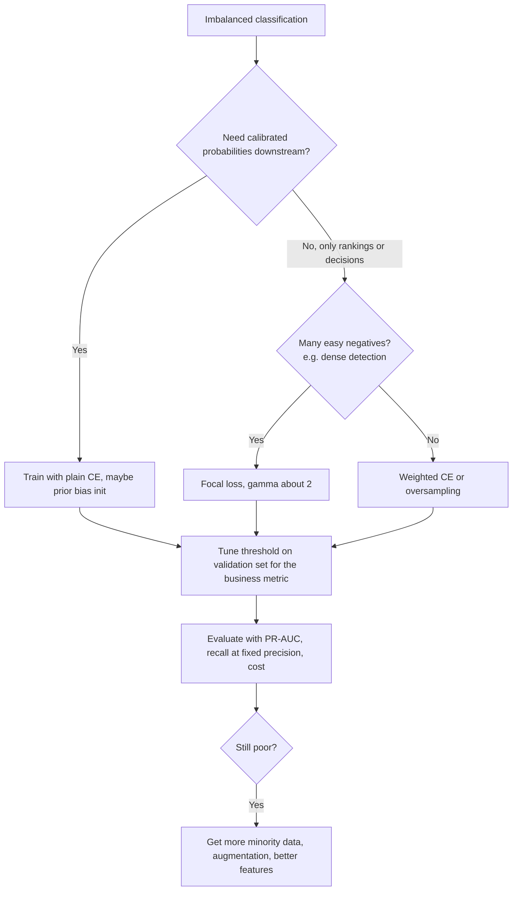
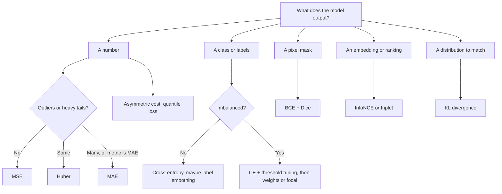

# Loss Functions: What They Are and How to Choose Them

> **Level:** Beginner to Advanced · **Study time:** ~110 min · **Prerequisites:** [Calculus for ML](../00-foundations/03-calculus-and-gradients.md), [Softmax, Entropy, Cross-Entropy and KL Divergence](../00-foundations/05-softmax-entropy-cross-entropy-and-kl-divergence.md), [Backpropagation and Gradient Descent](./02-backpropagation-and-gradient-descent.md), [Classification Metrics and Imbalanced Data](../01-classical-ml/04-classification-metrics-and-imbalanced-data.md)

## Table of contents

- [Why this matters](#why-this-matters)
- [What a loss function is (and is not)](#what-a-loss-function-is-and-is-not)
- [Regression losses: MSE, MAE and Huber](#regression-losses-mse-mae-and-huber)
- [Classification losses: binary and categorical cross-entropy](#classification-losses-binary-and-categorical-cross-entropy)
- [Label smoothing](#label-smoothing)
- [Class imbalance in neural networks](#class-imbalance-in-neural-networks)
- [Segmentation losses: Dice and IoU](#segmentation-losses-dice-and-iou)
- [Ranking and contrastive losses: margin, triplet and InfoNCE](#ranking-and-contrastive-losses-margin-triplet-and-infonce)
- [KL divergence as a loss](#kl-divergence-as-a-loss)
- [Why accuracy is not a training loss, and why it misleads](#why-accuracy-is-not-a-training-loss-and-why-it-misleads)
- [Choosing a loss from the task and the business metric](#choosing-a-loss-from-the-task-and-the-business-metric)
- [Going deeper: losses in production training](#going-deeper-losses-in-production-training)
- [Common mistakes and misconceptions](#common-mistakes-and-misconceptions)
- [Interview questions and model answers](#interview-questions-and-model-answers)
- [Key takeaways](#key-takeaways)
- [Further reading](#further-reading)
- [Next](#next)

## Why this matters

The loss function is the only thing a neural network actually "wants". Gradient descent does not know about your product, your users or your KPI: it only knows how to push one number down. If that number is the wrong one, you can train a model perfectly and still ship something useless, like a fraud model that is 99% accurate and catches zero fraud. Every serious ML system you will discuss in an interview, from a dense object detector (focal loss in RetinaNet; IoU-family box losses in modern YOLO versions) to a RAG embedding model (InfoNCE) to an LLM (token-level cross-entropy, KL penalties in RLHF, KL in distillation), is defined as much by its loss as by its architecture (if those names are unfamiliar, each is unpacked below). Interviewers ask "how do you choose a loss?" because the answer reveals whether you connect math to business outcomes.

## What a loss function is (and is not)

> **Analogy:** Think of learning darts with a coach. The **metric** is the scoreboard: "you hit the bullseye 3 times out of 20". The **loss** is the coach's feedback after every throw: "4 cm too high, 2 cm left". The scoreboard is what you care about, but you can only *improve* from the detailed feedback, because it tells you which direction to adjust and by how much.

**Precise definitions:**

- A **loss function** $\ell(\hat{y}, y)$ takes one prediction $\hat{y}$ and the true target $y$ and returns a single non-negative number that is small when the prediction is good and large when it is bad.
- The **cost** or **objective** $J(\theta)$ is the average loss over a batch or dataset, as a function of the model parameters $\theta$ (all weights and biases). Training means minimizing $J$. In casual speech "loss" means either one.
- A **metric** is the number you report and make decisions with (accuracy, F1, IoU, revenue saved). It does not need to be differentiable and is often not.
- A **surrogate loss** is a smooth, differentiable stand-in for a metric you cannot optimize directly. Cross-entropy is a surrogate for accuracy; Dice loss is a surrogate for the Dice score.

$$
J(\theta) = \frac{1}{N}\sum_{i=1}^{N} \ell\big(f_\theta(x_i),\, y_i\big)
$$

- $N$: number of examples in the batch (or dataset).
- $x_i, y_i$: the $i$-th input and its true target.
- $f_\theta$: the model with parameters $\theta$; $f_\theta(x_i)$ is the prediction $\hat{y}_i$.
- $\ell$: the per-example loss.

### What makes a good training loss

| Property | Why it matters |
|---|---|
| **Differentiable** (almost everywhere) | Backpropagation needs a gradient, a slope that says which way to move each weight. See [Backpropagation](./02-backpropagation-and-gradient-descent.md). |
| **Informative gradients** | The gradient should be large when you are badly wrong and shrink as you get close, so learning is fast early and stable late. |
| **Aligned with the metric** | Driving the loss down should drive the business metric up. |
| **Numerically stable** | No `log(0)`, no overflow in `exp`, especially in half precision. |
| **Right statistical assumption** | Each classic loss corresponds to an assumption about the noise in your data (see below). |

### The hidden assumption: losses are negative log-likelihoods

A **likelihood** is the probability the model assigns to the observed data. **Maximum likelihood estimation (MLE)** means choosing parameters that make the observed data most probable. Taking the negative log turns "maximize a product of probabilities" into "minimize a sum of losses". This one idea explains why the standard losses look the way they do:

| If you assume the target is... | Negative log-likelihood becomes... |
|---|---|
| Prediction plus Gaussian (bell-curve) noise | MSE |
| Prediction plus Laplace (sharp-peaked, heavy-tailed) noise | MAE |
| A coin flip with probability $p$ (Bernoulli) | Binary cross-entropy |
| One of $K$ categories (categorical distribution) | Categorical cross-entropy |

**Worked derivation (Gaussian to MSE).** If $y = \hat{y} + \text{noise}$ with Gaussian noise of fixed variance $\sigma^2$, the probability density of one target is $\frac{1}{\sqrt{2\pi\sigma^2}} e^{-(y - \hat{y})^2 / (2\sigma^2)}$. Its negative log is

$$
-\log p(y \mid \hat{y}) = \frac{(y - \hat{y})^2}{2\sigma^2} + \tfrac{1}{2}\log(2\pi\sigma^2)
$$

The second term does not depend on the model, and $\frac{1}{2\sigma^2}$ is just a positive scale, so minimizing this summed over examples is exactly minimizing squared error. Swap in the Laplace density ($\propto e^{-|y - \hat{y}|/b}$) and the same steps give absolute error.

> **Senior insight:** "Which loss?" is really "what do I believe about my targets and what do I want to predict: the mean, the median, a quantile, a probability, a ranking?" Saying this in an interview immediately signals depth.

## Regression losses: MSE, MAE and Huber

**Regression** means predicting a continuous number. Our running example: predicting house prices in units of 100,000 dollars.

Suppose four houses have true prices $y = [3, 4, 5, 20]$ (the last is a mansion, an outlier for our model) and the model predicts $\hat{y} = [3.5, 3.5, 5.5, 6]$. The **residual** (error) for each is $r = \hat{y} - y = [0.5, -0.5, 0.5, -14]$.

### Mean Squared Error (MSE)

> **Analogy:** A teacher who punishes mistakes by the square of their size. Being 2 points off costs 4; being 10 points off costs 100. One huge mistake dominates everything.

$$
\text{MSE} = \frac{1}{N}\sum_{i=1}^{N} (\hat{y}_i - y_i)^2, \qquad \frac{\partial \ell_i}{\partial \hat{y}_i} = 2(\hat{y}_i - y_i)
$$

- $\hat{y}_i$: prediction for example $i$; $y_i$: true value.
- $(\hat{y}_i - y_i)^2$: squared residual, always non-negative.
- $\frac{\partial \ell_i}{\partial \hat{y}_i}$: the gradient of one example's loss with respect to its prediction (ignoring the $1/N$). It grows linearly with the error.

**Worked example:** squared residuals are $0.25, 0.25, 0.25, 196$. Sum $= 196.75$. MSE $= 196.75 / 4 = 49.1875$. The outlier contributes $196 / 196.75 = 99.6\%$ of the loss.

Per-example gradients: $2r = [1, -1, 1, -28]$. The mansion pulls on the model **28 times harder** than any normal house.

### Mean Absolute Error (MAE, also L1 loss)

> **Analogy:** A teacher who charges a flat fee per point of error. 10 points off costs exactly 10 times as much as 1 point off, no more.

$$
\text{MAE} = \frac{1}{N}\sum_{i=1}^{N} |\hat{y}_i - y_i|, \qquad \frac{\partial \ell_i}{\partial \hat{y}_i} = \text{sign}(\hat{y}_i - y_i)
$$

- $|\cdot|$: absolute value.
- $\text{sign}(r)$: $+1$ if $r > 0$, $-1$ if $r < 0$. At exactly $r = 0$ the function has a kink and frameworks use a **subgradient** (any value between -1 and 1, PyTorch uses 0).

**Worked example:** absolute residuals $0.5, 0.5, 0.5, 14$. Sum $= 15.5$. MAE $= 15.5/4 = 3.875$. Gradients: $[1, -1, 1, -1]$. Every example pulls with equal strength, so the mansion cannot hijack training.

### What each loss is really estimating: mean vs median

If a model could only output one constant $c$ for all four houses, which $c$ minimizes each loss?

- MSE is minimized by the **mean**: $(3 + 4 + 5 + 20)/4 = 8$. A price of 8 is wrong for every single house.
- MAE is minimized by the **median**: the middle of $[3, 4, 5, 20]$ is anywhere between 4 and 5 (conventionally 4.5).

This is the cleanest way to explain outlier sensitivity: MSE chases the mean, and a mean is dragged by extremes; MAE chases the median, which is not. A real model sees features $x$, so the same logic applies per input: an MSE-trained model learns the **conditional mean** $\mathbb{E}[y \mid x]$ (the average price of houses *like this one*), an MAE-trained model the **conditional median**.

### Huber loss (smooth L1)

> **Analogy:** A teacher who uses squared penalties for small mistakes (gentle, precise corrections) but switches to flat-fee penalties once a mistake is bigger than some threshold $\delta$, so one disaster cannot dominate the grade.

$$
\ell_\delta(r) =
\begin{cases}
\frac{1}{2} r^2 & \text{if } |r| \le \delta \\
\delta\left(|r| - \frac{1}{2}\delta\right) & \text{if } |r| > \delta
\end{cases}
\qquad
\frac{\partial \ell_\delta}{\partial \hat{y}} =
\begin{cases}
r & \text{if } |r| \le \delta \\
\delta \cdot \text{sign}(r) & \text{if } |r| > \delta
\end{cases}
$$

- $r = \hat{y} - y$: residual.
- $\delta$: the threshold (a hyperparameter) where the loss switches from quadratic to linear. It is in the same units as the target.
- The $-\frac{1}{2}\delta$ term makes the two pieces meet smoothly at $|r| = \delta$ (same value and same slope).

**Worked example with $\delta = 1$:**

- Three small residuals ($|0.5| \le 1$): each $\frac{1}{2}(0.5)^2 = 0.125$. Total $0.375$.
- Outlier ($|-14| > 1$): $1 \times (14 - 0.5) = 13.5$.
- Huber $= (0.375 + 13.5)/4 = 13.875/4 = 3.46875$.
- Gradients: $[0.5, -0.5, 0.5, -1]$. The outlier now pulls only 2 times harder than a normal example, instead of 28 times.

### Summary of the worked example

| Loss | Value | Gradient per example | Outlier pull vs normal | Behavior near the optimum |
|---|---|---|---|---|
| MSE | 49.19 | [1, -1, 1, -28] | 28x | Gradient shrinks smoothly to 0: precise convergence |
| MAE | 3.875 | [1, -1, 1, -1] | 1x | Gradient stays at magnitude 1: can oscillate, needs LR decay |
| Huber ($\delta=1$) | 3.469 | [0.5, -0.5, 0.5, -1] | 2x | Quadratic near 0: smooth like MSE |

| | MSE | MAE | Huber |
|---|---|---|---|
| Estimates | Conditional mean | Conditional median | Between mean and median |
| Outliers | Very sensitive | Robust | Robust beyond $\delta$ |
| Smooth at 0 | Yes | No (kink) | Yes |
| When to use | Clean data, errors roughly Gaussian, large errors truly costly | Heavy-tailed noise, label errors, metric is MAE | Mostly clean data with some outliers; bounding-box regression |
| Extra hyperparameter | No | No | $\delta$ |

### Code: from scratch, then PyTorch

```python
# pip install numpy torch
import numpy as np
import torch
import torch.nn as nn

y_true = np.array([3.0, 4.0, 5.0, 20.0])   # prices in $100k
y_pred = np.array([3.5, 3.5, 5.5, 6.0])
r = y_pred - y_true

def mse(r):   return np.mean(r**2),          2 * r
def mae(r):   return np.mean(np.abs(r)),     np.sign(r)
def huber(r, delta=1.0):
    small = np.abs(r) <= delta
    loss = np.where(small, 0.5 * r**2, delta * (np.abs(r) - 0.5 * delta))
    grad = np.where(small, r, delta * np.sign(r))
    return loss.mean(), grad

for name, fn in [("MSE", mse), ("MAE", mae), ("Huber", huber)]:
    value, grad = fn(r)
    print(name, value, grad)
# MSE 49.1875 [  1.  -1.   1. -28.]
# MAE 3.875 [ 1. -1.  1. -1.]
# Huber 3.46875 [ 0.5 -0.5  0.5 -1. ]

# Standard PyTorch versions (reduction="mean" by default)
p, t = torch.tensor(y_pred), torch.tensor(y_true)
print(nn.MSELoss()(p, t).item())             # 49.1875
print(nn.L1Loss()(p, t).item())              # 3.875
print(nn.HuberLoss(delta=1.0)(p, t).item())  # 3.46875
```

> **Common mistake:** confusing `nn.HuberLoss(delta)` with `nn.SmoothL1Loss(beta)`. They have the same shape, but Smooth L1 is Huber divided by $\beta$ (so its linear part has slope 1 regardless of $\beta$). With $\delta = \beta = 1$ they are identical.

### Two more regression tools seniors should know

- **Target transformation.** Prices span orders of magnitude. Training MSE on $\log(\text{price})$ makes the loss roughly penalize *relative* error (10% off a 300k-dollar house costs about the same as 10% off a 3M-dollar house). Remember to transform predictions back, and note that `exp(mean of logs)` estimates the median, not the mean. See [Regression Metrics](../01-classical-ml/05-regression-metrics-baselines-and-model-selection.md).
- **Quantile (pinball) loss.** When under- and over-prediction have different costs, predict a quantile instead of the mean. For quantile $\tau$:

$$
\ell_\tau(y, \hat{y}) = \begin{cases} \tau\,(y - \hat{y}) & \text{if } y \ge \hat{y} \\ (1-\tau)\,(\hat{y} - y) & \text{if } y < \hat{y} \end{cases}
$$

- $\tau$: target quantile between 0 and 1 ($\tau = 0.5$ gives half the MAE, so it estimates the median).
- With $\tau = 0.9$ and true demand $y = 100$: predicting 90 (under) costs $0.9 \times 10 = 9$; predicting 110 (over) costs $0.1 \times 10 = 1$. Under-prediction is 9 times more expensive, so the model learns to predict high, at the 90th percentile. This is how you encode "running out of stock is 9x worse than overstocking" directly into training.

## Classification losses: binary and categorical cross-entropy

Our running example: a **spam filter**. The model outputs a raw score called a **logit** $z$ (any real number). The **sigmoid** function $\sigma(z) = \frac{1}{1 + e^{-z}}$ squashes it into a probability $p \in (0, 1)$ that the email is spam. For more than two classes, **softmax** turns a vector of logits into probabilities that sum to 1. Both are covered in detail in [Softmax, Entropy, Cross-Entropy and KL Divergence](../00-foundations/05-softmax-entropy-cross-entropy-and-kl-divergence.md); here we focus on using them as losses.

### Binary cross-entropy (BCE, log loss)

> **Analogy:** A weather forecaster is graded by how much probability they put on what actually happened. Saying "90% rain" on a rainy day costs little. Saying "1% rain" on a rainy day is humiliating, and the penalty should be huge, because the forecaster was confidently wrong.

$$
\ell_{\text{BCE}}(p, y) = -\big[\, y \log p + (1 - y)\log(1 - p) \,\big]
$$

- $y \in \{0, 1\}$: true label (1 = spam).
- $p = \sigma(z)$: predicted probability of spam.
- $\log$: natural logarithm.
- Only one term is ever active: if $y = 1$ the loss is $-\log p$; if $y = 0$ it is $-\log(1-p)$.

**Worked example** (true label spam, $y = 1$, loss $= -\ln p$):

| Predicted $p$ | Loss $-\ln p$ | Reading |
|---|---|---|
| 0.99 | 0.0101 | Confident and right: almost no penalty |
| 0.9 | 0.1054 | Right, small penalty |
| 0.6 | 0.5108 | Right but unsure |
| 0.5 | 0.6931 | Coin flip ($\ln 2$) |
| 0.1 | 2.3026 | Wrong |
| 0.01 | 4.6052 | Confidently wrong: huge penalty |

The loss goes to infinity as $p \to 0$. That is the point: cross-entropy punishes confident errors without limit.

**The gradient with respect to the logit is beautifully simple.** Chaining BCE through the sigmoid (see [Calculus for ML](../00-foundations/03-calculus-and-gradients.md) for the chain rule):

$$
\frac{\partial \ell_{\text{BCE}}}{\partial z} = p - y
$$

The error signal is just "predicted probability minus truth", bounded between -1 and 1. Logistic regression uses exactly this; see [Linear and Logistic Regression](../01-classical-ml/02-linear-and-logistic-regression.md).

### Why not use MSE for classification?

You *could* compute $(p - y)^2$. The problem is the gradient through the sigmoid:

$$
\frac{\partial (p - y)^2}{\partial z} = 2(p - y)\cdot p(1 - p)
$$

The extra factor $p(1-p)$ (the sigmoid's derivative) is near 0 whenever $p$ is near 0 or 1, *including when the model is confidently wrong*.

**Worked example:** the email is spam ($y = 1$) but the logit is $z = -5$, so $p = \sigma(-5) \approx 0.00669$.

- BCE gradient: $p - y = 0.00669 - 1 = -0.9933$. Strong signal.
- MSE gradient: $2 \times (-0.9933) \times 0.00669 \times 0.99331 \approx -0.0132$. About **75 times weaker**.

So with MSE, a confidently wrong model barely learns: exactly the opposite of what you want. On top of that, MSE plus sigmoid is non-convex in the weights for logistic regression, while BCE is convex.

### Categorical cross-entropy (multi-class)

Extend the spam filter to three classes: `[ham, spam, promo]`. The model outputs logits $z = [2.0, 1.0, 0.1]$ and the true class is `ham`.

$$
p_k = \frac{e^{z_k}}{\sum_{j=1}^{K} e^{z_j}}, \qquad \ell_{\text{CE}} = -\sum_{k=1}^{K} y_k \log p_k = -\log p_{c}
$$

- $K$: number of classes (3 here).
- $z_k$: logit for class $k$; $p_k$: softmax probability for class $k$.
- $y_k$: **one-hot** target, 1 for the true class and 0 for the others.
- $c$: index of the true class. Because only one $y_k$ is 1, the sum collapses to $-\log p_c$.

**Worked example:**

1. Exponentiate: $e^{2.0} = 7.3891$, $e^{1.0} = 2.7183$, $e^{0.1} = 1.1052$.
2. Sum: $7.3891 + 2.7183 + 1.1052 = 11.2125$.
3. Probabilities: $7.3891/11.2125 = 0.6590$, $2.7183/11.2125 = 0.2424$, $1.1052/11.2125 = 0.0986$.
4. Loss: $-\ln 0.6590 = 0.4170$.

Gradient with respect to the logits is again "prediction minus target":

$$
\frac{\partial \ell_{\text{CE}}}{\partial z_k} = p_k - y_k \quad\Rightarrow\quad [0.6590 - 1,\; 0.2424,\; 0.0986] = [-0.3410,\; 0.2424,\; 0.0986]
$$

The gradient pushes the `ham` logit up and the others down, in proportion to how much probability they wrongly hold.

> **Senior insight:** an LLM's pretraining loss is exactly this categorical cross-entropy, applied at every token position with $K$ equal to the vocabulary size (often 32k to 200k+). **Perplexity** is $e^{\text{mean CE}}$: a mean token CE of 2.0 nats (loss measured with the natural log) means perplexity $e^2 \approx 7.39$. See [Pretraining and Next-Token Prediction](../05-llms/01-pretraining-and-next-token-prediction.md).

### Binary vs multi-class vs multi-label

| Setup | Example | Output layer | Loss | PyTorch |
|---|---|---|---|---|
| Binary | Spam or not | 1 logit + sigmoid | BCE | `nn.BCEWithLogitsLoss` |
| Multi-class (exactly one label) | ham / spam / promo | $K$ logits + softmax | Categorical CE | `nn.CrossEntropyLoss` |
| Multi-label (any subset) | Email tags: `urgent`, `finance`, `travel` | $K$ logits + independent sigmoids | BCE per label, averaged | `nn.BCEWithLogitsLoss` on a $K$-wide target |

### Always compute from logits

Computing `sigmoid` or `softmax` first and then taking `log` is numerically dangerous: in float32, `sigmoid(-200)` rounds to exactly 0 and `log(0)` is `-inf`. The fused "with logits" versions use the **log-sum-exp trick**, rewriting the math so no huge exponentials are formed: subtract the largest logit $m = \max_j z_j$ first, since $\log \sum_j e^{z_j} = m + \log \sum_j e^{z_j - m}$ and every shifted exponent is now $\le 0$. For BCE, a stable form is:

$$
\ell = \max(z, 0) - z\,y + \log\!\left(1 + e^{-|z|}\right)
$$

- $z$: logit; $y$: label. The exponent $-|z|$ is never positive, so $e^{-|z|} \le 1$ and nothing overflows.

```python
import torch
import torch.nn as nn
import torch.nn.functional as F

# --- Binary: stable BCE from scratch vs PyTorch ---
z = torch.tensor([3.0, -5.0, 0.0])   # logits for 3 emails
y = torch.tensor([1.0, 1.0, 0.0])    # labels (1 = spam)

def bce_with_logits(z, y):
    return (z.clamp(min=0) - z * y + torch.log1p(torch.exp(-z.abs()))).mean()

print(bce_with_logits(z, y))
print(nn.BCEWithLogitsLoss()(z, y))   # same value; pass RAW logits, not sigmoid(z)

# --- Multi-class: CrossEntropyLoss takes raw logits and integer class indices ---
logits = torch.tensor([[2.0, 1.0, 0.1]])   # [ham, spam, promo]
target = torch.tensor([0])                  # class index for "ham", NOT one-hot
loss = nn.CrossEntropyLoss()(logits, target)
print(round(loss.item(), 4))                # 0.417

# Same thing by hand: log_softmax is the stable building block
print(-F.log_softmax(logits, dim=-1)[0, 0])
```

> **Common mistake:** putting `nn.Softmax` as the last layer and then using `nn.CrossEntropyLoss`. `CrossEntropyLoss` already applies `log_softmax` internally, so you would softmax twice. The model still trains, but gradients are squashed and it learns badly. Same for `sigmoid` followed by `BCEWithLogitsLoss`.

## Label smoothing

> **Analogy:** A teacher who tells students "the answer is almost certainly A, but keep a little humility". Students who are never allowed to be 100% sure stay open to evidence and generalize better.

With one-hot targets, cross-entropy is only fully minimized when $p_c = 1$, which requires the true logit to be infinitely larger than the others. The network keeps inflating logits, becomes **overconfident**, and its probabilities stop being trustworthy (poor **calibration**: a calibrated model's "80% confident" predictions are right about 80% of the time).

**Label smoothing** (introduced in "Rethinking the Inception Architecture for Computer Vision", Szegedy et al., 2016) replaces the one-hot target with a softened one:

$$
y_k^{\text{LS}} = (1 - \varepsilon)\, y_k + \frac{\varepsilon}{K}
$$

- $\varepsilon$: smoothing amount, commonly 0.1.
- $K$: number of classes.
- $y_k$: original one-hot target.

**Worked example** ($\varepsilon = 0.1$, $K = 3$, true class `ham`, same logits as before):

1. Smoothed target: true class $0.9 + 0.1/3 = 0.9333$; others $0.0333$ each.
2. Log-probabilities (from before): $\ln p = [-0.4170, -1.4170, -2.3170]$.
3. Loss $= 0.9333 \times 0.4170 + 0.0333 \times 1.4170 + 0.0333 \times 2.3170 = 0.3892 + 0.0472 + 0.0772 = 0.5137$.

The optimum is now $p_{\text{ham}} = 0.9333$, not 1.0, so logits stay bounded. The gradient becomes $p_k - y_k^{\text{LS}}$; once the model reaches the smoothed target, it stops pushing.

```python
# PyTorch >= 1.10 has it built in
loss_fn = nn.CrossEntropyLoss(label_smoothing=0.1)
print(round(loss_fn(logits, target).item(), 4))   # 0.5137
```

| | Pros | Cons |
|---|---|---|
| Label smoothing | Regularizes, reduces overconfidence, often small accuracy gains in image classification and translation (the Transformer paper used $\varepsilon = 0.1$) | Raises the minimum achievable loss; "When Does Label Smoothing Help?" (Muller, Kornblith and Hinton, 2019) found teachers trained with it made *worse* distillation teachers, because it erases information about which wrong classes are similar |

> **Interview tip:** label smoothing also helps with mildly noisy labels, since the model is never told to be 100% sure of any single label.

## Class imbalance in neural networks

Imagine a fraud detector where 1 in 100 transactions is fraud. A model that always says "not fraud" gets **99% accuracy** and is worthless. Metrics for this situation are covered in [Classification Metrics and Imbalanced Data](../01-classical-ml/04-classification-metrics-and-imbalanced-data.md); in one line each: **precision** is the fraction of flagged cases that are really fraud, **recall** is the fraction of real fraud that gets flagged, **F1** is their harmonic mean, and **PR-AUC** is the area under the precision-recall curve traced out as the threshold varies. Here we focus on what you change in *training*.

The problem in loss terms: the average loss is dominated by the majority class, simply because it has 99 times more examples. The cheapest way for gradient descent to lower the loss is to get very good at negatives and mostly ignore positives.

You have four families of levers: change the **loss weights**, change the **loss shape** (focal), change the **data** the model sees (sampling), and change the **decision rule** after training (threshold).

### Lever 1: weighted cross-entropy

> **Analogy:** If a teacher has 99 easy questions and 1 hard one, make the hard one worth 99 points.

$$
\ell_{\text{wBCE}} = -\big[\, w_{+}\, y \log p + (1 - y)\log(1 - p) \,\big]
$$

- $w_{+}$: weight on positive examples. A common starting point is $w_+ = \frac{\#\text{negatives}}{\#\text{positives}}$, here $99$.
- For multi-class, each class $k$ gets a weight $w_k$, often inverse class frequency, sometimes its square root (less extreme), or the "effective number of samples" from "Class-Balanced Loss Based on Effective Number of Samples" (Cui et al., 2019).

In expectation, multiplying a class's loss by $w$ is equivalent to duplicating each of its examples $w$ times. Concretely, with $w_+ = 99$ a missed fraud at $p = 0.1$ costs $99 \times 2.303 = 228$ instead of $2.303$, so the single positive now carries as much total weight as the 99 negatives.

```python
import torch
import torch.nn as nn

# Binary: pos_weight multiplies the loss of positive examples
n_pos, n_neg = 1_000, 99_000
loss_fn = nn.BCEWithLogitsLoss(pos_weight=torch.tensor([n_neg / n_pos]))  # 99.0

# Multi-class: one weight per class (here: inverse frequency, normalized)
counts = torch.tensor([9000.0, 900.0, 100.0])
weights = counts.sum() / (len(counts) * counts)
loss_fn = nn.CrossEntropyLoss(weight=weights)
```

> **Common mistake:** forgetting that weighting **breaks calibration**. With $w_+ = 99$ the model's predicted probability of the positive class is inflated (for a well-fitted model the predicted odds are multiplied by about $w_+$, so subtracting $\ln w_+$ from the logit undoes it); "p = 0.7" no longer means "70% chance of fraud". If downstream code uses probabilities (risk scores, expected cost), recalibrate on an unweighted validation set or correct the logits. **Temperature scaling** divides all logits by one scalar $T$ fitted on validation data; **isotonic regression** fits a monotone (never decreasing) mapping from raw scores to observed frequencies. Neither reverses the ranking of examples (temperature scaling preserves it exactly; isotonic regression can merge nearby scores into ties).

### Lever 2: focal loss and the effect of gamma

Weighting fixes the *class* imbalance, but there is a second, subtler imbalance: **easy vs hard examples**. In object detection, an image might yield 100,000 candidate boxes, almost all obviously background. Each easy background box has a tiny loss, but there are so many that together they swamp the few hard, informative examples.

**Focal loss** ("Focal Loss for Dense Object Detection", Lin et al., 2017, the RetinaNet paper) adds a modulating factor that down-weights examples the model already gets right:

$$
\ell_{\text{FL}} = -\alpha_t\, (1 - p_t)^{\gamma}\, \log p_t
$$

- $p_t$: probability the model assigns to the *true* class ($p_t = p$ if $y = 1$, else $1 - p$).
- $\gamma \ge 0$: the **focusing parameter**. $\gamma = 0$ recovers ordinary cross-entropy.
- $(1 - p_t)^\gamma$: near 0 for easy examples ($p_t \to 1$), near 1 for hard ones ($p_t \to 0$).
- $\alpha_t$: optional class weight ($\alpha$ for positives, $1 - \alpha$ for negatives). The paper's best setting was $\gamma = 2$, $\alpha = 0.25$; note $\alpha$ ended up *down*-weighting the rare class, because $\gamma$ already handles the easy negatives.

**Worked effect of gamma** (ignoring $\alpha$). Cross-entropy values: $-\ln 0.9 = 0.1054$, $-\ln 0.5 = 0.6931$, $-\ln 0.1 = 2.3026$.

| $p_t$ (difficulty) | $\gamma = 0$ (CE) | $\gamma = 1$ | $\gamma = 2$ | $\gamma = 5$ |
|---|---|---|---|---|
| 0.9 (easy) | 0.1054 | $0.1 \times 0.1054 = 0.01054$ | $0.01 \times 0.1054 = 0.001054$ | $10^{-5} \times 0.1054 \approx 0.0000011$ |
| 0.5 (unsure) | 0.6931 | $0.5 \times 0.6931 = 0.3466$ | $0.25 \times 0.6931 = 0.1733$ | $0.03125 \times 0.6931 = 0.0217$ |
| 0.1 (hard) | 2.3026 | $0.9 \times 2.3026 = 2.0723$ | $0.81 \times 2.3026 = 1.8651$ | $0.59049 \times 2.3026 = 1.3597$ |
| Hard / easy ratio | 21.9x | 197x | 1,770x | about 1.3 million x |

With $\gamma = 2$, an easy example's loss shrinks 100x while a hard one keeps 81% of its loss.

**Why that matters, in aggregate** (illustrative counts): 10,000 easy negatives at $p_t = 0.99$ and 10 hard positives at $p_t = 0.1$.

- Cross-entropy: easy total $= 10{,}000 \times 0.01005 = 100.5$; hard total $= 10 \times 2.3026 = 23.0$. Easy examples are **81%** of the loss.
- Focal, $\gamma = 2$: easy total $= 100.5 \times (0.01)^2 = 0.01$; hard total $= 23.0 \times 0.81 = 18.65$. Hard examples are now essentially **all** of the loss.

```python
import torch
import torch.nn.functional as F

def focal_loss(logits, targets, alpha=0.25, gamma=2.0):
    """Binary focal loss from logits. targets are floats 0/1."""
    ce = F.binary_cross_entropy_with_logits(logits, targets, reduction="none")  # = -log(p_t)
    p = torch.sigmoid(logits)
    p_t = p * targets + (1 - p) * (1 - targets)
    alpha_t = alpha * targets + (1 - alpha) * (1 - targets)
    return (alpha_t * (1 - p_t) ** gamma * ce).mean()

# Library version (pip install torchvision)
from torchvision.ops import sigmoid_focal_loss
logits = torch.tensor([2.0, -1.0, 0.5])
targets = torch.tensor([1.0, 0.0, 1.0])
print(focal_loss(logits, targets))
print(sigmoid_focal_loss(logits, targets, alpha=0.25, gamma=2.0, reduction="mean"))  # same
```

> **Senior insight:** RetinaNet also initialized the final classification bias so the model starts by predicting the rare class with probability $\pi = 0.01$: bias $= -\log\frac{1-\pi}{\pi} \approx -4.6$. Without it, the huge initial loss from thousands of negatives can destabilize early training. This "prior initialization" trick works for any imbalanced binary head, focal or not.

### Lever 3: sampling strategies

| Strategy | What it does | Pros | Cons |
|---|---|---|---|
| **Random oversampling** of the minority | Show positives more often (in PyTorch: `WeightedRandomSampler`) | Simple; every batch contains positives, so gradients are less noisy | Repeats the same few positives: overfitting risk; pair with augmentation |
| **Random undersampling** of the majority | Drop many negatives | Much faster training on huge datasets | Throws away information; probabilities become biased (see correction below) |
| **Hard negative mining** | Keep only negatives with the highest loss (OHEM: "Training Region-based Object Detectors with Online Hard Example Mining", Shrivastava et al., 2016) | Focuses compute on informative examples | Sensitive to label noise: "hard" negatives are often mislabeled positives |
| **Synthetic minority examples** (SMOTE and variants) | Interpolate new minority points | Works on low-dimensional tabular features | Rarely helpful for images or text; prefer data augmentation |

```python
import torch
from torch.utils.data import DataLoader, WeightedRandomSampler

labels = torch.tensor([0] * 990 + [1] * 10)
class_counts = torch.bincount(labels)                 # tensor([990, 10])
sample_weights = (1.0 / class_counts.float())[labels]  # rare examples get higher weight
sampler = WeightedRandomSampler(sample_weights, num_samples=len(labels), replacement=True)
# loader = DataLoader(dataset, batch_size=64, sampler=sampler)   # do not also pass shuffle=True
```

**Correcting probabilities after undersampling.** If you keep each negative with probability $\beta$ (say $\beta = 0.1$), the model sees odds of positive inflated by $1/\beta$. Convert back by adjusting the logit:

$$
z_{\text{true}} = z_{\text{sampled}} + \ln \beta
$$

- $z$: logit (log-odds). With $\beta = 0.1$, subtract $\ln 10 \approx 2.30$ from every logit before the sigmoid.
- Example: the undersampled model says $p = 0.5$ ($z = 0$). Corrected: $z = -2.30$, so $p = \sigma(-2.30) \approx 0.091$. Equivalently, odds of 1:1 become 1:10.

### Lever 4: threshold tuning

A classifier outputs a probability; the default rule "predict positive if $p > 0.5$" is arbitrary. For imbalanced problems the best threshold is almost never 0.5. You choose it on a **validation set** (never the test set) to optimize the metric you actually care about:

- Maximize F1, or
- Hit a required precision ("at most 1 false alarm per 10 alerts") and maximize recall, or
- Minimize expected cost. For calibrated probabilities, predict positive when $p \cdot C_{FN} > (1 - p)\cdot C_{FP}$, which gives

$$
t^* = \frac{C_{FP}}{C_{FP} + C_{FN}}
$$

- $C_{FP}$: cost of a false positive (a false alarm); $C_{FN}$: cost of a false negative (a missed fraud).
- Illustrative: missed fraud costs 500 dollars, a false alarm costs 5 dollars of analyst time. $t^* = 5 / 505 \approx 0.0099$. Flag anything above about 1%.

```python
# pip install scikit-learn
import numpy as np
from sklearn.metrics import precision_recall_curve

def best_f1_threshold(y_val, p_val):
    precision, recall, thresholds = precision_recall_curve(y_val, p_val)
    f1 = 2 * precision * recall / (precision + recall + 1e-12)
    best = np.argmax(f1[:-1])          # last P/R point has no threshold
    return thresholds[best], f1[best]
```

### Putting the imbalance levers together

| Technique | Fixes | Changes probabilities? | Typical use |
|---|---|---|---|
| Threshold tuning | Decision rule | No | Always do it; cheapest and often enough |
| Weighted CE / `pos_weight` | Class frequency | Yes (inflates minority) | Moderate imbalance, simple models |
| Focal loss | Easy-example domination | Yes (pushed toward less confident) | Extreme imbalance with many easy negatives: dense detection, some fraud, segmentation |
| Oversampling | Batch composition | Yes | Small minority, want positives in every batch |
| Undersampling | Training cost | Yes (correctable) | Billions of negatives (ads click prediction) |
| Better data | Root cause | n/a | Collect or label more minority examples: usually the biggest win |



> **Interview tip:** lead with "first, I make sure I am measuring the right metric (not accuracy), and I tune the threshold". Many candidates jump to focal loss; seniors know the threshold and the metric come first, and that reweighting trades calibration for recall.

## Segmentation losses: Dice and IoU

**Semantic segmentation** means labeling every pixel of an image (for example: tumor vs healthy tissue, road vs not road). See [Computer Vision Tasks](../03-computer-vision/01-image-classification-detection-and-segmentation.md) for the task itself.

Segmentation is an imbalance problem in disguise: a tumor might cover 1% of the pixels. Pixel-wise BCE averages over all pixels, so a model that predicts "no tumor anywhere" already scores a low loss and 99% pixel accuracy.

> **Analogy:** Two stencils laid on top of each other. What you care about is how much the shapes *overlap* compared to their total size, not how many empty background squares happen to match.

### Dice coefficient and IoU (Jaccard)

Let $A$ be the set of predicted foreground pixels and $B$ the true foreground pixels.

$$
\text{Dice} = \frac{2|A \cap B|}{|A| + |B|} = \frac{2\,TP}{2\,TP + FP + FN}, \qquad \text{IoU} = \frac{|A \cap B|}{|A \cup B|} = \frac{TP}{TP + FP + FN}
$$

- $|A \cap B|$: overlap, the **true positives** (TP), pixels predicted foreground that really are.
- **FP** (false positives): predicted foreground, actually background. **FN** (false negatives): missed foreground pixels.
- **True negatives (TN) do not appear at all.** That is why these metrics ignore the vast, easy background.
- They are monotonically related: $\text{IoU} = \frac{\text{Dice}}{2 - \text{Dice}}$. Dice equals the F1 score computed over pixels.

**Worked example (hard masks).** A 4x4 image (16 pixels). The true mask has 4 foreground pixels (`#`). The prediction (`P`) hits 3 of them and adds 2 false positives.

```text
  Ground truth        Prediction          Overlay
  . . . .             . . . .             .  .  .  .
  . # # .             . P P P             .  TP TP FP
  . # # .             . P . .             .  TP FN .
  . . . .             . P . .             .  FP .  .

  TP = 3, FP = 2, FN = 1, TN = 16 - 3 - 2 - 1 = 10
```

- Dice $= \frac{2 \times 3}{2 \times 3 + 2 + 1} = \frac{6}{9} = 0.667$
- IoU $= \frac{3}{3 + 2 + 1} = \frac{3}{6} = 0.5$. Check: $0.667 / (2 - 0.667) = 0.667/1.333 = 0.5$.
- Pixel accuracy $= \frac{TP + TN}{16} = \frac{13}{16} = 0.8125$.
- Now the lazy model that predicts all background: TP = 0, so Dice = 0 and IoU = 0, but pixel accuracy $= 12/16 = 0.75$. On a real 512x512 scan with a 1% tumor, the lazy model would get about 99% pixel accuracy and Dice 0.

### Soft Dice and soft IoU losses

Counting pixels after thresholding is not differentiable. The **soft** versions replace hard 0/1 predictions with probabilities $p_i$:

$$
\mathcal{L}_{\text{Dice}} = 1 - \frac{2\sum_i p_i g_i + s}{\sum_i p_i + \sum_i g_i + s}, \qquad \mathcal{L}_{\text{IoU}} = 1 - \frac{\sum_i p_i g_i + s}{\sum_i p_i + \sum_i g_i - \sum_i p_i g_i + s}
$$

- $p_i \in [0, 1]$: predicted foreground probability for pixel $i$.
- $g_i \in \{0, 1\}$: true label for pixel $i$.
- $\sum_i p_i g_i$: soft overlap (soft TP).
- $s$: a small **smoothing** constant (often 1 or 1e-6) that prevents division by zero when both masks are empty.
- Soft Dice loss was popularized by "V-Net" (Milletari, Navab and Ahmadi, 2016) for 3D medical segmentation.

**Worked example (soft, 4 pixels, $s = 0$).** Truth $g = [1, 1, 0, 0]$, prediction $p = [0.9, 0.6, 0.2, 0.1]$.

1. Soft overlap: $0.9 \times 1 + 0.6 \times 1 + 0.2 \times 0 + 0.1 \times 0 = 1.5$.
2. $\sum p = 1.8$, $\sum g = 2$.
3. Soft Dice $= \frac{2 \times 1.5}{1.8 + 2} = \frac{3}{3.8} = 0.7895$. Dice loss $= 0.2105$.
4. Soft IoU $= \frac{1.5}{1.8 + 2 - 1.5} = \frac{1.5}{2.3} = 0.6522$. IoU loss $= 0.3478$.
5. For comparison, mean pixel BCE $= \frac{1}{4}(-\ln 0.9 - \ln 0.6 - \ln 0.8 - \ln 0.9) = \frac{1}{4}(0.1054 + 0.5108 + 0.2231 + 0.1054) = 0.2362$.
6. With smoothing $s = 1$: $\frac{3 + 1}{3.8 + 1} = 0.8333$, loss $0.1667$. Smoothing noticeably changes the value on tiny masks, so keep $s$ small relative to typical mask size, or be deliberate about it.

### Why combine BCE and Dice?

| | Pixel BCE | Dice / IoU loss |
|---|---|---|
| Matches the evaluation metric | No (per pixel) | Yes (overlap) |
| Handles foreground imbalance | Poorly (background dominates) | Well (TN ignored) |
| Gradient stability | Smooth, well-behaved, per pixel | Can be noisy, especially for small or empty masks: the ratio swings wildly when denominators are small |
| Calibrated pixel probabilities | Yes | No, tends to push outputs to extremes |
| Early training | Learns fast | Can stall when overlap is near 0 |

The standard practical recipe is a sum:

$$
\mathcal{L} = \lambda_1\, \mathcal{L}_{\text{BCE}} + \lambda_2\, \mathcal{L}_{\text{Dice}}
$$

- $\lambda_1, \lambda_2$: weights, often both 1. BCE provides stable per-pixel gradients and good probabilities; Dice aligns training with the overlap metric and counters the background imbalance.

```python
import torch
import torch.nn as nn

class BCEDiceLoss(nn.Module):
    def __init__(self, bce_weight=1.0, dice_weight=1.0, smooth=1.0):
        super().__init__()
        self.bce = nn.BCEWithLogitsLoss()
        self.bw, self.dw, self.smooth = bce_weight, dice_weight, smooth

    def forward(self, logits, targets):
        # logits, targets: (batch, 1, H, W); targets are 0/1 floats
        bce = self.bce(logits, targets)
        p = torch.sigmoid(logits).flatten(1)          # (batch, H*W)
        g = targets.flatten(1)
        inter = (p * g).sum(dim=1)
        dice = (2 * inter + self.smooth) / (p.sum(dim=1) + g.sum(dim=1) + self.smooth)
        dice_loss = 1 - dice.mean()                   # per-image Dice, averaged over batch
        return self.bw * bce + self.dw * dice_loss

loss_fn = BCEDiceLoss()
logits = torch.randn(2, 1, 64, 64)
masks = (torch.rand(2, 1, 64, 64) > 0.95).float()
print(loss_fn(logits, masks))
```

**Related variants worth naming:** Tversky loss (Salehi et al., 2017) weights FP and FN differently (useful when missing tumor is worse than over-segmenting); Generalized Dice (Sudre et al., 2017) weights classes by inverse squared volume for multi-class segmentation; Lovasz-Softmax (Berman et al., 2018) is a convex surrogate that directly targets IoU. Libraries such as `segmentation_models_pytorch` and MONAI ship these; check their current APIs since they change between versions.

> **Common mistake:** computing Dice over the whole batch vs per image gives different results. Batch Dice lets a big mask in one image hide a total miss on a small mask in another. Per-image Dice treats each image equally but is unstable for images with empty masks. Decide based on how you evaluate.

## Ranking and contrastive losses: margin, triplet and InfoNCE

So far, every loss compared a prediction with a fixed target. **Metric learning** is different: we want an **embedding** (a vector representation, see [Embeddings](../04-transformers/02-embeddings-from-one-hot-to-contextual.md)) where similar things are close and dissimilar things are far apart. There is no "correct vector" for a photo or a sentence; only *relative* distances matter. This is how face recognition, image search, and the embedding models behind RAG are trained.

> **Analogy:** Arranging guests at a party. You do not assign each guest a fixed spot; you just make sure friends sit closer to each other than to strangers.

### Margin ranking and contrastive (pairwise) loss

- **Margin ranking loss** takes two scores and a label saying which should be higher: $\ell = \max(0, -y(s_1 - s_2) + m)$, with $y \in \{+1, -1\}$ and margin $m$. Used in learning-to-rank; this hinge form is the RankSVM idea (Joachims, 2002), while RankNet (Burges et al., 2005) uses a smooth logistic loss on the same score difference.
- **Contrastive loss** ("Dimensionality Reduction by Learning an Invariant Mapping", Hadsell, Chopra and LeCun, 2006) takes pairs: pull similar pairs together ($d^2$), push dissimilar pairs apart until they are at least margin $m$ away ($\max(0, m - d)^2$).

The **margin** $m$ is the safety gap: once a negative is far enough, it contributes zero loss, so the model stops wasting effort on it.

### Triplet loss

From "FaceNet" (Schroff, Kalenichenko and Philbin, 2015). Each training item is a triplet: an **anchor** $a$ (a photo of Alice), a **positive** $p$ (another photo of Alice), and a **negative** $n$ (a photo of Bob).

$$
\ell_{\text{triplet}} = \max\big(0,\; d(a, p) - d(a, n) + m\big)
$$

- $d(\cdot, \cdot)$: distance between embeddings (Euclidean or 1 minus cosine similarity).
- $m$: margin. The loss wants $d(a, n) \ge d(a, p) + m$.

**Worked example** ($m = 0.5$):

| Case | $d(a,p)$ | $d(a,n)$ | Loss | Meaning |
|---|---|---|---|---|
| Easy | 0.3 | 1.0 | $\max(0, 0.3 - 1.0 + 0.5) = \max(0, -0.2) = 0$ | Already satisfied, no gradient |
| Semi-hard | 0.3 | 0.5 | $\max(0, 0.3 - 0.5 + 0.5) = 0.3$ | Negative is farther than positive but inside the margin |
| Hard | 0.3 | 0.2 | $\max(0, 0.3 - 0.2 + 0.5) = 0.6$ | Negative is closer than the positive |

Most random triplets are easy and contribute nothing, which is why **triplet mining** matters: choosing semi-hard or hard negatives within a batch. FaceNet used semi-hard negatives because the very hardest ones are often mislabeled or lead to collapsed embeddings.

```python
import torch.nn as nn
loss_fn = nn.TripletMarginLoss(margin=0.5, p=2)   # Euclidean distance
# loss = loss_fn(anchor_emb, positive_emb, negative_emb)   each (batch, dim)
```

### InfoNCE: contrastive learning as classification

Triplet loss compares one positive with one negative. **InfoNCE** (from "Representation Learning with Contrastive Predictive Coding", van den Oord, Li and Vinyals, 2018) compares one positive against *many* negatives at once, by turning the problem into a multiple-choice classification: "out of these $N + 1$ candidates, which is the true match?" It is simply softmax cross-entropy over similarity scores.

$$
\ell_{\text{InfoNCE}} = -\log \frac{\exp\big(\text{sim}(q, k^{+})/\tau\big)}{\sum_{j=0}^{N} \exp\big(\text{sim}(q, k_j)/\tau\big)}
$$

- $q$: the query embedding (a search question, or one view of an image).
- $k^{+}$: the positive key (the relevant document, or another view of the same image).
- $k_j$: all candidate keys, the positive plus $N$ negatives.
- $\text{sim}$: similarity, usually cosine similarity of L2-normalized vectors.
- $\tau$: **temperature**, a positive number that scales similarities before the softmax. Small $\tau$ makes the softmax sharper.

**Worked example.** A query for our RAG system ("how do I reset my password?") has cosine similarity 0.8 with the correct help article and 0.3, 0.1, -0.2 with three wrong ones.

*With $\tau = 1$:* logits $= [0.8, 0.3, 0.1, -0.2]$.

1. $e^{0.8} = 2.2255$, $e^{0.3} = 1.3499$, $e^{0.1} = 1.1052$, $e^{-0.2} = 0.8187$. Sum $= 5.4993$.
2. $p_{\text{pos}} = 2.2255 / 5.4993 = 0.4047$.
3. Loss $= -\ln 0.4047 = 0.905$. Even though the positive is clearly the most similar, the softmax is flat, so the loss is high.

*With $\tau = 0.1$:* logits $= [8, 3, 1, -2]$.

1. Relative to the largest: $e^{0} = 1$, $e^{-5} = 0.00674$, $e^{-7} = 0.00091$, $e^{-10} = 0.00005$. Sum $= 1.00770$.
2. $p_{\text{pos}} = 1 / 1.00770 = 0.9924$.
3. Loss $= \ln 1.00770 = 0.0077$.

Temperature controls how hard the loss "focuses" on the closest negatives: with small $\tau$, the closest negative (0.3) takes almost all of the negatives' share of the denominator, and therefore almost all of the push-away gradient. Too small and training becomes unstable and overly sensitive to false negatives; too large and the model barely separates anything. CLIP ("Learning Transferable Visual Models From Natural Language Supervision", Radford et al., 2021) makes $\tau$ a learned parameter.

**In-batch negatives.** The trick that makes InfoNCE cheap: in a batch of $B$ (query, positive) pairs, each query uses the other $B - 1$ positives as its negatives. The similarity matrix is $B \times B$ and the correct "class" for row $i$ is column $i$. Larger batches give more (and harder) negatives, which is why SimCLR ("A Simple Framework for Contrastive Learning of Visual Representations", Chen et al., 2020) and CLIP used very large batches.

```python
import torch
import torch.nn.functional as F

def info_nce(q, k, temperature=0.05, symmetric=True):
    """q, k: (B, dim). Row i of q matches row i of k; all other rows are negatives."""
    q = F.normalize(q, dim=-1)
    k = F.normalize(k, dim=-1)
    logits = q @ k.T / temperature             # (B, B) cosine similarities / tau
    labels = torch.arange(q.size(0))           # correct "class" is the diagonal
    loss = F.cross_entropy(logits, labels)
    if symmetric:                              # CLIP-style: also match k -> q
        loss = (loss + F.cross_entropy(logits.T, labels)) / 2
    return loss

q = torch.randn(8, 384)
k = q + 0.1 * torch.randn(8, 384)              # positives are noisy copies
print(info_nce(q, k))                          # near 0, since positives are very similar
```

The `sentence-transformers` library implements this pattern as `MultipleNegativesRankingLoss`, a common choice for fine-tuning retrieval embeddings. See [Text Embeddings and Similarity Search](../08-rag/02-text-embeddings-and-similarity-search.md) and [Vision Transformers, CLIP and Multimodal Models](../03-computer-vision/05-vision-transformers-clip-and-multimodal-models.md).

| Loss | Input unit | Negatives per step | Strengths | Weaknesses |
|---|---|---|---|---|
| Contrastive (pairwise) | Pair + same/different label | 1 | Simple | Needs balanced pairs; absolute margin is hard to tune |
| Triplet | (anchor, pos, neg) | 1 | Relative constraint, intuitive | Most triplets are easy; mining is essential and fiddly |
| InfoNCE | (query, pos) + many negatives | $B - 1$ or more | Uses many negatives cheaply; state of the art for embeddings | Needs large batches; **false negatives** (an in-batch "negative" that is actually relevant) hurt |

> **Senior insight:** in retrieval training, false negatives are a real production problem. If two FAQ entries answer the same question, in-batch InfoNCE punishes the model for retrieving the duplicate. Deduplicate training pairs, or filter mined hard negatives with a cross-encoder (see [Reranking](../08-rag/08-reranking-and-query-transformation.md)).

## KL divergence as a loss

**Kullback-Leibler (KL) divergence** measures how different a probability distribution $Q$ (the model) is from a reference distribution $P$. Full derivation lives in [Softmax, Entropy, Cross-Entropy and KL Divergence](../00-foundations/05-softmax-entropy-cross-entropy-and-kl-divergence.md); here is the loss-focused recap.

> **Analogy:** KL is the "surprise tax": the extra bits you pay, on average, for describing events using a codebook optimized for $Q$ when events really follow $P$.

$$
D_{\text{KL}}(P \,\|\, Q) = \sum_{k} P(k)\, \log\frac{P(k)}{Q(k)} = \underbrace{-\sum_k P(k)\log Q(k)}_{\text{cross-entropy } H(P,Q)} - \underbrace{\left(-\sum_k P(k)\log P(k)\right)}_{\text{entropy } H(P)}
$$

- $P$: target distribution (true labels, a teacher model, a reference policy).
- $Q$: model's predicted distribution.
- $D_{\text{KL}} \ge 0$, and equals 0 only when $P = Q$.
- Because $H(P)$ does not depend on the model, **minimizing cross-entropy and minimizing KL give the same gradients** when $P$ is fixed. With one-hot $P$, $H(P) = 0$ and they are numerically equal too.

**Worked example.** Teacher $P = [0.7, 0.2, 0.1]$, student $Q = [0.5, 0.3, 0.2]$.

$$
D_{\text{KL}}(P\|Q) = 0.7\ln\tfrac{0.7}{0.5} + 0.2\ln\tfrac{0.2}{0.3} + 0.1\ln\tfrac{0.1}{0.2} = 0.7(0.3365) + 0.2(-0.4055) + 0.1(-0.6931) = 0.2355 - 0.0811 - 0.0693 = 0.0851
$$

$$
D_{\text{KL}}(Q\|P) = 0.5\ln\tfrac{0.5}{0.7} + 0.3\ln\tfrac{0.3}{0.2} + 0.2\ln\tfrac{0.2}{0.1} = -0.1682 + 0.1216 + 0.1386 = 0.0920
$$

Different values: **KL is not symmetric**, so the direction is a design choice.

| Direction | Name | Behavior | Where you see it |
|---|---|---|---|
| $D_{\text{KL}}(P \Vert Q)$, average over target $P$ | Forward KL | **Mode covering**: $Q$ is heavily penalized for putting near-zero probability where $P$ has mass, so it spreads out | Standard supervised training, classic distillation |
| $D_{\text{KL}}(Q \Vert P)$, average over model $Q$ | Reverse KL | **Mode seeking**: $Q$ is penalized for putting mass where $P$ has little, so it locks onto one mode | Variational inference, some on-policy LLM distillation |

**Where KL appears as a loss:**

- **Knowledge distillation** ("Distilling the Knowledge in a Neural Network", Hinton, Vinyals and Dean, 2015): the student matches the teacher's softened probabilities. See [Knowledge Distillation Fundamentals](../07-model-compression/05-knowledge-distillation-fundamentals.md).
- **Variational autoencoders** ("Auto-Encoding Variational Bayes", Kingma and Welling, 2013): a KL term keeps the latent distribution close to a standard normal.
- **RLHF and PPO for LLMs**: in reinforcement learning from human feedback, the LLM being tuned (the **policy**) is optimized, usually with the PPO algorithm, to score highly under a learned reward model. A KL penalty keeps the policy close to the original **reference model** so it does not drift into **reward hacking** (exploiting flaws in the reward model). DPO (Direct Preference Optimization) bakes this constraint into its loss. See [Instruction Tuning, RLHF and DPO](../05-llms/02-instruction-tuning-rlhf-and-dpo.md).

```python
import torch
import torch.nn as nn
import torch.nn.functional as F

T = 2.0                                           # distillation temperature
student_logits = torch.randn(4, 10)
teacher_logits = torch.randn(4, 10)

kl = nn.KLDivLoss(reduction="batchmean")          # "batchmean" matches the math definition
loss = kl(
    F.log_softmax(student_logits / T, dim=-1),    # input: LOG-probabilities (student)
    F.softmax(teacher_logits / T, dim=-1),        # target: probabilities (teacher)
) * (T * T)                                       # T^2 keeps gradient scale comparable (Hinton et al.)
```

> **Common mistake:** `nn.KLDivLoss` has a surprising argument order and format: the first argument must be **log-probabilities** of the model, the second **probabilities** of the target (unless `log_target=True`). And `reduction="mean"` divides by the number of *elements* (batch times classes), not the batch size, giving a value $K$ times too small. Use `"batchmean"`.

## Why accuracy is not a training loss, and why it misleads

### Accuracy is not differentiable

**Accuracy** is the fraction of predictions where the predicted class (the argmax, or $p > 0.5$) equals the label. As a function of a logit, it is a step:

```text
 per-example score
  1.0 |            ___________   accuracy: jumps from 0 to 1 at the threshold;
      |           |              slope is 0 everywhere else
      |           |
  0.0 |___________|
      +-----------+-----------> logit z of the true class
                  0

 loss
      |\
      | \                        cross-entropy: smooth, always has a slope
      |  \__                     that says "push z up" (and how hard)
      |     \___
      |         \_______
      +-----------+-----------> logit z of the true class
```

- Moving a weight a tiny bit almost never flips a prediction, so the gradient of accuracy is **zero almost everywhere** and undefined at the jump. Gradient descent gets no direction.
- Accuracy also ignores *how wrong* you are: a 49% and a 1% probability on the true class both count as one mistake, but only one of them is close to being fixed.

Cross-entropy is a smooth surrogate: it rewards moving probability toward the truth even when the argmax does not change yet.

### Loss can improve while accuracy stalls

Our spam filter has an email it already classifies correctly with $p = 0.6$. After another epoch it is at $p = 0.9$. Accuracy: still 100% on that email, no change. Loss: $-\ln 0.6 = 0.511 \to -\ln 0.9 = 0.105$. The model genuinely got better (more confident and correct), but accuracy cannot see it. Early in training, logits often improve for many epochs before enough of them cross the 0.5 line to move accuracy.

### Accuracy can improve while loss gets worse

Four validation emails; the numbers are the probability the model assigns to the **true** class.

| | Email 1 | Email 2 | Email 3 | Email 4 | Accuracy | Mean CE |
|---|---|---|---|---|---|---|
| Epoch A | 0.55 | 0.55 | 0.45 | 0.45 | 2/4 = 50% | $(2 \times 0.598 + 2 \times 0.799)/4 = 0.698$ |
| Epoch B | 0.95 | 0.95 | 0.95 | 0.01 | 3/4 = 75% | $(3 \times 0.051 + 4.605)/4 = 1.190$ |

Accuracy rose from 50% to 75% while loss rose from 0.698 to 1.190. Epoch B got more examples right but is **confidently wrong** on email 4, and cross-entropy punishes that with a loss of 4.6. This pattern (validation accuracy flat or rising while validation loss climbs) is a classic sign of **overconfidence**, typically as the model starts to overfit. If your product uses the probabilities (risk scores, ranking, abstaining when unsure), epoch B may be *worse* despite better accuracy.

### Other ways accuracy misleads during training

- **Class imbalance:** 99% accuracy from predicting the majority class.
- **It hides calibration.** Two models with equal accuracy can differ wildly in whether "90% confident" means 90% right. Measure with a **reliability diagram** (bucket predictions by confidence, plot each bucket's actual accuracy against its average confidence; a calibrated model lies on the diagonal) or **Expected Calibration Error** (ECE: the average gap between confidence and accuracy across those buckets, weighted by bucket size); "On Calibration of Modern Neural Networks" (Guo et al., 2017) showed modern deep networks tend to be overconfident and that temperature scaling is a simple fix.
- **Noise on small validation sets:** with 200 validation examples, one example is 0.5 percentage points; accuracy jumps around while loss is smoother.
- **Label smoothing and regularizers change the loss floor**, so comparing raw loss values between runs with different settings is not apples to apples, but accuracy alone is still not enough. Watch both.

> **Interview tip:** the crisp answer is "accuracy is a thresholded count, so it is non-differentiable and blind to confidence. Loss measures confidence. Watch both, plus the metric the business cares about, and investigate when they diverge: diverging validation loss with stable accuracy usually means overconfidence or overfitting."

## Choosing a loss from the task and the business metric

> **Analogy:** The loss is the steering wheel and the business metric is the destination. You cannot steer with the destination, but you must pick a steering method that actually takes you there.

### A practical procedure

1. **Name the output type.** Number, one class, many labels, a mask, a ranking, an embedding, a distribution.
2. **Name the evaluation metric and decision.** What will the business measure, and what action follows a prediction?
3. **Start with the standard likelihood loss for that output** (MSE, CE, BCE). It is well understood, stable, and gives calibrated probabilities.
4. **Ask what the metric cares about that the default loss ignores:** outliers (Huber or MAE), asymmetric costs (quantile, weighting), imbalance (focal, weighting, sampling), overlap (Dice), relative order (ranking, InfoNCE), calibration (avoid heavy reweighting or recalibrate).
5. **Validate on the real metric, not on the loss.** Select checkpoints, thresholds and hyperparameters by the business metric on a validation set.
6. **Keep a simple baseline.** If a fancy loss does not beat CE plus threshold tuning on the real metric, ship the simple one.

### Task-to-loss reference table

| Task | Output layer | Default loss | Variants when... | Typical metric |
|---|---|---|---|---|
| Regression (house price) | Linear | MSE | Outliers: Huber / MAE. Asymmetric cost: quantile. Wide range: MSE on log target | RMSE, MAE, MAPE |
| Binary classification (spam) | 1 logit | BCE with logits | Imbalance: `pos_weight`, focal | PR-AUC, F1, recall at precision |
| Multi-class (email category) | $K$ logits | Categorical CE | Overconfidence: label smoothing. Imbalance: class weights | Accuracy, macro-F1 |
| Multi-label (tags) | $K$ logits | BCE per label | Rare labels: per-label `pos_weight`, focal | Micro/macro F1, mAP |
| Object detection | Class logits + box offsets | CE or focal + Smooth L1 / IoU-style box loss | Dense one-stage detectors: focal | mAP |
| Semantic segmentation | Per-pixel logits | BCE / CE | Small structures: + Dice, Tversky | Dice, mIoU |
| Embeddings / retrieval | Vector | InfoNCE | Few negatives available: triplet | Recall@k, nDCG, MRR |
| Learning to rank | Score per item | Pairwise (RankNet-style) or listwise | | nDCG, MRR |
| LLM pretraining / SFT | Vocabulary logits | Token-level CE | | Perplexity, task evals |
| Distillation | Logits | KL to teacher + CE to labels | | Student task metric |
| RLHF-style alignment | Policy logits | Reward objective with KL penalty, or DPO | | Win rate, human evals |

Metric glossary for the table: **mAP** (mean average precision) averages the area under the precision-recall curve over classes; **mIoU** averages IoU over classes; **Recall@k** is the fraction of queries whose relevant item appears in the top $k$ (the usual single-target retrieval convention, also called hit rate@k; with several relevant items per query, Recall@k is the fraction of them found, as in [Evaluating RAG](../08-rag/10-rag-evaluation-metrics-and-ragas.md)); **MRR** averages $1/\text{rank}$ of the first relevant item; **nDCG** rewards relevant items more the higher they are ranked.



> **Senior insight:** "loss-metric mismatch" is a common root cause of models that look great offline and disappoint in production. Example: a delivery-time model trained with MSE predicts the *mean*, but the product promises "arrives by" times, where being late is far worse than early. The right loss is a high quantile, and the right metric is the late-delivery rate.

## Going deeper: losses in production training

### Sanity check: the expected initial loss

At initialization a reasonable model predicts roughly uniform probabilities, so you can predict the first loss value before training:

- $K$-class CE with uniform predictions: $\ln K$. For 10 classes, $\ln 10 = 2.303$. For an LLM with a 50,000-token vocabulary, about $\ln 50{,}000 \approx 10.8$.
- Balanced binary BCE: $\ln 2 = 0.693$.

If your first loss is 50, something is wrong: logits that are far too large at initialization (bad initialization or unnormalized inputs), a `reduction="sum"` where you expected a mean, or a loss/target mismatch. A double softmax shows the opposite symptom: the loss starts near $\ln K$ and then barely moves, because the second softmax squashes everything toward uniform. This check takes ten seconds and catches real bugs. More debugging recipes (overfit one batch, gradient norms) are in [Regularization and Debugging Neural Network Training](./06-regularization-and-debugging-neural-network-training.md).

### Reduction, padding and averaging

- **`reduction="mean"` vs `"sum"`** changes the gradient magnitude by a factor of the batch size (or token count), and therefore the *effective learning rate* for SGD-style optimizers. Adam-family optimizers are nearly invariant to a constant loss scale, but gradient-clipping thresholds and an L2 penalty added to the loss are not, and with variable token counts the scale changes from batch to batch. Switching between them without retuning is a silent bug.
- **Padding in sequences.** For variable-length text, padded positions must not contribute. PyTorch's `CrossEntropyLoss` ignores targets equal to `ignore_index` (default `-100`); Hugging Face models use this convention for padding and for masking prompt tokens during supervised fine-tuning.
- **Token-level vs sequence-level averaging.** Averaging over all tokens in a batch weights long sequences more; averaging per sequence first weights each example equally. Neither is wrong, but be consistent.
- **Gradient accumulation pitfall.** If each micro-batch computes a *mean* over its own tokens and you then average the micro-batch losses, micro-batches with few tokens get too much weight. The total gradient no longer equals what one big batch would give. The fix is to sum token losses and divide by the total token count across all accumulated micro-batches. This affected popular training libraries in practice; check how your framework version handles it.

### Numerical stability and precision

- Always use the fused "with logits" losses (`BCEWithLogitsLoss`, `CrossEntropyLoss`, `log_softmax`) rather than composing `softmax` then `log`.
- Under mixed precision, autocast (for example PyTorch's `torch.autocast`) runs loss computations like softmax and cross-entropy in float32 even when the forward pass is in float16 or bfloat16, because of overflow and precision issues. See [Mixed-Precision Training](./09-mixed-precision-training.md).
- `NaN` loss usually comes from `log(0)` (manual BCE on saturated sigmoids), division by zero (Dice without smoothing on empty masks), exploding logits (learning rate too high), or bad data (NaN or inf in inputs or labels).

### Multi-task losses

Many production models optimize several losses at once: a detector has a classification loss plus a box regression loss; a recommendation model may predict click and purchase. The usual form is $\mathcal{L} = \sum_t \lambda_t \mathcal{L}_t$.

- Losses on different scales (CE around 0.5, MSE on prices around 10,000) mean the large one silently dominates. Normalize targets, or tune $\lambda_t$ so each term's gradient contribution is comparable.
- Learned weighting schemes exist, for example "Multi-Task Learning Using Uncertainty to Weigh Losses for Scene Geometry and Semantics" (Kendall, Gal and Cipolla, 2018) and GradNorm (Chen et al., 2018). In practice, a manual sweep of $\lambda$ judged on the real metrics is often sufficient.

### Noisy labels

Cross-entropy's unbounded penalty for confident errors is a strength with clean labels and a weakness with noisy ones: a mislabeled example produces a huge loss and gradient, and the model either memorizes the wrong label or gets pulled off course. Options: label smoothing, bounded or robust losses (MAE-like; "Generalized Cross Entropy Loss for Training Deep Neural Networks with Noisy Labels", Zhang and Sabuncu, 2018), and the data-centric fix: find the highest-loss training examples and review their labels. Sorting the training set by per-example loss is one of the simplest and most effective label-cleaning tools (expect it to also surface genuinely hard but correct examples, so review rather than auto-delete).

### Losses after deployment

In production, you usually cannot compute the training loss, because labels arrive late (chargebacks for fraud take weeks) or never. You monitor proxies: prediction distribution drift, confidence distribution, and the business metric once labels arrive. A shift in the mean predicted probability for a calibrated model is a useful early alarm. See [Monitoring ML and LLM Systems in Production](../10-mlops/06-monitoring-ml-and-llm-systems-in-production.md) and [Data Drift, Concept Drift and When to Retrain](../01-classical-ml/08-data-drift-concept-drift-and-retraining.md).

### Cost and latency

The loss itself almost never matters for inference latency: it only exists during training. It does matter for training cost:

- InfoNCE quality depends on batch size (number of negatives), which drives GPU memory. Techniques like gradient caching or a memory queue of past embeddings (as in MoCo, He et al., 2020) decouple the number of negatives from batch memory.
- LLM output layers: computing full-vocabulary logits for every token is a large share of training memory for big vocabularies; fused or chunked cross-entropy kernels avoid materializing the whole logit tensor at once. See [Distributed Training and Training Memory](./10-distributed-training-and-training-memory.md).
- Undersampling negatives is often the cheapest way to cut training cost on huge imbalanced datasets, with logit correction afterward.

## Common mistakes and misconceptions

| Mistake | Why it is wrong | Fix |
|---|---|---|
| Softmax/sigmoid layer before `CrossEntropyLoss`/`BCEWithLogitsLoss` | Applies the activation twice, squashing gradients | Feed raw logits |
| Softmax + `CrossEntropyLoss` for a multi-label problem | Softmax forces labels to compete, so an email cannot be both `urgent` and `finance` | Independent sigmoids + `BCEWithLogitsLoss` |
| "Accuracy is 99%, ship it" | Majority-class baseline on imbalanced data | Compare to baseline; use PR-AUC, recall at precision |
| Using MSE for classification | Vanishing gradients when confidently wrong | Cross-entropy |
| Reweighting classes, then trusting probabilities | Weights distort calibration | Recalibrate or correct logits |
| Tuning the threshold on the test set | Leaks test information; optimistic results | Tune on validation |
| Dice loss alone from scratch on tiny structures | Unstable gradients, stalls when overlap is 0 | BCE + Dice; add smoothing |
| `KLDivLoss` with probabilities as input, or `reduction="mean"` | Wrong value or scale | Log-probs as input, `"batchmean"` |
| Comparing loss values across runs with different label smoothing, weights or reductions | Different loss floors and scales | Compare on the real metric |
| "Lower validation loss always means a better model" | Loss and business metric can disagree | Select by the business metric; use loss for diagnosis |
| Treating the default 0.5 threshold as part of the model | It is a separate decision | Choose threshold from costs or metric targets |
| Focal loss as the first reaction to any imbalance | Adds hyperparameters and changes the probability scale (scores are no longer calibrated probabilities without recalibration); often unnecessary | Start with CE + threshold; escalate if needed |

## Interview questions and model answers

<details>
<summary><b>Q1. How do you choose a loss function?</b></summary>

**Short answer:** I start from what the model outputs and what the business measures. The output type gives a default likelihood-based loss: MSE for regression, BCE for binary, cross-entropy for multi-class, BCE per label for multi-label, InfoNCE for embeddings. Then I ask what the real metric cares about that the default ignores, such as outliers, asymmetric costs, imbalance, overlap or ranking, and adjust: Huber, quantile loss, weights or focal, Dice, contrastive losses. Finally I validate on the business metric, not on the loss, and keep the simple baseline unless the fancier loss clearly wins.

**Deeper answer and follow-ups:**
- Every standard loss is a negative log-likelihood under a noise assumption: MSE is Gaussian (estimates the mean), MAE is Laplace (estimates the median), CE is categorical.
- Encode asymmetric costs directly: pinball loss with $\tau = 0.9$ makes under-prediction 9x as costly as over-prediction.
- Consider downstream use: if probabilities feed a cost calculation, prefer losses that keep calibration (plain CE) and handle imbalance via the threshold.
- Practical checks: differentiable, stable (use logits), comparable scales in multi-task setups, expected initial loss ($\ln K$).
- Pitfall: loss-metric mismatch, for example training MSE for an "arrive-by" promise where lateness is the real cost.
- How to measure: train each candidate loss with the same budget and several seeds, then compare on the business metric on a fixed validation set; a gap smaller than seed-to-seed variance is not a win.
- Production: confirm the offline metric actually moves the online KPI (shadow or A/B test), and remember that a loss change can shift the score distribution, so thresholds and calibration must be re-fitted before rollout.

</details>

<details>
<summary><b>Q2. When would you use cross-entropy, MSE, MAE, or Dice loss?</b></summary>

**Short answer:** Cross-entropy for classification, because it is the likelihood of a categorical outcome and gives strong gradients when the model is confidently wrong. MSE for regression with roughly Gaussian errors where big errors are truly costly. MAE for regression with outliers or heavy-tailed noise, or when the metric is MAE, since it estimates the median. Dice for segmentation, especially with small foreground objects, usually combined with BCE.

**Deeper answer and follow-ups:**
- CE gradient w.r.t. logits is $p - y$; MSE through a sigmoid adds a factor $p(1-p)$ that vanishes when confidently wrong (about 75x weaker at $z = -5$).
- MSE gradient grows with the error ($2r$): one outlier with residual 14 pulled 28x harder than normal points in our example; MAE's gradient is constant (sign), Huber caps it at $\delta$.
- MAE's constant gradient magnitude means it does not slow down near the optimum: use LR decay, or Huber as a smooth compromise.
- Dice $= 2TP/(2TP + FP + FN)$ ignores true negatives, so the massive background does not dominate; it directly matches the Dice/IoU evaluation metric.
- Dice alone is noisy for small or empty masks; BCE + Dice is the standard recipe.
- In practice: Smooth L1/Huber is the classic choice for bounding-box regression (Fast and Faster R-CNN), though modern detectors usually combine L1 with IoU-family losses (GIoU, CIoU); MAE when the reported forecast metric is MAE; for segmentation report Dice/IoU per class and per object size, since a good average can hide failures on small structures.

</details>

<details>
<summary><b>Q3. Why can accuracy be misleading during training?</b></summary>

**Short answer:** Accuracy is a thresholded count, so it ignores confidence. Loss can drop a lot while accuracy stays flat (correct predictions becoming more confident, or wrong ones moving toward the boundary), and accuracy can rise while loss gets worse (more examples right, but a few confidently wrong). It is also misleading under class imbalance and noisy on small validation sets. And it cannot be the training objective because its gradient is zero almost everywhere.

**Deeper answer and follow-ups:**
- Example: probabilities on the true class going from [0.55, 0.55, 0.45, 0.45] to [0.95, 0.95, 0.95, 0.01] raises accuracy 50% to 75% but raises mean CE from 0.698 to 1.190.
- Rising validation loss with stable or rising accuracy usually signals overconfidence and early overfitting; check calibration (reliability diagram, ECE) and consider early stopping, label smoothing, or temperature scaling.
- With 1% positives, always predicting negative gives 99% accuracy; use PR-AUC, recall at fixed precision, F1.
- Small validation sets make accuracy jumpy; one example out of 200 is 0.5 points.
- Accuracy is tied to one threshold (0.5 or argmax): a model can rank examples better (higher PR-AUC) yet show lower accuracy at 0.5, and accuracy shifts if the validation class mix differs from production.
- Recommendation: track loss and the business metric together and investigate when they diverge.

</details>

<details>
<summary><b>Q4. How would you handle class imbalance in a neural network?</b></summary>

**Short answer:** First, measure correctly (PR-AUC, recall at fixed precision, cost) and compare to the majority baseline. Then the cheapest lever: tune the decision threshold on validation data for the business metric. If the model still does not learn the minority class, reweight the loss (`pos_weight` or class weights), use focal loss when many easy negatives dominate, or rebalance batches with oversampling. Undersample when data is huge, and correct probabilities afterward. Getting more minority data or augmentation is often the biggest win.

**Deeper answer and follow-ups:**
- Weighted CE: $w_+ \approx$ negatives/positives, equivalent in expectation to oversampling; inflates probabilities, so recalibrate if they are used downstream.
- Focal loss $-\alpha_t (1-p_t)^\gamma \log p_t$: with $\gamma = 2$, an easy example at $p_t = 0.9$ keeps 1% of its loss, a hard one at 0.1 keeps 81%; in our illustrative case easy negatives went from 81% of total loss to almost nothing.
- Prior bias initialization ($b = -\log((1-\pi)/\pi)$, about -4.6 for 1%) stabilizes early training.
- Cost-based threshold $t^* = C_{FP}/(C_{FP} + C_{FN})$: false alarm 5 dollars, miss 500 dollars gives about 0.0099.
- Undersampling with keep rate $\beta$: correct logits by adding $\ln \beta$.
- Pitfalls: threshold tuned on test data, oversampling without augmentation (overfits repeated positives), hard negative mining amplifying label noise.
- How to measure: compare every lever against the "plain CE + tuned threshold" baseline on the same validation split, using PR-AUC, recall at the operating precision, and ECE if probabilities are consumed downstream.
- Production: the positive rate drifts (fraud is seasonal), so a tuned threshold goes stale; re-tune on recent labeled data, monitor precision and recall per segment as delayed labels arrive, and alert on shifts in the mean predicted probability.

</details>

<details>
<summary><b>Q5. Why is cross-entropy preferred over MSE for classification, mathematically?</b></summary>

**Short answer:** Cross-entropy is the negative log-likelihood of the labels under the model, so minimizing it is maximum likelihood. Its gradient with respect to the logit is simply $p - y$, which stays large when the model is confidently wrong. MSE through a sigmoid has gradient $2(p - y)p(1 - p)$, which vanishes when $p$ is near 0 or 1, so confidently wrong predictions barely learn.

**Deeper answer and follow-ups:**
- Example: $y = 1$, $z = -5$, $p = 0.0067$: CE gradient $-0.993$, MSE gradient $-0.013$, about 75x smaller.
- For logistic regression, CE is convex in the weights; MSE with a sigmoid is not.
- CE penalizes confident mistakes unboundedly ($-\ln 0.01 = 4.6$), which is great for clean labels but makes it sensitive to label noise.
- Follow-up "is MSE ever used on probabilities?": the Brier score is MSE on probabilities; it is a strictly proper scoring rule (it rewards both calibration and sharpness) and is widely used to evaluate probabilistic predictions; as a training loss through a sigmoid or softmax it is just a weaker signal for confidently wrong examples.

</details>

<details>
<summary><b>Q6. What is focal loss, and how does the gamma parameter change training?</b></summary>

**Short answer:** Focal loss multiplies cross-entropy by $(1 - p_t)^\gamma$, which shrinks the loss of examples the model already gets right. It was introduced for RetinaNet, where tens of thousands of easy background boxes otherwise overwhelm the few objects. Larger $\gamma$ focuses training more on hard examples; $\gamma = 0$ is plain CE; $\gamma = 2$ was the paper's best setting with $\alpha = 0.25$.

**Deeper answer and follow-ups:**
- At $\gamma = 2$: $p_t = 0.9$ keeps $0.01$ of its loss, $p_t = 0.5$ keeps $0.25$, $p_t = 0.1$ keeps $0.81$. The hard-to-easy loss ratio goes from about 22x to about 1,770x.
- Too large a $\gamma$ (e.g., 5) almost ignores moderately easy examples, slowing learning and leaving predictions underconfident.
- Hard examples include mislabeled ones: focal loss can amplify label noise.
- Pushes probabilities toward less confident values. For multi-class networks that are normally overconfident this can actually improve calibration ("Calibrating Deep Neural Networks using Focal Loss", Mukhoti et al., 2020), but with $\alpha$ weighting and extreme imbalance the scores are not calibrated probabilities: recalibrate if they are used as probabilities.
- Alternatives: two-stage detectors use sampling heuristics (fixed positive/negative ratios) instead.

</details>

<details>
<summary><b>Q7. What does label smoothing do and when would you avoid it?</b></summary>

**Short answer:** It replaces one-hot targets with $(1 - \varepsilon)$ on the true class plus $\varepsilon/K$ everywhere, so the loss is minimized at a confident but not certain prediction. This stops logits from growing without bound, reduces overconfidence, often improves calibration and generalization a bit, and adds robustness to label noise. I would avoid it for a model that will serve as a distillation teacher, and be careful when downstream systems need the exact probabilities.

**Deeper answer and follow-ups:**
- With $\varepsilon = 0.1$, $K = 3$: target $[0.933, 0.033, 0.033]$; our example loss went from 0.417 to 0.514.
- Gradient becomes $p - y^{\text{LS}}$, which reaches zero at $p_{\text{true}} = 0.933$.
- Muller, Kornblith and Hinton (2019) showed it clusters same-class representations tightly and erases inter-class similarity information, which hurts distillation.
- Training loss can never reach 0, so do not compare its absolute value to runs without smoothing.

</details>

<details>
<summary><b>Q8. Explain Dice vs IoU loss for segmentation, and why people combine Dice with BCE.</b></summary>

**Short answer:** Both measure overlap between predicted and true masks and ignore true negatives, so they handle the background imbalance that cripples plain pixel accuracy and BCE. They are monotonically related: $\text{IoU} = \text{Dice}/(2 - \text{Dice})$. As losses we use soft versions with probabilities. Dice alone gives noisy gradients for small or empty masks and poor probabilities, so BCE + Dice combines BCE's stable per-pixel gradients with Dice's metric alignment.

**Deeper answer and follow-ups:**
- Example: TP 3, FP 2, FN 1 gives Dice 0.667 and IoU 0.5, while pixel accuracy is 0.81 and an all-background model gets 0.75 accuracy with Dice 0.
- Soft Dice example: $g = [1,1,0,0]$, $p = [0.9,0.6,0.2,0.1]$ gives Dice 0.789, loss 0.211.
- Smoothing constant $s$ prevents division by zero on empty masks but changes values on tiny masks.
- Per-image vs batch Dice: decide based on evaluation; batch Dice can hide failures on small objects.
- Variants: Tversky (FN vs FP weighting), Generalized Dice (multi-class volume weighting), Lovasz-Softmax (IoU surrogate).

</details>

<details>
<summary><b>Q9. How does InfoNCE work for training embedding models, and what do temperature and batch size do?</b></summary>

**Short answer:** InfoNCE treats retrieval as classification: given a query, pick the true positive among many candidates. It is softmax cross-entropy over similarities divided by a temperature. With in-batch negatives, each query's positive is on the diagonal of a $B \times B$ similarity matrix and the other $B - 1$ items are negatives. Lower temperature sharpens the softmax and focuses on hard negatives; bigger batches give more and harder negatives.

**Deeper answer and follow-ups:**
- Example: similarities [0.8, 0.3, 0.1, -0.2]: at $\tau = 1$ the positive gets 0.40 probability (loss 0.905); at $\tau = 0.1$ it gets 0.992 (loss 0.0077).
- Too low $\tau$: unstable, over-penalizes false negatives; CLIP learns $\tau$.
- False negatives (duplicates, multiple relevant docs) are a real failure mode: deduplicate, or filter mined negatives with a cross-encoder.
- Memory: negatives scale with batch size; memory queues (MoCo) or gradient caching decouple them.
- Compared with triplet loss: uses many negatives per step instead of one, needs less mining.

</details>

<details>
<summary><b>Q10. What is KL divergence, and where does it appear as a loss in modern LLM work?</b></summary>

**Short answer:** KL divergence measures how much a model distribution $Q$ differs from a target $P$: $\sum P \log(P/Q)$. It equals cross-entropy minus the target's entropy, so with a fixed target, minimizing CE and KL is equivalent. It appears in distillation (student matches teacher probabilities), in RLHF as a penalty keeping the policy near the reference model, implicitly in DPO, and in VAEs.

**Deeper answer and follow-ups:**
- Asymmetric: for $P = [0.7, 0.2, 0.1]$, $Q = [0.5, 0.3, 0.2]$, forward KL is 0.085 and reverse KL is 0.092.
- Forward KL is mode-covering, reverse KL is mode-seeking; LLM distillation work explores both.
- Distillation uses temperature $T$ and multiplies by $T^2$ to keep gradient scale comparable.
- PyTorch pitfall: `KLDivLoss(input=log-probs, target=probs)`, and use `reduction="batchmean"`.

</details>

<details>
<summary><b>Q11. Your training loss is NaN, or it is 40 on the first step of a 10-class problem. What do you check?</b></summary>

**Short answer:** For 10 classes with near-uniform initial predictions, the first loss should be about $\ln 10 = 2.3$. A much larger value means the initial logits are far too large (unnormalized inputs, bad initialization, a missing scaling on the output layer), or the loss is computed differently than you think (`reduction="sum"`, a loss/target format mismatch). A double softmax does not inflate the first loss: it starts near $\ln K$ and then barely decreases. NaN usually means `log(0)` from manual probability-space losses, division by zero (e.g., Dice without smoothing), exploding logits from a too-high learning rate, or NaN/inf in the data.

**Deeper answer and follow-ups:**
- Check: losses take raw logits; target dtype and shape (class indices vs one-hot vs float masks); `ignore_index` for padding.
- Overfit a single small batch: if loss does not go near zero, the pipeline is broken.
- Monitor gradient norms; add gradient clipping; lower the learning rate.
- Under fp16, keep loss computation in fp32 and use loss scaling; prefer bf16 where supported.
- Inspect the highest-loss examples: often label bugs.

</details>

<details>
<summary><b>Q12. A demand-forecasting model trained with MSE keeps causing stockouts. What would you change?</b></summary>

**Short answer:** MSE predicts the conditional mean, so for roughly symmetric demand the actual demand exceeds the forecast about half the time (for right-skewed demand the mean sits above the median, so somewhat less often, but still far too often when stockouts are expensive). If stockouts are much more costly than overstock, train with quantile (pinball) loss at a quantile set by the cost ratio, and evaluate on the stockout rate and inventory cost rather than RMSE.

**Deeper answer and follow-ups:**
- Newsvendor logic: optimal quantile $\tau = C_{\text{under}}/(C_{\text{under}} + C_{\text{over}})$; under-stocking 9x worse gives $\tau = 0.9$.
- Pinball example: $y = 100$, predicting 90 costs 9, predicting 110 costs 1.
- Alternatives: predict several quantiles to get an interval; or predict a full distribution.
- If demand has outliers (promotions), note that pinball loss is already robust like MAE (its gradient is bounded); explicit promotion features usually help more than changing the loss again.
- Always check the loss-metric alignment: RMSE could look great while the business metric fails.

</details>

## Key takeaways

- A **loss** is a differentiable training signal; a **metric** is what you report and decide with. Optimize a surrogate loss, select models by the real metric.
- Standard losses are negative log-likelihoods: MSE (Gaussian, mean), MAE (Laplace, median), CE (categorical).
- MSE's gradient grows with error (outliers dominate); MAE's is constant (robust but oscillates near the optimum); Huber is quadratic then linear.
- Use **quantile loss** when under- and over-prediction cost different amounts.
- **Cross-entropy** gradient w.r.t. logits is $p - y$; MSE through a sigmoid vanishes when confidently wrong.
- Always pass **raw logits** to `BCEWithLogitsLoss` / `CrossEntropyLoss`; never softmax twice.
- **Label smoothing** caps confidence; good regularizer, bad for distillation teachers.
- For **imbalance**: right metric first, tune the threshold, then weights, focal loss or sampling; reweighting breaks calibration.
- **Focal loss** $(1-p_t)^\gamma$ down-weights easy examples; $\gamma = 2$ cuts an easy example's loss 100x.
- **Dice/IoU** ignore true negatives; BCE + Dice is the default for segmentation with small foregrounds.
- **Triplet loss** needs mining; **InfoNCE** is cross-entropy over similarities with in-batch negatives, controlled by temperature and batch size.
- **KL** equals CE minus target entropy; it is asymmetric; used in distillation, RLHF penalties and VAEs.
- **Accuracy** is non-differentiable and blind to confidence; loss and accuracy can move in opposite directions.
- Sanity-check initial loss ($\ln K$), watch reductions, padding and gradient accumulation averaging.

## Further reading

- *Deep Learning*, Goodfellow, Bengio and Courville (2016), chapters 5 and 6 (maximum likelihood and output units). Free online at https://www.deeplearningbook.org
- "Focal Loss for Dense Object Detection", Lin, Goyal, Girshick, He and Dollar, 2017.
- "Rethinking the Inception Architecture for Computer Vision", Szegedy et al., 2016 (label smoothing).
- "When Does Label Smoothing Help?", Muller, Kornblith and Hinton, 2019.
- "Class-Balanced Loss Based on Effective Number of Samples", Cui et al., 2019.
- "V-Net: Fully Convolutional Neural Networks for Volumetric Medical Image Segmentation", Milletari, Navab and Ahmadi, 2016.
- "FaceNet: A Unified Embedding for Face Recognition and Clustering", Schroff, Kalenichenko and Philbin, 2015.
- "Representation Learning with Contrastive Predictive Coding", van den Oord, Li and Vinyals, 2018.
- "Learning Transferable Visual Models From Natural Language Supervision" (CLIP), Radford et al., 2021.
- "Distilling the Knowledge in a Neural Network", Hinton, Vinyals and Dean, 2015.
- "On Calibration of Modern Neural Networks", Guo, Pleiss, Sun and Weinberger, 2017.
- PyTorch documentation, `torch.nn` loss functions section: https://pytorch.org/docs/stable/nn.html#loss-functions

## Next

- **Next chapter:** [Vanishing and Exploding Gradients, Initialization, Normalization and Residual Connections](./05-vanishing-exploding-gradients-initialization-normalization-and-residuals.md)
- Related:
  - [Optimizers: SGD, Momentum, Adam, AdamW and Learning Rate Schedules](./03-optimizers-sgd-momentum-adam-and-learning-rate-schedules.md)
  - [Regularization and Debugging Neural Network Training](./06-regularization-and-debugging-neural-network-training.md)
  - [Classification Metrics and Imbalanced Data](../01-classical-ml/04-classification-metrics-and-imbalanced-data.md)
  - [Object Detection in Depth: Faster R-CNN, YOLO, DETR and mAP](../03-computer-vision/02-object-detection-yolo-faster-rcnn-and-map.md)
  - [Text Embeddings and Similarity Search](../08-rag/02-text-embeddings-and-similarity-search.md)
  - [Knowledge Distillation Fundamentals](../07-model-compression/05-knowledge-distillation-fundamentals.md)
