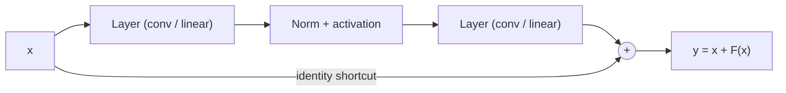
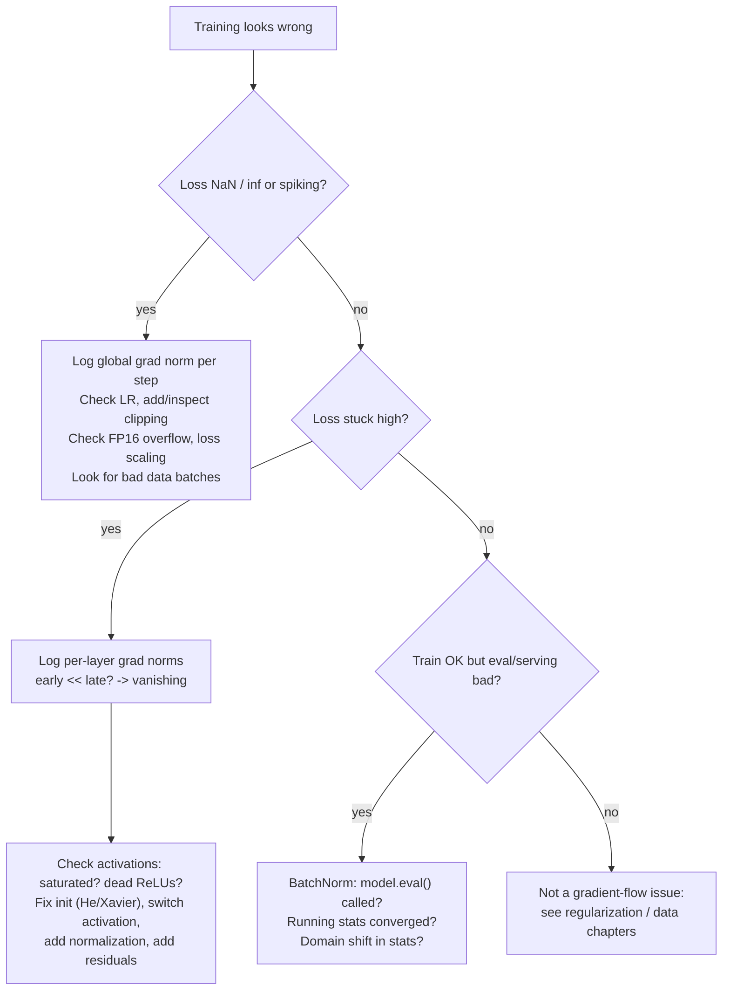

# Vanishing and Exploding Gradients, Initialization, Normalization and Residual Connections

> **Level:** Beginner to Advanced · **Study time:** ~110 min · **Prerequisites:** [Calculus for ML: Derivatives, Gradients and the Chain Rule](../00-foundations/03-calculus-and-gradients.md), [Neural Networks from Scratch](./01-neural-networks-from-scratch.md), [Backpropagation and Gradient Descent](./02-backpropagation-and-gradient-descent.md)

## Table of contents

- [Why this matters](#why-this-matters)
- [The core problem: gradients are long products](#the-core-problem-gradients-are-long-products)
- [Vanishing gradients](#vanishing-gradients)
- [Exploding gradients](#exploding-gradients)
- [Symptoms and how to detect them](#symptoms-and-how-to-detect-them)
- [Fix 1: ReLU-family activations](#fix-1-relu-family-activations)
- [Fix 2: Weight initialization and variance preservation](#fix-2-weight-initialization-and-variance-preservation)
- [Fix 3: Gradient clipping](#fix-3-gradient-clipping)
- [Fix 4: Batch Normalization](#fix-4-batch-normalization)
- [Fix 5: LayerNorm, RMSNorm and GroupNorm](#fix-5-layernorm-rmsnorm-and-groupnorm)
- [Comparing normalization layers](#comparing-normalization-layers)
- [Fix 6: Residual connections](#fix-6-residual-connections)
- [Pre-norm vs post-norm in transformers](#pre-norm-vs-post-norm-in-transformers)
- [Going deeper: production and scale](#going-deeper-production-and-scale)
- [A debugging playbook](#a-debugging-playbook)
- [Common mistakes and misconceptions](#common-mistakes-and-misconceptions)
- [Interview questions and model answers](#interview-questions-and-model-answers)
- [Key takeaways](#key-takeaways)
- [Further reading](#further-reading)
- [Next](#next)

## Why this matters

For about two decades, "deep" networks mostly did not train: add layers and the model got worse, not better. The reasons were vanishing and exploding gradients, and the fixes in this chapter (good activations, careful initialization, normalization layers and residual connections) are what made 152-layer ResNets and 32-layer, 7-billion-parameter LLMs trainable at all. Every modern transformer block is literally "normalize, transform, add back the input", so you cannot explain a transformer without this chapter. In production you meet these ideas as NaN losses, loss spikes in LLM pretraining, a BatchNorm model that behaves differently in `eval()` mode, or a fine-tune that collapses with batch size 2. Interviewers love this topic because a clear answer shows you understand *why* architectures look the way they do, not just *what* they are.

## The core problem: gradients are long products

> **Analogy:** Think of the game "telephone". A message passes through 20 people. If each person whispers a bit quieter than they heard it, the last person hears nothing (vanishing). If each person shouts a bit louder, the last person hears a deafening roar (exploding). Backpropagation is a game of telephone played backwards through the layers.

Quick recap from [Backpropagation and Gradient Descent](./02-backpropagation-and-gradient-descent.md): training adjusts each weight using its **gradient**, the derivative of the loss with respect to that weight. It tells us "if I nudge this weight up a little, how much does the loss change?" **Backpropagation** computes all gradients by applying the **chain rule** (derivative of a composition equals the product of the derivatives of its parts) from the output layer back to the input layer.

Our running example: a **spam filter** built as a deep stack of layers. To keep the math visible, shrink each layer to a single neuron:

```text
x  -->  [layer 1]  -->  [layer 2]  --> ... -->  [layer L]  -->  loss
a0        a1              a2                       aL
```

Each layer computes a **pre-activation** $z_l = w_l \, a_{l-1}$ and then an **activation** $a_l = f(z_l)$, where $f$ is a nonlinear function such as sigmoid or ReLU (see [Neural Networks from Scratch](./01-neural-networks-from-scratch.md)).

By the chain rule, each layer contributes one local derivative, $\frac{\partial a_l}{\partial a_{l-1}} = f'(z_l)\, w_l$ (the activation's slope times the weight). Chaining them, the gradient of the loss with respect to the input of the network (or any early layer) is:

$$
\frac{\partial \mathcal{L}}{\partial a_0} = \frac{\partial \mathcal{L}}{\partial a_L} \cdot \prod_{l=1}^{L} \underbrace{w_l \, f'(z_l)}_{\text{one factor per layer}}
$$

- $\mathcal{L}$: the loss (how wrong the spam filter is on this email).
- $a_0$: the input; $a_L$: the output of the last layer.
- $L$: the number of layers (the **depth**).
- $w_l$: the weight of layer $l$.
- $f'(z_l)$: the slope (derivative) of the activation function at that layer's pre-activation.
- $\prod$: "multiply all of these together".

The weight gradient that actually trains layer $l$, $\frac{\partial \mathcal{L}}{\partial w_l} = \frac{\partial \mathcal{L}}{\partial a_l}\, f'(z_l)\, a_{l-1}$, contains the same kind of product (over the layers above $l$), so it shrinks or grows with it.

The key insight is that **the gradient reaching early layers is a product of $L$ factors**, one per layer. Products of many numbers behave dramatically:

- If the typical factor is below 1, the product shrinks **exponentially** with depth: **vanishing gradients**.
- If the typical factor is above 1, the product grows exponentially: **exploding gradients**.
- Only factors that stay close to 1 keep the signal healthy.

In real networks each "factor" is a matrix (a **Jacobian**, the matrix of all partial derivatives of one layer's outputs with respect to its inputs) rather than a single number, and what matters is how much each matrix stretches or shrinks vectors (its singular values, see [Linear Algebra for ML](../00-foundations/02-linear-algebra-for-ml.md)). The scalar picture captures the essential behavior.

## Vanishing gradients

### Intuition

**Vanishing gradients** means the gradients for early layers become so tiny that those layers effectively stop learning. The last few layers train, the first few stay close to their random initialization, and the network behaves like a shallow one stacked on top of random noise.

### Cause 1: repeated multiplication by small numbers

Suppose every factor $w_l f'(z_l)$ equals 0.5. Through 10 layers the gradient is multiplied by $0.5^{10} \approx 0.001$. Through 50 layers, by about $10^{-15}$. No learning rate can sensibly compensate for that: a learning rate large enough for layer 1 would blow up layer 50.

### Cause 2: sigmoid saturation

The **sigmoid** function squashes any number into $(0, 1)$:

$$
\sigma(z) = \frac{1}{1 + e^{-z}}, \qquad \sigma'(z) = \sigma(z)\,\big(1 - \sigma(z)\big)
$$

- $z$: the pre-activation.
- $e$: Euler's number, about 2.718.
- $\sigma'(z)$: the slope of the sigmoid at $z$.

The slope is largest at $z = 0$, where $\sigma(0) = 0.5$, so $\sigma'(0) = 0.5 \times 0.5 = 0.25$. **The sigmoid's derivative is never larger than 0.25.**

Away from zero it gets much worse. At $z = 5$: $\sigma(5) \approx 0.9933$, so $\sigma'(5) \approx 0.9933 \times 0.0067 \approx 0.0066$. A neuron whose input is far from zero is **saturated**: it sits on the flat part of the S-curve, and its slope is almost zero.

```text
sigmoid(z)                         sigmoid'(z)
1.0 |              ________        0.25 |        /\
    |            /                      |       /  \
0.5 |          /                        |      /    \
    |        /                          |     /      \
0.0 |_______/                      0.0  |____/        \____
     -6    -2  0  2    6                 -6   -2 0 2   6
       flat = saturated                  slope near 0 at both ends
```

### Worked example: 0.25 raised to the number of layers

Best case: every weight is exactly 1 and every neuron sits at $z = 0$, so each factor is $1 \times 0.25 = 0.25$.

| Layers $L$ | Gradient multiplier $0.25^L$ | Arithmetic |
|---|---|---|
| 1 | 0.25 | 0.25 |
| 2 | 0.0625 | 0.25 × 0.25 |
| 5 | 0.0009765625 (about $10^{-3}$) | 0.0625 × 0.0625 × 0.25 |
| 10 | about $9.54 \times 10^{-7}$ | $0.0009765625^2$ |
| 20 | about $9.09 \times 10^{-13}$ | $(9.54 \times 10^{-7})^2$ |

So in a 10-layer sigmoid spam filter, even in the *best* case, the first layer gets roughly one-millionth of the gradient signal the last layer gets. And this is the optimistic case: saturated neurons make it far smaller.

> **Common mistake:** "Vanishing gradients means the loss is zero." No. The loss can be high; the *gradient for early layers* is tiny, so those layers cannot reduce it.

**Tanh** ($\tanh$, which squashes into $(-1, 1)$) is better than sigmoid because its maximum slope is 1 at $z = 0$ and its output is centered around zero, but it still saturates for large $|z|$, so it still vanishes in deep stacks.

### Vanishing in recurrent networks

A **recurrent neural network (RNN)** applies the *same* weight matrix at every time step, so backpropagation through 100 time steps multiplies by (roughly) the same matrix 100 times. If its largest stretching factor is below 1, gradients from distant tokens vanish, and the model cannot learn long-range dependencies. This was analyzed by Hochreiter (1991) and Bengio, Simard and Frasconi ("Learning long-term dependencies with gradient descent is difficult", 1994), and it motivated LSTMs. See [RNNs, LSTMs and the Road to Transformers](./08-rnns-lstms-and-the-road-to-transformers.md).

## Exploding gradients

### Intuition

**Exploding gradients** is the mirror image: factors above 1 multiply into astronomically large gradients. One giant gradient step throws the weights to a terrible region, the loss jumps, and often the numbers overflow to `inf` and then `NaN` ("not a number").

### Worked example

Same toy network, but now every factor is 1.5 (for instance weights of 6 with neurons whose slope is 0.25):

- $1.5^{10} \approx 57.7$
- $1.5^{50} \approx 6.4 \times 10^{8}$

Compare factors that are only slightly off from 1, over 50 layers (or 50 RNN time steps):

| Factor per layer | After 50 layers | Behavior |
|---|---|---|
| 0.9 | about 0.0052 | vanishes |
| 1.0 | 1 | healthy |
| 1.1 | about 117 | explodes |

A 10% deviation per layer becomes a factor of 100+ in either direction. **Depth turns small per-layer imbalances into huge global ones.** That is why the fixes below all aim to keep each layer's "gain" close to 1.

### Where explosion shows up in practice

- **RNNs** on long sequences (the classic case).
- **Very deep networks with bad initialization** (weights too large).
- **Large learning rates** that push weights into a high-gain regime.
- **LLM pretraining loss spikes**: a rare batch or an unstable attention layer produces a huge gradient; without clipping, the run can diverge.
- **Low-precision training**: FP16 (16-bit floating point) has a small maximum value (65,504), so large activations or gradients overflow to `inf`. See [Mixed-Precision Training](./09-mixed-precision-training.md).

## Symptoms and how to detect them

| Symptom | Likely cause | What to check |
|---|---|---|
| Loss decreases very slowly or plateaus early, far above what a simpler model achieves | Vanishing | Per-layer gradient norms: early layers orders of magnitude smaller than late ones |
| Early-layer weights barely change from initialization | Vanishing | Compare weights at step 0 vs step N |
| Many activations stuck at 0 or 1 (sigmoid), or at ±1 (tanh) | Saturation | Histograms of activations per layer |
| Many ReLU units output 0 for every input | **Dead ReLUs** (see below) | Fraction of zero activations per layer |
| Loss suddenly jumps up, oscillates wildly, or becomes `NaN`/`inf` | Exploding | Global gradient norm over time; look for spikes before the NaN |
| Weights become very large | Exploding | Weight norms per layer |
| Deeper model has *higher training loss* than a shallower one | Optimization difficulty (the "degradation problem", see residuals) | Train both, compare training (not validation) loss |

The single most useful diagnostic is **logging the gradient norm per layer**. The **norm** of a vector (here, the L2 norm) is its length: $\|g\| = \sqrt{g_1^2 + g_2^2 + \dots}$.

```python
# pip install torch
import torch
import torch.nn as nn

torch.manual_seed(0)

def make_mlp(depth: int, width: int, act: type[nn.Module]) -> nn.Sequential:
    layers = []
    for _ in range(depth):
        layers += [nn.Linear(width, width), act()]
    layers.append(nn.Linear(width, 1))  # spam score (logit)
    return nn.Sequential(*layers)

def layer_grad_norms(model: nn.Module) -> list[float]:
    """L2 norm of the gradient of each Linear layer's weight, first to last."""
    return [m.weight.grad.norm().item() for m in model if isinstance(m, nn.Linear)]

x = torch.randn(64, 32)                      # 64 emails, 32 features each
y = torch.randint(0, 2, (64, 1)).float()     # spam (1) or not (0)
loss_fn = nn.BCEWithLogitsLoss()

for act in (nn.Sigmoid, nn.ReLU):
    model = make_mlp(depth=20, width=32, act=act)
    loss_fn(model(x), y).backward()
    norms = layer_grad_norms(model)
    print(f"{act.__name__:8s} first layer: {norms[0]:.2e}   last layer: {norms[-1]:.2e}")

# With Sigmoid you should see the first layer's gradient norm about 16 to 17
# orders of magnitude smaller than the last layer's. With ReLU the gap is much
# smaller but still large (roughly 6 to 8 orders), because PyTorch's default
# init is too small for a deep plain ReLU stack (see Fix 2). Re-initializing
# the Linear layers with He init (kaiming_normal_) brings the first and last
# layers to within about one order of magnitude of each other.
# Exact numbers depend on the seed and PyTorch version.
```

> **Interview tip:** When asked "how would you know if your network has vanishing gradients?", say "I would log per-layer gradient norms and activation statistics, and compare early vs late layers", not "the loss looks bad". It shows you debug with measurements.

## Fix 1: ReLU-family activations

The **Rectified Linear Unit (ReLU)** is $\text{ReLU}(z) = \max(0, z)$. Its derivative is 1 for $z > 0$ and 0 for $z < 0$.

Why it helps: for active units, the slope is exactly 1, not at most 0.25. The activation itself no longer shrinks the gradient on the active path, so the product of factors depends mostly on the weights, which initialization can control (Fix 2).

The catch is the **dying ReLU** problem: if a unit's pre-activation is negative for every input (for example after a big bad update pushed its bias very negative), its gradient is always 0 and it never recovers. The variants below address this and other issues. The full catalog belongs to [Neural Networks from Scratch](./01-neural-networks-from-scratch.md); here is the gradient-flow view:

| Activation | Formula (short) | Max slope | Saturates? | Notes on gradient flow | Typical use |
|---|---|---|---|---|---|
| Sigmoid | $1/(1+e^{-z})$ | 0.25 | Both sides | Worst for deep stacks | Output layer for binary probability, gates in LSTMs |
| Tanh | $\tanh(z)$ | 1 | Both sides | Better, still vanishes | RNN hidden states |
| ReLU | $\max(0,z)$ | 1 | Negative side is flat | Slope 1 on active path; can die | CNNs, MLPs |
| Leaky ReLU | $\max(\alpha z, z)$, e.g. $\alpha=0.01$ | 1 | No | Small slope for $z<0$ keeps units alive | When dead units are a problem |
| GELU | $z \cdot \Phi(z)$ | about 1.13 | Soft | Smooth, non-zero gradient slightly below 0 | BERT, GPT-style transformers |
| SiLU / Swish | $z \cdot \sigma(z)$ | about 1.1 | Soft | Smooth; basis of SwiGLU (a gated MLP variant) | Modern LLM MLP blocks (SwiGLU) |

($\Phi$ is the standard normal cumulative distribution function.)

> **Senior insight:** Activations alone do not fix depth. A 100-layer ReLU network with naive initialization still vanishes or explodes because the *weights* set the gain. ReLU fixes the activation's contribution; initialization fixes the weights' contribution; normalization and residuals make the whole thing robust.

## Fix 2: Weight initialization and variance preservation

### Intuition

> **Analogy:** Think of a chain of audio amplifiers. If each amplifier has a volume knob slightly above "unity gain", the sound gets louder and louder until it distorts; slightly below, and it fades to silence. Good initialization sets every knob to unity gain *before you start playing*.

At the start of training, weights are random. We get to choose the *scale* of that randomness. The goal of principled initialization is **variance preservation**: the spread (variance) of the activations should stay roughly the same from layer to layer in the forward pass, and the spread of the gradients should stay roughly the same in the backward pass. If they stay the same, the per-layer factor is about 1, and depth no longer causes exponential blow-up or decay at initialization.

**Variance** measures how spread out a quantity is around its mean: $\text{Var}(X) = \mathbb{E}[(X - \mathbb{E}[X])^2]$, the average squared distance from the mean. (Recap in [Probability and Statistics](../00-foundations/04-probability-and-statistics.md).)

### Why zeros or "small random numbers" fail

- **All zeros (or all the same value):** every neuron in a layer computes the same thing and gets the same gradient, so they stay identical forever. This is the **symmetry problem**. Random initialization breaks symmetry.
- **Small random numbers like `0.01 * randn`:** activations shrink at every layer (the factor is far below 1), so deep layers output nearly zero and gradients vanish.
- **Standard normal `randn` (std 1):** with many inputs per neuron, activations grow at every layer and explode.

### The math: one neuron with $n$ inputs

A neuron computes $y = \sum_{i=1}^{n} w_i x_i$. Assume the weights $w_i$ and inputs $x_i$ are independent, have mean zero, and all $w_i$ share the same variance (all $x_i$ likewise). Then:

$$
\text{Var}(y) = n \cdot \text{Var}(w) \cdot \text{Var}(x)
$$

- $n$: the number of inputs to the neuron, called **fan-in** ($n_{\text{in}}$). The number of outputs a layer feeds is its **fan-out** ($n_{\text{out}}$).
- $\text{Var}(w)$: the variance we choose for the random weights.
- $\text{Var}(x)$: the variance of the incoming activations.

To keep $\text{Var}(y) = \text{Var}(x)$ we need $n \cdot \text{Var}(w) = 1$, so $\text{Var}(w) = 1/n$.

**Worked example** (fan-in $n = 512$, input variance 1):

| Weight variance | $\text{Var}(y) = 512 \times \text{Var}(w) \times 1$ | Std of $y$ | After 10 such layers (linear, ignoring activations) |
|---|---|---|---|
| 1 (plain `randn`) | 512 | $\sqrt{512} \approx 22.6$ | variance $512^{10}$: explodes |
| $0.01^2 = 0.0001$ | 0.0512 | about 0.226 | variance $0.0512^{10} \approx 1.2 \times 10^{-13}$: vanishes |
| $1/512$ | 1 | 1 | variance 1: preserved |

### Xavier / Glorot initialization

Glorot and Bengio ("Understanding the difficulty of training deep feedforward neural networks", 2010) noticed two competing goals. The forward pass needs $n_{\text{in}} \text{Var}(w) = 1$. The backward pass (gradients flow through the transposed weight matrix) needs $n_{\text{out}} \text{Var}(w) = 1$. Unless $n_{\text{in}} = n_{\text{out}}$ you cannot satisfy both, so they compromise with the average:

$$
\text{Var}(w) = \frac{2}{n_{\text{in}} + n_{\text{out}}}
$$

- Normal version: $w \sim \mathcal{N}\!\left(0, \frac{2}{n_{\text{in}} + n_{\text{out}}}\right)$.
- Uniform version: $w \sim U(-a, a)$ with $a = \sqrt{\frac{6}{n_{\text{in}} + n_{\text{out}}}}$. (A uniform distribution on $(-a, a)$ has variance $a^2/3$, and $\frac{6}{3(n_{\text{in}}+n_{\text{out}})} = \frac{2}{n_{\text{in}}+n_{\text{out}}}$.)

Xavier assumes the activation is roughly linear around zero with slope 1, which fits **tanh** (and sigmoid with adjustments) but not ReLU.

**Worked example** ($n_{\text{in}} = n_{\text{out}} = 512$): $\text{Var}(w) = 2/1024 = 1/512 \approx 0.00195$, std $\approx 0.0442$. Uniform bound $a = \sqrt{6/1024} \approx 0.0765$.

### He / Kaiming initialization

He, Zhang, Ren and Sun ("Delving Deep into Rectifiers", 2015) observed that ReLU zeros out roughly half its inputs. If $z$ is symmetric around zero, then $\mathbb{E}[\text{ReLU}(z)^2] = \frac{1}{2}\text{Var}(z)$: ReLU halves the signal's second moment (its average squared value). To compensate, double the weight variance:

$$
\text{Var}(w) = \frac{2}{n_{\text{in}}}
$$

- $n_{\text{in}}$: fan-in (use **fan-out** instead, "mode='fan_out'", if you care more about preserving gradient variance in the backward pass).
- The factor 2 undoes ReLU's halving.

**Worked example** ($n_{\text{in}} = 512$): $\text{Var}(w) = 2/512 = 1/256$, so std $= 1/16 = 0.0625$. Compare with Xavier's 0.0442: He is $\sqrt{2} \approx 1.41$ times larger, exactly the boost needed to offset ReLU dropping half the signal.

| Scheme | Weight variance | Designed for | Where you see it |
|---|---|---|---|
| Xavier / Glorot | $2/(n_{\text{in}}+n_{\text{out}})$ | tanh, sigmoid, linear | Classic MLPs, some attention projections |
| He / Kaiming | $2/n_{\text{in}}$ | ReLU family | CNNs (ResNet), ReLU MLPs |
| LeCun | $1/n_{\text{in}}$ | SELU (scaled exponential linear unit), linear | Self-normalizing networks |
| Small fixed std (e.g. 0.02) | $0.02^2$ | Transformers with normalization + residuals | BERT and GPT-2 style configs (`initializer_range=0.02` in Hugging Face) |

### Code: watching activations through 50 layers

```python
# pip install numpy
import numpy as np

rng = np.random.default_rng(0)
width, depth = 512, 50
x0 = rng.standard_normal((1000, width))  # 1000 inputs, variance about 1

def run(weight_std: float) -> list[float]:
    """Push data through `depth` ReLU layers; return activation std after each."""
    a, stds = x0, []
    for _ in range(depth):
        W = rng.standard_normal((width, width)) * weight_std
        a = np.maximum(0, a @ W)          # linear layer + ReLU
        stds.append(float(a.std()))
    return stds

for name, std in [("tiny 0.01", 0.01),
                  ("xavier", np.sqrt(2 / (width + width))),
                  ("he", np.sqrt(2 / width)),
                  ("randn 1.0", 1.0)]:
    s = run(std)
    print(f"{name:10s} layer 1: {s[0]:.3g}   layer 10: {s[9]:.3g}   layer 50: {s[-1]:.3g}")

# What you should see (qualitatively):
#   tiny:   std collapses toward 0 within a few layers (vanishing)
#   xavier: std shrinks steadily with ReLU (each layer loses about a factor sqrt(2))
#   he:     std stays roughly constant across all 50 layers
#   randn:  std grows about 16x per layer (sqrt(512/2)), reaching astronomically
#           large values by layer 50 (exploding)
```

The PyTorch built-ins:

```python
import torch.nn as nn

layer = nn.Linear(512, 512)
nn.init.kaiming_normal_(layer.weight, mode="fan_in", nonlinearity="relu")  # He
nn.init.zeros_(layer.bias)

tanh_layer = nn.Linear(512, 256)
nn.init.xavier_uniform_(tanh_layer.weight, gain=nn.init.calculate_gain("tanh"))
```

> **Common mistake:** Assuming PyTorch's default is He initialization. As of recent PyTorch versions, `nn.Linear` and `nn.Conv2d` default to `kaiming_uniform_(a=sqrt(5))`, which works out to $U(-1/\sqrt{n_{\text{in}}}, 1/\sqrt{n_{\text{in}}})$, a variance of $1/(3 n_{\text{in}})$. That is smaller than He's $2/n_{\text{in}}$. It works fine for typical depths with normalization, but for a deep plain ReLU network, initialize explicitly.

> **Senior insight:** Initialization only controls the network *at step 0*. Once training starts, weights drift and the careful variance balance erodes. That is why initialization alone was not enough for very deep networks, and normalization (which re-balances at every step) and residual connections (which make the gain robust) became standard.

## Fix 3: Gradient clipping

### Intuition

> **Analogy:** A car's speed limiter. You can still drive in any direction, but no single push of the accelerator sends you to 300 km/h.

**Gradient clipping** caps the size of the gradient before the optimizer uses it. It does nothing about vanishing gradients; it is purely a safety net against **exploding** gradients and rare spikes. It was popularized for RNNs by Pascanu, Mikolov and Bengio ("On the difficulty of training recurrent neural networks", 2013) and is now standard in transformer and LLM training.

### Clipping by norm vs by value

**Clip by (global) norm:** compute the length of the entire gradient vector (all parameters concatenated). If it exceeds a threshold $c$, scale the whole vector down so its length is exactly $c$:

$$
g \leftarrow g \cdot \min\!\left(1, \frac{c}{\|g\|}\right)
$$

- $g$: the full gradient vector (every parameter's gradient stacked together).
- $\|g\|$: its L2 norm (length).
- $c$: the maximum allowed norm (the `max_norm` hyperparameter).

**Clip by value:** clamp every individual gradient component to the range $[-c, c]$, independently.

**Worked example 1:** $g = [3, 4]$, threshold $c = 1$.

- Norm: $\sqrt{3^2 + 4^2} = \sqrt{9 + 16} = \sqrt{25} = 5$.
- By norm: scale by $1/5$: $[3/5, 4/5] = [0.6, 0.8]$. Length 1, **same direction**.
- By value: clamp each to $[-1, 1]$: $[1, 1]$. Direction changed from about 53.1° to 45°.

**Worked example 2:** $g = [0.5, 10]$, $c = 1$.

- Norm: $\sqrt{0.25 + 100} = \sqrt{100.25} \approx 10.012$.
- By norm: $[0.5/10.012, 10/10.012] \approx [0.0499, 0.9988]$. Same direction (about 87.1° from the x-axis).
- By value: $[0.5, 1]$. Direction now about 63.4°: the small component's relative importance was inflated 10x.

| | Clip by norm | Clip by value |
|---|---|---|
| What it does | Rescales the whole gradient if its length exceeds $c$ | Clamps each element to $[-c, c]$ |
| Preserves direction? | Yes | No |
| Typical threshold | Global norm 1.0 is a common default for transformers (illustrative; tune per model) | Problem-specific, e.g. 0.5 to 5 |
| Pros | Principled, direction-preserving, one hyperparameter | Simple, bounds every element |
| Cons | One huge layer gradient shrinks updates for all layers | Distorts the update direction |
| When to use | Default choice (RNNs, transformers, LLMs) | Rarely; some RL code, legacy setups |

```python
import torch

# Inside a standard training step:
optimizer.zero_grad()
loss = loss_fn(model(xb), yb)
loss.backward()
# Returns the total norm BEFORE clipping: log it, it is a great health signal.
total_norm = torch.nn.utils.clip_grad_norm_(model.parameters(), max_norm=1.0)
optimizer.step()

# Clip-by-value alternative (rarely preferred):
# torch.nn.utils.clip_grad_value_(model.parameters(), clip_value=1.0)
```

> **Common mistake:** With mixed-precision training (AMP, automatic mixed precision) and a gradient scaler (which multiplies the loss by a large factor so small FP16 gradients do not underflow to zero), clipping the *scaled* gradients clips at the wrong threshold. Call `scaler.unscale_(optimizer)` before `clip_grad_norm_`. See [Mixed-Precision Training](./09-mixed-precision-training.md).

> **Senior insight:** If clipping triggers on almost every step, it is no longer a safety net: you are effectively running with a smaller, adaptive learning rate and hiding a real problem (learning rate too high, bad init, a numerically unstable layer). Log the fraction of steps that clip. Published LLM recipes (for example the LLaMA paper, Touvron et al., 2023) report a global clip norm of 1.0, but treat that as a starting point, not a law.

## Fix 4: Batch Normalization

### Intuition

> **Analogy:** A teacher grading on a curve. Whatever the raw scores in this class were, the teacher re-centers them to an average of 70 with a fixed spread. The next teacher downstream always receives grades on a familiar scale, no matter how harsh or lenient the exam was.

**Normalization layers** rescale activations inside the network so they keep a stable mean and spread, *at every training step*, not just at initialization. **Batch Normalization (BatchNorm, BN)**, introduced by Ioffe and Szegedy ("Batch Normalization: Accelerating Deep Network Training by Reducing Internal Covariate Shift", 2015), was the first to make this mainstream and let much deeper CNNs train with higher learning rates.

### Precise definition

For each feature (or each channel, in a CNN), BatchNorm computes the mean and variance **across the examples in the current mini-batch**, normalizes, then applies a learnable scale and shift.

$$
\mu_B = \frac{1}{m}\sum_{i=1}^{m} x_i, \qquad
\sigma_B^2 = \frac{1}{m}\sum_{i=1}^{m} (x_i - \mu_B)^2
$$

$$
\hat{x}_i = \frac{x_i - \mu_B}{\sqrt{\sigma_B^2 + \epsilon}}, \qquad
y_i = \gamma\,\hat{x}_i + \beta
$$

- $m$: the batch size (number of examples in the mini-batch).
- $x_i$: the value of *one feature* for example $i$.
- $\mu_B$, $\sigma_B^2$: the batch mean and batch variance of that feature.
- $\epsilon$: a tiny constant (PyTorch default $10^{-5}$) to avoid dividing by zero.
- $\hat{x}_i$: the normalized value (mean 0, variance 1 within the batch).
- $\gamma$ (scale) and $\beta$ (shift): **learnable** parameters, one pair per feature. They let the network undo the normalization if that is optimal, so normalization never reduces what the layer can represent.

For a CNN with input shape (batch $N$, channels $C$, height $H$, width $W$), statistics are computed per channel over $N \times H \times W$ values.

### Worked example

House-price model, one feature ("size in hundreds of square meters" after a layer), batch of 4 houses: $x = [2, 4, 6, 8]$. Learned $\gamma = 2$, $\beta = 1$. Ignore $\epsilon$.

1. Mean: $\mu_B = (2 + 4 + 6 + 8)/4 = 20/4 = 5$.
2. Deviations: $[-3, -1, 1, 3]$. Squares: $[9, 1, 1, 9]$.
3. Variance: $\sigma_B^2 = (9 + 1 + 1 + 9)/4 = 20/4 = 5$. Std $= \sqrt{5} \approx 2.236$.
4. Normalize: $[-3, -1, 1, 3] / 2.236 \approx [-1.342, -0.447, 0.447, 1.342]$.
5. Scale and shift: $2 \times [-1.342, -0.447, 0.447, 1.342] + 1 \approx [-1.683, 0.106, 1.894, 3.683]$.

### Train vs eval: running averages

At training time BN uses the current batch's statistics. At inference time you might have a single example (batch of 1 has no meaningful variance), and you want deterministic outputs that do not depend on which other requests happened to be batched together. So during training BN also keeps **running averages** (an exponential moving average) of the mean and variance:

$$
\mu_{\text{run}} \leftarrow (1 - \alpha)\,\mu_{\text{run}} + \alpha\,\mu_B
$$

- $\alpha$: the **momentum** (PyTorch default 0.1; confusingly, it is the weight on the *new* value).
- $\mu_{\text{run}}$: starts at 0; running variance starts at 1.

In **eval mode**, BN uses $\mu_{\text{run}}$ and $\sigma^2_{\text{run}}$ instead of batch statistics. It becomes a fixed affine function (a per-feature multiply and add, $y = a x + b$, with constants $a$ and $b$).

**Worked example (continued):** after our first batch, $\mu_{\text{run}} = 0.9 \times 0 + 0.1 \times 5 = 0.5$. PyTorch updates the running variance with the *unbiased* batch variance $5 \times \frac{4}{3} \approx 6.667$, so $\sigma^2_{\text{run}} = 0.9 \times 1 + 0.1 \times 6.667 \approx 1.567$. If we now switch to eval and feed $x = 2$: $(2 - 0.5)/\sqrt{1.567} \approx 1.5 / 1.252 \approx 1.198$, very different from the $-1.342$ it got in training. Running statistics need many batches to converge.

```python
# BatchNorm from scratch (NumPy) and the PyTorch equivalent
import numpy as np
import torch
import torch.nn as nn

def batchnorm_train(x, gamma, beta, run_mean, run_var, momentum=0.1, eps=1e-5):
    """x: (batch, features). Returns output and updated running stats."""
    mu = x.mean(axis=0)
    var = x.var(axis=0)                       # biased variance, used to normalize
    x_hat = (x - mu) / np.sqrt(var + eps)
    m = x.shape[0]
    run_mean = (1 - momentum) * run_mean + momentum * mu
    run_var = (1 - momentum) * run_var + momentum * var * m / (m - 1)  # unbiased
    return gamma * x_hat + beta, run_mean, run_var

def batchnorm_eval(x, gamma, beta, run_mean, run_var, eps=1e-5):
    return gamma * (x - run_mean) / np.sqrt(run_var + eps) + beta

x = np.array([[2.0], [4.0], [6.0], [8.0]])
out, rm, rv = batchnorm_train(x, gamma=1.0, beta=0.0, run_mean=0.0, run_var=1.0)
print(out.ravel().round(3), rm, rv.round(4))
# [-1.342 -0.447  0.447  1.342] [0.5] [1.5667]

bn = nn.BatchNorm1d(1)                        # gamma=1, beta=0, momentum=0.1
bn.train()
print(bn(torch.tensor(x, dtype=torch.float32)).detach().ravel())
# approx tensor([-1.3416, -0.4472,  0.4472,  1.3416])
print(bn.running_mean, bn.running_var)        # approx 0.5000 and 1.5667

bn.eval()                                     # now uses running statistics
print(bn(torch.tensor([[2.0]])).item())       # approx 1.198
```

### Why BatchNorm helps

- **Keeps activations in a healthy range** at every step, so sigmoid/tanh units do not saturate and ReLU layers neither blow up nor die out as weights drift.
- **Allows higher learning rates** and makes training less sensitive to initialization.
- **Mild regularization**: each example's output depends slightly on the random batch it landed in, adding noise.

> **Senior insight:** The original paper attributed BN's success to reducing "internal covariate shift" (layer input distributions changing during training). Santurkar et al. ("How Does Batch Normalization Help Optimization?", 2018) gave evidence that the bigger effect is a **smoother loss landscape** (more predictable gradients), which permits larger steps. In an interview, mention that the original explanation is debated; it signals depth.

### BatchNorm's problems

| Problem | Why it happens | Mitigation |
|---|---|---|
| **Small batches** (e.g. 2 to 8 per GPU in detection, segmentation, high-res images, fine-tuning big models) | Batch mean/variance estimated from few samples are noisy; training becomes unstable and train/eval mismatch grows | GroupNorm or LayerNorm; **SyncBatchNorm** across GPUs; freeze BN statistics during fine-tuning |
| **Batch size 1 in training** | No variance to compute; PyTorch's `BatchNorm1d` raises an error in train mode for one value per channel | Use a different norm |
| **Train vs eval behavior differs** | Batch stats vs running stats | Remember `model.eval()`; check running stats have converged |
| **Distribution shift at serving** | Running stats reflect training data | Recalibrate stats on target-domain data (no labels needed) |
| **Examples are not independent** | Each output depends on other examples in the batch, which leaks information (bad for contrastive learning tricks and causal sequence models) | LayerNorm / RMSNorm |
| **Variable-length sequences and padding** | Statistics mix real tokens and padding; lengths vary | LayerNorm / RMSNorm |
| **Distributed training** | Each GPU sees its own local batch | SyncBatchNorm (costs extra communication) |

## Fix 5: LayerNorm, RMSNorm and GroupNorm

All normalization layers share the same recipe: **compute a mean and/or spread over some set of numbers, normalize, apply learnable scale (and maybe shift)**. They differ only in *which numbers* they compute statistics over.

```text
Tensor of activations: batch N x features C   (for images: N x C x H x W)

BatchNorm:  for each feature, stats over the BATCH        (column-wise)
LayerNorm:  for each example, stats over its FEATURES     (row-wise)
GroupNorm:  for each example, stats over a GROUP of channels (+ H, W)

          feature ->                    feature ->
         c1 c2 c3 c4                   c1 c2 c3 c4
ex 1  [  #  .  .  . ]          ex 1 [  #  #  #  # ]   <- LayerNorm: one row
ex 2  [  #  .  .  . ]          ex 2 [  .  .  .  . ]
ex 3  [  #  .  .  . ]          ex 3 [  .  .  .  . ]
       ^ BatchNorm: one column
```

### Layer Normalization

**Layer Normalization (LayerNorm, LN)**, Ba, Kiros and Hinton ("Layer Normalization", 2016), computes statistics **per example**, across its features. In a transformer that means **per token**: each token's hidden vector (length $d$, the **model dimension**, e.g. 4096 in a 7B Llama-style model) is normalized using only its own $d$ numbers.

$$
\mu = \frac{1}{d}\sum_{j=1}^{d} x_j, \qquad
\sigma^2 = \frac{1}{d}\sum_{j=1}^{d} (x_j - \mu)^2, \qquad
y_j = \gamma_j \frac{x_j - \mu}{\sqrt{\sigma^2 + \epsilon}} + \beta_j
$$

- $x_j$: the $j$-th component of *one token's* hidden vector.
- $d$: the hidden size (number of features).
- $\mu, \sigma^2$: mean and variance across that token's features.
- $\gamma_j, \beta_j$: learnable per-feature scale and shift (vectors of length $d$).

Consequences: no dependence on the batch, identical behavior in training and inference, no running statistics, works with batch size 1 and with any sequence length.

**Worked example:** the word "free" in a 3-word sentence "win free money", with a toy hidden vector $x = [1, 2, 3, 6]$ ($d = 4$), $\gamma = 1$, $\beta = 0$:

1. Mean: $(1 + 2 + 3 + 6)/4 = 12/4 = 3$.
2. Deviations: $[-2, -1, 0, 3]$; squares $[4, 1, 0, 9]$; variance $= 14/4 = 3.5$; std $= \sqrt{3.5} \approx 1.871$.
3. Normalized: $[-2, -1, 0, 3]/1.871 \approx [-1.069, -0.535, 0, 1.604]$.

The tokens "win" and "money" are normalized separately with their own statistics.

### RMSNorm

**Root Mean Square Normalization (RMSNorm)**, Zhang and Sennrich ("Root Mean Square Layer Normalization", 2019), simplifies LayerNorm: it **skips the mean subtraction** and the shift $\beta$, and divides by the root mean square (RMS) of the vector.

$$
\text{RMS}(x) = \sqrt{\frac{1}{d}\sum_{j=1}^{d} x_j^2 + \epsilon}, \qquad
y_j = \gamma_j \frac{x_j}{\text{RMS}(x)}
$$

- $\text{RMS}(x)$: the typical magnitude of the vector's entries.
- $\gamma_j$: learnable per-feature scale (there is no $\beta$).

**Worked example** (same $x = [1, 2, 3, 6]$):

1. Squares: $[1, 4, 9, 36]$, sum $50$, mean $50/4 = 12.5$.
2. $\text{RMS} = \sqrt{12.5} \approx 3.536$.
3. $y = [1, 2, 3, 6]/3.536 \approx [0.283, 0.566, 0.849, 1.697]$.

Note the output is *not* zero-mean (it keeps the vector's direction); it only has controlled scale. The paper's hypothesis is that the **re-scaling** is what matters, while **re-centering** is dispensable. In practice RMSNorm matches LayerNorm quality in transformers while being a bit cheaper (one fewer reduction, fewer parameters), which is why Llama-family, Mistral and many other modern LLMs use it. (T5 also used a LayerNorm variant without mean subtraction or bias.)

### GroupNorm (and InstanceNorm)

**Group Normalization (GroupNorm, GN)**, Wu and He ("Group Normalization", 2018), targets CNNs with small batches. For each example, it splits the $C$ channels into $G$ groups and computes statistics over each group's channels and all spatial positions.

- $G = 1$: one group of all channels, equivalent to LayerNorm over (C, H, W).
- $G = C$: one channel per group, called **InstanceNorm** (Ulyanov et al., 2016), popular for style transfer because it removes per-image contrast.
- $G = 32$ was the paper's default; diffusion-model U-Nets commonly use GroupNorm as well.

Because it never looks across the batch, GroupNorm is stable at batch size 1 or 2, which is why detection and segmentation models trained at high resolution often prefer it.

### Code: from scratch vs PyTorch

```python
# pip install torch   (nn.RMSNorm requires PyTorch 2.4 or newer)
import torch
import torch.nn as nn

x = torch.tensor([[1.0, 2.0, 3.0, 6.0]])     # one token, d = 4

def layer_norm(x, eps=1e-5):
    mu = x.mean(dim=-1, keepdim=True)
    var = x.var(dim=-1, keepdim=True, unbiased=False)   # biased, like the formula
    return (x - mu) / torch.sqrt(var + eps)

def rms_norm(x, eps=1e-6):
    return x / torch.sqrt(x.pow(2).mean(dim=-1, keepdim=True) + eps)

print(layer_norm(x))          # approx [[-1.0690, -0.5345, 0.0000, 1.6036]]
print(nn.LayerNorm(4)(x))     # same values (gamma=1, beta=0 at init)
print(rms_norm(x))            # approx [[0.2828, 0.5657, 0.8485, 1.6971]]
print(nn.RMSNorm(4)(x))       # same values (gamma=1 at init)

# GroupNorm for images: 8 channels split into 4 groups, batch of 2
imgs = torch.randn(2, 8, 16, 16)
print(nn.GroupNorm(num_groups=4, num_channels=8)(imgs).shape)  # torch.Size([2, 8, 16, 16])
```

A minimal RMSNorm module, the way many LLM codebases write it:

```python
class RMSNorm(nn.Module):
    def __init__(self, d: int, eps: float = 1e-6):
        super().__init__()
        self.eps = eps
        self.weight = nn.Parameter(torch.ones(d))   # gamma

    def forward(self, x: torch.Tensor) -> torch.Tensor:
        # Compute in float32 for stability, then cast back (common LLM practice).
        # Note: if self.weight is float32 but x is bf16, the final multiply
        # promotes the output to float32; real models store the weight in the
        # model dtype (e.g. after model.to(torch.bfloat16)), so it stays bf16.
        x32 = x.float()
        normed = x32 * torch.rsqrt(x32.pow(2).mean(-1, keepdim=True) + self.eps)
        return self.weight * normed.type_as(x)
```

## Comparing normalization layers

| | BatchNorm | LayerNorm | RMSNorm | GroupNorm |
|---|---|---|---|---|
| Statistics computed over | Batch (and H, W) per channel | Features of one example / token | Features of one example / token (no mean) | Channel groups (and H, W) of one example |
| Depends on other examples? | Yes | No | No | No |
| Train vs eval behavior | Different (batch stats vs running stats) | Identical | Identical | Identical |
| Running statistics | Yes | No | No | No |
| Learnable params | $\gamma, \beta$ per channel | $\gamma, \beta$ per feature | $\gamma$ per feature | $\gamma, \beta$ per channel |
| Works with batch size 1 | No (in training) | Yes | Yes | Yes |
| Variable-length sequences | Awkward | Natural | Natural | N/A |
| Inference cost | Free: can be folded into the previous conv/linear (see folding below) | Runtime reduction per token | Slightly cheaper than LN | Runtime reduction |
| Typical home | CNNs with decent batch sizes (ResNet) | Transformers (BERT, GPT-2), RNNs | Modern LLMs (Llama family, Mistral) | Detection/segmentation, diffusion U-Nets |
| Main con | Small-batch noise, train/eval mismatch, couples examples | Cannot be folded away; slightly more compute than RMSNorm | No re-centering (rarely matters) | Extra hyperparameter $G$ |

### Why transformers use LayerNorm or RMSNorm, not BatchNorm

1. **Per-token independence.** In a language model each token's normalization should depend only on that token. BatchNorm would mix statistics across different sequences (and, if computed over the time axis, across positions, which for a causal model, one that predicts each token only from earlier tokens, would leak information from future tokens).
2. **Variable lengths and padding.** Sequences have different lengths; padding tokens would pollute batch statistics.
3. **Small and odd batches.** LLM training uses large *global* batches, but per-device micro-batches can be tiny, and at inference each request generates one token at a time, often with batch composition changing every step (see [continuous batching](../06-llm-inference/04-batching-continuous-batching-and-paged-attention.md)). LayerNorm behaves identically regardless.
4. **No train/serve skew.** No running statistics to get wrong.
5. **Empirics.** Shen et al. ("PowerNorm: Rethinking Batch Normalization in Transformers", 2020) found batch statistics in NLP tasks fluctuate heavily during training, which hurts BN there.

RMSNorm then won over LayerNorm in many recent LLMs because it is slightly cheaper and matches quality. More in [Modern LLM Architecture](../04-transformers/08-modern-llm-architecture-improvements.md).

## Fix 6: Residual connections

### The degradation problem

Before 2015, people noticed something strange: a deeper plain network could have **higher training error** than a shallower one. He et al. ("Deep Residual Learning for Image Recognition", 2015) showed a 56-layer plain network training worse than a 20-layer one on CIFAR-10 (a small benchmark of 60,000 tiny 32x32 color images in 10 classes). This is not overfitting (that would show up only on validation data); it is an **optimization** failure. In principle the deeper net could copy the shallow one and set the extra layers to the identity function, but SGD could not find that solution. Notably, those plain networks already used BatchNorm, and the authors checked that their gradients had healthy norms, so degradation is an optimization difficulty that goes beyond vanishing gradients.

### The identity shortcut

> **Analogy:** Editing a document with tracked changes. Instead of rewriting the whole document at every review round, each reviewer only proposes *edits* on top of the current version. If a reviewer has nothing to add, the document passes through unchanged. Bad reviewers cannot destroy the document; they can only add small edits.

A **residual connection** (or **skip connection**) adds a block's input directly to its output:

$$
y = x + F(x)
$$

- $x$: the input to the block.
- $F(x)$: what the block's layers compute (e.g. convolution, BN, ReLU, convolution in a CNN; attention or an MLP in a transformer), called the **residual** or **residual branch**.
- $y$: the block output.
- The plain "$+\,x$" path is the **identity shortcut**.

Now the block only has to learn the *change* $F(x) = y - x$. If the best thing is to do nothing, it just drives $F$ toward zero, which is easy (small weights), instead of learning an exact identity mapping through nonlinear layers, which is hard.



### The gradient highway

Differentiate $y = x + F(x)$:

$$
\frac{\partial y}{\partial x} = 1 + \frac{\partial F}{\partial x}
$$

The "1" is the key. Even if $\partial F / \partial x$ is tiny, the gradient passes through the block essentially unchanged instead of being multiplied by something tiny. (In the matrix case the factor is $I + \partial F/\partial x$, which can still shrink some directions, but it is very unlikely to cancel the identity for every direction, so the gradient does not vanish.) Stack many blocks: $x_L = x_l + \sum_{i=l}^{L-1} F(x_i)$, so (He et al., "Identity Mappings in Deep Residual Networks", 2016):

$$
\frac{\partial \mathcal{L}}{\partial x_l} = \frac{\partial \mathcal{L}}{\partial x_L}\left(1 + \frac{\partial}{\partial x_l}\sum_{i=l}^{L-1} F(x_i)\right)
$$

- $x_l$: activations entering block $l$; $x_L$: activations at the top.
- The "1" term delivers the top-level gradient **directly** to every earlier block, without passing through any weight matrix or activation.

```text
Plain network:     grad --> [x] --> [x] --> [x] --> [x] --> layer 1   (product of factors)

Residual network:  grad ======================================> layer 1   (identity highway)
                         \-->[F]--/ \-->[F]--/ \-->[F]--/          (plus contributions)
```

**Worked example** (scalar, 10 blocks, each branch derivative 0.1):

- Plain stack: factor per block is 0.1, so $0.1^{10} = 10^{-10}$. Vanished.
- Residual stack: factor per block is $1 + 0.1 = 1.1$, so $1.1^{10} \approx 2.59$. Healthy.

(In real networks the branch derivatives are matrices with mixed signs, so they do not compound into explosion like this toy number suggests; and normalization keeps them in check. The point is the guaranteed "1".)

Veit, Wilber and Belongie ("Residual Networks Behave Like Ensembles of Relatively Shallow Networks", 2016) offered a complementary view: unrolling the sums shows exponentially many paths of different lengths, and most of the gradient flows through relatively short paths.

### ResNet and why very deep networks became trainable

ResNet combined three ingredients: He initialization, BatchNorm after each conv, and identity shortcuts every two or three layers. It trained 152-layer networks on ImageNet (about 1.28 million training images in 1,000 classes), and over 1,000 layers on CIFAR-10 in experiments, and won the ILSVRC 2015 (ImageNet challenge) classification task. When the input and output shapes differ (more channels, smaller spatial size), the shortcut uses a **projection** (a 1x1 convolution) instead of pure identity. Details in [CNNs and Transfer Learning](./07-cnns-and-transfer-learning.md).

```python
import torch
import torch.nn as nn

class BasicBlock(nn.Module):
    """ResNet-style block: y = relu(x + F(x)), with optional projection shortcut."""
    def __init__(self, c_in: int, c_out: int, stride: int = 1):
        super().__init__()
        self.f = nn.Sequential(
            nn.Conv2d(c_in, c_out, 3, stride=stride, padding=1, bias=False),
            nn.BatchNorm2d(c_out),
            nn.ReLU(inplace=True),
            nn.Conv2d(c_out, c_out, 3, padding=1, bias=False),
            nn.BatchNorm2d(c_out),
        )
        # Identity if shapes match, else a 1x1 conv projection
        self.shortcut = nn.Identity()
        if stride != 1 or c_in != c_out:
            self.shortcut = nn.Sequential(
                nn.Conv2d(c_in, c_out, 1, stride=stride, bias=False),
                nn.BatchNorm2d(c_out),
            )

    def forward(self, x: torch.Tensor) -> torch.Tensor:
        return torch.relu(self.shortcut(x) + self.f(x))

block = BasicBlock(64, 128, stride=2)
print(block(torch.randn(2, 64, 32, 32)).shape)  # torch.Size([2, 128, 16, 16])
```

(Conv layers followed by BatchNorm use `bias=False` because BN's $\beta$ makes a bias redundant.)

> **Senior insight:** Residual connections appear far beyond ResNet: every transformer sub-layer, U-Nets, and conceptually the LSTM cell state (an additive path through time) and Highway Networks (Srivastava, Greff and Schmidhuber, 2015, gated shortcuts). Whenever you see "add the input back", the motivation is gradient flow and easy identity behavior.

### A subtlety: residual streams grow

Each block adds something to the running sum, so the variance of $x_l$ tends to **grow with depth**: if branches are roughly independent, $\text{Var}(x_L) \approx \text{Var}(x_0) + \sum_l \text{Var}(F_l)$. For example, 48 blocks that each add variance 1 to an input of variance 1 give variance 49 (std 7) at the top. Scaling each branch's output by $1/\sqrt{48}$ makes each branch add $1/48$, so the total stays near 2. Two common responses:

- **Scale down the residual branches at init.** GPT-2 (Radford et al., 2019) scaled the weights of residual output layers at initialization by $1/\sqrt{N}$, where $N$ is the number of residual layers. Some methods initialize the last layer of each branch (or BN's $\gamma$) to zero so each block starts as an exact identity (e.g. Goyal et al., 2017, zero-init of the last BN $\gamma$ in each ResNet block; Fixup, Zhang, Dauphin and Ma, 2019, trains deep ResNets without normalization through careful scaling).
- **Normalize inside the branch** (pre-norm, next section) so each branch sees a well-scaled input.

## Pre-norm vs post-norm in transformers

A transformer block has two sub-layers (self-attention and a feed-forward MLP), each wrapped with a residual connection and a normalization layer. Where you put the norm matters a lot. Full architecture in [The Full Transformer Architecture](../04-transformers/05-the-full-transformer-architecture.md).

**Post-norm** (original Transformer, "Attention Is All You Need", Vaswani et al., 2017; also BERT): normalize *after* adding the residual.

$$
x_{l+1} = \text{LN}\big(x_l + F(x_l)\big)
$$

**Pre-norm** (GPT-2 onwards, Llama family and most modern LLMs): normalize only the *input to the branch*; the residual path stays untouched. A final norm is applied after the last block.

$$
x_{l+1} = x_l + F\big(\text{LN}(x_l)\big)
$$

- $x_l$: the **residual stream** entering block $l$.
- $F$: the attention or MLP sub-layer.
- $\text{LN}$: LayerNorm or RMSNorm.

```text
POST-NORM                                PRE-NORM
x --+--> [Attention] --> (+) --> [LN] -->   x --+--> [LN] --> [Attention] --> (+) -->
    |                     ^                     |                              ^
    +---------------------+                     +------------------------------+
  LN sits ON the residual path:              Residual path is a clean identity:
  every block rescales the highway            nothing touches the highway
```

Why it matters for gradients: in post-norm, the gradient on the "highway" must pass through a LayerNorm in every block, so the clean "1" is gone. Xiong et al. ("On Layer Normalization in the Transformer Architecture", 2020) showed that at initialization, post-norm has large gradients near the output layers, which is why post-norm transformers need a careful **learning-rate warmup** (starting with a tiny learning rate and ramping up; see [Optimizers](./03-optimizers-sgd-momentum-adam-and-learning-rate-schedules.md)). Pre-norm gradients are well-behaved, so it trains stably with less (or no) warmup and scales to much deeper stacks.

```python
import torch
import torch.nn as nn

class PreNormBlock(nn.Module):
    """Pre-norm transformer block: x = x + Attn(LN(x)); x = x + MLP(LN(x))."""
    def __init__(self, d: int, n_heads: int):
        super().__init__()
        self.ln1 = nn.LayerNorm(d)                 # or RMSNorm in Llama-style models
        self.attn = nn.MultiheadAttention(d, n_heads, batch_first=True)
        self.ln2 = nn.LayerNorm(d)
        self.mlp = nn.Sequential(nn.Linear(d, 4 * d), nn.GELU(), nn.Linear(4 * d, d))

    def forward(self, x: torch.Tensor) -> torch.Tensor:
        h = self.ln1(x)
        x = x + self.attn(h, h, h, need_weights=False)[0]   # residual 1
        x = x + self.mlp(self.ln2(x))                       # residual 2
        return x

# Post-norm would instead compute, inside forward:
#   x = ln1(x + attn(x, x, x)[0]);  x = ln2(x + mlp(x))

x = torch.randn(2, 3, 64)  # batch of 2 sentences, 3 tokens ("win free money"), d=64
print(PreNormBlock(64, 4)(x).shape)  # torch.Size([2, 3, 64])
```

PyTorch's built-in `nn.TransformerEncoderLayer` exposes this choice as `norm_first=True` (pre-norm) or `False` (post-norm, the default).

| | Post-norm | Pre-norm |
|---|---|---|
| Formula | $\text{LN}(x + F(x))$ | $x + F(\text{LN}(x))$ |
| Residual path | Normalized every block | Clean identity |
| Training stability | Sensitive; needs warmup, careful LR | Stable; standard for deep LLMs |
| Final LayerNorm needed? | No (output already normalized) | Yes, before the output head |
| Known downside | Hard to train very deep | Residual stream grows with depth, so later blocks' relative contribution shrinks; some work reports post-norm can reach slightly better quality when it trains successfully |
| Used by | Original Transformer, BERT | GPT-2/3, Llama family, Mistral, most modern LLMs |

> **Senior insight:** The field keeps exploring the middle ground. DeepNet (Wang et al., "DeepNet: Scaling Transformers to 1,000 Layers", 2022) proposed DeepNorm, a post-norm variant that up-weights the residual and down-scales branch initialization to get post-norm quality with pre-norm stability. Some recent models add extra norms (for example normalizing queries and keys before attention, "QK-norm", or a norm after each sub-layer as well as before). The durable principle: **keep the residual highway clean, and keep the inputs to each branch well-scaled.**

## Going deeper: production and scale

### BatchNorm at inference: folding

In eval mode, BN is a fixed affine map, so it can be **folded** (merged) into the preceding convolution or linear layer. For a conv with weights $W$ and bias $b$ followed by BN with running mean $\mu$, running variance $\sigma^2$, and parameters $\gamma, \beta$:

$$
W' = W \cdot \frac{\gamma}{\sqrt{\sigma^2 + \epsilon}}, \qquad
b' = (b - \mu)\frac{\gamma}{\sqrt{\sigma^2 + \epsilon}} + \beta
$$

- Applied per output channel.
- After folding, the BN layer disappears: zero extra latency at serving.

**Worked example** ($\epsilon \approx 0$): $W = 2$, $b = 1$, $\mu = 3$, $\sigma^2 = 4$, $\gamma = 1$, $\beta = 0$. Unfolded: $(2x + 1 - 3)/2 = x - 1$. Folded: $W' = 2/2 = 1$, $b' = (1 - 3)/2 = -1$, so one layer computes the same $x - 1$.

Inference compilers and exporters (TensorRT, ONNX Runtime graph optimizations, `torch.fx`/`torch.ao` fusion utilities) do this automatically in many cases. LayerNorm and RMSNorm **cannot** be folded this way because their statistics depend on each input at runtime. (Their learnable $\gamma$, and LayerNorm's $\beta$, can be merged into the *next* linear layer, a trick some quantization methods use, but the per-input normalization itself must still run.) That matters for edge CV models and is one reason BN is still common in latency-critical vision. Quantization pipelines also fold BN before quantizing (see [PTQ vs QAT](../07-model-compression/03-ptq-vs-qat-and-calibration.md)).

### Normalization is memory-bound

A norm layer does very little arithmetic per byte it reads: load the vector, compute one or two reductions, write it back. On GPUs such operations are **memory-bound** (limited by memory bandwidth, not compute; see [GPU Fundamentals](../06-llm-inference/03-gpu-fundamentals-compute-bound-vs-memory-bound.md)). In LLM serving, norms are usually **fused** with adjacent operations (for example "add residual + RMSNorm" as one **kernel**, a single GPU function launch) to avoid extra round trips to memory. RMSNorm's skipped mean is a small win; fusion is the bigger one.

### BatchNorm pitfalls in fine-tuning and serving

- **Fine-tuning a pretrained CNN with small batches:** batch statistics are noisy and will corrupt the pretrained running stats. Common practice: put BN layers in eval mode (freeze running stats, sometimes freeze $\gamma, \beta$ too) while training other layers. See [Transfer Learning in Vision](../03-computer-vision/03-data-augmentation-transfer-learning-and-small-datasets.md).
- **Forgetting `model.eval()` at serving:** predictions depend on what else is in the batch and change from call to call. A classic training-serving skew bug (see [Reproducibility and Training-Serving Skew](../10-mlops/03-reproducibility-and-training-serving-skew.md)).
- **Domain shift:** a model trained on daylight photos served on night photos has stale running statistics. Recomputing BN statistics on unlabeled target data is a cheap, sometimes surprisingly effective fix (see [Computer Vision in Production](../03-computer-vision/04-computer-vision-in-production.md)).
- **Multi-GPU:** plain BN normalizes per GPU. With small per-GPU batches use `nn.SyncBatchNorm.convert_sync_batchnorm(model)`, accepting the communication cost.

### LLM training stability at scale

Large-model pretraining runs cost a lot of GPU time, so instability is expensive. The standard toolkit, roughly in order of how universally it is used:

1. **Pre-norm with RMSNorm or LayerNorm**, and a final norm before the output head.
2. **Global gradient-norm clipping** (1.0 is a common published value).
3. **Learning-rate warmup** then decay ([Optimizers](./03-optimizers-sgd-momentum-adam-and-learning-rate-schedules.md)).
4. **Small init and scaled residual branches** (e.g. std 0.02, residual output projections scaled by about $1/\sqrt{N}$).
5. **BF16 rather than FP16**: BF16 (bfloat16) is a 16-bit format with the same exponent range as FP32, so it rarely overflows; norms and softmax are often still computed in FP32 ([Mixed-Precision Training](./09-mixed-precision-training.md)).
6. **Monitoring**: per-layer gradient norms, the global gradient norm, update-to-weight ratios, and maximum activation values (attention logits in particular). Loss spikes are often preceded by growing gradient norms or attention logits.
7. **Recovery playbook** when spikes happen: roll back to a checkpoint before the spike, skip the offending data batches, and/or lower the learning rate. (Several published large-model reports describe doing this; the details vary by team.)

Additional stabilizers seen in some recent models include QK-norm and auxiliary losses that keep output logits small; treat these as evolving practice rather than settled standard.

> **Senior insight:** "The model diverged" at 7B scale is rarely one bug. A senior answer separates **numerical issues** (overflow in FP16, a norm computed in low precision) from **optimization issues** (LR too high for this depth/width, insufficient warmup) from **data issues** (a corrupted shard of repeated garbage tokens). Each has a different fix and different evidence in the logs.

## A debugging playbook

When a deep network will not train, work through this list (more general debugging in [Regularization and Debugging Neural Network Training](./06-regularization-and-debugging-neural-network-training.md)):



Useful measurements:

- **Per-layer gradient norm** (does it decay from last to first layer by orders of magnitude?).
- **Activation mean, std, fraction of zeros** per layer at init and during training.
- **Update-to-weight ratio**: $\|\Delta W\| / \|W\|$ per step. A widely used rule of thumb (popularized by Andrej Karpathy's course notes) is that around $10^{-3}$ is healthy; far smaller means a layer is barely learning, far larger means instability. Treat it as a heuristic, not a law.
- **Overfit a single small batch**: a healthy architecture should drive training loss on 1 to 10 examples to near zero. If it cannot, suspect gradient flow or a bug.

In practice, compute `p.grad.norm()` for every named parameter after `loss.backward()` (as in `layer_grad_norms` earlier), send the values to your experiment tracker every N steps, and plot them by layer depth.

## Common mistakes and misconceptions

- **"ReLU solved vanishing gradients."** It removed the activation's 0.25 cap, but bad initialization still vanishes or explodes, and ReLU units can die. Depth needed init + normalization + residuals together.
- **"Gradient clipping fixes vanishing gradients."** Clipping only caps large gradients. It cannot enlarge tiny ones.
- **"Clipping by value and by norm are the same."** Value clipping changes the update direction; norm clipping does not.
- **"Initialization is just random noise; any scale works."** Scale determines whether a deep network starts in a trainable regime. Zero init fails due to symmetry.
- **"BatchNorm and LayerNorm differ only in name."** They normalize along different axes, with very different consequences for batch dependence, train/eval behavior and serving.
- **Forgetting `model.eval()`** with BatchNorm (and dropout) at inference, or forgetting `model.train()` when resuming training.
- **Using BatchNorm with tiny per-device batches** and wondering why training is erratic.
- **Thinking residual connections are a regularizer, or that the degradation problem is overfitting.** Deeper plain nets show higher *training* error, so it is an optimization problem; residuals make deep networks *trainable*, not less prone to overfitting.
- **Assuming pre-norm is strictly better.** It is more stable and the modern default, but it has its own issues (growing residual stream, final norm required), and post-norm variants remain an active research area.
- **Adding a bias before BatchNorm.** BN subtracts the mean, so a preceding bias is wasted; BN's $\beta$ plays that role.
- **Clipping scaled gradients under AMP** without unscaling first.

## Interview questions and model answers

<details>
<summary><b>Q1. What causes vanishing and exploding gradients?</b></summary>

**Short answer:** Backpropagation multiplies one factor per layer (each layer's weights times its activation slope) to get the gradient for early layers. If those factors are typically below 1, the product shrinks exponentially with depth (vanishing); if above 1, it grows exponentially (exploding). Saturating activations like sigmoid make it worse because their slope is at most 0.25, and bad weight scales or recurrent reuse of the same matrix push the factors away from 1.

**Deeper answer and follow-ups:**
- Mechanism: with $z_l = W_l a_{l-1}$, the gradient (as a column vector) is $\nabla_{a_0}\mathcal{L} = W_1^\top \text{diag}(f'(z_1))\, W_2^\top \text{diag}(f'(z_2)) \cdots W_L^\top \text{diag}(f'(z_L))\, \nabla_{a_L}\mathcal{L}$; in matrix form, the singular values of the per-layer Jacobians $\text{diag}(f'(z_l))\,W_l$ decide growth or decay.
- Numbers: best-case sigmoid gives $0.25^{10} \approx 9.5 \times 10^{-7}$ after 10 layers; factors of 0.9 or 1.1 over 50 layers give about 0.005 or 117.
- Causes of vanishing: sigmoid/tanh saturation, too-small init, long RNN unrolls with contractive recurrent matrices.
- Causes of exploding: too-large init, high learning rates, RNNs with recurrent matrices whose largest singular value exceeds 1, unstable attention logits in large transformers.
- Consequences: vanishing means early layers do not learn (loss plateaus); exploding means unstable updates, loss spikes, NaNs.
- Fixes: ReLU-family activations, He/Xavier init, normalization, residual connections, gradient clipping (exploding only), gated RNNs (LSTM/GRU).
- How to measure: per-layer gradient norms (early orders of magnitude below late means vanishing), activation histograms (saturation, zeros), and the global gradient norm over time (spikes before NaNs mean exploding).
- Senior nuance: an *average* gain of 1 is not enough at great depth; the spread of the Jacobians' singular values matters too, which is why orthogonal initialization (Saxe et al., ICLR 2014) and residual paths help beyond variance matching. In LLM training, explosion shows up as loss spikes and FP16 overflow; vanishing is quieter (early weights barely move).

</details>

<details>
<summary><b>Q2. What problem do residual connections solve?</b></summary>

**Short answer:** They solve the degradation problem: very deep plain networks are hard to optimize and can have higher training error than shallower ones. A residual block computes $y = x + F(x)$, so its derivative is $1 + \partial F/\partial x$. The identity term gives gradients a direct highway to early layers, and the block only needs to learn a correction, which can easily be near zero. That made 100+ layer networks (ResNet) and deep transformers trainable.

**Deeper answer and follow-ups:**
- Evidence: He et al. (2015) showed a 56-layer plain net with higher training error than a 20-layer one on CIFAR-10; with residuals, deeper was better, up to 152 layers on ImageNet.
- Gradient math: $\partial \mathcal{L}/\partial x_l = \partial \mathcal{L}/\partial x_L \,(1 + \partial/\partial x_l \sum F)$: the top gradient reaches every block unattenuated.
- Easy identity: learning $F = 0$ is easier than learning an identity through nonlinear layers.
- Shape mismatch: use a 1x1 projection shortcut.
- Pitfall: the residual stream's variance grows with depth; mitigate with scaled or zero-initialized branches and pre-norm.
- Not primarily a regularizer, and not a replacement for normalization: ResNets and transformers use both.
- Senior nuance: He et al.'s plain baselines already used BatchNorm and had healthy gradient norms, so degradation is an optimization difficulty beyond vanishing gradients; residuals make the identity trivially reachable.
- How to verify: compare *training* loss of plain vs residual nets at equal depth; per-block gradient norms should stay roughly flat across depth with residuals.
- Robustness: deleting one block from a trained ResNet barely hurts accuracy, unlike a plain VGG-style net (Veit et al., 2016); the identity path also enables stochastic depth (Huang et al., 2016), which randomly skips blocks in training.

</details>

<details>
<summary><b>Q3. Compare BatchNorm and LayerNorm.</b></summary>

**Short answer:** Both normalize activations to zero mean and unit variance and then apply a learnable scale and shift. BatchNorm computes statistics for each feature across the examples in the batch, so it depends on batch size and composition, keeps running averages, and behaves differently in training and eval. LayerNorm computes statistics for each example (each token) across its features, so it is batch-independent and identical in training and inference. BatchNorm suits CNNs with reasonable batch sizes and can be folded into convs at inference; LayerNorm suits transformers and RNNs with variable lengths and small or changing batches.

**Deeper answer and follow-ups:**
- Axes: BN over (N, H, W) per channel; LN over the feature dimension per example/token.
- BN issues: small-batch noise, batch size 1 impossible in training, train/eval mismatch, cross-example coupling, needs SyncBatchNorm across GPUs.
- BN advantages: folds into the previous layer at inference (zero cost), mild regularization, strong track record in CNNs.
- LN advantages: no running stats, no train/serve skew, works per token for autoregressive decoding.
- Example: batch $[2, 4, 6, 8]$ normalizes to about $[-1.342, -0.447, 0.447, 1.342]$ with BN; a single token vector $[1, 2, 3, 6]$ normalizes to about $[-1.069, -0.535, 0, 1.604]$ with LN.
- Follow-up "why do transformers use LN?": per-token independence, variable lengths and padding, tiny or dynamic batches at inference, and empirical instability of batch statistics in NLP (PowerNorm, 2020). Modern LLMs often use RMSNorm, which drops mean-centering.
- How to catch BN bugs: in eval mode, an input must give the same output alone and inside any batch; if not, BN is still in train mode.
- Not just a modality choice: ConvNeXt (Liu et al., 2022) uses LayerNorm in a CNN; what decides is the batch regime, sequence structure and serving constraints.

</details>

<details>
<summary><b>Q4. Explain the purpose of residual connections and normalization (and why they are used together).</b></summary>

**Short answer:** Residual connections keep the *gradient path* healthy: an identity shortcut lets gradients flow straight to early layers and lets each block learn a small correction. Normalization keeps the *activation scale* healthy: it re-standardizes inputs to layers at every step so they neither saturate nor blow up as weights change. Together they let very deep networks train stably with higher learning rates; every transformer block is "normalize, transform, add back the input".

**Deeper answer and follow-ups:**
- Complementary roles: residuals fix gradient propagation across depth; normalization fixes the scale of signals entering each block (and residual streams that grow with depth).
- In ResNet: conv, BN, ReLU inside the branch, identity added after.
- In transformers: pre-norm $x + F(\text{LN}(x))$ keeps the residual highway clean while each sub-layer sees normalized input; a final norm precedes the output head.
- Side benefits: less sensitivity to initialization, higher usable learning rates, faster convergence.
- Can you train without normalization? Yes, with careful init and scaling (Fixup, 2019; NFNets, Brock et al., 2021), but it is harder; most production models keep normalization.
- Keep only one and things break: residuals alone let the stream grow and activations drift (unless carefully scaled, as above); normalization alone still leaves deep plain nets with the degradation problem (ResNet's plain baselines had BN).
- How to measure: log the residual stream's RMS per layer and per-block gradient norms; fast growth with depth or collapsing early-block norms point to a missing or misplaced norm or unscaled branches.
- Production: inference engines fuse "add residual + RMSNorm" into one kernel (both are memory-bound); BN in CNNs is folded away.

</details>

<details>
<summary><b>Q5. Why does He initialization use 2/fan_in while Xavier uses 2/(fan_in + fan_out)?</b></summary>

**Short answer:** Both aim to keep the variance of activations (and gradients) constant across layers. For $y = \sum w_i x_i$, $\text{Var}(y) = n\,\text{Var}(w)\,\text{Var}(x)$, so preservation needs $\text{Var}(w) = 1/n$. Xavier assumes a roughly linear activation like tanh and averages the forward ($1/n_{\text{in}}$) and backward ($1/n_{\text{out}}$) requirements, giving $2/(n_{\text{in}}+n_{\text{out}})$. He accounts for ReLU zeroing about half its inputs, which halves the second moment, so it doubles the variance to $2/n_{\text{in}}$.

**Deeper answer and follow-ups:**
- Example with 512 inputs: He std $= \sqrt{2/512} = 0.0625$; Xavier (512 in, 512 out) std $\approx 0.0442$; ratio $\sqrt{2}$.
- Using Xavier with deep ReLU networks makes activations shrink by about $\sqrt{2}$ per layer in std; using `randn` explodes.
- fan_in vs fan_out mode: fan_in preserves forward activations; fan_out preserves backward gradients.
- Zero init fails due to symmetry; tiny random init vanishes.
- Transformers often use a small fixed std (around 0.02) plus scaled residual projections, relying on normalization for the rest.

</details>

<details>
<summary><b>Q6. Gradient clipping by norm vs by value: which would you use and why?</b></summary>

**Short answer:** Clip by global norm in almost all cases. It rescales the entire gradient vector when its length exceeds a threshold, preserving the update direction and only limiting step size. Clipping by value clamps each element independently, which distorts the direction. Clipping only addresses exploding gradients, not vanishing ones.

**Deeper answer and follow-ups:**
- Formula: $g \leftarrow g \cdot \min(1, c/\|g\|)$.
- Example: $[3, 4]$ with $c=1$ becomes $[0.6, 0.8]$ by norm, but $[1, 1]$ by value (direction changes).
- Log the pre-clip norm (`clip_grad_norm_` returns it); spikes are an early warning of divergence.
- If clipping fires on most steps, the learning rate is probably too high or something is numerically unstable.
- Global vs per-layer: global norm is standard; a huge gradient in one layer shrinks updates everywhere, which is usually acceptable.
- With AMP: unscale before clipping.

</details>

<details>
<summary><b>Q7. What is the difference between pre-norm and post-norm transformers, and why did LLMs move to pre-norm?</b></summary>

**Short answer:** Post-norm (original Transformer, BERT) computes $\text{LN}(x + F(x))$, placing a normalization on the residual path in every block. Pre-norm (GPT-2 onward, Llama) computes $x + F(\text{LN}(x))$, normalizing only the branch input and leaving the residual highway as a clean identity, plus a final norm at the end. Pre-norm gives well-behaved gradients at initialization, so it trains stably at large depth with less dependence on warmup, which is why modern LLMs use it.

**Deeper answer and follow-ups:**
- Xiong et al. (2020): post-norm has large gradients near the output at init, requiring warmup; pre-norm does not.
- Pre-norm downside: the residual stream's magnitude grows with depth, so later blocks contribute relatively less; it needs a final norm.
- Some results suggest post-norm can reach slightly better quality when successfully trained; DeepNorm (2022) and other hybrids try to get both.
- In PyTorch, `nn.TransformerEncoderLayer(norm_first=True)` selects pre-norm.

</details>

<details>
<summary><b>Q8. What is RMSNorm and why do modern LLMs use it instead of LayerNorm?</b></summary>

**Short answer:** RMSNorm divides each token's vector by its root mean square and applies a learnable scale, skipping LayerNorm's mean subtraction and bias. It controls the scale of activations, which appears to be what matters, and is slightly cheaper with fewer parameters, while matching LayerNorm quality in practice. Llama-family and Mistral models use it in a pre-norm arrangement.

**Deeper answer and follow-ups:**
- Formula: $y = \gamma \odot x / \sqrt{\frac{1}{d}\sum x_j^2 + \epsilon}$.
- Example: $[1, 2, 3, 6]$ has mean square 12.5, RMS about 3.536, output about $[0.283, 0.566, 0.849, 1.697]$.
- Savings: one fewer reduction and no $\beta$; norms are memory-bound, so kernel fusion matters more than the arithmetic saved.
- Usually computed in FP32 even when the model runs in BF16, for numerical stability.
- From Zhang and Sennrich (2019).

</details>

<details>
<summary><b>Q9. Your CNN fine-tune works in training but gives poor, inconsistent predictions in production. What would you check?</b></summary>

**Short answer:** Suspect BatchNorm first. Check that `model.eval()` is called at inference so running statistics are used, that running statistics are not corrupted by fine-tuning with tiny batches, and that the production data distribution matches the data the running stats were computed on.

**Deeper answer and follow-ups:**
- Symptom of missing `eval()`: the same image gets different scores depending on batch composition.
- Small-batch fine-tuning: freeze BN layers (keep them in eval mode) or switch to GroupNorm.
- Domain shift: recompute BN running stats on unlabeled production-like data.
- Also check preprocessing parity (resize, normalization constants) as a training-serving skew source.
- At export: verify BN was folded correctly by comparing outputs of the original and exported model on the same inputs.

</details>

<details>
<summary><b>Q10. Your 7B LLM pretraining run shows sudden loss spikes and sometimes diverges. How do you approach it?</b></summary>

**Short answer:** Treat it as an exploding-gradient and stability problem. Look at the logs leading up to the spike: global gradient norm, per-layer norms, max attention logits, and the data batches involved. Standard mitigations are global gradient clipping, a lower or longer-warmup learning rate, pre-norm with RMSNorm, BF16 with norms and softmax in FP32, scaled residual init, and rolling back to an earlier checkpoint while skipping offending batches.

**Deeper answer and follow-ups:**
- Separate causes: numerical (FP16 overflow, low-precision norms), optimization (LR too high for this width/depth, Adam epsilon issues, insufficient warmup), data (corrupt or repetitive shards).
- Evidence: growing gradient norm or attention logits before the spike suggests optimization instability; a spike tied to specific batches suggests data.
- Extra stabilizers used in some recent models: QK-norm, logit regularization (treat as evolving practice).
- Cost framing: a rollback costs the GPU hours since that checkpoint, so checkpoint frequency is a reliability vs storage trade-off.
- Link to [Distributed Training](./10-distributed-training-and-training-memory.md) for checkpointing at scale.

</details>

<details>
<summary><b>Q11. Does Adam solve vanishing gradients, since it normalizes per-parameter step sizes?</b></summary>

**Short answer:** Partly, but not really. Adam divides each parameter's update by a running estimate of its gradient magnitude, so a consistently small but informative gradient still produces a reasonable step. But if the gradient is tiny because it is buried under noise, or effectively zero (dead ReLUs, saturated units, underflow), Adam cannot recover the signal, and the forward pass problems (saturated or exploding activations) remain. Architecture fixes are still needed.

**Deeper answer and follow-ups:**
- Adam's update is roughly $m/(\sqrt{v}+\epsilon)$, where $m$ and $v$ are running averages of the gradient and the squared gradient; when gradients are below $\epsilon$ in scale the denominator is dominated by $\epsilon$, and the step shrinks again.
- Adam does not fix the forward-pass signal: if activations have collapsed to zero, the information is gone.
- Exploding gradients can still destabilize Adam, which is why LLM recipes use Adam(W) and clipping together.
- See [Optimizers](./03-optimizers-sgd-momentum-adam-and-learning-rate-schedules.md).

</details>

<details>
<summary><b>Q12. When would you choose GroupNorm over BatchNorm?</b></summary>

**Short answer:** When per-device batch sizes are small, typically 1 to 8, as in object detection, segmentation, video or high-resolution imaging, or in diffusion-model U-Nets. GroupNorm computes statistics per example over groups of channels, so it is independent of batch size and behaves the same in training and inference.

**Deeper answer and follow-ups:**
- $G=1$ is LayerNorm over (C, H, W); $G=C$ is InstanceNorm; the paper's default is $G=32$.
- Trade-off: cannot be folded into convolutions at inference like BN, so it costs latency on edge deployments.
- Alternatives: SyncBatchNorm (keeps BN, pays communication), frozen BN for fine-tuning.
- From Wu and He (2018).

</details>

## Key takeaways

- Gradients for early layers are a **product of one factor per layer**; factors below 1 vanish, above 1 explode, exponentially in depth.
- Sigmoid's slope is at most **0.25**, so even in the best case $0.25^{10} \approx 10^{-6}$; saturation makes it far worse.
- Symptoms: vanishing shows as plateaued loss and tiny early-layer gradients; exploding shows as spikes, huge weights and NaNs. **Measure per-layer gradient norms.**
- **ReLU-family** activations have slope 1 on the active path; watch for dead units (Leaky ReLU, GELU, SiLU help).
- **Variance preservation**: $\text{Var}(y) = n\,\text{Var}(w)\,\text{Var}(x)$; **Xavier** $2/(n_{\text{in}}+n_{\text{out}})$ for tanh, **He** $2/n_{\text{in}}$ for ReLU.
- **Gradient clipping** only treats exploding gradients; prefer **global norm** clipping (keeps direction); log the pre-clip norm.
- **BatchNorm** normalizes each feature across the batch, keeps running averages, behaves differently in train vs eval, struggles with small batches, but folds into convs for free at inference.
- **LayerNorm** normalizes each example/token across its features: batch-independent, same in train and eval.
- **RMSNorm** drops mean-centering and bias; cheaper, comparable quality in practice; standard in Llama-style LLMs. **GroupNorm** is for small-batch vision.
- Transformers use LN/RMSNorm because of per-token independence, variable lengths, small/dynamic batches and no train/serve skew.
- **Residual connections** $y = x + F(x)$ give a derivative of $1 + \partial F/\partial x$: a gradient highway that made 100+ layer networks trainable (ResNet) by solving the **degradation problem**.
- **Pre-norm** $x + F(\text{LN}(x))$ keeps the residual path clean and trains stably; **post-norm** $\text{LN}(x + F(x))$ needs warmup and is hard at depth.
- Residual streams grow with depth: scale or zero-init residual branches.
- Production: call `model.eval()`, fold BN for serving, freeze BN for small-batch fine-tuning, and use clipping + warmup + pre-norm + BF16 for LLM stability.

## Further reading

- Hochreiter, S. (1991). Diploma thesis on the vanishing gradient problem (in German); and Bengio, Simard and Frasconi, "Learning long-term dependencies with gradient descent is difficult" (1994).
- Glorot and Bengio, "Understanding the difficulty of training deep feedforward neural networks" (AISTATS 2010).
- He, Zhang, Ren and Sun, "Delving Deep into Rectifiers: Surpassing Human-Level Performance on ImageNet Classification" (2015).
- Pascanu, Mikolov and Bengio, "On the difficulty of training recurrent neural networks" (ICML 2013).
- Ioffe and Szegedy, "Batch Normalization: Accelerating Deep Network Training by Reducing Internal Covariate Shift" (2015).
- Santurkar, Tsipras, Ilyas and Madry, "How Does Batch Normalization Help Optimization?" (NeurIPS 2018).
- Ba, Kiros and Hinton, "Layer Normalization" (2016).
- Zhang and Sennrich, "Root Mean Square Layer Normalization" (NeurIPS 2019).
- Wu and He, "Group Normalization" (ECCV 2018).
- He, Zhang, Ren and Sun, "Deep Residual Learning for Image Recognition" (2015, CVPR 2016) and "Identity Mappings in Deep Residual Networks" (ECCV 2016).
- Veit, Wilber and Belongie, "Residual Networks Behave Like Ensembles of Relatively Shallow Networks" (NeurIPS 2016).
- Xiong et al., "On Layer Normalization in the Transformer Architecture" (ICML 2020).
- Wang et al., "DeepNet: Scaling Transformers to 1,000 Layers" (2022).
- Goodfellow, Bengio and Courville, *Deep Learning* (MIT Press, 2016), chapters 8 (optimization) and 10 (sequence modeling).
- PyTorch documentation for `torch.nn.init`, `nn.BatchNorm2d`, `nn.LayerNorm`, `nn.RMSNorm`, `nn.GroupNorm` and `torch.nn.utils.clip_grad_norm_`.

## Next

- **Next chapter:** [Regularization and Debugging Neural Network Training](./06-regularization-and-debugging-neural-network-training.md)
- Related:
  - [Optimizers: SGD, Momentum, Adam, AdamW and Learning Rate Schedules](./03-optimizers-sgd-momentum-adam-and-learning-rate-schedules.md) (warmup, Adam's interaction with gradient scale)
  - [Convolutional Neural Networks and Transfer Learning](./07-cnns-and-transfer-learning.md) (ResNet in context)
  - [RNNs, LSTMs and the Road to Transformers](./08-rnns-lstms-and-the-road-to-transformers.md) (vanishing gradients through time)
  - [Mixed-Precision Training](./09-mixed-precision-training.md) (overflow, loss scaling, BF16)
  - [The Full Transformer Architecture](../04-transformers/05-the-full-transformer-architecture.md) and [Modern LLM Architecture: Pre-Norm, RMSNorm, SwiGLU, GQA, MoE and FlashAttention](../04-transformers/08-modern-llm-architecture-improvements.md)
