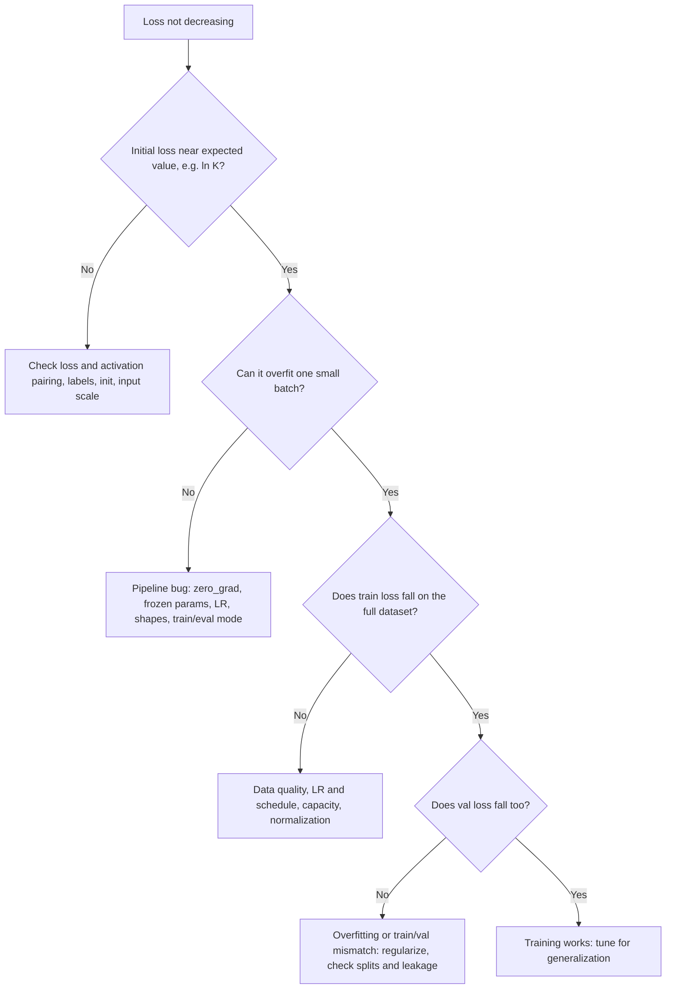

# Regularization and Debugging Neural Network Training

> **Level:** Beginner to Advanced · **Study time:** ~100 min · **Prerequisites:** [Overfitting, Bias-Variance, Regularization and Data Leakage](../01-classical-ml/03-overfitting-regularization-and-data-leakage.md), [Backpropagation and Gradient Descent](02-backpropagation-and-gradient-descent.md), [Optimizers and Learning Rate Schedules](03-optimizers-sgd-momentum-adam-and-learning-rate-schedules.md), [Loss Functions](04-loss-functions.md), [Vanishing and Exploding Gradients, Initialization, Normalization and Residuals](05-vanishing-exploding-gradients-initialization-normalization-and-residuals.md)

## Table of contents

- [Why this matters](#why-this-matters)
- [1. The two jobs: make it learn, then make it generalize](#1-the-two-jobs-make-it-learn-then-make-it-generalize)
- [2. Reading training and validation curves](#2-reading-training-and-validation-curves)
- [3. Dropout](#3-dropout)
- [4. Weight decay](#4-weight-decay)
- [5. Early stopping](#5-early-stopping)
- [6. Data augmentation](#6-data-augmentation)
- [7. Label smoothing](#7-label-smoothing)
- [8. Stochastic depth](#8-stochastic-depth)
- [9. Choosing regularizers: a comparison](#9-choosing-regularizers-a-comparison)
- [10. Sanity-check baselines before you debug](#10-sanity-check-baselines-before-you-debug)
- [11. The systematic checklist: loss is not decreasing](#11-the-systematic-checklist-loss-is-not-decreasing)
- [12. Debugging NaN and inf losses](#12-debugging-nan-and-inf-losses)
- [13. Tooling: TensorBoard, Weights and Biases, histograms](#13-tooling-tensorboard-weights-and-biases-histograms)
- [14. Going deeper: debugging and regularization at scale](#14-going-deeper-debugging-and-regularization-at-scale)
- [Common mistakes and misconceptions](#common-mistakes-and-misconceptions)
- [Interview questions and model answers](#interview-questions-and-model-answers)
- [Key takeaways](#key-takeaways)
- [Further reading](#further-reading)
- [Next](#next)

## Why this matters

Neural networks fail quietly. A buggy web server crashes with a stack trace; a buggy training loop usually runs to completion, prints numbers, and produces a model that is a bit worse than it should be, or no better than guessing. Most of the practical skill of deep learning is knowing how to tell which situation you are in, and the two tools for that are regularization (making a model that learns also generalize) and systematic debugging (making a model that does not learn start learning). Interviewers for senior AI/ML roles ask "how would you debug a model whose loss is not decreasing?" precisely because a good answer reveals whether you have actually trained models, and the same habits carry over directly to fine-tuning a 7B LLM, where a silent bug can burn thousands of GPU-hours.

---

## 1. The two jobs: make it learn, then make it generalize

> **Analogy:** Coaching a student for an exam has two stages. First, can the student even learn the material (do they improve on practice problems)? Second, do they understand it, or did they just memorize the answer key (do they do well on new problems)? Debugging fixes stage one. Regularization fixes stage two.

Quick recap of terms (taught fully in [Overfitting, Bias-Variance, Regularization and Data Leakage](../01-classical-ml/03-overfitting-regularization-and-data-leakage.md)):

- **Training loss**: the average loss on the data the model updates its weights from.
- **Validation loss**: the average loss on held-out data the model never trains on. It estimates how well the model will do on new data.
- **Generalization gap**: validation loss minus training loss. A large gap means the model memorizes rather than learns patterns.
- **Underfitting**: the model is too weak, or training is broken, so even training loss stays high.
- **Overfitting**: training loss keeps going down while validation loss stops improving or goes up.
- **Regularization**: any technique that reduces overfitting, usually by restricting the model or adding noise, often at the cost of slightly higher training loss.
- **Batch, step, epoch**: a batch is the small group of examples used for one weight update (one step); an epoch is one full pass over the training set. A **checkpoint** is a saved copy of the weights at some step.

The order matters. **Never regularize a model that cannot fit its training data.** Regularization makes fitting harder; if training loss is not dropping, adding dropout only hides the real bug. The workflow a senior engineer follows looks like this:

```text
Step 1: Get a model that can overfit      (debugging: sections 10-12)
Step 2: Regularize it until val improves   (regularization: sections 3-9)
Step 3: Tune and scale                     (going deeper: section 14)
```

This advice comes straight from practitioner guides such as Andrej Karpathy's "A Recipe for Training Neural Networks" (2019): first overfit, then regularize.

**Running examples in this chapter:**

1. **Spam filter**: an MLP (multi-layer perceptron, a stack of fully connected layers, see [Neural Networks from Scratch](01-neural-networks-from-scratch.md)) that reads 100 bag-of-words features from an email and outputs 2 **logits** (raw, unnormalized scores, one per class, that softmax turns into probabilities) for spam and not spam.
2. **House prices**: a regression network that predicts price from square footage and number of bedrooms.
3. **A 7B LLM**: a 7-billion-parameter language model being fine-tuned, for the "at scale" sections.

---

## 2. Reading training and validation curves

A **learning curve** (or training curve) is a plot of loss (or a metric like accuracy) on the y-axis versus training progress (steps or epochs) on the x-axis. You plot training and validation curves together. This is the single most informative diagnostic you have, so learn to read it before learning any fix.

> **Analogy:** Training curves are a patient's vital signs chart. A doctor reads the shape (rising fever, irregular pulse) before choosing a treatment. You read the shape before choosing a fix.

### The canonical shapes

```text
 (a) Healthy fit              (b) Overfitting               (c) Underfitting
loss                         loss                          loss
 |\                           |\                            |\_
 | \                          | \        ___/ val rises      |  \______________ val
 |  \___________ val          |  \______/                    |   \_____________ train
 |   \__________ train        |   \_____                     |
 |                            |         \_______ train       |
 +------------------> step    +----------------------> step  +---------------------> step
   small, stable gap            gap grows after a point        both high and flat

 (d) LR too high              (e) LR too low                (f) Loss spike
loss                         loss                          loss
 |  /\  /\/\ /               |\                            |\
 | /  \/    \/  or NaN       |  \                          | \      |\
 |/                          |    \                        |  \_____| \_____
 |                           |      \  (still falling,     |
 |                           |        \  slowly, linearly) |
 +------------------> step   +------------------> step     +---------------------> step
  jumpy, rising, diverging     barely moving                sudden jump, may or may not recover
```

### Pattern table

| What you see | Most likely cause | What to do |
|---|---|---|
| Train and val both fall, small gap | Healthy | Train longer, scale up model or data |
| Train falls, val flattens then rises | Overfitting | Regularize, get more data, early stop |
| Both high and flat from the start | Bug, LR far too low, or model too small | Run the debugging checklist (section 11) |
| Loss jumps around, rises, or becomes NaN | LR too high, bad data, numerical issues | Lower LR, add warmup, clip gradients (section 12) |
| Loss falls slowly in a straight line | LR too low | Raise LR (try 3x to 10x) |
| Loss stuck exactly at a constant like 0.693 | Model predicting a constant (often a bug) | Check labels, loss pairing, dead units |
| Very noisy train curve | Small batch size, or plotting per-step values | Smooth the plot (moving average), larger batch |
| Val loss lower than train loss | Dropout/augmentation only active in training; train loss averaged over the epoch; or val leakage | Usually fine; verify no leakage between splits |
| Val loss rises but val accuracy also rises | Model becomes overconfident on the examples it gets wrong | Choose checkpoint by the metric you care about; consider calibration |
| Sudden drop after a long plateau | LR schedule step, or the model "discovered" a feature | Normal; patience before stopping |

Two of these deserve a closer look because they trip people up in interviews.

**Validation loss lower than training loss.** This is often not a bug. During training, dropout and data augmentation make the task harder, but they are turned off during validation. Also, training loss is usually averaged over the whole epoch, while the model was improving during it, so the training average includes early, worse batches. Validation is computed at the end of the epoch with the improved model. The bug version: the validation set overlaps with training (**data leakage**), or it is much easier than the training set.

**Validation loss going up while accuracy also goes up.** Accuracy only cares whether the top prediction is right. Cross-entropy loss also cares how confident it is. As training continues, a model can fix a few more examples (accuracy up) while becoming extremely confident on the ones it still gets wrong; one confident wrong answer with probability 0.001 on the true class costs $-\ln(0.001) \approx 6.9$, which can dominate the average. Pick checkpoints by the metric your product cares about, and watch **calibration** (whether predicted probabilities match reality: of all predictions made with 80% confidence, about 80% should be right; see [Classification Metrics and Imbalanced Data](../01-classical-ml/04-classification-metrics-and-imbalanced-data.md)).

> **Interview tip:** When asked about curves, always say what you would plot (train and val on the same axes, the metric you care about, plus learning rate and gradient norm) before saying what you would conclude. It signals that you debug from evidence.

> **Senior insight:** In overparameterized models (especially with label noise), a phenomenon called **double descent** (Nakkiran et al., "Deep Double Descent", 2019) shows that validation error can get worse and then better again as model size or training time grows. It is a reason not to stop too eagerly on a single bump, but for day-to-day work on fixed-size models, the classic overfitting picture is the right default.

---

## 3. Dropout

### Intuition

> **Analogy:** Imagine a project team where, every day, a random half of the members call in sick. Nobody can rely on one star colleague to do everything, so every member learns to be useful on their own and knowledge gets spread around. When the full team finally shows up for the big presentation, it is robust and redundant.

Neural networks overfit partly because neurons **co-adapt**: a neuron learns to fix the specific mistakes of another neuron, building fragile, memorized combinations. **Dropout** breaks this by randomly switching off neurons during training.

### Definition

**Dropout** (Srivastava, Hinton, Krizhevsky, Sutskever and Salakhutdinov, "Dropout: A Simple Way to Prevent Neural Networks from Overfitting", JMLR 2014; first described by Hinton et al. in 2012) sets each activation to zero with probability $p$ during training, independently for every example and every forward pass. At inference, nothing is dropped.

A second view: every training step trains a different random "thinned" sub-network, and all of them share weights. At inference, using the full network approximates averaging the predictions of this huge ensemble of sub-networks.

### The scaling problem and inverted dropout

If you drop half the neurons during training, the next layer receives, on average, half the total input it would receive at inference. That mismatch would wreck the model at test time. The fix used by every modern framework is **inverted dropout**: scale the surviving activations up during training so the expected value matches inference, and do nothing at all at inference.

$$
\tilde{a}_i = \frac{m_i \, a_i}{1 - p}, \qquad m_i \sim \text{Bernoulli}(1 - p)
$$

- $a_i$: the activation of neuron $i$ before dropout.
- $m_i$: a random **mask** value, 1 (keep) with probability $1-p$ and 0 (drop) with probability $p$. **Bernoulli** just means "a coin flip that returns 1 or 0".
- $p$: the **drop probability** (PyTorch convention). Careful: the original paper used $p$ for the *keep* probability. Always check which one a source means.
- $\frac{1}{1-p}$: the scaling factor that keeps the expected value unchanged.
- $\tilde{a}_i$: the activation after dropout, passed to the next layer.

Why the expectation is preserved:

$$
\mathbb{E}[\tilde{a}_i] = \frac{a_i}{1-p}\,\mathbb{E}[m_i] = \frac{a_i}{1-p}\,(1-p) = a_i
$$

**Worked example.** Activations $a = [2.0, 4.0, 6.0, 8.0]$, drop probability $p = 0.5$, and this step's random mask is $m = [1, 0, 1, 0]$.

1. Apply the mask: $[2.0 \cdot 1,\ 4.0 \cdot 0,\ 6.0 \cdot 1,\ 8.0 \cdot 0] = [2.0, 0, 6.0, 0]$.
2. Scale by $\frac{1}{1 - 0.5} = 2$: $[4.0, 0, 12.0, 0]$.
3. Sum this step: $4 + 0 + 12 + 0 = 16$. The original sum was $2 + 4 + 6 + 8 = 20$.
4. This particular step's sum differs (16 vs 20) because the mask is random, but averaged over many masks each element keeps its value; for example element 1 is $0.5 \cdot 4.0 + 0.5 \cdot 0 = 2.0$ on average. So the expected sum is 20, which matches inference exactly.

### Train versus inference behavior

| | Training (`model.train()`) | Inference (`model.eval()`) |
|---|---|---|
| Neurons dropped? | Yes, random each forward pass | No |
| Scaling | Survivors multiplied by $1/(1-p)$ | None (identity) |
| Output | Random: same input gives different outputs | Deterministic |
| Purpose | Regularize, prevent co-adaptation | Use the full "averaged" network |

### From scratch in NumPy

```python
import numpy as np

rng = np.random.default_rng(0)

def dropout_forward(a: np.ndarray, p: float, training: bool):
    """Inverted dropout. p is the DROP probability."""
    if not training or p == 0.0:
        return a, None                      # inference: identity, no scaling
    mask = (rng.random(a.shape) >= p).astype(a.dtype)   # 1 = keep, prob 1-p
    return a * mask / (1.0 - p), mask

def dropout_backward(grad_out: np.ndarray, mask: np.ndarray, p: float):
    # Gradient flows only through kept units, with the same scaling
    return grad_out * mask / (1.0 - p)

a = np.full(100_000, 3.0)
out, mask = dropout_forward(a, p=0.3, training=True)
print(out[:6])        # mix of 0.0 and 3/0.7 = 4.2857...
print(out.mean())     # close to 3.0: the expectation is preserved
print(dropout_forward(a, 0.3, training=False)[0][:3])   # [3. 3. 3.]
```

### PyTorch

```python
# pip install torch
import torch
import torch.nn as nn

drop = nn.Dropout(p=0.5)
x = torch.ones(8)

drop.train()
print(drop(x))   # random mix of 0.0 and 2.0 (survivors scaled by 1/(1-0.5))

drop.eval()
print(drop(x))   # tensor([1., 1., 1., 1., 1., 1., 1., 1.]): identity at inference

# Spam filter MLP with dropout after each hidden activation
class SpamNet(nn.Module):
    def __init__(self, n_features=100, hidden=64, p_drop=0.3):
        super().__init__()
        self.net = nn.Sequential(
            nn.Linear(n_features, hidden), nn.ReLU(), nn.Dropout(p_drop),
            nn.Linear(hidden, hidden), nn.ReLU(), nn.Dropout(p_drop),
            nn.Linear(hidden, 2),            # raw logits, no softmax here
        )

    def forward(self, x):
        return self.net(x)
```

`model.train()` and `model.eval()` flip a `training` flag on every submodule, which is what `nn.Dropout` (and batch normalization) read.

### Practical guidance

- **Typical rates:** 0.1 to 0.5. Around 0.5 for large fully connected layers in older CNNs, 0.1 in transformer blocks (the original Transformer used 0.1), lower or zero for very large pretraining runs (section 14).
- **Where:** after activations in fully connected layers, on attention weights and residual branches in transformers. Plain dropout on convolutional feature maps is weak because neighboring pixels are correlated; variants that drop whole channels or blocks work better there.
- **Cost:** dropout slows convergence. Expect to need more epochs.
- **Interaction with batch normalization:** using both can cause a "variance shift" between train and inference statistics; many CNNs use batch norm and little or no dropout. (Batch norm is covered in [Vanishing and Exploding Gradients, Initialization, Normalization and Residuals](05-vanishing-exploding-gradients-initialization-normalization-and-residuals.md).)

> **Senior insight:** **Monte Carlo dropout** (Gal and Ghahramani, "Dropout as a Bayesian Approximation", 2016) deliberately keeps dropout on at inference, runs the same input many times, and uses the spread of predictions as an uncertainty estimate. It is the one legitimate reason to have dropout active at inference, and you must do it on purpose (enable only the dropout modules), not by forgetting `model.eval()`.

---

## 4. Weight decay

### Intuition

> **Analogy:** Think of each weight as a rubber band attached to zero. Gradients pull weights toward whatever fits the data; the rubber band constantly pulls them back. Only weights that the data really needs stay large. Large weights let a model build sharp, wiggly functions that memorize noise, so pulling them toward zero gives smoother, simpler functions.

### L2 regularization

**L2 regularization** adds a penalty proportional to the sum of squared weights to the loss (you met this as ridge regression in [Linear and Logistic Regression](../01-classical-ml/02-linear-and-logistic-regression.md)):

$$
L_{\text{total}}(w) = L_{\text{data}}(w) + \frac{\lambda}{2}\sum_j w_j^2
$$

- $L_{\text{data}}$: the normal loss, such as cross-entropy.
- $w_j$: each weight.
- $\lambda$ (lambda): the regularization strength, a hyperparameter.
- The $\frac{1}{2}$ is a convenience so the derivative is clean.

Its gradient is $\nabla L_{\text{data}} + \lambda w$, so one plain SGD step with learning rate $\eta$ is:

$$
w \leftarrow w - \eta\left(\nabla L_{\text{data}} + \lambda w\right) = (1 - \eta\lambda)\,w - \eta \nabla L_{\text{data}}
$$

The $(1 - \eta\lambda)$ factor shrinks, or "decays", the weight a little on every step. That is why it is called **weight decay**: multiply weights by a number slightly below 1 every step.

**Worked example.** Weight $w = 2.0$, data gradient $g = 0.5$, learning rate $\eta = 0.1$, $\lambda = 0.01$.

1. Without regularization: $w = 2.0 - 0.1 \times 0.5 = 2.0 - 0.05 = 1.95$.
2. L2 gradient term: $\lambda w = 0.01 \times 2.0 = 0.02$. Total gradient: $0.5 + 0.02 = 0.52$.
3. With L2: $w = 2.0 - 0.1 \times 0.52 = 2.0 - 0.052 = 1.948$.
4. Same thing in decay form: shrink factor $1 - \eta\lambda = 1 - 0.1 \times 0.01 = 0.999$, so $0.999 \times 2.0 - 0.1 \times 0.5 = 1.998 - 0.05 = 1.948$. Identical.

### Why L2 and weight decay differ for Adam (AdamW)

For plain SGD, L2 regularization and weight decay are the same thing, as the example shows. For adaptive optimizers like Adam they are not. Adam divides each gradient by a running estimate of its size (see [Optimizers](03-optimizers-sgd-momentum-adam-and-learning-rate-schedules.md)). If you add $\lambda w$ to the gradient, Adam divides that term too, so weights with historically large gradients get *less* decay than intended, and the regularization becomes uneven and weaker.

Loshchilov and Hutter ("Decoupled Weight Decay Regularization", ICLR 2019) proposed **AdamW**: apply the decay directly to the weights, separately from the adaptive gradient step:

$$
w \leftarrow w - \eta\left(\frac{\hat{m}}{\sqrt{\hat{v}} + \epsilon} + \lambda w\right)
$$

- $\hat{m}$, $\hat{v}$: Adam's bias-corrected running averages of the gradient and squared gradient.
- $\epsilon$: a tiny constant to avoid division by zero.
- $\lambda w$: the decay term, now outside the division, so every weight decays at the same relative rate.

This is the form PyTorch implements (the decay is multiplied by the full learning rate $\eta$); the paper writes the decay as scaled by the schedule multiplier only, so the same $\lambda$ can mean different effective decay in different codebases.

AdamW is the de facto default optimizer for transformers and LLMs.

| | L2 penalty in the loss | Decoupled weight decay |
|---|---|---|
| How | Add $\frac{\lambda}{2}\lVert w \rVert^2$ to the loss | Shrink weights directly in the update |
| With SGD | Equivalent to weight decay | Equivalent to L2 |
| With Adam | Decay distorted by adaptive scaling | Uniform decay (AdamW) |
| PyTorch | `torch.optim.Adam(..., weight_decay=λ)` adds L2 to the gradient | `torch.optim.AdamW(..., weight_decay=λ)` |

> **Common mistake:** Using `torch.optim.Adam(weight_decay=0.01)` and believing it is AdamW. In PyTorch, `Adam`'s `weight_decay` is the coupled L2 version by default. Use `AdamW` for decoupled decay (recent PyTorch releases also accept `Adam(..., decoupled_weight_decay=True)`, which behaves like AdamW; older versions do not have this flag).

### Which parameters to decay

Standard practice for transformers and many CNNs: decay weight matrices, but **not** biases or the scale and shift parameters of normalization layers. Those are 1-D parameters that do not contribute to "wiggly function" complexity in the same way, and decaying them can hurt.

```python
import torch

model = SpamNet()   # from the dropout section

decay, no_decay = [], []
for name, param in model.named_parameters():
    if not param.requires_grad:
        continue
    # Biases and normalization weights are 1-D; weight matrices are 2-D or more
    (no_decay if param.ndim < 2 else decay).append(param)

optimizer = torch.optim.AdamW(
    [{"params": decay, "weight_decay": 0.01},
     {"params": no_decay, "weight_decay": 0.0}],
    lr=3e-4,
)
```

Typical values: `weight_decay` around 0.01 to 0.1 with AdamW (PyTorch's AdamW default is 0.01); many LLM pretraining recipes report 0.1. Because PyTorch's AdamW multiplies the decay by the learning rate (the per-step shrink is $1 - \eta\lambda$), changing the learning rate also changes the effective decay.

> **Senior insight:** With normalization layers, the network's output is often invariant to the scale of the weights feeding into them, so weight decay there acts less like "simpler function" and more like a control on the effective learning rate (smaller weights mean each update is relatively larger). This is one reason weight decay and learning rate should be tuned together.

**L1 regularization** (penalty $\lambda \sum |w_j|$) pushes weights to exactly zero and produces sparsity. It is common in linear models but rare as a general regularizer in deep nets.

---

## 5. Early stopping

### Intuition

> **Analogy:** Baking bread: you check it every few minutes and pull it out when it is golden, not when the timer you set at the start runs out. You keep the best version you saw, not the burnt final one.

**Early stopping** monitors validation loss (or a metric) during training, saves a **checkpoint** (a saved copy of the weights) whenever it improves, and stops when it has not improved for a set number of evaluations, called the **patience**. At the end you restore the best checkpoint.

Why it regularizes: weights start small and grow during training. Stopping early limits how far they can travel from initialization, which acts a lot like L2 regularization (Goodfellow, Bengio and Courville, "Deep Learning", chapter 7, show this equivalence for a simple quadratic case).

### Worked example

Validation loss per epoch (illustrative), with patience 3 and min_delta 0 (any decrease counts as an improvement):

| Epoch | Val loss | Best so far | Epochs without improvement | Action |
|---|---|---|---|---|
| 1 | 0.90 | 0.90 | 0 | save |
| 2 | 0.70 | 0.70 | 0 | save |
| 3 | 0.62 | 0.62 | 0 | save |
| 4 | 0.60 | 0.60 | 0 | save |
| 5 | 0.61 | 0.60 | 1 | |
| 6 | 0.59 | 0.59 | 0 | save |
| 7 | 0.60 | 0.59 | 1 | |
| 8 | 0.62 | 0.59 | 2 | |
| 9 | 0.63 | 0.59 | 3 | stop, restore epoch 6 |

Notice epoch 5: with patience 1 you would have stopped there and kept 0.60, missing the better 0.59 at epoch 6. Patience absorbs noise in the validation curve.

### Code

```python
import copy
import math

class EarlyStopping:
    def __init__(self, patience: int = 3, min_delta: float = 0.0):
        self.patience = patience
        self.min_delta = min_delta
        self.best = math.inf
        self.bad_epochs = 0
        self.best_state = None

    def update(self, val_loss: float, model) -> bool:
        """Record one evaluation. Returns True when training should stop."""
        if val_loss < self.best - self.min_delta:
            self.best = val_loss
            self.bad_epochs = 0
            # In real runs, save to disk instead: torch.save(model.state_dict(), path)
            self.best_state = copy.deepcopy(model.state_dict())
        else:
            self.bad_epochs += 1
        return self.bad_epochs >= self.patience

# Usage sketch:
# stopper = EarlyStopping(patience=3)
# for epoch in range(100):
#     train_one_epoch(model, ...)
#     if stopper.update(evaluate(model, val_loader), model):
#         break
# model.load_state_dict(stopper.best_state)
```

**Trade-offs:**

- Patience too small: stops on noise. Too large: wastes compute (but you still keep the best checkpoint, so you lose time, not quality).
- With a learning rate schedule that decays to zero (like cosine), the schedule length is part of the design; stopping in the middle means you never reach the low-LR phase that often gives the final gains. Many teams fix the schedule and select the best checkpoint instead of stopping.
- Early stopping uses the validation set to make a decision, so the validation score of the chosen checkpoint is slightly optimistic. Report final numbers on a separate test set (see [The ML Workflow, Train/Validation/Test Splits and Cross-Validation](../01-classical-ml/01-ml-workflow-data-splits-and-cross-validation.md)).

---

## 6. Data augmentation

### Intuition

> **Analogy:** To teach a child what a cat is, you show the same cat from different angles, in different lighting, sitting and standing. You did not need new cats; you showed the same cats in ways that should not change the answer.

**Data augmentation** creates modified copies of training examples using transformations that should not change the label. It encodes your prior knowledge about **invariances** (things the answer should not depend on, such as a horizontal flip for most photos). It is often the most effective regularizer when data is limited, because it effectively adds data rather than restricting the model.

### Examples by modality

| Modality | Common augmentations | Watch out for |
|---|---|---|
| Images | Random crop and resize, horizontal flip, color jitter, small rotations, mixup, CutMix, RandAugment | Flipping text or digits (a flipped "6" is not a "6"); crops that cut out the object |
| Text | Back-translation (translate to another language and back), synonym replacement, random token deletion | Changing meaning; for the spam filter, rewording must keep the email spammy |
| Audio | Time shift, added background noise, speed change, SpecAugment (masking time and frequency bands) | Changing pitch when pitch is the label |
| Tabular | Small Gaussian noise on numeric features, SMOTE-style interpolation for rare classes | Easy to create impossible rows; usually less useful than for images |

**Mixup** (Zhang et al., "mixup: Beyond Empirical Risk Minimization", 2018) blends two images and their labels with the same weight, for example 70% image A plus 30% image B with label 0.7 A and 0.3 B. **CutMix** (Yun et al., 2019) pastes a patch of one image onto another and mixes labels by area. Both produce soft labels, so they regularize the output distribution as well as the input.

```python
# pip install torch torchvision
from torchvision import transforms

train_tf = transforms.Compose([
    transforms.RandomResizedCrop(224),          # random crop, resized to 224x224
    transforms.RandomHorizontalFlip(),          # p=0.5 by default
    transforms.ColorJitter(0.2, 0.2, 0.2),      # brightness, contrast, saturation
    transforms.ToTensor(),
    transforms.Normalize([0.485, 0.456, 0.406], [0.229, 0.224, 0.225]),  # ImageNet stats
])

val_tf = transforms.Compose([                    # NO random augmentation at validation
    transforms.Resize(256),
    transforms.CenterCrop(224),
    transforms.ToTensor(),
    transforms.Normalize([0.485, 0.456, 0.406], [0.229, 0.224, 0.225]),
])
```

Rules that matter:

- Augment **training data only**. Validation and test must reflect real inputs.
- Augment on the fly (new random variant each epoch), not once up front.
- **Look at augmented samples.** A pipeline bug (wrong channel order, labels not transformed with the image in detection or segmentation) is one of the most common silent failures.
- **Test-time augmentation (TTA)** averages predictions over a few augmented versions of a test input. It can add accuracy at a multiplied inference cost.

Vision-specific augmentation strategy is covered in depth in [Data Augmentation, Transfer Learning and Small Datasets in Vision](../03-computer-vision/03-data-augmentation-transfer-learning-and-small-datasets.md).

---

## 7. Label smoothing

### Intuition

> **Analogy:** A teacher who grades "100% certain, no doubt whatsoever" answers the same as "very confident" answers discourages students from becoming arrogant. Label smoothing tells the model: aim for very confident, not infinitely confident.

With one-hot targets (1 for the true class, 0 for the others), cross-entropy keeps rewarding the model for pushing the true-class probability closer to 1, which means pushing logits toward infinity. That creates overconfident models and can hurt generalization. **Label smoothing** (introduced in Szegedy et al., "Rethinking the Inception Architecture for Computer Vision", 2016) replaces hard targets with slightly soft ones.

### Formula

$$
y^{\text{smooth}}_k = (1 - \varepsilon)\, y_k + \frac{\varepsilon}{K}
$$

- $y_k$: the original one-hot target for class $k$ (1 for the true class, 0 otherwise).
- $\varepsilon$ (epsilon): the smoothing amount, typically 0.1.
- $K$: the number of classes.
- $y^{\text{smooth}}_k$: the new target. The loss is then cross-entropy against this soft target: $L = -\sum_k y^{\text{smooth}}_k \ln p_k$, where $p_k$ is the model's predicted probability (see [Softmax, Entropy, Cross-Entropy and KL Divergence](../00-foundations/05-softmax-entropy-cross-entropy-and-kl-divergence.md)).

This is the convention PyTorch uses (some papers spread $\varepsilon$ over only the $K-1$ wrong classes instead; the idea is the same).

### Worked example

$K = 3$ classes, $\varepsilon = 0.1$, true class is class 0, model predicts $p = [0.7, 0.2, 0.1]$.

1. Smoothed target for the true class: $(1 - 0.1)\times 1 + 0.1/3 = 0.9 + 0.0333 = 0.9333$.
2. For the other two: $0.9 \times 0 + 0.0333 = 0.0333$ each. Check: $0.9333 + 0.0333 + 0.0333 = 1.0$.
3. Plain cross-entropy: $-\ln 0.7 = 0.3567$.
4. Smoothed cross-entropy: $-(0.9333 \ln 0.7 + 0.0333 \ln 0.2 + 0.0333 \ln 0.1)$
   - $0.9333 \times 0.3567 = 0.3329$
   - $0.0333 \times 1.6094 = 0.0536$
   - $0.0333 \times 2.3026 = 0.0768$
   - Sum: $0.3329 + 0.0536 + 0.0768 = 0.4633$.

**Important debugging consequence:** with label smoothing, the loss can never reach zero. Its minimum is reached when the prediction equals the smoothed target $[0.9333, 0.0333, 0.0333]$, and equals the entropy of that target:

$$
-(0.9333 \ln 0.9333 + 2 \times 0.0333 \ln 0.0333) = 0.0644 + 2 \times 0.1134 = 0.2911
$$

So a training loss stuck around 0.29 on this 3-class problem is the floor, not a bug.

```python
import torch
import torch.nn as nn

loss_fn = nn.CrossEntropyLoss(label_smoothing=0.1)   # available since PyTorch 1.10
logits = torch.log(torch.tensor([[0.7, 0.2, 0.1]]))  # logits whose softmax is [0.7, 0.2, 0.1]
target = torch.tensor([0])
print(loss_fn(logits, target).item())  # about 0.4633, matching the hand calculation
```

### When it helps and when it hurts

- **Helps:** large-scale image classification, machine translation (the original Transformer used $\varepsilon = 0.1$), and generally improves calibration.
- **Hurts or needs care:** Müller, Kornblith and Hinton ("When Does Label Smoothing Help?", 2019) showed that teachers trained with label smoothing produce worse students in **knowledge distillation** (training a small "student" model to imitate the full probability outputs of a large "teacher"), because smoothing erases the information about which wrong classes are similar (see [Knowledge Distillation Fundamentals](../07-model-compression/05-knowledge-distillation-fundamentals.md)). Also avoid it when you need the raw probabilities to reflect true confidence for a downstream threshold without recalibrating.

---

## 8. Stochastic depth

**Stochastic depth** (Huang, Sun, Liu, Sedra and Weinberger, "Deep Networks with Stochastic Depth", 2016) is dropout for whole layers. In a network built from **residual blocks** (blocks that compute $x + f(x)$, see [Vanishing and Exploding Gradients, Initialization, Normalization and Residuals](05-vanishing-exploding-gradients-initialization-normalization-and-residuals.md)), you randomly skip the $f(x)$ branch for a whole example during training, so that block becomes the identity:

$$
\text{output} = x + b \cdot f(x), \qquad b \sim \text{Bernoulli}(1 - p_\ell)
$$

- $p_\ell$: the drop probability for block $\ell$. The original paper increases it linearly with depth, so early blocks (which compute basic features) are almost never dropped and the last blocks are dropped most.

**Worked example.** The linear rule is $p_\ell = \frac{\ell}{L}\,p_L$ for $L$ blocks. With $L = 12$ and a final rate $p_L = 0.2$: block 3 drops with probability $0.05$, block 6 with $0.1$, block 12 with $0.2$. On average $\sum_\ell p_\ell = 0.2 \times \frac{1 + 2 + \dots + 12}{12} = 0.2 \times \frac{78}{12} = 1.3$ blocks are skipped per example, so each training example sees a network about 10.7 blocks deep.

> **Analogy:** A relay race where, on practice days, some runners randomly skip their leg and the baton is passed straight through. Every runner must be able to handle a baton coming from anywhere.

Effects: regularization, plus faster training (skipped blocks cost no compute in the original method), and an implicit ensemble of networks of different depths. In modern code it is usually called **drop path** and is standard in vision transformers and ConvNeXt-style models (rates of roughly 0.1 to 0.5 depending on model size).

```python
import torch
import torch.nn as nn

def drop_path(x: torch.Tensor, p: float, training: bool) -> torch.Tensor:
    if not training or p == 0.0:
        return x
    keep = 1.0 - p
    shape = (x.shape[0],) + (1,) * (x.ndim - 1)   # one coin flip per example
    mask = torch.empty(shape, device=x.device, dtype=x.dtype).bernoulli_(keep)
    return x * mask / keep                        # inverted scaling, like dropout

class ResidualBlock(nn.Module):
    def __init__(self, dim: int, p_drop_path: float):
        super().__init__()
        self.f = nn.Sequential(nn.LayerNorm(dim), nn.Linear(dim, dim), nn.GELU())
        self.p = p_drop_path

    def forward(self, x):
        return x + drop_path(self.f(x), self.p, self.training)
```

Library versions exist: `torchvision.ops.StochasticDepth` and `timm`'s `DropPath`.

---

## 9. Choosing regularizers: a comparison

| Technique | What it does | When to use | Pros | Cons |
|---|---|---|---|---|
| More / better data | Real new examples | Always the first choice if affordable | Most reliable fix for overfitting | Costly, slow |
| Data augmentation | Label-preserving transforms | Images, audio, small datasets | Big gains, encodes domain knowledge | Wrong transforms corrupt labels |
| Weight decay | Shrinks weights each step | Nearly always (AdamW for transformers) | Cheap, one hyperparameter | Interacts with LR; skip biases and norms |
| Dropout | Randomly zeroes activations | MLPs, transformer fine-tuning, small data | Simple, strong on dense layers | Slower convergence; weak on conv maps; train/eval mode bugs |
| Early stopping | Keeps best validation checkpoint | Almost always (at least checkpoint selection) | Saves compute, no model change | Needs a clean validation set; noisy curves |
| Label smoothing | Softens targets | Many-class classification, translation | Better calibration, less overconfidence | Loss never reaches 0; hurts distillation teachers |
| Stochastic depth | Randomly skips residual blocks | Deep residual nets, ViTs | Regularizes and speeds training | Only for residual architectures |
| Mixup / CutMix | Mixes inputs and labels | Image classification | Strong regularization | Less interpretable, can slow convergence |
| Smaller model | Fewer parameters | Small data, latency limits | Cheaper inference | May underfit |
| Transfer learning | Start from pretrained weights | Little labeled data | Huge gains with tiny data | Domain mismatch; see [CNNs and Transfer Learning](07-cnns-and-transfer-learning.md) |

> **Interview tip:** If asked "your model overfits, what do you do?", answer in this order: confirm it is really overfitting (curves, no leakage), then more data or augmentation, then weight decay and dropout, then early stopping and a smaller or pretrained model. Mention you change one thing at a time and track each experiment.

---

## 10. Sanity-check baselines before you debug

Before asking "why is my loss bad?", you need to know what "bad" means. A **baseline** is a simple reference result that any working model must beat (see [Regression Metrics, Baselines and Model Selection](../01-classical-ml/05-regression-metrics-baselines-and-model-selection.md)).

### The expected initial loss

With a sensible random initialization, a classifier's first predictions are roughly uniform over the $K$ classes, so each class gets probability $1/K$. Cross-entropy is then:

$$
L_0 = -\ln\frac{1}{K} = \ln K
$$

- $K$: number of classes. $L_0$: the loss you should see at step 0.

Worked values:

| Problem | $K$ | Expected initial loss |
|---|---|---|
| Spam filter | 2 | $\ln 2 = 0.693$ |
| CIFAR-10 | 10 | $\ln 10 = 2.303$ |
| GPT-2 tokenizer vocabulary | 50,257 | $\ln 50257 \approx 10.82$ |

If your spam filter starts at a loss of 9.5, something is wrong before a single update: the logits are huge (bad initialization or unnormalized inputs) or the loss is miswired. If the loss quickly settles at exactly 0.693 and stays there, the model is outputting 50/50 for everything: it has learned nothing.

### Baselines to compute

| Baseline | What it is | What it tells you |
|---|---|---|
| Majority class | Always predict the most common class | If 90% of emails are not spam, 90% accuracy is worthless |
| Class-prior loss | Predict the class frequencies for every input | The best loss achievable without looking at inputs; for a 90/10 split: $-(0.9\ln 0.9 + 0.1\ln 0.1) = 0.0948 + 0.2303 = 0.325$ |
| Mean predictor (regression) | Always predict the training mean price | Any house-price model must beat this MSE |
| Simple model | Logistic regression or gradient boosting on the same features | If the neural net cannot beat it, look for bugs before adding layers |
| Input-independent test | Feed zeros instead of real inputs | Performance should get worse; if it does not, the model ignores its input |
| Random-label test | Shuffle the labels | Validation must fall to chance; if not, you have leakage |

> **Senior insight:** Zhang et al. ("Understanding Deep Learning Requires Rethinking Generalization", 2017) showed that standard networks can perfectly fit training sets with completely random labels. Two lessons: a network that cannot overfit a small batch almost certainly has a bug, and low training loss alone proves nothing about generalization.

---

## 11. The systematic checklist: loss is not decreasing

This is the core of the chapter and the answer to the most common debugging interview question. The principle: **start cheap and local, then widen.** Each step either finds the bug or rules out a whole category.



### Step 1: Verify the data and labels

Most "model" bugs are data bugs. Before touching the model:

- **Look at raw examples with their labels**, after the full preprocessing pipeline (not the raw files). For the spam filter, print 10 emails with labels and check they make sense.
- **Check label distribution** in train and val. All one class? Labels encoded as strings `"1"` vs `"0"`? Labels shifted by one (classes 1 to 10 instead of 0 to 9)?
- **Check alignment**: did you shuffle `X` and `y` separately? A classic bug: `np.random.shuffle(X); np.random.shuffle(y)` destroys the pairing, and the loss sits at chance forever.
- **Check for NaN or inf in the inputs**: `assert torch.isfinite(X).all()`.
- **Check augmentation output** visually (section 6).
- **Check the data loader**: is it returning the same batch every time? Is shuffling on for training?

### Step 2: Overfit a single small batch

Take one small batch (say 8 to 32 examples), turn off all regularization (dropout 0, weight decay 0, no augmentation), and train on just that batch for a few hundred steps. A working network should drive the loss close to zero, because it can memorize a handful of examples.

```python
# pip install torch
import torch
import torch.nn as nn

torch.manual_seed(0)
X = torch.randn(32, 100)                 # 32 synthetic "emails", 100 features
y = torch.randint(0, 2, (32,))           # random labels: memorizable but not learnable

model = nn.Sequential(nn.Linear(100, 64), nn.ReLU(), nn.Linear(64, 2))  # no dropout
opt = torch.optim.Adam(model.parameters(), lr=1e-3, weight_decay=0.0)
loss_fn = nn.CrossEntropyLoss()

model.train()
for step in range(501):
    opt.zero_grad()
    loss = loss_fn(model(X), y)
    loss.backward()
    opt.step()
    if step % 100 == 0:
        print(step, round(loss.item(), 4))
# Expect: starts near ln 2 = 0.693, then falls toward 0.
# If it does not fall, the bug is in the model, loss or training loop, NOT the data volume.
```

How to read the result:

| Outcome | Meaning |
|---|---|
| Loss goes to near 0 | Model, loss and update loop are wired correctly; move on |
| Loss stays flat | Gradients not flowing or not applied (steps 4 to 7, 10 to 11) |
| Loss falls then plateaus well above 0 | Loss floor from label smoothing or double softmax (step 4), or model too small |
| Loss explodes | Learning rate too high or numerical issue (step 3, section 12) |

> **Interview tip:** "Overfit a single batch" is the most important phrase in your answer. It splits the bug space in half with one cheap experiment: if the model cannot memorize 32 examples, no amount of data, tuning or regularization will help.

### Step 3: Check the learning rate (too high or too low)

The **learning rate** $\eta$ sets the step size of each update (see [Optimizers](03-optimizers-sgd-momentum-adam-and-learning-rate-schedules.md)). Both extremes produce a loss that does not decrease.

**Worked example.** Minimize $f(w) = w^2$ starting from $w = 1$. The gradient is $2w$, so each update is $w \leftarrow w - \eta \cdot 2w = (1 - 2\eta)\,w$.

| $\eta$ | Factor $1 - 2\eta$ | $w$ over 3 steps | Loss $w^2$ | Verdict |
|---|---|---|---|---|
| 0.1 | 0.8 | 1 → 0.8 → 0.64 → 0.512 | 1 → 0.64 → 0.41 → 0.26 | Converges |
| 1.0 | -1 | 1 → -1 → 1 → -1 | stuck at 1 | Oscillates: loss flat but not from lack of learning |
| 1.5 | -2 | 1 → -2 → 4 → -8 | 1 → 4 → 16 → 64 | Diverges |
| 0.001 | 0.998 | after 100 steps: $0.998^{100} \approx 0.819$ | $\approx 0.670$ after 100 steps | Painfully slow |

Symptoms and fixes:

- **Too high:** loss jumps around, increases, or goes NaN. Divide by 3 to 10. Add **warmup** (start with a tiny LR and ramp up over the first few hundred or thousand steps), essential for transformers.
- **Too low:** loss falls in a slow straight line. Multiply by 3 to 10.
- **Search on a log scale** (1e-5, 3e-5, 1e-4, 3e-4, 1e-3, ...), not linearly.
- **LR range test** (Smith, "Cyclical Learning Rates for Training Neural Networks", 2017): increase the LR exponentially over a short run and plot loss versus LR; pick a value somewhat below where the loss is falling fastest, well before it blows up.
- Typical starting points (illustrative, common defaults): Adam/AdamW around 1e-3 for small MLPs and CNNs from scratch, 1e-5 to 5e-5 for full fine-tuning of transformers, around 1e-4 to 2e-4 for LoRA fine-tuning. Plain SGD often needs a much larger LR (0.01 to 0.1) than Adam.

### Step 4: Check the loss and activation pairing

The output layer, the loss function and the target format must match. The most famous bug: **applying softmax before `nn.CrossEntropyLoss`**. PyTorch's `CrossEntropyLoss` expects raw **logits** (unnormalized scores) and applies `log_softmax` internally. If you softmax first, softmax gets applied twice.

**Worked example.** Logits $[2.0, 1.0, 0.1]$, true class 0.

1. Correct path: softmax gives $e^{2.0} = 7.389$, $e^{1.0} = 2.718$, $e^{0.1} = 1.105$, sum $= 11.213$, so probabilities $[0.659, 0.242, 0.099]$. Loss $= -\ln 0.659 = 0.417$.
2. Buggy path: these probabilities are treated as logits and softmaxed again: $e^{0.659} = 1.933$, $e^{0.242} = 1.274$, $e^{0.099} = 1.104$, sum $= 4.311$, giving $[0.448, 0.296, 0.256]$. Loss $= -\ln 0.448 = 0.802$.
3. Worse, even a perfectly confident model with probabilities $[1, 0, 0]$ becomes $e^1/(e^1 + 1 + 1) = 2.718/4.718 = 0.576$ after the second softmax, so the loss can never drop below $-\ln 0.576 = 0.551$. Gradients are squashed too, so learning crawls and stalls at a floor.

Correct pairings in PyTorch:

| Task | Model output | Loss | Target format |
|---|---|---|---|
| Multi-class (one label) | Raw logits, shape (N, K) | `nn.CrossEntropyLoss` | Class indices, shape (N,), dtype `long` |
| Binary or multi-label | Raw logits, shape (N,) or (N, K) | `nn.BCEWithLogitsLoss` | Floats 0.0 or 1.0, same shape as output |
| Already have log-probabilities | `log_softmax` output | `nn.NLLLoss` | Class indices |
| Regression (house prices) | Raw value, no activation | `nn.MSELoss`, `nn.L1Loss`, `nn.HuberLoss` | Floats, same shape as output |

Other pairing bugs: sigmoid followed by `BCEWithLogitsLoss` (sigmoid applied twice), `nn.BCELoss` on raw logits, a ReLU on the final regression output (cannot predict negative values, and can die), MSE for classification. Full details in [Loss Functions](04-loss-functions.md).

### Step 5: Check for a forgotten `optimizer.zero_grad()`

PyTorch **accumulates** gradients: each `loss.backward()` adds into `param.grad`. This is deliberate (it enables **gradient accumulation**, simulating a big batch by summing gradients over several small ones), but if you never reset, each step uses the sum of all past gradients. The effective step size grows every iteration and training becomes erratic or diverges.

```python
# Correct order every step
optimizer.zero_grad()      # 1. clear old gradients (set_to_none=True is the default in PyTorch 2.x)
loss = loss_fn(model(X), y)
loss.backward()            # 2. compute fresh gradients
optimizer.step()           # 3. apply them

# Gradient accumulation done on purpose: zero only every `accum` steps
accum = 4
for i, (X, y) in enumerate(loader):
    loss = loss_fn(model(X), y) / accum   # average over the virtual big batch
    loss.backward()
    if (i + 1) % accum == 0:
        optimizer.step()
        optimizer.zero_grad()
```

Related ordering bugs: calling `optimizer.step()` before `backward()`, or calling `scheduler.step()` per batch when the schedule was designed per epoch (or the reverse), which makes the LR collapse to near zero or never decay.

### Step 6: Check `model.train()` and `model.eval()`

- `model.train()`: dropout active, batch norm uses batch statistics and updates its running averages.
- `model.eval()`: dropout off, batch norm uses the stored running averages.
- Neither one turns gradients on or off. For evaluation you also want `torch.no_grad()` (or `torch.inference_mode()`) to save memory and time.

Classic bugs:

- Calling `model.eval()` for validation and never calling `model.train()` again: dropout stays off and batch norm statistics freeze for the rest of training. Training looks fine but regularization silently vanishes.
- Never calling `model.eval()` at inference: predictions are random (dropout) and depend on what else is in the batch (batch norm). A classic production symptom: "the same input gives different outputs" or "accuracy drops when batch size is 1".

```python
def evaluate(model, loader, loss_fn):
    model.eval()
    total, n = 0.0, 0
    with torch.no_grad():
        for X, y in loader:
            total += loss_fn(model(X), y).item() * len(y)
            n += len(y)
    model.train()            # restore training mode for the caller
    return total / n
```

### Step 7: Check for frozen parameters and a broken graph

Gradients may never reach some weights, or reach them but never get applied:

- `requires_grad=False` left on after a "freeze the backbone" experiment.
- The **optimizer was created before a layer was replaced**: `opt = AdamW(model.parameters())`, then `model.fc = nn.Linear(512, 2)`. The new head is not in the optimizer, so it never updates. This is a very common transfer-learning bug.
- The computation graph is cut by `.detach()`, `.item()`, `.numpy()`, `.data`, a `torch.no_grad()` block around the forward pass, or converting to a Python float and back.

```python
def check_trainable(model, optimizer):
    in_opt = {id(p) for g in optimizer.param_groups for p in g["params"]}
    for name, p in model.named_parameters():
        if not p.requires_grad:
            print(f"FROZEN:          {name}")
        elif id(p) not in in_opt:
            print(f"NOT IN OPTIMIZER: {name}")
    n_train = sum(p.numel() for p in model.parameters() if p.requires_grad)
    print(f"trainable params: {n_train:,}")
```

Also verify that parameters actually change: save a copy of the weights, do one step, and compare. If a layer's weights are bitwise identical after `optimizer.step()`, it is not training.

### Step 8: Check input normalization

Networks train best when inputs have roughly zero mean and unit variance per feature (see [Feature Engineering: Missing Values, Categorical Encoding and Scaling](../01-classical-ml/07-feature-engineering-missing-values-and-encoding.md)). Unscaled inputs make some weights receive enormous gradients and others tiny ones, so no single learning rate works.

**House-price example.** Square footage around 2,000, bedrooms around 3, and price around 300,000. At initialization the network outputs roughly 0, so the first squared error is about $300{,}000^2 = 9 \times 10^{10}$. Gradients are correspondingly huge and the first update throws the weights far away, or the loss becomes inf (in FP16, anything above 65,504 overflows, section 12). Fixes:

- Standardize each input feature using mean and standard deviation **computed on the training set only** (computing them on all data is leakage).
- Standardize or log-transform the **target** for regression too, then invert the transform at prediction time.
- For images: scale pixels from 0-255 to 0-1, then normalize per channel. Forgetting to divide by 255 is a classic bug, as is normalizing training data but not inference data (a form of **training-serving skew**, see [Reproducible Training and Training-Serving Skew](../10-mlops/03-reproducibility-and-training-serving-skew.md)).

### Step 9: Check for shape and broadcasting bugs

**Broadcasting** is NumPy and PyTorch's rule for combining tensors of different shapes by stretching size-1 dimensions. It is convenient and dangerous: mismatched shapes often produce a wrong answer instead of an error.

**Worked example (house prices).** The model outputs predictions of shape (4, 1); the targets have shape (4,). Subtracting them broadcasts to a (4, 4) matrix of every prediction minus every target.

Suppose predictions and targets are both $[1, 2, 3, 4]$ (a perfect model, true MSE = 0). The broadcast differences $p_i - t_j$ cover all 16 pairs:

1. Pairs with difference 0: 4, contributing $4 \times 0 = 0$.
2. Pairs with $|i-j| = 1$: 6, contributing $6 \times 1 = 6$.
3. Pairs with $|i-j| = 2$: 4, contributing $4 \times 4 = 16$.
4. Pairs with $|i-j| = 3$: 2, contributing $2 \times 9 = 18$.
5. Mean: $(0 + 6 + 16 + 18)/16 = 40/16 = 2.5$.

A perfect model gets loss 2.5, and the gradient pushes every prediction toward the mean of all targets. The loss stalls at a level that looks plausible.

```python
import torch
import torch.nn.functional as F

pred = torch.tensor([[1.], [2.], [3.], [4.]])   # shape (4, 1)
target = torch.tensor([1., 2., 3., 4.])         # shape (4,)

print((pred - target).shape)                    # torch.Size([4, 4])  <- silent bug
print(((pred - target) ** 2).mean().item())     # 2.5, though the model is perfect
print(F.mse_loss(pred.squeeze(-1), target).item())  # 0.0, correct
# F.mse_loss(pred, target) emits a UserWarning about mismatched sizes: read your warnings.
```

Defenses: assert shapes in the training loop (`assert pred.shape == target.shape`), annotate expected shapes in comments, and treat framework warnings as errors during development. Other shape traps: `softmax` over the wrong dimension (`dim=0` normalizes across the batch instead of across classes), `view` instead of `permute` when reordering dimensions (scrambles data without an error), and sequence models with batch and time dimensions swapped.

### Step 10: Check for dead ReLUs

**ReLU** outputs $\max(0, z)$. Its gradient is 0 whenever $z < 0$. A **dead ReLU** is a unit whose input is negative for every example, so it always outputs 0 and its own weights always get zero gradient, so it usually cannot recover by itself (it can occasionally revive if updates to earlier layers shift its inputs, or weight decay pulls its bias back toward zero). It typically happens after a large update (high LR) pushes a bias strongly negative: for example, if a unit's bias becomes $-10$ while $w \cdot x$ never exceeds 10 on real inputs, the unit is permanently off. If most units die, the network output becomes constant and loss stops moving.

Measure it with a **forward hook** (a function PyTorch calls with a module's output on every forward pass):

```python
import torch
import torch.nn as nn

dead_fraction = {}

def make_hook(name):
    def hook(module, inputs, out):
        # A unit is "dead on this batch" if it is <= 0 for every example
        # Assumes out has shape (batch, units)
        dead_fraction[name] = (out <= 0).all(dim=0).float().mean().item()
    return hook

model = nn.Sequential(nn.Linear(100, 64), nn.ReLU(), nn.Linear(64, 2))
for name, m in model.named_modules():
    if isinstance(m, nn.ReLU):
        m.register_forward_hook(make_hook(name))

model(torch.randn(256, 100))
print(dead_fraction)   # e.g. {'1': 0.0} for a healthy fresh network
```

Use a large batch for this check, since a unit can be silent on a small batch by chance. Fixes: lower the learning rate, use proper **He (Kaiming) initialization**, add normalization, or switch to **Leaky ReLU** or **GELU**, which have nonzero gradient for negative inputs (see [Neural Networks from Scratch](01-neural-networks-from-scratch.md) and [Initialization and Normalization](05-vanishing-exploding-gradients-initialization-normalization-and-residuals.md)).

### Step 11: Check gradient norms (zero, tiny, huge or NaN)

The **gradient norm** of a layer is the length of its gradient vector, $\lVert g \rVert = \sqrt{\sum_i g_i^2}$. Logging it per layer tells you where learning stops.

**Worked example.** Layer 1 gradients $[3, 4]$, layer 2 gradients $[0, 0]$.

1. Layer 1 norm: $\sqrt{3^2 + 4^2} = \sqrt{25} = 5$.
2. Layer 2 norm: 0, so layer 2 is not learning (frozen, dead, or disconnected from the loss).
3. Global norm (all parameters): $\sqrt{9 + 16 + 0 + 0} = 5$.
4. **Gradient clipping** by norm rescales $g \leftarrow g \cdot \min\left(1, \frac{c}{\lVert g \rVert}\right)$ for a threshold $c$. With $c = 1.0$, all gradients are scaled by $1/5 = 0.2$: layer 1 becomes $[0.6, 0.8]$, which has norm 1. Direction is kept, size is capped.

```python
import math
import torch

def grad_report(model):
    for name, p in model.named_parameters():
        if p.grad is None:
            print(f"{name:30s} NO GRAD (frozen, unused, or graph cut)")
            continue
        g = p.grad.norm().item()
        w = p.norm().item()
        flag = ""
        if not math.isfinite(g):
            flag = "  <-- NaN/inf"
        elif g == 0.0:
            flag = "  <-- zero"
        print(f"{name:30s} grad={g:.2e} weight={w:.2e}{flag}")

# Call right after loss.backward(), before optimizer.step()
# Global clipping (returns the norm before clipping, worth logging):
# total_norm = torch.nn.utils.clip_grad_norm_(model.parameters(), max_norm=1.0)
```

How to read it:

| Pattern | Meaning |
|---|---|
| `NO GRAD` | Parameter unused in the forward pass, frozen, or graph detached |
| Exactly zero | Dead ReLUs, a multiply by zero (bad mask), or a loss that ignores this branch |
| Shrinking toward input layers (1e-8 and below) | **Vanishing gradients**: deep net without residuals or normalization |
| Huge and growing | **Exploding gradients**: clip, lower LR, check init |
| NaN or inf | Numerical failure: section 12 |

A useful rule of thumb (from Stanford's CS231n course notes, a heuristic, not a law): the ratio of update size to weight size per step should be around $10^{-3}$. Much smaller means the LR is too low; much larger means too high.

### Putting it together: spot the bugs

```python
# BUGGY training loop. How many bugs can you find?
model = SpamNet()
opt = torch.optim.SGD(model.parameters(), lr=10.0)
loss_fn = nn.CrossEntropyLoss()
for epoch in range(10):
    for X, y in train_loader:
        probs = torch.softmax(model(X), dim=1)
        loss = loss_fn(probs, y)
        loss.backward()
        opt.step()
    model.eval()
    val_loss = sum(loss_fn(model(Xv), yv).item() for Xv, yv in val_loader)
    print(epoch, loss.item(), val_loss)
```

```python
# FIXED
model = SpamNet()
opt = torch.optim.AdamW(model.parameters(), lr=1e-3, weight_decay=0.01)  # 1. sane LR
loss_fn = nn.CrossEntropyLoss()
for epoch in range(10):
    model.train()                                 # 4. back to train mode every epoch
    for X, y in train_loader:
        opt.zero_grad()                           # 3. reset accumulated gradients
        logits = model(X)
        assert logits.shape == (len(y), 2)        # 6. cheap shape check
        loss = loss_fn(logits, y)                 # 2. raw logits into CrossEntropyLoss
        loss.backward()
        opt.step()
    val_loss = evaluate(model, val_loader, loss_fn)  # 5. no_grad + per-example average
    print(epoch, loss.item(), val_loss)
```

The bugs: (1) LR of 10 with SGD is far too high, (2) softmax before `CrossEntropyLoss`, (3) no `zero_grad`, (4) `model.eval()` is never undone so dropout is off from epoch 2 onward, (5) validation runs with gradients enabled (wasted memory) and sums batch means instead of averaging (the number depends on how many batches there are), (6) no shape assertion. Several of these would let the loop run without any error.

---

## 12. Debugging NaN and inf losses

**NaN** ("not a number") and **inf** (infinity) are special floating-point values. Once a NaN appears anywhere, it spreads: any arithmetic involving NaN returns NaN, so one bad value poisons the weights within a step or two and the run is lost.

> **Analogy:** NaN is like a drop of ink in a glass of water. It only takes one, and you cannot filter it out afterwards. You have to find where it entered.

### Common causes

| Cause | Mechanism | Fix |
|---|---|---|
| Learning rate too high | Weights explode, activations overflow | Lower LR, warmup, gradient clipping |
| $\log(0)$ | $\ln 0 = -\infty$; and $0 \times (-\infty)$ = NaN | Use fused losses on logits (`CrossEntropyLoss`, `BCEWithLogitsLoss`) or `torch.log(x.clamp_min(1e-8))` |
| Division by zero | Normalizing by a std or count that is 0 | Add $\epsilon$ to denominators |
| $\sqrt{x}$ near 0 | The derivative $\frac{1}{2\sqrt{x}}$ is infinite at 0 (for example, computing a norm of a zero vector by hand) | Use $\sqrt{x + \epsilon}$ or library norm functions |
| `exp` overflow | Naive softmax $e^{z}/\sum e^{z}$ with large $z$ | Use built-in softmax and `logsumexp`, which subtract the max first |
| FP16 overflow | FP16's largest value is 65,504 | Mixed precision with loss scaling, or BF16 |
| FP16 underflow | Small gradients round to 0 in FP16 | Loss scaling (`GradScaler`) |
| Bad input data | A NaN or inf in one example | Validate inputs; find the sample |
| Unstable custom loss | Hand-written formulas | Prefer numerically stable library versions |

### Worked example: why FP16 overflows

**FP16** (16-bit floating point) can represent numbers only up to 65,504. **FP32** goes up to about $3.4 \times 10^{38}$. Since $e^{z}$ overflows when $z > \ln(\text{max})$:

1. FP16: $\ln 65504 \approx 11.09$. So $e^{12} \approx 162{,}755$ is already inf in FP16. A naive softmax over a logit of 12 produces inf / inf = NaN.
2. FP32: $\ln(3.4 \times 10^{38}) \approx 88.7$, so FP32 is safe up to logits of about 88.
3. Squares overflow too: an activation of 300 squared is $90{,}000 > 65{,}504$, so computing a variance or an MSE in FP16 can return inf.

This is why mixed-precision training keeps sensitive operations (softmax, normalization statistics, loss) in FP32, why it uses **loss scaling** to rescue tiny gradients from underflow, and why **BF16** (same exponent range as FP32, less precision) has largely replaced FP16 for training on hardware that supports it. Full details in [Mixed-Precision Training](09-mixed-precision-training.md).

### A procedure for finding the source

```python
import torch

# 1. Fail fast: check the loss every step and stop at the first bad one
def training_step(model, X, y, loss_fn, opt, step):
    opt.zero_grad()
    loss = loss_fn(model(X), y)
    if not torch.isfinite(loss):
        torch.save({"X": X, "y": y, "model": model.state_dict()}, f"nan_step{step}.pt")
        raise RuntimeError(f"Non-finite loss at step {step}: {loss.item()}")
    loss.backward()
    total_norm = torch.nn.utils.clip_grad_norm_(model.parameters(), max_norm=1.0)
    opt.step()
    return loss.item(), total_norm.item()

# 2. Locate the operation that produced NaN in the backward pass (SLOW: debug runs only)
torch.autograd.set_detect_anomaly(True)

# 3. Locate the layer that first produces non-finite activations in the forward pass
def nan_hook(module, inputs, out):
    if isinstance(out, torch.Tensor) and not torch.isfinite(out).all():
        raise RuntimeError(f"Non-finite output in {module.__class__.__name__}")

# for m in model.modules(): m.register_forward_hook(nan_hook)
```

Then reason about timing:

- **NaN at step 0 or 1:** bad inputs, $\log(0)$, division by zero, or a broken loss. Check the data and loss.
- **NaN after a while, preceded by a growing gradient norm:** LR too high or no warmup. Lower LR, add clipping.
- **NaN only in mixed precision:** overflow or a missing `GradScaler`. Try BF16 or FP32 to confirm.
- **NaN at a seemingly random step:** often one bad batch. Saving the batch (as above) lets you reproduce it in isolation.

> **Common mistake:** "Fixing" NaNs with `torch.nan_to_num` on the loss. This hides the symptom while the weights are already corrupted. Find and fix the source.

---

## 13. Tooling: TensorBoard, Weights and Biases, histograms

You cannot debug what you do not record. An **experiment tracker** logs metrics, hyperparameters and artifacts for every run so you can compare them later (see [The ML Lifecycle, MLOps and Experiment Tracking](../10-mlops/01-ml-lifecycle-and-experiment-tracking.md)).

| Tool | What it is | Strengths | Trade-offs |
|---|---|---|---|
| TensorBoard | Open-source dashboard reading local log files | Free, offline, built into PyTorch via `SummaryWriter` | Weak at comparing many runs and team sharing |
| Weights and Biases (W&B) | Hosted experiment tracking service | Run comparison, hyperparameter sweeps, team reports, system metrics (GPU usage) | Commercial service, data leaves your machine unless self-hosted |
| MLflow | Open-source tracking plus model registry | Self-hostable, strong registry and deployment story | Less polished for live training visualization |

### What to log

Every run should log at least: training loss (per step, smoothed), validation loss and metric (per evaluation), learning rate (per step), global gradient norm (per step), and all hyperparameters and the code/data version. For deeper debugging add per-layer gradient and weight norms, activation statistics, throughput (examples per second) and GPU memory.

### TensorBoard

```python
# pip install tensorboard
from torch.utils.tensorboard import SummaryWriter

writer = SummaryWriter(log_dir="runs/spam_mlp_lr1e-3_drop0.3")

def log_step(step, model, loss, opt, total_norm):
    writer.add_scalar("loss/train", loss, step)
    writer.add_scalar("lr", opt.param_groups[0]["lr"], step)
    writer.add_scalar("grad_norm/global", total_norm, step)
    if step % 500 == 0:                      # histograms are heavy: log occasionally
        for name, p in model.named_parameters():
            writer.add_histogram(f"weights/{name}", p.detach(), step)
            if p.grad is not None:
                writer.add_histogram(f"grads/{name}", p.grad.detach(), step)

# After evaluation: writer.add_scalar("loss/val", val_loss, step)
# At the end: writer.close()
# View with:  tensorboard --logdir runs
```

### Weights and Biases

```python
# pip install wandb   (API details change between versions; check the current docs)
import wandb

run = wandb.init(project="spam-filter",
                 config={"lr": 1e-3, "dropout": 0.3, "weight_decay": 0.01})
wandb.watch(model, log="all", log_freq=500)   # gradient and parameter histograms

# inside the loop:
# wandb.log({"train/loss": loss, "lr": lr, "grad_norm": total_norm}, step=step)
# after eval:
# wandb.log({"val/loss": val_loss, "val/acc": val_acc}, step=step)
run.finish()
```

### Reading gradient and activation histograms

A **histogram** here shows, for one layer at one time, how many values fall in each range. Plotted over time, it shows how a layer's distribution evolves.

| Histogram shape | Interpretation |
|---|---|
| Weights: smooth bell shape, slowly widening | Healthy learning |
| Weights: identical across all steps | Layer not training (frozen, not in optimizer, zero gradients) |
| Gradients: collapsing to a spike at 0, worse in early layers | Vanishing gradients |
| Gradients: tails growing over time | Exploding gradients; clip or lower LR |
| ReLU activations: huge spike at exactly 0 | Many dead units |
| Tanh or sigmoid activations: piled at -1/+1 or 0/1 | Saturation; gradients near zero; check init and input scale |
| Activations growing layer by layer | Poor initialization or missing normalization |

> **Senior insight:** Tag every run with the exact git commit, data version and config, and keep a short written log of what you changed and why. Most wasted debugging time comes from not knowing which change caused which curve. This is also what makes a result reproducible (see [Reproducible Training and Training-Serving Skew](../10-mlops/03-reproducibility-and-training-serving-skew.md)).

---

## 14. Going deeper: debugging and regularization at scale

### Regularization changes with scale

| Regime | Typical overfitting risk | Typical regularization |
|---|---|---|
| Small dataset, model from scratch (spam filter with 5,000 emails) | High | Dropout, weight decay, augmentation, early stopping, smaller model |
| Fine-tuning a pretrained model on a small task | High; also **catastrophic forgetting** | Low LR, few epochs, early stopping, dropout, parameter-efficient methods like LoRA (which constrain how much the model can change) |
| Pretraining a large LLM on trillions of tokens | Low: most data is seen roughly once | Weight decay (0.1 with AdamW is commonly reported, e.g. in the Llama papers), little or no dropout, gradient clipping for stability |

The intuition for the last row: overfitting comes from seeing the same examples many times. When a 7B model reads each token about once, the bottleneck is underfitting and compute, so dropout mostly slows learning. During fine-tuning on a few thousand examples for several epochs, the regime flips back to "small data", and regularization matters again (LoRA has its own dropout hyperparameter, see [Fine-Tuning LLMs: Full Fine-Tuning, LoRA and QLoRA](../05-llms/07-fine-tuning-full-lora-and-qlora.md), and forgetting is covered in [Catastrophic Forgetting, Data Contamination and Memorization](../05-llms/09-catastrophic-forgetting-contamination-and-memorization.md)).

### Loss spikes in large runs

Large transformer training runs sometimes show sudden **loss spikes**: the loss jumps up sharply, then may or may not recover. Causes include occasional bad or unusual batches, large updates when the optimizer's second-moment estimates are stale, and growth of attention logits or output logits. Practices reported in the literature:

- The PaLM paper (Chowdhery et al., "PaLM: Scaling Language Modeling with Pathways", 2022) describes restarting from a checkpoint shortly before a spike and skipping a few hundred data batches, and adding a small auxiliary "z-loss" that keeps the softmax normalizer near 1 for stability.
- Common stability tools: LR warmup, gradient clipping (max norm 1.0 is a common choice), lower peak LR, BF16 instead of FP16, careful normalization placement (pre-norm, see [Modern LLM Architecture](../04-transformers/08-modern-llm-architecture-improvements.md)), and frequent checkpoints so a rollback costs little.

The operational lesson: at scale, you design for recovery. You log the global gradient norm every step, alert when it jumps, checkpoint often, and make data order deterministic so you can skip or reproduce a specific batch.

### Bugs that only appear at scale

| Bug | Symptom | Check |
|---|---|---|
| Every data-parallel worker sees the same data shard | Training behaves like a much smaller dataset; overfits fast | Log a hash of sample IDs per rank (each training process has a rank, its ID); use `DistributedSampler` and call `set_epoch` each epoch |
| Data loader workers share the same random seed | Augmentations repeat across workers | Since PyTorch 1.9 the `DataLoader` seeds torch, Python `random` and NumPy's global RNG differently per worker; the bug survives in older versions and with RNG objects (for example `np.random.default_rng(...)`) created in the dataset's `__init__` and copied into every worker. Seed those per worker in `worker_init_fn` |
| Loss averaged wrongly across ranks or accumulation steps | Effective LR off by a factor of N | Check loss is divided by accumulation steps; check reduction semantics |
| Padding tokens counted in the loss | Loss looks artificially good or bad; model learns to predict padding | Use `ignore_index` (-100, the PyTorch `CrossEntropyLoss` default that Hugging Face also uses) for pad and prompt tokens |
| Tokenizer or chat template mismatch between train and inference | Fine-tuned LLM performs well in eval, badly in serving | Compare token IDs for the same input in both paths |
| Mixed-precision overflow in one layer | Occasional NaN at random steps | Per-layer finite checks; BF16; FP32 for that op |

Distributed training itself is covered in [Distributed Training and Training Memory](10-distributed-training-and-training-memory.md).

### The "loss decreases but the model is bad" class

Sometimes everything in section 11 passes, curves look healthy, and the model is still useless in practice. The usual causes are not in the training loop at all:

- **Leakage** making validation look great (for example, near-duplicate emails in train and val, or future information in features).
- **Train/serve mismatch**: different preprocessing, normalization or tokenization in production.
- **Wrong metric**: low loss but poor recall on the rare class you care about.
- **Label noise** that the model has learned faithfully.

This is why a senior answer to any debugging question ends with "and then I check the model on real examples and slices of the data", not just "the curves look fine".

### Cost thinking

- The overfit-one-batch test and a 1% data subset run cost minutes and catch most pipeline bugs. Running the full job to discover a bug can cost days of GPU time. Always run the cheap checks first.
- Histograms and per-layer stats cost logging bandwidth and storage; log them every few hundred steps, not every step.
- `set_detect_anomaly` can slow training dramatically; use it only in short debug runs.
- Early stopping and good checkpoint selection directly reduce compute spend, which matters when a fine-tuning sweep runs dozens of configurations.

---

## Common mistakes and misconceptions

1. **Regularizing a model that is not learning.** If training loss is high, fix the bug first. Adding dropout to an underfitting model makes it worse.
2. **Thinking `model.eval()` disables gradients.** It only changes dropout and batch norm behavior. Use `torch.no_grad()` or `torch.inference_mode()` for that.
3. **Forgetting to switch back to `model.train()` after validation.** Dropout silently stays off for the rest of training.
4. **Softmax (or sigmoid) before a loss that applies it internally.** `CrossEntropyLoss` and `BCEWithLogitsLoss` want raw logits.
5. **Believing dropout scales activations at inference.** With inverted dropout, scaling happens during training; inference is the identity.
6. **Using `Adam(weight_decay=...)` and calling it AdamW.** In PyTorch they differ; use `AdamW` for decoupled decay, and exclude biases and normalization parameters.
7. **Augmenting the validation set.** Validation must match real inputs (test-time augmentation is a deliberate, separate choice).
8. **Computing normalization statistics on the full dataset.** Use the training split only; otherwise it is leakage.
9. **Treating "val loss < train loss" or a nonzero loss floor as a bug.** Dropout and augmentation (train only) and label smoothing explain both; check for leakage, then move on.
10. **Masking NaNs with `nan_to_num` or skipping the step forever.** Find the cause; occasional skip-and-log is acceptable only as a monitored safety net.
11. **Changing several things at once, or trusting a single run.** Change one variable per experiment, and compare across a few seeds before concluding on small datasets.

---

## Interview questions and model answers

<details>
<summary><b>Q1. How would you debug a model whose loss is not decreasing?</b></summary>

**Short answer:** I go from cheap and local to expensive and global. First I check the data and labels by looking at real batches after preprocessing. Then I check the initial loss against the expected value ($\ln K$ for $K$ classes). Then the key test: turn off regularization and try to overfit one small batch. If the model cannot memorize 32 examples, the bug is in the model, loss or training loop, so I check the learning rate, the loss/activation pairing, `zero_grad`, train/eval mode, frozen parameters and per-layer gradient norms. If it can overfit one batch but not the full data, I look at data quality, input normalization, LR schedule and capacity.

**Deeper answer and follow-ups:**

- **Clarify the symptom first:** training or validation loss? Flat from step 0, plateaued after early progress, noisy, or rising? Did this setup ever work? If it did, diff against the last good run (code commit, data version, config, library versions) before anything else; a regression usually has one cause.
- **Data:** labels aligned with inputs (no separate shuffles), correct encoding, class balance, no NaNs, augmentations look right, the loader is not returning the same batch.
- **Expected initial loss:** $\ln 2 = 0.693$ for binary, $\ln 10 = 2.303$ for 10 classes. A much higher start means exploding logits or a miswired loss; settling exactly at $\ln K$ means the model outputs a constant.
- **Overfit one batch** with dropout 0, weight decay 0, no augmentation. This halves the search space in minutes.
- **Learning rate:** too high gives jumpy or exploding loss; too low gives a slow straight line. Sweep on a log scale or run an LR range test; use warmup for transformers.
- **Loss pairing:** softmax before `CrossEntropyLoss` applies softmax twice and creates a loss floor (with 3 classes, the loss cannot go below about 0.551); sigmoid before `BCEWithLogitsLoss` is the binary version.
- **Loop mechanics:** missing `optimizer.zero_grad()` accumulates gradients; `scheduler.step()` called at the wrong frequency; `model.eval()` never undone.
- **Parameters:** `requires_grad=False` left on, or the optimizer created before replacing the head, so the new layer is not in the optimizer. Verify weights actually change after a step.
- **Inputs and shapes:** unnormalized features (house prices of 300,000 give squared errors around $9 \times 10^{10}$); a (N,1) vs (N,) broadcast in MSE silently computes an $N \times N$ matrix.
- **Gradient health:** per-layer gradient norms: `None` means disconnected, zero means dead ReLUs or masked paths, tiny in early layers means vanishing gradients, NaN means numerical failure.
- **How I measure it:** on one step axis I plot train and val loss, the LR actually read from the optimizer (not the config value, which catches a warmup or scheduler stuck at 0), the global gradient norm, and the per-layer update-to-weight ratio (roughly $10^{-3}$ is healthy).
- **Baselines and simplification:** compare against majority class and a logistic regression; if a linear model beats the network, suspect a bug before adding capacity. If I am stuck, I shrink to a known-good setup (a reference implementation or published config on a public dataset) and add my changes back one at a time.
- **At scale or when fine-tuning an LLM:** check label masking (if every target is the ignore index, PyTorch's mean reduction divides by zero tokens and the loss is NaN; if prompt and padding tokens are not masked, the loss measures the wrong thing), confirm LoRA adapters are attached and trainable by printing the trainable parameter count, and confirm each data-parallel rank gets different data and the loss is averaged correctly over ranks and accumulation steps. Reproduce on one GPU and a 1% subset first, because each full-scale attempt is expensive.
- **Pitfall to mention:** do not add regularization or tune hyperparameters before the model can overfit; and change one thing at a time while logging each run.

</details>

<details>
<summary><b>Q2. How does dropout behave differently at training and inference time, and why is scaling needed?</b></summary>

**Short answer:** During training, dropout zeroes each activation with probability $p$ and, in the inverted dropout used by modern frameworks, scales survivors by $1/(1-p)$ so each activation's expected value is unchanged. At inference, dropout does nothing: the full network runs deterministically. Without the scaling, the next layer would see systematically smaller inputs in training than at inference.

**Deeper answer and follow-ups:**

- $\tilde{a} = m \cdot a/(1-p)$ with $m \sim \text{Bernoulli}(1-p)$, so $\mathbb{E}[\tilde{a}] = a$. Example: $p=0.5$, $a=[2,4,6,8]$, mask $[1,0,1,0]$ gives $[4,0,12,0]$.
- The original 2014 paper instead multiplied weights by the keep probability at test time; inverted dropout moves that work into training so inference code needs no special handling.
- Interpretation: training an ensemble of exponentially many weight-sharing sub-networks and approximately averaging them at inference; also prevents co-adaptation.
- Mode switching: `model.train()` / `model.eval()`. Forgetting `eval()` in production gives nondeterministic outputs.
- Follow-up "when would you keep dropout on at inference?": Monte Carlo dropout for uncertainty estimation (Gal and Ghahramani, 2016), done deliberately.
- Follow-up "why is dropout often zero in LLM pretraining?": huge data seen roughly once means low overfitting risk, and dropout slows learning.

</details>

<details>
<summary><b>Q3. What is the difference between L2 regularization and weight decay, and why does AdamW exist?</b></summary>

**Short answer:** L2 regularization adds $\frac{\lambda}{2}\lVert w\rVert^2$ to the loss, so its gradient $\lambda w$ is added to the data gradient. Weight decay shrinks weights directly each step by a factor $(1-\eta\lambda)$. For plain SGD these are identical. For Adam they differ, because Adam divides the gradient, including the $\lambda w$ term, by the running gradient magnitude, so heavily updated weights get less decay. AdamW decouples the decay from the adaptive step, which generalizes better and is the standard for transformers.

**Deeper answer and follow-ups:**

- SGD worked example: $w=2.0$, $g=0.5$, $\eta=0.1$, $\lambda=0.01$: both forms give $1.948$.
- AdamW update: $w \leftarrow w - \eta(\hat{m}/(\sqrt{\hat{v}}+\epsilon) + \lambda w)$ (Loshchilov and Hutter, 2019).
- In PyTorch, `Adam(weight_decay=...)` is coupled L2 by default; `AdamW` is decoupled. Also note that PyTorch multiplies the decay by the full LR, while the paper scales it only by the schedule multiplier, so $\lambda$ values do not transfer blindly between codebases. The default `weight_decay` for AdamW is 0.01; LLM recipes often use 0.1.
- Exclude biases and normalization parameters from decay.
- Because PyTorch's AdamW multiplies decay by the LR, LR and weight decay interact; with normalization layers, weight decay partly acts as an effective-learning-rate control.

</details>

<details>
<summary><b>Q4. Training loss keeps falling but validation loss started rising. What do you do?</b></summary>

**Short answer:** That is overfitting. First confirm it is real (same preprocessing for both splits, no leakage, validation is representative). Then keep the best checkpoint via early stopping and add regularization, roughly in order of typical impact: more or augmented data, weight decay, dropout, label smoothing, a smaller or pretrained model, and a lower LR or fewer epochs when fine-tuning.

**Deeper answer and follow-ups:**

- Check the metric too: validation loss can rise while accuracy still improves (overconfidence on wrong examples). Choose checkpoints on the metric the product cares about.
- Change one regularizer at a time and compare curves; regularization should narrow the gap while keeping training loss reasonably low.
- For tiny datasets, transfer learning is often the single biggest win.
- For LLM fine-tuning: fewer epochs, lower LR, LoRA rank and dropout, and evaluating on held-out prompts, also watching for forgetting of general skills.
- Senior follow-up: report final numbers on an untouched test set, since early stopping selected on validation.

</details>

<details>
<summary><b>Q5. Your loss became NaN after a few thousand steps of mixed-precision training. Walk me through your investigation.</b></summary>

**Short answer:** I look at what preceded it: if the gradient norm was climbing, it is likely instability from a high LR, so I lower it, add or lengthen warmup and enable gradient clipping. If it appeared suddenly, I save the offending batch and check it for bad data. Since it is mixed precision, I check for FP16 overflow (max 65,504) and confirm `GradScaler` is used; switching to BF16 or FP32 for a test run tells me whether precision is the cause. Then I locate the first non-finite tensor with forward hooks or `set_detect_anomaly`.

**Deeper answer and follow-ups:**

- FP16 overflow: $e^{z}$ overflows for $z > \ln 65504 \approx 11.09$; an activation of 300 squared is 90,000, already inf.
- Numerical sources: $\log(0)$, division by a zero std, $\sqrt{0}$ in the backward pass, hand-written softmax without max subtraction. Use fused, stable library ops.
- Add a finite-loss check every step that saves the batch and model state and stops the run, rather than letting NaN corrupt the weights.
- Large-scale practice: rollback to the last good checkpoint, skip the offending batches, possibly lower LR (as described in the PaLM paper).
- Pitfall: `nan_to_num` on the loss or gradients hides the problem.

</details>

<details>
<summary><b>Q6. What is label smoothing, and when would you avoid it?</b></summary>

**Short answer:** Label smoothing replaces one-hot targets with $(1-\varepsilon)y + \varepsilon/K$, so the model aims for high but not infinite confidence. It reduces overconfidence, often improves calibration and generalization, and is standard in image classification and translation with $\varepsilon \approx 0.1$. I would avoid it for a teacher model used in knowledge distillation and be careful where raw probabilities feed downstream decisions.

**Deeper answer and follow-ups:**

- Example: $K=3$, $\varepsilon=0.1$: target $[0.9333, 0.0333, 0.0333]$; prediction $[0.7,0.2,0.1]$ gives smoothed loss $0.463$ versus plain $0.357$.
- The loss has a floor (here 0.291), so do not mistake that plateau for a bug.
- Müller, Kornblith and Hinton (2019): smoothing pushes same-class representations into tight clusters and erases inter-class similarity information, which is exactly what distillation needs.
- PyTorch: `nn.CrossEntropyLoss(label_smoothing=0.1)`.

</details>

<details>
<summary><b>Q7. Your validation loss is consistently lower than your training loss. Is that a bug?</b></summary>

**Short answer:** Not necessarily. Dropout and augmentation are active only during training, which makes the training task harder, and the training loss is typically averaged over an epoch during which the model was improving, while validation uses the end-of-epoch model. It becomes suspicious if the gap is large and persistent without heavy regularization, which can indicate leakage or a validation set that is easier than training.

**Deeper answer and follow-ups:**

- Test: compute training loss in eval mode on a training subset at the same time as validation. If that is now lower than validation, it was the regularization effect.
- Check for duplicates or near-duplicates across splits, time leakage, or a validation set drawn from an easier distribution.
- Label smoothing or mixup on training only also inflates the training loss relative to validation.

</details>

<details>
<summary><b>Q8. What would you log and monitor during a long training run, and how would you use it?</b></summary>

**Short answer:** Per step: training loss, learning rate, global gradient norm, throughput and GPU memory. Per evaluation: validation loss and the task metrics, ideally on important data slices. Periodically: per-layer weight and gradient norms or histograms and activation statistics. Plus the config, code commit and data version for every run. I use TensorBoard or Weights and Biases, set alerts on gradient-norm spikes and non-finite losses, and checkpoint frequently.

**Deeper answer and follow-ups:**

- Gradient norm is one of the most useful early warnings for instability; a spike often precedes a loss spike or NaN.
- Histograms reveal frozen layers (unchanging weights), vanishing gradients (gradients collapsing to 0 in early layers), dead ReLUs (spike at exactly 0) and saturation.
- Log histograms every few hundred steps to control overhead.
- Reproducibility: seeds, deterministic data order, and the ability to replay a specific batch.
- At scale: automatic rollback to the last good checkpoint and batch skipping.

</details>

---

## Key takeaways

- Two jobs, in order: first make the model able to fit (debugging), then make it generalize (regularization). Never regularize a model that cannot overfit.
- Always plot training and validation curves together, along with LR and gradient norm; the curve shape tells you which family of fix to try.
- Inverted dropout zeroes activations with probability $p$ and scales survivors by $1/(1-p)$ during training; it is the identity at inference. `model.train()` and `model.eval()` control it.
- Weight decay shrinks weights by $(1 - \eta\lambda)$ per step; it equals L2 for SGD but not for Adam, which is why AdamW exists. Do not decay biases and norm parameters.
- Early stopping keeps the best validation checkpoint; patience absorbs noisy curves; report final numbers on a separate test set.
- Data augmentation applies label-preserving transforms to training data only, and you must inspect its output.
- Label smoothing gives targets $(1-\varepsilon)y + \varepsilon/K$, improves calibration, creates a loss floor above zero, and can hurt distillation teachers.
- Stochastic depth (drop path) randomly skips residual blocks; standard in deep vision models.
- Expected initial loss for $K$ classes is $\ln K$ (0.693 for 2 classes, 2.303 for 10); check it before step 1.
- The single most useful debugging test: overfit one small batch with regularization off.
- Top silent bugs: softmax before `CrossEntropyLoss`, missing `zero_grad`, missing `model.train()` after eval, frozen or optimizer-missing parameters, unnormalized inputs, (N,1) vs (N,) broadcasting, dead ReLUs.
- NaN sources: LR too high, $\log(0)$, division by zero, exp overflow, FP16's 65,504 limit, bad data. Fail fast, save the batch, and find the first non-finite tensor.
- Log loss, LR, gradient norm and metrics every run with TensorBoard or W&B, plus config, code and data versions.
- At LLM pretraining scale, overfitting is rare (weight decay around 0.1, little dropout) and stability (warmup, clipping, BF16, checkpoints and rollback) is the main concern; fine-tuning brings classic regularization back.

## Further reading

- Srivastava, Hinton, Krizhevsky, Sutskever and Salakhutdinov, "Dropout: A Simple Way to Prevent Neural Networks from Overfitting", JMLR, 2014.
- Loshchilov and Hutter, "Decoupled Weight Decay Regularization", ICLR 2019 (AdamW).
- Szegedy, Vanhoucke, Ioffe, Shlens and Wojna, "Rethinking the Inception Architecture for Computer Vision", CVPR 2016 (label smoothing).
- Müller, Kornblith and Hinton, "When Does Label Smoothing Help?", NeurIPS 2019.
- Huang, Sun, Liu, Sedra and Weinberger, "Deep Networks with Stochastic Depth", ECCV 2016.
- Zhang, Cisse, Dauphin and Lopez-Paz, "mixup: Beyond Empirical Risk Minimization", ICLR 2018.
- Zhang, Bengio, Hardt, Recht and Vinyals, "Understanding Deep Learning Requires Rethinking Generalization", ICLR 2017.
- Gal and Ghahramani, "Dropout as a Bayesian Approximation: Representing Model Uncertainty in Deep Learning", ICML 2016.
- Smith, "Cyclical Learning Rates for Training Neural Networks", WACV 2017 (LR range test).
- Goodfellow, Bengio and Courville, "Deep Learning", MIT Press, 2016, chapter 7 (Regularization) and chapter 11 (Practical Methodology).
- Andrej Karpathy, "A Recipe for Training Neural Networks", blog post, 2019.
- Stanford CS231n course notes, "Neural Networks Part 3: Learning and Evaluation" (babysitting the learning process).
- Chowdhery et al., "PaLM: Scaling Language Modeling with Pathways", 2022 (training instability and loss spikes).
- Official documentation: PyTorch (`torch.nn.Dropout`, `torch.optim.AdamW`, `torch.nn.CrossEntropyLoss`, `torch.utils.tensorboard`), TensorBoard, and Weights and Biases.

## Next

- **Next chapter:** [Convolutional Neural Networks and Transfer Learning](07-cnns-and-transfer-learning.md)
- **Related:**
  - [Overfitting, Bias-Variance, Regularization and Data Leakage](../01-classical-ml/03-overfitting-regularization-and-data-leakage.md)
  - [Optimizers: SGD, Momentum, RMSProp, Adam, AdamW and Learning Rate Schedules](03-optimizers-sgd-momentum-adam-and-learning-rate-schedules.md)
  - [Loss Functions](04-loss-functions.md)
  - [Vanishing and Exploding Gradients, Initialization, Normalization and Residual Connections](05-vanishing-exploding-gradients-initialization-normalization-and-residuals.md)
  - [Mixed-Precision Training: FP32, FP16 and BF16](09-mixed-precision-training.md)
  - [Data Augmentation, Transfer Learning and Small Datasets in Vision](../03-computer-vision/03-data-augmentation-transfer-learning-and-small-datasets.md)
  - [The ML Lifecycle, MLOps and Experiment Tracking](../10-mlops/01-ml-lifecycle-and-experiment-tracking.md)
