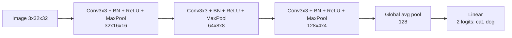
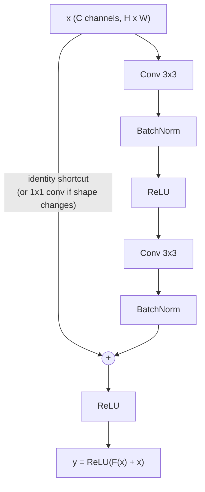

# Convolutional Neural Networks and Transfer Learning

> **Level:** Beginner to Advanced · **Study time:** ~110 min · **Prerequisites:** [Neural Networks from Scratch](01-neural-networks-from-scratch.md), [Backpropagation and Gradient Descent](02-backpropagation-and-gradient-descent.md), [Optimizers and Learning Rate Schedules](03-optimizers-sgd-momentum-adam-and-learning-rate-schedules.md), [Vanishing and Exploding Gradients, Initialization, Normalization and Residuals](05-vanishing-exploding-gradients-initialization-normalization-and-residuals.md), [Regularization and Debugging Neural Network Training](06-regularization-and-debugging-neural-network-training.md)

## Table of contents

- [Why this matters](#why-this-matters)
- [1. Why fully connected networks struggle with images](#1-why-fully-connected-networks-struggle-with-images)
- [2. The convolution operation](#2-the-convolution-operation)
- [3. Stride, padding and the output-size formula](#3-stride-padding-and-the-output-size-formula)
- [4. Channels, filters and feature maps](#4-channels-filters-and-feature-maps)
- [5. Pooling and global average pooling](#5-pooling-and-global-average-pooling)
- [6. Receptive field](#6-receptive-field)
- [7. Inductive biases: why CNNs are data-efficient for images](#7-inductive-biases-why-cnns-are-data-efficient-for-images)
- [8. Putting it together: a small CNN in PyTorch](#8-putting-it-together-a-small-cnn-in-pytorch)
- [9. Batch normalization in CNNs](#9-batch-normalization-in-cnns)
- [10. Landmark architectures](#10-landmark-architectures)
- [11. Transfer learning: feature extraction vs fine-tuning](#11-transfer-learning-feature-extraction-vs-fine-tuning)
- [12. Catastrophic forgetting and how to reduce it](#12-catastrophic-forgetting-and-how-to-reduce-it)
- [13. Hands-on: fine-tuning a ResNet with torchvision](#13-hands-on-fine-tuning-a-resnet-with-torchvision)
- [14. Going deeper: CNNs and transfer learning in production](#14-going-deeper-cnns-and-transfer-learning-in-production)
- [Common mistakes and misconceptions](#common-mistakes-and-misconceptions)
- [Interview questions and model answers](#interview-questions-and-model-answers)
- [Key takeaways](#key-takeaways)
- [Further reading](#further-reading)
- [Next](#next)

## Why this matters

Convolutional neural networks (CNNs) powered the deep learning revolution: AlexNet's 2012 ImageNet win is the moment most people date "modern deep learning" from. In 2026 CNNs still run a huge share of production vision: phone cameras, document scanners, factory defect detection, medical imaging, and the backbones of many detection models. Even where Vision Transformers have taken over, the ideas in this chapter (locality, weight sharing, residual connections, normalization, pretrained backbones) live on inside them. Transfer learning, which CNNs made routine, is the same idea that underlies fine-tuning LLMs today. Interviewers use this topic to test whether you understand *why* an architecture works, not just how to call `torchvision.models.resnet50()`.

**Running example.** Throughout the chapter we will build a **pet photo classifier**: given a 224x224 color photo, say "cat" or "dog". We have only about 2,000 labeled photos (illustrative). That small number is exactly why both convolution and transfer learning matter.

---

## 1. Why fully connected networks struggle with images

> **Analogy:** Imagine reading a page of text after someone has shuffled every letter into one long line, with no notion of which letters were neighbors. You could still learn something, but you would need an enormous amount of practice. That is what a fully connected network does to an image.

A **fully connected (dense) layer** connects every input number to every neuron (recap from [Neural Networks from Scratch](01-neural-networks-from-scratch.md)). To feed an image into it you must **flatten** it: turn the 2D grid of pixels into one long vector.

A color image is stored as three grids, one each for red, green and blue. Each grid is a **channel**. A 224x224 color image therefore has:

$$224 \times 224 \times 3 = 150{,}528 \text{ input numbers}$$

Suppose the first hidden layer has 1,000 neurons. Each neuron needs one weight per input plus one bias:

$$150{,}528 \times 1{,}000 + 1{,}000 = 150{,}529{,}000 \text{ parameters}$$

That is about 150 million parameters in a *single* layer, before the network has learned anything useful. Three problems follow:

| Problem | What goes wrong |
|---|---|
| **Too many parameters** | 150M weights need lots of memory and, worse, lots of data to fit without overfitting. Our 2,000 pet photos are hopeless. |
| **No notion of neighborhood** | Flattening throws away the 2D layout. Pixel (10, 10) and pixel (10, 11) are neighbors in the image but just "input 2,250 and input 2,251" to the dense layer (red channel, flattened row by row, 0-indexed). The network must rediscover spatial structure from data. |
| **No reuse across positions** | A cat's ear in the top-left corner and the same ear in the bottom-right are processed by completely different weights. The network must learn "ear" separately at every location. |

A **convolutional layer** fixes all three. As a preview: a convolutional layer with 64 small 3x3 filters applied to that same 224x224x3 image has only $64 \times (3 \times 3 \times 3) + 64 = 1{,}792$ parameters. We will derive that number in [section 4](#4-channels-filters-and-feature-maps).

> **Senior insight:** The real cost of the dense approach is not memory, it is **sample efficiency**. More free parameters with no built-in structure means the model needs far more examples to generalize. CNNs encode prior knowledge about images so the data does not have to.

---

## 2. The convolution operation

### Intuition

> **Analogy:** Think of a small stencil or a magnifying glass that you slide across a photo, one step at a time. At each position you ask one question, such as "is there a vertical edge here?", and write the answer on a new sheet of paper at the matching position. The new sheet is a map of *where* that pattern appears.

The stencil is called a **kernel** or **filter**: a small grid of learnable weights, typically 3x3. Sliding it across the image and computing a score at every position is **convolution**. The resulting grid of scores is a **feature map** (also called an **activation map**).

### Precise definition

At each position, multiply the kernel element-wise with the image patch underneath it, then add everything up (plus a bias). For a 2D input $X$ and a $k \times k$ kernel $K$:

$$Y[i, j] = \sum_{m=0}^{k-1} \sum_{n=0}^{k-1} X[i + m,\; j + n] \cdot K[m, n] + b$$

- $Y[i, j]$: the output value (feature map entry) at row $i$, column $j$.
- $X[i+m, j+n]$: the input pixel under kernel position $(m, n)$ when the kernel's top-left corner sits at $(i, j)$.
- $K[m, n]$: the kernel weight at row $m$, column $n$. These are learned by backpropagation.
- $k$: kernel size (3 for a 3x3 kernel).
- $b$: a single learned bias added to every output position.

Each output is just a **dot product** between the kernel and one patch (see [Linear Algebra for ML](../00-foundations/02-linear-algebra-for-ml.md)). A high value means "this patch looks like the kernel".

> **Common mistake:** Strictly, the formula above is **cross-correlation**. Mathematical convolution flips the kernel first. Deep learning libraries implement cross-correlation and call it convolution. Because the kernel weights are learned, the flip makes no difference: the network simply learns the flipped kernel.

### Fully worked example

Input $X$ (4x4, one channel) and kernel $K$ (3x3), bias $b = 0$:

```text
X =               K =
 1  2  0  1        1  0  1
 0  1  3  1        0  1  0
 2  1  0  2        1  0  1
 1  0  1  3
```

The 3x3 kernel fits in 2 positions horizontally and 2 vertically, so the output is 2x2. This kernel has 1s at the four corners and the center, so each output equals "sum of the patch's 4 corners plus its center".

**Position (0, 0):** patch is rows 0-2, columns 0-2.

```text
 1  2  0
 0  1  3
 2  1  0
```

Element-wise products with $K$: $1\cdot1 + 2\cdot0 + 0\cdot1 + 0\cdot0 + 1\cdot1 + 3\cdot0 + 2\cdot1 + 1\cdot0 + 0\cdot1 = 1 + 0 + 0 + 0 + 1 + 0 + 2 + 0 + 0 = 4$.

**Position (0, 1):** rows 0-2, columns 1-3.

```text
 2  0  1
 1  3  1
 1  0  2
```

Corners $2 + 1 + 1 + 2 = 6$, center $3$, so $Y[0,1] = 9$.

**Position (1, 0):** rows 1-3, columns 0-2.

```text
 0  1  3
 2  1  0
 1  0  1
```

Corners $0 + 3 + 1 + 1 = 5$, center $1$, so $Y[1,0] = 6$.

**Position (1, 1):** rows 1-3, columns 1-3.

```text
 1  3  1
 1  0  2
 0  1  3
```

Corners $1 + 1 + 0 + 3 = 5$, center $0$, so $Y[1,1] = 5$.

```text
Y =
 4  9
 6  5
```

### What a kernel "detects": a vertical edge example

Now take a 6x6 image whose left half is bright (10) and right half is dark (0), and a **vertical edge kernel**:

```text
Image (6x6):              Kernel:          Output (4x4):
10 10 10  0  0  0         1  0 -1          0 30 30  0
10 10 10  0  0  0         1  0 -1          0 30 30  0
10 10 10  0  0  0         1  0 -1          0 30 30  0
10 10 10  0  0  0                          0 30 30  0
10 10 10  0  0  0
10 10 10  0  0  0
```

The kernel computes "left column of the patch minus right column". Over a flat region (all 10s or all 0s) that is $30 - 30 = 0$ or $0 - 0 = 0$. Where the patch straddles the boundary, say columns 1-3, it is $(10+10+10) - (0+0+0) = 30$. The output lights up exactly where the edge is.

Classical computer vision hand-designed kernels like this (Sobel, Prewitt). A CNN **learns** its kernels from data, and stacks many layers of them.

### Code: from scratch, then PyTorch

```python
# pip install numpy torch
import numpy as np
import torch
import torch.nn.functional as F

def conv2d(x: np.ndarray, k: np.ndarray, stride: int = 1, padding: int = 0) -> np.ndarray:
    """Single-channel 2D cross-correlation, the way deep learning libraries do it."""
    x = np.pad(x, padding)                       # zero padding on all four sides
    kh, kw = k.shape
    oh = (x.shape[0] - kh) // stride + 1         # output height
    ow = (x.shape[1] - kw) // stride + 1         # output width
    out = np.zeros((oh, ow))
    for i in range(oh):
        for j in range(ow):
            patch = x[i * stride : i * stride + kh, j * stride : j * stride + kw]
            out[i, j] = np.sum(patch * k)        # element-wise multiply, then sum
    return out

X = np.array([[1, 2, 0, 1],
              [0, 1, 3, 1],
              [2, 1, 0, 2],
              [1, 0, 1, 3]], dtype=float)
K = np.array([[1, 0, 1],
              [0, 1, 0],
              [1, 0, 1]], dtype=float)

print(conv2d(X, K))
# [[4. 9.]
#  [6. 5.]]

# Same thing in PyTorch. Shapes are (batch, channels, height, width) for input
# and (out_channels, in_channels, kH, kW) for the weight.
xt = torch.tensor(X, dtype=torch.float32)[None, None]   # (1, 1, 4, 4)
kt = torch.tensor(K, dtype=torch.float32)[None, None]   # (1, 1, 3, 3)
print(F.conv2d(xt, kt))
# tensor([[[[4., 9.],
#           [6., 5.]]]])
```

The double Python loop is slow and only for understanding. Real libraries turn convolution into large matrix multiplications (for example the **im2col** trick, which copies every patch into a column of a matrix) or use specialized algorithms (FFT, Winograd) inside cuDNN (NVIDIA's library of GPU deep learning kernels) and similar libraries.

---

## 3. Stride, padding and the output-size formula

Two knobs control how the kernel slides.

- **Stride** ($S$): how many pixels the kernel jumps between positions. Stride 1 visits every position; stride 2 skips every other one and roughly halves the output height and width.
- **Padding** ($P$): extra border pixels (usually zeros, hence **zero padding**) added around the input before sliding. Without padding, every 3x3 convolution shrinks the image by 2 pixels and under-uses border pixels.

> **Analogy:** Stride is how big your steps are as you walk across a field with the magnifying glass. Padding is laying a strip of blank paper around the photo so the magnifying glass can be centered even on the edge pixels.

Common padding conventions:

| Name | Meaning | When used |
|---|---|---|
| **Valid** | No padding ($P = 0$). Output shrinks. | Older nets, some final layers |
| **Same** | Pad so output size equals input size when $S = 1$. For odd $K$, $P = (K-1)/2$ (so $P = 1$ for 3x3). | Default in most modern CNNs |
| Reflect / replicate | Pad with mirrored or repeated border pixels instead of zeros | Image-to-image tasks where zero borders cause artifacts |

### The output-size formula

$$O = \left\lfloor \frac{W - K + 2P}{S} \right\rfloor + 1$$

- $O$: output size along one dimension (height or width).
- $W$: input size along that dimension.
- $K$: kernel size.
- $P$: padding added to *each* side (hence $2P$).
- $S$: stride.
- $\lfloor \cdot \rfloor$: floor (round down). Positions where the kernel would hang off the end are dropped.

Why it works: after padding the input has $W + 2P$ pixels. The kernel's left edge can start anywhere from 0 to $W + 2P - K$, in steps of $S$. Counting those starting positions gives the formula.

**Worked examples:**

| Case | Calculation | Output |
|---|---|---|
| Our example: $W=4, K=3, P=0, S=1$ | $(4 - 3 + 0)/1 + 1 = 1 + 1$ | 2 |
| "Same" 3x3: $W=224, K=3, P=1, S=1$ | $(224 - 3 + 2)/1 + 1 = 223 + 1$ | 224 |
| ResNet stem: $W=224, K=7, P=3, S=2$ | $(224 - 7 + 6)/2 = 223/2 = 111.5 \to 111$, then $111 + 1$ | 112 |
| ResNet max pool: $W=112, K=3, P=1, S=2$ | $(112 - 3 + 2)/2 = 111/2 = 55.5 \to 55$, then $55 + 1$ | 56 |
| AlexNet conv1: $W=227, K=11, P=0, S=4$ | $(227 - 11)/4 = 216/4 = 54$, then $54 + 1$ | 55 |

> **Interview tip:** The AlexNet paper says the input is 224x224, but with no padding the arithmetic only gives 55 with 227 (224 with $P = 0$ gives $\lfloor 213/4 \rfloor + 1 = 54$). Implementations such as torchvision's keep 224 and use $P = 2$: $\lfloor 217/4 \rfloor + 1 = 55$. This well-known quirk is a nice way to show you actually use the formula rather than memorizing shapes.

**Dilation** ($D$) spaces out the kernel's taps, so a 3x3 kernel with $D = 2$ covers a 5x5 area with only 9 weights. The effective kernel size is $K + (K-1)(D-1)$. Dilated (atrous) convolutions grow the receptive field cheaply and are common in segmentation (DeepLab). PyTorch's general formula is $\lfloor (W + 2P - D(K-1) - 1)/S \rfloor + 1$, which reduces to ours when $D = 1$.

---

## 4. Channels, filters and feature maps

Real images have 3 input channels, and hidden layers have dozens to thousands. Here is how convolution extends.

- One **filter** spans *all* input channels. With $C_{in}$ input channels and a 3x3 kernel, one filter is a $C_{in} \times 3 \times 3$ block of weights. At each position it multiplies and sums across all of them, producing **one number**. So one filter produces **one** 2D feature map.
- A layer has $C_{out}$ filters, so it produces $C_{out}$ feature maps stacked into a 3D output: $C_{out} \times H_{out} \times W_{out}$. These stacked maps become the input channels of the next layer.

```text
Input: 3 x 224 x 224                 64 filters, each 3 x 3 x 3          Output: 64 x 224 x 224
 +-----------+                        [F1] [F2] ... [F64]                  +-----------+
 |  R        |  each filter slides    each filter -> one 224x224 map       | map 1     |
 |   G       | ---------------------> --------------------------------->   |  map 2    |
 |    B      |  over all 3 channels                                        |   ...     |
 +-----------+                                                             |    map 64 |
                                                                           +-----------+
```

In PyTorch the weight tensor of `nn.Conv2d(C_in, C_out, K)` has shape `(C_out, C_in, K, K)`.

### Parameter count

$$\text{params} = C_{out} \times (C_{in} \times K \times K) + C_{out}$$

- $C_{out}$: number of filters (output channels).
- $C_{in}$: input channels.
- $K \times K$: kernel spatial size.
- The final $+ C_{out}$: one bias per filter (often dropped when BatchNorm follows, see [section 9](#9-batch-normalization-in-cnns)).

**Worked examples:**

- First layer of our pet classifier, 3 to 64 channels, 3x3: $64 \times (3 \times 3 \times 3) + 64 = 64 \times 27 + 64 = 1{,}728 + 64 = 1{,}792$.
- A deeper layer, 64 to 128 channels, 3x3: $128 \times (64 \times 9) + 128 = 128 \times 576 + 128 = 73{,}728 + 128 = 73{,}856$.

Notice that **image size does not appear** in the parameter count. The same 1,792 weights work on a 32x32 image or a 4,000x3,000 photo.

### Compute cost

Compute does depend on image size, because the filter runs at every output position. Counting **multiply-accumulate operations (MACs)**, one multiply plus one add:

$$\text{MACs} = H_{out} \times W_{out} \times C_{out} \times C_{in} \times K \times K$$

Example: a 64 to 64 channel 3x3 convolution on a 56x56 feature map: $56 \times 56 = 3{,}136$ positions, each needing $64 \times 64 \times 9 = 36{,}864$ MACs, total $3{,}136 \times 36{,}864 = 115{,}605{,}504 \approx 116$ million MACs. (**FLOPs**, floating-point operations, count the multiply and the add separately, so FLOPs are often quoted as roughly 2 x MACs; papers are inconsistent, so check which one a number means.)

> **Senior insight:** Parameters scale with channels squared and kernel area; compute additionally scales with spatial resolution. Doubling input resolution from 224 to 448 multiplies the convolution compute by $2^2 = 4$ while leaving the parameter count unchanged. That is why resolution is one of the first levers for latency.

### The 1x1 convolution

A **1x1 convolution** looks at a single pixel position but across all channels. It is a small dense layer applied independently at every pixel. Uses: change the number of channels cheaply (a "bottleneck"), mix information across channels, and add a nonlinearity. Popularized by "Network in Network" (Lin, Chen, Yan, 2013) and GoogLeNet.

### What feature maps learn

Stacking layers builds a **feature hierarchy**. Visualizations such as "Visualizing and Understanding Convolutional Networks" (Zeiler and Fergus, 2014) showed that early layers respond to edges and color blobs, middle layers to textures and simple shapes, and deep layers to object parts (eyes, wheels, fur patterns). This hierarchy is also why transfer learning works: the early layers are generic.

---

## 5. Pooling and global average pooling

**Pooling** shrinks a feature map by summarizing small windows with a fixed function. It has **no learnable parameters**.

- **Max pooling:** keep the largest value in each window. "Was the feature present anywhere in this neighborhood?"
- **Average pooling:** keep the mean. "How strongly, on average, was it present?"

> **Analogy:** Max pooling is a newspaper summary that keeps only the headline of each paragraph. You lose exact wording but keep the most important signal.

### Worked example: 2x2 pooling, stride 2

```text
Input (4x4):        Windows:
 1  3 | 2  1        top-left     {1, 3, 4, 6}
 4  6 | 5  0        top-right    {2, 1, 5, 0}
------+------       bottom-left  {3, 2, 1, 0}
 3  2 | 1  1        bottom-right {1, 1, 2, 4}
 1  0 | 2  4
```

- Max pooling: $\max(1,3,4,6) = 6$, $\max(2,1,5,0) = 5$, $\max(3,2,1,0) = 3$, $\max(1,1,2,4) = 4$.
- Average pooling: $(1+3+4+6)/4 = 14/4 = 3.5$, $(2+1+5+0)/4 = 8/4 = 2$, $(3+2+1+0)/4 = 6/4 = 1.5$, $(1+1+2+4)/4 = 8/4 = 2$.

```text
Max pool:     Average pool:
 6  5          3.5  2.0
 3  4          1.5  2.0
```

The output-size formula from section 3 applies: $(4 - 2 + 0)/2 + 1 = 2$.

Why pool:

1. **Reduce compute**: a 2x2 pool cuts the number of positions by 4x for every later layer.
2. **Grow the receptive field** faster (next section).
3. **Small translation tolerance**: shifting a feature by one pixel often leaves the max unchanged.

Many modern networks replace most pooling with **strided convolutions** (a learnable downsampling), keeping only one pooling layer near the input, or none.

### Global average pooling (GAP)

**Global average pooling** averages each entire feature map down to a single number. A $512 \times 7 \times 7$ tensor becomes a 512-vector, which feeds a small linear classifier.

Compare with VGG-16, which flattens $512 \times 7 \times 7 = 25{,}088$ numbers into a 4,096-unit dense layer: $25{,}088 \times 4{,}096 = 102{,}760{,}448$ weights, roughly 103M of VGG-16's ~138M parameters, in one layer. GAP (from "Network in Network") removes that entirely, reduces overfitting, and lets the network accept any input resolution. Nearly every modern classification CNN (ResNet, MobileNet, EfficientNet, ConvNeXt) uses it.

---

## 6. Receptive field

The **receptive field** of a unit is the region of the *original input image* that can influence its value.

> **Analogy:** A soldier in the front line sees only a few meters. A sergeant hears reports from several soldiers, so "sees" a wider area. A general hears from sergeants and effectively sees the whole battlefield. Deeper layers are the generals.

A unit right after one 3x3 convolution sees a 3x3 patch. A unit after two stacked 3x3 convolutions sees 5x5, because each of the 3x3 inputs it reads itself saw 3x3.

### Formula

Process layers in order, tracking the receptive field $r$ and the **jump** $j$ (the distance in input pixels between adjacent units in the current feature map). Start with $r_0 = 1$, $j_0 = 1$.

$$r_l = r_{l-1} + (k_l - 1) \cdot j_{l-1}, \qquad j_l = j_{l-1} \cdot s_l$$

- $r_l$: receptive field size (one side) after layer $l$.
- $k_l$: kernel (or pooling window) size of layer $l$.
- $s_l$: stride of layer $l$.
- $j_{l-1}$: jump before layer $l$; strides multiply it.

**Worked example:** conv 3x3 (s=1), conv 3x3 (s=1), max pool 2x2 (s=2), conv 3x3 (s=1).

| Layer | $k$, $s$ | $r$ | $j$ |
|---|---|---|---|
| Input | | 1 | 1 |
| Conv 3x3 | 3, 1 | $1 + 2 \cdot 1 = 3$ | $1 \cdot 1 = 1$ |
| Conv 3x3 | 3, 1 | $3 + 2 \cdot 1 = 5$ | 1 |
| Max pool 2x2 | 2, 2 | $5 + 1 \cdot 1 = 6$ | $1 \cdot 2 = 2$ |
| Conv 3x3 | 3, 1 | $6 + 2 \cdot 2 = 10$ | 2 |

The last 3x3 conv added 4 pixels of receptive field rather than 2, because after downsampling each step covers 2 input pixels. Downsampling makes later layers "see" more per weight.

### Why stack small kernels (the VGG argument)

Two stacked 3x3 layers have a 5x5 receptive field; three have 7x7. With $C$ channels in and out:

- Two 3x3 layers: $2 \times 9C^2 = 18C^2$ weights, versus one 5x5 layer: $25C^2$.
- Three 3x3 layers: $27C^2$, versus one 7x7: $49C^2$.

The stack is cheaper *and* has more nonlinearities in between, so it can express more complex functions.

Ways to grow the receptive field: more layers, downsampling (stride or pooling), dilation, or large kernels. "Understanding the Effective Receptive Field in Deep Convolutional Neural Networks" (Luo et al., 2016) showed that the **effective** receptive field (where influence is actually strong) is much smaller than the theoretical one and roughly Gaussian-shaped, concentrated in the center.

> **Senior insight:** Receptive field matters when objects are large relative to the image, or when the task needs global context (segmentation, document layout). If your detector misses large objects, check that the deepest features actually see the whole object.

---

## 7. Inductive biases: why CNNs are data-efficient for images

An **inductive bias** is an assumption built into a model that helps it generalize from limited data, by restricting the functions it can easily learn. A good bias matches the true structure of the problem; a wrong one hurts. CNNs encode three strong biases that match natural images.

| Bias | Plain English | How the CNN implements it | Why it helps |
|---|---|---|---|
| **Locality** | Nearby pixels are related; meaning is built from small local patterns | Small kernels (3x3) connect each output only to a local patch | Huge reduction in connections; no wasted capacity on "pixel (0,0) relates to pixel (223,223)" at layer 1 |
| **Weight sharing** | A pattern useful in one place is useful everywhere | The same kernel slides over every position | Parameters independent of image size; each kernel gets training signal from every position of every image |
| **Translation equivariance** | If the object moves, its features move with it | Consequence of weight sharing + sliding | The network learns "ear" once, not once per location |

Plus a fourth, structural one: **hierarchy** (compositionality). Objects are made of parts, parts of textures, textures of edges. Stacking layers with growing receptive fields mirrors that.

### Equivariance vs invariance

- A function $f$ is **equivariant** to a transformation $T$ if transforming the input transforms the output the same way: $f(T(x)) = T(f(x))$. Convolution is (approximately) translation-equivariant: shift the image, and the feature map shifts.
- $f$ is **invariant** if transforming the input does not change the output: $f(T(x)) = f(x)$. For classification we want invariance: a cat is a cat wherever it is. CNNs get *approximate* invariance from pooling and especially from global average pooling at the end (averaging a shifted map gives the same average).

You can verify equivariance directly. With circular padding (the image wraps around), it is exact:

```python
import torch
import torch.nn as nn

torch.manual_seed(0)
conv = nn.Conv2d(1, 1, kernel_size=3, padding=1, padding_mode="circular", bias=False)
x = torch.randn(1, 1, 8, 8)

shift = lambda t: torch.roll(t, shifts=2, dims=3)   # move 2 pixels to the right

print(torch.allclose(conv(shift(x)), shift(conv(x)), atol=1e-6))  # True: equivariant
```

### Caveats a senior engineer should know

- **Equivariance is only approximate in practice.** Zero padding, strides and pooling break it. "Making Convolutional Networks Shift-Invariant Again" (Zhang, 2019) showed that small shifts can noticeably change predictions of standard CNNs because strided downsampling causes **aliasing** (fine, high-frequency detail that is sampled too sparsely shows up as a different, misleading pattern, so a one-pixel shift can change what survives), and proposed blurring before subsampling.
- **No built-in rotation or scale equivariance.** A CNN does not automatically know an upside-down cat is a cat. You supply that through **data augmentation** (random flips, crops, rotations, scales); see [Data Augmentation, Transfer Learning and Small Datasets in Vision](../03-computer-vision/03-data-augmentation-transfer-learning-and-small-datasets.md).
- **Texture bias.** "ImageNet-trained CNNs are biased towards texture" (Geirhos et al., 2019) found ImageNet CNNs rely more on texture than shape, unlike humans. This affects robustness under **domain shift** (deployment images that look systematically different from training images, such as a new camera or a sketch instead of a photo).

### Why this makes CNNs data-efficient

Because so much structure is hard-wired, the CNN searches a much smaller space of functions, and each weight is trained by evidence from thousands of positions per image. With our 2,000 pet photos, a small CNN can learn something useful; an MLP with 150M first-layer weights cannot.

The flip side: **Vision Transformers (ViTs)** have much weaker image-specific biases (attention can link any two patches from layer 1). "An Image is Worth 16x16 Words" (Dosovitskiy et al., 2020) found ViTs underperform comparable ResNets when trained on ImageNet-1k alone but match or beat them after pretraining on much larger datasets. Strong bias wins with little data; flexible models win with lots of data. More in [Vision Transformers, CLIP and Multimodal Models](../03-computer-vision/05-vision-transformers-clip-and-multimodal-models.md).

---

## 8. Putting it together: a small CNN in PyTorch

The classic CNN pattern is a stack of **conv, normalize, activate, downsample** blocks, followed by global pooling and a linear classifier. Spatial size shrinks while channel count grows: the network trades "where" for "what".



```python
import torch
import torch.nn as nn

def conv_block(c_in: int, c_out: int) -> nn.Sequential:
    return nn.Sequential(
        nn.Conv2d(c_in, c_out, kernel_size=3, padding=1, bias=False),  # "same" padding
        nn.BatchNorm2d(c_out),        # bias=False above because BN has its own shift
        nn.ReLU(inplace=True),
        nn.MaxPool2d(2),              # halves height and width
    )

class SmallCNN(nn.Module):
    def __init__(self, num_classes: int = 2):
        super().__init__()
        self.features = nn.Sequential(
            conv_block(3, 32),     # 32x32 -> 16x16
            conv_block(32, 64),    # 16x16 -> 8x8
            conv_block(64, 128),   # 8x8   -> 4x4
        )
        self.pool = nn.AdaptiveAvgPool2d(1)   # global average pooling -> 128x1x1
        self.fc = nn.Linear(128, num_classes)

    def forward(self, x: torch.Tensor) -> torch.Tensor:
        x = self.features(x)
        x = self.pool(x).flatten(1)          # (batch, 128)
        return self.fc(x)                    # raw logits; use CrossEntropyLoss

model = SmallCNN()
x = torch.randn(8, 3, 32, 32)                # a batch of 8 small RGB images
print(model(x).shape)                        # torch.Size([8, 2])
print(sum(p.numel() for p in model.parameters()))  # 93730
```

Where the 93,730 parameters come from: convs $864 + 18{,}432 + 73{,}728 = 93{,}024$; BatchNorm scale and shift $2 \times (32 + 64 + 128) = 448$; linear layer $128 \times 2 + 2 = 258$. Total $93{,}024 + 448 + 258 = 93{,}730$. Compare with the 3 million weights a 1,000-unit dense layer would need on just a 32x32x3 input ($3{,}072 \times 1{,}000$).

Training it uses exactly the loop from [Backpropagation and Gradient Descent](02-backpropagation-and-gradient-descent.md) with cross-entropy loss ([Loss Functions](04-loss-functions.md)). Backpropagation through a convolution is itself a convolution: the gradient of a kernel weight sums contributions from every position where it was used, which is exactly why weight sharing gives each weight so much training signal.

---

## 9. Batch normalization in CNNs

**Batch normalization (BatchNorm, BN)**, from "Batch Normalization: Accelerating Deep Network Training by Reducing Internal Covariate Shift" (Ioffe and Szegedy, 2015), normalizes activations to zero mean and unit variance using batch statistics, then applies a learned scale and shift. The general mechanism, why it helps optimization, and alternatives (LayerNorm, RMSNorm) are covered in [Vanishing and Exploding Gradients, Initialization, Normalization and Residuals](05-vanishing-exploding-gradients-initialization-normalization-and-residuals.md). Here we recap the purpose, then focus on what is specific to CNNs.

### Why normalize at all?

Without normalization, activation scales drift through many layers and as earlier weights change during training: one channel may sit around 0.01 and another around 100, and the mix keeps moving. Each layer keeps re-adapting to a shifting input, and one learning rate is too large for some weights and too small for others. Normalization is an **automatic volume control** per channel: it rescales each channel to a standard range, then lets the network choose the range it wants through the learned $\gamma$ and $\beta$. In practice it:

- allows higher learning rates and gives faster, more stable convergence;
- makes training far less sensitive to weight initialization;
- adds mild regularization, because each example's output depends slightly on the other examples in its batch.

The original paper credited reducing "internal covariate shift" (a layer's input distribution changing as earlier layers update). "How Does Batch Normalization Help Optimization?" (Santurkar et al., 2018) argued the main effect is instead a smoother loss landscape with better-behaved gradients. Knowing this debate exists is a senior signal.

### Per-channel statistics

In a CNN, BN computes **one mean and one variance per channel**, averaged over the batch *and* all spatial positions. For an activation tensor of shape $(N, C, H, W)$, channel $c$ has $N \times H \times W$ values:

$$\mu_c = \frac{1}{NHW}\sum_{n,h,w} x_{n,c,h,w}, \qquad \sigma_c^2 = \frac{1}{NHW}\sum_{n,h,w}(x_{n,c,h,w} - \mu_c)^2$$

$$\hat{x}_{n,c,h,w} = \frac{x_{n,c,h,w} - \mu_c}{\sqrt{\sigma_c^2 + \epsilon}}, \qquad y_{n,c,h,w} = \gamma_c \hat{x}_{n,c,h,w} + \beta_c$$

- $\mu_c, \sigma_c^2$: mean and variance of channel $c$ over batch and space.
- $\epsilon$: a tiny constant (for example $10^{-5}$) to avoid dividing by zero.
- $\gamma_c, \beta_c$: learned scale and shift for channel $c$, so the network can undo the normalization if useful.

Why share statistics across positions? Because the same filter produced every value in that channel (weight sharing), so they are the same kind of feature and should be normalized the same way.

**Tiny example:** one image ($N = 1$), one channel, a 2x2 feature map with values $2, 4, 6, 8$.

- Mean: $(2 + 4 + 6 + 8)/4 = 20/4 = 5$.
- Variance: $((2-5)^2 + (4-5)^2 + (6-5)^2 + (8-5)^2)/4 = (9 + 1 + 1 + 9)/4 = 20/4 = 5$.
- Normalized: $(2 - 5)/\sqrt{5} \approx -3/2.236 \approx -1.342$; similarly $-0.447$, $0.447$, $1.342$.
- With $\gamma = 1, \beta = 0$ these are the outputs.

A `BatchNorm2d(C)` layer has $2C$ learnable parameters ($\gamma$, $\beta$) plus $2C$ **buffers**: running mean and running variance, updated as exponential moving averages during training. (PyTorch also stores a scalar `num_batches_tracked` buffer, and its running variance uses the unbiased estimate, dividing by $NHW - 1$, while normalization during training uses the biased one above.)

### Training vs inference

- `model.train()`: BN uses the current batch's statistics and updates the running averages.
- `model.eval()`: BN uses the stored running averages, so a single image gives a deterministic output.

Forgetting `model.eval()` at inference is one of the most common deep learning bugs: predictions change with batch composition and are worse with batch size 1.

### BatchNorm and its alternatives, by axis

For an activation tensor of shape $(N, C, H, W)$, the normalization methods differ only in which axes they average over:

| Method | Statistics computed over | Depends on batch? | Typical use |
|---|---|---|---|
| **BatchNorm** | $N, H, W$, separately for each channel | Yes | Classification CNNs with reasonably large batches |
| **LayerNorm** | $C, H, W$ for each example (ConvNeXt: over $C$ only, at each position) | No | Transformers, ConvNeXt |
| **InstanceNorm** | $H, W$ for each example and each channel | No | Style transfer, image generation |
| **GroupNorm** | $H, W$ and one group of channels, for each example | No | Detection and segmentation with small batches |

### CNN-specific practicalities

- **Drop the conv bias** before BN (`bias=False`): BN subtracts the mean, which cancels any constant bias, and $\beta$ provides the shift.
- **Small batches hurt BN.** Detection and segmentation often fit only 1 to 4 high-resolution images per GPU, making batch statistics noisy. Options: **Group Normalization** ("Group Normalization", Wu and He, 2018), which normalizes over groups of channels within each image and is batch-independent; **SyncBatchNorm**, which computes statistics across all GPUs; or **frozen BN** (keep pretrained statistics fixed).
- **BN folding for inference.** At inference BN is a fixed affine transform, so it can be merged into the preceding conv: $W' = W \cdot \gamma / \sqrt{\sigma^2 + \epsilon}$ (per output channel) and $b' = \gamma (b - \mu)/\sqrt{\sigma^2 + \epsilon} + \beta$. This removes the BN layer entirely at zero accuracy cost. Export tools (ONNX Runtime, TensorRT) usually do this automatically. Scalar check (taking $\epsilon \approx 0$): conv weight $W = 3$, bias $b = 0$, and BN with $\mu = 1$, $\sigma^2 = 4$, $\gamma = 2$, $\beta = 0.5$ give $W' = 3 \cdot 2/2 = 3$ and $b' = 2(0 - 1)/2 + 0.5 = -0.5$. For input $x = 1$: unfolded, the conv gives 3 and BN gives $2(3 - 1)/2 + 0.5 = 2.5$; folded, $3 \cdot 1 - 0.5 = 2.5$. Same answer, one layer fewer.
- **BN in transfer learning** has its own pitfalls; see [section 11](#11-transfer-learning-feature-extraction-vs-fine-tuning).

---

## 10. Landmark architectures

You do not need to memorize layer tables. You do need to know what problem each architecture solved and which idea it contributed, because those ideas recur everywhere.

### LeNet-5 (1998)

"Gradient-Based Learning Applied to Document Recognition" (LeCun, Bottou, Bengio, Haffner, 1998). Two conv + subsampling stages and fully connected layers, about 60K parameters, used to read handwritten digits on bank checks. It established the template every CNN still follows: convolution, downsampling, repeat, classify.

### AlexNet (2012)

"ImageNet Classification with Deep Convolutional Neural Networks" (Krizhevsky, Sutskever, Hinton, 2012). About 60M parameters, 8 learned layers. It won the ImageNet Large Scale Visual Recognition Challenge (ILSVRC) 2012 with a **top-5 error** (the fraction of images whose true label is not among the model's 5 highest-scoring guesses) of about 15.3% versus about 26.2% for the runner-up. Key ingredients: **ReLU** activations (much faster training than tanh), **dropout**, heavy data augmentation, and training on **GPUs**. The lesson: with enough data and compute, learned features beat hand-engineered ones.

### VGG (2014)

"Very Deep Convolutional Networks for Large-Scale Image Recognition" (Simonyan and Zisserman, 2014). Showed depth matters, using only 3x3 convolutions stacked deep (16 or 19 layers). Simple and uniform, which made it a popular feature extractor, but heavy: VGG-16 has about 138M parameters, most of them in the first fully connected layer (section 5).

### GoogLeNet / Inception (2014)

"Going Deeper with Convolutions" (Szegedy et al., 2014). Ran 1x1, 3x3 and 5x5 convolutions in parallel and concatenated them, using 1x1 convolutions as cheap bottlenecks to cut channels first. Showed that careful design beats brute-force width.

### ResNet (2015) and residual blocks

"Deep Residual Learning for Image Recognition" (He, Zhang, Ren, Sun, 2015). The problem: stacking more layers onto a plain CNN made **training** error go *up* (the paper shows a 56-layer plain network training worse than a 20-layer one on CIFAR-10). This is not overfitting, it is an optimization failure, called the **degradation problem**.

The fix is the **residual connection** (skip connection). Instead of asking a block to learn the desired mapping $H(x)$ directly, let it learn the residual $F(x) = H(x) - x$ and add the input back:

$$y = F(x) + x$$

- $x$: the block's input.
- $F(x)$: what the block's layers compute (for example conv, BN, ReLU, conv, BN).
- $y$: the block output, followed by a ReLU in the original design.

Why it helps:

1. **Easy identity.** If a layer is not needed, the block only has to push $F$ toward zero, which is easy, rather than learn an exact identity through nonlinear layers, which is hard. In principle, extra layers then need not make things worse, since the solver can always fall back to near-identity blocks.
2. **Gradient highway.** Differentiating gives $\frac{\partial y}{\partial x} = \frac{\partial F}{\partial x} + I$. The identity term $I$ means gradients flow back unchanged through the skip path, so very deep networks avoid vanishing gradients. (Full treatment in the [residuals chapter](05-vanishing-exploding-gradients-initialization-normalization-and-residuals.md).)

**Tiny worked example (scalars).** Suppose each block's layers have local derivative $F' = 0.1$. Through two *plain* blocks the gradient is multiplied by $0.1 \times 0.1 = 0.01$; through 20 plain blocks by $0.1^{20} = 10^{-20}$, effectively zero. Through two *residual* blocks it is $(1 + 0.1)(1 + 0.1) = 1.21 = 1 + 0.1 + 0.1 + 0.01$: the $1$ is the path that skips both blocks, each $0.1$ is a path through one block, and $0.01$ is the path through both. However deep the stack, the skip-everything path contributes exactly 1, so the gradient does not vanish geometrically with depth. (This is the idealized scalar picture: with pure identity skips, as in pre-activation ResNets. In real networks the terms are matrices that can partially cancel, and the post-addition ReLU of the original block gates the skip path, so it is a strong tendency rather than a guarantee.) "Residual Networks Behave Like Ensembles of Relatively Shallow Networks" (Veit, Wilber, Belongie, 2016) develops this "many paths" view.



When the block changes the number of channels or downsamples, $x$ and $F(x)$ have different shapes, so the shortcut uses a **projection**: a 1x1 convolution with the matching stride.

Two refinements worth knowing for interviews:

- **Pre-activation.** In the original block the ReLU after the addition sits on the skip path, so the shortcut is not a pure identity. "Identity Mappings in Deep Residual Networks" (He, Zhang, Ren, Sun, 2016) moved BN and ReLU inside the residual branch, before each conv, keeping the skip path clean, and trained a 1,001-layer network on CIFAR-10. Transformers' pre-norm layout is the same idea.
- **Zero-init the residual branch.** Setting the last BatchNorm $\gamma$ in each residual branch to 0 makes every block start as an exact identity, which stabilizes early training, especially with large batches ("Accurate, Large Minibatch SGD", Goyal et al., 2017). torchvision exposes this as `zero_init_residual=True`.

```python
import torch
import torch.nn as nn
import torch.nn.functional as F

class BasicBlock(nn.Module):
    """ResNet-18/34 style residual block."""
    def __init__(self, c_in: int, c_out: int, stride: int = 1):
        super().__init__()
        self.conv1 = nn.Conv2d(c_in, c_out, 3, stride=stride, padding=1, bias=False)
        self.bn1 = nn.BatchNorm2d(c_out)
        self.conv2 = nn.Conv2d(c_out, c_out, 3, stride=1, padding=1, bias=False)
        self.bn2 = nn.BatchNorm2d(c_out)
        self.shortcut = nn.Identity()
        if stride != 1 or c_in != c_out:          # shapes differ: project the input
            self.shortcut = nn.Sequential(
                nn.Conv2d(c_in, c_out, 1, stride=stride, bias=False),
                nn.BatchNorm2d(c_out),
            )

    def forward(self, x: torch.Tensor) -> torch.Tensor:
        out = F.relu(self.bn1(self.conv1(x)))
        out = self.bn2(self.conv2(out))
        return F.relu(out + self.shortcut(x))     # the residual addition

block = BasicBlock(64, 128, stride=2)
print(block(torch.randn(1, 64, 56, 56)).shape)    # torch.Size([1, 128, 28, 28])
```

Deeper ResNets (50, 101, 152 layers) use a **bottleneck block**: 1x1 conv to reduce channels, 3x3 conv, 1x1 conv to expand back. ResNet-50 has about 25.6M parameters, far fewer than VGG-16 despite being much deeper. Residual connections are now in essentially every deep architecture, including every transformer.

### MobileNet (2017) and depthwise separable convolutions

"MobileNets: Efficient Convolutional Neural Networks for Mobile Vision Applications" (Howard et al., 2017). The goal: run on phones. The key idea is to split a standard convolution into two cheaper steps:

1. **Depthwise convolution**: one $K \times K$ filter *per input channel*, applied to that channel only (no mixing across channels).
2. **Pointwise convolution**: a 1x1 convolution that mixes channels.

Together this is a **depthwise separable convolution**. Weights per layer (ignoring biases):

$$\text{standard: } K^2 C_{in} C_{out} \qquad \text{separable: } K^2 C_{in} + C_{in} C_{out}$$

Worked example, $K = 3$, $C_{in} = C_{out} = 64$:

- Standard: $9 \times 64 \times 64 = 36{,}864$.
- Separable: $9 \times 64 + 64 \times 64 = 576 + 4{,}096 = 4{,}672$.
- Ratio: $36{,}864 / 4{,}672 \approx 7.9$x fewer weights (and MACs per position).

The general ratio is $\frac{1}{C_{out}} + \frac{1}{K^2} = \frac{1}{64} + \frac{1}{9} \approx 0.0156 + 0.1111 = 0.1267$, matching $1/7.9$.

In PyTorch, a depthwise conv is just `nn.Conv2d(64, 64, 3, padding=1, groups=64)` followed by `nn.Conv2d(64, 128, 1)`. The `groups` argument splits channels into independent groups.

**MobileNetV2** ("MobileNetV2: Inverted Residuals and Linear Bottlenecks", Sandler et al., 2018) added **inverted residual blocks**: expand channels with a 1x1 conv, apply a depthwise 3x3, project back down with a 1x1 conv that has *no* ReLU (a "linear bottleneck", because ReLU in a narrow layer destroys information), with a residual connection between the narrow ends. MobileNetV2 has about 3.5M parameters. MobileNetV3 (Howard et al., 2019) added architecture search and squeeze-and-excitation (a channel-gating module, described under EfficientNet below).

### EfficientNet (2019)

"EfficientNet: Rethinking Model Scaling for Convolutional Neural Networks" (Tan and Le, 2019). The question: given more compute, should you make the network deeper, wider (more channels), or feed it higher-resolution images? Their answer: scale all three together with **compound scaling**:

$$\text{depth} = \alpha^\phi, \quad \text{width} = \beta^\phi, \quad \text{resolution} = \gamma^\phi, \quad \text{subject to } \alpha \cdot \beta^2 \cdot \gamma^2 \approx 2$$

- $\phi$: the user-chosen compound coefficient ("how much more compute do I have").
- $\alpha, \beta, \gamma$: constants found by a small grid search on the base model. The paper used $\alpha = 1.2$, $\beta = 1.1$, $\gamma = 1.15$.
- The constraint uses squares for width and resolution because conv FLOPs grow with channels squared and with height x width. So total FLOPs grow by about $(\alpha \beta^2 \gamma^2)^\phi \approx 2^\phi$.

Check: $1.2 \times 1.1^2 \times 1.15^2 = 1.2 \times 1.21 \times 1.3225 \approx 1.92$, close to 2.

The base model, EfficientNet-B0 (about 5.3M parameters), was found by **neural architecture search** (NAS: an automated search over candidate layer types and sizes, scored by accuracy and cost) and is built from MobileNetV2-style inverted residual blocks (called MBConv) with **squeeze-and-excitation** (a small gating module that reweights channels, from "Squeeze-and-Excitation Networks", Hu et al., 2018). B1 to B7 are scaled-up versions. EfficientNetV2 (Tan and Le, 2021) improved training speed.

### Summary table

| Architecture | Year | Key idea | Approx. params | Legacy |
|---|---|---|---|---|
| LeNet-5 | 1998 | Conv + pool + FC template | ~60K | The CNN blueprint |
| AlexNet | 2012 | ReLU, dropout, GPUs, scale | ~60M | Started the deep learning era |
| VGG-16 | 2014 | Deep stacks of 3x3 convs | ~138M | Simplicity; "stack small kernels" |
| GoogLeNet | 2014 | Parallel branches, 1x1 bottlenecks | ~7M | Efficient multi-scale design |
| ResNet-50 | 2015 | Residual connections, bottleneck blocks | ~25.6M | Enabled very deep nets; default backbone for years |
| MobileNetV2 | 2018 | Depthwise separable convs, inverted residuals | ~3.5M | Mobile and edge vision |
| EfficientNet-B0 | 2019 | Compound scaling + NAS base | ~5.3M | Accuracy per FLOP |
| ConvNeXt-T | 2022 | ResNet modernized (large 7x7 depthwise kernels, LayerNorm, GELU) | ~28.6M | Showed CNNs can match ViTs at similar scale |

ConvNeXt ("A ConvNet for the 2020s", Liu et al., 2022) is worth one sentence in an interview: it showed that much of the ViT advantage came from training recipes and design details, not attention itself.

---

## 11. Transfer learning: feature extraction vs fine-tuning

### Intuition

> **Analogy:** A professional chef who moves from French to Thai cuisine does not relearn how to hold a knife. Knife skills, heat control and tasting transfer; only the recipes are new. Transfer learning lets a network trained on one task keep its "knife skills" (edges, textures, shapes) and learn only the new "recipes".

**Transfer learning** means taking a model trained on a large **source** task (classically ImageNet classification, 1.28M images, 1,000 classes) and reusing its learned weights for a different **target** task, usually with much less data. The pretrained model's convolutional layers are called the **backbone**; the task-specific final layers are the **head**.

Why it works: "How transferable are features in deep neural networks?" (Yosinski et al., 2014) showed early-layer features are general (edge and color detectors appear regardless of dataset), while later layers become increasingly specific to the source task. So the lower layers are reusable almost anywhere, and the upper layers need more adaptation the more the target differs.

For our pet classifier with 2,000 photos, training ResNet-50's 25.6M parameters from scratch would badly overfit. Starting from ImageNet weights, which already contain detectors for fur, eyes and ears, a few epochs are often enough to get a strong model.

### The main strategies

| Strategy | What you train | When to use | Pros | Cons |
|---|---|---|---|---|
| **Feature extraction** (linear probe) | Only a new head; backbone frozen | Very small data; target similar to source; fast baseline | Fast, cheap, hard to overfit, no forgetting of backbone | Cannot adapt features to the new domain; accuracy ceiling |
| **Partial fine-tuning** | Head + top few blocks; lower blocks frozen | Moderate data; somewhat different domain | Adapts the task-specific layers; limits overfitting | More hyperparameters (how many layers?) |
| **Full fine-tuning** | All layers, usually with small learning rates | Lots of target data, or a domain far from the source | Highest accuracy ceiling | Most compute; risk of overfitting and of destroying pretrained features |
| **Training from scratch** | Everything, random init | Huge target dataset and a very different domain | No source bias | Needs much more data and compute |

**Freezing** a layer means not updating its weights: in PyTorch, set `requires_grad = False` on its parameters and do not pass them to the optimizer. Frozen layers also save memory and compute in the backward pass because their weight gradients are not needed.

### The classic decision matrix

| | Target similar to source (pets vs ImageNet) | Target very different (X-rays, satellite, microscopy) |
|---|---|---|
| **Small target dataset** | Feature extraction, maybe fine-tune the top block | Hardest case: fine-tune the top blocks with strong augmentation; consider a domain-specific pretrained model |
| **Large target dataset** | Fine-tune everything with a small learning rate | Fine-tune everything; pretrained init still usually speeds convergence |

> **Senior insight:** "Rethinking ImageNet Pre-training" (He, Girshick, Dollár, 2019) found that on COCO detection, models trained from scratch for long enough can match ImageNet-pretrained ones; pretraining mainly speeds convergence there. "Transfusion: Understanding Transfer Learning for Medical Imaging" (Raghu et al., 2019) found ImageNet pretraining gave little accuracy gain for some medical tasks, though it still sped up convergence. And "Do Better ImageNet Models Transfer Better?" (Kornblith, Shlens, Le, 2019) found ImageNet accuracy correlates strongly with transfer accuracy when fine-tuning (for frozen features the correlation depended on how the ImageNet model was regularized: label smoothing and dropout, for example, helped ImageNet accuracy but hurt fixed-feature transfer). The practical rule: pretraining is almost always the right default, but measure it against alternatives when the domain is far away and you have lots of data.

### Discriminative learning rates

If you fine-tune, layers should not all move at the same speed. Lower layers hold general features that are already good; upper layers and the new head need more change. **Discriminative learning rates** (also called layer-wise learning rates) assign smaller learning rates to lower layers. The idea was popularized for NLP by ULMFiT, "Universal Language Model Fine-tuning for Text Classification" (Howard and Ruder, 2018), which also introduced **gradual unfreezing**: unfreeze one more layer group from the top every epoch or so.

A common scheme is **layer-wise learning rate decay**:

$$\eta_l = \eta_{\text{top}} \cdot \xi^{\,L - l}$$

- $\eta_l$: learning rate of layer group $l$ (groups numbered 1 at the bottom to $L$ at the top).
- $\eta_{\text{top}}$: learning rate of the top group (usually the head).
- $\xi$: decay factor between 0 and 1. ULMFiT used dividing by 2.6 per layer, i.e. $\xi \approx 0.38$.

Illustrative example with $L = 4$ groups (layer2, layer3, layer4, head of a ResNet), $\eta_{\text{top}} = 10^{-3}$ and $\xi = 0.5$:

- Head ($l = 4$): $10^{-3} \times 0.5^0 = 1 \times 10^{-3}$
- layer4 ($l = 3$): $10^{-3} \times 0.5^1 = 5 \times 10^{-4}$
- layer3 ($l = 2$): $10^{-3} \times 0.5^2 = 2.5 \times 10^{-4}$
- layer2 ($l = 1$): $10^{-3} \times 0.5^3 = 1.25 \times 10^{-4}$

In PyTorch you implement this with optimizer **parameter groups**, shown in section 13.

### The two-stage recipe (and why it matters)

A robust default for fine-tuning:

1. **Stage 1, head only.** Freeze the backbone, train the new randomly initialized head until it converges.
2. **Stage 2, unfreeze.** Unfreeze some or all of the backbone and continue with small, discriminative learning rates.

Why: a freshly initialized head produces large, essentially random gradients at the start. If the backbone is unfrozen at that moment, those gradients flow back and damage the pretrained features before the head has learned anything. "Fine-Tuning can Distort Pretrained Features and Underperform Out-of-Distribution" (Kumar et al., 2022) analyzed this and showed that **linear probing then fine-tuning (LP-FT)** preserves features better and improves **out-of-distribution (OOD)** accuracy, meaning accuracy on data that differs from the training distribution.

### Practical rules for transfer learning

- **Match the pretraining preprocessing**: resolution, RGB order and normalization. torchvision ImageNet models expect pixels in [0, 1] normalized with mean `[0.485, 0.456, 0.406]` and std `[0.229, 0.224, 0.225]`. Safest: use the transforms bundled with the weights.
- **Replace the head** with one sized for your classes.
- **Handle BatchNorm deliberately.** Freezing a block's weights while the model is in `train()` mode still updates its BN running statistics from your small, different data, silently changing the "frozen" features. Put frozen BN layers in eval mode, or let them adapt on purpose (which can help under domain shift with large enough batches).
- **Use a lower learning rate than from scratch**, often 10x to 100x smaller for the backbone (illustrative rule of thumb; tune it), and augmentation proportional to how little data you have.

---

## 12. Catastrophic forgetting and how to reduce it

### What it is

> **Analogy:** You spend a summer intensively learning Spanish and practice nothing else. By autumn your French, which you learned years ago, is noticeably rusty. Neural networks have this problem in extreme form.

**Catastrophic forgetting** (or catastrophic interference) is the tendency of a neural network to abruptly lose performance on a previously learned task when trained on a new one. It was described in "Catastrophic Interference in Connectionist Networks" (McCloskey and Cohen, 1989) and reviewed in "Catastrophic forgetting in connectionist networks" (French, 1999).

Why it happens: the same weights serve both tasks (distributed representations). Gradient descent on task B only sees task B's loss, so it moves weights wherever reduces that loss, with nothing protecting what task A relied on. Large learning rates and long training make it worse.

### When it matters

It depends on what you need after training:

| Situation | Does forgetting matter? |
|---|---|
| Fine-tune ImageNet ResNet for pets, only pets matter | Not directly, you do not need ImageNet classes. But destroying *general* features can still hurt robustness and out-of-distribution accuracy, which is the effect LP-FT addresses. |
| One model must keep doing old classes and learn new ones (add "rabbit" to "cat, dog") | Yes, critical |
| **Continual learning**: a model updated on a stream of tasks or data over time | Yes, the central problem of the field |
| Fine-tuning an LLM on a narrow task and it loses general abilities or safety behavior | Yes; see [Catastrophic Forgetting, Contamination and Memorization](../05-llms/09-catastrophic-forgetting-contamination-and-memorization.md) |

Extending our running example: the product team now wants the pet classifier to recognize rabbits too, but we only have rabbit photos to train on. Naively training on rabbits only tends to make the model call nearly everything a rabbit, forgetting cats and dogs (with only one class in the training batches, the loss is minimized by always predicting it).

### How to measure it

Keep a held-out evaluation set for the old task(s). After training on the new task, report both new-task accuracy and the **drop** on old-task accuracy. For a sequence of tasks, report average accuracy over all tasks seen so far and the average forgetting (best past accuracy minus current accuracy per task).

### Mitigation techniques

| Technique | Idea | Cost / caveat |
|---|---|---|
| **Small learning rate, few epochs, early stopping** | Do not move far from the pretrained weights | Simplest; may underfit the new task |
| **Freeze layers** | Protected weights cannot change | Limits adaptation |
| **Discriminative learning rates / LP-FT** | General lower layers barely move; head is warmed up first | Extra hyperparameters |
| **Rehearsal (replay)** | Mix a fraction of old-task data into new training batches | Needs old data to be stored and legally usable; most reliable in practice |
| **Regularize toward old weights (L2-SP)** | Penalize $\lVert \theta - \theta^{*} \rVert^2$, distance from the pretrained weights rather than from zero ("Explicit Inductive Bias for Transfer Learning with Convolutional Networks", Li, Grandvalet, Davoine, 2018) | Treats all weights as equally important |
| **Elastic Weight Consolidation (EWC)** | Penalize changing weights that were *important* for the old task | Needs an importance estimate per weight |
| **Knowledge distillation (Learning without Forgetting)** | Keep the new model's outputs on new data close to the old model's outputs ("Learning without Forgetting", Li and Hoiem, 2016) | Requires running the old model; see [Knowledge Distillation Fundamentals](../07-model-compression/05-knowledge-distillation-fundamentals.md) |
| **Parameter isolation** | Separate heads per task, adapters or LoRA: train small new modules, keep the base frozen | Base model untouched by design; covered in [Fine-Tuning LLMs: Full, LoRA and QLoRA](../05-llms/07-fine-tuning-full-lora-and-qlora.md) |

### Elastic Weight Consolidation, worked

"Overcoming catastrophic forgetting in neural networks" (Kirkpatrick et al., 2017). The loss when training on new task B is:

$$\mathcal{L}(\theta) = \mathcal{L}_B(\theta) + \sum_i \frac{\lambda}{2} F_i \left(\theta_i - \theta^{*}_{A,i}\right)^2$$

- $\mathcal{L}_B(\theta)$: the normal loss on task B.
- $\theta_i$: current value of weight $i$.
- $\theta^{*}_{A,i}$: the value of weight $i$ after training on task A.
- $F_i$: the importance of weight $i$ for task A, estimated by the diagonal of the **Fisher information** (roughly, the average squared gradient of the task-A log-likelihood with respect to that weight). Large $F_i$ means "task A's predictions are sensitive to this weight".
- $\lambda$: how strongly to protect the old task.

Tiny example with two weights, $\lambda = 1$. Suppose $F = [10, 0.1]$ (weight 1 matters a lot for task A, weight 2 hardly at all), and both weights have moved by 0.5 from their task-A values:

- Weight 1: $\frac{1}{2} \times 10 \times 0.5^2 = \frac{1}{2} \times 10 \times 0.25 = 1.25$
- Weight 2: $\frac{1}{2} \times 0.1 \times 0.25 = 0.0125$
- Total penalty: $1.25 + 0.0125 = 1.2625$

The same movement costs 100 times more for the important weight. Training is pushed to make its changes through weights task A does not care about.

> **Interview tip:** If asked "how do you prevent catastrophic forgetting?", lead with the practical options in order of reliability: replay old data if you can, use parameter-efficient methods (adapters/LoRA) or separate heads, keep learning rates small with early stopping, and mention EWC and distillation as principled regularizers. Always add: "and measure it with a held-out old-task eval set".

---

## 13. Hands-on: fine-tuning a ResNet with torchvision

The full two-stage recipe for our pet classifier. It assumes images arranged as `data/pets/train/cat/*.jpg`, `data/pets/train/dog/*.jpg` and the same under `data/pets/val/`. This uses the torchvision "multi-weight" API (`weights=...`), available since torchvision 0.13; older code uses `pretrained=True`, which is deprecated.

```python
# pip install torch torchvision
import torch
import torch.nn as nn
from torch.utils.data import DataLoader
from torchvision import datasets, models, transforms

MEAN, STD = [0.485, 0.456, 0.406], [0.229, 0.224, 0.225]   # ImageNet statistics

train_tf = transforms.Compose([
    transforms.RandomResizedCrop(224),        # random crop + resize: augmentation
    transforms.RandomHorizontalFlip(),
    transforms.ToTensor(),                    # HWC uint8 [0,255] -> CHW float [0,1]
    transforms.Normalize(MEAN, STD),          # must match pretraining
])
eval_tf = transforms.Compose([
    transforms.Resize(256),
    transforms.CenterCrop(224),               # deterministic for evaluation
    transforms.ToTensor(),
    transforms.Normalize(MEAN, STD),
])

def set_trainable(model: nn.Module, prefixes: list[str]) -> None:
    """Freeze every parameter except those whose name starts with one of the prefixes."""
    for name, p in model.named_parameters():
        p.requires_grad = any(name.startswith(pre) for pre in prefixes)

def freeze_frozen_bn(model: nn.Module, prefixes: list[str]) -> None:
    """Keep BatchNorm layers of frozen blocks in eval mode so their running stats stay fixed."""
    for name, m in model.named_modules():
        if isinstance(m, nn.BatchNorm2d) and not any(name.startswith(pre) for pre in prefixes):
            m.eval()

def run_epoch(model, loader, device, optimizer=None, scheduler=None, prefixes=None):
    training = optimizer is not None
    model.train(training)
    if training:
        freeze_frozen_bn(model, prefixes)
    loss_fn = nn.CrossEntropyLoss()
    total_loss, correct, n = 0.0, 0, 0
    with torch.set_grad_enabled(training):
        for images, labels in loader:
            images, labels = images.to(device), labels.to(device)
            logits = model(images)
            loss = loss_fn(logits, labels)
            if training:
                optimizer.zero_grad()
                loss.backward()
                optimizer.step()
                if scheduler is not None:
                    scheduler.step()              # per-batch schedule
            total_loss += loss.item() * labels.size(0)
            correct += (logits.argmax(1) == labels).sum().item()
            n += labels.size(0)
    return total_loss / n, correct / n

def main():
    device = "cuda" if torch.cuda.is_available() else "cpu"
    train_ds = datasets.ImageFolder("data/pets/train", transform=train_tf)
    val_ds = datasets.ImageFolder("data/pets/val", transform=eval_tf)
    train_dl = DataLoader(train_ds, batch_size=32, shuffle=True, num_workers=4)
    val_dl = DataLoader(val_ds, batch_size=64, shuffle=False, num_workers=4)

    # 1. Load an ImageNet-pretrained backbone and replace the 1000-class head.
    model = models.resnet18(weights=models.ResNet18_Weights.IMAGENET1K_V1)
    model.fc = nn.Linear(model.fc.in_features, len(train_ds.classes))  # 512 -> 2
    model.to(device)

    # 2. Stage 1: feature extraction. Train only the new head.
    head_only = ["fc"]
    set_trainable(model, head_only)
    opt = torch.optim.AdamW(model.fc.parameters(), lr=1e-3, weight_decay=1e-4)
    for epoch in range(3):
        tr = run_epoch(model, train_dl, device, opt, prefixes=head_only)
        va = run_epoch(model, val_dl, device)
        print(f"[head] epoch {epoch}: train loss {tr[0]:.3f}  val acc {va[1]:.3f}")

    # 3. Stage 2: fine-tune the top blocks with discriminative learning rates.
    top = ["layer3", "layer4", "fc"]
    set_trainable(model, top)
    opt = torch.optim.AdamW([
        {"params": model.layer3.parameters(), "lr": 1e-5},
        {"params": model.layer4.parameters(), "lr": 1e-4},
        {"params": model.fc.parameters(),     "lr": 1e-3},
    ], weight_decay=1e-4)
    epochs = 5
    sched = torch.optim.lr_scheduler.CosineAnnealingLR(opt, T_max=epochs * len(train_dl))

    best_acc = 0.0
    for epoch in range(epochs):
        tr = run_epoch(model, train_dl, device, opt, sched, prefixes=top)
        va = run_epoch(model, val_dl, device)
        print(f"[finetune] epoch {epoch}: train loss {tr[0]:.3f}  val acc {va[1]:.3f}")
        if va[1] > best_acc:                       # keep the best checkpoint
            best_acc = va[1]
            torch.save(model.state_dict(), "pets_resnet18_best.pt")

if __name__ == "__main__":   # required on Windows/macOS when num_workers > 0
    main()
```

What to notice:

- `model.fc` is ResNet's head in torchvision; other families name it differently (`classifier` in MobileNet and EfficientNet). Print the model to check.
- Learning rates (1e-3 head, 1e-4 and 1e-5 backbone) and epoch counts are illustrative starting points, not tuned values.
- The code uses the classic `torchvision.transforms` API, which still works; newer torchvision versions recommend the drop-in `torchvision.transforms.v2` module. Pin your torchvision version, since weight enums and transform defaults evolve.
- `freeze_frozen_bn` keeps BN statistics of frozen blocks fixed. Without it, `model.train()` would update them.
- The stage-1 optimizer only receives head parameters, and the frozen ones have `requires_grad=False`, so no gradients or optimizer state are spent on them.

### Faster feature extraction: cache embeddings

If the backbone is fully frozen and you do not need augmentation, run it once over the dataset, store the 512-dimensional pooled features, and train any cheap classifier on them. This turns hours of GPU epochs into seconds of CPU training and makes hyperparameter search trivial.

```python
# pip install torch torchvision scikit-learn
import torch, torch.nn as nn
from sklearn.linear_model import LogisticRegression
from torchvision import datasets, models

weights = models.ResNet18_Weights.IMAGENET1K_V1
backbone = models.resnet18(weights=weights)
backbone.fc = nn.Identity()                  # output the 512-d pooled features
backbone.eval()
preprocess = weights.transforms()            # the exact eval transforms used for these weights

@torch.no_grad()
def embed(folder: str):
    ds = datasets.ImageFolder(folder, transform=preprocess)
    loader = torch.utils.data.DataLoader(ds, batch_size=64)
    feats, labels = [], []
    for x, y in loader:
        feats.append(backbone(x))
        labels.append(y)
    return torch.cat(feats).numpy(), torch.cat(labels).numpy()

X_tr, y_tr = embed("data/pets/train")
X_va, y_va = embed("data/pets/val")
clf = LogisticRegression(max_iter=2000).fit(X_tr, y_tr)
print("linear probe val acc:", clf.score(X_va, y_va))
```

This linear-probe number is your **baseline**. Fine-tuning must beat it to justify its extra cost.

> **Senior insight:** Libraries like `timm` (PyTorch Image Models) offer hundreds of pretrained backbones behind one call, `timm.create_model("resnet50", pretrained=True, num_classes=2)`, which also swaps the head. Model names and available weights change between versions, so pin the library version in production.

---

## 14. Going deeper: CNNs and transfer learning in production

### Choosing a backbone

| Need | Typical choice | Why |
|---|---|---|
| Strong, well-understood default on a server GPU | ResNet-50 or ConvNeXt | Mature tooling, predictable behavior, widely supported by export tools |
| Phone, browser, microcontroller-class edge | MobileNetV2/V3, EfficientNet-Lite style models | Few parameters and MACs; designed for mobile runtimes |
| Best accuracy per FLOP at moderate scale | EfficientNet family | Compound scaling |
| Lots of pretraining data or multimodal needs (text + image) | ViT or CLIP-style backbones | Scale well; see [Vision Transformers, CLIP and Multimodal Models](../03-computer-vision/05-vision-transformers-clip-and-multimodal-models.md) |

### FLOPs are not latency

A model with fewer FLOPs is not automatically faster. Depthwise convolutions do very little arithmetic per byte of memory they read (low **arithmetic intensity**), so on GPUs they are often **memory-bound**: the hardware waits for data, not math. A MobileNet can therefore be less than proportionally faster than a ResNet on a big GPU, while being much faster on a mobile CPU. The compute-bound vs memory-bound distinction is explained in [GPU Fundamentals for LLMs](../06-llm-inference/03-gpu-fundamentals-compute-bound-vs-memory-bound.md). Always **benchmark on the target hardware** with the target batch size.

### Inference optimizations for CNNs

- **Fold BatchNorm** into convolutions (section 9).
- **Lower precision**: FP16/BF16 inference is usually near-lossless for CNNs ([Mixed-Precision Training](09-mixed-precision-training.md)); INT8 quantization is standard on edge devices, ideally with calibration or quantization-aware training ([Post-Training Quantization vs Quantization-Aware Training](../07-model-compression/03-ptq-vs-qat-and-calibration.md)).
- **Memory layout**: PyTorch's `channels_last` format (NHWC) often speeds up convolutions on modern GPUs with tensor cores.
- **Compile and export**: `torch.compile`, ONNX export, TensorRT, or mobile runtimes fuse conv + BN + activation into single kernels.
- **Resolution**: since compute scales with pixels, dropping from 224 to 160 multiplies conv compute by roughly $(160/224)^2 \approx 0.51$, about a 49% reduction. Validate the accuracy impact.
- **Distillation**: train a small CNN to mimic a large one ([Knowledge Distillation Fundamentals](../07-model-compression/05-knowledge-distillation-fundamentals.md)).

### Debugging a transfer learning project

When fine-tuning gives disappointing results, check in this order:

1. **Preprocessing mismatch**: wrong normalization, BGR images from OpenCV fed to an RGB model, or training-serving resize differences. Visualize a de-normalized batch. This is the single most common bug, and it is a form of training-serving skew ([Reproducible Training and Training-Serving Skew](../10-mlops/03-reproducibility-and-training-serving-skew.md)).
2. **Head not replaced or wrong number of classes.**
3. **Learning rate too high for the backbone**: validation accuracy after the first fine-tuning epoch is *worse* than the linear probe. Lower it, or do LP-FT.
4. **BatchNorm**: model left in `train()` mode at eval; tiny batches with BN statistics updating; frozen blocks whose statistics still drift.
5. **Data leakage**: near-duplicate photos (same pet, burst shots) across train and validation inflate scores ([Overfitting, Regularization and Data Leakage](../01-classical-ml/03-overfitting-regularization-and-data-leakage.md)). Split by source (owner, session, patient), not by image.
6. **Class imbalance**: report per-class precision and recall, not just accuracy ([Classification Metrics and Imbalanced Data](../01-classical-ml/04-classification-metrics-and-imbalanced-data.md)).
7. **Shortcut learning**: the model keys on backgrounds or watermarks (all dog photos taken outdoors). Use saliency maps such as Grad-CAM ("Grad-CAM: Visual Explanations from Deep Networks via Gradient-based Localization", Selvaraju et al., 2017) to see what the model looks at.

### How to measure success

- Baselines: linear probe, and if feasible a small CNN from scratch. Report how much fine-tuning adds over each.
- A held-out test set split by source, plus a **shifted** evaluation set (different cameras, lighting, sites) because pretrained-then-fine-tuned models can look great in-distribution and degrade under domain shift ([Computer Vision in Production](../03-computer-vision/04-computer-vision-in-production.md)).
- If old capabilities matter, an old-task eval set to track forgetting.
- Latency (p50 and p95, the median and 95th-percentile request times) and memory on target hardware, with the production preprocessing included.

### What changes at scale

- **Pretraining** increasingly uses self-supervised or image-text objectives (CLIP-style, masked image modeling), which often transfer better than supervised ImageNet weights. The fine-tuning mechanics here are unchanged.
- **Shared frozen backbones**: one backbone with many lightweight heads or adapters serves several tasks, amortizing compute and sidestepping forgetting.
- **Licensing**: pretrained weights carry licenses and training-data caveats. Check them before shipping commercially.

---

## Common mistakes and misconceptions

- **"Convolution in deep learning flips the kernel."** Libraries compute cross-correlation. It does not matter because kernels are learned.
- **"One filter works on one channel."** A standard filter spans all input channels and outputs one feature map. Only depthwise convolutions are per-channel.
- **"CNNs are rotation and scale invariant" or "exactly translation invariant."** They are only approximately translation-equivariant (strides and padding break it). Other invariances come from augmentation or data.
- **Forgetting `model.eval()` at inference**, so BatchNorm uses batch statistics and dropout stays on.
- **Freezing weights but not BatchNorm statistics**: `requires_grad=False` does not stop running mean and variance from updating in `train()` mode.
- **Using the backbone without its preprocessing**: wrong mean/std, wrong color order or wrong resolution silently costs accuracy.
- **Unfreezing everything immediately with a high learning rate**, which wrecks pretrained features through the random head's large gradients.
- **Equating fewer FLOPs or parameters with lower latency.** Memory traffic and kernel support matter; benchmark on target hardware.
- **Assuming transfer learning always helps a lot.** For very different domains with abundant data, gains can be small; measure against a from-scratch baseline.
- **Thinking catastrophic forgetting only matters for LLMs or continual learning.** Any fine-tune that must preserve old behavior (old classes, robustness) needs an old-task eval.
- **Including a bias in a conv followed by BatchNorm.** Harmless but wasteful; BN cancels it.

---

## Interview questions and model answers

<details>
<summary><b>Q1. Explain the purpose of CNNs, residual connections, and normalization.</b></summary>

**Short answer:** CNNs process grid data like images using small learned filters that slide across the input, so they exploit locality and reuse the same weights everywhere; that makes them parameter-efficient and data-efficient for vision. Residual connections add a block's input to its output, $y = F(x) + x$, so blocks only learn a correction and gradients have a direct path backward, which makes very deep networks trainable. Normalization (BatchNorm in CNNs) rescales activations to a stable distribution per channel, which allows higher learning rates, faster and more stable training, and less sensitivity to initialization.

**Deeper answer and follow-ups:**

- **CNNs:** a conv layer's parameters are $C_{out}(C_{in}K^2) + C_{out}$, independent of image size; for 3 to 64 channels with 3x3 kernels that is 1,792 versus about 150M for a 1,000-unit dense layer on a 224x224x3 image. Stacked layers build a hierarchy: edges, textures, parts, objects.
- **Residuals:** solve the degradation problem (deeper plain networks had *higher training* error, an optimization issue, not overfitting). Gradient: $\partial y/\partial x = \partial F/\partial x + I$, so the identity term keeps gradients from vanishing. When shapes change, a 1x1 projection conv is used on the shortcut. Residuals enabled ResNet-152 and are in every transformer.
- **Normalization in CNNs:** BN uses per-channel statistics over batch and spatial dimensions, learned $\gamma, \beta$, and running averages at inference. Pitfalls: small batches (use GroupNorm or SyncBN), train vs eval mode, frozen BN during fine-tuning. At inference BN can be folded into the conv weights for free.
- Follow-up "Why do transformers use LayerNorm instead?": sequences have variable length, batch statistics are awkward for autoregressive decoding, and LayerNorm is per-example. See the [normalization chapter](05-vanishing-exploding-gradients-initialization-normalization-and-residuals.md).
- Pitfall: claiming BN works because it "removes internal covariate shift"; that original explanation is disputed, and the smoother optimization landscape explanation (Santurkar et al., 2018) is more widely accepted, though the exact mechanism is still debated.
- **How to measure:** train plain and residual nets of equal depth and compare *training* loss curves (degradation shows up there, not only in validation); log per-layer gradient norms to spot vanishing; for BN, confirm eval-mode outputs do not depend on batch composition and that accuracy holds at the deployment batch size.
- **Production:** BN folds into the preceding conv at export for free; each residual addition keeps the skip activation in memory until the add. Zero-initializing each branch's last BN $\gamma$ (section 10) stabilizes very deep or large-batch training.

</details>

<details>
<summary><b>Q2. Why are CNNs effective for image data?</b></summary>

**Short answer:** Because their architecture matches the structure of images. Locality (small kernels) reflects that nearby pixels are related; weight sharing reflects that a useful pattern is useful anywhere in the image; together they give translation equivariance, and pooling plus global average pooling give approximate translation invariance. Stacking layers builds a hierarchy from edges to objects. These inductive biases slash parameter counts and let every weight learn from every position, so CNNs need far less data than a generic network.

**Deeper answer and follow-ups:**

- Quantify it: 224x224x3 input to 1,000 dense units is ~150.5M weights; a 64-filter 3x3 conv is 1,792 and works at any resolution.
- Equivariance $f(T(x)) = T(f(x))$ vs invariance $f(T(x)) = f(x)$: convolution gives the first, global pooling gives the second for classification.
- Receptive field grows with depth and downsampling, so deep units integrate global context while early units stay local. Stacking 3x3 kernels gives large receptive fields cheaply (two 3x3 = 5x5 field with $18C^2$ vs $25C^2$ weights).
- Limitations: no built-in rotation or scale invariance (use augmentation), shift equivariance broken by striding (aliasing), texture bias, and limited long-range interaction in early layers.
- Comparison: ViTs have weaker biases, so they need more data or pretraining but scale better; with small datasets, CNNs (or pretrained models) usually win.
- Where the biases fit and fail: they suit any data with local, position-independent structure (audio spectrograms, 1D time series, genomic sequences) and are wrong for tabular data, where neighboring columns have no special relationship.
- How to show it empirically: plot learning curves (accuracy versus number of training images) for an MLP, a CNN and a ViT on the same task; the CNN typically leads at small N and the gap shrinks (or reverses in the ViT's favor) as N grows. Measure shift robustness as prediction consistency under small translations (Zhang, 2019).

</details>

<details>
<summary><b>Q3. What are transfer learning and catastrophic forgetting?</b></summary>

**Short answer:** Transfer learning reuses a model trained on a large source task (for example ImageNet) as the starting point for a new target task, either by freezing the backbone and training a new head (feature extraction) or by continuing to train some or all layers with small learning rates (fine-tuning). It works because early layers learn general features. Catastrophic forgetting is when training on a new task abruptly destroys performance on what the model knew before, because gradients from the new task overwrite shared weights with nothing protecting the old task.

**Deeper answer and follow-ups:**

- Choosing a strategy: small data and similar domain, feature extraction; more data or a different domain, fine-tune more layers. Always establish a linear-probe baseline.
- Good fine-tuning practice: replace the head, match preprocessing, train the head first then unfreeze (LP-FT), use discriminative learning rates (lower for earlier layers), handle BatchNorm statistics deliberately, early stopping.
- Forgetting mitigations, in rough order of practical reliability: replay a sample of old data; parameter isolation (separate heads, adapters, LoRA with a frozen base); small learning rates and freezing; regularization toward old weights (L2-SP, EWC with Fisher-weighted penalty $\sum_i \frac{\lambda}{2}F_i(\theta_i - \theta^*_{A,i})^2$); distillation from the old model (Learning without Forgetting).
- Measure forgetting with a held-out old-task eval set before and after.
- **Negative transfer:** when source and target differ too much, pretrained init can match or even underperform training from scratch. Detect it by comparing against a from-scratch baseline, not just against the linear probe.
- **Production:** make old-task metrics a release gate on every retrain. When adding classes (the "rabbit" case), the head tends to favor the newest classes, so check per-class recall and the confusion matrix. Forgetting can be silent: in-distribution accuracy holds while accuracy on shifted data drops.
- The same concepts apply to LLMs: fine-tuning on narrow data can erode general abilities or safety behavior; see [the LLM forgetting chapter](../05-llms/09-catastrophic-forgetting-contamination-and-memorization.md).

</details>

<details>
<summary><b>Q4. A conv layer takes a 224x224x3 image with 64 filters of size 7x7, stride 2, padding 3. What is the output shape, and how many parameters and MACs does it have?</b></summary>

**Short answer:** Output is 64x112x112. Parameters: $64 \times (3 \times 7 \times 7) + 64 = 9{,}408 + 64 = 9{,}472$ (or 9,408 without bias, as in ResNet's stem, which has BN after it). MACs: $112 \times 112 \times 64 \times 3 \times 49 = 12{,}544 \times 9{,}408 \approx 118$ million.

**Deeper answer and follow-ups:**

- Output size: $\lfloor (224 - 7 + 2 \cdot 3)/2 \rfloor + 1 = \lfloor 223/2 \rfloor + 1 = 111 + 1 = 112$.
- MAC arithmetic: $112^2 = 12{,}544$ positions; per position $64 \times 3 \times 49 = 9{,}408$; product $118{,}013{,}952$.
- Follow-up "what if the input is 448x448?": parameters unchanged, output 224x224, MACs x4.
- Follow-up "receptive field of one output unit?": 7x7 after this layer alone.
- Pitfall: forgetting that padding applies to both sides ($2P$) or that the filter depth equals the input channel count.

</details>

<details>
<summary><b>Q5. You have 2,000 labeled images for a new classification task. Walk me through how you would use a pretrained model.</b></summary>

**Short answer:** Pick a pretrained backbone suited to the deployment hardware, use its exact preprocessing, replace the head, and first train a linear probe (frozen backbone, often with cached embeddings) as a baseline. Then fine-tune the top blocks with discriminative learning rates and augmentation, keeping the best checkpoint by validation score. Evaluate per class and on a shifted set, and only unfreeze more if it measurably helps.

**Deeper answer and follow-ups:**

- Split by source to avoid near-duplicate leakage; keep the test set untouched until the end.
- Two-stage LP-FT protects features from the random head's early large gradients. Backbone learning rates roughly 10x to 100x below the head (illustrative), cosine schedule, AdamW, early stopping.
- With small batches, keep BN in eval mode or freeze its statistics.
- Far domain (X-rays, satellite): try a domain-specific or self-supervised backbone and compare against fine-tuning more layers.
- Still low: cleaner labels, stronger augmentation, Grad-CAM to spot shortcuts, active learning for the most informative images.

</details>

<details>
<summary><b>Q6. What is a depthwise separable convolution, and why might a MobileNet not be much faster than a ResNet on a GPU?</b></summary>

**Short answer:** It factorizes a standard convolution into a depthwise conv (one $K \times K$ filter per input channel, no channel mixing) and a pointwise 1x1 conv that mixes channels. Cost drops from $K^2 C_{in} C_{out}$ to $K^2 C_{in} + C_{in} C_{out}$ per position, about 8x fewer for 3x3 with 64 channels. But depthwise convs have low arithmetic intensity, so on GPUs they are memory-bound and do not achieve peak throughput; the FLOP savings do not translate proportionally into latency.

**Deeper answer and follow-ups:**

- Worked: $9 \cdot 64 \cdot 64 = 36{,}864$ vs $576 + 4{,}096 = 4{,}672$, ratio about 7.9; general ratio $1/C_{out} + 1/K^2$.
- On mobile CPUs and NPUs with optimized kernels, the savings are real, which is why MobileNets dominate the edge.
- MobileNetV2 adds inverted residuals and linear bottlenecks; EfficientNet's MBConv blocks build on them.
- Takeaway: choose architectures by measured latency on target hardware and batch size, not FLOPs.

</details>

<details>
<summary><b>Q7. How does BatchNorm cause trouble during fine-tuning or deployment, and what do you do about it?</b></summary>

**Short answer:** BN behaves differently in train and eval mode and depends on batch statistics. Common problems: forgetting `model.eval()` at inference; tiny fine-tuning batches giving noisy statistics; and "frozen" layers whose running mean and variance still update because the model is in `train()` mode. Fixes: always switch modes correctly, put BN of frozen blocks in eval mode, use GroupNorm or SyncBatchNorm when batches are small, and fold BN into convs for deployment.

**Deeper answer and follow-ups:**

- Per-channel stats over $(N, H, W)$; $2C$ parameters plus $2C$ buffers.
- Under domain shift, deliberately re-estimating BN statistics on target data (with model weights frozen) can help; it is a cheap form of adaptation. Do it intentionally, not by accident.
- Batch size 1 in train mode makes per-channel variance estimates based only on spatial positions of one image, which is noisy and differs from inference behavior.
- Folding: $W' = W\gamma/\sqrt{\sigma^2+\epsilon}$, $b' = \gamma(b-\mu)/\sqrt{\sigma^2+\epsilon} + \beta$.

</details>

<details>
<summary><b>Q8. What is the receptive field, and how would you increase it?</b></summary>

**Short answer:** The receptive field of a unit is the region of the input image that can affect it. It grows with each layer by $(k-1)$ times the current jump, where the jump is the product of all previous strides. To increase it: add layers, downsample (strided conv or pooling) so later layers cover more input per step, use dilated convolutions, or use larger kernels. Attention or global pooling gives a global receptive field in one step.

**Deeper answer and follow-ups:**

- Recurrence: $r_l = r_{l-1} + (k_l - 1) j_{l-1}$, $j_l = j_{l-1} s_l$. Example: conv3, conv3, pool2/s2, conv3 gives 3, 5, 6, 10.
- The effective receptive field is much smaller than the theoretical one and center-weighted (Luo et al., 2016).
- Trade-offs: downsampling loses spatial detail (bad for segmentation, small objects), so segmentation models use dilation or encoder-decoder skips (U-Net) to keep resolution.
- Symptom of too-small receptive field: the model fails on large objects or tasks needing global context.

</details>

<details>
<summary><b>Q9. When would you choose a CNN over a Vision Transformer in 2026?</b></summary>

**Short answer:** Choose a CNN when data is limited and you cannot rely on a strong pretrained ViT, when deploying to edge or mobile hardware with mature conv support, or when latency at high resolution matters, since conv cost grows linearly with pixel count while global attention grows quadratically with the number of patches. Choose a ViT (or CLIP-style backbone) when you have large-scale pretraining available, need multimodal alignment with text, or want the best accuracy at large scale.

**Deeper answer and follow-ups:**

- CNN biases (locality, weight sharing) help with little data; ViTs need more data or pretraining (Dosovitskiy et al., 2020).
- ConvNeXt (2022) showed modernized CNNs can match ViTs at similar compute, so the gap is often recipe, not architecture.
- Hybrids exist (conv stems, windowed attention as in Swin), blurring the line.
- In practice the decision is often driven by which pretrained weights are best for the domain and what the deployment runtime supports. Benchmark both.

</details>

<details>
<summary><b>Q10. Your fine-tuned model scored 97% on validation but performs poorly in production. How do you debug it?</b></summary>

**Short answer:** First suspect training-serving skew: compare production preprocessing (decode library, color order, resize method, normalization) with training on the same images and check outputs match. Then check data leakage that inflated validation (near-duplicates across splits), and domain shift between validation and production images (cameras, lighting, backgrounds). Finally look for shortcut learning with saliency maps and slice the errors by source.

**Deeper answer and follow-ups:**

- Run the training and production pipelines on identical raw images and diff tensors and logits. Confirm `model.eval()`, the right checkpoint and the class-index mapping (ImageFolder sorts class folders alphabetically).
- Label a sample of production images as a new evaluation set; it is the number that matters.
- Fixes: shared preprocessing code, production-like training data, augmentation that simulates the shift, drift monitoring ([Monitoring ML and LLM Systems in Production](../10-mlops/06-monitoring-ml-and-llm-systems-in-production.md)).

</details>

---

## Key takeaways

- Dense layers on images waste parameters (~150M for one 1,000-unit layer on 224x224x3) and ignore spatial structure.
- A convolution slides a small learned kernel over the input, computing a dot product at each position; the output is a feature map.
- Output size: $O = \lfloor (W - K + 2P)/S \rfloor + 1$. "Same" padding for 3x3 is $P = 1$; stride 2 roughly halves size.
- Conv parameters: $C_{out}(C_{in}K^2) + C_{out}$, independent of image size. Compute scales with output pixels, so doubling resolution means 4x compute.
- Pooling (max, average) downsamples without parameters; global average pooling replaces huge flatten-plus-dense heads.
- Receptive field grows with depth and downsampling; stacked 3x3 kernels are cheaper than one large kernel with the same field.
- Inductive biases (locality, weight sharing, translation equivariance, hierarchy) make CNNs data-efficient; they lack built-in rotation and scale invariance.
- Normalization keeps activation scales stable, allowing higher learning rates and less sensitivity to initialization. BatchNorm in CNNs uses per-channel statistics over batch and space; mind train vs eval mode, small batches and frozen statistics; fold it into convs for inference.
- ResNet's $y = F(x) + x$ solved the degradation problem and gives gradients a direct path; it is now near-universal in deep architectures.
- MobileNet's depthwise separable convs cut cost about $1/C_{out} + 1/K^2$; EfficientNet scales depth, width and resolution together. Fewer FLOPs is not always lower latency.
- Transfer learning: feature extraction (frozen backbone, new head) vs fine-tuning (update layers with small, discriminative learning rates). Train the head first, then unfreeze (LP-FT).
- Catastrophic forgetting: training on new data overwrites old knowledge. Mitigate with replay, parameter isolation (heads, adapters, LoRA), small learning rates and freezing, EWC or L2-SP, distillation; measure with an old-task eval set.
- The most common real-world transfer bugs are preprocessing mismatch, BatchNorm mode errors and data leakage.

## Further reading

- LeCun, Bottou, Bengio, Haffner (1998). "Gradient-Based Learning Applied to Document Recognition."
- Krizhevsky, Sutskever, Hinton (2012). "ImageNet Classification with Deep Convolutional Neural Networks."
- Simonyan and Zisserman (2014). "Very Deep Convolutional Networks for Large-Scale Image Recognition."
- He, Zhang, Ren, Sun (2015). "Deep Residual Learning for Image Recognition." Follow-up: He et al. (2016). "Identity Mappings in Deep Residual Networks."
- Ioffe and Szegedy (2015). "Batch Normalization: Accelerating Deep Network Training by Reducing Internal Covariate Shift."
- Howard et al. (2017). "MobileNets: Efficient Convolutional Neural Networks for Mobile Vision Applications." Sandler et al. (2018). "MobileNetV2: Inverted Residuals and Linear Bottlenecks."
- Tan and Le (2019). "EfficientNet: Rethinking Model Scaling for Convolutional Neural Networks."
- Liu et al. (2022). "A ConvNet for the 2020s."
- Yosinski et al. (2014). "How transferable are features in deep neural networks?"
- Kumar et al. (2022). "Fine-Tuning can Distort Pretrained Features and Underperform Out-of-Distribution."
- Kirkpatrick et al. (2017). "Overcoming catastrophic forgetting in neural networks." Li and Hoiem (2016). "Learning without Forgetting."
- Goodfellow, Bengio, Courville (2016). *Deep Learning*, Chapter 9 "Convolutional Networks."
- Stanford CS231n course notes on convolutional networks and transfer learning: https://cs231n.github.io/
- *Dive into Deep Learning* (Zhang, Lipton, Li, Smola), chapters on CNNs and modern CNNs: https://d2l.ai/
- PyTorch tutorial "Transfer Learning for Computer Vision": https://pytorch.org/tutorials/beginner/transfer_learning_tutorial.html

## Next

Next in the course: [RNNs, LSTMs, Seq2Seq and Why Transformers Replaced Them](08-rnns-lstms-and-the-road-to-transformers.md), where we move from grids of pixels to sequences of tokens.

Related chapters:

- [Computer Vision Tasks: Classification, Detection and Segmentation](../03-computer-vision/01-image-classification-detection-and-segmentation.md) builds on CNN backbones for detection and segmentation.
- [Data Augmentation, Transfer Learning and Small Datasets in Vision](../03-computer-vision/03-data-augmentation-transfer-learning-and-small-datasets.md) goes deeper on augmentation and small-data strategies.
- [Vision Transformers, CLIP and Multimodal LLMs](../03-computer-vision/05-vision-transformers-clip-and-multimodal-models.md) compares CNNs with attention-based vision models.
- [Catastrophic Forgetting, Data Contamination and Memorization](../05-llms/09-catastrophic-forgetting-contamination-and-memorization.md) applies forgetting to LLM fine-tuning.
- [Fine-Tuning LLMs: Full Fine-Tuning, LoRA and QLoRA](../05-llms/07-fine-tuning-full-lora-and-qlora.md) extends parameter-efficient fine-tuning ideas.
