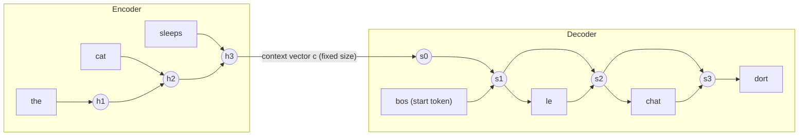

# RNNs, LSTMs, Seq2Seq and Why Transformers Replaced Them

> **Level:** Beginner to Advanced · **Study time:** ~110 min · **Prerequisites:** [Neural Networks from Scratch](01-neural-networks-from-scratch.md), [Backpropagation and Gradient Descent](02-backpropagation-and-gradient-descent.md), [Vanishing and Exploding Gradients](05-vanishing-exploding-gradients-initialization-normalization-and-residuals.md), [Softmax, Entropy, Cross-Entropy and KL Divergence](../00-foundations/05-softmax-entropy-cross-entropy-and-kl-divergence.md)

## Table of contents

- [Why this matters](#why-this-matters)
- [Sequential data: what makes it different](#sequential-data-what-makes-it-different)
- [Recurrent neural networks and the hidden state](#recurrent-neural-networks-and-the-hidden-state)
- [Training RNNs: backpropagation through time](#training-rnns-backpropagation-through-time)
- [Why RNNs forget: vanishing and exploding gradients over time](#why-rnns-forget-vanishing-and-exploding-gradients-over-time)
- [LSTM: a memory cell with gates](#lstm-a-memory-cell-with-gates)
- [GRU: the lighter gated cousin](#gru-the-lighter-gated-cousin)
- [Code: RNN from scratch, then PyTorch RNN, LSTM and GRU](#code-rnn-from-scratch-then-pytorch-rnn-lstm-and-gru)
- [Stacked and bidirectional RNNs](#stacked-and-bidirectional-rnns)
- [Sequence-to-sequence: encoder-decoder models for translation](#sequence-to-sequence-encoder-decoder-models-for-translation)
- [The fixed-size bottleneck problem](#the-fixed-size-bottleneck-problem)
- [The first attention mechanism: Bahdanau attention](#the-first-attention-mechanism-bahdanau-attention)
- [Why RNNs cannot be parallelized and how transformers fixed it](#why-rnns-cannot-be-parallelized-and-how-transformers-fixed-it)
- [Going deeper: modern recurrent and state-space models (Mamba and friends)](#going-deeper-modern-recurrent-and-state-space-models-mamba-and-friends)
- [Going deeper: RNNs in production, debugging and when to still use them](#going-deeper-rnns-in-production-debugging-and-when-to-still-use-them)
- [Common mistakes and misconceptions](#common-mistakes-and-misconceptions)
- [Interview questions and model answers](#interview-questions-and-model-answers)
- [Key takeaways](#key-takeaways)
- [Further reading](#further-reading)
- [Next](#next)

## Why this matters

Every modern large language model is a transformer, and the transformer was designed as a direct answer to the weaknesses of recurrent networks. If you understand why RNNs forget, why they cannot use a GPU efficiently, and how attention first appeared as a patch on top of an RNN translator, then transformers stop looking like magic and start looking like an obvious engineering fix. Interviewers love this story because it tests whether you understand *mechanisms* (gradients, sequential dependencies, memory bottlenecks) rather than buzzwords. It is also not just history: state-space models like Mamba and hybrid architectures bring recurrence back for long contexts, and RNNs still run in production for streaming speech, on-device models and time series. A senior engineer should be able to say when a recurrent model is the right tool in 2026 and when it is not.

## Sequential data: what makes it different

> **Analogy:** Reading a mystery novel. The meaning of the last page depends on clues from chapter 1. If you shuffle the pages, the story is destroyed even though every word is still there.

**Sequential data** is data where the *order* of elements carries meaning. Examples:

| Data | One element | Why order matters |
|---|---|---|
| Text | A word or token | "dog bites man" vs "man bites dog" |
| Speech audio | A 10-25 ms frame of sound | Phonemes form words only in order |
| Stock prices, sensor readings | One reading per time step | Trends, seasonality, lags |
| User clicks in an app | One event | "add to cart, then checkout" vs the reverse |
| Video | One frame | Motion exists only across frames |

Three properties make sequences awkward for the networks you have seen so far:

1. **Variable length.** One review has 3 words, another has 300. A plain **feed-forward network** (also called an MLP: layers of neurons where data flows one way, input to output, see [Neural Networks from Scratch](01-neural-networks-from-scratch.md)) expects a fixed-size input vector.
2. **Order matters.** If you average all word vectors (a "bag of words"), "not good" and "good, not bad" can look nearly identical.
3. **Long-range dependencies.** A **long-range dependency** is when an output depends on an input far back in the sequence. In "The keys that I left on the kitchen table yesterday *are* missing", the verb "are" agrees with "keys", 9 words earlier.

Our **running example** for the first half of the chapter is a tiny sentiment classifier reading the 3-word sentence:

```text
"not very good"   ->   positive or negative?
```

A human knows it is mildly negative. A model needs to *remember* the "not" while reading "good". That need for memory is the whole reason recurrent networks exist.

> **Why not just a CNN?** A 1D **convolutional neural network** (see [CNNs and Transfer Learning](07-cnns-and-transfer-learning.md)) slides a fixed-width window over the sequence. It handles local patterns well, but a window of width 3 cannot see 50 words back unless you stack many layers. It *can* be parallelized, which is a point we will come back to.

## Recurrent neural networks and the hidden state

### Intuition

> **Analogy:** You read a sentence one word at a time and keep a running mental summary ("so far: someone is negating something"). After each word you update the summary using (a) your old summary and (b) the new word. You never reread earlier words; the summary is all you carry forward.

A **recurrent neural network (RNN)** is a network that processes a sequence one element at a time while carrying a vector called the **hidden state** from step to step. The hidden state is the network's running summary (its "memory") of everything it has read so far. The same weights are reused at every time step; this is called **weight sharing** (or parameter sharing), and it is what lets one small network handle sequences of any length.

The classic form is the **Elman RNN** (Elman, "Finding Structure in Time", 1990), also called a **vanilla RNN** or simple RNN.

### The formula

$$h_t = \tanh\left(W_{xh}\, x_t + W_{hh}\, h_{t-1} + b_h\right)$$

$$\hat{y}_t = W_{hy}\, h_t + b_y$$

- $t$: the **time step** (position in the sequence): 1 for the first word, 2 for the second, and so on.
- $x_t$: the input vector at step $t$ (for text, the **embedding** of the word: a learned vector of numbers that represents it, see [Embeddings](../04-transformers/02-embeddings-from-one-hot-to-contextual.md)).
- $h_t$: the hidden state after reading step $t$. $h_0$ is the initial state, usually all zeros.
- $W_{xh}$: weight matrix mapping the input into hidden space ("how does the new word change my memory?").
- $W_{hh}$: weight matrix mapping the previous hidden state into the new one ("how much of my old memory do I keep, and how is it mixed?"). This is the **recurrent weight**.
- $b_h$, $b_y$: bias vectors.
- $\tanh$: the hyperbolic tangent activation, which squashes any number into $(-1, 1)$, keeping the hidden state bounded.
- $W_{hy}$: output weights that turn the hidden state into a prediction $\hat{y}_t$. These are **logits**: raw, unnormalized scores; apply sigmoid (one class) or softmax (many classes) to turn them into probabilities.

The key line is $W_{hh} h_{t-1}$: the new state depends on the old state. That dependency is what makes the network *recurrent*, and, as we will see, it is also what makes it slow and forgetful.

### Unrolling

We usually draw an RNN **unrolled** over time: the same cell copied once per step, with arrows passing the hidden state along.

```text
         y1_hat         y2_hat         y3_hat
           ^              ^              ^
           |              |              |
 h0 ---> [RNN] --h1--> [RNN] --h2--> [RNN] --h3-->
           ^              ^              ^
           |              |              |
         x1="not"      x2="very"      x3="good"

 (all three [RNN] boxes are the SAME weights W_xh, W_hh, b_h)
```

### Worked example by hand

To make the arithmetic doable, use a **1-dimensional** hidden state and 1-dimensional inputs. Pretend the word "embeddings" are single numbers (illustrative): "not" = $-1$, "very" = $0.5$, "good" = $1$.

Hand-picked (untrained, illustrative) weights: $W_{xh} = 1.0$, $W_{hh} = 0.5$, $b_h = 0$, $h_0 = 0$. For the final prediction we use $\hat{y} = \sigma(2.0 \cdot h_3)$, where $\sigma$ is the **sigmoid** function $\sigma(z) = 1/(1+e^{-z})$ that maps a score to a probability of "positive".

At each step we first compute the **pre-activation** (the number that goes *into* $\tanh$), then squash it.

**Step 1, "not" ($x_1 = -1$):**

- pre-activation $= 1.0 \times (-1) + 0.5 \times 0 + 0 = -1$
- $h_1 = \tanh(-1) = -0.7616$

**Step 2, "very" ($x_2 = 0.5$):**

- pre-activation $= 1.0 \times 0.5 + 0.5 \times (-0.7616) = 0.5 - 0.3808 = 0.1192$
- $h_2 = \tanh(0.1192) = 0.1186$

**Step 3, "good" ($x_3 = 1$):**

- pre-activation $= 1.0 \times 1 + 0.5 \times 0.1186 = 1 + 0.0593 = 1.0593$
- $h_3 = \tanh(1.0593) = 0.7854$

**Prediction:** $\sigma(2.0 \times 0.7854) = \sigma(1.5708) = 0.828$, so 82.8% "positive".

Compare with the one-word sentence "good": $h_1 = \tanh(1) = 0.7616$, and $\sigma(2 \times 0.7616) = \sigma(1.5232) = 0.821$.

Two lessons from this tiny example:

1. The hidden state really does carry information: "not" made $h_1$ negative, which nudged later states.
2. With these untrained weights, the memory of "not" has almost vanished by step 3 (0.828 vs 0.821). Training must find weights that keep the "not" alive. The next section shows why gradient descent struggles to do that when the "not" is far away.

### The many shapes of RNN tasks

Because an RNN can emit an output at every step or only at the end, one architecture covers many task shapes:

| Shape | Input | Output | Example |
|---|---|---|---|
| Many-to-one | Sequence | One label | Sentiment of "not very good" |
| One-to-many | One vector | Sequence | Image captioning (image features in, words out) |
| Many-to-many, aligned | Sequence | One output per input | Part-of-speech tagging, named entity recognition |
| Many-to-many, unaligned | Sequence | Sequence of different length | Translation (seq2seq, covered below) |
| Next-step prediction | Sequence | Next element at each step | Character-level or word-level language model |

A **language model** is a model that predicts the next token given the previous ones. Before transformers, the strongest language models were LSTM-based.

## Training RNNs: backpropagation through time

**Backpropagation through time (BPTT)** is ordinary backpropagation (see [Backpropagation and Gradient Descent](02-backpropagation-and-gradient-descent.md)) applied to the unrolled network (Werbos, "Backpropagation Through Time: What It Does and How to Do It", 1990). Once unrolled, an RNN over $T$ steps is just a very deep feed-forward network with $T$ layers that happen to share weights.

Two consequences:

1. **Gradients for shared weights add up.** $W_{hh}$ is used at every step, so its total gradient is the sum of its gradients from each step:

$$\frac{\partial L}{\partial W_{hh}} = \sum_{t=1}^{T} \frac{\partial L}{\partial W_{hh}}\Big|_{\text{step } t}$$

- $L$: the loss (for example cross-entropy of the final prediction).
- The vertical bar notation means "the contribution from the copy of $W_{hh}$ used at step $t$".

2. **Memory grows with sequence length.** To compute gradients, the forward pass must store every $h_t$ (and intermediate values). Training on a sequence of length $T$ needs activation memory proportional to $T$.

### Truncated BPTT

For very long sequences (a whole book, a continuous audio stream) full BPTT is too expensive. **Truncated BPTT** splits the stream into chunks of length $k$ (say 100 steps). You carry the hidden state forward across chunks (so the forward pass still "remembers"), but you **detach** it from the computation graph at chunk boundaries so gradients flow back at most $k$ steps.

```text
stream:  [ chunk 1: steps 1..100 ][ chunk 2: steps 101..200 ][ ... ]
forward:   h flows ------------------> h flows ------------------->
backward:  <-- gradients stay inside chunk -->  <-- inside chunk -->
```

The trade-off: memory and compute become bounded, but the model gets **no gradient signal** for dependencies longer than $k$ steps. It can only learn those by luck.

```python
# Truncated BPTT pattern in PyTorch (conceptual training loop)
h = None
for chunk_x, chunk_y in stream_chunks:            # each chunk is (batch, k, features)
    out, h = rnn(chunk_x, h)                     # carry state forward
    loss = loss_fn(head(out), chunk_y)
    optimizer.zero_grad()
    loss.backward()
    optimizer.step()
    h = h.detach()                               # cut the graph: no gradient past this boundary
    # for an LSTM, h is a tuple (h, c): use h = tuple(s.detach() for s in h)
```

> **Common mistake:** Forgetting `detach()`. The new chunk's graph stays attached to the previous chunk's graph, whose saved tensors were already freed by the previous `backward()`, so the very next `backward()` fails with "Trying to backward through the graph a second time". If you "fix" that with `retain_graph=True`, the graph grows across every chunk, each backward pass reaches all the way to the start of the stream, and memory climbs until you run out.

## Why RNNs forget: vanishing and exploding gradients over time

The general problem of vanishing and exploding gradients in deep networks is covered in [Vanishing and Exploding Gradients](05-vanishing-exploding-gradients-initialization-normalization-and-residuals.md). Here we look at the version specific to time.

### Intuition

> **Analogy:** The game of telephone. A message passed through 50 people gets quieter and more distorted at each hop. By the end, the first person's words have almost no influence. In an RNN, the "message" travelling backward is the gradient, and every time step is one more person in the chain.

### The math

To learn that "not" at step 1 should change the prediction at step $T$, the loss gradient must flow from $h_T$ back to $h_1$. By the chain rule (see [Calculus and Gradients](../00-foundations/03-calculus-and-gradients.md)):

$$\frac{\partial h_T}{\partial h_1} = \prod_{t=2}^{T} \frac{\partial h_t}{\partial h_{t-1}}, \qquad \frac{\partial h_t}{\partial h_{t-1}} = \operatorname{diag}\!\left(1 - h_t^2\right) W_{hh}$$

- $\prod$: product over all the steps between 1 and $T$.
- $\frac{\partial h_t}{\partial h_{t-1}}$: the **Jacobian** (the matrix of partial derivatives) of one step. It says how a small change in the old state changes the new state.
- $1 - h_t^2$: the derivative of $\tanh$ at the current state (because $\frac{d}{dz}\tanh(z) = 1 - \tanh^2(z)$ and $h_t$ is itself a $\tanh$ output), always between 0 and 1. It is near 1 when $h_t \approx 0$ and near 0 when $\tanh$ is saturated (close to $\pm 1$).
- $\operatorname{diag}(\cdot)$: a diagonal matrix built from that vector.
- $W_{hh}$: the same recurrent matrix, multiplied in again at *every* step.

In the 1-dimensional case each factor is just a number, $w_{hh}(1 - h_t^2)$, and you are multiplying $T-1$ numbers together. Multiplying many numbers is exponential behaviour:

- If each factor is below 1, the product shrinks exponentially: **vanishing gradient**.
- If each factor is above 1, it grows exponentially: **exploding gradient**.

For matrices, the role of "the factor" is played by the size of $W_{hh}$ (formally its largest **singular value**, the most the matrix can stretch any vector, or roughly its **spectral radius**, the largest absolute eigenvalue) times the tanh derivatives (Pascanu, Mikolov and Bengio, "On the difficulty of training recurrent neural networks", 2013; earlier Bengio, Simard and Frasconi, 1994).

### Worked numbers

From our 3-word example ($w_{hh} = 0.5$):

- $\partial h_3 / \partial h_2 = 0.5 \times (1 - 0.7854^2) = 0.5 \times (1 - 0.6169) = 0.5 \times 0.3831 = 0.1916$
- $\partial h_2 / \partial h_1 = 0.5 \times (1 - 0.1186^2) = 0.5 \times (1 - 0.0141) = 0.5 \times 0.9859 = 0.4930$
- $\partial h_3 / \partial h_1 = 0.1916 \times 0.4930 = 0.0944$

After only 2 steps back, the signal from "not" is under 10% of its original size. Now extend to longer sequences:

| Factor per step | After 20 steps | After 50 steps | After 100 steps |
|---|---|---|---|
| 0.5 | $0.5^{20} \approx 9.5 \times 10^{-7}$ | about $10^{-15}$ | $\approx 7.9 \times 10^{-31}$ |
| 0.9 | $\approx 0.12$ | $\approx 0.0052$ | $\approx 2.7 \times 10^{-5}$ |
| 1.5 | $\approx 3325$ | about $6 \times 10^{8}$ | about $4 \times 10^{17}$ |

(Arithmetic: $0.5^{20} = 1/1{,}048{,}576$; $0.9^{50} = 0.00515$; $1.5^{20} = 3325.3$.)

### What each failure looks like in practice

| Problem | Symptom | Standard fix |
|---|---|---|
| Exploding gradients | Loss spikes, then becomes NaN; gradient norm jumps by orders of magnitude | **Gradient clipping** (below), lower learning rate |
| Vanishing gradients | Training runs fine but the model ignores anything far back; early-step gradient norms are near zero | Gated cells (LSTM/GRU), attention, shorter paths |

### Gradient clipping

**Gradient clipping by norm** rescales the whole gradient vector when its length exceeds a threshold $\tau$:

$$g \leftarrow g \cdot \frac{\tau}{\lVert g \rVert} \quad \text{if } \lVert g \rVert > \tau$$

- $g$: the gradient vector of all parameters concatenated.
- $\lVert g \rVert$: its Euclidean length (L2 norm).
- $\tau$: the clipping threshold (commonly 1.0 or 5.0 for RNNs).

Example: $g = (3, 4)$, so $\lVert g \rVert = \sqrt{9 + 16} = 5$. With $\tau = 1$: $g \leftarrow (3, 4) \times 1/5 = (0.6, 0.8)$. The direction is preserved; only the step size is capped.

> **Senior insight:** Clipping fixes *exploding* gradients only. It does nothing for *vanishing* gradients, because you cannot rescale a signal that has already shrunk to $10^{-15}$ without also amplifying noise. Vanishing needs an architectural fix: a path through time where the gradient is not repeatedly multiplied by small numbers. That is exactly what the LSTM provides.

## LSTM: a memory cell with gates

### Intuition

> **Analogy:** A notebook with three rules. Before reading each new word you decide (1) what to **erase** from the notebook, (2) what new notes to **write**, and (3) which part of the notebook to **read out loud** right now. The notebook itself is not rewritten from scratch each step; you only erase and add. That is why old notes can survive for a long time.

The **Long Short-Term Memory (LSTM)** network (Hochreiter and Schmidhuber, 1997; the forget gate was added by Gers, Schmidhuber and Cummins, 2000) adds a second state vector called the **cell state** $c_t$. The cell state is the long-term memory "conveyor belt". The hidden state $h_t$ is still the output at each step, a filtered view of the cell.

A **gate** is a vector of numbers between 0 and 1 (produced by a sigmoid) that is multiplied elementwise with another vector. A gate value of 0 means "block completely", 1 means "let everything through", 0.3 means "let 30% through".

### The equations

Let $[h_{t-1}, x_t]$ denote the concatenation of the previous hidden state and the current input.

$$f_t = \sigma\left(W_f [h_{t-1}, x_t] + b_f\right) \quad \text{(forget gate)}$$

$$i_t = \sigma\left(W_i [h_{t-1}, x_t] + b_i\right) \quad \text{(input gate)}$$

$$\tilde{c}_t = \tanh\left(W_c [h_{t-1}, x_t] + b_c\right) \quad \text{(candidate memory)}$$

$$c_t = f_t \odot c_{t-1} + i_t \odot \tilde{c}_t \quad \text{(cell update)}$$

$$o_t = \sigma\left(W_o [h_{t-1}, x_t] + b_o\right) \quad \text{(output gate)}$$

$$h_t = o_t \odot \tanh(c_t) \quad \text{(hidden state / output)}$$

- $\sigma$: sigmoid, outputs in $(0, 1)$, used for gates.
- $\tanh$: outputs in $(-1, 1)$, used for content.
- $\odot$: **elementwise** (Hadamard) multiplication: multiply matching positions.
- $f_t$ (**forget gate**): for each memory slot, how much of the old cell value to keep. $f = 1$ means keep everything (the name is confusing: a forget gate of 1 means *do not forget*).
- $i_t$ (**input gate**): how much of the new candidate to write.
- $\tilde{c}_t$ (**candidate**): the proposed new content computed from the current word and context.
- $c_t$: the new cell state, old memory partly kept plus new memory partly written.
- $o_t$ (**output gate**): which parts of the (squashed) memory to expose as $h_t$.
- $W_f, W_i, W_c, W_o$ and $b_f, b_i, b_c, b_o$: four separate weight matrices and biases, all learned.

```text
            c_{t-1} ----(x f_t)----(+)-------------------------> c_t
                                    ^                    |
                               (x i_t)                 tanh
                                    |                    |
                                c~_t (tanh)          (x o_t) ---> h_t
                                    ^                    ^
       [h_{t-1}, x_t] ---> f_t, i_t, c~_t, o_t computed from the same input
```

### Worked example: one LSTM step

Back to "not very good". Suppose that after "not" and "very" the cell has stored a strong negation signal $c_{t-1} = 2.0$, and now the word "good" arrives. Instead of multiplying out weight matrices, assume the gate pre-activations (the numbers going *into* the sigmoids and tanh) came out as (illustrative):

| Quantity | Pre-activation | Activation | Value |
|---|---|---|---|
| Forget gate $f_t$ | 2.0 | $\sigma(2.0)$ | 0.8808 |
| Input gate $i_t$ | 0.0 | $\sigma(0.0)$ | 0.5000 |
| Candidate $\tilde{c}_t$ | 0.5 | $\tanh(0.5)$ | 0.4621 |
| Output gate $o_t$ | 1.0 | $\sigma(1.0)$ | 0.7311 |

**Cell update:**

- kept memory $= f_t \times c_{t-1} = 0.8808 \times 2.0 = 1.7616$
- new memory $= i_t \times \tilde{c}_t = 0.5 \times 0.4621 = 0.2311$
- $c_t = 1.7616 + 0.2311 = 1.9927$

**Output:**

- $\tanh(1.9927) = 0.9635$
- $h_t = 0.7311 \times 0.9635 = 0.7044$

Most of the stored negation (1.76 out of 2.0) survived the step, because the forget gate stayed close to 1. In the vanilla RNN, the old state is pushed through $W_{hh}$ and $\tanh$ every step, with no way to say "just keep this".

### Why the cell state mitigates vanishing gradients

Look at the cell update $c_t = f_t \odot c_{t-1} + i_t \odot \tilde{c}_t$. The direct derivative of $c_t$ with respect to $c_{t-1}$ (ignoring the smaller indirect paths through the gates) is simply:

$$\frac{\partial c_t}{\partial c_{t-1}} = f_t$$

- There is no repeated multiplication by a weight matrix and no $\tanh$ derivative on this path.
- The update is **additive**: new information is *added* to memory rather than replacing it.

So over 100 steps the gradient along the cell is about $\prod f_t$. If the network learns $f_t \approx 0.99$ for a memory slot it wants to keep: $0.99^{100} = 0.366$. Compare the vanilla RNN with a factor of 0.5: $0.5^{100} \approx 7.9 \times 10^{-31}$. That is the difference between "learnable" and "impossible".

Hochreiter and Schmidhuber called this path the **constant error carousel**. In the original 1997 LSTM there was no forget gate, so the factor was exactly 1. The forget gate was added later so the network could *choose* to clear its memory (for example at the start of a new sentence).

> **Senior insight:** This is the same idea as the **residual connection** in ResNets and transformers ($x + F(x)$): give the gradient an additive highway that is not repeatedly squashed. The LSTM did it through time in 1997; ResNets did it through depth in 2015. See [Vanishing and Exploding Gradients](05-vanishing-exploding-gradients-initialization-normalization-and-residuals.md).

> **Interview tip:** If asked "does the LSTM solve the vanishing gradient problem?", say it *mitigates* it. Gradients can still vanish if the forget gate learns small values, and exploding gradients can still occur through the hidden-state path, which is why LSTM training still uses gradient clipping.

### The forget-gate bias trick

If the forget gate starts near 0.5 (bias 0), memory halves every step at initialization, which recreates the vanishing problem early in training. A well-known practice is to initialize the forget-gate bias to about 1.0 so $f \approx \sigma(1) = 0.73$ at the start (Gers et al., 2000; recommended again by Jozefowicz, Zaremba and Sutskever, "An Empirical Exploration of Recurrent Network Architectures", 2015). Keras does this by default (`unit_forget_bias=True`); PyTorch does not, so you set it yourself (code below).

## GRU: the lighter gated cousin

The **Gated Recurrent Unit (GRU)** (Cho et al., 2014) merges the cell and hidden state into one vector and uses two gates instead of three.

$$z_t = \sigma\left(W_z [h_{t-1}, x_t] + b_z\right) \quad \text{(update gate)}$$

$$r_t = \sigma\left(W_r [h_{t-1}, x_t] + b_r\right) \quad \text{(reset gate)}$$

$$\tilde{h}_t = \tanh\left(W_h [r_t \odot h_{t-1}, x_t] + b_h\right) \quad \text{(candidate state)}$$

$$h_t = (1 - z_t) \odot h_{t-1} + z_t \odot \tilde{h}_t$$

- $z_t$ (**update gate**): how much to move toward the new candidate. It plays the role of forget and input gate together: whatever you write ($z_t$) you take away from the old memory ($1 - z_t$).
- $r_t$ (**reset gate**): how much of the old state to use when computing the candidate. $r \approx 0$ lets the unit "start fresh".
- $\tilde{h}_t$: the candidate new state.

**Tiny example:** $h_{t-1} = 0.8$, $\tilde{h}_t = -0.5$, $z_t = 0.2$. Then $h_t = (1 - 0.2) \times 0.8 + 0.2 \times (-0.5) = 0.64 - 0.10 = 0.54$. The state moved 20% of the way toward the candidate.

> **Common mistake:** Papers and libraries disagree on which side gets $z$ and which gets $1 - z$. PyTorch writes $h_t = (1 - z_t) \odot n_t + z_t \odot h_{t-1}$ (where $n_t$ is the candidate), the mirror image of the form above. Both are equivalent after learning; just do not mix conventions when reading weights. PyTorch (following cuDNN) also applies the reset gate *after* the hidden-state matrix multiply, $n_t = \tanh(W_{in} x_t + b_{in} + r_t \odot (W_{hn} h_{t-1} + b_{hn}))$, a slight variant of the $W_h [r_t \odot h_{t-1}, x_t]$ form above.

### RNN vs LSTM vs GRU

Parameter counts below use PyTorch's layout (which has two bias vectors per gate) for input size 100 and hidden size 256. One "gate block" is $256 \times 100 + 256 \times 256 + 2 \times 256 = 25{,}600 + 65{,}536 + 512 = 91{,}648$ parameters.

| | Vanilla RNN | LSTM | GRU |
|---|---|---|---|
| States carried | $h$ | $h$ and $c$ | $h$ |
| Gates | None | Forget, input, output (+ candidate) | Update, reset (+ candidate) |
| Weight blocks | 1 | 4 | 3 |
| Params (in=100, hid=256) | 91,648 | 366,592 | 274,944 |
| Long-range memory | Poor (tens of steps at best) | Good (hundreds of steps in practice) | Good, often similar to LSTM |
| Speed per step | Fastest | Slowest | In between |
| When to pick | Teaching, very short sequences | Default when you have data and want robustness | Smaller data or compute budget; often matches LSTM |

Empirical comparisons (Chung et al., 2014; Jozefowicz et al., 2015; Greff et al., "LSTM: A Search Space Odyssey", 2017) found no consistent winner between LSTM and GRU; results depend on the task and tuning, and both clearly beat the vanilla RNN on long dependencies.

## Code: RNN from scratch, then PyTorch RNN, LSTM and GRU

`pip install numpy torch`

### From scratch in NumPy

This reproduces the hand-worked example. Notice the Python `for` loop: each step needs the previous one. Keep that loop in mind for the parallelization section.

```python
import numpy as np

def rnn_forward(xs, W_xh, W_hh, b_h, h0):
    """Vanilla RNN forward pass. xs: list of input vectors, one per time step."""
    h = h0
    hs = []
    for x in xs:                                   # strictly sequential: h depends on previous h
        h = np.tanh(W_xh @ x + W_hh @ h + b_h)
        hs.append(h)
    return np.stack(hs)

def lstm_step(x, h_prev, c_prev, W, b):
    """One LSTM step. W has shape (4H, H + D): rows are [forget, input, candidate, output]."""
    H = h_prev.shape[0]
    z = W @ np.concatenate([h_prev, x]) + b       # all four pre-activations at once
    sigmoid = lambda a: 1.0 / (1.0 + np.exp(-a))
    f = sigmoid(z[0:H])
    i = sigmoid(z[H:2*H])
    c_tilde = np.tanh(z[2*H:3*H])
    o = sigmoid(z[3*H:4*H])
    c = f * c_prev + i * c_tilde                   # additive memory update
    h = o * np.tanh(c)
    return h, c

# 1-dimensional example: "not"=-1, "very"=0.5, "good"=1
xs = [np.array([-1.0]), np.array([0.5]), np.array([1.0])]
hs = rnn_forward(xs, W_xh=np.array([[1.0]]), W_hh=np.array([[0.5]]),
                 b_h=np.zeros(1), h0=np.zeros(1))
print(hs.ravel().round(4))        # [-0.7616  0.1186  0.7854]

# Reproduce the LSTM worked example by choosing W = 0 and putting the
# desired pre-activations into the bias: [f=2.0, i=0.0, c~=0.5, o=1.0]
W = np.zeros((4, 2))
b = np.array([2.0, 0.0, 0.5, 1.0])
h, c = lstm_step(np.array([1.0]), np.array([0.0]), np.array([2.0]), W, b)
print(round(c[0], 4), round(h[0], 4))   # 1.9927 0.7044
```

### Measuring vanishing gradients directly

A useful debugging habit: measure the gradient that reaches each time step. Here we compare an untrained vanilla RNN with an LSTM on a 100-step sequence.

```python
import torch
import torch.nn as nn

torch.manual_seed(0)
T, D, H = 100, 16, 64

def grad_per_step(rnn):
    x = torch.randn(1, T, D, requires_grad=True)   # (batch, time, features)
    out, _ = rnn(x)
    loss = out[:, -1].sum()                         # loss depends only on the LAST output
    loss.backward()
    return x.grad.norm(dim=-1).squeeze(0)           # gradient size reaching each input step

for name, rnn in [("RNN", nn.RNN(D, H, batch_first=True)),
                  ("LSTM", nn.LSTM(D, H, batch_first=True))]:
    g = grad_per_step(rnn)
    print(f"{name:4s}  step 1: {g[0]:.2e}   step 50: {g[49]:.2e}   step 100: {g[99]:.2e}")
# Expect: for the vanilla RNN, the step-1 gradient is many orders of magnitude
# smaller than the step-100 gradient (it can underflow to exactly 0).
# Note: this UNTRAINED LSTM vanishes too, only more slowly, because PyTorch's default
# init gives forget gates near sigmoid(0) = 0.5. Raise the forget bias (see the
# forget-gate bias trick and the code below) and the step-1 gradient stays far larger.
# Exact values depend on the seed and version.
```

> **How to measure in a real project:** Plot this "gradient norm vs distance from the loss" curve for your model. If it collapses to near zero after 20-30 steps, gradient descent gets essentially no signal for dependencies longer than that, so the model will struggle to learn them. The curve changes as the weights train, so measure it on the trained model as well as at initialization.

### The standard PyTorch API

Two terms used in the code: a GPU batch must be a rectangular tensor, so shorter sequences are **padded** with dummy tokens up to the longest length in the batch. **Packing** passes the true lengths to the RNN so each sequence stops at its real end instead of reading the padding.

```python
import torch
import torch.nn as nn
from torch.nn.utils.rnn import pack_padded_sequence, pad_packed_sequence

batch, seq_len, in_dim, hid = 4, 7, 100, 256

lstm = nn.LSTM(input_size=in_dim, hidden_size=hid, num_layers=2,
               batch_first=True, dropout=0.2, bidirectional=False)
gru  = nn.GRU(input_size=in_dim, hidden_size=hid, batch_first=True)

x = torch.randn(batch, seq_len, in_dim)
out, (h_n, c_n) = lstm(x)
print(out.shape)   # torch.Size([4, 7, 256])  top layer's h at EVERY step (batch_first)
print(h_n.shape)   # torch.Size([2, 4, 256])  last h of EACH layer: (num_layers, batch, hid)
print(c_n.shape)   # torch.Size([2, 4, 256])  note: h_n/c_n are NOT batch-first

# Parameter count of a single-layer LSTM (matches the table above)
print(sum(p.numel() for p in nn.LSTM(100, 256).parameters()))   # 366592

# Forget-gate bias = 1.0. PyTorch gate order is [input, forget, cell, output],
# and there are two bias vectors (bias_ih and bias_hh) that are summed.
for name, p in lstm.named_parameters():
    if "bias" in name:
        with torch.no_grad():
            p[hid:2*hid].fill_(0.5)            # 0.5 + 0.5 = 1.0 total forget bias

# Variable-length batches: pack so the LSTM skips padding
lengths = torch.tensor([7, 5, 3, 2])           # true lengths of each sequence
packed = pack_padded_sequence(x, lengths, batch_first=True, enforce_sorted=False)
packed_out, (h_n, c_n) = lstm(packed)
out, _ = pad_packed_sequence(packed_out, batch_first=True)
last_real = h_n[-1]                            # (batch, hid): state at each sequence's TRUE end
# (unidirectional only; if bidirectional=True, concatenate h_n[-2] and h_n[-1])

# Training-loop essentials for recurrent models
optimizer = torch.optim.Adam(lstm.parameters(), lr=1e-3)
loss = out.pow(2).mean()                       # placeholder loss for the demo
optimizer.zero_grad()
loss.backward()
torch.nn.utils.clip_grad_norm_(lstm.parameters(), max_norm=1.0)   # tame exploding gradients
optimizer.step()
```

> **Common mistake:** Using `out[:, -1]` as the "sentence representation" for a padded batch without packing. For the sequence of true length 2, position $-1$ is padding, so you read a state that has processed 5 padding tokens. Use packing and `h_n`, or gather the output at index `length - 1`.

## Stacked and bidirectional RNNs

**Stacked (deep) RNNs** feed the hidden-state sequence of layer 1 as the input sequence of layer 2, and so on. Two to four layers was typical; deeper stacks were hard to train without residual connections.

A **bidirectional RNN** runs one RNN left-to-right and another right-to-left, then concatenates their states at each position. Position $t$ then "sees" both past and future context, which helps tagging and classification (in "Teddy bears are on sale", whether "Teddy" is a person depends on the next word).

| | Unidirectional | Bidirectional |
|---|---|---|
| Context at step $t$ | Past only | Past and future |
| Can generate text left to right? | Yes | No (it would need the future it is trying to predict) |
| Streaming / real-time use | Yes | No: must wait for the end of the input |
| Typical use | Language modeling, streaming speech, decoders | Encoders, tagging, classification |
| Cost | 1x | About 2x |

Before BERT, ELMo (Peters et al., "Deep contextualized word representations", 2018) produced contextual word vectors from bidirectional LSTM language models, a stepping stone to the contextual embeddings covered in [Embeddings](../04-transformers/02-embeddings-from-one-hot-to-contextual.md).

## Sequence-to-sequence: encoder-decoder models for translation

### Intuition

> **Analogy:** A human interpreter listens to a whole sentence in English, forms an understanding in their head, then speaks the French sentence word by word. Listening and speaking are different skills, so you use two different networks.

Translation is **many-to-many, unaligned**: "the cat sleeps" (3 words) becomes "le chat dort" (3 words), but in general lengths and word orders differ. **Sequence-to-sequence (seq2seq)** models (Sutskever, Vinyals and Le, "Sequence to Sequence Learning with Neural Networks", 2014; Cho et al., 2014) solve this with two RNNs:

- The **encoder** reads the source sentence and compresses it into its final hidden state, called the **context vector** $c$ (sometimes the "thought vector").
- The **decoder** is a language model that starts from $c$ and generates the target sentence one token at a time, feeding each generated token back in as the next input, until it emits a special end-of-sequence token `<eos>`.



The decoder defines a probability for each target token given the previous ones and the source:

$$P(y_1, \dots, y_m \mid x_1, \dots, x_n) = \prod_{t=1}^{m} P(y_t \mid y_1, \dots, y_{t-1}, c)$$

- $x_1..x_n$: source tokens ("the cat sleeps", $n = 3$).
- $y_1..y_m$: target tokens ("le chat dort", $m = 3$, plus `<eos>`).
- $c$: the context vector from the encoder.
- Each factor is a softmax over the target vocabulary computed from the decoder state.

### Teacher forcing and exposure bias

During training, what should the decoder receive as input at step $t$: its own previous prediction, or the correct previous word?

- **Teacher forcing** feeds the *ground-truth* previous token. Training is stable and fast, and every step gets a clean learning signal.
- At inference there is no ground truth, so the decoder consumes its *own* predictions. If it makes a mistake, it is now in a situation it never saw during training, and errors can compound. This train/test mismatch is called **exposure bias**.

Mitigations include **scheduled sampling** (Bengio et al., 2015: gradually replace ground-truth inputs with model predictions during training) and better decoding such as **beam search** (keep the $k$ best partial translations instead of only the single best). Decoding strategies are covered in [How LLMs Generate Text](../05-llms/03-text-generation-and-decoding-strategies.md).

> **Senior insight:** Teacher forcing is exactly how GPT-style transformers are trained today: next-token prediction on ground-truth text. The difference is that a transformer can compute all positions of a teacher-forced sequence in parallel, while an RNN decoder still walks step by step even with teacher forcing.

> **Historical note:** Sutskever et al. found that *reversing* the source sentence ("sleeps cat the") improved results, because it put the first source words close to the first target words, shortening the gradient path. A hack like that is a strong hint that path length through time was the real problem.

## The fixed-size bottleneck problem

Here is the flaw: the entire source sentence, whether 3 words or 60, must squeeze through **one fixed-size vector** $c$. This is the **bottleneck problem**.

> **Analogy:** Summarize a whole book on one index card, then translate the book using only the index card. Fine for a sentence, hopeless for a chapter.

```text
"the cat sleeps"                             --> [ c: 512 numbers ] --> "le chat dort"
"the cat that my neighbour adopted from the
 shelter last winter sleeps on the sofa ..."  --> [ c: 512 numbers ] --> ???
            (same 512 numbers either way; the vector size is illustrative)
```

Two things go wrong:

1. **Capacity.** A fixed vector has fixed information capacity; long inputs get compressed lossily.
2. **Recency bias.** The encoder's last state is dominated by the last few words (vanishing gradients again), so early source words are poorly represented.

Empirically, translation quality of basic encoder-decoder models dropped noticeably as sentence length grew (Cho et al., "On the Properties of Neural Machine Translation: Encoder-Decoder Approaches", 2014; Bahdanau et al., 2014).

## The first attention mechanism: Bahdanau attention

### Intuition

> **Analogy:** Instead of translating from an index card, the interpreter keeps the original page in front of them. When writing each French word, they glance back at the English words most relevant *right now*: when writing "chat", they look mostly at "cat".

**Attention** lets the decoder, at every output step, compute a fresh weighted average of *all* the encoder hidden states, with weights that depend on what it is currently trying to produce. Bahdanau, Cho and Bengio ("Neural Machine Translation by Jointly Learning to Align and Translate", 2014, published at ICLR 2015) introduced this as **additive attention** on top of an RNN encoder-decoder. The encoder was a bidirectional RNN, so each $h_j$ summarized word $j$ with context from both sides.

### The formulas

For decoder step $t$ and each source position $j$:

$$e_{t,j} = v_a^{\top} \tanh\left(W_a\, s_{t-1} + U_a\, h_j\right)$$

$$\alpha_{t,j} = \frac{\exp(e_{t,j})}{\sum_{k=1}^{n} \exp(e_{t,k})}$$

$$c_t = \sum_{j=1}^{n} \alpha_{t,j}\, h_j$$

- $s_{t-1}$: the decoder's previous hidden state ("what I have produced so far and what I am about to say").
- $h_j$: the encoder hidden state at source position $j$ (here called an **annotation**).
- $W_a$, $U_a$: learned matrices that project the decoder state and encoder state into a shared space.
- $v_a$: a learned vector that turns the combined vector into a single score.
- $e_{t,j}$: the **alignment score**: how relevant source word $j$ is for output step $t$. "Additive" refers to the $W_a s + U_a h$ sum inside the $\tanh$ (a tiny one-hidden-layer network scores each pair).
- $\alpha_{t,j}$: the **attention weight**, the softmax of the scores over all source positions. Weights are positive and sum to 1 (softmax is covered in [Softmax, Entropy, Cross-Entropy](../00-foundations/05-softmax-entropy-cross-entropy-and-kl-divergence.md)).
- $c_t$: a **per-step context vector**: a weighted average of encoder states. Unlike the old single $c$, it is recomputed for every output word.

The decoder then computes its new state from $s_{t-1}$, the previous output word $y_{t-1}$, and $c_t$, and predicts $y_t$.

### Worked example

Source "the cat sleeps" with toy 2-dimensional encoder states (illustrative):

- $h_1$ ("the") $= (1, 0)$
- $h_2$ ("cat") $= (0, 1)$
- $h_3$ ("sleeps") $= (1, 1)$

The decoder has produced "le" and is about to produce "chat". Suppose the scoring network outputs $e = (0.5,\ 2.0,\ 0.1)$.

**Step 1: exponentiate.**

- $e^{0.5} = 1.6487$
- $e^{2.0} = 7.3891$
- $e^{0.1} = 1.1052$
- sum $= 1.6487 + 7.3891 + 1.1052 = 10.1430$

**Step 2: normalize (softmax).**

- $\alpha_1 = 1.6487 / 10.1430 = 0.1625$
- $\alpha_2 = 7.3891 / 10.1430 = 0.7285$
- $\alpha_3 = 1.1052 / 10.1430 = 0.1090$
- check: $0.1625 + 0.7285 + 0.1090 = 1.0000$

**Step 3: weighted sum of encoder states.**

- first component: $0.1625 \times 1 + 0.7285 \times 0 + 0.1090 \times 1 = 0.2715$
- second component: $0.1625 \times 0 + 0.7285 \times 1 + 0.1090 \times 1 = 0.8375$
- $c_t = (0.2715,\ 0.8375)$

The context is dominated by "cat" (73% of the weight), exactly what the decoder needs to emit "chat". When it later emits "dort", a different set of scores will shift the weight onto "sleeps".

```text
               the     cat    sleeps
   le        [0.80    0.12    0.08]      <- each row sums to 1
   chat      [0.16    0.73    0.11]      <- our worked example
   dort      [0.05    0.10    0.85]
   (illustrative "alignment matrix": rows = output words, columns = source words)
```

Plotting this matrix as a heat map gives a soft word **alignment**, and Bahdanau et al. showed such plots: the model learned which words correspond, including reorderings, with no alignment labels at all.

### Additive vs multiplicative attention

Luong, Pham and Manning ("Effective Approaches to Attention-based Neural Machine Translation", 2015) proposed simpler **multiplicative** scores.

| Score function | Formula | Notes |
|---|---|---|
| Additive (Bahdanau) | $v_a^{\top}\tanh(W_a s + U_a h_j)$ | Small MLP per pair; works with different dimensions for $s$ and $h$ |
| Dot (Luong) | $s^{\top} h_j$ | No parameters; needs equal dimensions; one matrix multiply for all pairs |
| General (Luong) | $s^{\top} W_a h_j$ | A learned bilinear form |
| Scaled dot-product (Vaswani et al., 2017) | $q^{\top} k_j / \sqrt{d_k}$ | The transformer's choice; scaled to keep softmax from saturating |

The dot-product family won because it is a single batched matrix multiplication, which GPUs execute extremely efficiently. The full query, key, value formulation is taught in [The Attention Mechanism, Step by Step](../04-transformers/03-attention-mechanism-step-by-step.md).

### Code: an additive attention decoder step in PyTorch

```python
import torch
import torch.nn as nn

class AdditiveAttention(nn.Module):
    """Bahdanau-style attention: score(s, h_j) = v^T tanh(W s + U h_j)."""
    def __init__(self, dec_dim: int, enc_dim: int, attn_dim: int):
        super().__init__()
        self.W = nn.Linear(dec_dim, attn_dim, bias=False)
        self.U = nn.Linear(enc_dim, attn_dim, bias=False)
        self.v = nn.Linear(attn_dim, 1, bias=False)

    def forward(self, s_prev, enc_states, src_mask):
        # s_prev: (B, dec_dim)   enc_states: (B, S, enc_dim)   src_mask: (B, S) True = real token
        scores = self.v(torch.tanh(self.W(s_prev).unsqueeze(1) + self.U(enc_states))).squeeze(-1)
        scores = scores.masked_fill(~src_mask, float("-inf"))      # never attend to padding
        alpha = torch.softmax(scores, dim=-1)                      # (B, S), rows sum to 1
        context = torch.bmm(alpha.unsqueeze(1), enc_states).squeeze(1)   # (B, enc_dim)
        return context, alpha

class AttnDecoderStep(nn.Module):
    """One decoder time step: previous token + attention context -> next-token logits."""
    def __init__(self, vocab: int, emb: int, enc_dim: int, dec_dim: int):
        super().__init__()
        self.embed = nn.Embedding(vocab, emb)
        self.attn = AdditiveAttention(dec_dim, enc_dim, attn_dim=dec_dim)
        self.cell = nn.GRUCell(emb + enc_dim, dec_dim)
        self.out = nn.Linear(dec_dim + enc_dim, vocab)

    def forward(self, y_prev, s_prev, enc_states, src_mask):
        context, alpha = self.attn(s_prev, enc_states, src_mask)
        s = self.cell(torch.cat([self.embed(y_prev), context], dim=-1), s_prev)
        logits = self.out(torch.cat([s, context], dim=-1))
        return logits, s, alpha

# Shapes check with a bidirectional GRU encoder (as in Bahdanau et al.)
B, S, vocab, emb, hid = 2, 3, 50, 16, 32
encoder = nn.GRU(emb, hid, batch_first=True, bidirectional=True)
src_embed = nn.Embedding(vocab, emb)
src = torch.randint(0, vocab, (B, S))
enc_states, _ = encoder(src_embed(src))                 # (2, 3, 64): forward and backward concatenated
dec = AttnDecoderStep(vocab, emb, enc_dim=2 * hid, dec_dim=hid)
s0 = torch.zeros(B, hid)
y_prev = torch.zeros(B, dtype=torch.long)               # pretend index 0 is <bos>
mask = torch.ones(B, S, dtype=torch.bool)
logits, s1, alpha = dec(y_prev, s0, enc_states, mask)
print(logits.shape, alpha.shape)                        # torch.Size([2, 50]) torch.Size([2, 3])
# Training: loop over target positions, feed the ground-truth y_prev (teacher forcing),
# sum cross-entropy of logits against the next target token.
```

Notice the Python loop over target positions that training would still need. Attention solved the bottleneck, but not the sequential computation.

## Why RNNs cannot be parallelized and how transformers fixed it

### The sequential dependency

Look again at $h_t = \tanh(W_{xh} x_t + W_{hh} h_{t-1} + b_h)$. You cannot compute $h_{100}$ until you have $h_{99}$, which needs $h_{98}$, and so on. For a sequence of length $n$, every layer needs **$n$ dependent steps**, no matter how many GPU cores you have.

> **Analogy:** A bucket brigade vs a team of painters. A bucket brigade passes one bucket hand to hand; adding more people does not move a single bucket faster. Painters can each take a wall and work at the same time. RNNs are a bucket brigade over time; transformers are painters.

You *can* parallelize an RNN across the **batch** (many sentences at once) and within each step's matrix multiply. But each step's matrix multiply is small (one $d \times d$ matrix times a batch of vectors), so a GPU built for huge matrix multiplications sits mostly idle, waiting on the chain. Optimized kernels (for example NVIDIA's cuDNN RNN kernels) help, but cannot remove the dependency.

### What the transformer changed

"Attention Is All You Need" (Vaswani et al., 2017) removed recurrence entirely. In **self-attention**, every position computes attention scores against every other position of the *same* sequence in one shot, using matrix multiplications over the whole sequence. With teacher forcing and a **causal mask** (which hides future positions, see [Multi-Head Attention and Causal Masking](../04-transformers/04-multi-head-attention-and-causal-masking.md)), all $n$ next-token predictions of a training sequence are computed simultaneously.

```text
RNN layer, n = 5 tokens                    Self-attention layer, n = 5 tokens

x1 -> h1 -> h2 -> h3 -> h4 -> h5           x1  x2  x3  x4  x5
      ^     ^     ^     ^     ^             \   \   |   /   /
      x2    x3    x4    x5                   [ one big matmul: all pairs ]
                                              /   /   |   \   \
5 sequential steps per layer               y1  y2  y3  y4  y5   (1 parallel step)
Path from x1 to h5: 4 hops                 Path from x1 to y5: 1 hop
```

The transformer paper compared layer types in its Table 1 ($n$ = sequence length, $d$ = representation dimension, $k$ = convolution kernel width):

| Layer type | Compute per layer | Sequential operations | Maximum path length |
|---|---|---|---|
| Self-attention | $O(n^2 \cdot d)$ | $O(1)$ | $O(1)$ |
| Recurrent | $O(n \cdot d^2)$ | $O(n)$ | $O(n)$ |
| Convolutional | $O(k \cdot n \cdot d^2)$ | $O(1)$ | $O(\log_k n)$ (dilated) |

- **Sequential operations**: how many steps must happen one after another. This sets the floor on wall-clock time.
- **Maximum path length**: how many hops a signal (and its gradient) needs between the two most distant positions. A shorter path means easier learning of long-range dependencies, the exact problem from earlier.

**Worked comparison** (illustrative, ignoring constants): $n = 1000$ tokens, $d = 512$.

- Self-attention: $n^2 d = 1000^2 \times 512 = 5.12 \times 10^{8}$
- Recurrent: $n d^2 = 1000 \times 512^2 = 1000 \times 262{,}144 = 2.62 \times 10^{8}$

Self-attention does *more* arithmetic here, yet trains far faster in wall-clock time, because its work is one parallel step of large matrix multiplies instead of 1000 dependent small ones. (The crossover is $n = d$: when $n < d$, as for most sentence-level translation in 2017, self-attention is also cheaper per layer, a point the transformer paper makes explicitly.)

> **Senior insight:** Transformers did not win by doing less math. They won by doing math in the shape GPUs like (large, parallel matrix multiplies), and by shortening the gradient path to 1 hop. That combination made it practical to train on vastly more data, and scaling data and parameters is what produced modern LLMs.

### Why transformers replaced RNNs: the full list

| Factor | RNN / LSTM | Transformer |
|---|---|---|
| Training parallelism over time | None ($n$ sequential steps) | Full (all positions at once) |
| Gradient path between distant tokens | $O(n)$ hops, vanishing risk | $O(1)$ hops |
| Hardware utilization | Small matmuls, poor GPU use | Large matmuls, excellent GPU use |
| Memory of the past | Fixed-size state (lossy) | Direct access to every previous token |
| Scaling behaviour | Improved with scale, but more slowly; LSTM language models made poor use of tokens late in a long context (Kaplan et al., "Scaling Laws for Neural Language Models", 2020) | Kept improving with data and parameters |
| Transfer learning | ELMo-style features; ULMFiT (Howard and Ruder, 2018) fine-tuned a pretrained LSTM, but the approach did not scale like transformers | BERT/GPT pretrain-then-fine-tune became the standard |
| Inference memory per sequence | Constant | Grows linearly (KV cache) |
| Compute per new token at inference | Constant | Grows with context length (attention over all past tokens) |
| Compute over full sequence | Linear in $n$ | Quadratic in $n$ (attention) |

The last three rows are where transformers are *worse*, and they are the whole reason recurrence is coming back for long contexts.

### The inference nuance interviewers probe

A decoder-only transformer still generates text **one token at a time**: token $t+1$ depends on token $t$. So the parallelism win applies to:

- **Training** (teacher-forced sequences), and
- **Prefill** (processing the whole prompt at once, see [Inference Fundamentals](../06-llm-inference/01-inference-fundamentals-prefill-decode-and-latency-metrics.md)).

During the **decode** phase, a transformer is sequential just like an RNN, and it must store keys and values for every previous token: the **KV cache** (see [The KV Cache](../06-llm-inference/02-kv-cache-explained.md)). For a Llama-2-7B-style model (32 layers, hidden size 4096, no grouped-query attention) in FP16, the cache costs $2 \times 32 \times 4096 \times 2$ bytes $= 524{,}288$ bytes $= 0.5$ MiB per token, so a 4096-token sequence needs about 2 GiB of cache, on top of the weights. An RNN carries a fixed-size state regardless of length.

## Going deeper: modern recurrent and state-space models (Mamba and friends)

### The motivation

As context windows grew to hundreds of thousands of tokens, the transformer's two costs started to hurt: attention compute grows quadratically with $n$ during training and prefill, and the KV cache grows linearly with $n$ during decoding. Researchers asked: can we get **transformer-style parallel training** with **RNN-style constant-size state at inference**?

### The key trick: linear recurrence can be parallelized

The vanilla RNN cannot be parallelized because of the $\tanh$ *between* steps. Remove it, and the recurrence becomes linear:

$$h_t = a_t \, h_{t-1} + b_t$$

- $a_t$: how much of the old state to keep (a decay, like a forget gate).
- $b_t$: what is written at step $t$ (computed from the input $x_t$).

Composing two linear steps gives another linear step: applying $(a_1, b_1)$ then $(a_2, b_2)$ equals $(a_2 a_1,\ a_2 b_1 + b_2)$. Because this combine operation is **associative** (grouping does not matter: combining (1, 2) then 3 gives the same result as 1 then (2, 3)), all prefixes can be computed with a **parallel scan** (a prefix-sum algorithm) in $O(\log n)$ parallel steps instead of $n$ sequential ones. For a vector state, $a_t$ is kept diagonal (elementwise) in practice: if it were a full $d \times d$ matrix, every combine would be a $d^3$ matrix product, which is why SSMs like Mamba use diagonal or otherwise structured state matrices.

**Worked example:** $a = (0.5, 0.5, 0.5)$, $b = (1, 2, 3)$, $h_0 = 0$.

Sequential:

- $h_1 = 0.5 \times 0 + 1 = 1$
- $h_2 = 0.5 \times 1 + 2 = 2.5$
- $h_3 = 0.5 \times 2.5 + 3 = 4.25$

By composing pairs (what a scan does in a tree):

- combine steps 1 and 2: $(0.5 \times 0.5,\ 0.5 \times 1 + 2) = (0.25,\ 2.5)$, so $h_2 = 0.25 \times 0 + 2.5 = 2.5$
- combine that with step 3: $(0.5 \times 0.25,\ 0.5 \times 2.5 + 3) = (0.125,\ 4.25)$, so $h_3 = 4.25$

Same answers, but the combines can be organized as a tree and run in parallel. With $\tanh$ in the loop, $\tanh(a_2 \tanh(a_1 h + b_1) + b_2)$ does not collapse into a single $(a, b)$ pair, so no such trick exists.

### State-space models and Mamba

A **state-space model (SSM)** comes from control theory: a hidden state evolves linearly with the input, $h_t = \bar{A} h_{t-1} + \bar{B} x_t$, and the output is read out as $y_t = C h_t$. $\bar{A}$, $\bar{B}$ are discretized versions of continuous-time matrices $A$, $B$ (with a step size $\Delta$).

- **S4** (Gu, Goel and Ré, "Efficiently Modeling Long Sequences with Structured State Spaces", 2021) used a carefully structured $A$ and showed that a time-invariant SSM can be trained as one long convolution (parallel), then run as a recurrence at inference. It did very well on long-range synthetic benchmarks but lagged transformers on language.
- **Mamba** (Gu and Dao, "Mamba: Linear-Time Sequence Modeling with Selective State Spaces", 2023) made the SSM **selective**: the step size $\Delta$ and the $B$ and $C$ matrices are computed *from the current input*. This lets the model decide per token what to write and what to ignore, much like LSTM gates, which matters for language. Input-dependence rules out the convolution trick, so Mamba uses a hardware-aware parallel scan kernel. Training cost is linear in $n$, and inference uses a fixed-size state per layer (no KV cache).
- **Mamba-2** (Dao and Gu, "Transformers are SSMs: Generalized Models and Efficient Algorithms Through Structured State Space Duality", 2024) showed a formal connection between a restricted SSM and a form of linear attention, and used it to make training more matmul-friendly.

### Other members of the family

| Model family | Core idea | Reference |
|---|---|---|
| Linear attention | Replace softmax with a kernel feature map so attention can be computed as a running sum: a transformer that behaves like an RNN at inference | Katharopoulos et al., "Transformers are RNNs", 2020 |
| RWKV | RNN-style token mixing with linear-attention-like training parallelism | Peng et al., "RWKV: Reinventing RNNs for the Transformer Era", 2023 |
| RetNet | Retention: decayed linear attention with parallel, recurrent and chunked modes | Sun et al., "Retentive Network", 2023 |
| Griffin / Hawk | Gated linear recurrences, mixed with local attention in Griffin | De et al., 2024 |
| xLSTM | Modernized LSTM with exponential gating and matrix memory | Beck et al., "xLSTM: Extended Long Short-Term Memory", 2024 |
| Hybrids | Interleave SSM/recurrent layers with a few attention layers | For example Jamba (AI21 Labs, 2024) |

### Comparison: transformer vs SSM vs classic RNN

| | Classic LSTM | Transformer | SSM / Mamba-style |
|---|---|---|---|
| Training parallel over time | No | Yes | Yes (scan or chunked matmuls) |
| Training compute vs length $n$ | Linear, but sequential | Quadratic (attention) | Linear |
| Inference state per sequence | Fixed | KV cache grows with $n$ | Fixed |
| Per-token decode cost | Constant | Grows with context | Constant |
| Exact recall of an arbitrary earlier token | Weak | Strong (can attend to it directly) | Weaker: must have chosen to store it |
| Ecosystem maturity (2026) | Mature, niche | Dominant (kernels, serving, quantization tooling) | Growing; less tooling |

### Why they are discussed for long contexts, and the catch

**The appeal:** at a 1M-token context, attention prefill is quadratic and the KV cache can exceed the model weights in memory. A fixed-size state means constant memory and constant per-token cost, which matters for long documents, long agent traces, genomics and audio.

**The catch:** a fixed-size state is the encoder bottleneck problem again, just better managed. The model must decide *at write time* what to keep. Tasks that need exact retrieval of arbitrary earlier content (copying a long string, looking up a phone number seen 100k tokens ago, multi-document question answering) favour attention. Jelassi et al. ("Repeat After Me: Transformers are Better than State Space Models at Copying", 2024) studied this gap. This is a main reason **hybrids** keep a small number of attention layers for precise recall and use recurrent layers for cheap bulk processing.

> **Senior insight:** The whole chapter is one trade-off seen from different angles: **compress the past into a fixed state** (RNN, LSTM, SSM: cheap, lossy) versus **keep the whole past and look things up** (attention: expensive, exact). Bahdanau attention, the transformer, the KV cache, and Mamba are all moves along this axis.

> **Interview tip:** As of 2026, the most widely deployed general-purpose LLMs are still transformer-based (often with efficiency tricks like grouped-query attention, see [Modern LLM Architecture](../04-transformers/08-modern-llm-architecture-improvements.md)), while SSM and hybrid models are an active area with some production releases. Say that the landscape is moving and focus on the durable trade-off rather than naming a winner.

## Going deeper: RNNs in production, debugging and when to still use them

### Where recurrent models still make sense in 2026

| Use case | Why recurrence fits | Typical alternative |
|---|---|---|
| Streaming speech recognition on device | Must emit output as audio arrives; constant memory and latency per frame (for example **RNN-Transducer** models, which emit text tokens as audio frames stream in, Graves, 2012) | Streaming transformer or Conformer (convolution-augmented transformer) variants with limited look-ahead |
| Keyword spotting, wake-word detection | Tiny always-on models, microcontroller budgets | Small CNNs |
| Sensor and IoT anomaly detection | Continuous streams, small compute, simple deployment | Gradient boosting on window features (see [Gradient Boosting](../01-classical-ml/06-decision-trees-random-forests-and-gradient-boosting.md)) |
| Time-series forecasting | Autoregressive probabilistic models like DeepAR (Salinas et al.) use LSTMs | Gradient boosting, transformer forecasters, simple baselines |
| Very long streams at constant memory | No growing cache | SSMs, hybrids |

For text understanding and generation, a pretrained transformer is almost always the right starting point today: you can fine-tune or prompt a pretrained model, whereas a from-scratch LSTM starts from nothing.

> **Senior insight:** Always benchmark against a dumb baseline. For many tabular time-series problems, a lag-feature gradient boosting model or even "same as last week" beats an LSTM. See [Regression Metrics, Baselines and Model Selection](../01-classical-ml/05-regression-metrics-baselines-and-model-selection.md).

### Latency and cost characteristics

- **Per-step latency is constant.** An RNN processes each new input in $O(d^2)$ work regardless of how long the stream has run. That makes it predictable for real-time systems with strict p99 budgets.
- **Throughput is limited by the sequential chain.** For offline batch jobs over long sequences, you can only parallelize across sequences (batch), so GPU utilization is low compared with transformers. Large batches help.
- **State management is a serving concern.** For a streaming RNN service, the hidden state per user session is application state. You must store it (in memory, or serialized to a cache), route each session's next chunk to it, and reset it at boundaries. Losing the state silently degrades output.
- **Small models quantize and run on CPUs well.** LSTMs are matmul plus elementwise ops; INT8 quantization is mature for them (see [Quantization Fundamentals](../07-model-compression/02-quantization-fundamentals-scale-and-zero-point.md)). Recurrent activations can be sensitive, so validate accuracy after quantizing.

### Debugging playbook for recurrent models

| Symptom | Likely cause | What to check or do |
|---|---|---|
| Loss suddenly NaN | Exploding gradients | Log the global gradient norm every step; add `clip_grad_norm_` (1.0 to 5.0); lower the learning rate |
| Model ignores early tokens | Vanishing gradients, truncation too short | Measure gradient norm per time step; use LSTM/GRU; forget bias 1.0; add attention; check the truncated-BPTT length |
| Good training loss, bad on long inputs | Trained only on short sequences | Check the length distribution of train vs production; bucket by length in evaluation |
| Batch results differ from single-example results | Padding leaking into states | Use packing or masks; take the state at the true last index |
| Memory grows every iteration | Hidden state not detached in truncated BPTT | `h = h.detach()` between chunks |
| Translations that repeat or stop early | Exposure bias, decoding issues | Beam search, length normalization, coverage checks |
| Slow training on GPU | Sequential bottleneck, small batches, non-cuDNN path | Larger batches, length bucketing (batch sequences of similar length together so little compute is wasted on padding), fused cuDNN layers (`nn.LSTM` rather than a Python loop over `nn.LSTMCell`) |

> **Senior insight:** Always evaluate sequence models **sliced by input length**. A single average metric hides the classic RNN failure mode, which is that quality falls off a cliff past some length. The same habit applies to transformers and long-context LLMs.

### Regularizing RNNs (brief)

Standard dropout applied to the recurrent connection with a new mask at every step disrupts memory. Common practice is dropout between stacked layers (PyTorch's `dropout` argument does this) and, in research, **variational dropout** that reuses the same mask across time steps (Gal and Ghahramani, 2016). General regularization is covered in [Regularization and Debugging Neural Network Training](06-regularization-and-debugging-neural-network-training.md).

## Common mistakes and misconceptions

- **"LSTMs solved the vanishing gradient problem."** They mitigate it with an additive cell path. Very long dependencies (thousands of steps) are still hard, and exploding gradients still need clipping.
- **"A forget gate value of 1 means forget."** It is the opposite: $f = 1$ keeps the memory fully.
- **"The hidden state and the cell state are the same thing."** In an LSTM, $c_t$ is the long-term memory and $h_t = o_t \odot \tanh(c_t)$ is the exposed output. A GRU has only $h_t$.
- **"Attention was invented by the transformer."** Attention for neural translation was introduced by Bahdanau et al. (2014) on top of RNNs. The transformer's contribution was using *self*-attention alone, without recurrence.
- **"Transformers are parallel at inference."** Training and prefill are parallel over positions; autoregressive decoding is still one token at a time.
- **"Transformers are cheaper than RNNs."** Per sequence, attention costs more compute ($O(n^2 d)$) and more inference memory (KV cache). The win is parallelism and shorter gradient paths.
- **"Clipping fixes vanishing gradients."** Clipping only caps large gradients.
- **Reading `out[:, -1]` on padded batches.** It reads padding states. Use packing or index the true last position.
- **Confusing PyTorch shapes.** `batch_first=True` affects `output` but not `h_n` and `c_n`, which are always `(num_layers * num_directions, batch, hidden)`.
- **Using a bidirectional RNN for generation or streaming.** It needs the future, which you do not have.
- **"Mamba is a kind of attention."** It is a selective linear recurrence (state-space model). It has a mathematical duality with some forms of linear attention, but it has no softmax attention over all past tokens and no KV cache.
- **"Fixed-size state models will make long context free."** They trade memory for lossy recall; precise retrieval over long contexts remains a weakness, which is why hybrids exist.

## Interview questions and model answers

<details>
<summary><b>Q1. Why do vanilla RNNs struggle to learn long-range dependencies?</b></summary>

**Short answer:** Training uses backpropagation through time, and the gradient from step $T$ back to step 1 is a product of $T-1$ per-step Jacobians, each involving $W_{hh}$ and the tanh derivative. If those factors are typically below 1 the gradient shrinks exponentially (vanishes); above 1 it grows exponentially (explodes). With vanishing gradients the model receives essentially no learning signal connecting distant inputs to the loss.

**Deeper answer and follow-ups:**

- Formula: $\partial h_T / \partial h_1 = \prod_{t=2}^{T} \operatorname{diag}(1 - h_t^2) W_{hh}$. The behaviour is governed by the largest singular value of $W_{hh}$ times the tanh derivatives (Pascanu et al., 2013).
- Numbers: a factor of 0.5 per step gives $0.5^{20} \approx 10^{-6}$; a factor of 1.5 gives $1.5^{20} \approx 3325$.
- Tanh saturation makes it worse: when $|h| \to 1$, the derivative $1 - h^2 \to 0$.
- Follow-up "why not just initialize $W_{hh}$ to be orthogonal or identity?": that helps at initialization (for example IRNN-style identity init with ReLU), but training moves the weights, and nonlinearity still shrinks gradients. Gated architectures are more robust.
- Pitfall: this is an optimization problem, not a capacity problem. A vanilla RNN can in principle represent long dependencies; gradient descent just cannot find them.

</details>

<details>
<summary><b>Q2. How does an LSTM mitigate vanishing gradients? Does it also prevent exploding gradients?</b></summary>

**Short answer:** The LSTM adds a cell state updated additively: $c_t = f_t \odot c_{t-1} + i_t \odot \tilde{c}_t$. The direct gradient from $c_t$ to $c_{t-1}$ is just $f_t$, with no repeated multiplication by a weight matrix or tanh derivative. If the network learns $f_t \approx 1$ for a memory slot, the gradient flows across many steps nearly unchanged. It does not prevent exploding gradients through the hidden-state and gate paths, so clipping is still standard.

**Deeper answer and follow-ups:**

- Numbers: $0.99^{100} \approx 0.37$ along the cell vs $0.5^{100} \approx 10^{-30}$ for a vanilla RNN factor of 0.5.
- The original 1997 LSTM had no forget gate (factor exactly 1, the "constant error carousel"); the forget gate (Gers et al., 2000) lets the network reset memory.
- Practical detail: initialize the forget bias to about 1 so the cell retains memory early in training (Jozefowicz et al., 2015). PyTorch does not do this by default.
- Same principle as residual connections: an additive identity-like path for gradients.
- Pitfall: the gradient can still vanish if $f_t$ is learned small, and dependencies over thousands of steps remain hard in practice.
- How to check it on a real model: log mean forget-gate activations per unit (units carrying long-range information sit near 1) and plot gradient norm per time step; for a trained LSTM (or one initialized with a high forget bias) the curve should stay flat much further back than a vanilla RNN's. With PyTorch's default init, an untrained LSTM's curve also decays quickly, because its forget gates start near 0.5.

</details>

<details>
<summary><b>Q3. Compare RNN, LSTM and GRU. When would you pick a GRU over an LSTM?</b></summary>

**Short answer:** A vanilla RNN has one state and no gates, so it forgets quickly. An LSTM has a separate cell state and three gates (forget, input, output), the most expressive and most parameters (4 weight blocks). A GRU merges cell and hidden state and uses two gates (update and reset), about 25% fewer parameters than an LSTM (3 blocks vs 4) and a bit faster. Empirically neither LSTM nor GRU wins consistently; I would pick GRU when compute, latency or data is tight, and LSTM as a robust default, then let validation decide.

**Deeper answer and follow-ups:**

- Param count with input 100, hidden 256 (PyTorch): RNN 91,648; GRU 274,944; LSTM 366,592.
- GRU coupling: $h_t = (1 - z_t) h_{t-1} + z_t \tilde{h}_t$, so writing and forgetting are tied. The LSTM can keep old memory *and* write new memory independently.
- The LSTM's output gate lets it hold information in $c$ without exposing it in $h$.
- Evidence: Chung et al. (2014), Jozefowicz et al. (2015), Greff et al. (2017).
- Follow-up "would you use either for a new NLP product?": usually no, I would start from a pretrained transformer; recurrent cells make sense for streaming, on-device or small time-series problems.

</details>

<details>
<summary><b>Q4. What is backpropagation through time, and what is truncated BPTT? What do you give up with truncation?</b></summary>

**Short answer:** BPTT unrolls the RNN over the sequence into a deep network with shared weights and applies ordinary backprop; gradients for the shared weights are summed over time steps. It needs to store activations for every step, so memory grows linearly with sequence length. Truncated BPTT splits long streams into chunks of $k$ steps, carries the hidden state forward but detaches it at boundaries, bounding memory and compute. You give up any gradient signal for dependencies longer than $k$ steps.

**Deeper answer and follow-ups:**

- Implementation: `h = h.detach()` between chunks (for an LSTM, detach both $h$ and $c$). Forgetting this causes memory growth or a "backward through the graph a second time" error.
- The forward state still crosses boundaries, so the model can *use* long context it happened to learn, but cannot be *trained* to use it beyond $k$.
- Choosing $k$: measure how far gradients meaningfully propagate (gradient norm per step); there is little benefit to $k$ far beyond that.
- Memory alternative: gradient checkpointing (recompute activations in the backward pass), trading compute for memory.

</details>

<details>
<summary><b>Q5. Explain the seq2seq encoder-decoder architecture and teacher forcing. What is exposure bias?</b></summary>

**Short answer:** An encoder RNN reads the source sequence and its final state becomes a context vector; a decoder RNN, initialized from that vector, generates the target one token at a time, conditioning on previously generated tokens, until `<eos>`. Teacher forcing means that during training the decoder receives the ground-truth previous token rather than its own prediction. Exposure bias is the resulting mismatch: at inference the decoder consumes its own (possibly wrong) outputs, a distribution it never trained on, so errors can compound.

**Deeper answer and follow-ups:**

- Factorization: $P(y \mid x) = \prod_t P(y_t \mid y_{<t}, c)$, trained with cross-entropy per target token.
- Mitigations: scheduled sampling (Bengio et al., 2015), beam search at inference, sequence-level training objectives.
- How to measure it: compare teacher-forced validation loss with free-running generation quality (for example BLEU), sliced by output length. A gap that widens with length is the signature of compounding errors.
- Sutskever et al. (2014) reversed the source sentence to shorten the gradient path between corresponding words, a hint that path length was the core problem.
- Connection to today: GPT-style LLMs are trained with teacher forcing too (next-token prediction on real text), and exposure bias arguments reappear in discussions of long generations and agent trajectories.

</details>

<details>
<summary><b>Q6. What is the bottleneck problem in seq2seq, and how did Bahdanau attention fix it?</b></summary>

**Short answer:** The basic encoder-decoder squeezes the whole source sentence into one fixed-size vector, so long sentences are compressed lossily and early words fade; translation quality degraded with sentence length. Bahdanau attention keeps all encoder hidden states and, at each decoder step, computes a softmax-weighted average of them, with weights from a learned score of how relevant each source position is to the current decoder state. The decoder gets a fresh, step-specific context vector, so information no longer has to pass through one bottleneck.

**Deeper answer and follow-ups:**

- Formulas: $e_{t,j} = v_a^\top \tanh(W_a s_{t-1} + U_a h_j)$, $\alpha_{t,j} = \operatorname{softmax}_j(e_{t,j})$, $c_t = \sum_j \alpha_{t,j} h_j$.
- Worked example: scores $(0.5, 2.0, 0.1)$ give weights $(0.163, 0.728, 0.109)$, so "cat" dominates when producing "chat".
- It also shortens the gradient path: any source word is one attention hop from any decoder step.
- How to show the fix worked: plot BLEU against source sentence length. The no-attention model's curve drops for long sentences; Bahdanau et al. showed attention keeps it much flatter.
- Side benefit: attention weights form a soft alignment matrix that is (somewhat) interpretable.
- Cost: attention is $O(n \cdot m)$ scores per sentence pair (source length times target length), more than the single context vector, but it was worth it.
- Luong et al. (2015) introduced dot and general (bilinear) scores; dot-product scoring is what the transformer scaled up.

</details>

<details>
<summary><b>Q7. Why did transformers replace RNNs? What did we give up?</b></summary>

**Short answer:** Three reasons. Parallelism: an RNN layer needs $n$ sequential steps, while self-attention processes all positions at once with large matrix multiplies, so training is far faster on GPUs. Path length: any two tokens are one attention hop apart instead of $O(n)$ steps, so long-range dependencies are much easier to learn. Scaling: these two properties made it practical to pretrain huge models on huge data, and performance kept improving with scale. We gave up constant memory and constant per-token cost at inference: attention is quadratic in sequence length and the KV cache grows linearly.

**Deeper answer and follow-ups:**

- Vaswani et al. (2017), Table 1: self-attention $O(n^2 d)$ compute, $O(1)$ sequential ops, $O(1)$ path; recurrent $O(n d^2)$, $O(n)$, $O(n)$.
- Worked: $n = 1000$, $d = 512$: attention $\approx 5.1 \times 10^8$ vs recurrent $\approx 2.6 \times 10^8$ multiply-adds per layer (illustrative). Attention does more math but in one parallel step. When $n < d$ (typical sentence-level translation in 2017), self-attention is also cheaper per layer.
- Self-attention has no built-in notion of order, so transformers need positional encodings (see [Positional Encoding](../04-transformers/06-positional-encoding-sinusoidal-learned-rope-and-alibi.md)); RNNs get order for free.
- What we gave up drives current research: FlashAttention and GQA to reduce attention and KV cost, and SSMs and hybrids to recover fixed-size state.

</details>

<details>
<summary><b>Q8. Decoder-only transformers also generate one token at a time. So where exactly is the speedup over RNNs?</b></summary>

**Short answer:** The speedup is in training and in prefill. During training, teacher forcing plus a causal mask lets the transformer compute every next-token prediction of a sequence in one parallel pass, while an RNN must walk the sequence step by step even with teacher forcing. During inference, the prompt is processed in parallel (prefill), but decoding is sequential for both. In decode, an RNN step is actually cheaper (constant cost, constant state) than a transformer step, which attends over a growing KV cache.

**Deeper answer and follow-ups:**

- Training throughput is what enabled scale: pretraining processes trillions of tokens, so parallelism over time is decisive.
- Decode is typically memory-bandwidth bound for transformers (reading weights and the KV cache each step), see [GPU Fundamentals](../06-llm-inference/03-gpu-fundamentals-compute-bound-vs-memory-bound.md).
- KV cache size example (Llama-2-7B-style, FP16): 0.5 MiB per token, about 2 GiB for 4096 tokens per sequence. In serving, this cache (not the weights) often caps how many concurrent sequences fit on a GPU; a recurrent state does not grow.
- Speedups for transformer decoding (batching, PagedAttention, speculative decoding) are engineering answers to exactly this sequential phase.

</details>

<details>
<summary><b>Q9. What are state-space models like Mamba, and why are they discussed for long-context modeling? What are their weaknesses?</b></summary>

**Short answer:** SSMs are recurrent models whose state update is linear, $h_t = \bar{A} h_{t-1} + \bar{B} x_t$, $y_t = C h_t$. Linearity means training can be parallelized (as a convolution in S4, or a parallel scan), while inference runs as a recurrence with a fixed-size state. Mamba makes the parameters input-dependent ("selective"), giving gate-like control over what to store. For long contexts this means linear training cost and constant memory and per-token cost at inference, versus quadratic attention and a growing KV cache. The weakness is that a fixed state is lossy: exact recall of arbitrary earlier content (copying, needle-in-a-haystack lookups) is harder than with attention, which is why hybrids keep some attention layers.

**Deeper answer and follow-ups:**

- Why a tanh RNN cannot be scanned but a linear recurrence can: $(a_1, b_1)$ followed by $(a_2, b_2)$ composes to $(a_2 a_1, a_2 b_1 + b_2)$, an associative operation; a tanh between steps breaks this.
- Papers: S4 (Gu, Goel, Ré, 2021), Mamba (Gu, Dao, 2023), Mamba-2 (Dao, Gu, 2024), copying limitations (Jelassi et al., 2024).
- Relatives: linear attention (Katharopoulos et al., 2020), RWKV, RetNet, Griffin, xLSTM.
- Production reality (2026): transformers dominate deployment tooling (serving engines, quantization, kernels); SSM and hybrid models exist in production but the ecosystem is younger. Evaluate on your actual long-context tasks, especially retrieval-heavy ones.

</details>

<details>
<summary><b>Q10. When would you still choose an RNN or LSTM for a production system in 2026?</b></summary>

**Short answer:** When the input is a real-time stream and I need constant memory and constant per-step latency, when the model must be tiny (microcontroller, always-on wake-word or sensor model), or for some time-series problems where a small LSTM is a strong, cheap model. For text understanding or generation I would start from a pretrained transformer, because pretraining dominates any architectural advantage at small scale.

**Deeper answer and follow-ups:**

- Examples: streaming speech recognition (RNN-Transducer family), keyword spotting, IoT anomaly detection, probabilistic forecasting (DeepAR-style).
- Always compare with baselines: gradient boosting on lag features, small CNNs, seasonal naive forecasts.
- Serving concerns: per-session hidden state must be stored, routed and reset correctly; constant per-step latency makes p99 predictable.
- Bidirectional models are out for streaming because they need future input.
- If long context with constant memory is the driver at LLM scale, consider SSM or hybrid models rather than classic LSTMs.

</details>

<details>
<summary><b>Q11. Your LSTM training loss suddenly becomes NaN, and separately the trained model seems to ignore the beginning of long inputs. How do you debug each?</b></summary>

**Short answer:** NaN loss usually means exploding gradients: log the global gradient norm, add gradient clipping by norm (1.0 to 5.0), lower the learning rate, and check for bad inputs. Ignoring early tokens is a vanishing-gradient or truncation problem: measure gradient norm per time step, check the truncated BPTT length, initialize the forget bias to 1, check padding handling, and consider attention over the encoder states.

**Deeper answer and follow-ups:**

- For NaN: find the first step where the gradient norm spikes; check for inf/NaN in data, division by zero in loss, and mixed-precision overflow (see [Mixed-Precision Training](09-mixed-precision-training.md)).
- For forgetting: plot $\lVert \partial L / \partial x_t \rVert$ against $t$. If it collapses after 30 steps, the model gets almost no gradient signal for longer dependencies and will struggle to learn them.
- Check data: are long examples present in training at all? Evaluate sliced by length.
- Check padding: are you reading `out[:, -1]` on a padded batch (state after padding) instead of the true last state?
- Architectural fixes in order of cost: forget bias, bidirectional encoder (if not streaming), attention, then switch to a transformer.

</details>

<details>
<summary><b>Q12. Bahdanau attention vs transformer self-attention: what is the same and what changed?</b></summary>

**Short answer:** Both compute relevance scores between a "query" and a set of positions, softmax them into weights, and take a weighted sum. Bahdanau attention is *cross*-attention from a decoder RNN state to encoder RNN states, using an additive MLP score, and it sits on top of recurrence. Transformer self-attention lets every position attend to every position of the same sequence, uses scaled dot-product scores with separate learned query, key and value projections, runs multiple heads in parallel, and replaces recurrence entirely.

**Deeper answer and follow-ups:**

- Score: additive $v^\top \tanh(W s + U h)$ vs scaled dot product $q^\top k / \sqrt{d_k}$; dot products batch into one matmul for all pairs.
- Values: Bahdanau averages the encoder states themselves; the transformer averages separate value projections.
- Order: RNN-based attention inherits order from recurrence; self-attention needs positional encodings.
- Transformer encoder-decoder models still have cross-attention from decoder to encoder, the direct descendant of Bahdanau attention (see [Encoder-Only, Encoder-Decoder and Decoder-Only Models](../04-transformers/07-encoder-only-encoder-decoder-and-decoder-only-models.md)).

</details>

## Key takeaways

- Sequential data has order, variable length and long-range dependencies; RNNs handle all three by carrying a hidden state and sharing weights across time.
- Vanilla RNN: $h_t = \tanh(W_{xh} x_t + W_{hh} h_{t-1} + b)$. Training is backprop on the unrolled network (BPTT), with memory proportional to sequence length.
- Gradients across time are a product of per-step Jacobians, so they vanish or explode exponentially ($0.5^{20} \approx 10^{-6}$, $1.5^{20} \approx 3325$).
- Gradient clipping fixes explosions, never vanishing.
- LSTM: cell state with an additive update $c_t = f_t \odot c_{t-1} + i_t \odot \tilde{c}_t$; the direct gradient path is $f_t$, so memory and gradients survive many steps. Initialize the forget bias near 1.
- GRU: two gates, merged state, about 25% fewer parameters than an LSTM; no consistent winner between them.
- Seq2seq: encoder compresses the source, decoder generates with teacher forcing; exposure bias is the train/test mismatch.
- The single context vector is a bottleneck; Bahdanau attention fixed it with a per-step softmax-weighted sum over all encoder states.
- RNNs need $O(n)$ sequential steps per layer and $O(n)$ gradient path length; self-attention needs $O(1)$ of each, at $O(n^2 d)$ compute.
- Transformers won through parallel training, short paths, GPU-friendly matmuls and scaling, not lower FLOPs.
- Transformers are still sequential during decoding, and pay a growing KV cache and quadratic attention for long contexts.
- Linear recurrences can be trained with a parallel scan; SSMs like Mamba combine parallel training with fixed-size inference state.
- The core trade-off: compress the past into a fixed state (cheap, lossy) vs keep everything and attend (exact, expensive). Hybrids mix both.
- Recurrent models still fit streaming, tiny on-device and some time-series workloads; for text, start from a pretrained transformer.

## Further reading

- Elman, "Finding Structure in Time", Cognitive Science, 1990.
- Hochreiter and Schmidhuber, "Long Short-Term Memory", Neural Computation, 1997.
- Gers, Schmidhuber and Cummins, "Learning to Forget: Continual Prediction with LSTM", 2000.
- Pascanu, Mikolov and Bengio, "On the difficulty of training recurrent neural networks", ICML 2013.
- Cho et al., "Learning Phrase Representations using RNN Encoder-Decoder for Statistical Machine Translation", 2014.
- Sutskever, Vinyals and Le, "Sequence to Sequence Learning with Neural Networks", NeurIPS 2014.
- Bahdanau, Cho and Bengio, "Neural Machine Translation by Jointly Learning to Align and Translate", ICLR 2015.
- Luong, Pham and Manning, "Effective Approaches to Attention-based Neural Machine Translation", EMNLP 2015.
- Jozefowicz, Zaremba and Sutskever, "An Empirical Exploration of Recurrent Network Architectures", ICML 2015.
- Greff et al., "LSTM: A Search Space Odyssey", IEEE TNNLS, 2017.
- Vaswani et al., "Attention Is All You Need", NeurIPS 2017.
- Gu, Goel and Ré, "Efficiently Modeling Long Sequences with Structured State Spaces", ICLR 2022.
- Gu and Dao, "Mamba: Linear-Time Sequence Modeling with Selective State Spaces", 2023.
- Dao and Gu, "Transformers are SSMs: Generalized Models and Efficient Algorithms Through Structured State Space Duality", ICML 2024.
- Jelassi et al., "Repeat After Me: Transformers are Better than State Space Models at Copying", 2024.
- Christopher Olah, "Understanding LSTM Networks" (blog post, 2015): a widely used visual explanation of LSTM gates.
- Goodfellow, Bengio and Courville, "Deep Learning" (MIT Press, 2016), Chapter 10: Sequence Modeling: Recurrent and Recursive Nets.
- PyTorch documentation for `torch.nn.RNN`, `torch.nn.LSTM`, `torch.nn.GRU` and `torch.nn.utils.rnn.pack_padded_sequence`.

## Next

- **Next chapter:** [Mixed-Precision Training: FP32, FP16 and BF16](09-mixed-precision-training.md)
- **Where this story continues:** [The Attention Mechanism, Step by Step](../04-transformers/03-attention-mechanism-step-by-step.md), then [The Full Transformer Architecture](../04-transformers/05-the-full-transformer-architecture.md)
- **Related:** [Vanishing and Exploding Gradients, Initialization, Normalization and Residual Connections](05-vanishing-exploding-gradients-initialization-normalization-and-residuals.md), [Embeddings: From One-Hot Vectors to Contextual Embeddings](../04-transformers/02-embeddings-from-one-hot-to-contextual.md), [The KV Cache](../06-llm-inference/02-kv-cache-explained.md), [Modern LLM Architecture](../04-transformers/08-modern-llm-architecture-improvements.md)
