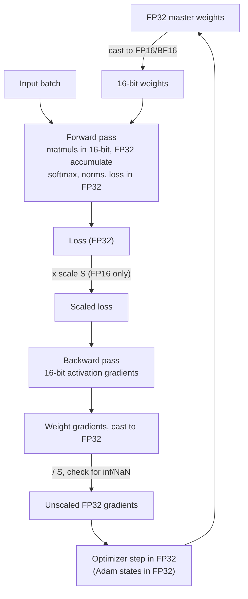

# Mixed-Precision Training: FP32, FP16 and BF16

> **Level:** Beginner to Advanced · **Study time:** ~90 min · **Prerequisites:** [Backpropagation and Gradient Descent](02-backpropagation-and-gradient-descent.md), [Optimizers: SGD, Momentum, RMSProp, Adam, AdamW and Learning Rate Schedules](03-optimizers-sgd-momentum-adam-and-learning-rate-schedules.md), [Vanishing and Exploding Gradients, Initialization, Normalization and Residual Connections](05-vanishing-exploding-gradients-initialization-normalization-and-residuals.md), [Softmax, Entropy, Cross-Entropy and KL Divergence](../00-foundations/05-softmax-entropy-cross-entropy-and-kl-divergence.md)

## Table of contents

- [Why this matters](#why-this-matters)
- [1. How computers store real numbers](#1-how-computers-store-real-numbers)
- [2. Range vs precision](#2-range-vs-precision)
- [3. The formats: FP32, TF32, FP16, BF16 and FP8](#3-the-formats-fp32-tf32-fp16-bf16-and-fp8)
- [4. Why lower precision is faster and smaller](#4-why-lower-precision-is-faster-and-smaller)
- [5. The mixed-precision training recipe](#5-the-mixed-precision-training-recipe)
- [6. Loss scaling: why FP16 needs it](#6-loss-scaling-why-fp16-needs-it)
- [7. Static vs dynamic loss scaling](#7-static-vs-dynamic-loss-scaling)
- [8. BF16: no loss scaling, less precision](#8-bf16-no-loss-scaling-less-precision)
- [9. Mixed precision in PyTorch: autocast and GradScaler](#9-mixed-precision-in-pytorch-autocast-and-gradscaler)
- [10. Memory savings arithmetic](#10-memory-savings-arithmetic)
- [11. Going deeper: what autocast really does](#11-going-deeper-what-autocast-really-does)
- [12. Going deeper: debugging numerical problems](#12-going-deeper-debugging-numerical-problems)
- [13. Going deeper: FP8 training and production practice](#13-going-deeper-fp8-training-and-production-practice)
- [Common mistakes and misconceptions](#common-mistakes-and-misconceptions)
- [Interview questions and model answers](#interview-questions-and-model-answers)
- [Key takeaways](#key-takeaways)
- [Further reading](#further-reading)
- [Next](#next)

## Why this matters

Nearly every modern large model, from ResNets to 70B-parameter LLMs, is trained in mixed precision: most of the math runs in 16-bit (or even 8-bit) numbers, while a few sensitive pieces stay in 32-bit. Done right, this gives large speedups on GPU tensor cores and roughly halves activation memory, typically with no measurable loss in final accuracy. Done wrong, it gives you NaN losses at step 40,000, silently stalled training, or a fine-tuned model that overflows when you serve it in a different format. Interviewers for AI/ML roles ask "compare FP32, FP16 and BF16" and "why does FP16 need loss scaling?" because the answers show whether you understand what is actually happening inside the hardware and the training loop. The same number-format knowledge is the foundation for quantization and efficient inference later in this course.

---

## 1. How computers store real numbers

> **Analogy:** Scientific notation. A chemist writes Avogadro's number as $6.022 \times 10^{23}$ instead of 602,200,000,000,000,000,000,000. There are three parts: a sign (positive), a few significant digits (6.022), and a power of ten (23). Computers do exactly this, but in base 2 and with a fixed number of bits for each part.

A **floating-point number** is a number stored as a sign, an exponent and a fraction, so that the "decimal point" (really a binary point) can float to wherever it is needed. This lets the same 32 bits represent both 0.000001 and 1,000,000. Almost all hardware follows the **IEEE 754** standard, which fixes the bit layouts, special values and rounding rules used below (BF16 and FP8 are not IEEE formats but reuse the same ideas).

The three fields:

- **Sign bit** ($s$): 0 means positive, 1 means negative.
- **Exponent** ($e$): an unsigned integer that sets the scale (which power of 2). It is stored with a **bias** (an offset) so that negative powers can be represented without a separate sign. For example, FP32 stores the true exponent plus 127.
- **Mantissa** (also called the **significand** or **fraction**, $m$): the significant bits. For normal numbers there is an invisible leading 1 (the **implicit leading bit**) that is not stored, so you get one extra bit of precision for free.

The value of a **normal number** (the usual case) is:

$$x = (-1)^{s} \times 2^{\,e - \text{bias}} \times \left(1 + \frac{m}{2^{M}}\right)$$

- $s$: the sign bit (0 or 1).
- $e$: the stored exponent field, read as an unsigned integer.
- $\text{bias}$: a fixed offset, $2^{E-1} - 1$, where $E$ is the number of exponent bits (127 for 8 exponent bits, 15 for 5 exponent bits).
- $m$: the mantissa field, read as an unsigned integer.
- $M$: the number of mantissa bits.
- $1 + m/2^M$: the significand, a number in $[1, 2)$.

### Bit layouts

```text
FP32 (IEEE 754 single precision, 32 bits)
  bit: 31 | 30 ......... 23 | 22 .......................................... 0
       S  |  exponent (8)   |               mantissa (23)

FP16 (IEEE 754 half precision, 16 bits)
  bit: 15 | 14 ... 10 | 9 ........... 0
       S  |  exp (5)  | mantissa (10)

BF16 (bfloat16, "brain floating point", 16 bits)
  bit: 15 | 14 ......... 7 | 6 ..... 0
       S  |  exponent (8)  | mant (7)

  BF16 is literally the top 16 bits of an FP32 number:
  FP32:  S | EEEEEEEE | MMMMMMM MMMMMMMMMMMMMMMM
  BF16:  S | EEEEEEEE | MMMMMMM  (lower 16 bits dropped, with rounding)
```

| Format | Total bits | Sign | Exponent | Mantissa (stored) | Bias |
|---|---|---|---|---|---|
| FP32 | 32 | 1 | 8 | 23 | 127 |
| TF32 | 19 (held in 32-bit registers) | 1 | 8 | 10 | 127 |
| FP16 | 16 | 1 | 5 | 10 | 15 |
| BF16 | 16 | 1 | 8 | 7 | 127 |
| FP8 E4M3 | 8 | 1 | 4 | 3 | 7 |
| FP8 E5M2 | 8 | 1 | 5 | 2 | 15 |

### Worked example: storing 6.5 in FP16

Let us encode $6.5$ by hand.

1. Write it in binary: $6 = 110_2$ and $0.5 = 0.1_2$, so $6.5 = 110.1_2$.
2. Normalize so there is one 1 before the point: $110.1_2 = 1.101_2 \times 2^2$.
3. Sign: positive, so $s = 0$.
4. Exponent: true exponent is 2. FP16 bias is 15, so stored $e = 2 + 15 = 17 = 10001_2$.
5. Mantissa: the bits after the point are $101$, padded to 10 bits: $1010000000_2$. As an integer that is $512 + 128 = 640$.

Stored bits: `0 10001 1010000000`.

Decode to check: $2^{17 - 15} \times (1 + 640/1024) = 4 \times 1.625 = 6.5$. Correct.

In FP32 the same number is `0 10000001 10100000000000000000000` (exponent $2 + 127 = 129 = 10000001_2$), which is hex `0x40D00000`. Chop off the lower 16 bits and you get `0x40D0`, which is exactly 6.5 in BF16. That "BF16 is truncated FP32" property makes conversions between the two cheap and, because the exponent field is identical, free of range problems (the only exception is FP32 values within about 0.2% of FP32's maximum, which round up to inf).

### Special values

- **Zero**: exponent field all 0s and mantissa all 0s (there is a +0 and a -0).
- **Subnormal** (or **denormal**) numbers: exponent field all 0s and mantissa not 0. The implicit leading bit becomes 0 instead of 1, which lets the format represent values smaller than the smallest normal number, at reduced precision. Value: $(-1)^s \times 2^{1-\text{bias}} \times (m / 2^M)$.
- **Infinity** (inf): exponent all 1s, mantissa 0. You get it on **overflow**, when a result is too large to represent.
- **NaN** ("not a number"): exponent all 1s, mantissa not 0. You get it from undefined operations such as $0/0$, $\infty - \infty$ or $0 \times \infty$. NaN is contagious: any arithmetic with NaN gives NaN, so one bad value can poison an entire model in one step.
- **Underflow**: when a result is too small to represent and rounds to 0 (or to a subnormal, losing precision).

> **Common mistake:** Thinking floating-point numbers are evenly spaced. They are not. There are as many FP16 numbers between 1 and 2 as between 1024 and 2048. The gaps grow with the magnitude, which is the whole story behind most mixed-precision bugs.

---

## 2. Range vs precision

> **Analogy:** A ruler vs a tape measure. A 30 cm ruler marked in millimeters has great precision but short range. A 100 m surveyor's tape marked every centimeter has huge range but coarser marks. With a fixed budget of bits, you choose how many go to range (exponent) and how many go to precision (mantissa).

- **Range** (also called **dynamic range**): how small and how large a number the format can represent. It is controlled by the **exponent bits**.
- **Precision**: how finely spaced the representable numbers are, relative to their size. It is controlled by the **mantissa bits**.

### The gap between neighboring numbers

The distance from a number to the next representable number is called the **ULP** (unit in the last place). For a normal number $x$:

$$\text{ulp}(x) = 2^{\lfloor \log_2 |x| \rfloor - M}$$

- $\lfloor \log_2 |x| \rfloor$: the power of 2 just at or below $|x|$ (the "binade" $x$ lives in).
- $M$: the number of mantissa bits.

The **machine epsilon** $\varepsilon = 2^{-M}$ is the ULP at 1.0. With round-to-nearest, the worst-case relative rounding error is half of that, $2^{-(M+1)}$, called the **unit roundoff**.

Worked examples:

- FP16 at $x = 1$: $\lfloor \log_2 1 \rfloor = 0$, so $\text{ulp} = 2^{0 - 10} = 2^{-10} \approx 0.000977$. The number after 1.0 in FP16 is 1.0009765625.
- FP16 at $x = 2048$: $\lfloor \log_2 2048 \rfloor = 11$, so $\text{ulp} = 2^{11 - 10} = 2$. FP16 cannot represent 2049. $2048 + 1$ lands exactly halfway between 2048 and 2050, and the tie-breaking rule (round to the neighbor whose last mantissa bit is 0, called **round-half-to-even**) gives 2048.
- BF16 at $x = 256$: $\lfloor \log_2 256 \rfloor = 8$, so $\text{ulp} = 2^{8 - 7} = 2$. In BF16, $256 + 1 = 256$ for the same reason.

Here is the same number, $1/3$, rounded into each format (values computed exactly):

| Format | Stored value of 1/3 | Absolute error |
|---|---|---|
| FP32 | 0.3333333432674408 | about 1e-8 |
| FP16 | 0.333251953125 | about 8.1e-5 |
| BF16 | 0.333984375 | about 6.5e-4 |

A rough rule of thumb for decimal digits of precision is $(M + 1) \times \log_{10} 2 \approx (M+1) \times 0.301$: FP32 gives $24 \times 0.301 \approx 7.2$ digits, FP16 gives $11 \times 0.301 \approx 3.3$ digits, and BF16 gives $8 \times 0.301 \approx 2.4$ digits.

### Seeing it in code

```python
# pip install torch
import torch

# Rounding near large values: the gap between numbers is 2 here
print(torch.tensor(2048.0, dtype=torch.float16) + 1)   # tensor(2048., dtype=torch.float16)
print(torch.tensor(256.0, dtype=torch.bfloat16) + 1)   # tensor(256., dtype=torch.bfloat16)

# A tiny update to a weight of 1.0 vanishes in 16-bit formats
w32 = torch.tensor(1.0, dtype=torch.float32)
w16 = torch.tensor(1.0, dtype=torch.float16)
wbf = torch.tensor(1.0, dtype=torch.bfloat16)
print((w32 + 1e-5).item())  # 1.0000100135803223  (FP32 keeps it, approximately)
print((w16 + 1e-5).item())  # 1.0                 (lost)
print((wbf + 1e-5).item())  # 1.0                 (lost)

# Underflow: small numbers become zero in FP16 but not in BF16
print(torch.tensor(1e-8, dtype=torch.float16).item())   # 0.0
print(torch.tensor(1e-8, dtype=torch.bfloat16).item())  # about 1e-08 (rounded to 8 significant bits)

# Format properties in one place
for dt in [torch.float32, torch.float16, torch.bfloat16]:
    fi = torch.finfo(dt)
    # max: largest finite value, tiny: smallest normal value, eps: gap at 1.0
    print(dt, "max", fi.max, "tiny", fi.tiny, "eps", fi.eps)
```

> **Senior insight:** "Range" failures and "precision" failures look different in practice. Range failures are loud: inf, NaN, or gradients that are exactly zero. Precision failures are quiet: updates that silently round away, sums that stop growing, a loss curve that is slightly worse than FP32. You need different detection tools for each (Section 12).

---

## 3. The formats: FP32, TF32, FP16, BF16 and FP8

Now the main comparison. Ranges below follow from the formulas in Section 1 ($\text{max normal} = (2 - 2^{-M}) \times 2^{\text{maxexp}}$, $\text{min normal} = 2^{1 - \text{bias}}$, $\text{min subnormal} = 2^{1 - \text{bias} - M}$), except where noted for E4M3. Here $\text{maxexp} = (2^{E} - 2) - \text{bias}$ is the largest true exponent, because the all-ones exponent pattern is reserved for inf and NaN.

Worked example for FP16 ($E = 5$, $M = 10$, bias 15): $\text{maxexp} = 30 - 15 = 15$, so the max is $(2 - 2^{-10}) \times 2^{15} = 65{,}504$; the min normal is $2^{1-15} = 2^{-14} \approx 6.10 \times 10^{-5}$; the min subnormal is $2^{1-15-10} = 2^{-24} \approx 5.96 \times 10^{-8}$.

| Format | Bits (S/E/M) | Approx. max | Min normal | Min subnormal | Machine eps ($2^{-M}$) | Decimal digits | Typical use |
|---|---|---|---|---|---|---|---|
| **FP32** | 1/8/23 | $3.4 \times 10^{38}$ | $1.18 \times 10^{-38}$ | $1.4 \times 10^{-45}$ | $1.19 \times 10^{-7}$ | ~7.2 | Master weights, optimizer states, reductions, default training |
| **TF32** | 1/8/10 | $3.4 \times 10^{38}$ | $1.18 \times 10^{-38}$ | (as FP32) | $9.77 \times 10^{-4}$ | ~3.3 | Internal tensor-core math mode for FP32 matmuls (NVIDIA Ampere and later) |
| **FP16** | 1/5/10 | 65,504 | $6.10 \times 10^{-5}$ | $5.96 \times 10^{-8}$ | $9.77 \times 10^{-4}$ | ~3.3 | Mixed-precision training with loss scaling, inference |
| **BF16** | 1/8/7 | $3.39 \times 10^{38}$ | $1.18 \times 10^{-38}$ | $9.2 \times 10^{-41}$ | $7.81 \times 10^{-3}$ | ~2.4 | Default for LLM training and inference on modern GPUs and TPUs |
| **FP8 E4M3** | 1/4/3 | 448 | $1.56 \times 10^{-2}$ | $1.95 \times 10^{-3}$ | 0.125 | ~1.2 | Forward pass (weights, activations) in FP8 training, FP8 inference |
| **FP8 E5M2** | 1/5/2 | 57,344 | $6.10 \times 10^{-5}$ | $1.53 \times 10^{-5}$ | 0.25 | ~0.9 | Gradients in FP8 training (needs range more than precision) |

Notes on each:

- **FP32** (single precision, IEEE 754): the historical default for deep learning. Plenty of range and precision for training, but the slowest and largest of these formats on modern accelerators.
- **TF32** ("TensorFloat-32"): not a storage format. Tensors stay in FP32 in memory, but NVIDIA tensor cores (dedicated matrix-multiply units, explained in Section 4.1; Ampere generation, such as the A100, and later) can internally round matmul inputs to 10 mantissa bits, multiply, and accumulate in FP32. You get FP32's range with FP16's precision, at much higher speed, with zero code changes beyond a flag.
- **FP16** (half precision, IEEE 754): same precision as TF32, but only 5 exponent bits. The maximum is 65,504, the smallest positive value is about $6 \times 10^{-8}$, and anything below about $3 \times 10^{-8}$ (half of that) rounds to 0. The narrow range is the reason for loss scaling.
- **BF16** (bfloat16, originally from Google Brain for TPUs): keeps FP32's 8 exponent bits, so it has essentially FP32's range, but only 7 mantissa bits, so it is 8 times coarser than FP16 at the same magnitude. Trading precision for range turned out to be the right call for training neural networks.
- **FP8**: two variants proposed together for deep learning ("FP8 Formats for Deep Learning", Micikevicius et al., 2022) and later adopted in the OCP 8-bit floating point (OFP8) specification. **E4M3** has 4 exponent bits and 3 mantissa bits; the common variant (called `float8_e4m3fn` in PyTorch, "fn" meaning finite, no infinity) reclaims most of the top exponent for normal numbers, has no infinity and only one NaN encoding (all exponent and mantissa bits 1, for either sign), which is why its max is 448 rather than the IEEE-style formula's 240. **E5M2** has 5 exponent bits and 2 mantissa bits, follows IEEE conventions (has inf and NaN), and has FP16's range with very low precision. Because FP8 range is so small, FP8 training in practice always uses explicit **scaling factors** per tensor or per block (Section 13).

```python
import torch

# FP8 dtypes exist in PyTorch 2.1+; arithmetic support on them is limited and hardware-dependent.
for dt in [torch.float16, torch.bfloat16, torch.float8_e4m3fn, torch.float8_e5m2]:
    fi = torch.finfo(dt)
    print(f"{str(dt):22s} bits={fi.bits:2d} max={fi.max:<12g} tiny={fi.tiny:<12g} eps={fi.eps}")
# float16 max=65504 eps=0.0009765625, bfloat16 eps=0.0078125,
# float8_e4m3fn max=448 eps=0.125, float8_e5m2 max=57344 eps=0.25
```

> **Interview tip:** If you only memorize one sentence: "FP16 and BF16 are both 16 bits, but FP16 spends its bits on precision (10 mantissa bits) and BF16 spends them on range (8 exponent bits, same as FP32). That is why FP16 needs loss scaling and BF16 usually does not."

---

## 4. Why lower precision is faster and smaller

> **Analogy:** Moving house. If every box is half the size, the same truck carries twice as many boxes per trip (memory bandwidth), and your movers can carry two at a time (compute throughput).

Three separate effects make 16-bit training faster.

### 4.1 Tensor cores do more low-precision math per cycle

A **tensor core** is a specialized hardware unit on NVIDIA GPUs (Volta generation, 2017, and later; other vendors have equivalents such as the matrix units on Google TPUs and AMD's matrix cores) that performs a small matrix multiply-accumulate, $D = A \times B + C$, in one operation. The multiply inputs ($A$, $B$) are low precision, and the accumulation into $C$/$D$ is typically done in FP32.

Narrower multipliers need much less silicon area and energy (a multiplier's cost grows roughly with the square of the mantissa width), so a chip can pack many more of them. Published peak numbers for the NVIDIA A100 (dense, from NVIDIA's datasheet) illustrate the gap:

| A100 math mode | Peak throughput (dense) |
|---|---|
| FP32 (regular CUDA cores) | 19.5 TFLOPS |
| TF32 tensor cores | 156 TFLOPS |
| FP16 or BF16 tensor cores | 312 TFLOPS |

NVIDIA GPU generations come up throughout this chapter, so for reference: Volta (V100, 2017), Turing (T4, 2018), Ampere (A100, 2020), Hopper (H100, 2022) and Blackwell (2024). Volta and Turing have FP16 tensor cores but no BF16; Ampere adds BF16 and TF32; Hopper (and the Ada Lovelace generation, such as the L4 and L40S) adds FP8.

Peak numbers are upper bounds that real models rarely reach, but the ratio is real: the same matmul can be several times faster in 16-bit than in plain FP32. The Hopper generation (H100) added FP8 tensor cores at roughly twice its FP16 rate, and the Blackwell generation adds still narrower formats. Exact numbers change every GPU generation; the durable fact is "each halving of bit width roughly doubles peak tensor-core throughput".

### 4.2 Half the bytes means half the memory traffic

Many operations in a network (activations like GELU, adding residuals, normalization, dropout) do very little math per byte. They are **memory-bound**: their speed is limited by how fast data moves between GPU memory and the compute units (**memory bandwidth**), not by arithmetic. Storing tensors in 2 bytes instead of 4 halves the bytes moved, so these operations get close to 2 times faster. See [GPU Fundamentals for LLMs: Compute-Bound vs Memory-Bound](../06-llm-inference/03-gpu-fundamentals-compute-bound-vs-memory-bound.md) for the full model (arithmetic intensity and the roofline).

### 4.3 Half the memory means bigger batches and models

Activations saved for the backward pass are stored in 16-bit, so they take half the memory. That frees room for a larger batch, longer sequences, or a bigger model on the same GPU, which often improves utilization further. In multi-GPU training, sending 16-bit tensors between GPUs also halves communication volume.

> **Senior insight:** "Mixed precision makes training 2 times faster" is a myth stated as a rule. The speedup depends on what fraction of time is in tensor-core matmuls, whether the model is memory-bound, whether tensor shapes are tensor-core friendly (dimensions that are multiples of 8 are the long-standing NVIDIA guidance for FP16), and how much time is spent on data loading and communication. Measure it (Section 13).

---

## 5. The mixed-precision training recipe

> **Analogy:** An accountant doing quick calculations on a pocket calculator but recording the final balances in a precise ledger. The calculator (16-bit) is fast for the bulk of the work; the ledger (32-bit) keeps small amounts from getting lost over thousands of entries.

**Mixed-precision training** means training a model using lower-precision numbers (FP16 or BF16) for most of the computation, especially matrix multiplies and stored activations, while keeping a few numerically sensitive parts in FP32, so that you get the speed and memory benefits of 16-bit with the accuracy of FP32. The standard recipe was introduced in "Mixed Precision Training" (Micikevicius et al., ICLR 2018) and has three pillars:

1. **FP32 master weights.** Keep the authoritative copy of the weights in FP32. Each step, use a 16-bit copy for the forward and backward passes, then apply the update to the FP32 copy.
2. **Loss scaling** (for FP16): multiply the loss by a large factor before backprop so small gradients do not underflow, and divide it back out before the update (Section 6).
3. **FP32 accumulation and FP32 for sensitive operations**: matrix multiplies take 16-bit inputs but accumulate their dot products in FP32; reductions, softmax, normalization and losses run in FP32.



### 5.1 Why the master weights must be FP32

A weight update is usually tiny compared with the weight itself. Recall the gradient descent update from [Backpropagation and Gradient Descent](02-backpropagation-and-gradient-descent.md):

$$w_{\text{new}} = w - \eta \cdot g$$

- $w$: a weight.
- $\eta$: the learning rate.
- $g$: the gradient of the loss with respect to $w$.

Worked example (illustrative values): $w = 1.0$, $\eta = 10^{-4}$, $g = -0.1$. The update is $-\eta g = 10^{-4} \times 0.1 = 10^{-5}$.

- In FP16, the gap between numbers near 1.0 is $2^{-10} \approx 0.000977$. A change smaller than half the gap, $0.000488$, rounds away. Since $10^{-5} < 0.000488$, we get $1.0 + 0.00001 = 1.0$. The update is lost.
- In BF16 the gap near 1.0 is $2^{-7} = 0.0078125$, so it is lost even more easily.
- In FP32 the gap near 1.0 is $2^{-23} \approx 1.19 \times 10^{-7}$, so the update survives.

Repeat this step 1,000 times. In FP32 the weight drifts to about $1.0100$ (the true answer is $1.01$; FP32 gives 1.0100135..., a tiny accumulated rounding error). In FP16 it stays at exactly $1.0$ forever. The model looks like it is training, the loss computation is fine, but this weight never moves. This failure is called **weight update stagnation** (or "update underflow").

The ratio that matters is update size divided by weight size. If it is below roughly $2^{-11}$ (about $5 \times 10^{-4}$), FP16 drops the update; for BF16 the threshold is about $2^{-8}$ (about $4 \times 10^{-3}$). With typical learning rates, many updates fall below these thresholds, so the weights you update must be FP32.

### 5.2 Why optimizer states stay FP32

Adam keeps a running average of gradients ($m$) and of squared gradients ($v$), and divides by $\sqrt{v} + \epsilon$ (see [Optimizers](03-optimizers-sgd-momentum-adam-and-learning-rate-schedules.md)). Squared gradients of $10^{-4}$ are $10^{-8}$, which is below FP16's smallest subnormal ($5.96 \times 10^{-8}$) and would become 0. Adam's default $\epsilon = 10^{-8}$ also underflows to 0 in FP16, which risks dividing by zero. So optimizer states live in FP32 (or, in some memory-saving setups, in carefully designed 8-bit formats with their own scaling, which is a different technique).

### 5.3 Which operations stay in FP32, and why

Not every operation is safe in 16-bit. The rule of thumb: **operations that sum many numbers, or that involve exponentials or logarithms, need FP32**.

| Operation | Precision used in mixed precision | Why |
|---|---|---|
| Matrix multiply, convolution, linear layers | 16-bit inputs, FP32 accumulation | This is where the speedup is; FP32 accumulation keeps long dot products accurate |
| Elementwise ops (ReLU, GELU, add, dropout) | 16-bit | Cheap, memory-bound, numerically benign |
| **Softmax**, log-softmax | FP32 | $e^x$ overflows FP16 for $x > \ln 65504 \approx 11.09$; the sum over a vocabulary of 50k+ values needs precision |
| **Normalization** (LayerNorm, BatchNorm, RMSNorm) | Statistics in FP32 | Computing mean and variance sums many values and involves squares and a square root |
| **Reductions** (sum, mean, norm) | FP32 accumulation | A long sum in 16-bit stops growing once the running total is large (see Section 8) |
| **Loss functions** (cross-entropy, MSE) | FP32 | Involve log/exp and reductions; the loss is the starting point of every gradient |
| exp, log, pow | FP32 | Small input changes cause large output changes; overflow risk |
| Optimizer step and states | FP32 | Section 5.1 and 5.2 |

Worked example for softmax overflow: an attention score of 12 is completely normal. $e^{12} \approx 162{,}755$, which is above FP16's max of 65,504, so it becomes inf, and $\infty / \infty$ in the softmax normalization gives NaN. Implementations subtract the maximum before exponentiating (the "safe softmax" trick from [Softmax, Entropy, Cross-Entropy and KL Divergence](../00-foundations/05-softmax-entropy-cross-entropy-and-kl-divergence.md)) and run the computation in FP32 anyway, because even with the max subtracted, the denominator sum benefits from FP32.

### 5.4 Why accumulation precision matters inside a matmul

A matmul output element is a dot product: $y = \sum_{k=1}^{K} a_k b_k$. For a hidden size of $K = 4096$, that is 4,096 products added together. If the running sum were kept in FP16 (3.3 digits), the small contributions near the end would round away once the sum grows. Tensor cores therefore multiply 16-bit inputs and add into an FP32 accumulator, and only the final result is rounded to 16-bit. This is invisible to you in PyTorch, but it is a key reason 16-bit matmuls are accurate enough.

---

## 6. Loss scaling: why FP16 needs it

> **Analogy:** Weighing a single grain of rice on a bathroom scale reads 0. Weigh 10,000 grains together, read the scale, then divide by 10,000: now you get a real answer. Loss scaling does this with gradients: it multiplies them up into the range FP16 can see, then divides back down in FP32.

### 6.1 The problem: gradient underflow

Backprop produces two kinds of gradients. **Activation gradients** are $\partial L / \partial h$ for each layer's output $h$; backprop passes them from layer to layer, and under mixed precision they are 16-bit tensors. **Weight gradients** are $\partial L / \partial w$ for the parameters; with autocast they end up in FP32 `.grad` fields. Underflow hits the 16-bit activation gradients first, and once a value has rounded to zero, its contribution to every earlier layer's gradients is lost.

Gradients in deep networks are often tiny. Many activation gradients are around $10^{-6}$ to $10^{-9}$, especially in deep layers, with small learning signals, or late in training. Micikevicius et al. (2018) plotted activation-gradient histograms for real networks and showed that a meaningful fraction of values fell below FP16's smallest representable number, so they would become exactly 0.

Recall FP16's limits:

- Smallest normal: $2^{-14} \approx 6.10 \times 10^{-5}$ (full 11-bit precision above this).
- Smallest subnormal: $2^{-24} \approx 5.96 \times 10^{-8}$ (precision degrades between this and the smallest normal).
- Anything below about half the smallest subnormal ($\approx 2.98 \times 10^{-8}$) rounds to 0.

Meanwhile FP16's top end is 65,504, and real gradients almost never get near it. The values sit at the bottom of the representable range and the top is unused. Loss scaling simply shifts them up. Concretely, gradients between $10^{-9}$ and $10^{-6}$ (about $2^{-30}$ to $2^{-20}$) sit in the underflow and subnormal zones; multiplying by $2^{16}$ moves them to about $2^{-14}$ to $2^{-4}$, inside the normal range and still roughly $10^{6}$ times below the max.

### 6.2 The fix: scale the loss

Because backpropagation is linear in the loss (by the chain rule, every gradient is a product that includes $\partial L / \partial \text{output}$), multiplying the loss by a constant multiplies every gradient by the same constant:

$$\nabla_\theta (S \cdot L) = S \cdot \nabla_\theta L$$

- $L$: the loss.
- $S$: the **loss scale**, a large constant such as $2^{16} = 65{,}536$. Powers of 2 are used because multiplying or dividing by a power of 2 only changes the exponent, so it introduces no rounding error.
- $\theta$: the model parameters.
- $\nabla_\theta$: the gradient with respect to all parameters.

The procedure:

1. Compute the loss $L$ in FP32.
2. Backpropagate $S \cdot L$. All gradients, including the 16-bit activation gradients in the middle of the network, are $S$ times larger, so they stay above the underflow threshold.
3. Convert weight gradients to FP32 and **unscale**: $g = \hat{g} / S$, where $\hat{g}$ is the scaled gradient.
4. Check for inf or NaN (overflow). If found, skip the step (Section 7).
5. Apply the optimizer update in FP32.

The optimizer sees exactly the gradients it would have seen without scaling, except that the small ones are no longer zero.

### 6.3 Worked numeric example

Take three illustrative gradient values from one backward pass, true values in FP32:

| | $g_1$ | $g_2$ | $g_3$ |
|---|---|---|---|
| True gradient | $3 \times 10^{-3}$ | $1 \times 10^{-7}$ | $2 \times 10^{-8}$ |

**Without scaling, stored in FP16:**

- $g_1 = 0.003$: well inside the normal range. Stored as $0.0030002594$ (relative error about 0.009%). Fine.
- $g_2 = 10^{-7}$: below the smallest normal, so it is a subnormal. Subnormals are multiples of $2^{-24} \approx 5.96 \times 10^{-8}$. $10^{-7} / 5.96 \times 10^{-8} \approx 1.68$, which rounds to 2, so it is stored as $2 \times 5.96 \times 10^{-8} \approx 1.19 \times 10^{-7}$. That is a **19% error**.
- $g_3 = 2 \times 10^{-8}$: $2 \times 10^{-8} / 5.96 \times 10^{-8} \approx 0.34$, which rounds to 0. Stored as **0**. The gradient is gone.

**With loss scale $S = 2^{16} = 65{,}536$:**

- $g_1 \times S = 0.003 \times 65{,}536 = 196.608$, stored as $196.625$ (normal range, fine).
- $g_2 \times S = 10^{-7} \times 65{,}536 = 0.0065536$, stored as $0.0065536499$ (normal range, full precision).
- $g_3 \times S = 2 \times 10^{-8} \times 65{,}536 = 0.00131072$, stored as $0.0013103485$ (normal range, full precision).

**Unscale in FP32** (divide by 65,536):

- $196.625 / 65{,}536 \approx 3.0003 \times 10^{-3}$
- $0.0065536499 / 65{,}536 \approx 1.00001 \times 10^{-7}$ (error now about 0.001%)
- $0.0013103485 / 65{,}536 \approx 1.99943 \times 10^{-8}$ (error now about 0.03%, instead of 100%)

Loss scaling turned a 100% loss of $g_3$ and a 19% error on $g_2$ into errors well under 0.1%.

**The catch: overflow.** Now suppose some other gradient is $g_4 = 2.0$ (a large but plausible gradient, for example early in training or during a loss spike). Scaled: $2.0 \times 65{,}536 = 131{,}072$, which exceeds FP16's max of 65,504, so it becomes **inf**. Too small a scale causes underflow; too large a scale causes overflow. The right scale depends on the model and changes during training, which motivates dynamic loss scaling.

```python
# pip install numpy
# From-scratch demonstration of gradient underflow and loss scaling with NumPy's float16.
import numpy as np

true_grads = np.array([3e-3, 1e-7, 2e-8], dtype=np.float64)

# 1) No scaling: cast straight to FP16
no_scale = true_grads.astype(np.float16)
print("FP16, no scaling:", no_scale.astype(np.float64))
# about [3.0003e-03, 1.1921e-07, 0.0]  <- g3 underflowed to zero

# 2) Loss scaling: multiply by S, store in FP16, unscale in FP32
S = 2.0 ** 16
scaled_fp16 = (true_grads * S).astype(np.float16)
unscaled = scaled_fp16.astype(np.float32) / np.float32(S)
print("FP16 with loss scale, unscaled in FP32:", unscaled)
# about [3.0003e-03, 1.0000e-07, 1.9994e-08]  <- all three survive

# 3) Overflow: a large gradient times S exceeds 65504
print(np.float16(2.0 * S))  # inf (NumPy may also print an overflow RuntimeWarning)
```

---

## 7. Static vs dynamic loss scaling

### 7.1 Static loss scaling

**Static loss scaling** uses one fixed scale $S$ for the entire run, chosen by hand (for example 128, 1024 or 32,768).

- Pros: simple, deterministic, no wasted steps.
- Cons: you must tune $S$ per model. Too low and gradients underflow; too high and you get inf. The ideal value drifts as gradient magnitudes change during training (gradients often shrink as the loss falls), so a value that works at step 1,000 may not at step 100,000.

### 7.2 Dynamic loss scaling

**Dynamic loss scaling** adjusts $S$ automatically: start high, back off when an overflow happens, and cautiously grow again after a run of good steps. This is what PyTorch's `GradScaler` does, and its defaults are a good mental model:

| Setting | PyTorch `GradScaler` default | Meaning |
|---|---|---|
| `init_scale` | $2^{16} = 65{,}536$ | Starting scale |
| `backoff_factor` | 0.5 | On overflow, multiply scale by this (halve it) |
| `growth_factor` | 2.0 | After enough good steps, multiply scale by this (double it) |
| `growth_interval` | 2000 | Number of consecutive overflow-free steps before growing |

The algorithm each step:

```text
scaled_loss = loss * S
backward(scaled_loss)
grads = grads / S                         # unscale (in FP32)
if any(isinf(grads) or isnan(grads)):     # overflow detection
    skip optimizer step                   # do NOT update weights
    S = S * backoff_factor                # e.g. halve
    good_steps = 0
else:
    optimizer.step()
    good_steps += 1
    if good_steps == growth_interval:
        S = S * growth_factor             # e.g. double
        good_steps = 0
```

**Overflow detection and skipped steps.** If any gradient is inf or NaN, the update would corrupt the weights (one NaN weight spreads NaN everywhere). So the whole step is thrown away, the scale is lowered, and training continues with the next batch. Skipping a step is cheap insurance: you lose one batch of compute, not the run.

Illustrative trace at the start of training (values made up to show the mechanism):

| Step | Scale $S$ | Overflow? | Action |
|---|---|---|---|
| 1 | 65,536 | yes | skip, $S \to 32{,}768$ |
| 2 | 32,768 | yes | skip, $S \to 16{,}384$ |
| 3 | 16,384 | no | update |
| 4 to 2,002 | 16,384 | no | update (2,000 good steps in a row, counting step 3) |
| 2,003 | 32,768 | no | scale was doubled after step 2,002, update |
| ... | ... | occasionally | back off, regrow |

A few skipped steps at the start are normal and expected. The scale then oscillates near the largest value that does not overflow, which keeps as many small gradients as possible representable.

```python
# A from-scratch dynamic loss scaler (for understanding; use torch.amp.GradScaler in practice).
import math

class DynamicLossScaler:
    def __init__(self, init_scale=2.0**16, growth_factor=2.0,
                 backoff_factor=0.5, growth_interval=2000):
        self.scale = init_scale
        self.growth_factor = growth_factor
        self.backoff_factor = backoff_factor
        self.growth_interval = growth_interval
        self.good_steps = 0

    def update(self, found_inf: bool) -> bool:
        """Call after unscaling. Returns True if the optimizer step should run."""
        if found_inf:
            self.scale *= self.backoff_factor
            self.good_steps = 0
            return False                      # skip this step
        self.good_steps += 1
        if self.good_steps % self.growth_interval == 0:
            self.scale *= self.growth_factor
        return True

scaler = DynamicLossScaler(growth_interval=3)  # tiny interval just for the demo
for found_inf in [True, True, False, False, False, False]:
    ok = scaler.update(found_inf)
    print(f"found_inf={found_inf!s:5}  step_taken={ok!s:5}  new_scale={scaler.scale:g}")
# found_inf=True   step_taken=False  new_scale=32768
# found_inf=True   step_taken=False  new_scale=16384
# found_inf=False  step_taken=True   new_scale=16384
# found_inf=False  step_taken=True   new_scale=16384
# found_inf=False  step_taken=True   new_scale=32768
# found_inf=False  step_taken=True   new_scale=32768
```

> **Common mistake:** Panicking because the log shows "skipped step" or the scale dropped at the start. That is the scaler working. What should worry you is the scale **collapsing** to very small values (for example below 1) or steps being skipped constantly: that means the model is producing genuine inf/NaN, and loss scaling is hiding a real bug (Section 12).

---

## 8. BF16: no loss scaling, less precision

### 8.1 Why BF16 usually does not need loss scaling

BF16 has 8 exponent bits, exactly like FP32, so its smallest normal number is $2^{-126} \approx 1.18 \times 10^{-38}$, the same as FP32. Gradients of $10^{-8}$, $10^{-20}$ or even $10^{-30}$ are all representable. There is no underflow problem to fix, so `GradScaler` is unnecessary. Overflow is also not a practical concern because the max is about $3.4 \times 10^{38}$.

Rerun the worked example from Section 6.3 in BF16: $g_3 = 2 \times 10^{-8}$ is stored with no underflow, just rounded to 8 significant bits (relative error at most $2^{-8} \approx 0.4\%$). That is why BF16 training "just works" without the scaler machinery, and why it became the default for LLM pretraining once hardware supported it (Google TPUs, then NVIDIA Ampere and later GPUs).

### 8.2 The downside: precision

BF16 has only 7 stored mantissa bits (8 significant bits counting the implicit 1). Its machine epsilon is $2^{-7} = 0.0078$, eight times coarser than FP16's $2^{-10}$. Consequences:

- **Single values** are less accurate: worst-case relative rounding error is $2^{-8} \approx 0.39\%$ for BF16, versus $2^{-11} \approx 0.049\%$ for FP16.
- **Accumulation** is dangerous. Summing many small values into a BF16 running total stalls once the total is large.

Worked example: add $0.01$ to a BF16 accumulator 1,000 times (the true answer is 10).

- Once the total reaches 4, it is in the binade $[4, 8)$, where $\text{ulp} = 2^{2 - 7} = 2^{-5} = 0.03125$.
- Half of that gap is $0.015625$. Since $0.01 < 0.015625$, every further $+0.01$ rounds away.
- The sum gets stuck at **4.0**. In FP16 the same loop gives about 9.95, and in FP32 about 10.0001.

```python
import torch

acc_bf16 = torch.tensor(0.0, dtype=torch.bfloat16)
acc_fp16 = torch.tensor(0.0, dtype=torch.float16)
acc_fp32 = torch.tensor(0.0, dtype=torch.float32)
for _ in range(1000):
    acc_bf16 += 0.01
    acc_fp16 += 0.01
    acc_fp32 += 0.01
print(acc_bf16.item(), acc_fp16.item(), acc_fp32.item())
# BF16 gets stuck at 4.0; FP16 ends near 9.95; FP32 ends near 10.0001
```

This is exactly why reductions, normalization statistics, matmul accumulators, master weights and optimizer states stay in FP32 even in a "BF16 model". The 16-bit format is for the bulk storage and the multiply inputs; FP32 is for anything that accumulates.

> **Senior insight:** BF16's low precision is tolerated in training because training is noisy anyway: SGD already adds noise far larger than BF16 rounding error to every step, and the FP32 master weights absorb the small updates. The same low precision matters more where noise is not averaged out, for example in a long sum, a sensitive regression target, or comparing logits that differ by less than 0.4%.

### 8.3 FP16 vs BF16: when to use which

| | FP16 | BF16 |
|---|---|---|
| What | 5-bit exponent, 10-bit mantissa | 8-bit exponent, 7-bit mantissa |
| Range | Narrow (6e-8 to 65,504) | Same as FP32 (about 1e-38 to 3e38) |
| Precision | Better (~3.3 digits) | Worse (~2.4 digits) |
| Loss scaling | Required in practice | Not needed |
| Overflow risk | Real (activations, attention scores, large gradients) | Negligible |
| Hardware | NVIDIA Volta (V100) and later, most inference accelerators, many edge devices | NVIDIA Ampere (A100, RTX 30 series) and later, Google TPUs, recent CPUs and other accelerators |
| When to use | Hardware without fast BF16 (for example V100, T4); inference where the extra precision helps and activations are known to fit | Default for training transformers and LLMs on modern hardware |
| Pros | More precise, widely supported | Robust, simple, no scaler, FP32-like range, cheap conversion to and from FP32 |
| Cons | Needs loss scaling, can overflow; models trained in BF16 may overflow if run in FP16 | Coarse precision, careless accumulation stalls |

---

## 9. Mixed precision in PyTorch: autocast and GradScaler

PyTorch's **AMP** (Automatic Mixed Precision) has two pieces:

- **`torch.autocast`**: a context manager that, inside its block, automatically runs each operation in the precision that suits it: matmuls and convolutions in FP16/BF16, softmax, norms and losses in FP32 (this describes the CUDA op lists; the CPU lists differ, see Section 9.3). You do not change the model's dtype; the parameters stay FP32 and are cast on the fly.
- **`torch.amp.GradScaler`**: implements dynamic loss scaling for FP16. (In older PyTorch versions this was `torch.cuda.amp.GradScaler()`; newer versions prefer `torch.amp.GradScaler("cuda")`.)

### 9.1 FP16 training loop

Running example: a small classifier (think of a spam filter over 512 text features with 2 classes).

```python
# pip install torch
import torch
import torch.nn as nn

device = "cuda"  # FP16 autocast + GradScaler is meant for GPUs
torch.manual_seed(0)

model = nn.Sequential(
    nn.Linear(512, 1024), nn.GELU(),
    nn.Linear(1024, 1024), nn.GELU(),
    nn.Linear(1024, 2),
).to(device)                       # parameters stay FP32: these ARE the master weights

optimizer = torch.optim.AdamW(model.parameters(), lr=3e-4)
loss_fn = nn.CrossEntropyLoss()
scaler = torch.amp.GradScaler("cuda")   # dynamic loss scaling, default init_scale=2**16

def get_batch(batch_size=64):
    x = torch.randn(batch_size, 512, device=device)
    y = torch.randint(0, 2, (batch_size,), device=device)
    return x, y

for step in range(100):
    x, y = get_batch()
    optimizer.zero_grad(set_to_none=True)

    # Forward pass under autocast: Linear layers run in FP16, the loss runs in FP32
    with torch.autocast(device_type="cuda", dtype=torch.float16):
        logits = model(x)            # logits.dtype == torch.float16
        loss = loss_fn(logits, y)    # loss.dtype == torch.float32 (autocast promotes it)

    # Backward OUTSIDE the autocast block (autograd reuses the forward's dtypes)
    scaler.scale(loss).backward()    # backprop loss * S

    # To clip gradients, unscale first so the threshold applies to true gradient values
    scaler.unscale_(optimizer)
    torch.nn.utils.clip_grad_norm_(model.parameters(), max_norm=1.0)

    scaler.step(optimizer)           # skips the step if any grad is inf/NaN
    scaler.update()                  # adjusts the scale (halve on overflow, grow after 2000 good steps)

    if step % 20 == 0:
        print(step, loss.item(), "scale:", scaler.get_scale())
```

What each `GradScaler` call does:

| Call | What it does |
|---|---|
| `scaler.scale(loss)` | Returns `loss * S` |
| `.backward()` | Backpropagates; `.grad` fields hold scaled FP32 gradients |
| `scaler.unscale_(optimizer)` | Divides that optimizer's gradients by $S$ in place and records whether any inf/NaN was found. Optional; needed before anything that reads gradient values (clipping, logging gradient norms) |
| `scaler.step(optimizer)` | Unscales if you have not already, then calls `optimizer.step()` only if no inf/NaN was found |
| `scaler.update()` | Updates $S$ for the next iteration |

### 9.2 Gradient accumulation with a scaler

**Gradient accumulation** sums gradients over several micro-batches before one optimizer step, to simulate a larger batch. With a scaler, scale every micro-batch loss with the same scale, and only unscale, step and update once per real step:

```python
accum_steps = 4
optimizer.zero_grad(set_to_none=True)
for micro_step in range(accum_steps):
    x, y = get_batch(16)
    with torch.autocast(device_type="cuda", dtype=torch.float16):
        loss = loss_fn(model(x), y) / accum_steps   # average over micro-batches
    scaler.scale(loss).backward()                    # gradients accumulate (still scaled)

scaler.unscale_(optimizer)
torch.nn.utils.clip_grad_norm_(model.parameters(), 1.0)
scaler.step(optimizer)
scaler.update()                                      # once per optimizer step, not per micro-batch
```

### 9.3 BF16 training loop

With BF16 there is no scaler. The loop is the same as FP32 apart from the autocast block:

```python
# In recent PyTorch versions is_bf16_supported() defaults to including_emulation=True and can
# return True on pre-Ampere GPUs where BF16 is only emulated (slow); ask for native support explicitly.
assert torch.cuda.is_bf16_supported(including_emulation=False), "BF16 needs NVIDIA Ampere or newer (or another BF16-capable device)"

for step in range(100):
    x, y = get_batch()
    optimizer.zero_grad(set_to_none=True)
    with torch.autocast(device_type="cuda", dtype=torch.bfloat16):
        loss = loss_fn(model(x), y)
    loss.backward()                  # no scaling needed
    torch.nn.utils.clip_grad_norm_(model.parameters(), 1.0)
    optimizer.step()                 # FP32 master weights and FP32 Adam states
```

Autocast also works on CPU with `device_type="cpu", dtype=torch.bfloat16`, which is useful for testing and on CPUs with BF16 instructions. Its op lists are not the same as on CUDA: losses such as `cross_entropy` are still promoted to FP32, but in recent PyTorch versions ops like `softmax`, `exp` and `sum` stay in BF16 under CPU autocast, so do not assume CUDA behavior when testing on CPU.

### 9.4 TF32: free speed for FP32 code

On NVIDIA Ampere and newer GPUs, you can let FP32 matmuls use TF32 tensor cores:

```python
import torch
# Allow TF32 (or similar reduced-precision internal math) for FP32 matmuls.
torch.set_float32_matmul_precision("high")   # "highest" = full FP32 (the default for matmuls)
torch.backends.cudnn.allow_tf32 = True       # convolutions (this one already defaults to True)
```

PyTorch has changed its TF32 defaults and flags across releases (matmul TF32 has been off by default since version 1.12, while cuDNN convolutions default to on, and newer releases add additional precision-control settings), so check the docs for your version. TF32 is often combined with BF16 autocast: autocast handles most matmuls, and TF32 speeds up any FP32 matmuls left outside it.

### 9.5 Hugging Face Trainer

Higher-level libraries wrap all of this in a flag:

```python
# pip install transformers accelerate
from transformers import TrainingArguments

args = TrainingArguments(
    output_dir="out",
    bf16=True,      # or fp16=True on hardware without BF16 (handles GradScaler for you)
    tf32=True,      # allow TF32 on Ampere+ for remaining FP32 matmuls
)
```

In Hugging Face Accelerate the equivalent is `Accelerator(mixed_precision="bf16")` or `"fp16"`.

> **Common mistake:** Calling `model.half()` and then also using autocast and `GradScaler`. `model.half()` converts the parameters themselves to FP16, so there are no FP32 master weights, the optimizer updates FP16 weights, small updates vanish (Section 5.1), and `GradScaler` refuses to unscale FP16 gradients. With autocast, leave the model in FP32.

---

## 10. Memory savings arithmetic

> **Analogy:** Packing for a trip in smaller suitcases only helps for the things you actually put in suitcases. Mixed precision shrinks some of the training memory a lot, and some of it not at all.

Training memory has four main parts (covered in depth in [Distributed Training and Training Memory](10-distributed-training-and-training-memory.md)):

1. **Weights**
2. **Gradients**
3. **Optimizer states** (Adam: two values per parameter, $m$ and $v$)
4. **Activations** saved for the backward pass (plus temporary buffers)

### 10.1 Weights, gradients and optimizer states: the 7B example

Bytes per parameter with Adam. The mixed-precision row follows the classic accounting in the ZeRO paper (Rajbhandari et al., 2020), which assumes a 16-bit working copy of the weights and gradients alongside FP32 master weights and FP32 Adam states.

| Setup | Weights | Grads | FP32 master copy | Adam $m$ | Adam $v$ | Total bytes/param | 7B model |
|---|---|---|---|---|---|---|---|
| Pure FP32 + Adam | 4 | 4 | (weights are FP32) | 4 | 4 | 16 | 112 GB |
| Mixed precision + Adam (16-bit working weights and grads, FP32 master) | 2 | 2 | 4 | 4 | 4 | 16 | 112 GB |
| PyTorch AMP (params stay FP32, cast on the fly) | 4 | 4 | (params are FP32) | 4 | 4 | 16 + transient 16-bit copies | about 112 GB |
| "Pure BF16" (BF16 weights, grads and Adam states, no master copy) | 2 | 2 | 0 | 2 | 2 | 8 | 56 GB |

The arithmetic for the 7B row: $7 \times 10^9 \text{ params} \times 16 \text{ bytes} = 112 \times 10^9 \text{ bytes} = 112 \text{ GB}$, and $7 \times 10^9 \times 8 = 56 \text{ GB}$.

The surprising result: **standard mixed precision with Adam does not reduce weight, gradient and optimizer memory at all**. The FP32 master weights and FP32 Adam states dominate. The "pure BF16" row halves it, but at the cost of the update-stagnation problem from Section 5.1, which needs extra tricks such as **stochastic rounding** (rounding up or down at random, with probability proportional to closeness, so tiny updates survive on average) or **Kahan summation** (keeping a separate compensation term that tracks lost low-order bits). Those are advanced, less common setups.

For comparison, just holding the 7B weights for inference: FP32 needs $7 \times 10^9 \times 4 = 28$ GB, BF16 needs 14 GB, and FP8 needs 7 GB. See [Number Formats and Model Memory](../07-model-compression/01-number-formats-and-model-memory.md).

### 10.2 Activations: where the real savings are

Activations scale with batch size, sequence length, hidden size and number of layers, and for large batches or long sequences they often exceed the weights. In mixed precision they are stored in 16-bit, which halves them.

Worked example (illustrative): a transformer with hidden size 4,096 and 32 layers, batch 8, sequence length 2,048.

- One hidden-state tensor has $8 \times 2048 \times 4096 = 67{,}108{,}864$ values.
- In FP32: $67{,}108{,}864 \times 4 = 268{,}435{,}456$ bytes $\approx 268$ MB.
- In BF16: $67{,}108{,}864 \times 2 = 134{,}217{,}728$ bytes $\approx 134$ MB.
- Suppose (illustratively) each layer saves the equivalent of 20 such tensors for backward (inputs to each linear layer, attention intermediates, MLP intermediates, norm inputs). Then $20 \times 32 = 640$ tensors.
- FP32: $640 \times 268{,}435{,}456 \approx 171.8$ GB. BF16: $\approx 85.9$ GB.

The exact per-layer count depends on the architecture and the attention implementation (FlashAttention, covered in [Modern LLM Architecture](../04-transformers/08-modern-llm-architecture-improvements.md), avoids storing the full attention matrix), but the halving is real. Mixed precision is usually combined with **activation checkpointing** (recomputing activations in the backward pass instead of storing them) and sharding to fit large models; see [Distributed Training and Training Memory](10-distributed-training-and-training-memory.md).

> **Interview tip:** When asked "how much memory does mixed precision save?", say: "Activations roughly halve, and compute gets faster; but with Adam, weights plus gradients plus optimizer states stay about 16 bytes per parameter, because the master weights and Adam moments are FP32. For a 7B model that is about 112 GB before activations." That answer shows you have done the arithmetic rather than repeating "it halves memory".

---

## 11. Going deeper: what autocast really does

Knowing the internals helps you debug and reason about edge cases.

### 11.1 Op categories

Autocast keeps per-device lists of operations (exact membership varies by PyTorch version and device):

| Category | Examples (CUDA) | Behavior |
|---|---|---|
| Lower-precision ops | `matmul`, `linear`, `conv2d`, `bmm`, `addmm`, `baddbmm` | Inputs cast to the autocast dtype (FP16 or BF16) |
| FP32 ops | `softmax`, `log_softmax`, `layer_norm`, `group_norm`, `norm`, `sum`, `exp`, `log`, `pow`, `cross_entropy`, `mse_loss`, many losses | Inputs cast to FP32 |
| Promote ops | `addcmul`, `index_put`, `scatter_add` (older versions also listed `cat` and `stack`) | Run in the widest input dtype, so mixed inputs do not error |
| Everything else | `relu`, `add`, `dropout`, and so on | Run in whatever dtype the inputs already have |

Consequences worth knowing:

- An elementwise op on an FP16 tensor stays FP16 even if you did not intend it. If you write a custom numerically sensitive op (say, a custom normalization), cast to FP32 explicitly: `x.float()`, compute, then cast back.
- Inside the autocast region, the 16-bit copies of weights are cached for the duration of the region so each weight is cast once per forward pass, not once per use. That cache is why exiting and re-entering autocast many times per step is slightly wasteful.
- The backward pass uses the same dtypes the forward pass chose, which is why you call `.backward()` outside the autocast block.
- Gradients that arrive at FP32 parameters are cast back to FP32 (the cast is itself a differentiable op), so `param.grad` is FP32, while the activation gradients flowing through the network in between are 16-bit. That in-between part is where FP16 underflow happens.

You can opt a region out of autocast:

```python
with torch.autocast(device_type="cuda", dtype=torch.float16):
    h = model.encoder(x)                       # mixed precision
    with torch.autocast(device_type="cuda", enabled=False):
        scores = my_sensitive_op(h.float())    # forced FP32 for this part
```

### 11.2 Two styles of mixed precision

| Style | How it works | Where you see it |
|---|---|---|
| **Autocast style** | Model params in FP32; ops cast inputs per call | PyTorch AMP, Hugging Face Trainer, Accelerate |
| **Explicit low-precision model + master copy** | Model params stored in FP16/BF16; separate FP32 master weights held by the optimizer or the sharding layer | NVIDIA Apex "O2" (historical), DeepSpeed, Megatron-LM, FSDP mixed-precision policies |

The second style saves memory on the working copy and avoids repeated casts, and is common in large-scale LLM training frameworks. FSDP (PyTorch's Fully Sharded Data Parallel, which splits weights, gradients and optimizer states across GPUs), for instance, exposes separate dtypes for parameters during compute, for gradient reduction across GPUs, and for buffers. Reducing gradients across GPUs in FP32 rather than BF16 costs more communication but avoids precision loss when summing gradients from many GPUs; which one to choose is a real trade-off covered in [Distributed Training and Training Memory](10-distributed-training-and-training-memory.md).

---

## 12. Going deeper: debugging numerical problems

The NaN playbook in [Regularization and Debugging Neural Network Training](06-regularization-and-debugging-neural-network-training.md) covers general causes. Here are the mixed-precision-specific ones.

### 12.1 Symptoms and causes

| Symptom | Likely cause | Fix |
|---|---|---|
| Many skipped steps at start, then normal | Dynamic scaler finding its level | Nothing; expected |
| Loss scale keeps shrinking toward 1 or below | Model genuinely produces inf/NaN (not a scaling issue): bad data, a log of 0, division by 0, LR too high | Find the first non-finite tensor (below); fix the root cause |
| NaN in forward pass with FP16, fine in FP32 | Activation overflow above 65,504 (for example large attention logits, huge MLP activations, residual stream growing in deep models) | Switch to BF16; keep softmax/norm in FP32; check for missing scaling such as $1/\sqrt{d_k}$ in attention |
| Model pretrained in BF16 gives NaN or garbage when run in FP16 | BF16 training let activations grow beyond FP16's range (a known issue with some T5 checkpoints) | Serve in BF16 or FP32 for the offending layers |
| Training runs but final accuracy is lower than FP32 | Precision loss: updates lost in 16-bit weights, 16-bit reductions, custom ops not in FP32 | Ensure FP32 master weights and optimizer states; FP32 for custom reductions |
| Loss plateaus early, gradients near zero | FP16 underflow with static scale too low, or `model.half()` without master weights | Use dynamic loss scaling; keep params FP32 |
| BF16 run slightly worse than FP32 on a regression or small-logit task | BF16's 8 significant bits are too coarse for that output | Keep the head/loss in FP32, or use FP16 with scaling |

### 12.2 Tools

```python
import torch

# 1) Watch the scale: a healthy FP16 run has a stable or slowly oscillating scale.
print("loss scale:", scaler.get_scale())

# 2) Find where non-finite values first appear using forward hooks.
def check_finite(name):
    def hook(module, inputs, output):
        if isinstance(output, torch.Tensor) and not torch.isfinite(output).all():
            raise RuntimeError(f"Non-finite output in {name}, dtype={output.dtype}, "
                               f"max abs={output.detach().float().abs().max()}")
    return hook

for name, module in model.named_modules():
    module.register_forward_hook(check_finite(name))

# 3) Track activation magnitudes against the FP16 ceiling.
def track_max(name):
    def hook(module, inputs, output):
        if isinstance(output, torch.Tensor):
            m = output.detach().float().abs().max().item()
            if m > 0.5 * 65504:          # within 2x of FP16's max: danger zone
                print(f"{name}: max |activation| = {m:.1f}")
    return hook
# register it the same way: module.register_forward_hook(track_max(name))

# 4) Anomaly detection pinpoints the backward op that produced NaN (slow: debugging only).
torch.autograd.set_detect_anomaly(True)
```

A good diagnostic sequence:

1. Reproduce the failure, then rerun the same batches in FP32. If FP32 is also bad, it is not a precision problem.
2. Try BF16. If BF16 fixes an FP16 failure, the cause was range (overflow or underflow).
3. If BF16 also degrades quality, the cause is precision: find which accumulations or ops are running in 16-bit and move them to FP32.
4. Log per-layer activation max values and gradient norms over time. Slowly growing activations often precede overflow by thousands of steps.

> **Senior insight:** A dynamic loss scaler is also a monitoring signal. Plot the loss scale alongside the loss. A sudden drop in scale that coincides with a loss spike tells you the spike produced huge gradients; frequent oscillation tells you gradients sit near the overflow edge. Many large training runs alert on the skipped-step rate.

### 12.3 Measuring whether mixed precision helped

- Time steps correctly: GPU work is asynchronous, so use `torch.cuda.synchronize()` around timers or CUDA events, and skip the first warm-up steps.
- Compare tokens per second (or images per second) and peak memory (`torch.cuda.max_memory_allocated()`) for FP32, TF32, BF16 and FP16 on the same batch size.
- Check final quality, not just step time: compare validation loss curves of the low-precision run and an FP32 (or TF32) baseline over a meaningful number of steps.
- If the speedup is small, profile (`torch.profiler`): you may be data-loader-bound, communication-bound, dominated by non-matmul kernels, or using tensor shapes that do not map well to tensor cores.

---

## 13. Going deeper: FP8 training and production practice

### 13.1 FP8 training

FP8 halves bytes again relative to BF16 and, on hardware that supports it (NVIDIA Ada Lovelace, Hopper and newer, some other accelerators), roughly doubles tensor-core throughput. But FP8 has so little range and precision that "just cast to FP8" fails. The key ideas:

- **Scaling factors per tensor**: before casting a tensor to FP8, multiply it by a scale so its largest absolute value (its **amax**) lands near the FP8 maximum, and store the scale in higher precision alongside. This is loss scaling's idea generalized to every tensor. With **delayed scaling** (used by NVIDIA's Transformer Engine library), the scale is chosen from a history of amax values from previous steps, to avoid an extra pass over the data.
- **Hybrid formats**: E4M3 for the forward pass (weights and activations need precision) and E5M2 for gradients (which need range), as proposed in "FP8 Formats for Deep Learning" (Micikevicius et al., 2022).
- **Finer-grained scaling**: one scale per tensor is hurt by outliers. Newer approaches use a scale per block of values. The OCP Microscaling (MX) specification (2023) defines formats such as MXFP8 where each block of 32 values shares an 8-bit power-of-two scale, and Blackwell-generation GPUs support block-scaled formats in hardware. The DeepSeek-V3 technical report (DeepSeek-AI, 2024) described large-scale FP8 training with fine-grained tile-wise (1x128) and block-wise (128x128) scaling and higher-precision accumulation; with scales that fine-grained, it used E4M3 for all FP8 tensors, gradients included, rather than the E4M3/E5M2 hybrid.
- **Not everything goes to FP8**: master weights, optimizer states, normalization, softmax, embeddings and often the output layer stay in BF16 or FP32. FP8 is applied to the big matmuls.

FP8 and lower formats are an active area, and library APIs (Transformer Engine, torchao, framework-specific recipes) change often; focus on the durable concepts: per-tensor or per-block scales, amax tracking, format choice by tensor role, and high-precision accumulation. Quantization for inference uses closely related ideas, covered in [Quantization Fundamentals](../07-model-compression/02-quantization-fundamentals-scale-and-zero-point.md) and [Practical LLM Quantization](../07-model-compression/04-llm-quantization-gptq-awq-and-outliers.md).

### 13.2 What changes at scale

| Concern | Small model on one GPU | Large LLM on many GPUs |
|---|---|---|
| Format | FP16 with scaler or BF16 | BF16 by default; FP8 matmuls increasingly common on new hardware |
| Master weights | FP32 params via autocast | FP32 master shards held by ZeRO/FSDP-style sharding |
| Communication | N/A | Gradient reduce dtype (BF16 vs FP32) is a speed vs accuracy trade-off |
| Failure detection | Watch the loss | Alert on loss spikes, skipped steps, gradient-norm spikes, scale collapse; checkpoint frequently to roll back |
| Cost impact | Faster experiments | Hardware utilization differences across formats translate directly into GPU-hours and money, which is why teams invest in FP8 |

### 13.3 Training format vs serving format

- A model trained in BF16 is most safely served in BF16. Serving it in FP16 can overflow if activations grew beyond 65,504 during training.
- A model trained in FP32 or FP16 can usually be served in BF16 or FP16 with negligible quality change, but always run your evaluation set to confirm.
- Going below 16 bits for serving (INT8, FP8, INT4) is **quantization**, which needs calibration or special algorithms; see [Number Formats and Model Memory](../07-model-compression/01-number-formats-and-model-memory.md) and [Post-Training Quantization vs Quantization-Aware Training](../07-model-compression/03-ptq-vs-qat-and-calibration.md).
- Fine-tuning a quantized model (for example QLoRA) uses mixed precision for the trainable adapter weights and computation while the frozen base weights stay quantized; see [Fine-Tuning LLMs: Full Fine-Tuning, LoRA and QLoRA](../05-llms/07-fine-tuning-full-lora-and-qlora.md).

### 13.4 Reproducibility

Lower precision and different kernels change results bit-for-bit. A run in BF16 will not reproduce an FP32 run exactly, and results can differ across GPU generations because tensor-core accumulation order differs. Compare runs by metrics within a tolerance, not by exact equality, and record the precision settings (autocast dtype, TF32 flags, FP8 recipe) as part of the experiment config ([Reproducible Training and Training-Serving Skew](../10-mlops/03-reproducibility-and-training-serving-skew.md)).

---

## Common mistakes and misconceptions

- **"Mixed precision halves training memory."** With Adam it does not halve weights, gradients and optimizer states (still about 16 bytes/param). It halves activations and speeds up compute.
- **"BF16 is just a better FP16."** BF16 has more range but less precision. For some inference workloads FP16's extra precision is preferable, and FP16 is the only fast 16-bit option on older hardware.
- **"BF16 needs a GradScaler too."** It works with one, but the scaler is unnecessary because BF16 shares FP32's exponent range.
- **"Loss scaling changes the gradients the optimizer sees."** It does not: gradients are unscaled in FP32 before the update. Only the intermediate representation is scaled.
- **"Skipped steps mean training is broken."** A few skipped steps, especially early, are how dynamic loss scaling works. Constant skipping is the problem.
- **Clipping gradients before `scaler.unscale_()`.** The threshold then applies to scaled gradients (65,536 times larger), so clipping fires on every step and wrecks training.
- **Calling `scaler.update()` per micro-batch during gradient accumulation.** Update once per optimizer step.
- **Calling `model.half()` for training.** You lose FP32 master weights; small updates vanish.
- **Writing custom reductions or losses in 16-bit.** Autocast only protects ops on its FP32 list, only inside the autocast region, and the list differs by device (on CPU, `sum` and `exp` stay in BF16). A reduction on a tensor you cast to 16-bit yourself outside autocast, a hand-written accumulation loop built from elementwise adds, or any op that is not on the list may run in 16-bit.
- **Assuming a 2 times speedup.** Real speedup depends on the matmul fraction, memory-boundedness, tensor shapes and other bottlenecks. Measure.
- **Assuming TF32 is a storage format.** It is a tensor-core math mode; tensors stay FP32 in memory.
- **Serving a BF16-trained model in FP16 without checking.** Activations that were fine in BF16's range can exceed 65,504 and become inf. Serve in BF16, or validate FP16 on your eval set first.

---

## Interview questions and model answers

<details>
<summary><b>Q1. What is mixed-precision training?</b></summary>

**Short answer:** Mixed-precision training runs most of the computation, mainly the matrix multiplies and the stored activations, in a 16-bit format (FP16 or BF16), while keeping numerically sensitive parts in FP32: the master copy of the weights, the optimizer states, and operations like softmax, normalization, reductions and the loss. You get tensor-core speedups and roughly half the activation memory, with accuracy that typically matches FP32 training (something you verify, not assume). With FP16 you also need loss scaling to keep small gradients from underflowing.

**Deeper answer and follow-ups:**

- The recipe from Micikevicius et al. (2018): FP32 master weights, a 16-bit working copy for forward/backward, loss scaling, and FP32 accumulation in matmuls.
- Why master weights: updates are often smaller than half the 16-bit gap around the weight ($2^{-11}$ relative for FP16), so they would round away. Example: $1.0 + 10^{-5} = 1.0$ in FP16.
- Why speed: tensor cores do far more 16-bit math per cycle (A100 datasheet: 312 TFLOPS FP16/BF16 dense vs 19.5 TFLOPS plain FP32), and memory-bound ops move half the bytes.
- In PyTorch: `torch.autocast` plus `torch.amp.GradScaler` for FP16; autocast alone for BF16.
- Pitfall: it does not halve total training memory with Adam; weights + grads + Adam states remain about 16 bytes/param.
- Failure modes: FP16 activation overflow (NaN), update stagnation if the FP32 master copy is dropped, and precision loss in hand-written ops that autocast does not cover.
- How to measure: compare tokens/s and peak memory against an FP32 or TF32 baseline, and check that the validation-loss curve tracks the baseline. The switch is only "done" when quality matches, not when steps get faster.

</details>

<details>
<summary><b>Q2. Compare FP32, FP16, and BF16.</b></summary>

**Short answer:** FP32 has 1 sign, 8 exponent and 23 mantissa bits: huge range (about $10^{-38}$ to $3.4 \times 10^{38}$) and about 7 decimal digits. FP16 has 5 exponent and 10 mantissa bits: about 3.3 digits of precision but a narrow range (max 65,504, underflow below about $6 \times 10^{-8}$). BF16 has 8 exponent and 7 mantissa bits: the same range as FP32 but only about 2.4 digits. FP16 is more precise but overflows/underflows easily and needs loss scaling; BF16 is robust and needs no scaling but is coarser.

**Deeper answer and follow-ups:**

| | FP32 | FP16 | BF16 |
|---|---|---|---|
| Bits S/E/M | 1/8/23 | 1/5/10 | 1/8/7 |
| Max | ~3.4e38 | 65,504 | ~3.4e38 |
| Min normal | ~1.2e-38 | ~6.1e-5 | ~1.2e-38 |
| Machine eps | ~1.2e-7 | ~9.8e-4 | ~7.8e-3 |
| Bytes | 4 | 2 | 2 |

- BF16 is the upper half of FP32, so conversion is a cheap truncation-with-rounding with no range loss (only FP32 values within about 0.2% of FP32's max round up to inf). FP32 to FP16, by contrast, turns values above 65,504 into inf and flushes values below about $3 \times 10^{-8}$ to zero, which is why a BF16-trained model can break when served in FP16.
- Hardware: FP16 tensor cores since NVIDIA Volta; BF16 since Ampere, and native on TPUs.
- Use: BF16 is the default for training LLMs on modern hardware; FP16 when BF16 is not available or for inference where extra precision helps; FP32 for master weights, optimizer states and accumulations.
- Follow-up "what about TF32?": a tensor-core math mode with FP32 range and 10 mantissa bits, used for FP32 matmuls on Ampere+; tensors stay FP32 in memory.
- Follow-up "BF16 precision failure example": adding 0.01 to a BF16 accumulator stalls at 4.0, because the gap there is $2^{-5} = 0.03125$.
- How to choose in practice: check native hardware support (`torch.cuda.is_bf16_supported(including_emulation=False)` in recent PyTorch, since the default also counts slow emulation), then compare short BF16 or FP16 runs against an FP32/TF32 baseline on throughput and validation loss.

</details>

<details>
<summary><b>Q3. Why can FP16 require loss scaling?</b></summary>

**Short answer:** FP16 has only 5 exponent bits, so its smallest positive value is about $6 \times 10^{-8}$ (and full precision only above about $6 \times 10^{-5}$). Many gradients, especially activation gradients in deep networks, are smaller than that, so they underflow to zero and those parameters stop learning. Multiplying the loss by a large factor $S$ multiplies every gradient by $S$ (chain rule), shifting them into FP16's representable range. You divide by $S$ in FP32 before the optimizer step, so the update is unchanged.

**Deeper answer and follow-ups:**

- Formula: $\nabla_\theta(S L) = S \nabla_\theta L$; then $g = \hat g / S$ in FP32.
- Worked example: $g = 2 \times 10^{-8}$ becomes 0 in FP16. With $S = 2^{16}$: $2 \times 10^{-8} \times 65{,}536 = 0.00131$, representable at full precision; unscaled it is $\approx 1.9994 \times 10^{-8}$.
- Trade-off: too large an $S$ overflows. A gradient of 2.0 times 65,536 is 131,072 > 65,504, giving inf.
- Dynamic scaling (PyTorch `GradScaler` defaults): start at $2^{16}$; on inf/NaN skip the step and halve; after 2,000 good steps double.
- Powers of 2 are used so scaling and unscaling are exact (only the exponent changes).
- BF16 does not need it because it has FP32's exponent range.
- Why "can": it depends on the gradient distribution. In Micikevicius et al. (2018), the ImageNet CNNs matched FP32 without loss scaling, while the SSD object detector needed it. Deep networks, small learning signals and late training make underflow more likely.
- How to measure: on an FP32 run, histogram $\log_2 |g|$ for activation and weight gradients and count the fraction below $2^{-24}$ (lost in FP16) and below $2^{-14}$ (subnormal, imprecise). Or compare the fraction of exactly-zero gradients between FP32 and FP16 runs.
- Failure modes: a static scale too low underflows silently (loss plateaus), too high skips steps constantly; a dynamic scale that keeps collapsing means genuine inf/NaN is being hidden.
- Production: every data-parallel rank must make the same skip decision. With DDP gradients are all-reduced before the check, so ranks agree; with FSDP each rank holds only a shard, so the inf flag itself is all-reduced (PyTorch's `ShardedGradScaler`). Log the scale and skipped-step rate.
- Pitfalls: unscale before gradient clipping; update the scaler once per optimizer step with gradient accumulation.

</details>

<details>
<summary><b>Q4. Why do we keep a copy of the weights in FP32 if the forward and backward passes are 16-bit?</b></summary>

**Short answer:** Because weight updates are tiny relative to the weights. In FP16 the gap between numbers near 1.0 is about 0.001, so an update of $10^{-5}$ rounds away entirely and the weight never changes. Applying updates to an FP32 copy (gap about $10^{-7}$ near 1.0) preserves them, and the 16-bit copy used for compute is refreshed from it every step.

**Deeper answer and follow-ups:**

- Rule: an update is lost if $|\Delta w| / |w| \lesssim 2^{-(M+1)}$: about $4.9 \times 10^{-4}$ for FP16, $3.9 \times 10^{-3}$ for BF16.
- Worked example: 1,000 updates of $10^{-5}$ to $w=1$: FP32 ends at about 1.01, FP16 stays at 1.0.
- Optimizer states (Adam $m$, $v$) also stay FP32: squared gradients and $\epsilon = 10^{-8}$ underflow in FP16.
- Alternatives that drop the master copy ("pure BF16") need stochastic rounding or Kahan-compensated updates, and are riskier.
- In PyTorch AMP the parameters themselves are the FP32 master weights; autocast casts them per op.

</details>

<details>
<summary><b>Q5. Which operations should stay in FP32 during mixed-precision training, and why?</b></summary>

**Short answer:** Anything that accumulates many values or involves exponentials and logarithms: softmax and log-softmax, normalization statistics (LayerNorm, BatchNorm, RMSNorm), reductions like sum, mean and norms, loss functions, and the optimizer update. Matmuls run with 16-bit inputs but accumulate in FP32 inside the tensor cores.

**Deeper answer and follow-ups:**

- Softmax: $e^{12} \approx 162{,}755 > 65{,}504$, so FP16 overflows on ordinary attention scores; the denominator is a long sum.
- Reductions: a BF16 running sum of 0.01 stalls at 4.0.
- Normalization: mean and variance are sums of many values and squares; small variances lose precision.
- Autocast handles standard ops automatically through its FP32 op list, but custom ops written by hand do not get that protection.
- Elementwise ops like ReLU, GELU, add and dropout are safe in 16-bit and benefit from halved memory traffic.

</details>

<details>
<summary><b>Q6. How does dynamic loss scaling work, and how do you combine it with gradient clipping and gradient accumulation?</b></summary>

**Short answer:** Start with a large scale (PyTorch default $2^{16}$). After each backward pass, unscale and check for inf/NaN. If found, skip the optimizer step and halve the scale. If 2,000 consecutive steps succeed, double it. The scale settles near the largest value that does not overflow. For clipping, call `scaler.unscale_(optimizer)` before `clip_grad_norm_`. For accumulation, scale each micro-batch loss and call `scaler.step` and `scaler.update` once per optimizer step.

**Deeper answer and follow-ups:**

- Static scaling needs per-model tuning and cannot adapt as gradient magnitudes drift during training.
- Skipping a step costs one batch of compute; applying a NaN update would destroy the weights.
- Early skipped steps are normal. A scale collapsing toward 1, or constant skipping, signals real inf/NaN from a bug, bad data or too high a learning rate.
- Clipping before unscaling compares the threshold to gradients that are $S$ times too large.
- The scale is a useful monitoring signal: log it next to the loss.

</details>

<details>
<summary><b>Q7. How much memory does mixed precision save when training a 7B model with Adam?</b></summary>

**Short answer:** Less than most people expect. Weights, gradients and optimizer states stay at about 16 bytes per parameter: 2 (16-bit weights) + 2 (16-bit grads) + 4 (FP32 master) + 4 + 4 (Adam $m$, $v$), which is about 112 GB for 7B, the same as pure FP32 (4+4+4+4). The savings come from activations, which are stored in 16-bit and roughly halve, and from faster compute.

**Deeper answer and follow-ups:**

- Arithmetic: $7 \times 10^9 \times 16 = 112$ GB; a "pure BF16" setup with BF16 Adam states is $7 \times 10^9 \times 8 = 56$ GB but risks update stagnation.
- Activation example (illustrative): one $8 \times 2048 \times 4096$ tensor is 268 MB in FP32 and 134 MB in BF16; across hundreds of saved tensors that is tens of GB saved.
- To actually fit 7B training you also need sharding of optimizer states (ZeRO/FSDP), activation checkpointing, or parameter-efficient methods (LoRA).
- Inference only: 28 GB FP32, 14 GB BF16, 7 GB FP8 for weights.

</details>

<details>
<summary><b>Q8. Your FP16 training run produces NaN losses after several thousand steps. How do you debug it?</b></summary>

**Short answer:** First check whether it is a precision problem: rerun the failing batches in FP32 and in BF16. If BF16 fixes it, it is a range problem, most likely activation overflow past 65,504. Then locate the first non-finite tensor with forward hooks or anomaly detection, check the loss-scale history, and fix the root cause: switch to BF16, keep sensitive ops in FP32, lower the learning rate, or fix bad data.

**Deeper answer and follow-ups:**

- Signals: loss scale collapsing (constant overflow), gradient norm spikes, activation max values climbing toward 65,504 over time.
- Common culprits: attention logits without proper scaling, softmax or custom exp in FP16, residual stream growth in deep models, a log of 0 in a custom loss, a corrupt batch.
- Tools: `torch.isfinite` checks in hooks, `torch.autograd.set_detect_anomaly(True)` (slow, debugging only), logging per-layer max activations, `scaler.get_scale()`.
- Production: checkpoint frequently, alert on skipped-step rate and loss spikes, and be ready to roll back and skip the offending data.

</details>

<details>
<summary><b>Q9. What is FP8 training and how does it differ from FP16/BF16 mixed precision?</b></summary>

**Short answer:** FP8 training runs the big matmuls with 8-bit floating-point inputs on hardware that supports it (NVIDIA Hopper, Ada Lovelace and later), roughly doubling tensor-core throughput again over BF16. Because FP8 range and precision are tiny (E4M3 max 448 with 3 mantissa bits; E5M2 max 57,344 with 2 mantissa bits), every FP8 tensor carries a scaling factor, typically computed from its recent maximum absolute value, and sensitive parts stay in BF16 or FP32.

**Deeper answer and follow-ups:**

- Format by role: E4M3 for weights and activations (precision), E5M2 for gradients (range) ("FP8 Formats for Deep Learning", Micikevicius et al., 2022). This hybrid is a common default, not a law: with fine-grained block scaling, DeepSeek-V3 used E4M3 everywhere.
- Per-tensor delayed scaling (amax history, as in NVIDIA Transformer Engine) vs finer per-block scaling (OCP MX formats, block size 32; DeepSeek-V3's tile/block-wise recipe).
- Accumulation stays in higher precision; master weights and optimizer states stay FP32.
- It is loss scaling generalized: instead of one global scale for gradients, one scale per tensor or block.
- APIs are fast-moving; the durable concepts are scales, amax tracking and format-per-role.

</details>

<details>
<summary><b>Q10. What is TF32, and should you enable it?</b></summary>

**Short answer:** TF32 is an NVIDIA tensor-core math mode (Ampere and later) where FP32 matmul inputs are rounded to 10 mantissa bits (keeping 8 exponent bits), multiplied on tensor cores and accumulated in FP32. Tensors stay FP32 in memory. It gives a large speedup for FP32 code with no code changes, and for most deep learning training the precision loss is harmless, so it is usually worth enabling.

**Deeper answer and follow-ups:**

- Same range as FP32, same precision as FP16 (machine eps about $9.8 \times 10^{-4}$).
- PyTorch: `torch.set_float32_matmul_precision("high")`; matmul TF32 has been off by default since PyTorch 1.12, while cuDNN convolutions default to allowing it. Flags have changed across versions.
- Leave it off for workloads needing true FP32 matmul accuracy (some scientific computing, numerical tests that compare against FP32 references).
- Commonly combined with BF16 autocast to speed up any matmuls left in FP32.

</details>

---

## Key takeaways

- A floating-point number is sign + exponent + mantissa: exponent bits set the **range**, mantissa bits set the **precision**.
- FP32 is 1/8/23, FP16 is 1/5/10, BF16 is 1/8/7, TF32 is 1/8/10 (a math mode, not a storage format), FP8 is E4M3 (1/4/3) or E5M2 (1/5/2).
- FP16: max 65,504, underflow below about $6 \times 10^{-8}$, about 3.3 digits. BF16: FP32's range, about 2.4 digits.
- Lower precision is faster because tensor cores do more narrow-format math per cycle and memory-bound ops move fewer bytes; the real speedup must be measured.
- Mixed precision recipe: FP32 master weights and optimizer states, 16-bit forward/backward, FP32 accumulation, and FP32 for softmax, normalization, reductions and losses.
- Updates smaller than about $2^{-11}$ of the weight vanish in FP16 ($2^{-8}$ in BF16): that is why master weights are FP32.
- FP16 needs **loss scaling** because small gradients underflow to zero; scaling by $S$ shifts them into range, and unscaling in FP32 restores the true values.
- Dynamic loss scaling: start at $2^{16}$, on inf/NaN skip the step and halve, after 2,000 good steps double.
- BF16 usually needs no loss scaling (FP32's exponent range) but has coarse precision, so accumulations must be FP32 (a BF16 sum of 0.01 stalls at 4.0).
- In PyTorch: `torch.autocast` (+ `torch.amp.GradScaler` for FP16); unscale before clipping; update the scaler once per optimizer step; never `model.half()` for training.
- With Adam, mixed precision keeps about 16 bytes/param (112 GB for 7B); the memory win is in activations.
- FP8 training generalizes loss scaling to per-tensor or per-block scaling factors, with E4M3 for forward and E5M2 for gradients.
- Serve a BF16-trained model in BF16; FP16 serving can overflow.

## Further reading

- Micikevicius et al., "Mixed Precision Training", ICLR 2018. The original recipe: FP32 master weights, loss scaling, FP32 accumulation.
- Kalamkar et al., "A Study of BFLOAT16 for Deep Learning Training", 2019.
- Micikevicius et al., "FP8 Formats for Deep Learning", 2022 (E4M3 and E5M2).
- Rajbhandari et al., "ZeRO: Memory Optimizations Toward Training Trillion Parameter Models", SC 2020 (the 16 bytes per parameter accounting).
- DeepSeek-AI, "DeepSeek-V3 Technical Report", 2024 (large-scale FP8 training with fine-grained scaling).
- Open Compute Project, "OCP Microscaling Formats (MX) Specification", v1.0, 2023.
- David Goldberg, "What Every Computer Scientist Should Know About Floating-Point Arithmetic", ACM Computing Surveys, 1991.
- IEEE Standard for Floating-Point Arithmetic, IEEE 754-2019.
- PyTorch documentation: "Automatic Mixed Precision package - torch.amp" and the "Automatic Mixed Precision examples" recipe (autocast op lists, GradScaler with clipping and accumulation).
- NVIDIA documentation: "Train With Mixed Precision" (Deep Learning Performance guide) and the Transformer Engine documentation (FP8 training).

## Next

- **Next chapter:** [Distributed Training and Training Memory: Data, Tensor and Pipeline Parallelism, ZeRO and FSDP](10-distributed-training-and-training-memory.md)
- **Related:**
  - [Number Formats and Model Memory: FP32, FP16, BF16, FP8, INT8 and INT4](../07-model-compression/01-number-formats-and-model-memory.md)
  - [Quantization Fundamentals: Scale, Zero Point, Symmetric and Asymmetric](../07-model-compression/02-quantization-fundamentals-scale-and-zero-point.md)
  - [GPU Fundamentals for LLMs: Compute-Bound vs Memory-Bound](../06-llm-inference/03-gpu-fundamentals-compute-bound-vs-memory-bound.md)
  - [Regularization and Debugging Neural Network Training](06-regularization-and-debugging-neural-network-training.md)
  - [Optimizers: SGD, Momentum, RMSProp, Adam, AdamW and Learning Rate Schedules](03-optimizers-sgd-momentum-adam-and-learning-rate-schedules.md)
  - [Modern LLM Architecture: Pre-Norm, RMSNorm, SwiGLU, GQA, MoE and FlashAttention](../04-transformers/08-modern-llm-architecture-improvements.md)
  - [Fine-Tuning LLMs: Full Fine-Tuning, LoRA and QLoRA](../05-llms/07-fine-tuning-full-lora-and-qlora.md)
