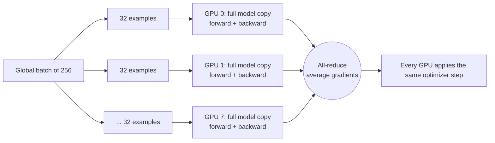
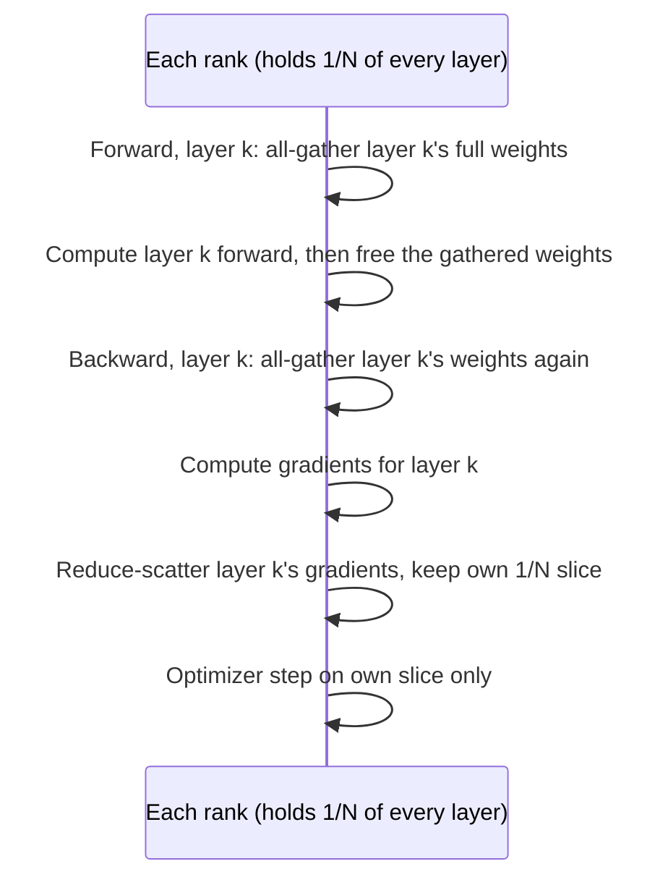
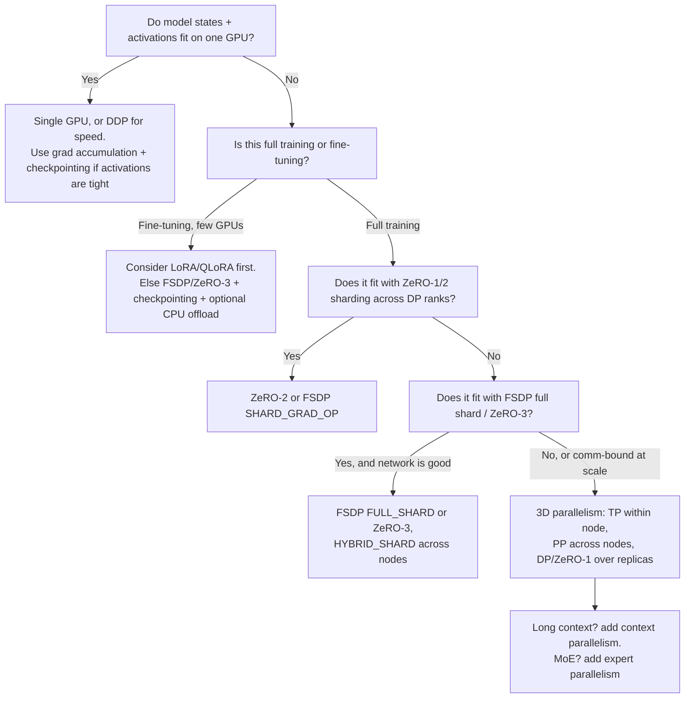

# Distributed Training and Training Memory: Data, Tensor and Pipeline Parallelism, ZeRO and FSDP

> **Level:** Beginner to Advanced · **Study time:** ~120 min · **Prerequisites:** [Backpropagation and Gradient Descent](02-backpropagation-and-gradient-descent.md), [Optimizers: SGD, Momentum, RMSProp, Adam, AdamW and Learning Rate Schedules](03-optimizers-sgd-momentum-adam-and-learning-rate-schedules.md), [Mixed-Precision Training: FP32, FP16 and BF16](09-mixed-precision-training.md)

## Table of contents

- [Why this matters](#why-this-matters)
- [1. Why one GPU is not enough: the memory wall and the compute wall](#1-why-one-gpu-is-not-enough-the-memory-wall-and-the-compute-wall)
- [2. Where GPU memory goes during training](#2-where-gpu-memory-goes-during-training)
- [3. Gradient accumulation](#3-gradient-accumulation)
- [4. Activation (gradient) checkpointing](#4-activation-gradient-checkpointing)
- [5. Distributed vocabulary: ranks, collectives and all-reduce](#5-distributed-vocabulary-ranks-collectives-and-all-reduce)
- [6. Data parallelism and PyTorch DDP](#6-data-parallelism-and-pytorch-ddp)
- [7. Tensor parallelism: splitting matrices inside a layer](#7-tensor-parallelism-splitting-matrices-inside-a-layer)
- [8. Pipeline parallelism: splitting layers across GPUs](#8-pipeline-parallelism-splitting-layers-across-gpus)
- [9. ZeRO stages 1, 2, 3 and PyTorch FSDP](#9-zero-stages-1-2-3-and-pytorch-fsdp)
- [10. Sequence and context parallelism](#10-sequence-and-context-parallelism)
- [11. 3D parallelism: combining everything](#11-3d-parallelism-combining-everything)
- [12. Communication costs and interconnects](#12-communication-costs-and-interconnects)
- [13. Decision guide: which strategy when](#13-decision-guide-which-strategy-when)
- [14. Launching in practice: torchrun, Accelerate and DeepSpeed](#14-launching-in-practice-torchrun-accelerate-and-deepspeed)
- [15. Going deeper: measuring, debugging and running at scale](#15-going-deeper-measuring-debugging-and-running-at-scale)
- [Common mistakes and misconceptions](#common-mistakes-and-misconceptions)
- [Interview questions and model answers](#interview-questions-and-model-answers)
- [Key takeaways](#key-takeaways)
- [Further reading](#further-reading)
- [Next](#next)

## Why this matters

Every modern large model, from Llama and Mistral to GPT-style and Gemini-style models, is trained across hundreds or thousands of GPUs, and even fully fine-tuning a 7B model with standard mixed-precision AdamW does not fit on a single 80 GB GPU. Interviewers for senior AI/ML roles use this topic to check whether you can reason quantitatively: "How much memory does training this model need? Why did it run out of memory? Why does adding GPUs not make it faster?" You do not need to have run a 1,000-GPU job, but you must be able to estimate memory on a whiteboard, explain data versus model parallelism, describe ZeRO and FSDP, and pick a sensible strategy for a given model size and cluster. This chapter gives you those tools, starting from what actually sits in GPU memory.

---

## 1. Why one GPU is not enough: the memory wall and the compute wall

> **Analogy:** You need to move a house full of furniture. Two separate problems can stop you: the sofa might not fit through the door of your car (a **memory** problem), or there might simply be too many boxes to move in one trip in a reasonable time (a **compute** problem). Distributed training solves both: more cars, and cutting the sofa into pieces that each fit.

A **GPU** (graphics processing unit) does the heavy matrix math of neural networks. It has its own fast memory, called **HBM** (high-bandwidth memory), for example 80 GB on an NVIDIA A100 80GB or H100. Everything the training step touches must live in that memory (or be streamed in from somewhere slower).

Two walls push us to multiple GPUs:

1. **The memory wall.** The model's weights, gradients, optimizer state and intermediate results do not fit in one GPU's memory. Section 2 shows a 7B model needs about 112 GB before activations.
2. **The compute wall.** Even if it fits, one GPU is too slow.

A widely used rule of thumb (from "Scaling Laws for Neural Language Models", Kaplan et al., 2020) estimates training compute for a transformer:

$$C \approx 6 \cdot N \cdot D$$

- $C$: total training compute, in **FLOPs** (floating-point operations, i.e. individual multiplies and adds).
- $N$: number of model parameters.
- $D$: number of training tokens.
- The 6 comes from about 2 FLOPs per parameter per token in the forward pass (one multiply, one add) and about 4 in the backward pass (the backward pass costs roughly twice the forward).

**Worked example (illustrative):** a 7B model on 1 trillion tokens.

- $C = 6 \times 7 \times 10^9 \times 10^{12} = 42 \times 10^{21} = 4.2 \times 10^{22}$ FLOPs.
- Assume one GPU sustains an illustrative $4 \times 10^{14}$ FLOP/s (400 TFLOP/s) of useful work.
- Time on one GPU: $4.2 \times 10^{22} / 4 \times 10^{14} = 1.05 \times 10^{8}$ seconds.
- $1.05 \times 10^8 / 86{,}400 \approx 1{,}215$ days, about 3.3 years.
- On 1,024 GPUs with perfect scaling: $1{,}215 / 1{,}024 \approx 1.2$ days.

So **distributed training** is simply: training one model using many devices (GPUs or other accelerators, often across many machines) that cooperate on each training step, either by splitting the data, splitting the model, or both.

A map of the strategies in this chapter, so you can place each one as it arrives:

| Strategy | What is split across GPUs | What each GPU holds | Section |
|---|---|---|---|
| Data parallelism (DDP) | The batch | A full copy of the model | 6 |
| Tensor parallelism | Weight matrices inside each layer | A slice of every layer | 7 |
| Pipeline parallelism | Consecutive groups of layers | A few whole layers | 8 |
| ZeRO / FSDP (sharded data parallelism) | The batch, plus the storage of model states | A 1/N shard, gathering full layers just in time | 9 |
| Sequence / context parallelism | The tokens of each sequence | Part of each sequence's activations | 10 |

Tensor and pipeline parallelism are the two forms of **model parallelism** (splitting the model itself). Plain data parallelism attacks only the compute wall; the others also attack the memory wall.

---

## 2. Where GPU memory goes during training

Training memory has five buckets. The first three are called **model states** because their size depends only on the number of parameters.

| Bucket | What it is | Size depends on |
|---|---|---|
| **Weights (parameters)** | The numbers the model learns | Parameter count, precision |
| **Gradients** | $\partial \text{loss} / \partial w$ for every weight, computed by backpropagation | Parameter count, precision |
| **Optimizer states** | Extra per-parameter memory the optimizer keeps (Adam keeps two) | Parameter count, optimizer |
| **Activations** | Intermediate outputs of each layer saved during the forward pass so the backward pass can use them | Batch size, sequence length, hidden size, number of layers |
| **Other** | CUDA context (the GPU runtime's own memory), temporary buffers, communication buffers, memory fragmentation | Framework, kernels |

> **Analogy:** Weights are the recipe book. Gradients are your sticky notes saying "add a bit more salt here". Optimizer states are your long-term diary of how each tweak has gone (Adam's running averages). Activations are all the half-finished bowls on the counter that you must keep until you taste the final dish and work backwards.

### 2.1 Quick recap: Adam and mixed precision

- **Adam** (see [Optimizers](03-optimizers-sgd-momentum-adam-and-learning-rate-schedules.md)) keeps two numbers per parameter: $m$, a running average of gradients (the **first moment**, like momentum), and $v$, a running average of squared gradients (the **second moment**). These are stored in FP32 (4 bytes each) for numerical stability.
- **Mixed-precision training** (see [Mixed-Precision Training](09-mixed-precision-training.md)) runs the forward and backward math in a 16-bit format (**FP16** or **BF16**, 2 bytes per number) but keeps an FP32 **master copy** of the weights that the optimizer updates, because tiny updates would be lost in 16-bit rounding.

### 2.2 The 16 bytes per parameter rule

The ZeRO paper ("ZeRO: Memory Optimizations Toward Training Trillion Parameter Models", Rajbhandari et al., 2020) gives the classic accounting for mixed-precision Adam:

| Item | Precision | Bytes per parameter |
|---|---|---|
| Working weights | FP16/BF16 | 2 |
| Gradients | FP16/BF16 | 2 |
| Master weights | FP32 | 4 |
| Adam $m$ | FP32 | 4 |
| Adam $v$ | FP32 | 4 |
| **Total** | | **16** |

The ZeRO paper writes this as $(2 + 2 + K)\Psi$ bytes:

$$M_{\text{model states}} = (2 + 2 + K) \cdot \Psi$$

- $\Psi$ (psi): number of parameters.
- First 2: bytes for 16-bit weights.
- Second 2: bytes for 16-bit gradients.
- $K$: bytes of optimizer state per parameter. For mixed-precision Adam, $K = 12$ (4 for master weights + 4 for $m$ + 4 for $v$).

**Assumptions** (state these out loud in an interview):

1. Adam or AdamW with both moments in FP32.
2. Mixed precision with an FP32 master copy and 16-bit weights and gradients.
3. No activations, no temporary buffers, no fragmentation counted.
4. Every parameter is trained (full fine-tuning or pretraining, not LoRA).

### 2.3 Worked example: 7B parameters, Adam, mixed precision

$\Psi = 7 \times 10^9$.

| Item | Calculation | Memory |
|---|---|---|
| BF16 weights | $2 \times 7 \times 10^9$ | 14 GB |
| BF16 gradients | $2 \times 7 \times 10^9$ | 14 GB |
| FP32 master weights | $4 \times 7 \times 10^9$ | 28 GB |
| Adam $m$ (FP32) | $4 \times 7 \times 10^9$ | 28 GB |
| Adam $v$ (FP32) | $4 \times 7 \times 10^9$ | 28 GB |
| **Model states total** | $16 \times 7 \times 10^9$ | **112 GB** |

Check: $14 + 14 + 28 + 28 + 28 = 112$. (Here GB means $10^9$ bytes; in GiB, $112 \times 10^9 / 2^{30} \approx 104.3$ GiB.)

So a 7B model needs about **112 GB just for model states**, which already exceeds one 80 GB GPU, and we have not stored a single activation yet. Compare inference: the same model in BF16 needs only about 14 GB for weights (plus the KV cache, see [The KV Cache](../06-llm-inference/02-kv-cache-explained.md)). Training is roughly **8 times** heavier per parameter than BF16 inference.

> **Senior insight:** Plain FP32 training with Adam is *also* 16 bytes per parameter: 4 (weights) + 4 (gradients) + 4 ($m$) + 4 ($v$). Mixed precision does not shrink model-state memory; it speeds up math on tensor cores (the GPU's specialized matrix-multiply units) and roughly halves *activation* memory. If someone claims "BF16 training halves my memory", ask which bucket they mean.

> **Common mistake:** Implementations differ. PyTorch's `torch.autocast` typically keeps FP32 parameters and FP32 gradients (4 + 4) and casts to BF16 on the fly, so it is still about 16 bytes per parameter for Adam, plus temporary BF16 copies. Some setups keep gradients in FP32 even with BF16 weights. The 16-byte figure is a solid estimate, not an exact law.

Ways to shrink the optimizer bucket specifically:

- **8-bit optimizers** ("8-bit Optimizers via Block-wise Quantization", Dettmers et al., 2021, the `bitsandbytes` library) store $m$ and $v$ in 8 bits, cutting Adam's 8 bytes of moments to about 2.
- **Optimizers with less state**, such as SGD with momentum (one state) or Adafactor (factored second moments).
- **Parameter-efficient fine-tuning** (LoRA, QLoRA) trains only a small fraction of parameters so gradients and optimizer states nearly vanish. See [Fine-Tuning LLMs: Full Fine-Tuning, LoRA and QLoRA](../05-llms/07-fine-tuning-full-lora-and-qlora.md).

### 2.4 Activations: the bucket that grows with batch and sequence length

During the forward pass, each layer's intermediate outputs are saved because backpropagation needs them (see [Backpropagation](02-backpropagation-and-gradient-descent.md): the gradient of a weight depends on the input that weight saw).

For a GPT-style transformer layer in 16-bit precision, Korthikanti et al. ("Reducing Activation Recomputation in Large Transformer Models", 2022) derive an approximate activation memory per layer of:

$$M_{\text{act per layer}} \approx s \cdot b \cdot h \cdot \left(34 + \frac{5 \cdot a \cdot s}{h}\right) \text{ bytes}$$

- $s$: sequence length (tokens per example).
- $b$: micro-batch size (examples per forward pass on this GPU).
- $h$: hidden size (width of each token vector).
- $a$: number of attention heads.
- 34: a constant that counts the saved tensors in attention and MLP blocks (for a standard GPT layer with a 4h MLP, dropout and LayerNorm).
- $5as/h$ term: the $s \times s$ attention score matrices. Memory-efficient attention kernels like FlashAttention (see [Modern LLM Architecture](../04-transformers/08-modern-llm-architecture-improvements.md)) avoid storing these, so this term largely disappears.

**Worked example (illustrative, GPT-style approximation):** a 7B-class model with $h = 4096$, $a = 32$, $L = 32$ layers, $s = 4096$, $b = 1$, using FlashAttention so we drop the second term.

- $s \cdot b \cdot h = 4096 \times 1 \times 4096 = 16{,}777{,}216$.
- Per layer: $34 \times 16{,}777{,}216 = 570{,}425{,}344$ bytes $\approx 0.57$ GB.
- 32 layers: $570{,}425{,}344 \times 32 = 18{,}253{,}611{,}008$ bytes $\approx 18.3$ GB.
- Without FlashAttention, the score term adds $5 \times 32 \times 4096^2 = 2{,}684{,}354{,}560$ bytes $\approx 2.7$ GB per layer, which is about 86 GB over 32 layers. That is why memory-efficient attention matters so much for long sequences.

Real architectures (SwiGLU MLPs, grouped-query attention) change the constant, so treat this as an order-of-magnitude estimate. The key lesson is the shape: **activations grow linearly with batch size and (with FlashAttention) linearly with sequence length, and are independent of the optimizer.**

### 2.5 Total for our running example

Model states 112 GB + activations about 18 GB (one 4096-token sequence) + other overhead (a few GB) gives roughly **130 GB or more**, against an 80 GB GPU. The rest of this chapter is the toolbox for closing that gap:

| Technique | Bucket it attacks |
|---|---|
| Gradient accumulation | Activations (smaller micro-batches) |
| Activation checkpointing | Activations |
| ZeRO-1 / ZeRO-2 / ZeRO-3, FSDP | Optimizer states, gradients, weights |
| Tensor and pipeline parallelism | Everything, by splitting the model |
| Sequence / context parallelism | Activations for long sequences |
| CPU/NVMe offload | Optimizer states, weights |

### 2.6 A tiny memory calculator

```python
# Model-state memory per GPU for mixed-precision Adam, following the ZeRO paper.
def model_state_gb(n_params: float, n_gpus: int = 1, zero_stage: int = 0, k_opt: int = 12) -> float:
    weights = 2 * n_params        # 16-bit weights
    grads = 2 * n_params          # 16-bit gradients
    optim = k_opt * n_params      # fp32 master + Adam m + Adam v
    if zero_stage >= 1:
        optim /= n_gpus           # shard optimizer states
    if zero_stage >= 2:
        grads /= n_gpus           # shard gradients
    if zero_stage >= 3:
        weights /= n_gpus         # shard parameters
    return (weights + grads + optim) / 1e9

for stage in range(4):
    print(stage, model_state_gb(7e9, n_gpus=8, zero_stage=stage))
# 0 112.0
# 1 38.5
# 2 26.25
# 3 14.0
```

We will explain those ZeRO numbers in Section 9.

---

## 3. Gradient accumulation

> **Analogy:** You want to survey 256 people, but your clipboard only fits 8 answers at a time. You fill a clipboard, tally the results onto a master sheet, clear the clipboard, and repeat 32 times. Only after all 256 answers are tallied do you draw a conclusion. Gradient accumulation is exactly that: small forward/backward passes, gradients tallied, one optimizer update at the end.

### 3.1 Definitions

- **Micro-batch:** the number of examples processed in one forward and backward pass on one GPU. Limited by activation memory.
- **Gradient accumulation:** running several micro-batches through forward and backward, *adding* their gradients into the same `.grad` buffers, and only then calling `optimizer.step()` and zeroing the gradients. It simulates a larger batch without the activation memory of that batch.
- **Effective (global) batch size:** the number of examples that contribute to one optimizer update.

Why want a batch bigger than fits in memory at all? Training recipes (learning rate, warmup) are tuned for a specific global batch, so reproducing a recipe on fewer GPUs means matching that batch, and larger batches give less noisy gradient estimates (up to a point, Section 15.5).

$$B_{\text{eff}} = b_{\text{micro}} \times A \times N_{\text{dp}}$$

- $b_{\text{micro}}$: micro-batch size per GPU.
- $A$: gradient accumulation steps.
- $N_{\text{dp}}$: number of data-parallel replicas (GPUs each processing different data; Section 6). Equal to 1 on a single GPU.

**Worked example:** $b_{\text{micro}} = 8$, $A = 4$, $N_{\text{dp}} = 8$ GPUs.

- Per GPU per update: $8 \times 4 = 32$ examples.
- Across GPUs: $32 \times 8 = 256$ examples per optimizer step.
- For an LLM with 4,096-token sequences: $256 \times 4{,}096 = 1{,}048{,}576$ tokens, about 1M tokens per step.

### 3.2 Why the loss must be scaled

Most losses use **mean reduction**: the loss of a batch is the average over its examples, so its gradient is the average of per-example gradients. If you just call `backward()` on each micro-batch's mean loss, PyTorch *adds* the gradients, giving a *sum of means*, which is $A$ times too big.

The fix: divide each micro-batch loss by $A$.

$$g_{\text{acc}} = \sum_{j=1}^{A} \nabla \frac{\mathcal{L}_j}{A} = \frac{1}{A}\sum_{j=1}^{A} \nabla \mathcal{L}_j$$

- $g_{\text{acc}}$: the accumulated gradient used for the update.
- $\mathcal{L}_j$: mean loss of micro-batch $j$.
- $A$: number of accumulation steps.

**Tiny numeric example.** Suppose 4 examples have per-example gradients (for one weight) of $1, 2, 3, 4$.

- Full batch of 4, mean gradient: $(1 + 2 + 3 + 4) / 4 = 10 / 4 = 2.5$.
- Two micro-batches of 2. Micro-batch 1 mean: $(1 + 2)/2 = 1.5$. Micro-batch 2 mean: $(3 + 4)/2 = 3.5$.
- Without scaling: $1.5 + 3.5 = 5.0$. Twice too large, as if the learning rate were doubled.
- With scaling by $A = 2$: $1.5/2 + 3.5/2 = 0.75 + 1.75 = 2.5$. Matches the full batch.

### 3.3 Code: verify accumulation equals a big batch

```python
# pip install torch
import torch

torch.manual_seed(0)
X, y = torch.randn(8, 3), torch.randn(8, 1)
model = torch.nn.Linear(3, 1)
loss_fn = torch.nn.MSELoss()          # mean reduction

# 1) One big batch of 8
model.zero_grad()
loss_fn(model(X), y).backward()
g_full = model.weight.grad.clone()

# 2) Four micro-batches of 2, with loss scaled by 1/A
A = 4
model.zero_grad()
for xb, yb in zip(X.chunk(A), y.chunk(A)):
    (loss_fn(model(xb), yb) / A).backward()   # gradients ADD into .grad
g_acc = model.weight.grad.clone()

print(torch.allclose(g_full, g_acc, atol=1e-6))  # True
```

A realistic training loop:

```python
accum_steps = 4
optimizer.zero_grad(set_to_none=True)
for step, (xb, yb) in enumerate(loader):
    loss = loss_fn(model(xb), yb) / accum_steps
    loss.backward()
    if (step + 1) % accum_steps == 0:
        torch.nn.utils.clip_grad_norm_(model.parameters(), 1.0)  # clip the FULL accumulated gradient
        optimizer.step()
        optimizer.zero_grad(set_to_none=True)
```

### 3.4 When accumulation is not exactly equal to a big batch

- **Unequal token counts (LLMs).** Language-model loss is usually averaged over non-padding tokens. If micro-batch 1 has 100 real tokens and micro-batch 2 has 900, then "mean of micro-batch means" weights each token in micro-batch 1 nine times more than in micro-batch 2. The exact fix is to sum token losses and divide by the *total* token count across all micro-batches (and across GPUs). This subtle bug was widely discussed in popular training libraries in 2024 and has since been fixed in mainstream ones, but custom loops still get it wrong.
- **BatchNorm** computes statistics per micro-batch, so it never sees the effective batch. Transformers use LayerNorm or RMSNorm, which do not depend on the batch, so this matters mostly for CNNs.
- **Speed.** Accumulation saves memory, not time: $A$ micro-batches take about $A$ times as long as one.

> **Interview tip:** When asked "what is gradient accumulation?", give the three-part answer: (1) simulate a big batch by summing gradients over micro-batches before one optimizer step, (2) scale the loss by $1/A$ (or by total tokens), (3) it trades time for memory and with DDP you should skip the gradient sync on non-final micro-steps (Section 6.4).

---

## 4. Activation (gradient) checkpointing

> **Analogy:** On a long hike you could photograph every signpost so you can retrace your steps exactly (lots of storage), or just photograph every tenth signpost and, when you need the ones in between, walk that short stretch again. Activation checkpointing photographs only a few signposts and re-walks the rest.

**Activation checkpointing** (also called **gradient checkpointing** or **rematerialization**) saves only some activations during the forward pass (the **checkpoints**, typically each transformer block's input) and discards the rest. During backward, when a discarded activation is needed, it re-runs the forward computation for that segment from the nearest checkpoint.

The idea was popularized for deep nets by "Training Deep Nets with Sublinear Memory Cost" (Chen et al., 2016), which showed that checkpointing every $\sqrt{n}$ layers of an $n$-layer network reduces activation memory to $O(\sqrt{n})$.

**Trade-off:**

- **Memory:** for our 7B example, instead of about 0.57 GB per layer we keep only each layer's input, $s \cdot b \cdot h \times 2$ bytes $= 4096 \times 4096 \times 2 = 33{,}554{,}432$ bytes $\approx 33.5$ MB per layer. For 32 layers: about 1.07 GB, plus one layer's full activations (about 0.57 GB) while it is being recomputed. So roughly **18.3 GB drops to under 2 GB** (illustrative).
- **Compute:** one extra forward pass per step. Since backward costs about 2 forward passes, a step goes from about 3 units to about 4, i.e. **roughly 33% more compute** with full checkpointing.

**Selective recomputation** (Korthikanti et al., 2022) only recomputes the cheap-to-compute but memory-hungry parts (like attention softmax and dropout), getting most of the memory savings for a few percent of extra compute.

```python
# Wrap a block so its internal activations are recomputed in backward.
import torch
from torch.utils.checkpoint import checkpoint

class Block(torch.nn.Module):
    def __init__(self, d: int):
        super().__init__()
        self.ff = torch.nn.Sequential(torch.nn.Linear(d, 4 * d), torch.nn.GELU(), torch.nn.Linear(4 * d, d))
    def forward(self, x):
        return x + self.ff(x)

blocks = torch.nn.ModuleList(Block(256) for _ in range(12))
x = torch.randn(4, 128, 256, requires_grad=True)
for blk in blocks:
    x = checkpoint(blk, x, use_reentrant=False)   # only the block input is saved
x.sum().backward()

# Hugging Face Transformers models expose a one-liner:
# model.gradient_checkpointing_enable()
```

> **Senior insight:** Checkpointing is often what lets you raise the micro-batch size, which improves GPU utilization and can *recover* some of the 33% cost. The right question is not "is checkpointing slower?" but "which configuration gives the most tokens per second within my memory budget?"

---

## 5. Distributed vocabulary: ranks, collectives and all-reduce

Before the strategies, a few terms you will hear constantly.

- **Node:** one physical machine, often with 8 GPUs.
- **Process / rank:** distributed PyTorch usually runs one process per GPU. Each process has a global integer ID called its **rank** (0 to $N-1$). **Local rank** is its index within its node (0 to 7). Rank 0 usually handles logging and saving.
- **World size:** total number of processes ($N$).
- **Process group:** a subset of ranks that communicate together (for example, the 8 GPUs that share one tensor-parallel layer).
- **Collective operation:** a communication pattern in which all ranks in a group participate. **NCCL** (NVIDIA Collective Communications Library, pronounced "nickel") implements these efficiently on NVIDIA GPUs; **Gloo** is a CPU fallback.

| Collective | What it does | Typical use |
|---|---|---|
| **Broadcast** | One rank sends its tensor to all | Sync initial weights |
| **All-reduce** | Everyone contributes a tensor; everyone ends with the sum (or average) | DDP gradient sync, tensor-parallel outputs |
| **Reduce-scatter** | Sum across ranks, but each rank keeps only its 1/N slice of the result | ZeRO-2/3 and FSDP gradient sync |
| **All-gather** | Each rank has a slice; everyone ends with the full concatenation | ZeRO-3/FSDP fetching full weights |
| **All-to-all** | Each rank sends a different slice to each other rank | Mixture-of-experts routing, Ulysses sequence parallelism |

A key identity: **all-reduce = reduce-scatter followed by all-gather.** ZeRO and FSDP exploit this by stopping halfway.

### 5.1 Ring all-reduce

The naive all-reduce sends everything to one rank, which sums and sends back: that rank becomes a bottleneck. **Ring all-reduce** (popularized for deep learning by Baidu in 2017 and by Horovod, "Horovod: fast and easy distributed deep learning in TensorFlow", Sergeev and Del Balso, 2018) arranges ranks in a ring, splits each tensor into $N$ chunks and passes chunks around:

```text
Phase 1, reduce-scatter (N-1 steps): each rank sends one chunk to its right
neighbor, which adds it to its own copy. After N-1 steps, each rank owns
the complete SUM for one chunk.

Phase 2, all-gather (N-1 steps): ranks pass the finished chunks around the
ring until everyone has every summed chunk.

        +--------+          +--------+
        | rank 0 |  ----->  | rank 1 |
        +--------+          +--------+
            ^                    |
            |                    v
        +--------+          +--------+
        | rank 3 |  <-----  | rank 2 |
        +--------+          +--------+
```

The beautiful property: each rank sends about $2 \frac{N-1}{N} M$ bytes, where $M$ is the tensor size, which is nearly constant as $N$ grows. For a 1 GB gradient, $N = 4$ means each rank sends $2 \times \frac{3}{4} \times 1 = 1.5$ GB and $N = 64$ means about $1.97$ GB: never more than 2 GB, however many GPUs join. Here is a from-scratch simulation:

```python
# pip install numpy
import numpy as np

def ring_allreduce(bufs: list[np.ndarray]) -> list[np.ndarray]:
    """Simulate ring all-reduce among len(bufs) 'GPUs'. Each buf has the same shape."""
    n = len(bufs)
    chunks = [np.array_split(b.astype(float), n) for b in bufs]
    # Phase 1: reduce-scatter. At step s, rank i sends chunk (i - s) % n to rank i+1.
    for s in range(n - 1):
        msgs = [(i, (i - s) % n, chunks[i][(i - s) % n].copy()) for i in range(n)]
        for i, c, data in msgs:
            chunks[(i + 1) % n][c] += data
    # Now rank i holds the full sum of chunk (i + 1) % n.
    # Phase 2: all-gather. At step s, rank i forwards chunk (i + 1 - s) % n.
    for s in range(n - 1):
        msgs = [(i, (i + 1 - s) % n, chunks[i][(i + 1 - s) % n].copy()) for i in range(n)]
        for i, c, data in msgs:
            chunks[(i + 1) % n][c] = data
    return [np.concatenate(c) for c in chunks]

grads = [np.arange(6) * (k + 1) for k in range(3)]   # 3 GPUs with different gradients
out = ring_allreduce(grads)
print(out[0])   # [ 0.  6. 12. 18. 24. 30.]  (identical on every rank)
```

Real libraries like NCCL choose between rings, trees and other algorithms depending on message size and topology, but the bandwidth intuition holds.

---

## 6. Data parallelism and PyTorch DDP

> **Analogy:** Four chefs each have an identical copy of the recipe book. Each cooks a different batch of dishes, writes sticky notes about what to change, then they meet, average their notes, and all apply the same edits to their own books. The books stay identical.

### 6.1 Definition

**Data parallelism (DP)** replicates the *entire model* on every GPU and gives each GPU a different slice of the batch. Each step:

1. Each rank runs forward and backward on its own micro-batch, producing local gradients.
2. Ranks **all-reduce** the gradients so every rank has the average gradient.
3. Each rank runs the identical optimizer step, so the replicas stay in sync.



Because averaging gradients from 8 shards of a batch equals the gradient of the whole batch (for mean-reduced losses with equal shard sizes), data-parallel training is mathematically equivalent to single-GPU training with a larger batch.

### 6.2 DDP versus the old DataParallel

| | `torch.nn.DataParallel` (legacy) | `DistributedDataParallel` (DDP) |
|---|---|---|
| Processes | One process, many threads | One process per GPU |
| Gradient sync | Gather to GPU 0, scatter back | All-reduce, overlapped with backward |
| Multi-node | No | Yes |
| Speed | Limited by the Python GIL and GPU 0 bottleneck | Scales well |
| Use today | Avoid | Default for models that fit on one GPU |

DDP's key trick is **overlap**: it groups gradients into **buckets** (a default of about 25 MB, controlled by `bucket_cap_mb`) and starts all-reducing a bucket as soon as all its gradients are computed, while backward continues on earlier layers. Communication hides behind computation.

### 6.3 Limits of pure data parallelism

DDP gives each GPU a **full copy** of weights, gradients and optimizer states. Our 7B model needs 112 GB of model states *per GPU*. Adding more GPUs does not help: 8 GPUs means 8 copies of 112 GB. DDP solves the compute wall, not the memory wall. That is what ZeRO/FSDP (Section 9) and model parallelism (Sections 7-8) fix.

### 6.4 DDP code (single node, concept-level but runnable)

```python
# train_ddp.py   launch with:  torchrun --nproc_per_node=8 train_ddp.py
import os
from contextlib import nullcontext
import torch
import torch.distributed as dist
from torch.nn.parallel import DistributedDataParallel as DDP
from torch.utils.data import DataLoader, TensorDataset
from torch.utils.data.distributed import DistributedSampler

def main():
    dist.init_process_group(backend="nccl")          # torchrun sets RANK, WORLD_SIZE, MASTER_ADDR...
    local_rank = int(os.environ["LOCAL_RANK"])
    torch.cuda.set_device(local_rank)

    model = torch.nn.Linear(1024, 10).cuda()
    model = DDP(model, device_ids=[local_rank])      # broadcasts rank 0's weights to all ranks
    opt = torch.optim.AdamW(model.parameters(), lr=1e-3)

    ds = TensorDataset(torch.randn(10_000, 1024), torch.randint(0, 10, (10_000,)))
    sampler = DistributedSampler(ds)                 # each rank sees a different shard
    loader = DataLoader(ds, batch_size=32, sampler=sampler)

    accum = 4
    for epoch in range(2):
        sampler.set_epoch(epoch)                     # reshuffle differently each epoch
        for step, (x, y) in enumerate(loader):
            x, y = x.cuda(), y.cuda()
            is_sync_step = (step + 1) % accum == 0
            # Skip the gradient all-reduce on non-final micro-steps: saves bandwidth.
            ctx = nullcontext() if is_sync_step else model.no_sync()
            with ctx:
                loss = torch.nn.functional.cross_entropy(model(x), y) / accum
                loss.backward()
            if is_sync_step:
                opt.step()
                opt.zero_grad(set_to_none=True)
        if dist.get_rank() == 0:
            print(f"epoch {epoch} done, last loss {loss.item() * accum:.3f}")
    dist.destroy_process_group()

if __name__ == "__main__":
    main()
```

> **Common mistake:** Forgetting `DistributedSampler` (every GPU trains on the same data, wasting all but one) or forgetting `sampler.set_epoch(epoch)` (the same shuffle every epoch).

---

## 7. Tensor parallelism: splitting matrices inside a layer

**Model parallelism** is the umbrella term for splitting *the model itself* across devices, as opposed to splitting the data. It comes in two main flavors: tensor parallelism (split inside each layer) and pipeline parallelism (split between layers).

> **Analogy:** A single enormous spreadsheet calculation is split so that four accountants each compute a quarter of the columns at the same moment, then they quickly add their results together. They must sit in the same room (a fast interconnect) because they talk after every calculation.

### 7.1 Definition

**Tensor parallelism (TP)** splits the weight matrices *within* a layer across GPUs so each GPU holds and computes a slice. The standard scheme is from "Megatron-LM: Training Multi-Billion Parameter Language Models Using Model Parallelism" (Shoeybi et al., 2019).

Take the transformer MLP: $Y = \text{GeLU}(XA)\,B$, where $X$ is the input (tokens by $h$), $A$ is $h \times 4h$ and $B$ is $4h \times h$.

- **Column-parallel** first matrix: split $A = [A_1, A_2]$ by columns. GPU 1 computes $\text{GeLU}(XA_1)$, GPU 2 computes $\text{GeLU}(XA_2)$. Because GeLU is applied elementwise, no communication is needed here.
- **Row-parallel** second matrix: split $B$ by rows into $B_1$ (top) and $B_2$ (bottom). GPU 1 computes $\text{GeLU}(XA_1)B_1$, GPU 2 computes $\text{GeLU}(XA_2)B_2$.
- **One all-reduce** sums the two partial outputs: $Y = \text{GeLU}(XA_1)B_1 + \text{GeLU}(XA_2)B_2$.

```text
            X (replicated on both GPUs)
           /                          \
     GPU 0: X @ A1  (h x 2h)      GPU 1: X @ A2  (h x 2h)      <- column split
           |                          |
         GeLU                       GeLU                        <- no comm needed
           |                          |
     @ B1 (2h x h)                @ B2 (2h x h)                <- row split
           \                          /
            +------ all-reduce (sum) -+                         <- one sync
                         |
                         Y
```

Attention is split the same way, by **heads**: each GPU owns a subset of heads (column-parallel Q, K, V projections) and the output projection is row-parallel. So each transformer layer needs **2 all-reduces in the forward pass and 2 in the backward pass**.

### 7.2 Proof by NumPy

```python
import numpy as np

rng = np.random.default_rng(0)
X = rng.standard_normal((2, 3))                 # 2 tokens, hidden size 3
A = rng.standard_normal((3, 4))                 # "h x 4h"
B = rng.standard_normal((4, 2))
relu = lambda z: np.maximum(z, 0)               # any elementwise activation works

full = relu(X @ A) @ B                          # single-GPU result

A1, A2 = A[:, :2], A[:, 2:]                     # column split across 2 "GPUs"
B1, B2 = B[:2, :], B[2:, :]                     # matching row split
part0 = relu(X @ A1) @ B1                       # computed on GPU 0
part1 = relu(X @ A2) @ B2                       # computed on GPU 1
print(np.allclose(full, part0 + part1))         # True  (the sum is the all-reduce)
```

### 7.3 Trade-offs

- **Memory:** weights, gradients and optimizer states of the split layers divide by the TP degree $t$. Activations inside the split region also divide by $t$.
- **Communication:** all-reduces of activation-sized tensors sit **on the critical path** (the next operation cannot start until they finish), several times per layer. Illustrative 7B example: $b = 1$, $s = 4096$, $h = 4096$, BF16. One all-reduce moves a $4096 \times 4096 \times 2 = 33{,}554{,}432$ byte tensor ($\approx 33.5$ MB). With 4 per layer (forward + backward) and 32 layers that is 128 all-reduces, about $4.3$ GB of all-reduced data per micro-batch per step.
- **Rule:** keep TP **inside a node** over NVLink (NVIDIA's direct GPU-to-GPU link, hundreds of GB/s per GPU; Section 12), typically with $t \le 8$. More precisely, keep it inside one NVLink domain: rack-scale systems such as NVIDIA GB200 NVL72 extend that domain to 72 GPUs, which allows larger TP degrees. Across a slower network it becomes a disaster.
- **Granularity:** splitting tiny matrices across many GPUs makes each GPU's matmul too small to be efficient.

> **Senior insight:** TP is the main general-purpose strategy that also reduces **the latency of a single forward pass** (each GPU does a fraction of every layer's math), which is why it is used for *inference* of big models (vLLM's `tensor_parallel_size`). Data parallelism and pipeline parallelism improve throughput, not single-request latency (context parallelism can also cut latency, but only for very long prompts). See [LLM Serving Frameworks](../06-llm-inference/06-serving-frameworks-vllm-sglang-tgi-tensorrt-llm-and-ollama.md).

---

## 8. Pipeline parallelism: splitting layers across GPUs

> **Analogy:** A car assembly line. Station 1 builds the chassis, station 2 adds the engine, station 3 paints, station 4 inspects. If only one car goes through at a time, three stations are always idle. Feed many cars in a row and every station stays busy, except at the very start and end of the shift.

### 8.1 Definition

**Pipeline parallelism (PP)** assigns consecutive groups of layers (**stages**) to different GPUs. For a 32-layer model on 4 GPUs: layers 1-8 on GPU 0, 9-16 on GPU 1, and so on. Activations flow forward from stage to stage, and gradients flow backward. Communication is only **point-to-point** (send/receive) between neighboring stages, and only of activation tensors at stage boundaries, so PP tolerates slower interconnects much better than TP.

### 8.2 The pipeline bubble

Naive pipelining (one batch) leaves 3 of 4 GPUs idle at any moment. The fix, from "GPipe: Efficient Training of Giant Neural Networks using Pipeline Parallelism" (Huang et al., 2019), is to split the batch into $m$ **micro-batches** and stream them through. Idle time at the start (filling) and end (draining) is called the **pipeline bubble**.

GPipe schedule with $p = 4$ stages and $m = 4$ micro-batches (drawn with equal forward and backward slot lengths for simplicity; F = forward, B = backward, `..` = idle):

```text
slot:   1   2   3   4   5   6   7   8   9   10  11  12  13  14
GPU0    F1  F2  F3  F4  ..  ..  ..  ..  ..  ..  B1  B2  B3  B4
GPU1    ..  F1  F2  F3  F4  ..  ..  ..  ..  B1  B2  B3  B4  ..
GPU2    ..  ..  F1  F2  F3  F4  ..  ..  B1  B2  B3  B4  ..  ..
GPU3    ..  ..  ..  F1  F2  F3  F4  B1  B2  B3  B4  ..  ..  ..
```

Each GPU is busy 8 of 14 slots and idle 6 of 14.

$$\text{bubble fraction} = \frac{p - 1}{m + p - 1}$$

- $p$: number of pipeline stages.
- $m$: number of micro-batches per optimizer step.
- The numerator counts the slots each stage waits while the pipeline fills (and, symmetrically, drains).

**Worked examples** with $p = 4$:

- $m = 4$: $3 / (4 + 3) = 3/7 \approx 42.9\%$ idle. (Matches the diagram: $6/14 = 3/7$.)
- $m = 16$: $3 / 19 \approx 15.8\%$ idle.
- $m = 32$: $3 / 35 \approx 8.6\%$ idle.

So **more micro-batches shrink the bubble**, which is why pipeline parallelism and gradient accumulation go hand in hand: the micro-batches are exactly the accumulated micro-steps.

### 8.3 Better schedules

| Schedule | Idea | Bubble | Activation memory |
|---|---|---|---|
| **GPipe** (Huang et al., 2019) | All forwards, then all backwards | $(p-1)/(m+p-1)$ | Stores activations for all $m$ micro-batches |
| **1F1B** (introduced in PipeDream, Narayanan et al., 2019; Megatron uses the synchronous, flushed variant, PipeDream-Flush) | After warm-up, alternate one forward, one backward | Same as GPipe | At most about $p$ micro-batches in flight, so much lower |
| **Interleaved 1F1B** (Narayanan et al., 2021, "Efficient Large-Scale Language Model Training on GPU Clusters Using Megatron-LM") | Each GPU holds $v$ smaller non-consecutive chunks of layers | Reduced by about a factor $v$ | Similar, but more communication |
| **Zero-bubble schedules** (Qi et al., 2023, "Zero Bubble Pipeline Parallelism") | Split backward into input-gradient and weight-gradient parts and fill bubbles with weight-gradient work | Near zero in favorable settings | Somewhat higher |

### 8.4 Trade-offs and pain points

- **Load balancing:** the slowest stage sets the pace. The embedding layer and output layer (large vocabulary softmax) make first and last stages uneven.
- **Large global batch required:** you need $m \gg p$ to keep the bubble small, which forces a large global batch. That may hurt convergence for some tasks.
- **Engineering complexity:** the model must be cut into sequential stages, which is awkward for models with skip connections across stages or with dynamic control flow.
- **Weight staleness:** asynchronous variants (original PipeDream) update with slightly stale weights; synchronous schedules like GPipe and 1F1B flush the pipeline each step to avoid it.

---

## 9. ZeRO stages 1, 2, 3 and PyTorch FSDP

> **Analogy:** Eight roommates each own the same 8-volume encyclopedia, which wastes shelf space. Instead, each keeps one volume. When someone needs volume 5, they borrow it from its owner, read it, and hand it back. Everyone still has access to the whole encyclopedia, but each shelf holds only one-eighth.

### 9.1 The core insight

In DDP, every rank stores identical copies of the optimizer states, gradients and weights. That is pure **redundancy**. **ZeRO** (Zero Redundancy Optimizer, Rajbhandari et al., 2020, implemented in Microsoft's DeepSpeed) removes it by **sharding** (partitioning) these states across the $N_d$ data-parallel ranks, while keeping the data-parallel training recipe: each rank still processes its own data shard.

| Stage | What is sharded | Per-GPU model-state memory |
|---|---|---|
| DDP (baseline) | Nothing | $(2 + 2 + K)\Psi$ |
| **ZeRO-1** ($P_{os}$) | Optimizer states | $2\Psi + 2\Psi + \frac{K\Psi}{N_d}$ |
| **ZeRO-2** ($P_{os+g}$) | Optimizer states + gradients | $2\Psi + \frac{(2 + K)\Psi}{N_d}$ |
| **ZeRO-3** ($P_{os+g+p}$) | Optimizer states + gradients + parameters | $\frac{(2 + 2 + K)\Psi}{N_d}$ |

- $\Psi$: parameter count; $K = 12$ for mixed-precision Adam; $N_d$: number of data-parallel ranks sharing the states.

### 9.2 Worked example: 7B on 8 GPUs

$\Psi = 7 \times 10^9$, $K = 12$, $N_d = 8$.

- **DDP:** $16 \times 7 = 112$ GB per GPU. Does not fit on 80 GB.
- **ZeRO-1:** weights $2 \times 7 = 14$ GB, gradients 14 GB, optimizer $12 \times 7 / 8 = 84 / 8 = 10.5$ GB. Total $14 + 14 + 10.5 = 38.5$ GB.
- **ZeRO-2:** weights 14 GB, gradients + optimizer $(2 + 12) \times 7 / 8 = 98 / 8 = 12.25$ GB. Total $14 + 12.25 = 26.25$ GB.
- **ZeRO-3:** $112 / 8 = 14$ GB.

These match the calculator output in Section 2.6. Add activations (about 18 GB in our illustrative setting, or about 2 GB with checkpointing) and the 7B full fine-tune now fits comfortably on 8 x 80 GB GPUs with ZeRO-2 or ZeRO-3.

### 9.3 How each stage works in a step

**ZeRO-1:** after backward, gradients are synchronized across ranks. Each rank only needs the averaged gradient for its own slice, so a reduce-scatter is enough (some implementations simply all-reduce, at higher cost), but the full gradient buffer is still allocated on every rank. Each rank updates only *its* 1/N slice of the FP32 master weights using its slice of Adam states, then the updated 16-bit weights are all-gathered so every rank has the full model again.

**ZeRO-2:** gradients are **reduce-scattered** bucket by bucket during backward: each rank receives only the summed gradient for its own slice and frees the gradient memory for slices it does not own. Then same as ZeRO-1.

**ZeRO-3:** parameters themselves are sharded. For each layer (or group of layers):



Only one or two layers are ever fully materialized at once, so peak parameter memory is about one shard of everything plus one full layer.

### 9.4 Communication cost

Ring all-reduce of $\Psi$ gradient elements moves about $2\Psi$ elements per rank (reduce-scatter $\Psi$ + all-gather $\Psi$).

| Strategy | Communication volume per step (elements per rank, approx.) |
|---|---|
| DDP | $2\Psi$ (one all-reduce) |
| ZeRO-1 | $2\Psi$ (reduce-scatter grads + all-gather params) |
| ZeRO-2 | $2\Psi$ |
| ZeRO-3 / FSDP full shard | $3\Psi$ (all-gather in forward, all-gather in backward, reduce-scatter) |

So ZeRO-1 and ZeRO-2 are essentially **free memory savings** relative to DDP, and ZeRO-3 costs **about 1.5 times** DDP's communication. This is stated in the ZeRO paper and is the most-asked follow-up.

### 9.5 Offload: ZeRO-Offload and ZeRO-Infinity

When even sharding is not enough (or you have few GPUs), DeepSpeed can move optimizer states (and gradients) to **CPU RAM** ("ZeRO-Offload", Ren et al., 2021) and, with ZeRO-3, also parameters to CPU RAM or **NVMe SSDs** ("ZeRO-Infinity", Rajbhandari et al., 2021). The CPU can even run the Adam update. Cost: PCIe transfers are much slower than HBM, so steps get slower. Good for fine-tuning a big model on a small number of GPUs; rarely the right choice for large pretraining runs.

### 9.6 PyTorch FSDP

**FSDP** (Fully Sharded Data Parallel, described in "PyTorch FSDP: Experiences on Scaling Fully Sharded Data Parallel", Zhao et al., 2023) is PyTorch's native implementation of the ZeRO-3 idea.

| FSDP sharding strategy | Equivalent |
|---|---|
| `FULL_SHARD` | ZeRO-3 |
| `SHARD_GRAD_OP` | ZeRO-2 (parameters kept after forward) |
| `NO_SHARD` | DDP |
| `HYBRID_SHARD` | Full shard inside a node, replicate across nodes (reduces slow cross-node traffic) |

Key FSDP concepts:

- **Wrapping unit:** FSDP shards and gathers at the granularity of the modules you wrap, normally one transformer block. Too coarse (whole model) means everything is gathered at once and memory savings vanish; too fine means many small, inefficient collectives.
- **Prefetching:** gather the next block's weights while computing the current one, to overlap communication.
- **Mixed-precision policy:** for example, gather and compute in BF16, reduce gradients in FP32.

FSDP has two API generations. The original `FullyShardedDataParallel` wrapper (often called FSDP1) and the newer per-module `fully_shard` API (FSDP2, built on DTensor, PyTorch's sharded-tensor abstraction, public under `torch.distributed.fsdp` in recent PyTorch 2.x releases). The API is version-dependent; check your PyTorch version's docs. Concept-level FSDP2 code:

```python
# Concept-level FSDP2 sketch (PyTorch 2.6+ style API; names may shift between versions).
import os
import torch
import torch.distributed as dist
from torch.distributed.fsdp import fully_shard, MixedPrecisionPolicy

dist.init_process_group("nccl")
torch.cuda.set_device(int(os.environ["LOCAL_RANK"]))

model = build_transformer()          # your model: model.layers is a list of blocks
mp = MixedPrecisionPolicy(param_dtype=torch.bfloat16, reduce_dtype=torch.float32)

for block in model.layers:           # shard each transformer block separately
    fully_shard(block, mp_policy=mp)
fully_shard(model, mp_policy=mp)     # root wrap for embeddings, final norm, head

opt = torch.optim.AdamW(model.parameters(), lr=1e-4)   # created AFTER sharding
for batch in loader:
    loss = model(**batch).loss
    loss.backward()                  # reduce-scatter of gradients happens here
    opt.step()                       # each rank updates only its shard
    opt.zero_grad()
```

### 9.7 ZeRO/FSDP versus model parallelism

ZeRO-3 and FSDP *look* like model parallelism (each GPU stores part of the model), but they are really **data parallelism with sharded storage**: each GPU still computes the *whole* layer on *its own* data after gathering the full weights. That means:

- No changes to the model code (unlike TP, which rewrites layers, or PP, which cuts the model).
- Activations are not split, so very long sequences or huge hidden sizes can still blow up per-GPU activation memory.
- Communication is weight-sized and scales with the number of steps, which over slow networks can dominate.

---

## 10. Sequence and context parallelism

As context windows grow to 128K tokens and beyond, **activation memory for one sequence** can exceed a GPU even with TP, because many operations (LayerNorm, dropout, the attention itself) are replicated or proportional to sequence length.

- **Sequence parallelism (Megatron-style SP)**, Korthikanti et al., 2022: within a tensor-parallel group, the parts of the layer that TP does not split (LayerNorm, dropout) are split along the **sequence dimension** instead. The all-reduce of TP is replaced by a reduce-scatter plus all-gather, so communication volume stays the same while those activations are divided by $t$.
- **Context parallelism (CP):** split the *entire* sequence across GPUs for all layers. The hard part is attention, since every token attends to earlier tokens held on other GPUs.
  - **Ring Attention** ("Ring Attention with Blockwise Transformers for Near-Infinite Context", Liu et al., 2023): GPUs pass blocks of keys and values around a ring while computing blockwise attention, overlapping communication with compute.
  - **DeepSpeed-Ulysses** (Jacobs et al., 2023): an all-to-all switches the split from "by sequence" to "by attention head" for the attention computation, then switches back.

> **Interview tip:** If asked "how would you train with a 1M-token context?", the answer involves FlashAttention-style kernels, activation checkpointing, and context parallelism (ring attention or Ulysses), on top of the usual FSDP/TP.

---

## 11. 3D parallelism: combining everything

The largest training runs combine three (or more) dimensions, a design popularized by Megatron-LM and DeepSpeed (Narayanan et al., 2021):

- **TP** inside a node (fast NVLink, heavy and frequent communication).
- **PP** across nodes (light, point-to-point communication).
- **DP** (usually with ZeRO-1 or FSDP-style sharding) across replicas of the whole TP x PP group.

$$N_{\text{GPUs}} = t \times p \times d$$

- $t$: tensor-parallel degree.
- $p$: pipeline-parallel degree.
- $d$: data-parallel degree.

**Worked example (illustrative):** 512 GPUs, 64 nodes of 8 GPUs. Choose $t = 8$ (one node), $p = 8$ (8 nodes per pipeline), so $d = 512 / (8 \times 8) = 512 / 64 = 8$ replicas.

For a 70B model with mixed-precision Adam: model states $16 \times 70 \times 10^9 = 1{,}120$ GB. Split by $t \times p = 64$: $1{,}120 / 64 = 17.5$ GB per GPU before any ZeRO sharding of optimizer states across the $d = 8$ replicas, leaving room for activations.

```text
                   Data-parallel replica 1 of 8 (64 GPUs)
   +-----------+   +-----------+           +-----------+
   |  Node 1   |   |  Node 2   |   ...     |  Node 8   |   <- pipeline stages (PP=8)
   | 8 GPUs TP |-->| 8 GPUs TP |-->  ...  -->| 8 GPUs TP |      point-to-point sends
   | layers 1-10   | layers 11-20          | layers 71-80
   +-----------+   +-----------+           +-----------+
         ^ NVLink inside each node (TP=8, all-reduce every layer)

   Replicas 2..8: identical layout, different data; gradients averaged
   across replicas over the network (DP=8).
```

Modern stacks add more dimensions: **context parallelism** for long sequences and **expert parallelism** (EP) for mixture-of-experts models, where different experts live on different GPUs and tokens are routed with all-to-all (see [Modern LLM Architecture](../04-transformers/08-modern-llm-architecture-improvements.md)). People sometimes call this "4D" or "5D" parallelism.

---

## 12. Communication costs and interconnects

### 12.1 The interconnect hierarchy

| Link | What it connects | Bandwidth (order of magnitude, generation-dependent) |
|---|---|---|
| **HBM** | GPU to its own memory | Several TB/s |
| **NVLink / NVSwitch** | GPUs within a node | Hundreds of GB/s per GPU (H100 NVLink: 900 GB/s total bidirectional per GPU) |
| **PCIe** | GPU to CPU, or GPUs without NVLink | Tens of GB/s (PCIe Gen5 x16: about 64 GB/s per direction) |
| **InfiniBand / RoCE** | Nodes to each other | Tens of GB/s per NIC (for example 400 Gb/s = 50 GB/s), often several NICs per node |

- **NVLink** is NVIDIA's direct GPU-to-GPU link; **NVSwitch** lets all GPUs in a node talk at full NVLink speed simultaneously.
- **InfiniBand** and **RoCE** (RDMA over Converged Ethernet) are data-center networks supporting **RDMA** (remote direct memory access), so GPUs can send data to other nodes with minimal CPU involvement (GPUDirect RDMA).

Exact numbers change every hardware generation; what lasts is the **ratio**: intra-node links are roughly an order of magnitude faster than inter-node links per GPU. This ratio dictates the layout in Section 11.

### 12.2 Estimating all-reduce time

$$T_{\text{all-reduce}} \approx 2 \cdot \frac{N - 1}{N} \cdot \frac{M}{B}$$

- $N$: number of ranks.
- $M$: message size in bytes.
- $B$: effective per-rank bandwidth (bytes/second) of the slowest link in the ring.
- This ignores **latency** (a fixed cost per message), which dominates for small messages; that is why DDP buckets gradients.

**Worked example (illustrative bandwidths):** DDP-style gradient sync for 7B parameters in BF16, $M = 14$ GB, $N = 8$.

- Data each rank sends: $2 \times \frac{7}{8} \times 14 = 1.75 \times 14 = 24.5$ GB.
- Inside one node at an illustrative effective 200 GB/s: $24.5 / 200 = 0.1225$ s, about 0.12 s.
- Across nodes at an illustrative effective 25 GB/s per GPU: $24.5 / 25 = 0.98$ s, about 1 s.

If your compute per step is about 2 seconds, the intra-node sync is easily hidden by overlap, but the cross-node one is a significant fraction of the step and you need larger steps (more gradient accumulation), hybrid sharding, or faster networking.

### 12.3 Compute-to-communication ratio

What matters is not communication alone, but whether it can be **hidden behind compute**:

| Strategy | Communicates | Can overlap with compute? | Sensitivity to slow links |
|---|---|---|---|
| DDP / ZeRO-1/2 | Gradients once per step | Yes, during backward | Moderate |
| FSDP / ZeRO-3 | Weights twice + gradients once per step | Yes, with prefetching | Moderate to high |
| TP | Activations, 4 all-reduces per layer | Hard, on critical path | Very high |
| PP | Activations at stage boundaries | Partly | Low |
| CP / ring attention | Keys/values blocks | Yes, by design | Moderate |

> **Senior insight:** Gradient accumulation improves the compute-to-communication ratio in data parallelism: with $A$ accumulation steps you sync once per $A$ micro-batches. That is often the cheapest way to make multi-node DDP or FSDP efficient, at the price of a bigger global batch.

---

## 13. Decision guide: which strategy when



| Situation | Recommended | Why | Watch out for |
|---|---|---|---|
| Model fits on one GPU (for example ResNet, BERT-base, 1B models with small batch) | **DDP** | Simplest, fast, scales well | Global batch grows with GPU count; tune LR |
| Fits for inference but not training (for example 7B full fine-tune on 8 x 80 GB) | **ZeRO-2/3 or FSDP** + activation checkpointing | No model code changes | ZeRO-3 comm 1.5x; wrap per block |
| Fine-tuning on 1-2 GPUs | **LoRA/QLoRA**, or ZeRO-3 + CPU offload | Cuts gradients/optimizer drastically | Offload is slow; LoRA changes what you train |
| Tens of billions of parameters, many nodes | **FSDP/HSDP** (HSDP = hybrid sharding, `HYBRID_SHARD`) or **3D parallelism** | Memory and comm need structure | Tuning $t, p, d$, micro-batch, schedule |
| Hundreds of billions, thousands of GPUs | **TP + PP + DP (+ CP, EP)** with Megatron-style frameworks | Only way to hit high utilization | Stragglers, failures, checkpoint size |
| Very long sequences | **Context/sequence parallelism** + FlashAttention + checkpointing | Activations scale with sequence | Attention communication |
| Low-latency inference of a big model | **TP** (plus PP if needed) | Splits each forward pass | Inference is a different chapter |

> **Interview tip:** Always reason in order: (1) estimate memory with 16 bytes per parameter plus activations, (2) try the least invasive fix first (accumulation, checkpointing, ZeRO/FSDP), (3) reach for TP/PP only when sharded data parallelism is not enough or not efficient, (4) map heavy communication onto fast links.

---

## 14. Launching in practice: torchrun, Accelerate and DeepSpeed

### 14.1 torchrun

`torchrun` (part of PyTorch, formerly `torch.distributed.launch`) starts one process per GPU and sets environment variables such as `RANK`, `LOCAL_RANK`, `WORLD_SIZE`, `MASTER_ADDR` and `MASTER_PORT`.

```bash
# Single node, 8 GPUs
torchrun --nproc_per_node=8 train_ddp.py

# Two nodes, 8 GPUs each. Run the same command on both nodes.
torchrun --nnodes=2 --nproc_per_node=8 \
  --rdzv_backend=c10d --rdzv_endpoint=node0.example.internal:29500 \
  train_ddp.py
```

The **rendezvous** (`rdzv`) is how processes on different nodes find each other. On clusters, a scheduler such as Slurm or Kubernetes usually generates these commands.

### 14.2 Hugging Face Accelerate

**Accelerate** wraps the same plain PyTorch loop so it runs on one GPU, DDP, FSDP or DeepSpeed depending on a config file, with minimal code changes.

```bash
pip install accelerate
accelerate config          # interactive: choose multi-GPU, FSDP or DeepSpeed, bf16, etc.
accelerate launch train_accel.py
```

```python
# train_accel.py  (stable core API; plugin options vary by version)
import torch
from accelerate import Accelerator

accelerator = Accelerator(mixed_precision="bf16", gradient_accumulation_steps=4)

model = torch.nn.Linear(1024, 10)
optimizer = torch.optim.AdamW(model.parameters(), lr=1e-3)
ds = torch.utils.data.TensorDataset(torch.randn(10_000, 1024), torch.randint(0, 10, (10_000,)))
loader = torch.utils.data.DataLoader(ds, batch_size=32, shuffle=True)

# Wraps model (DDP/FSDP/DeepSpeed), shards the dataloader, moves to devices.
model, optimizer, loader = accelerator.prepare(model, optimizer, loader)

for x, y in loader:
    with accelerator.accumulate(model):        # handles no_sync and step timing
        loss = torch.nn.functional.cross_entropy(model(x), y)
        accelerator.backward(loss)             # scales the loss for accumulation; do not divide again
        optimizer.step()                       # only really steps on sync micro-steps
        optimizer.zero_grad()

accelerator.print("done")                      # prints on the main process only
```

The Hugging Face `Trainer` uses Accelerate underneath; you pass `gradient_accumulation_steps`, `gradient_checkpointing=True`, `bf16=True`, and `fsdp=...` or `deepspeed="ds_config.json"` in `TrainingArguments`.

### 14.3 DeepSpeed

**DeepSpeed** (Microsoft) is a library implementing ZeRO stages, offload, pipeline parallelism and more, driven by a JSON config.

```json
{
  "train_micro_batch_size_per_gpu": 4,
  "gradient_accumulation_steps": 8,
  "bf16": { "enabled": true },
  "gradient_clipping": 1.0,
  "optimizer": { "type": "AdamW", "params": { "lr": 1e-4, "weight_decay": 0.01 } },
  "zero_optimization": {
    "stage": 3,
    "overlap_comm": true,
    "offload_optimizer": { "device": "cpu" }
  }
}
```

DeepSpeed derives the global batch as micro-batch x accumulation x data-parallel ranks; on 8 GPUs that is $4 \times 8 \times 8 = 256$ (if you also set `train_batch_size`, it must agree). The `optimizer` section lets DeepSpeed build its own optimizer; with `offload_optimizer` to CPU it uses its fast CPU Adam implementation, whereas passing an ordinary PyTorch optimizer to an offloaded run is slow or rejected depending on the version.

```python
# pip install deepspeed   (concept-level; see DeepSpeed docs for your version)
import deepspeed

model_engine, optimizer, _, _ = deepspeed.initialize(
    model=model, model_parameters=model.parameters(), config="ds_config.json"
)
for batch in loader:
    loss = model_engine(batch)           # forward through the wrapped model
    model_engine.backward(loss)          # handles loss scaling and accumulation
    model_engine.step()                  # steps only at accumulation boundaries
```

```bash
deepspeed --num_gpus=8 train_ds.py
```

| Tool | What it is | Best for |
|---|---|---|
| **torchrun + DDP/FSDP** | Native PyTorch | Full control, fewer dependencies |
| **Accelerate** | Thin launcher/wrapper | Switching backends with one loop; HF ecosystem |
| **DeepSpeed** | Full library | ZeRO stages, offload, mature configs |
| **Megatron-LM / Megatron Core, NeMo, TorchTitan** | Large-scale training frameworks | TP + PP + CP + EP at hundreds to thousands of GPUs |

---

## 15. Going deeper: measuring, debugging and running at scale

### 15.1 How to measure efficiency

- **Throughput:** tokens per second per GPU (or images per second). The most honest single number.
- **Scaling efficiency:** $\frac{\text{throughput with } N \text{ GPUs}}{N \times \text{throughput with 1 GPU}}$. For example, if 1 GPU does 3,000 tokens/s and 8 GPUs do 21,000 tokens/s, efficiency is $21{,}000 / (8 \times 3{,}000) = 21{,}000 / 24{,}000 = 87.5\%$ (illustrative).
- **MFU (model FLOPs utilization)**, introduced in the PaLM paper (Chowdhery et al., 2022): achieved model FLOPs per second (using about $6N$ per token, recomputation not counted; PaLM's exact formula also adds an attention term that matters at long sequence lengths) divided by the hardware's peak FLOPs. Large dense-transformer runs are often reported in roughly the 30-55% range, depending on scale, hardware and how the numbers are counted (illustrative range). Worked example (illustrative): a 7B model at 10,000 tokens/s per GPU achieves $6 \times 7 \times 10^9 \times 10^4 = 4.2 \times 10^{14}$ FLOP/s; against a peak of about $10^{15}$ FLOP/s (roughly an H100's dense BF16 peak), MFU $\approx 42\%$.
- **Weak vs strong scaling:** weak scaling keeps per-GPU batch fixed and grows the global batch with GPUs (easy); strong scaling keeps the global batch fixed and divides it (harder, communication grows relative to compute).

### 15.2 Debugging out-of-memory errors

1. **Measure, do not guess:** `torch.cuda.max_memory_allocated()`, `torch.cuda.memory_summary()`, and PyTorch's memory snapshot tool (`torch.cuda.memory._record_memory_history()` then dump and view the snapshot) show which bucket dominates.
2. **If model states dominate:** ZeRO/FSDP sharding, 8-bit optimizer, LoRA, offload.
3. **If activations dominate:** reduce micro-batch and add accumulation, enable activation checkpointing, use FlashAttention, shorten or pack sequences, context parallelism.
4. **If it OOMs only after many steps:** variable-length batches (a rare long batch), memory fragmentation (the allocator's `expandable_segments` option can help), or tensors kept alive by accident (for example, accumulating `loss` instead of `loss.item()` into a running total keeps autograd history alive across iterations, so memory creeps up step after step).
5. **If only rank 0 OOMs:** rank 0 often does extra work (logging, evaluation, gathering a full state dict to save a checkpoint).

### 15.3 Debugging slow scaling

- **Profile** with the PyTorch profiler or NVIDIA Nsight Systems and look at the timeline: are GPU compute streams idle while NCCL kernels run?
- **Check topology:** are TP groups accidentally spanning nodes? Is NCCL actually using InfiniBand and not falling back to TCP sockets? (`NCCL_DEBUG=INFO` logs the transport.)
- **Stragglers:** in synchronous training, the slowest GPU sets the pace. A thermally throttled GPU, a bad NIC or slow data loading on one rank slows everyone.
- **Data loading:** more GPUs consume data faster; the input pipeline (CPU decoding, tokenization, remote storage) can become the bottleneck.
- **Too-small micro-batches:** small matmuls underuse tensor cores; communication then dominates.

### 15.4 Hangs and failures

- **Collective mismatch:** if one rank skips a collective (for example, an `if rank == 0:` branch that calls a function containing an all-reduce, or unused parameters in DDP), all other ranks wait forever. NCCL has a watchdog timeout that eventually kills the job; set `TORCH_NCCL_ASYNC_ERROR_HANDLING` and timeouts appropriately (environment variable names have changed across PyTorch versions).
- **Unused parameters in DDP:** if some parameters get no gradient in a step (conditional branches, MoE), DDP needs `find_unused_parameters=True`, which costs extra time.
- **Hardware failures are normal at scale:** with thousands of GPUs running for weeks, node failures happen regularly. The Llama 3 paper ("The Llama 3 Herd of Models", Meta, 2024) reports many unexpected interruptions during its 16K-GPU pretraining run, a majority attributed to hardware. Plan for it: frequent **sharded checkpoints** (for example `torch.distributed.checkpoint`, which writes each rank's shard in parallel and can reshard on load), automatic restart, and **elastic** training (`torchrun` supports restarting with a different number of nodes within a range).

### 15.5 Batch size, learning rate and convergence

- Data parallelism and accumulation increase the global batch. Larger batches give less noisy gradients but fewer updates per epoch, so the learning rate usually must change.
- The **linear scaling rule** with warmup ("Accurate, Large Minibatch SGD: Training ImageNet in 1 Hour", Goyal et al., 2017): when multiplying the batch by $k$, multiply the SGD learning rate by $k$ and warm up gradually. For Adam a square-root scaling heuristic is sometimes used. Neither is a law; beyond a **critical batch size** extra batch stops helping ("An Empirical Model of Large-Batch Training", McCandlish et al., 2018).
- Large-batch optimizers like **LARS** ("Large Batch Training of Convolutional Networks", You, Gitman and Ginsburg, 2017) and **LAMB** ("Large Batch Optimization for Deep Learning: Training BERT in 76 minutes", You et al., 2019) were designed for very large batches.

### 15.6 Reproducibility in distributed jobs

- Seed every rank, but give data loaders rank-aware shards (`DistributedSampler` does this).
- All-reduce order and floating-point non-associativity mean results are rarely bit-identical across different GPU counts. Expect small numerical differences when changing parallelism layout; check that loss curves match within noise.
- Log the full parallelism config ($t$, $p$, $d$, micro-batch, accumulation, ZeRO stage) with each run. See [Reproducible Training and Training-Serving Skew](../10-mlops/03-reproducibility-and-training-serving-skew.md) and [Experiment Tracking](../10-mlops/01-ml-lifecycle-and-experiment-tracking.md).

### 15.7 Cost thinking

- GPU-hours are the main cost of training. A 10% gain in MFU on a multi-week run on thousands of GPUs saves a lot of money, which is why teams spend engineering time on overlap, kernels and layouts.
- For fine-tuning, the cheapest win is often algorithmic: LoRA/QLoRA on 1 GPU instead of full fine-tuning with ZeRO-3 on 8. Decide what quality you need before optimizing infrastructure. See [Prompting vs RAG vs Fine-Tuning](../05-llms/08-prompting-vs-rag-vs-fine-tuning-decision-guide.md).

---

## Common mistakes and misconceptions

| Mistake or misconception | Reality |
|---|---|
| "A 7B model needs 14 GB, so it trains on a 24 GB GPU." | 14 GB is BF16 inference weights. Full training with Adam needs about 16 bytes per parameter, about 112 GB, plus activations. |
| "Mixed precision halves training memory." | Model-state memory stays about 16 bytes per parameter with Adam; savings are mostly in activations and speed. |
| "Gradient accumulation makes training faster." | It saves memory; time per optimizer step grows roughly linearly with accumulation steps. |
| Not dividing the loss by accumulation steps | Gradients become $A$ times too large, equivalent to an $A$ times larger learning rate. |
| Averaging per-micro-batch means for variable-length LLM batches | Normalize by the total number of real tokens across micro-batches and ranks. |
| "More GPUs with DDP lets me fit a bigger model." | DDP replicates everything; per-GPU memory is unchanged. You need sharding or model parallelism. |
| "ZeRO-3/FSDP is model parallelism." | It is data parallelism with sharded storage; each GPU computes full layers on its own data. |
| Running tensor parallelism across nodes | TP's per-layer all-reduces need NVLink-class bandwidth; keep it within a node. |
| Few micro-batches with pipeline parallelism | Bubble fraction $(p-1)/(m+p-1)$ stays large; use $m \gg p$. |
| Forgetting `DistributedSampler` or `set_epoch` | Duplicate data across ranks, or identical shuffles every epoch. |
| Saving checkpoints from every rank to the same path | Race conditions and corrupted files; save from rank 0 or use a sharded checkpoint API. |
| Changing GPU count without revisiting LR and batch size | Global batch changes silently; convergence changes. |

---

## Interview questions and model answers

<details>
<summary><b>Q1. What is distributed training?</b></summary>

**Short answer:** Distributed training means training a single model across multiple devices, usually many GPUs over one or more machines, which cooperate on each step. We do it for two reasons: the compute wall (one GPU would take years, since training costs about $6ND$ FLOPs) and the memory wall (a 7B model needs about 112 GB of model states with Adam, more than one GPU holds). The main strategies are data parallelism (split the data, replicate the model), model parallelism (split the model: tensor parallelism within layers, pipeline parallelism across layers), and sharded data parallelism (ZeRO/FSDP), often combined as 3D parallelism.

**Deeper answer and follow-ups:**

- Mechanism: ranks communicate through collectives (all-reduce, reduce-scatter, all-gather) implemented by NCCL over NVLink inside a node and InfiniBand/RoCE between nodes.
- Synchronous training (the norm today) keeps all replicas identical each step; asynchronous parameter-server training existed historically but suffers from stale gradients.
- Trade-off: communication overhead and the slowest-worker (straggler) problem limit scaling efficiency; measure tokens/s/GPU, scaling efficiency (throughput on $N$ GPUs divided by $N$ times single-GPU throughput) and MFU.
- Side effects: global batch grows, so LR schedules may need retuning; failures become routine at scale, so checkpointing and elastic restarts matter.
- Pitfall: assuming more GPUs always means faster; if communication cannot overlap with compute, adding nodes can barely help.

</details>

<details>
<summary><b>Q2. What is gradient accumulation?</b></summary>

**Short answer:** Gradient accumulation runs several small micro-batches through forward and backward, summing their gradients in the `.grad` buffers, and only calls the optimizer step after $A$ micro-batches. It simulates a large batch with the activation memory of a small one. The effective batch is micro-batch x accumulation steps x data-parallel GPUs, and each micro-batch loss must be divided by $A$ so the summed gradient equals the large-batch mean gradient.

**Deeper answer and follow-ups:**

- Example: micro-batch 8, $A = 4$, 8 GPUs gives $8 \times 4 \times 8 = 256$ examples per step.
- Numeric check: per-example gradients 1, 2, 3, 4; full-batch mean 2.5; two micro-batch means 1.5 and 3.5 sum to 5.0 unscaled, but $0.75 + 1.75 = 2.5$ when each is divided by 2.
- It trades time for memory: no speedup; the step takes about $A$ times longer.
- With DDP use `no_sync()` on non-final micro-steps so gradients are all-reduced once per optimizer step, not every micro-batch.
- Clip gradients and step the LR scheduler per optimizer step, not per micro-step.
- Not identical to a big batch when: BatchNorm statistics are per micro-batch, or LLM losses are averaged per micro-batch with different token counts (normalize by total tokens instead).
- It also feeds pipeline parallelism, where micro-batches fill the pipeline and shrink the bubble.
- How to verify: on a tiny model, compare the accumulated gradient with the full-batch gradient (Section 3.3), and check that the loss curve matches a run with the real larger batch.
- Production failure mode, double scaling: Accelerate's `accelerator.backward` and DeepSpeed's engine already apply the $1/A$ factor, so also dividing manually silently shrinks the effective learning rate by $A$.

</details>

<details>
<summary><b>Q3. How do data parallelism and model parallelism differ?</b></summary>

**Short answer:** Data parallelism gives every GPU a full copy of the model and a different slice of the data, then averages gradients with an all-reduce; it speeds training but does not reduce per-GPU memory. Model parallelism splits the model itself across GPUs, either within layers (tensor parallelism) or across layers (pipeline parallelism), so models too big for one GPU can train, at the cost of more complex code and different communication patterns.

**Deeper answer and follow-ups:**

| | Data parallelism (DDP) | Tensor parallelism | Pipeline parallelism |
|---|---|---|---|
| What is split | The batch | Weight matrices inside each layer | Groups of layers (stages) |
| Per-GPU memory | Full model states | Model states of split layers divided by $t$ | Model states divided by $p$ (activations not, since 1F1B keeps up to $p$ micro-batches in flight on the first stage) |
| Communication | Gradient all-reduce once per step, overlappable | Activation all-reduces, 4 per layer, on critical path | Point-to-point activations between stages |
| Interconnect need | Moderate | Very high (NVLink, intra-node) | Low |
| Main inefficiency | Comm overhead, larger global batch | Small matmuls, comm latency | Pipeline bubble $(p-1)/(m+p-1)$ |
| Code changes | Almost none | Rewrite layers (Megatron-style) | Partition model into stages |

- ZeRO/FSDP sit in between: data parallel compute, but sharded storage of optimizer states, gradients and parameters.
- In practice large runs combine them: TP inside a node, PP across nodes, DP (with ZeRO-1 or FSDP) across replicas.
- Pitfall: calling FSDP "model parallelism"; each rank still computes full layers on its own data after all-gathering weights.
- How to choose: estimate memory first (about 16 bytes per parameter plus activations). If it fits on one GPU, use DP; if not, try sharded DP (FSDP/ZeRO) before TP/PP, which need model-code changes. After each change, measure per-GPU peak memory and tokens/s/GPU.
- Failure modes: DP runs out of memory as models grow; TP across nodes stalls on the network; PP with too few micro-batches idles in the bubble, and an unbalanced stage sets the pace for all.

</details>

<details>
<summary><b>Q4. Estimate the GPU memory needed to fully fine-tune a 7B model with AdamW in mixed precision. Will it fit on 8 x 80 GB GPUs?</b></summary>

**Short answer:** Model states are about 16 bytes per parameter: 2 (BF16 weights) + 2 (BF16 grads) + 4 (FP32 master) + 4 + 4 (Adam moments) = 16, so $16 \times 7 \times 10^9 = 112$ GB, plus activations. It does not fit on one 80 GB GPU, and plain DDP on 8 GPUs does not help because each holds 112 GB. With ZeRO-2 it is about 26 GB per GPU and with ZeRO-3/FSDP about 14 GB per GPU, so it fits with room for activations.

**Deeper answer and follow-ups:**

- ZeRO-1: $14 + 14 + 84/8 = 38.5$ GB; ZeRO-2: $14 + 98/8 = 26.25$ GB; ZeRO-3: $112/8 = 14$ GB.
- Activations (illustrative GPT-style estimate, $s = 4096$, $b = 1$, 32 layers, FlashAttention): about $34 sbh$ bytes per layer, about 0.57 GB, about 18 GB total; with activation checkpointing under 2 GB.
- Add overhead: CUDA context, NCCL buffers, fragmentation; leave 10-20% headroom.
- Alternatives: 8-bit Adam (moments to 2 bytes), LoRA/QLoRA (fit on one GPU), CPU offload.
- State your assumptions: optimizer, precision, full vs parameter-efficient training, sequence length.

</details>

<details>
<summary><b>Q5. Explain ZeRO stages 1, 2 and 3 and how FSDP relates. What does each cost in communication?</b></summary>

**Short answer:** ZeRO removes redundant copies across data-parallel ranks. Stage 1 shards optimizer states, stage 2 also shards gradients, stage 3 also shards parameters. Stages 1 and 2 have about the same communication as DDP ($2\Psi$ per step) because an all-reduce is just a reduce-scatter plus an all-gather; stage 3 needs about $3\Psi$ (1.5x) because weights are all-gathered in both forward and backward. PyTorch FSDP is the native ZeRO-3 equivalent (`FULL_SHARD`), with `SHARD_GRAD_OP` similar to ZeRO-2 and `HYBRID_SHARD` sharding within a node and replicating across nodes.

**Deeper answer and follow-ups:**

- Per-GPU memory: $(2+2+K)\Psi$ (DDP), $4\Psi + K\Psi/N_d$ (Z1), $2\Psi + (2+K)\Psi/N_d$ (Z2), $(4+K)\Psi/N_d$ (Z3).
- ZeRO-3 flow per layer: all-gather weights, compute, free; in backward all-gather again, compute grads, reduce-scatter.
- FSDP wrapping granularity matters: per transformer block is typical; prefetch next block to overlap comm.
- ZeRO-Offload/Infinity move states to CPU/NVMe for few-GPU setups at a speed cost.
- ZeRO does not split activations; long sequences still need checkpointing or context parallelism.

</details>

<details>
<summary><b>Q6. What is a pipeline bubble and how do you reduce it?</b></summary>

**Short answer:** In pipeline parallelism, stages wait idle while the pipeline fills at the start and drains at the end of each step. That idle time is the bubble, roughly $(p-1)/(m+p-1)$ of the step for $p$ stages and $m$ micro-batches. You reduce it with many micro-batches ($m \gg p$), interleaved schedules that give each GPU several smaller chunks, and zero-bubble style schedules that fill gaps with weight-gradient work.

**Deeper answer and follow-ups:**

- Numbers: $p = 4$: $m = 4$ gives $3/7 \approx 43\%$ idle; $m = 32$ gives $3/35 \approx 8.6\%$.
- GPipe stores activations for all $m$ micro-batches; 1F1B keeps at most about $p$ in flight, same bubble but much less memory.
- Interleaving reduces the bubble by about the number of chunks per GPU, at the cost of more point-to-point communication.
- Balance stages: embedding and LM head make first and last stages heavier.
- Many micro-batches implies a large global batch, which may require LR retuning.

</details>

<details>
<summary><b>Q7. Why is tensor parallelism usually kept within a single node?</b></summary>

**Short answer:** Tensor parallelism needs an all-reduce of activation-sized tensors several times per layer (2 in forward, 2 in backward in Megatron-style TP), and those all-reduces are on the critical path: the next operation waits for them. Inside a node NVLink provides hundreds of GB/s per GPU; across nodes per-GPU bandwidth is roughly an order of magnitude lower and latency is higher, so TP across nodes would leave GPUs waiting most of the time.

**Deeper answer and follow-ups:**

- Illustrative 7B numbers: each all-reduce is about 33.5 MB ($4096 \times 4096 \times 2$ bytes at $b = 1$, $s = 4096$), 128 per micro-batch over 32 layers, about 4.3 GB.
- Typical layout: TP degree up to 8 (one node), PP across nodes, DP across replicas.
- Very high TP also shrinks each GPU's matmul, lowering hardware efficiency.
- Sequence parallelism complements TP by splitting LayerNorm/dropout activations along the sequence with the same comm volume.
- TP is also the go-to for multi-GPU inference because it cuts per-token latency.

</details>

<details>
<summary><b>Q8. What is activation checkpointing and what does it cost?</b></summary>

**Short answer:** Activation (gradient) checkpointing stores only selected activations, usually each block's input, during the forward pass and recomputes the rest during backward. It cuts activation memory dramatically (for example from about 18 GB to under 2 GB in our 7B illustration) at the cost of roughly one extra forward pass, about 33% more compute with full checkpointing.

**Deeper answer and follow-ups:**

- Why 33%: backward is about 2x forward, so a step goes from about 3 units to about 4.
- Chen et al. (2016) showed $O(\sqrt{n})$ memory by checkpointing every $\sqrt{n}$ layers.
- Selective recomputation recomputes only cheap but memory-heavy ops (attention softmax, dropout) for a few percent overhead.
- Net effect can be positive: freed memory allows bigger micro-batches and better GPU utilization.
- APIs: `torch.utils.checkpoint.checkpoint(..., use_reentrant=False)`, `model.gradient_checkpointing_enable()` in Hugging Face, FSDP/DeepSpeed integrations.

</details>

<details>
<summary><b>Q9. You move a training job from 8 GPUs in one node to 64 GPUs across 8 nodes and get only 3x the throughput. How do you debug it?</b></summary>

**Short answer:** Expected is up to 8x; 3x means about 37.5% scaling efficiency ($3/8$). I would profile a step timeline to see whether GPUs sit idle in communication, check that heavy communication (TP, FSDP gathers) is not crossing the slow inter-node network, confirm NCCL is using InfiniBand/RDMA rather than TCP, check for stragglers and data-loading bottlenecks, and then fix with hybrid sharding, more gradient accumulation, better overlap or a different parallel layout.

**Deeper answer and follow-ups:**

- Tools: PyTorch profiler or Nsight Systems; `NCCL_DEBUG=INFO` to see transports; per-rank step times to find stragglers.
- Back-of-envelope: a ring all-reduce of 7B BF16 gradients (14 GB) sends $2\frac{N-1}{N} \times 14$ GB per rank: 24.5 GB at $N = 8$, about 27.6 GB at $N = 64$. At an illustrative 200 GB/s intra-node that is about 0.12 s; at an illustrative 25 GB/s per GPU inter-node about 1.1 s.
- Fixes: `HYBRID_SHARD` (shard within node, replicate across), larger micro-batches or accumulation to raise compute per sync, bucket tuning, overlapping comm with compute, keeping TP intra-node.
- Check the input pipeline: 8x more GPUs need 8x more data per second.
- Remember to compare tokens/s/GPU at equal per-GPU batch (weak scaling), and that the global batch changed, so convergence per step may differ too.

</details>

<details>
<summary><b>Q10. If you increase the global batch size by adding GPUs, what happens to optimization, and is gradient accumulation exactly equivalent to a larger batch?</b></summary>

**Short answer:** A larger global batch gives smoother gradients but fewer updates per epoch, so the learning rate and warmup usually need adjusting (the linear scaling rule with warmup for SGD from Goyal et al., 2017, or more conservative scaling for Adam), and returns diminish beyond the critical batch size. Gradient accumulation is mathematically equivalent to a bigger batch only for per-example losses with proper normalization and no batch-dependent layers.

**Deeper answer and follow-ups:**

- Breaks equivalence: BatchNorm (per-micro-batch statistics; use SyncBatchNorm or GroupNorm/LayerNorm), token-count weighting in LLM losses, dropout RNG differences (statistically fine), and floating-point summation order (tiny numerical differences).
- Hyperparameters must be defined per optimizer step: LR schedule, warmup steps, weight decay and clipping all refer to optimizer steps, not micro-steps.
- Very large batches may need LAMB/LARS-style optimizers or longer warmup.
- In practice LLM pretraining often ramps batch size up during training.

</details>

---

## Key takeaways

- Distributed training splits a training job across many GPUs to beat the **compute wall** ($C \approx 6ND$ FLOPs) and the **memory wall**.
- Training memory = weights + gradients + optimizer states + activations + overhead. With mixed-precision Adam, model states are about **16 bytes per parameter**: a 7B model needs about **112 GB** before activations.
- Activations scale with micro-batch size and sequence length (and with $s^2$ unless you use memory-efficient attention).
- **Gradient accumulation:** effective batch = micro-batch x accumulation steps x DP GPUs; divide the loss by $A$ (or by total tokens); it saves memory, not time.
- **Activation checkpointing:** keep block inputs, recompute the rest; large memory savings for about 33% more compute (less with selective recomputation).
- **Data parallelism (DDP):** full replica per GPU, gradient all-reduce overlapped with backward; scales compute, not memory.
- **Ring all-reduce** sends about $2\frac{N-1}{N}M$ bytes per rank, nearly independent of $N$; all-reduce = reduce-scatter + all-gather.
- **Tensor parallelism:** column-then-row split of matrices, 4 all-reduces per layer on the critical path; keep it inside an NVLink node.
- **Pipeline parallelism:** layers split into stages; bubble $(p-1)/(m+p-1)$; use many micro-batches and 1F1B/interleaved schedules.
- **ZeRO-1/2/3** shard optimizer states, then gradients, then parameters; for 7B on 8 GPUs: 38.5, 26.25 and 14 GB of model states per GPU. ZeRO-1/2 cost the same comm as DDP; ZeRO-3 about 1.5x.
- **FSDP** is PyTorch's ZeRO-3 (`FULL_SHARD`), with ZeRO-2-like and hybrid modes; wrap per transformer block.
- **Sequence/context parallelism** (Megatron SP, ring attention, Ulysses) handles long-sequence activations.
- **3D parallelism:** TP within node, PP across nodes, DP across replicas, $N = t \times p \times d$; add CP and EP as needed.
- Pick the least invasive strategy that fits memory, map heavy communication onto fast links, and measure tokens/s/GPU and MFU.

## Further reading

- Rajbhandari, Rasley, Ruwase and He, "ZeRO: Memory Optimizations Toward Training Trillion Parameter Models", SC 2020.
- Ren et al., "ZeRO-Offload: Democratizing Billion-Scale Model Training", USENIX ATC 2021; Rajbhandari et al., "ZeRO-Infinity: Breaking the GPU Memory Wall for Extreme Scale Deep Learning", SC 2021.
- Shoeybi et al., "Megatron-LM: Training Multi-Billion Parameter Language Models Using Model Parallelism", 2019.
- Narayanan et al., "Efficient Large-Scale Language Model Training on GPU Clusters Using Megatron-LM", SC 2021.
- Korthikanti et al., "Reducing Activation Recomputation in Large Transformer Models", 2022.
- Huang et al., "GPipe: Efficient Training of Giant Neural Networks using Pipeline Parallelism", NeurIPS 2019.
- Narayanan et al., "PipeDream: Generalized Pipeline Parallelism for DNN Training", SOSP 2019.
- Qi et al., "Zero Bubble Pipeline Parallelism", 2023.
- Zhao et al., "PyTorch FSDP: Experiences on Scaling Fully Sharded Data Parallel", VLDB 2023.
- Li et al., "PyTorch Distributed: Experiences on Accelerating Data Parallel Training", VLDB 2020 (the DDP design paper).
- Chen, Xu, Zhang and Guestrin, "Training Deep Nets with Sublinear Memory Cost", 2016.
- Liu, Zaharia and Abbeel, "Ring Attention with Blockwise Transformers for Near-Infinite Context", 2023; Jacobs et al., "DeepSpeed Ulysses", 2023.
- Goyal et al., "Accurate, Large Minibatch SGD: Training ImageNet in 1 Hour", 2017; McCandlish et al., "An Empirical Model of Large-Batch Training", 2018.
- Kaplan et al., "Scaling Laws for Neural Language Models", 2020; Chowdhery et al., "PaLM: Scaling Language Modeling with Pathways", 2022 (MFU).
- Official docs: PyTorch Distributed (DDP, FSDP, `torchrun`, `torch.distributed.checkpoint`), Hugging Face Accelerate and Transformers Trainer, DeepSpeed, NVIDIA Megatron Core and NCCL.
- Hugging Face, "The Ultra-Scale Playbook: Training LLMs on GPU Clusters" (2025), a practical end-to-end guide to these techniques.

## Next

- **Next chapter:** [Computer Vision Tasks: Classification, Detection and Segmentation](../03-computer-vision/01-image-classification-detection-and-segmentation.md)
- **Related:**
  - [Mixed-Precision Training: FP32, FP16 and BF16](09-mixed-precision-training.md)
  - [Optimizers: SGD, Momentum, RMSProp, Adam, AdamW and Learning Rate Schedules](03-optimizers-sgd-momentum-adam-and-learning-rate-schedules.md)
  - [Number Formats and Model Memory: FP32, FP16, BF16, FP8, INT8 and INT4](../07-model-compression/01-number-formats-and-model-memory.md)
  - [GPU Fundamentals for LLMs: Compute-Bound vs Memory-Bound](../06-llm-inference/03-gpu-fundamentals-compute-bound-vs-memory-bound.md)
  - [How LLMs Are Trained, Part 1: Pretraining and Next-Token Prediction](../05-llms/01-pretraining-and-next-token-prediction.md)
  - [Fine-Tuning LLMs: Full Fine-Tuning, LoRA and QLoRA](../05-llms/07-fine-tuning-full-lora-and-qlora.md)
  - [Modern LLM Architecture: Pre-Norm, RMSNorm, SwiGLU, GQA, MoE and FlashAttention](../04-transformers/08-modern-llm-architecture-improvements.md)
