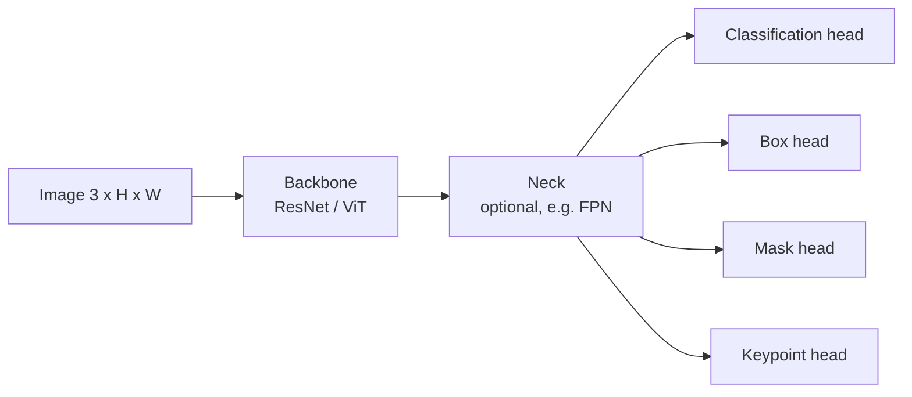
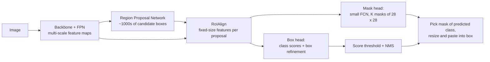
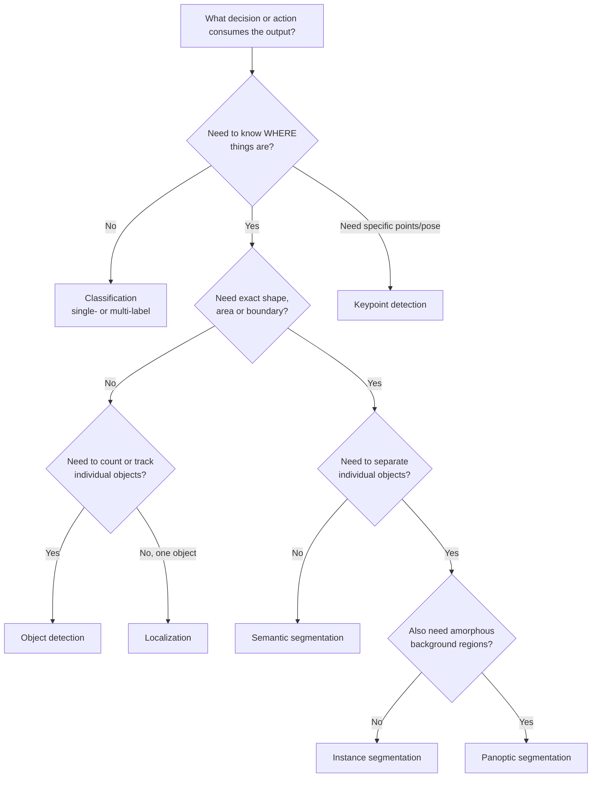

# Computer Vision Tasks: Classification, Detection and Segmentation

> **Level:** Beginner to Advanced · **Study time:** ~120 min · **Prerequisites:** [Convolutional Neural Networks and Transfer Learning](../02-deep-learning/07-cnns-and-transfer-learning.md), [Loss Functions](../02-deep-learning/04-loss-functions.md), [Classification Metrics and Imbalanced Data](../01-classical-ml/04-classification-metrics-and-imbalanced-data.md), [Softmax, Entropy, Cross-Entropy and KL Divergence](../00-foundations/05-softmax-entropy-cross-entropy-and-kl-divergence.md)

## Table of contents

- [Why this matters](#why-this-matters)
- [Images as tensors](#images-as-tensors)
- [The vision task family](#the-vision-task-family)
- [Model anatomy: backbones, heads and losses](#model-anatomy-backbones-heads-and-losses)
- [Segmentation architectures: FCN and U-Net](#segmentation-architectures-fcn-and-u-net)
- [Instance segmentation with Mask R-CNN](#instance-segmentation-with-mask-r-cnn)
- [IoU: measuring overlap](#iou-measuring-overlap)
- [From IoU to precision, recall and mAP](#from-iou-to-precision-recall-and-map)
- [Segmentation metrics: pixel accuracy, mean IoU and Dice](#segmentation-metrics-pixel-accuracy-mean-iou-and-dice)
- [Metrics for panoptic segmentation and keypoints](#metrics-for-panoptic-segmentation-and-keypoints)
- [Choosing the right task formulation for a business problem](#choosing-the-right-task-formulation-for-a-business-problem)
- [Going deeper: production and senior-level concerns](#going-deeper-production-and-senior-level-concerns)
- [Common mistakes and misconceptions](#common-mistakes-and-misconceptions)
- [Interview questions and model answers](#interview-questions-and-model-answers)
- [Key takeaways](#key-takeaways)
- [Further reading](#further-reading)
- [Next](#next)

## Why this matters

Almost every computer vision product, from a phone's photo search to a factory defect inspector to a self-driving perception stack, starts with one decision: what exactly should the model output? A label, a box, a mask per pixel, or a set of body joints? That choice drives the labeling budget, the architecture, the loss, the metric and the latency, and getting it wrong is one of the most expensive mistakes a vision team can make. Interviewers for AI/ML roles still ask "compare classification, detection and segmentation" and "how do IoU and mAP work" because the answers reveal whether you understand outputs, losses and evaluation as one connected system. Even in the multimodal LLM era, these task definitions are the vocabulary used to evaluate vision-language models, build labeling pipelines and design production systems.

This chapter gives you the map of the whole territory. The next chapter, [Object Detection in Depth](./02-object-detection-yolo-faster-rcnn-and-map.md), zooms into detectors and mAP in full detail.

## Images as tensors

### Intuition

> **Analogy:** A digital image is a spreadsheet of tiny colored tiles. Each tile (a **pixel**) has three dials: how much red, how much green, how much blue. Stack three spreadsheets on top of each other, one per color, and you have a color image.

### Precise definitions

- A **pixel** ("picture element") is the smallest addressable point of an image.
- A **channel** is one layer of values per pixel. Grayscale images have 1 channel; color images usually have 3 (**RGB**: red, green, blue). Some have a 4th **alpha** channel (transparency); satellite and medical images may have many more (for example multispectral bands or CT slices).
- **Height (H)** is the number of pixel rows, **width (W)** the number of pixel columns.
- A **tensor** is a multi-dimensional array of numbers (a generalization of vectors and matrices, see [Linear Algebra for ML](../00-foundations/02-linear-algebra-for-ml.md)). An RGB image is a 3-D tensor with shape $H \times W \times 3$.
- **Pixel values** in common formats (JPEG, PNG) are stored as **uint8**: unsigned 8-bit integers in the range 0 to 255. 0 means "none of this color", 255 means "full intensity". A pure red pixel is $(255, 0, 0)$.

```text
A 4 x 6 RGB image (H=4, W=6, C=3) seen as three stacked grids

           Red channel             Green channel           Blue channel
        +---+---+---+---+---+---+
row 0   |255|255| 0 | 0 |128| 12|   ...                     ...
row 1   |...                    |
row 2   |...                    |
row 3   |...                    |
        +---+---+---+---+---+---+
         col0               col5

Pixel (row 0, col 0) = (R, G, B) = (255, 0, 0)  -> pure red
```

### Layout conventions: HWC vs CHW, and batches

Different libraries store the axes in different orders. This causes many real bugs.

| Convention | Shape | Who uses it |
|---|---|---|
| HWC ("channels last") | $H \times W \times C$ | PIL, NumPy images, OpenCV, Matplotlib, TensorFlow default |
| CHW ("channels first") | $C \times H \times W$ | PyTorch layers |
| NCHW | $N \times C \times H \times W$ | PyTorch batches ($N$ = batch size, number of images processed together) |
| NHWC | $N \times H \times W \times C$ | TensorFlow batches; also often faster on GPU tensor cores, so PyTorch supports it as a "channels_last" memory format |

> **Common mistake:** OpenCV's `cv2.imread` returns channels in **BGR** order, not RGB. Feeding BGR images into a model trained on RGB silently swaps red and blue. Accuracy drops, nothing crashes.

### Memory: images are big

An image of $224 \times 224 \times 3$ (a classic classification input size) holds $224 \times 224 \times 3 = 150{,}528$ values.

- As uint8 (1 byte each): $150{,}528$ bytes, about 147 KiB.
- As float32 (4 bytes each): $150{,}528 \times 4 = 602{,}112$ bytes, about 588 KiB.

A Full HD frame ($1920 \times 1080 \times 3$) is $6{,}220{,}800$ bytes as uint8 and $24{,}883{,}200$ bytes (about 25 MB) as float32. This is why vision pipelines keep images as uint8 for as long as possible (decoding, resizing, transfer) and only convert to float at the last moment, often on the GPU.

### Normalization

Neural networks train best when inputs are small numbers centered near zero (see [Vanishing and Exploding Gradients, Initialization, Normalization and Residual Connections](../02-deep-learning/05-vanishing-exploding-gradients-initialization-normalization-and-residuals.md)). So we **normalize** pixels in two steps:

1. **Scale** to $[0, 1]$ by dividing by 255.
2. **Standardize** each channel: subtract a per-channel mean and divide by a per-channel standard deviation.

$$
x_{\text{norm}} = \frac{x / 255 - \mu_c}{\sigma_c}
$$

- $x$: the raw uint8 pixel value (0 to 255) in channel $c$.
- $\mu_c$: the mean of channel $c$ over the training data (after scaling to $[0,1]$).
- $\sigma_c$: the standard deviation of channel $c$ over the training data.
- $x_{\text{norm}}$: the value the network actually sees.

The famous **ImageNet statistics** (computed on the ImageNet training set and reused by most pretrained models) are mean $\mu = (0.485, 0.456, 0.406)$ and std $\sigma = (0.229, 0.224, 0.225)$ for (R, G, B).

**Worked example.** A red-channel pixel with value 128:

1. Scale: $128 / 255 = 0.50196$.
2. Subtract the red mean: $0.50196 - 0.485 = 0.01696$.
3. Divide by the red std: $0.01696 / 0.229 = 0.0741$.

So the network sees about $0.074$. A red value of 0 becomes $(0 - 0.485)/0.229 = -2.118$ and 255 becomes $(1 - 0.485)/0.229 = 2.249$.

> **Senior insight:** When you fine-tune a pretrained model, use **the normalization it was trained with**, not your dataset's statistics. The pretrained first-layer weights expect inputs on that scale. Most "my fine-tuned model is mysteriously bad" bugs in vision are preprocessing mismatches: wrong mean/std, BGR vs RGB, wrong resize, or forgetting to divide by 255.

### Code: from scratch, then the standard way

```python
# pip install numpy torch torchvision pillow
import numpy as np

# A fake 4x6 RGB image (H=4, W=6, C=3) with uint8 values 0..255
rng = np.random.default_rng(0)
img = rng.integers(0, 256, size=(4, 6, 3), dtype=np.uint8)
print(img.shape, img.dtype)          # (4, 6, 3) uint8

# Step 1: scale to [0, 1] as float32
x = img.astype(np.float32) / 255.0

# Step 2: standardize per channel (broadcasts over the last axis, C)
mean = np.array([0.485, 0.456, 0.406], dtype=np.float32)
std = np.array([0.229, 0.224, 0.225], dtype=np.float32)
x = (x - mean) / std

# Step 3: HWC -> CHW for PyTorch, then add a batch axis -> NCHW
x_chw = x.transpose(2, 0, 1)         # (3, 4, 6)
batch = x_chw[None, ...]             # (1, 3, 4, 6)
print(batch.shape)                   # (1, 3, 4, 6)

# uint8 arithmetic wraps around: a classic bug
print(np.uint8(250) + np.uint8(10))  # 4 (260 mod 256), NumPy may also warn about overflow
```

The same thing with torchvision:

```python
from PIL import Image
from torchvision import transforms

preprocess = transforms.Compose([
    transforms.Resize(256),            # shorter side -> 256 pixels
    transforms.CenterCrop(224),        # 224 x 224 center crop
    transforms.ToTensor(),             # HWC uint8 [0,255] -> CHW float [0,1]
    transforms.Normalize(mean=[0.485, 0.456, 0.406],
                         std=[0.229, 0.224, 0.225]),
])

img = Image.new("RGB", (640, 480), color=(128, 64, 32))  # stand-in for a real photo
t = preprocess(img)
print(t.shape)                         # torch.Size([3, 224, 224])
batch = t.unsqueeze(0)                 # torch.Size([1, 3, 224, 224])
```

> **Interview tip:** torchvision also has a newer `transforms.v2` API that transforms images, boxes and masks together consistently. The durable concept: whatever geometric transform you apply to the image must also be applied to its labels. More on that in [Data Augmentation, Transfer Learning and Small Datasets in Vision](./03-data-augmentation-transfer-learning-and-small-datasets.md).

## The vision task family

### Intuition

> **Analogy:** Imagine asking a friend about a street photo.
> - "Is there a car in it?" (classification)
> - "Where is the car? Point at it." (localization)
> - "Draw a rectangle around every car and every person." (object detection)
> - "Color every pixel by what it is: road, sky, car, person." (semantic segmentation)
> - "Color each car a different color so I can tell them apart." (instance segmentation)
> - "Do both: every pixel gets a category, and countable objects also get their own ID." (panoptic segmentation)
> - "Mark each person's elbows, knees and shoulders." (keypoint detection)

Each question asks for more spatial detail, and each answer is more expensive to label and compute.

### Our running example

Throughout this chapter we use one image: a **street scene** with **two cars**, **one person**, plus **road** and **sky**. We will also use a tiny $4 \times 4$ "cat" mask later for metric arithmetic.

```text
Same street photo, seven different outputs

CLASSIFICATION        LOCALIZATION          OBJECT DETECTION
"car" (0.97)          "car" + one box       car  0.95 [box]
(multi-label:                               car  0.91 [box]
 car, person)          +-------+            person 0.88 [box]
                       |  car  |             +----+  +----+  +-+
                       +-------+             |car1|  |car2|  |P|
                                             +----+  +----+  +-+

SEMANTIC SEGMENTATION    INSTANCE SEGMENTATION    PANOPTIC SEGMENTATION
sssssssssssssssss        .................        sssssssssssssssss
sssssssssssssssss        .................        sssssssssssssssss
ssCCCCsssCCCCsPss        ..1111...2222.3..        ss1111sss2222s3ss
rrCCCCrrrCCCCrPrr        ..1111...2222.3..        rr1111rrr2222r3rr
rrrrrrrrrrrrrrrrr        .................        rrrrrrrrrrrrrrrrr
s=sky r=road C=car       1,2=car instances        stuff classes (s, r) +
P=person                 3=person instance        thing instances (1,2,3)
(both cars = "C")        (background ignored)     every pixel labeled once

KEYPOINT DETECTION
person: nose(x,y), left_shoulder(x,y), right_shoulder(x,y), ..., right_ankle(x,y)
```

### Each task, precisely

**1. Image classification.** Assign one label (or a set of labels) to the whole image.

- **Single-label (multi-class) classification:** exactly one class out of $K$. Output: a vector of $K$ probabilities summing to 1 (via **softmax**, see [Softmax, Entropy, Cross-Entropy and KL Divergence](../00-foundations/05-softmax-entropy-cross-entropy-and-kl-divergence.md)).
- **Multi-label classification:** any subset of classes can be present ("car" and "person"). Output: $K$ independent probabilities, each from a **sigmoid**.
- Use case: product photo categorization, "is this X-ray normal or abnormal?", content moderation.

**2. Classification with localization.** One main object: predict its class and one **bounding box**, a rectangle described by 4 numbers. Use case: ID-card cropping in a mobile onboarding app (there is exactly one card).

**3. Object detection.** Find **every** object of interest: for each one, a class, a box and a **confidence score** (how sure the model is). The number of outputs varies per image. Use case: counting cars in a parking lot, detecting pedestrians for driver assistance, finding products on a shelf.

**4. Semantic segmentation.** Assign a class to **every pixel**. All cars share the label "car"; the model does not distinguish car 1 from car 2. Output: a **mask**, an $H \times W$ grid of class IDs. Use case: drivable-area detection for robots, land-cover mapping from satellite images, measuring the area of a tumor.

**5. Instance segmentation.** Detect each object **and** give it its own pixel mask. Car 1 and car 2 get separate masks. Usually only countable objects are segmented; background is ignored. Use case: robotic picking (the gripper needs the exact outline of *this* item), cell counting in microscopy.

**6. Panoptic segmentation** (Kirillov et al., "Panoptic Segmentation", 2019). Unifies the two: every pixel gets a class, and pixels of countable objects also get an instance ID. It distinguishes:
- **Things**: countable objects with instances (cars, people).
- **Stuff**: amorphous regions with no meaningful instances (sky, road, grass).

Use case: full scene understanding for autonomous driving, where you need both "where is drivable road" and "which pixels belong to which pedestrian".

**7. Keypoint detection** (also **pose estimation** for humans). Predict the $(x, y)$ location of a fixed set of semantic points per object, often with a visibility flag. COCO defines 17 keypoints for a person (nose, eyes, ears, shoulders, elbows, wrists, hips, knees, ankles). Use case: fitness-app rep counting, sign-language analysis, facial landmarks for AR filters, robotic grasp points.

### Comparison table

| Task | Output per image | Distinguishes instances? | Spatial detail | Typical label cost | Example use case |
|---|---|---|---|---|---|
| Classification | $K$ scores | No | None | Lowest (one click) | Photo categorization |
| Localization | Class + 1 box | Single object only | Coarse (box) | Low | Document/ID cropping |
| Object detection | List of (class, box, score) | Yes, by box | Coarse (box) | Medium | Counting, tracking |
| Semantic segmentation | $H \times W$ class map | No | Pixel | High (polygons/painting) | Drivable area, land cover |
| Instance segmentation | List of (class, mask, score) | Yes | Pixel | High | Robotic picking, cell counting |
| Panoptic segmentation | $H \times W$ class map + instance IDs | Yes, for things | Pixel | Highest | Full scene understanding |
| Keypoint detection | List of objects, each with $J$ points $(x, y, v)$ | Yes | Points | Medium to high | Pose, landmarks |

Label costs here are qualitative and relative; actual costs depend on tooling (model-assisted labeling can cut mask costs dramatically).

> **Interview tip:** The cleanest one-line summary: "Classification answers *what*, detection answers *what and where (roughly)*, segmentation answers *what and exactly which pixels*. Instance and panoptic segmentation add *which one*."

## Model anatomy: backbones, heads and losses

### The backbone plus head pattern

Almost every vision model has two parts:

- A **backbone** (also **encoder** or **feature extractor**): a CNN such as ResNet, or a Vision Transformer, that turns the image into **feature maps**, grids of learned descriptors. Feature maps are smaller in space but deeper in channels, for example $3 \times 224 \times 224 \rightarrow 2048 \times 7 \times 7$. The ratio between input size and feature-map size is the **stride** (here $224 / 7 = 32$). CNN backbones are taught in [Convolutional Neural Networks and Transfer Learning](../02-deep-learning/07-cnns-and-transfer-learning.md); ViTs in [Vision Transformers, CLIP and Multimodal LLMs](./05-vision-transformers-clip-and-multimodal-models.md).
- A **head**: a small task-specific network that turns features into the task's output format.

Some models add a **neck** between them, for example a **Feature Pyramid Network (FPN)** (Lin et al., 2017) that combines feature maps at several resolutions so small and large objects are both handled well.



The task decides the head and the loss. The backbone is often the same pretrained network for all of them, which is why transfer learning works so well in vision.

### Classification head and loss

**Mechanism:** collapse the spatial grid into one vector with **global average pooling** (average each channel over all positions: $2048 \times 7 \times 7 \rightarrow 2048$), then a linear layer maps it to $K$ **logits** (raw, unnormalized scores).

- Single-label: softmax over the $K$ logits, trained with **cross-entropy** loss.
- Multi-label: one sigmoid per class, trained with **binary cross-entropy (BCE)** per class.

Both losses are derived in [Loss Functions](../02-deep-learning/04-loss-functions.md). Quick recap of cross-entropy for one image whose true class is $y$:

$$
L_{\text{cls}} = -\log p_y
$$

- $p_y$: the predicted probability for the true class $y$.

Example: if the model gives "car" probability 0.8 and the true class is car, $L = -\ln 0.8 = 0.223$. If it gave 0.1, $L = -\ln 0.1 = 2.303$, a much larger penalty.

```python
import torch
import torch.nn as nn

features = torch.randn(8, 512, 7, 7)   # backbone output for a batch of 8 images

head = nn.Sequential(
    nn.AdaptiveAvgPool2d(1),            # (8, 512, 1, 1): global average pooling
    nn.Flatten(),                       # (8, 512)
    nn.Linear(512, 3),                  # (8, 3): logits for {car, person, bike}
)
logits = head(features)

# Single-label: integer class index per image
labels = torch.tensor([0, 1, 2, 0, 0, 1, 2, 2])
loss_single = nn.CrossEntropyLoss()(logits, labels)    # softmax is inside the loss

# Multi-label: multi-hot vector per image (car and person both present = [1, 1, 0])
multi_hot = torch.randint(0, 2, (8, 3)).float()
loss_multi = nn.BCEWithLogitsLoss()(logits, multi_hot)  # sigmoid is inside the loss
print(logits.shape, loss_single.item() > 0, loss_multi.item() > 0)
```

### Localization head and box losses

**Box formats.** A box needs 4 numbers. Three common encodings:

| Format | Numbers | Used by |
|---|---|---|
| `xyxy` | $(x_1, y_1, x_2, y_2)$: top-left and bottom-right corners | Pascal VOC, torchvision |
| `xywh` | $(x_1, y_1, w, h)$: top-left corner plus width and height | COCO annotation files |
| `cxcywh` | $(c_x, c_y, w, h)$: center plus width and height, often normalized to $[0, 1]$ | YOLO label files, DETR |

> **Common mistake:** Mixing box formats is the number one silent bug in detection pipelines. A model trained on `cxcywh` evaluated with `xyxy` code still produces boxes, they are just wrong, and IoU collapses. Write the format into variable names (`boxes_xyxy`).

**Head:** a linear layer outputs $K$ class logits plus 4 box numbers. The box output is a **regression** (predicting continuous numbers).

**Loss:** the total loss is a weighted sum:

$$
L = L_{\text{cls}} + \lambda \, L_{\text{box}}
$$

- $L_{\text{cls}}$: cross-entropy on the class.
- $L_{\text{box}}$: a regression loss on the 4 box numbers.
- $\lambda$: a weight that balances the two terms (a **hyperparameter**, chosen by you, not learned).

Common choices for $L_{\text{box}}$:

- **L1** (absolute error) or **Smooth L1** (used in Fast/Faster R-CNN): quadratic for small errors, linear for large ones, so outliers do not dominate.

$$
\text{SmoothL1}(d) = \begin{cases} 0.5\, d^2 & \text{if } |d| < 1 \\ |d| - 0.5 & \text{otherwise} \end{cases}
$$

- $d$: the difference between a predicted and a target box coordinate (usually after encoding, see below).

Example: $d = 0.4$ gives $0.5 \times 0.16 = 0.08$; $d = 2$ gives $2 - 0.5 = 1.5$.

- **IoU-based losses** such as **GIoU loss** (Rezatofighi et al., "Generalized Intersection over Union", 2019): optimize the overlap metric directly. We define IoU below and return to GIoU there.

> **Senior insight:** Detectors rarely regress raw pixel coordinates. Faster R-CNN predicts offsets relative to a reference box (an **anchor**): $t_x = (x - x_a)/w_a$, $t_w = \log(w / w_a)$, and similarly for $y$ and $h$. Normalizing by the anchor size makes errors scale-invariant (a 5-pixel miss matters more for a 20-pixel object than for a 500-pixel one), and the log keeps width and height positive.

### Detection heads: handling a variable number of objects

Classification and localization produce a fixed-size output. Detection does not: one image has 0 cars, another has 40. Neural networks output fixed-size tensors, so detectors use a trick:

1. **Predict densely.** Produce predictions at many fixed positions: every cell of a feature-map grid, often with several **anchors** (reference box shapes) per cell, or a fixed set of learned **queries** in transformer detectors such as DETR. Each slot predicts class scores (or an **objectness** score: "is there any object here?") plus box offsets.
2. **Assign targets.** During training, match each ground-truth object to one or more slots (for example, anchors with high IoU to it). Unmatched slots are trained to predict "background".
3. **Filter at inference.** Drop low-confidence predictions, then apply **non-maximum suppression (NMS)**: among heavily overlapping boxes of the same class, keep only the highest-scoring one.

Illustrative size: a YOLOv3-style head on a $13 \times 13$ grid with 3 anchors per cell and 80 classes predicts $13 \times 13 \times 3 = 507$ slots, each with $4 + 1 + 80 = 85$ numbers (box, objectness, classes), so $507 \times 85 = 43{,}095$ numbers, from which typically only a handful of boxes survive.

**Losses:** classification (cross-entropy, or **focal loss** from Lin et al., "Focal Loss for Dense Object Detection", 2017, which down-weights the huge number of easy background slots) plus box regression (Smooth L1, L1 and/or GIoU), sometimes plus objectness BCE.

Two-stage vs one-stage detectors, anchors vs anchor-free, NMS details and DETR's set-based matching are covered in [Object Detection in Depth](./02-object-detection-yolo-faster-rcnn-and-map.md).

### Semantic segmentation head and loss

**Mechanism:** a segmentation model is a per-pixel classifier. The head predicts $K$ logits **at every pixel**, so the output tensor is $N \times K \times H \times W$. A **1x1 convolution** (a linear layer applied independently at each pixel) maps feature channels to $K$ class logits, and an upsampling step brings the low-resolution feature map back to the input size.

**Loss options:**

- **Per-pixel cross-entropy:** average the cross-entropy over all pixels. Simple, stable, the default.
- **Dice loss:** $1 - \text{Dice}$, a differentiable version of the Dice overlap score (defined in the metrics section below). Handles small foreground regions better because it measures overlap relative to object size, not per-pixel correctness.
- **Combined CE + Dice:** very common in medical imaging; CE gives smooth gradients early, Dice focuses on overlap.
- **Weighted CE / focal loss:** for rare classes.

Details and derivations live in [Loss Functions](../02-deep-learning/04-loss-functions.md).

> **Common mistake:** Masks contain class IDs, not intensities. When you resize a mask, use **nearest-neighbor** interpolation. Bilinear interpolation between class 1 (car) and class 3 (person) produces 2 (some unrelated class) along every boundary.

```python
import torch
import torch.nn.functional as F

N, K, H, W = 2, 4, 64, 64                 # batch 2, classes {bg, road, car, person}
logits = torch.randn(N, K, H, W, requires_grad=True)  # stand-in for a model's output
target = torch.randint(0, K, (N, H, W))    # class ID per pixel (dtype long)

# 1) Per-pixel cross-entropy: averaged over every pixel of every image
ce = F.cross_entropy(logits, target)       # optional: ignore_index=255 for "unlabeled" pixels

# 2) Soft Dice loss over classes
def soft_dice_loss(logits, target, eps=1e-6):
    probs = logits.softmax(dim=1)                          # (N, K, H, W)
    one_hot = F.one_hot(target, K).permute(0, 3, 1, 2).float()
    dims = (0, 2, 3)                                       # sum over batch and pixels
    intersection = (probs * one_hot).sum(dims)             # per class
    denom = probs.sum(dims) + one_hot.sum(dims)
    dice = (2 * intersection + eps) / (denom + eps)
    return 1 - dice.mean()                                 # average over classes

loss = ce + soft_dice_loss(logits, target)
loss.backward()
pred_mask = logits.argmax(dim=1)           # (N, H, W): predicted class per pixel
print(pred_mask.shape)                     # torch.Size([2, 64, 64])
```

Note the output size: with $K = 21$ classes at $512 \times 512$, one image's logits are $21 \times 512 \times 512 \times 4$ bytes $= 22{,}020{,}096$ bytes, about 22 MB in float32. Segmentation outputs are heavy; this matters for memory and for moving results off the GPU.

### Instance and panoptic segmentation heads

- **Instance segmentation** usually extends a detector: for each detected box, a **mask head** predicts a small binary mask (object vs not-object) inside that box. Loss: detection losses plus per-pixel BCE (or Dice) on the mask. Mask R-CNN, below, is the canonical example.
- **Panoptic segmentation** was first done by combining a semantic head (for stuff) and an instance head (for things) and merging their outputs with rules for overlaps. Newer "universal" models such as **Mask2Former** (Cheng et al., 2022) predict a fixed set of (class, mask) pairs with a transformer decoder and handle semantic, instance and panoptic segmentation with one architecture.

### Keypoint heads and loss

Two approaches:

- **Direct regression:** predict $2J$ numbers ($x, y$ for each of $J$ keypoints) with an L1/L2 loss. Simple, fast, but historically less accurate for precise localization.
- **Heatmaps:** predict $J$ low-resolution maps (one per keypoint, for example at $1/4$ of input resolution). The target for each map is a small 2-D Gaussian "bump" centered on the true location; the loss is per-pixel MSE. At inference, the peak (argmax) of each map, often refined to sub-pixel precision, is the predicted location. Stacked Hourglass (Newell et al., 2016) is a classic example. (Mask R-CNN's keypoint variant uses a related idea: a one-hot target map per keypoint trained with softmax cross-entropy over the map's pixels.)

The Gaussian target:

$$
G(x, y) = \exp\!\left(-\frac{(x - x_0)^2 + (y - y_0)^2}{2\sigma^2}\right)
$$

- $(x_0, y_0)$: the true keypoint location on the heatmap grid.
- $(x, y)$: any heatmap pixel.
- $\sigma$: the spread of the bump in pixels (a hyperparameter).
- $G$: the target value, 1 at the keypoint and fading toward 0.

Worked example with $\sigma = 1$: at the keypoint itself, $G = e^0 = 1$. One pixel away, $G = e^{-1/2} = 0.607$. Diagonally adjacent (distance $\sqrt{2}$, squared distance 2), $G = e^{-2/2} = e^{-1} = 0.368$. Two pixels away (squared distance 4), $G = e^{-4/2} = e^{-2} = 0.135$. The soft target tells the network "near misses are partly right", which trains more smoothly than a single 1 among zeros.

Each keypoint also carries a **visibility flag** $v$ (COCO uses 0 = not labeled, 1 = labeled but occluded, 2 = visible); unlabeled keypoints are excluded from the loss.

### Summary: heads and losses

| Task | Head output | Typical loss(es) | Post-processing |
|---|---|---|---|
| Classification | $K$ logits | Cross-entropy (single-label), BCE (multi-label) | Softmax/sigmoid, threshold or argmax |
| Localization | $K$ logits + 4 box numbers | CE + Smooth L1 / L1 / GIoU | Decode box |
| Detection | Per slot: class scores (+ objectness) + box offsets | CE or focal + Smooth L1 / GIoU | Score threshold + NMS (or none for DETR-style) |
| Semantic segmentation | $K \times H \times W$ logits | Per-pixel CE, Dice, CE + Dice | Argmax per pixel |
| Instance segmentation | Detection outputs + mask per instance | Detection losses + mask BCE/Dice | NMS, threshold masks, paste into image |
| Panoptic segmentation | Class map + instance IDs (or set of masks) | Semantic + instance losses, or set-matching loss | Merge, resolve overlaps |
| Keypoints | $J$ heatmaps (or $2J$ coordinates) per object | MSE on heatmaps (or L1 on coordinates) | Peak finding, visibility |

## Segmentation architectures: FCN and U-Net

### The core tension: "what" vs "where"

A classification backbone repeatedly **downsamples** (shrinks) the image with strided convolutions and pooling. That is good for **semantics** (what): each deep feature sees a large region, so it can recognize a car. But it is bad for **localization** (where): a $7 \times 7$ grid cannot draw a precise boundary on a $224 \times 224$ image.

> **Analogy:** Reading a map. Zoomed out, you know you are "in Paris" (semantics) but not which street. Zoomed in, you see the street but not the city. Good segmentation needs both views at once.

### Fully Convolutional Networks (FCN)

**FCN** (Long, Shelhamer and Darrell, "Fully Convolutional Networks for Semantic Segmentation", 2015) was the key step: replace the classifier's final fully connected layers with convolutions so the network outputs a coarse class map instead of a single vector, then **upsample** it to full resolution. FCN also added **skip connections** from earlier, higher-resolution layers to recover detail.

**Upsampling** options:

- **Bilinear interpolation:** fixed, no learned parameters, smooth.
- **Transposed convolution** (sometimes misnamed "deconvolution"): a learned upsampling layer. Can produce checkerboard artifacts if kernel size and stride are mismatched; "resize then convolve" is a common alternative.

The **DeepLab** family (Chen et al., 2017 and later) took a different route: use **atrous (dilated) convolutions**, which spread out the kernel's taps to see a larger area without downsampling, plus **Atrous Spatial Pyramid Pooling (ASPP)**, parallel atrous convolutions at several dilation rates, to capture context at several scales.

### U-Net

**U-Net** (Ronneberger, Fischer and Brox, "U-Net: Convolutional Networks for Biomedical Image Segmentation", 2015) is arguably the most influential segmentation architecture and still a default baseline, especially in medical imaging. It was designed to work with very few training images, which is why it spread so widely.

**Structure:**

- **Encoder (contracting path):** repeated blocks of two 3x3 convolutions + ReLU, then 2x2 max pooling. Spatial size halves, channels double. Captures "what".
- **Bottleneck:** the lowest-resolution, most semantic layer.
- **Decoder (expanding path):** upsample (the paper uses a 2x2 up-convolution), halve the channels, then **concatenate** the encoder feature map from the same resolution (the **skip connection**), then two 3x3 convolutions. Recovers "where".
- **Output:** a 1x1 convolution to $K$ class logits per pixel.

```text
U-Net shape (sizes for a 64 x 64 input in the mini version below)

 input 3x64x64
   |
 [enc1] 16x64x64 ----------------- copy (skip) ------------------> concat -> [dec1] 16x64x64 -> 1x1 conv -> K x 64 x 64
   | maxpool                                                         ^
 [enc2] 32x32x32 ---- copy (skip) ----> concat -> [dec2] 32x32x32    | up-conv
   | maxpool                              ^           |--------------+
 [bottleneck] 64x16x16 ---- up-conv ------+

Left side goes down (what), right side goes up (where),
skips carry fine detail across: the "U".
```

**Why skip connections matter:** the decoder alone would have to reinvent fine edges from a blurry $16 \times 16$ map. The skip hands it the exact edges the encoder saw at full resolution, so the decoder only needs to decide *which* edges matter. Note the difference from ResNet's residual skips: U-Net **concatenates** channels across the encoder and decoder; ResNet **adds** within a block (see [Residual Connections](../02-deep-learning/05-vanishing-exploding-gradients-initialization-normalization-and-residuals.md)).

A minimal, runnable U-Net (two levels instead of the paper's four; padded convolutions so sizes match without cropping, which is the common modern practice, whereas the original used unpadded convolutions and cropped the skips):

```python
import torch
import torch.nn as nn

def double_conv(c_in, c_out):
    # Two 3x3 convs, each followed by BatchNorm and ReLU. padding=1 keeps H and W.
    return nn.Sequential(
        nn.Conv2d(c_in, c_out, 3, padding=1), nn.BatchNorm2d(c_out), nn.ReLU(inplace=True),
        nn.Conv2d(c_out, c_out, 3, padding=1), nn.BatchNorm2d(c_out), nn.ReLU(inplace=True),
    )

class MiniUNet(nn.Module):
    def __init__(self, in_ch=3, num_classes=4):
        super().__init__()
        self.enc1 = double_conv(in_ch, 16)            # 64x64
        self.enc2 = double_conv(16, 32)               # 32x32
        self.bottleneck = double_conv(32, 64)         # 16x16
        self.pool = nn.MaxPool2d(2)
        self.up2 = nn.ConvTranspose2d(64, 32, kernel_size=2, stride=2)  # 16 -> 32
        self.dec2 = double_conv(32 + 32, 32)          # concat skip from enc2
        self.up1 = nn.ConvTranspose2d(32, 16, kernel_size=2, stride=2)  # 32 -> 64
        self.dec1 = double_conv(16 + 16, 16)          # concat skip from enc1
        self.head = nn.Conv2d(16, num_classes, kernel_size=1)          # per-pixel logits

    def forward(self, x):
        e1 = self.enc1(x)                              # (N, 16, 64, 64)
        e2 = self.enc2(self.pool(e1))                  # (N, 32, 32, 32)
        b = self.bottleneck(self.pool(e2))             # (N, 64, 16, 16)
        d2 = self.dec2(torch.cat([self.up2(b), e2], dim=1))   # (N, 32, 32, 32)
        d1 = self.dec1(torch.cat([self.up1(d2), e1], dim=1))  # (N, 16, 64, 64)
        return self.head(d1)                           # (N, K, 64, 64)

model = MiniUNet(num_classes=4)
out = model(torch.randn(2, 3, 64, 64))
print(out.shape)   # torch.Size([2, 4, 64, 64])
```

> **Common mistake:** With this design, $H$ and $W$ must be divisible by $2^{\text{levels}}$ (here 4). Otherwise the upsampled map and the skip differ by a pixel and `torch.cat` fails. Pad inputs to a multiple of 32 for typical 5-level backbones.

In practice, you rarely train U-Net from scratch. Libraries such as `segmentation_models_pytorch` build U-Net, FPN or DeepLabV3+ decoders on top of ImageNet-pretrained encoders, and torchvision ships pretrained `deeplabv3_resnet50` and `fcn_resnet50`. Library APIs change across versions; the durable idea is "pretrained encoder + segmentation decoder".

## Instance segmentation with Mask R-CNN

### Intuition

Semantic segmentation colors both cars "car". To separate them, first **find** each car (detection), then **outline** each one inside its box (segmentation). That is exactly **Mask R-CNN** (He, Gkioxari, Dollár and Girshick, "Mask R-CNN", 2017): Faster R-CNN plus a mask branch.

### Architecture overview



Step by step:

1. **Backbone + FPN** produce feature maps at several scales.
2. **Region Proposal Network (RPN)**: a small network that slides over the features and proposes candidate object boxes ("there is probably *something* here"), class-agnostic. This is the "two-stage" part: propose first, then classify.
3. **RoIAlign**: for each proposal (a **Region of Interest, RoI**), extract a fixed-size feature grid (for example $7 \times 7$ for the box head, $14 \times 14$ for the mask head).
4. **Box head**: classifies each RoI into one of $K$ classes (or background) and refines its box.
5. **Mask head**: a small fully convolutional network that outputs $K$ binary masks of $28 \times 28$ per RoI, one per class. Only the mask for the predicted class is used.
6. At inference, the $28 \times 28$ mask is resized to the box size, thresholded (typically at 0.5) and pasted into the full image.

### The two key ideas

**RoIAlign vs RoIPool.** The older **RoIPool** (from Fast R-CNN) rounded box coordinates to the integer feature-map grid, twice. On a stride-16 or stride-32 feature map, a rounding of half a cell is 8 to 16 pixels in the image: tolerable for boxes, terrible for masks. **RoIAlign** removes all rounding and samples the features at exact fractional positions with **bilinear interpolation**. This small change gave a large improvement in mask quality in the paper.

**Decoupled mask and class prediction.** The mask head predicts one mask per class with a **per-pixel sigmoid** and binary cross-entropy, and the loss uses only the mask for the ground-truth class. Classes do not compete per pixel (as they would with a per-pixel softmax); the box head decides the class, the mask head only decides "object vs not object" for that class. The paper found this decoupling important for good instance masks.

**Total loss** per sampled RoI:

$$
L = L_{\text{cls}} + L_{\text{box}} + L_{\text{mask}}
$$

- $L_{\text{cls}}$: cross-entropy over $K$ classes + background.
- $L_{\text{box}}$: Smooth L1 on box offsets (only for foreground RoIs).
- $L_{\text{mask}}$: average per-pixel BCE on the $28 \times 28$ mask of the true class (only for foreground RoIs).
- Plus the RPN's own objectness and box losses during training.

### Running Mask R-CNN with torchvision

```python
# pip install torch torchvision   (downloads COCO-pretrained weights on first run)
import torch
from torchvision.io import read_image
from torchvision.models.detection import maskrcnn_resnet50_fpn, MaskRCNN_ResNet50_FPN_Weights

weights = MaskRCNN_ResNet50_FPN_Weights.DEFAULT
model = maskrcnn_resnet50_fpn(weights=weights).eval()
preprocess = weights.transforms()          # converts uint8 -> float in [0, 1]

img = read_image("street.jpg")             # uint8 tensor (3, H, W); replace with your image
with torch.no_grad():
    out = model([preprocess(img)])[0]      # the model takes a LIST of images (sizes may differ)

# out is a dict:
#   boxes  (N, 4) in xyxy pixel coordinates
#   labels (N,)   COCO category indices
#   scores (N,)   confidence, sorted descending
#   masks  (N, 1, H, W) per-pixel probabilities in [0, 1]
categories = weights.meta["categories"]
keep = out["scores"] > 0.7
for box, label, score in zip(out["boxes"][keep], out["labels"][keep], out["scores"][keep]):
    print(categories[label], round(score.item(), 2), [round(v) for v in box.tolist()])
binary_masks = out["masks"][keep, 0] > 0.5  # (n, H, W) boolean, one per instance
```

Note that the model normalizes internally (mean/std and resizing happen inside the detection model's transform), so you only convert to float in $[0, 1]$.

### Beyond Mask R-CNN

- **Mask2Former** (2022): one transformer architecture for semantic, instance and panoptic segmentation.
- **Segment Anything (SAM)** (Kirillov et al., 2023): a promptable segmentation foundation model. Given a point, box or (in later variants) text-derived prompt, it returns a mask without class labels. It is widely used to speed up mask annotation and as a component in zero-shot pipelines. Successor versions and video support have followed; check current releases.
- Real-time instance segmentation is commonly done with one-stage YOLO-family variants that add a mask branch. Exact versions change yearly.

> **Senior insight:** Mask R-CNN is rarely the fastest choice in 2026, but it remains the reference design interviewers expect you to explain, because its components (FPN, RPN, RoIAlign, decoupled heads, multi-task loss) appear everywhere.

## IoU: measuring overlap

### Intuition

> **Analogy:** Two people each trace a rectangle around the same car. How much do they agree? Look at the area they both covered, compared with the total area either of them covered. If they drew exactly the same rectangle, agreement is 100%. If the rectangles do not touch, 0%.

### Definition

**Intersection over Union (IoU)**, also called the **Jaccard index**:

$$
\text{IoU}(A, B) = \frac{|A \cap B|}{|A \cup B|} = \frac{|A \cap B|}{|A| + |B| - |A \cap B|}
$$

- $A$: the predicted region (box or mask).
- $B$: the ground-truth region.
- $|A \cap B|$: area of the **intersection** (the region in both).
- $|A \cup B|$: area of the **union** (the region in either), computed as the sum of areas minus the intersection so the overlap is not counted twice.
- Range: 0 (no overlap) to 1 (identical).

For axis-aligned boxes in `xyxy` format, the intersection is itself a box:

$$
x_1^I = \max(x_1^A, x_1^B), \quad y_1^I = \max(y_1^A, y_1^B), \quad x_2^I = \min(x_2^A, x_2^B), \quad y_2^I = \min(y_2^A, y_2^B)
$$

$$
|A \cap B| = \max(0,\ x_2^I - x_1^I) \cdot \max(0,\ y_2^I - y_1^I)
$$

The $\max(0, \cdot)$ handles non-overlapping boxes (negative width becomes 0).

### Worked example

Ground truth for car 1: $B = (1, 1, 5, 5)$. Prediction: $A = (3, 2, 7, 6)$.

```text
y
6 |           +---------------+
5 |   +-------+-------+       |
4 |   |       |///////|   A   |
3 |   |  B    |///////|       |
2 |   |       +-------+-------+
1 |   +---------------+
0 +----------------------------- x
  0   1   2   3   4   5   6   7

B (ground truth) = (1,1)-(5,5)    A (prediction) = (3,2)-(7,6)
/// = intersection (3,2)-(5,5)    (y grows upward here; in image coordinates y grows downward, IoU is the same)
```

1. Area of $A$: width $7 - 3 = 4$, height $6 - 2 = 4$, area $= 16$.
2. Area of $B$: width $5 - 1 = 4$, height $5 - 1 = 4$, area $= 16$.
3. Intersection corners: $x_1 = \max(3, 1) = 3$, $y_1 = \max(2, 1) = 2$, $x_2 = \min(7, 5) = 5$, $y_2 = \min(6, 5) = 5$.
4. Intersection area: $(5 - 3) \times (5 - 2) = 2 \times 3 = 6$.
5. Union: $16 + 16 - 6 = 26$.
6. IoU $= 6 / 26 = 0.231$.

At the standard threshold of 0.5, this prediction would **not** count as a correct detection. Shifting the prediction to $A' = (2, 2, 6, 6)$ gives intersection $(5-2)(5-2) = 9$, union $16 + 16 - 9 = 23$, IoU $= 9/23 = 0.391$: still below 0.5. IoU is strict: a box shifted by a quarter of its width already loses a lot.

**How strict are thresholds?** Two equal-size boxes offset only horizontally by fraction $f$ of their width have IoU $= (1-f)/(1+f)$. For $f = 0.2$: $0.8 / 1.2 = 0.667$. For $f = 1/3$: $(2/3)/(4/3) = 0.5$. So IoU 0.5 tolerates a shift of one third of the box width, and IoU 0.75 tolerates only $f = 1/7 \approx 0.14$ (check: $(6/7)/(8/7) = 0.75$).

### GIoU, briefly

Plain IoU is 0 for every non-overlapping pair, so as a loss it gives no gradient telling a far-away box which way to move. **GIoU** subtracts a penalty based on the smallest box $C$ enclosing both:

$$
\text{GIoU} = \text{IoU} - \frac{|C| - |A \cup B|}{|C|}
$$

- $C$: the smallest axis-aligned box containing both $A$ and $B$.

For our example, $C = (1, 1, 7, 6)$, area $6 \times 5 = 30$. GIoU $= 0.231 - (30 - 26)/30 = 0.231 - 0.133 = 0.097$, and the GIoU loss is $1 - 0.097 = 0.903$. GIoU ranges from -1 to 1 and keeps decreasing as boxes move apart, so even non-overlapping boxes get a useful gradient. It is not perfect: when one box contains the other, $C$ equals the union, the penalty vanishes and GIoU reduces to plain IoU, and convergence can be slow. DIoU and CIoU (Zheng et al., 2020) address this by adding center-distance and aspect-ratio terms.

### Code

```python
def box_iou_xyxy(a, b):
    """IoU of two boxes given as (x1, y1, x2, y2)."""
    ix1, iy1 = max(a[0], b[0]), max(a[1], b[1])
    ix2, iy2 = min(a[2], b[2]), min(a[3], b[3])
    inter = max(0, ix2 - ix1) * max(0, iy2 - iy1)
    area_a = (a[2] - a[0]) * (a[3] - a[1])
    area_b = (b[2] - b[0]) * (b[3] - b[1])
    return inter / (area_a + area_b - inter)

print(round(box_iou_xyxy((3, 2, 7, 6), (1, 1, 5, 5)), 3))   # 0.231

# Vectorized, all pairs at once (N predictions x M ground truths):
import torch
from torchvision.ops import box_iou, generalized_box_iou
preds = torch.tensor([[3., 2., 7., 6.], [2., 2., 6., 6.]])
gts = torch.tensor([[1., 1., 5., 5.]])
print(box_iou(preds, gts))              # approx [[0.2308], [0.3913]]
print(generalized_box_iou(preds, gts))  # first entry approx 0.0974
```

> **Common mistake:** Some older codebases (for example Pascal VOC devkit) treat pixel coordinates as inclusive and add 1 to widths: $w = x_2 - x_1 + 1$. Mixing conventions changes IoU for small boxes noticeably. Know which one your evaluator uses.

**Mask IoU** is the same formula on pixel sets: count pixels in both masks, divide by pixels in either. It is used to evaluate instance segmentation ("mask AP") and appears again in mean IoU below.

## From IoU to precision, recall and mAP

This section answers the classic interview question "How do IoU, precision, recall, and mAP measure performance?". Here is the full chain; the next chapter covers COCO and VOC variants in depth.

### Step 1: IoU turns predictions into TP, FP and FN

Precision and recall come from classification (see [Classification Metrics and Imbalanced Data](../01-classical-ml/04-classification-metrics-and-imbalanced-data.md)). For detection, we first decide which predictions are "correct":

1. Sort all predictions of a class by confidence, highest first.
2. For each prediction, find the unmatched ground-truth box of the same class with the highest IoU.
3. If that IoU $\geq$ threshold (commonly 0.5), the prediction is a **true positive (TP)** and that ground truth is now matched. Otherwise it is a **false positive (FP)**. A second prediction on an already-matched object is also an FP (a duplicate).
4. Ground-truth objects never matched are **false negatives (FN)**.

Note there are no true negatives: "every possible box that correctly contains nothing" is infinite. That is why detection uses precision and recall, not accuracy.

### Step 2: precision and recall

$$
\text{Precision} = \frac{TP}{TP + FP}, \qquad \text{Recall} = \frac{TP}{TP + FN}
$$

- **Precision**: of the boxes the model drew, what fraction are real objects? (Low precision = false alarms.)
- **Recall**: of the real objects, what fraction did the model find? (Low recall = misses.)
- $TP + FN$ is simply the number of ground-truth objects.

> **Analogy:** Fishing with a net. Precision is the fraction of your catch that is fish rather than old boots; recall is the fraction of the fish in the lake that ended up in your net. A bigger net (lower threshold) catches more fish and more boots.

Both depend on the **confidence threshold**: a lower threshold keeps more boxes, raising recall and usually lowering precision. One threshold gives one (precision, recall) point; sweeping it traces a **precision-recall (PR) curve**.

### Step 3: Average Precision (AP) for one class

**AP** summarizes the whole PR curve as one number: the area under it, after **interpolation** (replace each precision with the maximum precision at any equal or higher recall, which removes the zig-zags).

**Worked example.** Our street dataset has **3 ground-truth cars**. The detector outputs 5 car boxes; after IoU matching at 0.5, sorted by score:

| Rank | Score | Match | Cum. TP | Cum. FP | Precision | Recall |
|---|---|---|---|---|---|---|
| 1 | 0.95 | TP | 1 | 0 | 1/1 = 1.000 | 1/3 = 0.333 |
| 2 | 0.90 | TP | 2 | 0 | 2/2 = 1.000 | 2/3 = 0.667 |
| 3 | 0.80 | FP | 2 | 1 | 2/3 = 0.667 | 2/3 = 0.667 |
| 4 | 0.60 | TP | 3 | 1 | 3/4 = 0.750 | 3/3 = 1.000 |
| 5 | 0.40 | FP | 3 | 2 | 3/5 = 0.600 | 3/3 = 1.000 |

Interpolated precision $p_{\text{interp}}(r) = \max_{r' \geq r} p(r')$:

- Recall from 0 to 0.333: all five ranks have recall $\geq$ any value in this range, so take the max of all five precisions: 1.0.
- Recall from 0.333 to 0.667: ranks 2 to 5 qualify; max of $\{1.0, 0.667, 0.75, 0.6\} = 1.0$.
- Recall from 0.667 to 1.0: ranks 4 and 5 qualify; max of $\{0.75, 0.6\} = 0.75$.

AP is the area under this step curve:

$$
\text{AP} = \tfrac{1}{3}(1.0) + \tfrac{1}{3}(1.0) + \tfrac{1}{3}(0.75) = \tfrac{2.75}{3} = 0.917
$$

```text
Interpolated precision-recall curve for the 3-car example (### = area = AP)

precision
  1.00 +###############################+
       |###############################|
  0.75 |###############################+---------------+
       |###############################|###############|
       |###############################|###############|
  0.00 +---------------+---------------+---------------+--> recall
       0             0.333           0.667            1.0
```

Notice how the FP at rank 3 cost something only because it came *before* the third TP. Ranking matters: AP rewards giving true objects higher scores than false alarms.

```python
def average_precision(is_tp, num_gt):
    """All-point interpolated AP from a score-sorted list of TP/FP flags."""
    tp = fp = 0
    precisions, recalls = [], []
    for hit in is_tp:
        tp += hit
        fp += not hit
        precisions.append(tp / (tp + fp))
        recalls.append(tp / num_gt)
    # Interpolate: make precision non-increasing from right to left
    for i in range(len(precisions) - 2, -1, -1):
        precisions[i] = max(precisions[i], precisions[i + 1])
    # Sum rectangles: (recall step) x (interpolated precision)
    ap, prev_r = 0.0, 0.0
    for p, r in zip(precisions, recalls):
        ap += (r - prev_r) * p
        prev_r = r
    return ap

print(round(average_precision([True, True, False, True, False], num_gt=3), 3))  # 0.917
```

### Step 4: mAP

**Mean Average Precision (mAP)** averages AP over classes (and, in COCO, over IoU thresholds):

$$
\text{mAP} = \frac{1}{K} \sum_{k=1}^{K} \text{AP}_k
$$

- $K$: number of classes.
- $\text{AP}_k$: AP for class $k$.

Example: AP(car) = 0.917, AP(person) = 0.70 (illustrative). mAP $= (0.917 + 0.70)/2 = 0.808$.

Conventions to know by name:

- **Pascal VOC mAP@0.5:** IoU threshold 0.5 (VOC 2007 used 11-point interpolation, averaging the interpolated precision at recall 0, 0.1, ..., 1.0; VOC 2010 onward uses all-point, as above).
- **COCO mAP** (written AP or **mAP@[.5:.95]**): averages AP over 10 IoU thresholds 0.50, 0.55, ..., 0.95 and over classes, with 101-point interpolation (recall 0, 0.01, ..., 1.0). It rewards tight boxes, not just roughly placed ones. COCO also reports AP50 and AP75 (AP at the single IoU threshold 0.5 or 0.75) and AP for small, medium and large objects (area below $32^2$, between $32^2$ and $96^2$, and above $96^2$ pixels).
- For instance segmentation, **mask AP** uses mask IoU instead of box IoU in the matching step. Everything else is identical.

> **Interview tip:** Say the chain out loud: "IoU decides whether a prediction matches a ground truth; matching gives TP, FP and FN; sweeping the confidence threshold gives a precision-recall curve; AP is the area under it for one class; mAP averages over classes, and COCO also averages over IoU thresholds from 0.5 to 0.95."

## Segmentation metrics: pixel accuracy, mean IoU and Dice

### The confusion matrix for pixels

For segmentation, every pixel is a classification. Count, for each class $k$ over all evaluated pixels:

- $TP_k$: pixels correctly predicted as $k$.
- $FP_k$: pixels predicted as $k$ that are actually something else.
- $FN_k$: pixels that are actually $k$ but predicted as something else.

### The three metrics

**Pixel accuracy:**

$$
\text{PA} = \frac{\text{number of correctly classified pixels}}{\text{total number of pixels}} = \frac{\sum_k TP_k}{\text{total pixels}}
$$

**Per-class IoU and mean IoU (mIoU):**

$$
\text{IoU}_k = \frac{TP_k}{TP_k + FP_k + FN_k}, \qquad \text{mIoU} = \frac{1}{K} \sum_{k=1}^{K} \text{IoU}_k
$$

**Dice coefficient** (also **F1 score** on pixels, or Sørensen-Dice):

$$
\text{Dice}_k = \frac{2\,|A_k \cap B_k|}{|A_k| + |B_k|} = \frac{2\,TP_k}{2\,TP_k + FP_k + FN_k}
$$

- $A_k$, $B_k$: the predicted and ground-truth pixel sets for class $k$.
- $K$: the number of classes (including background, if you choose to evaluate it).

Dice and IoU are monotonically related: $\text{Dice} = \dfrac{2\,\text{IoU}}{1 + \text{IoU}}$. They rank models identically on a single image, but Dice is always $\geq$ IoU (equal only at 0 and 1), so a Dice of 0.8 is a weaker result than an IoU of 0.8.

### Worked example: the 4x4 cat

Classes: 0 = background, 1 = cat. Sixteen pixels.

```text
Ground truth (G)     Prediction (P)      Comparison
0 0 0 0              0 0 0 0             .  .  .  .
0 1 1 0              0 1 1 1             .  TP TP FP
0 1 1 0              0 0 1 0             .  FN TP .
0 0 0 0              0 0 0 0             .  .  .  .
```

Counting for **cat** (class 1):
- $TP_1 = 3$ (positions (1,1), (1,2), (2,2)).
- $FP_1 = 1$ (position (1,3): predicted cat, actually background).
- $FN_1 = 1$ (position (2,1): actually cat, predicted background).
- The remaining $16 - 3 - 1 - 1 = 11$ pixels are correctly background.

For **background** (class 0), the roles flip: $TP_0 = 11$, $FP_0 = 1$ (the missed cat pixel), $FN_0 = 1$ (the extra cat pixel).

**Pixel accuracy:** correct pixels $= 11 + 3 = 14$, so $\text{PA} = 14/16 = 0.875$.

**IoU:**
- $\text{IoU}_1 = 3 / (3 + 1 + 1) = 3/5 = 0.600$.
- $\text{IoU}_0 = 11 / (11 + 1 + 1) = 11/13 = 0.846$.
- $\text{mIoU} = (0.600 + 0.846)/2 = 0.723$.

**Dice (cat):** $2 \times 3 / (2 \times 3 + 1 + 1) = 6/8 = 0.750$. Check with the identity: $2 \times 0.6 / (1 + 0.6) = 1.2 / 1.6 = 0.75$. Correct.

### Why pixel accuracy misleads

Now a lazy model predicts **all background**:

- PA $= 12/16 = 0.75$ (only the 4 cat pixels are wrong).
- $\text{IoU}_1 = 0 / (0 + 0 + 4) = 0$; $\text{IoU}_0 = 12 / (12 + 4 + 0) = 0.75$; mIoU $= 0.375$.
- Dice (cat) $= 0$.

On a real medical scan where the tumor is 1% of the pixels, the all-background model scores 99% pixel accuracy and finds nothing. **Pixel accuracy is dominated by large classes**; mIoU and Dice score each class (or each object) relative to its own size, so a small class counts as much as a large one. This is the segmentation version of the accuracy paradox in imbalanced classification.

| Metric | What it measures | Strength | Weakness | Typical field |
|---|---|---|---|---|
| Pixel accuracy | Fraction of correct pixels | Simple, intuitive | Dominated by big classes like background | Sanity check only |
| Mean IoU | Average per-class overlap | Treats classes equally; standard benchmark metric | Still weights big objects of a class more than small ones; ignores boundary quality | Scene parsing (Cityscapes, ADE20K) |
| Dice | Overlap, $2TP/(2TP+FP+FN)$ | Matches F1 intuition; standard loss counterpart | Unstable on very small or empty masks | Medical imaging |

### Code

```python
import numpy as np

def confusion_matrix(gt, pred, num_classes):
    # rows = ground-truth class, cols = predicted class
    idx = num_classes * gt.ravel() + pred.ravel()
    return np.bincount(idx, minlength=num_classes**2).reshape(num_classes, num_classes)

def seg_metrics(cm):
    tp = np.diag(cm).astype(float)
    fp = cm.sum(axis=0) - tp       # predicted as k, actually other
    fn = cm.sum(axis=1) - tp       # actually k, predicted other
    iou = tp / (tp + fp + fn)
    dice = 2 * tp / (2 * tp + fp + fn)
    return tp.sum() / cm.sum(), iou, iou.mean(), dice

gt = np.array([[0,0,0,0],[0,1,1,0],[0,1,1,0],[0,0,0,0]])
pred = np.array([[0,0,0,0],[0,1,1,1],[0,0,1,0],[0,0,0,0]])
cm = confusion_matrix(gt, pred, num_classes=2)
pa, iou, miou, dice = seg_metrics(cm)
print(cm)                  # [[11  1]
                           #  [ 1  3]]
print(round(pa, 3), np.round(iou, 3), round(miou, 3), np.round(dice, 3))
# 0.875 [0.846 0.6  ] 0.723 [0.917 0.75 ]
```

For production evaluation, `torchmetrics` provides `JaccardIndex` and Dice implementations; check the argument names for your installed version.

> **Senior insight:** *How* you aggregate matters as much as *which* metric. Accumulating one confusion matrix over the whole dataset (the Cityscapes/ADE20K convention) lets big images and big objects dominate. Averaging per-image Dice (the common medical convention) treats each patient equally but becomes noisy for tiny structures, and you must decide what to do when both prediction and ground truth are empty (Dice is 0/0; many evaluators define it as 1 or skip the image). Always state the aggregation rule in reports, or two teams will compare numbers that are not comparable.

## Metrics for panoptic segmentation and keypoints

### Panoptic Quality (PQ)

Panoptic segmentation needs both "is each segment the right class and instance" (recognition) and "is its shape right" (segmentation quality). **Panoptic Quality** (Kirillov et al., 2019) combines them. A predicted segment and a ground-truth segment of the same class match if their IoU $> 0.5$ (which guarantees matches are unique).

$$
\text{PQ} = \frac{\sum_{(p, g) \in TP} \text{IoU}(p, g)}{|TP| + \tfrac{1}{2}|FP| + \tfrac{1}{2}|FN|} = \underbrace{\frac{\sum_{TP} \text{IoU}}{|TP|}}_{\text{SQ}} \times \underbrace{\frac{|TP|}{|TP| + \tfrac{1}{2}|FP| + \tfrac{1}{2}|FN|}}_{\text{RQ}}
$$

- $TP$: matched (predicted, ground-truth) segment pairs; $FP$: unmatched predictions; $FN$: unmatched ground truths.
- **SQ (segmentation quality):** average IoU of matched segments.
- **RQ (recognition quality):** an F1-style score on segment matching.

Worked example (one class, "car"): 2 matches with IoU 0.8 and 0.6, 1 FP, 1 FN.
- SQ $= (0.8 + 0.6)/2 = 0.7$.
- RQ $= 2 / (2 + 0.5 + 0.5) = 2/3 = 0.667$.
- PQ $= 0.7 \times 0.667 = 0.467$. Directly: $1.4 / 3 = 0.467$. Same answer.

PQ is computed per class and averaged, often also reported separately for things ($\text{PQ}^{\text{Th}}$) and stuff ($\text{PQ}^{\text{St}}$).

### Keypoint metrics

- **OKS (Object Keypoint Similarity)**, used by COCO: like IoU for keypoints. Each keypoint contributes a Gaussian-shaped score based on its distance from the truth, scaled by the object's size and a per-keypoint tolerance (eyes must be more precise than hips). OKS is then used in place of IoU inside the usual AP/mAP machinery.
- **PCK (Percentage of Correct Keypoints)**: a keypoint is correct if it is within a threshold distance (for example a fraction of the head or torso size). Simple and interpretable.

## Choosing the right task formulation for a business problem

This is where seniors differ from juniors. The question is not "what is the coolest model?" but "what is the **cheapest output that supports the downstream decision**?"

> **Analogy:** You do not hire a surveyor to tell you whether it is raining. Match the precision of the answer to the decision it feeds.

### A decision procedure



### Worked business cases

| Business problem | Naive formulation | Better formulation | Why |
|---|---|---|---|
| "Is this product photo compliant (no watermark, white background)?" | Segmentation | Multi-label classification | Decision is yes/no per rule; no location needed |
| Parking lot occupancy with fixed cameras | Car detection | Classification of fixed spot crops | Spots never move; each crop is a 2-class problem; cheaper labels, robust |
| Count products on retail shelves | Classification ("full / empty") | Object detection | Counting needs instances; boxes are enough |
| Manufacturing scratches: pass/fail | Instance segmentation | Classification first; detection if operators need the location | Start with what the line controller needs; add localization for explainability |
| Measure wound or tumor area over time | Detection | Semantic segmentation | Area needs pixels; one region per image |
| Robot picks individual items from a bin | Semantic segmentation | Instance segmentation (+ grasp keypoints) | Gripper needs one specific object's outline |
| Self-driving scene understanding | Detection only | Panoptic (plus detection/tracking for dynamics) | Need drivable "stuff" and individual "things" |
| Fitness app counting squats | Detection of "person squatting" | Keypoint detection + rule or small classifier on joint angles | Rep counting depends on joint geometry |
| Detect tiny cracks in a 10,000-pixel-wide aerial image | Whole-image classification | Tiled detection or segmentation | Downscaling the whole image erases the crack |

### Questions to ask stakeholders

1. **What action follows the prediction?** Alert, count, measure, grasp, blur? The action defines the output.
2. **What does an error cost?** Missed defect vs false alarm. This sets the operating point (precision vs recall), not just the model.
3. **How will we measure success in business terms?** "Count error under 2 items per shelf" is a better target than "mAP 0.6".
4. **What is the labeling budget?** Mask labels cost far more than image labels; model-assisted labeling (for example SAM-style tools) narrows the gap.
5. **Latency and hardware?** Edge camera vs cloud GPU; real-time video vs nightly batch.
6. **Does the formulation degrade gracefully?** You can derive a classification from a detector ("any box present?") or boxes from masks, but not the reverse.

> **Senior insight:** Pipelines often combine formulations: a fast detector finds regions, then a classifier or segmenter runs on the crops at higher resolution. This "detect then refine" cascade gives high-resolution accuracy on small parts without paying high-resolution cost on the whole frame. Open-vocabulary detectors and multimodal LLMs (see [Vision Transformers, CLIP and Multimodal LLMs](./05-vision-transformers-clip-and-multimodal-models.md)) can bootstrap a prototype or labels before you invest in a custom model.

## Going deeper: production and senior-level concerns

### Resolution, small objects and compute

- Convolution cost scales roughly with $H \times W$: doubling both sides costs about 4x compute and activation memory.
- Downscaling a 4K frame to $640 \times 640$ shrinks a 30-pixel-wide object to about 5 pixels; at a stride-32 feature map it covers less than one cell. Small-object recall collapses.
- Fixes: higher input resolution, FPN-style multi-scale features, **tiling** (split the image into overlapping tiles, run the model per tile, merge results with NMS across tile borders), or the detect-then-refine cascade above.
- **Letterboxing** (resize preserving aspect ratio, pad the rest) avoids distorting objects. Then predicted boxes must be mapped back by removing padding and undoing the scale, a frequent source of off-by-padding bugs.

### Labels are the ceiling

- Annotator disagreement sets an upper bound: if two careful humans' masks of the same object only reach IoU around 0.85 on fuzzy boundaries (illustrative), chasing 0.95 is chasing noise. Measure **inter-annotator agreement** on a sample before setting targets.
- Write a labeling guide with edge cases: occluded objects, truncated objects at the image border, reflections, "ignore" regions. COCO's `iscrowd` flag and segmentation's `ignore_index` (often 255) exist exactly for ambiguous regions.
- Audit labels with model disagreement: images where a good model's prediction differs strongly from the label are often label errors.

### Class imbalance

- Segmentation is imbalanced by nature (background dominates). Use Dice or focal components, class-weighted CE, or crop sampling that oversamples regions with rare classes.
- Detection has extreme foreground/background imbalance among candidate slots; focal loss and hard negative mining address it (details in [Object Detection in Depth](./02-object-detection-yolo-faster-rcnn-and-map.md)).

### Evaluation that matches the product

- Report per-class metrics, not only the mean: a 0.75 mIoU can hide a 0.20 IoU on the one class that matters (pedestrians).
- Slice by object size, lighting, camera, site. COCO's small/medium/large split is a model for this.
- mAP is threshold-free; production is not. You must **pick a confidence threshold per class** on a validation set using the business cost of FP vs FN, and monitor it.
- Translate to business metrics: count error, false alarms per hour of video, area measurement error in mm², time to pick.
- Boundary-sensitive applications (medical margins, matting) may need boundary metrics such as **Boundary IoU** (Cheng et al., 2021) or **Hausdorff distance** (the worst-case distance from a point on one boundary to the nearest point on the other), since mIoU barely changes when a boundary is a few pixels off on a big object.

### Latency and post-processing

- Post-processing is real latency: NMS over thousands of boxes, resizing and pasting dozens of instance masks, and converting masks to polygons often run on the CPU and can rival the model's GPU time. Profile end to end, not just `model(x)`.
- Full-resolution masks are large to transfer and store. Return **RLE** (run-length encoding, as in COCO's format) or polygons instead of dense arrays from an API.
- Two-stage models (Mask R-CNN) have per-RoI cost that grows with the number of objects; one-stage models have more predictable latency. For real-time video, predictable p95 latency often matters more than mean latency.
- Compression (quantization, distillation) applies to vision models too; segmentation heads are often sensitive to aggressive quantization near boundaries, so evaluate mIoU and boundary quality after compressing. See [Post-Training Quantization vs Quantization-Aware Training](../07-model-compression/03-ptq-vs-qat-and-calibration.md).

### Training-serving skew in vision

The same image must go through identical preprocessing in training and serving: decoder library (PIL vs OpenCV can decode JPEGs slightly differently), color order, resize interpolation, EXIF orientation (phone photos may be stored sideways with a rotation tag), normalization constants, and box coordinate mapping. Pin these in one shared preprocessing module. See [Reproducible Training and Training-Serving Skew](../10-mlops/03-reproducibility-and-training-serving-skew.md) and [Computer Vision in Production](./04-computer-vision-in-production.md).

### Debugging checklist

1. **Visualize** inputs after preprocessing and labels after augmentation, drawn on the image. Most bugs are visible in seconds.
2. **Overfit one batch**: a correct pipeline drives training loss near zero on 8 images. If not, suspect labels, box formats or the loss wiring (see [Regularization and Debugging Neural Network Training](../02-deep-learning/06-regularization-and-debugging-neural-network-training.md)).
3. **Check the evaluator on ground truth**: feeding ground truth as predictions (score 1.0) must give AP = 1.0 and mIoU = 1.0. If not, the metric code or format conversion is broken.
4. **Inspect worst cases** sorted by loss or by IoU; group failures (small, occluded, dark, new camera).
5. **Compare per-class and per-size metrics** before and after each change.

## Common mistakes and misconceptions

- **"Segmentation is always better because it is more detailed."** It costs more to label, train and serve. Use the least detailed output that supports the decision.
- **Using pixel accuracy as the headline segmentation metric.** Background dominates; an all-background model can score 99%. Use mIoU or Dice, per class.
- **Confusing semantic and instance segmentation.** Semantic: one label per pixel, instances merged. Instance: one mask per object, background usually ignored. Panoptic: both.
- **Resizing masks with bilinear interpolation.** Creates invalid class IDs at boundaries. Use nearest-neighbor.
- **Mixing box formats** (`xyxy`, `xywh`, `cxcywh`, normalized vs pixels). Name variables with their format; convert at one boundary.
- **Forgetting to transform labels with the image.** A horizontal flip must flip boxes, masks and swap left/right keypoints (left wrist becomes right wrist).
- **Wrong normalization for a pretrained model**, BGR vs RGB, or forgetting `/255`. Nothing crashes, accuracy drops.
- **Comparing mAP numbers with different definitions.** VOC mAP@0.5 and COCO mAP@[.5:.95] are very different scales. Always state the IoU thresholds and dataset split.
- **Thinking mAP gives you the deployment threshold.** It averages over all thresholds; you still have to choose one per class for production.
- **Treating Dice and IoU as different rankings.** On a single prediction they are monotonically related ($\text{Dice} = 2\text{IoU}/(1+\text{IoU})$); differences in rankings across a dataset come from aggregation, not the formula.
- **Ignoring empty-mask cases** in Dice evaluation, producing NaNs or silently skewed averages.
- **Using softmax for multi-label classification.** Softmax forces classes to compete; use independent sigmoids when several labels can be true.

## Interview questions and model answers

<details>
<summary><b>Q1. Compare image classification, object detection, and image segmentation.</b></summary>

**Short answer:** Classification assigns a label (or set of labels) to the whole image: it answers "what". Detection finds each object and returns a class, a bounding box and a confidence score: "what and roughly where, and how many". Segmentation labels every pixel: "what and exactly which pixels"; semantic segmentation merges same-class objects, instance segmentation separates them. Moving down the list, outputs get richer, labels get more expensive, compute and post-processing grow, and the evaluation metric changes from accuracy/F1 to mAP to mIoU/Dice.

**Deeper answer and follow-ups:**
- Heads: classification uses global pooling + linear + softmax/sigmoid with cross-entropy; detection predicts densely (anchors, grid cells or queries) with classification + box regression losses (focal, Smooth L1, GIoU) and needs NMS or set matching; segmentation uses a per-pixel classifier ($K \times H \times W$ logits) with per-pixel CE and/or Dice, typically from an encoder-decoder like U-Net.
- Output shapes: $K$ numbers vs a variable-length list of (class, box, score) vs an $H \times W$ map. Variable-length output is the core difficulty of detection.
- Metrics: accuracy/F1/AUC for classification; IoU-based matching then AP/mAP for detection; pixel accuracy, mIoU, Dice for semantic segmentation; mask AP or PQ for instance/panoptic.
- Choosing: pick the cheapest formulation that supports the downstream action. Counting needs detection; area needs segmentation; a yes/no decision needs only classification.
- Pitfall: you can derive coarser outputs from finer ones (boxes from masks, image labels from boxes), not the reverse, which is why some teams over-label "just in case". That is a cost trade-off worth discussing explicitly.
- Failure modes and production: classifiers can be right for the wrong reason (a husky-vs-wolf model keying on snow in the background) and miss small objects after downscaling; detectors struggle with tiny, occluded or crowded objects and still need a deployed confidence threshold; segmentation quality is capped by boundary label quality, and its $K \times H \times W$ outputs are heavy to compute and ship. Serving cost generally rises from classification to detection to segmentation, so cascades (a cheap model first, a finer model on crops) are common.

</details>

<details>
<summary><b>Q2. What are semantic and instance segmentation? How do they differ from panoptic segmentation?</b></summary>

**Short answer:** Semantic segmentation assigns a class to every pixel but does not distinguish objects of the same class: two adjacent cars become one "car" region. Instance segmentation detects each object and gives it its own mask, so car 1 and car 2 are separate, but it usually ignores amorphous background like road or sky. Panoptic segmentation unifies them: every pixel gets a class, and pixels of countable "things" also get an instance ID, while "stuff" classes like sky have no instances.

**Deeper answer and follow-ups:**
- Architectures: semantic, encoder-decoder per-pixel classifiers (FCN, U-Net, DeepLab); instance, usually detect-then-segment (Mask R-CNN: per-RoI $28 \times 28$ mask with per-pixel sigmoid); panoptic, combined heads or universal mask-classification models like Mask2Former.
- Losses: semantic uses per-pixel CE and/or Dice; instance uses detection losses plus a mask BCE on the ground-truth class's mask.
- Metrics: semantic uses mIoU (and Dice in medical imaging); instance uses mask AP (AP with mask IoU); panoptic uses $\text{PQ} = \text{SQ} \times \text{RQ}$.
- When to choose: semantic for area measurement or drivable space; instance for counting with shape, robotic grasping, cell counting; panoptic for full scene understanding.
- Follow-up "can you get instances from semantic masks?": only when objects do not touch (connected components). Touching cells or parked cars merge, which is exactly why instance methods exist (U-Net's paper used a weighted loss emphasizing borders between touching cells for this reason).
- Failure modes and production: Mask R-CNN-style masks are only $28 \times 28$ per RoI, so large objects get blobby boundaries; panoptic merging must resolve overlapping instance masks and thing/stuff conflicts; instance and panoptic labels are the most expensive, so model-assisted (SAM-style) labeling is the main cost lever. Measure per class and per object size, and return masks as RLE or polygons rather than dense arrays.

</details>

<details>
<summary><b>Q3. How do IoU, precision, recall, and mAP measure performance?</b></summary>

**Short answer:** IoU measures overlap between a predicted and true region: intersection area divided by union area, from 0 to 1. In detection, IoU decides matching: a prediction whose IoU with an unmatched ground truth exceeds a threshold (say 0.5) is a true positive, otherwise a false positive; missed objects are false negatives. Precision is TP/(TP+FP), the share of predictions that are right; recall is TP/(TP+FN), the share of objects found. Sweeping the confidence threshold traces a precision-recall curve; AP is its interpolated area for one class; mAP averages AP over classes, and COCO also over IoU thresholds 0.5 to 0.95.

**Deeper answer and follow-ups:**
- Worked IoU: boxes (1,1,5,5) and (3,2,7,6): intersection $2 \times 3 = 6$, union $16 + 16 - 6 = 26$, IoU = 0.231, so not a match at 0.5.
- Worked AP: 3 ground truths, ranked predictions TP, TP, FP, TP, FP give precision 1, 1, 0.667, 0.75, 0.6 at recall 0.333, 0.667, 0.667, 1, 1; interpolated AP = (1 + 1 + 0.75)/3 = 0.917.
- No true negatives exist in detection, which is why accuracy is not used.
- Matching is greedy by score, one prediction per ground truth; duplicates become FPs, which is why NMS matters.
- VOC: mAP@0.5 (11-point in 2007, all-point later). COCO: AP averaged over 10 IoU thresholds, 101 recall points, plus AP50, AP75 and small/medium/large breakdowns. Always state which.
- mAP is threshold-independent and ranking-based; it does not tell you the operating threshold, calibration quality (whether a score of 0.8 is right about 80% of the time), or per-class failure on the class that matters. In production, report precision and recall at the chosen threshold per class too.
- Appending extra low-confidence detections can never lower AP: they only add points at higher recall, and interpolation takes the maximum precision to the right. That is one reason COCO caps evaluation at 100 detections per image, and why mAP must be paired with metrics at the deployed threshold.
- IoU thresholds are harsher on small objects: a 2-pixel horizontal shift is $f = 0.2$ of a 10-pixel-wide box (IoU $0.8/1.2 = 0.667$) but $f = 0.02$ of a 100-pixel box (IoU $0.98/1.02 = 0.961$). Report AP by object size.
- One mAP number hides the error type; tools such as TIDE (Bolya et al., 2020) split the gap into classification, localization, duplicate, background and missed-object errors, which tells you what to fix.
- Mask AP is identical except IoU is computed on masks. For keypoints, OKS replaces IoU.

</details>

<details>
<summary><b>Q4. Explain U-Net. Why does it use skip connections, and how are they different from ResNet's?</b></summary>

**Short answer:** U-Net is an encoder-decoder for segmentation. The encoder downsamples to learn "what" is in the image; the decoder upsamples back to full resolution to recover "where". Skip connections concatenate encoder feature maps into the decoder at matching resolutions, handing it the fine spatial detail lost during downsampling, so boundaries are sharp. ResNet's residual connections add a block's input to its output to ease gradient flow within the same resolution; U-Net's skips concatenate across the network to restore spatial information.

**Deeper answer and follow-ups:**
- Original: Ronneberger et al., 2015, for biomedical images with very few training samples; heavy augmentation (elastic deformations) and unpadded convolutions with cropping. Modern versions use padding, batch norm and pretrained encoders.
- Upsampling: transposed convolution (learned, may cause checkerboard artifacts) vs bilinear upsample + conv.
- Constraint: input size divisible by $2^{\text{levels}}$ so shapes align at concatenation.
- Alternatives: FCN (upsample coarse predictions with skips), DeepLab (atrous convolutions + ASPP to keep resolution and multi-scale context), FPN-based decoders, transformer-based Mask2Former.
- Why still popular: simple, data-efficient, strong on small datasets, easy to adapt to 3-D (volumetric) and to diffusion models (where U-Net backbones were the standard denoiser for years).

</details>

<details>
<summary><b>Q5. Walk me through Mask R-CNN. What problem does RoIAlign solve?</b></summary>

**Short answer:** Mask R-CNN is Faster R-CNN plus a mask branch. A backbone with FPN produces multi-scale features; a Region Proposal Network proposes candidate boxes; RoIAlign extracts a fixed-size feature grid per proposal; parallel heads predict the class, refine the box, and output a small binary mask per class. RoIAlign replaced RoIPool, which rounded box coordinates to the feature grid; on a stride-16 or 32 map that rounding misaligns features by many pixels. RoIAlign samples at exact fractional positions with bilinear interpolation, which substantially improved mask accuracy.

**Deeper answer and follow-ups:**
- Mask head outputs $K$ masks of $28 \times 28$ per RoI with per-pixel sigmoid; loss is BCE only on the ground-truth class's mask. This decouples "which class" (box head) from "which pixels" (mask head) and avoids classes competing per pixel.
- Total loss: $L_{\text{cls}} + L_{\text{box}} + L_{\text{mask}}$ plus RPN losses.
- Inference: score threshold, NMS, resize each $28 \times 28$ mask to its box, threshold at 0.5, paste into the image.
- Limitations: $28 \times 28$ resolution limits boundary detail for large objects (PointRend refines this by re-predicting uncertain boundary points at higher resolution); per-RoI cost grows with object count; two-stage latency is higher than one-stage real-time models.
- The same framework with a keypoint head (one-hot heatmap per keypoint) gives Keypoint R-CNN.

</details>

<details>
<summary><b>Q6. Why can pixel accuracy be misleading? When do you prefer Dice over mIoU?</b></summary>

**Short answer:** Pixel accuracy is dominated by large classes, usually background. If a tumor covers 1% of a scan, predicting all background scores 99% accuracy with zero usefulness. mIoU computes IoU per class and averages, so small classes count equally. Dice is $2TP/(2TP+FP+FN)$, the pixel-level F1; it is monotonically related to IoU ($\text{Dice} = 2\text{IoU}/(1+\text{IoU})$), so on one mask both rank predictions identically. Dice is conventional in medical imaging and pairs naturally with Dice loss; mIoU is the convention for scene-parsing benchmarks.

**Deeper answer and follow-ups:**
- Worked: 4x4 cat example with TP 3, FP 1, FN 1: PA 0.875, IoU(cat) 0.6, IoU(bg) 0.846, mIoU 0.723, Dice(cat) 0.75. All-background model: PA 0.75 but IoU(cat) 0, Dice 0.
- Dice is always at least IoU, so do not compare a Dice number to an IoU number.
- Aggregation matters: dataset-level confusion matrix vs per-image average give different results; define empty-mask handling.
- Neither captures boundary quality well on large objects; consider Boundary IoU or Hausdorff distance when margins matter (surgery planning).

</details>

<details>
<summary><b>Q7. A retailer wants to know when shelves are running low. How would you formulate the vision problem?</b></summary>

**Short answer:** Start from the action: restock alerts per shelf section. If the decision is "this section needs restocking", a classifier on fixed crops of each shelf section (empty / low / full) may suffice and is cheapest to label. If they need item counts or which product is missing (planogram compliance), use object detection with product classes. Segmentation is rarely needed. I would prototype with the simplest formulation, measure against the business metric (alert precision and recall, count error), and only add detail if it fails.

**Deeper answer and follow-ups:**
- Constraints to ask: camera placement (fixed vs handheld), number of SKUs (thousands of look-alike products suggests detect-then-retrieve: class-agnostic "product" detector plus an embedding search against a catalog, so new SKUs need no retraining), latency (periodic snapshots are fine, batch processing is cheaper), lighting changes.
- Labels: boxes on dense shelves are expensive; model-assisted labeling and synthetic data help.
- Metrics: per-section alert precision/recall, count MAE, not only mAP. Small, densely packed objects need high resolution or tiling.
- Failure modes: occlusion by shoppers (use multiple frames), domain shift across stores (see the production chapter), planogram changes.

</details>

<details>
<summary><b>Q8. How do keypoint detection models work? Heatmaps vs direct regression?</b></summary>

**Short answer:** Keypoint models predict the location of a fixed set of semantic points (for example 17 body joints). Heatmap methods output one low-resolution map per keypoint; the target is a Gaussian bump at the true location, the loss is per-pixel MSE, and inference takes the peak. Direct regression outputs the $2J$ coordinates with an L1/L2 loss. Heatmaps preserve spatial structure and were historically more accurate; regression is simpler and faster and has become competitive in newer designs.

**Deeper answer and follow-ups:**
- Gaussian target example with $\sigma = 1$: 1 at the point, 0.607 one pixel away, 0.368 diagonally, 0.135 two pixels away.
- Heatmap resolution (often 1/4 of input) limits precision; sub-pixel refinement and offset prediction help. Memory grows with $J \times H' \times W'$.
- Multi-person: top-down (detect people, then keypoints per crop: accurate, cost grows with people) vs bottom-up (find all keypoints, then group them, for example with part affinity fields as in OpenPose: network cost roughly constant in crowd size, though the grouping step still grows with the number of people and crowded, overlapping people make grouping error-prone).
- Visibility flags exclude unlabeled points from the loss. Horizontal flip augmentation must swap left/right keypoints.
- Metric: OKS-based AP (COCO), or PCK.

</details>

<details>
<summary><b>Q9. Your segmentation model has good mIoU, but users complain about small objects and ragged boundaries. What do you do?</b></summary>

**Short answer:** mIoU is dominated by large regions, so it can look good while small objects and boundaries are poor. I would first measure the complaint: per-class IoU, IoU by object size, and a boundary metric. Then fix the likely causes: input resolution too low or downscaling too aggressive, an encoder with too large a stride without good skip connections, class imbalance in the loss, and label quality at boundaries.

**Deeper answer and follow-ups:**
- Resolution: increase input size, use tiling for very large images, or crop-and-refine around detected regions.
- Architecture: stronger multi-scale decoder (U-Net skips, FPN), dilated convolutions to keep resolution, a boundary refinement module (for example PointRend-style point sampling).
- Loss: add Dice or focal terms, weight rare classes, or add a boundary-aware loss term; sample training crops containing small objects.
- Labels: check annotation guidelines and inter-annotator agreement at boundaries; polygon labels with few vertices produce ragged ground truth.
- Post-processing: ensure mask upsampling is not nearest-neighbor on low-resolution logits (upsample logits bilinearly, then argmax); light morphological cleanup if justified.
- Measure: Boundary IoU or Hausdorff distance, per-size slices, and a user-facing metric before and after.

</details>

<details>
<summary><b>Q10. Why does detection need NMS, and why is it a production concern?</b></summary>

**Short answer:** Dense detectors produce many overlapping boxes for the same object because neighboring anchors or grid cells all respond to it. NMS keeps the highest-scoring box and removes others of the same class whose IoU with it exceeds a threshold (often 0.5 to 0.7). Without it, each object appears many times and precision collapses because duplicates count as false positives in mAP.

**Deeper answer and follow-ups:**
- The IoU threshold is a trade-off: too low merges genuinely overlapping objects (crowds, stacked boxes); too high leaves duplicates. Soft-NMS decays scores instead of deleting.
- Production: NMS is sequential-ish and data-dependent, often runs on CPU, and its cost grows with the number of candidates; it can dominate latency on crowded scenes and complicates export to some inference runtimes.
- DETR-style detectors use one-to-one set matching in training (Hungarian matching, an optimal one-to-one assignment of predictions to ground truths) and need no NMS; some recent YOLO variants also aim for NMS-free inference. Details in the next chapter.

</details>

<details>
<summary><b>Q11. How would you evaluate an instance segmentation model, and what is mask AP?</b></summary>

**Short answer:** Use the detection AP pipeline but compute IoU between predicted and ground-truth masks instead of boxes. Sort predictions by score, match to ground-truth instances of the same class if mask IoU exceeds the threshold, compute the precision-recall curve and AP per class, and average. COCO reports mask AP over IoU thresholds 0.5 to 0.95, plus small, medium and large breakdowns.

**Deeper answer and follow-ups:**
- Box AP and mask AP can diverge: good boxes with blobby masks give high box AP and lower mask AP at strict thresholds.
- For panoptic outputs use PQ, which separates segmentation quality (SQ, average IoU of matches) from recognition quality (RQ, F1 on matches). Example: matches with IoU 0.8 and 0.6, 1 FP, 1 FN give SQ 0.7, RQ 0.667, PQ 0.467.
- Also check business slices: per-class performance, crowded scenes, small instances, and the operating threshold you will deploy.

</details>

## Key takeaways

- An image is a tensor $H \times W \times C$ of uint8 values 0 to 255; models want float, scaled to $[0,1]$ and standardized per channel, in CHW/NCHW order for PyTorch. Use the pretrained model's mean/std and color order.
- The task family by output: classification (labels), localization (one box), detection (list of class + box + score), semantic segmentation (class per pixel), instance segmentation (mask per object), panoptic (class per pixel + IDs for things), keypoints (points per object).
- Most models are backbone + (neck) + task head; the head and loss define the task. CE/BCE for labels, Smooth L1/GIoU for boxes, per-pixel CE and Dice for masks, MSE on Gaussian heatmaps for keypoints.
- Detection's core difficulty is a variable number of outputs: predict densely, assign targets, filter with a score threshold and NMS (or use set matching as in DETR).
- U-Net: encoder for "what", decoder for "where", concatenating skip connections to restore detail. Resize masks with nearest-neighbor.
- Mask R-CNN = Faster R-CNN + mask head; RoIAlign removes coordinate rounding; per-class sigmoid masks decouple class from shape.
- IoU = intersection / union; example (1,1,5,5) vs (3,2,7,6) gives 6/26 = 0.231. IoU 0.5 tolerates only about a one-third-width shift.
- Detection evaluation chain: IoU matching gives TP/FP/FN, the confidence sweep gives a PR curve, AP is its interpolated area, mAP averages classes (COCO: also IoU 0.5 to 0.95).
- Segmentation metrics: pixel accuracy is misleading under imbalance; use per-class IoU, mIoU and Dice. $\text{Dice} = 2\text{IoU}/(1+\text{IoU})$, always at least IoU.
- Panoptic Quality: $\text{PQ} = \text{SQ} \times \text{RQ}$; keypoints use OKS-based AP or PCK.
- Choose the cheapest output that supports the downstream decision; finer outputs can be reduced to coarser ones, not the reverse.
- In production, resolution, label quality, aggregation rules, per-class thresholds, post-processing latency and preprocessing skew matter as much as the architecture.

## Further reading

- Long, Shelhamer and Darrell, "Fully Convolutional Networks for Semantic Segmentation" (CVPR 2015).
- Ronneberger, Fischer and Brox, "U-Net: Convolutional Networks for Biomedical Image Segmentation" (MICCAI 2015).
- Chen, Papandreou, Kokkinos, Murphy and Yuille, "DeepLab: Semantic Image Segmentation with Deep Convolutional Nets, Atrous Convolution, and Fully Connected CRFs" (TPAMI 2017/2018).
- Ren, He, Girshick and Sun, "Faster R-CNN: Towards Real-Time Object Detection with Region Proposal Networks" (NeurIPS 2015).
- He, Gkioxari, Dollár and Girshick, "Mask R-CNN" (ICCV 2017).
- Lin, Dollár, Girshick, He, Hariharan and Belongie, "Feature Pyramid Networks for Object Detection" (CVPR 2017).
- Lin, Goyal, Girshick, He and Dollár, "Focal Loss for Dense Object Detection" (ICCV 2017).
- Rezatofighi et al., "Generalized Intersection over Union: A Metric and A Loss for Bounding Box Regression" (CVPR 2019).
- Kirillov, He, Girshick, Rother and Dollár, "Panoptic Segmentation" (CVPR 2019).
- Bolya, Foley, Hays and Hoffman, "TIDE: A General Toolbox for Identifying Object Detection Errors" (ECCV 2020).
- Cheng, Misra, Schwing, Kirillov and Girdhar, "Masked-attention Mask Transformer for Universal Image Segmentation" (Mask2Former, CVPR 2022).
- Kirillov et al., "Segment Anything" (ICCV 2023).
- Newell, Yang and Deng, "Stacked Hourglass Networks for Human Pose Estimation" (ECCV 2016).
- Lin et al., "Microsoft COCO: Common Objects in Context" (ECCV 2014), for the dataset and its evaluation protocol.
- Everingham et al., "The Pascal Visual Object Classes (VOC) Challenge" (IJCV 2010).
- Richard Szeliski, *Computer Vision: Algorithms and Applications*, 2nd edition (2022).
- torchvision documentation: models for detection and segmentation, and `torchvision.ops` (box_iou, nms, roi_align): https://pytorch.org/vision/stable/index.html

## Next

- **Next chapter:** [Object Detection in Depth: Faster R-CNN, YOLO, DETR and mAP](./02-object-detection-yolo-faster-rcnn-and-map.md), which expands anchors, NMS, one-stage vs two-stage detectors and the full COCO mAP protocol.
- Related:
  - [Convolutional Neural Networks and Transfer Learning](../02-deep-learning/07-cnns-and-transfer-learning.md) for the backbones used here.
  - [Loss Functions](../02-deep-learning/04-loss-functions.md) for cross-entropy, focal and Dice losses in depth.
  - [Classification Metrics and Imbalanced Data](../01-classical-ml/04-classification-metrics-and-imbalanced-data.md) for precision, recall and PR curves.
  - [Data Augmentation, Transfer Learning and Small Datasets in Vision](./03-data-augmentation-transfer-learning-and-small-datasets.md) for transforming images and labels together.
  - [Computer Vision in Production: Domain Shift, Debugging and Latency](./04-computer-vision-in-production.md).
  - [Vision Transformers, CLIP and Multimodal LLMs](./05-vision-transformers-clip-and-multimodal-models.md).
