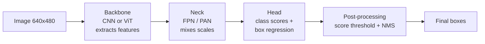
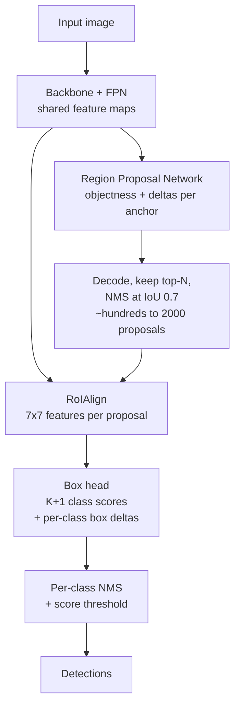
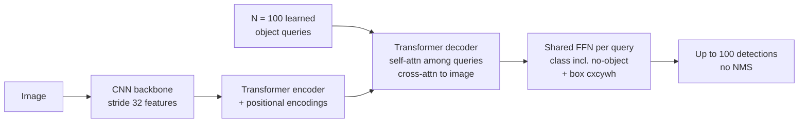

# Object Detection in Depth: Faster R-CNN, YOLO, DETR and mAP

> **Level:** Beginner to Advanced · **Study time:** ~110 min · **Prerequisites:** [Computer Vision Tasks: Classification, Detection and Segmentation](./01-image-classification-detection-and-segmentation.md), [Convolutional Neural Networks and Transfer Learning](../02-deep-learning/07-cnns-and-transfer-learning.md), [Classification Metrics and Imbalanced Data](../01-classical-ml/04-classification-metrics-and-imbalanced-data.md)

## Table of contents

- [Why this matters](#why-this-matters)
- [The detection problem in one picture](#the-detection-problem-in-one-picture)
- [Bounding box formats and IoU](#bounding-box-formats-and-iou)
- [Anatomy of a modern detector](#anatomy-of-a-modern-detector)
- [Anchors and box encoding](#anchors-and-box-encoding)
- [Two-stage detectors: the R-CNN family](#two-stage-detectors-the-r-cnn-family)
- [One-stage detectors: YOLO, SSD and RetinaNet](#one-stage-detectors-yolo-ssd-and-retinanet)
- [Anchor-free detectors and DETR](#anchor-free-detectors-and-detr)
- [Non-maximum suppression with a worked example](#non-maximum-suppression-with-a-worked-example)
- [Precision and recall for detection](#precision-and-recall-for-detection)
- [Average precision and mAP, step by step](#average-precision-and-map-step-by-step)
- [mAP@0.5 vs mAP@[0.5:0.95]](#map05-vs-map05095)
- [Speed vs accuracy and choosing a detector](#speed-vs-accuracy-and-choosing-a-detector)
- [Small-object detection strategies](#small-object-detection-strategies)
- [Going deeper: training, debugging and production](#going-deeper-training-debugging-and-production)
- [Common mistakes and misconceptions](#common-mistakes-and-misconceptions)
- [Interview questions and model answers](#interview-questions-and-model-answers)
- [Key takeaways](#key-takeaways)
- [Further reading](#further-reading)
- [Next](#next)

---

## Why this matters

Object detection is the workhorse of applied computer vision: self-checkout cameras, traffic analytics, defect inspection on factory lines, document layout parsing for RAG ingestion, drone and satellite imagery, and the perception stacks of robots and cars all start with "find every object of interest and draw a box around it". Interviewers love the topic because it mixes architecture (two-stage vs one-stage vs transformers), a tricky evaluation metric (mAP, which many candidates cannot compute by hand), and real engineering trade-offs (latency, small objects, crowded scenes). A senior candidate is expected to explain *why* Faster R-CNN, YOLO and DETR are built the way they are, compute AP on a whiteboard, and design a detection system that meets a latency budget on real hardware.

---

## The detection problem in one picture

**Image classification** answers "what is in this image?" with one label. **Object detection** answers "what objects are where?": for every object it outputs a **class label**, a **confidence score** (how sure the model is, between 0 and 1) and a **bounding box** (the smallest axis-aligned rectangle that encloses the object). The previous chapter, [Computer Vision Tasks](./01-image-classification-detection-and-segmentation.md), introduced these tasks; here we go deep on detection only.

> **Analogy:** Classification is a friend glancing at a photo and saying "a street". Detection is a friend taking a marker and drawing a rectangle around every car and every person, writing "car, 95% sure" next to each one.

Our **running example** for the whole chapter: a fixed traffic camera producing 640x480 frames. We want to detect two classes, `car` and `person`, to count vehicles and pedestrians.

```text
  +--------------------------------------------------+  640 x 480 frame
  |                                                  |
  |   +--------+        +-------+                    |
  |   |  car   | 0.95   |  car  | 0.85    +--+       |
  |   |        |        |       |         |p | 0.70  |
  |   +--------+        +-------+         |  |       |
  |                                       +--+       |
  +--------------------------------------------------+
  Output: list of (class, score, box) triples, any number of them
```

What makes detection harder than classification:

- **Variable number of outputs.** The image may contain zero objects or two hundred. Neural networks naturally output fixed-size tensors, so every detector needs a trick to handle this (dense predictions plus filtering, or a fixed set of "slots").
- **Two coupled tasks.** "What is it?" (classification) and "where exactly is it?" (regression of 4 box numbers).
- **Scale variation.** The same car can be 300 pixels wide near the camera and 12 pixels wide far away.
- **Extreme imbalance.** Most of any image is background. A detector that evaluates tens of thousands of candidate locations finds only a handful of objects.

---

## Bounding box formats and IoU

### Four common box formats

A box needs 4 numbers, but libraries disagree on *which* 4 numbers. Mixing formats is the single most common silent bug in detection code.

Two benchmark datasets appear throughout this chapter, and their file formats and evaluation rules became de facto conventions: **Pascal VOC** (20 everyday classes, the main benchmark before COCO appeared in 2014) and **COCO** (Microsoft Common Objects in Context: 80 classes, about 118k training and 5k validation images, the standard benchmark today).

| Format | The 4 numbers | Used by | Example for the same box |
|---|---|---|---|
| **xyxy** (corners) | $x_1, y_1, x_2, y_2$: top-left and bottom-right corners in pixels | torchvision, Pascal VOC XML, most NMS code | (50, 50, 150, 150) |
| **xywh** (COCO) | $x, y, w, h$: top-left corner plus width and height in pixels | COCO JSON annotations | (50, 50, 100, 100) |
| **cxcywh** (center) | $c_x, c_y, w, h$: center plus width and height | DETR, many model heads internally | (100, 100, 100, 100) |
| **YOLO normalized** | $c_x/W, c_y/H, w/W, h/H$: center format divided by image width $W$ and height $H$, so values are in [0, 1] | YOLO label `.txt` files | (0.15625, 0.20833, 0.15625, 0.20833) |

Image coordinates start at the **top-left** corner with $y$ growing *downward*. Checking the YOLO row for our 640x480 frame: $c_x = 100/640 = 0.15625$, $c_y = 100/480 = 0.20833$, $w = 100/640 = 0.15625$, $h = 100/480 = 0.20833$.

```python
# pip install torch torchvision
import torch
from torchvision.ops import box_convert

xyxy = torch.tensor([[50.0, 50.0, 150.0, 150.0]])
print(box_convert(xyxy, in_fmt="xyxy", out_fmt="xywh"))    # tensor([[ 50.,  50., 100., 100.]])
print(box_convert(xyxy, in_fmt="xyxy", out_fmt="cxcywh"))  # tensor([[100., 100., 100., 100.]])

# YOLO normalized = cxcywh divided by (W, H, W, H)
W, H = 640, 480
cxcywh = box_convert(xyxy, in_fmt="xyxy", out_fmt="cxcywh")
print(cxcywh / torch.tensor([W, H, W, H]))  # approx [[0.1562, 0.2083, 0.1562, 0.2083]]
```

> **Common mistake:** Old Pascal VOC evaluation code computed width as $x_2 - x_1 + 1$ (treating coordinates as inclusive pixel indices). Modern code uses continuous coordinates ($x_2 - x_1$). Mixing the two conventions shifts IoU slightly, which matters for small boxes and strict IoU thresholds.

### IoU recap

**Intersection over Union (IoU)**, also called the **Jaccard index**, measures how much two boxes overlap:

$$\text{IoU}(A, B) = \frac{|A \cap B|}{|A \cup B|} = \frac{|A \cap B|}{|A| + |B| - |A \cap B|}$$

- $A, B$: two boxes (for example a prediction and a ground-truth box).
- $|A \cap B|$: area of the overlapping rectangle (0 if they do not touch).
- $|A \cup B|$: area covered by either box. We subtract the intersection once because adding $|A| + |B|$ counts it twice.
- Result is between 0 (no overlap) and 1 (identical boxes).

**Worked example.** Ground-truth car $G = (50, 50, 150, 150)$, prediction $P = (60, 60, 160, 160)$, both xyxy.

1. Intersection corners: $x_1 = \max(50, 60) = 60$, $y_1 = \max(50, 60) = 60$, $x_2 = \min(150, 160) = 150$, $y_2 = \min(150, 160) = 150$.
2. Intersection area: $(150 - 60) \times (150 - 60) = 90 \times 90 = 8100$.
3. Areas: $|G| = 100 \times 100 = 10000$, $|P| = 10000$.
4. Union: $10000 + 10000 - 8100 = 11900$.
5. IoU $= 8100 / 11900 \approx 0.681$.

Notice that shifting a 100-pixel box by just 10 pixels in each direction already drops IoU to 0.68. IoU is harsh, and it is harsher still for small boxes: the same 10-pixel shift on a 20x20 box leaves a 10x10 overlap, so IoU $= 100 / (400 + 400 - 100) \approx 0.14$. Keep this in mind for the small-object section.

```python
import numpy as np

def iou_one_to_many(box: np.ndarray, boxes: np.ndarray) -> np.ndarray:
    """IoU between one xyxy box (4,) and many xyxy boxes (N, 4)."""
    x1 = np.maximum(box[0], boxes[:, 0])
    y1 = np.maximum(box[1], boxes[:, 1])
    x2 = np.minimum(box[2], boxes[:, 2])
    y2 = np.minimum(box[3], boxes[:, 3])
    inter = np.clip(x2 - x1, 0, None) * np.clip(y2 - y1, 0, None)  # 0 if no overlap
    area = (box[2] - box[0]) * (box[3] - box[1])
    areas = (boxes[:, 2] - boxes[:, 0]) * (boxes[:, 3] - boxes[:, 1])
    return inter / (area + areas - inter)

g = np.array([50, 50, 150, 150], dtype=float)
p = np.array([[60, 60, 160, 160]], dtype=float)
print(iou_one_to_many(g, p))  # [0.68067227]
# Library version: torchvision.ops.box_iou(boxes1, boxes2) returns an (N, M) matrix.
```

IoU is used in four different places in a detector, so it pays to know it cold: (1) assigning training targets to anchors, (2) NMS, (3) deciding whether a prediction counts as correct during evaluation, and (4) as a loss function (GIoU and friends, covered later).

---

## Anatomy of a modern detector

Almost every detector, old or new, is built from the same three parts.



- **Backbone:** a classification network (ResNet, CSPDarknet, EfficientNet, a Vision Transformer) with the final classification layer removed. It turns pixels into **feature maps**: grids of feature vectors, each describing a patch of the image. See [CNNs and Transfer Learning](../02-deep-learning/07-cnns-and-transfer-learning.md).
- **Stride:** how many input pixels one feature-map cell corresponds to. A stride-32 feature map for a 640x640 input is $640/32 = 20$ cells on each side. Deeper layers have larger strides: richer semantics, coarser location.
- **Neck:** combines feature maps from several strides so that every scale has both good semantics and good localization. The classic neck is the **Feature Pyramid Network (FPN)** (Lin et al., 2017), detailed below; **PAN** (Path Aggregation Network) adds a second, bottom-up pass on top of it and is common in YOLOs.
- **Head:** small convolutional (or transformer) layers that, for every location, predict class scores and box coordinates.
- **Post-processing:** drop low-confidence predictions and remove duplicates with non-maximum suppression (NMS). DETR-style models skip NMS.

> **Senior insight:** When someone says "YOLOv8 vs Faster R-CNN", most of the accuracy difference often comes from the backbone, neck, training recipe (augmentation, schedule, label assignment) and input resolution, not just the "one-stage vs two-stage" label. Compare detectors with the same backbone and recipe before drawing architectural conclusions.

---

## Anchors and box encoding

### Intuition

Predicting a box from nothing is hard: the network must output raw pixel coordinates anywhere in the image. **Anchors** make it easier by giving the network a set of pre-defined "template" boxes to adjust.

> **Analogy:** Instead of asking a tailor to sew a suit from scratch for every customer, you give them a rack of standard sizes (S, M, L, in regular and tall cuts). They pick the closest one and alter it slightly. Anchors are the rack; the network learns the alterations.

### Definition

An **anchor** (also called a **default box** in SSD or a **prior**) is a fixed reference box placed at every location of a feature map, at several **scales** (sizes) and **aspect ratios** (height divided by width). For each anchor, the network predicts:

1. a class score (or "objectness": is there any object here?), and
2. four **offsets** that move and resize the anchor toward the true box.

Faster R-CNN's original setting used 3 scales (box areas of $128^2$, $256^2$, $512^2$ pixels) and 3 aspect ratios (1:2, 1:1, 2:1), so $k = 9$ anchors per location. On a feature map of about 2,400 locations (stride 16 on a roughly 600x1000 image), that is $2400 \times 9 = 21{,}600$ anchors per image.

To build an anchor with area $s^2$ and aspect ratio $r = h/w$, solve $w \cdot h = s^2$ and $h = r w$:

$$w = \frac{s}{\sqrt{r}}, \qquad h = s\sqrt{r}$$

Example: $s = 128$, $r = 2$ (tall, like a standing person): $w = 128 / 1.414 \approx 90.5$, $h = 128 \times 1.414 \approx 181.0$. Check: $90.5 \times 181.0 \approx 16{,}380 \approx 128^2 = 16{,}384$.

### Assigning targets to anchors

During training, each anchor needs a label. Faster R-CNN's region proposal network (RPN) uses IoU thresholds:

| Anchor's best IoU with any ground-truth box | Label |
|---|---|
| $\ge 0.7$ (or it is the best anchor for some ground truth) | positive (object) |
| $< 0.3$ for all ground-truth boxes | negative (background) |
| in between | ignored (no loss) |

This process is called **label assignment**, and it turns out to be one of the most important design choices in detection (more in the Going deeper section).

### Box encoding: predicting offsets, not coordinates

The network does not predict $(c_x, c_y, w, h)$ directly. It predicts normalized **deltas** relative to the anchor. The standard parameterization from R-CNN and Faster R-CNN:

$$t_x = \frac{c_x - c_x^a}{w^a}, \quad t_y = \frac{c_y - c_y^a}{h^a}, \quad t_w = \ln\frac{w}{w^a}, \quad t_h = \ln\frac{h}{h^a}$$

- $c_x, c_y, w, h$: center and size of the target (ground-truth) box.
- $c_x^a, c_y^a, w^a, h^a$: center and size of the anchor.
- $t_x, t_y$: center shift measured in "anchor widths/heights", so a big anchor and a small anchor use the same scale of numbers.
- $t_w, t_h$: log of the size ratio. The log makes "twice as big" (+0.69) and "half as big" (-0.69) symmetric, and guarantees a positive width after decoding with $w = w^a e^{t_w}$.

**Worked example.** Anchor: center (96, 96), size 64x64. Ground-truth car: center (100, 104), size 80x48.

- $t_x = (100 - 96) / 64 = 4/64 = 0.0625$
- $t_y = (104 - 96) / 64 = 8/64 = 0.125$
- $t_w = \ln(80/64) = \ln(1.25) \approx 0.223$
- $t_h = \ln(48/64) = \ln(0.75) \approx -0.288$

These four small numbers are the regression targets. They are well-scaled (near 0), which makes training stable. At inference, the network outputs $\hat t$ and we **decode**: $\hat c_x = c_x^a + \hat t_x w^a$, $\hat w = w^a e^{\hat t_w}$, and so on.

### Why anchors fell out of fashion

Anchors work, but they add hyperparameters (scales, ratios, IoU thresholds) that must be tuned per dataset, and most anchors are negatives that waste compute. Since roughly 2019, **anchor-free** detectors (FCOS, CenterNet, YOLOX, Ultralytics YOLOv8 and later) predict boxes directly from each feature-map location and match or beat anchor-based ones. We cover them after the classic designs, because you still need anchors to understand Faster R-CNN, SSD and RetinaNet.

---

## Two-stage detectors: the R-CNN family

**Two-stage detectors** first propose a few hundred to a few thousand **regions of interest (RoIs)** that probably contain *some* object, then classify and refine each region in a second stage.

> **Analogy:** A security guard first scans the whole parking lot quickly and points at "anything that looks like it might be a vehicle" (stage 1). Then they walk to each spot and look carefully: "that's a car, and its edge is actually here" (stage 2).

### The evolution in one table

| Model | Paper | How regions are proposed | How each region is processed | Main bottleneck fixed |
|---|---|---|---|---|
| **R-CNN** | "Rich feature hierarchies for accurate object detection and semantic segmentation", Girshick et al., 2014 | **Selective Search** (a classical, non-learned algorithm that groups similar pixels), about 2,000 regions | Crop and warp each region, run the full CNN on each one separately, classify with SVMs | First to show CNN features crush hand-crafted features for detection; very slow (many seconds per image) |
| **Fast R-CNN** | "Fast R-CNN", Girshick, 2015 | Still Selective Search | Run the CNN **once** on the whole image, then cut each region out of the shared feature map with **RoI Pooling**; one network does classification and box regression | Shared computation; end-to-end training of the second stage. Proposals are now the bottleneck |
| **Faster R-CNN** | "Faster R-CNN: Towards Real-Time Object Detection with Region Proposal Networks", Ren, He, Girshick, Sun, 2015 | A learned **Region Proposal Network (RPN)** on the shared features | Same as Fast R-CNN | Proposals become nearly free and learned; the whole detector is one network |
| **FPN** add-on | "Feature Pyramid Networks for Object Detection", Lin et al., 2017 | RPN on multiple pyramid levels | RoIs taken from the pyramid level that matches their size | Much better at small objects |
| **Mask R-CNN** | "Mask R-CNN", He, Gkioxari, Dollar, Girshick, 2017 | RPN + FPN | Adds a mask head; replaces RoI Pooling with **RoIAlign** | Pixel-accurate instance segmentation; better localization |
| **Cascade R-CNN** | "Cascade R-CNN: Delving into High Quality Object Detection", Cai and Vasconcelos, 2018 | RPN | Several heads in sequence, each trained with a stricter IoU threshold | Higher-quality boxes at strict IoU thresholds |

**RoI Pooling** takes a region of any size on the feature map and divides it into a fixed grid (for example 7x7), max-pooling inside each cell, so every region becomes a fixed-size tensor the head can process. Its weakness: it rounds region coordinates to integer cells, which misaligns features by up to a full stride. **RoIAlign** (Mask R-CNN) removes the rounding and uses bilinear interpolation to sample features at exact fractional positions. It is the default in modern two-stage detectors.

**Feature Pyramid Network (FPN).** Deep, stride-32 features know *what* things are but have blurred *where*; shallow, stride-4 or stride-8 features are sharp but semantically weak. FPN adds a **top-down pathway**: upsample the deep map by 2x, add a 1x1-convolved copy of the same-resolution shallow map (a **lateral connection**), and repeat. Every level P2 to P5 then has strong semantics *and* its own resolution, and each object is handled by the level whose stride suits its size (small objects on fine levels, large ones on coarse levels). Later necks such as PANet's extra bottom-up path (used in many YOLOs) and BiFPN refine the same idea.

```text
 Backbone (bottom-up)        FPN (top-down + lateral)
 C5  stride 32  ---1x1--->  P5 ----+
                                   | upsample 2x, add
 C4  stride 16  ---1x1--->  P4 <---+----+
                                        | upsample 2x, add
 C3  stride 8   ---1x1--->  P3 <--------+   -> P3 handles small objects, P5 large ones
```

### Faster R-CNN, end to end



**The Region Proposal Network** is a small fully convolutional network that slides over the feature map. At each location and for each of the $k$ anchors it outputs:

- 1 objectness score (object vs background, class-agnostic), and
- 4 box deltas $(t_x, t_y, t_w, t_h)$.

Training the RPN: sample 256 anchors per image (up to half positives, labeled with the 0.7 / 0.3 IoU rule above), apply binary cross-entropy to objectness and a **smooth L1** loss to the deltas of positive anchors only. **Smooth L1** is squared error for small errors and absolute error for large ones: $\text{smoothL1}(x) = 0.5x^2$ if $|x| < 1$, otherwise $|x| - 0.5$. An error of 0.5 costs 0.125, while an error of 3 costs 2.5 instead of the 4.5 a squared loss would give, so outliers do not dominate the gradient (see [Loss Functions](../02-deep-learning/04-loss-functions.md)).

At inference the RPN decodes all anchors, keeps the highest-scoring ones, removes duplicates with NMS (IoU 0.7), and passes the top proposals (the original paper used about 300 at test time) to the second stage.

**The second stage** (the "Fast R-CNN head") pools a 7x7 feature patch for each proposal with RoIAlign, runs a couple of fully connected layers, and outputs $K + 1$ class scores ($K$ object classes plus background, via softmax) plus class-specific box refinements. A proposal is a positive training example if its IoU with a ground-truth box is at least 0.5.

Why two stages tend to be accurate:

- **Box refined twice.** Anchor to proposal (RPN), proposal to final box (head).
- **Balanced second stage.** The RPN already threw away most of the easy background, so the head trains on a manageable mix (for example 25% positives in a sampled mini-batch of RoIs).
- **Aligned features per object.** RoIAlign extracts features centered exactly on each candidate.

Why they tend to be slower: the second stage runs once *per proposal*, the pipeline has more sequential steps, and it is harder to export to optimized runtimes.

### Code: pretrained Faster R-CNN in torchvision

```python
# pip install torch torchvision
import torch
from torchvision.io import read_image
from torchvision.models.detection import (
    fasterrcnn_resnet50_fpn_v2,
    FasterRCNN_ResNet50_FPN_V2_Weights,
)

weights = FasterRCNN_ResNet50_FPN_V2_Weights.DEFAULT     # COCO-pretrained
model = fasterrcnn_resnet50_fpn_v2(weights=weights).eval()
preprocess = weights.transforms()                       # uint8 -> float in [0, 1]

img = read_image("street.jpg")                          # uint8 tensor, shape (3, H, W)
with torch.no_grad():
    out = model([preprocess(img)])[0]                   # model takes a LIST of images

# out["boxes"]: (N, 4) xyxy in original pixel coords; out["scores"]: (N,); out["labels"]: (N,)
names = weights.meta["categories"]
for box, score, label in zip(out["boxes"], out["scores"], out["labels"]):
    if score > 0.5:
        print(names[label], round(score.item(), 2), box.round().tolist())
```

To fine-tune on our two traffic classes, replace the classifier head. In torchvision, `num_classes` **includes background**, so two object classes means `num_classes=3`:

```python
from torchvision.models.detection.faster_rcnn import FastRCNNPredictor

in_features = model.roi_heads.box_predictor.cls_score.in_features
model.roi_heads.box_predictor = FastRCNNPredictor(in_features, num_classes=3)  # bg, car, person
# In train mode, model(images, targets) returns a dict of losses:
# loss_classifier, loss_box_reg, loss_objectness, loss_rpn_box_reg
```

---

## One-stage detectors: YOLO, SSD and RetinaNet

**One-stage (single-shot) detectors** skip the proposal step. One network pass predicts class scores and boxes densely at every location of one or more feature maps; then thresholding and NMS clean up.

> **Analogy:** Instead of a guard scanning, then walking over to inspect, imagine a grid of 400 security cameras, each responsible for its own patch of the parking lot, all reporting at the same instant. Faster, but each camera only gets one look.

### YOLO: "You Only Look Once"

**YOLOv1** ("You Only Look Once: Unified, Real-Time Object Detection", Redmon, Divvala, Girshick, Farhadi, 2016) reframed detection as a single regression problem:

- Divide the image into an $S \times S$ grid ($S = 7$).
- Each **grid cell** is responsible for an object whose *center* falls inside it.
- Each cell predicts $B = 2$ boxes, each with $(x, y, w, h, \text{confidence})$, plus one set of $C$ class probabilities shared by the cell.
- Output tensor: $S \times S \times (B \cdot 5 + C) = 7 \times 7 \times (2 \cdot 5 + 20) = 7 \times 7 \times 30$ for the 20 Pascal VOC classes.

```text
  YOLOv1: 7x7 grid on the image
  +---+---+---+---+---+---+---+
  |   |   |   |   |   |   |   |
  +---+---+---+---+---+---+---+
  |   | * |   |   | * |   |   |   * = object center: that cell must predict it
  +---+---+---+---+---+---+---+
  |   |   |   |   |   |   |   |   Each cell -> 2 boxes x (x,y,w,h,conf) + 20 class probs
  +---+---+---+---+---+---+---+   = 30 numbers per cell
  ...
```

It was dramatically faster than Faster R-CNN at the time (the paper reported real-time speeds of about 45 frames per second on a GPU of that era) because the whole image goes through one network once. Its weaknesses came directly from the design: one class per cell and only two boxes, so **flocks of small objects** (birds, crowds) whose centers share a cell get missed, and coarse 7x7 localization.

**The YOLO lineage** is long and, importantly, not a single research group's numbered series (the table is a selection; YOLOv6, YOLOv9 and newer 2025-2026 releases are omitted):

| Version (year) | Authors | Key ideas |
|---|---|---|
| YOLOv2 / YOLO9000 (2017) | Redmon, Farhadi | Anchors learned by **k-means clustering** of training box sizes, batch norm, multi-scale training |
| YOLOv3 (2018) | Redmon, Farhadi | Predictions at 3 scales (FPN-like), Darknet-53 backbone, independent sigmoid classifiers |
| YOLOv4 (2020) | Bochkovskiy, Wang, Liao | "Bag of freebies/specials": Mosaic augmentation (stitches 4 training images into one), CSP backbone, PAN neck, CIoU loss (see Going deeper) |
| YOLOv5 (2020) | Ultralytics (no paper) | PyTorch-native, very easy training and export tooling |
| YOLOX (2021) | Ge et al. | Anchor-free, **decoupled head** (separate branches for class and box), SimOTA label assignment |
| YOLOv7 (2022) | Wang, Bochkovskiy, Liao | Architecture and training-recipe improvements |
| YOLOv8 (2023), YOLO11 (2024) | Ultralytics (no paper) | Anchor-free, decoupled head, one framework for detection, segmentation, pose |
| YOLOv10 (2024) | Wang et al. (Tsinghua) | **NMS-free** inference via "consistent dual assignments" (one-to-one head at inference) |

> **Interview tip:** Do not memorize benchmark numbers for each YOLO version; they change with every release and depend on hardware. Know the durable ideas: grid responsibility, multi-scale heads, learned anchors then anchor-free, decoupled heads, strong augmentation (Mosaic), better label assignment, and the recent move to NMS-free end-to-end inference. Versions and naming will have moved on by the time you interview (it is 2026 as of this writing), so check the current docs.

A modern anchor-free YOLO at 640x640 predicts at strides 8, 16 and 32, giving $80^2 + 40^2 + 20^2 = 6400 + 1600 + 400 = 8400$ candidate boxes per image before NMS.

```python
# pip install ultralytics   (API is fairly stable but version-dependent; check current docs)
# License note: Ultralytics code and weights are AGPL-3.0 unless you buy an enterprise license.
from ultralytics import YOLO

model = YOLO("yolov8n.pt")                      # "n" = nano; newer weight names exist
results = model("street.jpg", conf=0.25, iou=0.7, imgsz=640)
for r in results:
    print(r.boxes.xyxy, r.boxes.conf, r.boxes.cls)  # tensors: boxes, scores, class ids

# Fine-tuning on a custom dataset described by a YAML file (paths + class names):
# model.train(data="traffic.yaml", epochs=100, imgsz=640)
# metrics = model.val(); print(metrics.box.map50, metrics.box.map)  # mAP@0.5, mAP@[.5:.95]
```

### SSD: multi-scale default boxes

**SSD** ("SSD: Single Shot MultiBox Detector", Liu et al., 2016) attaches prediction heads to *several* feature maps of decreasing resolution. Early high-resolution maps (small stride) predict small objects; later coarse maps predict large objects. Each location has a set of **default boxes** (SSD's name for anchors). SSD also used **hard negative mining**: keep only the highest-loss negatives at a 3:1 negative-to-positive ratio, a manual fix for the background imbalance problem that RetinaNet would later solve more elegantly.

### RetinaNet and focal loss

By 2017, one-stage detectors were fast but still noticeably less accurate than two-stage ones. **"Focal Loss for Dense Object Detection"** (Lin, Goyal, Girshick, He, Dollar, 2017) identified the cause: **extreme class imbalance** during training. A dense detector evaluates on the order of 100,000 anchors per image (RetinaNet uses an FPN with 9 anchors per location), of which only a handful are positives. Even though each easy background anchor has a small loss, there are so many of them that they dominate the total loss and gradient. Two-stage detectors avoid this because the RPN filters most background before the second stage.

> **Analogy:** A teacher grading a class where 99,990 students answer "2+2" correctly and 10 students struggle with calculus. If the teacher spends time proportional to the number of students, almost all effort goes to the easy questions. Focal loss tells the teacher: "ignore the ones who are already right, focus on the struggling ones".

Start from binary cross-entropy (see [Softmax, Entropy, Cross-Entropy and KL Divergence](../00-foundations/05-softmax-entropy-cross-entropy-and-kl-divergence.md)). Define $p_t$ as the probability the model assigns to the *correct* answer:

$$p_t = \begin{cases} p & \text{if } y = 1 \\ 1 - p & \text{if } y = 0 \end{cases} \qquad \text{CE}(p_t) = -\ln(p_t)$$

**Focal loss** multiplies by a modulating factor that shrinks the loss of well-classified examples:

$$\text{FL}(p_t) = -\alpha_t (1 - p_t)^\gamma \ln(p_t)$$

- $p$: predicted probability that this anchor contains the object class.
- $y$: true label (1 = object, 0 = background).
- $p_t$: probability of the correct label. Near 1 means "easy, already right".
- $(1 - p_t)^\gamma$: the **modulating factor**. Near 0 for easy examples, near 1 for hard ones.
- $\gamma \ge 0$: **focusing parameter**. $\gamma = 0$ gives back ordinary cross-entropy. The paper found $\gamma = 2$ worked best.
- $\alpha_t$: a class-balancing weight ($\alpha$ for positives, $1 - \alpha$ for negatives); the paper used $\alpha = 0.25$ together with $\gamma = 2$.

**Worked example** ($\gamma = 2$, ignoring $\alpha$ for clarity):

| Example | $p_t$ | CE $= -\ln p_t$ | $(1 - p_t)^2$ | FL |
|---|---|---|---|---|
| Easy background anchor | 0.9 | 0.1054 | $0.1^2 = 0.01$ | $0.01 \times 0.1054 = 0.00105$ (100x smaller) |
| Hard positive anchor | 0.1 | 2.3026 | $0.9^2 = 0.81$ | $0.81 \times 2.3026 = 1.865$ (barely reduced) |

Now scale it up (counts are illustrative). Suppose an image has 100,000 easy negatives at $p_t = 0.9$ and 10 hard positives at $p_t = 0.1$:

- **Cross-entropy:** negatives contribute $100{,}000 \times 0.1054 = 10{,}536$; positives contribute $10 \times 2.3026 = 23.0$. Background outweighs objects by about **458x**.
- **Focal loss:** negatives contribute $100{,}000 \times 0.00105 = 105.4$; positives $10 \times 1.865 = 18.65$. The ratio drops to about **5.6x**, so the gradient signal from real objects is no longer drowned out.

The paper also normalizes the total focal loss by the number of positive anchors and initializes the classifier bias so that every anchor starts with a low object probability (about 0.01), which prevents a huge loss spike in the first iterations.

```python
# pip install torch torchvision
import torch
from torchvision.ops import sigmoid_focal_loss

logits = torch.tensor([-2.1972, -2.1972])  # sigmoid(-2.1972) is about 0.1 for both anchors
targets = torch.tensor([0.0, 1.0])
# Anchor 1: background (y=0), model says p=0.1 -> p_t = 0.9, an EASY example.
# Anchor 2: object (y=1), model says p=0.1     -> p_t = 0.1, a HARD example.
loss = sigmoid_focal_loss(logits, targets, alpha=0.25, gamma=2.0, reduction="none")
print(loss)  # approx tensor([0.0008, 0.4663]):
             # easy: 0.75 * 0.01 * 0.1054, hard: 0.25 * 0.81 * 2.3026
```

> **Senior insight:** Focal loss is not detection-specific. It is a general tool for dense prediction with heavy imbalance (segmentation, keypoints, some ranking and fraud models). Many modern dense detectors use descendants of it, such as quality focal loss (GFL) or varifocal loss (VarifocalNet, PP-YOLOE), while Ultralytics YOLOv8-style models use plain BCE with soft, alignment-weighted targets; the idea of weighting examples by how informative they are carries over.

---

## Anchor-free detectors and DETR

### Anchor-free: predict boxes from points

**Anchor-free** detectors remove the template boxes. Two families:

- **Center/point-based:** **FCOS** ("FCOS: Fully Convolutional One-Stage Object Detection", Tian et al., 2019) treats every feature-map location inside a ground-truth box as a candidate positive and predicts four distances $(l, t, r, b)$ from that point to the left, top, right and bottom edges, plus a **centerness** score that down-weights points near the box edge (those give poor boxes). **CenterNet** ("Objects as Points", Zhou, Wang, Krahenbuhl, 2019) predicts a heatmap whose peaks are object centers, plus width and height at each peak.
- **Keypoint-based:** **CornerNet** (Law and Deng, 2018) predicts top-left and bottom-right corner heatmaps and groups them into boxes.

Benefits: fewer hyperparameters, fewer predictions to post-process, easier to deploy. "Bridging the Gap Between Anchor-based and Anchor-free Detection via Adaptive Training Sample Selection" (ATSS, Zhang et al., 2020) showed that the main accuracy difference between anchor-based and anchor-free models came from *how positives and negatives are assigned*, not from the anchors themselves. This is a great point to make in interviews.

### DETR: detection as set prediction

**DETR** ("End-to-End Object Detection with Transformers", Carion, Massa, Synnaeve, Usunier, Kirillov, Zagoruyko, 2020) threw away anchors, proposals *and* NMS. If you need a refresher on attention, see [The Attention Mechanism, Step by Step](../04-transformers/03-attention-mechanism-step-by-step.md) and [The Full Transformer Architecture](../04-transformers/05-the-full-transformer-architecture.md).

> **Analogy:** Imagine 100 detectives (the object queries) all looking at the same crime scene photo. They talk to each other (self-attention) so they do not all chase the same suspect, and each one either names one object and its box or says "nothing for me". Nobody needs to remove duplicates afterward because the team coordinated.



Key ideas:

- **Object queries:** a fixed number $N$ (100 in the paper) of learned vectors. Each decoder output becomes one prediction: a class (including a special **"no object"** class, written $\varnothing$) and a normalized cxcywh box.
- **Set prediction:** the output is treated as an unordered *set*. The loss must not depend on which query predicted which object.
- **Hungarian matching:** before computing the loss, find the one-to-one assignment between predictions and ground-truth objects with minimal total cost, using the **Hungarian algorithm** (an algorithm that solves this "assignment problem" exactly in polynomial time). The matching cost combines class probability, L1 box distance and GIoU (defined later). Unmatched predictions are trained to output "no object".
- **No NMS needed:** because each ground truth is matched to exactly *one* query during training, the model learns not to produce duplicates. This **one-to-one assignment** is the deep reason; anchor-based detectors use **one-to-many** assignment (many anchors positive for the same object), which is exactly why they need NMS.

**Worked example of matching.** 3 predictions, 2 ground-truth objects, with this cost matrix (lower is better; numbers are illustrative):

| | GT1 (car) | GT2 (person) |
|---|---|---|
| P1 | **0.2** | 0.9 |
| P2 | 0.8 | **0.3** |
| P3 | 0.6 | 0.7 |

All valid one-to-one assignments of the 2 ground truths:

- P1-GT1 + P2-GT2 = 0.2 + 0.3 = **0.5** (minimum)
- P1-GT1 + P3-GT2 = 0.2 + 0.7 = 0.9
- P3-GT1 + P2-GT2 = 0.6 + 0.3 = 0.9
- P2-GT1 + P3-GT2 = 0.8 + 0.7 = 1.5
- P3-GT1 + P1-GT2 = 0.6 + 0.9 = 1.5
- P2-GT1 + P1-GT2 = 0.8 + 0.9 = 1.7

So P1 learns to predict the car, P2 the person, and P3 is trained toward "no object".

```python
# pip install scipy numpy
import numpy as np
from scipy.optimize import linear_sum_assignment

cost = np.array([[0.2, 0.9],
                 [0.8, 0.3],
                 [0.6, 0.7]])
rows, cols = linear_sum_assignment(cost)   # solves the assignment problem (a Jonker-Volgenant
                                           # variant of Hungarian); works on rectangular matrices
print(rows, cols)                          # [0 1] [0 1] -> P1-GT1, P2-GT2; P3 unmatched
print(cost[rows, cols].sum())              # 0.5
```

**DETR's weaknesses** (and the follow-ups that fixed them):

| Weakness | Why | Fix |
|---|---|---|
| Very slow training (the paper trained for 500 epochs on COCO, far longer than typical Faster R-CNN schedules) | Global attention starts nearly uniform; each query takes a long time to learn where to look; one-to-one matching gives few positives | **Deformable DETR** (Zhu et al., 2021): each query attends to a few learned sampling points; reported about 10x fewer training epochs. **DN-DETR** (Li et al., 2022) and **DINO** (Zhang et al., 2022): denoising training with noisy ground-truth boxes as extra queries |
| Weak on small objects | Only a single stride-32 feature map (full attention on high-res maps is quadratic in cost) | Multi-scale deformable attention over an FPN-like pyramid |
| Slow inference in early versions | Heavy encoder | **RT-DETR** ("DETRs Beat YOLOs on Real-time Object Detection", Zhao et al., 2024): efficient hybrid encoder, real-time speeds |

```python
# pip install transformers timm torch torchvision pillow
# (HF APIs are fairly stable here, but image-processor backends changed in transformers v5; check your version's docs)
import torch
from PIL import Image
from transformers import DetrImageProcessor, DetrForObjectDetection

processor = DetrImageProcessor.from_pretrained("facebook/detr-resnet-50")
model = DetrForObjectDetection.from_pretrained("facebook/detr-resnet-50").eval()

image = Image.open("street.jpg").convert("RGB")
inputs = processor(images=image, return_tensors="pt")
with torch.no_grad():
    outputs = model(**inputs)

target_sizes = torch.tensor([image.size[::-1]])   # (height, width)
res = processor.post_process_object_detection(outputs, target_sizes=target_sizes, threshold=0.9)[0]
for score, label, box in zip(res["scores"], res["labels"], res["boxes"]):
    print(model.config.id2label[label.item()], round(score.item(), 2), box.round().tolist())
```

> **Senior insight:** The 2024-2026 trend is convergence: YOLO-style models borrow one-to-one assignment to become NMS-free (YOLOv10 and later releases), and DETR-style models borrow efficient CNN tricks to become real-time (RT-DETR and successors). In parallel, **open-vocabulary detectors** such as OWL-ViT (Minderer et al., 2022), Grounding DINO (Liu et al., 2023) and YOLO-World (Cheng et al., 2024) detect classes described by text prompts using vision-language pretraining (see [Vision Transformers, CLIP and Multimodal LLMs](./05-vision-transformers-clip-and-multimodal-models.md)). They are great for prototyping and auto-labeling, but a fine-tuned closed-set detector usually still wins on a narrow production task.

---

## Non-maximum suppression with a worked example

### Intuition

Dense detectors fire many overlapping boxes for the same object: neighboring anchors or grid points all "see" the car. **Non-maximum suppression (NMS)** keeps the most confident box and deletes the boxes that overlap it too much, on the assumption that they are duplicates.

> **Analogy:** Five witnesses describe the same suspect. You keep the most confident witness's description and discard the others that clearly describe the same person. A description of someone standing elsewhere is a different suspect and stays.

### Algorithm (greedy NMS, per class)

1. Drop boxes whose score is below a **confidence threshold** (for example 0.25 for deployment, very low such as 0.001 for evaluation so the precision-recall (PR) curve, explained below, is complete).
2. Sort the remaining boxes by score, highest first.
3. Take the top box, put it in the **keep** list.
4. Remove every remaining box whose IoU with it is **greater than** the **NMS IoU threshold** (for example 0.5).
5. Repeat from step 3 until no boxes remain.

It is usually run **per class** (a car box should not suppress an overlapping person box). A common implementation trick, used by `torchvision.ops.batched_nms` (for all but very large box counts, where it loops over classes instead), adds a large class-dependent offset to coordinates so that boxes of different classes can never overlap, letting one NMS call handle all classes.

### Worked example

Five `car` boxes from our traffic camera, NMS IoU threshold 0.5:

| Box | xyxy | Score |
|---|---|---|
| A | (10, 10, 110, 110) | 0.95 |
| B | (20, 20, 120, 120) | 0.90 |
| C | (200, 30, 300, 130) | 0.85 |
| D | (210, 40, 310, 140) | 0.60 |
| E | (60, 10, 160, 110) | 0.55 |

All boxes are 100x100, so every area is 10,000.

**Round 1.** Highest score is A. Keep A. Compute IoU of A with the rest:

- A vs B: intersection $x$ from 20 to 110 (90), $y$ from 20 to 110 (90), area 8,100. Union $20{,}000 - 8{,}100 = 11{,}900$. IoU $= 0.681 > 0.5$: **suppress B**.
- A vs C: C starts at $x = 200$, A ends at 110: no overlap, IoU 0. Keep for now.
- A vs D: no overlap, IoU 0. Keep for now.
- A vs E: intersection $x$ from 60 to 110 (50), $y$ from 10 to 110 (100), area 5,000. Union $20{,}000 - 5{,}000 = 15{,}000$. IoU $= 0.333 \le 0.5$: keep for now.

Remaining: C, D, E.

**Round 2.** Highest is C. Keep C.

- C vs D: intersection $x$ 210 to 300 (90), $y$ 40 to 130 (90), area 8,100; IoU $= 0.681$: **suppress D**.
- C vs E: E ends at $x = 160$, C starts at 200: IoU 0. Keep.

Remaining: E.

**Round 3.** Keep E. Nothing left.

**Result:** keep **A, C, E**. B and D were duplicates. E overlaps A by a third, which in a parking scene is plausibly a second car parked right next to the first, so keeping it is correct.

Now rerun with a stricter threshold of 0.3: A vs E has IoU $0.333 > 0.3$, so E is suppressed and the result is only A and C. **A low NMS threshold kills real objects in crowded scenes; a high one leaves duplicates.** That trade-off is the classic NMS failure mode.

```python
import numpy as np

def nms_numpy(boxes: np.ndarray, scores: np.ndarray, iou_thr: float = 0.5) -> list[int]:
    """Greedy NMS. boxes: (N, 4) xyxy, scores: (N,). Returns kept indices, best first."""
    order = scores.argsort()[::-1]          # indices sorted by score, descending
    keep = []
    while order.size > 0:
        i = order[0]
        keep.append(int(i))
        rest = order[1:]
        ious = iou_one_to_many(boxes[i], boxes[rest])  # defined in the IoU section
        order = rest[ious <= iou_thr]       # drop boxes that overlap the kept box too much
    return keep

boxes = np.array([[10, 10, 110, 110], [20, 20, 120, 120], [200, 30, 300, 130],
                  [210, 40, 310, 140], [60, 10, 160, 110]], dtype=float)
scores = np.array([0.95, 0.90, 0.85, 0.60, 0.55])
print(nms_numpy(boxes, scores, 0.5))   # [0, 2, 4]  -> A, C, E
print(nms_numpy(boxes, scores, 0.3))   # [0, 2]     -> A, C

# Library version (fast, runs on GPU):
import torch
from torchvision.ops import nms
print(nms(torch.tensor(boxes), torch.tensor(scores), iou_threshold=0.5))  # tensor([0, 2, 4])
```

### NMS variants worth knowing

| Variant | What it does | When to use |
|---|---|---|
| Greedy NMS | Hard delete above the IoU threshold | Default; simple and fast |
| **Soft-NMS** ("Soft-NMS: Improving Object Detection With One Line of Code", Bodla et al., 2017) | Instead of deleting, *decays* the score of overlapping boxes as a function of IoU | Crowded scenes (pedestrians, shelves of products) where real objects overlap |
| Weighted / cluster NMS | Averages overlapping boxes weighted by score | Slightly better localization; used in some competition setups |
| Class-agnostic NMS | Runs NMS across all classes together | When the model confuses similar classes (e.g. car vs truck) and you want one box per object |
| No NMS (one-to-one heads) | DETR, YOLOv10-style | Removes a data-dependent, hard-to-optimize post-processing step |

> **Senior insight:** NMS latency is **data-dependent**: its cost grows with the number of candidate boxes, it is sequential by nature, and it often runs on the CPU in naive deployments. On an edge device it can take a noticeable share of the frame budget, which is a big practical reason the industry is moving toward NMS-free models. Always benchmark end-to-end latency *including* NMS.

---

## Precision and recall for detection

If precision and recall are rusty, see [Classification Metrics and Imbalanced Data](../01-classical-ml/04-classification-metrics-and-imbalanced-data.md). Detection adapts them with one twist: *a prediction is only "correct" if its box overlaps a ground-truth box enough*.

### Matching predictions to ground truth

For one class, at an **IoU threshold** $\tau$ (for example 0.5):

1. Sort all predictions by confidence, highest first.
2. For each prediction, find the ground-truth box of the same class with the highest IoU **that has not already been claimed**.
3. If that IoU is $\ge \tau$: the prediction is a **true positive (TP)** and that ground truth is now claimed.
4. Otherwise: **false positive (FP)**. This covers bad localization, a box on background, and **duplicates** (a second box on an already-claimed object).
5. Every ground-truth box never claimed is a **false negative (FN)**: a missed object.

This is COCO-style matching. The original Pascal VOC devkit differs slightly: it takes the highest-IoU ground truth among *all* boxes, and if that one is already claimed the prediction is a duplicate FP (it does not fall back to the next-best unclaimed box). Small differences like this are one reason evaluators disagree.

There are **no true negatives** in detection: "background boxes correctly not predicted" is an infinite, undefined set. That is why detection uses precision and recall instead of accuracy or ROC curves (the closest relatives in use are FROC or miss-rate vs false-positives-per-image curves, as in medical imaging and pedestrian detection, which also avoid true negatives).

$$\text{Precision} = \frac{TP}{TP + FP} = \frac{TP}{\text{all predictions}}, \qquad \text{Recall} = \frac{TP}{TP + FN} = \frac{TP}{\text{all ground-truth objects}}$$

- **Precision**: of the boxes I drew, what fraction were real objects? Low precision means the camera reports cars that are not there.
- **Recall**: of the real objects, what fraction did I find? Low recall means cars go uncounted.

Both depend on the **confidence threshold** you pick. Lowering it adds more predictions: recall can only stay the same or go up, while precision usually goes down. The **precision-recall (PR) curve** traces this trade-off across all thresholds, and **average precision** summarizes the whole curve in one number.

**Four thresholds that beginners mix up.** They act at different stages and answer different questions:

| Threshold | Typical value | Where it acts | What it decides |
|---|---|---|---|
| Confidence (score) threshold | 0.001 for evaluation, 0.25 to 0.5 in deployment | Right after the head | Which predictions are kept at all; the PR curve sweeps this one |
| NMS IoU threshold | 0.5 to 0.7 | Post-processing | When two *predicted* boxes are duplicates |
| Evaluation IoU threshold $\tau$ | 0.5, or 0.50 to 0.95 in COCO | Metric computation | Whether a prediction matches a *ground-truth* box (TP) |
| Assignment IoU thresholds | 0.7 / 0.3 (RPN), 0.5 (RoI head) | Training only | Which anchors or proposals are trained as positives |

> **Common mistake:** Saying "a prediction with IoU 0.45 is a bit correct". At a given threshold, matching is binary. A box at IoU 0.45 is an FP at $\tau = 0.5$ *and*, unless another box matches that object, the object also counts as an FN, so one slightly misplaced box hurts both precision and recall.

---

## Average precision and mAP, step by step

### Definitions

- **Average precision (AP)** for one class: the area under the (interpolated) precision-recall curve, between 0 and 1. High AP means the model finds most objects *and* ranks its correct boxes above its wrong ones.
- **Mean average precision (mAP)**: the mean of AP over all classes (and, in COCO, also over several IoU thresholds).

The **interpolated precision** at recall level $r$ is the best precision achievable at that recall or any higher recall:

$$p_{\text{interp}}(r) = \max_{\tilde r \ge r} p(\tilde r)$$

- $p(\tilde r)$: precision measured at the point on the curve where recall equals $\tilde r$.
- The max "fills in" the zig-zags of the raw curve, producing a monotonically decreasing envelope. Intuition: if you could get higher precision by going to a slightly higher recall, nobody would choose the worse operating point.

All-point AP (Pascal VOC 2010 onward) then sums rectangles under this envelope wherever recall increases:

$$\text{AP} = \sum_{i} (r_{i+1} - r_i)\, p_{\text{interp}}(r_{i+1})$$

- $r_i$: the distinct recall values reached as we walk down the ranked list (starting at $r_0 = 0$).
- Each term is a rectangle: width = recall gained, height = interpolated precision there.

### Worked example: AP for the `car` class

The evaluation set contains **5 ground-truth cars**. After NMS, the detector produced 8 car boxes. We sort by score and match at IoU threshold 0.5:

| Rank | Score | Best IoU with an unclaimed GT | TP or FP | Why |
|---|---|---|---|---|
| 1 | 0.95 | 0.88 (GT1) | TP | claims GT1 |
| 2 | 0.91 | 0.81 (GT2) | TP | claims GT2 |
| 3 | 0.85 | 0.30 | FP | poor localization |
| 4 | 0.80 | 0.62 (GT3) | TP | claims GT3 |
| 5 | 0.72 | none (IoU 0.77 with GT1, already claimed) | FP | duplicate |
| 6 | 0.60 | 0.55 (GT4) | TP | claims GT4 |
| 7 | 0.45 | 0.10 | FP | background |
| 8 | 0.30 | 0.00 | FP | background |

GT5 was never found (an FN at every threshold).

**Step 1: cumulative counts, precision, recall.** Walk down the list. Recall always divides by 5 (total ground truths); precision divides by the number of predictions so far.

| Rank | Cum. TP | Cum. FP | Precision = TP/(TP+FP) | Recall = TP/5 |
|---|---|---|---|---|
| 1 | 1 | 0 | 1/1 = 1.000 | 0.2 |
| 2 | 2 | 0 | 2/2 = 1.000 | 0.4 |
| 3 | 2 | 1 | 2/3 = 0.667 | 0.4 |
| 4 | 3 | 1 | 3/4 = 0.750 | 0.6 |
| 5 | 3 | 2 | 3/5 = 0.600 | 0.6 |
| 6 | 4 | 2 | 4/6 = 0.667 | 0.8 |
| 7 | 4 | 3 | 4/7 = 0.571 | 0.8 |
| 8 | 4 | 4 | 4/8 = 0.500 | 0.8 |

**Step 2: interpolate.** Going from the bottom up, replace each precision with the maximum precision at that row or any row below it:

| Rank | Raw precision | Interpolated precision |
|---|---|---|
| 8 | 0.500 | 0.500 |
| 7 | 0.571 | max(0.571, 0.500) = 0.571 |
| 6 | 0.667 | max(0.667, 0.571) = 0.667 |
| 5 | 0.600 | max(0.600, 0.667) = 0.667 |
| 4 | 0.750 | max(0.750, 0.667) = 0.750 |
| 3 | 0.667 | max(0.667, 0.750) = 0.750 |
| 2 | 1.000 | 1.000 |
| 1 | 1.000 | 1.000 |

**Step 3: sum rectangles where recall increases.** Recall increases at ranks 1, 2, 4 and 6, each time by 0.2:

| Recall goes from | Width | Height (interp. precision at that rank) | Area |
|---|---|---|---|
| 0.0 to 0.2 (rank 1) | 0.2 | 1.000 | 0.200 |
| 0.2 to 0.4 (rank 2) | 0.2 | 1.000 | 0.200 |
| 0.4 to 0.6 (rank 4) | 0.2 | 0.750 | 0.150 |
| 0.6 to 0.8 (rank 6) | 0.2 | 0.667 | 0.133 |
| 0.8 to 1.0 | 0.2 | 0 (never reached) | 0.000 |

$$\text{AP}_{\text{car}}@0.5 = 0.200 + 0.200 + 0.150 + 0.133 = 0.683$$

```text
 interpolated precision
 1.00 +-----------+
      |           |
 0.75 |           +-----+
 0.67 |                 +-----+
      |                       |
 0.00 +-----+-----+-----+-----+-----+--> recall
      0.0   0.2   0.4   0.6   0.8   1.0
 AP = area under this step envelope = 0.4 x 1.00 + 0.2 x 0.75 + 0.2 x 0.667 = 0.683
```

The missed object (GT5) cost us the entire last 0.2 of recall: a model that never finds some objects is capped below AP 1.0 no matter how confident it is.

**Different interpolation conventions give different numbers** for the same detections:

| Convention | Used by | How | AP here |
|---|---|---|---|
| All-point | Pascal VOC 2010-2012 | Area under the full envelope | 0.683 |
| 11-point | Pascal VOC 2007 | Mean of $p_{\text{interp}}$ at recall 0, 0.1, ..., 1.0 | (5 x 1.0 + 2 x 0.75 + 2 x 0.667 + 2 x 0) / 11 = 7.833 / 11 = 0.712 |
| 101-point | COCO | Mean of $p_{\text{interp}}$ at recall 0, 0.01, ..., 1.0 | about 0.686 |

Never compare AP numbers computed with different tools or conventions.

### From AP to mAP

Suppose the `person` class has AP@0.5 = 0.500 (illustrative). Then

$$\text{mAP}@0.5 = \frac{\text{AP}_{\text{car}} + \text{AP}_{\text{person}}}{2} = \frac{0.683 + 0.500}{2} = 0.592$$

mAP weights every class equally, regardless of how many instances it has. A rare class with AP 0.2 drags the mean down as much as a common class with AP 0.2.

### Code: AP from scratch, then the standard tool

```python
import numpy as np

def average_precision(tp_flags: np.ndarray, num_gt: int) -> float:
    """All-point interpolated AP. tp_flags: 1/0 per detection, sorted by score descending,
    pooled across ALL images of the evaluation set for one class."""
    tp = np.cumsum(tp_flags)
    fp = np.cumsum(1 - tp_flags)
    recall = tp / num_gt
    precision = tp / (tp + fp)
    mrec = np.concatenate([[0.0], recall, [1.0]])
    mpre = np.concatenate([[0.0], precision, [0.0]])
    for i in range(len(mpre) - 2, -1, -1):          # build the decreasing envelope
        mpre[i] = max(mpre[i], mpre[i + 1])
    idx = np.where(mrec[1:] != mrec[:-1])[0]         # where recall changes
    return float(np.sum((mrec[idx + 1] - mrec[idx]) * mpre[idx + 1]))

tp_flags = np.array([1, 1, 0, 1, 0, 1, 0, 0])
print(round(average_precision(tp_flags, num_gt=5), 4))   # 0.6833

def match_one_image(det_boxes, det_scores, gt_boxes, iou_thr=0.5):
    """Greedy COCO-style matching for one image and one class.
    Returns (scores, tp_flags) so results from many images can be pooled and re-sorted."""
    order = np.argsort(-det_scores)
    claimed = np.zeros(len(gt_boxes), dtype=bool)
    tp = np.zeros(len(order), dtype=int)
    for rank, d in enumerate(order):
        if len(gt_boxes) == 0:
            break
        ious = iou_one_to_many(det_boxes[d], gt_boxes)
        ious[claimed] = -1.0                       # a GT can be matched only once
        j = int(ious.argmax())
        if ious[j] >= iou_thr:
            claimed[j] = True
            tp[rank] = 1
    return det_scores[order], tp
# To evaluate a dataset: run match_one_image per image, concatenate all (score, tp) pairs,
# sort them globally by score, then call average_precision with the total GT count.
```

In practice use a battle-tested implementation: **pycocotools** (the official COCO API) or `torchmetrics`, which wraps a COCO-style backend:

```python
# pip install torchmetrics pycocotools   (backend options vary by torchmetrics version)
import torch
from torchmetrics.detection import MeanAveragePrecision

metric = MeanAveragePrecision(iou_type="bbox")    # boxes expected in xyxy by default
preds = [dict(boxes=torch.tensor([[60.0, 60.0, 160.0, 160.0]]),
              scores=torch.tensor([0.9]),
              labels=torch.tensor([0]))]
target = [dict(boxes=torch.tensor([[50.0, 50.0, 150.0, 150.0]]),
               labels=torch.tensor([0]))]
metric.update(preds, target)
res = metric.compute()
print(res["map_50"], res["map_75"], res["map"])
# IoU is 0.68, so the box is a TP at thresholds 0.50-0.65 (4 of 10) and an FP above:
# expect map_50 = 1.0, map_75 = 0.0, map = 0.4
# Also returns map_small / map_medium / map_large and mar_* (recall) keys.
```

---

## mAP@0.5 vs mAP@[0.5:0.95]

The IoU threshold $\tau$ decides how precise a box must be to count. Two standard choices:

- **mAP@0.5** (also written **AP50**): Pascal VOC's metric. A box counts if IoU $\ge 0.5$. Forgiving on localization: rewards "found it, roughly here".
- **mAP@[0.5:0.95]** (COCO's primary metric, often written just **AP** or **mAP50-95**): compute AP at 10 thresholds $\tau \in \{0.50, 0.55, 0.60, \ldots, 0.95\}$ and average them (and average over classes). Rewards precise boxes.

$$\text{mAP}_{\text{COCO}} = \frac{1}{|C|}\sum_{c \in C}\; \frac{1}{10}\sum_{\tau \in \{0.50, 0.55, \ldots, 0.95\}} \text{AP}_c(\tau)$$

- $C$: the set of classes; $|C|$ is how many there are.
- $\text{AP}_c(\tau)$: AP for class $c$ when matching at IoU threshold $\tau$.

**Effect on our worked example.** Raise the threshold to $\tau = 0.75$. Only the detections at ranks 1 (IoU 0.88) and 2 (IoU 0.81) are still TPs; rank 4 (0.62) and rank 6 (0.55) become FPs. Precision is 1.0 up to recall 0.4, and recall never rises again, so

$$\text{AP}_{\text{car}}@0.75 = 0.2 \times 1.0 + 0.2 \times 1.0 = 0.40$$

AP drops from 0.683 to 0.40 just by demanding tighter boxes. Because we know every detection's IoU, we can compute all ten thresholds exactly (all-point AP, as above). A detection stays a TP while $\tau \le$ its IoU: rank 6 (0.55) survives up to 0.55, rank 4 (0.62) up to 0.60, rank 2 (0.81) up to 0.80, rank 1 (0.88) up to 0.85.

| $\tau$ | 0.50 | 0.55 | 0.60 | 0.65 | 0.70 | 0.75 | 0.80 | 0.85 | 0.90 | 0.95 |
|---|---|---|---|---|---|---|---|---|---|---|
| TPs at ranks | 1,2,4,6 | 1,2,4,6 | 1,2,4 | 1,2 | 1,2 | 1,2 | 1,2 | 1 | none | none |
| $\text{AP}_{\text{car}}$ | 0.683 | 0.683 | 0.550 | 0.400 | 0.400 | 0.400 | 0.400 | 0.200 | 0 | 0 |

The ten values sum to 3.717, so $\text{AP}_{\text{car}}@[.5{:}.95] \approx$ **0.372**, about half of AP@0.5.

COCO also reports **AP_S, AP_M, AP_L** for small (area $< 32^2$ pixels), medium ($32^2$ to $96^2$) and large ($> 96^2$) objects, and **AR** (average recall given a fixed number of detections per image, such as AR@100). AP_S is the number to watch for small-object work.

| | mAP@0.5 | mAP@[0.5:0.95] |
|---|---|---|
| What it rewards | Finding objects | Finding *and* tightly localizing objects |
| Typical value relative to the other | Higher | Lower (often much lower) |
| Use when | Counting, presence, alerting ("is there a person in the zone?") | Measuring, robotic grasping, cropping for a downstream OCR or classifier, tracking |
| Pitfall | Hides sloppy boxes | Can penalize label noise: if annotators disagree by a few pixels, even perfect models cannot hit IoU 0.95 |

> **Interview tip:** When you report a detection number, always say *which* mAP, at what input resolution, on which dataset split, and with which evaluator. "Our model gets 0.6 mAP" is meaningless without that.

---

## Speed vs accuracy and choosing a detector

### Where the time goes

**Latency** is time per image (for example milliseconds per frame); **throughput** is images per second across a batch. A 30 FPS video stream gives a budget of $1000 / 30 \approx 33.3$ ms per frame for everything: decode, resize, model, NMS, tracking, business logic.

Factors that drive speed vs accuracy:

| Knob | Faster | More accurate | Notes |
|---|---|---|---|
| Input resolution | 320-640 px | 1024-1536+ px | Compute grows roughly with pixel count, i.e. quadratically with side length |
| Backbone size | nano / small | large / x-large | Most-used knob in YOLO families (n, s, m, l, x) |
| Architecture | one-stage, NMS-free | two-stage, cascade heads | Two-stage cost also grows with the number of proposals |
| Precision | INT8, FP16 | FP32 | See [Post-Training Quantization vs Quantization-Aware Training](../07-model-compression/03-ptq-vs-qat-and-calibration.md) |
| Runtime | TensorRT, OpenVINO, ONNX Runtime, Core ML | eager PyTorch | Exportability is a real selection criterion |
| Test-time augmentation | off | flips, multi-scale | Several forward passes per image |

### When to choose YOLO versus Faster R-CNN

| Criterion | Prefer YOLO-family (one-stage) | Prefer Faster R-CNN family (two-stage) |
|---|---|---|
| Latency | Hard real-time (video, edge devices, many streams per GPU) | Offline or batch (medical images, satellite tiles, document analysis) where seconds are fine |
| Hardware | Jetson, mobile NPUs, CPUs | Server GPUs |
| Tooling | Want a turnkey train-export-deploy pipeline (Ultralytics, export to ONNX/TensorRT) | Need a flexible research framework (torchvision, Detectron2, MMDetection) |
| Extensions | Detection, plus simple seg/pose | Instance segmentation (Mask R-CNN), keypoints, custom RoI-level heads, cascades |
| Accuracy needs | Good enough at mAP@0.5 for counting and alerting | Precise localization at strict IoU, many small or overlapping objects, many classes |
| Licensing | Check: Ultralytics is AGPL-3.0 unless licensed commercially | torchvision and Detectron2 are permissively licensed (BSD / Apache 2.0) |

Honest 2026 nuance: modern one-stage models have largely closed the accuracy gap on standard benchmarks, so the default for a new real-time project is a recent YOLO or RT-DETR-style model. Two-stage detectors remain a strong choice when you need RoI-level extensions, when latency does not matter, or when a well-understood baseline is valued. Whatever you choose, **benchmark both on your own data, at your resolution, on your target hardware**, including pre- and post-processing.

---

## Small-object detection strategies

### Why small objects are hard

1. **Too few pixels.** A 4000x3000 drone image resized to 640 px wide is scaled by $640 / 4000 = 0.16$. A 30-pixel car becomes $30 \times 0.16 = 4.8$ pixels: almost nothing for the network to see.
2. **Stride.** On a stride-32 feature map, a 16x16 object spans only half a cell in each direction, so it fills about a quarter of one cell and its features get mixed with background.
3. **Anchor mismatch.** If the smallest anchor is 32x32, a 10x10 object's best IoU with any anchor is at most $100 / 1024 \approx 0.098$, far below the 0.5 to 0.7 needed to be labeled positive. Unless the assigner has a "best anchor is always positive" fallback (as Faster R-CNN's RPN does), the object is effectively invisible during training; even with the fallback it gets a single, poorly matched positive.
4. **IoU is unforgiving.** Shifting a 10x10 box by 3 pixels in $x$ and $y$ leaves a 7x7 overlap: IoU $= 49 / (100 + 100 - 49) \approx 0.32$, already a miss at 0.5. This also makes training targets noisy.
5. **Imbalance.** Small objects are often rarer in the data and easily ignored by the loss.

### The toolbox

| Strategy | How it helps | Cost / risk |
|---|---|---|
| **Higher input resolution** | More pixels per object (e.g. train and infer at 1280 instead of 640) | Roughly 4x compute and memory when doubling the side length |
| **Tiling / slicing** | Cut the full-resolution image into overlapping tiles, detect per tile, map boxes back, merge with NMS. **SAHI** ("Slicing Aided Hyper Inference and Fine-tuning for Small Object Detection", Akyon et al., 2022) packages this | Many forward passes; objects cut at tile edges (use overlap); duplicate merging needed |
| **Feature Pyramid Network** | Small objects are detected on high-resolution levels that also receive semantics from deeper layers | Standard in nearly every modern detector already |
| **Add a stride-4 or stride-8 head (P2/P3)** | Finer grid for tiny objects | More predictions, more NMS work, more memory |
| **Anchor tuning** | Re-cluster anchor sizes with k-means on your training boxes (YOLOv2 idea); lower assignment thresholds or use adaptive assignment (ATSS) so small objects get positives | Only for anchor-based models; anchor-free models need assignment tuning instead |
| **Data augmentation** | Copy-paste small objects, scale jitter, Mosaic, oversample images with small objects. See [Data Augmentation, Transfer Learning and Small Datasets](./03-data-augmentation-transfer-learning-and-small-datasets.md) | Unrealistic pastes can hurt if context matters |
| **Loss and metric tweaks** | IoU-based losses (GIoU/CIoU), focal-style losses, size-aware weighting | Must verify with AP_S, not overall mAP |
| **Avoid early downsampling** | Lighter stem, fewer aggressive strides early | Slower backbone |
| **Context and temporal cues** | Use motion across video frames or tracking to confirm tiny detections | More system complexity |

**Tiling arithmetic (illustrative).** A 4000x3000 image cut into 640x640 tiles with 20% overlap (stride $640 \times 0.8 = 512$ px):

- Tiles across: $\lceil (4000 - 640) / 512 \rceil + 1 = \lceil 6.56 \rceil + 1 = 8$
- Tiles down: $\lceil (3000 - 640) / 512 \rceil + 1 = \lceil 4.61 \rceil + 1 = 6$
- Total: $8 \times 6 = 48$ forward passes instead of 1, but every object is seen at full resolution (the 30-pixel car stays 30 pixels). A common pattern is to also run one downscaled full-image pass to catch large objects that tiles cut in half, then merge everything with NMS.

```python
def tile_starts(length: int, tile: int = 640, overlap: float = 0.2) -> list[int]:
    """Start offsets of overlapping tiles along one axis; last tile is clamped to the edge."""
    stride = int(tile * (1 - overlap))
    starts = list(range(0, max(length - tile, 0) + 1, stride))
    if starts[-1] + tile < length:          # make sure the far edge is covered
        starts.append(length - tile)
    return starts

xs, ys = tile_starts(4000), tile_starts(3000)
print(len(xs), len(ys), len(xs) * len(ys))   # 8 6 48
# For each (x0, y0): run the detector on image[y0:y0+640, x0:x0+640],
# add (x0, y0, x0, y0) to each predicted xyxy box, then run NMS over all boxes.
```

> **Senior insight:** Start by *measuring*: what is the size distribution of your objects in pixels at the model's input resolution, and what is AP_S? If most targets are under about 16 px at the input size, no architecture tweak beats giving the model more pixels (resolution or tiling). Then decide whether you can afford the compute, and consider tiling only regions of interest (for example, a road mask) to cut cost.

---

## Going deeper: training, debugging and production

### Box regression losses beyond smooth L1

L1 or smooth L1 on the four deltas treats each coordinate independently, while evaluation uses IoU. **IoU-based losses** optimize the evaluation geometry directly. Plain $1 - \text{IoU}$ has a flaw: when boxes do not overlap, IoU is 0 regardless of distance, so there is no gradient telling the box which way to move. **Generalized IoU** ("Generalized Intersection over Union", Rezatofighi et al., 2019) fixes this:

$$\text{GIoU} = \text{IoU} - \frac{|C \setminus (A \cup B)|}{|C|}$$

- $C$: the smallest box enclosing both $A$ and $B$.
- $|C \setminus (A \cup B)|$: area of $C$ not covered by either box.
- Range: -1 to 1. Loss is $1 - \text{GIoU}$.

Example: $A = (0, 0, 2, 2)$, $B = (3, 0, 5, 2)$. IoU $= 0$. $C = (0, 0, 5, 2)$ with area 10; union $= 4 + 4 = 8$; GIoU $= 0 - (10 - 8)/10 = -0.2$. Moving $B$ closer to $A$ shrinks $C$ and raises GIoU, so there is a useful gradient. **DIoU** and **CIoU** (Zheng et al., 2020) add center-distance and aspect-ratio terms. DETR uses L1 + GIoU; many YOLOs use CIoU plus a distribution-based box loss.

### Label assignment: the hidden lever

**Label assignment** decides which predictions are trained as positives for which objects. It matters as much as the architecture.

| Strategy | Example | Idea |
|---|---|---|
| Fixed IoU thresholds | Faster R-CNN, RetinaNet | Anchors above 0.5-0.7 IoU are positive |
| Adaptive statistics | ATSS (2020) | Per object, pick candidates whose IoU is above mean + std of that object's candidates |
| Optimal transport / dynamic | SimOTA (YOLOX) | Assign by a cost combining class and box quality; number of positives per object is dynamic |
| Task-aligned | TOOD (Feng et al., 2021), used in YOLOv8-style models | Positives must score well on *both* classification and localization |
| One-to-one (Hungarian) | DETR, YOLOv10's inference head | Exactly one positive per object, so no NMS needed |

### A systematic debugging playbook

When mAP is low or production misses objects, go in this order:

1. **Visualize ground truth on images.** Box format bugs (xywh read as xyxy), normalized vs pixel coordinates, wrong scaling after resize, and EXIF rotation are found in minutes this way.
2. **Check class indices.** Off-by-one between datasets (0-based vs 1-based, or forgetting torchvision's background class 0).
3. **Overfit a tiny subset.** A healthy pipeline reaches near-perfect AP on 10-20 training images; if not, the bug is in data or loss (see [Regularization and Debugging Neural Network Training](../02-deep-learning/06-regularization-and-debugging-neural-network-training.md)).
4. **Break down the errors.** **TIDE** ("TIDE: A General Toolbox for Identifying Object Detection Errors", Bolya et al., 2020) splits the AP gap into classification, localization, duplicate, background and missed errors, and each points to a different fix (resolution or box loss, the small-object toolbox, hard negatives in training data).
5. **Slice the metrics** by object size, class, camera and time of day, and **check label quality**: inconsistent annotation guidelines cap achievable AP, especially at strict IoU.

### Production concerns

- **Picking an operating point.** mAP is threshold-free; your product is not. Choose a per-class confidence threshold from the PR curve to meet a business target (for example "recall at least 0.95 for person in a safety zone"). The eval threshold (around 0.001) and deployment threshold (often 0.25-0.5) differ on purpose.
- **Preprocessing parity.** **Letterboxing** (resize keeping aspect ratio, then pad) must be identical in training and serving, and boxes must be mapped back to original coordinates; a mismatch is classic [training-serving skew](../10-mlops/03-reproducibility-and-training-serving-skew.md).
- **Export and acceleration.** ONNX, then TensorRT, OpenVINO or Core ML, with FP16 or INT8 ([Quantization Fundamentals](../07-model-compression/02-quantization-fundamentals-scale-and-zero-point.md)); re-check AP, especially AP_S, after quantization.
- **Measure honestly.** p50 and p95 latency end-to-end (decode, preprocess, model, NMS) at realistic batch sizes, including crowded frames.
- **Video and drift.** A tracker (for example ByteTrack, Zhang et al., 2022) smooths flicker across frames; new cameras, weather and seasons shift the data. Both are covered in [Computer Vision in Production](./04-computer-vision-in-production.md).

---

## Common mistakes and misconceptions

- **Mixing box formats.** Feeding xywh into an xyxy function produces plausible-looking but wrong IoUs. Always write the format into variable names (`boxes_xyxy`).
- **"mAP is the mean of precision."** No: AP is the area under the PR curve for one class; mAP averages AP over classes (and IoU thresholds in COCO).
- **Evaluating with a high confidence threshold.** Filtering at 0.5 before computing mAP truncates the PR curve and *lowers* AP. Evaluate with a very low threshold.
- **Comparing mAP across evaluators or definitions.** VOC 11-point, all-point and COCO 101-point give different numbers, and mAP@0.5 is not comparable to mAP@[.5:.95].
- **Treating the NMS threshold as fixed.** It is a post-processing hyperparameter; tune it on validation data, especially for crowded scenes.
- **Believing one-stage is always less accurate.** True around 2016; focal loss, better assignment and better backbones closed most of the gap.
- **Believing DETR is just "a transformer instead of a CNN".** Its real novelty is set prediction with one-to-one Hungarian matching, which removes NMS and anchors.
- **Forgetting the background class.** torchvision's `num_classes` includes background; YOLO label files do not.
- **Optimizing overall mAP when the problem is small objects.** Track AP_S; overall mAP can rise while small objects get worse.
- **Computing AP per image and averaging.** AP pools every detection of a class across the whole evaluation set, ranks them once by score, and divides by the total ground-truth count. Per-image averaging gives a different number that no standard evaluator reports.
- **Confusing the confidence, NMS IoU and evaluation IoU thresholds.** They act at different stages (see the table in the precision and recall section); tuning one does not tune the others.

---

## Interview questions and model answers

<details>
<summary><b>Q1. When would you use YOLO versus Faster R-CNN?</b></summary>

**Short answer:** I choose a YOLO-family one-stage detector when latency and deployment simplicity matter most: real-time video, edge devices, many streams per GPU. I choose Faster R-CNN (usually with FPN, possibly Mask or Cascade R-CNN) when accuracy on hard cases matters more than speed: precise localization at strict IoU, many small or overlapping objects, offline batch processing, or when I need RoI-level extensions like instance masks. Today the accuracy gap on standard benchmarks is small, so I benchmark both on my data and target hardware.

**Deeper answer and follow-ups:**

- **Mechanism:** YOLO does dense prediction in one pass, then NMS. Faster R-CNN proposes regions with an RPN, then classifies and refines each region with RoIAlign features, so boxes are refined twice and the second stage trains on a balanced sample.
- **Latency budget:** at 30 FPS I have about 33 ms per frame for everything, including NMS and preprocessing; a two-stage model at high resolution often will not fit on edge hardware.
- **Ecosystem and licensing:** YOLO tooling makes train-export-deploy easy, but Ultralytics is AGPL-3.0 unless licensed commercially; torchvision (BSD) and Detectron2 (Apache 2.0) suit research-style customization.
- **Alternatives:** RT-DETR-style models are real-time and NMS-free.
- **How I would decide:** on a held-out set from the target cameras, compare candidates on mAP@[.5:.95], AP_S, per-class recall at the deployed confidence threshold, and p50/p95 end-to-end latency on the target hardware at the production batch size; pick the smallest model that clears both the accuracy and the latency bar.
- **Failure modes:** a one-stage model at low resolution misses tiny or densely packed objects, and its NMS can merge neighbors in crowds; a two-stage model's cost grows with the number of proposals, and capping proposals to save time silently lowers recall in busy scenes.
- **Pitfall:** attributing differences caused by backbone, resolution or training recipe to "one-stage vs two-stage".

</details>

<details>
<summary><b>Q2. How do IoU, precision, recall, and mAP measure performance?</b></summary>

**Short answer:** IoU measures box overlap: intersection area divided by union area. At a chosen IoU threshold, each prediction is matched greedily (highest score first) to at most one unclaimed ground truth: matches are TPs, the rest FPs, unmatched ground truths are FNs. Precision is TP over all predictions, recall is TP over all ground truths. Sweeping the confidence threshold traces a PR curve; AP is the area under its interpolated version for one class, and mAP averages AP over classes, and in COCO also over IoU thresholds 0.5 to 0.95.

**Deeper answer and follow-ups:**

- **IoU** $= |A \cap B| / (|A| + |B| - |A \cap B|)$. Example: (50,50,150,150) vs (60,60,160,160) gives 8100 / 11900 = 0.68.
- **No true negatives** in detection, so accuracy and ROC are not used.
- **AP walk-through:** with 5 ground truths and ranked TP/FP pattern 1,1,0,1,0,1,0,0, precision/recall pairs give an interpolated envelope of 1.0, 1.0, 0.75, 0.667 over four 0.2-wide recall steps, so AP = 0.683.
- **Interpolation:** precision at recall $r$ is replaced by the max precision at any recall $\ge r$; conventions differ (VOC 11-point, all-point, COCO 101-point), so only compare numbers from the same evaluator.
- **mAP@0.5 vs mAP@[.5:.95]:** the latter rewards tight boxes; in the example AP fell from 0.683 at IoU 0.5 to 0.40 at 0.75.
- **Pitfalls:** evaluating with a high confidence threshold (truncates the curve), duplicates counting as FPs (NMS matters), and class imbalance (mAP weights classes equally).
- **Production:** mAP is threshold-free, but the product runs at one confidence threshold per class. Report per-class precision and recall at that operating point next to mAP, because two models with equal mAP can behave very differently once deployed.

</details>

<details>
<summary><b>Q3. How would you improve small-object detection?</b></summary>

**Short answer:** First measure: the pixel-size distribution of objects at the model's input size and AP_S. Then give the model more pixels (higher input resolution or overlapping tiling such as SAHI), make sure the architecture has high-resolution prediction levels (FPN, adding a stride-4 or stride-8 head), fix label assignment so small objects get positive samples (anchor sizes from k-means, ATSS-style adaptive assignment), and use augmentation that increases small-object examples (copy-paste, scale jitter, Mosaic). Verify with AP_S, not overall mAP.

**Deeper answer and follow-ups:**

- **Why it is hard:** downscaling (a 30-px object in a 4000-px image becomes about 5 px at 640 input), large strides, anchors too big to reach positive IoU, and IoU being unforgiving for tiny boxes.
- **Tiling trade-off:** 640 tiles with 20% overlap on 4000x3000 means 48 forward passes; mitigate by tiling only regions of interest, batching tiles, and adding one downscaled pass for large objects; merge with NMS across tiles.
- **Resolution trade-off:** doubling the side length roughly quadruples compute; may need a smaller backbone to stay within the latency budget.
- **Loss and data side:** IoU-based losses (GIoU/CIoU), checking that the assigner gives small objects enough positives, and consistent annotation (a few pixels of label noise is huge on a 10-px box).
- **Production checks:** in video, tracking can confirm tiny detections across frames; INT8 can hurt small objects first, so re-evaluate AP_S after export.

</details>

<details>
<summary><b>Q4. Walk me through how the Region Proposal Network in Faster R-CNN works.</b></summary>

**Short answer:** The RPN is a small convolutional network sliding over the shared backbone feature map. At each location it considers $k$ anchors (originally 3 scales x 3 ratios = 9) and predicts, for each, an objectness score and four box deltas. During training, anchors with IoU of at least 0.7 with a ground truth are positive (plus the highest-IoU anchor for each ground truth, so every object gets at least one positive), below 0.3 with all ground truths negative, the rest ignored; 256 anchors per image are sampled, up to half of them positive. At inference it decodes the deltas, keeps the top scores, applies NMS at IoU 0.7, and passes a few hundred proposals to RoIAlign and the second-stage head.

**Deeper answer and follow-ups:**

- **Deltas:** $t_x = (c_x - c_x^a)/w^a$, $t_w = \ln(w/w^a)$ and so on; scale-invariant and stable to regress.
- **Losses:** binary cross-entropy on objectness, smooth L1 on deltas of positive anchors only.
- **Why it is cheap:** it reuses the backbone features; proposals become nearly free compared with Selective Search in R-CNN/Fast R-CNN.
- **Class-agnostic:** the RPN only asks "object or not"; classification happens in stage two with $K+1$ classes.
- **With FPN:** the RPN (with weights shared across levels) runs on every pyramid level with one anchor scale per level (and three aspect ratios), and each RoI is pooled from the level matching its size.
- **Follow-up, RoIAlign vs RoI Pooling:** RoIAlign avoids coordinate rounding via bilinear sampling, improving localization (crucial for masks).

</details>

<details>
<summary><b>Q5. What problem does focal loss solve, and how?</b></summary>

**Short answer:** Dense one-stage detectors evaluate on the order of 100,000 anchors per image, nearly all easy background. With plain cross-entropy, the many small losses from easy negatives dominate the gradient. Focal loss multiplies cross-entropy by $(1 - p_t)^\gamma$, which shrinks the loss for confidently correct examples and leaves hard examples nearly untouched, so training focuses on the hard cases. With $\gamma = 2$ and $\alpha = 0.25$, RetinaNet matched or beat two-stage detectors of its time.

**Deeper answer and follow-ups:**

- **Numbers:** at $p_t = 0.9$ the loss drops from 0.105 to 0.00105 (100x); at $p_t = 0.1$ it drops only from 2.30 to 1.87.
- **Illustrative imbalance:** 100,000 easy negatives vs 10 hard positives gives a background-to-object loss ratio of about 458x with CE and about 5.6x with focal loss.
- **Practical details:** normalize by the number of positive anchors; initialize the classifier bias so initial object probability is about 0.01.
- **Alternatives:** SSD's hard negative mining (3:1), two-stage sampling (RPN filters background), and newer quality-aware variants (varifocal, quality focal loss).
- **Beyond detection:** useful for any heavily imbalanced dense prediction task.

</details>

<details>
<summary><b>Q6. How does DETR avoid NMS, and what are its weaknesses?</b></summary>

**Short answer:** DETR predicts a fixed set of $N$ outputs from learned object queries and trains with a set loss: the Hungarian algorithm finds the one-to-one matching between predictions and ground truths with minimum cost (class + L1 + GIoU), and unmatched predictions are trained to predict "no object". Because each object has exactly one positive prediction and queries interact through self-attention, the model learns not to emit duplicates, so NMS is unnecessary. Weaknesses of the original were very slow convergence and weaker small-object performance, fixed largely by Deformable DETR, DINO-style denoising training and RT-DETR.

**Deeper answer and follow-ups:**

- **Key insight:** NMS exists because anchor-based detectors use one-to-many assignment; one-to-one assignment removes the need. YOLOv10 borrowed exactly this idea.
- **Why slow to train:** global attention starts unfocused; only $N_{\text{gt}}$ of the $N$ queries get positive signal per image; matching can be unstable early on.
- **Fixes:** deformable attention (attend to a few sampled points across multiple scales), denoising queries, better query initialization, hybrid one-to-many auxiliary heads during training.
- **Deployment benefit:** a fully end-to-end graph with no data-dependent post-processing is easier to export and has more predictable latency.
- **Limit:** at most $N$ detections per image; pick $N$ above the maximum expected object count.

</details>

<details>
<summary><b>Q7. Explain NMS. When does it fail, and what are the alternatives?</b></summary>

**Short answer:** Greedy NMS sorts boxes by score, keeps the best, deletes others of the same class whose IoU with it exceeds a threshold (often 0.5 to 0.7), and repeats. It fails in crowded scenes: genuinely different objects that overlap heavily (people in a crowd, cars in a parking lot) get suppressed if the threshold is low, while a high threshold leaves duplicates. Alternatives include Soft-NMS (decay scores instead of deleting), weighted/cluster NMS, class-agnostic NMS for confusable classes, and NMS-free one-to-one detectors such as DETR or YOLOv10.

**Deeper answer and follow-ups:**

- **Worked example:** boxes A (0.95), B (0.90, IoU 0.68 with A), C (0.85), D (0.60, IoU 0.68 with C), E (0.55, IoU 0.33 with A). At threshold 0.5: keep A, C, E. At 0.3: E is wrongly suppressed.
- **Per-class vs class-agnostic:** per-class is standard; batched NMS uses coordinate offsets per class to run all classes in one call.
- **Latency:** NMS is sequential and data-dependent; worst-case cost grows with the number of candidates, so crowded frames can blow the p95 latency, particularly on CPU.
- **Tuning:** set the NMS threshold on validation data per domain; use a pre-NMS top-k cap to bound cost.

</details>

<details>
<summary><b>Q8. Why is mAP@[0.5:0.95] so much lower than mAP@0.5, and which would you report?</b></summary>

**Short answer:** mAP@[.5:.95] averages AP over ten IoU thresholds up to 0.95, where only nearly perfect boxes count, so in practice it is lower than mAP@0.5 (AP at a stricter threshold can essentially only lose TPs), and it also captures localization quality. I report both, plus AP by object size, and choose the primary metric based on the product: mAP@0.5 if we only need to know an object is present, COCO-style AP if downstream steps depend on tight boxes (measuring, cropping for OCR, grasping, tracking).

**Deeper answer and follow-ups:**

- **Example:** in our worked case AP dropped from 0.683 at IoU 0.5 to 0.40 at IoU 0.75 because two correct-but-loose boxes became FPs, and the average over all ten thresholds was only about 0.37.
- **Label noise ceiling:** if annotators disagree by a few pixels, AP at 0.9-0.95 is capped regardless of the model, and the effect is worst for small objects.
- **Report hygiene:** dataset split, input resolution, evaluator, test-time augmentation on or off; stakeholders often care most about per-class precision and recall at the deployed threshold.

</details>

<details>
<summary><b>Q9. Your detector scores well on the validation set but misses many objects in production. How do you debug it?</b></summary>

**Short answer:** I treat it as a data and pipeline problem first. I check preprocessing parity (resize/letterbox, color order RGB vs BGR, normalization, EXIF rotation) by running the production pipeline on validation images and comparing outputs. Then I sample production frames, label a small set, and compute metrics sliced by condition (night, weather, camera, object size) to find the domain shift. I also check the deployed confidence and NMS thresholds and any effect of quantization or export.

**Deeper answer and follow-ups:**

- **Parity test:** the same image through the offline and serving paths should give nearly identical boxes; differences point to training-serving skew.
- **Thresholds and export:** a validation-tuned threshold may be too high for darker production images; compare FP32 vs FP16/INT8 AP, especially AP_S.
- **Error breakdown:** TIDE-style analysis separates localization, classification, background and truly missed objects.
- **Fix loop:** add hard production samples to training (active learning), augment for the shifted conditions, monitor confidence distributions and run periodic human review.

</details>

<details>
<summary><b>Q10. Anchor-based vs anchor-free detectors: what is the difference, and why did the field move?</b></summary>

**Short answer:** Anchor-based detectors place template boxes of fixed sizes and ratios at every location and regress offsets from them; anchor-free detectors predict boxes directly from points (distances to edges as in FCOS, or center heatmaps as in CenterNet). The field moved because anchors add dataset-specific hyperparameters and many wasted predictions, while ATSS showed that the accuracy difference mostly comes from label assignment, not from the anchors. Most recent YOLOs (YOLOX, YOLOv8 and later) and DETR-style models are anchor-free, although anchor-based YOLOs such as YOLOv5 and YOLOv7 are still widely deployed.

**Deeper answer and follow-ups:**

- **Anchor pain points:** tuning scales and ratios per dataset, IoU thresholds for assignment, small objects that never reach positive IoU with any anchor.
- **Anchor-free challenges:** ambiguity when one point lies inside several boxes (resolved by assigning to the smallest box or to specific FPN levels by size), and low-quality boxes from points near edges (centerness).
- **Assignment is the lever:** ATSS, SimOTA, task-aligned assignment and one-to-one Hungarian matching matter more than the presence of anchors.
- **Deployment:** fewer predictions per location means cheaper post-processing.

</details>

---

## Key takeaways

- A detector outputs a variable-size set of (class, score, box) triples; always know the box format (xyxy, xywh, cxcywh, YOLO-normalized).
- IoU = intersection / union. It drives anchor assignment, NMS, evaluation matching and IoU-based losses.
- Anchors are template boxes; networks regress normalized deltas $(t_x, t_y, \ln w\text{-ratio}, \ln h\text{-ratio})$ from them.
- R-CNN to Fast R-CNN to Faster R-CNN: share CNN computation, then learn the proposals with an RPN; FPN and RoIAlign improve small objects and localization.
- One-stage detectors (YOLO, SSD, RetinaNet) predict densely in one pass; focal loss $-(1 - p_t)^\gamma \ln p_t$ fixed their background-imbalance problem.
- Anchor-free detectors (FCOS, CenterNet, modern YOLOs) predict from points; label assignment matters more than anchors.
- DETR treats detection as set prediction with Hungarian one-to-one matching, so it needs no NMS or anchors; Deformable DETR, DINO and RT-DETR fixed its slow training and small-object weakness.
- Greedy NMS keeps the top box and suppresses overlaps above a threshold; low thresholds hurt crowded scenes, high ones leave duplicates; it costs real latency.
- Detection has no true negatives: precision = TP / predictions, recall = TP / ground truths, with matching at an IoU threshold.
- AP = area under the interpolated PR curve for one class; mAP averages over classes. Know how to compute it by hand.
- mAP@0.5 rewards finding objects; COCO mAP@[0.5:0.95] also rewards tight boxes and is lower. Always state which one and which evaluator.
- YOLO for real-time and edge; Faster R-CNN family for offline accuracy, strict localization and RoI-level extensions. Benchmark on your data and hardware, end to end.
- Small objects: more pixels (resolution, tiling), high-resolution pyramid levels, assignment and anchor tuning, targeted augmentation, measured with AP_S.

---

## Further reading

- Girshick et al., "Rich feature hierarchies for accurate object detection and semantic segmentation" (R-CNN), CVPR 2014.
- Girshick, "Fast R-CNN", ICCV 2015.
- Ren, He, Girshick, Sun, "Faster R-CNN: Towards Real-Time Object Detection with Region Proposal Networks", NeurIPS 2015.
- Redmon, Divvala, Girshick, Farhadi, "You Only Look Once: Unified, Real-Time Object Detection", CVPR 2016.
- Liu et al., "SSD: Single Shot MultiBox Detector", ECCV 2016.
- Lin et al., "Feature Pyramid Networks for Object Detection", CVPR 2017.
- Lin, Goyal, Girshick, He, Dollar, "Focal Loss for Dense Object Detection" (RetinaNet), ICCV 2017.
- He, Gkioxari, Dollar, Girshick, "Mask R-CNN", ICCV 2017.
- Tian et al., "FCOS: Fully Convolutional One-Stage Object Detection", ICCV 2019.
- Zhang et al., "Bridging the Gap Between Anchor-based and Anchor-free Detection via Adaptive Training Sample Selection" (ATSS), CVPR 2020.
- Carion et al., "End-to-End Object Detection with Transformers" (DETR), ECCV 2020.
- Zhu et al., "Deformable DETR: Deformable Transformers for End-to-End Object Detection", ICLR 2021.
- Zhao et al., "DETRs Beat YOLOs on Real-time Object Detection" (RT-DETR), CVPR 2024.
- Wang et al., "YOLOv10: Real-Time End-to-End Object Detection", 2024.
- Rezatofighi et al., "Generalized Intersection over Union: A Metric and A Loss for Bounding Box Regression", CVPR 2019.
- Bodla et al., "Soft-NMS: Improving Object Detection With One Line of Code", ICCV 2017.
- Lin et al., "Microsoft COCO: Common Objects in Context", ECCV 2014 (defines the COCO metrics).
- Everingham et al., "The Pascal Visual Object Classes (VOC) Challenge", IJCV 2010.
- Akyon et al., "Slicing Aided Hyper Inference and Fine-tuning for Small Object Detection" (SAHI), 2022.
- Official docs: torchvision detection models, Ultralytics documentation, Hugging Face Transformers object detection guide, pycocotools / COCO evaluation.

---

## Next

- **Next chapter:** [Data Augmentation, Transfer Learning and Small Datasets in Vision](./03-data-augmentation-transfer-learning-and-small-datasets.md)
- **Related:**
  - [Computer Vision Tasks: Classification, Detection and Segmentation](./01-image-classification-detection-and-segmentation.md)
  - [Computer Vision in Production: Domain Shift, Debugging and Latency](./04-computer-vision-in-production.md)
  - [Vision Transformers, CLIP and Multimodal LLMs](./05-vision-transformers-clip-and-multimodal-models.md)
  - [Classification Metrics and Imbalanced Data](../01-classical-ml/04-classification-metrics-and-imbalanced-data.md)
  - [The Attention Mechanism, Step by Step](../04-transformers/03-attention-mechanism-step-by-step.md)
  - [Post-Training Quantization vs Quantization-Aware Training](../07-model-compression/03-ptq-vs-qat-and-calibration.md)
