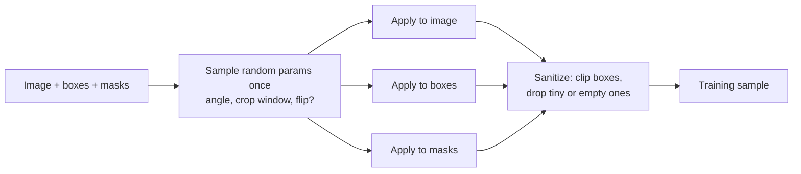
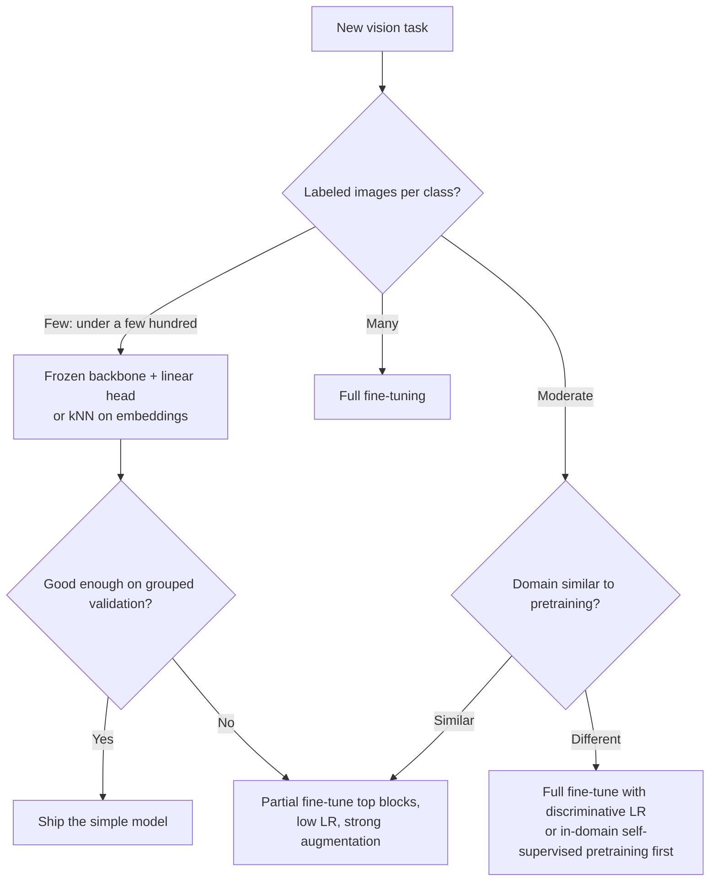
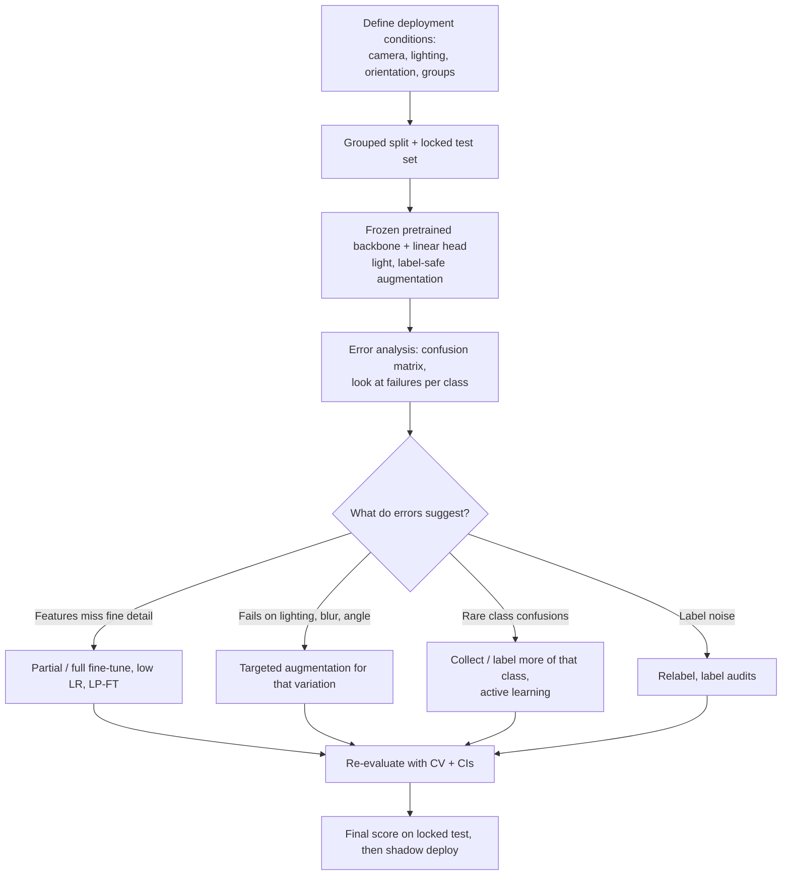

# Data Augmentation, Transfer Learning and Small Datasets in Vision

> **Level:** Beginner to Advanced · **Study time:** ~110 min · **Prerequisites:** [Convolutional Neural Networks and Transfer Learning](../02-deep-learning/07-cnns-and-transfer-learning.md), [Regularization and Debugging Neural Network Training](../02-deep-learning/06-regularization-and-debugging-neural-network-training.md), [Computer Vision Tasks: Classification, Detection and Segmentation](01-image-classification-detection-and-segmentation.md), [The ML Workflow, Train/Validation/Test Splits and Cross-Validation](../01-classical-ml/01-ml-workflow-data-splits-and-cross-validation.md)

## Table of contents

- [Why this matters](#why-this-matters)
- [1. The small-data problem and our running example](#1-the-small-data-problem-and-our-running-example)
- [2. Why augmentation works: invariances](#2-why-augmentation-works-invariances)
- [3. Geometric augmentations: flip, rotate, crop, scale](#3-geometric-augmentations-flip-rotate-crop-scale)
- [4. Photometric augmentations: brightness, contrast, color, blur, noise](#4-photometric-augmentations-brightness-contrast-color-blur-noise)
- [5. Occlusion augmentations: Cutout and Random Erasing](#5-occlusion-augmentations-cutout-and-random-erasing)
- [6. Mixing augmentations: Mixup, CutMix and Mosaic](#6-mixing-augmentations-mixup-cutmix-and-mosaic)
- [7. Building a real pipeline and automated policies](#7-building-a-real-pipeline-and-automated-policies)
- [8. Augmentation for detection and segmentation](#8-augmentation-for-detection-and-segmentation)
- [9. When augmentation hurts](#9-when-augmentation-hurts)
- [10. Test-time augmentation](#10-test-time-augmentation)
- [11. Transfer learning: freeze, partially fine-tune or fully fine-tune](#11-transfer-learning-freeze-partially-fine-tune-or-fully-fine-tune)
- [12. Fine-tuning in practice: learning rates, BatchNorm and schedules](#12-fine-tuning-in-practice-learning-rates-batchnorm-and-schedules)
- [13. Self-supervised backbones and foundation models](#13-self-supervised-backbones-and-foundation-models)
- [14. Evaluating a model trained on a small dataset](#14-evaluating-a-model-trained-on-a-small-dataset)
- [15. Going deeper: a senior playbook for small-data vision in production](#15-going-deeper-a-senior-playbook-for-small-data-vision-in-production)
- [Common mistakes and misconceptions](#common-mistakes-and-misconceptions)
- [Interview questions and model answers](#interview-questions-and-model-answers)
- [Key takeaways](#key-takeaways)
- [Further reading](#further-reading)
- [Next](#next)

## Why this matters

Most real computer vision projects do not look like ImageNet. A factory has 1,500 photos of defective parts, a hospital has 800 labeled scans from 200 patients, a retailer has a few hundred images per product. Training a deep network from scratch on that much data overfits badly, so nearly every production vision system is built from two tools: **data augmentation** (creating label-preserving variations of the images you have) and **transfer learning** (starting from a network that already learned general visual features on a huge dataset). The third tool, often forgotten, is honest evaluation: with small data, a single lucky split or a patient who appears in both train and test can make a useless model look excellent. Interviewers ask about these topics because the answers reveal whether you have actually shipped a vision model, and the same ideas (reuse a pretrained model, adapt it carefully, evaluate without leakage) carry straight over to fine-tuning LLMs.

## 1. The small-data problem and our running example

> **Analogy:** Imagine teaching a new employee to spot scratches on metal parts by showing them only 50 photos, all taken under the same lamp, from the same angle. They might "learn" that scratches always appear in the top-left corner under warm light. Show them the part rotated or under a cold lamp and they fail. A smart trainer would show the same parts under different lights and angles (augmentation), and would hire someone who already knows what metal, light and texture look like (transfer learning).

**Running example (used throughout this chapter): "PartInspect".** A factory wants a classifier for photos of machined metal parts with three classes: `ok`, `scratch`, `dent`. They have:

- 1,500 labeled images (1,200 `ok`, 200 `scratch`, 100 `dent`), so the classes are **imbalanced** (some classes are much rarer than others).
- Images come from 30 production **batches** (lots of parts made on the same day), photographed by 2 cameras.
- Many parts were photographed 3 to 5 times from slightly different positions.

Keep those three facts in mind. The imbalance affects which metrics we report, the batches and repeated photos affect how we split data, and the cameras affect which augmentations make sense.

A modern image classifier such as ResNet-50 (a widely used 50-layer CNN) has about 25 million parameters. Fitting 25 million numbers to 1,500 images from scratch is like solving an equation with 25 million unknowns and 1,500 constraints: there are endless solutions that memorize the training images perfectly and generalize terribly. This is **overfitting** (the model fits noise and specifics of the training set instead of the general pattern; see [Overfitting, Bias-Variance, Regularization and Data Leakage](../01-classical-ml/03-overfitting-regularization-and-data-leakage.md)).

We have three levers:

| Lever | What it does | Analogy |
|---|---|---|
| Data augmentation | Makes the effective dataset bigger and more varied | Show the trainee the same part under many lights and angles |
| Transfer learning | Starts from features learned on millions of images | Hire someone who already understands images |
| Careful evaluation | Measures real generalization, with uncertainty | Test the trainee on parts from batches they never saw |

## 2. Why augmentation works: invariances

**Data augmentation** means applying random transformations to training images, each time the image is used, such that the correct label does not change. A flipped photo of a cat is still a cat.

The key idea is **invariance**. A model is **invariant** to a transformation if applying the transformation to the input does not change the output. We want a cat classifier to be invariant to left-right flips, small rotations, lighting changes and where the cat sits in the frame. A closely related idea is **equivariance**: the output changes in the same way the input changed. A segmentation mask should be equivariant to flips: flip the image and the predicted mask should flip too.

Precisely, for a transformation $T$ and a model $f$:

$$
\text{Invariance: } f(T(x)) = f(x) \qquad \text{Equivariance: } f(T(x)) = T'(f(x))
$$

- $x$ is an input image.
- $T$ is a transformation of the image, such as a horizontal flip.
- $f$ is the model, mapping an image to a prediction.
- $T'$ is the matching transformation applied to the output (for a mask, the same flip; for a box, the box's flipped coordinates).

Why does training on augmented images teach invariance? Because the network sees the same object under many transformations with the same label, so any feature that depends on the transformation (for example, "scratches are always on the left") stops being useful for reducing the loss. Gradient descent then leans on features that survive the transformation.

There are three complementary ways to see why this helps:

1. **More data, for free.** Each **epoch** (one full pass over the training set) sees a slightly different version of every image, so the model cannot memorize exact pixels.
2. **Encoding prior knowledge.** You, the engineer, know that flips do not change "scratch vs ok". Augmentation is how you tell the model that, without changing its architecture. CNNs already have some built-in translation equivariance from convolution (see [CNNs and Transfer Learning](../02-deep-learning/07-cnns-and-transfer-learning.md)), but they have no built-in rotation, scale or lighting invariance. Augmentation supplies those.
3. **Regularization.** Augmentation makes the training task harder, which reduces overfitting, in the same family as dropout and weight decay (covered in [Regularization and Debugging Neural Network Training](../02-deep-learning/06-regularization-and-debugging-neural-network-training.md)).

> **Senior insight:** The question to ask about every augmentation is "does the true label stay the same under this transform, for this task, in this domain?" Augmentation is a statement about the world. If the statement is false (flipping a "b" makes a "d"), you are injecting label noise.

**Online vs offline augmentation.** **Online augmentation** applies fresh random transforms every time an image is loaded during training, so the model never sees the exact same image twice. **Offline augmentation** pre-generates a fixed number of augmented copies and saves them to disk. Online is the default in deep learning: infinite variety, no storage cost. Offline is useful when transforms are very expensive (for example, generating synthetic images with a rendering engine), but it is also a common source of **leakage** (test-set information sneaking into training; section 14).

## 3. Geometric augmentations: flip, rotate, crop, scale

**Geometric augmentations** move pixels around without changing their colors.

| Transform | What it does | Typical setting (illustrative starting points) | Safe when | Dangerous when |
|---|---|---|---|---|
| Horizontal flip | Mirror left-right | p = 0.5 | Natural photos, most objects | Text, digits, left/right anatomy, road signs with arrows |
| Vertical flip | Mirror top-bottom | p = 0.5 only if orientation is arbitrary | Aerial/satellite images, microscopy, top-down part photos | Natural scenes (sky is up), faces, digits like 6 and 9 |
| Rotation | Rotate by a random angle | +/-10 to 15 degrees for photos; any multiple of 90 for top-down imagery | Camera tilt varies | Orientation is the label, or corners filled with black look unrealistic |
| Random crop | Cut a random sub-window | Pad then crop, or crop 50-100% of area | Object can appear anywhere | The object is small and can be cropped out entirely |
| Scale / zoom | Resize content up or down | 0.8x to 1.2x | Object size varies in deployment | Absolute size is meaningful (measuring defect size in mm) |
| Translation | Shift the image | up to 10% of width | Object position varies | Position carries meaning (a fixed-mount camera where location is informative) |
| Shear / perspective | Skew the image | small values | Camera angle varies | Shapes must be preserved (measurement tasks) |

For PartInspect, the camera looks straight down at a part on a conveyor. Parts arrive in any rotation, so flips (both directions) and 90-degree rotations are all label-preserving. A scratch is a scratch from any angle. Scale should stay small, because the camera is at a fixed distance and size matters for distinguishing a small scratch from a dent.

**Random resized crop** is the workhorse of ImageNet-style training. It picks a random rectangle covering a random fraction of the image area (torchvision's default is 8% to 100%) with a random aspect ratio, then resizes it to the training size, for example 224x224. This teaches scale and position invariance. For small objects or fine-grained details (like a thin scratch), raise the lower bound to something like 50% so the defect is not cropped away while the label still says `scratch`.

**What happens to coordinates.** For classification, only the pixels move. For detection, the labels are coordinates and must move too. For a horizontal flip of an image of width $W$, a point at horizontal position $x$ moves to:

$$
x' = W - x
$$

- $x$ is the original horizontal coordinate (in continuous pixel units, 0 at the left edge).
- $W$ is the image width.
- $x'$ is the new coordinate. (If you index discrete pixel centers 0 to $W-1$, the formula is $x' = W - 1 - x$. Libraries handle this; be consistent.)

A box stored as $(x_{\min}, y_{\min}, x_{\max}, y_{\max})$ flips to $(W - x_{\max},\ y_{\min},\ W - x_{\min},\ y_{\max})$. Note the swap: the old right edge becomes the new left edge.

**Worked example.** Image width $W = 640$. A scratch box is $(100, 50, 300, 200)$.

- New $x_{\min} = 640 - 300 = 340$
- New $x_{\max} = 640 - 100 = 540$
- $y$ values unchanged: $50$ and $200$
- Flipped box: $(340, 50, 540, 200)$. Width before: $300 - 100 = 200$. Width after: $540 - 340 = 200$. Same size, as expected.

If we then resize the image from 640x480 to 320x240, every coordinate is multiplied by $0.5$: $(170, 25, 270, 100)$. We will check this exact result with library code in section 8.

## 4. Photometric augmentations: brightness, contrast, color, blur, noise

**Photometric augmentations** change pixel values but not their positions. They simulate different lighting, cameras and image quality.

> **Analogy:** The same red apple looks orange under a sunset, grey in fog and noisy in a dark room photo. You still know it is an apple. Photometric augmentation teaches the model the same robustness.

A simple brightness and contrast change for a pixel with value $x$ in $[0, 255]$:

$$
x' = \operatorname{clip}(c \cdot x + b,\ 0,\ 255)
$$

- $x$ is the original pixel intensity (0 is black, 255 is white for 8-bit images).
- $c$ is the contrast multiplier: $c > 1$ stretches differences between pixels, $c < 1$ flattens them.
- $b$ is the brightness offset added to every pixel.
- $\operatorname{clip}(v, 0, 255)$ forces the result back into the valid range.
- $x'$ is the new pixel value.

(Libraries often implement contrast as scaling around the image mean rather than around 0, but the idea is the same.)

**Worked example.** Take $c = 1.2$, $b = 10$.

- Pixel $30$: $1.2 \times 30 + 10 = 36 + 10 = 46$.
- Pixel $200$: $1.2 \times 200 + 10 = 240 + 10 = 250$.
- Pixel $220$: $1.2 \times 220 + 10 = 264 + 10 = 274$, clipped to $255$.

Notice the last case: pixels $220$ and anything brighter all become $255$. Information is destroyed by **clipping** (also called saturation). Mild augmentation is fine; extreme augmentation can erase the very scratch you want to detect, which is a faint bright line on a bright surface.

| Transform | Simulates | Notes |
|---|---|---|
| Brightness | Exposure, lamp strength | Most common, usually safe in moderation |
| Contrast | Camera settings, haze | Strong values destroy faint features |
| Saturation | Camera color processing | Unsafe if color is the label |
| Hue shift | White balance, lighting color | Unsafe for ripeness, traffic lights, skin lesions, chemical tests |
| **Color jitter** | Random combination of the four above | torchvision `ColorJitter` |
| Grayscale | Color-blind robustness | Useful when color is a shortcut you want to remove |
| Gaussian blur | Out-of-focus lens, motion | Can erase fine detail like hairline scratches |
| Gaussian noise | Sensor noise in low light | Match the noise level of the real camera |
| JPEG compression | Compressed uploads, video streams | Very relevant for web and CCTV inputs |

> **Common mistake:** Applying ImageNet-style color jitter to a task where color is the signal. A fruit-ripeness classifier trained with strong hue jitter is taught that green and red bananas are the same.

### From-scratch NumPy implementation

Writing the basic transforms yourself shows there is no magic: they are array operations.

```python
# pip install numpy
import numpy as np

rng = np.random.default_rng(0)

def hflip(img: np.ndarray) -> np.ndarray:
    """img has shape (H, W, C). Reverse the width axis."""
    return img[:, ::-1, :]

def random_crop(img: np.ndarray, out_h: int, out_w: int) -> np.ndarray:
    H, W, _ = img.shape
    top = rng.integers(0, H - out_h + 1)     # random top-left corner
    left = rng.integers(0, W - out_w + 1)
    return img[top:top + out_h, left:left + out_w, :]

def brightness_contrast(img: np.ndarray, c: float, b: float) -> np.ndarray:
    out = img.astype(np.float32) * c + b     # x' = c * x + b
    return np.clip(out, 0, 255).astype(np.uint8)

def gaussian_noise(img: np.ndarray, sigma: float) -> np.ndarray:
    noisy = img.astype(np.float32) + rng.normal(0.0, sigma, img.shape)
    return np.clip(noisy, 0, 255).astype(np.uint8)

img = rng.integers(0, 256, size=(64, 64, 3), dtype=np.uint8)  # fake image

print(hflip(img).shape)                                 # (64, 64, 3)
print(np.array_equal(hflip(img)[:, 0], img[:, -1]))     # True: first column is old last column
print(random_crop(img, 48, 48).shape)                   # (48, 48, 3)
print(brightness_contrast(np.array([[[30, 200, 220]]], dtype=np.uint8), 1.2, 10))
# [[[ 46 250 255]]]  matches the worked example above
```

## 5. Occlusion augmentations: Cutout and Random Erasing

**Occlusion** means part of an object is hidden, for example a person behind a pole or a part partly covered by a gripper. Models trained on clean images often rely on one highly discriminative region (the cat's face) and fail when it is hidden.

**Cutout** (DeVries and Taylor, 2017, "Improved Regularization of Convolutional Neural Networks with Cutout") masks a random square of the input with zeros (or the mean color). **Random Erasing** (Zhong et al., "Random Erasing Data Augmentation", 2017 preprint, AAAI 2020) is the same idea with a random rectangle size, aspect ratio and fill value (often random noise).

```text
 original              cutout                random erasing
+------------+        +------------+        +------------+
|   /\_/\    |        |   /\_/\    |        |   /\_/\    |
|  ( o.o )   |        |  ( ####)   |        |  (o.o )    |
|   > ^ <    |        |   >####    |        |   >%%%%%%  |
|  tail ~~   |        |  tail ~~   |        |  tai%%%%%% |
+------------+        +------------+        +------------+
                       square of zeros       random-size box of noise
```

Why it helps: the network cannot rely on any single patch always being visible, so it learns to use several cues (ears, whiskers, tail). It is like making a student answer questions with random words blacked out: they have to understand the whole paragraph.

When it hurts: if the erased region can cover the only evidence for the label. A `scratch` image where the eraser covers the whole scratch is now an `ok`-looking image labeled `scratch`. For small-defect tasks, use small erasing boxes, low probability, or skip it.

## 6. Mixing augmentations: Mixup, CutMix and Mosaic

Mixing augmentations combine two or more training images, and (for classification) also mix their labels. They look strange to humans but are among the most effective regularizers in modern training recipes.

First, a definition. A **one-hot label** is a vector with a 1 for the true class and 0 elsewhere. For classes `[cat, dog]`, a cat is $[1, 0]$. A **soft label** is any probability vector, like $[0.7, 0.3]$. Mixing methods produce soft labels, trained with ordinary cross-entropy (recap: cross-entropy $= -\sum_k y_k \log p_k$, where $y$ is the target and $p$ the predicted probabilities; see [Softmax, Entropy, Cross-Entropy and KL Divergence](../00-foundations/05-softmax-entropy-cross-entropy-and-kl-divergence.md)).

### Mixup

**Mixup** (Zhang et al., 2018, "mixup: Beyond Empirical Risk Minimization") blends two whole images pixel by pixel and blends their labels by the same amount:

$$
\tilde{x} = \lambda x_i + (1 - \lambda) x_j, \qquad \tilde{y} = \lambda y_i + (1 - \lambda) y_j, \qquad \lambda \sim \operatorname{Beta}(\alpha, \alpha)
$$

- $x_i, x_j$ are two training images (same size), usually image $i$ and a randomly chosen partner $j$ from the same batch.
- $y_i, y_j$ are their one-hot labels.
- $\lambda$ is the mixing weight between 0 and 1.
- $\operatorname{Beta}(\alpha, \alpha)$ is a probability distribution on $[0, 1]$. With small $\alpha$ (like 0.2), most draws are near 0 or 1, so most mixed images are mostly one image. With $\alpha = 1$, $\lambda$ is uniform.
- $\tilde{x}, \tilde{y}$ are the mixed image and soft label.

**Worked example.** Two tiny two-pixel grayscale "images": a cat $x_i = [200, 100]$ with $y_i = [1, 0]$, and a dog $x_j = [50, 250]$ with $y_j = [0, 1]$. Draw $\lambda = 0.7$.

- Pixel 1: $0.7 \times 200 + 0.3 \times 50 = 140 + 15 = 155$
- Pixel 2: $0.7 \times 100 + 0.3 \times 250 = 70 + 75 = 145$
- Label: $0.7 \times [1, 0] + 0.3 \times [0, 1] = [0.7, 0.3]$

Suppose the model predicts $p = [0.6, 0.4]$. The cross-entropy loss is:

$$
-\left(0.7 \ln 0.6 + 0.3 \ln 0.4\right) = -\left(0.7 \times (-0.5108) + 0.3 \times (-0.9163)\right) = 0.3576 + 0.2749 = 0.6325
$$

Why it helps: the model is trained to behave linearly between examples, which discourages extreme, overconfident decision boundaries. Mixup typically improves **calibration** (predicted probabilities match observed frequencies) and robustness to label noise.

### CutMix

**CutMix** (Yun et al., 2019, "CutMix: Regularization Strategy to Train Strong Classifiers with Localizable Features") pastes a rectangle from image $j$ into image $i$, and mixes labels by area:

$$
\tilde{y} = \lambda y_i + (1 - \lambda) y_j, \qquad \lambda = 1 - \frac{w_{\text{box}} \cdot h_{\text{box}}}{W \cdot H}
$$

- $W, H$ are the image width and height.
- $w_{\text{box}}, h_{\text{box}}$ are the width and height of the pasted rectangle, after clipping it to the image borders.
- $\lambda$ is the fraction of the image that still belongs to image $i$.

In practice you first sample a target $\lambda$ from $\operatorname{Beta}(\alpha, \alpha)$, set the box sides to $W\sqrt{1 - \lambda}$ and $H\sqrt{1 - \lambda}$ so its area fraction is $1 - \lambda$, place it at a random center, clip it to the image, then recompute $\lambda$ from the actual clipped area.

**Worked example.** A 224x224 image ($W \cdot H = 50{,}176$). Sample $\lambda = 0.75$.

- Side fraction: $\sqrt{1 - 0.75} = \sqrt{0.25} = 0.5$, so the box is $112 \times 112$.
- Area fraction: $112 \times 112 / 50{,}176 = 12{,}544 / 50{,}176 = 0.25$. So the label is $0.75$ image $i$, $0.25$ image $j$.
- Now suppose the center is near the bottom edge and the box is clipped to $112 \times 60$. Area $= 6{,}720$, fraction $6{,}720 / 50{,}176 = 0.1339$, so the corrected $\lambda = 1 - 0.1339 = 0.866$. Forgetting this correction gives wrong soft labels.

Why CutMix often beats Mixup for vision: the pasted patch is a natural-looking region (not a ghostly blend), so the model still learns localized features, while also getting the occlusion benefit of Cutout without wasting pixels on a black box.

```text
   Mixup (blend everything)        CutMix (paste a patch)
+-------------------------+      +------------------------+
| cat at 70% + dog at 30% |      | cat cat cat cat cat    |
| ghostly overlay         |      | cat cat +--------+ cat |
|                         |      | cat cat |  dog   | cat |
|                         |      | cat cat +--------+ cat |
+-------------------------+      +------------------------+
label [0.7, 0.3]                  label by area [0.75, 0.25]
```

### Mosaic

**Mosaic** (popularized by YOLOv4, Bochkovskiy et al., 2020) stitches four training images into one, each scaled and cropped into a quadrant around a random center point. It is used for object detection, where labels are boxes, not soft class vectors: every box from the four images is transformed into the mosaic's coordinates and kept (boxes cut off at the edges are clipped or dropped).

```text
+-----------+--------------+
|  img A    |    img B     |
|  [car]    |   [person]   |
+------+----+--------------+   <- random center point
|img C |      img D        |
|[dog] |   [bike] [car]    |
+------+-------------------+
 one training image, boxes from all four
```

Why it helps detection: each training image contains objects at many scales and in unusual contexts, and the batch effectively holds four times as many images, which also helps BatchNorm (a layer that normalizes activations using statistics computed over the batch; section 12) when batch sizes are small. Its downside is that mosaic images are unrealistic (strange seams, objects cut at quadrant borders), so detector recipes such as Ultralytics YOLO expose a setting (`close_mosaic`) to switch mosaic off for the last epochs, letting the model adjust to normal-looking images.

| Method | Mixes | Label | Main use | Pros | Cons |
|---|---|---|---|---|---|
| Mixup | Whole images, blended | Soft, by $\lambda$ | Classification | Calibration, label-noise robustness | Unnatural ghost images; weaker for localization |
| CutMix | A rectangle pasted | Soft, by area | Classification | Keeps local realism, occlusion robustness | Patch may land on background, so the label overstates the pasted class |
| Mosaic | 4 images tiled | All boxes kept | Detection | Multi-scale, more objects per image | Unrealistic seams; usually turned off near the end |
| Copy-Paste (Ghiasi et al., 2021) | Object instances pasted using masks | Boxes and masks added | Instance segmentation | Many more rare objects | Needs instance masks; context may be implausible |

## 7. Building a real pipeline and automated policies

### The standard torchvision pipeline

Below is a typical training and evaluation pipeline for PartInspect using `torchvision.transforms.v2`, the transforms API that became stable around torchvision 0.16 and can transform images, boxes and masks together.

```python
# pip install torch torchvision
import torch
from torchvision.transforms import v2

IMAGENET_MEAN = [0.485, 0.456, 0.406]   # statistics of the pretraining data
IMAGENET_STD = [0.229, 0.224, 0.225]

train_tf = v2.Compose([
    v2.ToImage(),                                         # PIL/NumPy -> tensor image (C, H, W)
    v2.RandomResizedCrop(224, scale=(0.5, 1.0), antialias=True),  # keep at least 50% of area
    v2.RandomHorizontalFlip(p=0.5),
    v2.RandomVerticalFlip(p=0.5),                         # top-down camera: orientation is arbitrary
    v2.RandomApply([v2.ColorJitter(brightness=0.2, contrast=0.2)], p=0.8),  # no hue jitter
    v2.RandomApply([v2.GaussianBlur(kernel_size=3, sigma=(0.1, 1.0))], p=0.1),
    v2.ToDtype(torch.float32, scale=True),                # uint8 [0,255] -> float [0,1]
    v2.Normalize(mean=IMAGENET_MEAN, std=IMAGENET_STD),
    v2.RandomErasing(p=0.1, scale=(0.02, 0.05)),          # small boxes only: defects are small
])

eval_tf = v2.Compose([                                    # NO randomness at evaluation
    v2.ToImage(),
    v2.Resize(256, antialias=True),
    v2.CenterCrop(224),
    v2.ToDtype(torch.float32, scale=True),
    v2.Normalize(mean=IMAGENET_MEAN, std=IMAGENET_STD),
])

x = torch.randint(0, 256, (3, 300, 400), dtype=torch.uint8)  # fake image
print(train_tf(x).shape, eval_tf(x).shape)  # torch.Size([3, 224, 224]) torch.Size([3, 224, 224])
```

Note the `Normalize` step: when you use a pretrained backbone, you must preprocess images the same way the backbone was pretrained (here, ImageNet mean and standard deviation). Mismatched normalization is a silent accuracy killer.

### Mixup and CutMix in PyTorch, from scratch and with the library

Mixing operates on a whole batch, after the per-image transforms.

```python
import math
import numpy as np
import torch
import torch.nn.functional as F

def mixup(x, y_onehot, alpha=0.2):
    lam = float(np.random.beta(alpha, alpha))
    idx = torch.randperm(x.size(0))                 # random partner for each image
    x_mix = lam * x + (1 - lam) * x[idx]
    y_mix = lam * y_onehot + (1 - lam) * y_onehot[idx]
    return x_mix, y_mix

def cutmix(x, y_onehot, alpha=1.0):
    lam = float(np.random.beta(alpha, alpha))
    B, C, H, W = x.shape
    idx = torch.randperm(B)
    cut_h, cut_w = int(H * math.sqrt(1 - lam)), int(W * math.sqrt(1 - lam))
    cy, cx = np.random.randint(H), np.random.randint(W)
    y0, y1 = max(cy - cut_h // 2, 0), min(cy + cut_h // 2, H)   # clip to borders
    x0, x1 = max(cx - cut_w // 2, 0), min(cx + cut_w // 2, W)
    x = x.clone()
    x[:, :, y0:y1, x0:x1] = x[idx, :, y0:y1, x0:x1]
    lam = 1 - (y1 - y0) * (x1 - x0) / (H * W)       # recompute from the clipped area
    y_mix = lam * y_onehot + (1 - lam) * y_onehot[idx]
    return x, y_mix

# Training step sketch (logits from any model):
images = torch.randn(8, 3, 224, 224)
labels = torch.randint(0, 3, (8,))
y = F.one_hot(labels, num_classes=3).float()
images, y = cutmix(images, y)
logits = torch.randn(8, 3, requires_grad=True)      # stand-in for model(images)
loss = F.cross_entropy(logits, y)                   # accepts soft targets (PyTorch >= 1.10)
loss.backward()
```

The library version (torchvision 0.16 or later) does the same on batches:

```python
from torchvision.transforms import v2

cutmix_or_mixup = v2.RandomChoice([v2.CutMix(num_classes=3), v2.MixUp(num_classes=3)])
# inside the training loop, after the DataLoader:
# images, labels = cutmix_or_mixup(images, labels)   # labels become soft, shape (B, 3)
```

### Automated augmentation policies

Choosing which transforms to use, and how strong, is itself a hyperparameter search. Several methods automate it:

| Method | Idea | Cost to use | Notes |
|---|---|---|---|
| AutoAugment (Cubuk et al., 2019) | Reinforcement learning searches for a policy (sequences of ops and magnitudes) on a proxy task | Search is very expensive; reusing published policies is free | Policies found on ImageNet transfer reasonably to similar natural-image data |
| RandAugment (Cubuk et al., 2020) | Apply N random ops from a fixed list, all at magnitude M | Just tune 2 numbers | Simple, strong default for natural images |
| TrivialAugment (Muller and Hutter, 2021) | One random op per image at a random magnitude | Zero hyperparameters | Surprisingly competitive with searched policies |
| AugMix (Hendrycks et al., 2020) | Mix several augmentation chains plus a consistency loss | Moderate | Targets robustness to corruptions and shift, not just clean accuracy |

All are in `torchvision.transforms.v2` (`AutoAugment`, `RandAugment`, `TrivialAugmentWide`, `AugMix`). Their op lists were designed for natural photos and include ops like strong color changes, posterize (reduce the number of intensity levels) and solarize (invert pixels above a threshold). For medical, industrial or document images, review the op list rather than applying them blindly.

> **Interview tip:** If asked "how do you choose augmentations?", say: start from what varies in deployment (lighting, camera, orientation, compression), add only label-preserving transforms, visualize a grid of augmented samples, then tune strength by validation on a grouped split (all images of the same part, patient or scene stay on one side; section 14). Automated policies are a good default for natural images and a starting point, not an answer, for specialized domains.

## 8. Augmentation for detection and segmentation

In classification, the label is one class for the whole image, so geometric transforms leave it alone. In **object detection** (predicting boxes plus classes) and **segmentation** (predicting a class per pixel, see [Computer Vision Tasks](01-image-classification-detection-and-segmentation.md)), the labels are spatial. Every geometric transform applied to the image must be applied identically to the labels.



The key phrase is **sample once, apply to all**. If the image is flipped with probability 0.5 and the boxes are flipped with an independent coin toss, half your labels are silently wrong.

| Transform | Image | Boxes | Masks | Gotcha |
|---|---|---|---|---|
| Flip | mirror | $x' = W - x$, swap min/max | mirror | Left/right class labels (e.g. `left_hand`) must also swap |
| Resize | interpolate (bilinear) | scale coordinates | **nearest-neighbor** interpolation | Bilinear on a mask creates invalid in-between class IDs like 1.5 |
| Crop | cut window | shift, clip to window | cut window | Boxes mostly outside must be dropped, with their labels |
| Rotate | rotate | rotate 4 corners, take enclosing box | rotate (nearest) | Enclosing box is looser than the object; keep angles small |
| Photometric | change colors | unchanged | unchanged | Never apply to the mask itself |
| Mosaic / Copy-Paste | combine | transform and union all | combine | Clip boxes at seams |

Two subtle points:

- **Rotated boxes grow.** An axis-aligned box rotated by 45 degrees is replaced by the box enclosing its rotated corners, which includes background. Large rotations make box labels sloppy. If you have masks, recompute the box from the rotated mask instead: it stays tight.
- **Crops can remove objects.** After cropping, a box that is 95% outside the crop is mostly invisible. Keep a minimum-visibility threshold (for example, drop boxes with less than 30% of their area remaining) and drop the matching class labels.

### Code: boxes with torchvision v2

```python
import torch
from torchvision import tv_tensors
from torchvision.transforms import v2

img = torch.randint(0, 256, (3, 480, 640), dtype=torch.uint8)    # H=480, W=640
target = {
    "boxes": tv_tensors.BoundingBoxes([[100, 50, 300, 200]], format="XYXY",
                                      canvas_size=(480, 640)),
    "labels": torch.tensor([1]),                                  # class "scratch"
}

tf = v2.Compose([
    v2.RandomHorizontalFlip(p=1.0),        # p=1 so the result is deterministic
    v2.Resize((240, 320), antialias=True),
    v2.SanitizeBoundingBoxes(),            # drops degenerate boxes and their labels
])
out_img, out_target = tf(img, target)
print(out_img.shape)              # torch.Size([3, 240, 320])
print(out_target["boxes"])        # coordinates [[170, 25, 270, 100]], as in section 3
```

This needs torchvision 0.16 or later (in 0.15 the beta API called `tv_tensors` was named `datapoints`). `BoundingBoxes` and `Mask` are typed tensors, so v2 transforms know to treat them as coordinates or as label maps (nearest-neighbor resizing for masks).

### Code: Albumentations

**Albumentations** is a popular library for detection and segmentation augmentation. Its API has changed across major versions (some transforms such as `ShiftScaleRotate` were deprecated in favor of `Affine` in 2.x), so check the docs for your installed version. Its maintainers have also moved active development to a successor package (AlbumentationsX) under a different license, so check the license as well as the version before adopting it in a commercial product.

```python
# pip install albumentations
import albumentations as A
import numpy as np

tf = A.Compose(
    [
        A.HorizontalFlip(p=0.5),
        A.Affine(rotate=(-10, 10), scale=(0.9, 1.1), p=0.5),
        A.RandomBrightnessContrast(p=0.3),
    ],
    bbox_params=A.BboxParams(format="pascal_voc",        # (x_min, y_min, x_max, y_max)
                             label_fields=["labels"],
                             min_visibility=0.3),        # drop boxes mostly cut off
)

image = np.zeros((480, 640, 3), dtype=np.uint8)
mask = np.zeros((480, 640), dtype=np.uint8)              # per-pixel class IDs
out = tf(image=image, mask=mask, bboxes=[[100, 50, 300, 200]], labels=[1])
print(out["image"].shape, out["mask"].shape, len(out["bboxes"]))
```

> **Common mistake:** Not visualizing. Draw the augmented boxes and masks over the augmented images for 20 random samples before every new training run. Label-transform bugs do not crash; they just cap your mAP (mean average precision, see [Object Detection in Depth](02-object-detection-yolo-faster-rcnn-and-map.md)) at a mysteriously low value.

## 9. When augmentation hurts

Augmentation is not free regularization. It hurts when it breaks the label, when it makes training images unlike test images, or when it is so strong the model underfits.

### 9.1 Label-changing transforms

| Case | Transform | Why the label breaks |
|---|---|---|
| Digits 6 and 9 | 180-degree rotation, vertical flip | A rotated 6 is a 9 |
| Letters b/d, p/q, text in general | Horizontal flip | Mirror text is not valid text; b becomes d |
| Traffic signs "turn left" vs "turn right" | Horizontal flip | Flip swaps the class |
| Chest X-rays, anatomy | Horizontal flip | The heart is normally on the left; a flipped image depicts a rare condition (dextrocardia), and laterality markers ("L"/"R") become mirrored |
| Directional tasks ("is the car facing left?") | Flip | The label is the orientation |
| Ripeness, skin lesions, chemistry test strips | Hue jitter | Color is the signal |
| Small-defect detection | Aggressive crop or erasing | The defect leaves the frame but the label still says defect |
| Measuring size in mm | Scale jitter | Absolute size is the label |

### 9.2 Unrealistic distortions

Strong elastic warps, extreme rotations with black corners, posterize and solarize create images that never occur in deployment. A little unrealism acts as regularization; a lot spends model capacity on an irrelevant distribution and can make the model learn artifacts (for example, "black triangular corners mean rotated, rotated images are usually from class X" if rotation was only applied to some classes). Worse, a model can learn **shortcuts** (spurious cues correlated with the label, see "Shortcut Learning in Deep Neural Networks", Geirhos et al., 2020) introduced by augmentation applied differently per class, which is common when engineers oversample and augment only the minority class.

### 9.3 Train/test distribution mismatch

Augmentation changes the training distribution. If it shifts it away from test conditions, accuracy can drop:

- **Resolution and object size.** Random resized crop zooms in during training, so objects look bigger than in the center-cropped test images. "Fixing the train-test resolution discrepancy" (Touvron et al., 2019, often called FixRes) showed that this mismatch is real and that testing at a somewhat higher resolution, or fine-tuning briefly at test resolution, helps.
- **Mosaic and Mixup images** look nothing like test images; recipes reduce or disable them near the end of training.
- **Simulating the wrong camera.** Adding heavy blur when the production camera is sharp, or adding noise patterns unlike the real sensor's.

### 9.4 Too strong for the model or data

Heavy augmentation plus a small model can cause **underfitting** (training loss stays high). Large models trained long benefit from strong augmentation; a frozen backbone with a small head often needs little. Research has also shown that augmentation effects can be uneven across classes: strong augmentation can raise average accuracy while hurting some specific classes ("The Effects of Regularization and Data Augmentation are Class Dependent", Balestriero et al., 2022). With PartInspect, check per-class recall for `dent` and `scratch`, not just overall accuracy.

### 9.5 Augmentation that leaks

Offline augmented copies generated before splitting let a flipped copy of a training image land in the test set. Split first, then augment the training split only.

> **Senior insight:** Diagnose harm with ablations: train with and without each augmentation family on the same grouped split and compare per-class metrics, ideally across a few seeds. If removing a transform improves validation, it was probably breaking labels or adding mismatch.

## 10. Test-time augmentation

**Test-time augmentation (TTA)** runs the trained model on several augmented versions of each test image (for example: original, horizontally flipped, a few crops) and averages the predictions.

> **Analogy:** When you are unsure what a sign says, you tilt your head, step left, step right, then decide. TTA lets the model look from a few angles before answering.

For $K$ augmented views $T_1, \dots, T_K$:

$$
\hat{p}(x) = \frac{1}{K} \sum_{k=1}^{K} f(T_k(x))
$$

- $x$ is the test image.
- $T_k$ is the $k$-th test-time transform (usually mild and deterministic, like a flip).
- $f(\cdot)$ outputs class probabilities (after softmax).
- $\hat{p}(x)$ is the averaged probability vector.

**Worked example.** PartInspect probability of `scratch` for one image, threshold 0.5:

- Original view: $0.45$ (would be classified "not scratch")
- Flipped view: $0.70$
- Center crop: $0.62$
- Average: $(0.45 + 0.70 + 0.62) / 3 = 1.77 / 3 = 0.59$, so TTA predicts `scratch`.

Averaging reduces the variance of the prediction, much like an ensemble of models, but with one model.

```python
import torch

@torch.no_grad()
def predict_tta(model, x):                 # x: (B, C, H, W), already normalized
    model.eval()
    views = [x, torch.flip(x, dims=[3])]   # original + horizontal flip (dim 3 = width)
    probs = [torch.softmax(model(v), dim=1) for v in views]
    return torch.stack(probs).mean(dim=0)  # average probabilities, shape (B, num_classes)
```

**TTA for detection and segmentation** needs one more step: undo the transform on the predictions before merging. Flip the predicted mask back, or map boxes back with $x = W - x'$, then merge boxes from all views with NMS (non-maximum suppression: keep the highest-scoring box among heavily overlapping ones) or **Weighted Boxes Fusion** (Solovyev et al., 2021), which averages overlapping boxes instead of discarding all but one.

| Aspect | TTA |
|---|---|
| Typical gain | Small but often consistent; larger when the training augmentations match the TTA views |
| Cost | $K$ times the inference compute (running the $K$ views as one batch softens the latency hit, but not the total compute or the throughput loss) |
| Good for | Offline batch scoring, medical review, competitions, labeling pipelines |
| Poor fit for | Tight real-time latency budgets, edge devices |
| Pitfalls | Using views the model never saw in training; averaging logits vs probabilities inconsistently; changing calibration |

> **Senior insight:** In production, TTA is a cost decision. If TTA gives +1 point, compare it with simply using a larger model or distilling an ensemble into one model (see [Knowledge Distillation Fundamentals](../07-model-compression/05-knowledge-distillation-fundamentals.md)). Distillation can capture much of the TTA gain at 1x inference cost.

## 11. Transfer learning: freeze, partially fine-tune or fully fine-tune

### Quick recap

**Transfer learning** reuses a model trained on a large **source** task (for example, ImageNet classification with about 1.28 million training images in 1,000 classes) as the starting point for your **target** task. The pretrained network minus its final classification layer is called the **backbone**; the new task-specific layers on top are the **head**. The mechanism, covered in [CNNs and Transfer Learning](../02-deep-learning/07-cnns-and-transfer-learning.md), is that early layers learn generic features (edges, colors, textures) and later layers learn increasingly task-specific features (object parts, whole objects). Yosinski et al. ("How transferable are features in deep neural networks?", 2014) measured this transition from general to specific across layers.

A few terms used below. **Freezing** a layer means keeping its pretrained weights fixed (no gradient updates); **fine-tuning** means continuing to train pretrained weights on the new task. The backbone's output vector for an image is its **embedding** (feature vector); a head turns embeddings into class scores. Training uses gradient descent with a **learning rate (LR)**, the size of each update step; section 12 explains why fine-tuning needs a small one.

> **Analogy:** Freezing is hiring an experienced inspector and only teaching them the names of your three defect types. Fine-tuning is also retraining their eye on your particular metal surfaces: more adaptable, but with only a few examples they may "unlearn" good habits.

Three strategies, from least to most adaptation:

| Strategy | What trains | Also called | Pros | Cons |
|---|---|---|---|---|
| **Freeze the backbone** | Only the new head | Feature extraction, **linear probe** (when the head is one linear layer) | Fast, cheap, very hard to overfit, can precompute features once | Cannot adapt features to a different domain |
| **Partial fine-tuning** | Head + last few blocks | Fine-tuning top layers | Adapts high-level features, keeps generic low-level ones | One more choice (how many blocks) |
| **Full fine-tuning** | Everything | End-to-end fine-tuning | Best accuracy when data is sufficient or domain differs | Slowest, most memory, highest overfitting risk, can destroy pretrained features if the LR is too high |

### The decision table

The two questions are: **how much labeled data do you have**, and **how similar is your domain to the pretraining data**?

| | Similar domain (natural photos: products, animals, vehicles) | Different domain (X-rays, microscopy, satellite, industrial surfaces, documents) |
|---|---|---|
| **Small data** (hundreds to a few thousand images) | Freeze backbone, train a linear or small head. Strong baseline in minutes. | Hardest case. Try a frozen strong general backbone (e.g. self-supervised) first, then partially fine-tune the top blocks with a low LR and strong regularization. Consider in-domain self-supervised pretraining on unlabeled images. |
| **Medium data** (thousands to tens of thousands) | Partial or full fine-tuning with a low LR. | Fine-tune more layers, often full fine-tuning with a discriminative LR. |
| **Large data** (hundreds of thousands+) | Full fine-tuning; pretrained init still speeds convergence. | Full fine-tuning; pretraining still usually helps convergence, and training from scratch becomes a viable option ("Rethinking ImageNet Pre-training", He et al., 2019, found that from-scratch training can catch up with enough data and longer schedules for detection). |

The size thresholds are rough guides, not rules. What matters is data per class and how much the features need to change.



**Applying it to PartInspect.** 1,500 images, an industrial domain (metal surfaces: somewhat different from ImageNet, but still textures and edges that ImageNet features describe well). Plan:

1. Baseline: frozen backbone, linear head. Measure on a grouped split (section 14).
2. If the `scratch` recall is too low (fine textures may not be well captured by frozen features), unfreeze the last stage with a low LR.
3. Full fine-tuning only if partial fine-tuning keeps improving and validation does not show overfitting.

> **Interview tip:** Always say you would start with the frozen-backbone baseline. It takes minutes, sets a floor, and tells you how much the pretrained features already capture. Then justify each step of additional unfreezing with validation evidence.

## 12. Fine-tuning in practice: learning rates, BatchNorm and schedules

### Why the learning rate must be smaller

The **learning rate (LR)** controls the step size of gradient descent (see [Optimizers and Learning Rate Schedules](../02-deep-learning/03-optimizers-sgd-momentum-adam-and-learning-rate-schedules.md)). Pretrained weights already sit in a good region. A large LR takes big steps that can throw the weights out of that region, erasing what was learned, a vision cousin of **catastrophic forgetting** (losing previously learned abilities when training on new data; see [Catastrophic Forgetting, Data Contamination and Memorization](../05-llms/09-catastrophic-forgetting-contamination-and-memorization.md)).

The danger is greatest at the very start. The new head is randomly initialized, so its early predictions are bad and its gradients are large. Those large gradients flow back into the backbone and can damage good features before the head has learned anything.

Practical rules of thumb (starting points to tune, not universal constants):

- Fine-tune with an LR roughly 10x to 100x smaller than you would use to train the same model from scratch.
- Give the new head a higher LR than the backbone.
- Use a short **warmup** (start the LR near zero and ramp up over the first few hundred steps) so early large head gradients do not wreck the backbone.
- Use cosine or step decay afterwards, and early stopping on grouped validation.
- Typical illustrative values: AdamW with backbone LR around $10^{-5}$ to $10^{-4}$ and head LR around $10^{-3}$; or SGD with momentum and an LR around $10^{-3}$ to $10^{-2}$. Always confirm with a short sweep.

### Discriminative learning rates (layer-wise LR decay)

Since early layers are generic and late layers task-specific, give each layer group its own LR, decaying toward the input. This is called **discriminative fine-tuning** (popularized by ULMFiT, Howard and Ruder, 2018) or **layer-wise learning rate decay**:

$$
\eta_\ell = \eta_{\text{head}} \cdot d^{\,L - \ell}
$$

- $\eta_\ell$ is the learning rate for layer group $\ell$.
- $\eta_{\text{head}}$ is the learning rate of the top group (the head).
- $d$ is the decay factor, between 0 and 1.
- $L$ is the index of the top group and $\ell$ counts groups from the input ($\ell = L$ is the head, so it gets $d^0 = 1$).

**Worked example.** $\eta_{\text{head}} = 10^{-3}$, $d = 0.5$, four groups for a ResNet: head ($\ell = 4$), `layer4` ($\ell = 3$), `layer3` ($\ell = 2$), everything earlier ($\ell = 1$).

- Head: $10^{-3} \times 0.5^0 = 0.001$
- `layer4`: $10^{-3} \times 0.5^1 = 0.0005$
- `layer3`: $10^{-3} \times 0.5^2 = 0.00025$
- Earlier layers: $10^{-3} \times 0.5^3 = 0.000125$

A related technique is **gradual unfreezing** (also ULMFiT): train the head first, then unfreeze one more block every epoch or so, from top to bottom.

### Linear probe, then fine-tune (LP-FT)

A clean way to avoid the "random head damages backbone" problem is two stages: first train only the head with the backbone frozen (a linear probe), then unfreeze and fine-tune everything at a low LR. Kumar et al. ("Fine-Tuning can Distort Pretrained Features and Underperform Out-of-Distribution", 2022) analyzed this and found that LP-FT can improve out-of-distribution accuracy (accuracy on inputs that differ from the fine-tuning data, such as a new camera) compared with direct full fine-tuning, because the head starts in a sensible place and the features are distorted less.

### The BatchNorm trap

**Batch normalization (BatchNorm)** layers normalize activations using a mean and variance (see [Vanishing and Exploding Gradients, Initialization, Normalization and Residuals](../02-deep-learning/05-vanishing-exploding-gradients-initialization-normalization-and-residuals.md)). They store **running statistics** (moving averages of mean and variance) that are updated during the forward pass in training mode, regardless of whether their weights have `requires_grad=True`.

So "freezing" a backbone by setting `requires_grad=False` but leaving the model in `train()` mode still changes the BatchNorm running statistics. With small batches (common when fine-tuning on one GPU with large images), these statistics become noisy and accuracy can drop mysteriously at evaluation. Fixes:

- Put the frozen BatchNorm layers in `eval()` mode so they use the pretrained statistics.
- With tiny batches during full fine-tuning, consider keeping BatchNorm frozen, or use architectures with **GroupNorm** or **LayerNorm**, which do not depend on batch statistics (Vision Transformers, or ViTs, use LayerNorm).

### Code: three strategies on a pretrained ResNet-50

```python
# pip install torch torchvision
import torch
import torch.nn as nn
from torchvision.models import resnet50, ResNet50_Weights

weights = ResNet50_Weights.DEFAULT           # best available ImageNet weights
model = resnet50(weights=weights)
model.fc = nn.Linear(model.fc.in_features, 3)  # new head: ok / scratch / dent
preprocess = weights.transforms()            # the exact eval preprocessing these weights expect

def freeze_bn(m):
    if isinstance(m, nn.BatchNorm2d):
        m.eval()                             # use pretrained running stats, do not update them

# --- Strategy A: frozen backbone (linear probe) ---
for name, p in model.named_parameters():
    p.requires_grad = name.startswith("fc.")
opt_a = torch.optim.AdamW([p for p in model.parameters() if p.requires_grad], lr=1e-3)

# --- Strategy B: partial fine-tuning (unfreeze the last stage) ---
for name, p in model.named_parameters():
    p.requires_grad = name.startswith(("fc.", "layer4."))

# --- Strategy C: full fine-tuning with discriminative LRs (values from the worked example) ---
for p in model.parameters():
    p.requires_grad = True
top = ("fc.", "layer4.", "layer3.")
param_groups = [
    {"params": model.fc.parameters(), "lr": 1e-3},
    {"params": model.layer4.parameters(), "lr": 5e-4},
    {"params": model.layer3.parameters(), "lr": 2.5e-4},
    {"params": [p for n, p in model.named_parameters() if not n.startswith(top)], "lr": 1.25e-4},
]
opt_c = torch.optim.AdamW(param_groups, weight_decay=0.05)

# Each training epoch. model.apply puts EVERY BatchNorm layer in eval mode (pretrained
# statistics): right for A, and a safe choice for small batches. To let unfrozen stages
# (layer4 in B, everything in C) adapt their statistics, apply freeze_bn only to the
# frozen submodules instead, e.g. for m in (model.conv1, model.bn1, model.layer1): m.apply(freeze_bn)
model.train()
model.apply(freeze_bn)   # call AFTER model.train(), which would otherwise re-enable BN updates
```

The same pattern works with **timm** (PyTorch Image Models), a library with hundreds of pretrained vision backbones: `timm.create_model("resnet50", pretrained=True, num_classes=3)` replaces the head for you. Model names and default weights change across timm releases, so pin the version.

> **Common mistake:** Using a pretrained backbone with the wrong preprocessing (different normalization, BGR instead of RGB, a different input resolution). Use the preprocessing that ships with the weights, such as `weights.transforms()` above.

## 13. Self-supervised backbones and foundation models

Supervised ImageNet pretraining is no longer the only, or always the best, source of backbones.

**Self-supervised learning (SSL)** trains a network on unlabeled images by inventing a task whose answer comes from the data itself (a **pretext task**, such as "are these two crops from the same photo?"). Because no labels are needed, it can use far more images, including images from your own domain.

> **Analogy:** A child learns what a "dog" looks like by seeing thousands of dogs from different angles long before anyone names them. SSL is the same: learn visual structure first, attach names later with a handful of labels.

| Family | Representative work | Pretext task | Relation to augmentation |
|---|---|---|---|
| Contrastive | SimCLR (Chen et al., 2020), MoCo (He et al., 2020) | Two augmented views of the same image should have similar embeddings; views of different images dissimilar | Augmentation is the core: SimCLR found that the composition of random crops and color distortion was critical |
| Self-distillation | BYOL (Grill et al., 2020), DINO (Caron et al., 2021, "Emerging Properties in Self-Supervised Vision Transformers"), DINOv2 (Oquab et al., 2023) | A student network matches a teacher network's output on different augmented views; teacher is a moving average of the student | Multi-crop augmentation (global and local crops) |
| Masked image modeling | MAE (He et al., 2022, "Masked Autoencoders Are Scalable Vision Learners") | Hide most image patches, reconstruct the missing pixels | Masking is the augmentation; light other transforms |
| Image-text contrastive | CLIP (Radford et al., 2021) | Match images to their captions | Learns from web-scale image-text pairs; enables zero-shot classification by text prompts |

Note the connection: here augmentation defines what the representation learns to ignore. Strong color jitter in SimCLR-style training yields embeddings that ignore color: great for object identity, bad for ripeness grading.

A **foundation model** is a large model pretrained on broad data that can be adapted to many downstream tasks. In vision, this includes general-purpose backbones such as DINOv2 and CLIP image encoders, and task-general models such as SAM ("Segment Anything", Kirillov et al., 2023) for promptable segmentation. Vision transformers and CLIP are covered in [Vision Transformers, CLIP and Multimodal LLMs](05-vision-transformers-clip-and-multimodal-models.md). The landscape changes every year (as of 2026 there are newer releases of these families, such as SAM 2 and DINOv3), so focus on the durable pattern:

1. **Frozen embeddings plus a simple head.** For small datasets, embeddings from strong SSL backbones such as DINOv2 often give a good linear-probe or **k-nearest-neighbor** baseline (classify by the labels of the most similar training embeddings) with no fine-tuning at all. The DINOv2 paper reports strong linear-probe results across many downstream tasks with frozen features.
2. **Zero-shot with text.** CLIP-style models classify by comparing an image to text prompts like "a photo of a scratched metal part". Useful for prototypes and for natural-image categories; usually weaker on specialized industrial or medical concepts than even a small fine-tuned model.
3. **Domain-adaptive pretraining.** If you have 100,000 unlabeled factory images but only 1,500 labeled ones, continue self-supervised pretraining on the unlabeled in-domain images, then fine-tune on the labeled ones.
4. **Parameter-efficient fine-tuning.** Methods like LoRA (low-rank adapters, covered for LLMs in [Fine-Tuning LLMs: Full Fine-Tuning, LoRA and QLoRA](../05-llms/07-fine-tuning-full-lora-and-qlora.md)) also apply to vision transformers: train small adapter matrices, keep the backbone frozen.

### Code: DINOv2 linear probe

This uses `torch.hub`, which downloads code and weights from the official `facebookresearch/dinov2` GitHub repository. Hub entry points and their outputs can change between releases (it is also available through Hugging Face `transformers` as `facebook/dinov2-small`), so treat this as a realistic sketch and pin versions.

```python
# pip install torch torchvision scikit-learn
import torch
from sklearn.linear_model import LogisticRegression

backbone = torch.hub.load("facebookresearch/dinov2", "dinov2_vits14").eval()  # ViT-S/14

@torch.no_grad()
def embed(images: torch.Tensor) -> torch.Tensor:
    # images: (B, 3, 224, 224), ImageNet-normalized; side length must be a multiple of 14
    return backbone(images)          # (B, 384) image-level embedding for ViT-S/14

# X_train_img, y_train, X_val_img, y_val come from a GROUPED split (section 14)
# feats_train = embed(X_train_img).numpy(); feats_val = embed(X_val_img).numpy()
# clf = LogisticRegression(max_iter=2000, class_weight="balanced").fit(feats_train, y_train)
# print(clf.score(feats_val, y_val))
```

Because the backbone is frozen, you compute embeddings once and then fitting the head takes seconds, which makes it cheap to run proper cross-validation.

| Backbone source | Strengths | Weaknesses | Best first choice when |
|---|---|---|---|
| Supervised ImageNet (ResNet, EfficientNet, ConvNeXt) | Mature, small and fast options, easy deployment | Features biased toward ImageNet object categories | Natural-image tasks, tight latency |
| Self-supervised (DINOv2-style) | Strong general features, good frozen performance, good for retrieval and dense tasks | Larger ViTs can be heavy for edge devices | Small labeled data, different domains, frozen-feature pipelines |
| Image-text (CLIP-style) | Zero-shot, text queries, multimodal search | Weaker on fine-grained or specialized domains | No labels yet, open-vocabulary tasks |
| In-domain SSL pretrained | Features match your data | Needs lots of unlabeled data and compute | Large unlabeled in-domain pool (medical, industrial, satellite) |

## 14. Evaluating a model trained on a small dataset

With small data, evaluation is where most projects go wrong. Two problems dominate: **variance** (a different split gives a very different score) and **leakage** (information from the test set sneaks into training). Leakage is introduced in [Overfitting, Bias-Variance, Regularization and Data Leakage](../01-classical-ml/03-overfitting-regularization-and-data-leakage.md) and cross-validation in [The ML Workflow, Train/Validation/Test Splits and Cross-Validation](../01-classical-ml/01-ml-workflow-data-splits-and-cross-validation.md). Here we focus on what is special about images.

### 14.1 Leakage across correlated images

Images are rarely independent. Correlated groups include:

| Group | Example | What leaks if split randomly |
|---|---|---|
| Patient | Multiple scans or slices per patient | Patient anatomy, scanner, disease stage |
| Video | Frames from the same clip | Near-identical consecutive frames |
| Scene / location | Camera-trap images from the same site | Background, lighting, vegetation |
| Physical object | PartInspect: the same part photographed 3 to 5 times | The exact scratch appears in train and test |
| Batch / session / device | Production lot, acquisition day, camera ID | Lighting and sensor artifacts that correlate with labels |
| Near-duplicates | Re-uploaded, resized or cropped copies | Effectively the same image |

If one patient's scans are in both train and test, the model can recognize the patient instead of the disease, and test accuracy is inflated. The fix is a **group split**: every image from the same group goes entirely to one side. Decide the grouping based on how the model will be used: if it will see new patients, split by patient; if it will run on new production batches, split by batch.

For near-duplicates, compute **perceptual hashes** (compact fingerprints that are similar for visually similar images) or embedding similarity with a pretrained backbone, and merge near-duplicate images into the same group before splitting.

### 14.2 Stratified, grouped cross-validation

**k-fold cross-validation** splits data into $k$ parts, trains on $k - 1$, validates on the remaining one, and rotates. **Stratified** means each fold keeps the class proportions; essential when PartInspect has only 100 `dent` images, since a random fold might get very few. **Grouped** means groups are not split. scikit-learn's `StratifiedGroupKFold` does both (approximately: stratification is best-effort when groups must stay whole).

```python
# pip install scikit-learn numpy
import numpy as np
from sklearn.model_selection import StratifiedGroupKFold

rng = np.random.default_rng(0)
n_parts = 400                                             # physical parts
photos = rng.integers(3, 6, size=n_parts)                 # 3 to 5 photos per part
part_label = rng.choice([0, 1, 2], size=n_parts, p=[0.8, 2/15, 1/15])  # ok / scratch / dent (illustrative)
part_id = np.repeat(np.arange(n_parts), photos)           # group ID for every image
y = np.repeat(part_label, photos)                         # all photos of one part share its label
n = len(y)                                                # about 1,600 images

sgkf = StratifiedGroupKFold(n_splits=5, shuffle=True, random_state=0)
for fold, (tr, va) in enumerate(sgkf.split(np.zeros(n), y, groups=part_id)):
    assert set(part_id[tr]).isdisjoint(part_id[va])      # no part appears on both sides
    print(fold, len(tr), len(va), np.bincount(y[va], minlength=3))
```

Report **mean and standard deviation across folds**, not the best fold. If fold scores range from 0.78 to 0.93, that spread is information: your estimate is uncertain.

When tuning hyperparameters (LR, augmentation strength) on the same folds you report, the reported score is optimistically biased. **Nested cross-validation** (an inner loop for tuning inside each outer fold) removes that bias at extra compute cost. With a frozen backbone and cached embeddings, nested CV is cheap.

### 14.3 A clean held-out test set

Cross-validation is for development decisions. Keep a separate **held-out test set**: group-split, never used for any decision, ideally collected later in time or from new batches, scored once at the end. If you look at it repeatedly and change the model, it becomes another validation set.

```text
  All PartInspect images (grouped by physical part / batch)
  +--------------------------------------------------+-----------------+
  |  Development set (~80%)                           |  Test set (~20%) |
  |  StratifiedGroupKFold: train/val rotate           |  locked; newest  |
  |  [f1][f2][f3][f4][f5]                             |  batches; used   |
  |  tune LR, augmentations, unfreezing depth         |  ONCE at the end |
  +--------------------------------------------------+-----------------+
  Augmentation is applied ONLY to the training folds, after splitting.
```

### 14.4 Confidence intervals

A **confidence interval (CI)** gives a range of plausible values for the true performance, reflecting the uncertainty from having a limited test set. For accuracy (a proportion) on $n$ independent test examples, the simple normal-approximation 95% interval is:

$$
\hat{p} \pm z \sqrt{\frac{\hat{p}(1 - \hat{p})}{n}}
$$

- $\hat{p}$ is the observed accuracy (fraction correct).
- $n$ is the number of test examples.
- $z = 1.96$ for a 95% interval (from the standard normal distribution; see [Probability and Statistics for Machine Learning](../00-foundations/04-probability-and-statistics.md)).
- The square root term is the **standard error**: how much $\hat{p}$ would wobble across different test sets of size $n$.

**Worked example.** 85 correct out of $n = 100$ test images, so $\hat{p} = 0.85$.

- $\hat{p}(1 - \hat{p}) = 0.85 \times 0.15 = 0.1275$
- Divide by $n$: $0.1275 / 100 = 0.001275$
- Square root: $\sqrt{0.001275} \approx 0.0357$
- Multiply by $z$: $1.96 \times 0.0357 \approx 0.070$
- Interval: $0.85 \pm 0.070 = [0.780, 0.920]$

With $n = 1{,}000$ and the same accuracy: $\sqrt{0.1275 / 1000} \approx 0.0113$, times $1.96 \approx 0.022$, so $[0.828, 0.872]$. Ten times the data shrinks the interval by about $\sqrt{10} \approx 3.2$ times.

Now suppose a second model scores 88 out of 100. Its interval is about $0.88 \pm 0.064$, which overlaps heavily with the first. With 100 test images you cannot claim the second model is better. (For comparing two models on the same test set, a paired test such as **McNemar's test**, which looks only at images where the two models disagree, is more powerful than comparing two separate intervals.)

The normal approximation is poor for small $n$ or accuracies near 0 or 1. The **Wilson interval** is better behaved; for 85/100 it gives about $[0.767, 0.907]$. For metrics that are not simple proportions, such as F1, AUROC (area under the ROC curve) or mAP, use the **bootstrap**: resample the test set with replacement many times, recompute the metric each time, and take the 2.5th and 97.5th percentiles.

```python
import numpy as np
from sklearn.metrics import f1_score

def bootstrap_ci(y_true, y_pred, metric, groups=None, n_boot=2000, seed=0):
    """Percentile bootstrap CI. If groups is given, resample whole groups (e.g. patients)."""
    rng = np.random.default_rng(seed)
    y_true, y_pred = np.asarray(y_true), np.asarray(y_pred)
    if groups is None:
        units = [np.array([i]) for i in range(len(y_true))]
    else:
        groups = np.asarray(groups)
        units = [np.flatnonzero(groups == g) for g in np.unique(groups)]
    scores = []
    for _ in range(n_boot):
        pick = rng.integers(0, len(units), len(units))
        idx = np.concatenate([units[k] for k in pick])
        scores.append(metric(y_true[idx], y_pred[idx]))
    return np.percentile(scores, [2.5, 97.5])

# Example: macro-F1 with a CI that respects patient/part grouping
# lo, hi = bootstrap_ci(y_test, preds, lambda a, b: f1_score(a, b, average="macro"), groups=part_ids_test)
```

Note the `groups` argument: if test images are clustered (several per patient), resampling individual images understates uncertainty, because correlated images do not count as independent evidence. Resample whole groups.

### 14.5 Which metrics

With PartInspect's 80/13/7 percent class mix, a model that always predicts `ok` gets 80% accuracy and is useless. Report per-class precision and recall, macro-F1, and a confusion matrix; for screening tasks, report recall at a fixed false-alarm rate. See [Classification Metrics and Imbalanced Data](../01-classical-ml/04-classification-metrics-and-imbalanced-data.md).

Also beware pretraining **contamination**: large web-scale pretraining sets may contain images from public benchmark test sets. For your own private data this is rarely an issue, but for public benchmarks it can inflate results.

## 15. Going deeper: a senior playbook for small-data vision in production

### 15.1 The order of operations



The last step, a **shadow deployment**, runs the new model on live traffic without acting on its outputs, so you can compare it with the current process on real production images before it makes decisions (see [Model Deployment Patterns](../10-mlops/04-model-deployment-patterns.md)).

The highest-leverage move with small data is usually **better and more data**, not cleverer training. Label 300 more of the rarest class, fix label errors (tools based on confident learning, Northcutt et al., 2021, can flag likely mislabeled examples), and choose which images to label using **active learning** (label the examples the model is least sure about).

### 15.2 Beyond augmentation and transfer: other small-data tools

| Tool | What it is | When it helps | Risk |
|---|---|---|---|
| **Semi-supervised learning** | Use unlabeled images too, e.g. pseudo-labeling or FixMatch (Sohn et al., 2020): the model's confident predictions on weakly augmented views become pseudo-label targets for strongly augmented views of the same images | Lots of unlabeled data, few labels | Confirmation bias: wrong pseudo-labels reinforce themselves |
| **Synthetic data** | Rendered 3D scenes or images from generative models | Rare defects, privacy-sensitive data | Synthetic-to-real gap; always validate on real images only |
| **Few-shot / prototype methods** | Classify by distance to class-average embeddings | New classes with 5 to 20 examples | Embeddings must already separate the classes |
| **Class rebalancing** | Oversampling, class-weighted loss | Rare classes | Oversampling + heavy augmentation of only the rare class can create shortcuts |
| **Knowledge distillation** | Train a small model to mimic a large one | Deploying to edge | Needs the teacher to be good first |

### 15.3 Augmentation as a deployment contract

> **Senior insight:** Your augmentation configuration is an implicit specification of the conditions your model supports. If you trained with brightness +/-20%, rotations up to 15 degrees and no blur, then a new camera that produces blurry images is out of spec. Write this down, version it with the model, and monitor production inputs (brightness histograms, blur scores, resolution) against it. This is how augmentation links to domain-shift monitoring in [Computer Vision in Production](04-computer-vision-in-production.md) and [Data Drift, Concept Drift and When to Retrain](../01-classical-ml/08-data-drift-concept-drift-and-retraining.md).

Practical consequences:

- **Augment from failure analysis.** When the model fails on night images, add low-light augmentation and noise, then verify on a held-out set of real night images (not augmented ones).
- **Build robustness test suites.** Evaluate on deliberately corrupted copies of the test set (blur, noise, JPEG, brightness) at several severities, in the spirit of ImageNet-C (Hendrycks and Dietterich, 2019). Report robustness alongside clean accuracy.
- **Version and reproduce.** Augmentation pipelines contain randomness. Seed each data-loader worker, log the full transform config with each experiment, and treat a change in augmentation like a code change (see [Reproducible Training and Training-Serving Skew](../10-mlops/03-reproducibility-and-training-serving-skew.md)).
- **Training-serving skew.** The evaluation preprocessing (resize, crop, normalization, color order) must exactly match production preprocessing. A server decoding images as BGR while training used RGB is a classic bug.

### 15.4 Cost and throughput at scale

- **CPU bottleneck.** Heavy augmentation on high-resolution images can starve the GPU (low, spiky GPU utilization). Fixes: more data-loader workers, GPU augmentation (Kornia, NVIDIA DALI), or caching decoded, resized images.
- **Frozen backbones are cheap.** Precompute embeddings once; cross-validation and head retraining then take seconds, and adding a new class is trivial.
- **Fine-tuning memory.** Full fine-tuning needs gradients and optimizer states for all parameters (with Adam-style optimizers in fp32, weights plus gradients plus two moment buffers come to roughly 4 times the weight memory, before activations). Parameter-efficient methods and [mixed precision](../02-deep-learning/09-mixed-precision-training.md) keep large ViTs on one GPU.
- **Inference cost.** TTA multiplies compute by $K$; a large ViT backbone may be too slow for a 30 FPS edge camera even if it wins offline. Measure accuracy and latency together, and consider distilling into a small deployable model.

### 15.5 Debugging checklist when fine-tuning disappoints

| Symptom | Likely cause | Check |
|---|---|---|
| Fine-tuned model worse than frozen baseline | LR too high, no warmup, features destroyed | Lower backbone LR 10x; try LP-FT |
| Great train, poor val from epoch 1 | Leakage in train, or val preprocessing mismatch | Verify `eval_tf`, normalization, color order |
| Val accuracy suspiciously high | Group leakage, duplicates across splits | Group split, perceptual hash dedup |
| Eval accuracy drops after "freezing" | BatchNorm stats updated in train mode | `freeze_bn` after `model.train()` |
| Training loss stuck high | Augmentation too strong, label-breaking transforms | Visualize batches; ablate augmentations |
| Big gap between CV and production | Distribution mismatch, camera change | Compare input statistics; robustness suite |
| High variance across folds | Too little data, groups of very different difficulty | Report CIs; collect more data; per-group error analysis |

## Common mistakes and misconceptions

1. **"More augmentation is always better."** Strength is a hyperparameter; label-breaking or unrealistic transforms reduce accuracy.
2. **Augmenting validation or test randomly, or augmenting before splitting.** Evaluation must reflect real inputs, and augmented copies across splits are leakage. TTA is a separate, deterministic choice.
3. **Transforming the image but not the boxes or masks**, or sampling random parameters separately for each. Also: bilinear interpolation on masks (use nearest-neighbor, mask values are class IDs).
4. **Ignoring the domain:** flipping when orientation matters (text, digits, anatomy) or hue jitter when color is the label.
5. **Fine-tuning with a from-scratch learning rate**, which can destroy pretrained features in the first few hundred steps.
6. **Thinking `requires_grad=False` freezes BatchNorm.** Running statistics still update in train mode.
7. **Preprocessing that differs from the pretrained weights'** (normalization, RGB vs BGR, resolution).
8. **Random splits on correlated images** (patients, videos, scenes, repeated photos of one object). Use group splits.
9. **Reporting one split's accuracy on 100 images as if it were exact**, or tuning on the test set.
10. **Assuming foundation models remove the need for labels.** Zero-shot is a baseline; specialized domains still need labeled data for adaptation and, always, for evaluation.

## Interview questions and model answers

<details>
<summary><b>Q1. How do transfer learning and data augmentation improve computer vision models?</b></summary>

**Short answer:** Both attack overfitting when labeled data is limited, from different directions. Transfer learning starts from a backbone pretrained on millions of images, so the model already has general visual features (edges, textures, parts) and only needs to learn the task-specific mapping, which needs far fewer labels. Data augmentation creates label-preserving variations of the training images, effectively enlarging the dataset and encoding invariances (flip, lighting, position) the model should have. Together they are the default recipe for small and medium vision datasets.

**Deeper answer and follow-ups:**

- Transfer learning reduces the hypothesis space in practice: the model starts near a good solution, so it needs fewer examples and fewer steps; early layers are generic (Yosinski et al., 2014), later ones task-specific.
- Augmentation is regularization through data: it tells the model "the label does not depend on this transformation", as invariance $f(T(x)) = f(x)$, or equivariance for spatial outputs.
- They interact: augmentation also matters while fine-tuning, and in self-supervised pretraining (SimCLR, DINO) augmentation defines what the representation learns to ignore.
- Gains depend on domain similarity: ImageNet features help less on X-rays or microscopy, where in-domain SSL pretraining or more fine-tuning helps.
- Pitfalls: label-breaking augmentations, mismatched preprocessing for pretrained weights, too-high fine-tuning LR.
- How to measure each contribution: ablate on the same grouped folds (random vs pretrained init, with vs without each augmentation family) across a few seeds, and compare per-class recall and the fold-to-fold spread, not just mean accuracy.
- Production: the pretrained weights fix the preprocessing (resolution, normalization, RGB order) that serving must reproduce exactly, and the augmentation config documents which input variations the model supports; monitor production inputs against it.

</details>

<details>
<summary><b>Q2. When would you freeze or fine-tune a pretrained backbone?</b></summary>

**Short answer:** It depends on dataset size and domain similarity. Small data and a similar domain: freeze the backbone and train a head. More data or a different domain: unfreeze progressively, top blocks first, then everything, with a lower learning rate for the backbone than for the head. I always start with the frozen baseline because it is fast and sets a floor, and unfreeze more only when grouped validation shows it helps.

**Deeper answer and follow-ups:**

- Decision table: small and similar, freeze; small and different, strong frozen backbone first then partial fine-tune with strong regularization, or in-domain SSL; medium, partial or full fine-tune; large, full fine-tune (from scratch becomes viable with enough data).
- Freezing: cheap, can cache embeddings, hard to overfit, but cannot adapt features (e.g. fine scratches on metal).
- Fine-tuning recipe: LR 10x to 100x lower than from scratch, warmup, discriminative LRs $\eta_\ell = \eta_{\text{head}} d^{L-\ell}$, or LP-FT (Kumar et al., 2022) to avoid a random head distorting features.
- BatchNorm: frozen layers should be in eval mode; with tiny batches, keep BN frozen even during fine-tuning.
- Cost: full fine-tuning needs gradients plus optimizer state for all weights; parameter-efficient methods (LoRA adapters) are a middle ground for large ViTs.
- Deciding with evidence: run frozen, partial and full fine-tuning on the same grouped folds and unfreeze more only if the gain exceeds the fold-to-fold spread. A fine-tuned model that is worse than the frozen baseline usually means the LR is too high or BN statistics drifted.
- Robustness trade-off: full fine-tuning can distort pretrained features and lose out-of-distribution robustness (Kumar et al., 2022), so also evaluate on shifted data (a new camera or new batches) before choosing.
- Production: one frozen backbone can serve many task heads from shared or cached embeddings, and adding a class retrains only the head; every fully fine-tuned model is a separate artifact to version, serve and monitor.

</details>

<details>
<summary><b>Q3. When can augmentation harm performance?</b></summary>

**Short answer:** When it changes the true label, when it makes training images unlike deployment images, or when it is too strong for the model to fit. Examples: flipping text or rotating a 6 into a 9, flipping chest X-rays (the heart is on the left), hue jitter when color is the label, random crops that cut out a small defect while the label still says "defect", and unrealistic distortions like mosaic seams or extreme warps that create a train/test mismatch.

**Deeper answer and follow-ups:**

- Label-changing: digits, letters, left/right classes, medical laterality, direction-dependent signs.
- Signal-destroying: blur or contrast that erases fine scratches; clipping in brightness changes.
- Distribution mismatch: random-resized-crop changes apparent object size vs center-cropped test (FixRes, Touvron et al., 2019); mosaic is turned off near the end of YOLO training for this reason.
- Underfitting: strong policies with small models or frozen backbones.
- Class-dependent effects: average accuracy can rise while some classes drop (Balestriero et al., 2022), so check per-class metrics.
- Shortcuts: augmenting only the oversampled minority class creates artifacts that correlate with the label.
- Leakage: offline augmented copies created before splitting.
- How to detect: visualize augmented samples, ablate each augmentation family on a grouped split, compare per-class metrics across seeds.
- Production: an augmentation that simulates conditions the real camera never produces wastes capacity, and a synthetic condition is not proof of robustness; validate targeted augmentation on real images of that condition (real night photos, not darkened day photos).

</details>

<details>
<summary><b>Q4. How would you evaluate a model trained on a small dataset?</b></summary>

**Short answer:** Split by group (patient, video, scene, physical object) so correlated images never cross splits, use stratified grouped k-fold cross-validation for development and report mean and spread across folds, keep a locked held-out test set scored once, and report confidence intervals, because with 100 test images an accuracy of 85% is really "somewhere around 78% to 92%". Use metrics that fit class imbalance, like per-class recall and macro-F1.

**Deeper answer and follow-ups:**

- Leakage sources: multiple images per patient, adjacent video frames, same camera site, near-duplicates (dedupe with perceptual hashes or embedding similarity).
- `StratifiedGroupKFold` keeps class balance and group integrity; nested CV if hyperparameters are tuned on the same folds.
- CI arithmetic: $0.85 \pm 1.96\sqrt{0.85 \times 0.15/100} = 0.85 \pm 0.070$; Wilson interval for small $n$; bootstrap for F1, AUROC or mAP, resampling whole groups if test images are clustered.
- Comparing models: overlapping CIs mean no claim; use paired tests (McNemar) on the same test set, and multiple seeds.
- Test set should mirror deployment: newest batches, new patients, new sites.
- Augmentation only on training folds; evaluation preprocessing must match production.
- Break errors down by class and by group (batch, camera, site): a model that fails on one camera can hide behind a good average.
- After launch, the small test set is only a starting estimate: shadow deploy, sample and label production images, and grow the test set over time.

</details>

<details>
<summary><b>Q5. Explain Mixup and CutMix. Why do they help, and what are their downsides?</b></summary>

**Short answer:** Mixup blends two images pixel-wise with weight $\lambda \sim \operatorname{Beta}(\alpha, \alpha)$ and blends their one-hot labels by the same $\lambda$. CutMix pastes a rectangle from one image into another and mixes labels by the pasted area. Both regularize by forcing smoother, less overconfident decisions; CutMix also teaches occlusion robustness while keeping local image realism.

**Deeper answer and follow-ups:**

- Example: $\lambda = 0.7$, cat and dog give label $[0.7, 0.3]$; loss is soft-target cross-entropy. Because cross-entropy is linear in the target, this equals $\lambda \cdot \text{CE}(p, y_i) + (1 - \lambda) \cdot \text{CE}(p, y_j)$, which is how many implementations compute it from integer labels.
- CutMix box side is $W\sqrt{1-\lambda}$; recompute $\lambda$ from the clipped area or labels are wrong.
- Benefits: better calibration (Mixup), robustness to label noise, stronger results in long training schedules.
- Downsides: unrealistic images, slower convergence, can hurt with short schedules or small models; CutMix patch may cover only background, so the label overstates the pasted class; not directly applicable to detection labels (mosaic or copy-paste are used instead).
- Interaction: mixing changes probability calibration and interacts with label smoothing (training on softened targets such as $[0.95, 0.05]$ instead of $[1, 0]$); tune them together.

</details>

<details>
<summary><b>Q6. How does augmentation differ for object detection and segmentation?</b></summary>

**Short answer:** Labels are spatial, so every geometric transform must be applied identically to boxes and masks with the same sampled parameters. Photometric transforms apply only to the image. Masks use nearest-neighbor interpolation, boxes must be clipped or dropped after crops, and rotated boxes become loose enclosing boxes.

**Deeper answer and follow-ups:**

- Flip: $(x_{\min}, x_{\max}) \to (W - x_{\max}, W - x_{\min})$; e.g. $(100, 300)$ in a 640-wide image becomes $(340, 540)$.
- Use libraries that handle this (torchvision v2 `BoundingBoxes`/`Mask`, Albumentations `bbox_params`); sanitize degenerate boxes with their labels and apply minimum-visibility thresholds.
- Detection-specific augmentations: mosaic, copy-paste, scale jitter for multi-scale objects.
- Detection TTA requires inverting transforms and merging boxes (NMS or weighted boxes fusion).
- Always visualize boxes on augmented images; label bugs silently cap mAP.

</details>

<details>
<summary><b>Q7. Why do we use a lower learning rate for fine-tuning, and how would you set it?</b></summary>

**Short answer:** Pretrained weights already encode useful features; a large LR takes steps big enough to destroy them, especially early, when the randomly initialized head produces large gradients. I use a backbone LR roughly 10x to 100x below from-scratch training, a higher LR for the head, warmup, and cosine decay, then confirm with a small sweep on grouped validation.

**Deeper answer and follow-ups:**

- Discriminative LR: $\eta_\ell = \eta_{\text{head}} d^{L-\ell}$; with $10^{-3}$ and $d = 0.5$: $10^{-3}, 5 \times 10^{-4}, 2.5 \times 10^{-4}, 1.25 \times 10^{-4}$.
- Gradual unfreezing and LP-FT reduce feature distortion; LP-FT was shown to help out-of-distribution accuracy (Kumar et al., 2022).
- Weight decay toward the pretrained weights (L2-SP, Li et al., 2018) is an alternative way to stay close to the starting point.
- Signs of a too-high LR: fine-tuned model worse than the frozen baseline, validation loss spikes early.
- Same logic applies to LLM fine-tuning: low LRs, warmup, and adapters to limit forgetting.

</details>

<details>
<summary><b>Q8. What can go wrong with BatchNorm when fine-tuning on a small dataset?</b></summary>

**Short answer:** BatchNorm running mean and variance update in training mode even when its weights are frozen. With small batches, these statistics become noisy or drift toward the small dataset, so evaluation accuracy can drop. Keep frozen BN layers in eval mode, or freeze BN entirely when batches are tiny, or use GroupNorm/LayerNorm architectures.

**Deeper answer and follow-ups:**

- `model.train()` re-enables BN updates, so call the BN freeze after it every epoch.
- In train mode BN uses batch statistics, in eval mode running statistics; a big train/eval gap is a symptom.
- If the running statistics are already corrupted, or the domain really differs, re-estimate them: run forward passes over training images in train mode with no gradient updates (reset the stats first, or use a cumulative average), then evaluate.
- Detection and segmentation fine-tuning often freezes backbone BN because per-GPU batches are small; synchronized BN across GPUs is the alternative. ViTs use LayerNorm and avoid the issue.

</details>

<details>
<summary><b>Q9. When would you choose a self-supervised backbone such as DINOv2, or a CLIP model, over a supervised ImageNet backbone?</b></summary>

**Short answer:** For small labeled datasets and frozen-feature pipelines, self-supervised backbones like DINOv2 often give stronger general-purpose features than supervised ImageNet ones, including for dense tasks and retrieval. CLIP-style models are the choice when I need zero-shot classification or text-image search before I have labels. Supervised CNNs remain attractive for tight latency budgets and natural-image tasks.

**Deeper answer and follow-ups:**

- Supervised features are biased toward the 1,000 ImageNet categories; SSL features are learned without labels, so they are not tied to one label set and can be trained on much larger, more diverse image collections (DINOv2 used a curated set of about 142 million images).
- Frozen backbone: cache embeddings, use a linear probe or kNN, cheap enough for cross-validation and rapid class additions.
- For medical or industrial images, continued SSL pretraining on unlabeled in-domain data can beat general backbones.
- Zero-shot CLIP is often weak on specialized concepts; good for bootstrapping labels.
- Large ViTs cost latency and memory; model releases change yearly, so benchmark candidates on your own grouped validation set.

</details>

<details>
<summary><b>Q10. What is test-time augmentation and would you use it in production?</b></summary>

**Short answer:** TTA averages predictions over several augmented views of each test image (e.g. original plus horizontal flip). It reduces prediction variance like a cheap ensemble and often gives a small gain, but it multiplies inference cost by the number of views. I use it for offline or batch scoring and high-stakes review, rarely for tight real-time budgets.

**Deeper answer and follow-ups:**

- Formula: $\hat{p}(x) = \frac{1}{K}\sum_k f(T_k(x))$; example $(0.45 + 0.70 + 0.62)/3 = 0.59$ flips the decision at threshold 0.5.
- Use only label-preserving transforms the model saw in training; for detection and segmentation, invert the transforms before merging.
- Alternatives at 1x cost: a larger single model, or distill the TTA ensemble into one model.
- TTA changes calibration; set thresholds on validation with TTA turned on.

</details>

<details>
<summary><b>Q11. You have 300 labeled images across 4 classes and two weeks. Walk me through your plan.</b></summary>

**Short answer:** Lock down a grouped split and a small test set first, build a frozen-backbone baseline with a strong pretrained model and light label-safe augmentation, then do error analysis, and spend most of the time on data: labeling more of the confusing classes, fixing label errors, and targeted augmentation. Fine-tune deeper only when validation shows the frozen features are the bottleneck, and report results with confidence intervals.

**Deeper answer and follow-ups:**

- First days: understand deployment conditions and groups; dedupe; `StratifiedGroupKFold`; hold out a test set from new groups.
- Baseline: DINOv2-style or ImageNet embeddings plus logistic regression, kNN as a sanity check, CLIP zero-shot as a reference.
- Augmentation chosen from deployment variation (lighting, orientation), verified visually.
- Iterate: confusion matrix, failure inspection, active learning for what to label next, semi-supervised learning if unlabeled data exists; partial fine-tune with low LR if features are the bottleneck.
- With about 300 images, the test set may have only 60; CIs are wide (about +/-10 points at 80% accuracy), so say so and plan more data collection.

</details>

<details>
<summary><b>Q12. Cross-validation accuracy was 95%, but the model gets 70% in production. What happened?</b></summary>

**Short answer:** Most likely leakage or distribution mismatch. Leakage: correlated images (same patient, object, video, site, near-duplicates, augmented copies) crossed the split, so CV measured memorization. Mismatch: production images differ from training (camera, lighting, resolution, preprocessing), possibly ones the augmentation did not cover, or there is training-serving skew in preprocessing.

**Deeper answer and follow-ups:**

- Check splits: re-run CV with group splits and deduplication; a big drop confirms leakage.
- Check preprocessing parity: resize, crop, normalization, RGB vs BGR, JPEG quality.
- Compare input statistics (brightness, blur, resolution, embedding distribution) between training and production samples.
- Check label shift: class frequencies in production vs training; threshold calibration.
- Fix: collect and label production samples, add targeted augmentation, monitor inputs against the augmentation "spec", and add a held-out set from production conditions.
- Related: domain shift and monitoring in [Computer Vision in Production](04-computer-vision-in-production.md).

</details>

## Key takeaways

- Augmentation encodes invariances: only use transforms under which the true label stays the same for your task and domain.
- Geometric transforms move pixels (flip, rotate, crop, scale); photometric transforms change values (brightness, contrast, color, blur, noise); occlusion transforms hide regions (Cutout, Random Erasing); mixing transforms combine images (Mixup, CutMix, Mosaic).
- Mixup: $\tilde{x} = \lambda x_i + (1-\lambda)x_j$ with labels mixed the same way; CutMix mixes labels by pasted area, recomputed after clipping.
- For detection and segmentation, sample random parameters once and apply them to image, boxes and masks; use nearest-neighbor for masks; drop boxes that leave the frame.
- Augmentation hurts when it changes labels (6 vs 9, text, anatomy, color-as-label), destroys the signal, creates unrealistic images or train/test mismatch, or is too strong for the model.
- TTA averages predictions over views; small gains at $K$ times the inference cost.
- Transfer learning decision: small and similar data, freeze; more data or a different domain, unfreeze more; always start with a frozen baseline.
- Fine-tune with a learning rate 10x to 100x lower than from scratch, higher LR for the head, warmup, discriminative LRs or LP-FT.
- BatchNorm running statistics update in train mode even when frozen; put frozen BN layers in eval mode.
- Self-supervised backbones (DINO, DINOv2, MAE) and CLIP-style models give strong frozen features and zero-shot baselines; in-domain SSL helps for specialized domains.
- Evaluate with group splits (patient, video, scene, object), stratified grouped k-fold, a locked test set, and confidence intervals: 85/100 correct is roughly $[0.78, 0.92]$.
- Split first, then augment only training data; never augment validation or test randomly.
- With small data, more and cleaner labels on the right examples usually beat cleverer training tricks.

## Further reading

- Shorten and Khoshgoftaar, "A survey on Image Data Augmentation for Deep Learning", Journal of Big Data, 2019.
- Zhang, Cisse, Dauphin and Lopez-Paz, "mixup: Beyond Empirical Risk Minimization", ICLR 2018.
- Yun et al., "CutMix: Regularization Strategy to Train Strong Classifiers with Localizable Features", ICCV 2019.
- DeVries and Taylor, "Improved Regularization of Convolutional Neural Networks with Cutout", 2017.
- Zhong et al., "Random Erasing Data Augmentation", AAAI 2020.
- Cubuk et al., "AutoAugment: Learning Augmentation Strategies from Data", CVPR 2019, and "RandAugment: Practical Automated Data Augmentation with a Reduced Search Space", 2020.
- Muller and Hutter, "TrivialAugment: Tuning-free Yet State-of-the-Art Data Augmentation", ICCV 2021.
- Hendrycks et al., "AugMix: A Simple Data Processing Method to Improve Robustness and Uncertainty", ICLR 2020.
- Bochkovskiy, Wang and Liao, "YOLOv4: Optimal Speed and Accuracy of Object Detection", 2020 (Mosaic).
- Ghiasi et al., "Simple Copy-Paste is a Strong Data Augmentation Method for Instance Segmentation", CVPR 2021.
- Touvron et al., "Fixing the train-test resolution discrepancy", NeurIPS 2019.
- Yosinski et al., "How transferable are features in deep neural networks?", NeurIPS 2014.
- He, Girshick and Dollar, "Rethinking ImageNet Pre-training", ICCV 2019.
- Howard and Ruder, "Universal Language Model Fine-tuning for Text Classification" (ULMFiT), ACL 2018.
- Kumar et al., "Fine-Tuning can Distort Pretrained Features and Underperform Out-of-Distribution", ICLR 2022.
- Chen et al., "A Simple Framework for Contrastive Learning of Visual Representations" (SimCLR), ICML 2020.
- Caron et al., "Emerging Properties in Self-Supervised Vision Transformers" (DINO), ICCV 2021.
- Oquab et al., "DINOv2: Learning Robust Visual Features without Supervision", 2023.
- He et al., "Masked Autoencoders Are Scalable Vision Learners", CVPR 2022.
- Radford et al., "Learning Transferable Visual Models From Natural Language Supervision" (CLIP), ICML 2021.
- Geirhos et al., "Shortcut Learning in Deep Neural Networks", Nature Machine Intelligence, 2020.
- Hendrycks and Dietterich, "Benchmarking Neural Network Robustness to Common Corruptions and Perturbations" (ImageNet-C), ICLR 2019.
- Official docs: torchvision "Transforms v2" guide, Albumentations documentation, scikit-learn `StratifiedGroupKFold` documentation.

## Next

- **Next chapter:** [Computer Vision in Production: Domain Shift, Debugging and Latency](04-computer-vision-in-production.md)
- Related:
  - [Convolutional Neural Networks and Transfer Learning](../02-deep-learning/07-cnns-and-transfer-learning.md)
  - [Object Detection in Depth: Faster R-CNN, YOLO, DETR and mAP](02-object-detection-yolo-faster-rcnn-and-map.md)
  - [Vision Transformers, CLIP and Multimodal LLMs](05-vision-transformers-clip-and-multimodal-models.md)
  - [Classification Metrics and Imbalanced Data](../01-classical-ml/04-classification-metrics-and-imbalanced-data.md)
  - [Knowledge Distillation Fundamentals](../07-model-compression/05-knowledge-distillation-fundamentals.md)
  - [Fine-Tuning LLMs: Full Fine-Tuning, LoRA and QLoRA](../05-llms/07-fine-tuning-full-lora-and-qlora.md)
