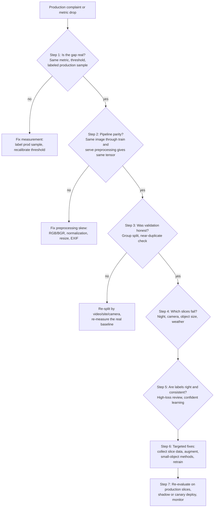
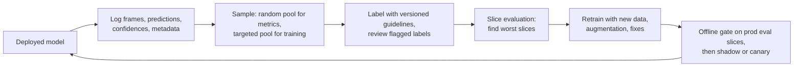
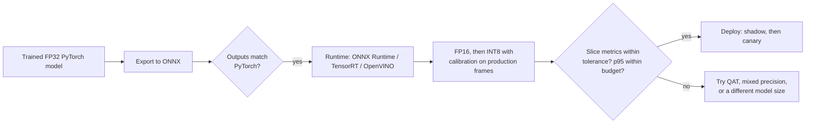
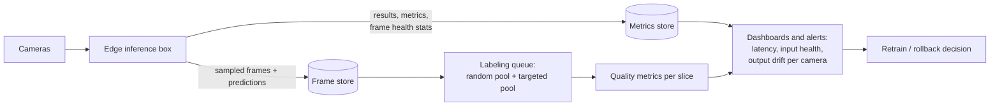

# Computer Vision in Production: Domain Shift, Debugging and Latency

> **Level:** Beginner to Advanced · **Study time:** ~100 min · **Prerequisites:** [Computer Vision Tasks](01-image-classification-detection-and-segmentation.md), [Object Detection in Depth](02-object-detection-yolo-faster-rcnn-and-map.md), [Data Augmentation and Transfer Learning](03-data-augmentation-transfer-learning-and-small-datasets.md), [Overfitting and Data Leakage](../01-classical-ml/03-overfitting-regularization-and-data-leakage.md)

## Table of contents

- [Why this matters](#why-this-matters)
- [The running example: a hard-hat detector that worked in the lab](#the-running-example-a-hard-hat-detector-that-worked-in-the-lab)
- [Why strong validation can mean poor production](#why-strong-validation-can-mean-poor-production)
- [The diagnosis checklist](#the-diagnosis-checklist)
- [Preprocessing mismatches (training-serving skew)](#preprocessing-mismatches-training-serving-skew)
- [Domain shift: lighting, camera, angle, resolution, compression, occlusion and weather](#domain-shift-lighting-camera-angle-resolution-compression-occlusion-and-weather)
- [Data leakage: near-duplicate frames and images](#data-leakage-near-duplicate-frames-and-images)
- [Annotation errors and drifting label definitions](#annotation-errors-and-drifting-label-definitions)
- [Collecting production samples and slice-based evaluation](#collecting-production-samples-and-slice-based-evaluation)
- [Improving small-object detection](#improving-small-object-detection)
- [Balancing accuracy against inference latency](#balancing-accuracy-against-inference-latency)
- [Monitoring vision models in production](#monitoring-vision-models-in-production)
- [Going deeper: senior-level practice](#going-deeper-senior-level-practice)
- [Common mistakes and misconceptions](#common-mistakes-and-misconceptions)
- [Interview questions and model answers](#interview-questions-and-model-answers)
- [Key takeaways](#key-takeaways)
- [Further reading](#further-reading)
- [Next](#next)

## Why this matters

Almost every team that ships a vision model hits the same wall: the model scored beautifully on the validation set, then disappointed in the real world. Cameras differ from the phones used to collect training data, night falls, lenses get dirty, a serving engineer loads images with OpenCV instead of PIL, and the "95% accurate" model quietly becomes a 70% model. Interviewers for senior AI/ML roles love this topic because it separates people who have trained models in notebooks from people who have kept them working for real users. This chapter gives you a systematic playbook: how to diagnose the gap, how to find bad labels and leaky splits, how to fix small-object detection, how to hit a latency budget without wrecking accuracy, and how to monitor the whole thing once it is live.

## The running example: a hard-hat detector that worked in the lab

We will use one story throughout the chapter.

A construction-safety company builds **SiteSafe**, an object detector that draws boxes around workers' heads and labels each one `helmet` or `no_helmet`. An alert fires when a worker without a helmet is seen.

- **Training data:** about 12,000 images (illustrative) collected by staff with phones at 3 construction sites, mostly in daytime. Many images are frames extracted from short phone videos.
- **Validation:** frames were shuffled and split randomly 80/20. Validation **mAP@0.5** was 0.91 (illustrative).
- **Production:** 40 fixed CCTV cameras at 6 *new* sites, mounted high on poles, streaming 1080p (1920x1080 pixel) H.264 video (a common lossy video compression format) to an **edge** GPU box: a small computer with a GPU installed on site, so frames are processed locally instead of in a data center. Each camera runs at 30 frames per second.

Quick reminders of two terms you met in the detection chapter:

- **IoU (Intersection over Union)** measures how much a predicted box overlaps a true box: the overlap area divided by the combined area. 1.0 means a perfect match, 0 means no overlap.
- **mAP@0.5 (mean Average Precision at IoU 0.5)** is the standard detection score: a prediction counts as correct if its IoU with a true box is at least 0.5, and precision-recall curves are summarized per class and averaged. See [Object Detection in Depth](02-object-detection-yolo-faster-rcnn-and-map.md) for the full derivation.

Three weeks after launch the complaints arrive:

1. Workers without helmets at night are missed.
2. Yellow buckets and traffic cones trigger `helmet` detections.
3. Workers far from the camera are rarely detected at all.
4. The edge box drops frames during busy shifts.

Each complaint maps to a section of this chapter. Let us first understand *why* a 0.91 validation score can lie.

## Why strong validation can mean poor production

### The i.i.d. assumption

> **Analogy:** You practice for a driving test only on sunny weekday mornings in your quiet neighborhood. You ace every practice run. Then the real test is at night, in rain, in a city you have never seen. Your practice score was honest about the practice conditions; it just said nothing about the test conditions.

A model's validation score is an estimate of how it performs on *data that looks like the validation set*. This rests on the **i.i.d. assumption** (independent and identically distributed): every example in training, validation and production is drawn independently from the same underlying **data distribution**, meaning the same "machine" that generates images and labels.

When that assumption breaks, we say there is **distribution shift** (in vision it is usually called **domain shift**): the production data comes from a different distribution than the data you trained and validated on. A **domain** here simply means "a setting that produces images with shared characteristics", such as "phone photos in daytime" versus "pole-mounted CCTV at night".

Precisely, the quantity we care about is the **expected risk** (average loss) on the production distribution:

$$R_{\text{prod}}(f) = \mathbb{E}_{(x, y) \sim P_{\text{prod}}}\big[\ell(f(x), y)\big]$$

- $f$ is the model and $f(x)$ its prediction for image $x$.
- $y$ is the true label.
- $\ell$ is a loss (or error indicator: 1 if wrong, 0 if right, which turns risk into error rate).
- $P_{\text{prod}}$ is the distribution of (image, label) pairs in production.
- $\mathbb{E}$ means "average over all examples drawn from that distribution".

Your validation set only estimates $R_{\text{val}}(f)$, the same average under $P_{\text{val}}$. If $P_{\text{val}} \neq P_{\text{prod}}$, nothing guarantees the two numbers are close.

### Three flavors of shift

Write the joint distribution as $P(x, y) = P(x)\,P(y \mid x)$, or equivalently $P(y)\,P(x \mid y)$. Each flavor of shift changes a different piece:

| Shift type | What changes | SiteSafe example | Typical symptom |
|---|---|---|---|
| **Covariate shift** | $P(x)$, the look of images, while the rule "what is a helmet" stays fixed | Night CCTV images instead of day phone photos | Accuracy drops on certain conditions |
| **Label shift (prior shift)** | $P(y)$, how common each class is, while $P(x \mid y)$ (what each class looks like) stays fixed | 50% `no_helmet` in the curated training set, 5% in reality | Precision collapses at the old threshold |
| **Concept shift** | $P(y \mid x)$, the meaning of a label | Company policy changes: bump caps now count as `no_helmet` | Model is "right" by old rules, wrong by new ones |

The general topic of drift (detecting it with statistics like PSI, the Population Stability Index, which scores how far a feature's histogram has moved; deciding when to retrain) is covered in [Data Drift, Concept Drift and When to Retrain](../01-classical-ml/08-data-drift-concept-drift-and-retraining.md). Here we focus on what is special about images.

### Worked example 1: the slice mixture changed

Suppose SiteSafe's per-image accuracy is 0.95 on day images and 0.60 on night images (illustrative). The *model is identical* in both settings; only the mix of conditions differs.

Overall accuracy is a weighted average of **slice** accuracies. A **slice** is a subset of data defined by some attribute (time of day, camera, object size):

$$\text{Acc} = \sum_{s} w_s \cdot \text{Acc}_s$$

- $s$ indexes slices (here: day, night).
- $w_s$ is the fraction of examples in slice $s$ (the weights sum to 1).
- $\text{Acc}_s$ is accuracy within slice $s$.

Validation set: 90% day, 10% night.

$$\text{Acc}_{\text{val}} = 0.9 \times 0.95 + 0.1 \times 0.60 = 0.855 + 0.060 = 0.915$$

Production: 50% day, 50% night (sites run night shifts).

$$\text{Acc}_{\text{prod}} = 0.5 \times 0.95 + 0.5 \times 0.60 = 0.475 + 0.300 = 0.775$$

Same model, 14 points worse. Nothing "broke". The validation set simply under-represented the hard slice. This is why slice-based evaluation (later in this chapter) is the core habit of production vision work.

### Worked example 2: label shift silently halves precision

**Precision** is the fraction of alerts that are real: $\text{TP} / (\text{TP} + \text{FP})$. **Recall** is the fraction of real cases caught: $\text{TP} / (\text{TP} + \text{FN})$. The **false positive rate (FPR)** is the fraction of negatives wrongly flagged. (Refresher: [Classification Metrics and Imbalanced Data](../01-classical-ml/04-classification-metrics-and-imbalanced-data.md).)

Take a `no_helmet` classifier with recall 0.9 and FPR 0.05 (illustrative). Consider 1,000 head crops.

Validation (balanced, 50% `no_helmet`):

- 500 positives: TP = 0.9 x 500 = 450.
- 500 negatives: FP = 0.05 x 500 = 25.
- Precision = 450 / (450 + 25) = 450 / 475 = 0.947.

Production (5% `no_helmet`):

- 50 positives: TP = 0.9 x 50 = 45.
- 950 negatives: FP = 0.05 x 950 = 47.5.
- Precision = 45 / (45 + 47.5) = 45 / 92.5 = 0.486.

The model's recall and FPR did not change at all, yet half the alerts are now false. Site managers start ignoring alerts. Lesson: precision depends on class prevalence, so thresholds tuned on a balanced validation set rarely suit production.

> **Interview tip:** When someone says "the model is worse in production", first ask "worse by which metric, measured how, on what data?" Many "model regressions" are label shift or a threshold problem, not a model problem.

## The diagnosis checklist

When validation and production disagree, go from *cheapest to check* to *most expensive to fix*. Bugs are cheaper to find than data problems, and data problems are cheaper to fix than architecture problems.



In words:

1. **Confirm the gap is real.** Get a random sample of production images, label them carefully, and compute the *same* metric with the *same* threshold. Complaint-driven examples are biased (you only hear about failures).
2. **Check pipeline parity.** Feed the same raw image through the training preprocessing and the serving preprocessing and compare the resulting tensors and outputs. Silent preprocessing bugs are the most common cause and the cheapest to fix.
3. **Check whether validation was honest.** Near-duplicate frames across train and validation inflate scores. Re-split by group and re-measure.
4. **Find failing slices.** Break production performance down by camera, time of day, weather, object size and so on.
5. **Audit labels.** Both in training data (teaches the wrong thing) and in your evaluation data (measures the wrong thing). Also check that label definitions are the same in both.
6. **Apply targeted fixes** for the worst slices: more data from those conditions, augmentation, architecture changes for small objects.
7. **Re-evaluate, deploy safely, and monitor.** "Safely" means **shadow mode** (the new model sees real traffic but its outputs are only logged) and then a **canary** (the new model serves a few cameras before everyone); both are covered in the monitoring section.

The next sections go through each step in detail.

## Preprocessing mismatches (training-serving skew)

> **Analogy:** You learn to recognize friends from color photos, then someone hands you photos printed with red and blue swapped. Your friends' faces are all there, but everything looks subtly alien and you start making mistakes.

**Training-serving skew** is any difference between how data is processed at training time and at serving time. The general MLOps view is in [Reproducible Training and Training-Serving Skew](../10-mlops/03-reproducibility-and-training-serving-skew.md). In vision, the classic culprits are below.

One term first. **Normalization** means rescaling pixel values so each channel has roughly zero mean and unit variance, which helps training. Most pretrained backbones expect the **ImageNet constants**: mean $(0.485, 0.456, 0.406)$ and standard deviation $(0.229, 0.224, 0.225)$ for the R, G, B channels, applied after dividing raw pixels by 255.

### The usual suspects

| Mismatch | What happens | Why it is sneaky |
|---|---|---|
| **RGB vs BGR channel order** | OpenCV's `cv2.imread` returns pixels in BGR order; PIL and most training pipelines use RGB | Model still outputs plausible predictions, just worse. Red helmets look blue to the model |
| **Normalization constants** | Training used ImageNet mean/std; serving used 0.5/0.5, or skipped dividing by 255, or normalized twice | Values off by a constant shift or huge scale; sometimes only a few points of accuracy lost, sometimes total garbage |
| **Resize method** | Stretch vs **letterbox** (resize keeping aspect ratio, pad the rest) vs center crop | Objects change shape or get cropped out; edge-of-frame workers vanish with a center crop |
| **Interpolation and antialiasing** | PIL's downscaling filters over a wider area (it antialiases); `cv2.resize` with `INTER_LINEAR` does not | Fine textures and small objects differ; small numeric difference, measurable accuracy difference |
| **EXIF orientation** | Phone photos store pixels in one orientation plus an **EXIF** metadata tag saying "rotate 90 degrees for display". `PIL.Image.open` ignores the tag unless you call `ImageOps.exif_transpose`; OpenCV's `imread` applies it by default (since OpenCV 3.1, unless you pass `IMREAD_IGNORE_ORIENTATION`), while video frames carry no EXIF at all | Training images may be sideways while serving images are upright, or vice versa |
| **Color space and decoding** | Video decoders output YUV (one brightness channel plus two color-difference channels); conversion to RGB uses a specific standard (BT.601 vs BT.709) and range | Slight color cast on every frame |
| **Grayscale / infrared input** | Many CCTV cameras switch to infrared (IR) black-and-white mode at night | A 3-channel color model sees 3 identical channels it never trained on |
| **Data type and layout** | `uint8` vs `float32`, HWC (height, width, channels) vs CHW | Usually crashes, but a wrong transpose of a square image does not |
| **Model mode** | Forgetting `model.eval()` keeps dropout active and makes **batch normalization** layers (which rescale activations) use the current batch's statistics instead of the running averages stored during training | Predictions vary with batch content; batch size 1 at serving behaves very differently |
| **Compression** | Training on high-quality JPEGs, serving on low-bitrate video frames | Blocky artifacts the model has never seen (this is also domain shift) |

### Worked example: what normalization bugs do to one pixel

The formula for one channel value:

$$x_{\text{norm}} = \frac{x / 255 - \mu_c}{\sigma_c}$$

- $x$ is the raw 8-bit pixel value (0 to 255).
- $\mu_c$ and $\sigma_c$ are the mean and standard deviation for channel $c$.
- $x_{\text{norm}}$ is what the network actually sees.

A red-channel pixel with $x = 200$, using $\mu_R = 0.485$, $\sigma_R = 0.229$:

- Correct: $200 / 255 = 0.7843$; $0.7843 - 0.485 = 0.2993$; $0.2993 / 0.229 = 1.307$.
- Forgot to divide by 255: $(200 - 0.485) / 0.229 = 199.515 / 0.229 = 871.2$. The network sees values hundreds of times larger than anything in training. Predictions become garbage.
- Used BGR order, so this red value is normalized with the *blue* constants ($\mu_B = 0.406$, $\sigma_B = 0.225$): $(0.7843 - 0.406) / 0.225 = 0.3783 / 0.225 = 1.681$. A plausible-looking number, which is exactly why this bug survives: no crash, just quietly worse accuracy.

### Code: a preprocessing parity test

The single best defense is a **parity test** (also called a golden-image test): run the same raw files through both pipelines and assert the tensors match.

```python
# pip install numpy pillow opencv-python
import numpy as np
import cv2
from PIL import Image, ImageOps

MEAN = np.array([0.485, 0.456, 0.406], dtype=np.float32)
STD = np.array([0.229, 0.224, 0.225], dtype=np.float32)

def preprocess_train(path: str, size: int = 224) -> np.ndarray:
    """What the training pipeline did: PIL, EXIF-aware, RGB, bilinear resize."""
    img = Image.open(path)
    img = ImageOps.exif_transpose(img).convert("RGB")       # apply EXIF rotation
    img = img.resize((size, size), Image.Resampling.BILINEAR)
    x = np.asarray(img, dtype=np.float32) / 255.0             # HWC, RGB, in [0, 1]
    x = (x - MEAN) / STD
    return x.transpose(2, 0, 1)                               # CHW

def preprocess_serving_buggy(path: str, size: int = 224) -> np.ndarray:
    """A typical hand-written serving path with a silent channel-order bug."""
    img = cv2.imread(path)                                    # BGR, not RGB!
    img = cv2.resize(img, (size, size), interpolation=cv2.INTER_LINEAR)
    x = img.astype(np.float32) / 255.0
    x = (x - MEAN) / STD                                      # RGB constants on BGR data
    return x.transpose(2, 0, 1)

def preprocess_serving_fixed(path: str, size: int = 224) -> np.ndarray:
    img = cv2.imread(path)
    img = cv2.cvtColor(img, cv2.COLOR_BGR2RGB)                # fix channel order
    img = cv2.resize(img, (size, size), interpolation=cv2.INTER_AREA)  # closer to PIL when shrinking
    x = img.astype(np.float32) / 255.0
    x = (x - MEAN) / STD
    return x.transpose(2, 0, 1)

def parity_report(a: np.ndarray, b: np.ndarray, name: str) -> None:
    diff = np.abs(a - b)
    print(f"{name}: max abs diff {diff.max():.4f}, mean abs diff {diff.mean():.4f}")

if __name__ == "__main__":
    path = "sample.jpg"  # use a handful of real production images, including phone photos
    ref = preprocess_train(path)
    parity_report(ref, preprocess_serving_buggy(path), "buggy")
    parity_report(ref, preprocess_serving_fixed(path), "fixed")
    # Expect a large difference for "buggy" and a much smaller one for "fixed".
    # A small residual remains because PIL and OpenCV resize differently.
    # Decide on a tolerance, then also compare final model outputs, not just tensors.
```

> **Senior insight:** The robust fix is structural, not a patch. Put preprocessing in *one* shared, versioned function used by both training and serving, or bake it into the exported model graph (resize and normalize as the first layers), so there is nothing to keep in sync. Then add the parity test to CI with a few real production images, including rotated phone photos and IR night frames.

## Domain shift: lighting, camera, angle, resolution, compression, occlusion and weather

Once the pipeline is verified, the remaining gap is usually genuine domain shift. To reason about it, you need one fact about how CNNs see.

### How a CNN "sees", in one paragraph

A **convolutional neural network (CNN)** builds its decision from layers of local pattern detectors: early layers respond to edges and color blobs, middle layers to textures and parts, later layers to whole objects (refresher: [Convolutional Neural Networks and Transfer Learning](../02-deep-learning/07-cnns-and-transfer-learning.md)). Networks learn whatever cues are *most predictive in the training data*, and those are often low-level: texture, color, typical background. Geirhos et al. (2019, "ImageNet-trained CNNs are biased towards texture; increasing shape bias improves accuracy and robustness") showed that standard ImageNet CNNs lean heavily on texture rather than shape. When lighting, blur or compression changes those low-level statistics, the cues the model relies on change too, even when a human sees "the same thing".

Two more landmark results set expectations:

- Hendrycks and Dietterich (2019, "Benchmarking Neural Network Robustness to Common Corruptions and Perturbations") built ImageNet-C, applying noise, blur, weather, and digital corruptions at several severities, and showed accuracy degrades substantially under such corruptions.
- Recht et al. (2019, "Do ImageNet Classifiers Generalize to ImageNet?") rebuilt an ImageNet test set following the original process and found consistent accuracy drops. Even a careful re-collection is a small distribution shift.

### Factor by factor

| Factor | What changes in the pixels | Effect on predictions | How to detect | How to mitigate |
|---|---|---|---|---|
| **Lighting** (night, glare, backlight, shadows) | Lower brightness and contrast, more sensor **noise** (random pixel speckle), color shifts, IR grayscale | Colors stop being reliable (a yellow helmet looks gray), missed detections, low confidence or confident mistakes | Brightness/contrast histograms per camera; slice metrics by hour | Collect night data; brightness, contrast and noise augmentation; grayscale augmentation if cameras switch to IR; better camera settings or lighting |
| **Camera and sensor** | Different color response, white balance, lens distortion, sharpening, noise patterns | Subtle global shift; often hits fine-grained classes | Embedding drift per camera model; a **domain classifier** (below) | Include every camera model in training data; color jitter; per-camera fine-tuning in extreme cases |
| **Viewpoint / angle** | Top-down instead of eye-level; heads seen from above look like circles, faces hidden | Shape and part cues the model learned are absent | Slice by camera mounting height or angle | Collect data from the deployed mounting positions; rotation and perspective augmentation help only partially |
| **Resolution and distance** | Objects cover fewer pixels | Small objects vanish after resizing (see small-object section) | Box-size distribution of detections vs training | Higher input resolution, tiling, cascades |
| **Compression** (JPEG, H.264/H.265 video at low bitrate) | Blocky 8x8 artifacts, smeared fine detail, color bleeding, worse in motion | Textures destroyed; small objects and fine classes hurt most | Bitrate metadata; artifact metrics; compare stored frames to training images | Train on frames decoded from the actual streams; JPEG-quality augmentation; raise bitrate if bandwidth allows |
| **Occlusion** | Part of the object hidden by scaffolding, other workers, machinery | Partial objects missed or misclassified; boxes may shrink to the visible part | Label an `occluded` attribute; slice by it | Occlusion augmentation (random erasing, cutout, copy-paste); clear labeling rules for partial objects |
| **Weather** (rain, fog, snow, dust) | Lower contrast, streaks, droplets on the lens, haze | Lower recall; false positives from rain streaks | Weather metadata from an API; contrast and blur stats | Weather data collection; fog and rain augmentation (realism matters); lens maintenance |
| **Motion blur** | Smearing along movement direction from slow shutter at night | Edges and textures destroyed | Blur score (variance of Laplacian, below) | Faster shutter; blur augmentation |
| **Background and context** | New sites, new equipment, new uniforms | **Spurious correlations** break (the model learned "yellow round thing = helmet") | Error analysis of false positives | Hard negative mining: add buckets, cones and yellow hats as negatives |

A **spurious correlation** is a pattern that happens to predict the label in training data but is not causally related to it. SiteSafe's yellow-bucket false positives are a textbook case: every helmet in training was yellow and round, so "yellow and round" became the rule.

### Confidence does not save you

You might hope the model at least says "I'm unsure" on unfamiliar images. Often it does not. Ovadia et al. (2019, "Can You Trust Your Model's Uncertainty? Evaluating Predictive Uncertainty Under Dataset Shift") found that model **calibration** (whether a 90% confidence really means 90% correct) degrades as shift increases. So a confident prediction on a night frame is weaker evidence than the same confidence on a day frame. Never use raw confidence alone as your "is this in-distribution" detector (in-distribution means "resembles the training data"; the opposite is **out-of-distribution**, OOD).

How calibration is measured: group predictions into confidence bins and compare each bin's average confidence with its actual accuracy. A **reliability diagram** plots the two; **expected calibration error (ECE)** summarizes the gap:

$$\text{ECE} = \sum_{b} \frac{n_b}{n}\,\big|\text{acc}_b - \text{conf}_b\big|$$

where $n_b$ is the number of predictions in bin $b$ and $n$ the total. Example: 600 night predictions with average confidence 0.90 are 85% correct (gap 0.05), and 400 with average confidence 0.60 are 50% correct (gap 0.10). ECE $= 0.6 \times 0.05 + 0.4 \times 0.10 = 0.03 + 0.04 = 0.07$: confidences overstate accuracy by 7 points on average.

### Code: a corruption stress test

Before deployment, measure how fast your model degrades under controlled corruptions. This tells you which shifts you are fragile to, before production tells you.

```python
# pip install pillow numpy
import io
from PIL import Image, ImageEnhance, ImageFilter

def corrupt(img: Image.Image, kind: str, level: float) -> Image.Image:
    """Apply one synthetic corruption at a given strength."""
    if kind == "dark":                       # level < 1 darkens, e.g. 0.3
        return ImageEnhance.Brightness(img).enhance(level)
    if kind == "blur":                       # level = blur radius in pixels
        return img.filter(ImageFilter.GaussianBlur(radius=level))
    if kind == "jpeg":                       # level = JPEG quality, 1 to 95
        buf = io.BytesIO()
        img.save(buf, format="JPEG", quality=int(level))
        buf.seek(0)
        return Image.open(buf).convert("RGB")
    if kind == "lowres":                     # level = downscale factor, e.g. 0.25
        w, h = img.size
        small = img.resize((max(1, int(w * level)), max(1, int(h * level))),
                           Image.Resampling.BILINEAR)
        return small.resize((w, h), Image.Resampling.BILINEAR)
    if kind == "occlude":                    # level = fraction of width/height covered
        out = img.copy()
        w, h = out.size
        bw, bh = max(1, int(w * level)), max(1, int(h * level))
        out.paste(Image.new("RGB", (bw, bh), (128, 128, 128)),
                  ((w - bw) // 2, (h - bh) // 2))
        return out
    raise ValueError(f"unknown corruption {kind}")

def stress_test(images, labels, predict_fn, settings):
    """Accuracy for every (corruption, level). predict_fn maps a PIL image to a class id."""
    results = {}
    for kind, levels in settings.items():
        for level in levels:
            preds = [predict_fn(corrupt(im, kind, level)) for im in images]
            results[(kind, level)] = sum(p == y for p, y in zip(preds, labels)) / len(labels)
    return results

settings = {"dark": [0.7, 0.4, 0.2], "blur": [1, 2, 4], "jpeg": [50, 20, 10],
            "lowres": [0.5, 0.25], "occlude": [0.2, 0.4]}
# results = stress_test(val_images, val_labels, my_predict, settings)
# Plot accuracy vs severity per corruption: the steepest curves are your weak spots.
```

> **Common mistake:** Treating synthetic corruptions as a substitute for real production data. They are a cheap early warning. Real night CCTV frames have noise, IR mode, motion blur and compression *together*, which no single synthetic corruption reproduces.

### Measuring whether two domains differ: the domain classifier

A neat trick: train a simple classifier to tell "training images" from "production images", using features from a pretrained backbone. If it cannot do better than chance, the domains look alike to the model's feature space. If it separates them easily, there is real shift, and the images it is most confident about are the most "foreign" ones, which are great candidates to label.

```python
# pip install scikit-learn numpy
import numpy as np
from sklearn.linear_model import LogisticRegression
from sklearn.model_selection import cross_val_score

def domain_shift_auc(emb_ref: np.ndarray, emb_prod: np.ndarray) -> float:
    """emb_*: [n, d] image embeddings from a frozen backbone (e.g. penultimate layer)."""
    X = np.vstack([emb_ref, emb_prod])
    y = np.concatenate([np.zeros(len(emb_ref)), np.ones(len(emb_prod))])
    clf = LogisticRegression(max_iter=1000)
    return cross_val_score(clf, X, y, cv=5, scoring="roc_auc").mean()

# AUC near 0.5: hard to tell apart (little shift in this feature space).
# AUC near 1.0: easily separable (strong shift); inspect the most separable images.
```

**AUC** (area under the ROC curve) is 0.5 for random guessing and 1.0 for perfect separation. Run it per camera to find the cameras that differ most from your training data.

## Data leakage: near-duplicate frames and images

> **Analogy:** A teacher writes the exam by copying homework questions and changing one number. Every student "aces" it, and the teacher concludes the class is brilliant.

**Data leakage** is when information from the evaluation data sneaks into training, making scores optimistic (general treatment: [Overfitting, Bias-Variance, Regularization and Data Leakage](../01-classical-ml/03-overfitting-regularization-and-data-leakage.md)). In vision the most common form is **near-duplicate leakage**: train and validation contain images that are almost identical.

### Where near-duplicates come from

- **Consecutive video frames.** At 30 FPS, frame 1,000 and frame 1,001 are nearly the same picture. A random frame-level split puts one in training and one in validation, so validation measures memorization. This is almost certainly part of SiteSafe's 0.91.
- **Burst photos and re-shoots** of the same scene.
- **Augmented copies** saved to disk before splitting.
- **Web-scraped datasets** with the same image at different sizes or crops.
- **Same entity across splits:** the same patient (medical imaging), the same product unit, the same site and camera.

### The fix: group splits

Split by **group**, the unit that shares information: video, camera, site, day, patient. Everything from one group goes entirely to train *or* to validation. For production realism, the strongest validation is a held-out *site* (or camera), because that is exactly what deployment looks like: new places the model never saw.

```python
# pip install scikit-learn pandas
import pandas as pd
from sklearn.model_selection import GroupShuffleSplit

df = pd.DataFrame({
    "path":     [f"img_{i}.jpg" for i in range(10)],
    "video_id": ["v1", "v1", "v1", "v2", "v2", "v3", "v3", "v4", "v4", "v5"],
    "site":     ["A",  "A",  "A",  "A",  "B",  "B",  "B",  "C",  "C",  "C"],
})

# Split by video so no video contributes frames to both sides.
gss = GroupShuffleSplit(n_splits=1, test_size=0.2, random_state=0)
train_idx, val_idx = next(gss.split(df, groups=df["video_id"]))
assert set(df.loc[train_idx, "video_id"]).isdisjoint(df.loc[val_idx, "video_id"])

# Stricter and closer to deployment: hold out an entire site.
val_mask = df["site"] == "C"
train_df, val_df = df[~val_mask], df[val_mask]
```

The tell-tale symptom: a large gap between the random-split score and the group-split score. If SiteSafe gets 0.91 mAP with a random frame split but 0.74 with a held-out-site split (illustrative), then 0.74 was always the honest estimate for new sites.

### Finding near-duplicates: perceptual hashing

Even with group splits, duplicates can hide across groups (the same scene filmed twice, a scraped image appearing in two sources). You find them with **perceptual hashes**: short fingerprints that stay the same when an image is resized or slightly recompressed, unlike cryptographic hashes such as MD5 which change completely if one byte changes.

**Average hash (aHash)**, the simplest:

1. Shrink the image to a tiny grayscale grid (commonly 8x8).
2. Compute the mean pixel value.
3. Each pixel becomes a bit: 1 if above the mean, else 0.

Two images are compared with the **Hamming distance**: the number of bit positions that differ. Small distance means near-duplicate.

Tiny worked example with a 2x2 grid (4 pixels, read left to right, top to bottom):

- Image A: pixels $[10, 200, 30, 180]$. Mean $= (10 + 200 + 30 + 180) / 4 = 420 / 4 = 105$. Bits: $10 > 105$? no, 0; $200$? yes, 1; $30$? 0; $180$? 1. Hash = `0101`.
- Image B (A slightly recompressed): $[12, 198, 35, 170]$. Mean $= 415 / 4 = 103.75$. Bits: 0, 1, 0, 1. Hash = `0101`.
- Image C (a different scene): $[200, 10, 180, 30]$. Mean $= 105$. Bits: 1, 0, 1, 0. Hash = `1010`.

Hamming(A, B) = 0, so near-duplicates. Hamming(A, C) = 4 (every bit differs), so different images.

**Difference hash (dHash)** compares each pixel to its right neighbor instead of the mean, which is more robust to global brightness changes. Here it is from scratch:

```python
# pip install pillow numpy
import numpy as np
from PIL import Image

def dhash(path: str, hash_size: int = 8) -> int:
    """64-bit difference hash: is each pixel brighter than its left neighbor?"""
    img = Image.open(path).convert("L").resize((hash_size + 1, hash_size),
                                               Image.Resampling.BILINEAR)
    px = np.asarray(img, dtype=np.int16)
    bits = (px[:, 1:] > px[:, :-1]).flatten()       # hash_size * hash_size booleans
    return int("".join("1" if b else "0" for b in bits), 2)

def hamming(a: int, b: int) -> int:
    return bin(a ^ b).count("1")                      # XOR, then count differing bits

# Rule of thumb (tune on your data): distance <= 5 out of 64 bits is a likely near-duplicate.
# The ImageHash package (pip install ImageHash) provides aHash, dHash, pHash ready-made.
```

Hashes catch *pixel-level* near-duplicates. For *semantic* near-duplicates (same scene, slightly different viewpoint), use **embeddings**: vectors from a pretrained network where similar images have nearby vectors, compared with **cosine similarity** (1 means same direction, 0 unrelated). For millions of images, an approximate nearest-neighbor library such as FAISS makes this fast (the algorithms are covered in [Vector Search Algorithms](../08-rag/06-vector-search-ann-hnsw-ivf-and-product-quantization.md)).

```python
# pip install faiss-cpu numpy
import numpy as np
import faiss

def cross_split_duplicates(emb_train: np.ndarray, emb_val: np.ndarray, thr: float = 0.95):
    """Return (val_index, train_index, similarity) pairs above a cosine threshold."""
    tr = emb_train.astype("float32").copy()
    va = emb_val.astype("float32").copy()
    faiss.normalize_L2(tr)                             # after this, inner product = cosine
    faiss.normalize_L2(va)
    index = faiss.IndexFlatIP(tr.shape[1])             # exact search; fine up to ~1M vectors
    index.add(tr)
    sims, ids = index.search(va, 1)                    # nearest training image for each val image
    return [(i, int(ids[i, 0]), float(sims[i, 0]))
            for i in range(len(va)) if sims[i, 0] >= thr]
```

Then *look* at the flagged pairs (a tool such as FiftyOne makes browsing them easy), decide a threshold, and remove or regroup duplicates before re-measuring.

> **Senior insight:** Deduplicate the *test set against everything else*, including pretraining data if you can. And deduplicate the training set internally too: thousands of near-identical frames waste compute and over-weight static scenes. Sampling one frame every second or two, or keeping a frame only when the scene changed enough, is often better than keeping all 30 per second.

## Annotation errors and drifting label definitions

> **Analogy:** If an answer key has mistakes, a student who memorizes it learns the mistakes, and grading the exam with that key gives wrong grades. Bad labels hurt twice: in training (wrong lessons) and in evaluation (wrong grades).

### Types of annotation errors in vision

| Error | Example in SiteSafe | Effect |
|---|---|---|
| **Wrong class** | A bare-headed worker labeled `helmet` | Model learns contradictory rules; eval counts correct predictions as wrong |
| **Missing box** | A distant worker never annotated | Model is punished for correctly detecting them, so it learns to ignore small heads |
| **Loose or shifted box** | Box includes half the shoulders | Localization noise; hurts strict IoU metrics like mAP@0.5:0.95 (mAP averaged over IoU thresholds 0.50, 0.55, ..., 0.95) |
| **Duplicate box** | Two boxes on one head | Teaches the model to fire twice |
| **Inconsistent rules** | One annotator boxes partially hidden heads, another skips them | Model gets mixed signals; slices look noisy |
| **Ambiguous images** | Hood over a helmet, extreme blur | No "true" label exists; should be marked `ignore` rather than forced |

Label errors are not rare even in famous datasets. Northcutt, Athalye and Mueller (2021, "Pervasive Label Errors in Test Sets Destabilize Machine Learning Benchmarks") found label errors in the test sets of widely used benchmarks such as ImageNet, enough in some cases to change which model ranks best.

### Method 1: review high-loss samples

The **loss** for an example measures how wrong the model is about it (for classification, the cross-entropy loss is $-\log p_{\text{label}}$, where $p_{\text{label}}$ is the probability the model gives the labeled class; see [Loss Functions](../02-deep-learning/04-loss-functions.md)). Sorting examples by loss and looking at the top few hundred surfaces two kinds of things: genuinely hard examples and mislabeled ones. A human reviewer decides which is which.

Example: if the model gives the labeled class probability 0.02, the loss is $-\ln(0.02) = 3.91$. For a confidently correct example with probability 0.95, the loss is $-\ln(0.95) = 0.051$. The first is about 76 times larger and floats straight to the top of the list.

The catch: a big network can *memorize* its training labels, including wrong ones, driving their loss to near zero. So compute losses using **out-of-fold predictions**: split data into K folds, train K models, and predict each example with the model that did *not* train on it (this is K-fold cross-validation, see [The ML Workflow and Cross-Validation](../01-classical-ml/01-ml-workflow-data-splits-and-cross-validation.md)). A cheap version: extract frozen backbone embeddings once and train a small logistic regression with cross-validation on top.

### Method 2: disagreement

- **Annotator disagreement:** have 2 or 3 people label a subset. Where they disagree, either the label rules are unclear or the image is genuinely ambiguous. Measure agreement (for boxes, the IoU between annotators; for classes, the agreement rate or Cohen's kappa, defined below) to quantify how consistent your labels can possibly be. This also sets a realistic ceiling for model accuracy.
- **Model vs label disagreement:** a confident prediction that contradicts the label is a strong flag.
- **Ensemble disagreement:** several models (different seeds or architectures) disagreeing with each other points to ambiguous or mislabeled examples.

**Cohen's kappa** corrects raw agreement for the agreement two annotators would reach by chance: $\kappa = (p_o - p_e) / (1 - p_e)$, where $p_o$ is the observed agreement rate and $p_e$ the chance agreement implied by each annotator's class frequencies. 1 means perfect agreement, 0 means chance level. Why it matters with imbalanced classes: if both annotators label 95% of heads `helmet`, then $p_e = 0.95^2 + 0.05^2 = 0.905$, so an impressive-sounding $p_o = 0.92$ gives only $\kappa = 0.015 / 0.095 \approx 0.16$. They mostly agree on the easy majority class and barely agree on the rare `no_helmet` class that actually matters.

### Method 3: confident learning (the idea behind cleanlab)

**Confident learning** (Northcutt, Jiang and Chuang, 2021, "Confident Learning: Estimating Uncertainty in Dataset Labels") makes model-vs-label disagreement principled. The key idea: models are not equally confident about every class, so use a **per-class threshold** instead of one global cutoff.

For each class $j$, the threshold is the model's average confidence in class $j$ among examples labeled $j$:

$$t_j = \frac{1}{|X_{\tilde{y}=j}|} \sum_{x \in X_{\tilde{y}=j}} \hat{p}(j \mid x)$$

- $\tilde{y}$ is the given (possibly noisy) label.
- $X_{\tilde{y}=j}$ is the set of examples labeled $j$, and $|X_{\tilde{y}=j}|$ is how many there are.
- $\hat{p}(j \mid x)$ is the out-of-fold predicted probability of class $j$ for example $x$.
- $t_j$ is "how confident the model typically is in class $j$ when the label says $j$".

An example labeled $i$ is flagged as a likely label error if, among the classes whose predicted probability reaches that class's threshold, the most probable one is some class $j \neq i$. Counting these (given label, likely true label) pairs gives the **confident joint**, a matrix whose off-diagonal entries estimate how many labels of each kind are wrong.

**Worked example.** Six head crops, two classes: 0 = `helmet`, 1 = `no_helmet`. Out-of-fold probabilities shown as $(\hat{p}(0), \hat{p}(1))$:

| # | Given label | $\hat{p}$(helmet) | $\hat{p}$(no_helmet) |
|---|---|---|---|
| 1 | helmet | 0.9 | 0.1 |
| 2 | helmet | 0.8 | 0.2 |
| 3 | helmet | 0.1 | 0.9 |
| 4 | no_helmet | 0.3 | 0.7 |
| 5 | no_helmet | 0.1 | 0.9 |
| 6 | no_helmet | 0.2 | 0.8 |

Step 1, thresholds:

- $t_{\text{helmet}}$ = mean of $\hat{p}(\text{helmet})$ over examples 1 to 3 = $(0.9 + 0.8 + 0.1) / 3 = 1.8 / 3 = 0.6$.
- $t_{\text{no\_helmet}}$ = mean of $\hat{p}(\text{no\_helmet})$ over examples 4 to 6 = $(0.7 + 0.9 + 0.8) / 3 = 2.4 / 3 = 0.8$.

Step 2, check each example:

- #1: $0.9 \geq 0.6$ yes; $0.1 \geq 0.8$ no. Likely class = helmet = given. OK.
- #2: $0.8 \geq 0.6$ yes; $0.2 \geq 0.8$ no. OK.
- #3: $0.1 \geq 0.6$ no; $0.9 \geq 0.8$ yes. Likely class = no_helmet, but given helmet. **Flagged.**
- #4: $0.3 \geq 0.6$ no; $0.7 \geq 0.8$ no. No confident class, so not flagged (uncertain, not contradicting).
- #5: $0.9 \geq 0.8$ for no_helmet. OK.
- #6: $0.8 \geq 0.8$ yes (reaching the threshold exactly counts). Likely class = no_helmet = given. OK.

Example 3 goes to a human reviewer. Notice #4 is *not* flagged even though the model leans toward the label weakly: confident learning flags confident contradictions, not mere uncertainty.

```python
# pip install numpy
import numpy as np

def find_label_issues_simple(labels: np.ndarray, pred_probs: np.ndarray):
    """Minimal confident-learning flagging. pred_probs must be out-of-fold."""
    n, k = pred_probs.shape
    thresholds = np.array([pred_probs[labels == j, j].mean() for j in range(k)])
    issues = np.zeros(n, dtype=bool)
    for i in range(n):
        confident = np.where(pred_probs[i] >= thresholds)[0]   # classes above their threshold
        if len(confident) == 0:
            continue                                            # model unsure: not flagged
        likely = confident[np.argmax(pred_probs[i, confident])]
        issues[i] = likely != labels[i]
    return thresholds, issues

labels = np.array([0, 0, 0, 1, 1, 1])
pred_probs = np.array([[0.9, 0.1], [0.8, 0.2], [0.1, 0.9],
                       [0.3, 0.7], [0.1, 0.9], [0.2, 0.8]])
thresholds, issues = find_label_issues_simple(labels, pred_probs)
print(thresholds.round(2))   # [0.6 0.8]
print(np.where(issues)[0])   # [2]  (example #3, zero-indexed)
# Note: in floating point the second threshold is 0.8000000000000002, so example #6 lands
# just below it here. That does not change the result: #6 is not flagged either way.
```

The production library version (cleanlab 2.x API; check the docs for your version):

```python
# pip install cleanlab scikit-learn
from cleanlab.filter import find_label_issues
from sklearn.linear_model import LogisticRegression
from sklearn.model_selection import cross_val_predict

# emb: [n, d] frozen-backbone embeddings of each crop, labels: [n] integer labels
pred_probs = cross_val_predict(LogisticRegression(max_iter=1000), emb, labels,
                               cv=5, method="predict_proba")       # out-of-fold
ranked = find_label_issues(labels, pred_probs,
                           return_indices_ranked_by="self_confidence")
# 'ranked' lists suspected label errors, most suspicious first: send them to review.
```

cleanlab also has modules for object detection and segmentation labels; their APIs have changed across versions, so follow the current documentation.

### Detection-specific label audit

For boxes, compare model predictions with annotations using IoU:

- **High-confidence prediction with no matching label** (IoU below 0.5 with every label): possibly a *missing annotation*.
- **Label with no nearby prediction at all:** possibly a spurious label, or a genuine model miss worth studying.
- **Matched, but IoU between 0.5 and about 0.75:** possibly a *loose box*.

```python
# pip install torch torchvision
import torch
from torchvision.ops import box_iou

def audit_image(pred_boxes, pred_scores, gt_boxes,
                conf=0.8, iou_match=0.5, iou_tight=0.75):
    """Boxes are [N, 4] tensors in (x1, y1, x2, y2). Returns suspicious items to review.
    For brevity this ignores class labels; in practice audit per class."""
    flags = []
    P, G = len(pred_boxes), len(gt_boxes)
    iou = box_iou(pred_boxes, gt_boxes) if P and G else torch.zeros((P, G))
    for p in range(P):
        best = iou[p].max().item() if G else 0.0
        if pred_scores[p] >= conf and best < iou_match:
            flags.append(("possible_missing_label", p))
        elif pred_scores[p] >= conf and best < iou_tight:
            flags.append(("possible_loose_box", p))
    for g in range(G):
        best = iou[:, g].max().item() if P else 0.0
        if best < 0.1:
            flags.append(("label_without_prediction", g))
    return flags
```

> **Common mistake:** Automatically "fixing" labels the tool flags. Flagged items are *candidates*. Many are hard but correct examples, and deleting them removes exactly the data the model most needs. Always route to human review, then measure the effect of fixes on a clean evaluation set.

### Label definitions drifting

Sometimes every individual label is "correct" by the rules at the time, but the rules changed. This is concept shift created by your own labeling process.

How it happens:

- Guidelines were updated ("bump caps no longer count as helmets") but old labels were not.
- A new labeling vendor or a new batch of annotators interprets edge cases differently.
- The taxonomy grew (a new `hard_hat_with_face_shield` class) and older data has those objects under the old class.
- The business definition differs from what was labeled ("helmet must be worn, not held in hand").

How to detect it:

- Track label statistics **per annotation batch, vendor and guideline version**: class ratios, boxes per image, box size distribution. A step change at a batch boundary is a red flag.
- Keep a small **gold set** labeled by experts and re-labeled by every new annotator or vendor; measure agreement.
- Train a model only on old batches and evaluate on new batches (and vice versa); a sudden drop on a batch suggests a rule change.

How to prevent it: versioned labeling guidelines with visual examples of edge cases, an explicit `ignore` / `ambiguous` label, a label version field stored with every annotation, and re-labeling (or excluding) old data when rules change. Dataset versioning tools are covered in [Data Versioning, Model Versioning and the Model Registry](../10-mlops/02-data-and-model-versioning-and-model-registry.md).

## Collecting production samples and slice-based evaluation

The single most valuable asset for a production vision team is a **production evaluation set**: labeled images sampled from the real deployed cameras. Everything else is a proxy.

### How to sample (and why it matters)

| Sampling strategy | What it is | Good for | Danger |
|---|---|---|---|
| **Random sampling** | Pick frames uniformly at random across cameras and time | Unbiased estimate of real performance | Rare events (actual `no_helmet`) barely appear |
| **Stratified sampling** | Random within strata (each camera, each hour band) with fixed quotas | Guarantees coverage of every slice | Must reweight to report overall metrics |
| **Uncertainty sampling** (a form of **active learning**: letting the model pick which unlabeled examples are most worth labeling) | Pick frames where the model is least confident | Finding useful *training* data efficiently | Heavily biased: never use alone to estimate accuracy |
| **Error-driven sampling** | User complaints, operator rejections, alerts dismissed | Finding failure modes | Only shows failures; precision looks terrible |
| **Diversity sampling** | Pick frames far apart in embedding space, or from embedding clusters underrepresented in training | Covering new conditions | Can over-weight weird outliers |

> **Senior insight:** Keep two separate pools. A *measurement* pool (random or stratified with known weights) that you never train on and use to report metrics. And a *training* pool (uncertainty, error-driven, diversity) that you use to improve the model. Mixing them makes your metrics drift for reasons unrelated to the model.

Practical concerns:

- **Privacy:** CCTV frames contain people. Agree on retention periods, access controls, consent and legal basis (for example under GDPR in Europe), and consider blurring faces when faces are not needed for the task.
- **Storage:** you cannot keep all video. Store a sampled subset of frames plus metadata (camera id, timestamp, model version, predictions, confidences).
- **Temporal decorrelation:** sample frames spaced apart in time, otherwise 50 "samples" are one scene.

### Slice-based evaluation

Report metrics per slice, not just overall. Slices can come from:

- **Metadata:** camera id, site, camera model, mounting height, time of day, weather.
- **Derived image attributes:** brightness bins, blur score bins, IR mode flag.
- **Object attributes:** box size (small, medium, large), occlusion level, class.
- **Embedding clusters:** cluster production embeddings (see [Unsupervised Learning](../01-classical-ml/10-unsupervised-learning-clustering-and-dimensionality-reduction.md)) and evaluate per cluster to discover slices you did not think to define.

### Small slices are noisy: confidence intervals

A slice with 50 images gives a shaky number. For an accuracy (a proportion) $\hat{p}$ measured on $n$ examples, the standard error is:

$$\text{SE} = \sqrt{\frac{\hat{p}(1 - \hat{p})}{n}}$$

and an approximate 95% confidence interval is $\hat{p} \pm 1.96 \times \text{SE}$.

- $\hat{p}$ is the measured accuracy on the slice.
- $n$ is the number of examples in the slice.
- 1.96 is the multiplier that covers 95% of a normal distribution.

Worked example: night slice, $n = 50$, $\hat{p} = 0.60$.

- $\hat{p}(1 - \hat{p}) = 0.6 \times 0.4 = 0.24$.
- $0.24 / 50 = 0.0048$.
- $\text{SE} = \sqrt{0.0048} = 0.0693$.
- $1.96 \times 0.0693 = 0.136$.
- Interval: $0.60 \pm 0.136$, so roughly $[0.464, 0.736]$.

That interval is 27 points wide. Before declaring "the new model improved night accuracy by 5 points", make sure your slices are large enough to see a 5-point change. (This simple "Wald" interval is unreliable for small $n$ or accuracies near 0 or 1; the Wilson interval is a better default there. See [Probability and Statistics](../00-foundations/04-probability-and-statistics.md).)

```python
# pip install pandas numpy
import numpy as np
import pandas as pd

def slice_report(df: pd.DataFrame, slice_col: str, metric_col: str = "correct") -> pd.DataFrame:
    """df has one row per evaluated example, a 0/1 metric column and slice columns."""
    g = df.groupby(slice_col)[metric_col].agg(["mean", "count"])
    se = np.sqrt(g["mean"] * (1 - g["mean"]) / g["count"])
    g["ci_low"] = (g["mean"] - 1.96 * se).clip(0, 1)
    g["ci_high"] = (g["mean"] + 1.96 * se).clip(0, 1)
    return g.sort_values("mean")                        # worst slices first

# Example derived slice: object size, using COCO-style area thresholds.
# df["size_bin"] = pd.cut(df["box_area"], bins=[0, 32**2, 96**2, np.inf],
#                         labels=["small", "medium", "large"])
# print(slice_report(df, "size_bin"))
# print(slice_report(df, "camera_id"))
```

For detection, compute mAP per slice (filter both predictions and ground truth to the slice, for example by camera, then evaluate). Tools like FiftyOne and the COCO evaluation API support per-subset evaluation.

### The data flywheel



This loop, repeated, is how production vision systems actually get good. The model architecture matters far less than the speed and quality of this loop.

## Improving small-object detection

SiteSafe's third complaint: distant workers are missed. This is the **small-object detection** problem.

### What counts as small

The COCO benchmark (Lin et al., 2014, "Microsoft COCO: Common Objects in Context") defines object sizes by area in pixels: **small** is below $32^2 = 1{,}024$ pixels, **medium** is between $32^2$ and $96^2 = 9{,}216$, **large** is above $96^2$. COCO reports $AP_S$, $AP_M$, $AP_L$ separately, and $AP_S$ is consistently the lowest for almost every detector.

### Why small objects are hard

1. **Resizing destroys them.** Detectors run at a fixed input size, often 640 pixels on the long side. A 1920x1080 frame resized to 640 wide shrinks by a factor of 3. A head 24 pixels wide becomes 8 pixels.
2. **Downsampling inside the network.** CNNs reduce spatial resolution through **stride**: a feature map with stride 32 has one cell per 32x32 pixel patch of the input. An 8-pixel head occupies a quarter of one cell's width; its signal is diluted with background.
3. **IoU is unforgiving for small boxes.** A few pixels of error barely matter for a large box but are catastrophic for a small one.
4. **Fewer training signals.** Matching rules (**anchors**, the predefined reference boxes some detectors predict offsets from, and the **assignment strategies** that decide which predictions are trained against which ground-truth box) give small objects fewer positive matches, and annotators often skip tiny objects (missing labels!).
5. **Less visual information.** At 8 pixels, a helmet and a bare head are a few colored dots; compression wipes them out.

### Worked example: IoU sensitivity to a 2-pixel shift

Shift a predicted box 2 pixels to the right of the ground truth, for two box sizes.

Small box, 10x10 (area 100):

- Overlap: width $10 - 2 = 8$, height 10, so intersection $= 80$.
- Union $= 100 + 100 - 80 = 120$.
- IoU $= 80 / 120 = 0.667$.

Large box, 100x100 (area 10,000):

- Intersection: $98 \times 100 = 9{,}800$.
- Union $= 10{,}000 + 10{,}000 - 9{,}800 = 10{,}200$.
- IoU $= 9{,}800 / 10{,}200 = 0.961$.

The same 2-pixel error costs the small box a third of its IoU. Shift by 4 pixels and the 10x10 box drops to $60 / 140 = 0.43$, failing the 0.5 threshold entirely.

### The toolbox

| Technique | What it does | When to use | Pros | Cons |
|---|---|---|---|---|
| **Higher input resolution** | Run the detector at 1280 instead of 640 | First thing to try | Simple; often a big $AP_S$ gain | Compute grows roughly with pixel count (4x for 2x side length) |
| **Tiling / slicing (SAHI, Slicing Aided Hyper Inference)** | Cut the full frame into overlapping tiles, detect per tile at native resolution, map boxes back and merge duplicates with non-maximum suppression (defined below) or a box-merging variant (SAHI's default merges overlapping boxes rather than discarding them) | Very large frames, tiny objects | No retraining needed to try it; huge gains for tiny objects | Many forward passes; objects split across tile borders; merge logic needed |
| **Feature pyramid / extra high-res head** | Detect on feature maps of several strides (FPN; Lin et al., 2017, "Feature Pyramid Networks for Object Detection"); add a stride-4 or stride-8 head | Training your own detector | Principled; one pass | More memory and compute; architecture change |
| **Cascade (two-stage pipeline)** | Detect large, easy objects (people) first, crop each region at full resolution, then run a second model on the crop (head + helmet classifier) | Small object always appears inside a larger, detectable object | Second model sees many more pixels; each model is simple | Two models to maintain; errors compound (missed person means missed helmet) |
| **Data: more small examples** | Annotate distant workers carefully; oversample images with small objects | Always | Directly addresses the gap | Labeling tiny objects is slow and error-prone |
| **Copy-paste augmentation** | Paste object instances (possibly scaled down) into other images (Ghiasi et al., 2021, "Simple Copy-Paste is a Strong Data Augmentation Method for Instance Segmentation"; Kisantal et al., 2019, "Augmentation for small object detection") | Rare small objects | Cheap way to multiply small-object examples | Unrealistic pastes can teach artifacts |
| **Anchor / assignment tuning** | Make anchor sizes or assignment rules match your object-size distribution | Anchor-based detectors with very small objects | Cheap | Limited gains on modern anchor-free detectors |
| **Better optics** | Higher-resolution cameras, zoom lenses, cameras placed closer | When you control hardware | Often the cheapest fix overall | Not an ML solution; costs money and installation time |
| **Super-resolution preprocessing** | Upscale image regions with a learned model before detection | Rarely | Can help in specific domains | Adds latency; can hallucinate detail |

### Tiling arithmetic and its latency cost

A 4K frame is 3840x2160. Resized to 640 wide, the scale factor is $640 / 3840 = 1/6$: a 30-pixel helmet becomes 5 pixels. Instead, cut 640x640 tiles with 20% overlap (overlap ensures an object cut by one tile border appears whole in a neighboring tile).

- Stride between tiles $= 640 \times (1 - 0.2) = 512$ pixels.
- Number of tile positions along a dimension of length $L$: $\lceil (L - 640) / 512 \rceil + 1$.
- Columns: $\lceil (3840 - 640) / 512 \rceil + 1 = \lceil 3200 / 512 \rceil + 1 = \lceil 6.25 \rceil + 1 = 7 + 1 = 8$.
- Rows: $\lceil (2160 - 640) / 512 \rceil + 1 = \lceil 1520 / 512 \rceil + 1 = \lceil 2.97 \rceil + 1 = 3 + 1 = 4$.
- Total: $8 \times 4 = 32$ tiles.

So tiling costs about 32 forward passes per frame instead of 1 (SAHI-style pipelines often add one full-frame pass for large objects too). That is the classic accuracy-latency trade-off, which is why the cascade or a region-of-interest approach (only tile where people are) is often preferred in real-time systems.

```python
# pip install torch torchvision
import math
import torch
from torchvision.ops import batched_nms

def _starts(length: int, tile: int, stride: int) -> list[int]:
    if length <= tile:
        return [0]
    n = math.ceil((length - tile) / stride) + 1
    return [min(i * stride, length - tile) for i in range(n)]   # last tile flush with the edge

def tile_coords(W: int, H: int, tile: int = 640, overlap: float = 0.2):
    stride = round(tile * (1 - overlap))
    return [(x, y, x + tile, y + tile)
            for y in _starts(H, tile, stride) for x in _starts(W, tile, stride)]

print(len(tile_coords(3840, 2160)))   # 32

def detect_tiled(frame: torch.Tensor, detector, tile: int = 640, overlap: float = 0.2,
                 iou_thr: float = 0.5):
    """frame: [3, H, W]. detector(img) returns (boxes [N, 4] xyxy, scores [N], labels [N])."""
    _, H, W = frame.shape
    all_boxes, all_scores, all_labels = [], [], []
    for x1, y1, x2, y2 in tile_coords(W, H, tile, overlap):
        boxes, scores, labels = detector(frame[:, y1:y2, x1:x2])
        offset = torch.tensor([x1, y1, x1, y1], dtype=boxes.dtype, device=boxes.device)
        all_boxes.append(boxes + offset)                 # tile coordinates -> frame coordinates
        all_scores.append(scores)
        all_labels.append(labels)
    boxes, scores, labels = map(torch.cat, (all_boxes, all_scores, all_labels))
    keep = batched_nms(boxes, scores, labels, iou_thr)   # merge duplicates from overlapping tiles
    return boxes[keep], scores[keep], labels[keep]
```

**Non-maximum suppression (NMS)** removes duplicate detections: among boxes of the same class that overlap above an IoU threshold, it keeps only the highest-scoring one. In practice you would batch all tiles into one forward pass instead of looping. The `sahi` package (Akyon et al., 2022, "Slicing Aided Hyper Inference and Fine-tuning for Small Object Detection") implements slicing and merging for several detector frameworks.

> **Interview tip:** A strong small-object answer starts with *measurement* ("first I'd check $AP_S$ and the size distribution of missed objects, and whether small objects are even labeled"), then goes resolution, then tiling or cascades, then data and architecture. Mention the latency cost of each.

## Balancing accuracy against inference latency

SiteSafe's fourth complaint: frames dropped during busy shifts. Now we trade accuracy for speed, deliberately.

### Vocabulary

- **Latency:** time from input arriving to result being ready, for one request (here, one frame).
- **Throughput:** how many inputs are processed per second.
- **Percentiles:** **p50** (median) latency is what a typical request sees; **p95** and **p99** are the latency that 95% or 99% of requests stay under. Tail latency (p95/p99) is what causes dropped frames and missed deadlines, so budget against it.
- **Latency budget:** the maximum allowed time per request. At 30 FPS, a new frame arrives every $1000 / 30 = 33.3$ ms. To keep up in real time on one stream, end-to-end processing must stay under that (or you process every Nth frame).
- **FLOPs** (floating-point operations): a rough measure of compute work per inference. Fewer FLOPs usually, but not always, means lower latency.

### Measure the whole pipeline, not just the model

End-to-end latency is the sum of stages. An illustrative SiteSafe breakdown per frame:

| Stage | Time (illustrative) |
|---|---|
| Video decode | 8 ms |
| Preprocessing (resize, normalize on CPU) | 12 ms |
| Model forward pass | 20 ms |
| Postprocessing (NMS, tracking) | 6 ms |
| Network / messaging | 4 ms |
| **Total** | **50 ms** |

Halve the model time (20 to 10 ms): total becomes 40 ms, only 20% faster. Moving preprocessing to the GPU (12 to 3 ms, illustrative) saves 9 ms without touching accuracy at all. This is **Amdahl's law** in practice: speeding up one part only helps in proportion to that part's share of the total. Profile first.

Hardware video decoding (for example NVDEC on NVIDIA GPUs) and GPU preprocessing libraries (such as NVIDIA DALI) attack the non-model stages.

### Code: measure latency correctly

```python
# pip install numpy torch
import time
import numpy as np
import torch

def benchmark(fn, x, warmup: int = 20, iters: int = 200) -> dict:
    """Latency percentiles in milliseconds. fn must block until the result is ready."""
    for _ in range(warmup):            # first runs include lazy init, autotuning, cache warmup
        fn(x)
    times = []
    for _ in range(iters):
        t0 = time.perf_counter()
        fn(x)
        times.append((time.perf_counter() - t0) * 1000)
    t = np.array(times)
    return {"p50": np.percentile(t, 50), "p95": np.percentile(t, 95), "p99": np.percentile(t, 99)}

def gpu_infer(model):
    @torch.inference_mode()
    def run(x):
        out = model(x)
        torch.cuda.synchronize()       # GPU calls are asynchronous: wait for completion
        return out
    return run
```

> **Common mistake:** Timing GPU code without `torch.cuda.synchronize()`. The call returns as soon as work is *queued*, so you measure almost nothing and report impossibly fast numbers.

### The levers

| Lever | How it saves time | Typical accuracy cost | Notes |
|---|---|---|---|
| **Smaller backbone** | Fewer layers and channels (e.g. ResNet-50 to MobileNetV3 or EfficientNet-B0; YOLO "nano/small" instead of "large") | Moderate; varies by task | Easiest big lever. MobileNetV3: Howard et al., 2019; EfficientNet: Tan and Le, 2019 |
| **Lower input resolution** | Conv compute scales roughly with $H \times W$ | Hurts small objects most | Watch $AP_S$ specifically |
| **FP16 / BF16** | Half-precision (16-bit) math on GPU tensor cores (dedicated matrix-multiply units), half the memory traffic | Usually negligible for inference | Almost always worth it on GPUs. See [Number Formats and Model Memory](../07-model-compression/01-number-formats-and-model-memory.md) |
| **INT8 quantization** | 8-bit integer weights and activations | Small if calibrated well; can hit specific slices | Needs calibration data. See [Quantization Fundamentals](../07-model-compression/02-quantization-fundamentals-scale-and-zero-point.md) and [PTQ vs QAT](../07-model-compression/03-ptq-vs-qat-and-calibration.md) |
| **Pruning** | Remove weights or whole channels | Varies; needs fine-tuning | Only **structured** pruning (whole channels) reliably speeds up dense hardware. See [Pruning and Low-Rank Factorization](../07-model-compression/07-pruning-low-rank-factorization-and-choosing-a-compression-method.md) |
| **Knowledge distillation** | Train a small student to mimic a large teacher | Recovers some of the small model's gap | See [Knowledge Distillation Fundamentals](../07-model-compression/05-knowledge-distillation-fundamentals.md) |
| **Inference runtime / compiler** | ONNX Runtime, TensorRT, OpenVINO, Core ML, TFLite (LiteRT): layer fusion, kernel selection, memory planning | Near zero in FP32 (fusion, and TF32 kernels that TensorRT may enable on recent NVIDIA GPUs, shift outputs slightly); check outputs | Often a large free speedup over eager PyTorch |
| **Batching** | Process several frames per forward pass | None | Raises throughput, raises per-frame latency |
| **Do less work** | Skip frames, run only on motion, use an object tracker between detections, crop regions of interest | Can miss brief events | Often the biggest win for video |

**Quantization** stores and computes with lower-precision numbers (for example 8-bit integers instead of 32-bit floats). **Post-training quantization (PTQ)** does this after training using a small **calibration set** to choose value ranges; **quantization-aware training (QAT)** simulates quantization during training so the model adapts. **Pruning** removes parts of the network judged unimportant. **Knowledge distillation** trains a small "student" model to match a large "teacher" model's outputs. The compression chapters linked above teach each in depth; here the point is how they fit the vision latency picture.

### Worked example: resolution vs compute

Convolution cost is proportional to the number of spatial positions, $H \times W$. Going from 640x640 to 480x480:

$$\frac{480 \times 480}{640 \times 640} = \left(\frac{480}{640}\right)^2 = 0.75^2 = 0.5625$$

About 44% fewer FLOPs. Latency often falls less than that, because some costs (kernel launches, memory copies, NMS) do not shrink with resolution. And every object becomes 25% smaller in each dimension, pushing more of SiteSafe's distant heads below detectability.

### Worked example: batching

Suppose (illustrative) a forward pass takes 10 ms for 1 frame and 30 ms for a batch of 8.

- Batch 1: throughput $= 1 / 0.010 = 100$ frames/s; latency 10 ms.
- Batch 8: throughput $= 8 / 0.030 = 266.7$ frames/s; latency at least 30 ms, plus waiting time for the batch to fill.

SiteSafe has 40 cameras at 30 FPS = 1,200 frames/s arriving. Batching across cameras is what makes that feasible on a few GPUs, as long as 30 ms plus queueing fits the budget. The usual compromise is **dynamic batching**: collect requests for at most a few milliseconds, then run whatever has arrived. Serving-side batching is covered in [Building a Scalable Inference API](../10-mlops/05-building-a-scalable-inference-api.md).

### The accuracy-latency Pareto frontier

You rarely pick "the most accurate model". You pick the most accurate model that fits the budget. Plot candidates as (latency, accuracy); a model is on the **Pareto frontier** if no other model is both faster and more accurate.

Illustrative candidates (numbers invented for teaching, measured at p95 on the target edge GPU, mAP on the production evaluation set):

| Model | Input | mAP (illustrative) | p95 latency (illustrative) | On frontier? |
|---|---|---|---|---|
| A: small | 640 | 0.62 | 9 ms | Yes |
| B: medium | 640 | 0.70 | 18 ms | Yes |
| C: large | 480 | 0.69 | 22 ms | No: B is faster *and* better |
| D: large | 640 | 0.74 | 35 ms | Yes |
| E: medium | 1280 | 0.78 | 60 ms | Yes |

If the model's share of the budget is 20 ms, choose B, then try to "move the frontier": INT8 quantization might bring D under 20 ms with a small accuracy loss, or distillation might lift B's accuracy. Always re-measure accuracy *per slice* after each optimization.



### Code: export to ONNX and run with ONNX Runtime

**ONNX** (Open Neural Network Exchange) is a portable file format for model graphs. **ONNX Runtime** executes ONNX models on CPUs and GPUs with graph optimizations. **TensorRT** is NVIDIA's inference optimizer and runtime that compiles a model into an engine tuned for a specific GPU.

```python
# pip install torch torchvision onnx onnxscript onnxruntime numpy
import numpy as np
import torch
import torchvision
import onnxruntime as ort

model = torchvision.models.resnet18(weights=None).eval()  # load your trained weights here
dummy = torch.randn(1, 3, 224, 224)

# Version-fragile: since PyTorch 2.9, torch.onnx.export defaults to the dynamo-based exporter
# (dynamo=True, needs the onnxscript package), which accepts dynamic_axes but prefers
# dynamic_shapes; dynamo=False selects the older, deprecated TorchScript exporter.
# Check the docs for your version if this call warns or fails.
torch.onnx.export(model, dummy, "model.onnx",
                  input_names=["input"], output_names=["logits"],
                  dynamic_axes={"input": {0: "batch"}, "logits": {0: "batch"}},
                  opset_version=18)

sess = ort.InferenceSession("model.onnx", providers=["CPUExecutionProvider"])
onnx_out = sess.run(None, {"input": dummy.numpy()})[0]
with torch.inference_mode():
    torch_out = model(dummy).numpy()
print("max abs diff:", np.abs(onnx_out - torch_out).max())  # expect a tiny value, around 1e-5 or less
```

INT8 post-training static quantization with ONNX Runtime needs a calibration data reader. Keep the calibration frames representative of production, *including night and IR frames*:

```python
from onnxruntime.quantization import CalibrationDataReader, QuantType, quantize_static

class FrameReader(CalibrationDataReader):
    def __init__(self, batches):                 # list of preprocessed float32 arrays [1, 3, H, W]
        self._it = iter([{"input": b} for b in batches])
    def get_next(self):
        return next(self._it, None)              # None signals the end of calibration data

# calib_batches = [...]  # a few hundred real production frames, preprocessed exactly like serving
# quantize_static("model.onnx", "model.int8.onnx", FrameReader(calib_batches),
#                 weight_type=QuantType.QInt8)
```

For NVIDIA GPUs, TensorRT's command-line tool builds an optimized engine from ONNX:

```bash
# FP16 engine; INT8 additionally needs calibration data or an ONNX model that already
# contains explicit quantize/dequantize (Q/DQ) nodes, e.g. one produced by QAT.
# Precision flags differ across TensorRT versions (recent releases favor "strongly typed"
# networks whose precision comes from the ONNX graph); check trtexec --help for yours.
trtexec --onnx=model.onnx --saveEngine=model_fp16.engine --fp16
```

TensorRT engines are, by default, specific to the GPU model and TensorRT version they were built with (optional hardware- and version-compatibility modes relax this at some speed cost), so build them on (or for) the deployment hardware and treat them as build artifacts in CI.

> **Senior insight:** After quantization, an overall mAP drop of half a point can hide a much larger drop on night frames or small objects: low-contrast activations are exactly where coarse 8-bit ranges hurt. Gate every optimization on *slice* metrics from the production evaluation set, not only the aggregate.

### Edge vs cloud

Where should SiteSafe run inference: on a box at each site (**edge**) or in a data center (**cloud**)?

| Aspect | Edge (on-site GPU box, camera, phone) | Cloud (central GPU servers) |
|---|---|---|
| Latency | Lowest; no network round-trip | Adds network latency and jitter |
| Bandwidth | Only results and sampled frames leave the site | Every stream must be uploaded. 40 cameras at about 4 Mbit/s each (illustrative) is about 160 Mbit/s continuously |
| Privacy | Raw video can stay on-site | Raw video leaves the premises; more compliance work |
| Offline operation | Works when the internet is down | Fails without connectivity |
| Compute limits | Small, fixed hardware; tight power and heat limits | Large models, elastic scaling |
| Cost model | Up-front hardware per site, cheap per frame | Pay per GPU-hour plus bandwidth; shared across sites |
| Updates and monitoring | Fleet management: rolling out models to hundreds of devices, version skew | One place to deploy and observe |
| Typical optimizations | Aggressive: INT8, small backbones, vendor runtimes (TensorRT on NVIDIA Jetson embedded boards, NPUs, or neural processing units, on phones) | Batching across many streams, larger models |

Common pattern: a **hybrid**. A small, fast model on the edge handles every frame; uncertain or flagged frames are sent to a larger cloud model for a second opinion and stored for labeling. This gives low latency for the common case, high accuracy for hard cases, and feeds the data flywheel.

## Monitoring vision models in production

> **Analogy:** A car dashboard does not tell you if you are lost, but it tells you about low fuel, overheating and flat tires long before you are stranded. Monitoring a model without labels is the same: proxy signals that warn you early.

General monitoring practice (dashboards, alerting, drift statistics) is in [Monitoring ML and LLM Systems in Production](../10-mlops/06-monitoring-ml-and-llm-systems-in-production.md). Vision adds a few specific layers.

### What to monitor

| Layer | Signals | What it catches |
|---|---|---|
| **System** | p50/p95/p99 latency per stage, throughput, GPU utilization and memory, dropped frames, errors, model version per device | Capacity problems, regressions after deploys, version skew across devices |
| **Input health (per camera)** | Brightness mean, contrast, blur score, resolution, frame rate, fraction of black or frozen frames, IR mode flag | Dead cameras, dirty lenses, moved cameras, night transitions, decoder bugs |
| **Input drift** | Embedding statistics vs a reference set; domain-classifier AUC per camera; histogram drift of brightness | New sites, new conditions, seasonal change |
| **Output drift** | Detections per frame, class ratios, confidence histograms, box size distribution, alert rate per camera | Silent degradation (e.g. helmet detections per frame halves on camera 17) |
| **Quality (with labels)** | Accuracy / mAP on a continuously labeled random sample; operator accept/reject rates on alerts | Actual performance, with delay |
| **Business** | Safety incidents found, alert acknowledgment rate | Whether the system is useful at all |

> **Senior insight:** Output drift per camera is the most underrated signal. If camera 17 historically produced 4 head detections per frame during shifts and suddenly produces 0.5, either the site is empty or something broke (lens covered, camera rotated, night mode). That alert needs no labels at all.

### A blur metric you can compute on every frame

The **variance of the Laplacian** is a standard sharpness score. The **Laplacian** is a filter that measures second differences: how fast intensity changes are themselves changing. Sharp edges produce large positive and negative responses; blurred images produce small ones. Low variance means blurry.

Worked 1D example with the second difference $x_{i-1} - 2x_i + x_{i+1}$:

- Sharp edge $[0, 0, 255, 255]$. At position 1: $0 - 0 + 255 = 255$. At position 2: $0 - 510 + 255 = -255$. Responses $\{255, -255\}$: mean 0, variance $255^2 = 65{,}025$.
- Smooth ramp $[0, 85, 170, 255]$. At position 1: $0 - 170 + 170 = 0$. At position 2: $85 - 340 + 255 = 0$. Responses $\{0, 0\}$: variance 0.

Same start and end brightness, wildly different scores. A camera whose blur score suddenly drops has probably been fogged, smeared or knocked out of focus.

```python
# pip install opencv-python numpy
import cv2
import numpy as np

def frame_health(frame_bgr: np.ndarray, prev_gray: np.ndarray | None = None):
    """Cheap per-frame statistics for camera and input monitoring."""
    gray = cv2.cvtColor(frame_bgr, cv2.COLOR_BGR2GRAY)
    stats = {
        "brightness": float(gray.mean()),                          # 0 (black) to 255 (white)
        "contrast": float(gray.std()),
        "blur_var": float(cv2.Laplacian(gray, cv2.CV_64F).var()),  # low = blurry
        "height": gray.shape[0],
        "width": gray.shape[1],
    }
    if prev_gray is not None and prev_gray.shape == gray.shape:
        # Mean absolute change vs previous sampled frame; near 0 for long periods = frozen feed.
        stats["frame_diff"] = float(np.abs(gray.astype(np.int16) - prev_gray.astype(np.int16)).mean())
    return stats, gray

# Aggregate per camera per hour, compare against that camera's own baseline
# (e.g. the same hour last week), and alert on large deviations, not on fixed global thresholds.
```

### Monitoring architecture



Two practices tie monitoring to action:

- **Safe rollout:** run a new model in **shadow mode** (it sees real traffic, its outputs are logged but not acted on) and compare against the current model on the same frames, then **canary** it to a few cameras before full rollout. Details in [Model Deployment Patterns](../10-mlops/04-model-deployment-patterns.md).
- **Retraining triggers:** retrain on a schedule *and* when slice metrics or drift signals cross agreed thresholds (see [Data Drift, Concept Drift and When to Retrain](../01-classical-ml/08-data-drift-concept-drift-and-retraining.md)).

## Going deeper: senior-level practice

### The SiteSafe post-mortem, end to end

Here is how the investigation might actually go, applying the checklist:

1. **Measurement.** The team labels 2,000 randomly sampled production frames, stratified by camera and hour. Real mAP@0.5 on new sites: 0.68 (illustrative), far below 0.91.
2. **Parity.** The parity test shows the serving code fed OpenCV-decoded frames (BGR, like `cv2.imread` and `cv2.VideoCapture` output) to the model without BGR to RGB conversion. Fixing it lifts production mAP to 0.73 (illustrative). Cheapest win of the project.
3. **Honest validation.** Re-splitting by held-out site drops the offline score from 0.91 to 0.74 (illustrative, matching the leakage section). The original number was inflated by near-duplicate video frames. The offline and online numbers now roughly agree, so offline evaluation is far more trustworthy (though held-out phone-photo sites are still not CCTV, so the production sample stays the final judge).
4. **Slices.** Night frames (IR mode) and heads smaller than 16 pixels are the worst slices; yellow objects cause most false positives.
5. **Labels.** Confident learning plus box audits find hundreds of missing labels on distant workers (annotators skipped them), and a guideline change about bump caps that was applied to only half the data.
6. **Fixes.** Collect and label night frames from the new sites; grayscale augmentation; hard negatives (buckets, cones); re-label small heads; switch to a person-detector plus head-crop classifier cascade.
7. **Latency.** The cascade adds compute, so the person detector moves to a smaller backbone with FP16 TensorRT, and preprocessing moves to the GPU. p95 stays within budget.
8. **Monitoring.** Per-camera detections-per-frame and blur alerts are added; a random 1% of alerts go to human review weekly.

That narrative, delivered in 2 minutes, is a strong answer to most of the interview questions below.

### Domain adaptation and robustness techniques

When you cannot label enough target-domain data:

- **Fine-tuning on a small labeled target set** is usually the best return per hour of effort. Even a few hundred labeled production frames can close much of the gap (see [Data Augmentation, Transfer Learning and Small Datasets](03-data-augmentation-transfer-learning-and-small-datasets.md)).
- **Batch normalization statistics re-estimation** (AdaBN, Li et al., 2016, "Revisiting Batch Normalization For Practical Domain Adaptation"): recompute the **batch normalization** layers' running mean and variance on unlabeled target images. Cheap, needs no labels, sometimes surprisingly effective.
- **Pseudo-labeling / self-training:** use confident predictions on unlabeled target data as training labels. Risky: it reinforces the model's own mistakes unless you filter carefully and audit.
- **Stronger pretrained backbones:** features from large-scale pretrained models (including CLIP-style vision-language models, see [Vision Transformers, CLIP and Multimodal LLMs](05-vision-transformers-clip-and-multimodal-models.md)) tend to transfer better across domains than small ImageNet-only backbones. Not a guarantee: always measure on your production slices.
- **Domain-specific augmentation** that mimics the real shift (IR-like grayscale, codec artifacts at your stream bitrate, rain on lens) beats generic augmentation.

The WILDS benchmark (Koh et al., 2021, "WILDS: A Benchmark of in-the-Wild Distribution Shifts") is a good reality check: many methods designed for domain shift give limited gains over well-tuned standard training on real-world shifts. Data from the target domain remains king.

### Thresholds, abstention and humans in the loop

- **Per-camera or per-condition thresholds:** a single global confidence threshold rarely fits every camera. Tune per segment on production data (with care not to overfit small slices).
- **Recalibration:** fit **temperature scaling** (dividing logits by a learned constant $T$ before the softmax) on production validation data to make confidences meaningful again. Example: logits $(3, 0)$ give a top probability of $e^3 / (e^3 + 1) = 0.953$; with $T = 2$ they become $(1.5, 0)$ and the top probability falls to $e^{1.5} / (e^{1.5} + 1) = 0.818$. The predicted class never changes, so accuracy is untouched; only the confidence (and therefore any threshold based on it) moves.
- **Abstention:** route low-confidence or out-of-distribution frames to a human or a bigger model rather than forcing a decision. Design the operator UI so their decisions become labels.

### Fairness and safety slices

Person-centric vision (detection, face analysis, pose) can perform differently across skin tones, body types, clothing or ages. Treat these as mandatory evaluation slices, with privacy-respecting annotation, and report them alongside overall metrics. A safety system that misses one group of workers more often is a serious failure even if the average looks fine. See [LLM Safety, Guardrails and Responsible AI](../05-llms/13-llm-safety-guardrails-and-responsible-ai.md) for the broader responsible-AI framing.

> **Senior insight:** At fleet scale, log the model version, runtime version and driver version with every prediction, and pin dataset, labeling-guideline, preprocessing and export versions together in the model registry. Most "the model got worse on some devices" mysteries are version skew.

## Common mistakes and misconceptions

- **"Validation accuracy is our production accuracy."** Only if validation data is drawn the same way as production data. Usually it is not.
- **Random frame-level splits on video data.** Near-identical frames leak across the split and inflate scores. Split by video, camera or site.
- **Debugging the model before the pipeline.** Preprocessing bugs (BGR/RGB, normalization, EXIF, resize) are common, cheap to find with a parity test, and invisible in offline metrics.
- **Trusting a single aggregate metric.** Overall mAP hides night, small-object and per-camera failures. Always slice.
- **Estimating accuracy from actively sampled or complaint-driven data.** These samples are biased toward failures. Keep a random measurement pool.
- **Assuming confidence flags unfamiliar inputs.** Calibration degrades under shift; models are often confidently wrong.
- **Auto-deleting examples flagged as label errors.** Many are hard, correct examples. Review first.
- **Ignoring label noise in the test set.** A noisy test set can rank models wrongly and hide real improvements.
- **Lowering input resolution to hit latency without checking small objects.** Aggregate mAP may barely move while $AP_S$ collapses.
- **Expecting unstructured pruning to speed things up.** Zeroed weights in dense tensors still get multiplied on standard GPUs.
- **Measuring GPU latency without synchronization or warmup**, or measuring only the model and ignoring decode, preprocessing and NMS.
- **Calibrating INT8 quantization on daytime images only.** Night activations fall outside the calibrated ranges.
- **Monitoring only system metrics.** A model can be fast, healthy and completely wrong. Monitor inputs and outputs per camera.

## Interview questions and model answers

<details>
<summary><b>Q1. How would you diagnose a vision model that performs well in validation but poorly in production?</b></summary>

**Short answer:** I go from cheapest to most expensive. First confirm the gap is real by labeling a random production sample and computing the same metric with the same threshold. Then check pipeline parity by pushing identical images through training and serving preprocessing. Then check whether validation was honest (leakage from near-duplicate frames, random instead of group splits). Then slice production performance by camera, lighting, object size and so on to localize the failure, audit labels in both training and evaluation sets, and only then apply targeted fixes, followed by safe rollout and monitoring.

**Deeper answer and follow-ups:**

- Measurement: complaint-driven examples are biased; label prevalence may differ (label shift), which changes precision even if recall and false positive rate are unchanged. Example: recall 0.9, FPR 0.05, prevalence falling from 50% to 5% moves precision from about 0.95 to about 0.49.
- Pipeline: RGB vs BGR, normalization constants, resize/letterbox/crop, interpolation, EXIF orientation, video color conversion, `model.eval()`, IR grayscale frames. A parity test in CI prevents recurrence.
- Honest validation: compare a random split to a held-out-site split; a big gap means the old score was inflated. Deduplicate with perceptual hashes or embeddings.
- Slices: production accuracy is a weighted average of slice accuracies, so a change in the mix (more night frames) lowers it even with an unchanged model.
- Labels: confident learning, high-loss review, box audits; check for drifting guidelines.
- Fixes: targeted data collection, realistic augmentation, hard negatives, fine-tuning on production data, recalibrated thresholds.
- Success criterion: after fixing leakage, the offline score on a held-out site and the online score on the labeled production sample should roughly agree. If they still disagree, the offline evaluation is not yet representative, and every future offline comparison is suspect.
- Pitfall: jumping to a bigger architecture before knowing the cause.

</details>

<details>
<summary><b>Q2. How do lighting, occlusion, resolution, and domain shift affect predictions?</b></summary>

**Short answer:** CNNs rely heavily on low-level cues such as texture, color and local contrast. Lighting changes alter those cues (darkness, noise, color loss, IR mode), occlusion removes the parts the model depends on, low resolution and compression erase fine detail and make small objects vanish after resizing, and broader domain shift (new cameras, viewpoints, backgrounds) breaks spurious correlations learned in training. The usual result is lower recall, more false positives, and confidence that stays high even when the model is wrong.

**Deeper answer and follow-ups:**

- Lighting: night frames have low contrast and sensor noise; color-dependent rules ("yellow means helmet") fail; IR cameras give grayscale input the model never saw. Mitigate with night data, brightness/noise/grayscale augmentation.
- Occlusion: partial objects get missed or boxed inconsistently; labeling rules for partial objects matter as much as the model. Mitigate with random erasing, copy-paste, and explicit occlusion attributes for slicing.
- Resolution: a 24-pixel head shrinks to 8 pixels when 1920-wide frames are resized to 640; at a stride-32 feature map it is a fraction of one cell. IoU is also far more sensitive for small boxes (a 2-pixel shift takes a 10x10 box to IoU 0.67, a 100x100 box only to 0.96).
- Compression: low-bitrate video destroys texture; train on frames decoded from the real streams.
- Domain shift in general: covariate shift (images look different), label shift (class frequencies), concept shift (label meaning). Evidence: ImageNet-C (Hendrycks and Dietterich, 2019) and the ImageNet re-collection study (Recht et al., 2019).
- Calibration degrades under shift (Ovadia et al., 2019), so do not use raw confidence as an out-of-distribution detector.
- Measure each with stress tests, slice metrics and a domain classifier (AUC near 0.5 means little shift in feature space).
- Trade-off: augmentation buys invariance by throwing information away. Grayscale augmentation helps IR night frames but hurts if color is the only cue separating two classes (a yellow helmet from a yellow cap); check the day slices after adding it.

</details>

<details>
<summary><b>Q3. How do you identify annotation errors and data leakage?</b></summary>

**Short answer:** For annotation errors, I use out-of-fold model predictions to find disagreements between the model and the labels: sort by loss, apply confident learning (per-class thresholds, as in cleanlab), audit detection boxes with IoU (confident predictions with no label suggest missing boxes, low-IoU matches suggest loose boxes), and measure annotator agreement on a subset. Flagged items go to human review. For leakage, I check how the split was made (frames from the same video or site on both sides), find near-duplicates across splits with perceptual hashes and embedding similarity, and compare scores on a random split vs a group split.

**Deeper answer and follow-ups:**

- Out-of-fold matters because a network memorizes its own training labels, driving their loss to near zero.
- Confident learning threshold per class: $t_j$ = mean predicted probability of class $j$ among examples labeled $j$. Flag an example if its most probable confident class differs from its label. Example: thresholds 0.6 and 0.8; an example labeled `helmet` with $\hat{p}(\text{no\_helmet}) = 0.9 \geq 0.8$ gets flagged.
- Label definition drift: track class ratios and box statistics per annotation batch, vendor and guideline version; use a gold set.
- Leakage sources: consecutive video frames, burst photos, augmented copies saved before splitting, the same scene from multiple sources, the same patient or product.
- Near-duplicates: aHash/dHash with Hamming distance for pixel-level; cosine similarity of embeddings (FAISS for scale) for semantic duplicates.
- Fix: group splits (`GroupShuffleSplit`, `GroupKFold`), ideally holding out whole sites or cameras to mimic deployment.
- Pitfall: auto-removing flagged data; also forgetting that the *test* set needs cleaning too, or model comparisons become unreliable.

</details>

<details>
<summary><b>Q4. How would you improve small-object detection?</b></summary>

**Short answer:** First measure: check $AP_S$, the size distribution of missed objects, and whether small objects are even labeled consistently. Then increase effective resolution: larger input size, tiling with overlap (SAHI-style), or a cascade that detects a larger context object and re-runs on a full-resolution crop. Architecturally, use feature pyramids or an extra high-resolution detection head. On the data side, label more small objects, oversample them, and use copy-paste augmentation. Every one of these has a latency cost, so I evaluate them against the budget.

**Deeper answer and follow-ups:**

- Why it is hard: resizing and network stride shrink small objects to a fraction of a feature cell; IoU is very sensitive for small boxes; fewer positive training matches; annotators skip tiny objects.
- Tiling math: a 3840x2160 frame with 640 tiles and 20% overlap (stride 512) needs 8 x 4 = 32 tiles, roughly 32 forward passes per frame, plus NMS to merge duplicates across tile borders.
- Resolution scaling: doubling side length roughly quadruples conv compute.
- Cascade: in SiteSafe, detect people, crop the head region at full resolution, classify helmet vs no helmet. Errors compound, but each model is simpler.
- Anchor tuning for anchor-based detectors; check assignment rules give small objects enough positives.
- Hardware fixes (better camera, zoom, placement) are often cheaper than ML.
- Measure precision too: more pixels and more tiles also mean more background texture that can fire false positives, so track $AP_S$, recall by size bin and false positives per frame together.
- Pitfall: lowering input resolution for latency, which disproportionately hurts small objects while aggregate mAP barely moves.

</details>

<details>
<summary><b>Q5. How do you balance accuracy against inference latency?</b></summary>

**Short answer:** Start from the requirement: the latency budget at p95 or p99 on the target hardware, end to end. Profile the whole pipeline, because decode, preprocessing and NMS often cost as much as the model. Then build an accuracy-latency Pareto frontier of candidates (backbone sizes, input resolutions, precisions) measured on the production evaluation set, pick the most accurate one within budget, and move the frontier with optimized runtimes (TensorRT, ONNX Runtime), FP16, INT8 quantization, structured pruning, distillation and batching. Every step is gated on slice metrics, not just aggregate accuracy.

**Deeper answer and follow-ups:**

- Budget: 30 FPS gives 33.3 ms per frame per stream.
- Amdahl's law: if the model is 20 of 50 ms, making it 2x faster only gets you to 40 ms; moving preprocessing to the GPU may save more.
- Resolution: 640 to 480 cuts conv compute to $0.75^2 = 0.5625$ of the original, but shrinks objects too.
- Batching: illustrative 10 ms for 1 frame vs 30 ms for 8 frames raises throughput from 100 to about 267 frames/s while raising per-frame latency; dynamic batching with a short wait is the usual compromise.
- Quantization: calibrate on representative production frames, including hard slices; check night and small-object slices after.
- Pruning: only structured pruning reliably speeds up dense hardware.
- Do less work: frame skipping, motion gating, tracking between detections, region-of-interest crops.
- Edge vs cloud: edge for latency, bandwidth, privacy and offline operation; cloud for big models and easy updates; hybrids escalate uncertain frames.
- Measure correctly: warmup, `torch.cuda.synchronize()`, percentiles under realistic load, not a single average.
- Production realities: benchmark on the actual deployment hardware with all streams running at once, and over long runs; edge boxes in hot enclosures can slow down when they overheat (thermal throttling), which shows up only in sustained p99.

</details>

<details>
<summary><b>Q6. You have no production labels yet. How do you monitor a deployed vision model?</b></summary>

**Short answer:** Monitor proxies at three levels: system health (latency percentiles, throughput, dropped frames, errors), input health and drift (per-camera brightness, contrast, blur score, frozen-frame detection, embedding drift or domain-classifier AUC against a reference set), and output drift (detections per frame, class ratios, confidence and box-size distributions per camera). Compare each camera against its own baseline. In parallel, start sampling frames for labeling so real quality metrics arrive with some delay, and capture operator feedback on alerts as weak labels.

**Deeper answer and follow-ups:**

- Variance of the Laplacian as a blur score: sharp edges give high variance, blur gives near zero.
- Frozen feed: mean absolute difference between sampled frames near zero for a long time.
- Output drift is often the earliest and most actionable signal (camera 17's detections per frame dropping 8x).
- Drift does not always mean worse accuracy; it means "look here" and "sample here for labeling".
- Pitfall: global thresholds across cameras with different scenes generate either constant false alarms or none.

</details>

<details>
<summary><b>Q7. How would you build a production evaluation set, and how do you avoid biasing it?</b></summary>

**Short answer:** Sample frames from the deployed cameras with a random or stratified design (quotas per camera and time band, with known sampling weights), space samples apart in time to avoid near-duplicates, label them with versioned guidelines and quality checks, and never train on this measurement pool. Targeted samples (uncertain, error-driven, diverse) go to a separate training pool.

**Deeper answer and follow-ups:**

- Stratified sampling guarantees slice coverage; reweight by true slice frequencies to report overall metrics.
- Uncertainty sampling is excellent for training data but biased for measurement.
- Size slices to detect the changes you care about: with $n = 50$ and accuracy 0.6, the 95% interval is about plus or minus 0.14.
- Refresh it over time (seasons, new sites) while keeping a fixed core for long-term comparisons.
- Privacy: retention limits, access control, face blurring where possible.

</details>

<details>
<summary><b>Q8. After INT8 quantization, overall mAP dropped only 0.5 points, but customers complain about night performance. What happened and what do you do?</b></summary>

**Short answer:** The aggregate hid a slice regression. Post-training quantization picks value ranges from calibration data; if calibration frames were mostly daytime, night activations (low contrast, different statistics) are poorly represented and get quantized coarsely. I would evaluate the quantized model per slice, recalibrate with representative production frames including night and IR, keep sensitive layers in higher precision (mixed precision), and if needed use quantization-aware training.

**Deeper answer and follow-ups:**

- Calibration method matters (min-max vs percentile or entropy-based ranges); outliers widen ranges and waste resolution.
- Small objects and low-contrast inputs are typically most sensitive.
- Make slice metrics a release gate for every optimization, with explicit tolerances per slice.
- See [PTQ vs QAT and Calibration](../07-model-compression/03-ptq-vs-qat-and-calibration.md).

</details>

<details>
<summary><b>Q9. We need to run detection on 200 cameras. Edge or cloud?</b></summary>

**Short answer:** It depends on latency needs, bandwidth, privacy and operations. Real-time alerts, limited uplink bandwidth, privacy constraints or unreliable connectivity push toward edge inference with small optimized models. Need for large models, centralized updates and elastic capacity push toward cloud. Often the best design is hybrid: an edge model processes every frame and escalates uncertain frames to a larger cloud model, which also feeds labeling.

**Deeper answer and follow-ups:**

- Bandwidth estimate: 200 streams at an illustrative 4 Mbit/s each is about 800 Mbit/s of continuous upload for pure cloud inference.
- Edge costs: hardware per site, fleet management, version skew, limited compute (INT8, small backbones, vendor runtimes).
- Cloud costs: GPU hours, network, compliance for video leaving the premises; benefits from batching many streams.
- Either way: per-device version logging, health monitoring, staged rollouts.

</details>

<details>
<summary><b>Q10. We pruned 50% of the weights but latency did not change. Why?</b></summary>

**Short answer:** Most likely the pruning was unstructured: individual weights were set to zero, but the tensors are still dense, so standard GPU and CPU kernels still multiply every zero. Speedups need structured pruning (removing whole channels or filters so tensors actually shrink) or hardware and kernels that exploit specific sparsity patterns. Also check whether the model was even the bottleneck.

**Deeper answer and follow-ups:**

- Some GPUs support specific semi-structured sparsity patterns (for example 2:4) with dedicated kernels; this requires a runtime that uses them.
- After structured pruning, fine-tune to recover accuracy and re-check slice metrics.
- Profile end to end: if decode and preprocessing dominate, pruning cannot help much (Amdahl's law).
- Details: [Pruning, Low-Rank Factorization and Choosing a Compression Strategy](../07-model-compression/07-pruning-low-rank-factorization-and-choosing-a-compression-method.md).

</details>

<details>
<summary><b>Q11. The model is confidently wrong on production images. Why, and how do you handle it?</b></summary>

**Short answer:** Neural networks are often poorly calibrated, and calibration gets worse under distribution shift, so high confidence on unfamiliar images is common. I would recalibrate on production validation data (for example temperature scaling), add an out-of-distribution signal that does not rely only on softmax confidence (embedding distance from training data, a domain classifier), set per-segment thresholds, and route uncertain or unfamiliar frames to humans or a larger model.

**Deeper answer and follow-ups:**

- Spurious correlations produce confident errors (yellow bucket classified as helmet with high confidence); fix with hard negatives.
- Measure calibration per slice with reliability diagrams or expected calibration error (ECE, the bin-weighted average gap between confidence and accuracy). Temperature scaling fixes overall over-confidence without changing accuracy, but a single temperature fitted on day frames will not fix night frames: fit and check it per slice.
- Ensembles tend to give better uncertainty estimates than a single model, at higher compute cost.
- Ultimately, add production data from the unfamiliar domain to training.

</details>

## Key takeaways

- Validation scores only describe data that looks like the validation set; production differs by covariate shift, label shift and concept shift.
- Overall accuracy is a weighted average of slice accuracies, so a change in the mix of conditions (more night frames) lowers it with an unchanged model.
- Diagnose cheapest first: confirm the gap with a labeled random production sample, check preprocessing parity, check for leakage, then slice, then audit labels, then fix.
- Preprocessing skew (BGR vs RGB, normalization, resize and interpolation, EXIF orientation, IR grayscale, `model.eval()`) is common and silent; prevent it with shared preprocessing code and a parity test in CI.
- Split video and multi-source data by group (video, camera, site); find near-duplicates with perceptual hashes and embedding similarity.
- Find label errors with out-of-fold predictions: high-loss review, confident learning (per-class thresholds), box audits and annotator agreement; always human-review flags.
- Version labeling guidelines and track label statistics per batch to catch drifting definitions.
- Keep a random or stratified measurement pool separate from the targeted training pool; small slices need confidence intervals.
- Small objects suffer from resizing, stride and IoU sensitivity; fix with resolution, tiling, cascades, feature pyramids and better small-object labels, and account for the latency cost.
- Budget latency end to end at p95/p99; profile decode, preprocessing and postprocessing, not just the model.
- Choose from the accuracy-latency Pareto frontier, then move it with runtimes (TensorRT, ONNX Runtime), FP16, INT8, structured pruning, distillation, batching and doing less work per frame.
- Gate every optimization and every new model on production slice metrics, not the aggregate.
- Edge vs cloud is a latency, bandwidth, privacy and operations trade-off; hybrids escalate hard frames.
- Monitor system, input health, input drift, output drift and labeled quality per camera, against each camera's own baseline.

## Further reading

- Hendrycks and Dietterich (2019), "Benchmarking Neural Network Robustness to Common Corruptions and Perturbations" (ImageNet-C).
- Recht, Roelofs, Schmidt and Shankar (2019), "Do ImageNet Classifiers Generalize to ImageNet?"
- Geirhos et al. (2019), "ImageNet-trained CNNs are biased towards texture; increasing shape bias improves accuracy and robustness."
- Koh et al. (2021), "WILDS: A Benchmark of in-the-Wild Distribution Shifts."
- Ovadia et al. (2019), "Can You Trust Your Model's Uncertainty? Evaluating Predictive Uncertainty Under Dataset Shift."
- Northcutt, Jiang and Chuang (2021), "Confident Learning: Estimating Uncertainty in Dataset Labels."
- Northcutt, Athalye and Mueller (2021), "Pervasive Label Errors in Test Sets Destabilize Machine Learning Benchmarks."
- Lin et al. (2014), "Microsoft COCO: Common Objects in Context" (object size definitions, evaluation protocol).
- Lin et al. (2017), "Feature Pyramid Networks for Object Detection."
- Akyon, Altinuc and Temizel (2022), "Slicing Aided Hyper Inference and Fine-tuning for Small Object Detection" (SAHI).
- Kisantal et al. (2019), "Augmentation for small object detection."
- Ghiasi et al. (2021), "Simple Copy-Paste is a Strong Data Augmentation Method for Instance Segmentation."
- Li et al. (2016), "Revisiting Batch Normalization For Practical Domain Adaptation" (AdaBN).
- Howard et al. (2019), "Searching for MobileNetV3"; Tan and Le (2019), "EfficientNet: Rethinking Model Scaling for Convolutional Neural Networks."
- Jacob et al. (2018), "Quantization and Training of Neural Networks for Efficient Integer-Arithmetic-Only Inference."
- Sculley et al. (2015), "Hidden Technical Debt in Machine Learning Systems."
- Chip Huyen (2022), *Designing Machine Learning Systems* (O'Reilly), chapters on data distribution shifts and monitoring.
- Official docs: ONNX Runtime (https://onnxruntime.ai/docs/), NVIDIA TensorRT documentation, cleanlab (https://docs.cleanlab.ai/), FiftyOne by Voxel51.

## Next

- **Next chapter:** [Vision Transformers, CLIP and Multimodal LLMs](05-vision-transformers-clip-and-multimodal-models.md)
- **Related:**
  - [Object Detection in Depth: Faster R-CNN, YOLO, DETR and mAP](02-object-detection-yolo-faster-rcnn-and-map.md)
  - [Data Augmentation, Transfer Learning and Small Datasets in Vision](03-data-augmentation-transfer-learning-and-small-datasets.md)
  - [Data Drift, Concept Drift and When to Retrain](../01-classical-ml/08-data-drift-concept-drift-and-retraining.md)
  - [Reproducible Training and Training-Serving Skew](../10-mlops/03-reproducibility-and-training-serving-skew.md)
  - [Monitoring ML and LLM Systems in Production](../10-mlops/06-monitoring-ml-and-llm-systems-in-production.md)
  - [Post-Training Quantization vs Quantization-Aware Training](../07-model-compression/03-ptq-vs-qat-and-calibration.md)
  - [How to Approach AI/ML System Design and Debugging Interviews](../11-system-design/01-how-to-approach-ai-system-design-interviews.md)
