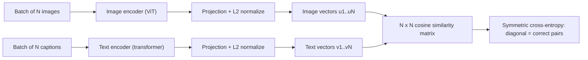
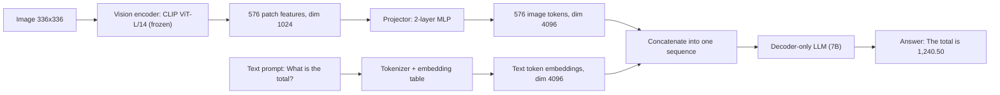
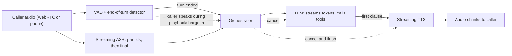
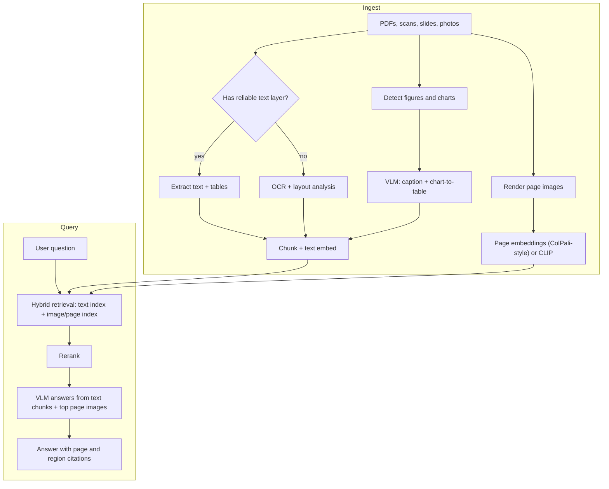
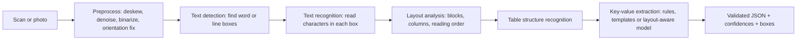

# Vision Transformers, CLIP and Multimodal LLMs

> **Level:** Beginner to Advanced · **Study time:** ~175 min · **Prerequisites:** [CNNs and Transfer Learning](../02-deep-learning/07-cnns-and-transfer-learning.md), [Linear Algebra for ML](../00-foundations/02-linear-algebra-for-ml.md), [Softmax and Cross-Entropy](../00-foundations/05-softmax-entropy-cross-entropy-and-kl-divergence.md). Helpful but not required: [The Attention Mechanism](../04-transformers/03-attention-mechanism-step-by-step.md) (a short recap is included here).

## Table of contents

- [Why this matters](#why-this-matters)
- [A two-minute transformer recap](#a-two-minute-transformer-recap)
- [The Vision Transformer (ViT): images as patch tokens](#the-vision-transformer-vit-images-as-patch-tokens)
- [ViT vs CNN: inductive bias, data and scaling](#vit-vs-cnn-inductive-bias-data-and-scaling)
- [CLIP: learning a shared space for images and text](#clip-learning-a-shared-space-for-images-and-text)
- [Zero-shot classification with CLIP](#zero-shot-classification-with-clip)
- [Vision-language models: vision encoder, projector, LLM](#vision-language-models-vision-encoder-projector-llm)
- [How images become tokens, and what they cost](#how-images-become-tokens-and-what-they-cost)
- [Speech and voice: ASR, TTS and voice agents](#speech-and-voice-asr-tts-and-voice-agents)
- [Multimodal RAG: images, charts and scanned PDFs](#multimodal-rag-images-charts-and-scanned-pdfs)
- [OCR pipelines vs VLM-based document understanding](#ocr-pipelines-vs-vlm-based-document-understanding)
- [Diffusion models for image generation (intuition)](#diffusion-models-for-image-generation-intuition)
- [Evaluating multimodal models](#evaluating-multimodal-models)
- [Failure modes and how to debug them](#failure-modes-and-how-to-debug-them)
- [Going deeper: multimodal systems in production](#going-deeper-multimodal-systems-in-production)
- [Common mistakes and misconceptions](#common-mistakes-and-misconceptions)
- [Interview questions and model answers](#interview-questions-and-model-answers)
- [Key takeaways](#key-takeaways)
- [Further reading](#further-reading)
- [Next](#next)

## Why this matters

Almost every modern AI product now touches images: support bots that read screenshots, expense tools that read receipts, enterprise search over slide decks and scanned contracts, and assistants that "look" at a photo. Under the hood these systems reuse three ideas: the **Vision Transformer** (treat an image as a sequence of patch tokens), **CLIP-style contrastive learning** (put images and text in one shared vector space), and the **vision-language model** recipe (bolt a vision encoder onto an LLM). Interviewers for senior AI/ML roles expect you to explain these mechanisms, estimate how many tokens an image costs, choose between OCR and a VLM for document extraction, and design a multimodal RAG pipeline that does not hallucinate numbers off a chart. Speech is the other everyday modality: voice agents chain speech recognition, an LLM and speech synthesis under a tight latency budget, and that design question gets its own section. This chapter takes you from "what is a patch" to those production decisions.

## A two-minute transformer recap

You will meet transformers properly in [Part 04](../04-transformers/05-the-full-transformer-architecture.md). Here is just enough to follow this chapter.

- A **token** is one item in a sequence that the model processes, for example a word piece in text. Each token is represented by a vector of numbers called an **embedding** (a list of, say, 768 numbers that captures its meaning).
- **Self-attention** lets every token look at every other token and build a new vector as a weighted mix of them. The weights say "how relevant is token j to token i". Full mechanics: [The Attention Mechanism, Step by Step](../04-transformers/03-attention-mechanism-step-by-step.md).
- **Cross-attention** is the same operation across two sequences: tokens of sequence A ask the questions (queries) and read from tokens of sequence B (keys and values). It is how one modality "looks at" another, for example text tokens reading image features, and it appears several times below.
- A **transformer encoder layer** is self-attention followed by a small per-token neural network (an MLP), each wrapped with a residual connection and normalization. Stack 12 or 24 of these and you have an encoder.
- Attention compares every token with every other token, so its cost grows with the **square** of the number of tokens $N$. Doubling the tokens roughly quadruples the attention work. Keep this in mind: it drives most vision design choices.
- A transformer has no built-in notion of order. We add **position embeddings** (vectors that encode "this is token number 5") so it knows where each token sits. More in [Positional Encoding](../04-transformers/06-positional-encoding-sinusoidal-learned-rope-and-alibi.md).

> **Analogy:** a transformer is a meeting where every participant can listen to every other participant before updating their own opinion. A CNN, by contrast, is a row of people who can only whisper to their immediate neighbors.

## The Vision Transformer (ViT): images as patch tokens

### Intuition

A transformer eats a sequence of tokens. An image is a grid of pixels. How do you turn a grid into a sentence?

The answer from "An Image is Worth 16x16 Words: Transformers for Image Recognition at Scale" (Dosovitskiy et al., 2020) is almost embarrassingly simple: **cut the image into small square tiles, flatten each tile into a vector, and treat each tile as a word.**

> **Analogy:** imagine tearing a photo into a 14 by 14 grid of stamps, writing each stamp's colors as a long list of numbers, and handing the stack of 196 lists to someone who reads sentences. Then you write the stamp's grid position on the back of each one so the reader can reassemble the layout.

### Precise definition

- A **patch** is a $P \times P$ square of pixels (commonly $P = 16$ or $P = 14$).
- **Patch embedding** is a learned linear projection that maps each flattened patch (length $P^2 C$, where $C$ is the number of color channels) to a vector of size $D$, the model's hidden size.
- The **class token** (often written `[CLS]`) is an extra learned vector prepended to the patch sequence. It has no pixels of its own; through attention it gathers information from all patches, and its final vector is used as the summary of the whole image for classification.
- **Position embeddings** are learned vectors, one per sequence position, added to the tokens so the model knows where each patch came from.

### The math

Number of patch tokens for an $H \times W$ image:

$$N = \frac{H \cdot W}{P^2}$$

The input sequence to the transformer (following the ViT paper's notation):

$$\mathbf{z}_0 = [\,\mathbf{x}_\text{cls};\ \mathbf{x}_1\mathbf{E};\ \mathbf{x}_2\mathbf{E};\ \dots;\ \mathbf{x}_N\mathbf{E}\,] + \mathbf{E}_\text{pos}$$

- $H, W$: image height and width in pixels.
- $P$: patch side length in pixels.
- $C$: number of channels (3 for RGB).
- $\mathbf{x}_i$: the $i$-th patch, flattened into a row vector of length $P^2 C$.
- $\mathbf{E}$: the patch embedding matrix, shape $(P^2 C) \times D$, learned during training (plus a bias vector, omitted here).
- $\mathbf{x}_\text{cls}$: the learned class token, length $D$.
- $[\,\cdot\,;\,\cdot\,]$: stacking the vectors as rows of one matrix, giving shape $(N+1) \times D$.
- $\mathbf{E}_\text{pos}$: learned position embeddings, shape $(N+1) \times D$, added element-wise.
- $\mathbf{z}_0$: the sequence fed into the first transformer layer.

**Standard numbers (ViT-B/16 on a 224x224 RGB image):**

- $N = (224 \cdot 224) / 16^2 = 50{,}176 / 256 = 196$ patches (a 14 by 14 grid).
- Each patch has $16 \cdot 16 \cdot 3 = 768$ raw pixel values.
- ViT-Base uses $D = 768$, so $\mathbf{E}$ is $768 \times 768$: that is $589{,}824$ weights plus $768$ biases $= 590{,}592$ parameters.
- With the class token the sequence length is $196 + 1 = 197$.

The "/16" in "ViT-B/16" means patch size 16. "ViT-L/14" means a Large model with patch size 14.

### Worked example by hand: a 4x4 image

Take a tiny 4x4 grayscale image ($C = 1$) and patch size $P = 2$. Then $N = 16 / 4 = 4$ patches, each with $2 \cdot 2 \cdot 1 = 4$ values.

```text
Image (pixel values)       Patches (read row by row inside each patch)
+----+----+----+----+
|  1 |  2 |  3 |  4 |      p1 = [1, 2, 5, 6]      p2 = [3, 4, 7, 8]
|  5 |  6 |  7 |  8 |
+----+----+----+----+
|  9 | 10 | 11 | 12 |      p3 = [9, 10, 13, 14]   p4 = [11, 12, 15, 16]
| 13 | 14 | 15 | 16 |
+----+----+----+----+
```

Use $D = 2$ and a hand-picked $\mathbf{E}$ (shape $4 \times 2$) whose first column averages the patch (a "brightness" detector) and whose second column subtracts the bottom row from the top row (a "horizontal edge" detector):

$$\mathbf{E} = \begin{bmatrix} 0.25 & 0.5 \\ 0.25 & 0.5 \\ 0.25 & -0.5 \\ 0.25 & -0.5 \end{bmatrix}$$

Patch 1: $\mathbf{x}_1\mathbf{E}$

- Column 1: $0.25 \cdot (1 + 2 + 5 + 6) = 0.25 \cdot 14 = 3.5$
- Column 2: $0.5 \cdot (1 + 2) - 0.5 \cdot (5 + 6) = 1.5 - 5.5 = -4$
- Result: $[3.5, -4]$

Doing the same for the others:

| Patch | Values | Brightness $0.25 \cdot \text{sum}$ | Edge $0.5(\text{top}) - 0.5(\text{bottom})$ | Token |
|---|---|---|---|---|
| p1 | 1, 2, 5, 6 | $0.25 \cdot 14 = 3.5$ | $1.5 - 5.5 = -4$ | $[3.5, -4]$ |
| p2 | 3, 4, 7, 8 | $0.25 \cdot 22 = 5.5$ | $3.5 - 7.5 = -4$ | $[5.5, -4]$ |
| p3 | 9, 10, 13, 14 | $0.25 \cdot 46 = 11.5$ | $9.5 - 13.5 = -4$ | $[11.5, -4]$ |
| p4 | 11, 12, 15, 16 | $0.25 \cdot 54 = 13.5$ | $11.5 - 15.5 = -4$ | $[13.5, -4]$ |

Prepend a class token, say $[0, 0]$, to get 5 tokens. Then add position embeddings. If position 1's embedding is $[0.1, 0.2]$, patch 1's final input token becomes $[3.5 + 0.1, -4 + 0.2] = [3.6, -3.8]$.

Notice that nothing in these four tokens says where each patch came from: they differ only in brightness. Without position embeddings, the transformer could not tell that p1 is top-left and p3 is bottom-left (attention treats its input as an unordered set). In a real ViT, $\mathbf{E}$ is learned, and its columns end up looking like edge, color and texture detectors, much like a CNN's first layer.

### The architecture


### Code: patch embedding from scratch, then a tiny ViT

A key trick: "cut into patches and apply the same linear layer to each" is exactly a convolution with kernel size $P$ and stride $P$. Real implementations use `Conv2d` for speed.

```python
# pip install torch
import torch
import torch.nn as nn

img = torch.randn(1, 3, 224, 224)          # (batch, channels, height, width)
P, D = 16, 768

# 1) From scratch: cut into patches with unfold, then a shared Linear layer
patches = img.unfold(2, P, P).unfold(3, P, P)            # (1, 3, 14, 14, 16, 16)
patches = patches.permute(0, 2, 3, 1, 4, 5)              # (1, 14, 14, 3, 16, 16)
patches = patches.reshape(1, 14 * 14, 3 * P * P)          # (1, 196, 768)
linear = nn.Linear(3 * P * P, D)
tokens_a = linear(patches)                                 # (1, 196, 768)

# 2) Same thing as a strided convolution (what real ViTs do)
conv = nn.Conv2d(3, D, kernel_size=P, stride=P)
with torch.no_grad():                                      # copy weights so outputs match
    conv.weight.copy_(linear.weight.view(D, 3, P, P))
    conv.bias.copy_(linear.bias)
tokens_b = conv(img).flatten(2).transpose(1, 2)            # (1, 196, 768)

print(tokens_a.shape)                                      # torch.Size([1, 196, 768])
print(torch.allclose(tokens_a, tokens_b, atol=1e-4))       # True


class TinyViT(nn.Module):
    """A minimal ViT classifier: patch embed + CLS + positions + encoder + head."""
    def __init__(self, img=32, patch=4, dim=64, depth=4, heads=4, n_classes=10):
        super().__init__()
        n_patches = (img // patch) ** 2
        self.patch_embed = nn.Conv2d(3, dim, kernel_size=patch, stride=patch)
        self.cls = nn.Parameter(torch.zeros(1, 1, dim))
        self.pos = nn.Parameter(torch.randn(1, n_patches + 1, dim) * 0.02)
        layer = nn.TransformerEncoderLayer(dim, heads, dim_feedforward=4 * dim,
                                           batch_first=True, norm_first=True)
        self.encoder = nn.TransformerEncoder(layer, depth)
        self.norm = nn.LayerNorm(dim)
        self.head = nn.Linear(dim, n_classes)

    def forward(self, x):
        x = self.patch_embed(x).flatten(2).transpose(1, 2)    # (B, N, dim)
        cls = self.cls.expand(x.shape[0], -1, -1)              # (B, 1, dim)
        x = torch.cat([cls, x], dim=1) + self.pos              # (B, N+1, dim)
        x = self.encoder(x)
        return self.head(self.norm(x[:, 0]))                   # classify from CLS

model = TinyViT()
print(model(torch.randn(2, 3, 32, 32)).shape)              # torch.Size([2, 10])
```

In practice you load a pretrained model. The `timm` library is the standard choice for vision backbones:

```python
# pip install timm torch pillow
import timm, torch
from timm.data import resolve_data_config, create_transform
from PIL import Image

model = timm.create_model("vit_base_patch16_224", pretrained=True).eval()
cfg = resolve_data_config({}, model=model)                 # correct resize + normalization
transform = create_transform(**cfg)

x = transform(Image.open("cat.jpg").convert("RGB")).unsqueeze(0)
with torch.no_grad():
    probs = model(x).softmax(dim=-1)
print(probs.topk(3))                                       # top-3 ImageNet classes
```

> **Common mistake:** using the wrong preprocessing. Each pretrained model expects a specific resize, crop and per-channel mean/std normalization. A mismatch silently costs accuracy rather than crashing. Always derive preprocessing from the model's own config, as above.

### Design details a senior engineer should know

- **Patch size trades detail for cost.** Halving $P$ from 16 to 8 on a 224 image gives $(224/8)^2 = 784$ tokens instead of 196: 4x the tokens and roughly 16x the attention entries ($784^2$ vs $196^2$). Smaller patches see finer detail (good for small text) but are much more expensive.
- **Changing resolution breaks the position embeddings.** Learned position embeddings exist for exactly $N+1$ positions. To run at a higher resolution you **interpolate** the 2D grid of position embeddings (for example 14x14 to 24x24) and usually fine-tune briefly. Newer models use 2D rotary position embeddings (RoPE, see [Positional Encoding](../04-transformers/06-positional-encoding-sinusoidal-learned-rope-and-alibi.md)), which extend to new sizes more gracefully.
- **CLS token vs mean pooling.** Many models average all patch tokens instead of using CLS. Both work; the choice matters when you extract features, because you must use whichever the model was trained with.
- **Register tokens.** "Vision Transformers Need Registers" (Darcet et al., 2023) found that large ViTs repurpose some background patches as scratch space, creating attention-map artifacts. Adding a few extra learnable "register" tokens fixes this. Useful when you rely on attention maps or dense patch features.
- **Important ViT descendants:**
  - **DeiT** ("Training data-efficient image transformers & distillation through attention", Touvron et al., 2020): trains ViT on ImageNet-1k alone using heavy augmentation, regularization and a distillation token learning from a CNN teacher.
  - **Swin Transformer** (Liu et al., 2021): attention inside local windows that shift between layers, plus a CNN-like pyramid of resolutions. Cost grows roughly linearly with image size, which suits detection and segmentation.
  - **MAE** ("Masked Autoencoders Are Scalable Vision Learners", He et al., 2021): self-supervised pretraining that hides 75% of patches and trains the model to reconstruct them. Like BERT for images.
  - **DINO and DINOv2** (Caron et al., 2021; Oquab et al., 2023): self-supervised training that produces excellent general-purpose image features without labels.
  - **DETR** (Carion et al., 2020) brought transformers to detection; see [Object Detection in Depth](02-object-detection-yolo-faster-rcnn-and-map.md).

## ViT vs CNN: inductive bias, data and scaling

An **inductive bias** is an assumption built into a model's architecture that guides what it learns before seeing any data. CNNs (recap: [CNNs and Transfer Learning](../02-deep-learning/07-cnns-and-transfer-learning.md)) bake in two strong ones:

- **Locality:** a pixel's meaning depends mostly on nearby pixels, so each filter looks at a small window.
- **Translation equivariance:** a cat shifted 10 pixels to the right produces the same features, shifted 10 pixels. The same filter slides everywhere. (Strides and pooling make this only approximate in a full network, and the final pooling turns it into approximate translation invariance.)

ViT has almost none of this. Only the patch cutting is local. Attention is global from layer 1, and the model must **learn** from data that nearby patches tend to matter more.

> **Analogy:** a CNN is a student given a textbook that says "look locally first". A ViT is a student given no hints but unlimited library access. With little data, the hinted student wins. With a huge library, the unhinted student can discover better rules the textbook never mentioned.

That is exactly what the ViT paper reported: trained on ImageNet-1k alone (about 1.3M images), ViT underperformed comparable ResNets; pretrained on much larger datasets (ImageNet-21k, and especially Google's internal JFT-300M), it matched or beat them. Later work (DeiT, better augmentation, self-supervised pretraining) closed much of the small-data gap, and "A ConvNet for the 2020s" (ConvNeXt, Liu et al., 2022) showed that a CNN modernized with transformer-era training tricks can be competitive again. The durable lesson: **architecture matters less than data, training recipe and scale, but inductive bias buys you sample efficiency.**

| Aspect | CNN (ResNet, ConvNeXt, EfficientNet) | ViT and variants |
|---|---|---|
| Inductive bias | Strong: locality, translation equivariance | Weak: learns spatial structure from data |
| Data needs from scratch | Works on small and medium data | Needs large data or a strong recipe (augmentation, distillation, self-supervision) |
| Receptive field | Grows slowly with depth | Global from the first layer |
| Compute vs resolution | Roughly linear in pixels | Quadratic in tokens for plain ViT; windowed variants are closer to linear |
| Scaling with data and size | Good; modern CNNs scale competitively when given comparable data and compute | Keeps improving with scale; the default backbone of large foundation models |
| Multimodal fit | Awkward to join with text | Natural: patches are tokens, same machinery as an LLM |
| Edge and mobile | Mature, highly optimized kernels, INT8 friendly | Improving; attention and LayerNorm can be harder to quantize and accelerate |
| Pick it when | Small data, tight latency on edge, dense (per-pixel) tasks such as segmentation at high resolution | Large pretraining, transfer from foundation models, anything multimodal |

> **Senior insight:** in 2026 the honest answer to "CNN or ViT?" is usually "whichever pretrained backbone fits my latency budget and transfers best to my data". You rarely train either from scratch. The ViT's real superpower is not ImageNet accuracy, it is that its output is a sequence of tokens that plugs directly into language models.

## CLIP: learning a shared space for images and text

### Intuition

Classic image classifiers learn a fixed list of labels: 1,000 ImageNet classes, and nothing else. Adding a new class means collecting labeled data and retraining.

CLIP ("Learning Transferable Visual Models From Natural Language Supervision", Radford et al., 2021) instead learned from about 400 million (image, caption) pairs collected from the internet. The task: **given a batch of images and a batch of captions, figure out which caption goes with which image.**

> **Analogy:** a matching game. You have 32,768 photos and 32,768 captions shuffled on a table. To match them well, you have to understand both what is in the photos and what the words mean. Learning to play this game well forces both "readers" to agree on a common language of concepts.

### The architecture

CLIP has two separate encoders:

- An **image encoder** (a ViT or a ResNet) that maps an image to a vector.
- A **text encoder** (a transformer) that maps a caption to a vector.

Each output passes through a linear **projection** into the same dimension (for example 512), and is then **L2-normalized** (scaled to length 1). This common vector space is the **shared embedding space**: a picture of a dog and the sentence "a photo of a dog" land near each other.



### The contrastive loss

**Contrastive learning** means learning by comparison: pull matching pairs together, push non-matching pairs apart. CLIP computes an $N \times N$ similarity matrix and treats each row (and each column) as a classification problem whose correct answer is the diagonal. (Softmax and cross-entropy are covered in [Softmax, Entropy, Cross-Entropy](../00-foundations/05-softmax-entropy-cross-entropy-and-kl-divergence.md).)

$$s_{kj} = \mathbf{u}_k \cdot \mathbf{v}_j = \cos(\mathbf{u}_k, \mathbf{v}_j)$$

$$\mathcal{L}_{\text{img}\to\text{txt}} = -\frac{1}{N}\sum_{k=1}^{N} \log \frac{\exp(s_{kk}/\tau)}{\sum_{j=1}^{N}\exp(s_{kj}/\tau)}$$

$$\mathcal{L} = \tfrac{1}{2}\left(\mathcal{L}_{\text{img}\to\text{txt}} + \mathcal{L}_{\text{txt}\to\text{img}}\right)$$

- $N$: batch size (number of image-caption pairs).
- $\mathbf{u}_k$: unit-length embedding of image $k$. $\mathbf{v}_j$: unit-length embedding of caption $j$.
- $s_{kj}$: cosine similarity between image $k$ and caption $j$. Because both vectors have length 1, the dot product equals the cosine, a number between -1 and 1.
- $s_{kk}$: the similarity of the correct pair (the diagonal).
- $\tau$: the **temperature**, a positive number that sharpens or softens the softmax. Dividing by a small $\tau$ stretches the gaps between similarities. The scaled values $s_{kj}/\tau$ are the **logits** (raw scores fed into softmax), which is why $1/\tau$ is called the logit scale. CLIP learns $\tau$ (as a "logit scale" $1/\tau$, initialized at $1/0.07 \approx 14.3$ and capped at 100).
- $\mathcal{L}_{\text{txt}\to\text{img}}$: the same formula applied to columns (for each caption, which image matches?).

### Worked example: a batch of 3

Use 3-dimensional unit vectors (real CLIP uses 512 or more; these numbers are illustrative):

| | Embedding | Length check |
|---|---|---|
| Image: cat photo $\mathbf{u}_1$ | $[0.8, 0.6, 0]$ | $0.64 + 0.36 = 1$ |
| Image: dog photo $\mathbf{u}_2$ | $[0.6, 0.8, 0]$ | $0.36 + 0.64 = 1$ |
| Image: car photo $\mathbf{u}_3$ | $[0, 0, 1]$ | $1$ |
| Text: "a cat" $\mathbf{v}_1$ | $[1, 0, 0]$ | $1$ |
| Text: "a dog" $\mathbf{v}_2$ | $[0, 1, 0]$ | $1$ |
| Text: "a car" $\mathbf{v}_3$ | $[0, 0.6, 0.8]$ | $0.36 + 0.64 = 1$ |

Similarity matrix (rows are images, columns are texts). For example $s_{13} = 0.8 \cdot 0 + 0.6 \cdot 0.6 + 0 \cdot 0.8 = 0.36$:

```text
               "a cat"  "a dog"  "a car"
cat photo       0.80     0.60     0.36
dog photo       0.60     0.80     0.48
car photo       0.00     0.00     0.80
```

The diagonal is the largest value in every row and column, which is what training aims for.

Row 1 loss with $\tau = 0.1$ (logit scale 10):

1. Logits: $0.80/0.1 = 8$, $0.60/0.1 = 6$, $0.36/0.1 = 3.6$.
2. Subtract the max for numerical stability: $0, -2, -4.4$.
3. Exponentiate: $e^{0} = 1$, $e^{-2} \approx 0.1353$, $e^{-4.4} \approx 0.0123$.
4. Sum: $1 + 0.1353 + 0.0123 = 1.1476$.
5. Probability of the correct caption: $1 / 1.1476 \approx 0.8714$.
6. Loss for this row: $-\ln(0.8714) \approx 0.1377$.

Repeating for all rows and columns and averaging gives a total loss of about $0.101$ (the code below confirms it). Gradients then push $s_{11}$ up and $s_{12}, s_{13}$ down.

```python
# pip install torch
import torch
import torch.nn.functional as F

def clip_loss(img_emb, txt_emb, tau):
    img_emb = F.normalize(img_emb, dim=-1)       # unit length
    txt_emb = F.normalize(txt_emb, dim=-1)
    logits = img_emb @ txt_emb.T / tau           # (N, N) scaled cosine similarities
    labels = torch.arange(len(img_emb))          # correct pair is the diagonal
    loss_i2t = F.cross_entropy(logits, labels)   # each image picks its caption
    loss_t2i = F.cross_entropy(logits.T, labels) # each caption picks its image
    return (loss_i2t + loss_t2i) / 2

img = torch.tensor([[0.8, 0.6, 0.0], [0.6, 0.8, 0.0], [0.0, 0.0, 1.0]])
txt = torch.tensor([[1.0, 0.0, 0.0], [0.0, 1.0, 0.0], [0.0, 0.6, 0.8]])
print(round(clip_loss(img, txt, tau=0.1).item(), 3))   # 0.101
```

### Why batch size and temperature matter

- **Every other item in the batch is a free negative example.** With $N = 32{,}768$ (the batch size CLIP used), each image is compared against 32,767 wrong captions per step. More negatives make the matching task harder and the learned space more discriminative. This is why contrastive training is expensive and needs many GPUs: the similarity matrix spans the whole global batch, so embeddings are gathered across devices.
- **Temperature controls how sharply the model is punished.** Small $\tau$ means the loss focuses on the hardest negatives (wrong pairs that look almost right, such as a husky photo vs the caption "a wolf in snow"). Too small and training becomes unstable; too large and everything looks similar. Learning it avoids hand-tuning.
- **SigLIP** ("Sigmoid Loss for Language Image Pre-Training", Zhai et al., 2023) replaces the batch-wide softmax with an independent sigmoid "match or not" decision per pair. This removes the need to normalize across the whole batch, which makes very large batches cheaper and works better at small batches. SigLIP encoders are common vision towers in recent VLMs.
- **Scale matters, and so does curation:** ALIGN (Jia et al., 2021, over a billion noisy pairs) and OpenCLIP models trained on LAION-5B (Schuhmann et al., 2022) showed that large volumes of minimally filtered web pairs work well. Later work on dataset filtering and balancing (for example DataComp and MetaCLIP) showed that how you select the pairs matters as much as how many you have: a well-filtered smaller set can beat a larger noisy one.

> **Senior insight:** CLIP embeddings show a **modality gap** ("Mind the Gap", Liang et al., 2022): image vectors and text vectors occupy two separate regions of the sphere, even when matched pairs are relatively close. Consequence: image-to-text similarity scores are on a different scale than text-to-text scores. Never mix image-text and text-text cosine scores in one ranking with a single threshold.

## Zero-shot classification with CLIP

**Zero-shot classification** means classifying into categories the model was never explicitly trained on as labels, using only their names.

Recipe:

1. Turn each class name into a sentence with a **prompt template**, for example "a photo of a {label}". Plain single words work worse because training captions were sentences.
2. Encode each sentence with the text encoder and normalize. These vectors act as the weights of a classifier you just built from words.
3. Encode the image and normalize.
4. Compute cosine similarity to each class vector, multiply by the logit scale, and apply softmax.

### Worked example

Reuse the text vectors from above: "a photo of a cat" $= [1, 0, 0]$, "a photo of a dog" $= [0, 1, 0]$, "a photo of a car" $= [0, 0.6, 0.8]$. A new image (a cat in an odd pose) embeds to $\mathbf{q} = [0.8, 0.36, 0.48]$. Check the length: $0.64 + 0.1296 + 0.2304 = 1.0$.

Cosine similarities:

- cat: $0.8 \cdot 1 = 0.80$
- dog: $0.36 \cdot 1 = 0.36$
- car: $0.36 \cdot 0.6 + 0.48 \cdot 0.8 = 0.216 + 0.384 = 0.60$

With logit scale 10: logits $8, 3.6, 6$. Subtract 8: $0, -4.4, -2$. Exponentiate: $1, 0.0123, 0.1353$, sum $1.1476$. Probabilities: cat $0.871$, dog $0.011$, car $0.118$. Prediction: cat.

With CLIP's typical learned scale of 100 the logits become $80, 36, 60$ and the softmax puts essentially all probability on "cat". In real CLIP the raw cosines are much closer together (often differing in the second decimal place), which is exactly why a large scale is needed.

### Code: zero-shot with Hugging Face

```python
# pip install transformers torch pillow
import torch
from PIL import Image
from transformers import CLIPModel, CLIPProcessor

model_id = "openai/clip-vit-base-patch32"
model = CLIPModel.from_pretrained(model_id).eval()
processor = CLIPProcessor.from_pretrained(model_id)

labels = ["cat", "dog", "car"]
prompts = [f"a photo of a {c}" for c in labels]
image = Image.open("cat.jpg").convert("RGB")

inputs = processor(text=prompts, images=image, return_tensors="pt", padding=True)
with torch.no_grad():
    out = model(**inputs)
probs = out.logits_per_image.softmax(dim=-1)[0]   # logits already include the logit scale
for c, p in zip(labels, probs.tolist()):
    print(f"{c}: {p:.3f}")
```

### Improving zero-shot, and what to do when it is not enough

| Technique | What it does | Cost |
|---|---|---|
| Better prompts | Domain-specific templates ("a satellite photo of {}", "a close-up photo of a {} defect") | Free |
| Prompt ensembling | Average the text embeddings of many templates per class (the CLIP paper used dozens for ImageNet) | Free at inference; class vectors are precomputed |
| Better class names | Replace ambiguous names ("crane" the bird vs the machine) with descriptive ones | Free |
| Linear probe | Freeze CLIP, train a logistic regression on image embeddings with a few labels per class | Minutes of CPU |
| Few-shot adapters / prompt tuning | Learn a small set of parameters (for example learnable prompt vectors) on few labels | Small GPU job |
| Full fine-tuning | Update the encoders on your domain | Risk of losing zero-shot generality; needs care (low learning rate, evaluate on general data too) |

> **Interview tip:** the strongest answer to "CLIP zero-shot is at 70% on our product categories, what next?" is a ladder: fix class names and prompts, ensemble prompts, then a linear probe on a few hundred labeled images, then fine-tuning only if the probe plateaus. Measure each step on a held-out labeled set.

### CLIP beyond classification

Because images and text share a space, CLIP also gives you text-to-image search (embed images once, index them, embed the query text, retrieve nearest neighbors; see [Vector Search Algorithms](../08-rag/06-vector-search-ann-hnsw-ivf-and-product-quantization.md)), image-to-image search and deduplication, content filtering, and conditioning for image generators.

```python
# pip install faiss-cpu transformers torch pillow
import faiss, torch
import torch.nn.functional as F
from PIL import Image
from transformers import CLIPModel, CLIPProcessor

model_id = "openai/clip-vit-base-patch32"
model, proc = CLIPModel.from_pretrained(model_id).eval(), CLIPProcessor.from_pretrained(model_id)
paths = ["slide1.png", "invoice.png", "team_photo.jpg", "revenue_chart.png"]
images = [Image.open(p).convert("RGB") for p in paths]

def as_tensor(out):
    # transformers 4.x returns a tensor; 5.x returns an output object whose
    # pooler_output holds the projected embedding. Handle both.
    return out if torch.is_tensor(out) else out.pooler_output

with torch.no_grad():
    img_emb = as_tensor(model.get_image_features(**proc(images=images, return_tensors="pt")))
    txt_emb = as_tensor(model.get_text_features(**proc(text=["a bar chart of revenue"],
                                                       return_tensors="pt", padding=True)))
img_emb = F.normalize(img_emb, dim=-1).numpy().astype("float32")
txt_emb = F.normalize(txt_emb, dim=-1).numpy().astype("float32")

index = faiss.IndexFlatIP(img_emb.shape[1])     # inner product = cosine on unit vectors
index.add(img_emb)
scores, ids = index.search(txt_emb, 2)
print([paths[i] for i in ids[0]], scores[0])
```

### Where CLIP is weak

CLIP learns "which caption matches", and web captions rarely describe exact counts, left-versus-right or fine print. Known weaknesses:

- **Counting and spatial relations:** "two dogs" vs "three dogs", "a mug left of a laptop" vs "right of".
- **Bag-of-words behavior:** "When and why vision-language models behave like bags-of-words" (Yuksekgonul et al., 2022) showed CLIP-style models often ignore word order ("the horse is eating the grass" vs "the grass is eating the horse").
- **Typographic attacks:** an apple with a paper label reading "iPod" can be classified as an iPod, because CLIP learned to read text in images.
- **Fine-grained and specialized domains** (medical scans, industrial defects) where web captions are rare.
- **Biases** inherited from web data.

## Vision-language models: vision encoder, projector, LLM

### Intuition

CLIP can match images and text, but it cannot **talk** about an image: it cannot answer "what is the total on this receipt?" A **vision-language model (VLM)**, also called a **multimodal LLM**, is an LLM that accepts images as input and generates text.

The most common recipe, popularized by LLaVA ("Visual Instruction Tuning", Liu et al., 2023), has three parts:

1. **Vision encoder:** a pretrained ViT (often from CLIP or SigLIP) that turns the image into a sequence of patch feature vectors.
2. **Projector** (also called a **connector** or **adapter**): a small network that maps each vision vector into the LLM's embedding space, so it looks like a word embedding to the LLM.
3. **LLM:** a standard **decoder-only** language model (one that generates text left to right, one token at a time; see [Encoder-Only, Encoder-Decoder and Decoder-Only Models](../04-transformers/07-encoder-only-encoder-decoder-and-decoder-only-models.md)) that reads the projected image tokens and the text tokens together and generates an answer.

> **Analogy:** the vision encoder is an eyewitness who speaks only "vision language". The projector is an interpreter who translates each observation into the LLM's language. The LLM is the expert who reads the translated notes alongside your question and writes the answer.



### Concrete numbers: LLaVA-1.5

LLaVA-1.5 (Liu et al., 2023, "Improved Baselines with Visual Instruction Tuning") is a clean reference design:

- Vision encoder: CLIP ViT-L/14 at 336x336 resolution, so $(336/14)^2 = 24^2 = 576$ patch features of dimension 1024 (LLaVA uses features from the second-to-last layer and drops the CLS token).
- Projector: a 2-layer MLP with a GELU activation (a smooth variant of ReLU), $1024 \to 4096 \to 4096$. Parameters: $(1024 \cdot 4096 + 4096) + (4096 \cdot 4096 + 4096) = 4{,}198{,}400 + 16{,}781{,}312 = 20{,}979{,}712$, about 21M. Tiny compared with the 7B LLM.
- LLM: Vicuna-v1.5 (fine-tuned from Llama 2) with hidden size 4096 for the 7B version.

### Training in two stages

| Stage | Data | What trains | Purpose |
|---|---|---|---|
| 1. Feature alignment (pretraining) | Image-caption pairs | Only the projector (encoder and LLM frozen) | Teach the interpreter to translate vision features into "words" the LLM understands |
| 2. Visual instruction tuning | Conversations about images (questions, reasoning, descriptions), much of it generated by a text-only LLM from captions and boxes in the original LLaVA | Projector + LLM (encoder usually frozen) | Teach the model to follow instructions about images |

This is cheap compared with training from scratch because the expensive parts (ViT and LLM) arrive pretrained. Instruction tuning is covered in [Instruction Tuning, RLHF and DPO](../05-llms/02-instruction-tuning-rlhf-and-dpo.md); LoRA is commonly used for stage 2 ([Fine-Tuning: LoRA and QLoRA](../05-llms/07-fine-tuning-full-lora-and-qlora.md)).

### Code: the core mechanism in a few lines

```python
# pip install torch
import torch
import torch.nn as nn

d_vision, d_llm, n_img = 1024, 4096, 576
projector = nn.Sequential(nn.Linear(d_vision, d_llm), nn.GELU(), nn.Linear(d_llm, d_llm))
print(sum(p.numel() for p in projector.parameters()))     # 20979712

vision_feats = torch.randn(1, n_img, d_vision)   # stand-in for frozen ViT patch outputs
img_tokens = projector(vision_feats)              # (1, 576, 4096): now "word-like"

text_embeds = torch.randn(1, 20, d_llm)           # stand-in for the embedded prompt tokens
# Splice image tokens where the <image> placeholder sat (after the first 5 text tokens here)
inputs_embeds = torch.cat([text_embeds[:, :5], img_tokens, text_embeds[:, 5:]], dim=1)
print(inputs_embeds.shape)                        # torch.Size([1, 596, 4096])
# A real VLM passes inputs_embeds to the LLM instead of token ids.
```

Using a real model through Hugging Face (the API around chat templates and image placeholders changes between `transformers` versions, so treat this as a realistic sketch and check the model card):

```python
# pip install "transformers>=4.45" accelerate torch pillow   (version-sensitive)
import torch
from PIL import Image
from transformers import AutoProcessor, LlavaForConditionalGeneration

model_id = "llava-hf/llava-1.5-7b-hf"
processor = AutoProcessor.from_pretrained(model_id)
model = LlavaForConditionalGeneration.from_pretrained(
    model_id, torch_dtype=torch.float16, device_map="auto")   # newer versions name this dtype=; torch_dtype still works but warns

conversation = [{"role": "user", "content": [
    {"type": "image"},
    {"type": "text", "text": "What is the total amount on this invoice?"}]}]
prompt = processor.apply_chat_template(conversation, add_generation_prompt=True)
image = Image.open("invoice.png").convert("RGB")
inputs = processor(images=image, text=prompt, return_tensors="pt").to(model.device, torch.float16)

print(inputs["input_ids"].shape)   # recent versions expand <image> into 576 placeholder ids
out = model.generate(**inputs, max_new_tokens=50, do_sample=False)
print(processor.decode(out[0], skip_special_tokens=True))
```

### Other connector designs

| Connector | Example | How it works | Image tokens | Trade-off |
|---|---|---|---|---|
| Linear or MLP projector | LLaVA | Project every patch feature | One per patch (576 for 336px, ViT-L/14) | Simple, preserves detail; many tokens |
| Q-Former | BLIP-2 (Li et al., 2023) | A small transformer with a fixed set of learned queries (32 in BLIP-2) cross-attends to patches | Fixed and small | Cheap for the LLM; can lose fine detail like small text |
| Perceiver resampler + cross-attention | Flamingo (Alayrac et al., 2022) | Resample to a fixed number of latents; LLM attends to them via inserted cross-attention layers | Not in the main sequence | Handles interleaved images and video; more architectural change to the LLM |
| Token merging / pixel shuffle | Several recent open VLMs | Merge each 2x2 block of neighboring patch features into one token before projecting | 4x fewer | Big cost saving, small detail loss |
| Early fusion / native multimodal | Fuyu (Adept, 2023), Chameleon (Meta, 2024) | Patches or discrete image tokens go straight into one transformer trained on both | Varies | Most unified; most expensive to train |

Many proprietary frontier models are natively multimodal, but their internals are not public. The encoder-projector-LLM pattern is the one you can reason about and build.

## How images become tokens, and what they cost

This is the section that turns into real money in production.

### Counting image tokens

For a plain ViT encoder with an MLP projector, the number of image tokens is the number of patches:

$$N_\text{img} = \frac{H}{P} \cdot \frac{W}{P} \div m$$

- $H, W$: the resolution the encoder actually sees (after resizing), not the original upload size.
- $P$: patch size.
- $m$: merge factor (1 if no merging, 4 for 2x2 merging).

LLaVA-1.5: $\frac{336}{14} \cdot \frac{336}{14} \div 1 = 24 \cdot 24 = 576$ tokens. With 2x2 merging: $576 / 4 = 144$.

### The resolution problem and tiling

Squeezing a full A4 invoice into a single 336x336 view typically makes its small print unreadable. Two common fixes:

- **Tiling (dynamic high resolution):** cut the high-resolution image into several encoder-sized tiles, encode each, and also include one downscaled **thumbnail** of the whole image for global context. LLaVA-NeXT's "AnyRes" is an example. A 2x2 grid plus thumbnail is about $5 \cdot 576 = 2{,}880$ tokens (LLaVA-NeXT's exact count differs slightly because it removes padding features and adds row-separator tokens).
- **Native dynamic resolution:** encoders that accept arbitrary aspect ratios with 2D position encoding (Qwen2-VL is a well-known example), so the token count scales with the actual image area.

Either way: **token count grows with image area.** Doubling width and height roughly quadruples image tokens.

### Worked example: what one invoice page costs a 7B VLM

Assume the 7B LLM has a LLaMA-2-7B-like shape: 32 layers, hidden size 4096, no grouped-query attention (GQA, where several query heads share one key/value head so fewer keys and values are stored; see [Modern LLM Architecture](../04-transformers/08-modern-llm-architecture-improvements.md)), FP16 (2 bytes per number). The KV cache (explained in [The KV Cache](../06-llm-inference/02-kv-cache-explained.md)) stores a key and a value vector per token per layer:

$$\text{KV bytes per token} = 2 \cdot L \cdot d \cdot b$$

- $2$: one key and one value.
- $L$: number of layers (32).
- $d$: hidden size (4096); with grouped-query attention you would use the number of KV heads times the head dimension instead.
- $b$: bytes per number (2 for FP16).

Arithmetic: $2 \cdot 32 \cdot 4096 \cdot 2 = 524{,}288$ bytes $= 512$ KiB per token.

| Setting | Image tokens | KV cache for the image | Prefill compute (about $2 \times \text{params} \times \text{tokens}$) |
|---|---|---|---|
| Single 336px view | 576 | $576 \times 512$ KiB $= 288$ MiB | $2 \cdot 7 \times 10^9 \cdot 576 \approx 8.1$ TFLOPs |
| 2x2 tiles + thumbnail | 2,880 | $2{,}880 \times 512$ KiB $\approx 1.41$ GiB | about 40 TFLOPs |
| 20-page scanned PDF, tiled | 57,600 | about 28 GiB | about 800 TFLOPs |

(Derived from the stated assumptions; real models with grouped-query attention need several times less KV memory. The prefill rule of thumb comes from each parameter doing one multiply and one add per token, and it ignores the attention term, which grows further for long sequences.)

Compare the vision encoder: ViT-L/14 has about 0.3B parameters, so encoding 577 tokens is about $2 \cdot 0.3 \times 10^9 \cdot 577 \approx 0.35$ TFLOPs, roughly 20x less than the LLM prefill on those same tokens. **In a VLM, the LLM processing image tokens usually dominates cost, not the vision encoder.** Prefill vs decode is explained in [Inference Fundamentals](../06-llm-inference/01-inference-fundamentals-prefill-decode-and-latency-metrics.md).

Commercial APIs bill images as input tokens, with each vendor using its own resizing and tiling rules, and those rules change between model versions. Never hard-code an assumption; read the current docs and measure the token usage the API reports.

> **Senior insight:** the cheapest image token is the one you never send. Levers in order: (1) do not send images that text extraction already handles, (2) crop to the region of interest, (3) pick the lowest resolution or "detail" setting that still passes your eval, (4) use models with token merging, (5) cache: identical images (logos, repeated page headers) can reuse prefix caches when the serving stack supports multimodal prefix caching.

## Speech and voice: ASR, TTS and voice agents

Speech is the other modality you will meet constantly. **ASR (automatic speech recognition)**, also called speech-to-text, turns audio into text. **TTS (text-to-speech)** turns text into audio. A **voice agent** is a system you talk to in real time, such as a phone support line answered by an LLM. "Design a voice support agent" is a popular system design question because it combines model choices with a hard real-time latency budget.

> **Analogy:** a cascaded voice agent is a relay of three specialists: a stenographer (ASR), a thinker (the LLM) and an actor who reads the reply aloud (TTS). A speech-to-speech model is one person who listens and answers in their own voice. The relay is easier to audit; the single person is faster and hears your tone of voice.

### How audio becomes features or tokens

Raw audio is a 1-D array of **samples** (air pressure measured many times per second). The **sample rate** $f_s$ is how many samples per second: 16 kHz (16,000 per second) is standard for ASR, and phone calls use 8 kHz. A sample rate of $f_s$ can only represent frequencies up to $f_s/2$, the **Nyquist frequency**, so 16 kHz audio keeps everything up to 8 kHz, which covers most of the information in speech. Feeding 16,000 numbers per second into a transformer would be wasteful, so models first build a compact time-frequency picture.

**The log-mel spectrogram** (the "image" of a sound):

1. Slide a short window (25 ms, which is 400 samples at 16 kHz) along the audio with a hop of 10 ms (160 samples). Each window position is a **frame**: 100 frames per second.
2. For each frame, measure how much energy sits at each frequency with a Fourier transform. Doing this frame by frame is the **short-time Fourier transform (STFT)**.
3. Pool the frequencies with a bank of triangular **mel filters** (80 in Whisper, 128 in Whisper large-v3) spaced evenly on the **mel scale**, which mimics human pitch perception: fine resolution at low frequencies, coarse at high ones.
4. Take the log, because perceived loudness is roughly logarithmic and the log compresses the huge range of energies.

The result is a 2-D array (mel bins by frames) that a model can treat as a one-channel image or as a sequence of frame vectors. One common definition of the mel scale (the HTK formula):

$$m = 2595 \log_{10}\left(1 + \frac{f}{700}\right)$$

- $f$: frequency in hertz. $m$: the same pitch in mels.

(Whisper's filter bank actually uses the Slaney variant, librosa's default, which is linear below 1 kHz and logarithmic above it; the shape and the conclusion below are the same.)

Worked example: $f = 1000$ Hz gives $2595 \log_{10}(2.429) \approx 2595 \cdot 0.385 \approx 1000$ mels; $f = 4000$ gives about $2146$; $f = 8000$ gives about $2840$. The first 1,000 Hz span about 1,000 mels, while the whole band from 4,000 to 8,000 Hz spans only about 694, so filters spaced evenly in mels spend most of their detail on the low frequencies where voice pitch and vowels live.

**Whisper's encoder-decoder** ("Robust Speech Recognition via Large-Scale Weak Supervision", Radford et al., 2022) is the reference ASR design. Audio is resampled to 16 kHz and cut or padded to 30-second windows, giving an $80 \times 3{,}000$ log-mel input. Two 1-D convolutions (the second with stride 2) halve that to 1,500 positions, one per 20 ms, followed by a transformer encoder. A text decoder cross-attends to those encoder states (the cross-attention from the recap above) and writes the transcript token by token; special tokens select the language, the task (transcribe, or translate to English) and timestamps. It was trained on 680,000 hours of weakly labeled web audio. The family is explained in [Encoder-Only, Encoder-Decoder and Decoder-Only Models](../04-transformers/07-encoder-only-encoder-decoder-and-decoder-only-models.md), and why ASR often decodes with beam search in [Text Generation and Decoding Strategies](../05-llms/03-text-generation-and-decoding-strategies.md).

```python
# pip install transformers numpy   (the feature extractor needs no model download)
import numpy as np
from transformers import WhisperFeatureExtractor

fe = WhisperFeatureExtractor()   # defaults: 16 kHz, 80 mel bins, 25 ms window, 10 ms hop, 30 s window
audio = np.random.randn(3 * 16000).astype(np.float32) * 0.01   # 3 s stand-in for a recording
feats = fe(audio, sampling_rate=16000, return_tensors="np").input_features
print(feats.shape)   # (1, 80, 3000): padded to 30 s, so a 3 s clip costs the encoder as much as 30 s
```

**Audio codec tokens.** To *generate* speech with a language model you need discrete tokens, as with text. A **neural audio codec** (SoundStream, Zeghidour et al., 2021; EnCodec, Défossez et al., 2022) is an autoencoder: its encoder compresses audio into a short sequence of frame vectors, and **residual vector quantization (RVQ)** replaces each frame vector with codebook indices. The first codebook picks the nearest of $K$ learned vectors, the second codebook quantizes what the first missed (the residual), and so on. A decoder turns the indices back into a waveform, and each index is a token.

$$\text{bitrate} = \text{frames per second} \times \text{codebooks} \times \log_2 K$$

Worked example: EnCodec at 24 kHz produces 75 frames per second with 1,024-entry codebooks (10 bits each); with 8 codebooks that is $75 \cdot 8 \cdot 10 = 6{,}000$ bits per second (6 kbps). Flattened into one sequence, that is 600 tokens per second, far too many for an LLM to model comfortably. Many recent speech-generating models therefore use low-frame-rate codecs, such as Mimi in Moshi (Défossez et al., 2024): 12.5 frames per second with 8 codebooks of 2,048 entries, $12.5 \cdot 8 \cdot 11 = 1{,}100$ bits per second. Moshi also predicts the 8 codebooks of each frame with a small extra "depth" transformer, so the main transformer takes only 12.5 steps per second.

**What audio costs.** The same counting logic as for image tokens, for one 10-minute call:

| Representation | Units per second of speech | Units per 10-minute call |
|---|---|---|
| Raw samples at 16 kHz | 16,000 | 9,600,000 |
| Log-mel frames | 100 | 60,000 |
| Whisper encoder states | 50 | 30,000 |
| Audio-LLM input tokens (Whisper-style encoder pooled 2x, as in Qwen2-Audio) | 25 | 15,000 |
| EnCodec tokens, 8 codebooks flattened | 600 | 360,000 |
| Mimi frames (8 codebooks each) | 12.5 | 7,500 |
| Transcript text tokens (about 150 words per minute at about 1.3 tokens per word) | about 3.25 | about 1,950 |

With the 7B model from the invoice example (512 KiB of KV cache per token), keeping the 15,000 audio tokens in context costs $15{,}000 \times 512$ KiB $\approx 7.3$ GiB of KV cache, while the transcript costs $1{,}950 \times 512$ KiB $\approx 0.95$ GiB: about 7.7x more for the same conversation. Commercial APIs bill audio per minute or per audio token, often at a higher rate than text; as with images, read the current docs and measure.

> **Senior insight:** carry text, not audio, through a long conversation. Transcribe each turn once and keep the transcript in the history; only the current turn needs audio, and only if the model uses tone of voice at all.

### The cascaded pipeline vs native speech-to-speech

A **cascaded** voice agent chains specialized components:

- **VAD (voice activity detection):** a small, fast classifier that labels each short frame (roughly 10 to 30 ms) as speech or non-speech. WebRTC VAD and Silero VAD are common examples.
- **End-of-turn detection** (also called **endpointing**): deciding the user has finished their turn, not just paused. The simplest rule waits for a fixed silence, often 500 ms or more. Better systems pair a shorter silence with a model that reads the partial transcript (and sometimes intonation) to judge whether the utterance sounds complete: "my account number is..." followed by a pause should not trigger a reply.
- **Streaming ASR:** transcribes while the user is still speaking, emitting **partial** (interim) hypotheses that may still change and a **final** transcript when the segment ends. Models trained for streaming emit text as audio arrives: **CTC** (Connectionist Temporal Classification, a loss that lets the encoder output one label or a "blank" per frame without a frame-level alignment) and **RNN-T** (a transducer, which adds a small network conditioned on the text emitted so far). Whisper's 30-second window is not natively streaming; streaming wrappers re-decode a growing buffer and commit only text that stays the same across consecutive runs.
- **LLM:** streams text tokens, with tool calls and retrieval as in any text agent ([Tool Calling in Depth](../09-agents/02-tool-calling-in-depth.md)). TTFT (time to first token) and inter-token latency are defined in [Inference Fundamentals](../06-llm-inference/01-inference-fundamentals-prefill-decode-and-latency-metrics.md).
- **Streaming TTS:** starts synthesizing from the first clause of the LLM output and returns audio in small chunks instead of waiting for the full reply. Its key number is **time to first audio chunk**.
- **Transport:** WebRTC (built for real-time media in browsers and apps, with echo cancellation and jitter buffers) or WebSockets carrying audio frames ([Building a Scalable Inference API](../10-mlops/05-building-a-scalable-inference-api.md)), or a phone line through a telephony provider.

A **native speech-to-speech (S2S)** model takes audio in and produces audio out with one model, typically by modeling codec tokens (often alongside text tokens). Moshi is an open example and is **full-duplex**: it listens and speaks at the same time, like a person on a phone call. Commercial realtime speech APIs follow the same idea. A middle ground, the **half-cascade**, uses an audio-input LLM that writes text, followed by TTS.



| | Cascaded (VAD, ASR, LLM, TTS) | Native speech-to-speech |
|---|---|---|
| Latency | Sum of the stages; under about 1 s only if every stage streams and overlaps | Usually lower: no hand-offs between models, and full-duplex models can respond while you talk |
| Tone, emotion, hesitation, laughter | Lost at the ASR step unless extracted as extra signals | Heard and produced natively |
| Controllability | High: swap any component, edit or filter text before it is spoken, force pronunciations of names and products | Lower: what is said and how is decided inside one model; text guardrails act on a parallel text stream that can lag the audio |
| Tool use and RAG | Standard text LLM tool calling and retrieval, any model | Supported by commercial realtime APIs, but fewer model choices and harder to test |
| Transcripts for audit | Free: every turn exists as text by construction | Need a separate ASR pass; the model's own text output may not match exactly what it heard or said |
| Debugging | Per-stage traces show whether it misheard (ASR) or misreasoned (LLM) | One model, so errors are harder to localize |
| Error propagation | ASR mistakes silently become the LLM's input | No intermediate transcript to corrupt |

Rule of thumb: regulated, tool-heavy workflows (banking, healthcare, customer support) usually start with a cascade; companion, coaching and language-practice products, which live on expressiveness and snappy turn-taking, lean toward speech-to-speech.

### Worked example: a latency budget under 800 ms

The number users feel is **time to first audio (TTFA)**, also called voice-to-voice latency: from the moment the user stops speaking to the moment the first audio of the reply plays on their device. Gaps between turns in human conversation are typically only a few hundred milliseconds, so a pause of well over a second feels awkward. A cascade can hit about 800 ms only if every stage streams and overlaps with the others. The stage numbers below are an illustrative budget (design targets), not measurements of specific products:

| Stage | Budget | What makes it fit |
|---|---|---|
| End-of-turn wait (VAD silence) | 200 ms | A turn-detection model allows a short silence threshold; this is pure waiting time |
| ASR final transcript | 50 ms | Streaming ASR transcribed the turn while the user was speaking; only the last chunk remains |
| LLM time to first token | 250 ms | Short system prompt, prefix caching, region close to the user |
| LLM tokens until the first speakable clause (6 tokens at 15 ms each) | 90 ms | TTS starts on the first clause, not the whole answer |
| TTS time to first audio chunk | 100 ms | Streaming TTS with the voice already loaded |
| Network and playback buffers | 100 ms | WebRTC; servers co-located with each other and near the user |
| **Total TTFA** | **790 ms** | |

The same models without streaming: a 700 ms fixed silence timeout, 400 ms of batch ASR on the whole utterance, 1,150 ms for a complete 60-token answer ($250 + 60 \cdot 15$), 400 ms to synthesize the whole reply and 100 ms of network add up to 2,750 ms, about 3.5x slower to start speaking. The gain comes from streaming and overlap, not from faster models:

- ASR runs during the user's speech, so its cost is mostly hidden.
- TTS speaks sentence 1 while the LLM is still generating sentence 2.
- Optionally, start the LLM speculatively on the stable partial transcript during the end-of-turn wait and discard the result if the user keeps talking. This hides most of the TTFT at the cost of wasted LLM calls (prefix caching helps too: [Speculative Decoding, Caching and Other Speedups](../06-llm-inference/05-speculative-decoding-caching-and-other-speedups.md)).
- Tool calls break the budget (an account lookup can take 500 ms or more), so speak a short, honest filler ("Let me check your account") while the tool runs, and track tail latency per tool.

Measure TTFA at the client as p50, p95 and p99, with per-stage timings in a trace per turn. A p50 of 790 ms with a p95 of 2.5 s still feels broken in one turn out of twenty.

### Barge-in: handling interruptions

**Barge-in** is the user speaking while the agent is still talking. Handling it well is what makes an agent feel conversational:

1. **Hear the user over the agent.** **Acoustic echo cancellation (AEC)** removes the agent's own voice from the microphone signal. Without it, TTS audio leaking from the speaker triggers the VAD and the agent interrupts itself.
2. **Decide whether it is a real interruption.** Backchannels ("uh-huh", "right"), coughs and a TV in the background should not stop the agent. Require a minimum speech duration or a few recognized words, or use a small classifier; some systems pause on any speech and resume if it was a false alarm.
3. **Stop fast.** Flush the audio queued on the client and cancel the in-flight LLM and TTS streams, so you stop generating, and paying for, a reply nobody will hear.
4. **Fix the history.** Truncate the agent's last message to the words the user actually heard, using TTS word timestamps and the client's playback position. Otherwise the LLM believes it said things the user never heard, such as a refund amount.
5. **Protect side effects.** A tool call already sent cannot be taken back: make tools idempotent (safe to repeat) and confirm irreversible actions explicitly before executing them.

```python
import asyncio

async def speak(words: list[str], heard: list[str], word_s: float = 0.2) -> None:
    for w in words:                  # stand-in for streaming TTS playback
        await asyncio.sleep(word_s)
        heard.append(w)              # in production: playback position reported by the client

async def main() -> None:
    reply = "Your refund of 40 dollars was issued today and arrives in 3 to 5 days".split()
    heard: list[str] = []
    playback = asyncio.create_task(speak(reply, heard))
    await asyncio.sleep(1.3)         # VAD fires: the caller starts talking (barge-in)
    playback.cancel()                # stop audio; also cancel the in-flight LLM and TTS streams
    try:
        await playback
    except asyncio.CancelledError:
        pass
    print(" ".join(heard))           # Your refund of 40 dollars was   <- store only this in history

asyncio.run(main())
```

### Evaluating speech systems

**Word error rate (WER)** is the standard ASR metric. Align the hypothesis (ASR output) with the reference transcript using word-level edit distance, then count the edits:

$$\text{WER} = \frac{S + D + I}{N}$$

- $S$: substitutions (a wrong word). $D$: deletions (a missed word). $I$: insertions (an extra word).
- $N$: the number of words in the reference.

Worked example: reference "cancel my order for next tuesday" ($N = 6$), hypothesis "cancel order for the next thursday".

```text
reference:   cancel  my   order  for  ***  next  tuesday
hypothesis:  cancel  ***  order  for  the  next  thursday
edit:                D                I          S
```

$\text{WER} = (1 + 1 + 1)/6 = 0.5$, or 50%. Because insertions count, WER can exceed 100%: reference "yes" with hypothesis "yes yes thank you" scores $3/1 = 300\%$. Normalize both strings before scoring (case, punctuation, "5" vs "five", "ok" vs "okay"), or you measure formatting rather than recognition. **CER** (character error rate) is the same formula over characters, used for languages written without spaces between words, such as Chinese and Japanese.

```python
def wer_counts(ref: str, hyp: str) -> dict:
    """Word-level edit distance that also reports substitutions, deletions and insertions."""
    r, h = ref.lower().split(), hyp.lower().split()
    prev = [(j, 0, 0, j) for j in range(len(h) + 1)]   # (edits, S, D, I); empty reference: all insertions
    for i in range(1, len(r) + 1):
        cur = [(i, 0, i, 0)]                            # empty hypothesis: all deletions
        for j in range(1, len(h) + 1):
            miss = int(r[i - 1] != h[j - 1])
            e, s, d, n = prev[j - 1]
            sub = (e + miss, s + miss, d, n)
            e, s, d, n = prev[j]
            dele = (e + 1, s, d + 1, n)
            e, s, d, n = cur[j - 1]
            ins = (e + 1, s, d, n + 1)
            cur.append(min(sub, dele, ins))
        prev = cur
    e, s, d, n = prev[-1]
    return {"S": s, "D": d, "I": n, "N": len(r), "WER": round(e / len(r), 3)}

print(wer_counts("cancel my order for next tuesday", "cancel order for the next thursday"))
# {'S': 1, 'D': 1, 'I': 1, 'N': 6, 'WER': 0.5}
print(wer_counts("yes", "yes yes thank you"))
# {'S': 0, 'D': 0, 'I': 3, 'N': 1, 'WER': 3.0}
```

WER is only one layer. A voice agent needs metrics for each part of the experience:

| What | Metric | Notes |
|---|---|---|
| Recognition | WER (or CER) per slice: accent, noise, device, phone vs app; **entity accuracy** on critical slots (numbers, names, account IDs, dates) | Entity errors are what break tasks |
| Turn-taking | Premature cut-off rate (agent talks over a user who only paused), late responses, false and missed barge-ins, time to stop after a barge-in | These drive "it keeps interrupting me" complaints |
| Latency | TTFA p50, p95 and p99 measured at the client, with a per-stage breakdown | Tails matter: one long silence mid-call is very noticeable |
| Task success | Resolution rate, correct tool calls and arguments, escalation rate, judged from transcripts with rubrics, LLM judges and human review | Containment (no human handoff) alone can reward trapping users; pair it with resolution and CSAT (customer satisfaction score) |
| TTS quality | MOS for naturalness; intelligibility as the WER of an ASR run on the synthesized audio; pronunciation of domain terms | Automatic MOS predictors suit regression checks; confirm releases with human raters |

**MOS (mean opinion score):** listeners rate each audio sample on a 1 to 5 scale (1 bad, 5 excellent; the absolute category rating method of ITU-T P.800), and MOS is the average. Worked example: five ratings of 4, 5, 4, 3 and 4 give $\text{MOS} = 20/5 = 4.0$. The sample standard deviation is $\sqrt{(0 + 1 + 0 + 1 + 0)/4} \approx 0.71$, the standard error is $0.71/\sqrt{5} \approx 0.32$, and the 95% confidence interval (t-distribution with 4 degrees of freedom, multiplier 2.78) is about $4.0 \pm 0.88$. A 0.2 gap in MOS between two voices means nothing without many raters and many sentences, so always report intervals.

### Production issues

- **Accents, noise and channels are domain shift.** WER on clean read speech says little about your callers: accents, background noise, far-field microphones, children's voices and code-switching (mixing languages within a sentence) can multiply it. Evaluate per slice on your own recordings, use contextual biasing (boosting expected words such as product names) where the ASR supports it, and fine-tune on in-domain audio if gaps remain. Monitor it like any other drift ([Data Drift and Concept Drift](../01-classical-ml/08-data-drift-concept-drift-and-retraining.md)). Aggressive noise suppression can strip speech cues and hurt ASR, so test it rather than assume it helps.
- **ASR hallucination.** Whisper-style decoders can invent fluent text from silence or noise ("Careless Whisper: Speech-to-Text Hallucination Harms", Koenecke et al., 2024). Run VAD first so long stretches of non-speech do not reach the decoder (this reduces hallucinations but does not eliminate them, since pauses inside speech can still trigger them), and flag low-confidence transcripts.
- **PII in audio.** Recordings contain names, addresses, card numbers and health details, and the voice itself can count as biometric data under some privacy laws. Redact transcripts and the matching audio spans (word timestamps make this possible), set retention limits, and disclose recording and obtain consent where the law requires it. Keep card numbers out of recordings entirely: many contact centers pause recording or switch to keypad entry (**DTMF** tones) for payments to stay within PCI DSS card-data rules. Treat transcribed speech as untrusted input to the LLM, just like text read from an image ([Agent Reliability, Security and Prompt Injection](../09-agents/08-agent-reliability-security-and-prompt-injection.md)).
- **Telephony is 8 kHz.** The phone network typically carries narrowband audio sampled at 8 kHz (the classic G.711 codec sends 8,000 samples per second at 8 bits each, 64 kbps), so nothing above 4 kHz survives (the classic voice channel passes only about 300 to 3,400 Hz) and sounds such as "s" and "f" become easy to confuse. A model trained on 16 kHz wideband audio sees a different input, and upsampling to 16 kHz does not restore the missing band: use telephony-trained or fine-tuned ASR and evaluate on real call audio. Phone legs also add latency, packet loss and jitter, and TTS output must be converted to the line's codec.

## Multimodal RAG: images, charts and scanned PDFs

**Retrieval-augmented generation (RAG)** retrieves relevant documents and passes them to an LLM as context (full treatment: [What Is RAG](../08-rag/01-what-is-rag-and-why-it-matters.md)). **Multimodal RAG** does the same when the knowledge lives in images: scanned contracts, slide decks with charts, product photos, diagrams.

Running example: a 4-document corpus for a finance team.

1. A scanned, signed supplier contract (image-only PDF).
2. A quarterly slide deck where the revenue numbers exist only inside a bar chart.
3. A digital invoice PDF with a text layer and a line-item table.
4. A product photo catalog.

### Three architectures

**A. Convert everything to text, then do text RAG.** OCR the scans, use a VLM to write a description of each chart (and ideally extract its data as a table), caption photos. Then chunk, embed and retrieve as usual ([Document Ingestion and Parsing](../08-rag/03-document-ingestion-and-parsing.md), [Chunking](../08-rag/04-chunking-strategies.md)).

**B. Multimodal embeddings.** Embed images directly with a CLIP-style model into the same space as text queries. Good for photos ("red running shoes"), weak for dense documents, because CLIP cannot read a full page of text.

**C. Page-image retrieval with a VLM retriever.** ColPali ("ColPali: Efficient Document Retrieval with Vision Language Models", Faysse et al., 2024) embeds each **page image** with a VLM into many small vectors (one per patch, about a thousand 128-dimensional vectors per page), and scores queries with ColBERT-style **late interaction**: for each query token, take its maximum similarity over all page patches, then sum. No OCR or layout parsing at all; charts and layout are "seen" directly. The retrieved page images are then passed to a VLM to answer.

$$\text{score}(q, d) = \sum_{i} \max_{j}\ \mathbf{q}_i \cdot \mathbf{d}_j$$

- $\mathbf{q}_i$: the embedding of query token $i$. $\mathbf{d}_j$: the embedding of page patch $j$. Both are typically L2-normalized, so each dot product is a cosine.

Tiny example (simplified to 2 query tokens and 3 page patches): for the query "Q3 revenue", query token 1 has similarities $[0.2, 0.9, 0.1]$ to the patches (max $0.9$), query token 2 has $[0.7, 0.3, 0.4]$ (max $0.7$), so the page scores $0.9 + 0.7 = 1.6$. Each query word finds its best-matching region on the page, which is why fine-grained matches survive that a single averaged page vector would blur away.



| Approach | Best for | Pros | Cons |
|---|---|---|---|
| A. Everything to text | Text-heavy scans, tables, mature text RAG stack | Reuses BM25 (keyword search), hybrid search, rerankers; cheap queries; easy citations | OCR and captioning errors are baked in; chart nuances lost; ingest cost for VLM captioning |
| B. CLIP-style image embeddings | Photos, product images, visual similarity | Simple, one vector per image, cross-modal search | Cannot read documents; weak on counts and fine detail |
| C. Page-image (ColPali-style) | Visually rich documents: slides, charts, forms, complex layouts | No fragile parsing; layout and visuals preserved | Multi-vector storage; needs late-interaction support; answering requires a VLM on page images (expensive) |
| Hybrid (A + C) | Enterprise corpora with mixed content | Best recall; text path gives exact quotes, image path catches visuals | Two indexes to maintain and evaluate |

### Worked example: multi-vector storage cost

ColPali-style: about 1,024 vectors of 128 dims per page in FP16:

$1024 \cdot 128 \cdot 2 = 262{,}144$ bytes $= 256$ KiB per page.

For 1 million pages: $262{,}144 \cdot 10^6 \approx 262$ GB.

A single 768-dim FP32 vector per page is $768 \cdot 4 = 3{,}072$ bytes, about 3 GB for a million pages. The multi-vector index is about $262{,}144 / 3{,}072 \approx 85$ times larger. In practice teams reduce this with token pooling, binary or product quantization ([Vector Search Algorithms](../08-rag/06-vector-search-ann-hnsw-ivf-and-product-quantization.md)), or by using a single-vector retriever for the first stage and multi-vector scoring only to rerank candidates.

### Production practices for multimodal RAG

- **Keep provenance:** store page number and bounding box for every chunk, so answers can cite "contract p.4, clause 7.2" and the UI can highlight the region.
- **Store the image alongside the text derived from it.** If a chart's caption is retrieved, pass the chart image to the VLM too, so the model can check the caption instead of trusting it.
- **Chart-to-table at ingest** turns a picture into queryable numbers, but validate it: VLMs misread axis scales and stacked bars. Flag low-confidence extractions.
- **Access control applies to images too:** an image embedding can leak content. See [Secure Multi-Tenant RAG](../08-rag/13-secure-multi-tenant-rag.md).
- **Evaluate per content type:** retrieval recall on text questions, chart questions and scan questions separately. A single blended score hides the weak slice. RAG metrics: [Evaluating RAG](../08-rag/10-rag-evaluation-metrics-and-ragas.md).

## OCR pipelines vs VLM-based document understanding

**Optical character recognition (OCR)** converts images of text into machine-readable characters. **Document understanding** goes further: knowing that "1,240.50" is the *total*, which cell belongs to which column, and in what order to read two-column text.

### The classic OCR pipeline



Tools span open-source engines (Tesseract, PaddleOCR, docTR) and managed cloud services (AWS Textract, Google Document AI, Azure AI Document Intelligence). Layout-aware models such as **LayoutLM** ("LayoutLM: Pre-training of Text and Layout for Document Image Understanding", Xu et al., 2020) combine OCR words with their 2D positions to label fields. **OCR-free** models such as Donut ("OCR-free Document Understanding Transformer", Kim et al., 2022) and Nougat (Blecher et al., 2023, scientific PDFs to markup) read pixels directly and output structured text, foreshadowing general VLMs.

```python
# pip install pytesseract pillow   (also install the Tesseract binary from your OS package manager)
import pytesseract
from PIL import Image

data = pytesseract.image_to_data(Image.open("invoice.png"),
                                 output_type=pytesseract.Output.DICT)
for word, conf, x, y, w, h in zip(data["text"], data["conf"], data["left"],
                                  data["top"], data["width"], data["height"]):
    if word.strip() and float(conf) >= 0:          # conf is -1 for non-word boxes
        flag = "  <-- low confidence" if float(conf) < 60 else ""
        print(f"{word!r:20} conf={float(conf):5.1f} box=({x},{y},{w},{h}){flag}")
```

Notice what OCR gives you for free: **per-word confidence and bounding boxes.** That is gold for auditing and human review.

### VLM-based document understanding

Send the page image to a VLM with an instruction like "Extract invoice_number, date, line_items and total as JSON matching this schema" (see [Structured Outputs](../05-llms/05-structured-outputs-and-function-calling.md)). One model handles reading, layout, tables, checkboxes, stamps and handwriting.

### Comparison

| Dimension | OCR pipeline (+ layout model or rules) | VLM-based extraction |
|---|---|---|
| Clean printed text | Very accurate, cheap | Accurate, more expensive |
| Complex layouts, multi-column, forms | Needs layout models and per-template work | Strong out of the box |
| Charts, diagrams, checkboxes, stamps | Weak or unsupported | Strong (with caveats on exact chart values) |
| Handwriting | Varies by engine | Often better, still error-prone |
| Failure style | Visible: garbled characters, low confidence | Silent: fluent, plausible but wrong values; may "correct" typos or invent missing fields |
| Provenance | Bounding boxes and confidences per word | Usually none unless the model supports grounding; confidence not calibrated |
| Determinism | Deterministic | Varies with prompt, model version, sampling |
| Cost and latency | Low, CPU-friendly, predictable | GPU, many image tokens per page, higher latency |
| New document type | Engineering work (templates, training) | Change the prompt or schema |

### The senior answer: hybrid with verification

For the running invoice example, a robust production design:

1. Classify the document type and check for a text layer (digital PDFs need no OCR at all).
2. Run OCR to get words, boxes and confidences.
3. Run a VLM (given the image, and optionally the OCR text) to extract the schema.
4. **Cross-check:** every extracted number or ID must appear in the OCR tokens (fuzzy match), and business rules must hold (line items sum to the subtotal, subtotal plus tax equals total, date is valid).
5. Route failures and low-confidence fields to human review; log corrections as future eval and training data.

This gives the VLM's layout intelligence plus OCR's evidence. Hallucination patterns and grounding techniques are covered in [Hallucinations and Grounding](../05-llms/06-hallucinations-and-grounding.md).

> **Common mistake:** trusting a VLM's extracted total because the JSON validated. Schema validation proves the shape is right, not the value. Arithmetic and OCR cross-checks catch the value errors.

## Diffusion models for image generation (intuition)

Interviews for GenAI roles occasionally ask "how does image generation work?". You need the intuition, not the derivations.

### Intuition

> **Analogy:** take a photo and add a little static, again and again, until it is pure TV snow. That direction is easy. Now train a model to undo one small step of static at a time. Start from fresh random snow, apply the "undo" a few dozen to a thousand times, and a brand-new photo emerges.

A **diffusion model** has two processes:

- **Forward (noising) process:** gradually add Gaussian noise to a real image over $T$ steps (DDPM used $T = 1000$) until it is indistinguishable from random noise. This is fixed math, nothing is learned.
- **Reverse (denoising) process:** a neural network learns to predict the noise in a noisy image, so it can be removed step by step. Generation runs only this reverse process, starting from pure noise.

Key paper: "Denoising Diffusion Probabilistic Models" (DDPM, Ho et al., 2020).

### The one formula worth knowing

A noisy version of image $x_0$ at step $t$ can be produced in one jump:

$$x_t = \sqrt{\bar{\alpha}_t}\, x_0 + \sqrt{1 - \bar{\alpha}_t}\, \epsilon, \qquad \epsilon \sim \mathcal{N}(0, I)$$

and training minimizes

$$\mathcal{L} = \mathbb{E}_{x_0, \epsilon, t}\left[\,\lVert \epsilon - \epsilon_\theta(x_t, t) \rVert^2\,\right]$$

- $x_0$: the clean image (pixel values scaled to roughly -1 to 1).
- $t$: the step number, from 1 (barely noisy) to $T$ (pure noise).
- $\bar{\alpha}_t$: a number between 0 and 1 from a fixed **noise schedule**; near 1 at small $t$ (mostly image), near 0 at large $t$ (mostly noise).
- $\epsilon$: random Gaussian noise of the same shape as the image.
- $\epsilon_\theta(x_t, t)$: the network's guess of the noise, given the noisy image and the step.
- $\lVert \cdot \rVert^2$: squared error. Training is just "predict the noise", a simple regression.

**Tiny numeric example (one pixel):** $x_0 = 0.8$, $\bar{\alpha}_t = 0.64$, $\epsilon = 0.5$.

- $\sqrt{0.64} = 0.8$ and $\sqrt{1 - 0.64} = \sqrt{0.36} = 0.6$.
- $x_t = 0.8 \cdot 0.8 + 0.6 \cdot 0.5 = 0.64 + 0.30 = 0.94$.
- If the network predicts $\epsilon_\theta = 0.4$, the loss for this pixel is $(0.5 - 0.4)^2 = 0.01$.

```python
# pip install numpy   (forward noising with DDPM's linear schedule)
import numpy as np

T = 1000
betas = np.linspace(1e-4, 0.02, T)          # per-step noise amounts
alphas_bar = np.cumprod(1.0 - betas)         # signal remaining after t steps
rng = np.random.default_rng(0)
x0 = np.array([0.8])                          # one "pixel"
for t in [0, 250, 500, 999]:
    eps = rng.standard_normal(1)
    xt = np.sqrt(alphas_bar[t]) * x0 + np.sqrt(1 - alphas_bar[t]) * eps
    print(f"t={t:4d}  signal weight={np.sqrt(alphas_bar[t]):.3f}  x_t={xt[0]: .3f}")
# The signal weight falls from about 1.000 to about 0.006: by the end it is all noise.
```

### Making it practical

- **Latent diffusion** ("High-Resolution Image Synthesis with Latent Diffusion Models", Rombach et al., 2022; the basis of Stable Diffusion): run diffusion in a compressed **latent space** learned by an autoencoder instead of on raw pixels. A 512x512x3 image ($786{,}432$ values) becomes a 64x64x4 latent ($16{,}384$ values), $48$ times fewer, which makes training and sampling far cheaper.
- **Text conditioning:** a text encoder (Stable Diffusion v1 used CLIP's text encoder) turns the prompt into vectors, and the denoising network attends to them through cross-attention. This is where CLIP from earlier in the chapter reappears.
- **Classifier-free guidance (CFG)** (Ho and Salimans, 2022): run the denoiser with and without the prompt and push away from the unconditioned prediction:

$$\hat{\epsilon} = \epsilon_\text{uncond} + w\,(\epsilon_\text{cond} - \epsilon_\text{uncond})$$

  - $\epsilon_\text{cond}$, $\epsilon_\text{uncond}$: noise predictions with and without the prompt.
  - $w$: guidance scale; $w = 1$ means plain conditional, larger $w$ follows the prompt more strongly at some cost in diversity and naturalness.
  - Example: $\epsilon_\text{uncond} = 0.2$, $\epsilon_\text{cond} = 0.5$, $w = 7.5$: $0.2 + 7.5 \cdot (0.5 - 0.2) = 0.2 + 2.25 = 2.45$.
- **Transformers as denoisers:** DiT ("Scalable Diffusion Models with Transformers", Peebles and Xie, 2023) replaced the U-Net (the convolutional encoder-decoder with skip connections that earlier diffusion models used as the denoiser) with a ViT operating on latent patches. Many recent image and video generators use transformer denoisers, often trained with **flow matching** (Lipman et al., 2022), a closely related formulation.
- **Speed:** many sequential denoising steps make generation slow. Better samplers cut steps to tens, and distillation methods (for example consistency models, Song et al., 2023) reach a few steps. Distillation basics: [Knowledge Distillation](../07-model-compression/05-knowledge-distillation-fundamentals.md).
- **Versus GANs:** generative adversarial networks generate in one fast step but train unstably and can collapse to a few modes; diffusion trades sampling speed for stable training, quality and diversity.

## Evaluating multimodal models

Evaluate each layer of the system with metrics matched to the task. LLM evaluation fundamentals live in [Evaluating LLMs](../05-llms/10-llm-evaluation-metrics-and-llm-as-a-judge.md); here are the multimodal-specific pieces.

| What | Metric | Notes |
|---|---|---|
| Image classifier / CLIP zero-shot | Top-1 / top-5 accuracy, per-class recall | Check per-class; zero-shot often fails on a few confusable classes |
| Image or page retrieval | Recall@K, MRR, nDCG | Label (query, relevant image/page) pairs from real traffic |
| VQA (visual question answering) | Exact match or VQA accuracy | Public: VQAv2, TextVQA (reading text in images) |
| Document QA | ANLS (DocVQA), field-level exact match | ANLS gives partial credit for near-miss strings |
| Charts | Relaxed accuracy (ChartQA allows small numeric tolerance) | Report exact match too for financial use |
| Broad multimodal reasoning | Benchmarks such as MMMU, MMBench | Useful for model shortlisting, not for your domain |
| Object hallucination | POPE ("Evaluating Object Hallucination in Large Vision-Language Models", Li et al., 2023) | Yes/no probes "Is there a {object}?" with random, popular and adversarial negatives |
| Image generation | FID (Heusel et al., 2017), CLIPScore (Hessel et al., 2021), human preference | FID measures realism and diversity against real images; CLIPScore measures prompt alignment |

Retrieval metrics in one line each: **Recall@K** is the share of queries whose relevant item appears in the top K results (with one relevant item per query, as in image-text retrieval benchmarks; with several, Recall@K is the fraction of relevant items found, and the per-query hit version is called hit rate@K); **MRR** (mean reciprocal rank) averages $1/\text{rank}$ of the first relevant hit; **nDCG** gives more credit the higher each relevant item ranks and supports graded relevance (highly vs partly relevant). Details in [Evaluating RAG](../08-rag/10-rag-evaluation-metrics-and-ragas.md).

### ANLS, and why it can mislead you

**ANLS (Average Normalized Levenshtein Similarity)** compares strings with **edit distance** (the minimum number of single-character insertions, deletions or substitutions to turn one string into another):

$$\text{NL}(p, g) = \frac{\text{EditDistance}(p, g)}{\max(|p|, |g|)}, \qquad s(p, g) = \begin{cases} 1 - \text{NL} & \text{if NL} < 0.5 \\ 0 & \text{otherwise} \end{cases}$$

- $p$: predicted answer string. $g$: gold answer string. $|p|$: its length in characters.
- ANLS averages $s$ over questions, taking the best match when several gold answers exist.

Example: gold "INV-2041", predicted "INV-2047". One substitution, both 8 characters: $\text{NL} = 1/8 = 0.125$, so $s = 1 - 0.125 = 0.875$. The model scores 87.5% on an answer that would pay the wrong invoice.

```python
def levenshtein(a: str, b: str) -> int:
    prev = list(range(len(b) + 1))
    for i, ca in enumerate(a, 1):
        cur = [i]
        for j, cb in enumerate(b, 1):
            cur.append(min(prev[j] + 1, cur[j - 1] + 1, prev[j - 1] + (ca != cb)))
        prev = cur
    return prev[-1]

def anls(pred: str, golds: list[str], tau: float = 0.5) -> float:
    best = 0.0
    for g in golds:
        p, g = pred.strip().lower(), g.strip().lower()
        nl = levenshtein(p, g) / max(len(p), len(g), 1)
        best = max(best, 1 - nl if nl < tau else 0.0)
    return best

print(anls("INV-2047", ["INV-2041"]))   # 0.875
print(anls("INV-2041", ["INV-2041"]))   # 1.0
```

> **Senior insight:** pick metrics per field by business impact. IDs, amounts and dates need exact match (after normalizing formats like "1,240.50" vs "1240.5"). Free-text fields like "vendor address" can use ANLS or an LLM judge. Report a per-field table, not one number.

### Building your own eval set

- Sample real production inputs, stratified by slice: document type, scan quality, language, rotated or photographed vs scanned, charts vs tables.
- Include **adversarial and negative cases:** blank pages, images that do not contain the asked-about object, images with injected instructions, low-resolution crops.
- Version the eval set and run it as a regression test on every model, prompt or preprocessing change ([Building an LLM Evaluation Framework](../05-llms/11-building-an-llm-evaluation-framework-and-regression-tests.md)).

## Failure modes and how to debug them

| Failure mode | What it looks like | Likely cause | Mitigation |
|---|---|---|---|
| Object hallucination | Describes a dog that is not there | Language prior: "park" scenes usually have dogs | POPE-style tests, prompts that allow "not visible", grounding (ask for boxes), preference tuning against hallucination |
| Answering without looking | Same answer with or without the image | LLM ignores weak visual signal | Ablation test with blank or shuffled images |
| Small-text misreads | Wrong digits in fine print | Image downscaled below readable resolution | Tiling, higher resolution, crop the region, OCR cross-check |
| Counting and spatial errors | "3 people" when there are 5; left vs right swapped | Weak training signal for counts and positions | Use a detector for counting; ask for boxes then count in code |
| Chart misreading | Wrong value from a bar chart, ignores log scale | Estimating from pixels, axis misread | Chart-to-table with validation; prefer the source data when available |
| Typographic attack | Text in the image overrides visual content | Model learned to read text | Do not use CLIP alone for safety decisions; combine signals |
| Prompt injection via image | Image contains "ignore previous instructions and ..." | Text in images is read like instructions | Treat image-derived text as untrusted data; least-privilege tools ([Agent Reliability and Security](../09-agents/08-agent-reliability-security-and-prompt-injection.md)) |
| Preprocessing mismatch | Accuracy drops after a "harmless" refactor | Wrong normalization, RGB vs BGR, aspect-ratio squashing, EXIF rotation ignored | Pin preprocessing to the model config; golden-image regression tests |
| Domain shift | Fine on stock photos, poor on factory cameras | Distribution mismatch | See [Computer Vision in Production](04-computer-vision-in-production.md) |
| Bias | Uneven quality or stereotyped descriptions across demographics | Web training data | Slice evals, human review, policy ([LLM Safety](../05-llms/13-llm-safety-guardrails-and-responsible-ai.md)) |

### A debugging playbook

1. **Look at what the model actually sees.** Save the preprocessed tensor back to an image. Is it rotated? Squashed? Is the text legible at that resolution? This finds a surprising share of bugs.
2. **Ablate the image.** Replace it with a blank or an unrelated image. If the answer does not change, the model is guessing from the text prompt.
3. **Crop and zoom.** If the model succeeds on a crop but fails on the full page, it is a resolution problem, not a reasoning problem.
4. **Separate retrieval from generation** in multimodal RAG: was the right page retrieved at all? ([Debugging RAG Systems](../08-rag/11-debugging-rag-systems.md))
5. **Check token budgets:** silent truncation of image tokens or context can drop pages.
6. **Compare against OCR text:** if OCR reads the value correctly and the VLM does not, pass OCR text to the VLM as well.

```python
def image_ablation_check(ask_vlm, image, blank_image, question: str) -> dict:
    """ask_vlm(image, question) -> str is your model call (API or local)."""
    with_img = ask_vlm(image, question)
    without = ask_vlm(blank_image, question)
    return {"with_image": with_img, "blank_image": without,
            "suspicious": with_img.strip().lower() == without.strip().lower()}
```

## Going deeper: multimodal systems in production

### Choosing the right tool

Use the cheapest tool that passes your eval: a fine-tuned CNN/ViT or a CLIP linear probe for fixed-label, high-volume classification; CLIP or SigLIP embeddings for open-vocabulary tagging and search; OCR (or the PDF text layer) for clean text; and a VLM, verified against OCR and business rules, only for complex layouts, charts and open-ended questions.

### Latency and cost levers

- **Encode once, reuse:** cache image embeddings and, for VLMs, vision encoder outputs keyed by an image hash. A user asking five questions about one screenshot should not re-encode it five times.
- **Batch the vision encoder:** it is a fixed-size, compute-bound workload that batches well. LLM serving engines such as vLLM and SGLang support many VLMs with continuous batching (support for specific models and flags is version-dependent; see [Serving Frameworks](../06-llm-inference/06-serving-frameworks-vllm-sglang-tgi-tensorrt-llm-and-ollama.md)).
- **Control resolution as a product setting:** thumbnails for "what is this?", tiles only for "read the fine print". Route by task.
- **Image tokens inflate time to first token:** thousands of image tokens mean a long prefill. For multi-page documents, retrieve the relevant pages first instead of sending the whole PDF.
- **Quantize the LLM part:** most VLM memory is the LLM; the techniques in [Practical LLM Quantization](../07-model-compression/04-llm-quantization-gptq-awq-and-outliers.md) apply. Evaluate OCR-sensitive tasks after quantizing, because small degradations show up first in fine-grained reading.
- **Smaller specialist over larger generalist:** a fine-tuned small VLM (or a distilled one) on your document types often beats a frontier model on cost and matches it on accuracy for a narrow task. Decide with your eval set, not with leaderboards.

### Data, privacy and security

- Images carry hidden personal data: faces, ID cards, addresses, and EXIF metadata with GPS coordinates. Strip metadata at ingest and apply PII redaction to OCR text.
- Image uploads are an attack surface: decompression bombs (tiny files that expand to huge images), malformed files, and injected instructions. Enforce size and pixel-count limits, decode in a sandboxed worker, and treat all image-derived text as untrusted input.
- Log the image hash, preprocessing version, model version and prompt version for every prediction, so you can reproduce any answer ([Monitoring ML and LLM Systems](../10-mlops/06-monitoring-ml-and-llm-systems-in-production.md)).

### Monitoring signals specific to multimodal systems

- Input drift: image resolution, aspect ratio, brightness, blur score, share of scans vs digital PDFs, languages.
- Output health: rate of "cannot read" or empty fields, rate of business-rule check failures, human-review override rate per field.
- Cost: image tokens per request (p50 and p95), pages per document, encoder cache hit rate.

## Common mistakes and misconceptions

- **"ViT is always better than CNNs."** Not on small data from scratch, and not necessarily on edge latency. It wins with large-scale pretraining and in multimodal systems.
- **Forgetting position embeddings when changing resolution.** Feeding a 384px image to a 224px ViT without interpolating position embeddings either crashes or quietly hurts accuracy.
- **Comparing raw similarity scores across modalities.** Normalize vectors, and remember the modality gap: image-text and text-text scores live on different scales.
- **Single-word prompts for CLIP zero-shot.** "a photo of a cat" beats "cat"; template ensembles beat both.
- **Thinking the vision encoder is the expensive part of a VLM.** The LLM processing hundreds or thousands of image tokens usually dominates compute and KV-cache memory.
- **Sending full-resolution multi-page PDFs to a VLM "to be safe".** It multiplies cost and latency. Retrieve pages, crop, and pick resolution deliberately.
- **Trusting schema-valid VLM extraction or ANLS scores for IDs and amounts.** Valid JSON with a wrong total is still wrong, and partial credit for a wrong digit hides costly errors.
- **Confusing CLIP with a generator.** CLIP scores image-text matches; diffusion models generate, often conditioned on a CLIP-like text encoder.
- **Waiting for complete outputs in a voice pipeline.** Batch ASR, then a full LLM answer, then full TTS easily takes more than 2.5 s before the first word is heard. Stream and overlap every stage.
- **Judging speech recognition by average WER alone.** One wrong digit in an account number costs more than ten misheard filler words. Track entity accuracy and per-slice WER (accents, noise, phone audio).

## Interview questions and model answers

<details>
<summary><b>Q1. Walk me through how a Vision Transformer turns a 224x224 image into tokens. How many tokens, and what happens if you halve the patch size?</b></summary>

**Short answer:** ViT cuts the image into non-overlapping 16x16 patches, giving a 14x14 grid of 196 patches. Each patch is flattened to 768 numbers (16x16x3) and linearly projected to the model width (768 for ViT-B), which is equivalent to a conv with kernel 16 and stride 16. A learned CLS token is prepended (197 tokens) and learned position embeddings are added, then a standard transformer encoder runs. Halving the patch size to 8 gives 784 patch tokens: 4x the tokens and about 16x the attention cost.

**Deeper answer and follow-ups:**
- Formula: $N = HW/P^2$. Attention is $O(N^2)$ per layer, MLPs are $O(N)$.
- Total FLOPs do not rise 16x at ViT-B scale: with $N \approx 200$ and $D = 768$, the per-token linear layers (QKV, output projection, MLP) dominate, so going from 196 to 784 tokens costs roughly 4.5x the total compute. The quadratic attention term only takes over as $N$ grows past a few times $D$ (high resolution, long video), and attention-matrix memory grows the full 16x.
- Position embeddings are learned for a fixed grid; for a new resolution you interpolate them in 2D and usually fine-tune.
- Smaller patches help fine detail (text, small objects) at large compute cost; windowed attention (Swin) or token merging controls cost.
- When extracting features, pool the way the model was trained (CLS token or mean of patches); for dense features or attention maps on large ViTs, prefer models with register tokens to avoid artifact patches.

</details>

<details>
<summary><b>Q2. Why did the original ViT need more data than a ResNet to perform well, and when would you still choose a CNN?</b></summary>

**Short answer:** CNNs have strong inductive biases, locality and translation equivariance, that encode useful assumptions about images, so they learn efficiently from less data. ViT has weak biases: attention is global and spatial structure must be learned. With ImageNet-1k only, the original ViT lagged ResNets; with much larger pretraining it matched or beat them. I would choose a CNN for small datasets trained from scratch, tight edge latency with mature INT8 tooling, or high-resolution dense tasks where quadratic attention hurts.

**Deeper answer and follow-ups:**
- DeiT closed much of the gap on ImageNet-1k with augmentation, regularization and distillation; ConvNeXt showed modernized CNNs remain competitive, so recipe matters as much as architecture.
- In practice you choose a pretrained backbone by transfer accuracy on your validation set and latency on target hardware, not by architecture family.

</details>

<details>
<summary><b>Q3. Explain CLIP's training objective. Why do batch size and temperature matter?</b></summary>

**Short answer:** CLIP trains an image encoder and a text encoder so that matching image-caption pairs have high cosine similarity and mismatched pairs low. For a batch of N pairs it computes an NxN similarity matrix, divides by a learned temperature, and applies cross-entropy in both directions with the diagonal as the correct class. Every other item in the batch is a negative, so larger batches give more and harder negatives. Temperature controls how sharply the softmax separates the correct pair from the hardest negatives.

**Deeper answer and follow-ups:**
- $\mathcal{L} = \tfrac{1}{2}(\mathcal{L}_{i\to t} + \mathcal{L}_{t\to i})$ with logits $s_{kj}/\tau$; CLIP learns the logit scale $1/\tau$, initialized at $1/0.07$ and capped at 100.
- Hand example: cosines 0.8, 0.6, 0.36 with $\tau=0.1$ give probability about 0.871 for the correct caption and row loss about 0.138.
- Large batches require gathering embeddings across GPUs; the similarity matrix grows as $N^2$.
- SigLIP replaces the softmax with per-pair sigmoid losses, removing the global normalization.

</details>

<details>
<summary><b>Q4. How does CLIP do zero-shot classification? Our zero-shot accuracy on product categories is mediocre. What would you do?</b></summary>

**Short answer:** Turn each class name into a prompt like "a photo of a {class}", encode the prompts with the text encoder to get class vectors, encode the image, and pick the class with the highest cosine similarity (softmax over scaled similarities for probabilities). To improve: fix ambiguous class names, use domain prompts and ensemble several templates, then train a linear probe on a few hundred labeled images, and only then consider fine-tuning.

**Deeper answer and follow-ups:**
- Class text vectors are precomputed, so inference costs one image encoding plus a small matrix multiply.
- Measure each step on a labeled held-out set with per-class recall; errors cluster in confusable classes.
- Full fine-tuning risks losing generality: use a low learning rate and keep a general eval.
- If categories differ by counts, negation or fine attributes, CLIP zero-shot is the wrong tool; use labeled data (a probe or fine-tuned model, or a detector for counts).

</details>

<details>
<summary><b>Q5. Describe the architecture and training of a LLaVA-style vision-language model. What is frozen and why?</b></summary>

**Short answer:** A pretrained vision encoder (for example CLIP ViT-L/14 at 336px) produces 576 patch features; a small MLP projector maps them into the LLM's embedding space; those image tokens are spliced into the text sequence and a decoder-only LLM generates the answer. Stage 1 trains only the projector on image-caption pairs to align the spaces. Stage 2 instruction-tunes the projector and the LLM on visual conversations, usually keeping the vision encoder frozen.

**Deeper answer and follow-ups:**
- Freezing preserves the encoder's general visual features and the LLM's language skills, and makes stage 1 very cheap (about 21M projector parameters for a 1024 to 4096 2-layer MLP).
- Alternatives: Q-Former (BLIP-2) compresses to a fixed small number of query tokens; Flamingo uses a perceiver resampler and cross-attention layers; native multimodal models train one transformer on both modalities.
- LoRA is common for stage 2; unfreezing the vision encoder late can help on domain images but risks degrading general features.

</details>

<details>
<summary><b>Q6. Users upload 20-page scanned PDFs to our VLM endpoint and latency and GPU memory explode. Diagnose and fix.</b></summary>

**Short answer:** Image tokens scale with resolution and page count. With tiling, one page can be around 2,900 tokens, so 20 pages is roughly 58,000 tokens of prefill plus a KV cache that, for a 7B model without GQA in FP16 (512 KiB per token), is about 28 GiB. Fix it by not sending every page: extract text where possible, retrieve only relevant pages, crop, lower resolution for pages that do not need fine reading, and use a model with token merging and GQA.

**Deeper answer and follow-ups:**
- Measure first: image tokens per request (p50/p95), TTFT (time to first token), KV-cache usage, and which pages users actually ask about.
- KV per token $= 2 \cdot L \cdot d_{kv} \cdot b$; GQA reduces $d_{kv}$ several-fold; KV quantization helps further.
- Architecture: OCR or the PDF text layer for text pages, page-level retrieval (text or ColPali-style), VLM only on the top few pages.
- Serving: continuous batching, prefill chunking so long prefills do not stall other users' decodes, and caching encoder outputs by image hash.
- Product: offer async processing for long documents and enforce page and pixel limits.

</details>

<details>
<summary><b>Q7. Design a multimodal RAG system over slide decks with charts and scanned contracts.</b></summary>

**Short answer:** A hybrid ingest. For each page: use the text layer or OCR to get text with page and box provenance; detect charts and figures and use a VLM to caption them and extract chart data into tables; render page images and index them with a page-level visual retriever (ColPali-style) or CLIP for photos. At query time run hybrid retrieval over the text index and the page-image index, rerank, and send the top text chunks plus the top page images to a VLM that must cite page and region.

**Deeper answer and follow-ups:**
- Why hybrid: text paths give exact quotes and cheap BM25 plus dense search; visual paths catch information that exists only in charts and layout.
- Storage: multi-vector page indexes are large (about 256 KiB per page at 1,024x128 FP16 versus about 3 KiB for one 768-dim FP32 vector); mitigate with quantization, token pooling, or using multi-vector only for reranking.
- Fusion: merge the text and image result lists with rank-based fusion (for example reciprocal rank fusion) or a cross-modal reranker, not by comparing raw cosine scores, because the modality gap puts image-text and text-text similarities on different scales.
- Grounding: pass the chart image together with its extracted table so the VLM can verify; require citations.
- Evaluate per content type (text, chart, scan); enforce per-document ACLs on both indexes.

</details>

<details>
<summary><b>Q8. For invoice extraction, would you use a traditional OCR pipeline or a VLM?</b></summary>

**Short answer:** Usually both. OCR is cheap, deterministic and gives per-word boxes and confidences, but it struggles with varied layouts and needs template work. A VLM handles new layouts, tables and stamps with just a prompt and schema, but fails silently with plausible wrong values. The robust design uses OCR for evidence, a VLM for structured extraction, then cross-checks every extracted value against OCR tokens and business rules, routing failures to human review.

**Deeper answer and follow-ups:**
- Check for a PDF text layer first: digital invoices need no OCR.
- Validation: line items sum to subtotal, subtotal plus tax equals total, dates parse, vendor exists in master data.
- Metrics: field-level exact match for IDs, amounts and dates; straight-through-processing rate (share of documents that pass all checks with no human touch); human correction rate.
- Privacy: on-premises OCR or an open VLM if documents cannot leave the network.

</details>

<details>
<summary><b>Q9. Our VLM confidently describes objects that are not in the image. How do you measure and reduce this?</b></summary>

**Short answer:** That is object hallucination, mainly from strong language priors overriding weak visual evidence. Measure it with POPE-style yes/no probes ("Is there a dog?") using random, popular and adversarial negatives, plus an image ablation test that checks whether answers change when the image is blanked. Reduce it with higher resolution or crops, prompts that permit "not visible", asking for bounding boxes and verifying them with a detector, and preference tuning on hallucination-focused data.

**Deeper answer and follow-ups:**
- Popular and adversarial negatives (objects that often co-occur with the scene) reveal prior-driven hallucination better than random ones.
- Decoding: greedy or low temperature reduces some invented detail; long free-form descriptions hallucinate more than short targeted answers.
- System design: for safety-critical claims, verify with a specialized detector or OCR rather than trusting the VLM.
- Track the hallucination rate as a regression metric on every model or prompt change.

</details>

<details>
<summary><b>Q10. Explain diffusion models at a high level. Why latent diffusion, and what does classifier-free guidance do?</b></summary>

**Short answer:** A forward process gradually adds Gaussian noise to images until they are pure noise; a network is trained to predict the noise at any step, which is a simple MSE regression. Generation starts from random noise and repeatedly removes predicted noise. Latent diffusion runs this in a compressed autoencoder latent (512x512x3 to 64x64x4, 48x fewer values), making it much cheaper. Classifier-free guidance mixes conditional and unconditional predictions to follow the prompt more strongly.

**Deeper answer and follow-ups:**
- $x_t = \sqrt{\bar\alpha_t}x_0 + \sqrt{1-\bar\alpha_t}\epsilon$; loss $\lVert\epsilon - \epsilon_\theta(x_t,t)\rVert^2$.
- CFG: $\hat\epsilon = \epsilon_\text{uncond} + w(\epsilon_\text{cond} - \epsilon_\text{uncond})$; high $w$ improves prompt adherence but reduces diversity and can oversaturate.
- Text conditioning via a text encoder (CLIP's in Stable Diffusion v1) and cross-attention.
- Modern models often use transformer denoisers (DiT) and flow matching; step-reduction via better samplers and distillation addresses latency.
- Evaluation: FID for realism and diversity, CLIPScore for prompt alignment, human preference studies.

</details>

<details>
<summary><b>Q11. How would you evaluate a document-understanding VLM before shipping it?</b></summary>

**Short answer:** Build a versioned eval set from real documents stratified by type, quality and language, with adversarial cases (blank pages, rotated photos, missing fields, injected text). Score per field with metrics matched to business impact: exact match after normalization for IDs, amounts and dates, ANLS or a judge for free text, plus a hallucination rate for fields that should be empty. Report per slice, compare against the current system, and gate releases on regressions.

**Deeper answer and follow-ups:**
- ANLS gives "INV-2047" vs "INV-2041" a score of 0.875; fine for free text, dangerous for identifiers.
- Public benchmarks (DocVQA, ChartQA, TextVQA) are for shortlisting models, not go/no-go decisions, and may be contaminated.
- Re-run the eval on any change: model version, prompt, resolution setting, quantization.

</details>

<details>
<summary><b>Q12. What security risks are specific to systems that accept images, and how do you mitigate them?</b></summary>

**Short answer:** The big one is prompt injection through images: text in a screenshot or document saying "ignore your instructions and send the data to ..." is read by the VLM like any other text. Others: typographic attacks that fool classifiers, decompression bombs and malformed files, PII and GPS metadata leaking, and cross-tenant leakage through shared image indexes. Mitigate by treating image-derived text as untrusted data, limiting tool permissions, validating and sandboxing image decoding, stripping metadata, and enforcing access control on every index.

**Deeper answer and follow-ups:**
- Agents that read images and can call tools need human confirmation for side-effecting actions and strict allow-lists.
- Do not rely on CLIP-only checks for safety classification, because of typographic attacks; combine signals.
- Enforce maximum file size and pixel count before decoding; decode in isolated workers.
- Log image hashes and versions for audit; redact PII in OCR outputs before indexing.

</details>

<details>
<summary><b>Q13. Design a real-time voice agent for customer support over the phone and in our app. How do you hit the latency target?</b></summary>

**Short answer:** I would start with a streaming cascade: telephony or WebRTC transport, VAD plus an end-of-turn model, streaming ASR that works on 8 kHz phone audio, a tool-calling LLM with retrieval over the help center, and streaming TTS, all deployed close together. Support needs tool calls (account lookup, refunds), text guardrails and auditable transcripts, which a cascade gives by construction. The target is about 800 ms p50 time to first audio: a 200 ms end-of-turn wait, an ASR final about 50 ms later because it transcribed while the user spoke, about 250 ms LLM time to first token, about 90 ms more to the first speakable clause, about 100 ms for streaming TTS to return its first audio chunk, and about 100 ms of network and playback buffering (790 ms in total). Barge-in handling, human handoff and per-slice evaluation complete the design.

**Deeper answer and follow-ups:**
- Requirements first: languages, channels, concurrent calls, which actions the agent may take, and compliance (recording consent, payment card rules, retention).
- Latency: every stage streams and overlaps; prefix-cache the system prompt; optionally start the LLM speculatively on stable partial transcripts; speak a short filler during slow tool calls; set the SLO on p95, not just p50.
- Critical entities: read back amounts, dates and account numbers before acting, offer keypad (DTMF) entry for long numbers, and require explicit confirmation for irreversible actions.
- Barge-in: echo cancellation, a minimum-speech rule so "uh-huh" does not stop the agent, cancel the LLM and TTS streams, and truncate the history to what the caller actually heard.
- Handoff: escalate on low ASR confidence, repeated misunderstanding, an explicit request or policy topics, and pass the transcript and extracted fields so the human agent does not start over.
- Scale and observability: calls are long-lived stateful sessions, so plan capacity in concurrent sessions per ASR, TTS and LLM pool, and emit one trace per turn with per-stage timings.
- Evaluation: replay a recorded test set (accents, noise, real phone audio) through the whole pipeline; track WER and entity accuracy, end-of-turn errors, TTFA p50 and p95, task success and escalation rate, and MOS for the chosen voice.
- When to choose speech-to-speech instead: when expressiveness and the lowest latency matter more than auditability and control, or as an experiment behind the same eval harness. The broader text-chatbot version of this design is in [Design an Enterprise Support Chatbot](../11-system-design/04-design-an-enterprise-support-chatbot-with-evaluation.md).

</details>

<details>
<summary><b>Q14. Our ASR scores 6% WER on the test set, yet the voice agent keeps failing tasks. Why is WER not enough?</b></summary>

**Short answer:** WER counts every word equally and ignores meaning. For the reference "transfer five hundred dollars to savings", the hypothesis "transfer five hundred dollars to saving" and the hypothesis "transfer nine hundred dollars to savings" both have one substitution in six words, a WER of 16.7%, but the first is harmless and the second moves the wrong amount. A low average also hides the slices where errors concentrate (accents, noisy rooms, 8 kHz phone audio), and WER says nothing about end-of-turn mistakes, latency or whether the LLM still understood the request. Measure entity accuracy on critical slots, WER per slice, turn-taking errors and end-to-end task success.

**Deeper answer and follow-ups:**
- Entity accuracy: exact match on numbers, names, IDs and dates after normalization; these errors are the ones that break tasks.
- Downstream check: run the agent on both the reference transcript and the ASR hypothesis and compare the intent and tool arguments it produces. A disagreement is an ASR error that matters.
- Normalization: "5" vs "five" can swing WER without any change in recognition; fix the normalizer before comparing models.
- Test-set mismatch: 6% on clean wideband test audio can be far higher on live phone calls; build the test set from real traffic.
- Things WER cannot see: hallucinated text on silence (it confuses the LLM far more than its WER cost suggests), premature cut-offs, partial transcripts that change late, and latency.

</details>

## Key takeaways

- ViT treats an image as a sequence: $N = HW/P^2$ patches (196 for 224px with $P=16$), each linearly projected (a stride-$P$ conv), plus a CLS token and position embeddings.
- Attention cost is quadratic in tokens: halving patch size gives 4x tokens and about 16x attention work.
- CNNs have locality and translation equivariance built in, so they are data-efficient; ViTs need large data or strong recipes but scale well and plug into LLMs.
- CLIP trains two encoders with a symmetric contrastive loss over an NxN cosine matrix with a learned temperature; big batches supply many negatives.
- Zero-shot classification = encode "a photo of a {class}" prompts, pick the nearest class by cosine; improve with better names, prompt ensembles, then linear probes.
- CLIP is weak at counting, negation, word order, and is vulnerable to typographic attacks; beware the modality gap when comparing scores.
- A LLaVA-style VLM is vision encoder + projector + LLM; stage 1 aligns the projector, stage 2 instruction-tunes projector and LLM.
- Image tokens: 576 for a 336px ViT-L/14 view; tiling multiplies this. In a VLM, LLM prefill and KV cache on image tokens dominate cost.
- Audio enters models as log-mel spectrograms (100 frames per second; Whisper encodes each 30 s window into 1,500 states) or as discrete codec tokens from residual vector quantization. Audio takes several times more tokens than its transcript, so carry text forward in long conversations.
- Voice agents: a cascade (VAD and end-of-turn detection, streaming ASR, LLM, streaming TTS) is controllable and auditable; native speech-to-speech is faster and more expressive. Under about 800 ms time to first audio requires every stage to stream and overlap, plus barge-in that cancels generation and truncates history to what was heard.
- WER = (S + D + I) / N weights every word equally; pair it with entity accuracy, per-slice results, latency percentiles, task success and MOS for TTS.
- Multimodal RAG: convert to text, embed images with CLIP, or retrieve page images (ColPali-style multi-vector); hybrids give the best coverage. Keep page and box provenance.
- OCR is cheap, deterministic and gives evidence; VLMs handle complex layouts but fail silently. Production: VLM extraction verified against OCR tokens and business rules.
- Diffusion: learn to predict added noise; generate by iterative denoising; latent diffusion makes it cheap; classifier-free guidance strengthens prompt adherence.
- Evaluate per field and per slice; use exact match for IDs and amounts (ANLS gives partial credit to wrong digits); test hallucination with POPE-style probes and image ablation.
- Treat any text read from an image as untrusted input: prompt injection works through pixels too.

## Further reading

- Dosovitskiy et al., 2020. "An Image is Worth 16x16 Words: Transformers for Image Recognition at Scale."
- Touvron et al., 2020. "Training data-efficient image transformers & distillation through attention" (DeiT).
- Liu et al., 2021. "Swin Transformer: Hierarchical Vision Transformer using Shifted Windows."
- He et al., 2021. "Masked Autoencoders Are Scalable Vision Learners."
- Liu et al., 2022. "A ConvNet for the 2020s."
- Radford et al., 2021. "Learning Transferable Visual Models From Natural Language Supervision" (CLIP).
- Zhai et al., 2023. "Sigmoid Loss for Language Image Pre-Training" (SigLIP).
- Liang et al., 2022. "Mind the Gap: Understanding the Modality Gap in Multi-modal Contrastive Representation Learning."
- Yuksekgonul et al., 2022. "When and why vision-language models behave like bags-of-words, and what to do about it?"
- Liu et al., 2023. "Visual Instruction Tuning" (LLaVA) and "Improved Baselines with Visual Instruction Tuning" (LLaVA-1.5).
- Li et al., 2023. "BLIP-2: Bootstrapping Language-Image Pre-training with Frozen Image Encoders and Large Language Models."
- Alayrac et al., 2022. "Flamingo: a Visual Language Model for Few-Shot Learning."
- Faysse et al., 2024. "ColPali: Efficient Document Retrieval with Vision Language Models."
- Xu et al., 2020. "LayoutLM: Pre-training of Text and Layout for Document Image Understanding."
- Kim et al., 2022. "OCR-free Document Understanding Transformer" (Donut).
- Li et al., 2023. "Evaluating Object Hallucination in Large Vision-Language Models" (POPE).
- Ho, Jain and Abbeel, 2020. "Denoising Diffusion Probabilistic Models."
- Rombach et al., 2022. "High-Resolution Image Synthesis with Latent Diffusion Models."
- Ho and Salimans, 2022. "Classifier-Free Diffusion Guidance."
- Peebles and Xie, 2023. "Scalable Diffusion Models with Transformers" (DiT).
- Radford et al., 2022. "Robust Speech Recognition via Large-Scale Weak Supervision" (Whisper).
- Graves et al., 2006. "Connectionist Temporal Classification: Labelling Unsegmented Sequence Data with Recurrent Neural Networks" (CTC), and Graves, 2012. "Sequence Transduction with Recurrent Neural Networks" (RNN-T).
- Zeghidour et al., 2021. "SoundStream: An End-to-End Neural Audio Codec."
- Défossez et al., 2022. "High Fidelity Neural Audio Compression" (EnCodec).
- Défossez et al., 2024. "Moshi: a speech-text foundation model for real-time dialogue."
- Koenecke et al., 2024. "Careless Whisper: Speech-to-Text Hallucination Harms."
- ITU-T Recommendation P.800, "Methods for subjective determination of transmission quality" (MOS listening tests).
- Official documentation: Hugging Face Transformers (CLIP and LLaVA model pages), the `timm` library, OpenCLIP, and Hugging Face Diffusers.

## Next

You have now finished the computer vision part. Next, start the transformer deep dive, which explains the machinery this chapter relied on: [Tokenization: How Text Becomes Numbers](../04-transformers/01-tokenization.md).

Related chapters:

- [The Attention Mechanism, Step by Step](../04-transformers/03-attention-mechanism-step-by-step.md) and [Positional Encoding](../04-transformers/06-positional-encoding-sinusoidal-learned-rope-and-alibi.md): the internals of ViT.
- [Text Embeddings and Similarity Search](../08-rag/02-text-embeddings-and-similarity-search.md): the text side of CLIP-style retrieval.
- [Document Ingestion and Parsing](../08-rag/03-document-ingestion-and-parsing.md): PDFs and tables in RAG pipelines.
- [The KV Cache](../06-llm-inference/02-kv-cache-explained.md): why image tokens are expensive to serve.
- [Computer Vision in Production](04-computer-vision-in-production.md): domain shift, debugging and latency for vision models.
- [Hallucinations and Grounding](../05-llms/06-hallucinations-and-grounding.md): the text-only version of the hallucination problem.
- [Inference Fundamentals](../06-llm-inference/01-inference-fundamentals-prefill-decode-and-latency-metrics.md) and [Building a Scalable Inference API](../10-mlops/05-building-a-scalable-inference-api.md): TTFT, streaming and WebSockets, the building blocks of a voice agent's latency budget.
