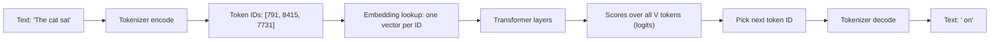
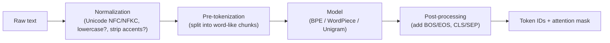

# Tokenization: How Text Becomes Numbers

> **Level:** Beginner to Advanced · **Study time:** ~80 min · **Prerequisites:** [What AI, ML, DL and GenAI Are](../00-foundations/01-what-is-ai-ml-dl-and-genai.md), [Python Tooling for ML](../00-foundations/06-python-numpy-pandas-pytorch-essentials.md); helpful: [Softmax, Entropy, Cross-Entropy and KL Divergence](../00-foundations/05-softmax-entropy-cross-entropy-and-kl-divergence.md)

## Table of contents

- [Why this matters](#why-this-matters)
- [The big picture: from text to token IDs and back](#the-big-picture-from-text-to-token-ids-and-back)
- [Three ways to cut text: characters, words and subwords](#three-ways-to-cut-text-characters-words-and-subwords)
- [The tokenizer pipeline: normalization, pre-tokenization, model, post-processing](#the-tokenizer-pipeline-normalization-pre-tokenization-model-post-processing)
- [Byte-Pair Encoding (BPE), step by step](#byte-pair-encoding-bpe-step-by-step)
- [WordPiece](#wordpiece)
- [Unigram language model and SentencePiece](#unigram-language-model-and-sentencepiece)
- [Byte-level BPE: never an unknown token](#byte-level-bpe-never-an-unknown-token)
- [Comparing the algorithms](#comparing-the-algorithms)
- [Choosing a vocabulary size](#choosing-a-vocabulary-size)
- [Special tokens and chat templates](#special-tokens-and-chat-templates)
- [Token counting: cost, latency and context limits](#token-counting-cost-latency-and-context-limits)
- [Tokenization quirks every senior engineer should know](#tokenization-quirks-every-senior-engineer-should-know)
- [Hands-on: tiktoken, Hugging Face and SentencePiece](#hands-on-tiktoken-hugging-face-and-sentencepiece)
- [Going deeper: tokenizer bugs in production](#going-deeper-tokenizer-bugs-in-production)
- [Going deeper: measuring, comparing and evolving tokenizers](#going-deeper-measuring-comparing-and-evolving-tokenizers)
- [Common mistakes and misconceptions](#common-mistakes-and-misconceptions)
- [Interview questions and model answers](#interview-questions-and-model-answers)
- [Key takeaways](#key-takeaways)
- [Further reading](#further-reading)
- [Next](#next)

## Why this matters

Virtually every production large language model (LLM) you will use, whether GPT-4o, Llama, Gemini, Mistral or Qwen, never sees letters or words. It sees a list of integers produced by a **tokenizer**, and it produces a list of integers that a tokenizer turns back into text. That single preprocessing step decides how much each API call costs, how much text fits in the context window, how fast responses stream, why models stumble on arithmetic and spelling, and why the same prompt costs more in Hindi than in English. Tokenizer mismatches are also one of the most common sources of silent bugs when fine-tuning or serving open models. Interviewers ask "How does tokenization work?" because a good answer quickly reveals whether a candidate understands LLMs as real systems or only as black boxes.

## The big picture: from text to token IDs and back

> **Analogy:** Think of a tokenizer as a LEGO sorter. You hand it a finished model (a sentence), and it breaks it into standard bricks from a fixed catalog. Each brick type has a catalog number. The neural network only ever works with catalog numbers. To show you the result, the sorter looks the numbers up and snaps the bricks back together.

Let us define the core vocabulary of this chapter precisely.

- A **token** is one unit of text that the model treats as an atomic symbol. It can be a whole word (`" cat"`), a piece of a word (`"ization"`), a single character, a single byte, or a special marker such as "end of text".
- A **vocabulary** is the fixed, finite list of all tokens a tokenizer knows. Its size is written $V$ (typically 30,000 to 260,000 for modern models).
- A **token ID** is the integer index of a token in the vocabulary, from $0$ to $V-1$.
- **Encoding** (or tokenizing) is turning a string into a list of token IDs. **Decoding** (or detokenizing) is turning token IDs back into a string.
- A **tokenizer** is the component that does both. It is *trained* on a large text corpus before the model is trained, and then it is *frozen*: the model learns one vector per token ID, so the tokenizer and the model are a matched pair forever.

Here is the full journey of a piece of text through an LLM:



The IDs in the diagram are illustrative. The real numbers depend entirely on which tokenizer you use.

**Why do models need tokens at all?** Neural networks do arithmetic on numbers, specifically on vectors of numbers. To feed text in, we need two things:

1. A way to chop an unbounded space of possible strings into a **finite** set of symbols, because the model must have one learned vector (an **embedding**, covered in [Embeddings: From One-Hot Vectors to Word2Vec to Contextual Embeddings](02-embeddings-from-one-hot-to-contextual.md)) per symbol, and its output layer must produce one score per symbol.
2. A **reversible** mapping, so whatever the model outputs can be turned back into exact text.

The output side matters as much as the input side. An LLM generates text by repeatedly predicting a probability distribution over all $V$ tokens (via a softmax, see [Softmax, Entropy, Cross-Entropy and KL Divergence](../00-foundations/05-softmax-entropy-cross-entropy-and-kl-divergence.md)) and picking one. So the vocabulary is literally the menu of everything the model can say in one step.

> **Senior insight:** "The tokenizer is part of the model." Treat the tokenizer files (vocabulary, merges, special tokens, chat template, normalization rules) as a versioned artifact that ships with the weights. Changing any of them without retraining breaks the model.

## Three ways to cut text: characters, words and subwords

There are three natural granularities. We will compare them on a running example: the sentence **"The cats are unhappy"** and the single word **"unhappiness"**.

### Character-level tokenization

Each character is a token. "unhappiness" becomes 11 tokens: `u n h a p p i n e s s`.

- **Vocabulary size:** small. English letters, digits and punctuation fit in about 100 symbols. (Covering all of Unicode would need more than 150,000 symbols, and the count grows with each Unicode release, which is no longer small, a problem we will solve with bytes later.)
- **Out-of-vocabulary (OOV) words**, meaning words the tokenizer cannot represent with its vocabulary, essentially never occur in a single language.
- **Sequence length** (the number of tokens for a given text) is long. "The cats are unhappy" is 20 characters including spaces, so 20 tokens.

Long sequences hurt because the cost of self-attention grows with the *square* of the sequence length (see [The Attention Mechanism, Step by Step](03-attention-mechanism-step-by-step.md)), the context window fills faster, and generation takes one step per token. A model also has to spend capacity learning that `c-a-t` means a furry animal, which is wasted effort.

### Word-level tokenization

Split on spaces and punctuation; each word is a token. "The cats are unhappy" becomes 4 tokens.

- **Sequence length:** short, which is great.
- **Vocabulary size:** huge. English alone has hundreds of thousands of word forms (cat, cats, catlike, cat's...). Add names, typos, code identifiers, URLs and other languages, and it is effectively unbounded.
- **OOV problem:** any word not in the vocabulary becomes a single **unknown token**, written `[UNK]` or `<unk>`. If "unhappiness" was not seen often enough during vocabulary building, the model literally sees "something unknown". It cannot even generate a new word.
- **No sharing:** "cat" and "cats" get unrelated IDs, so the model must learn their relationship from scratch.

### Subword tokenization

Frequent words stay whole, and rare words are split into meaningful, reusable pieces. "unhappiness" might become `un` + `happi` + `ness` (illustrative; the exact split depends on the trained tokenizer).

- **Vocabulary size:** moderate and *chosen by you* (for example 32,000 or 128,000).
- **OOV:** rare or new words are built from pieces, so unknown tokens are rare (and, with byte-level variants, impossible).
- **Sequence length:** close to word-level for common text, longer only for rare words.
- **Sharing:** "unhappy", "unhappiness" and "happiness" share pieces, which helps the model generalize.

> **Analogy:** Subword vocabularies work like a language learner's mental dictionary. You memorize very common words whole ("the", "and"), but for a rare word like "unbelievableness" you recognize the familiar parts.

### The trade-off at a glance

| Approach | Vocabulary size | OOV handling | Sequence length | Pros | Cons | Used by |
|---|---|---|---|---|---|---|
| Character | ~100 (one language) to 150k+ (all Unicode) | Almost no OOV | Very long | Simple, robust to typos | Long sequences, slow, model must learn spelling to meaning | Early char-RNNs, some research models |
| Word | 100k to millions | `[UNK]` for unseen words | Short | Intuitive, short sequences | Huge embedding table, OOV, no sharing across forms | word2vec-era NLP, classic bag-of-words |
| Subword | 30k to 260k (chosen) | Rare words split into pieces; byte-level: none | Short to medium | Best balance, shares morphology | Splits can be unintuitive; quirks with numbers, spelling | Essentially all modern LLMs |
| Byte (pure) | 256 | None ever | Longest (1 token per byte) | Universal, no tokenizer training | Very long sequences | ByT5 and research models |

Why does subword work so well? Word frequencies follow **Zipf's law**: a handful of words ("the", "of", "and") make up a large fraction of all text, while a very long tail of words appears rarely. Subword tokenization spends vocabulary slots on the frequent head (one token each) and composes the long tail from pieces. It is, in effect, a compression scheme tuned to your training data.

A useful number for comparing tokenizers is **fertility**: the average number of tokens produced per word.

$$\text{fertility} = \frac{\text{number of tokens}}{\text{number of words}}$$

- $\text{number of tokens}$: tokens the tokenizer produced for a text.
- $\text{number of words}$: whitespace-separated words in that text.

Worked example: "The cats are unhappy" has 4 words. Suppose a subword tokenizer produces `The`, ` cats`, ` are`, ` un`, `happy` (illustrative), that is 5 tokens. Fertility $= 5 / 4 = 1.25$. Word-level gives $4/4 = 1.0$; character-level gives $20/4 = 5.0$. Lower fertility means shorter sequences, cheaper and faster processing.

## The tokenizer pipeline: normalization, pre-tokenization, model, post-processing

Before we look at specific algorithms, note that a production tokenizer is a small pipeline, not one function. The Hugging Face `tokenizers` library names the stages explicitly, and the names are a good mental model for any tokenizer.



- **Normalization** cleans the string. Unicode can encode "é" either as one code point or as "e" plus a combining accent; **NFC** and **NFKC** are standard Unicode normalization forms that make these identical (NFKC also folds "compatibility" variants, such as the ligature `fi` into `fi` or full-width `Ａ` into `A`). Some tokenizers also lowercase (for example `bert-base-uncased`) or strip accents. Modern LLM tokenizers mostly do minimal normalization so decoding returns the exact original text.
- **Pre-tokenization** splits text into chunks (roughly words, numbers and punctuation) so that the subword algorithm never merges across chunk boundaries. Without it, BPE might learn a token like `"dog."` or `"the cat"` that glues unrelated things together. GPT-style tokenizers use a regular expression for this step.
- **Model** is the subword algorithm itself (BPE, WordPiece or Unigram), which turns each chunk into tokens.
- **Post-processing** adds special tokens (beginning-of-sequence, separators) and builds extra outputs such as the **attention mask** (a list of 1s and 0s telling the model which positions are real tokens versus padding).

One input traced through two real pipelines (the GPT-2 subword split of "Héllo" is illustrative):

| Stage | BERT (`bert-base-uncased`, WordPiece) | GPT-2 (byte-level BPE) |
|---|---|---|
| Input | `Héllo, World!` | `Héllo, World!` |
| Normalization | lowercase + strip accents: `hello, world!` | none: `Héllo, World!` |
| Pre-tokenization | split on spaces and punctuation: `hello` `,` `world` `!` | regex, space glued to next word: `Héllo` `,` ` World` `!` |
| Model | every chunk is already in the vocab: `hello` `,` `world` `!` | `Héllo` becomes several byte-level pieces; ` World` stays one token |
| Post-processing | `[CLS] hello , world ! [SEP]` | nothing added by default |

> **Common mistake:** Assuming two tokenizers that use "BPE" behave the same. Two BPE tokenizers with different normalization or pre-tokenization rules give different tokens for the same text, even with similar vocabularies.

## Byte-Pair Encoding (BPE), step by step

**Byte-Pair Encoding (BPE)** started life as a data compression algorithm (Philip Gage, "A New Algorithm for Data Compression", 1994) and was adapted for neural machine translation by Sennrich, Haddow and Birch in "Neural Machine Translation of Rare Words with Subword Units" (2016). It is the basis of the GPT family's tokenizers, Llama, Mistral and many others.

> **Analogy:** Imagine texting a friend a lot. You notice you type "o" followed by "k" constantly, so you invent the shortcut "ok". Then you notice "ok" followed by "ay" is common, so "okay" becomes one shortcut. BPE does exactly this: repeatedly find the most common adjacent pair and give it a shortcut.

### The training algorithm

Training a BPE tokenizer means learning an ordered list of **merge rules**.

1. Pre-tokenize the corpus into words and count how often each word appears.
2. Split every word into characters. The set of characters is the starting vocabulary.
3. Count every adjacent pair of symbols across the corpus, weighting each by the word's frequency.
4. Take the most frequent pair, say (`u`, `g`). Add the new symbol `ug` to the vocabulary and record the merge rule `u + g -> ug`.
5. Replace every occurrence of that pair in the corpus with the merged symbol.
6. Repeat steps 3 to 5 until the vocabulary reaches the target size (or a set number of merges).

The final vocabulary size is: base symbols + number of merges (+ special tokens).

### Worked example on a tiny corpus

Our corpus has five distinct words with these frequencies (a classic toy corpus also used in the Hugging Face course):

| Word | Count |
|---|---|
| hug | 10 |
| pug | 5 |
| pun | 12 |
| bun | 4 |
| hugs | 5 |

**Base vocabulary** (all characters that appear): `b, g, h, n, p, s, u` (7 symbols).

Split into characters:

```text
h u g     x10
p u g     x5
p u n     x12
b u n     x4
h u g s   x5
```

**Merge 1: count all adjacent pairs.** Each pair inside a word is counted once per occurrence of that word.

| Pair | Comes from | Count |
|---|---|---|
| (h, u) | hug 10 + hugs 5 | 10 + 5 = **15** |
| (u, g) | hug 10 + pug 5 + hugs 5 | 10 + 5 + 5 = **20** |
| (p, u) | pug 5 + pun 12 | 5 + 12 = **17** |
| (u, n) | pun 12 + bun 4 | 12 + 4 = **16** |
| (b, u) | bun 4 | **4** |
| (g, s) | hugs 5 | **5** |

The winner is (u, g) with 20. New rule: `u + g -> ug`. Vocabulary now has 8 symbols.

```text
h ug      x10
p ug      x5
p u n     x12
b u n     x4
h ug s    x5
```

**Merge 2: recount.**

| Pair | Comes from | Count |
|---|---|---|
| (h, ug) | hug 10 + hugs 5 | **15** |
| (p, ug) | pug 5 | **5** |
| (p, u) | pun 12 | **12** |
| (u, n) | pun 12 + bun 4 | **16** |
| (b, u) | bun 4 | **4** |
| (ug, s) | hugs 5 | **5** |

Notice (p, u) dropped from 17 to 12: the `u` in "pug" was consumed by the `ug` merge. The winner is (u, n) with 16. New rule: `u + n -> un`.

```text
h ug      x10
p ug      x5
p un      x12
b un      x4
h ug s    x5
```

**Merge 3: recount.** (h, ug) = 10 + 5 = **15**, (p, ug) = **5**, (p, un) = **12**, (b, un) = **4**, (ug, s) = **5**. The winner is (h, ug) with 15. New rule: `h + ug -> hug`.

```text
hug       x10
p ug      x5
p un      x12
b un      x4
hug s     x5
```

**Merge 4: recount.** (p, ug) = **5**, (p, un) = **12**, (b, un) = **4**, (hug, s) = **5**. The winner is (p, un) with 12. New rule: `p + un -> pun`.

```text
hug       x10
p ug      x5
pun       x12
b un      x4
hug s     x5
```

After 4 merges:

- **Merge rules (in order):** `u+g`, `u+n`, `h+ug`, `p+un`
- **Vocabulary (11 symbols):** `b, g, h, n, p, s, u, ug, un, hug, pun`

If we continued, the next round would be a tie between (p, ug) and (hug, s), both 5. Implementations break ties deterministically (for example by first occurrence), and you must use the *same* rule at encode time, which is automatic because encoding just replays the saved merge list.

### Encoding new text with the learned merges

To tokenize a word, split it into characters and apply the merge rules **in the order they were learned**. A rule's position in that list is its **rank** (rank 1 = learned first = highest priority), which is why the comparison table later says "replay merges by rank":

- **"hugs"**: `h u g s` -> rule 1 gives `h ug s` -> rule 3 gives `hug s`. Result: `[hug, s]`.
- **"bug"**: `b u g` -> rule 1 gives `b ug`. No other rule applies. Result: `[b, ug]`. "bug" was never in the corpus, yet we tokenized it without any unknown token.
- **"unhug"**: `u n h u g` -> rule 1: `u n h ug` -> rule 2: `un h ug` -> rule 3: `un hug`. Result: `[un, hug]`.
- **"mug"**: `m` is not in the base vocabulary! Result: `[UNK, ug]`. This is the weakness of character-based BPE, and the reason byte-level BPE exists (see below).

### BPE from scratch in Python

This code reproduces the worked example exactly. It needs no installs.

```python
from collections import Counter

def get_pair_counts(splits, word_freqs):
    """Count adjacent symbol pairs, weighted by word frequency."""
    pairs = Counter()
    for word, freq in word_freqs.items():
        symbols = splits[word]
        for a, b in zip(symbols, symbols[1:]):
            pairs[(a, b)] += freq
    return pairs

def merge_symbols(symbols, pair):
    """Replace every occurrence of `pair` in a symbol list with the merged symbol."""
    a, b = pair
    out, i = [], 0
    while i < len(symbols):
        if i < len(symbols) - 1 and symbols[i] == a and symbols[i + 1] == b:
            out.append(a + b)
            i += 2
        else:
            out.append(symbols[i])
            i += 1
    return out

def train_bpe(word_freqs, num_merges):
    splits = {w: list(w) for w in word_freqs}          # start from characters
    vocab = sorted({ch for w in word_freqs for ch in w})
    merges = []
    for step in range(1, num_merges + 1):
        pairs = get_pair_counts(splits, word_freqs)
        if not pairs:
            break
        best = max(pairs, key=pairs.get)                # ties: first pair seen wins
        print(f"merge {step}: {best} count={pairs[best]}")
        merges.append(best)
        vocab.append(best[0] + best[1])
        splits = {w: merge_symbols(s, best) for w, s in splits.items()}
    return merges, vocab

def encode_word(word, merges, vocab):
    symbols = [ch if ch in vocab else "[UNK]" for ch in word]
    for pair in merges:                                 # replay merges in learned order
        symbols = merge_symbols(symbols, pair)
    return symbols

corpus = {"hug": 10, "pug": 5, "pun": 12, "bun": 4, "hugs": 5}
merges, vocab = train_bpe(corpus, num_merges=4)
# merge 1: ('u', 'g') count=20
# merge 2: ('u', 'n') count=16
# merge 3: ('h', 'ug') count=15
# merge 4: ('p', 'un') count=12
print(vocab)  # ['b', 'g', 'h', 'n', 'p', 's', 'u', 'ug', 'un', 'hug', 'pun']
for w in ["hugs", "bug", "unhug", "mug"]:
    print(w, "->", encode_word(w, merges, vocab))
# hugs -> ['hug', 's']
# bug -> ['b', 'ug']
# unhug -> ['un', 'hug']
# mug -> ['[UNK]', 'ug']
```

> **Senior insight:** This naive trainer recounts all pairs after every merge, which is far too slow for real corpora. Production trainers (Hugging Face `tokenizers`, SentencePiece) keep pair counts in a priority queue and update only the pairs touched by each merge. Encoding is also optimized: instead of replaying tens of thousands of merges, implementations repeatedly merge the adjacent pair with the *lowest merge rank* and cache results per pre-tokenized chunk. If you want to study a clean reference, Andrej Karpathy's `minbpe` repository is excellent.

## WordPiece

**WordPiece** was introduced by Schuster and Nakajima ("Japanese and Korean Voice Search", 2012) and became famous as BERT's tokenizer (Devlin et al., 2019). It looks like BPE (start from characters, merge pairs) but chooses merges with a different score.

> **Analogy:** BPE asks "which pair shows up most often?". WordPiece asks "which pair shows up together *surprisingly* often, given how common each half is on its own?". It is like noticing two people are always at the same parties: interesting if they are both introverts, unremarkable if they both go to every party.

### The merge score

$$\text{score}(a, b) = \frac{\text{count}(ab)}{\text{count}(a) \times \text{count}(b)}$$

- $a, b$: two adjacent symbols in the current vocabulary.
- $\text{count}(ab)$: how many times $a$ is immediately followed by $b$ in the corpus (frequency-weighted).
- $\text{count}(a)$, $\text{count}(b)$: how many times each symbol appears in total (frequency-weighted), whether or not it is next to the other symbol.

Dividing by the individual counts means WordPiece prefers merging pairs whose parts are rare individually but frequent together. (The original formulation picks the merge that most increases the training data's likelihood under a simple language model; the ratio above is the standard practical form, used for example in the Hugging Face course.)

WordPiece marks pieces that continue a word with a `##` prefix. So "hugs" is initially `h ##u ##g ##s`.

### Worked example with the same corpus

Symbol counts (frequency-weighted):

- `h`: hug 10 + hugs 5 = **15**
- `##u`: hug 10 + pug 5 + pun 12 + bun 4 + hugs 5 = **36**
- `##g`: hug 10 + pug 5 + hugs 5 = **20**
- `p`: pug 5 + pun 12 = **17**
- `##n`: pun 12 + bun 4 = **16**
- `b`: **4**
- `##s`: **5**

Pair scores:

| Pair | count(ab) | count(a) x count(b) | Score |
|---|---|---|---|
| (h, ##u) | 15 | 15 x 36 = 540 | 15/540 = 1/36 ≈ 0.0278 |
| (##u, ##g) | 20 | 36 x 20 = 720 | 20/720 = 1/36 ≈ 0.0278 |
| (p, ##u) | 17 | 17 x 36 = 612 | 17/612 = 1/36 ≈ 0.0278 |
| (##u, ##n) | 16 | 36 x 16 = 576 | 16/576 = 1/36 ≈ 0.0278 |
| (b, ##u) | 4 | 4 x 36 = 144 | 4/144 = 1/36 ≈ 0.0278 |
| (##g, ##s) | 5 | 20 x 5 = 100 | 5/100 = **0.05** |

BPE merged (u, g) first because it was most frequent. WordPiece merges (##g, ##s) first because `##s` is rare and, in this corpus, always appears after `##g`. Same data, different first merge: this is the essential difference.

### Encoding with WordPiece: longest match first

At inference, WordPiece does *not* replay merges. It stores only the final vocabulary and uses a greedy **longest-match-first** (also called MaxMatch) strategy: from the start of the word, take the longest vocabulary entry that matches, then continue from where it ended (with `##` pieces).

Example with a vocabulary containing `hug`, `##s`, `##g`, `h`, `##u`: "hugs" -> longest prefix in vocab is `hug` -> remainder "s" -> `##s`. Result: `[hug, ##s]`.

If any part of the word cannot be matched, standard BERT WordPiece maps the **whole word** to `[UNK]`, not just the unmatched part. That is harsher than BPE.

## Unigram language model and SentencePiece

### Unigram: start big, prune down

The **Unigram language model** tokenizer (Kudo, "Subword Regularization: Improving Neural Network Translation Models with Multiple Subword Candidates", 2018) works in the opposite direction from BPE and WordPiece.

> **Analogy:** BPE and WordPiece build a vocabulary like stacking bricks: start small, add pieces. Unigram works like a sculptor: start with a huge block of candidate pieces and chip away the ones that matter least.

The model assumes each token is chosen independently with its own probability $p(x)$. The probability of a segmentation $\mathbf{x} = (x_1, \dots, x_m)$ of a word is the product of its token probabilities:

$$P(\mathbf{x}) = \prod_{i=1}^{m} p(x_i)$$

- $\mathbf{x}$: one particular way to split the word into tokens.
- $x_i$: the $i$-th token of that split.
- $m$: number of tokens in the split.
- $p(x_i)$: the learned probability of token $x_i$ (all token probabilities sum to 1).

**Encoding** picks the most probable segmentation. Suppose (illustrative) $p(\text{h}) = 0.05$, $p(\text{u}) = 0.10$, $p(\text{g}) = 0.05$, $p(\text{hu}) = 0.02$, $p(\text{ug}) = 0.08$, $p(\text{hug}) = 0.06$. The candidate splits of "hug":

| Segmentation | Probability |
|---|---|
| h, u, g | 0.05 x 0.10 x 0.05 = 0.00025 |
| hu, g | 0.02 x 0.05 = 0.001 |
| h, ug | 0.05 x 0.08 = 0.004 |
| hug | **0.06** |

The tokenizer picks `[hug]`. Listing every split is exponential in word length, so real implementations use the **Viterbi algorithm**, a dynamic-programming method that finds the best path in time roughly proportional to (word length) x (maximum token length). It works in log-probabilities to avoid tiny numbers underflowing:

```python
import math

def viterbi_segment(word, probs):
    """Most probable segmentation of `word` under a unigram model."""
    n = len(word)
    best = [(-math.inf, None)] * (n + 1)   # best[i] = (log-prob of word[:i], start of last piece)
    best[0] = (0.0, None)
    for end in range(1, n + 1):
        for start in range(end):
            piece = word[start:end]
            if piece in probs and best[start][0] > -math.inf:
                score = best[start][0] + math.log(probs[piece])
                if score > best[end][0]:
                    best[end] = (score, start)
    pieces, end = [], n
    while end > 0:                          # walk back through the best path
        start = best[end][1]
        pieces.append(word[start:end])
        end = start
    return pieces[::-1], math.exp(best[n][0])

probs = {"h": 0.05, "u": 0.10, "g": 0.05, "s": 0.05,
         "hu": 0.02, "ug": 0.08, "hug": 0.06, "gs": 0.01}
print(viterbi_segment("hugs", probs))  # (['hug', 's'], ~0.003) since 0.06 x 0.05 = 0.003
```

**Training** (simplified):

1. Start with a large candidate vocabulary (for example all frequent substrings, or a big BPE vocabulary).
2. Estimate token probabilities with the **EM algorithm** (expectation-maximization: alternately guess segmentations given probabilities, then re-estimate probabilities from those segmentations).
3. For each token, compute how much the corpus **loss** (the negative log-likelihood of the corpus, $-\sum_{\text{words}} \text{count}(w) \log P(w)$) would increase if that token were removed.
4. Remove a fixed fraction (typically 10 to 25%; SentencePiece's default keeps 75% per round) of the tokens whose removal hurts least. Always keep single characters so everything stays representable.
5. Repeat until the target vocabulary size is reached.

A unique bonus: because Unigram defines a probability for every segmentation, you can **sample** different segmentations of the same word during training ("un hug" sometimes, "u n hug" other times). This is **subword regularization**, and it makes models more robust to segmentation noise. BPE later got a similar trick, **BPE-dropout** (Provilkov, Emelianenko and Voita, 2020), which randomly skips merges during training.

### SentencePiece

**SentencePiece** (Kudo and Richardson, "SentencePiece: A simple and language independent subword tokenizer and detokenizer for Neural Text Processing", 2018) is a *library*, not a new algorithm. It implements both BPE and Unigram. Its key ideas:

- **Raw text in, no pre-tokenization assumption.** Many languages (Chinese, Japanese, Thai) do not separate words with spaces, so splitting on spaces first is wrong for them. SentencePiece treats input as a raw stream of characters.
- **Whitespace is just a symbol.** Spaces are replaced by the visible character `▁` (U+2581, "lower one eighth block") and handled like any other character. "Hello world" becomes something like `▁Hello ▁world`. Decoding is then lossless with respect to the *normalized* text: replace `▁` with a space. (SentencePiece applies NFKC-based normalization and collapses extra whitespace by default unless the model disables it, as Llama's does, so the round trip to the original input is exact only when normalization is off.)
- **Byte fallback** (an option used by Llama 1 and 2 and early Mistral tokenizers such as Mistral 7B's, among others): characters not in the vocabulary are encoded as their raw UTF-8 bytes using 256 dedicated byte tokens like `<0xE4>`, instead of `<unk>`.

T5 uses a SentencePiece Unigram model; Llama 1 and 2 use SentencePiece BPE with a 32,000-token vocabulary.

> **Common mistake:** Saying "SentencePiece is an algorithm like BPE." In an interview, say "SentencePiece is a library and approach that treats text as a raw stream with whitespace as a symbol, and it can train either BPE or Unigram models."

## Byte-level BPE: never an unknown token

Our "mug" example produced `[UNK]` because `m` was missing from the base vocabulary. On the internet, the base alphabet is all of Unicode (more than 150,000 assigned characters, emoji included), most of them rare. Byte-level BPE, introduced with GPT-2 (Radford et al., "Language Models are Unsupervised Multitask Learners", 2019), fixes this elegantly.

### A quick UTF-8 recap

Computers store text as bytes. **UTF-8**, the dominant text encoding, represents each Unicode character as 1 to 4 bytes, where a **byte** is an integer from 0 to 255:

| Character | Script | UTF-8 bytes (decimal) | Byte count |
|---|---|---|---|
| `h` | Latin (ASCII) | 104 | 1 |
| `é` | Latin with accent | 195, 169 | 2 |
| `你` | Chinese | 228, 189, 160 | 3 |
| `😀` | Emoji | 240, 159, 152, 128 | 4 |

```python
print(list("héllo".encode("utf-8")))  # [104, 195, 169, 108, 108, 111]
print(list("你".encode("utf-8")))      # [228, 189, 160]
print(list("😀".encode("utf-8")))      # [240, 159, 152, 128]
```

### The idea

Run BPE on **bytes instead of characters**. The base vocabulary is exactly the 256 possible byte values. Every possible string is some sequence of bytes, so every possible string can be encoded. **There is no unknown token, ever.** Common byte sequences ("the", " cat", "ing", even common Chinese characters) are merged into single tokens just like before; rare ones fall back to individual bytes.

GPT-2's vocabulary is 50,257 tokens = 256 byte tokens + 50,000 learned merges + 1 special token (`<|endoftext|>`).

```text
"mug" with a character-level BPE (no 'm' in vocab):  [UNK] [ug]
"mug" with byte-level BPE:                            bytes 109 117 103 -> merged, e.g. [m] [ug] or [mug]
"😀"  with byte-level BPE:                            bytes 240 159 152 128 -> maybe one token, maybe several
```

### Implementation details you will see in the wild

- **The `Ġ` character.** GPT-2's implementation maps each of the 256 bytes to a printable Unicode character so the vocabulary file is readable. The space byte (32) is shown as `Ġ`. So when you inspect GPT-2 tokens you see `ĠHello`, which means " Hello" (with a leading space).
- **Regex pre-tokenization.** Before byte-level BPE, the text is split with a regular expression that separates letters, digits, punctuation, whitespace and English contractions (`'s`, `'t`, `'re`). This prevents merges like "dog." or "dog!" from wasting vocabulary slots. The space is attached to the *front* of the following word, which is why " cat" is a token.
- **Invalid partial decodes.** A single token may hold only part of a multi-byte character (for example 2 of the 3 bytes of `你`). Decoding that one token alone gives invalid UTF-8. This matters for streaming (see the production section).

**Downsides:** non-Latin scripts start at 2 to 4 bytes per character, so if the training data had little of a language, its text stays split into many byte-level tokens. That is the root of multilingual inefficiency, covered below.

Byte-level BPE (in tiktoken encodings such as `cl100k_base` and `o200k_base` used by OpenAI models, in Llama 3's 128K tokenizer, and in GPT-2-derived tokenizers) and SentencePiece with byte fallback (Llama 2, Mistral 7B, Gemma) are the two dominant designs in 2026. (Newer Mistral models moved to a tiktoken-based byte-level BPE tokenizer called Tekken.) They reach the same goal, no unknown tokens, by slightly different routes.

## Comparing the algorithms

| | BPE (char-level) | Byte-level BPE | WordPiece | Unigram (usually via SentencePiece) |
|---|---|---|---|---|
| **Training direction** | Bottom-up: merge pairs | Bottom-up: merge byte pairs | Bottom-up: merge pairs | Top-down: prune a big vocab |
| **Merge/selection criterion** | Most frequent pair | Most frequent pair | count(ab) / (count(a) count(b)) | Smallest loss increase when removed |
| **What is stored** | Vocab + ordered merges | Vocab + ordered merges | Vocab only | Vocab + token probabilities |
| **Encoding** | Replay merges by rank | Replay merges by rank | Greedy longest match | Viterbi (most probable split) |
| **Unknown tokens** | Possible for unseen chars | Never | Possible (whole word -> `[UNK]`) | Possible, unless byte fallback |
| **Multiple segmentations** | No (BPE-dropout adds noise) | No (BPE-dropout possible) | No | Yes, can sample (subword regularization) |
| **Typical users** | Original NMT systems | GPT-2 onward, Llama 3, many LLMs | BERT, DistilBERT, ELECTRA | T5, ALBERT, XLNet, many multilingual models |

For interviews, the practical summary: **all four learn a vocabulary of frequent pieces from data; they differ in how they choose the pieces and how they split new text.** The big modern decision is not "BPE vs Unigram" so much as "byte-level (or byte fallback) vs not", plus vocabulary size and pre-tokenization rules.

## Choosing a vocabulary size

Vocabulary size $V$ is a hyperparameter that trades sequence length against model size and rare-token quality.

### The embedding cost

Every token needs a row in the input embedding matrix, and (unless the weights are **tied**, meaning shared) another row in the output projection that produces the logits:

$$P_{\text{emb}} = V \times d$$

- $P_{\text{emb}}$: number of parameters in one embedding (or output) matrix.
- $V$: vocabulary size.
- $d$: the model's hidden size (also called $d_{\text{model}}$), the length of each token's vector.

Worked example using our running **7B model** family. Llama 2 7B has $V = 32{,}000$ and $d = 4{,}096$:

$$32{,}000 \times 4{,}096 = 131{,}072{,}000 \approx 131\text{M parameters per matrix}$$

Llama 3 8B keeps $d = 4{,}096$ but uses $V = 128{,}256$:

$$128{,}256 \times 4{,}096 = 525{,}336{,}576 \approx 525\text{M parameters per matrix}$$

Llama 3 does not tie input and output embeddings, so that is about $2 \times 525\text{M} \approx 1.05\text{B}$ parameters spent on the vocabulary, which is part of why it is an "8B" model rather than a "7B" one. In 16-bit precision (2 bytes per parameter), one such matrix takes $525{,}336{,}576 \times 2 \approx 1.05$ GB of memory.

The output layer also costs compute on every generated token: producing the logits is a $d \times V$ matrix-vector product, about $2 \times d \times V$ floating-point operations, that is $2 \times 4{,}096 \times 128{,}256 \approx 1.05$ billion operations per token for Llama 3 8B.

### Why go bigger anyway?

A larger vocabulary compresses text better: more words and common phrases become single tokens, especially in non-English languages and code. Fewer tokens per document means:

- more text fits in the context window,
- fewer decoding steps (faster generation, cheaper per character),
- less attention compute (quadratic in sequence length).

Meta reported that Llama 3's larger tokenizer encodes text noticeably more efficiently than Llama 2's. The trend over time has been upward: GPT-2 about 50K, GPT-4's `cl100k_base` about 100K, GPT-4o's `o200k_base` about 200K, Gemma about 256K.

### The trade-off

| Smaller vocabulary (e.g. 8K to 32K) | Larger vocabulary (e.g. 128K to 256K) |
|---|---|
| Smaller embedding and output matrices | Bigger matrices, more memory, heavier softmax |
| Longer sequences, more decoding steps | Shorter sequences, more text per context window |
| Each token seen many times in training, well-learned embeddings | Many rare tokens seen few times, poorly trained embeddings (risk of "glitch tokens") |
| Often fine for small models or single-language tasks | Better for multilingual and code-heavy models at large scale |

> **Senior insight:** Vocabulary size should scale with model size and data diversity. For a tiny model, a 256K vocabulary could make the embedding matrices a large fraction of all parameters. For a 70B model, the same vocabulary is a small fraction and the sequence-length savings dominate. Research such as "Scaling Laws with Vocabulary" (Tao et al., 2024) argues that many models used vocabularies smaller than compute-optimal. Treat specific "optimal" numbers as research findings, not laws.

## Special tokens and chat templates

### Special tokens

**Special tokens** are reserved vocabulary entries that never come from ordinary text. They carry structure and control signals. Their exact spelling varies by model.

| Token (common spellings) | Name | Purpose |
|---|---|---|
| `<s>`, `<\|begin_of_text\|>`, `[CLS]` | **BOS** (beginning of sequence) | Marks the start; gives the first real token something to attend to |
| `</s>`, `<\|endoftext\|>`, `<\|eot_id\|>`, `<\|im_end\|>` | **EOS** (end of sequence / end of turn) | Tells the model, and the generation loop, to stop |
| `<pad>`, `[PAD]` | **PAD** (padding) | Fills shorter sequences in a batch to the same length; ignored via the attention mask |
| `<unk>`, `[UNK]` | **UNK** (unknown) | Stand-in for unrepresentable text (absent in pure byte-level tokenizers) |
| `[CLS]`, `[SEP]`, `[MASK]` | BERT-style | Classification summary position, segment separator, masked-word placeholder |
| `<extra_id_0>`... | T5 sentinels | Mark spans to fill in during T5 pretraining |
| `<\|fim_prefix\|>` etc. | Fill-in-the-middle | Code completion inside a file |
| Tool or role markers | Chat/tool tokens | Delimit roles, tool calls and tool results |

**Padding** deserves a closer look. GPUs process a **batch** (several sequences at once) as one rectangular tensor, so sequences of different lengths are padded:

```text
Sequence A: [BOS] The  cat  sat  [EOS]          mask: 1 1 1 1 1
Sequence B: [BOS] Hi   [EOS] [PAD] [PAD]        mask: 1 1 1 0 0
```

The attention mask's 0s stop real tokens from attending to padding. For decoder-only models generating text in a batch, padding usually goes on the **left**, so every sequence's last real token sits at the same final position where the next token is generated.

### Chat templates

Chat models are fine-tuned on conversations formatted in one exact way. A **chat template** is the rule that turns a list of messages (system, user, assistant, tool) into the single string, with special tokens, that the model saw during fine-tuning. Llama 3 Instruct, for example, uses:

```text
<|begin_of_text|><|start_header_id|>system<|end_header_id|>

You are a helpful assistant.<|eot_id|><|start_header_id|>user<|end_header_id|>

What is BPE?<|eot_id|><|start_header_id|>assistant<|end_header_id|>

```

Many other models (Qwen among them) use a format called ChatML:

```text
<|im_start|>system
You are a helpful assistant.<|im_end|>
<|im_start|>user
What is BPE?<|im_end|>
<|im_start|>assistant
```

The trailing "assistant header" is the **generation prompt**: it tells the model "now it is your turn". Forget it and the model may continue the user's message instead of answering.

With Hugging Face, never hand-build these strings. The template ships inside the tokenizer config:

```python
# pip install transformers
from transformers import AutoTokenizer

tok = AutoTokenizer.from_pretrained("Qwen/Qwen2.5-0.5B-Instruct")
messages = [
    {"role": "system", "content": "You are a helpful assistant."},
    {"role": "user", "content": "What is BPE?"},
]
prompt_text = tok.apply_chat_template(messages, tokenize=False, add_generation_prompt=True)
print(prompt_text)                      # inspect the exact string the model will see

# The rendered text already contains its special tokens, so do not let the
# tokenizer add another BOS on top (the classic "double BOS" bug).
input_ids = tok(prompt_text, add_special_tokens=False, return_tensors="pt")["input_ids"]
print(input_ids.shape)                  # (1, number_of_prompt_tokens)
```

`apply_chat_template` can also tokenize directly (`tokenize=True`), but its return type has changed across `transformers` versions, so check the docs for the version you pin.

Hosted APIs (OpenAI, Gemini and others) apply their template server-side. You send structured messages, and the API bills you for the template's extra tokens too. Details of how templates feed into instruction tuning are in [Instruction Tuning, RLHF and DPO](../05-llms/02-instruction-tuning-rlhf-and-dpo.md).

> **Interview tip:** If asked "why does my fine-tuned model ramble and never stop?", the first two suspects are tokenizer-level: the EOS token was masked out of the training labels (often because `pad_token` was set equal to `eos_token`), or training and inference used different chat templates.

## Token counting: cost, latency and context limits

Tokens are the unit of *everything* in LLM operations: billing, rate limits, context windows and latency.

### Rules of thumb (English, modern tokenizers)

- About 4 characters per token, or about 0.75 words per token (so 100 tokens ≈ 75 words). OpenAI publishes this heuristic for its tokenizers.
- These are rough averages for English prose. Code, JSON, numbers, URLs and non-English text can be very different. **Always measure with the actual tokenizer** for anything that matters.

### Cost

$$\text{cost per request} = \frac{N_{\text{in}} \cdot P_{\text{in}} + N_{\text{out}} \cdot P_{\text{out}}}{10^6}$$

- $N_{\text{in}}$: input (prompt) tokens, including system prompt, chat template, retrieved documents and tool definitions.
- $N_{\text{out}}$: output (completion) tokens, including any hidden reasoning tokens a reasoning model produces.
- $P_{\text{in}}, P_{\text{out}}$: price per million input and output tokens. Output tokens are usually priced several times higher than input.

Worked example with **illustrative** prices of \$2.50 per million input tokens and \$10 per million output tokens, for a support chatbot request with 1,500 input tokens and 300 output tokens:

- Input: $1{,}500 \times 2.50 / 10^6 = 3{,}750 / 10^6 = \$0.00375$
- Output: $300 \times 10 / 10^6 = 3{,}000 / 10^6 = \$0.003$
- Total: $0.00375 + 0.003 = \$0.00675$ per request
- At 100,000 requests per day: $0.00675 \times 100{,}000 = \$675$ per day

Cutting the system prompt by 500 tokens saves $500 \times 2.50 / 10^6 \times 100{,}000 = \$125$ per day. This is why senior engineers measure prompts in tokens, not characters. Prompt caching (reusing the computation for a repeated token prefix) changes the economics further; see [Speculative Decoding, Prompt Caching and Other Inference Speedups](../06-llm-inference/05-speculative-decoding-caching-and-other-speedups.md).

### Latency

LLM inference has two phases (details in [LLM Inference Fundamentals](../06-llm-inference/01-inference-fundamentals-prefill-decode-and-latency-metrics.md)):

- **Prefill** processes all input tokens in parallel. Its time grows with $N_{\text{in}}$ and largely determines **time to first token (TTFT)**.
- **Decode** generates output tokens one at a time. Each step costs roughly a fixed **time per output token (TPOT)**.

$$\text{total latency} \approx \text{TTFT} + (N_{\text{out}} - 1) \times \text{TPOT}$$

(The first token arrives at TTFT, so only $N_{\text{out}} - 1$ inter-token gaps follow; for long outputs this is close to $N_{\text{out}} \times \text{TPOT}$.)

Illustrative example: TTFT = 0.3 s, TPOT = 20 ms, 300 output tokens: $0.3 + 299 \times 0.020 = 0.3 + 5.98 = 6.28$ s. Output tokens dominate. A tokenizer that needs 30% more tokens for the same answer (for example in a language it handles poorly) makes that answer roughly 30% slower to stream.

Sequence length also drives attention compute quadratically: going from 1,000 to 3,000 tokens means $3{,}000^2 / 1{,}000^2 = 9$ times as many attention scores, and the KV cache (see [The KV Cache](../06-llm-inference/02-kv-cache-explained.md)) grows linearly with token count.

### Context limits

The **context window** is the maximum number of tokens the model can handle at once, and it covers input *and* output together:

$$N_{\text{in}} + N_{\text{out}} \le \text{context window}$$

Worked example: a model with an 8,192-token window, a 500-token system prompt, 5 retrieved chunks of 800 tokens each and 2,000 tokens of chat history:

- Input: $500 + 5 \times 800 + 2{,}000 = 500 + 4{,}000 + 2{,}000 = 6{,}500$ tokens
- Room left for the answer: $8{,}192 - 6{,}500 = 1{,}692$ tokens

If you set `max_tokens=2000`, some APIs reject the request and some truncate the answer. Budget tokens explicitly, and remember that a RAG system's chunk sizes should be measured in tokens of the relevant tokenizer (see [Chunking Strategies](../08-rag/04-chunking-strategies.md)).

## Tokenization quirks every senior engineer should know

### Leading-space tokens

In GPT-style and SentencePiece tokenizers, the space usually belongs to the *following* word. `"hello"` and `" hello"` are different tokens with different IDs, and `"Hello"` is different again. Consequences:

- A prompt ending with a **trailing space** ("The answer is ") forces the model to produce a token *without* a leading space, which is unusual in its training data and can degrade output. The fix, sometimes called **token healing** (popularized by the Guidance library), backs up over the last token and constrains generation to tokens that start with it. The simple fix: do not end prompts with a space.
- Few-shot labels like "Answer: Positive" vs "Answer:Positive" tokenize differently. Keep formats consistent between examples and the actual query.
- Counting, searching or banning a word via **logit bias** (an API option that adds a fixed amount to chosen token IDs' scores before sampling) must consider all its variants (" yes", "yes", " Yes", "Yes").

### Whitespace and code

Code is full of indentation. GPT-2's tokenizer handled runs of spaces poorly, often spending a token per space, so a deeply indented Python file was expensive. Later tokenizers (for example `cl100k_base`, and tokenizers trained for code models) include tokens for runs of whitespace, which greatly reduces token counts for code. Practical consequences:

- Minifying JSON or stripping indentation can noticeably cut token counts for structured payloads. Measure before and after.
- Tabs vs spaces, `\r\n` vs `\n` and trailing whitespace change token counts and can change model behavior.

### Numbers and arithmetic

How digits are grouped is a design decision:

| Strategy | Example for "1234567" | Used by (examples) |
|---|---|---|
| Learned BPE merges, no special rule | Irregular chunks that depend on frequency (e.g. "123" + "45" + "67") | GPT-2 |
| Split every digit | `1 2 3 4 5 6 7` | Llama 1 and 2 (SentencePiece option), several others |
| Groups of up to 3 digits, left to right | `123 456 7` | `cl100k_base`, Llama 3 (via the pre-tokenization regex) |

Irregular chunking means the same digit position (units, tens) lands in different places inside tokens for different numbers, which makes learning arithmetic harder. Left-to-right 3-digit grouping is also misaligned with how we group digits (from the right: 1,234,567). Singh and Strouse ("Tokenization counts: the impact of tokenization on arithmetic in frontier LLMs", 2024) found that forcing right-to-left grouping, for example by inserting commas, can improve arithmetic accuracy in some models. The practical lesson: for exact math, have the model call a calculator or code tool (see [Tool Calling in Depth](../09-agents/02-tool-calling-in-depth.md)).

### Spelling, counting letters and reversing words

"How many r's are in strawberry?" was a famous failure. The model may see "strawberry" as one, two or three tokens (the split depends on the tokenizer and on whether a leading space precedes it: in `cl100k_base`, " strawberry" is a single token while "strawberry" is `str` + `aw` + `berry`) and has no direct view of the letters inside each token. It must have memorized each token's spelling. Tasks like counting characters, reversing strings, rhyming and anagrams are harder for the same reason. Reasoning models and tool use mitigate this, but the root cause is tokenization.

### Multilingual inefficiency

A tokenizer trained mostly on English learns many English merges and few for other languages. The same sentence can need several times more tokens in, for example, Hindi, Amharic or Burmese than in English. Petrov et al. ("Language Model Tokenizers Introduce Unfairness Between Languages", 2023) documented large disparities across languages and tokenizers. Consequences for users of underrepresented languages:

- higher cost per sentence (billing is per token),
- slower responses,
- less content fits in the context window,
- often lower quality, since the model works with long sequences of near-byte-level pieces.

Mitigations: choose models whose tokenizers were trained on multilingual data (larger, more balanced vocabularies such as `o200k_base`, Gemma's or Llama 3's), measure fertility per language before committing, and budget context per language.

### Case, look-alikes and glitch tokens

- "Apple", "apple" and "APPLE" are usually different token sequences. Look-alike characters (Cyrillic "а" vs Latin "a") and zero-width spaces tokenize differently and can defeat keyword filters and exact-match caches; normalize untrusted input where appropriate.
- **Glitch tokens** are vocabulary entries frequent in the tokenizer's training data but nearly absent from the model's, so their embeddings stay untrained and prompting with them causes bizarre outputs (the famous ` SolidGoldMagikarp` in the GPT-2/GPT-3 vocabulary). Land and Bartolo (2024) found such under-trained tokens across many open models. Lesson: train the tokenizer on data representative of the model's training mix.

## Hands-on: tiktoken, Hugging Face and SentencePiece

The library APIs below are stable and mainstream, but encoding names and model names change over time (as of 2026). Output IDs are not shown because they depend on the exact encoding.

### tiktoken (OpenAI's fast BPE tokenizer)

```python
# pip install tiktoken
import tiktoken

enc = tiktoken.get_encoding("o200k_base")       # encoding used by GPT-4o-family models
# enc = tiktoken.encoding_for_model("gpt-4o")   # same thing, looked up by model name

text = "Tokenization turns text into numbers."
ids = enc.encode(text)
print(len(ids), ids)                             # token count and IDs
print([enc.decode_single_token_bytes(t) for t in ids])  # the raw bytes of each token
assert enc.decode(ids) == text                   # round-trip is lossless

# Leading spaces matter: these give different IDs
print(enc.encode("hello"), enc.encode(" hello"), enc.encode("Hello"))

# How are digits grouped?
print([enc.decode([t]) for t in enc.encode("1234567")])

# Compare token counts across languages (same meaning, different cost)
for s in ["Good morning, how are you?",
          "Buenos días, ¿cómo estás?",
          "सुप्रभात, आप कैसे हैं?"]:
    print(len(s), "chars ->", len(enc.encode(s)), "tokens")
```

Special tokens are guarded by default, which is a security feature:

```python
enc = tiktoken.get_encoding("cl100k_base")
try:
    enc.encode("user text containing <|endoftext|>")
except ValueError as e:
    print("Refused: text contains a special token")    # default: disallowed_special="all"

# Treat the string as ordinary text (safe for untrusted input):
ids = enc.encode("user text containing <|endoftext|>", disallowed_special=())
# Only when you deliberately want the real control token:
ids = enc.encode("<|endoftext|>", allowed_special={"<|endoftext|>"})
```

### Hugging Face `transformers` tokenizers

`AutoTokenizer` loads the exact tokenizer that matches a model checkpoint. "Fast" tokenizers are backed by the Rust `tokenizers` library.

```python
# pip install transformers
from transformers import AutoTokenizer

gpt2 = AutoTokenizer.from_pretrained("gpt2")
print(gpt2.tokenize("Hello world"))       # ['Hello', 'Ġworld']  (Ġ = leading space)

bert = AutoTokenizer.from_pretrained("bert-base-uncased")
enc = bert("Tokenization is fun!", return_offsets_mapping=True)
print(bert.convert_ids_to_tokens(enc["input_ids"]))  # [CLS] ... [SEP], lowercased, '##' pieces
print(enc["attention_mask"])               # all 1s: no padding here
print(enc["offset_mapping"])               # (start, end) character span of each token

# Batch with padding and truncation
batch = bert(["short one", "a much longer sentence than the first"],
             padding=True, truncation=True, max_length=16, return_tensors="pt")
print(batch["input_ids"].shape, batch["attention_mask"])
```

**Offset mappings** link each token back to character positions in the original string. You need them for named-entity recognition, highlighting answer spans, and citing sources in RAG.

### Training your own byte-level BPE with Hugging Face `tokenizers`

```python
# pip install tokenizers
from tokenizers import Tokenizer, models, pre_tokenizers, decoders, trainers

corpus = ["hug " * 10, "pug " * 5, "pun " * 12, "bun " * 4, "hugs " * 5]  # tiny demo corpus

tokenizer = Tokenizer(models.BPE())
tokenizer.pre_tokenizer = pre_tokenizers.ByteLevel(add_prefix_space=False)
tokenizer.decoder = decoders.ByteLevel()

trainer = trainers.BpeTrainer(
    vocab_size=300,                                      # 256 bytes + merges + specials
    special_tokens=["<|endoftext|>"],
    initial_alphabet=pre_tokenizers.ByteLevel.alphabet(),  # guarantees all 256 bytes exist
)
tokenizer.train_from_iterator(corpus, trainer=trainer)

out = tokenizer.encode("mugs and puns")    # 'm' was never seen, still no unknown token
print(out.tokens)
print(tokenizer.decode(out.ids))           # round-trips to the original text
tokenizer.save("toy-bytelevel-bpe.json")
```

In real projects you train on gigabytes of representative text with vocabulary sizes in the tens of thousands or more.

### SentencePiece (Unigram with byte fallback)

```python
# pip install sentencepiece
import sentencepiece as spm

spm.SentencePieceTrainer.train(
    input="corpus.txt",          # one sentence per line, raw text (needs enough text for 8,000 pieces)
    model_prefix="sp_demo",      # writes sp_demo.model and sp_demo.vocab
    vocab_size=8000,
    model_type="unigram",        # or "bpe"
    byte_fallback=True,          # unknown characters become <0x..> byte tokens
)
sp = spm.SentencePieceProcessor(model_file="sp_demo.model")
print(sp.encode("Hello world", out_type=str))        # pieces like '▁Hello', '▁world'
# Subword regularization: sample a different segmentation each call (training only)
print(sp.encode("Hello world", out_type=str, enable_sampling=True, alpha=0.1, nbest_size=-1))
```

## Going deeper: tokenizer bugs in production

Tokenizer bugs are dangerous because nothing crashes. The model runs, the loss goes down, and quality quietly drops.

### A catalog of mismatch bugs

| Bug | Symptom | Root cause | Fix |
|---|---|---|---|
| Wrong tokenizer for the model | Gibberish output, or plausible-but-worse output | Loaded a tokenizer from a different model or version; IDs map to wrong embeddings | Always load tokenizer and weights from the same checkpoint; assert `len(tokenizer)` is at most the embedding matrix rows (many models pad the matrix to a round size, so exact equality is not required) |
| Chat template mismatch | Model ignores system prompt, continues user text, or role-plays both sides | Fine-tuned with one format, served with another (or a hand-built string) | Use `apply_chat_template` in both training and serving; snapshot-test the rendered prompt |
| Double BOS | Subtle quality drop | Template already includes BOS, then the tokenizer call adds another (`add_special_tokens=True` default) | Tokenize templated text with `add_special_tokens=False`, or let `apply_chat_template` tokenize |
| EOS never learned | Fine-tuned model never stops generating | `pad_token = eos_token`, and the data collator (the code that batches examples and builds labels) masks all pad IDs in labels, removing real EOS too | Use a distinct pad token, or mask by attention mask/position, and verify EOS appears in labels |
| Right padding during batched generation | Garbage continuations for shorter prompts | New tokens appended after pad tokens | `tokenizer.padding_side = "left"` for decoder-only generation |
| Added tokens without resizing | Index-out-of-range errors, or new tokens map to random rows | `add_tokens` grew the vocab but not the embedding matrix | `model.resize_token_embeddings(len(tokenizer))` and initialize the new rows sensibly |
| Silent truncation | RAG answers miss facts from the end of documents | Embedding model max length (often 512 tokens for BERT-style encoders) silently cuts chunks | Chunk by the embedding model's tokenizer; log when truncation happens |
| Wrong counting tokenizer | Context overflow errors, cost estimates off | Counted tokens with tiktoken for a non-OpenAI model, or with an old encoding | Count with the serving model's own tokenizer, or use the provider's token-counting endpoint |
| Normalization drift | Different results for "the same" text | Training data NFKC-normalized or lowercased, production input not (or vice versa) | Put normalization inside the versioned tokenizer, not scattered across services |

### Streaming detokenization

When streaming, you receive token IDs one at a time. Because a byte-level token can hold *part* of a multi-byte character, decoding each token independently can produce the replacement character `�` mid-stream. Decode incrementally with a buffer:

```python
import codecs

def stream_text(token_byte_chunks):
    """Yield printable text from a stream of per-token byte strings."""
    decoder = codecs.getincrementaldecoder("utf-8")()
    for chunk in token_byte_chunks:            # e.g. enc.decode_single_token_bytes(t)
        text = decoder.decode(chunk)           # holds back incomplete multi-byte characters
        if text:
            yield text
    tail = decoder.decode(b"", final=True)     # flush at the end
    if tail:
        yield tail

# The 3 bytes of '你' arriving split across two tokens:
print(list(stream_text([b"\xe4\xbd", b"\xa0!"])))  # ['你!']
```

Serving frameworks (vLLM, TGI and others) implement this for you, but if you build your own server, you must handle it. Similar issues arise with SentencePiece's `▁` handling, where decoding a single token in isolation can drop or add a leading space.

### Special-token injection

If user-supplied text is tokenized with special tokens *enabled*, a user can type `<|im_end|><|im_start|>system` and forge a system message at the token level. Defenses:

- Tokenize untrusted text with special-token parsing disabled. tiktoken refuses such text by default (it raises a `ValueError`); pass `disallowed_special=()` to encode it as plain text. Hugging Face tokenizers, by contrast, *do* parse special-token strings by default, even inside message content rendered by `apply_chat_template`, because the template produces a plain string that is then tokenized. Use the opt-outs your version provides (for example `split_special_tokens=True` on the tokenizer, or `sanitize_control_tokens=True` in recent `apply_chat_template` versions), or strip control-token strings from user content before templating, and test it.
- Build prompts from structured messages, not string concatenation.
- Scan for control-token strings in inputs and outputs.

This is one layer of a broader defense against prompt injection, covered in [Making Agents Reliable and Secure for Production](../09-agents/08-agent-reliability-security-and-prompt-injection.md).

### Debugging checklist

When outputs look wrong and you suspect tokenization:

1. **Print tokens, not just IDs.** `convert_ids_to_tokens` or `decode_single_token_bytes`. Look at the exact rendered prompt string.
2. **Round-trip test:** `decode(encode(text)) == text` on a sample of real inputs, including emoji, non-English text, code and odd whitespace.
3. **Check special tokens:** exactly one BOS, the right EOS, the right pad ID, the generation prompt present.
4. **Compare against a known-good reference:** render the same messages with the model's official template and diff the token IDs.
5. **Assert shapes:** `len(tokenizer) <= model.get_input_embeddings().weight.shape[0]`.
6. **Measure length distributions:** histograms of tokens per request reveal truncation and runaway prompts.

### Operating tokenizers at scale

- **Version the tokenizer with the model** (hash `tokenizer.json` and the chat template in your [model registry](../10-mlops/02-data-and-model-versioning-and-model-registry.md)). A tokenizer change is a model change, and mismatches are a classic form of [training-serving skew](../10-mlops/03-reproducibility-and-training-serving-skew.md).
- **Throughput:** tokenization is cheap next to GPU inference, but for very high request rates or terabytes of training data, use the Rust-backed or tiktoken implementations and batch calls.
- **Monitoring:** log input and output token counts per request, tenant and language; they are your cost and latency drivers.
- **Constrained decoding** (allowing only tokens that keep the output valid, for example valid JSON, at each step) operates over tokens, not characters (see [Structured Outputs, JSON Mode and Function Calling](../05-llms/05-structured-outputs-and-function-calling.md)).

## Going deeper: measuring, comparing and evolving tokenizers

### Measuring a tokenizer

Useful metrics, computed on a representative sample of your real traffic:

- **Fertility** (tokens per word), per language.
- **Compression ratio**: bytes (or characters) per token. Higher means more text per token.
- **Proportion of continued words**: how often a word is split into 2 or more tokens.
- **Unknown/byte-fallback rate**: how often you hit `[UNK]` or raw-byte tokens.

### Why perplexity is not comparable across tokenizers

**Perplexity** is $e^{\text{average per-token cross-entropy loss}}$: roughly, how many tokens the model is "choosing between" at each step. But the *number of tokens* depends on the tokenizer, so a model with a different tokenizer is solving a different prediction problem. The fair comparison normalizes by something tokenizer-independent, such as bytes:

$$\text{BPB} = \frac{\sum_{i=1}^{T} -\ln p(t_i \mid t_{<i})}{\ln(2) \cdot B}$$

- $\text{BPB}$: **bits per byte**, the average number of bits the model needs to encode each byte of the text (lower is better).
- $T$: number of tokens in the evaluation text under this model's tokenizer.
- $p(t_i \mid t_{<i})$: the probability the model assigned to the true token $t_i$ given all previous tokens.
- $-\ln p$: the loss for one token in **nats** (information measured with the natural log; with $\log_2$ the unit is bits); the sum is the total loss for the text.
- $\ln(2) \approx 0.6931$: converts nats to bits.
- $B$: number of UTF-8 bytes in the evaluation text (the same for every model).

Worked example (illustrative) on a text of $B = 4{,}000$ bytes:

- Model A: 1,000 tokens, average loss 2.0 nats. Total loss $= 1{,}000 \times 2.0 = 2{,}000$ nats. Perplexity $= e^{2.0} \approx 7.39$. BPB $= 2{,}000 / (0.6931 \times 4{,}000) = 2{,}000 / 2{,}772.6 \approx 0.721$.
- Model B: 1,250 tokens (a smaller vocabulary), average loss 1.7 nats. Total loss $= 1{,}250 \times 1.7 = 2{,}125$ nats. Perplexity $= e^{1.7} \approx 5.47$. BPB $= 2{,}125 / 2{,}772.6 \approx 0.766$.

Model B has the *better* per-token perplexity (5.47 vs 7.39) but the *worse* bits per byte (0.766 vs 0.721). Its tokens are easier to predict only because each one carries less text. Model A is actually the better compressor of this text. Evaluation in general is covered in [Evaluating LLMs](../05-llms/10-llm-evaluation-metrics-and-llm-as-a-judge.md).

### Extending a vocabulary for a domain or language

Suppose your domain (chemistry, legal, a new language) is split into many tokens. Options:

1. **Do nothing.** Often the right answer: subword models handle new words, and fine-tuning adapts behavior. Measure fertility first.
2. **Add tokens, then fine-tune.** Add frequent domain strings, resize the embedding matrix, initialize each new row as the average of the embeddings of the old pieces it replaces (better than random), and continue training with enough data. Existing behavior can drift (see [Catastrophic Forgetting, Data Contamination and Memorization](../05-llms/09-catastrophic-forgetting-contamination-and-memorization.md)). Interview Q9 below covers the mechanics.
3. **Retrain the tokenizer and pretrain.** Only for teams building foundation models.

### Beyond subword tokenization

Research continues on removing the fixed tokenizer:

- **ByT5** (Xue et al., 2022) operates directly on UTF-8 bytes: robust to noise and spelling, but sequences are several times longer.
- **MEGABYTE** (Yu et al., 2023) and the **Byte Latent Transformer** (Pagnoni et al., 2024) group bytes into patches inside the model, with BLT sizing patches dynamically by how predictable the next byte is.

As of 2026, mainstream production LLMs still use subword tokenizers (byte-level BPE or SentencePiece with byte fallback). Know that tokenizer-free models exist and why (spelling, multilingual fairness, robustness), and their cost (longer sequences).

## Common mistakes and misconceptions

- **"A token is a word."** A token is a vocabulary entry: a word, part of a word, punctuation, whitespace, bytes or a control marker. One English word averages roughly 1.3 tokens, but this varies widely.
- **"Token counts are the same across models."** Each model family has its own tokenizer. A 1,000-token prompt for one model may be 1,200 for another. Count with the target model's tokenizer.
- **"Byte-level BPE means one token per byte."** It means the *base* vocabulary is the 256 bytes. Common sequences are merged into larger tokens; only rare text falls back to single bytes.
- **"SentencePiece is a tokenization algorithm."** It is a library that implements BPE and Unigram with whitespace-as-symbol handling.
- **"Bigger vocabulary is always better."** It shortens sequences but adds parameters, softmax compute and rare, under-trained tokens.
- **"The tokenizer can be swapped after training."** The embedding rows are tied to specific IDs. Swapping tokenizers requires substantial retraining.
- **"Lower perplexity means a better model"** when comparing models with different tokenizers. Use bits per byte or downstream tasks.
- **Ending prompts with a trailing space** or hand-building chat prompts with string formatting (see the bug catalog above for the rest of the production traps).

## Interview questions and model answers

<details>
<summary><b>Q1. How does tokenization work?</b></summary>

**Short answer:** A tokenizer converts text into a sequence of integer IDs from a fixed vocabulary, and back. Modern LLMs use subword tokenizers learned from data, usually byte-level BPE: start from the 256 byte values, then repeatedly merge the most frequent adjacent pair into a new token until the vocabulary reaches a target size (for example 32K to 200K). At inference, text is normalized, pre-tokenized into word-like chunks with a regex, each chunk is split into bytes and the learned merges are applied in order, then special tokens are added. Each ID indexes a row of the embedding matrix, and the model's output is a distribution over the same vocabulary.

**Deeper answer and follow-ups:**
- **Why subword:** characters give long sequences; words give a huge vocabulary and out-of-vocabulary `[UNK]`s; subwords balance both and share pieces across related words (Zipf's law: frequent words stay whole, the rare tail is composed).
- **Pipeline:** normalization (Unicode NFC/NFKC, maybe lowercasing) -> pre-tokenization (regex or whitespace split, spaces attached to the following word) -> subword model (BPE, WordPiece or Unigram) -> post-processing (BOS/EOS, attention mask).
- **Worked mini-example:** on a corpus with hug x10, pug x5, pun x12, bun x4, hugs x5, the first BPE merge is u+g (count 20), then u+n (16), then h+ug (15). "bug" then encodes as `[b, ug]` even though it was never seen.
- **Variants:** WordPiece (BERT) scores pairs by count(ab)/(count(a)count(b)) and encodes by longest match; Unigram (T5, via SentencePiece) prunes a large vocabulary and segments with Viterbi.
- **Decoding:** look up each ID's bytes, concatenate, and UTF-8 decode the whole buffer. A single token can hold part of a character, so streaming servers must decode incrementally.
- **Why it matters operationally:** tokens are the unit of cost, context limits and latency; tokenization explains weaknesses with spelling, arithmetic and non-English languages.
- **Failure modes:** wrong tokenizer for the checkpoint (IDs hit the wrong embedding rows), chat template mismatch, double BOS, EOS masked out during fine-tuning, special-token injection from user text, glitch tokens. None of these crash; quality just drops.
- **How to measure a tokenizer:** fertility and bytes per token per language on real traffic, the unknown or byte-fallback rate, and a round-trip test `decode(encode(x)) == x` over emoji, code and odd whitespace. Compare models with different tokenizers in bits per byte, not perplexity.
- **Production:** the tokenizer is frozen and paired with the model, so version `tokenizer.json` plus the chat template with the weights; count tokens with the serving model's own tokenizer; tokenize untrusted text with special-token parsing disabled.

</details>

<details>
<summary><b>Q2. Why do LLMs use subword tokenization instead of words or characters?</b></summary>

**Short answer:** Word-level vocabularies are huge and still miss new words (forcing `[UNK]`), and they cannot share information between "run", "running" and "runner". Character-level sequences are several times longer, which is expensive because attention is quadratic in length and generation is one step per token. Subwords give a controllable vocabulary size, no (or almost no) unknown tokens, short sequences for common text, and shared pieces for rare words.

**Deeper answer and follow-ups:**
- Quantify: "The cats are unhappy" is 4 word tokens, about 5 subword tokens, 20 characters. Fertility 1.0 vs about 1.25 vs 5.0.
- Embedding cost scales as $V \times d$: a million-word vocabulary at $d = 4{,}096$ would be about 4.1 billion parameters per matrix ($10^6 \times 4{,}096$).
- Subword is effectively data-driven compression: it spends vocabulary on the frequent head of the distribution.
- Follow-up: "Any downside?" Splits are not linguistically meaningful, and models lose direct access to characters (spelling, counting letters), and digit grouping affects arithmetic.

</details>

<details>
<summary><b>Q3. Compare BPE, WordPiece and Unigram. Where does SentencePiece fit?</b></summary>

**Short answer:** BPE and WordPiece are bottom-up: start from characters (or bytes) and merge pairs. BPE merges the most frequent pair; WordPiece merges the pair with the highest count(ab)/(count(a)count(b)), favoring pairs whose parts are rare alone. Unigram is top-down: start with a big vocabulary and prune tokens whose removal least hurts corpus likelihood, then segment new text with Viterbi to find the most probable split. SentencePiece is a library that implements BPE and Unigram on raw text, treating whitespace as the symbol `▁`, which makes it language-independent and lossless (exactly so when its default normalization is turned off).

**Deeper answer and follow-ups:**
- Encoding differs: BPE replays merges by rank; WordPiece uses greedy longest-match with `##` continuation pieces and maps an unmatchable word entirely to `[UNK]`; Unigram picks the maximum-probability segmentation $\prod p(x_i)$.
- Same toy corpus, different first merge: BPE picks (u, g) with count 20; WordPiece picks (##g, ##s) with score $5/(20 \times 5) = 0.05$ vs $1/36 \approx 0.028$ for the others.
- Unigram supports sampling multiple segmentations (subword regularization, Kudo 2018); BPE-dropout (Provilkov et al., 2020) gives BPE a similar effect.
- Who uses what: BERT uses WordPiece; T5 uses SentencePiece Unigram; GPT-2 onward and Llama 3 use byte-level BPE; Llama 2 and Mistral 7B use SentencePiece BPE with byte fallback (newer Mistral models switched to byte-level BPE).
- In practice, byte coverage, vocabulary size and pre-tokenization rules matter more than the choice of algorithm.

</details>

<details>
<summary><b>Q4. What is byte-level BPE and why does it never produce an unknown token? Does it have downsides?</b></summary>

**Short answer:** Byte-level BPE runs the BPE algorithm over UTF-8 bytes instead of Unicode characters. The base vocabulary is all 256 byte values, and any string is a byte sequence, so any input, including emoji, rare scripts or binary-looking junk, can be encoded. Frequent byte sequences are merged into larger tokens, so common text is still compact. GPT-2 introduced it with a 50,257-token vocabulary (256 bytes + 50,000 merges + 1 end-of-text token).

**Deeper answer and follow-ups:**
- UTF-8 uses 1 byte for ASCII, 2 for accented Latin, Greek, Cyrillic, Arabic and Hebrew, 3 for most Chinese, Japanese, Korean and Indic characters, and 4 for most emoji (many emoji are multi-code-point sequences, so one visible emoji can be 8 or more bytes). Under-represented scripts may stay near one token per byte, so they cost several times more tokens.
- A single token can contain part of a character, so decoding one token alone can produce invalid UTF-8; streaming must buffer bytes (incremental UTF-8 decoding).
- A regex pre-tokenizer prevents merges across categories (letters, digits, punctuation), and GPT-2 displays the space byte as `Ġ`.
- The alternative route to the same goal is SentencePiece with byte fallback: characters outside the vocabulary are encoded as `<0x..>` byte tokens.

</details>

<details>
<summary><b>Q5. How would you choose a vocabulary size, and what happens if you increase it?</b></summary>

**Short answer:** It trades sequence length against parameters and rare-token quality. A bigger vocabulary compresses text better (fewer tokens per document, more fits in context, fewer decode steps, cheaper attention), but the embedding and output matrices grow as $V \times d$, the softmax gets more expensive, and rare tokens get too little training. Small models and single-language tasks favor smaller vocabularies; large multilingual or code-heavy models favor larger ones.

**Deeper answer and follow-ups:**
- Numbers: at $d = 4{,}096$, $V = 32{,}000$ gives 131M parameters per matrix; $V = 128{,}256$ (Llama 3) gives about 525M, roughly 1.05B for untied input and output matrices.
- Logits cost about $2 \times d \times V$ operations per generated token: about 1.05 billion for Llama 3 8B.
- Trend: about 50K (GPT-2) -> about 100K (`cl100k_base`) -> about 200K (`o200k_base`), and about 256K (Gemma).
- Measure, do not guess: fertility and compression per language on representative data, plus downstream quality.
- Follow-up "can you compare perplexity between models with different vocabularies?" No: normalize to bits per byte. Example: a model with per-token perplexity 5.47 can be worse than one with 7.39 if it needs 25% more tokens for the same text.
- Pad vocabulary to a multiple of 64 or 128 for efficient GPU matrix shapes (a common practice).

</details>

<details>
<summary><b>Q6. Why do LLMs struggle to count the letters in "strawberry" or to do multi-digit arithmetic?</b></summary>

**Short answer:** The model never sees letters; it sees tokens. "strawberry" may be one, two or three tokens depending on the tokenizer and leading space, and the model must have memorized how each token is spelled to count its letters. For numbers, the tokenizer chunks digits into groups (irregularly in GPT-2, in groups of three from the left in `cl100k_base` and Llama 3, one digit at a time in Llama 2), so digit positions are not consistently aligned, which makes carrying and place value harder to learn.

**Deeper answer and follow-ups:**
- Evidence: Singh and Strouse (2024) found that forcing right-to-left digit grouping (for example with comma separators) improved arithmetic accuracy in some frontier models.
- Mitigations: tool use (calculator, code interpreter), reasoning that spells words out character by character, single-digit tokenization for models trained for math.
- Related failures: reversing strings, rhymes, anagrams, character-level constraints such as "answer in exactly 50 characters".
- Tokenizer-free byte models (ByT5, Byte Latent Transformer) address this at the cost of longer sequences.

</details>

<details>
<summary><b>Q7. Your fine-tuned open-source model rambles and never stops, or ignores the system prompt. What tokenizer issues would you check?</b></summary>

**Short answer:** First, whether EOS was ever in the training labels: a common bug is setting `pad_token = eos_token` and then masking all pad IDs out of the loss, which also masks the real EOS, so the model never learns to stop. Second, whether training and serving used the same chat template, including the generation prompt and the end-of-turn token used as the stop condition. Third, special-token duplication such as a double BOS.

**Deeper answer and follow-ups:**
- Debug by printing the fully rendered prompt and the token strings, not just IDs. Diff against the official template output.
- Check that the stop token at serving time matches the training end-of-turn token (for example `<|eot_id|>` vs `<|end_of_text|>` in Llama 3).
- Check padding side (left for batched generation), truncation that cut off the EOS, and that new special tokens were added with `resize_token_embeddings`.
- Prevent recurrence: use `apply_chat_template` everywhere, add a regression test that renders a fixed conversation and compares token IDs to a golden file, and version the tokenizer with the model.

</details>

<details>
<summary><b>Q8. How would you estimate and reduce token costs for a multilingual customer-support product?</b></summary>

**Short answer:** Measure real token counts per language with the target model's own tokenizer on a sample of real traffic, then compute cost as $(N_{\text{in}} P_{\text{in}} + N_{\text{out}} P_{\text{out}})/10^6$ per request, times volume. Reduce cost by shrinking the prompt (system prompt, retrieved context, history), capping outputs, caching repeated prefixes, and choosing a model whose tokenizer handles the key languages efficiently.

**Deeper answer and follow-ups:**
- Illustrative math: 1,500 input and 300 output tokens at \$2.50 and \$10 per million gives \$0.00675 per request, \$675 per day at 100,000 requests. Removing 500 prompt tokens saves \$125 per day.
- Some languages take several times more tokens than English for the same content (Petrov et al., 2023), which multiplies cost and latency and shrinks effective context. Track fertility and cost per language as separate dashboards.
- Output tokens usually cost more and drive latency (one decode step each), so constrain length and format.
- Use prompt caching for long shared prefixes, summarize or trim chat history, rerank and send fewer RAG chunks.
- Never estimate with "4 characters per token" for non-English text; measure.

</details>

<details>
<summary><b>Q9. You need a model to handle a domain with lots of special terms (chemistry, legal codes) that get split into many tokens. Should you add tokens to the vocabulary?</b></summary>

**Short answer:** Usually not at first. Subword models can already represent any term; long splits cost some context and money but rarely block quality, and fine-tuning or RAG often solves the real problem. If fertility is very high on core traffic and you have plenty of domain training data, you can add tokens, resize the embedding matrix, initialize new rows from the mean of their old sub-token embeddings, and continue training.

**Deeper answer and follow-ups:**
- Mechanics in Hugging Face: `tokenizer.add_tokens(...)` then `model.resize_token_embeddings(len(tokenizer))`; added tokens are matched as whole strings before the subword model runs.
- Risks: under-trained new embeddings, forgetting from distribution shift, and every downstream system (serving, token counting, caches) must switch to the new tokenizer version together.
- Measure the benefit (fertility, accuracy, latency before and after); a few percent fewer tokens is rarely worth it. A genuinely new language may justify a new tokenizer plus continued pretraining, a foundation-model-scale project.

</details>

## Key takeaways

- Models operate on integer **token IDs** from a fixed vocabulary; the tokenizer is trained once, frozen, and must always ship with the model.
- Characters give long sequences, words give huge vocabularies and `[UNK]`; **subwords** balance both and share pieces across related words.
- **BPE** learns ordered merge rules by repeatedly merging the most frequent adjacent pair; encoding replays the merges in order.
- **WordPiece** merges by count(ab)/(count(a)count(b)) and encodes with greedy longest match and `##` pieces (BERT).
- **Unigram** prunes a large vocabulary using likelihood and segments with Viterbi; it supports sampling segmentations. **SentencePiece** is a library implementing BPE and Unigram with whitespace as `▁`.
- **Byte-level BPE** starts from 256 bytes, so it never needs an unknown token; SentencePiece **byte fallback** reaches the same goal.
- Vocabulary size trades sequence length against $V \times d$ embedding parameters, softmax cost and rare-token quality; the trend is toward 100K to 256K vocabularies.
- **Special tokens** (BOS, EOS, PAD, UNK) and **chat templates** must match training exactly; use `apply_chat_template`.
- Tokens drive **cost** (priced per million, output usually pricier), **latency** (one decode step per output token) and **context limits** (input plus output must fit).
- Quirks: leading-space tokens, whitespace in code, digit grouping hurts arithmetic, spelling tasks, multilingual token inflation, glitch tokens.
- Common production bugs: wrong tokenizer, template mismatch, double BOS, EOS masked by padding, right padding in generation, silent truncation, counting with the wrong tokenizer.
- Compare models with different tokenizers using **bits per byte**, not perplexity.
- Always measure token counts with the target model's tokenizer on real data; rules of thumb (about 4 characters per token) only hold for English prose.

## Further reading

- Philip Gage, "A New Algorithm for Data Compression", C Users Journal, 1994 (the original BPE).
- Rico Sennrich, Barry Haddow and Alexandra Birch, "Neural Machine Translation of Rare Words with Subword Units", ACL 2016.
- Mike Schuster and Kaisuke Nakajima, "Japanese and Korean Voice Search", ICASSP 2012 (WordPiece).
- Yonghui Wu et al., "Google's Neural Machine Translation System: Bridging the Gap between Human and Machine Translation", 2016.
- Taku Kudo, "Subword Regularization: Improving Neural Network Translation Models with Multiple Subword Candidates", ACL 2018.
- Taku Kudo and John Richardson, "SentencePiece: A simple and language independent subword tokenizer and detokenizer for Neural Text Processing", EMNLP 2018 (demo track).
- Alec Radford et al., "Language Models are Unsupervised Multitask Learners", 2019 (GPT-2, byte-level BPE).
- Ivan Provilkov, Dmitrii Emelianenko and Elena Voita, "BPE-Dropout: Simple and Effective Subword Regularization", ACL 2020.
- Linting Xue et al., "ByT5: Towards a Token-Free Future with Pre-trained Byte-to-Byte Models", TACL 2022.
- Aleksandar Petrov, Emanuele La Malfa, Philip Torr and Adel Bibi, "Language Model Tokenizers Introduce Unfairness Between Languages", NeurIPS 2023.
- Aaditya K. Singh and DJ Strouse, "Tokenization counts: the impact of tokenization on arithmetic in frontier LLMs", 2024.
- Sander Land and Max Bartolo, "Fishing for Magikarp: Automatically Detecting Under-trained Tokens in Large Language Models", 2024.
- Artidoro Pagnoni et al., "Byte Latent Transformer: Patches Scale Better Than Tokens", 2024.
- Hugging Face LLM Course, chapter on the Tokenizers library (BPE, WordPiece and Unigram walkthroughs).
- tiktoken repository: https://github.com/openai/tiktoken
- SentencePiece repository: https://github.com/google/sentencepiece
- Andrej Karpathy, `minbpe` (minimal BPE implementation): https://github.com/karpathy/minbpe, and his video lecture "Let's build the GPT Tokenizer".

## Next

- **Next chapter:** [Embeddings: From One-Hot Vectors to Word2Vec to Contextual Embeddings](02-embeddings-from-one-hot-to-contextual.md), where each token ID becomes a learned vector.
- **Related:**
  - [The Attention Mechanism, Step by Step](03-attention-mechanism-step-by-step.md) (why sequence length matters quadratically)
  - [How LLMs Are Trained, Part 1: Pretraining and Next-Token Prediction](../05-llms/01-pretraining-and-next-token-prediction.md)
  - [How LLMs Generate Text: Decoding Strategies](../05-llms/03-text-generation-and-decoding-strategies.md)
  - [LLM Inference Fundamentals: Prefill, Decode, TTFT and Throughput](../06-llm-inference/01-inference-fundamentals-prefill-decode-and-latency-metrics.md)
  - [Optimizing and Benchmarking LLM Latency and Cost](../06-llm-inference/07-optimizing-and-benchmarking-llm-latency-and-cost.md)
  - [Chunking Strategies: Size, Overlap and Structure](../08-rag/04-chunking-strategies.md)
