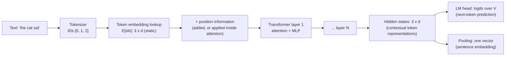

# Embeddings: From One-Hot Vectors to Word2Vec to Contextual Embeddings

> **Level:** Beginner to Advanced · **Study time:** ~110 min · **Prerequisites:** [Linear Algebra for ML](../00-foundations/02-linear-algebra-for-ml.md), [Softmax, Entropy, Cross-Entropy and KL Divergence](../00-foundations/05-softmax-entropy-cross-entropy-and-kl-divergence.md), [Neural Networks from Scratch](../02-deep-learning/01-neural-networks-from-scratch.md), [Tokenization](01-tokenization.md)

## Table of contents

- [Why this matters](#why-this-matters)
- [Notation and running example](#notation-and-running-example)
- [One-hot vectors and their problems](#one-hot-vectors-and-their-problems)
- [From words to vectors: the distributional hypothesis](#from-words-to-vectors-the-distributional-hypothesis)
- [The embedding table: a learned lookup matrix](#the-embedding-table-a-learned-lookup-matrix)
- [Word2vec: skip-gram, CBOW and negative sampling](#word2vec-skip-gram-cbow-and-negative-sampling)
- [GloVe: embeddings from global co-occurrence counts](#glove-embeddings-from-global-co-occurrence-counts)
- [Vector arithmetic and analogies (and their limits)](#vector-arithmetic-and-analogies-and-their-limits)
- [Static vs contextual embeddings: the bank problem](#static-vs-contextual-embeddings-the-bank-problem)
- [How transformers produce contextual token representations](#how-transformers-produce-contextual-token-representations)
- [Token embeddings vs sentence embeddings: pooling](#token-embeddings-vs-sentence-embeddings-pooling)
- [Choosing the embedding dimension](#choosing-the-embedding-dimension)
- [Tied input and output embeddings](#tied-input-and-output-embeddings)
- [Visualizing embeddings](#visualizing-embeddings)
- [Going deeper: embeddings in production LLMs](#going-deeper-embeddings-in-production-llms)
- [Going deeper: measuring and debugging embeddings](#going-deeper-measuring-and-debugging-embeddings)
- [Common mistakes and misconceptions](#common-mistakes-and-misconceptions)
- [Interview questions and model answers](#interview-questions-and-model-answers)
- [Key takeaways](#key-takeaways)
- [Further reading](#further-reading)
- [Next](#next)

## Why this matters

Every language model starts the same way: a token ID (an integer from the [tokenizer](01-tokenization.md)) is turned into a vector of real numbers, and everything after that (attention, MLPs, the output head) is arithmetic on vectors. That first step, the embedding, decides how much a model can generalize from "cat" to "dog", how big the model is (the embedding table of a 7B, that is 7-billion-parameter, model holds over a hundred million parameters), and what your RAG system (retrieval-augmented generation: fetching relevant documents by vector similarity and handing them to an LLM) can retrieve. Interviewers love this topic because it connects old NLP (word2vec), modern transformers (contextual hidden states) and production RAG (sentence embeddings in a vector database), and because a candidate who truly understands "an embedding layer is just selecting a row of a matrix" usually understands the rest of the stack. By the end of this chapter you will be able to explain embeddings from one-hot vectors all the way to pooled sentence vectors, with the numbers and trade-offs a senior engineer is expected to know.

## Notation and running example

We reuse one tiny setup throughout the chapter so that every formula has something concrete to point at.

**Running vocabulary** (4 tokens, so the vocabulary size $V = 4$):

| Token ID | Token |
|---|---|
| 0 | the |
| 1 | cat |
| 2 | sat |
| 3 | dog |

**Running sentence:** "the cat sat", which the tokenizer turns into the IDs `[0, 1, 2]`.

**Symbols used in this chapter:**

| Symbol | Meaning |
|---|---|
| $V$ | Vocabulary size (number of distinct tokens) |
| $d$ | Embedding dimension (length of each embedding vector) |
| $E$ | Embedding matrix, shape $V \times d$, one row per token |
| $E[i]$ | Row $i$ of $E$: the embedding of token ID $i$ |
| $x_i$ | One-hot vector for token $i$ (length $V$) |
| $\mathbf{a} \cdot \mathbf{b}$ | Dot product: multiply matching entries and add them up |
| $\lVert \mathbf{a} \rVert$ | Length (L2 norm) of a vector: $\sqrt{\mathbf{a} \cdot \mathbf{a}}$ |
| $\sigma(z)$ | Sigmoid: $1/(1+e^{-z})$, squashes any number into $(0, 1)$ |

If dot products, norms and matrix multiplication feel rusty, skim [Linear Algebra for ML](../00-foundations/02-linear-algebra-for-ml.md) first. You only need the basics.

## One-hot vectors and their problems

### Intuition

A computer cannot do arithmetic on the string "cat". The simplest way to turn a word into numbers is to give every word its own light switch. With 4 words you have 4 switches, and to say "cat" you turn on only the "cat" switch.

> **Analogy:** One-hot encoding is like a hotel where every guest has a private room number and nothing else. The room number tells you who someone is, but nothing about them: room 101 and room 102 are no more alike than room 101 and room 4000.

### Definition

A **one-hot vector** for token $i$ is a vector of length $V$ that is all zeros except for a single 1 at position $i$.

For our vocabulary:

```text
the -> [1, 0, 0, 0]
cat -> [0, 1, 0, 0]
sat -> [0, 0, 1, 0]
dog -> [0, 0, 0, 1]
```

One-hot encoding is still perfectly fine for low-cardinality categorical features in classical ML (see [Feature Engineering](../01-classical-ml/07-feature-engineering-missing-values-and-encoding.md)). For language, it breaks down.

### Problem 1: every word is equally different from every other word

Let us measure similarity with **cosine similarity**, the cosine of the angle between two vectors:

$$
\cos(\mathbf{a}, \mathbf{b}) = \frac{\mathbf{a} \cdot \mathbf{b}}{\lVert \mathbf{a} \rVert \, \lVert \mathbf{b} \rVert}
$$

- $\mathbf{a} \cdot \mathbf{b}$: the dot product.
- $\lVert \mathbf{a} \rVert$, $\lVert \mathbf{b} \rVert$: the lengths of the vectors.
- The result is between -1 (opposite directions) and 1 (same direction); 0 means perpendicular (unrelated).

Worked example, "cat" vs "dog" as one-hot vectors:

- Dot product: $0 \cdot 0 + 1 \cdot 0 + 0 \cdot 0 + 0 \cdot 1 = 0$.
- Lengths: both are $\sqrt{1} = 1$.
- Cosine: $0 / (1 \cdot 1) = 0$.

"cat" vs "the" is also exactly 0. Every pair of distinct one-hot vectors is perpendicular, and the Euclidean distance between any two of them is always $\sqrt{1^2 + 1^2} = \sqrt{2} \approx 1.414$. The representation has no notion that "cat" and "dog" are both animals.

### Problem 2: no generalization

Because of problem 1, anything a model learns about "cat" transfers zero information to "dog". If your spam filter learned that "prize" is spammy, it learns nothing about "award" from that. Every word has to be learned from its own examples, and rare words never get enough.

### Problem 3: size

Real vocabularies are large. GPT-2 uses about 50,000 tokens and Llama 3 uses 128,256. A one-hot vector for Llama 3 is 128,256 numbers long with a single 1. That is wasteful to store and, as we will see, wasteful to multiply.

### Problem 4: fixed vocabulary

A word not in the vocabulary has no switch at all. (Modern subword tokenizers mostly solve this, see [Tokenization](01-tokenization.md), but the embedding question remains.)

| Property | One-hot vector | Dense embedding |
|---|---|---|
| Length | $V$ (tens of thousands or more) | $d$ (typically 50 to a few thousand; up to 16,384 in the largest LLMs) |
| Values | A single 1, rest 0 | Real numbers, all positions used |
| Similarity between words | Always 0 | Learned: similar words have similar vectors |
| Learned? | No, fixed by the vocabulary | Yes, trained by gradient descent |
| Generalization across words | None | Shares statistical strength |

## From words to vectors: the distributional hypothesis

How could a machine learn that "cat" and "dog" are similar without anyone labeling them? The key idea is the **distributional hypothesis** (Harris, 1954; famously summarized by Firth, 1957, as "You shall know a word by the company it keeps"): words that appear in similar contexts tend to have similar meanings.

"The ___ sat on the mat", "I fed the ___", "the ___ chased a ball". Both "cat" and "dog" fit these blanks; "democracy" does not. If we train a model to predict words from their neighbors, words that share neighbors are pushed toward similar vectors.

A **dense embedding** (or just **embedding**) is a short vector of real numbers, learned from data, that represents an item (a token, a word, a sentence, a user, a product) so that similar items get nearby vectors.

> **Analogy:** Describe people not by their passport number (one-hot) but by a handful of traits: height, age, how much they like jazz, how outdoorsy they are. Two people with similar trait vectors are probably similar in ways that matter. Embeddings are like that, except the model invents the traits itself, and they usually do not map cleanly onto human-readable concepts.

## The embedding table: a learned lookup matrix

### Intuition

An embedding layer is a table with one row per token. To embed token 1 ("cat"), you read row 1. That is all. The magic is that the numbers in the table are not hand-written; they are parameters, adjusted by backpropagation like any other weight.

### Definition

An **embedding matrix** (also called an **embedding table** or **lookup table**) $E$ has shape $V \times d$. The embedding of token ID $i$ is row $i$:

$$
\text{embed}(i) = E[i] \in \mathbb{R}^{d}
$$

- $i$: the integer token ID (0 to $V-1$).
- $E[i]$: the $i$-th row of $E$, a vector of $d$ real numbers.
- $\mathbb{R}^{d}$: "a list of $d$ real numbers".

### The key equivalence: lookup equals one-hot times matrix

Selecting row $i$ is mathematically identical to multiplying the one-hot vector $x_i$ (as a row vector) by $E$:

$$
x_i \, E = E[i]
$$

- $x_i$: one-hot row vector of length $V$.
- $E$: the $V \times d$ embedding matrix.
- The product has length $d$, and it equals row $i$ of $E$.

This is why people say an embedding layer is "a linear layer without bias applied to a one-hot input". It is the same math, but the lookup skips all the multiplications by zero.

### Worked example by hand

Let $d = 3$ and suppose training has produced this table (numbers are illustrative):

```text
             dim0  dim1  dim2
E = row 0 (the)  [ 0.1,  0.2,  0.0 ]
    row 1 (cat)  [ 0.9,  0.1,  0.4 ]
    row 2 (sat)  [ 0.0,  0.7,  0.3 ]
    row 3 (dog)  [ 0.8,  0.2,  0.5 ]
```

Embed "cat" (ID 1) with the one-hot method, $x_1 = [0, 1, 0, 0]$. Each output entry is the dot product of $x_1$ with a column of $E$:

- dim0: $0 \cdot 0.1 + 1 \cdot 0.9 + 0 \cdot 0.0 + 0 \cdot 0.8 = 0.9$
- dim1: $0 \cdot 0.2 + 1 \cdot 0.1 + 0 \cdot 0.7 + 0 \cdot 0.2 = 0.1$
- dim2: $0 \cdot 0.0 + 1 \cdot 0.4 + 0 \cdot 0.3 + 0 \cdot 0.5 = 0.4$

Result: $[0.9, 0.1, 0.4]$, which is exactly row 1. The one-hot multiply did $4 \times 3 = 12$ multiplications to copy 3 numbers; the lookup just copies them.

For the sentence "the cat sat" (IDs `[0, 1, 2]`), the embedding layer outputs a $3 \times 3$ matrix: rows 0, 1 and 2 of $E$ stacked.

Now the payoff. Compare "cat" and "dog" with cosine similarity:

- Dot product: $0.9 \cdot 0.8 + 0.1 \cdot 0.2 + 0.4 \cdot 0.5 = 0.72 + 0.02 + 0.20 = 0.94$
- $\lVert \text{cat} \rVert = \sqrt{0.81 + 0.01 + 0.16} = \sqrt{0.98} \approx 0.990$
- $\lVert \text{dog} \rVert = \sqrt{0.64 + 0.04 + 0.25} = \sqrt{0.93} \approx 0.964$
- Cosine: $0.94 / (0.990 \cdot 0.964) \approx 0.94 / 0.955 \approx 0.985$

And "cat" vs "sat":

- Dot product: $0.9 \cdot 0.0 + 0.1 \cdot 0.7 + 0.4 \cdot 0.3 = 0 + 0.07 + 0.12 = 0.19$
- $\lVert \text{sat} \rVert = \sqrt{0 + 0.49 + 0.09} = \sqrt{0.58} \approx 0.762$
- Cosine: $0.19 / (0.990 \cdot 0.762) \approx 0.19 / 0.754 \approx 0.252$

With one-hot vectors both answers were 0. With dense embeddings, "cat" is close to "dog" (0.985) and far from "sat" (0.252). That structure is what lets a model generalize.

### How the table gets trained

The table starts random. During training, the forward pass looks up rows, the loss is computed, and backpropagation (see [Backpropagation](../02-deep-learning/02-backpropagation-and-gradient-descent.md)) sends gradients back. Because of the one-hot equivalence, the gradient with respect to $E$ is nonzero **only in the rows that were looked up** in that batch. Rows for tokens not in the batch get no gradient from the loss (though optimizer effects such as weight decay or momentum can still move them).

This has two practical consequences:

- **Rare tokens are undertrained.** A token that appears in a handful of batches barely moves from its random initialization.
- **Sparse updates are possible.** Frameworks offer sparse gradients for huge tables (common in recommender systems with millions of item IDs).

### Code: from scratch and with PyTorch

```python
# pip install torch numpy
import numpy as np
import torch
import torch.nn as nn
import torch.nn.functional as F

# --- From scratch with NumPy ---
E = np.array([[0.1, 0.2, 0.0],   # the
              [0.9, 0.1, 0.4],   # cat
              [0.0, 0.7, 0.3],   # sat
              [0.8, 0.2, 0.5]])  # dog
ids = np.array([0, 1, 2])        # "the cat sat"

lookup = E[ids]                  # row selection, shape (3, 3)
one_hot = np.eye(4)[ids]         # shape (3, 4)
matmul = one_hot @ E             # same result, much more work
print(np.allclose(lookup, matmul))  # True

# --- PyTorch nn.Embedding ---
torch.manual_seed(0)
emb = nn.Embedding(num_embeddings=4, embedding_dim=3)  # weight shape (V, d) = (4, 3)
t_ids = torch.tensor([0, 1, 2])
out = emb(t_ids)                                        # shape (3, 3)
same = F.one_hot(t_ids, num_classes=4).float() @ emb.weight
print(torch.allclose(out, same))  # True

# Gradients only reach the rows that were used
out.sum().backward()
print(emb.weight.grad)
# rows 0, 1, 2 are all ones; row 3 ("dog", unused) is all zeros
```

> **Interview tip:** If asked "what does `nn.Embedding` actually do?", say: "It holds a $V \times d$ weight matrix and indexes rows by token ID. It is mathematically a bias-free linear layer on one-hot inputs, but implemented as a gather (an indexed read of rows from memory), so it costs memory bandwidth, not FLOPs, and its gradient is nonzero only for the rows that were looked up."

`nn.Embedding` also has a `padding_idx` argument: the row for that ID is excluded from gradient updates (and is initialized to zeros), which is handy for padding tokens.

## Word2vec: skip-gram, CBOW and negative sampling

An embedding table inside a transformer is trained as a side effect of the main task (predicting the next token). Before transformers, the most famous way to get good word vectors was to train a small model whose only job was to produce them: **word2vec** (Mikolov et al., 2013, "Efficient Estimation of Word Representations in Vector Space", and the follow-up "Distributed Representations of Words and Phrases and their Compositionality").

### The training task: a fake prediction problem

Word2vec turns the distributional hypothesis into a self-supervised task (the labels come from the raw text itself, so no human annotation is needed). Slide a **context window** (say 2 words on each side) over raw text. For each position, the word in the middle is the **center word** and the words around it are **context words**.

Sentence: "the cat sat on the mat", window size 2:

```text
center "sat":  [the  cat] sat [on  the]     context = {the, cat, on, the}
center "on":   [cat  sat] on  [the mat]     context = {cat, sat, the, mat}
```

There are two flavors:

| | Skip-gram | CBOW (Continuous Bag of Words) |
|---|---|---|
| Task | Predict each context word from the center word | Predict the center word from the (averaged) context words |
| Training pairs for "sat" | (sat, the), (sat, cat), (sat, on), (sat, the) | ({the, cat, on, the}, sat) |
| Speed | Slower (one example per pair) | Faster (one example per window) |
| Rare words | Better: each rare word gets many updates as a center | Weaker: rare words get averaged with others |
| Typical use | Preferred when rare-word quality matters; works well on small data | Large corpora when speed matters (the default in the original C tool and in gensim, `sg=0`) |

> **Analogy:** Skip-gram is "given a word, guess its neighbors". CBOW is a fill-in-the-blank test: "given the neighbors, guess the missing word".

Nobody actually cares about the predictions. The prize is the weight matrix learned along the way.

### Two vectors per word

Word2vec keeps **two** embedding tables:

- $v_w$: the **input** (center) vector of word $w$, from matrix $W_{\text{in}}$.
- $u_w$: the **output** (context) vector of word $w$, from matrix $W_{\text{out}}$.

The score for "context word $o$ appears near center word $c$" is the dot product $u_o \cdot v_c$. The original skip-gram turns scores into probabilities with a softmax (see [Softmax and Cross-Entropy](../00-foundations/05-softmax-entropy-cross-entropy-and-kl-divergence.md)) over the whole vocabulary:

$$
P(o \mid c) = \frac{\exp(u_o \cdot v_c)}{\sum_{w=1}^{V} \exp(u_w \cdot v_c)}
$$

- $c$: the center word; $o$: one observed context word.
- $u_o \cdot v_c$: how compatible the two words are (higher means more likely neighbors).
- The denominator sums over all $V$ words so the probabilities add to 1.

That denominator is the problem: with $V = 100{,}000$ words, every single training pair requires 100,000 dot products. Billions of pairs make this impractical.

### Negative sampling

**Negative sampling** replaces the giant softmax with a cheap binary question: "is this (center, context) pair real, or did I make it up?" For each real pair, draw $k$ random **negative** words (typically 5 to 20 for small data, 2 to 5 for large data, per the original paper) and train a logistic classifier to say "yes" to the real pair and "no" to the fakes.

The objective to **maximize** for one real pair is:

$$
\log \sigma(u_o \cdot v_c) + \sum_{j=1}^{k} \log \sigma(-u_{n_j} \cdot v_c)
$$

- $\sigma(z) = 1/(1 + e^{-z})$: the sigmoid, giving a probability between 0 and 1.
- $\log \sigma(u_o \cdot v_c)$: large (close to 0) when the real pair has a high score.
- $n_j$: the $j$-th negative word, sampled at random.
- $\log \sigma(-u_{n_j} \cdot v_c)$: large when the fake pair has a low score (because $\sigma(-z) = 1 - \sigma(z)$).
- $k$: the number of negatives.

The loss we minimize is the negative of this. Each update now touches only $k + 1$ output vectors instead of $V$.

**Worked example** (2-dimensional, illustrative numbers, $k = 1$):

- Center "cat": $v_c = [0.5, 1.0]$
- Real context "sat": $u_o = [1.0, 0.5]$
- Negative sample "democracy": $u_n = [-0.5, 0.5]$

Step 1, real pair score: $u_o \cdot v_c = 1.0 \cdot 0.5 + 0.5 \cdot 1.0 = 0.5 + 0.5 = 1.0$.
$\sigma(1.0) = 1/(1 + e^{-1}) = 1/(1 + 0.3679) \approx 0.731$, and $\log(0.731) \approx -0.313$.

Step 2, negative pair score: $u_n \cdot v_c = -0.5 \cdot 0.5 + 0.5 \cdot 1.0 = -0.25 + 0.5 = 0.25$.
$\sigma(-0.25) = 1/(1 + e^{0.25}) = 1/(1 + 1.2840) \approx 0.438$, and $\log(0.438) \approx -0.826$.

Step 3, objective: $-0.313 + (-0.826) = -1.139$, so the loss is about $1.139$.

Gradient descent will increase $u_o \cdot v_c$ (pull "cat" and "sat" together) and decrease $u_n \cdot v_c$ (push "cat" away from "democracy"). Repeat billions of times and words sharing contexts end up close.

**Which negatives?** Not uniformly random. Word2vec samples from the unigram distribution raised to the power 0.75:

$$
P_n(w) = \frac{\text{count}(w)^{0.75}}{\sum_{w'} \text{count}(w')^{0.75}}
$$

Example: "the" appears 100 times and "cat" 10 times. Raw frequencies give "the" $100/110 \approx 0.909$. With the 0.75 power: $100^{0.75} \approx 31.62$ and $10^{0.75} \approx 5.62$, so "the" gets $31.62 / 37.25 \approx 0.849$. The power flattens the distribution so rare words are sampled as negatives a bit more often.

Word2vec also uses **subsampling** of frequent words: very common words like "the" are randomly dropped from the training text, which speeds training and improves vectors for rarer words.

> **Senior insight:** Levy and Goldberg (2014, "Neural Word Embedding as Implicit Matrix Factorization") showed that skip-gram with negative sampling implicitly factorizes (at its optimum, assuming the dimension is large enough to fit it) a word-context matrix of (shifted) pointwise mutual information. PMI measures how much more often two words co-occur than chance would predict, $\text{PMI}(w, c) = \log \frac{P(w, c)}{P(w)\,P(c)}$, and "shifted" means $\text{PMI}(w, c) - \log k$ for $k$ negatives. So word2vec and count-based methods like GloVe are closer cousins than they look: both compress co-occurrence statistics into low-dimensional vectors.

Negative sampling is also the ancestor of **contrastive learning** used to train modern sentence embedding models: pull matching pairs together, push non-matching pairs apart. You will meet it again in [Text Embeddings and Similarity Search](../08-rag/02-text-embeddings-and-similarity-search.md) and in [CLIP](../03-computer-vision/05-vision-transformers-clip-and-multimodal-models.md).

### Code: skip-gram with negative sampling from scratch

```python
# pip install torch
import torch
import torch.nn as nn
import torch.nn.functional as F

corpus = "the cat sat on the mat the dog sat on the rug".split()
vocab = sorted(set(corpus))
w2i = {w: i for i, w in enumerate(vocab)}
ids = [w2i[w] for w in corpus]

# Build (center, context) pairs with a window of 2
window = 2
pairs = [(ids[i], ids[j])
         for i in range(len(ids))
         for j in range(max(0, i - window), min(len(ids), i + window + 1))
         if j != i]
centers = torch.tensor([c for c, _ in pairs])
contexts = torch.tensor([o for _, o in pairs])

# Noise distribution: unigram counts ** 0.75
counts = torch.bincount(torch.tensor(ids), minlength=len(vocab)).float()
noise = counts ** 0.75
noise /= noise.sum()

class SkipGramNS(nn.Module):
    def __init__(self, V: int, d: int):
        super().__init__()
        self.inp = nn.Embedding(V, d)    # center vectors v
        self.out = nn.Embedding(V, d)    # context vectors u
        nn.init.uniform_(self.inp.weight, -0.5 / d, 0.5 / d)
        nn.init.zeros_(self.out.weight)

    def forward(self, center, context, negatives):
        v = self.inp(center)                                  # (B, d)
        u_pos = self.out(context)                             # (B, d)
        u_neg = self.out(negatives)                           # (B, k, d)
        pos = F.logsigmoid((v * u_pos).sum(-1))               # (B,)
        neg_scores = torch.bmm(u_neg, v.unsqueeze(-1)).squeeze(-1)  # (B, k)
        neg = F.logsigmoid(-neg_scores).sum(-1)               # (B,)
        return -(pos + neg).mean()                            # loss to minimize

torch.manual_seed(0)
model = SkipGramNS(len(vocab), d=16)
opt = torch.optim.Adam(model.parameters(), lr=0.01)
k = 3
for step in range(500):
    negs = torch.multinomial(noise, len(pairs) * k, replacement=True).view(len(pairs), k)
    loss = model(centers, contexts, negs)
    opt.zero_grad()
    loss.backward()
    opt.step()

# The word vectors are the input table
vecs = F.normalize(model.inp.weight, dim=-1)
sims = vecs @ vecs[w2i["cat"]]
print([vocab[i] for i in sims.argsort(descending=True)[:3]])  # "cat" first, then its nearest neighbors
```

On a 12-word corpus the neighbors are noisy; the point is the mechanism. (This simple version may occasionally sample the true context as a "negative", which real implementations tolerate too.)

### Code: the standard library version (gensim)

```python
# pip install gensim
from gensim.models import Word2Vec

sentences = [s.split() for s in [
    "the cat sat on the mat",
    "the dog sat on the rug",
    "the cat chased the dog",
]]
# sg=1 -> skip-gram, sg=0 -> CBOW; negative=5 -> 5 negative samples per pair
# gensim 4.x API (gensim 3.x called these size= and iter=)
model = Word2Vec(sentences, vector_size=50, window=2, min_count=1,
                 sg=1, negative=5, epochs=100, seed=0, workers=1)
print(model.wv["cat"].shape)               # (50,)
print(model.wv.most_similar("cat", topn=2))

# Pretrained vectors (large download; names from the gensim-data catalog)
# import gensim.downloader as api
# wv = api.load("glove-wiki-gigaword-100")
```

### A note on fastText

Word2vec gives no vector at all to a word it never saw. **fastText** (Bojanowski et al., 2017, "Enriching Word Vectors with Subword Information") represents a word as the sum of vectors of its character n-grams (for example "<ca", "cat", "at>"), so it can build a vector for unseen or misspelled words and handles morphologically rich languages better. Modern subword tokenizers solve the same problem at the tokenizer level.

## GloVe: embeddings from global co-occurrence counts

**GloVe** ("Global Vectors", Pennington, Socher and Manning, 2014, "GloVe: Global Vectors for Word Representation") takes a counting approach. First, scan the whole corpus once and build a **co-occurrence matrix** $X$, where $X_{ij}$ is how often word $j$ appears in the context window of word $i$. Then learn vectors whose dot products predict the log of those counts.

The intuition from the paper: ratios of co-occurrence probabilities carry meaning. "ice" co-occurs with "solid" much more than "steam" does, while "steam" co-occurs with "gas" much more than "ice" does; both co-occur similarly with "water". Dot products that encode log counts turn those ratios into vector differences.

The objective (simplified to one term):

$$
f(X_{ij}) \left( w_i \cdot \tilde{w}_j + b_i + \tilde{b}_j - \log X_{ij} \right)^2
$$

- $w_i$: the word vector for word $i$; $\tilde{w}_j$: a separate context vector for word $j$.
- $b_i$, $\tilde{b}_j$: learned scalar biases (absorb how common each word is).
- $\log X_{ij}$: log of the co-occurrence count, the target.
- $f(X_{ij})$: a weight that is small for rare pairs (noisy) and capped at 1 for very frequent pairs, so "the, of" does not dominate. The paper uses $f(x) = (x / x_{\max})^{0.75}$ for $x < x_{\max}$ (with $x_{\max} = 100$) and 1 otherwise.

Tiny example: if "ice" and "cold" co-occur $X_{ij} = 20$ times, the target is $\log 20 \approx 3.00$ and the weight is $(20/100)^{0.75} = 0.2^{0.75} \approx 0.299$. Training adjusts $w_i \cdot \tilde{w}_j + b_i + \tilde{b}_j$ toward 3.00, and this pair counts about 30% as much as a pair with 100 or more co-occurrences. Pairs with $X_{ij} = 0$ are skipped entirely (the log is undefined).

The final word vector is usually $w_i + \tilde{w}_i$.

| | Word2vec (SGNS) | GloVe | fastText |
|---|---|---|---|
| Learns from | Local windows, streamed | Global co-occurrence matrix | Local windows plus character n-grams |
| Training signal | Real vs fake pairs | Weighted least squares on log counts | Same as word2vec |
| Unseen words | No vector | No vector | Built from n-grams |
| Memory | Low | Co-occurrence matrix can be big | Higher (n-gram table, often hashed) |
| Quality | Similar in practice; depends heavily on hyperparameters and data | Similar | Better for rare words and morphology |

All three produce **static** embeddings: one vector per word, regardless of context. Hold that thought.

## Vector arithmetic and analogies (and their limits)

### The famous result

Mikolov and colleagues observed that word2vec vectors support analogy arithmetic:

$$
\text{vec}(\text{king}) - \text{vec}(\text{man}) + \text{vec}(\text{woman}) \approx \text{vec}(\text{queen})
$$

- $\text{vec}(w)$: the embedding of word $w$.
- The difference $\text{king} - \text{man}$ roughly isolates a "royalty" direction; adding "woman" moves to the female royal.
- "$\approx$" means: the nearest vocabulary vector (by cosine similarity), **excluding the three input words**, is "queen".

### Worked example (illustrative 2D vectors)

Pretend the two dimensions mean [royalty, maleness]:

```text
king  = [0.95,  0.80]
man   = [0.10,  0.85]
woman = [0.12, -0.83]
queen = [0.93, -0.78]
```

Compute $r = \text{king} - \text{man} + \text{woman}$:

- dim0: $0.95 - 0.10 + 0.12 = 0.97$
- dim1: $0.80 - 0.85 + (-0.83) = -0.88$

So $r = [0.97, -0.88]$.

Cosine with queen:

- Dot: $0.97 \cdot 0.93 + (-0.88)(-0.78) = 0.9021 + 0.6864 = 1.5885$
- $\lVert r \rVert = \sqrt{0.9409 + 0.7744} = \sqrt{1.7153} \approx 1.3097$
- $\lVert \text{queen} \rVert = \sqrt{0.8649 + 0.6084} = \sqrt{1.4733} \approx 1.2138$
- Cosine: $1.5885 / (1.3097 \cdot 1.2138) \approx 1.5885 / 1.5897 \approx 0.999$

Cosine with woman: dot $= 0.97 \cdot 0.12 + (-0.88)(-0.83) = 0.1164 + 0.7304 = 0.8468$; $\lVert \text{woman} \rVert = \sqrt{0.0144 + 0.6889} \approx 0.8386$; cosine $\approx 0.8468 / (1.3097 \cdot 0.8386) \approx 0.771$. Queen wins.

```python
# With real pretrained vectors (large download)
# pip install gensim
import gensim.downloader as api
wv = api.load("glove-wiki-gigaword-100")
print(wv.most_similar(positive=["king", "woman"], negative=["man"], topn=3))
# most_similar excludes the input words from the results
```

### The limits (this is what senior interviewers probe)

- **The input words are excluded.** In real vectors, the closest vector to $\text{king} - \text{man} + \text{woman}$ is often "king" itself. The standard evaluation removes the inputs, which makes results look cleaner than the geometry is (Nissim, van Noord and van der Goot, 2020, "Fair is Better than Sensational: Man is to Doctor as Programmer is to Woman").
- **It works for some relations, not all.** Capital-country, gender and verb tense often work; many semantic relations do not form clean parallel offsets.
- **Frequency and polysemy matter.** Rare words have noisy vectors, and a static vector blends all senses of a word.
- **Embeddings absorb social bias.** Bolukbasi et al. (2016, "Man is to Computer Programmer as Woman is to Homemaker? Debiasing Word Embeddings") showed gender stereotypes encoded as directions. Anything trained on human text inherits its biases, including modern LLM embeddings.
- **Analogy accuracy is a weak proxy for usefulness.** Good analogy scores do not guarantee good downstream task performance.

> **Senior insight:** The analogy result is a hint of a broader idea: many concepts appear to be represented as roughly linear directions in embedding and hidden-state space (often called the linear representation hypothesis). It is useful for probing and steering models, but it is an empirical tendency, not a guarantee.

## Static vs contextual embeddings: the bank problem

### The problem

Consider:

1. "She sat on the river **bank**."
2. "He deposited cash at the **bank**."

A **static embedding** assigns one fixed vector per word type, so "bank" gets exactly the same vector in both sentences. That vector ends up as a blurry average of the riverside sense and the financial sense, weighted by how often each appears in training data.

A **contextual embedding** is a vector for a token **in a specific sentence**: a function of the token and all of its neighbors. "bank" in sentence 1 should land near "shore", and in sentence 2 near "money".

> **Analogy:** A static embedding is a dictionary entry: one entry for "bank", listing every sense at once. A contextual embedding is what a human reader has in mind after reading the whole sentence: one specific meaning.

### Toy worked example of contextualization

Let the two dimensions be [finance, geography], illustrative numbers:

```text
bank (static)  = [0.5, 0.5]   (half of each sense)
river          = [0.0, 1.0]
cash           = [1.0, 0.0]
```

Suppose a (toy) contextualizer mixes each word with its neighbor: $h = 0.6 \cdot \text{bank} + 0.4 \cdot \text{neighbor}$.

- "river bank": $0.6 \cdot [0.5, 0.5] + 0.4 \cdot [0.0, 1.0] = [0.30, 0.30] + [0.00, 0.40] = [0.30, 0.70]$
- "cash bank": $0.6 \cdot [0.5, 0.5] + 0.4 \cdot [1.0, 0.0] = [0.30, 0.30] + [0.40, 0.00] = [0.70, 0.30]$

Cosine between the two contextual "bank" vectors: dot $= 0.30 \cdot 0.70 + 0.70 \cdot 0.30 = 0.42$; both norms are $\sqrt{0.09 + 0.49} = \sqrt{0.58} \approx 0.762$; cosine $= 0.42 / 0.58 \approx 0.724$. The static vectors would have cosine exactly 1.0. Context pulled the two senses apart.

A real transformer does a far richer version of this: the mixing weights are not fixed at 0.6/0.4 but computed by **attention** from the content of every token, and the process repeats through dozens of layers. The [Attention chapter](03-attention-mechanism-step-by-step.md) shows exactly how those weights are computed.

### A short history

| Era | Representative | Contextual? | Notes |
|---|---|---|---|
| 2013-2014 | word2vec, GloVe | No | One vector per word type |
| 2017 | fastText | No | Subword n-grams, handles unseen words |
| 2018 | ELMo (Peters et al., "Deep contextualized word representations") | Yes | Bidirectional LSTM language model (see [RNNs and LSTMs](../02-deep-learning/08-rnns-lstms-and-the-road-to-transformers.md)) |
| 2018-2019 | BERT (Devlin et al.), GPT (Radford et al.) | Yes | Transformer hidden states |
| Now | Every modern LLM and embedding model | Yes | Static table at the input, contextual everywhere after |

| | Static embeddings | Contextual embeddings |
|---|---|---|
| One vector per | Word type ("bank") | Token occurrence ("bank" in this sentence) |
| Produced by | A lookup table | A deep network (transformer) over the whole input |
| Handles polysemy | No | Yes |
| Cost | A table lookup, microseconds | A full forward pass |
| Storage | $V \times d$ table | Must be computed per input (or cached) |
| Still useful for | Very cheap features, edge devices, keyword-like similarity, baselines | Almost everything else |

> **Common mistake:** Saying "transformers do not use static embeddings". They do: the very first layer of every transformer is a static lookup table. Contextualization happens in the layers after it.

## How transformers produce contextual token representations

Here is the pipeline for "the cat sat" in a transformer. The details of each block belong to later chapters; what matters here is where embeddings live.



Step by step:

1. **Token embedding.** Look up row $E[t]$ for each token ID $t$. Same token, same vector, regardless of context. These vectors are learned jointly with the rest of the model during pretraining.
2. **Positional information.** Attention by itself does not know word order, so the model needs position information. In the original Transformer (Vaswani et al., 2017) and in BERT/GPT-2, a position vector $P[i]$ is **added** to the token embedding: $h^{(0)}_i = E[t_i] + P[i]$. Tiny example with our table and made-up position vectors $P[1] = [0.0, 0.1, -0.1]$ and $P[2] = [0.1, 0.0, 0.1]$: "cat" ($E[1] = [0.9, 0.1, 0.4]$) at position 1 enters the model as $[0.9, 0.2, 0.3]$, but at position 2 as $[1.0, 0.1, 0.5]$. Same token, different input vector, so order becomes visible. Modern LLMs often use RoPE instead, which rotates query and key vectors inside attention rather than adding anything to the embedding. All of this is covered in [Positional Encoding](06-positional-encoding-sinusoidal-learned-rope-and-alibi.md). (Small detail: the original Transformer also multiplied embeddings by $\sqrt{d_{\text{model}}}$ before adding positions.)
3. **Transformer layers.** Each layer lets every token gather information from other tokens (attention) and then transforms it (an MLP, a small feed-forward network applied to each position separately), with residual connections (each block adds its output to its input, see [Residual Connections](../02-deep-learning/05-vanishing-exploding-gradients-initialization-normalization-and-residuals.md)). After layer $\ell$, the vector at position $i$, written $h^{(\ell)}_i$, depends on the whole visible input.
4. **Output.** The final hidden states $h^{(N)}_i$ are the **contextual token representations**. A language model projects them to vocabulary logits; an embedding model pools them into one vector.

The **residual stream** view is helpful: the token embedding is the starting value of a vector that each layer reads from and adds to. Layer by layer, "bank" accumulates evidence about its neighbors until its vector reflects the right sense.

Some facts about which layer to use:

- Lower layers tend to carry more surface and syntactic information; upper layers are more context-specific (Ethayarajh, 2019, "How Contextual are Contextualized Word Representations?").
- In decoder-only models (GPT-style), position $i$ only sees tokens $0..i$ because of the causal mask (see [Multi-Head Attention and Causal Masking](04-multi-head-attention-and-causal-masking.md)). So the "bank" in "bank of the river" has not seen "river" yet. Encoder models like BERT see both directions.

### Code: seeing contextualization in BERT

```python
# pip install torch transformers
import torch
import torch.nn.functional as F
from transformers import AutoTokenizer, AutoModel

tok = AutoTokenizer.from_pretrained("bert-base-uncased")
model = AutoModel.from_pretrained("bert-base-uncased").eval()

def token_vector(sentence: str, word: str, layer: int = -1) -> torch.Tensor:
    """Return the hidden state of `word` (assumed to be a single token) in `sentence`."""
    enc = tok(sentence, return_tensors="pt")
    with torch.no_grad():
        out = model(**enc, output_hidden_states=True)
    tokens = tok.convert_ids_to_tokens(enc["input_ids"][0])
    idx = tokens.index(word)
    # hidden_states[0] is the embedding-layer output, [-1] is the last layer
    return out.hidden_states[layer][0, idx]

river1 = token_vector("she sat on the river bank", "bank")
river2 = token_vector("we walked along the muddy bank of the stream", "bank")
money  = token_vector("he deposited cash at the bank", "bank")

print(F.cosine_similarity(river1, river2, dim=0).item())  # same sense
print(F.cosine_similarity(river1, money, dim=0).item())   # different sense
# Expect the same-sense pair to score higher than the different-sense pair.

# The static input embedding for "bank" is identical in every sentence:
bank_id = tok.convert_tokens_to_ids("bank")
static = model.embeddings.word_embeddings.weight[bank_id]
print(static.shape)  # torch.Size([768])
```

You will notice that even the different-sense pair has a fairly high cosine. That is **anisotropy**: contextual vectors from many models occupy a narrow cone of the space, so all cosines are inflated (Ethayarajh, 2019). Compare similarities relative to each other, not against an absolute threshold.

## Token embeddings vs sentence embeddings: pooling

### Intuition

A transformer gives you one vector per token. A search engine wants one vector per document or query. **Pooling** is how you squash a sequence of token vectors into one.

> **Analogy:** Token embeddings are the individual votes; a sentence embedding is the election result. Pooling is the counting rule (take the chairperson's vote, average everyone, or take the strongest opinion on each issue).

### Definitions

- **Token embedding** (in the narrow sense): the static row $E[t]$ from the input embedding table. In casual use people also say "token embeddings" for the per-token output hidden states; be explicit about which one you mean.
- **Contextual token representation:** the hidden state $h_i$ for token $i$ after the transformer layers. Shape for a sentence: $T \times d$ ($T$ tokens).
- **Sentence embedding** (or **text embedding**): a single vector of length $d$ for an entire piece of text, designed so that texts with similar meaning have high cosine similarity. That property does not come for free: it is trained in, usually with a contrastive objective (pull paraphrase or query-answer pairs together, push unrelated texts apart, the same idea as negative sampling above).

### Pooling strategies

**CLS pooling.** BERT prepends a special `[CLS]` token to every input. Its final hidden state can serve as a summary, because during fine-tuning a classifier is trained on top of it. Take $h_{\text{CLS}}$ as the sentence vector.

**Mean pooling.** Average the hidden states of all real (non-padding) tokens:

$$
s = \frac{\sum_{i=1}^{T} m_i \, h_i}{\sum_{i=1}^{T} m_i}
$$

- $h_i$: hidden state of token $i$.
- $m_i$: attention mask, 1 for a real token, 0 for padding.
- $T$: padded sequence length.
- $s$: the sentence embedding.

**Max pooling.** Take the maximum over tokens, separately for each dimension. Less common today.

**Last-token pooling.** For decoder-only (causal) models, only the final token has seen the whole input, so embedding models built on LLMs often use the hidden state of the last token (frequently an appended end-of-sequence token). Watch the padding side: with right padding, the last real token is not at index $T-1$, so you must locate it from the attention mask; with left padding it is always the final position.

**Worked example: why the mask matters.** A batch is padded to $T = 4$. The real sentence has 3 tokens, $d = 2$:

```text
h_1 = [1, 2]   m_1 = 1
h_2 = [3, 0]   m_2 = 1
h_3 = [2, 4]   m_3 = 1
h_4 = [9, 9]   m_4 = 0   (padding position; its hidden state is garbage)
```

Correct masked mean:

- Sum of real tokens: $[1 + 3 + 2,\; 2 + 0 + 4] = [6, 6]$
- Count: $1 + 1 + 1 + 0 = 3$
- $s = [6/3, 6/3] = [2, 2]$

Naive mean over all 4 positions: $[1 + 3 + 2 + 9,\; 2 + 0 + 4 + 9] / 4 = [15, 15] / 4 = [3.75, 3.75]$. Wrong, and the result changes depending on how much padding the batch had, which means the same sentence gets different embeddings in different batches. That is a classic production bug.

```python
# pip install torch transformers sentence-transformers
import torch
import torch.nn.functional as F
from transformers import AutoTokenizer, AutoModel

def mean_pool(last_hidden_state: torch.Tensor, attention_mask: torch.Tensor) -> torch.Tensor:
    """last_hidden_state: (B, T, d); attention_mask: (B, T) with 1 = real token."""
    mask = attention_mask.unsqueeze(-1).to(last_hidden_state.dtype)   # (B, T, 1)
    summed = (last_hidden_state * mask).sum(dim=1)                     # (B, d)
    counts = mask.sum(dim=1).clamp(min=1e-9)                           # (B, 1)
    return summed / counts

name = "sentence-transformers/all-MiniLM-L6-v2"   # a small model trained for sentence similarity
tok = AutoTokenizer.from_pretrained(name)
model = AutoModel.from_pretrained(name).eval()

texts = ["How do I reset my password?", "I forgot my login credentials", "Best pizza in town"]
enc = tok(texts, padding=True, truncation=True, return_tensors="pt")
with torch.no_grad():
    out = model(**enc)
emb = F.normalize(mean_pool(out.last_hidden_state, enc["attention_mask"]), dim=-1)
print(emb.shape)            # torch.Size([3, 384])
print(emb @ emb.T)          # cosine similarities; first two should be closest

# The same thing with the sentence-transformers library (it applies the model's own pooling config)
from sentence_transformers import SentenceTransformer
st = SentenceTransformer(name)
emb2 = st.encode(texts, normalize_embeddings=True)
print(emb2.shape)           # (3, 384)
```

### CLS vs mean vs last-token

| Pooling | How | Best with | Pros | Cons |
|---|---|---|---|---|
| CLS | Take the `[CLS]` hidden state | Models trained with a CLS objective or fine-tuned that way | Simple, one vector already there | Raw pretrained BERT CLS is a poor similarity vector |
| Mean | Masked average of all tokens | Many sentence-transformer models | Robust, uses every token | Must mask padding; long texts get diluted |
| Max | Per-dimension max | Some older models | Captures salient features | Sensitive to outliers |
| Last token | Hidden state of final (EOS) token | Decoder-only LLM-based embedders | Only position that saw everything in a causal model | Must handle left vs right padding correctly |

> **Senior insight:** Pooling is not a free choice at inference time. A sentence embedding model is trained with a specific pooling method, and you must use the same one. Sentence-BERT (Reimers and Gurevych, 2019, "Sentence-BERT: Sentence Embeddings using Siamese BERT-Networks") showed that raw BERT outputs, with either CLS or mean pooling, give poor semantic similarity, sometimes worse than averaged GloVe vectors, until the model is fine-tuned with a similarity objective. The pooling recipe is part of the model.

| | Token embeddings / token representations | Sentence embeddings |
|---|---|---|
| Granularity | One vector per token | One vector per text |
| Shape for a 10-token text | $10 \times d$ | $d$ |
| Produced by | Lookup table (static) or transformer layers (contextual) | Transformer plus pooling, trained with a contrastive objective |
| Used for | Feeding the model, token classification (NER), generation | Semantic search, RAG retrieval, clustering, deduplication, classification features |
| Compared with | Rarely compared directly | Cosine similarity or dot product |

How sentence embedding models are trained (contrastive learning with in-batch negatives, hard negatives), how to pick one, query/document prefixes, and how to search them is the job of [Text Embeddings and Similarity Search](../08-rag/02-text-embeddings-and-similarity-search.md).

## Choosing the embedding dimension

### The trade-off

The embedding dimension $d$ is how many numbers describe each item.

- **Too small:** not enough room to separate meanings; distinct words collide.
- **Too large:** more parameters, more memory, slower similarity search, and rare items may overfit because they have many parameters and few examples.

Typical, well-known sizes:

| Model | Embedding dimension |
|---|---|
| Google News word2vec vectors | 300 |
| GloVe releases | 50, 100, 200, 300 |
| all-MiniLM-L6-v2 (sentence-transformers) | 384 |
| BERT-base / BERT-large | 768 / 1,024 |
| Llama 2 7B (hidden size) | 4,096 |

In a transformer, the token embedding dimension equals the model's hidden size $d_{\text{model}}$, because the embedding is the input to the residual stream. You do not tune it separately; it scales with the model.

For categorical features in recommender systems or tabular deep learning, people use folk heuristics such as "about the fourth root of the number of categories", then tune. Treat them as starting points.

### Parameter and memory cost

The table has $V \times d$ parameters.

**Worked example (a 7B model):** Llama 2 7B has $V = 32{,}000$ and $d = 4{,}096$:

- Input embedding: $32{,}000 \times 4{,}096 = 131{,}072{,}000 \approx 131$M parameters (about 2% of 7B).
- In BF16 (2 bytes per parameter): $131{,}072{,}000 \times 2 \approx 262$ MB.
- Llama 2 does not tie its output head, so the LM head is another 131M parameters.

Llama 3 8B raised the vocabulary to 128,256 with the same $d = 4{,}096$: $128{,}256 \times 4{,}096 = 525{,}336{,}576 \approx 525$M parameters per table. A bigger vocabulary makes text shorter in tokens (good for speed and context) but makes the embedding and output tables bigger. See [Number Formats and Model Memory](../07-model-compression/01-number-formats-and-model-memory.md) for byte math in general.

### Dimension in vector databases

For sentence embeddings stored in a vector database, $d$ drives storage and search cost linearly (exact arithmetic, float32 = 4 bytes):

| Vectors | $d$ | Format | Raw storage |
|---|---|---|---|
| 1,000,000 | 384 | float32 | $10^6 \times 384 \times 4 \approx 1.5$ GB |
| 1,000,000 | 768 | float32 | $10^6 \times 768 \times 4 \approx 3.1$ GB |
| 1,000,000 | 1,536 | float32 | $10^6 \times 1{,}536 \times 4 \approx 6.1$ GB |
| 1,000,000 | 768 | int8 | $10^6 \times 768 \times 1 \approx 0.77$ GB |

Index overhead (HNSW graphs, metadata) comes on top. See [Vector Search Algorithms](../08-rag/06-vector-search-ann-hnsw-ivf-and-product-quantization.md).

### Tricks that decouple capacity from size

- **Factorized embeddings.** ALBERT (Lan et al., 2019, "ALBERT: A Lite BERT for Self-supervised Learning of Language Representations") replaces the $V \times H$ table with $V \times E$ followed by an $E \times H$ projection (here $E$ is ALBERT's name for the small embedding size and $H$ the hidden size, not the embedding matrix $E$ used elsewhere in this chapter). With $V = 30{,}000$, $H = 768$, $E = 128$: $30{,}000 \times 768 = 23{,}040{,}000$ parameters become $30{,}000 \times 128 + 128 \times 768 = 3{,}840{,}000 + 98{,}304 = 3{,}938{,}304$, about 6 times fewer. See [Low-Rank Factorization](../07-model-compression/07-pruning-low-rank-factorization-and-choosing-a-compression-method.md).
- **Matryoshka embeddings.** Matryoshka Representation Learning (Kusupati et al., 2022) trains a sentence embedding so that its first 64, 128, 256... dimensions are each a usable embedding on their own. You can truncate (and re-normalize) to trade accuracy for storage. Several embedding models and some vendor APIs (for example, OpenAI's text-embedding-3 models via a `dimensions` parameter, as of their 2024 release) support this; check current docs.
- **Quantizing vectors.** Store int8 or binary versions for search, optionally rescoring with full precision. See [Vector Search Algorithms](../08-rag/06-vector-search-ann-hnsw-ivf-and-product-quantization.md).
- **Hashing.** For huge ID spaces (billions of users), hash IDs into a smaller table and accept some collisions.

> **Common mistake:** Truncating a normal (non-Matryoshka) embedding to fewer dimensions to save space. Only models trained for truncation degrade gracefully; others can lose a lot of quality.

## Tied input and output embeddings

### Intuition

A language model has two big vocabulary-sized matrices:

- The **input embedding** $E$ ($V \times d$): token ID to vector.
- The **output embedding**, also called the **LM head** or **unembedding** $W_{\text{out}}$ ($V \times d$): final hidden state to a score (logit) per vocabulary token.

The logits are dot products between the hidden state and every row of $W_{\text{out}}$:

$$
\text{logits} = W_{\text{out}} \, h
$$

- $h$: final hidden state, length $d$.
- $W_{\text{out}}$: $V \times d$, row $w$ is the output vector of token $w$.
- $\text{logits}$: length $V$; softmax turns them into next-token probabilities.

Both matrices answer a similar question: "which direction in $d$-space corresponds to token $w$?" **Weight tying** (Press and Wolf, 2017, "Using the Output Embedding to Improve Language Models"; Inan, Khosravi and Socher, 2017, "Tying Word Vectors and Word Classifiers") sets $W_{\text{out}} = E$, using one matrix for both.

### Worked example

Use our running $E$ and a final hidden state $h = [1.0, 0.0, 0.5]$. With tying, the logit for each token is $E[w] \cdot h$:

- the: $0.1 \cdot 1.0 + 0.2 \cdot 0.0 + 0.0 \cdot 0.5 = 0.10$
- cat: $0.9 \cdot 1.0 + 0.1 \cdot 0.0 + 0.4 \cdot 0.5 = 0.90 + 0.20 = 1.10$
- sat: $0.0 \cdot 1.0 + 0.7 \cdot 0.0 + 0.3 \cdot 0.5 = 0.15$
- dog: $0.8 \cdot 1.0 + 0.2 \cdot 0.0 + 0.5 \cdot 0.5 = 0.80 + 0.25 = 1.05$

Softmax: $e^{0.10} \approx 1.105$, $e^{1.10} \approx 3.004$, $e^{0.15} \approx 1.162$, $e^{1.05} \approx 2.858$; sum $\approx 8.129$. Probabilities $\approx$ the 0.136, cat 0.370, sat 0.143, dog 0.352. The hidden state "points toward" animal tokens, and because "cat" and "dog" have similar embeddings, they get similar probabilities. Tying means the geometry learned for reading tokens is reused for writing them.

### Why and when

| | Tied | Untied |
|---|---|---|
| Parameters | Saves $V \times d$ | Two separate tables |
| Small models | Big relative saving; common choice | Embeddings can be a large share of parameters |
| Large models | Saving is relatively small | Common in large LLMs (for example, Llama 2 7B and Llama 3 8B are untied) |
| Rare tokens | Output-side gradients (every token gets one at every step through the softmax) also train the input vectors | Input rows of rare tokens get few updates |
| Flexibility | Input and output roles forced to share geometry | Each can specialize |

Historically tied: the original Transformer (shared between encoder input, decoder input and the pre-softmax projection), GPT-2 and BERT's masked-LM head. Many small modern models tie as well (for example, Llama 3.2 1B and 3B and the Gemma family). Always check the model's config (`tie_word_embeddings` in Hugging Face) rather than assuming.

For Llama 3.2 1B ($V = 128{,}256$, $d = 2{,}048$), one table is $128{,}256 \times 2{,}048 = 262{,}668{,}288 \approx 263$M parameters, a large slice of a roughly 1.2B-parameter model, which is why tying matters there.

```python
# pip install torch
import torch.nn as nn

class TinyLM(nn.Module):
    def __init__(self, V: int, d: int, tie: bool = True):
        super().__init__()
        self.embed = nn.Embedding(V, d)                # weight: (V, d)
        self.lm_head = nn.Linear(d, V, bias=False)     # weight: (V, d), same shape
        if tie:
            self.lm_head.weight = self.embed.weight    # one shared Parameter

    def forward(self, ids):
        h = self.embed(ids)                            # (B, T, d); real models run layers here
        return self.lm_head(h)                         # (B, T, V) logits

count = lambda m: sum(p.numel() for p in m.parameters())   # shared params counted once
print(count(TinyLM(1000, 64, tie=True)))    # 64000
print(count(TinyLM(1000, 64, tie=False)))   # 128000

# In Hugging Face transformers:
# model.config.tie_word_embeddings
# model.get_input_embeddings().weight.data_ptr() == model.get_output_embeddings().weight.data_ptr()
```

> **Common mistake:** Breaking the tie by accident. Loading a checkpoint into a fresh module, resizing the vocabulary, or wrapping layers for fine-tuning or quantization can silently create two copies. Then the parameter count jumps and the two tables drift apart. After any surgery, verify the two weights share storage.

## Visualizing embeddings

Embeddings live in hundreds of dimensions; humans see two. **Dimensionality reduction** projects them down so you can eyeball clusters (methods covered in [Unsupervised Learning](../01-classical-ml/10-unsupervised-learning-clustering-and-dimensionality-reduction.md)).

| Method | What it preserves | Speed | Pros | Cons |
|---|---|---|---|---|
| PCA | Directions of largest variance (linear) | Fast, deterministic | Distances and directions are interpretable; good first look | Misses nonlinear structure; first components may capture frequency, not meaning |
| t-SNE (van der Maaten and Hinton, 2008) | Local neighborhoods | Slow on large sets | Beautiful cluster pictures | Distances between clusters and cluster sizes are not meaningful; depends on perplexity and seed |
| UMAP (McInnes et al., 2018) | Local plus some global structure | Faster than t-SNE | Scales better, often keeps more global layout | Still a nonlinear projection; hyperparameters change the picture |

```python
# pip install gensim scikit-learn matplotlib
import numpy as np
import matplotlib.pyplot as plt
from sklearn.decomposition import PCA
from sklearn.manifold import TSNE
import gensim.downloader as api

wv = api.load("glove-wiki-gigaword-50")   # large download the first time
words = ["cat", "dog", "horse", "cow", "paris", "london", "berlin", "tokyo",
         "king", "queen", "man", "woman", "bank", "money", "river", "shore"]
X = np.stack([wv[w] for w in words])

pca_2d = PCA(n_components=2).fit_transform(X)
tsne_2d = TSNE(n_components=2, perplexity=5, random_state=0).fit_transform(X)  # perplexity < n_samples

fig, axes = plt.subplots(1, 2, figsize=(12, 5))
for ax, pts, title in [(axes[0], pca_2d, "PCA"), (axes[1], tsne_2d, "t-SNE")]:
    ax.scatter(pts[:, 0], pts[:, 1])
    for (x, y), w in zip(pts, words):
        ax.annotate(w, (x, y))
    ax.set_title(title)
plt.show()
```

Note where "bank" lands: a static vector sits between finance and geography words, the bank problem made visible. Tools such as TensorBoard's Embedding Projector let you explore interactively.

> **Common mistake:** Reading t-SNE plots like maps. Two clusters far apart on a t-SNE plot are not necessarily far apart in the original space, and cluster size means little. Use t-SNE to spot whether clusters exist, and check claims with actual cosine similarities in the full space.

## Going deeper: embeddings in production LLMs

### Embedding layer cost: memory-bound lookup, compute-heavy head

- The **input lookup** is a gather: almost zero FLOPs, just reading $T \times d$ numbers from memory. In an LLM it is essentially never the bottleneck (in large recommender systems, by contrast, embedding-table lookups over billions of IDs often dominate memory and latency).
- The **output projection** is a real matmul: about $2 \cdot d \cdot V$ FLOPs per generated token. For Llama 3 8B, $2 \times 4{,}096 \times 128{,}256 \approx 1.05$ GFLOPs per token, out of roughly 16 GFLOPs total per token (about $2 \times$ parameters). Large vocabularies make the LM head a noticeable slice of compute and of the logits memory ($T \times V$ floats during training, which is why some training stacks compute the loss in chunks). See [GPU Fundamentals](../06-llm-inference/03-gpu-fundamentals-compute-bound-vs-memory-bound.md).

### Adding new tokens to a pretrained model

You add domain tokens (say, product codes or special chat tokens) to the tokenizer. Now the embedding table needs new rows.

```python
# pip install transformers torch
# Conceptual; method names are stable in recent transformers versions, but check your version.
from transformers import AutoTokenizer, AutoModelForCausalLM
import torch

name = "gpt2"
tok = AutoTokenizer.from_pretrained(name)
model = AutoModelForCausalLM.from_pretrained(name)

new_tokens = ["<sku>", "</sku>"]
n_added = tok.add_tokens(new_tokens)
model.resize_token_embeddings(len(tok))   # grows input table (and tied/untied LM head)

# Initialize new rows to the mean of existing rows instead of random noise
with torch.no_grad():
    E = model.get_input_embeddings().weight
    E[-n_added:] = E[:-n_added].mean(dim=0, keepdim=True)
```

Why mean initialization: random rows can have very different norms from trained rows, and with a tied or untied LM head a random new token can get unreasonably high probability, producing garbage until it is trained. Starting at the average keeps the model's behavior close to the original. (Recent `transformers` versions, roughly v4.46 onward, already do something similar by default: `resize_token_embeddings(..., mean_resizing=True)` samples new rows from a normal distribution with the old embeddings' mean and covariance; verify for your version.) Then you must actually train these rows: with LoRA (see [Fine-Tuning: LoRA and QLoRA](../05-llms/07-fine-tuning-full-lora-and-qlora.md)), the embedding and LM head are frozen by default, so new tokens stay at their initial values unless you mark those modules as trainable (in PEFT, for example, `modules_to_save=["embed_tokens", "lm_head"]`, module names vary by architecture, or in recent PEFT versions `trainable_token_indices` to train only the new rows).

### Undertrained and glitch tokens

Because only looked-up rows get gradients, tokens that exist in the tokenizer but almost never appeared in training data keep near-initial vectors. In 2023, people found that some GPT models produced bizarre outputs for a handful of such tokens (the "SolidGoldMagikarp" phenomenon). Detection trick: look for input embedding rows with unusual norms or rows that are unusually close to the average embedding. It is a real failure mode to know when building tokenizers and training from scratch.

### Embedding model versioning in RAG

Sentence embeddings from different models (or different versions of the same model) live in **different, incompatible spaces**. You cannot compare a query embedded with model B against documents embedded with model A, even if both are 768-dimensional. Changing the embedding model means re-embedding the corpus. Store the model name and version with every vector. See [Production Ingestion Pipelines](../08-rag/12-production-ingestion-pipelines-at-scale.md).

### Normalization and similarity metric

- If vectors are L2-normalized, dot product equals cosine similarity, and many vector databases are fastest with inner product.
- Use the metric the model was trained with. Some models are trained with dot product on unnormalized vectors, where the norm carries information.

### Embeddings beyond text

The same lookup-table idea powers recommender systems (user and item embeddings), categorical features in tabular deep learning, and image patches in Vision Transformers (where a linear projection of each patch plays the role of the token embedding, see [Vision Transformers and CLIP](../03-computer-vision/05-vision-transformers-clip-and-multimodal-models.md)). For multi-hot inputs (a bag of IDs), PyTorch's `nn.EmbeddingBag` sums or averages several rows without materializing them individually.

## Going deeper: measuring and debugging embeddings

### How to measure quality

| Type | What it measures | Examples |
|---|---|---|
| Intrinsic, word level | Does similarity match human judgment? | Word similarity sets such as WordSim-353 and SimLex-999; analogy test sets |
| Intrinsic, sentence level | Semantic textual similarity correlation | STS benchmark tasks |
| Extrinsic (downstream) | Does the embedding help the real task? | Retrieval recall@k on your own queries (the fraction of queries whose correct document appears in the top $k$ results), classification accuracy |
| Broad benchmark | Many tasks at once | MTEB (Muennighoff et al., 2022, "MTEB: Massive Text Embedding Benchmark") |

> **Senior insight:** Public leaderboards rank models on public data. The only number that matters for your RAG system is retrieval quality on your own labeled queries. Build a small golden set (even 50 to 200 query-document pairs) and measure recall@k before and after changing an embedding model. See [Evaluating RAG](../08-rag/10-rag-evaluation-metrics-and-ragas.md).

### Debugging checklist

1. **Nearest-neighbor sanity check.** Pick 10 items you understand and look at their top 5 neighbors. Garbage neighbors reveal bugs faster than any metric.
2. **Check norms.** Are vectors normalized when they should be? Are some rows (new or rare tokens) wildly different in norm?
3. **Check pooling and padding.** Embed the same text alone and inside a padded batch; the vectors should match to within floating-point tolerance. If not, your mask is wrong (the worked example above).
4. **Check tokenization and preprocessing parity.** Same tokenizer, same casing, same truncation length at indexing time and query time. Silent truncation of long documents is common: text beyond the model's maximum length is simply not embedded.
5. **Check required prefixes or instructions.** Some embedding models expect strings like "query: " and "passage: " (see [Text Embeddings](../08-rag/02-text-embeddings-and-similarity-search.md)).
6. **Check anisotropy.** If every pair has cosine above 0.8, compare relative rankings, or use a model trained for similarity.
7. **Check model and version consistency** across the index and the query path.

## Common mistakes and misconceptions

- **"An embedding layer does matrix multiplication with one-hot vectors."** Mathematically equivalent, but implemented as an index lookup (gather). Nobody materializes the one-hot vectors.
- **"Embeddings have interpretable dimensions."** Individual dimensions rarely mean anything human-readable. Meaning lives in directions and relative positions. For objectives that depend only on dot products (like word2vec), rotating both tables by the same orthogonal matrix gives exactly the same loss, so no axis is special. In transformers, normalization gains and elementwise nonlinearities do make some basis directions privileged (outlier dimensions are a known example), but individual dimensions still rarely map to human-readable concepts.
- **"Transformers do not use static embeddings."** The input layer of every transformer is a static table. Contextualization happens after it.
- **"Word2vec is a deep network."** It is a shallow model: two embedding tables and a dot product. Its power comes from scale and a clever objective.
- **"king - man + woman = queen exactly."** Approximately, with the input words excluded, for some relations, in some embedding spaces.
- **"Any transformer's CLS or mean-pooled output is a good sentence embedding."** Raw pretrained models make poor similarity vectors. Use a model trained for sentence embeddings, with its own pooling.
- **Averaging over padding tokens.** Always use the attention mask in mean pooling.
- **Comparing embeddings across models or versions.** Different models produce incompatible spaces, even at the same dimension.
- **Truncating dimensions of a non-Matryoshka model** to save storage.
- **Trusting t-SNE distances between clusters.**
- **Forgetting to train new token embeddings** after adding tokens, especially with LoRA.
- **Assuming the token embedding includes position.** In RoPE models, nothing positional is added to the token embedding at all.

## Interview questions and model answers

<details>
<summary><b>Q1. What are token embeddings and positional encodings? (Focus: the token embedding part)</b></summary>

**Short answer:** A token embedding is a learned dense vector for each token in the vocabulary, stored as a row of a $V \times d$ matrix. The tokenizer gives an integer ID, and the embedding layer looks up that row; this is mathematically the same as multiplying a one-hot vector by the matrix. The table is trained with the rest of the model by backprop, so tokens used in similar contexts end up with similar vectors. Token embeddings carry no word-order information, so transformers add positional information: either a position vector added to the token embedding (sinusoidal or learned, as in the original Transformer, BERT and GPT-2) or a rotation applied to queries and keys inside attention (RoPE, used by most modern LLMs).

**Deeper answer and follow-ups:**
- Shape: input IDs of shape $(B, T)$ become a tensor $(B, T, d)$ where $d = d_{\text{model}}$.
- Cost: the lookup is a memory gather with negligible FLOPs; the gradient is nonzero only for rows used in the batch, so rare tokens are undertrained.
- Size: Llama 2 7B has $32{,}000 \times 4{,}096 \approx 131$M embedding parameters; Llama 3 8B has $128{,}256 \times 4{,}096 \approx 525$M.
- The token embedding is static: "bank" has one vector before layer 1. Context is added by attention layers.
- Positional encodings are needed because attention is permutation-equivariant: without position information, "dog bites man" and "man bites dog" would look the same up to reordering. Details in [Positional Encoding](06-positional-encoding-sinusoidal-learned-rope-and-alibi.md).
- Detail: the original Transformer scaled embeddings by $\sqrt{d_{\text{model}}}$ and tied the embedding with the output projection.
- Failure mode and how to measure it: tokens that rarely or never appeared in training keep near-initial rows ("glitch tokens"). Detect them by plotting the distribution of row norms and flagging outliers or rows close to the mean embedding, and sanity-check a few rows by their nearest neighbors.
- Production trade-off: vocabulary size $V$ is the main lever. A larger $V$ shortens sequences (cheaper attention, more text per context window) but grows the input table and the LM head. The lookup is cheap, yet the whole table must stay in accelerator memory; under tensor parallelism it is commonly sharded along the vocabulary dimension (as in Megatron-LM).
- Pitfall: "the embedding" is ambiguous; clarify whether you mean the input table or contextual hidden states.

</details>

<details>
<summary><b>Q2. What is the difference between token embeddings and sentence embeddings?</b></summary>

**Short answer:** Token embeddings are per-token vectors: either the static rows of the input table or the contextual hidden states, one per token, shape $T \times d$. A sentence embedding is a single $d$-dimensional vector for the whole text, built by pooling token representations (CLS token, masked mean, or last token) and, crucially, produced by a model trained with a contrastive objective so that cosine similarity reflects meaning. Token embeddings feed the model and support token-level tasks; sentence embeddings power semantic search, RAG retrieval, clustering and deduplication.

**Deeper answer and follow-ups:**
- Pooling options: CLS (natural for BERT-style models trained that way), mean pooling with the attention mask (common in sentence-transformers), last-token pooling for decoder-only embedders since only the last position sees the full input under a causal mask.
- Masked mean: $s = \sum_i m_i h_i / \sum_i m_i$. Forgetting the mask makes embeddings depend on batch padding.
- Raw pretrained BERT with CLS or mean pooling is a poor similarity model (Sentence-BERT, 2019); fine-tuning with contrastive pairs fixes this.
- Pooling must match training; the pooling config ships with the model.
- Long texts: mean pooling dilutes specific details, one reason chunking matters in RAG (see [Chunking Strategies](../08-rag/04-chunking-strategies.md)).
- Bottleneck failure mode: one vector must summarize everything, so small but decisive tokens (negation, numbers, product codes) can be washed out; "the drug is safe" and "the drug is not safe" may score as near-duplicates. Hybrid search or a reranker catches what the single vector misses.
- Cheap baseline: averaging static word vectors (optionally frequency-weighted with the top principal component removed, the SIF method of Arora, Liang and Ma, 2017) ignores word order and context but is a surprisingly strong baseline to beat.
- How to measure: STS correlation or MTEB for general quality; recall@k on your own labeled query-document pairs for the decision that matters.
- Alternative to single vectors: multi-vector (late interaction) retrieval keeps per-token vectors for documents and scores with max-similarity; more accurate, but storage grows roughly $T$-fold (one vector per token instead of one per chunk). Covered in the RAG chapters.

</details>

<details>
<summary><b>Q3. How is nn.Embedding related to a linear layer, and why use a lookup instead of a matmul?</b></summary>

**Short answer:** An embedding layer with weight $E$ ($V \times d$) computes $x_i E$ where $x_i$ is a one-hot vector, which is exactly a bias-free linear layer on one-hot inputs, and the result is just row $i$. A lookup copies $d$ numbers instead of doing $V \times d$ multiplications, mostly by zero, and avoids building $V$-length one-hot vectors. Gradients are identical: only the selected rows receive gradient.

**Deeper answer and follow-ups:**
- Example: with $V = 128{,}256$ and $d = 4{,}096$, a one-hot matmul per token would be about $5 \times 10^8$ multiply-adds to copy 4,096 numbers.
- The equivalence explains why the output head is "the same kind of matrix": logits $= W_{\text{out}} h$, which is what makes weight tying natural.
- Sparse gradients: frameworks can produce sparse gradient updates for huge tables (recommenders), with optimizer support caveats.
- `padding_idx` keeps the padding row fixed and excluded from updates.
- Follow-up "is it learnable?": yes, it is a normal parameter; it can also be frozen (for example, to keep pretrained word vectors).

</details>

<details>
<summary><b>Q4. Explain word2vec skip-gram with negative sampling. Why is negative sampling needed?</b></summary>

**Short answer:** Skip-gram slides a window over text and, for each center word, tries to predict its context words, using two tables: center vectors $v$ and context vectors $u$, with score $u_o \cdot v_c$. A full softmax over the vocabulary costs $V$ dot products per pair, which is too slow. Negative sampling turns it into binary classification: maximize $\log \sigma(u_o \cdot v_c) + \sum_j \log \sigma(-u_{n_j} \cdot v_c)$ for the real pair and $k$ random negatives drawn from the unigram distribution to the 0.75 power. Each update touches $k + 1$ vectors instead of $V$. Words with similar contexts end up with similar vectors.

**Deeper answer and follow-ups:**
- CBOW is the reverse (predict center from averaged context): faster, slightly worse for rare words.
- Hyperparameters that matter: window size (small windows give more syntactic similarity, larger windows more topical), number of negatives, subsampling of frequent words, minimum count, dimension.
- Theory: SGNS implicitly factorizes a shifted PMI matrix (Levy and Goldberg, 2014), linking it to count methods like GloVe.
- Alternative to negative sampling: hierarchical softmax (a binary tree over the vocabulary, cost $\log_2 V$).
- Modern relevance: the same "pull positives, push negatives" idea is contrastive learning, used to train sentence embedding models and CLIP.
- Limitations: one static vector per word, no vectors for unseen words (fastText fixes that with n-grams).

</details>

<details>
<summary><b>Q5. What is the difference between static and contextual embeddings, and how does a transformer make embeddings contextual?</b></summary>

**Short answer:** Static embeddings (word2vec, GloVe, a transformer's input table) give one vector per word type, so "bank" is the same in "river bank" and "bank loan". Contextual embeddings are per-occurrence: the vector depends on the surrounding text. A transformer starts from the static token embedding plus position information, then each layer's self-attention mixes in information from other tokens with content-dependent weights, and an MLP transforms the result, all added into a residual stream. After $N$ layers, the hidden state of "bank" reflects its sense in this sentence.

**Deeper answer and follow-ups:**
- ELMo (2018) was the bridge: contextual vectors from a bidirectional LSTM language model.
- Encoder (BERT) representations see both sides; decoder (GPT) representations only see the left context due to the causal mask.
- Layer choice matters: upper layers are more context-specific (Ethayarajh, 2019); some feature-extraction setups average or concatenate several layers.
- Anisotropy: contextual vectors cluster in a narrow cone, so raw cosines are high for everything; compare relatively.
- Trade-off: static vectors cost a lookup; contextual vectors cost a forward pass, so you cache or precompute them (for example, document embeddings in RAG are computed once at indexing time).

</details>

<details>
<summary><b>Q6. Why might using the CLS vector of a pretrained BERT give poor semantic search results? How would you fix it?</b></summary>

**Short answer:** Pretrained BERT's CLS output was trained only as input to the next-sentence-prediction classifier (via the pooler's dense and tanh layer), not for making cosine similarity reflect meaning, and its outputs are anisotropic, so similarities are compressed and poorly ordered. Sentence-BERT showed such raw embeddings can underperform even averaged GloVe vectors on similarity tasks. Fix it by using a model trained for sentence embeddings with a contrastive objective (and its specified pooling), or fine-tune one on your own query-document pairs, and measure recall@k on a golden set.

**Deeper answer and follow-ups:**
- Contrastive training with in-batch negatives and hard negatives shapes the space for retrieval.
- Use the model's expected pooling, normalization and any query/document prefixes.
- Check for truncation: BERT-style models have a maximum length (512 tokens for BERT-base).
- Consider hybrid search (BM25 plus dense) when exact terms like product codes matter (see [Retrieval Methods](../08-rag/05-retrieval-bm25-dense-and-hybrid-search.md)).
- Add a reranker for precision at the top of the list.

</details>

<details>
<summary><b>Q7. What is weight tying between input and output embeddings, and when would you use it?</b></summary>

**Short answer:** The input embedding $E$ and the LM head $W_{\text{out}}$ are both $V \times d$, and logits are dot products of the hidden state with rows of $W_{\text{out}}$. Tying sets $W_{\text{out}} = E$, saving $V \times d$ parameters and letting output-side gradients (which reach every token through the softmax at every step) also train the input vectors, which helps rare tokens. It is most valuable for small models and large vocabularies, where embeddings are a big share of parameters. Large LLMs often leave them untied for flexibility because the saving is relatively small.

**Deeper answer and follow-ups:**
- Papers: Press and Wolf (2017); Inan et al. (2017).
- Examples: original Transformer, GPT-2 and BERT's MLM head tie; Llama 2 7B and Llama 3 8B do not; Llama 3.2 1B/3B and Gemma models tie. Check `tie_word_embeddings`.
- Numbers: Llama 3.2 1B, $128{,}256 \times 2{,}048 \approx 263$M parameters per table, a large slice of about 1.2B.
- Pitfalls: resizing vocabularies, checkpoint conversion, quantization or adapter wrappers can silently untie; verify shared storage.
- Interaction with quantization: a tied matrix used both as a lookup and as a matmul may need a format that serves both uses.

</details>

<details>
<summary><b>Q8. How do you choose the embedding dimension, and what are the trade-offs?</b></summary>

**Short answer:** In a transformer, the token embedding dimension equals the hidden size, so it scales with the model rather than being tuned separately. For sentence embeddings in a vector database, dimension drives storage, memory and search latency linearly: 1M vectors at 768 float32 dims is about 3.1 GB raw, at 1,536 about 6.1 GB. Larger dimensions can capture more nuance but with diminishing returns, so you pick based on measured retrieval quality on your data versus cost, and use Matryoshka-trained models or vector quantization to shrink without retraining.

**Deeper answer and follow-ups:**
- Too small: meanings collide; too large: more memory, slower search, overfitting for rare items in from-scratch training.
- Factorized embeddings (ALBERT): $V \times E + E \times H$ instead of $V \times H$; with $V = 30{,}000$, $H = 768$, $E = 128$, about 23.0M becomes about 3.9M.
- Matryoshka Representation Learning (2022): prefix dimensions are usable embeddings; truncate and re-normalize.
- int8 or binary quantization of vectors, with full-precision rescoring of top candidates.
- For categorical features in recommenders, start from heuristics, then tune on validation metrics.

</details>

<details>
<summary><b>Q9. You add 500 domain-specific tokens to a pretrained LLM's tokenizer. What happens to the embeddings, and what do you do?</b></summary>

**Short answer:** The embedding table (and the LM head) must grow by 500 rows via `resize_token_embeddings`. New rows have no learned meaning; random initialization can give them abnormal norms and high output probability, so initialize them to the mean of existing embeddings (or the mean of the subword embeddings each new token used to split into); recent `transformers` versions already default to a mean-and-covariance-based init on resize. Then train them, making sure the embedding and LM head are trainable, since LoRA freezes them by default (in PEFT, via `modules_to_save` or, in recent versions, `trainable_token_indices` for just the new rows). Evaluate both domain quality and general behavior for regressions.

**Deeper answer and follow-ups:**
- Init from subword composition: if "<sku>" used to tokenize into pieces, the average of those piece embeddings is a sensible starting point.
- Tied models: resizing must keep the tie intact; verify.
- Cost: training the full embedding and LM head adds many trainable parameters ($V \times d$ each), more memory than LoRA alone.
- Ask whether you need new tokens at all: often the existing subword tokenization is fine and adding tokens only saves a few tokens per document.
- Serving: the tokenizer and model must be deployed together and versioned together.

</details>

<details>
<summary><b>Q10. Does king - man + woman = queen prove that embeddings understand meaning?</b></summary>

**Short answer:** No. It shows that some relations are encoded as roughly consistent vector offsets, which is a useful property of distributional embeddings. But the result depends on excluding the input words from the answer set (otherwise "king" is often closest), it works for some relation types and not others, rare words are noisy, and the same geometry encodes social biases. It is evidence of linear structure in co-occurrence statistics, not of understanding.

**Deeper answer and follow-ups:**
- Mechanism: if "royal" and "gender" contexts contribute roughly additive components to word vectors, differences cancel shared components.
- Critique: Nissim et al. (2020) on how analogy evaluation is set up; Bolukbasi et al. (2016) on bias directions.
- Modern echo: linear directions in LLM hidden states (used for probing and steering), still an empirical tendency.
- Practical point: analogy accuracy is a poor proxy for downstream usefulness; evaluate on the task.

</details>

<details>
<summary><b>Q11. In a RAG system, retrieval quality dropped after a routine deployment. How could embeddings be the cause?</b></summary>

**Short answer:** Check for an embedding mismatch between indexing and querying: a different model or version, different normalization, different pooling, a missing query prefix, a changed tokenizer or truncation length, or a pooling bug that averages padding. Any of these puts queries and documents in subtly different spaces. Verify by embedding a known document at query time and checking that it retrieves itself with near-identical vectors, then compare recall@k on a golden set before and after.

**Deeper answer and follow-ups:**
- Store the embedding model name, version and preprocessing config alongside every vector; refuse to query an index with a mismatched config.
- Batch-padding test: the same text alone vs inside a padded batch should give the same vector.
- Mixed precision differences produce tiny drifts that rarely matter; model changes produce large ones.
- A model upgrade requires a full re-embed, often run as a shadow index and switched over after evaluation (see [Production Ingestion Pipelines](../08-rag/12-production-ingestion-pipelines-at-scale.md) and [Debugging RAG Systems](../08-rag/11-debugging-rag-systems.md)).

</details>

## Key takeaways

- One-hot vectors are huge, sparse and mutually orthogonal: every pair has cosine 0, so nothing generalizes between words.
- An embedding is a learned dense vector; an embedding layer is a $V \times d$ table, and lookup of row $i$ equals one-hot $x_i$ times $E$.
- Only looked-up rows receive gradients, so rare tokens are undertrained.
- The distributional hypothesis (similar contexts, similar meaning) is the training signal behind word2vec, GloVe and, indirectly, LLMs.
- Word2vec: skip-gram predicts context from center, CBOW the reverse; negative sampling replaces a $V$-way softmax with $k + 1$ binary classifications, negatives drawn from unigram$^{0.75}$.
- GloVe fits dot products to log co-occurrence counts with a weighting function; SGNS and GloVe both compress co-occurrence statistics.
- Analogy arithmetic works approximately, for some relations, with input words excluded; embeddings also encode social bias.
- Static embeddings give one vector per word type; contextual embeddings give one per occurrence. Every transformer starts static and becomes contextual through attention layers.
- Positional information is added to token embeddings (sinusoidal or learned) or applied inside attention (RoPE).
- Sentence embeddings pool token representations (CLS, masked mean, last token) and need a model trained for similarity; pooling must match training, and padding must be masked.
- Embedding parameters are $V \times d$: about 131M for Llama 2 7B, about 525M for Llama 3 8B, per table.
- Weight tying shares the input embedding and LM head; it matters most for small models with big vocabularies.
- Vector storage scales linearly with dimension; Matryoshka training and vector quantization reduce cost.
- Embeddings from different models or versions are incompatible; changing models means re-embedding.
- Visualize with PCA first; treat t-SNE and UMAP plots as qualitative only.

## Further reading

- Mikolov, Chen, Corrado and Dean (2013), "Efficient Estimation of Word Representations in Vector Space".
- Mikolov, Sutskever, Chen, Corrado and Dean (2013), "Distributed Representations of Words and Phrases and their Compositionality".
- Pennington, Socher and Manning (2014), "GloVe: Global Vectors for Word Representation".
- Levy and Goldberg (2014), "Neural Word Embedding as Implicit Matrix Factorization".
- Bojanowski, Grave, Joulin and Mikolov (2017), "Enriching Word Vectors with Subword Information" (fastText).
- Peters et al. (2018), "Deep contextualized word representations" (ELMo).
- Devlin, Chang, Lee and Toutanova (2019), "BERT: Pre-training of Deep Bidirectional Transformers for Language Understanding".
- Vaswani et al. (2017), "Attention Is All You Need".
- Press and Wolf (2017), "Using the Output Embedding to Improve Language Models".
- Inan, Khosravi and Socher (2017), "Tying Word Vectors and Word Classifiers: A Loss Framework for Language Modeling".
- Ethayarajh (2019), "How Contextual are Contextualized Word Representations? Comparing the Geometry of BERT, ELMo, and GPT-2 Embeddings".
- Reimers and Gurevych (2019), "Sentence-BERT: Sentence Embeddings using Siamese BERT-Networks".
- Arora, Liang and Ma (2017), "A Simple but Tough-to-Beat Baseline for Sentence Embeddings" (SIF).
- Bolukbasi et al. (2016), "Man is to Computer Programmer as Woman is to Homemaker? Debiasing Word Embeddings".
- Kusupati et al. (2022), "Matryoshka Representation Learning".
- Muennighoff et al. (2022), "MTEB: Massive Text Embedding Benchmark".
- Jurafsky and Martin, "Speech and Language Processing", chapter on vector semantics and embeddings.
- Official docs: PyTorch `torch.nn.Embedding`, gensim `Word2Vec`, Hugging Face Transformers, Sentence Transformers.

## Next

Next in the course: [The Attention Mechanism, Step by Step](03-attention-mechanism-step-by-step.md), which shows exactly how a transformer turns static token embeddings into contextual ones.

Related chapters:

- [Tokenization: How Text Becomes Numbers](01-tokenization.md) (where token IDs come from)
- [Positional Encoding: Sinusoidal, Learned, RoPE and ALiBi](06-positional-encoding-sinusoidal-learned-rope-and-alibi.md) (the other half of the input layer)
- [Encoder-Only, Encoder-Decoder and Decoder-Only Models](07-encoder-only-encoder-decoder-and-decoder-only-models.md) (why BERT and GPT representations differ)
- [Text Embeddings and Similarity Search](../08-rag/02-text-embeddings-and-similarity-search.md) (sentence embedding models for RAG)
- [Vector Search Algorithms: Exact kNN, HNSW, IVF and Product Quantization](../08-rag/06-vector-search-ann-hnsw-ivf-and-product-quantization.md)
- [Vision Transformers, CLIP and Multimodal LLMs](../03-computer-vision/05-vision-transformers-clip-and-multimodal-models.md) (embeddings for images and shared text-image spaces)
