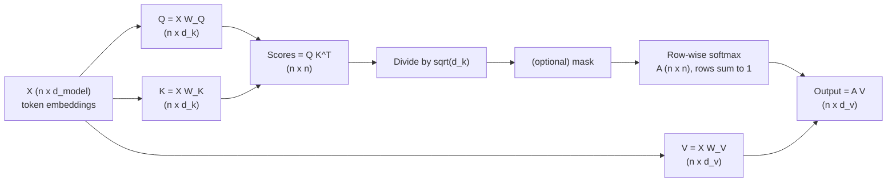

# The Attention Mechanism, Step by Step

> **Level:** Beginner to Advanced · **Study time:** ~100 min · **Prerequisites:** [Linear Algebra for ML](../00-foundations/02-linear-algebra-for-ml.md), [Softmax, Entropy, Cross-Entropy and KL Divergence](../00-foundations/05-softmax-entropy-cross-entropy-and-kl-divergence.md), [Embeddings](02-embeddings-from-one-hot-to-contextual.md), helpful: [RNNs, LSTMs and the Road to Transformers](../02-deep-learning/08-rnns-lstms-and-the-road-to-transformers.md)

## Table of contents

- [Why this matters](#why-this-matters)
- [Notation at a glance](#notation-at-a-glance)
- [The problem attention solves](#the-problem-attention-solves)
- [Intuition: queries, keys and values as a library search](#intuition-queries-keys-and-values-as-a-library-search)
- [Dot product as a similarity score](#dot-product-as-a-similarity-score)
- [Learned projections: W_Q, W_K and W_V](#learned-projections-w_q-w_k-and-w_v)
- [Scaled dot-product attention: the formula](#scaled-dot-product-attention-the-formula)
- [A complete worked example by hand](#a-complete-worked-example-by-hand)
- [Why divide by the square root of d_k](#why-divide-by-the-square-root-of-d_k)
- [Interpreting attention weights (and their limits)](#interpreting-attention-weights-and-their-limits)
- [Self-attention vs cross-attention](#self-attention-vs-cross-attention)
- [Where self-attention fits inside a Transformer](#where-self-attention-fits-inside-a-transformer)
- [Code: NumPy from scratch and a PyTorch check](#code-numpy-from-scratch-and-a-pytorch-check)
- [Complexity: why attention is quadratic in sequence length](#complexity-why-attention-is-quadratic-in-sequence-length)
- [Going deeper: efficient attention and FlashAttention](#going-deeper-efficient-attention-and-flashattention)
- [Going deeper: production concerns, debugging and testing](#going-deeper-production-concerns-debugging-and-testing)
- [Common mistakes and misconceptions](#common-mistakes-and-misconceptions)
- [Interview questions and model answers](#interview-questions-and-model-answers)
- [Key takeaways](#key-takeaways)
- [Further reading](#further-reading)
- [Next](#next)

## Why this matters

Attention is the single operation that makes Transformers work, and Transformers power essentially every modern LLM (GPT, Llama, Gemini, Mistral, Qwen), embedding model, vision transformer and speech model. Almost every hard production problem in LLM serving traces back to attention: why long context is expensive, why the KV cache eats GPU memory, why FlashAttention matters, why a 128k-token prompt is slower than you expect. In interviews, "explain self-attention" and "why divide by the square root of d_k" are near-universal questions, and senior candidates are expected to go beyond the formula into shapes, complexity, numerics and trade-offs. By the end of this chapter you will be able to compute attention by hand, implement it in 10 lines of NumPy, and reason about its cost at 128k tokens.

> **Do not panic about the jargon above.** Terms like "KV cache," "FlashAttention" and "$d_k$" are all defined later in this chapter, in order. If you only remember one thing for now: attention is a way for every word in a sentence to look at every other word and pull in the information it needs.

## Notation at a glance

You will see these symbols throughout. Come back to this table whenever a letter looks unfamiliar.

| Symbol / term | Meaning in plain words | Shape or typical value |
|---|---|---|
| **Token** | A unit of text the model reads, usually a word or a piece of a word (see [Tokenization](01-tokenization.md)) | "the", "cat", "sat" |
| $n$ | **Sequence length**: how many tokens are in the input | 3 in our worked example; 4,096 to 128k+ in modern LLMs |
| $d_{\text{model}}$ | The length of each token's vector inside the model (the "hidden size") | 4 in our example; 512 in the original Transformer; 4096 in Llama 2 7B |
| $d_k$ | The length of each **query** and **key** vector | 2 in our example; 64 in the original Transformer; 128 in Llama 2 7B |
| $d_v$ | The length of each **value** vector | Usually equal to $d_k$ |
| $X$ | Input matrix: one row per token, each row is that token's vector | $n \times d_{\text{model}}$ |
| $W_Q, W_K, W_V$ | Learned weight matrices that turn token vectors into queries, keys and values | $d_{\text{model}} \times d_k$ (or $d_v$) |
| $Q, K, V$ | Queries, keys and values for all tokens, one row per token | $n \times d_k$, $n \times d_k$, $n \times d_v$ |
| $q_i, k_j, v_j$ | One row of $Q$, $K$ or $V$: the query of token $i$, the key and value of token $j$ | vectors of length $d_k$ or $d_v$ |
| $S = QK^\top$ | **Score matrix**: how well every query matches every key | $n \times n$ |
| $A$ | **Attention weights**: the scores after softmax; each row sums to 1 | $n \times n$ |
| $h$ | Number of attention **heads** (covered in the next chapter) | 8 in the original Transformer; 32 in Llama 2 7B |

Two reading conventions:

- "$a \times b$" for a matrix means **$a$ rows and $b$ columns**. Matrix multiplication $(a \times b)(b \times c)$ gives $(a \times c)$: the inner sizes must match and disappear.
- $M^\top$ (read "M transpose") flips a matrix so rows become columns. If $K$ is $n \times d_k$, then $K^\top$ is $d_k \times n$.

## The problem attention solves

### A word's meaning depends on its context

Read these two sentences:

1. "The **animal** didn't cross the street because **it** was too tired."
2. "The animal didn't cross the **street** because **it** was too wide."

The word "it" is spelled identically in both. Yet in sentence 1, "it" means the animal (animals get tired), and in sentence 2, "it" means the street (streets are wide). You resolve this instantly by looking at other words in the sentence.

A model that represents each word with a fixed vector (a **static embedding**, like word2vec, covered in [Embeddings](02-embeddings-from-one-hot-to-contextual.md)) gives "it" the same vector in both sentences. That vector cannot possibly encode "animal" in one sentence and "street" in the other.

What we want is a **contextual representation**: a vector for each **token** (a word or word piece; see [Tokenization](01-tokenization.md)) that is updated using information from the other tokens in the same input. After this update, the vector for "it" in sentence 1 should contain a lot of "animal" information.

> **Analogy:** You walk into a meeting halfway through and hear "we should ship it on Friday." To understand "it," you glance at the whiteboard, the slides and the people in the room, and pull in whatever is relevant. Attention is that glance: each word looks around the sentence and gathers what it needs.

### What came before: RNNs and their bottleneck

Before Transformers, the standard tool for sequences was the **recurrent neural network (RNN)** and its variant the **LSTM** (recap: they read tokens one at a time and carry a single "memory" vector forward; see [RNNs, LSTMs and the Road to Transformers](../02-deep-learning/08-rnns-lstms-and-the-road-to-transformers.md)). Two problems:

- **Long-range dependencies are hard.** Information from word 1 must survive being squeezed through every intermediate step to reach word 50.
- **No parallelism across positions.** Step 50 needs step 49's output, so you cannot process all tokens at once on a GPU.

**Attention** was first added to RNN translation models by Bahdanau, Cho and Bengio (2014) so the decoder could "look back" at any input word directly. Then "Attention Is All You Need" (Vaswani et al., 2017) removed recurrence entirely: every token looks at every other token directly, in one parallel matrix operation. That architecture is the **Transformer**.

### The core idea in one sentence

> For each token, compute a **weighted average** of information from all tokens, where the weights say how relevant each other token is to this one.

A tiny made-up example: suppose that while processing "it," the model decides "animal" deserves 70% of its attention, "street" 20%, and "it" itself 10%. Then:

$$\text{new}_{\text{it}} = 0.7 \times \text{info}_{\text{animal}} + 0.2 \times \text{info}_{\text{street}} + 0.1 \times \text{info}_{\text{it}}$$

The weights are never negative and always add up to 1 ($0.7 + 0.2 + 0.1 = 1$), so the result is a **blend** dominated by the most relevant word.

Everything else in this chapter is about how to compute those relevance weights and what to average.

## Intuition: queries, keys and values as a library search

Imagine a library.

- You walk in with a **query**: a request slip saying "books about tired animals."
- Every book has a **key**: the label on its spine or its catalog card ("Animals > Behavior > Sleep").
- Every book has a **value**: the actual content inside.

A normal library does a **hard lookup**: find the one book whose key matches your query exactly, and hand you that book's content.

Attention does a **soft lookup**: compare your query against every key, give each book a relevance score, turn those scores into percentages that sum to 100%, and hand you a **blend** of all the books' contents, mixed according to those percentages. Highly relevant books dominate the blend; irrelevant ones contribute almost nothing.

The search-engine version of the same analogy:

| Search engine | Attention | Role |
|---|---|---|
| The text you type | **Query** ($q$) | What this token is looking for |
| Page titles / index terms | **Key** ($k$) | What each token advertises about itself, used for matching |
| Page content | **Value** ($v$) | The information each token actually passes along if selected |
| Ranking score | Dot product $q \cdot k$ (explained in the next section) | How well a query matches a key |
| "Show results as a blend" | Softmax-weighted sum of values | The output |

Now map it onto our sentence. When processing "it":

- The **query** of "it" roughly asks: "I am a pronoun; which earlier noun could I refer to, and what is tired?"
- The **key** of "animal" advertises: "I am an animate noun, a possible referent."
- The **key** of "street" advertises: "I am an inanimate noun, a place."
- The query matches "animal" more strongly, so the output for "it" is mostly the **value** of "animal."

> **Senior insight:** Nobody hand-writes these roles. The model learns what to put in queries, keys and values purely from training to predict text. The "pronoun looking for noun" story is a human interpretation of what some heads appear to do, not a designed rule.

### Why a soft lookup instead of a hard one?

A hard lookup picks the single best match (an **argmax**: "return the position of the largest score"). That sounds cleaner, so why blend?

Because the model has to **learn** what to put in queries and keys, and learning means gradient descent (recap: [Backpropagation and Gradient Descent](../02-deep-learning/02-backpropagation-and-gradient-descent.md)). Argmax is a step function: nudge the scores slightly and either the winner does not change (gradient 0, so nothing is learned) or it jumps abruptly to another token (no useful gradient either). Softmax gives every candidate a weight that changes **smoothly** with the scores, so a small change in $W_Q$ or $W_K$ produces a small, measurable change in the output, and backpropagation can tell the weights which way to move.

And nothing is lost: when one score is much larger than the rest, softmax puts nearly all the weight on it, so a soft lookup can become "almost hard" whenever that is useful.

| | Hard lookup (a Python `dict`) | Soft lookup (attention) |
|---|---|---|
| Matching rule | Exact key equality | A similarity score against **every** key |
| Returns | Exactly one value | A weighted blend of **all** values |
| Differentiable (trainable by gradients)? | No | Yes |
| Cost per query | $O(1)$ with a hash table | $O(n)$: one score per key |
| Cost for all $n$ queries | $O(n)$ | $O(n^2)$: the root of attention's quadratic cost (see the complexity section) |

(Hard attention does exist, for example in "Show, Attend and Tell" (Xu et al., 2015), but it needs sampling-based training tricks and is rarely used in modern LLMs.)

## Dot product as a similarity score

To compare a query with a key we need a single number that is large when they "match." The simplest choice is the **dot product**.

### Definition

For two vectors of the same length $d$:

$$a \cdot b = \sum_{i=1}^{d} a_i \, b_i = a_1 b_1 + a_2 b_2 + \dots + a_d b_d$$

- $a, b$: vectors with $d$ numbers each.
- $a_i, b_i$: the $i$-th entries.
- $d$: the dimension (number of entries).

Geometrically, $a \cdot b = \lVert a \rVert \, \lVert b \rVert \cos\theta$, where $\lVert a \rVert$ is the length of $a$ and $\theta$ is the angle between the vectors.

- Pointing the same direction: $\cos\theta = 1$, large positive dot product.
- Perpendicular: $\cos\theta = 0$, dot product 0.
- Opposite directions: $\cos\theta = -1$, large negative dot product.

### Tiny example

$a = [1, 2]$, $b = [3, 1]$, $c = [-2, 1]$:

- $a \cdot b = 1 \times 3 + 2 \times 1 = 3 + 2 = 5$ (similar direction)
- $a \cdot c = 1 \times (-2) + 2 \times 1 = -2 + 2 = 0$ (perpendicular)

### Why the dot product and not cosine similarity?

**Cosine similarity** divides the dot product by both lengths, so it ignores magnitude. The dot product keeps magnitude, which gives the model an extra knob: a key with a larger norm can "shout louder." It is also just one fused multiply-add (a multiply and an add done as a single hardware instruction) per dimension, which GPUs do extremely fast, and the whole set of query-key comparisons becomes a single matrix multiplication. (The Bahdanau 2014 paper used a small neural network to score pairs, called **additive attention**; Vaswani et al. chose dot products because they are much faster in practice with optimized matrix code.)

Recap of matrix multiplication if you need it: [Linear Algebra for ML](../00-foundations/02-linear-algebra-for-ml.md).

## Learned projections: W_Q, W_K and W_V

### Where do queries, keys and values come from?

Each token starts as an **embedding vector** $x_i$ of size $d_{\text{model}}$ (the model's hidden width, for example 4096 in a 7B, that is 7-billion-parameter, model like Llama 2 7B). Stack the $n$ token vectors as rows of a matrix $X$ of shape $n \times d_{\text{model}}$.

We create the three roles by multiplying by three **learned weight matrices** (also called **projection matrices**, because they project vectors into a new space):

$$Q = X W_Q, \qquad K = X W_K, \qquad V = X W_V$$

- $X$: input matrix, shape $n \times d_{\text{model}}$, one row per token.
- $W_Q$: query projection, shape $d_{\text{model}} \times d_k$.
- $W_K$: key projection, shape $d_{\text{model}} \times d_k$ (same $d_k$ as queries, because we dot queries with keys).
- $W_V$: value projection, shape $d_{\text{model}} \times d_v$.
- $Q$, $K$: shape $n \times d_k$. Row $i$ is token $i$'s query or key.
- $V$: shape $n \times d_v$. Row $i$ is token $i$'s value.
- $d_k$: the **key/query dimension**; $d_v$: the **value dimension**. Often $d_k = d_v$.

The shapes line up like this (the inner sizes match and disappear):

```text
      X           x        W_Q          =        Q
(n x d_model)        (d_model x d_k)         (n x d_k)
   (3 x 4)               (4 x 2)               (3 x 2)     <- the worked example below
(2048 x 4096)          (4096 x 128)         (2048 x 128)   <- one head of Llama 2 7B on a 2,048-token prompt
```

These matrices are ordinary trainable parameters, learned by backpropagation like any other weights (recap: [Backpropagation and Gradient Descent](../02-deep-learning/02-backpropagation-and-gradient-descent.md)). The same three matrices are applied to every token position in a layer (each layer, and each head within a layer, has its own set). Because the matrices do not depend on $n$, the same trained weights work for a 5-token sentence or a 5,000-token document.

### Why not just use the embeddings directly (Q = K = V = X)?

This is a favorite interview follow-up. Three reasons:

1. **Every token would mostly attend to itself.** The score of token $i$ with itself is $x_i \cdot x_i = \lVert x_i \rVert^2$, which tends to be the largest dot product in its row. Useful attention usually needs to look *elsewhere*.
2. **Scores would be symmetric.** $x_i \cdot x_j = x_j \cdot x_i$, so "how much 'it' cares about 'animal'" would equal "how much 'animal' cares about 'it'." Real relationships are asymmetric: a pronoun searches for its referent, but the noun is not searching for the pronoun in the same way. With projections, the score is $x_i W_Q W_K^\top x_j^\top$, a **learned bilinear form** that need not be symmetric. ("Bilinear form" just means a score of the shape $x_i M x_j^\top$ for some matrix $M$, here $M = W_Q W_K^\top$; it is linear in each of the two vectors separately. Because $M$ is learned and generally not symmetric, swapping $i$ and $j$ changes the score.)
3. **What you match on is not what you pass along.** The features useful for deciding *relevance* (grammatical role, position cues) differ from the features useful as *content* (meaning to copy over). Separate $W_V$ lets the model decouple "how I am found" from "what I give."

A fourth, practical reason: projections let us choose $d_k$ smaller than $d_{\text{model}}$, which is exactly what multi-head attention does (next chapter).

> **Analogy:** On a dating app, your profile has "what I'm looking for" (query), "what I advertise about myself" (key), and "who I actually am once you meet me" (value). Those three are related but not identical, and treating them as the same thing gives bad matches.

## Scaled dot-product attention: the formula

### The formula

From "Attention Is All You Need" (Vaswani et al., 2017):

$$\text{Attention}(Q, K, V) = \text{softmax}\!\left(\frac{Q K^\top}{\sqrt{d_k}}\right) V$$

- $Q$: queries, shape $n_q \times d_k$.
- $K$: keys, shape $n_k \times d_k$. $K^\top$ (transpose) has shape $d_k \times n_k$.
- $V$: values, shape $n_k \times d_v$.
- $QK^\top$: the **score matrix** (also called **attention logits**), shape $n_q \times n_k$. Entry $(i, j)$ is $q_i \cdot k_j$, how much query $i$ matches key $j$.
- $\sqrt{d_k}$: the **scaling factor**. Explained in detail below.
- $\text{softmax}$: applied **row by row**, turning each row of scores into positive weights that sum to 1. Recap: [Softmax](../00-foundations/05-softmax-entropy-cross-entropy-and-kl-divergence.md). For a row $z$: $\text{softmax}(z)_j = e^{z_j} / \sum_{m} e^{z_m}$.
  Quick example: $\text{softmax}([2, 1, 0])$. Exponentiate: $e^2 \approx 7.389$, $e^1 \approx 2.718$, $e^0 = 1$, sum $\approx 11.107$. Divide: $\approx [0.665, 0.245, 0.090]$. Bigger score, bigger weight; every weight positive; total 1.
- The softmax output $A$ is the **attention weight matrix**, shape $n_q \times n_k$.
- $AV$: each output row is a weighted average of value rows. Final shape $n_q \times d_v$.

In **self-attention**, $Q$, $K$ and $V$ all come from the same sequence, so $n_q = n_k = n$.

### The pipeline as a picture



And with shapes, for one sequence:

```text
   Q            K^T             scores          A               V            output
(n x d_k)  x  (d_k x n)   =    (n x n)  --> softmax --> (n x n)  x  (n x d_v)  =  (n x d_v)

 row i of output = sum over j of  A[i, j] * V[j]
                   "token i's new vector is a blend of every token's value,
                    weighted by how well i's query matched j's key"
```

### Step by step in words

1. **Project:** make a query, key and value for every token.
2. **Score:** dot every query with every key. That gives an $n \times n$ table.
3. **Scale:** divide every score by $\sqrt{d_k}$.
4. **Mask (optional):** set forbidden positions to $-\infty$ (for example, future tokens in GPT-style models, or padding). Covered in [Multi-Head Attention and Causal Masking](04-multi-head-attention-and-causal-masking.md).
5. **Normalize:** softmax each row so weights are positive and sum to 1.
6. **Mix:** multiply weights by values. Each token's output is a weighted average of all value vectors.

## A complete worked example by hand

Let us run every step with real numbers. Our running example is the 3-token sentence **"the cat sat"**.

### Setup

To keep arithmetic small: $d_{\text{model}} = 4$ and $d_k = d_v = 2$. The numbers are chosen by hand for clarity (illustrative, not from a trained model).

Embeddings (one row per token):

```text
            dim0 dim1 dim2 dim3
X =  the  [  1    0    1    0 ]
     cat  [  0    1    0    1 ]
     sat  [  1    1    0    0 ]
```

Projection matrices (each is 4 x 2):

```text
W_Q = [ 1  0 ]     W_K = [ 0  1 ]     W_V = [ 1  0 ]
      [ 0  1 ]           [ 1  0 ]           [ 0  1 ]
      [ 1  0 ]           [ 0  1 ]           [ 0  0 ]
      [ 0  1 ]           [ 1  0 ]           [ 0  1 ]
```

**A handy trick:** multiplying a row vector by a matrix gives a weighted sum of the matrix's rows, where the weights are the row vector's entries. Since our embeddings contain only 0s and 1s, each projection is just "add up the rows of W where the embedding has a 1."

### Step 1: compute Q, K and V

"the" = [1, 0, 1, 0] has 1s in dims 0 and 2, so add rows 0 and 2:

- $q_{\text{the}} = [1,0] + [1,0] = [2, 0]$
- $k_{\text{the}} = [0,1] + [0,1] = [0, 2]$
- $v_{\text{the}} = [1,0] + [0,0] = [1, 0]$

"cat" = [0, 1, 0, 1] has 1s in dims 1 and 3, so add rows 1 and 3:

- $q_{\text{cat}} = [0,1] + [0,1] = [0, 2]$
- $k_{\text{cat}} = [1,0] + [1,0] = [2, 0]$
- $v_{\text{cat}} = [0,1] + [0,1] = [0, 2]$

"sat" = [1, 1, 0, 0] has 1s in dims 0 and 1, so add rows 0 and 1:

- $q_{\text{sat}} = [1,0] + [0,1] = [1, 1]$
- $k_{\text{sat}} = [0,1] + [1,0] = [1, 1]$
- $v_{\text{sat}} = [1,0] + [0,1] = [1, 1]$

```text
        Q          K          V
the  [2, 0]     [0, 2]     [1, 0]
cat  [0, 2]     [2, 0]     [0, 2]
sat  [1, 1]     [1, 1]     [1, 1]
```

Notice that "the" has query [2, 0] but key [0, 2]: the same token plays different roles when searching versus being searched.

### Step 2: raw scores S = Q K^T

Each entry is (row's query) dot (column's key).

Row "the", $q = [2, 0]$:

- vs $k_{\text{the}} = [0,2]$: $2 \times 0 + 0 \times 2 = 0$
- vs $k_{\text{cat}} = [2,0]$: $2 \times 2 + 0 \times 0 = 4$
- vs $k_{\text{sat}} = [1,1]$: $2 \times 1 + 0 \times 1 = 2$

Row "cat", $q = [0, 2]$:

- vs the: $0 \times 0 + 2 \times 2 = 4$
- vs cat: $0 \times 2 + 2 \times 0 = 0$
- vs sat: $0 \times 1 + 2 \times 1 = 2$

Row "sat", $q = [1, 1]$:

- vs the: $1 \times 0 + 1 \times 2 = 2$
- vs cat: $1 \times 2 + 1 \times 0 = 2$
- vs sat: $1 \times 1 + 1 \times 1 = 2$

```text
               keys:  the   cat   sat
S = Q K^T =  the   [  0     4     2  ]
             cat   [  4     0     2  ]
             sat   [  2     2     2  ]
```

Note the matrix is not "self-favoring": "the" scores 0 with itself. That is the effect of separate $W_Q$ and $W_K$.

### Step 3: scale by sqrt(d_k)

$d_k = 2$, so $\sqrt{2} \approx 1.4142$.

- $0 / 1.4142 = 0$
- $4 / 1.4142 = 2.8284$
- $2 / 1.4142 = 1.4142$

```text
               the      cat      sat
S_scaled = the [ 0.0000   2.8284   1.4142 ]
           cat [ 2.8284   0.0000   1.4142 ]
           sat [ 1.4142   1.4142   1.4142 ]
```

### Step 4: softmax each row

Row "the": exponentiate each entry.

- $e^{0} = 1.0000$
- $e^{2.8284} \approx 16.9188$
- $e^{1.4142} \approx 4.1133$
- Sum $= 1.0000 + 16.9188 + 4.1133 = 22.0321$

Divide each by the sum:

- $1.0000 / 22.0321 \approx 0.0454$
- $16.9188 / 22.0321 \approx 0.7679$
- $4.1133 / 22.0321 \approx 0.1867$
- Check: $0.0454 + 0.7679 + 0.1867 = 1.0000$

Row "cat" has the same numbers in a different order (scores [2.8284, 0, 1.4142]), so its weights are [0.7679, 0.0454, 0.1867].

Row "sat" has three equal scores, so softmax gives equal weights: $1/3 \approx 0.3333$ each.

```text
                       the      cat      sat
A = softmax(...) = the [ 0.0454   0.7679   0.1867 ]   <- "the" looks mostly at "cat"
                   cat [ 0.7679   0.0454   0.1867 ]   <- "cat" looks mostly at "the"
                   sat [ 0.3333   0.3333   0.3333 ]   <- "sat" spreads evenly
```

A nice story (illustrative): the determiner "the" pulls information from its noun "cat," and "cat" pulls from its determiner.

### Step 5: weighted sum of values, output = A V

Row "the": $0.0454 \cdot v_{\text{the}} + 0.7679 \cdot v_{\text{cat}} + 0.1867 \cdot v_{\text{sat}}$

- first coordinate: $0.0454 \times 1 + 0.7679 \times 0 + 0.1867 \times 1 = 0.0454 + 0 + 0.1867 = 0.2321$
- second coordinate: $0.0454 \times 0 + 0.7679 \times 2 + 0.1867 \times 1 = 0 + 1.5358 + 0.1867 = 1.7225$

Row "cat": $0.7679 \cdot [1,0] + 0.0454 \cdot [0,2] + 0.1867 \cdot [1,1]$

- first: $0.7679 + 0 + 0.1867 = 0.9546$
- second: $0 + 0.0908 + 0.1867 = 0.2775$

Row "sat": $\tfrac13 [1,0] + \tfrac13 [0,2] + \tfrac13 [1,1] = \tfrac13 [2, 3] = [0.6667, 1.0000]$

```text
                  dim0     dim1
output =  the  [ 0.2321   1.7225 ]
          cat  [ 0.9546   0.2775 ]
          sat  [ 0.6667   1.0000 ]
```

Compare with the original values: "the" had value [1, 0], but its new vector [0.2321, 1.7225] looks a lot like "cat"'s value [0, 2]. The representation of "the" is now **contextual**: it carries information about the noun it belongs to. That is attention in a nutshell.

> **Interview tip:** If asked to "walk through attention," narrate exactly these five steps with shapes: project, score ($n \times n$), scale, softmax per row, weighted sum ($n \times d_v$). Shapes prove you understand it; prose alone does not.

## Why divide by the square root of d_k

### The intuition

Dot products add up $d_k$ terms. More terms means the total can swing further from zero. If scores get large in magnitude, softmax becomes nearly **one-hot** (one weight close to 1, the rest close to 0). A nearly one-hot softmax has almost zero gradient, so the model stops learning. Dividing by $\sqrt{d_k}$ keeps scores in a healthy range no matter how big $d_k$ is.

### The math: variance grows with dimension

Assume (as at initialization) that each entry of $q$ and $k$ is an independent random number with **mean** 0 and **variance** 1 (recap of mean and variance: [Probability and Statistics](../00-foundations/04-probability-and-statistics.md)). Notation: $E[\cdot]$ is the **expected value**, the average you would get over many random draws; $\text{Var}(x) = E[x^2] - (E[x])^2$ measures spread; the **standard deviation** (std) is $\sqrt{\text{Var}}$.

Is this assumption realistic? Roughly, at the start of training: the token vectors entering attention are normalized (LayerNorm or RMSNorm) so their entries have about unit variance, and weights are initialized with variance about $1/d_{\text{model}}$, so each entry of $q = xW_Q$ is a sum of $d_{\text{model}}$ terms each with variance about $1/d_{\text{model}}$, giving variance about 1.

$$q \cdot k = \sum_{i=1}^{d_k} q_i k_i$$

- Each product $q_i k_i$ has mean $E[q_i]E[k_i] = 0 \times 0 = 0$.
- Each product has variance $E[q_i^2 k_i^2] - 0^2 = E[q_i^2]\,E[k_i^2] = 1 \times 1 = 1$ (the expectation splits into a product because $q_i$ and $k_i$ are independent, and $E[q_i^2] = \text{Var}(q_i) = 1$ since the mean is 0).
- The sum of $d_k$ independent terms, each with variance 1, has variance $d_k$ (rule: **variances of independent random variables add up**).

So:

$$\text{Var}(q \cdot k) = d_k, \qquad \text{std}(q \cdot k) = \sqrt{d_k}$$

Dividing by $\sqrt{d_k}$ gives:

$$\text{Var}\!\left(\frac{q \cdot k}{\sqrt{d_k}}\right) = \frac{d_k}{d_k} = 1$$

Scaled scores have variance 1 regardless of $d_k$. (We divide by $\sqrt{d_k}$ and not $d_k$ because dividing a random variable by $c$ divides its variance by $c^2$: to cancel a variance of $d_k$ we need $c^2 = d_k$, so $c = \sqrt{d_k}$.)

Concrete numbers for the unscaled standard deviation:

| $d_k$ | std of raw $q \cdot k$ ($\sqrt{d_k}$) | Typical range of raw scores (about $\pm 2$ std) |
|---|---|---|
| 2 | 1.41 | -2.8 to 2.8 |
| 64 (original Transformer head size) | 8 | -16 to 16 |
| 128 (common in modern LLMs, e.g. Llama 2 7B) | 11.3 | -22.6 to 22.6 |

### What saturation looks like, in numbers

Take $d_k = 64$. A typical row of raw scores might be about one standard deviation apart: $[8, 0, -8]$.

**Without scaling**, softmax of $[8, 0, -8]$:

- $e^{8} \approx 2981$, $e^{0} = 1$, $e^{-8} \approx 0.000335$
- Weights $\approx [0.99966,\ 0.00034,\ 0.0000001]$. Essentially one-hot.

**With scaling** by $\sqrt{64} = 8$, the scores become $[1, 0, -1]$:

- $e^{1} \approx 2.718$, $e^{0} = 1$, $e^{-1} \approx 0.368$, sum $\approx 4.086$
- Weights $\approx [0.665,\ 0.245,\ 0.090]$. A soft, informative distribution.

### Why saturation kills gradients

The derivative of softmax output $p_i$ with respect to its input $z_j$ is:

$$\frac{\partial p_i}{\partial z_j} = p_i(\delta_{ij} - p_j)$$

- $p_i$: the $i$-th softmax output.
- $z_j$: the $j$-th input score.
- $\delta_{ij}$: 1 if $i = j$, else 0.

The diagonal term is $p_i(1 - p_i)$. Compare:

- Saturated, $p = 0.99966$: $0.99966 \times 0.00034 \approx 0.00034$
- Scaled, $p = 0.665$: $0.665 \times 0.335 \approx 0.223$

The gradient flowing back through the saturated softmax is roughly **660 times smaller**. Every other entry of the **Jacobian** (the full table of partial derivatives $\partial p_i / \partial z_j$ for every pair $i, j$) is similarly tiny when saturated. Weights in $W_Q$ and $W_K$ then barely update: a form of **vanishing gradients** (see [Vanishing and Exploding Gradients](../02-deep-learning/05-vanishing-exploding-gradients-initialization-normalization-and-residuals.md)).

Even our tiny $d_k = 2$ example shows the effect. Without scaling, row "the" would have been softmax([0, 4, 2]) $\approx$ [0.0159, 0.8668, 0.1173], noticeably sharper than the scaled [0.0454, 0.7679, 0.1867].

> **Common mistake:** Saying "we scale to prevent overflow." Overflow is handled separately by subtracting the row maximum inside softmax. The real reason for $\sqrt{d_k}$ is keeping the softmax out of its saturated, low-gradient regime, especially early in training.

> **Senior insight:** $1/\sqrt{d_k}$ is a choice tied to a variance assumption, not a law of nature. Some work uses other scalings (for example, $\mu$P, the "Maximal Update Parametrization" from "Tensor Programs V", Yang et al., 2022, uses $1/d_k$ for better hyperparameter transfer across widths; its argument is that after training, queries and keys are correlated rather than independent, so their dot product grows like $d_k$ rather than $\sqrt{d_k}$), and some models add **QK-normalization** (normalizing queries and keys before the dot product) to stop logits from growing during long training runs. PyTorch's `scaled_dot_product_attention` exposes a `scale` argument for exactly this reason.

### Why not just let the model learn the right scale?

A fair question: the network could, in principle, learn smaller $W_Q$ and $W_K$ to shrink the scores. The problem is the **starting point**. With standard initialization and no scaling, a large head starts out saturated, its gradients are tiny, and it may take a long time (or a lucky learning rate) to escape. The fixed $1/\sqrt{d_k}$ factor costs nothing at runtime (it can even be folded into $W_Q$ after training) and makes every head size start in the same healthy regime, so the same learning rate and initialization recipe work across model sizes.

### How to see this in a real training run

- **Attention entropy per head:** for each row of $A$, compute $-\sum_j A_{ij} \log A_{ij}$ and average. A head whose entropy collapses toward 0 early in training is saturated. "Stabilizing Transformer Training by Preventing Attention Entropy Collapse" (Zhai et al., 2023) links this collapse to training instability.
- **Max attention logit per layer:** record $\max_{i,j} |S_{ij}| / \sqrt{d_k}$ in your training logs. Steady growth over training is an early warning sign that loss spikes may follow; QK-normalization or logit soft-capping are the usual fixes.

## Interpreting attention weights (and their limits)

### What you can read off

The attention matrix $A$ is easy to visualize as a heatmap: rows are "who is looking," columns are "who is being looked at." Tools like `bertviz` (Jesse Vig) draw these for real models. Studies such as "What Does BERT Look At?" (Clark et al., 2019) found heads that track things like direct objects, coreference and the previous token. Rows in $A$ are probability distributions, so you can also compute their **entropy** (low entropy = focused head, high entropy = diffuse head).

```text
             the   animal  didn't  cross  the  street because  it   was  too  tired
   it   ->  0.02   0.41    0.03    0.05  0.01   0.12   0.04   0.18 0.06 0.03  0.05
                    ^^^^ (illustrative numbers for one head)
```

### Why attention weights are not explanations

Treat attention maps as **hints, not proof**:

1. **Weights ignore value size.** Output is $\sum_j A_{ij} v_j$. A weight of 0.4 on a token with a tiny value vector contributes less than a weight of 0.1 on a token with a huge one. "Attention is Not Only a Weight" (Kobayashi et al., 2020) showed norm-weighted analysis can tell a different story.
2. **Many heads, many layers.** A model has dozens of layers times dozens of heads. Information mixes repeatedly, and the residual stream (see [The Full Transformer Architecture](05-the-full-transformer-architecture.md)) carries information around attention altogether. One head's map is a tiny slice. Methods like **attention rollout** (Abnar and Zuidema, 2020) try to combine layers.
3. **Not unique or causal.** "Attention is not Explanation" (Jain and Wallace, 2019) showed you can often find very different attention distributions that produce nearly the same prediction. "Attention is not not Explanation" (Wiegreffe and Pinter, 2019) pushed back on some conclusions. The fair summary: weights can be informative, but they are not a faithful causal explanation by default.
4. **Attention sinks.** Many LLMs put large weight on the first token (or special tokens) even when it is meaningless, as a kind of "no-op" place to park attention ("Efficient Streaming Language Models with Attention Sinks", Xiao et al., 2023). A heatmap full of first-token attention does not mean the first token matters.

> **Interview tip:** If asked "can you use attention to explain the model's decision?" answer: useful for exploration and debugging, unreliable as a faithful explanation; for causal claims use interventions (ablating heads, activation patching) or gradient-based attribution, and validate.

## Self-attention vs cross-attention

The formula is identical; what changes is **where Q, K and V come from**.

- **Self-attention:** Q, K and V are all projections of the same sequence $X$. Each token looks at the other tokens in its own sequence.
- **Cross-attention:** Q comes from one sequence $Y$ (length $m$), while K and V come from another sequence $X$ (length $n$). Each token of $Y$ looks into $X$. The score matrix is $m \times n$.

$$\text{CrossAttn}(Y, X) = \text{softmax}\!\left(\frac{(Y W_Q)(X W_K)^\top}{\sqrt{d_k}}\right) X W_V$$

```text
 Self-attention                      Cross-attention
 X --> Q, K, V                       Y --> Q        X --> K, V
 scores: n x n                       scores: m x n
 "words in my sentence               "words I'm generating looking at
  looking at each other"              the source I'm conditioned on"
```

| | Self-attention | Cross-attention |
|---|---|---|
| Q from | Sequence $X$ | Sequence $Y$ (the "asker") |
| K, V from | Same sequence $X$ | Other sequence $X$ (the "source") |
| Score matrix | $n \times n$ | $m \times n$ |
| Where it appears | Every Transformer layer; BERT encoder, GPT decoder | Encoder-decoder models (original Transformer, T5) where the decoder reads the encoder output; text-to-image diffusion (text conditioning of image features); some multimodal LLMs that read image features |
| Example | "it" finds "animal" in the same sentence | French output word "chat" finds English input "cat" in translation |
| Cost driver | $n^2$ | $m \times n$ |

There is also **masked (causal) self-attention**, where each token may only look at earlier tokens, used by GPT-style decoders. That plus **multi-head** attention is the next chapter: [Multi-Head Attention and Causal Masking](04-multi-head-attention-and-causal-masking.md). Model families (encoder-only, encoder-decoder, decoder-only) are compared in [Encoder-Only, Encoder-Decoder and Decoder-Only Models](07-encoder-only-encoder-decoder-and-decoder-only-models.md).

## Where self-attention fits inside a Transformer

Interviewers often ask you to "explain the Transformer" and then zoom in on self-attention. Here is the minimum picture you need; the full walkthrough is in [The Full Transformer Architecture](05-the-full-transformer-architecture.md).

A Transformer is a **stack of identical blocks** (6 encoder and 6 decoder blocks in the original 2017 model, 32 blocks in Llama 2 7B). Each block has two sublayers:

1. **Self-attention:** tokens exchange information with each other (everything in this chapter). This is the **only** place in the block where one token's vector can be influenced by another token's vector (cross-attention, in encoder-decoder decoders, is the other token-mixing sublayer).
2. **Feed-forward network (FFN, also called the MLP):** a small two-layer neural network applied to **each token separately** (recap: [Neural Networks from Scratch](../02-deep-learning/01-neural-networks-from-scratch.md)). It processes what attention gathered.

A popular way to remember it: **attention is communication between tokens, the FFN is computation within each token.**

Two pieces of glue wrap each sublayer:

- **Residual connection:** the sublayer's output is *added* to its input, $x \leftarrow x + \text{sublayer}(x)$, so information and gradients can flow straight through even if a sublayer learns little (recap: [Residual Connections](../02-deep-learning/05-vanishing-exploding-gradients-initialization-normalization-and-residuals.md)).
- **Normalization** (LayerNorm, or RMSNorm in many modern LLMs): rescales each token's vector to a stable range. The original Transformer normalized *after* the residual add ("post-norm"); most modern LLMs normalize *before* each sublayer ("pre-norm"), which trains more stably. See [Modern LLM Architecture](08-modern-llm-architecture-improvements.md).

```text
 input text
    |
 tokenize -> token embeddings (+ position information)        X: (n x d_model)
    |
 +----------------------- Transformer block (repeated N times) -----------------------+
 |  x = x + SelfAttention( Norm(x) )   <- tokens look at each other (this chapter)    |
 |  x = x + FFN( Norm(x) )             <- each token processed on its own             |
 +-------------------------------------------------------------------------------------+
    |
 final Norm -> linear layer to vocabulary size -> softmax
    |
 probabilities for the next token (decoder-only LLM)
```

Note what the shapes do: every block takes $n \times d_{\text{model}}$ in and gives $n \times d_{\text{model}}$ out. That is why blocks can be stacked as deep as you like. In practice the attention sublayer is **multi-head** (several attentions in parallel, outputs concatenated and mixed by an output matrix $W_O$), and in GPT-style decoders it is **causally masked**; both come in the [next chapter](04-multi-head-attention-and-causal-masking.md). Encoder-decoder models add a third sublayer to decoder blocks: cross-attention to the encoder output.

## Code: NumPy from scratch and a PyTorch check

Install: `pip install numpy torch` (recap of the tooling: [Python Tooling for ML](../00-foundations/06-python-numpy-pandas-pytorch-essentials.md)).

### From scratch in NumPy, reproducing the worked example

```python
import numpy as np

def softmax(z: np.ndarray, axis: int = -1) -> np.ndarray:
    """Numerically stable softmax: subtracting the max does not change the result
    (it cancels in numerator and denominator) but prevents exp() overflow."""
    z = z - z.max(axis=axis, keepdims=True)
    e = np.exp(z)
    return e / e.sum(axis=axis, keepdims=True)

def scaled_dot_product_attention(Q, K, V, mask=None):
    """Q: (n_q, d_k), K: (n_k, d_k), V: (n_k, d_v).
    mask: optional boolean (n_q, n_k), True = allowed to attend.
    Returns output (n_q, d_v) and weights (n_q, n_k)."""
    d_k = Q.shape[-1]
    scores = Q @ K.T / np.sqrt(d_k)              # (n_q, n_k)
    if mask is not None:
        scores = np.where(mask, scores, -np.inf)  # forbidden -> weight 0 after softmax
    weights = softmax(scores, axis=-1)            # each row sums to 1
    return weights @ V, weights                   # (n_q, d_v)

# The "the cat sat" example from the chapter
X = np.array([[1, 0, 1, 0],    # the
              [0, 1, 0, 1],    # cat
              [1, 1, 0, 0]],   # sat
             dtype=np.float64)
W_Q = np.array([[1, 0], [0, 1], [1, 0], [0, 1]], dtype=np.float64)
W_K = np.array([[0, 1], [1, 0], [0, 1], [1, 0]], dtype=np.float64)
W_V = np.array([[1, 0], [0, 1], [0, 0], [0, 1]], dtype=np.float64)

Q, K, V = X @ W_Q, X @ W_K, X @ W_V
out, A = scaled_dot_product_attention(Q, K, V)

np.set_printoptions(precision=4, suppress=True)
print("Q =\n", Q)        # [[2,0],[0,2],[1,1]]
print("weights =\n", A)  # rows ~ [0.0454 0.7679 0.1867], [0.7679 0.0454 0.1867], [0.3333 0.3333 0.3333]
print("output =\n", out) # rows ~ [0.2321 1.7225], [0.9546 0.2775], [0.6667 1.0]
assert np.allclose(A.sum(axis=1), 1.0)   # every row of weights is a distribution
```

That function is the entire mechanism: one matrix multiply, a scale, a softmax and another matrix multiply.

### Check against PyTorch

PyTorch ships an optimized fused kernel, `torch.nn.functional.scaled_dot_product_attention` (available since PyTorch 2.0; the `scale` argument was added in 2.1). It expects tensors shaped `(..., seq_len, head_dim)`, typically `(batch, heads, seq_len, head_dim)`, and uses $1/\sqrt{d_k}$ by default.

```python
import numpy as np
import torch
import torch.nn.functional as F

torch.manual_seed(0)
batch, heads, n, d_k = 2, 4, 10, 16

q = torch.randn(batch, heads, n, d_k, dtype=torch.float64)
k = torch.randn(batch, heads, n, d_k, dtype=torch.float64)
v = torch.randn(batch, heads, n, d_k, dtype=torch.float64)

# PyTorch fused implementation (may dispatch to FlashAttention or
# memory-efficient kernels on GPU; recent CPU builds also have a fused
# flash-style CPU kernel, otherwise the plain math path is used)
out_torch = F.scaled_dot_product_attention(q, k, v)

# Our NumPy version, applied to every (batch, head) slice
def np_attention(Q, K, V):
    s = Q @ np.swapaxes(K, -1, -2) / np.sqrt(Q.shape[-1])
    s = s - s.max(axis=-1, keepdims=True)
    w = np.exp(s)
    w = w / w.sum(axis=-1, keepdims=True)
    return w @ V

out_np = np_attention(q.numpy(), k.numpy(), v.numpy())
print(np.allclose(out_torch.numpy(), out_np))   # True

# Causal (GPT-style) masking: token i may only attend to tokens 0..i
out_causal = F.scaled_dot_product_attention(q, k, v, is_causal=True)
causal_mask = np.tril(np.ones((n, n), dtype=bool))
s = q.numpy() @ np.swapaxes(k.numpy(), -1, -2) / np.sqrt(d_k)
s = np.where(causal_mask, s, -np.inf)
w = np.exp(s - s.max(axis=-1, keepdims=True)); w /= w.sum(axis=-1, keepdims=True)
print(np.allclose(out_causal.numpy(), w @ v.numpy()))  # True
```

### Seeing the variance argument empirically

```python
import numpy as np

rng = np.random.default_rng(0)
for d_k in [2, 16, 64, 128, 512]:
    q = rng.standard_normal((100_000, d_k))
    k = rng.standard_normal((100_000, d_k))
    dots = (q * k).sum(axis=1)
    print(f"d_k={d_k:4d}  var(raw)={dots.var():8.2f}  "
          f"var(scaled)={(dots / np.sqrt(d_k)).var():.2f}")
# var(raw) comes out close to d_k; var(scaled) comes out close to 1.0 in every row
```

### Cross-attention with the same function

```python
# Reuses scaled_dot_product_attention() from the NumPy block above
import numpy as np
rng = np.random.default_rng(1)
d_model, d_k = 8, 4
Y = rng.standard_normal((3, d_model))   # 3 target tokens (the "askers")
X = rng.standard_normal((5, d_model))   # 5 source tokens
W_Q, W_K, W_V = (rng.standard_normal((d_model, d_k)) for _ in range(3))

out, A = scaled_dot_product_attention(Y @ W_Q, X @ W_K, X @ W_V)
print(A.shape, out.shape)   # (3, 5) (3, 4): m x n weights, one output per target token
```

## Complexity: why attention is quadratic in sequence length

### Counting the work

Let $n$ be the sequence length and $d$ the head dimension (for a full layer, think of $d$ as $d_{\text{model}}$ summed over heads).

| Step | Operation | Compute (multiply-adds) | Memory for result |
|---|---|---|---|
| Projections | $XW_Q, XW_K, XW_V$ | $O(n \, d_{\text{model}} \, d)$ | $O(nd)$ |
| Scores | $QK^\top$: $(n \times d)(d \times n)$ | $O(n^2 d)$ | $O(n^2)$ |
| Softmax | per row | $O(n^2)$ | $O(n^2)$ |
| Mix | $AV$: $(n \times n)(n \times d)$ | $O(n^2 d)$ | $O(nd)$ |

Total: $O(n^2 d)$ time from the score and mix steps, and $O(n^2)$ memory if the score matrix is materialized. The quadratic term exists because **every token is compared with every token**: $n$ queries times $n$ keys.

Doubling the context doubles the projection cost but **quadruples** the attention-score cost and memory.

A picture makes it obvious. Each cell is one query-key score:

```text
 n = 3 tokens: 3 x 3 = 9 scores        n = 6 tokens: 6 x 6 = 36 scores
                                        (2x the tokens, 4x the scores)
      k1 k2 k3                               k1 k2 k3 k4 k5 k6
  q1 [ .  .  . ]                         q1 [ .  .  .  .  .  . ]
  q2 [ .  .  . ]                         q2 [ .  .  .  .  .  . ]
  q3 [ .  .  . ]                         q3 [ .  .  .  .  .  . ]
                                         q4 [ .  .  .  .  .  . ]
                                         q5 [ .  .  .  .  .  . ]
                                         q6 [ .  .  .  .  .  . ]
```

| Tokens $n$ | Scores per head ($n^2$) | Relative to 1k |
|---|---|---|
| 1,024 | about 1 million | 1x |
| 4,096 | about 16.8 million | 16x |
| 32,768 | about 1.07 billion | 1,024x |
| 131,072 | about 17.2 billion | 16,384x |

A 128x longer context means a 16,384x larger score matrix.

### Concrete numbers: the n-by-n score matrix

One score matrix per head, per layer, per sequence, stored in 16-bit floats (2 bytes per number). (Units: 1 MiB = $2^{20}$ bytes, 1 GiB = $2^{30}$ bytes, 1 TiB = $2^{40}$ bytes; these are slightly larger than MB, GB, TB.)

| Context | $n$ | Entries $n^2$ | Memory per head (FP16) | Per layer with 32 heads |
|---|---|---|---|---|
| 4k | 4,096 | 16.8 million | 32 MiB | 1 GiB |
| 32k | 32,768 | 1.07 billion | 2 GiB | 64 GiB |
| 128k | 131,072 | 17.2 billion | 32 GiB | 1 TiB |

Arithmetic check for 32k: $32{,}768^2 = 1{,}073{,}741{,}824$ entries; times 2 bytes = $2{,}147{,}483{,}648$ bytes = 2 GiB. Times 32 heads = 64 GiB, for **one layer** of **one sequence**. That alone would eat most of an 80 GB GPU before counting the model weights, the second $n \times n$ matrix a naive implementation materializes for the softmax output, or the training-time copies kept for backpropagation. This is why naive attention simply does not run at long context, and why FlashAttention (below) never builds this matrix.

### Compute: when does attention dominate?

Back-of-envelope for a model shaped like Llama 2 7B (32 layers, $d_{\text{model}} = 4096$, about 7 billion parameters). **FLOPs** means floating-point operations (one multiply or one add each; a multiply-add counts as 2). Approximate FLOPs for one forward pass over $n$ tokens:

- Weight matmuls (projections, MLPs): about $2 \times 7\times10^9 \times n$. (Each parameter is used in one multiply-add per token.)
- Attention scores and mixing ($QK^\top$ and $AV$): about $4 \, n^2 \, d_{\text{model}} \times 32$ layers. (Where the 4 comes from: summed over all heads, $QK^\top$ is $n^2 d_{\text{model}}$ multiply-adds, which is $2 n^2 d_{\text{model}}$ FLOPs; $AV$ is the same again; total $4 n^2 d_{\text{model}}$ per layer.)

| $n$ | Weight matmuls | Attention $n^2$ terms | Ratio attention / weights |
|---|---|---|---|
| 4,096 | $5.7 \times 10^{13}$ | $8.8 \times 10^{12}$ | ~0.15 |
| 32,768 | $4.6 \times 10^{14}$ | $5.6 \times 10^{14}$ | ~1.2 |
| 131,072 | $1.8 \times 10^{15}$ | $9.0 \times 10^{15}$ | ~4.9 |

(Rough estimates: they ignore causal masking, which can skip about half the attention work, and other small terms.) The lesson: at short context, the weight matrices dominate cost; at long context, the quadratic attention term takes over.

### Training/prefill vs decoding

- **Training and prefill** (processing a whole prompt at once): full $n \times n$ attention, quadratic.
- **Decoding** (generating one new token at a time): the new token's single query attends to all $n$ cached keys, so each step is $O(n d)$, linear in context. Over a whole generation of $n$ tokens that still sums to quadratic. Caching keys and values avoids recomputing them but costs memory that grows linearly with context: see [The KV Cache](../06-llm-inference/02-kv-cache-explained.md) and [Prefill, Decode, TTFT and Throughput](../06-llm-inference/01-inference-fundamentals-prefill-decode-and-latency-metrics.md).

```text
Prefill (prompt of n tokens):          Decode (token n+1):
 Q: n rows x K: n rows -> n x n         Q: 1 row x K: n rows -> 1 x n
 compute-heavy, parallel                memory-bandwidth-heavy, reads whole KV cache
```

## Going deeper: efficient attention and FlashAttention

Two different goals get mixed up a lot:

1. **Keep exact attention, but make it fast and memory-light** (FlashAttention).
2. **Change the math so it is no longer quadratic** (sparse, low-rank, linear attention), usually trading off some quality.

### FlashAttention: exact attention without the n-by-n matrix

"FlashAttention: Fast and Memory-Efficient Exact Attention with IO-Awareness" (Dao et al., 2022) observed that naive attention is slow mainly because it writes the giant score matrix to GPU main memory (HBM) and reads it back, several times. GPUs compute far faster than they move data (see [GPU Fundamentals](../06-llm-inference/03-gpu-fundamentals-compute-bound-vs-memory-bound.md)).

The trick:

- Split Q, K and V into **tiles** that fit in fast on-chip SRAM.
- For each query tile, loop over key/value tiles, computing partial scores and keeping a **running max and running sum** so the softmax can be computed incrementally (**online softmax**). Partial outputs are rescaled when a new max appears.
- Never write the full $n \times n$ matrix to HBM. In the backward pass, recompute tiles instead of storing them.

Result: **mathematically the same output** (up to floating-point rounding), memory for attention drops from $O(n^2)$ to $O(n)$, and wall-clock time drops because of far less memory traffic. **Compute is still $O(n^2 d)$.** FlashAttention-2 (Dao, 2023) and later versions improve GPU utilization further. A related earlier result, "Self-attention Does Not Need O(n^2) Memory" (Rabe and Staats, 2021), showed the memory reduction via chunking.

```text
Naive:   Q,K -> [ n x n scores in HBM ] -> softmax -> [ n x n in HBM ] -> x V
FlashAttention:  for each Q tile:
                    for each K,V tile:   (all in SRAM)
                        partial scores -> update running max/sum -> accumulate output
                 write only the n x d output
```

### Online softmax, worked by hand

The part that feels like magic is "compute softmax without ever seeing the whole row." Here is the trick on one query with three scores, $[1, 2, 3]$, and scalar values $[10, 20, 30]$, processed in two tiles: tile 1 = scores $[1, 2]$, tile 2 = score $[3]$.

We keep three running numbers: $m$ (the largest score so far), $\ell$ (the running softmax denominator, measured relative to $m$) and $\text{acc}$ (the running weighted sum of values, also relative to $m$).

**Tile 1** (scores 1, 2; values 10, 20):

- $m = 2$
- $\ell = e^{1-2} + e^{2-2} = 0.3679 + 1 = 1.3679$
- $\text{acc} = 0.3679 \times 10 + 1 \times 20 = 23.679$

**Tile 2** (score 3; value 30). The max changes from 2 to 3, so first **rescale** the old totals by $e^{2-3} = 0.3679$, then add the new term:

- $m = 3$
- $\ell = 1.3679 \times 0.3679 + e^{3-3} = 0.5032 + 1 = 1.5032$
- $\text{acc} = 23.679 \times 0.3679 + 1 \times 30 = 8.711 + 30 = 38.711$

**Finish:** output $= \text{acc} / \ell = 38.711 / 1.5032 \approx 25.75$.

**Check with ordinary softmax** of $[1, 2, 3]$: weights $\approx [0.0900, 0.2447, 0.6652]$, output $= 0.0900 \times 10 + 0.2447 \times 20 + 0.6652 \times 30 \approx 0.900 + 4.894 + 19.957 = 25.75$. Identical. The full row was never stored; only three running numbers per query were.

```python
import numpy as np

def online_softmax_attention_row(scores, values, tile=2):
    """One query row, processed tile by tile, never holding all exp(scores) at once."""
    m, l, acc = -np.inf, 0.0, 0.0
    for start in range(0, len(scores), tile):
        s, v = scores[start:start + tile], values[start:start + tile]
        m_new = max(m, s.max())
        correction = np.exp(m - m_new)          # rescale old totals to the new max
        p = np.exp(s - m_new)
        l = l * correction + p.sum()
        acc = acc * correction + (p * v).sum()
        m = m_new
    return acc / l

scores = np.array([1.0, 2.0, 3.0]); values = np.array([10.0, 20.0, 30.0])
w = np.exp(scores - scores.max()); w /= w.sum()
print(online_softmax_attention_row(scores, values), (w * values).sum())  # both ~25.752
```

The online-softmax idea predates FlashAttention ("Online normalizer calculation for softmax", Milakov and Gimelshein, 2018); FlashAttention's contribution was combining it with GPU tiling and recomputation in one fused kernel.

In PyTorch, `F.scaled_dot_product_attention` automatically picks a FlashAttention-style or memory-efficient kernel on supported GPUs, dtypes and shapes, and falls back to the plain math path otherwise. Backend selection details change between versions, so check the docs for your release.

### Approximate and structural alternatives

| Approach | Idea | Complexity | Pros | Cons | Examples |
|---|---|---|---|---|---|
| Full attention + FlashAttention | Exact, IO-aware tiling | $O(n^2 d)$ compute, $O(n)$ memory | No quality loss, drop-in | Still quadratic compute | Default in most modern LLM stacks |
| Sliding window / local | Each token attends to the last $w$ tokens | $O(n w d)$ | Linear in $n$, simple | Distant info only flows through stacked layers | Longformer (Beltagy et al., 2020), Mistral 7B (Jiang et al., 2023) |
| Sparse patterns | Local + a few global + random links | ~$O(n)$ (BigBird) to $O(n\sqrt{n})$ (Sparse Transformer) | Long documents | Custom kernels, pattern design | BigBird (Zaheer et al., 2020), Sparse Transformer (Child et al., 2019) |
| Low-rank | Compress keys/values along the sequence axis | $O(nkd)$ | Linear | Hard with causal masking, quality loss | Linformer (Wang et al., 2020) |
| Kernel / linear attention | Replace softmax with a feature map so you can compute $K^\top V$ first | $O(n d^2)$ | Linear, RNN-like decoding | Usually weaker than softmax attention | "Transformers are RNNs" (Katharopoulos et al., 2020), Performer (Choromanski et al., 2020) |
| Share K/V across heads | Fewer K/V heads | Same $n^2$, smaller KV cache | Big inference memory win | Slight quality trade-off | MQA, GQA: see [Modern LLM Architecture](08-modern-llm-architecture-improvements.md) |
| Non-attention sequence models | State-space / recurrent layers | $O(n)$ | Linear time, constant decode state | Weaker at exact recall from context, ecosystem still maturing | Mamba (Gu and Dao, 2023), hybrids |

> **Senior insight:** In practice (as of 2026), most production LLMs keep exact softmax attention and attack its cost with FlashAttention-style kernels, GQA, KV-cache tricks, and sometimes sliding-window layers mixed with full-attention layers. Purely linear-attention models exist but have not displaced softmax attention for general-purpose LLMs. When an interviewer asks "how would you handle 1M-token context," discuss memory (KV cache), compute ($n^2$), kernels, and whether retrieval (RAG) would avoid needing that context at all.

## Going deeper: production concerns, debugging and testing

### Numerical stability

- **Subtract the row max before exp.** $e^{z}$ overflows FP16 at about $z > 11$ (FP16 max is 65,504) and overflows FP32 at about $z > 88$. Every serious implementation does this.
- **Compute softmax in FP32** even when inputs are FP16/BF16; fused kernels accumulate in FP32 internally. Recap: [Mixed-Precision Training](../02-deep-learning/09-mixed-precision-training.md).
- **Fully masked rows produce NaN.** If every key in a row is masked to $-\infty$, a plain softmax computes $0/0$. This happens with padding-only rows or buggy masks. Guard against it (use a large negative finite value, or make sure every row has at least one valid key). Library behavior here is version- and backend-dependent (for example, recent PyTorch releases return zeros for fully masked rows on some `scaled_dot_product_attention` paths), so do not rely on either NaN or zeros; handle the case explicitly.
- **Logit growth.** In long training runs attention logits can drift large, causing instability; QK-normalization and logit soft-capping are used by some models.

### Shapes and conventions that bite

- PyTorch `F.scaled_dot_product_attention` uses `(batch, heads, seq, head_dim)`. `nn.MultiheadAttention` defaults to `(seq, batch, embed)` unless `batch_first=True`.
- **Mask polarity differs between APIs.** In `F.scaled_dot_product_attention`, a boolean `attn_mask` value of `True` means "allowed to attend." In `nn.MultiheadAttention`, `key_padding_mask=True` means "ignore this key." Mixing these up silently inverts your mask.
- Transposing the wrong axes of $K$ is a classic bug. `K.T` on a 4D tensor reverses **all** axes (deprecated in PyTorch, and usually a shape error); swapping the wrong pair of axes, or forgetting the transpose when sizes happen to coincide (for example `seq_len == head_dim` in a small test), can silently produce wrong but valid-shaped results. Use `K.transpose(-2, -1)` (or `K.mT`).

### How to test an attention implementation

1. **Reference check:** compare against `F.scaled_dot_product_attention` in FP64 on random inputs (shown above).
2. **Rows sum to 1:** `weights.sum(-1)` is all ones.
3. **Uniform case:** if all keys are identical, every weight is $1/n$ and the output is the mean of the values.
4. **Permutation equivariance:** without positional information, shuffling the input tokens shuffles the outputs the same way. Self-attention by itself has no notion of order, which is exactly why Transformers need [Positional Encoding](06-positional-encoding-sinusoidal-learned-rope-and-alibi.md).
5. **Causal leak test:** with a causal mask, changing a future token must not change any earlier output.

```python
# Reuses scaled_dot_product_attention() from the NumPy section above
import numpy as np
rng = np.random.default_rng(0)
X = rng.standard_normal((5, 8)); W = [rng.standard_normal((8, 4)) for _ in range(3)]
perm = rng.permutation(5)
out, _ = scaled_dot_product_attention(X @ W[0], X @ W[1], X @ W[2])
out_p, _ = scaled_dot_product_attention(X[perm] @ W[0], X[perm] @ W[1], X[perm] @ W[2])
print(np.allclose(out[perm], out_p))  # True: permuting inputs permutes outputs
```

### Cost and latency implications at scale

- **Context length is a cost multiplier.** Long prompts raise prefill latency (time to first token) superlinearly once the $n^2$ term dominates, and raise KV-cache memory linearly, which reduces how many requests fit in a batch. See [Optimizing and Benchmarking LLM Latency and Cost](../06-llm-inference/07-optimizing-and-benchmarking-llm-latency-and-cost.md).
- **Measure, do not guess.** Profile attention kernels separately (PyTorch profiler, Nsight). Check that the fused kernel is actually used; unsupported dtypes, masks or head sizes can silently fall back to the slow math path.
- **Product choices beat kernels.** Retrieving 5 relevant chunks instead of stuffing 100k tokens (see [What Is RAG](../08-rag/01-what-is-rag-and-why-it-matters.md)) cuts attention cost by orders of magnitude.
- **Training memory:** stored attention activations scale with $n^2$ without FlashAttention; see [Distributed Training and Training Memory](../02-deep-learning/10-distributed-training-and-training-memory.md).

## Common mistakes and misconceptions

| Mistake | Correction |
|---|---|
| "Softmax is applied over the whole matrix." | It is applied **per row** (per query). Each query gets its own distribution over keys. |
| "Scaling by $\sqrt{d_k}$ prevents overflow." | It prevents **softmax saturation and vanishing gradients**. Overflow is handled by subtracting the max. |
| "Divide by $d_k$." | The standard is $\sqrt{d_k}$, because the **standard deviation** of the dot product grows as $\sqrt{d_k}$. ($1/d_k$ in $\mu$P is a deliberate alternative, not the default.) |
| "Q, K and V are different inputs." | In self-attention they are three projections of the **same** input. |
| "Attention weights explain the model's decision." | They are a hint, not a faithful causal explanation. |
| "FlashAttention makes attention linear." | It makes **memory** linear and wall-clock faster; **compute is still quadratic**. It is exact, not approximate. |
| "Attention knows word order." | Plain attention is permutation-equivariant. Order comes from positional encodings. |
| "The KV cache makes decoding cost constant." | Each new token still attends over all cached keys: $O(n)$ per step, and memory grows with $n$. |
| "Attention output is the attention weights." | The output is weights **times values**, shape $n \times d_v$; the weights are the $n \times n$ intermediate. |
| "$d_k$ must equal $d_{\text{model}}$." | $d_k$ is a free choice; in multi-head attention it is usually $d_{\text{model}} / h$. |
| "*Self*-attention means each token attends to itself." | "Self" means Q, K and V come from the **same sequence**. Each token attends to all tokens in that sequence, itself included. |
| "To mask a position, multiply its score by 0." | A score of 0 still gets weight $e^0 = 1$ before normalization. Masking must **add $-\infty$** (or a large negative number) to the score *before* softmax, so its weight becomes 0. |
| "Mask the weights after softmax by zeroing them." | Zeroing after softmax leaves rows that no longer sum to 1, and the forbidden tokens still influenced the normalization. Mask the scores before softmax. |
| "Attention is the whole Transformer." | Attention is one sublayer. Each block also has a feed-forward network, residual connections and normalization, and the FFN holds most of the parameters. |
| "Bigger $d_k$ is always better." | Bigger heads cost more compute and KV-cache memory, and for a fixed $d_{\text{model}}$ mean fewer heads. Head size is a tuning trade-off (64 and 128 are common). |

## Interview questions and model answers

<details>
<summary><b>Q1. Explain the Transformer architecture, focusing on self-attention.</b></summary>

**Short answer:** A Transformer is a stack of identical blocks, each with a self-attention sublayer and a feed-forward sublayer, wrapped with residual connections and normalization (in the original encoder-decoder, decoder blocks also have a cross-attention sublayer). Self-attention lets every token build a new representation as a weighted average of all tokens' value vectors, where the weights come from how well its query matches each token's key: $\text{softmax}(QK^\top/\sqrt{d_k})V$. This replaces recurrence, so all positions are processed in parallel and any two tokens are connected in one step, which fixes the long-range dependency and parallelism problems of RNNs.

**Deeper answer and follow-ups:**
- Mechanism: $Q = XW_Q$, $K = XW_K$, $V = XW_V$; scores $n \times n$; scale; optional mask; row-wise softmax; multiply by $V$ to get $n \times d_v$.
- Path length between any two tokens is 1 (vs $O(n)$ in an RNN), which helps gradients and long-range reasoning.
- It is permutation-equivariant, so positional encodings are added (sinusoidal, learned, RoPE, ALiBi).
- Multi-head attention runs several attentions in parallel with smaller $d_k$, then concatenates and projects with $W_O$.
- Example: "The animal didn't cross the street because it was too tired": a head can put high weight from "it" to "animal."
- Cost: $O(n^2 d)$ compute, $O(n^2)$ memory if scores are materialized.
- Pitfall: do not describe attention weights as the output; the output is the weighted sum of values.
- Block structure to sketch on the whiteboard (pre-norm, as in most modern LLMs): `x = x + Attn(Norm(x)); x = x + FFN(Norm(x))`, repeated $N$ times, then a final norm, a projection to vocabulary size and a softmax. Attention mixes information **across** tokens; the FFN transforms each token **independently** and holds most of the parameters (about two thirds of each block in Llama 2 7B).
- Trade-offs vs RNNs: Transformers train in parallel and connect distant tokens directly, but pay $O(n^2)$ in sequence length and need a KV cache that grows with context at inference; RNNs and state-space models have constant per-step state but struggle with exact long-range recall.
- Failure modes: attention sinks (heavy weight on the first token), attention entropy collapse during training (loss spikes), and weak use of information in the middle of long contexts ("Lost in the Middle", Liu et al., 2023).
- How to measure: attention entropy and max logit per head during training; needle-in-a-haystack and long-context retrieval evals for context use; prefill latency vs prompt length for cost.
- Production: attention dominates long-context cost and KV-cache memory, so serving stacks rely on FlashAttention kernels, GQA, paged KV caches and prompt caching (see [The KV Cache](../06-llm-inference/02-kv-cache-explained.md)).

</details>

<details>
<summary><b>Q2. What are queries, keys and values? Explain the query, key and value matrices.</b></summary>

**Short answer:** They are three learned linear projections of each token's vector. The query is "what I am looking for," the key is "what I advertise so others can find me," and the value is "the information I hand over if selected." The weight matrices $W_Q$, $W_K$ (both $d_{\text{model}} \times d_k$) and $W_V$ ($d_{\text{model}} \times d_v$) are trained parameters; stacking all tokens gives $Q = XW_Q$, $K = XW_K$, $V = XW_V$. It is a soft, differentiable dictionary lookup.

**Deeper answer and follow-ups:**
- Library analogy: query = request slip, key = catalog label, value = book content; the result is a blend of books weighted by relevance.
- Why separate matrices: with $Q = K = X$, scores are symmetric and each token tends to attend to itself because $\lVert x_i\rVert^2$ is large; projections give an asymmetric learned bilinear form $x_i W_Q W_K^\top x_j^\top$.
- Separate $W_V$ decouples "how I am matched" from "what content I pass."
- $W_Q$ and $W_K$ share the inner dimension $d_k$ because queries are dotted with keys; $d_v$ can differ.
- In cross-attention, $Q$ comes from one sequence and $K$, $V$ from another.
- Follow-up "what is cached at inference?": K and V of past tokens (the KV cache), not Q, because past queries are never reused.
- Rank limit (senior point): one head's score for a pair is $x_i M x_j^\top$ with $M = W_Q W_K^\top$, and $M$ (hence the whole score matrix $S = X M X^\top$) has rank at most $d_k$. A single head can only express a limited family of "relations," which is one motivation for many heads with small $d_k$ rather than one big head.
- Parameter count: with $h$ heads and $h \cdot d_k = d_{\text{model}}$, the stacked $W_Q$, $W_K$, $W_V$ (plus the output projection $W_O$) are each $d_{\text{model}} \times d_{\text{model}}$, so about $4 d_{\text{model}}^2$ attention parameters per layer: about 67M per layer for $d_{\text{model}} = 4096$.
- Failure modes: tying $W_Q = W_K$ makes scores symmetric; an untrained or saturated head collapses onto one token; a $W_K$ or $W_Q$ whose outputs grow too large over training drives logits up and destabilizes training (QK-norm is the usual fix).
- Production: K and V are what get stored per token in the KV cache, so $d_k$, $d_v$ and the number of key/value heads directly set inference memory; GQA and MQA shrink it by sharing K and V across query heads (see [Modern LLM Architecture](08-modern-llm-architecture-improvements.md)).

</details>

<details>
<summary><b>Q3. How does scaled dot-product attention work?</b></summary>

**Short answer:** Compute $QK^\top$ to get a similarity score between every query and every key, divide by $\sqrt{d_k}$, optionally mask disallowed positions with $-\infty$, apply softmax across each row to get weights that sum to 1, and multiply those weights by $V$. Each output row is a relevance-weighted average of value vectors.

**Deeper answer and follow-ups:**
- Shapes: $(n_q \times d_k)(d_k \times n_k) \to n_q \times n_k$ weights; times $(n_k \times d_v) \to n_q \times d_v$.
- Worked example ("the cat sat", $d_k = 2$): row "the" scores [0, 4, 2] become [0, 2.83, 1.41] after scaling, softmax [0.045, 0.768, 0.187], output [0.232, 1.723], which now resembles "cat"'s value.
- Why dot product: cheap, one big matmul on GPUs; additive attention (Bahdanau) uses a small MLP and is slower in practice.
- Numerics: subtract the row max before exp; compute softmax in FP32; fully masked rows give NaN.
- Masking: causal mask for decoders, padding mask for batches of different lengths.
- In PyTorch: `torch.nn.functional.scaled_dot_product_attention(q, k, v, attn_mask=None, is_causal=False)`, which can dispatch to FlashAttention kernels.
- Why soft rather than hard (argmax) lookup: softmax is differentiable, so $W_Q$ and $W_K$ can be learned by backpropagation; with well-separated scores it approaches a hard lookup anyway.
- Failure modes: masking by multiplying scores by 0 instead of adding $-\infty$; transposing the wrong axes of a 4D $K$; applying softmax over the wrong dimension (columns instead of rows); inverted mask polarity between APIs. All of these can produce valid-shaped but wrong outputs, so shape checks alone will not catch them.
- How to test: compare against a reference in FP64, assert rows of weights sum to 1, check permutation equivariance without positions, and run a causal leak test (changing a future token must not change earlier outputs).
- Production: use the fused kernel, confirm in a profiler that it did not fall back to the math path because of an unsupported dtype, head size or mask, and keep softmax accumulation in FP32.

</details>

<details>
<summary><b>Q4. Why is attention scaled by the square root of d_k?</b></summary>

**Short answer:** If query and key entries have mean 0 and variance 1, their dot product is a sum of $d_k$ such terms, so its variance is $d_k$ and its standard deviation is $\sqrt{d_k}$. Large scores push softmax into saturation, nearly one-hot, where its gradients are tiny and learning stalls. Dividing by $\sqrt{d_k}$ brings the variance back to 1 regardless of head size.

**Deeper answer and follow-ups:**
- Derivation: $\text{Var}(q_ik_i) = E[q_i^2]E[k_i^2] = 1$; sum of $d_k$ independent terms has variance $d_k$; dividing by $\sqrt{d_k}$ divides variance by $d_k$.
- Numbers: $d_k = 64$ gives std 8. Scores [8, 0, -8] give softmax about [0.9997, 0.0003, 0.0000001]; scaled to [1, 0, -1] they give [0.665, 0.245, 0.090].
- Gradient: diagonal of the softmax Jacobian is $p(1-p)$: about 0.00034 when saturated vs about 0.22 when scaled, roughly 660x smaller.
- Vaswani et al. (2017) note that dot-product attention without scaling underperformed additive attention for large $d_k$, motivating the factor.
- Not about overflow (handled by max subtraction).
- Follow-ups: alternatives include $1/d_k$ scaling in $\mu$P, QK-norm, and tuning the `scale` argument; scaling is a variance-control choice, not a law.
- "Why not divide by $d_k$?" Dividing by $c$ divides variance by $c^2$; to cancel a variance of $d_k$ you need $c = \sqrt{d_k}$. Dividing by $d_k$ would shrink scores toward 0 for big heads, making attention nearly uniform at initialization.
- "Why not let the model learn the scale?" It could shrink $W_Q$ and $W_K$, but a large unscaled head starts saturated with tiny gradients. The fixed factor gives every head size the same healthy starting point and costs nothing (it can be folded into $W_Q$).
- Why the assumption is roughly right: inputs are normalized (LayerNorm/RMSNorm) and weights are initialized with variance about $1/d_{\text{model}}$, so query and key entries start with variance near 1.
- How to measure in practice: log per-head attention entropy and the max scaled logit; entropy collapse and steadily growing logits precede loss spikes (Zhai et al., 2023).
- Analogy: the scale is a softmax temperature. Too low a temperature (no scaling) gives a nearly one-hot, frozen distribution.

</details>

<details>
<summary><b>Q5. Why does standard self-attention have quadratic complexity in sequence length?</b></summary>

**Short answer:** Every token's query is compared with every token's key, so the score matrix $QK^\top$ is $n \times n$. Computing it costs $O(n^2 d)$, multiplying it by $V$ costs another $O(n^2 d)$, and storing it costs $O(n^2)$ memory. Double the context and the attention cost quadruples.

**Deeper answer and follow-ups:**
- Score matrix sizes in FP16, per head per layer: 4k tokens is 16.8M entries (32 MiB); 32k is 1.07B entries (2 GiB); 128k is 17.2B entries (32 GiB). With 32 heads, a single layer at 32k would need 64 GiB if materialized.
- Back-of-envelope for a 7B model (32 layers, $d_{\text{model}}$ 4096): attention $n^2$ FLOPs are about 15% of weight-matmul FLOPs at 4k, about 1.2x at 32k, and about 5x larger at 128k (illustrative estimates).
- Projections and MLPs are linear in $n$; it is specifically the pairwise interaction that is quadratic.
- During decoding with a KV cache, each new token costs $O(n)$, but KV-cache memory grows linearly with context and batch size.
- Mitigations: FlashAttention (exact, $O(n)$ memory, still $O(n^2)$ compute), sliding-window and sparse attention, linear/kernel attention, GQA/MQA for KV memory, and RAG to avoid long contexts.
- Why exact attention cannot simply be made cheaper: every output row depends on all $n$ keys through the softmax normalizer, so exact attention inherently touches all $n^2$ pairs; theory results (for example Keles et al., 2023, "On the Computational Complexity of Self-Attention") show truly subquadratic exact attention is unlikely under standard complexity assumptions. Subquadratic methods change the math (approximate, sparse or linear).
- How to measure: benchmark prefill latency (time to first token) and peak GPU memory at prompt lengths such as 1k, 2k, 4k, ..., 128k; plot on log-log axes. The slope approaches 1 while weight matmuls dominate and bends toward 2 once attention dominates. Profile attention kernels separately to confirm which kernel ran.
- Failure modes in production: out-of-memory at long context if a non-fused path materializes scores; one very long prompt stalling other users' requests in the same batch (mitigated by chunked prefill); cost per request growing faster than the token count users are billed for.
- Production decisions: set a maximum context per tier, cache shared prefixes (prompt caching), retrieve instead of stuffing documents, and choose models with sliding-window or GQA layers when long context is a core requirement.

</details>

<details>
<summary><b>Q6. What is the difference between self-attention and cross-attention? Where is each used?</b></summary>

**Short answer:** Same formula, different sources. In self-attention, Q, K and V all come from one sequence, so tokens look at each other. In cross-attention, Q comes from one sequence and K, V from another, so one sequence reads from the other. Cross-attention is used in encoder-decoder models (decoder reads the encoder output) and to condition on other modalities, such as text conditioning in diffusion image models.

**Deeper answer and follow-ups:**
- Score shape: self is $n \times n$; cross is $m \times n$ (target length by source length).
- Decoder blocks in the original Transformer have masked self-attention followed by cross-attention to the encoder.
- Decoder-only LLMs (GPT, Llama) use only causal self-attention; multimodal inputs are often injected as extra tokens instead, though some architectures use cross-attention layers.
- For cross-attention at inference, the source K and V can be computed once and reused for every generated token.

</details>

<details>
<summary><b>Q7. Can you use attention weights to explain a model's prediction?</b></summary>

**Short answer:** Only cautiously. Attention maps are useful for exploration, but they are not faithful causal explanations: they ignore the magnitude of value vectors, they are spread across many heads and layers, the residual stream bypasses attention, and different attention patterns can yield the same output.

**Deeper answer and follow-ups:**
- Evidence: "Attention is not Explanation" (Jain and Wallace, 2019) and the response "Attention is not not Explanation" (Wiegreffe and Pinter, 2019).
- Value norms matter: Kobayashi et al. (2020) weight attention by $\lVert A_{ij} v_j \rVert$.
- Attention sinks: large weight on the first token often means "no-op," not importance.
- Better tools for causal claims: head ablation, activation patching, gradient-based attribution, attention rollout across layers as a heuristic.

</details>

<details>
<summary><b>Q8. FlashAttention claims big speedups without approximation. How?</b></summary>

**Short answer:** Naive attention is limited by memory traffic, not arithmetic: it writes the $n \times n$ score matrix to slow GPU HBM and reads it back. FlashAttention tiles Q, K and V into fast on-chip SRAM, computes softmax incrementally with a running max and sum (online softmax), and never materializes the full matrix. Output is exact; memory drops to $O(n)$; compute is still $O(n^2 d)$.

**Deeper answer and follow-ups:**
- Backward pass recomputes score tiles instead of storing them: more FLOPs, fewer bytes moved, net faster.
- It is an IO-aware kernel, so gains depend on hardware and on hitting supported dtypes, head dims and masks.
- In PyTorch, `F.scaled_dot_product_attention` dispatches to it when possible; verify with a profiler that you are not on the fallback path.
- It does not reduce KV-cache size; GQA, MQA and KV quantization do that.
- Reference: Dao et al., 2022; FlashAttention-2, Dao, 2023.

</details>

<details>
<summary><b>Q9. What is the cost of attention during autoregressive decoding with a KV cache?</b></summary>

**Short answer:** Prefill of an $n$-token prompt is a full $O(n^2 d)$ attention. Then each generated token has one query that attends over all $n$ cached keys and values, which is $O(nd)$ per token per layer, so per-token cost and memory reads grow linearly with context. Decoding is usually memory-bandwidth bound because each step reads the whole KV cache.

**Deeper answer and follow-ups:**
- KV-cache memory per token = 2 (K and V) x layers x KV heads x head_dim x bytes per value; it grows with context and batch size.
- Generating $T$ tokens sums to roughly $O((n + T)^2 d)$ total attention work.
- Mitigations: GQA/MQA, KV-cache quantization, PagedAttention for fragmentation, sliding windows, prompt caching.
- See [The KV Cache](../06-llm-inference/02-kv-cache-explained.md).

</details>

<details>
<summary><b>Q10. Is self-attention aware of word order? What happens if you shuffle the input?</b></summary>

**Short answer:** No. Without positional information, self-attention is permutation-equivariant: shuffling the input tokens shuffles the outputs in the same way, and the set of output vectors is unchanged. "Dog bites man" and "man bites dog" would get the same contextual vectors per word. That is why Transformers add positional encodings.

**Deeper answer and follow-ups:**
- Proof sketch: permuting rows of $X$ permutes rows of $Q$, $K$, $V$; the score matrix gets rows and columns permuted consistently; softmax is row-wise; so output rows are permuted.
- Causal masks do introduce a weak order signal (each position sees a different number of tokens), but models still use explicit position methods.
- Options: sinusoidal, learned absolute, RoPE (rotary, applied to Q and K), ALiBi (linear bias on scores). See [Positional Encoding](06-positional-encoding-sinusoidal-learned-rope-and-alibi.md).
- Useful unit test for your implementation.

</details>

<details>
<summary><b>Q11. Why softmax? What numerical issues come with it in attention?</b></summary>

**Short answer:** Softmax turns arbitrary scores into positive weights that sum to 1, is differentiable everywhere, and amplifies the best matches, so the output is a convex combination of values. Numerically, you must subtract the row max to avoid exp overflow, accumulate in FP32, and handle rows where everything is masked, which would produce NaN.

**Deeper answer and follow-ups:**
- FP16 exp overflows above about 11 (max value 65,504); subtracting the max makes the largest exponent $e^0 = 1$.
- Masking uses $-\infty$ (or a large negative number) so that $e^{-\infty} = 0$.
- Alternatives studied: sparsemax/entmax (exact zeros), sigmoid attention, linear attention without softmax; softmax remains the default in production LLMs.
- Softmax temperature equals the scale factor: dividing by $\sqrt{d_k}$ is like setting a temperature of $\sqrt{d_k}$.

</details>

<details>
<summary><b>Q12. You see NaNs in training after adding a padding mask. How do you debug it?</b></summary>

**Short answer:** The most common cause is a row where every key is masked, so softmax divides 0 by 0. Second most common is inverted mask polarity between APIs. I would check for fully masked rows, confirm the mask convention of the function I am calling, and verify on a tiny batch against a reference implementation.

**Deeper answer and follow-ups:**
- `F.scaled_dot_product_attention`: boolean `True` = attend. `nn.MultiheadAttention` `key_padding_mask`: `True` = ignore.
- Padding queries (rows) do not need valid outputs but must not be NaN; ensure every row has at least one valid key (or use a large finite negative mask value), and exclude padding positions from the loss. Replacing NaNs with zeros after the softmax (for example with `torch.where` or `nan_to_num`) fixes the forward output but NaN gradients can still flow back through the softmax, so fix the mask instead.
- Also check FP16 overflow in scores (switch to BF16 or keep softmax in FP32) and logit growth over training.
- Add assertions: `torch.isfinite(out).all()`, weights sum to 1 on valid rows.

</details>

<details>
<summary><b>Q13. Why does attention use a soft (softmax) lookup instead of a hard argmax lookup?</b></summary>

**Short answer:** Because the model must learn what to put in queries and keys by gradient descent. Argmax is piecewise constant: small changes to the scores either change nothing (zero gradient) or flip the winner abruptly, so no useful gradient reaches $W_Q$ and $W_K$. Softmax is smooth and differentiable, every token gets a little gradient signal, and when one score dominates, softmax behaves almost like argmax anyway.

**Deeper answer and follow-ups:**
- Hard attention exists ("Show, Attend and Tell", Xu et al., 2015) but needs sampling-based estimators such as REINFORCE, which have high variance and train slowly.
- Trade-off: soft attention reads every key, which is where the $O(n)$ per query and $O(n^2)$ total cost comes from; hard or sparse selection could be cheaper but is harder to train.
- Middle grounds: top-$k$ attention, sparsemax/entmax (exact zeros while staying differentiable almost everywhere), and learned routing in mixture-of-experts layers.
- Failure mode of "too soft": diffuse heads that average everything carry little information; of "too hard": saturated heads with vanishing gradients. Attention entropy per head tells you which regime you are in.

</details>

<details>
<summary><b>Q14. A product team enabled 100k-token prompts and time to first token exploded. How do you diagnose it and what do you do?</b></summary>

**Short answer:** First confirm the cause with measurements: plot time to first token (TTFT) and peak memory against prompt length, and profile the prefill to see how much time is in attention kernels. Prefill attention is $O(n^2)$, so at 100k tokens it dominates. Then fix it in order of leverage: send fewer tokens (retrieval, summarization, prompt caching for shared prefixes), make sure fused FlashAttention kernels are actually used, and adjust serving (chunked prefill, separate long-context capacity).

**Deeper answer and follow-ups:**
- Check the kernel path: an unsupported dtype, head size or custom mask can silently fall back to a math path that materializes $n \times n$ scores.
- Check interference: a single long prefill can block decode steps for every other request in the batch; chunked prefill interleaves it in pieces (see [Batching, Continuous Batching and PagedAttention](../06-llm-inference/04-batching-continuous-batching-and-paged-attention.md)).
- Check memory: KV cache at 100k tokens per request limits batch size, so throughput drops even if each request eventually finishes.
- Product levers usually win: RAG with a few relevant chunks instead of whole documents ([What Is RAG](../08-rag/01-what-is-rag-and-why-it-matters.md)), and prompt caching when many requests share the same long prefix.
- Measure the fix with p50/p95 TTFT, tokens per second and cost per request, broken down by prompt-length bucket.

</details>

<details>
<summary><b>Q15. Since the score is x_i W_Q W_K^T x_j^T, why not precompute one matrix M = W_Q W_K^T and use it directly?</b></summary>

**Short answer:** Mathematically you could for a plain head, but it is usually worse. $M$ is $d_{\text{model}} \times d_{\text{model}}$ while $W_Q$ and $W_K$ are thin ($d_{\text{model}} \times d_k$), so the factored form has fewer parameters and fewer FLOPs whenever $2 d_k < d_{\text{model}}$ (always true with two or more heads of size $d_{\text{model}}/h$), and it gives you compact keys to cache. With rotary position embeddings (RoPE), a position-dependent rotation sits between $W_Q$ and $W_K^\top$, so there is no single fixed $M$ to precompute.

**Deeper answer and follow-ups:**
- Parameters per head: $2 d_{\text{model}} d_k$ factored vs $d_{\text{model}}^2$ merged; for $d_{\text{model}} = 4096$, $d_k = 128$ that is about 1M vs 16.8M.
- The factorization also caps the rank of $M$ at $d_k$, a built-in low-rank constraint that acts like regularization.
- The KV cache stores keys of size $d_k$ per head; a merged form would need to cache something $d_{\text{model}}$-wide or recompute.
- Related production trick: DeepSeek-V2's Multi-head Latent Attention "absorbs" some projection matrices into each other at inference to shrink the KV cache, and had to handle RoPE separately for exactly the reason above. See [RoPE](06-positional-encoding-sinusoidal-learned-rope-and-alibi.md).

</details>

## Key takeaways

- Attention builds **contextual** token vectors: each token's output is a weighted average of all tokens' **value** vectors.
- Attention is a **soft, differentiable lookup**: a blend of all values instead of one exact match, which is what lets $W_Q$ and $W_K$ be learned by gradient descent.
- In a Transformer block, self-attention is the sublayer where tokens **communicate**; the feed-forward network then processes each token on its own, with residual connections and normalization around both.
- **Query** = what I look for, **key** = what I advertise, **value** = what I pass on; all three are learned projections $XW_Q$, $XW_K$, $XW_V$.
- Separate projections allow scores to be **asymmetric** and stop tokens from trivially attending to themselves.
- Formula: $\text{softmax}(QK^\top / \sqrt{d_k})\,V$, with softmax applied **per row**.
- Shapes: scores and weights are $n_q \times n_k$; output is $n_q \times d_v$.
- Unscaled dot products have variance $d_k$; dividing by $\sqrt{d_k}$ restores variance 1 and prevents **softmax saturation** and vanishing gradients.
- Subtracting the row max is for overflow; $\sqrt{d_k}$ is for gradients. Do not confuse them.
- **Self-attention**: Q, K, V from one sequence. **Cross-attention**: Q from one, K and V from another.
- Attention maps are useful hints but **not faithful explanations**.
- Self-attention is **permutation-equivariant**; order comes from positional encodings.
- Complexity: $O(n^2 d)$ compute, $O(n^2)$ memory if scores are materialized; the score matrix at 128k tokens is 32 GiB per head in FP16.
- **FlashAttention** is exact, cuts memory to $O(n)$ and speeds things up via tiling and online softmax (a running max, sum and weighted total per query), but compute stays quadratic.
- Decoding with a KV cache costs $O(n)$ per token, and at long context or large batch sizes the KV cache becomes the main memory bottleneck.

## Further reading

- Vaswani et al., 2017. "Attention Is All You Need." The original Transformer paper. https://arxiv.org/abs/1706.03762
- Bahdanau, Cho and Bengio, 2014. "Neural Machine Translation by Jointly Learning to Align and Translate." The first widely used attention mechanism. https://arxiv.org/abs/1409.0473
- Luong, Pham and Manning, 2015. "Effective Approaches to Attention-based Neural Machine Translation." Dot-product (multiplicative) attention variants.
- Dao, Fu, Ermon, Rudra and Ré, 2022. "FlashAttention: Fast and Memory-Efficient Exact Attention with IO-Awareness." https://arxiv.org/abs/2205.14135
- Dao, 2023. "FlashAttention-2: Faster Attention with Better Parallelism and Work Partitioning."
- Rabe and Staats, 2021. "Self-attention Does Not Need O(n^2) Memory."
- Milakov and Gimelshein, 2018. "Online normalizer calculation for softmax." The origin of the online-softmax trick.
- Xu et al., 2015. "Show, Attend and Tell: Neural Image Caption Generation with Visual Attention." Soft vs hard attention.
- Zhai et al., 2023. "Stabilizing Transformer Training by Preventing Attention Entropy Collapse."
- Liu et al., 2023. "Lost in the Middle: How Language Models Use Long Contexts."
- Keles, Wijewardena and Hegde, 2023. "On the Computational Complexity of Self-Attention."
- Jain and Wallace, 2019. "Attention is not Explanation." Wiegreffe and Pinter, 2019. "Attention is not not Explanation."
- Clark, Khandelwal, Levy and Manning, 2019. "What Does BERT Look At? An Analysis of BERT's Attention."
- Xiao et al., 2023. "Efficient Streaming Language Models with Attention Sinks."
- Tay, Dehghani, Bahri and Metzler, 2020. "Efficient Transformers: A Survey." Overview of sparse, low-rank and linear attention.
- Jay Alammar, "The Illustrated Transformer" (blog). Excellent visual walkthrough.
- PyTorch documentation for `torch.nn.functional.scaled_dot_product_attention`.

## Next

- **Next chapter:** [Multi-Head Attention and Causal Masking](04-multi-head-attention-and-causal-masking.md): running many attentions in parallel and stopping tokens from seeing the future.
- Previous: [Embeddings: From One-Hot Vectors to Word2Vec to Contextual Embeddings](02-embeddings-from-one-hot-to-contextual.md)
- Related:
  - [The Full Transformer Architecture](05-the-full-transformer-architecture.md)
  - [Positional Encoding: Sinusoidal, Learned, RoPE and ALiBi](06-positional-encoding-sinusoidal-learned-rope-and-alibi.md)
  - [Modern LLM Architecture: Pre-Norm, RMSNorm, SwiGLU, GQA, MoE and FlashAttention](08-modern-llm-architecture-improvements.md)
  - [The KV Cache: What It Is and Why It Dominates Memory](../06-llm-inference/02-kv-cache-explained.md)
  - [GPU Fundamentals for LLMs: Compute-Bound vs Memory-Bound](../06-llm-inference/03-gpu-fundamentals-compute-bound-vs-memory-bound.md)
  - [Coding Exercises: Transformers, LLMs, RAG and Agents](../12-interview-practice/02-coding-exercises-llm-rag-and-agents.md)
