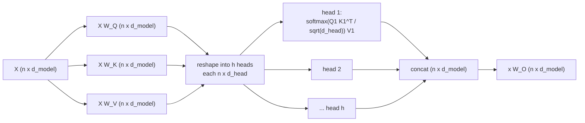
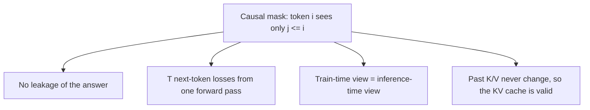

# Multi-Head Attention and Causal Masking

> **Level:** Beginner to Advanced · **Study time:** ~90 min · **Prerequisites:** [The Attention Mechanism, Step by Step](03-attention-mechanism-step-by-step.md), [Linear Algebra for ML](../00-foundations/02-linear-algebra-for-ml.md), [Softmax, Entropy, Cross-Entropy and KL Divergence](../00-foundations/05-softmax-entropy-cross-entropy-and-kl-divergence.md), helpful: [Python Tooling for ML](../00-foundations/06-python-numpy-pandas-pytorch-essentials.md)

## Table of contents

- [Why this matters](#why-this-matters)
- [Quick recap: single-head attention](#quick-recap-single-head-attention)
- [Why one attention pattern is not enough](#why-one-attention-pattern-is-not-enough)
- [Multi-head attention: the idea and the formula](#multi-head-attention-the-idea-and-the-formula)
- [A worked multi-head example by hand](#a-worked-multi-head-example-by-hand)
- [Full shape walk-through: batch, sequence, heads, head_dim](#full-shape-walk-through-batch-sequence-heads-head_dim)
- [Parameter count and compute cost of an attention layer](#parameter-count-and-compute-cost-of-an-attention-layer)
- [What different heads tend to learn (and how far to trust it)](#what-different-heads-tend-to-learn-and-how-far-to-trust-it)
- [Causal masking: no peeking at the future](#causal-masking-no-peeking-at-the-future)
- [Why decoder-only LLMs need causal masking](#why-decoder-only-llms-need-causal-masking)
- [Padding masks and combining masks](#padding-masks-and-combining-masks)
- [Cross-attention in encoder-decoder models](#cross-attention-in-encoder-decoder-models)
- [Preview: multi-query and grouped-query attention](#preview-multi-query-and-grouped-query-attention)
- [Code: a from-scratch PyTorch MultiHeadAttention with a causal mask](#code-a-from-scratch-pytorch-multiheadattention-with-a-causal-mask)
- [Going deeper: production concerns, debugging and scale](#going-deeper-production-concerns-debugging-and-scale)
- [Common mistakes and misconceptions](#common-mistakes-and-misconceptions)
- [Interview questions and model answers](#interview-questions-and-model-answers)
- [Key takeaways](#key-takeaways)
- [Further reading](#further-reading)
- [Next](#next)

## Why this matters

Every Transformer you will meet in an interview (GPT-style chat models, Llama, Mistral, BERT, T5, Whisper, vision transformers) uses multi-head attention, and every GPT-style model also uses a causal mask. These two ideas explain a surprising amount of production behavior: why a 7B model has about 2 billion parameters in its attention layers alone, why the KV cache (the stored keys and values of past tokens that a model reuses while generating) is so large, why grouped-query attention became the default in modern open models, and why a left-padding bug can quietly fill your batch with NaNs. "What is multi-head attention?" and "Why do decoder-only LLMs need causal masking?" are classic interview questions, and senior candidates are expected to answer them with shapes, parameter counts and failure modes, not just a slogan. By the end of this chapter you will be able to compute both by hand, write the module from scratch in PyTorch, and debug the masks that break in real systems.

## Quick recap: single-head attention

The previous chapter, [The Attention Mechanism, Step by Step](03-attention-mechanism-step-by-step.md), built attention from scratch. Here is the one-paragraph version you need.

Each token's vector (a row of the input matrix $X$, shape $n \times d_{\text{model}}$) is projected three ways: into a **query** ("what am I looking for?"), a **key** ("what do I contain?") and a **value** ("what do I hand over if chosen?"). Then:

$$\text{Attention}(Q, K, V) = \text{softmax}\!\left(\frac{QK^\top}{\sqrt{d_k}}\right) V$$

- $Q = XW_Q$, $K = XW_K$, $V = XW_V$: queries, keys and values, one row per token.
- $QK^\top$: the $n \times n$ **score matrix**; entry $(i, j)$ says how well token $i$'s query matches token $j$'s key.
- $\sqrt{d_k}$: scaling that keeps scores from growing with the vector length $d_k$.
- softmax (applied per row): turns each row of scores into **attention weights** that are positive and sum to 1.
- Multiplying by $V$: each token's output is a weighted average of all value vectors.

We will keep reusing the running example from that chapter: the 3-token sentence **"the cat sat"** with $d_{\text{model}} = 4$ and $d_k = d_v = 2$. Its embeddings were:

```text
            dim0 dim1 dim2 dim3
X =  the  [  1    0    1    0 ]
     cat  [  0    1    0    1 ]
     sat  [  1    1    0    0 ]
```

and the single-head computation (all numbers illustrative, hand-chosen weights) gave these scaled scores, weights and outputs:

```text
scaled scores               weights A                      output A V
     the     cat     sat         the     cat     sat            dim0    dim1
the [0.0000  2.8284  1.4142]  the [0.0454  0.7679  0.1867]  the [0.2321  1.7225]
cat [2.8284  0.0000  1.4142]  cat [0.7679  0.0454  0.1867]  cat [0.9546  0.2775]
sat [1.4142  1.4142  1.4142]  sat [0.3333  0.3333  0.3333]  sat [0.6667  1.0000]
```

with values $v_{\text{the}} = [1, 0]$, $v_{\text{cat}} = [0, 2]$, $v_{\text{sat}} = [1, 1]$. Keep these numbers nearby; we will reuse them twice.

## Why one attention pattern is not enough

### The intuition

> **Analogy:** You are reading a contract and want to understand the word "it" in "The supplier shall repair the pump if it fails." A good reader asks several questions at once: *What does "it" refer to?* (the pump). *Which verb is "it" the subject of?* (fails). *What is the nearby clause structure?* (an "if" condition). One person with one highlighter can only mark one set of words per pass. A team of readers, each with a different-colored highlighter and a different question, covers everything in one pass. Multi-head attention is the team.

A single attention head gives each token **exactly one probability distribution** over the other tokens. The output is one weighted average. That creates a real limitation:

- **Averaging blurs.** If token "it" needs information from "pump" (meaning) *and* from "fails" (its verb), one softmax row has to split its weight, say 50/50. The output becomes half pump, half fails: a blend in which neither signal is clean. The original paper, "Attention Is All You Need" (Vaswani et al., 2017), names exactly this problem: with a single head, averaging inhibits attending to different kinds of information at different positions.
- **One similarity notion.** A head has one $W_Q$ and one $W_K$, so it measures "relevance" in exactly one way. Syntax ("who is my subject?"), coreference ("what does this pronoun mean?") and position ("who is right before me?") are different kinds of relevance.
- **One value subspace.** A head's $W_V$ decides which features get passed along. Different relationships may need different features copied.

### A tiny illustration

Suppose, for the token "it", the ideal is to pull 100% of the meaning of "pump" and, separately, 100% of the tense information from "fails". With one head:

```text
one head, row for "it":   pump 0.5   fails 0.5      output = 0.5*v_pump + 0.5*v_fails   (both diluted)

two heads:
  head 1 ("antecedent"):  pump 1.0   fails 0.0      output_1 = v_pump        (clean)
  head 2 ("verb"):        pump 0.0   fails 1.0      output_2 = v_fails       (clean)
  final = mix of [output_1, output_2]                (both signals kept, side by side)
```

(Weights are illustrative.) Concatenating two clean signals keeps strictly more information than averaging them into one vector.

> **Senior insight:** Multi-head attention is not mainly about "more parameters." With the standard split, multi-head and single-head attention with the same $d_{\text{model}}$ have the same projection parameter count and nearly the same compute. What you buy is **$h$ independent attention patterns per layer** instead of one.

## Multi-head attention: the idea and the formula

### Plain English

Instead of running one attention with big vectors, run $h$ smaller attentions in parallel, each with its own learned projections. Each one is called a **head**. Each head produces its own output for every token. Glue the outputs side by side (**concatenation**), then pass the glued vector through one more learned matrix, the **output projection** $W_O$, which mixes the heads' findings and maps back to $d_{\text{model}}$.

### Splitting d_model into h heads

The standard design keeps the total width fixed and divides it among heads:

$$d_{\text{head}} = \frac{d_{\text{model}}}{h}$$

- $d_{\text{model}}$: the **model width** or **hidden size**, the length of each token vector flowing between layers.
- $h$: the number of heads.
- $d_{\text{head}}$ (also written **head_dim**, or $d_k = d_v$ per head): the length of each head's query, key and value vectors.

Examples: the original Transformer base model used $d_{\text{model}} = 512$, $h = 8$, so $d_{\text{head}} = 64$. Llama 2 7B uses $d_{\text{model}} = 4096$, $h = 32$, so $d_{\text{head}} = 128$. Our toy uses $d_{\text{model}} = 4$, $h = 2$, so $d_{\text{head}} = 2$.

### The formula

$$\text{head}_i = \text{Attention}\big(XW_Q^{(i)},\; XW_K^{(i)},\; XW_V^{(i)}\big), \quad i = 1, \dots, h$$

$$\text{MultiHead}(X) = \text{Concat}(\text{head}_1, \dots, \text{head}_h)\, W_O$$

- $X$: input, $n \times d_{\text{model}}$ ($n$ tokens).
- $W_Q^{(i)}, W_K^{(i)}, W_V^{(i)}$: head $i$'s projection matrices, each $d_{\text{model}} \times d_{\text{head}}$.
- $\text{head}_i$: head $i$'s output, $n \times d_{\text{head}}$. Inside, it uses scaling $\sqrt{d_{\text{head}}}$.
- $\text{Concat}$: place the $h$ outputs side by side along the feature axis, giving $n \times (h \cdot d_{\text{head}}) = n \times d_{\text{model}}$.
- $W_O$: output projection, $d_{\text{model}} \times d_{\text{model}}$.
- Result: $n \times d_{\text{model}}$, the same shape as the input, so layers stack and residual connections (adding the input back to the output) work. Residuals are covered in [Vanishing and Exploding Gradients, Initialization, Normalization and Residual Connections](../02-deep-learning/05-vanishing-exploding-gradients-initialization-normalization-and-residuals.md).

### The implementation trick: one big matrix, then reshape

In code, nobody stores $h$ separate small matrices. Stack the per-head matrices side by side into one big $d_{\text{model}} \times d_{\text{model}}$ matrix:

$$W_Q = \big[\,W_Q^{(1)} \;\big|\; W_Q^{(2)} \;\big|\; \cdots \;\big|\; W_Q^{(h)}\,\big]$$

Then $XW_Q$ computes every head's queries in one matrix multiply. Columns $0$ to $d_{\text{head}} - 1$ belong to head 1, the next $d_{\text{head}}$ columns to head 2, and so on. A **reshape** (relabeling the last axis as "heads × head_dim" without moving data) separates them. This is why "split into heads" costs nothing: it is bookkeeping.



### Why W_O is needed

After concatenation, head 1's findings live only in dimensions $0$ to $d_{\text{head}}-1$, head 2's only in the next block, and so on. $W_O$ lets every output dimension draw on every head, so the model can combine "antecedent info" with "verb info" into one representation. A useful equivalent view: split $W_O$ into $h$ horizontal blocks $W_O^{(i)}$ (each $d_{\text{head}} \times d_{\text{model}}$). Then

$$\text{Concat}(\text{head}_1, \dots, \text{head}_h)\,W_O = \sum_{i=1}^{h} \text{head}_i\, W_O^{(i)}$$

So multi-head attention is simply **the sum of $h$ independent attention modules**, each writing its own contribution into the $d_{\text{model}}$-wide vector. This "sum of heads" view is how interpretability researchers reason about individual heads.

## A worked multi-head example by hand

Same sentence "the cat sat", same $X$, now $h = 2$ heads of $d_{\text{head}} = 2$. All weights are hand-chosen and illustrative.

### Head 1: reuse the previous chapter

Head 1 uses exactly the matrices from the previous chapter, so its output is already known:

```text
head 1 output:   the [0.2321  1.7225]
                 cat [0.9546  0.2775]
                 sat [0.6667  1.0000]
```

Pattern: "the" looks mostly at "cat," and "cat" looks mostly at "the." Call it a "determiner-noun" head (a story, not a claim about real models).

### Head 2: a different pattern

Give head 2 these matrices (each $4 \times 2$):

```text
W_Q(2) = [ 0  0 ]     W_K(2) = anything     W_V(2) = [ 0  0 ]
         [ 0  0 ]                                    [ 0  0 ]
         [ 0  0 ]                                    [ 1  0 ]
         [ 0  0 ]                                    [ 0  1 ]
```

**Step 1, projections.** Every query is $[0, 0]$ because $W_Q^{(2)}$ is all zeros. Values pick out dims 2 and 3 of each embedding:

- $v_{\text{the}} = $ dims 2,3 of $[1,0,1,0] = [1, 0]$
- $v_{\text{cat}} = $ dims 2,3 of $[0,1,0,1] = [0, 1]$
- $v_{\text{sat}} = $ dims 2,3 of $[1,1,0,0] = [0, 0]$

**Step 2, scores.** Every score is $[0,0] \cdot k_j = 0$. Scaling keeps them 0.

**Step 3, softmax.** A row of three equal scores gives $e^0 / (e^0 + e^0 + e^0) = 1/3$ each.

**Step 4, weighted sum.** For every token: $\tfrac13 [1,0] + \tfrac13 [0,1] + \tfrac13 [0,0] = [\tfrac13, \tfrac13] \approx [0.3333, 0.3333]$.

```text
head 2 output:   the [0.3333  0.3333]
                 cat [0.3333  0.3333]
                 sat [0.3333  0.3333]
```

Head 2 is a "global average" head: it summarizes the whole sentence. Real models do learn broad, averaging heads like this alongside sharp ones.

Notice that in the big-matrix view, the full query matrix is just head 1's matrix next to head 2's:

```text
W_Q = [ W_Q(1) | W_Q(2) ] = [ 1  0 | 0  0 ]
                            [ 0  1 | 0  0 ]
                            [ 1  0 | 0  0 ]
                            [ 0  1 | 0  0 ]
```

### Concatenate

Place the two heads side by side, giving $3 \times 4$:

```text
              head 1           head 2
concat = the [0.2321  1.7225 | 0.3333  0.3333]
         cat [0.9546  0.2775 | 0.3333  0.3333]
         sat [0.6667  1.0000 | 0.3333  0.3333]
```

### Output projection W_O

Choose a $4 \times 4$ $W_O$ that mixes head 2 into head 1's dimensions:

```text
W_O = [ 1  0  0  0 ]   <- row 0 (from head 1, dim 0)
      [ 0  1  0  0 ]   <- row 1 (from head 1, dim 1)
      [ 1  0  1  0 ]   <- row 2 (from head 2, dim 0)
      [ 0  1  0  1 ]   <- row 3 (from head 2, dim 1)
```

Row vector times matrix: output column $j$ = $\sum_r c_r \cdot W_O[r, j]$. With this $W_O$: col 0 $= c_0 + c_2$, col 1 $= c_1 + c_3$, col 2 $= c_2$, col 3 $= c_3$.

- "the": col 0 $= 0.2321 + 0.3333 = 0.5654$; col 1 $= 1.7225 + 0.3333 \approx 2.0559$ (unrounded: $1.72254 + 0.33333$); col 2 $= 0.3333$; col 3 $= 0.3333$.
- "cat": col 0 $= 0.9546 + 0.3333 = 1.2879$; col 1 $= 0.2775 + 0.3333 = 0.6108$; col 2 $= 0.3333$; col 3 $= 0.3333$.
- "sat": col 0 $= 0.6667 + 0.3333 = 1.0000$; col 1 $= 1.0000 + 0.3333 = 1.3333$; col 2 $= 0.3333$; col 3 $= 0.3333$.

```text
MultiHead(X) = the [0.5654  2.0559  0.3333  0.3333]
               cat [1.2879  0.6108  0.3333  0.3333]
               sat [1.0000  1.3333  0.3333  0.3333]
```

Each token now carries two kinds of context: its local partner (head 1) and a sentence summary (head 2), and $W_O$ has blended them. Shape in = shape out = $3 \times 4$.

> **Interview tip:** If you are asked to "explain multi-head attention," say the four verbs in order: **project** (one big matmul each for Q, K, V), **split** (reshape into $h$ heads), **attend** (independently per head), **merge** (concat, then $W_O$). Then give the shapes.

## Full shape walk-through: batch, sequence, heads, head_dim

Real code processes a **batch** of sequences at once. Let us name the four axes:

- $B$: **batch size**, number of sequences processed together.
- $T$: **sequence length** (same as $n$; PyTorch code usually says `T`).
- $h$: number of heads.
- $d_{\text{head}}$: head dimension.

Running example: a 7B-class model shaped like Llama 2 7B ($d_{\text{model}} = 4096$, $h = 32$, $d_{\text{head}} = 128$), with $B = 2$ and $T = 10$.

| Step | Operation | Shape | Example |
|---|---|---|---|
| 1 | Input $x$ | $(B, T, d_{\text{model}})$ | (2, 10, 4096) |
| 2 | $q = xW_Q$ (same for $k$, $v$) | $(B, T, d_{\text{model}})$ | (2, 10, 4096) |
| 3 | Reshape: split last axis into heads | $(B, T, h, d_{\text{head}})$ | (2, 10, 32, 128) |
| 4 | Transpose axes 1 and 2: heads become a batch-like axis | $(B, h, T, d_{\text{head}})$ | (2, 32, 10, 128) |
| 5 | Scores $q k^\top / \sqrt{d_{\text{head}}}$ ($k$ transposed on last two axes) | $(B, h, T, T)$ | (2, 32, 10, 10) |
| 6 | Add mask (defined in [causal masking](#causal-masking-no-peeking-at-the-future) below), softmax over the last axis (keys) | $(B, h, T, T)$ | (2, 32, 10, 10) |
| 7 | Weights times $v$ | $(B, h, T, d_{\text{head}})$ | (2, 32, 10, 128) |
| 8 | Transpose back | $(B, T, h, d_{\text{head}})$ | (2, 10, 32, 128) |
| 9 | Reshape: merge heads (this *is* the concat) | $(B, T, d_{\text{model}})$ | (2, 10, 4096) |
| 10 | Output projection $W_O$ | $(B, T, d_{\text{model}})$ | (2, 10, 4096) |

Why the transpose in step 4? Batched matrix multiply (`@` in PyTorch) multiplies the **last two axes** and treats all leading axes as independent batches. After the transpose, the last two axes are $(T, d_{\text{head}})$, so `q @ k.transpose(-2, -1)` computes a separate $T \times T$ score matrix for every (sequence, head) pair in one call. Heads are, computationally, just more batch.

> **Common mistake:** Writing `q.view(B, h, T, d_head)` directly instead of `q.view(B, T, h, d_head).transpose(1, 2)`. Both produce the same shape, so nothing crashes, but the first one scrambles tokens and features across heads. The model still trains (poorly), which makes this bug hard to find. Shape checks cannot catch it; a comparison against a reference implementation can.

> **Common mistake:** Calling `.view()` after `.transpose()` without `.contiguous()`. Transposing changes the memory layout, and `.view()` needs contiguous memory, so PyTorch raises an error. Use `.contiguous().view(...)` or `.reshape(...)`.

### The memory hiding in step 5

The score tensor has $B \cdot h \cdot T^2$ entries. At $T = 10$ that is tiny. At $T = 4096$ with $B = 1$, $h = 32$, in 16-bit floats (2 bytes):

$$32 \times 4096^2 \times 2 \text{ bytes} = 32 \times 16{,}777{,}216 \times 2 = 1{,}073{,}741{,}824 \text{ bytes} = 1 \text{ GiB}$$

That is for **one layer**, one sequence. This is why fused kernels like FlashAttention (a **kernel** is one GPU routine; a **fused** kernel does the score, softmax and weighted-sum steps together, tile by tile, in fast on-chip memory) (covered in [the attention chapter](03-attention-mechanism-step-by-step.md#going-deeper-efficient-attention-and-flashattention) and [Modern LLM Architecture](08-modern-llm-architecture-improvements.md)) never materialize this tensor.

## Parameter count and compute cost of an attention layer

### Parameters

An attention layer has four $d_{\text{model}} \times d_{\text{model}}$ matrices ($W_Q$, $W_K$, $W_V$, $W_O$), plus optional bias vectors of length $d_{\text{model}}$ for each:

$$P_{\text{attn}} = 4\,d_{\text{model}}^2 + 4\,d_{\text{model}} \quad \text{(with biases)}, \qquad P_{\text{attn}} = 4\,d_{\text{model}}^2 \quad \text{(without)}$$

- $4\,d_{\text{model}}^2$: the four weight matrices.
- $4\,d_{\text{model}}$: the four bias vectors. Many modern LLMs (Llama family, for example) drop biases.

Notice: **$h$ does not appear.** Splitting into heads does not change the parameter count, because the per-head matrices just tile the same big matrix.

Worked examples:

- **Original Transformer base** ($d_{\text{model}} = 512$, with biases): $4 \times (512 \times 512 + 512) = 4 \times (262{,}144 + 512) = 4 \times 262{,}656 = 1{,}050{,}624 \approx 1.05$M per attention layer.
- **Llama 2 7B** ($d_{\text{model}} = 4096$, no biases, 32 layers): per layer $4 \times 4096^2 = 4 \times 16{,}777{,}216 = 67{,}108{,}864 \approx 67.1$M. Times 32 layers $= 2{,}147{,}483{,}648 \approx 2.15$B. That is roughly a third of the model's ~6.7B parameters; most of the rest sits in the feed-forward layers and the embedding tables.

> **Interview tip:** "How many parameters in an attention layer?" Answer "$4 d^2$ (plus $4d$ if there are biases), independent of the number of heads," then compute an example. It shows you know heads are a reshape, not extra weights. If the model uses grouped-query attention, the K and V matrices shrink (see [the preview below](#preview-multi-query-and-grouped-query-attention)).

### Compute

For one sequence of length $T$, counting multiply-adds:

| Part | Cost | Why |
|---|---|---|
| Q, K, V projections | $3 \cdot T \cdot d_{\text{model}}^2$ | three $(T \times d) \cdot (d \times d)$ matmuls |
| Scores $QK^\top$, all heads | $h \cdot T^2 \cdot d_{\text{head}} = T^2 \cdot d_{\text{model}}$ | each head: $(T \times d_{\text{head}}) \cdot (d_{\text{head}} \times T)$ |
| Weights times V, all heads | $T^2 \cdot d_{\text{model}}$ | same shape logic |
| Output projection | $T \cdot d_{\text{model}}^2$ | one more $d \times d$ matmul |

Again $h$ cancels out: $h$ heads of width $d_{\text{model}}/h$ do the same arithmetic as one head of width $d_{\text{model}}$. Multi-head attention is close to "free" compared with single-head attention of the same total width. The real costs of more heads are practical: more, smaller matrix multiplies (lower hardware efficiency if $d_{\text{head}}$ gets tiny), more softmax work ($h \cdot T^2$ exponentials) and, at inference, a larger per-head bookkeeping footprint.

### Choosing h: the trade-off

| Choice | Effect | Risk |
|---|---|---|
| Few heads, large $d_{\text{head}}$ | Each head can express rich similarity | Fewer distinct patterns per layer |
| Many heads, small $d_{\text{head}}$ | More patterns per layer | Each head's score matrix has rank at most $d_{\text{head}}$, so a very small head cannot express some patterns. "Low-Rank Bottleneck in Multi-head Attention Models" (Bhojanapalli et al., 2020) studies this. |
| Typical practice | $d_{\text{head}}$ of 64 or 128 (some models use 256, e.g. Gemma) | GPU kernels are tuned for these sizes; unusual head sizes may fall back to slower paths |

## What different heads tend to learn (and how far to trust it)

Researchers have probed trained models to see what individual heads do. Commonly reported patterns:

| Pattern | What the head does | Where reported |
|---|---|---|
| Positional heads | Attend to the previous or next token, almost regardless of content | "Analyzing Multi-Head Self-Attention" (Voita et al., 2019); "What Does BERT Look At?" (Clark et al., 2019) |
| Syntactic heads | Verbs attend to their objects, nouns to determiners, and similar grammatical links | Clark et al., 2019; Voita et al., 2019 |
| Coreference-like heads | Pronouns attend to likely antecedents | Clark et al., 2019 |
| Delimiter / "no-op" heads | Put most weight on a special token (like BERT's [SEP]) or the first token, effectively "doing nothing" | Clark et al., 2019; "Efficient Streaming Language Models with Attention Sinks" (Xiao et al., 2023) calls the first-token case an **attention sink** |
| Induction heads | Find an earlier occurrence of the current token and copy what came after it ("A B ... A → predict B"), a mechanism linked to in-context learning | "In-context Learning and Induction Heads" (Olsson et al., 2022) |
| Broad averaging heads | Spread weight widely, summarizing context | Common in lower layers in many analyses |

Two more robust findings:

- **Many heads are redundant.** "Are Sixteen Heads Really Better than One?" (Michel, Levy and Neubig, 2019) and Voita et al. (2019) found that a large fraction of heads can be removed after training with small quality loss, while a few heads matter a lot. This motivates head pruning (see [Pruning, Low-Rank Factorization and Choosing a Compression Strategy](../07-model-compression/07-pruning-low-rank-factorization-and-choosing-a-compression-method.md)).
- **Heads are not assigned roles.** Nothing in the architecture tells head 3 to "do syntax." Specialization emerges from training, differs across runs and models, and many heads do several things at once. What makes heads differ at all is **random initialization**: if every head started with identical weights, they would receive identical gradients and stay identical forever.

> **Common mistake:** Treating attention maps as explanations. A head attending to a word does not prove the model "used" that word for its decision: values can be small, later layers can override, and the residual stream carries information around attention. "Attention is not Explanation" (Jain and Wallace, 2019) and the reply "Attention is not not Explanation" (Wiegreffe and Pinter, 2019) are the classic debate. In an interview, say "heads *tend to* show patterns like X, but attention weights are a weak, partial explanation; causal interventions (ablating or patching a head) are stronger evidence."

> **Senior insight:** Attention sinks matter in production. Many LLMs dump large attention weight on the first token. If a streaming or sliding-window system evicts that token from the KV cache, quality can collapse; Xiao et al. (2023) keep a few initial tokens permanently for this reason. Know this when someone proposes "just drop old tokens."

## Causal masking: no peeking at the future

### The intuition

> **Analogy:** A teacher grades a student who is predicting the next word of a story, one word at a time. To make the test fair, the teacher covers the rest of the page with a sheet of paper that slides along. At word 3, the student can see words 1 to 3, never word 4. A **causal mask** is that sheet of paper, applied to every token simultaneously.

### The precise definition

A **causal mask** (also called a **look-ahead mask** or **autoregressive mask**) is a rule that token $i$ may attend only to tokens $j \le i$: itself and earlier positions. It is implemented as an additive matrix $M$ applied to the scores **before** softmax:

$$\text{Attention}(Q, K, V) = \text{softmax}\!\left(\frac{QK^\top}{\sqrt{d_k}} + M\right) V, \qquad M_{ij} = \begin{cases} 0 & \text{if } j \le i \\ -\infty & \text{if } j > i \end{cases}$$

- $i$: row index, the token doing the looking (the query position).
- $j$: column index, the token being looked at (the key position).
- $M_{ij} = 0$: allowed; the score is unchanged.
- $M_{ij} = -\infty$: forbidden; after softmax, $e^{-\infty} = 0$, so the weight is exactly 0.

The $-\infty$ entries sit **above the diagonal**, forming an **upper-triangular** block. Equivalently, the "allowed" pattern is **lower-triangular**, which is why code often builds it with `torch.tril` (keep lower triangle) or `torch.triu(..., diagonal=1)` (mark the strictly upper triangle as forbidden).

```text
              keys:  the    cat    sat
M =   query the   [  0     -inf   -inf ]     "the" sees: the
      query cat   [  0      0     -inf ]     "cat" sees: the, cat
      query sat   [  0      0      0   ]     "sat" sees: the, cat, sat
```

Why add $-\infty$ rather than multiply by 0? Because a score of 0 still becomes $e^0 = 1$ in softmax, a sizeable weight. And zeroing weights *after* softmax leaves rows that no longer sum to 1. (The previous chapter covers both in its mistakes table.)

### Worked numeric example

Start from the head-1 scaled scores for "the cat sat" and add $M$:

```text
scaled scores + M:
     the      cat      sat
the [0.0000   -inf     -inf  ]
cat [2.8284   0.0000   -inf  ]
sat [1.4142   1.4142   1.4142]
```

**Row "the".** Only one allowed entry: $e^{0} = 1$, sum $= 1$. Weights $= [1, 0, 0]$.

**Row "cat".** Exponentials: $e^{2.8284} \approx 16.9188$, $e^{0} = 1$, $e^{-\infty} = 0$. Sum $= 16.9188 + 1 + 0 = 17.9188$.

- weight on "the" $= 16.9188 / 17.9188 \approx 0.9442$
- weight on "cat" $= 1 / 17.9188 \approx 0.0558$
- weight on "sat" $= 0$
- check: $0.9442 + 0.0558 = 1.0000$

**Row "sat".** Nothing is masked (the last token sees everything), so it is unchanged: $[0.3333, 0.3333, 0.3333]$.

```text
masked weights A:
     the      cat      sat
the [1.0000   0.0000   0.0000]
cat [0.9442   0.0558   0.0000]
sat [0.3333   0.3333   0.3333]
```

**Outputs** $A V$ with $v_{\text{the}} = [1,0]$, $v_{\text{cat}} = [0,2]$, $v_{\text{sat}} = [1,1]$:

- "the": $1 \cdot [1,0] = [1.0000, 0.0000]$
- "cat": $0.9442 \cdot [1,0] + 0.0558 \cdot [0,2] = [0.9442, 0.1116]$
- "sat": $\tfrac13([1,0] + [0,2] + [1,1]) = \tfrac13 [2, 3] = [0.6667, 1.0000]$

```text
                 unmasked output       causal output
the             [0.2321  1.7225]      [1.0000  0.0000]   <- changed a lot: can no longer see "cat"
cat             [0.9546  0.2775]      [0.9442  0.1116]   <- changed: can no longer see "sat"
sat             [0.6667  1.0000]      [0.6667  1.0000]   <- identical: it was already the last token
```

Two things to notice:

1. The first token can only attend to itself, so its output is just its own value vector. The causal model's representation of "the" knows nothing about the rest of the sentence.
2. The last row is identical with or without the mask. In a causal model, the last position is the only one that sees the whole sequence, which is why next-token prediction at inference reads the **last** position's output.

Head 2 (the averaging head) also changes under the causal mask: it becomes a **running average**. "the" gets $[1, 0]$, "cat" gets $\tfrac12([1,0] + [0,1]) = [0.5, 0.5]$, "sat" gets $\tfrac13([1,0]+[0,1]+[0,0]) = [0.3333, 0.3333]$.

## Why decoder-only LLMs need causal masking

First, two definitions:

- **Autoregressive generation**: producing text one token at a time, where each new token is predicted from all the tokens before it, then appended to the input for the next step.
- A **decoder-only LLM** (GPT, Llama, Mistral, Qwen and most chat models) is a stack of Transformer blocks with causal self-attention, trained to predict the next token. Model families are compared in [Encoder-Only, Encoder-Decoder and Decoder-Only Models](07-encoder-only-encoder-decoder-and-decoder-only-models.md).

The causal mask is needed for three connected reasons.

### Reason 1: no peeking, or the training task becomes trivial

The training objective is: at every position $t$, predict token $t+1$ (details in [Pretraining and Next-Token Prediction](../05-llms/01-pretraining-and-next-token-prediction.md)). The input to the model *contains* token $t+1$ (it is the input at position $t+1$). Without a mask, position $t$ could simply attend to position $t+1$ and copy the answer.

```text
input:     the   cat   sat   on
targets:   cat   sat   on    the
                 ^
without a mask, position 0 ("the") can attend to position 1 ("cat") and read its own answer
```

The model would reach near-zero training loss by learning to copy, then fail completely at generation time, where the future token does not exist yet. This is a form of **target leakage**, closely related to the data leakage covered in [Overfitting, Bias-Variance, Regularization and Data Leakage](../01-classical-ml/03-overfitting-regularization-and-data-leakage.md).

### Reason 2: parallel training of all positions with teacher forcing

**Teacher forcing** means that during training, the model is fed the *true* previous tokens (from the dataset), not its own predictions. With a causal mask, one forward pass over a $T$-token sequence produces $T$ predictions at once, one per position, each conditioned only on the true prefix before it.

```text
one forward pass, T = 4, all in parallel:

position 0 sees [the]                 -> predicts "cat"
position 1 sees [the, cat]            -> predicts "sat"
position 2 sees [the, cat, sat]       -> predicts "on"
position 3 sees [the, cat, sat, on]   -> predicts "the"

loss = average of 4 cross-entropy terms, computed in a single pass
```

Without the mask, you would have to run $T$ separate forward passes, each on a truncated prefix, to get the same $T$ training signals. The mask turns "$T$ sequential problems" into "one parallel problem," which is exactly what GPUs are good at. This parallelism is a big reason Transformers replaced RNNs (see [RNNs, LSTMs and the Road to Transformers](../02-deep-learning/08-rnns-lstms-and-the-road-to-transformers.md)).

### Reason 3: training matches autoregressive inference

At inference, the model generates token by token. At step $t$, only tokens $0$ to $t$ exist. The causal mask makes training see exactly the same information pattern: position $t$ in training sees exactly what position $t$ would see at inference. Training and serving conditions match, so what the model learns transfers.

### A bonus that matters enormously in production: the KV cache

Because of the causal mask, the representation of token $j$ at every layer depends only on tokens $0$ to $j$. Appending new tokens later **never changes** earlier tokens' keys and values. So at inference you can compute each token's K and V once, store them, and reuse them at every later step. That is the **KV cache**, the central data structure of LLM serving ([The KV Cache](../06-llm-inference/02-kv-cache-explained.md)). In a bidirectional model, adding a token would change every earlier representation, and this caching would be invalid.



> **Interview tip:** A strong answer to "why causal masking?" names all three reasons (no peeking, parallel teacher-forced training, train/inference consistency) and then adds the KV cache consequence. Most candidates stop at "so it cannot see the future."

### Variants of the causal pattern

| Mask | Rule | Used by |
|---|---|---|
| Bidirectional (no mask) | Every token sees every token | Encoders such as BERT; good for understanding, cannot generate left to right |
| Causal | Token $i$ sees $j \le i$ | GPT-style decoders, most LLMs |
| Prefix-LM | Bidirectional within a prefix (the prompt), causal over the rest | Explored in the T5 paper (Raffel et al., 2020) and others |
| Sliding window (banded causal) | Token $i$ sees $i - w < j \le i$ for window $w$ | Mistral 7B (Jiang et al., 2023) and some long-context models; information still flows further through stacked layers |
| Block-diagonal causal (document masking) | Causal, and no attention across document boundaries inside one packed sequence | Some pretraining recipes that pack several documents per sequence (the Llama 3 report describes this) |

## Padding masks and combining masks

### Why padding exists

GPUs want rectangular tensors, but sentences have different lengths. To put "the cat sat" (3 tokens) and "dogs bark" (2 tokens) in one batch, the short one gets a filler **padding token** (`<pad>`) to reach length 3. Padding tokens are not real text; no real token should attend to them.

A **padding mask** (in PyTorch's `nn.MultiheadAttention` it is called a **key padding mask**; in Hugging Face it is the `attention_mask` returned by the tokenizer) marks which positions are real. It masks **columns** (keys): real queries must not attend to pad keys.

```text
batch item 2: "dogs bark <pad>"      key is real? [1, 1, 0]

padding mask (allowed = 1), broadcast to every query row:
              dogs  bark  <pad>
query dogs  [  1     1     0  ]
query bark  [  1     1     0  ]
query <pad> [  1     1     0  ]     <- pad query's output is garbage, but it is ignored by the loss
```

Shape-wise, the padding mask starts as $(B, T)$ and is reshaped to $(B, 1, 1, T)$ so it **broadcasts** (automatically repeats along axes of size 1) across all heads and all query rows. The causal mask is $(1, 1, T, T)$ and broadcasts across batch and heads.

### Combining masks

A position is allowed only if **every** mask allows it:

- With boolean "allowed" masks: combine with logical AND.
- With additive masks (0 or $-\infty$): add them; any $-\infty$ wins.

Worked example, right-padded "dogs bark <pad>" with a causal mask:

```text
causal (allowed)        padding (allowed)        combined = causal AND padding
[1 0 0]                 [1 1 0]                  [1 0 0]
[1 1 0]       AND       [1 1 0]        =         [1 1 0]
[1 1 1]                 [1 1 0]                  [1 1 0]
```

Every row still has at least one allowed entry, so softmax is well-defined.

### The left-padding trap

Decoder-only models generating in batches usually **left-pad** (put pads at the start), so every sequence's last real token sits at the final position, where the next token is produced. Now combine:

```text
left-padded "<pad> dogs bark"

causal (allowed)        padding (allowed)        combined
[1 0 0]                 [0 1 1]                  [0 0 0]   <- row 0: every entry masked!
[1 1 0]       AND       [0 1 1]        =         [0 1 0]
[1 1 1]                 [0 1 1]                  [0 1 1]
```

Row 0 (the pad query) has no allowed keys. Softmax of a row of all $-\infty$ is $0/0$: **NaN**. That NaN is in a position you will ignore, but NaNs can spread through later operations and gradients, and some kernels behave differently from others here. Defenses:

- Use a large negative finite number (for example `torch.finfo(dtype).min`) instead of $-\infty$, so fully masked rows produce uniform (harmless, ignored) weights instead of NaN. Many libraries do this. Apply it with `masked_fill` rather than by adding it to the scores: in fp16, adding the minimum to an already negative score can overflow to $-\infty$ and bring the NaN back.
- Or explicitly replace NaN weights in fully masked rows with zeros.
- Make sure loss masking ignores pad positions.
- With left padding, also make sure **position ids** start at the first real token. Generation utilities typically derive them from the attention mask; hand-written loops often forget, which silently shifts positions (see [Positional Encoding](06-positional-encoding-sinusoidal-learned-rope-and-alibi.md)).

| Padding side | Typical use | Why | Watch out for |
|---|---|---|---|
| Right padding | Training, encoders (BERT) | Real tokens keep positions 0, 1, 2, ...; pads at the end are naturally excluded by causal masking for real tokens | For generation, the "last position" is a pad for short sequences |
| Left padding | Batched generation in decoder-only models | Every sequence's newest token is at the same index | Fully masked rows (NaN), position id offsets |

> **Senior insight:** Mask polarity is inconsistent across APIs, and inverting it is a silent bug. In `torch.nn.functional.scaled_dot_product_attention`, a boolean `attn_mask` with `True` means **may attend**. In `torch.nn.MultiheadAttention`, a boolean `attn_mask` or `key_padding_mask` with `True` means **may not attend**. In Hugging Face, `attention_mask = 1` means **real token**. Always write a one-line test that checks the masked output against a manual computation when you wire masks across libraries. (Behavior as of PyTorch 2.x; check the docs for your version.)

## Cross-attention in encoder-decoder models

### Recap and the multi-head version

**Cross-attention** (defined in [the previous chapter](03-attention-mechanism-step-by-step.md#self-attention-vs-cross-attention)) is attention where queries come from one sequence and keys and values from another. In an **encoder-decoder** model (the original Transformer, T5, BART, Whisper), the **encoder** reads the full input (for example an English sentence or an audio clip) bidirectionally, and the **decoder** generates the output (French text, a transcript) autoregressively. Each decoder block has three sublayers:

1. **Masked (causal) multi-head self-attention** over the output generated so far.
2. **Multi-head cross-attention**: queries from the decoder, keys and values from the encoder's final output.
3. A feed-forward network.

The full block layout is in [The Full Transformer Architecture](05-the-full-transformer-architecture.md). Here we focus on the attention details.

> **Analogy:** A translator writing French (decoder) keeps glancing back at the English original (encoder). Self-attention is re-reading what they have written so far; cross-attention is looking things up in the source. Multiple heads mean several glances at once: one for the word being translated, one for agreement, one for word order.

### Shapes and masks in cross-attention

Decoder length $m$, encoder length $n$:

| Tensor | Shape |
|---|---|
| Queries (from decoder states) | $(B, h, m, d_{\text{head}})$ |
| Keys and values (from encoder output) | $(B, h, n, d_{\text{head}})$ |
| Scores and weights | $(B, h, m, n)$ (rectangular) |
| Output | $(B, m, d_{\text{model}})$ |

Which masks apply?

| Attention | Causal mask? | Padding mask? |
|---|---|---|
| Encoder self-attention | No (bidirectional) | Yes, on encoder pads |
| Decoder self-attention | Yes | Yes, on decoder pads |
| Decoder cross-attention | **No**: the whole source is known up front, so looking at "future" source words is fine | Yes, on **encoder** pads (key side) |

> **Senior insight:** In cross-attention, the encoder's keys and values are computed **once per input** and reused at every decoding step, because the source does not change. Serving stacks cache them alongside the decoder's self-attention KV cache. For long inputs (a 30-second audio clip in Whisper, a long document in a summarizer), this cross-attention cache can be a meaningful share of memory.

## Preview: multi-query and grouped-query attention

During generation, each new token's query must attend to the **cached keys and values** of all previous tokens. With standard multi-head attention (**MHA**), every head has its own K and V, so the cache stores $h$ key vectors and $h$ value vectors per token per layer. For long contexts and big batches, reading this cache from GPU memory dominates decoding time (see [GPU Fundamentals: Compute-Bound vs Memory-Bound](../06-llm-inference/03-gpu-fundamentals-compute-bound-vs-memory-bound.md)).

Two variants share K and V across query heads:

- **Multi-query attention (MQA)**: all $h$ query heads share **one** key head and **one** value head. Introduced in "Fast Transformer Decoding: One Write-Head is All You Need" (Shazeer, 2019).
- **Grouped-query attention (GQA)**: query heads are split into $g$ groups; each group shares one key/value head. MHA is the case $g = h$; MQA is $g = 1$. Introduced in "GQA: Training Generalized Multi-Query Transformer Models from Multi-Head Checkpoints" (Ainslie et al., 2023), which also showed that an MHA checkpoint can be converted ("uptrained") to GQA with a small amount of extra training.

```text
MHA (h = 4 query heads, 4 KV heads)    GQA (4 query heads, 2 KV heads)     MQA (4 query heads, 1 KV head)
 Q1  Q2  Q3  Q4                          Q1  Q2  Q3  Q4                      Q1  Q2  Q3  Q4
 |   |   |   |                           |   |   |   |                        \   \  /   /
 KV1 KV2 KV3 KV4                         \  /     \  /                          KV1
                                         KV1      KV2
```

KV cache per token, 16-bit values, 32 layers, $d_{\text{head}} = 128$:

$$\text{bytes per token} = 2\ (\text{K and V}) \times L \times n_{\text{kv}} \times d_{\text{head}} \times 2\ \text{bytes}$$

- $L$: number of layers (32 here).
- $n_{\text{kv}}$: number of key/value heads.
- MHA, $n_{\text{kv}} = 32$ (Llama 2 7B): $2 \times 32 \times 32 \times 128 \times 2 = 524{,}288$ bytes $= 512$ KiB per token.
- GQA, $n_{\text{kv}} = 8$ (Llama 3 8B's configuration): $2 \times 32 \times 8 \times 128 \times 2 = 131{,}072$ bytes $= 128$ KiB per token, 4x smaller.
- MQA, $n_{\text{kv}} = 1$: $2 \times 32 \times 1 \times 128 \times 2 = 16{,}384$ bytes $= 16$ KiB per token.

At 4,096 tokens, that is 2 GiB (MHA) versus 512 MiB (GQA) per sequence. GQA also shrinks the parameter count: with $d_{\text{model}} = 4096$, 32 query heads and 8 KV heads, the layer has $W_Q$ and $W_O$ at $4096 \times 4096$ each but $W_K$ and $W_V$ at $4096 \times 1024$ each, totaling $2 \times 16{,}777{,}216 + 2 \times 4{,}194{,}304 = 41{,}943{,}040$ parameters instead of $67{,}108{,}864$.

| Variant | KV heads | KV cache size | Quality | Typical use (as of 2026) |
|---|---|---|---|---|
| MHA | $h$ | Largest | Baseline | Older and smaller models, encoders |
| GQA | $1 < g < h$ | $h/g$ times smaller | Close to MHA in reported results | Default in most modern open LLMs |
| MQA | 1 | Smallest | Can degrade quality and training stability | Some inference-focused models |

Later designs go further, for example compressing K and V into a small latent vector (multi-head latent attention, introduced in the DeepSeek-V2 report, 2024). Full treatment: [Modern LLM Architecture](08-modern-llm-architecture-improvements.md) and [The KV Cache](../06-llm-inference/02-kv-cache-explained.md).

## Code: a from-scratch PyTorch MultiHeadAttention with a causal mask

Install: `pip install torch` (any recent 2.x release). The module below fuses $W_Q$, $W_K$, $W_V$ into one linear layer (a common trick: one big matmul is faster than three), supports a causal mask and a padding mask, and returns attention weights for inspection.

```python
import math
import torch
import torch.nn as nn
import torch.nn.functional as F


class MultiHeadAttention(nn.Module):
    """Multi-head self-attention with optional causal and key-padding masks."""

    def __init__(self, d_model: int, n_heads: int, max_len: int = 2048,
                 dropout: float = 0.0, causal: bool = True, bias: bool = True):
        super().__init__()
        assert d_model % n_heads == 0, "d_model must be divisible by n_heads"
        self.d_model = d_model
        self.n_heads = n_heads
        self.head_dim = d_model // n_heads
        self.causal = causal

        # W_Q, W_K, W_V stacked into one (3*d_model x d_model) layer: rows are [q; k; v]
        self.qkv = nn.Linear(d_model, 3 * d_model, bias=bias)
        self.out = nn.Linear(d_model, d_model, bias=bias)  # W_O
        self.attn_dropout = nn.Dropout(dropout)

        # Lower-triangular "allowed" pattern, built once and sliced per call.
        # persistent=False: not saved in the state_dict (it is not a learned weight).
        allowed = torch.tril(torch.ones(max_len, max_len, dtype=torch.bool))
        self.register_buffer("causal_allowed", allowed.view(1, 1, max_len, max_len),
                             persistent=False)

    def forward(self, x: torch.Tensor, key_padding_mask: torch.Tensor | None = None,
                return_weights: bool = False):
        """
        x: (B, T, d_model)
        key_padding_mask: optional (B, T) bool, True = real token, False = padding.
        """
        B, T, _ = x.shape

        # 1) Project: one matmul gives Q, K and V for all heads.
        q, k, v = self.qkv(x).split(self.d_model, dim=-1)        # each (B, T, d_model)

        # 2) Split heads: (B, T, d_model) -> (B, T, h, d_head) -> (B, h, T, d_head)
        def split_heads(t: torch.Tensor) -> torch.Tensor:
            return t.view(B, T, self.n_heads, self.head_dim).transpose(1, 2)
        q, k, v = split_heads(q), split_heads(k), split_heads(v)

        # 3) Scores for every (batch, head) pair at once.
        scores = q @ k.transpose(-2, -1) / math.sqrt(self.head_dim)  # (B, h, T, T)

        # 4) Build the combined "allowed" mask and apply it BEFORE softmax.
        allowed = torch.ones(1, 1, T, T, dtype=torch.bool, device=x.device)
        if self.causal:
            allowed = allowed & self.causal_allowed[:, :, :T, :T]   # (1, 1, T, T)
        if key_padding_mask is not None:
            allowed = allowed & key_padding_mask[:, None, None, :]  # (B, 1, 1, T) broadcast
        scores = scores.masked_fill(~allowed, float("-inf"))

        # 5) Softmax over keys. Rows with no allowed key would be NaN: zero them instead.
        weights = F.softmax(scores, dim=-1)
        weights = torch.nan_to_num(weights, nan=0.0)
        weights = self.attn_dropout(weights)

        # 6) Weighted sum of values, then merge heads (this is the concat).
        ctx = weights @ v                                            # (B, h, T, d_head)
        ctx = ctx.transpose(1, 2).contiguous().view(B, T, self.d_model)

        # 7) Output projection W_O.
        out = self.out(ctx)                                          # (B, T, d_model)
        return (out, weights) if return_weights else out


if __name__ == "__main__":
    torch.manual_seed(0)
    B, T, d_model, n_heads = 2, 5, 16, 4
    mha = MultiHeadAttention(d_model, n_heads, max_len=64).eval()
    x = torch.randn(B, T, d_model)

    out, w = mha(x, return_weights=True)
    print(out.shape, w.shape)   # torch.Size([2, 5, 16]) torch.Size([2, 4, 5, 5])

    # Check 1: weights are zero above the diagonal and each row sums to 1.
    print(torch.all(w.triu(diagonal=1) == 0).item())                  # True
    print(torch.allclose(w.sum(-1), torch.ones(B, n_heads, T)))       # True

    # Check 2 (causal leak test): changing the LAST token must not change earlier outputs.
    x2 = x.clone()
    x2[:, -1] = torch.randn(B, d_model)
    out2 = mha(x2)
    print(torch.allclose(out[:, :-1], out2[:, :-1], atol=1e-6))       # True
    print(torch.allclose(out[:, -1], out2[:, -1]))                    # False

    # Check 3: padding. Item 1 has only 3 real tokens (right padding).
    pad = torch.tensor([[True] * 5, [True, True, True, False, False]])
    out_p, w_p = mha(x, key_padding_mask=pad, return_weights=True)
    print(w_p[1, :, :, 3:].abs().max().item())                        # 0.0
```

What each check proves:

- **Check 1** confirms the mask shape and the softmax normalization.
- **Check 2** is the single most useful test for any causal model: if changing a future token changes a past output, you have a leak. Run it on your full model, not just one layer.
- **Check 3** confirms no attention flows to padded keys.

### Verify against PyTorch's built-in implementations

Never trust a from-scratch module until it matches a reference. PyTorch's `nn.MultiheadAttention` stores its input projections in the same stacked $[q; k; v]$ layout, so we can copy weights across.

```python
import torch
import torch.nn as nn
import torch.nn.functional as F
# Assumes the MultiHeadAttention class from the previous block is defined.

torch.manual_seed(0)
B, T, d_model, n_heads = 2, 5, 16, 4
mine = MultiHeadAttention(d_model, n_heads, max_len=64).eval()
ref = nn.MultiheadAttention(d_model, n_heads, batch_first=True).eval()

with torch.no_grad():
    ref.in_proj_weight.copy_(mine.qkv.weight)   # (3*d_model, d_model), rows [q; k; v]
    ref.in_proj_bias.copy_(mine.qkv.bias)
    ref.out_proj.weight.copy_(mine.out.weight)
    ref.out_proj.bias.copy_(mine.out.bias)

x = torch.randn(B, T, d_model)

# nn.MultiheadAttention: boolean attn_mask True means NOT allowed (opposite polarity!)
causal_block = torch.triu(torch.ones(T, T, dtype=torch.bool), diagonal=1)
ref_out, _ = ref(x, x, x, attn_mask=causal_block, need_weights=False)
print(torch.allclose(mine(x), ref_out, atol=1e-5))   # True

# The fused kernel path: F.scaled_dot_product_attention with is_causal=True.
qkv = mine.qkv(x).split(d_model, dim=-1)
q, k, v = (t.view(B, T, n_heads, d_model // n_heads).transpose(1, 2) for t in qkv)
ctx = F.scaled_dot_product_attention(q, k, v, is_causal=True)   # (B, h, T, d_head)
sdpa_out = mine.out(ctx.transpose(1, 2).reshape(B, T, d_model))
print(torch.allclose(mine(x), sdpa_out, atol=1e-5))  # True
```

In production code, you would keep your own projection and head-splitting logic but call `F.scaled_dot_product_attention(..., is_causal=True)` (often abbreviated **SDPA**) for steps 3 to 6. Passing `is_causal=True` instead of a dense mask tensor lets PyTorch dispatch to a fused kernel (such as FlashAttention) that never builds the $T \times T$ matrix and skips fully masked blocks. Do not pass both `attn_mask` and `is_causal=True`; recent PyTorch versions reject that combination.

## Going deeper: production concerns, debugging and scale

### Causal masking saves compute, if the kernel exploits it

About half of a causal score matrix is masked ($T(T-1)/2$ of the $T^2$ entries). A naive implementation computes all $T^2$ scores and then throws half away. Fused kernels such as FlashAttention process the matrix in tiles and skip tiles that are entirely above the diagonal, saving close to half the attention FLOPs (floating-point operations) during training and prefill (processing the whole prompt in one pass). This is a concrete reason to pass `is_causal=True` rather than a hand-built mask: an arbitrary mask tensor may force a slower, more general kernel. Check which backend is actually running with the PyTorch profiler; fallbacks happen silently.

### Masks during inference: decode and chunked prefill

- **Prefill** (processing the whole prompt at once, see [Inference Fundamentals](../06-llm-inference/01-inference-fundamentals-prefill-decode-and-latency-metrics.md)) uses the standard square causal mask.
- **Decode** processes one new query at a time against all cached keys. A single query at the last position may see every cached key, so no mask is needed beyond padding. Do **not** pass `is_causal=True` to PyTorch SDPA here: with 1 query and $S$ keys its top-left alignment (next bullet) lets the query see only key 0.
- **Chunked prefill** (feeding a long prompt in pieces) **or speculative verification** (checking several draft tokens, proposed by a cheaper model, in one pass; see [Speculative Decoding](../06-llm-inference/05-speculative-decoding-caching-and-other-speedups.md)) processes $L$ new queries against $S > L$ keys (the cache plus the new chunk). The causal mask is then **rectangular and aligned to the bottom-right**: query $i$ of the chunk may see all cached keys plus new keys up to itself. A square `tril` mask aligned to the top-left is wrong here and silently hides most of the cache. PyTorch's `is_causal=True` in `scaled_dot_product_attention` uses top-left alignment for non-square inputs (per the PyTorch 2.x docs); newer versions provide explicit helpers for lower-right alignment (`torch.nn.attention.bias.causal_lower_right`, present in recent 2.x releases). This is a classic bug in hand-written serving code.

```text
L = 2 new queries, S = 5 keys (3 cached + 2 new)

correct (bottom-right aligned)       wrong (top-left aligned tril)
       k0 k1 k2 k3 k4                       k0 k1 k2 k3 k4
q3   [ 1  1  1  1  0 ]               q3   [ 1  0  0  0  0 ]
q4   [ 1  1  1  1  1 ]               q4   [ 1  1  0  0  0 ]
```

### Tensor parallelism splits heads

Heads are independent until $W_O$, which makes them a natural unit for splitting a layer across GPUs. In **tensor parallelism** as in Megatron-LM (Shoeybi et al., 2019), each GPU holds a subset of heads (the matching column slices of $W_Q$, $W_K$, $W_V$ and row slice of $W_O$), computes its heads locally, and one **all-reduce** (a collective operation that sums a tensor across GPUs and gives every GPU the result) sums the partial $W_O$ outputs (the "sum of heads" view from earlier). Consequences:

- The number of heads (and of KV heads with GQA) should be divisible by the tensor-parallel degree. A model with 8 KV heads splits cleanly across 8 GPUs; beyond that, KV heads must be replicated.
- See [Distributed Training and Training Memory](../02-deep-learning/10-distributed-training-and-training-memory.md) for the full picture.

### Custom mask patterns

Production systems often need masks beyond causal-plus-padding (document masking, sliding windows, prefix-LM, tree masks for speculative decoding). Dense $(B, 1, T, T)$ boolean masks cost $B \cdot T^2$ bytes (about 1 GiB per sequence at $T = 32{,}768$) and block fast kernels. Prefer kernel flags (causal, sliding window), "variable-length" APIs that take sequence boundaries instead of a mask, or programmable mask APIs such as PyTorch's FlexAttention (version-dependent; check your release).

### How to debug attention and mask problems

| Symptom | Likely cause | How to confirm |
|---|---|---|
| Training loss drops suspiciously fast toward 0, generation is gibberish | Missing or inverted causal mask (the model copies the next token) | Causal leak test: perturb token $t+1$, check outputs at $\le t$ |
| NaN loss appearing only in batches with padding | Fully masked rows (left padding + causal, or an all-pad sequence) | Find rows where the combined mask has no allowed entry |
| Batched results differ from single-example results | Padding mask missing, wrong padding side or wrong position ids | Run the same prompt alone and in a padded batch; outputs at real positions should match closely |
| Quality fine in tests, poor with a KV cache or chunked prefill | Mask misaligned for rectangular attention | Compare cached decoding against a full recompute without cache |
| Model trains, but worse than expected; no crash | Head split done with a bare `view` (scrambled heads), or $W_O$ omitted | Compare against `nn.MultiheadAttention` or SDPA with copied weights |
| Attention much slower than expected | Dense mask tensor forcing the generic kernel | Profile and check which SDPA backend ran |

> **Note on batched equivalence:** outputs at real positions in a padded batch should match unbatched outputs up to small floating-point differences. Exact bitwise equality is not guaranteed, because different batch shapes can use different kernels and summation orders.

## Common mistakes and misconceptions

| Misconception | Reality |
|---|---|
| "More heads means more parameters." | Parameter count is $4d_{\text{model}}^2$ (plus biases) regardless of $h$; heads tile the same matrices. |
| "Each head sees a different slice of the input embedding." | Every head sees the **full** $d_{\text{model}}$-wide input. What is split is the projection *output* space: each head projects the full input into its own small subspace. |
| "Heads are assigned roles like syntax or coreference." | Roles emerge from training, are often messy and overlapping, and many heads are redundant. |
| "Attention maps explain the model's decision." | They are a weak signal. Use ablation or activation patching for causal claims. |
| "Concat is enough; $W_O$ is optional." | Without $W_O$, heads' outputs stay in separate slots and cannot be combined into shared features. |
| "The causal mask is only needed at inference." | It is needed at **training** time, which is where the leak happens. It is also still applied at inference during prefill: all prompt tokens are present at once, and the model must see the same causal pattern it was trained with (and that keeps cached K/V valid). Only single-token decode steps need no causal mask. |
| "The causal mask zeroes future weights after softmax." | It adds $-\infty$ (or a large negative number) to scores **before** softmax. |
| "Cross-attention needs a causal mask too." | No: the source sequence is fully known. It needs only the encoder padding mask. |
| "Padding masks hide pad queries." | A key padding mask hides pad **keys** (columns). Pad queries still produce (garbage) outputs, which the loss must ignore. |
| "`view(B, h, T, d_head)` is the same as `view(B, T, h, d_head).transpose(1, 2)`." | Same shape, different data. The first scrambles tokens across heads. |
| "A mask with True works the same in every library." | Polarity differs: SDPA `True` = attend; `nn.MultiheadAttention` `True` = block; Hugging Face `1` = real token. |
| "Decoder-only models can never see the whole input bidirectionally." | Standard ones cannot, but prefix-LM masks allow bidirectional attention over a prompt; it is a design choice. |

## Interview questions and model answers

<details>
<summary><b>Q1. What is multi-head attention?</b></summary>

**Short answer:** Multi-head attention runs several attention operations ("heads") in parallel on the same input. The model width $d_{\text{model}}$ is split into $h$ heads of size $d_{\text{model}}/h$; each head has its own learned Q, K and V projections and computes its own softmax attention pattern. The heads' outputs are concatenated and passed through an output projection $W_O$. This lets one layer capture several different relationships at once (for example syntax, coreference and position) instead of averaging them into one distribution, at about the same parameter and compute cost as a single head of full width.

**Deeper answer and follow-ups:**
- Formula: $\text{head}_i = \text{Attention}(XW_Q^{(i)}, XW_K^{(i)}, XW_V^{(i)})$, $\text{MultiHead}(X) = \text{Concat}(\text{head}_1..\text{head}_h)W_O$.
- Implementation: one big $d \times d$ matmul each for Q, K, V; reshape $(B, T, d) \to (B, T, h, d_{\text{head}}) \to (B, h, T, d_{\text{head}})$; batched attention; transpose back; merge; $W_O$.
- Cost: params $4d^2$ (+ $4d$ biases), independent of $h$; scores cost $T^2 d$ total across heads.
- Why it helps: one softmax row is a single weighted average; mixing two needed signals dilutes both. Separate heads keep them separate, then $W_O$ combines.
- Example: Llama 2 7B uses $d = 4096$, $h = 32$, $d_{\text{head}} = 128$. Pitfall: more heads at fixed $d$ means smaller, lower-rank heads.
- Follow-up "Why $W_O$?": to mix information across heads; equivalently, MHA is a sum of per-head contributions $\sum_i \text{head}_i W_O^{(i)}$.
- Production: heads are the unit of tensor parallelism; $d_{\text{head}}$ of 64 or 128 keeps fused kernels fast; the KV cache grows with K/V heads, hence GQA.
- Verify and measure: match `nn.MultiheadAttention` or SDPA with copied weights (catches silent head-split bugs); judge a head by ablating it, not by its attention map.

</details>

<details>
<summary><b>Q2. What is causal masking?</b></summary>

**Short answer:** Causal masking restricts each token to attend only to itself and earlier tokens. It is implemented by adding a mask matrix to the attention scores before softmax: 0 where key position $j \le$ query position $i$, and $-\infty$ where $j > i$ (the upper triangle). After softmax, future positions get exactly zero weight, and each row still sums to 1 over the allowed positions.

**Deeper answer and follow-ups:**
- Formula: $\text{softmax}(QK^\top/\sqrt{d_k} + M)V$ with $M_{ij} = -\infty$ for $j > i$.
- Worked example ("the cat sat"): row "cat" scores $[2.8284, 0, -\infty]$ become weights $[0.9442, 0.0558, 0]$; the first token can only attend to itself; the last row is unchanged.
- Code: `torch.tril(ones)` as an "allowed" mask, or `F.scaled_dot_product_attention(..., is_causal=True)`, which also lets fused kernels skip masked tiles (about half the work).
- Must be applied before softmax; multiplying scores by 0 or zeroing weights after softmax is wrong.
- In practice, a large negative finite number (`torch.finfo(dtype).min`) is often used instead of $-\infty$ to avoid NaN in fully masked rows.
- Variants: sliding-window (banded) causal, prefix-LM, block-diagonal for packed documents.
- Serving failure mode: with a KV cache or chunked prefill the mask is rectangular and must be aligned bottom-right; a top-left `tril` silently hides cached keys. Detect it by comparing cached decoding against a full recompute.

</details>

<details>
<summary><b>Q3. Why is causal masking needed in decoder-only LLMs?</b></summary>

**Short answer:** Decoder-only LLMs are trained to predict the next token at every position, and the input sequence contains those next tokens. Without a causal mask, position $t$ could attend to position $t+1$ and copy the answer, so training would be trivial and useless for generation. The mask also enables training on all positions in parallel with teacher forcing (one forward pass yields $T$ next-token predictions), and it makes training see exactly what inference sees, since at generation time future tokens do not exist.

**Deeper answer and follow-ups:**
- Three reasons: (1) prevent target leakage, (2) parallel teacher-forced training of all $T$ positions in one pass instead of $T$ passes, (3) train/inference consistency for autoregressive decoding.
- Production consequence: past tokens' keys and values never depend on future tokens, so they can be computed once and cached. This is what makes the KV cache valid; without causality, every new token would change all earlier representations.
- Symptom of a missing mask: training loss collapses toward 0 quickly, but generation is nonsense. Test with a causal leak test (perturb a future token, check earlier outputs are unchanged).
- Contrast: BERT-style encoders are bidirectional and trained with masked-token prediction instead, so they need no causal mask but cannot generate left to right naturally.
- Nuance: the leak risk exists only in training, but the mask is not training-only. At inference, prefill processes the whole prompt at once and must apply the same causal mask the model was trained with; otherwise prompt representations differ from training and the cached K/V would be wrong. Only one-token decode steps need no causal mask, because the future does not exist yet.
- Trade-off: early tokens never see later context, so a causal model's per-token representations are weaker for tasks like classification or embeddings; that is why bidirectional encoders or prefix-LM masks are used there, and why embedding models built from decoders often pool the last token (the only position that has seen the whole input) or drop the causal mask during fine-tuning.
- Side effect: the mask itself carries position, since each token sees a different number of keys; causal models trained without positional encoding still learn position (Haviv et al., 2022).

</details>

<details>
<summary><b>Q4. Walk me through the tensor shapes in a batched multi-head attention forward pass.</b></summary>

**Short answer:** Input $(B, T, d)$. Project to Q, K, V, each $(B, T, d)$. Reshape to $(B, T, h, d_{\text{head}})$ and transpose to $(B, h, T, d_{\text{head}})$. Scores $QK^\top$ are $(B, h, T, T)$; add masks, softmax over the last axis. Multiply by V to get $(B, h, T, d_{\text{head}})$, transpose back to $(B, T, h, d_{\text{head}})$, merge to $(B, T, d)$, apply $W_O$ to get $(B, T, d)$.

**Deeper answer and follow-ups:**
- The transpose puts heads into the "batch" dimensions so batched matmul handles all heads in one call.
- Masks broadcast: causal $(1, 1, T, T)$, padding $(B, 1, 1, T)$.
- `.contiguous()` is required before `.view()` after a transpose; or use `.reshape()`.
- Memory: the score tensor is $B \cdot h \cdot T^2$ elements; at $T = 4096$, $h = 32$, 16-bit, that is 1 GiB per layer per sequence, which is why FlashAttention avoids materializing it.
- Pitfall: `view(B, h, T, d_head)` without the intermediate transpose gives the right shape and wrong data.

</details>

<details>
<summary><b>Q5. How many parameters does an attention layer have? Compute it for a 7B model.</b></summary>

**Short answer:** Four $d \times d$ matrices ($W_Q$, $W_K$, $W_V$, $W_O$), so $4d^2$, plus $4d$ if there are biases. The head count does not appear. For Llama 2 7B, $d = 4096$, no biases: $4 \times 4096^2 = 67{,}108{,}864$ per layer, and over 32 layers about 2.15B, roughly a third of the model.

**Deeper answer and follow-ups:**
- With GQA ($n_{\text{kv}}$ KV heads), K and V shrink to $d \times (n_{\text{kv}} d_{\text{head}})$: for 32 query heads, 8 KV heads, $d_{\text{head}} = 128$: $2 \times 4096^2 + 2 \times 4096 \times 1024 = 41{,}943{,}040$.
- Original Transformer base: $4 \times (512^2 + 512) = 1{,}050{,}624$.
- The rest of a typical decoder's parameters sit mostly in the feed-forward network (often around twice the attention parameters) and embeddings.
- Follow-up "Does parameter count tell you inference cost?": not alone. Decode speed is often bound by reading weights and the KV cache from memory; GQA cuts the cache much more than it cuts parameters.

</details>

<details>
<summary><b>Q6. How do you combine a padding mask with a causal mask, and what can go wrong?</b></summary>

**Short answer:** Both are "allowed" patterns; combine them with logical AND (or add the additive $0/-\infty$ masks). The causal mask is $(1, 1, T, T)$ and the key padding mask $(B, 1, 1, T)$, and broadcasting produces $(B, 1, T, T)$. The main hazard is a row where nothing is allowed, which makes softmax produce NaN. That happens with left padding plus a causal mask: each leading pad query may only see itself and earlier positions, all of which are pads, so every pad row before the first real token is fully masked.

**Deeper answer and follow-ups:**
- Fixes: use `torch.finfo(dtype).min` instead of $-\infty$, or zero out NaN rows; always mask the loss at pad positions.
- Left padding is standard for batched generation in decoder-only models (so the newest token is aligned); right padding is standard for training.
- Position ids must skip the left pads; generation utilities usually derive them from the attention mask, hand-written loops often do not.
- Polarity varies: SDPA `True` = attend, `nn.MultiheadAttention` `True` = block, Hugging Face `1` = real token.
- Test: the same prompt alone and inside a padded batch should give matching outputs at real positions (up to floating-point tolerance).

</details>

<details>
<summary><b>Q7. What is cross-attention, and how do its masks differ from decoder self-attention?</b></summary>

**Short answer:** Cross-attention takes queries from one sequence (the decoder's states) and keys and values from another (the encoder's output). It is used in encoder-decoder models such as the original Transformer, T5 and Whisper so the decoder can consult the source while generating. It uses no causal mask, because the whole source is available from the start; it only needs a padding mask on the encoder's keys.

**Deeper answer and follow-ups:**
- Shapes: queries $(B, h, m, d_{\text{head}})$, keys/values $(B, h, n, d_{\text{head}})$, scores $(B, h, m, n)$, rectangular.
- Decoder block: causal self-attention, then cross-attention, then feed-forward.
- Serving: encoder K/V are computed once per input and reused at every decoding step (a cross-attention cache).
- Also used for conditioning in text-to-image diffusion models and some multimodal architectures.
- Decoder-only LLMs have no cross-attention; they put everything (instructions, retrieved documents, images as tokens) into one sequence with causal self-attention.

</details>

<details>
<summary><b>Q8. What are multi-query and grouped-query attention, and why did modern LLMs adopt GQA?</b></summary>

**Short answer:** In MQA, all query heads share a single key head and value head; in GQA, query heads are divided into groups that each share one K/V head. Both shrink the KV cache by the ratio of query heads to KV heads, which cuts memory and memory bandwidth during decoding, the main bottleneck of LLM serving. GQA keeps quality close to full multi-head attention while getting most of MQA's savings, so it became the common default.

**Deeper answer and follow-ups:**
- KV cache bytes per token $= 2 \times L \times n_{\text{kv}} \times d_{\text{head}} \times$ bytes per value. For 32 layers, $d_{\text{head}} = 128$, 16-bit: MHA (32 KV heads) 512 KiB, GQA (8) 128 KiB, MQA (1) 16 KiB.
- Smaller cache means more concurrent sequences per GPU and longer contexts, so higher throughput.
- Papers: Shazeer (2019) for MQA; Ainslie et al. (2023) for GQA, including uptraining an MHA checkpoint to GQA.
- Trade-offs: MQA can hurt quality and stability; GQA's KV head count also limits clean tensor-parallel splits.
- Related: multi-head latent attention (DeepSeek-V2, 2024) compresses K/V into a latent.

</details>

<details>
<summary><b>Q9. Can we tell what individual heads learn? Can we remove heads?</b></summary>

**Short answer:** Partially. Probing studies find heads that track previous tokens, syntactic relations, coreference, delimiters or the first token ("attention sinks"), and induction heads that copy patterns in context. But roles emerge from training, overlap and vary across models, and attention weights alone are not a faithful explanation. Many heads are redundant: studies have pruned a large fraction with small quality loss, though a few heads are critical.

**Deeper answer and follow-ups:**
- Better evidence than attention maps: ablate a head (zero its output) or patch activations and measure the effect.
- "Attention is not Explanation" (Jain and Wallace, 2019) versus "Attention is not not Explanation" (Wiegreffe and Pinter, 2019).
- Practical: attention sinks explain why sliding-window caches must keep the first few tokens.
- Pruning heads saves compute only if the kernel and layout actually shrink; structured pruning must keep head counts compatible with kernels and tensor parallelism.

</details>

<details>
<summary><b>Q10. Your decoder-only model's training loss dropped almost to zero within a few hundred steps, but its generations are nonsense. What do you check?</b></summary>

**Short answer:** Suspect information leakage from the future, most likely a missing, inverted or misaligned causal mask, or targets not shifted by one relative to inputs. I would run a causal leak test: change a token at position $t+1$ and assert that outputs at positions $\le t$ do not change, then check the label shift and the mask polarity of every attention call.

**Deeper answer and follow-ups:**
- Check mask polarity against the API in use (SDPA vs `nn.MultiheadAttention` vs Hugging Face).
- Check that `is_causal=True` is actually set on every layer, including custom or swapped-in attention modules.
- Check that labels are inputs shifted left by one (many libraries shift internally; shifting twice or not at all are both bugs).
- Check packed sequences: if documents are packed, verify whether cross-document attention is intended.
- Compare against a reference implementation with copied weights.

</details>

## Key takeaways

- A single head produces one softmax distribution per token, so mixing several needed signals dilutes them; multiple heads keep them separate.
- Multi-head attention: project with one big matrix each for Q, K, V; split $d_{\text{model}}$ into $h$ heads of $d_{\text{model}}/h$; attend independently; concatenate; mix with $W_O$.
- Every head sees the full input; what is divided is the projection output space.
- MHA equals a sum of per-head contributions $\sum_i \text{head}_i W_O^{(i)}$; this is also why tensor parallelism splits heads across GPUs.
- Shapes: $(B, T, d) \to (B, h, T, d_{\text{head}}) \to$ scores $(B, h, T, T) \to (B, h, T, d_{\text{head}}) \to (B, T, d)$.
- Attention parameters: $4d^2$ (+ $4d$ biases), independent of $h$. Llama 2 7B: 67.1M per layer, about 2.15B total.
- Heads show patterns (positional, syntactic, induction, attention sinks), but roles are emergent and attention maps are not explanations; many heads are prunable.
- Causal mask: add $-\infty$ above the diagonal before softmax so token $i$ sees only $j \le i$.
- Decoder-only LLMs need it to prevent copying the next token, to train all positions in parallel with teacher forcing, and to match autoregressive inference; it also makes the KV cache valid.
- Padding masks hide pad keys; combine masks with AND. Left padding plus causal can create fully masked rows and NaNs; use a large finite negative or handle them.
- Mask polarity differs across APIs; always test.
- Cross-attention: queries from the decoder, keys/values from the encoder, no causal mask, encoder padding mask only; encoder K/V are computed once and reused.
- MQA and GQA share K/V heads to shrink the KV cache (32 to 8 KV heads gives 4x less cache); GQA is the common default in modern open LLMs.
- For non-square attention (chunked prefill, speculative verification), the causal mask must be aligned to the bottom-right.
- Always run the causal leak test and compare against a reference implementation.

## Further reading

- "Attention Is All You Need", Vaswani et al., 2017: introduces multi-head attention, causal masking in the decoder and cross-attention.
- "Fast Transformer Decoding: One Write-Head is All You Need", Shazeer, 2019: multi-query attention.
- "GQA: Training Generalized Multi-Query Transformer Models from Multi-Head Checkpoints", Ainslie et al., 2023.
- "What Does BERT Look At? An Analysis of BERT's Attention", Clark, Khandelwal, Levy and Manning, 2019.
- "Analyzing Multi-Head Self-Attention: Specialized Heads Do the Heavy Lifting, the Rest Can Be Pruned", Voita et al., 2019.
- "Are Sixteen Heads Really Better than One?", Michel, Levy and Neubig, 2019.
- "In-context Learning and Induction Heads", Olsson et al., 2022.
- "Efficient Streaming Language Models with Attention Sinks", Xiao et al., 2023.
- "Attention is not Explanation", Jain and Wallace, 2019, and "Attention is not not Explanation", Wiegreffe and Pinter, 2019.
- "Low-Rank Bottleneck in Multi-head Attention Models", Bhojanapalli et al., 2020.
- "Transformer Language Models without Positional Encodings Still Learn Positional Information", Haviv et al., 2022.
- "Megatron-LM: Training Multi-Billion Parameter Language Models Using Model Parallelism", Shoeybi et al., 2019.
- "The Illustrated Transformer", Jay Alammar (blog post): a visual walk-through of multi-head attention.
- "The Annotated Transformer", Harvard NLP: a line-by-line PyTorch implementation including masks.
- PyTorch documentation for `torch.nn.functional.scaled_dot_product_attention` and `torch.nn.MultiheadAttention`: check mask semantics for your version.

## Next

Next chapter: [The Full Transformer Architecture: From Input Tokens to Output Text](05-the-full-transformer-architecture.md), where multi-head attention is combined with feed-forward layers, residual connections and normalization into complete encoder and decoder blocks.

Related chapters:

- [The Attention Mechanism, Step by Step](03-attention-mechanism-step-by-step.md) (single-head attention, scaling, FlashAttention basics)
- [Positional Encoding: Sinusoidal, Learned, RoPE and ALiBi](06-positional-encoding-sinusoidal-learned-rope-and-alibi.md) (attention alone has no notion of order)
- [Encoder-Only, Encoder-Decoder and Decoder-Only Models](07-encoder-only-encoder-decoder-and-decoder-only-models.md) (which models use which masks)
- [Modern LLM Architecture: Pre-Norm, RMSNorm, SwiGLU, GQA, MoE and FlashAttention](08-modern-llm-architecture-improvements.md) (GQA and fused attention in depth)
- [The KV Cache: What It Is and Why It Dominates Memory](../06-llm-inference/02-kv-cache-explained.md) (why causal masking makes caching possible)
- [Coding Exercises: Transformers, LLMs, RAG and Agents](../12-interview-practice/02-coding-exercises-llm-rag-and-agents.md) (practice writing attention from scratch)
