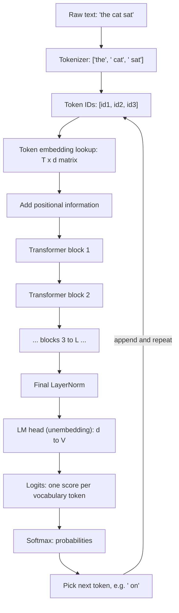

# The Full Transformer Architecture: From Input Tokens to Output Text

> **Level:** Beginner to Advanced · **Study time:** ~120 min · **Prerequisites:** [Tokenization](01-tokenization.md), [Embeddings](02-embeddings-from-one-hot-to-contextual.md), [The Attention Mechanism, Step by Step](03-attention-mechanism-step-by-step.md), [Multi-Head Attention and Causal Masking](04-multi-head-attention-and-causal-masking.md), helpful: [Vanishing and Exploding Gradients, Initialization, Normalization and Residual Connections](../02-deep-learning/05-vanishing-exploding-gradients-initialization-normalization-and-residuals.md)

## Table of contents

- [Why this matters](#why-this-matters)
- [Notation at a glance](#notation-at-a-glance)
- [The big picture: from text to next token](#the-big-picture-from-text-to-next-token)
- [Step 1: text to tokens to token IDs](#step-1-text-to-tokens-to-token-ids)
- [Step 2: token embeddings plus positional information](#step-2-token-embeddings-plus-positional-information)
- [Step 3: inside one transformer block](#step-3-inside-one-transformer-block)
- [Multi-head self-attention: the mixing step (recap)](#multi-head-self-attention-the-mixing-step-recap)
- [Residual connections and the residual stream](#residual-connections-and-the-residual-stream)
- [Layer normalization](#layer-normalization)
- [The position-wise feed-forward network](#the-position-wise-feed-forward-network)
- [Step 4: final normalization, LM head, logits and softmax](#step-4-final-normalization-lm-head-logits-and-softmax)
- [Counting parameters in a GPT-style model](#counting-parameters-in-a-gpt-style-model)
- [FLOPs per token: why inference costs about 2N](#flops-per-token-why-inference-costs-about-2n)
- [The original 2017 encoder-decoder Transformer](#the-original-2017-encoder-decoder-transformer)
- [Training vs inference: parallel vs autoregressive](#training-vs-inference-parallel-vs-autoregressive)
- [A minimal GPT in PyTorch](#a-minimal-gpt-in-pytorch)
- [Going deeper: the residual stream view and interpretability](#going-deeper-the-residual-stream-view-and-interpretability)
- [Going deeper: what changed since 2017](#going-deeper-what-changed-since-2017)
- [Going deeper: production budgeting, debugging and testing](#going-deeper-production-budgeting-debugging-and-testing)
- [Common mistakes and misconceptions](#common-mistakes-and-misconceptions)
- [Interview questions and model answers](#interview-questions-and-model-answers)
- [Key takeaways](#key-takeaways)
- [Further reading](#further-reading)
- [Next](#next)

## Why this matters

Every modern LLM you will touch in production (GPT-style models, Llama, Mistral, Qwen, Gemma, DeepSeek) is a stack of the same transformer block, repeated dozens of times, sandwiched between an embedding layer and an output layer. Once you can trace a token from raw text to the next predicted token, almost every other topic in this course becomes "a modification of one box in this diagram" (do not worry if the names below are new; each is defined when it first matters): RoPE changes the positional box, GQA changes the attention box, SwiGLU changes the feed-forward box, quantization shrinks the weight matrices, and the KV cache stores intermediate results of the attention box. "Walk me through a transformer from input tokens to output" is one of the most common senior AI/ML interview questions, and strong candidates also do the back-of-the-envelope math: how many parameters, how many FLOPs per token, how much memory. This chapter gives you all three: the mechanism, the numbers, and a working implementation you can write from memory.

## Notation at a glance

We reuse the symbols from the previous chapters. Keep this table open while reading.

| Symbol | Meaning | GPT-2 small value | Llama 2 7B value |
|---|---|---|---|
| $V$ | vocabulary size (number of distinct tokens) | 50,257 | 32,000 |
| $T$ | sequence length (tokens in the current input) | up to 1,024 | up to 4,096 |
| $B$ | batch size (sequences processed together) | any | any |
| $d_{\text{model}}$ (or $d$) | width of every token vector in the model | 768 | 4,096 |
| $L$ (or $n_{\text{layers}}$) | number of stacked transformer blocks | 12 | 32 |
| $h$ (or $n_{\text{heads}}$) | number of attention heads | 12 | 32 |
| $d_{\text{head}}$ | width of one head, $d_{\text{model}} / h$ | 64 | 128 |
| $d_{\text{ff}}$ | hidden width of the feed-forward network | 3,072 ($4d$) | 11,008 (SwiGLU, see later) |
| $N$ | total number of parameters | about 124M | about 6.74B |

Both columns are published, well-established configurations. We will use GPT-2 small (Radford et al., 2019) for exact parameter counting and Llama 2 7B (Touvron et al., 2023) as our "7B model" running example.

## The big picture: from text to next token

> **Analogy:** Think of a transformer as an assembly line in a factory. Each token is a product moving along a conveyor belt (the **residual stream**). At every station (a transformer block), two workers act on it. The first worker (attention) looks at the other products on neighbouring belts and copies useful information over. The second worker (the feed-forward network) works on this one product alone, refining it using a big internal reference book. Neither worker replaces the product: each one only bolts on additions. At the end of the line, an inspector (the LM head) looks at the final product and announces which word should come next.

Here is the whole pipeline. Our running example is the 3-word sentence **"the cat sat"**, and the model's job is to predict the next token (hopefully "on").



And here are the tensor shapes for one sequence ($B = 1$, $T = 3$) through GPT-2 small:

| Stage | What it is | Shape |
|---|---|---|
| Token IDs | integers | $(1, 3)$ |
| Embeddings + positions | one vector per token | $(1, 3, 768)$ |
| After each of the 12 blocks | same shape, richer content | $(1, 3, 768)$ |
| After final LayerNorm | normalized | $(1, 3, 768)$ |
| Logits | one score per vocab entry, per position | $(1, 3, 50257)$ |
| Next-token distribution | softmax of the **last** position's logits | $(1, 50257)$ |

Two facts to notice right away:

1. **The shape $(B, T, d)$ never changes inside the stack.** Every block reads a $T \times d$ matrix and writes a $T \times d$ matrix. That is what makes blocks stackable like Lego bricks.
2. **The model produces a prediction at every position**, not only the last one. During training all of them are used. During generation only the last one matters.

The rest of the chapter walks through each box in order.

## Step 1: text to tokens to token IDs

This is owned by the [Tokenization](01-tokenization.md) chapter, so here is a short recap.

- A **tokenizer** splits text into **tokens**: frequent words, word pieces or bytes, chosen by an algorithm such as **BPE (byte-pair encoding)** that is trained once on a large corpus before the model is trained.
- Each token has an integer **token ID**, its row number in the vocabulary of size $V$.
- "the cat sat" might become `['the', ' cat', ' sat']` (note the leading spaces, which GPT-2's tokenizer folds into the token) and then three IDs. In our toy examples below we use a 4-token vocabulary `["the", "cat", "sat", "on"]` with IDs `[0, 1, 2, 3]`, so "the cat sat" becomes `[0, 1, 2]` (illustrative).

> **Senior insight:** The tokenizer is part of the model. Swapping tokenizers invalidates the embedding matrix and the LM head, and token counts drive cost, latency and context limits. When an interviewer asks why a model is bad at arithmetic or spelling, tokenization is often part of the answer.

## Step 2: token embeddings plus positional information

### Token embeddings

A **token embedding** is a learned vector of length $d_{\text{model}}$ that represents one vocabulary entry. All of them are stored as rows of an **embedding matrix** $E$ of shape $V \times d_{\text{model}}$. Looking up token ID $i$ simply returns row $i$. (Mathematically this equals multiplying a one-hot vector by $E$, but implementations do an indexed lookup because it is much cheaper.) The [Embeddings](02-embeddings-from-one-hot-to-contextual.md) chapter covers why these vectors end up encoding meaning.

> **Analogy:** The embedding matrix is a phone book. The token ID is the line number, and the row you read off is that token's starting "profile" before it has seen any context.

The key word is *starting*. The embedding of "bank" is the same in "river bank" and "bank account". The transformer blocks will turn these **static embeddings** into **contextual** representations.

### Positional information

Attention, as you saw in [the attention chapter](03-attention-mechanism-step-by-step.md), is a weighted average over a *set* of vectors. On its own it is **permutation-equivariant**: shuffle the input tokens and you get the same outputs, shuffled the same way. "dog bites man" and "man bites dog" would look identical apart from order of rows. So the model needs **positional information**, a signal that tells each token where it sits.

Common options (fully covered in [Positional Encoding: Sinusoidal, Learned, RoPE and ALiBi](06-positional-encoding-sinusoidal-learned-rope-and-alibi.md)):

| Method | Where it enters | Used by |
|---|---|---|
| Sinusoidal (fixed formula) | added to embeddings at the input | original 2017 Transformer |
| Learned absolute (a $T_{\max} \times d$ table) | added to embeddings at the input | GPT-2, BERT |
| RoPE (rotary) | rotates the query and key vectors (Q and K, recapped below) inside every attention layer | Llama, Mistral, Qwen and most 2023+ open LLMs |
| ALiBi (linear biases) | adds a distance penalty to attention scores | BLOOM, MPT |

For the "add at the input" style, the input to block 1 is:

$$
x_t^{(0)} = E[\text{id}_t] + P[t]
$$

- $x_t^{(0)}$: the vector for the token at position $t$ entering the first block (the superscript 0 means "before any block").
- $E[\text{id}_t]$: row $\text{id}_t$ of the token embedding matrix $E$.
- $P[t]$: row $t$ of the positional table $P$ (learned or sinusoidal), shape $T_{\max} \times d$.

**Tiny worked example** (illustrative numbers, $d = 4$). The token "cat" has ID 1 and sits at position 1 (positions start at 0):

- $E[1] = [0.2, -0.1, 0.5, 0.0]$
- $P[1] = [0.0, 0.1, 0.0, 0.1]$
- Sum, element by element: $[0.2 + 0.0,\ -0.1 + 0.1,\ 0.5 + 0.0,\ 0.0 + 0.1] = [0.2, 0.0, 0.5, 0.1]$

That 4-number vector is what "cat" looks like when it enters block 1. Doing this for all three tokens gives the $3 \times 4$ input matrix.

> **Common mistake:** Saying "positional encodings are concatenated to embeddings". In the classic designs they are **added**, which keeps the width at $d_{\text{model}}$. With RoPE nothing is added at the input at all; position is injected inside attention.

> **Senior insight:** The original paper multiplies embeddings by $\sqrt{d_{\text{model}}}$ before adding sinusoidal encodings (the paper gives no reason; the usual explanation is that it keeps the token signal from being drowned out by the positional signal). GPT-2 does not do this. Small details like this are exactly what breaks when you port weights between implementations.

## Step 3: inside one transformer block

A **transformer block** (also called a **layer**) has two sub-layers, each wrapped in a residual connection with a normalization. In the GPT-2 and Llama style, called **pre-norm** (normalize *before* each sub-layer), one block computes:

$$
\begin{aligned}
a &= x + \text{MHA}(\text{LN}_1(x)) \\
y &= a + \text{FFN}(\text{LN}_2(a))
\end{aligned}
$$

- $x$: the input to the block, a $T \times d$ matrix (one row per token).
- $\text{LN}_1, \text{LN}_2$: two separate layer normalizations, each with its own learned parameters.
- $\text{MHA}$: multi-head self-attention, the only place where tokens exchange information.
- $a$: the intermediate result after the first residual addition.
- $\text{FFN}$: the position-wise feed-forward network, applied to each token independently.
- $y$: the output of the block, also $T \times d$, which becomes the next block's $x$.

```text
               x  (T x d)  ----------------------+
               |                                  |
          LayerNorm 1                             |   residual (skip) path 1
               |                                  |
   Multi-head causal self-attention               |
     (tokens talk to each other)                  |
               |                                  |
               +-------------- add <--------------+
               |
               a  (T x d)  ----------------------+
               |                                  |
          LayerNorm 2                             |   residual (skip) path 2
               |                                  |
     Feed-forward network, per token              |
     d -> 4d -> GELU -> d                         |
               |                                  |
               +-------------- add <--------------+
               |
               y  (T x d)   to the next block
```

The original 2017 paper used **post-norm**, $\text{LN}(x + \text{Sublayer}(x))$, normalizing *after* the addition. We compare the two in [What changed since 2017](#going-deeper-what-changed-since-2017).

A useful one-line summary: **attention moves information between positions; the feed-forward network processes information within a position.** Residuals and normalization are the plumbing that let you stack many of these without training falling apart.

## Multi-head self-attention: the mixing step (recap)

Attention is taught in full in [The Attention Mechanism, Step by Step](03-attention-mechanism-step-by-step.md) and [Multi-Head Attention and Causal Masking](04-multi-head-attention-and-causal-masking.md). Here is the compressed version you need to hold the full architecture in your head.

For each head, every token's (normalized) vector is projected three ways:

- a **query** $q$ ("what am I looking for?"),
- a **key** $k$ ("what do I contain?"),
- a **value** $v$ ("what will I hand over if you attend to me?").

$$
\text{Attention}(Q, K, V) = \text{softmax}\!\left(\frac{QK^\top}{\sqrt{d_{\text{head}}}} + M\right) V
$$

- $Q, K, V$: the query, key and value matrices, each $T \times d_{\text{head}}$ for one head, computed as $XW_Q$, $XW_K$, $XW_V$.
- $QK^\top$: a $T \times T$ table of similarity scores, entry $(i, j)$ says how relevant token $j$ is to token $i$.
- $\sqrt{d_{\text{head}}}$: scaling that keeps scores in a range where softmax still has useful gradients.
- $M$: the **causal mask**, $0$ where $j \le i$ and $-\infty$ where $j > i$, so a token cannot see the future.
- softmax: turns each row of scores into weights that sum to 1.
- multiplying by $V$: each token's output is a weighted average of the value vectors it attends to.

With $h$ heads, each head works in its own $d_{\text{head}} = d/h$ subspace, so different heads can track different relationships (for example, one head links "sat" to its subject "cat", another tracks the previous token). The head outputs are concatenated back to width $d$ and passed through an **output projection** $W_O$ ($d \times d$).

For "the cat sat", the row for "sat" might put most of its weight on "cat", so the output for "sat" now carries information about *who* sat. That is how the static embedding of "sat" becomes a contextual one.

**Tiny worked example** (one head, $d_{\text{head}} = 2$, illustrative numbers). "sat" is the last token, so the mask lets it see all three tokens. Its query is $q = [1, 0]$; the keys are "the" $[0, 1]$, "cat" $[2, 0]$, "sat" $[1, 1]$; the values are "the" $[1, 0]$, "cat" $[0, 1]$, "sat" $[0.5, 0.5]$.

1. Scores $q \cdot k$: $[0, 2, 1]$. Divide by $\sqrt{2} \approx 1.414$: $[0, 1.414, 0.707]$.
2. Softmax: $e^0 = 1$, $e^{1.414} \approx 4.113$, $e^{0.707} \approx 2.028$, sum $7.141$, so weights $\approx [0.140, 0.576, 0.284]$.
3. Weighted sum of values: $0.140 \cdot [1, 0] + 0.576 \cdot [0, 1] + 0.284 \cdot [0.5, 0.5] \approx [0.282, 0.718]$.

"sat" attends mostly to "cat", and its new vector leans toward "cat"'s value. After $W_O$, this is what attention adds to the residual stream for "sat".

> **Interview tip:** When asked to "explain self-attention", do not stop at "it lets tokens attend to each other". Say the mechanism: projections to Q, K, V, scaled dot-product scores, causal mask, softmax, weighted sum of values, multiple heads in parallel subspaces, output projection, and that the cost is quadratic in $T$.

## Residual connections and the residual stream

### Intuition

> **Analogy:** Imagine editing a shared document with "suggest changes" mode on. Each editor (sub-layer) reads the document and proposes additions. Nobody can delete the original text; they can only add edits on top. Even if one editor writes nonsense early in training, the original text is still there, and the next editors can still read it.

A **residual connection** (or **skip connection**, from He et al., 2016, "Deep Residual Learning for Image Recognition") adds a sub-layer's input to its output:

$$
x_{\text{out}} = x + F(x)
$$

- $x$: the input vector (or matrix) to the sub-layer.
- $F$: the sub-layer itself (attention or FFN, including its LayerNorm in pre-norm).
- $x_{\text{out}}$: the output, which is the input plus a learned **update** (also called a **delta**).

**Tiny worked example** (illustrative): $x = [1.0, 2.0]$ and the attention sub-layer outputs $F(x) = [0.1, -0.3]$. Then:

$$
x_{\text{out}} = [1.0 + 0.1,\ 2.0 + (-0.3)] = [1.1, 1.7]
$$

The sub-layer did not have to reproduce $[1.0, 2.0]$; it only had to compute a small correction.

### Why residuals matter: two reasons

**1. Gradient highway.** By the chain rule (see [Calculus for ML](../00-foundations/03-calculus-and-gradients.md)), the derivative of the output with respect to the input is

$$
\frac{\partial x_{\text{out}}}{\partial x} = I + \frac{\partial F}{\partial x}
$$

- $I$: the identity matrix (the derivative of $x$ with respect to itself).
- $\frac{\partial F}{\partial x}$: the sub-layer's own **Jacobian** (the matrix of partial derivatives of each output entry with respect to each input entry), which can be small or badly scaled.

Because of the $I$ term, the gradient from the loss can flow straight back to early layers even when $\frac{\partial F}{\partial x}$ is tiny. Without residuals, gradients get multiplied by many small Jacobians and shrink toward zero (the **vanishing gradient** problem, see [this chapter](../02-deep-learning/05-vanishing-exploding-gradients-initialization-normalization-and-residuals.md)). Deep transformers (32, 80, 120+ blocks) are, in practice, not trainable without them.

**2. Easy default behaviour.** A block that has not learned anything useful yet can output $F(x) \approx 0$ and become a near no-op, rather than scrambling its input. Each block starts by "doing little harm" and learns to add useful refinements.

### The residual stream view

Unroll the stack and you see that every sub-layer reads from and writes back to one running sum. For a model with $L$ blocks:

$$
x^{(L)} = x^{(0)} + \sum_{l=1}^{L} \Big(\text{attn}_l + \text{ffn}_l\Big)
$$

- $x^{(0)}$: token embedding plus position.
- $\text{attn}_l$, $\text{ffn}_l$: the vectors written by block $l$'s attention and FFN sub-layers.
- $x^{(L)}$: the final vector before the last LayerNorm and the LM head.

This running vector, of width $d_{\text{model}}$ per token, is called the **residual stream** (terminology popularized by Elhage et al., 2021, "A Mathematical Framework for Transformer Circuits"). Thinking of the model this way is powerful:

- The residual stream is the **communication bus**. Sub-layers do not talk to each other directly; they read the bus, compute, and add their result to it.
- Its width $d_{\text{model}}$ is the **bandwidth** of the model: everything any layer wants to tell any later layer must fit in those $d$ numbers per token.
- Later layers can read what early layers wrote, which lets the network build **multi-step computations** (for example, one attention head finds the previous occurrence of a token, a later head copies what came after it).

## Layer normalization

### Intuition

> **Analogy:** Before each worker on the assembly line touches the product, an operator rescales the product so its measurements are on a standard scale. That way the worker's tools (weight matrices) always see inputs in a familiar range, no matter how big the running sum on the belt has grown.

**Layer normalization** (LayerNorm; Ba, Kiros and Hinton, 2016) normalizes **each token's vector independently**, across its $d$ features:

$$
\text{LN}(x) = \gamma \odot \frac{x - \mu}{\sqrt{\sigma^2 + \epsilon}} + \beta,
\qquad \mu = \frac{1}{d}\sum_{i=1}^{d} x_i,
\qquad \sigma^2 = \frac{1}{d}\sum_{i=1}^{d} (x_i - \mu)^2
$$

- $x$: one token's vector of length $d$.
- $\mu$: the mean of its $d$ entries.
- $\sigma^2$: the variance of its $d$ entries.
- $\epsilon$: a tiny constant (such as $10^{-5}$) that prevents division by zero.
- $\gamma$, $\beta$: learned **scale** and **shift** vectors of length $d$, initialized to 1 and 0, which let the model undo the normalization where useful.
- $\odot$: element-wise multiplication.

**Tiny worked example** with $d = 4$, $x = [2, 4, 6, 8]$, $\gamma = 1$, $\beta = 0$, and $\epsilon$ ignored:

1. Mean: $\mu = (2 + 4 + 6 + 8) / 4 = 20 / 4 = 5$.
2. Deviations: $[2-5, 4-5, 6-5, 8-5] = [-3, -1, 1, 3]$.
3. Variance: $(9 + 1 + 1 + 9) / 4 = 20 / 4 = 5$.
4. Standard deviation: $\sqrt{5} \approx 2.236$.
5. Normalized: $[-3, -1, 1, 3] / 2.236 \approx [-1.342, -0.447, 0.447, 1.342]$.

The output has mean 0 and variance 1, whatever the scale of the input was.

### Why LayerNorm (and not BatchNorm)?

| | LayerNorm | BatchNorm |
|---|---|---|
| Normalizes over | the $d$ features of **one token** | one feature across the **batch** |
| Depends on other examples? | no | yes (batch statistics) |
| Train vs inference behaviour | identical | different (running averages at inference) |
| Variable-length sequences, batch size 1 decoding | works naturally | awkward |
| Typical use | transformers, RNNs | CNNs |

Because LayerNorm only uses statistics from the token itself, generation with batch size 1 behaves exactly like training. (Normalization in general is covered in [the normalization chapter](../02-deep-learning/05-vanishing-exploding-gradients-initialization-normalization-and-residuals.md).)

### What LayerNorm does in a transformer

- **Keeps sub-layer inputs well-scaled.** The residual stream is a growing sum; its magnitude tends to increase with depth. Pre-norm puts each sub-layer's input back on a standard scale while leaving the stream itself untouched.
- **Stabilizes training**, allowing larger learning rates and deeper stacks.
- **Pairs with residuals.** Residuals keep gradients flowing; normalization keeps activations in range. You need both.

Modern LLMs mostly use **RMSNorm** (Zhang and Sennrich, 2019), which drops the mean subtraction and $\beta$ and only rescales by the root-mean-square. It is a bit cheaper and works as well in practice. Details are in [Modern LLM Architecture](08-modern-llm-architecture-improvements.md).

## The position-wise feed-forward network

### Intuition

> **Analogy:** After the meeting where everyone shared notes (attention), each person goes back to their desk and thinks alone, consulting a huge reference library. The FFN is that solitary thinking step, and the library is where a lot of the model's stored knowledge lives.

The **feed-forward network** (FFN, also called the **MLP block**) is a tiny two-layer neural network (see [Neural Networks from Scratch](../02-deep-learning/01-neural-networks-from-scratch.md)) applied to **each token separately and identically**, which is why it is called **position-wise**:

$$
\text{FFN}(x) = \phi(x W_1 + b_1)\, W_2 + b_2
$$

- $x$: one token's vector (row), length $d$.
- $W_1$: the **up-projection**, shape $d \times d_{\text{ff}}$, usually $d_{\text{ff}} = 4d$ (expand).
- $b_1$, $b_2$: bias vectors (many modern LLMs drop biases).
- $\phi$: a **nonlinearity** (activation function): ReLU in the 2017 paper, **GELU** (Hendrycks and Gimpel, 2016, a smooth ReLU-like curve $\text{GELU}(z) = z \cdot \Phi(z)$ where $\Phi$ is the standard normal CDF) in GPT-2 and BERT, SwiGLU in most current LLMs.
- $W_2$: the **down-projection**, shape $d_{\text{ff}} \times d$ (project back).
- Output: length $d$, so it can be added back into the residual stream.

So it is **expand, nonlinearity, project back**. The expansion gives the network many "neurons" to detect patterns; the nonlinearity lets it compute things a single matrix cannot; the projection compresses the result back to the stream's width.

### Tiny worked example by hand

To keep the arithmetic small we use $d = 2$ and $d_{\text{ff}} = 4$ (a 2x expansion, illustrative), ReLU as $\phi$, and zero biases.

$$
x = [1, 2], \qquad
W_1 = \begin{bmatrix} 1 & -1 & 0 & 2 \\ 0 & 1 & -1 & 1 \end{bmatrix}, \qquad
W_2 = \begin{bmatrix} 1 & 0 \\ 0 & 1 \\ 1 & 1 \\ 0.5 & -0.5 \end{bmatrix}
$$

1. Up-project, $x W_1$ (each entry is $1 \times \text{row 1} + 2 \times \text{row 2}$):
   - column 1: $1 \cdot 1 + 2 \cdot 0 = 1$
   - column 2: $1 \cdot (-1) + 2 \cdot 1 = 1$
   - column 3: $1 \cdot 0 + 2 \cdot (-1) = -2$
   - column 4: $1 \cdot 2 + 2 \cdot 1 = 4$
   - result: $[1, 1, -2, 4]$
2. ReLU (negative values become 0): $h = [1, 1, 0, 4]$.
3. Down-project, $h W_2$:
   - output 1: $1 \cdot 1 + 1 \cdot 0 + 0 \cdot 1 + 4 \cdot 0.5 = 1 + 0 + 0 + 2 = 3$
   - output 2: $1 \cdot 0 + 1 \cdot 1 + 0 \cdot 1 + 4 \cdot (-0.5) = 0 + 1 + 0 - 2 = -1$
   - result: $[3, -1]$

The FFN adds $[3, -1]$ to this token's residual stream.

### The key-value memory interpretation

Look at step 3 again. The output is a **weighted sum of the rows of $W_2$**, weighted by the hidden activations $h$:

$$
\text{FFN}(x) = \sum_{i=1}^{d_{\text{ff}}} h_i \, v_i, \qquad h_i = \phi(x \cdot k_i)
$$

- $k_i$: column $i$ of $W_1$, a **key** (a pattern detector).
- $h_i$: how strongly the token's vector matches key $i$ (after the nonlinearity).
- $v_i$: row $i$ of $W_2$, the **value** written to the stream when key $i$ fires.

Check with our numbers: $h = [1, 1, 0, 4]$, so the output is $1 \cdot [1, 0] + 1 \cdot [0, 1] + 0 \cdot [1, 1] + 4 \cdot [0.5, -0.5] = [1, 0] + [0, 1] + [0, 0] + [2, -2] = [3, -1]$. Same answer.

This is the reading in Geva et al., 2021, "Transformer Feed-Forward Layers Are Key-Value Memories": keys tend to fire on recognizable input patterns, and the matching values push the output toward plausible next tokens. Later work such as Meng et al., 2022 ("Locating and Editing Factual Associations in GPT", the ROME method) found that factual associations like "Eiffel Tower is in → Paris" can be located largely in mid-layer FFNs and edited there. It looks like a soft dictionary lookup with thousands of entries per layer.

> **Analogy:** Attention is like asking your colleagues in the room; the FFN is like looking things up in your own notebook.

### What FFN layers contribute (summary)

| Contribution | Explanation |
|---|---|
| Most of the parameters | $8d^2$ of the $12d^2$ per block (two thirds), see the next section |
| Per-token nonlinear processing | attention is mostly a weighted average of linear projections; the FFN adds the heavy nonlinearity |
| Storage of knowledge | key-value memory view; interpretability evidence links much factual recall to mid-layer FFNs (an active, debated research area) |
| Feature computation | combines information that attention gathered into new features |
| Most of the FLOPs at short context | FLOPs (floating-point operations, defined in the FLOPs section below) scale with parameters, so FFNs dominate compute unless $T$ is long |

> **Senior insight:** Because the FFN is position-wise, it is embarrassingly parallel across tokens and is a pure matrix multiply, which makes it the main target for **Mixture of Experts** (MoE): replace one big FFN with many expert FFNs and route each token to a few of them. Total parameters go up, compute per token stays roughly flat. See [Modern LLM Architecture](08-modern-llm-architecture-improvements.md).

## Step 4: final normalization, LM head, logits and softmax

After the last block, three more things happen.

**1. Final LayerNorm.** In pre-norm models the residual stream itself was never normalized (only copies of it going into sub-layers were). Its scale has grown with depth, so a **final LayerNorm** (`ln_f` in GPT-2) normalizes it before the output layer. Post-norm models do not need this extra layer because every block already ends with a normalization.

**2. LM head (unembedding).** The **LM head** (language-modeling head, also called the **unembedding** layer) is a linear layer $W_U$ of shape $d \times V$ that turns each final vector into $V$ scores, called **logits**:

$$
z = h_T\, W_U
$$

- $h_T$: the final normalized vector at the last position $T$, length $d$.
- $W_U$: the unembedding matrix, $d \times V$.
- $z$: the logits, length $V$; $z_j$ is an unnormalized score for "the next token is $j$". Equivalently $z_j$ is the dot product of $h_T$ with column $j$ of $W_U$, so the model predicts the token whose output vector best aligns with its final state.

Many models use **weight tying** (Press and Wolf, 2017, "Using the Output Embedding to Improve Language Models"): $W_U = E^\top$, the same matrix as the input embedding, transposed. GPT-2 does this; it saves $V \times d$ parameters (about 38.6M for GPT-2 small). Llama 2 does not tie them.

**3. Softmax and token choice.** The **softmax** (see [Softmax, Entropy, Cross-Entropy and KL Divergence](../00-foundations/05-softmax-entropy-cross-entropy-and-kl-divergence.md)) turns logits into probabilities:

$$
p_j = \frac{e^{z_j}}{\sum_{k=1}^{V} e^{z_k}}
$$

- $p_j$: probability that the next token is $j$.
- $e^{z_j}$: exponential of the logit, always positive.
- denominator: sum over all $V$ vocabulary entries, so probabilities add to 1.

**Worked example** with our toy vocabulary `["the", "cat", "sat", "on"]` and illustrative logits $z = [2.0, 1.0, 0.1, 3.0]$ at the last position of "the cat sat":

1. Exponentials: $e^{2.0} \approx 7.389$, $e^{1.0} \approx 2.718$, $e^{0.1} \approx 1.105$, $e^{3.0} \approx 20.086$.
2. Sum: $7.389 + 2.718 + 1.105 + 20.086 = 31.298$.
3. Probabilities: $7.389 / 31.298 \approx 0.236$, $2.718 / 31.298 \approx 0.087$, $1.105 / 31.298 \approx 0.035$, $20.086 / 31.298 \approx 0.642$.
4. Check: $0.236 + 0.087 + 0.035 + 0.642 = 1.000$.

The model gives "on" a 64.2% probability. **Greedy decoding** picks the highest-probability token ("on"); **sampling** draws randomly according to these probabilities, often after reshaping them with **temperature** (divide the logits by a constant $\tau$ before softmax: $\tau < 1$ sharpens the distribution, $\tau > 1$ flattens it), **top-k** (keep only the $k$ most likely tokens) or **top-p** (keep the smallest set of tokens whose probabilities sum to at least $p$). Decoding strategies are covered in [How LLMs Generate Text](../05-llms/03-text-generation-and-decoding-strategies.md).

Then "on" is appended to the input, and the whole process repeats to produce the next token. That loop is **autoregressive generation**.

> **Common mistake:** Thinking the model outputs a word. It outputs a probability distribution over the vocabulary; a separate **decoding** step (outside the network) chooses a token. Changing the decoding settings changes the text without changing the model.

## Counting parameters in a GPT-style model

Being able to estimate model size in your head is a classic senior signal. Here is the derivation.

### Per block

| Component | Matrices | Parameters (weights only) |
|---|---|---|
| Attention: $W_Q, W_K, W_V$ | three $d \times d$ | $3d^2$ |
| Attention output: $W_O$ | one $d \times d$ | $d^2$ |
| FFN up: $W_1$ | $d \times 4d$ | $4d^2$ |
| FFN down: $W_2$ | $4d \times d$ | $4d^2$ |
| **Total per block** | | $\mathbf{12d^2}$ |
| Biases and two LayerNorms | vectors | about $13d$ (negligible) |

Why $W_Q$ is $d \times d$ even with many heads: the $h$ heads each have a $d \times d_{\text{head}}$ slice, and $h \cdot d_{\text{head}} = d$. Splitting into heads does not change the parameter count.

Note the split: attention is $4d^2$ (one third), the FFN is $8d^2$ (two thirds).

### The whole model

$$
N \approx 12 \, L \, d^2 \;+\; V d \;+\; T_{\max} d
$$

- $12 L d^2$: the $L$ transformer blocks (the **non-embedding parameters**).
- $V d$: the token embedding matrix (and the LM head if it is tied; add another $Vd$ if untied).
- $T_{\max} d$: a learned position table, if the model has one (RoPE models have none).

### Worked example 1: GPT-2 small

Published configuration: $L = 12$, $d = 768$, $V = 50{,}257$, $T_{\max} = 1{,}024$, tied embeddings.

1. $d^2 = 768 \times 768 = 589{,}824$.
2. Blocks: $12 \times 12 \times 589{,}824 = 144 \times 589{,}824 = 84{,}934{,}656$ (about 84.9M).
3. Token embeddings: $50{,}257 \times 768 = 38{,}597{,}376$ (about 38.6M).
4. Position embeddings: $1{,}024 \times 768 = 786{,}432$ (about 0.8M).
5. Total: $84{,}934{,}656 + 38{,}597{,}376 + 786{,}432 = 124{,}318{,}464$, about **124.3M**.

GPT-2 small is known as the "124M" model. The exact count, including every bias and LayerNorm parameter, is $124{,}439{,}808$; our formula is off by only about 0.1%. Where the missing $121{,}344$ comes from:

- Per block, biases: $3d$ (QKV) $+ d$ (attention output) $+ 4d$ (FFN up) $+ d$ (FFN down) $= 9d$.
- Per block, two LayerNorms with $\gamma$ and $\beta$ each: $4d$.
- Per block total: $13d = 13 \times 768 = 9{,}984$; times 12 blocks $= 119{,}808$.
- Final LayerNorm: $2d = 1{,}536$.
- Sum: $119{,}808 + 1{,}536 = 121{,}344$, and $124{,}318{,}464 + 121{,}344 = 124{,}439{,}808$. Exact match.

Notice something surprising: about 31% of GPT-2 small's parameters are the embedding matrix. In small models the vocabulary is a big share of the budget.

### Worked example 2: our 7B model (Llama 2 7B)

Published configuration: $L = 32$, $d = 4{,}096$, $V = 32{,}000$, RoPE (no position table), untied embeddings, and a SwiGLU FFN with $d_{\text{ff}} = 11{,}008$.

Quick estimate with the formula:

1. $d^2 = 4{,}096^2 = 16{,}777{,}216$.
2. Blocks: $12 \times 32 \times 16{,}777{,}216 = 384 \times 16{,}777{,}216 = 6{,}442{,}450{,}944$ (about 6.44B).
3. Embeddings, untied so counted twice: $2 \times 32{,}000 \times 4{,}096 = 262{,}144{,}000$ (about 0.26B).
4. Total: about **6.70B**.

The official size is about 6.74B. Why so close even though Llama uses SwiGLU? A SwiGLU FFN has **three** matrices ($d \times d_{\text{ff}}$, $d \times d_{\text{ff}}$, $d_{\text{ff}} \times d$), and Llama picks $d_{\text{ff}} \approx \frac{2}{3} \cdot 4d$ (rounded up to a multiple of 256: $10{,}923 \to 11{,}008$) precisely to keep the FFN at roughly $8d^2$:

- Exact FFN: $3 \times 4{,}096 \times 11{,}008 = 135{,}266{,}304$ per block, vs $8d^2 = 134{,}217{,}728$.
- Exact attention: $4d^2 = 67{,}108{,}864$ per block (Llama 2 7B uses standard multi-head attention, no GQA; **GQA**, grouped-query attention, lets several query heads share one key/value head, which shrinks $W_K$ and $W_V$).
- Per block: $67{,}108{,}864 + 135{,}266{,}304 = 202{,}375{,}168$; times 32 is $6{,}476{,}005{,}376$.
- Add embeddings $262{,}144{,}000$ and the RMSNorm weights ($2 \times 4{,}096 \times 32 + 4{,}096 = 266{,}240$): total $6{,}738{,}415{,}616$, the published 6.74B.

> **Interview tip:** Memorize "$12 L d^2$ plus embeddings". Then any config sheet turns into a size estimate in 20 seconds, and the reverse works too: a "7B" model with $d = 4096$ must have about 32 layers, because $7 \times 10^9 / (12 \times 4096^2) \approx 35$, minus room for embeddings.

### Memory follows from parameters

Weights memory is parameters times bytes per parameter (formats are covered in [Number Formats and Model Memory](../07-model-compression/01-number-formats-and-model-memory.md)):

| Model | FP32 (4 bytes) | BF16/FP16 (2 bytes) | INT8 (1 byte) | INT4 (0.5 byte) |
|---|---|---|---|---|
| GPT-2 small (124M) | ~0.5 GB | ~0.25 GB | ~0.12 GB | ~0.06 GB |
| Llama 2 7B (6.74B) | ~27 GB | ~13.5 GB | ~6.7 GB | ~3.4 GB |

These are weights only; inference also needs the KV cache and activations, and training needs far more (gradients and optimizer state, see [Distributed Training and Training Memory](../02-deep-learning/10-distributed-training-and-training-memory.md)).

## FLOPs per token: why inference costs about 2N

A **FLOP** (floating-point operation) is one addition or one multiplication. **FLOPs per token** measures how much arithmetic the model does to process one token.

### The rule

Almost all the work in a transformer is matrix multiplication of a token's vector by weight matrices. Multiplying a length-$m$ vector by an $m \times n$ matrix uses $m \cdot n$ weights, and for each weight you do one multiply and one add (a **multiply-accumulate**). So:

$$
\text{FLOPs per token (forward)} \approx 2N
$$

- $N$: the number of parameters used in matrix multiplies (for a dense model, essentially all non-embedding parameters plus the LM head; the input embedding lookup is a memory read, not a matmul).
- $2$: one multiply plus one add per parameter.

**Tiny check by hand:** a vector $[a, b]$ times a $2 \times 3$ matrix (6 weights). Each of the 3 outputs is $a \cdot w_{1j} + b \cdot w_{2j}$: 2 multiplies and 1 add, so 3 FLOPs per output and 9 in total. The "2 per weight" rule says $2 \times 6 = 12$, because it counts one multiply plus one add (a multiply-accumulate into a running sum that starts at zero) for every weight. For an input of length $m$ the exact count per output is $2m - 1$ versus the rule's $2m$, so for real matrices ($m$ in the thousands) the difference is negligible, and $2N$ is the standard convention.

**Worked example (7B):** $2 \times 6.74 \times 10^9 \approx 1.35 \times 10^{10}$, about **13.5 GFLOPs per generated token**. Generating 1,000 tokens costs about $1.35 \times 10^{13}$ FLOPs (13.5 TFLOPs).

### The attention term

The $2N$ rule ignores one thing: the attention scores and the weighted sum involve no parameters, but they do cost FLOPs that grow with context length. For a token attending to $t$ previous tokens, each layer computes $q \cdot k$ against $t$ keys and a weighted sum of $t$ values, about $2 \cdot t \cdot d$ multiply-adds, so about $4 t d$ FLOPs per layer:

$$
\text{FLOPs per token} \approx 2N + 4 \, L \, t \, d
$$

- $L$: number of layers; $t$: number of tokens in context; $d$: model width.

(Kaplan et al., 2020, "Scaling Laws for Neural Language Models", write the forward cost as $2N + 2 L\, n_{\text{ctx}}\, d_{\text{attn}}$, with $d_{\text{attn}} = d$ in a standard model. That matches our $4Ltd$ if you average over a causal sequence of length $n_{\text{ctx}}$, where a token sees about half the context on average; conventions for this term differ between papers, so state yours.)

**Worked example (7B, per token):**

- At $t = 4{,}096$: $4 \times 32 \times 4{,}096 \times 4{,}096 = 2{,}147{,}483{,}648 \approx 2.1$ GFLOPs, compared with $2N \approx 13.5$ GFLOPs. Attention adds about 16%.
- At $t = 32{,}768$: $4 \times 32 \times 32{,}768 \times 4{,}096 \approx 17.2$ GFLOPs, **more than** $2N$. At long context, attention dominates.

### Training costs about 6N

The backward pass needs about twice the forward FLOPs (gradients with respect to both activations and weights), so training costs about $2N + 4N = 6N$ FLOPs per token. Llama 2 7B was trained on about 2 trillion tokens, so roughly $6 \times 6.74 \times 10^9 \times 2 \times 10^{12} \approx 8.1 \times 10^{22}$ FLOPs (an approximation that ignores the attention term).

> **Senior insight:** FLOPs are not latency. During **decode** (one new token at a time) the GPU must read every weight from memory to do only 2 FLOPs per weight, so it is **memory-bandwidth bound**, not compute bound. Illustrative lower bound: reading 13.5 GB of BF16 weights at an assumed 2 TB/s takes about 6.7 ms per token at batch size 1, regardless of how many TFLOPS the GPU has. This is why batching and quantization speed up decode. See [GPU Fundamentals: Compute-Bound vs Memory-Bound](../06-llm-inference/03-gpu-fundamentals-compute-bound-vs-memory-bound.md).

## The original 2017 encoder-decoder Transformer

"Attention Is All You Need" (Vaswani et al., 2017) introduced the Transformer for machine translation (English to German and English to French). It had two stacks:

- An **encoder** that reads the whole source sentence with **bidirectional** self-attention (every token sees every other token, no causal mask).
- A **decoder** that generates the target sentence one token at a time, with three sub-layers per block: **masked** (causal) self-attention over the target so far, **cross-attention** (also called encoder-decoder attention) where queries come from the decoder and keys and values come from the encoder output, and an FFN.

```text
                                           Output probabilities
                                                    ^
                                                 Softmax
                                                    ^
                                                 Linear
                                                    ^
                                     +-----------------------------+
                                     |  Add & Norm                 |
                                     |  Feed-forward               |
  +--------------------------+       |  Add & Norm                 |
  |  Add & Norm              |       |  Multi-head CROSS-attention |<--+
  |  Feed-forward            |       |    (Q from decoder,         |   |
  |  Add & Norm              |       |     K and V from encoder)   |   |
  |  Multi-head              |       |  Add & Norm                 |   |
  |  self-attention          |       |  MASKED multi-head          |   |
  |  (bidirectional)         |       |  self-attention             |   |
  |                          |       |                             |   |
  |  ENCODER block  x N=6    |       |  DECODER block  x N=6       |   |
  +--------------------------+       +-----------------------------+   |
        ^             |                           ^                    |
        |             +------ encoder output -----+--------------------+
        |                                         |
  (+) sinusoidal positional encoding    (+) sinusoidal positional encoding
        ^                                         ^
  Input embedding                         Output embedding
        ^                                         ^
  Source tokens ("the cat sat")           Target tokens, shifted right
                                          ("<s> die Katze saß")
```

Key facts about the base model, all from the paper: $N = 6$ encoder and 6 decoder layers, $d_{\text{model}} = 512$, $h = 8$ heads, $d_{\text{ff}} = 2{,}048$ (4x), sinusoidal positions, post-norm ("Add & Norm" after each sub-layer), ReLU in the FFN, dropout 0.1 (randomly zeroing 10% of activations during training, a regularizer), about 65M parameters. A "big" variant had about 213M.

**"Shifted right"** means the decoder input is the target sequence with a start token in front, so that at position $t$ the decoder predicts target token $t$ having seen only tokens before it.

How the three families relate (full treatment in [Encoder-Only, Encoder-Decoder and Decoder-Only Models](07-encoder-only-encoder-decoder-and-decoder-only-models.md)):

| Family | Keeps | Attention | Example models | Typical use |
|---|---|---|---|---|
| Encoder-only | encoder stack | bidirectional | BERT, RoBERTa | classification, embeddings, retrieval |
| Encoder-decoder | both + cross-attention | bidirectional encoder, causal decoder | T5, BART, original Transformer | translation, summarization |
| Decoder-only | decoder stack without cross-attention | causal | GPT family, Llama, Mistral | general text generation, chat |

A GPT-style block is exactly the decoder block with the cross-attention sub-layer removed. Everything else in this chapter (and our code) is decoder-only.

## Training vs inference: parallel vs autoregressive

### Training: all positions at once

During training the model sees a full sequence and predicts **every next token in parallel**. For the sentence "the cat sat on":

| Position | Input token | Model sees | Target |
|---|---|---|---|
| 0 | the | the | cat |
| 1 | cat | the cat | sat |
| 2 | sat | the cat sat | on |

Inputs are `[the, cat, sat]` and targets are the same sequence **shifted left by one**: `[cat, sat, on]`. One forward pass on 3 tokens gives 3 predictions, and the loss is the average **cross-entropy** over all positions:

$$
\mathcal{L} = -\frac{1}{T}\sum_{t=1}^{T} \log p_\theta(x_{t+1} \mid x_1, \dots, x_t)
$$

- $\mathcal{L}$: the training loss for one sequence.
- $T$: number of predicted positions.
- $p_\theta(x_{t+1} \mid x_{1..t})$: the probability the model (with parameters $\theta$) assigns to the true next token.

**Worked example:** if the model assigned probabilities 0.5, 0.25 and 0.642 to the correct targets "cat", "sat", "on", the loss is $-\frac{1}{3}(\ln 0.5 + \ln 0.25 + \ln 0.642) = -\frac{1}{3}(-0.693 - 1.386 - 0.443) = \frac{2.522}{3} \approx 0.841$.

Two things make this parallelism legitimate:

1. **The causal mask.** Position 1 cannot peek at position 2's token, so even though all tokens are processed together, each prediction only uses the past. Remove the mask and the model just copies the answer, getting near-zero training loss and generating garbage.
2. **Teacher forcing.** Each position is conditioned on the *true* previous tokens, not on the model's own guesses.

This parallelism is a main reason transformers replaced RNNs (see [RNNs, LSTMs and the Road to Transformers](../02-deep-learning/08-rnns-lstms-and-the-road-to-transformers.md)): a sequence of 4,096 tokens is one big batch of matrix multiplies instead of 4,096 sequential steps. The training objective itself is covered in [Pretraining and Next-Token Prediction](../05-llms/01-pretraining-and-next-token-prediction.md).

### Inference: one token at a time

At inference the future tokens do not exist yet, so generation is **autoregressive**: predict one token, append it, predict the next.

```text
step 1: [the, cat, sat]           -> " on"
step 2: [the, cat, sat, on]       -> " the"
step 3: [the, cat, sat, on, the]  -> " mat"
...until an end-of-sequence token or a length limit
```

In practice inference has two phases (covered in [Inference Fundamentals: Prefill and Decode](../06-llm-inference/01-inference-fundamentals-prefill-decode-and-latency-metrics.md)):

- **Prefill:** process the whole prompt in one parallel pass (like training), producing the first new token. Compute-bound.
- **Decode:** generate the remaining tokens one by one. Recomputing keys and values for all previous tokens each step would be wasteful, so they are stored in the **KV cache** ([The KV Cache](../06-llm-inference/02-kv-cache-explained.md)) and each step only processes the single new token. Memory-bandwidth bound.

| | Training | Inference: prefill | Inference: decode |
|---|---|---|---|
| Tokens per forward pass | whole sequence | whole prompt | 1 per sequence |
| Parallel across positions? | yes | yes | no (sequential) |
| Causal mask needed? | yes | yes | implicitly (new token sees only cache) |
| Uses true previous tokens? | yes (teacher forcing) | yes (prompt) | no, its own outputs |
| Dropout | on (if used) | off | off |
| Bottleneck | compute | compute | memory bandwidth |

> **Senior insight:** The gap between teacher forcing and free generation is called **exposure bias**: during training the model never sees its own mistakes, so at inference one bad token can derail what follows. Training on the model's own samples, as on-policy RL post-training such as RLHF does, partly addresses it, although RLHF's main motivation is aligning outputs with human preferences (see [Instruction Tuning, RLHF and DPO](../05-llms/02-instruction-tuning-rlhf-and-dpo.md)).

## A minimal GPT in PyTorch

Now we build all of the above in about 120 lines, in the style of GPT-2 (pre-norm, learned positions, GELU, tied embeddings). It is closely modeled on the widely used educational repository nanoGPT. Install with `pip install torch`.

### The model

```python
# minimal_gpt.py   (pip install torch; Python 3.10+)
import math
from dataclasses import dataclass

import torch
import torch.nn as nn
import torch.nn.functional as F


@dataclass
class GPTConfig:
    vocab_size: int = 50257   # V: GPT-2 BPE vocabulary
    block_size: int = 1024    # T_max: maximum context length
    n_layer: int = 12         # L
    n_head: int = 12          # h
    d_model: int = 768        # d
    dropout: float = 0.0


class CausalSelfAttention(nn.Module):
    def __init__(self, cfg: GPTConfig):
        super().__init__()
        assert cfg.d_model % cfg.n_head == 0, "d_model must split evenly into heads"
        self.n_head = cfg.n_head
        self.qkv = nn.Linear(cfg.d_model, 3 * cfg.d_model)   # W_Q, W_K, W_V fused into one matmul
        self.proj = nn.Linear(cfg.d_model, cfg.d_model)      # W_O, writes back to the residual stream
        self.attn_drop = nn.Dropout(cfg.dropout)
        self.resid_drop = nn.Dropout(cfg.dropout)
        # Lower-triangular boolean mask: True where attention is allowed (j <= i).
        mask = torch.tril(torch.ones(cfg.block_size, cfg.block_size, dtype=torch.bool))
        self.register_buffer("mask", mask.view(1, 1, cfg.block_size, cfg.block_size), persistent=False)

    def forward(self, x: torch.Tensor) -> torch.Tensor:
        B, T, C = x.shape
        hd = C // self.n_head
        q, k, v = self.qkv(x).split(C, dim=2)                      # each (B, T, C)
        # Split channels into heads: (B, T, C) -> (B, n_head, T, hd)
        q = q.view(B, T, self.n_head, hd).transpose(1, 2)
        k = k.view(B, T, self.n_head, hd).transpose(1, 2)
        v = v.view(B, T, self.n_head, hd).transpose(1, 2)
        att = (q @ k.transpose(-2, -1)) / math.sqrt(hd)            # (B, n_head, T, T) scores
        att = att.masked_fill(~self.mask[:, :, :T, :T], float("-inf"))  # no peeking at the future
        att = F.softmax(att, dim=-1)
        att = self.attn_drop(att)
        y = att @ v                                                # (B, n_head, T, hd)
        y = y.transpose(1, 2).contiguous().view(B, T, C)           # concatenate heads
        return self.resid_drop(self.proj(y))


class MLP(nn.Module):
    def __init__(self, cfg: GPTConfig):
        super().__init__()
        self.fc = nn.Linear(cfg.d_model, 4 * cfg.d_model)     # expand d -> 4d
        self.act = nn.GELU()                                  # GPT-2 used the tanh approximation
        self.proj = nn.Linear(4 * cfg.d_model, cfg.d_model)   # project back 4d -> d
        self.drop = nn.Dropout(cfg.dropout)

    def forward(self, x: torch.Tensor) -> torch.Tensor:
        return self.drop(self.proj(self.act(self.fc(x))))


class Block(nn.Module):
    def __init__(self, cfg: GPTConfig):
        super().__init__()
        self.ln1 = nn.LayerNorm(cfg.d_model)
        self.attn = CausalSelfAttention(cfg)
        self.ln2 = nn.LayerNorm(cfg.d_model)
        self.mlp = MLP(cfg)

    def forward(self, x: torch.Tensor) -> torch.Tensor:
        x = x + self.attn(self.ln1(x))   # residual 1: read, mix across tokens, write back
        x = x + self.mlp(self.ln2(x))    # residual 2: read, transform each token, write back
        return x


class GPT(nn.Module):
    def __init__(self, cfg: GPTConfig):
        super().__init__()
        self.cfg = cfg
        self.tok_emb = nn.Embedding(cfg.vocab_size, cfg.d_model)   # E: V x d
        self.pos_emb = nn.Embedding(cfg.block_size, cfg.d_model)   # P: T_max x d (learned)
        self.drop = nn.Dropout(cfg.dropout)
        self.blocks = nn.ModuleList([Block(cfg) for _ in range(cfg.n_layer)])
        self.ln_f = nn.LayerNorm(cfg.d_model)                      # final LayerNorm
        self.lm_head = nn.Linear(cfg.d_model, cfg.vocab_size, bias=False)  # unembedding
        self.lm_head.weight = self.tok_emb.weight                  # weight tying: W_U = E^T
        self.apply(self._init_weights)
        # GPT-2 trick: shrink the init of layers that write into the residual stream,
        # so the stream's variance does not grow with depth at the start of training.
        for name, p in self.named_parameters():
            if name.endswith("proj.weight"):
                nn.init.normal_(p, mean=0.0, std=0.02 / math.sqrt(2 * cfg.n_layer))

    @staticmethod
    def _init_weights(m: nn.Module) -> None:
        if isinstance(m, nn.Linear):
            nn.init.normal_(m.weight, mean=0.0, std=0.02)
            if m.bias is not None:
                nn.init.zeros_(m.bias)
        elif isinstance(m, nn.Embedding):
            nn.init.normal_(m.weight, mean=0.0, std=0.02)

    def forward(self, idx: torch.Tensor, targets: torch.Tensor | None = None):
        B, T = idx.shape
        assert T <= self.cfg.block_size, "sequence longer than the context window"
        pos = torch.arange(T, device=idx.device)
        x = self.drop(self.tok_emb(idx) + self.pos_emb(pos))       # (B, T, d) + (T, d) broadcasts
        for block in self.blocks:
            x = block(x)
        x = self.ln_f(x)
        logits = self.lm_head(x)                                   # (B, T, V): a prediction per position
        loss = None
        if targets is not None:
            loss = F.cross_entropy(logits.reshape(-1, logits.size(-1)), targets.reshape(-1))
        return logits, loss

    @torch.no_grad()
    def generate(self, idx: torch.Tensor, max_new_tokens: int,
                 temperature: float = 1.0, top_k: int | None = None) -> torch.Tensor:
        for _ in range(max_new_tokens):
            idx_cond = idx[:, -self.cfg.block_size:]               # crop to the context window
            logits, _ = self(idx_cond)
            logits = logits[:, -1, :] / temperature                # only the last position predicts next
            if top_k is not None:
                v, _ = torch.topk(logits, min(top_k, logits.size(-1)))
                logits[logits < v[:, [-1]]] = float("-inf")        # keep only the top-k candidates
            probs = F.softmax(logits, dim=-1)
            next_id = torch.multinomial(probs, num_samples=1)      # (B, 1)
            idx = torch.cat([idx, next_id], dim=1)                 # append and repeat
        return idx


if __name__ == "__main__":
    model = GPT(GPTConfig())
    n_params = sum(p.numel() for p in model.parameters())  # tied weights are counted once
    print(f"{n_params:,}")  # 124,439,808, the exact GPT-2 small count we derived by hand
```

### Walking through the code

- **`GPTConfig`** holds exactly the symbols from our notation table. Change five numbers and you get a different model size.
- **`CausalSelfAttention`** fuses $W_Q, W_K, W_V$ into one `nn.Linear(d, 3d)` because one big matmul is faster on a GPU than three small ones. `view` plus `transpose` splits the $d$ channels into $h$ heads of width $d_{\text{head}}$. The mask fills future positions with $-\infty$ so softmax gives them weight exactly 0. In production you would replace the five lines from `att = ...` to `y = att @ v` (passing `dropout_p` for attention dropout during training) with `F.scaled_dot_product_attention(q, k, v, is_causal=True)`, which dispatches to fused kernels such as FlashAttention.
- **`MLP`** is expand, GELU, project back. Note there is no interaction between positions here: it is applied to the last dimension only.
- **`Block`** is the pre-norm recipe, literally the two equations from Step 3.
- **`GPT.__init__`** builds embeddings, $L$ blocks, the final LayerNorm and the tied LM head. The `proj.weight` re-initialization matches GPT-2: each block adds two writes to the residual stream, so scaling those writes by $1/\sqrt{2L}$ keeps the stream's variance roughly constant at initialization.
- **`forward`** returns logits for every position and, if targets are given, the mean cross-entropy over all positions: the parallel training objective.
- **`generate`** is the autoregressive loop: crop, forward, take the last position, temperature, optional top-k, sample, append. It recomputes everything every step (no KV cache), which is fine for learning and slow for production.

### Training it on a toy corpus

```python
# train_toy.py  (run after defining the classes above)
import torch

torch.manual_seed(0)
text = "the cat sat on the mat. " * 200
chars = sorted(set(text))                         # character-level vocabulary (11 symbols)
stoi = {c: i for i, c in enumerate(chars)}
data = torch.tensor([stoi[c] for c in text])

cfg = GPTConfig(vocab_size=len(chars), block_size=32, n_layer=2, n_head=2, d_model=64)
model = GPT(cfg)
opt = torch.optim.AdamW(model.parameters(), lr=3e-3)

for step in range(300):
    ix = torch.randint(len(data) - cfg.block_size - 1, (16,))
    x = torch.stack([data[i:i + cfg.block_size] for i in ix])
    y = torch.stack([data[i + 1:i + 1 + cfg.block_size] for i in ix])  # targets = inputs shifted by one
    _, loss = model(x, y)
    opt.zero_grad(set_to_none=True)
    loss.backward()
    opt.step()
    if step % 100 == 0:
        print(step, round(loss.item(), 3))   # first value should be near ln(11), about 2.40

model.eval()
prompt = torch.tensor([[stoi[c] for c in "the c"]])
out = model.generate(prompt, max_new_tokens=30, top_k=1)   # top_k=1 means greedy
print("".join(chars[i] for i in out[0].tolist()))
```

After a few hundred steps the loss should fall well below its starting value and greedy generation should reproduce the repeated sentence. (Exact loss values vary by hardware and PyTorch version, so none are shown.) The first loss being close to $\ln V$ is a useful sanity check: an untrained model should be roughly uniform over the vocabulary, and the cross-entropy of a uniform guess over $V$ options is $\ln V$.

### Testing that the mask really is causal

```python
model.eval()
x = torch.randint(0, cfg.vocab_size, (1, 10))
x2 = x.clone()
x2[0, 7] = (x2[0, 7] + 1) % cfg.vocab_size        # change only the token at position 7
l1, _ = model(x)
l2, _ = model(x2)
print(torch.allclose(l1[:, :7], l2[:, :7], atol=1e-5))  # True: positions 0-6 cannot see position 7
print(torch.allclose(l1[:, 7:], l2[:, 7:], atol=1e-5))  # False (in practice): positions 7+ can
```

This is the single most valuable unit test for any transformer implementation; a leaking mask silently ruins training.

### The standard library version

In practice you load pretrained weights with Hugging Face Transformers (`pip install transformers torch`). The module names map one-to-one onto ours: `wte` (token embeddings), `wpe` (positions), `h` (the list of blocks), `ln_f`, and `lm_head`.

```python
# pip install transformers torch
import torch
from transformers import AutoModelForCausalLM, AutoTokenizer

tok = AutoTokenizer.from_pretrained("gpt2")
model = AutoModelForCausalLM.from_pretrained("gpt2").eval()
print(model.num_parameters())             # about 124.4M, matching our hand count

ids = tok("the cat sat", return_tensors="pt").input_ids     # shape (1, T)
with torch.no_grad():
    logits = model(ids).logits                               # shape (1, T, 50257)
next_id = logits[0, -1].argmax().item()                      # greedy pick from the last position
print(repr(tok.decode([next_id])))

out = model.generate(ids, max_new_tokens=10, do_sample=False)  # the same loop, with a KV cache
print(tok.decode(out[0]))
```

Printing `model` shows the same structure we wrote by hand. The library's `generate` adds a KV cache and many decoding options, but conceptually it is our loop.

## Going deeper: the residual stream view and interpretability

The residual stream picture is not just a metaphor; it is how practitioners reason about and debug models.

**Every layer speaks the same language.** Because all sub-layers add into one shared vector space, you can apply the final LayerNorm and LM head to the residual stream *after any intermediate block* and read off what the model "would predict now". This technique is called the **logit lens**. Typically, early layers give vague predictions and later layers sharpen them, which supports the view of the network as **iterative refinement** of a guess.

**Attention and FFN have distinct jobs on the bus:**

| | Attention sub-layer | FFN sub-layer |
|---|---|---|
| Moves information between tokens? | yes, the only component that does | no |
| Parameters per block | $4d^2$ | $8d^2$ |
| Main nonlinearity | softmax over positions | GELU/SwiGLU over features |
| Typical role | gather context: who did what, copy earlier tokens, resolve references | transform and recall: features, facts, next-token candidates |
| Cost grows with context length? | yes (scores are $T \times T$) | no (per token) |

**Bandwidth pressure.** The stream has only $d$ dimensions, yet models represent far more features than that. Research on **superposition** (Elhage et al., 2022, "Toy Models of Superposition") argues that models pack many sparse features into nearly orthogonal directions, which is one reason individual neurons are often hard to interpret.

**Practical consequences for engineers:**

- **Layer skipping and early exit** work because the stream is a refinement process; some easy tokens are predictable from intermediate layers.
- **Activation outliers.** A few residual-stream dimensions in large models develop very large magnitudes. That is a major reason LLM quantization is harder than CNN quantization (see [Practical LLM Quantization](../07-model-compression/04-llm-quantization-gptq-awq-and-outliers.md)).
- **LoRA and model editing** target specific matrices (often attention projections or FFNs) because each writes a specific update into the stream (see [Fine-Tuning: LoRA and QLoRA](../05-llms/07-fine-tuning-full-lora-and-qlora.md)).

## Going deeper: what changed since 2017

The block you just built is the GPT-2 (2019) version. Today's LLMs keep the skeleton but swap almost every box. Full details live in [Modern LLM Architecture](08-modern-llm-architecture-improvements.md); here is the map so you can place each change.

| Component | 2017 Transformer | GPT-2 (2019) | Typical 2024-2026 open LLM | Why it changed |
|---|---|---|---|---|
| Layout | encoder-decoder | decoder-only | decoder-only | one stack, simple scaling for generation |
| Norm placement | post-norm | pre-norm + final LN | pre-norm + final norm | stable training of deep stacks without careful warmup |
| Norm type | LayerNorm | LayerNorm | RMSNorm | cheaper, works as well |
| Positions | sinusoidal, added | learned, added | RoPE inside attention | relative positions, better length handling |
| FFN | ReLU, $4d$ | GELU, $4d$ | SwiGLU, about $\frac{8}{3}d$ x 3 matrices | better quality at equal parameters |
| Attention | MHA | MHA | GQA or MQA (sometimes MLA) | smaller KV cache, faster decode |
| Attention kernel | naive | naive | FlashAttention-style fused kernels | memory traffic, long context |
| Dense vs sparse | dense | dense | dense or MoE | more parameters at the same FLOPs |
| Biases | yes | yes | usually removed | slight speed and stability gain |

Attention acronyms in the table: **GQA** (grouped-query attention) shares each key/value head across a group of query heads; **MQA** (multi-query attention) is the extreme case with a single shared key/value head; **MLA** (multi-head latent attention, introduced in DeepSeek-V2) caches a compressed low-dimensional latent instead of full keys and values. All three exist mainly to shrink the KV cache.

**Post-norm vs pre-norm in one paragraph.** In post-norm, $x_{\text{out}} = \text{LN}(x + F(x))$, the normalization sits on the main path, so gradients to early layers must pass through every LayerNorm; this made deep post-norm models sensitive to learning-rate warmup. Xiong et al., 2020 ("On Layer Normalization in the Transformer Architecture") showed pre-norm, $x_{\text{out}} = x + F(\text{LN}(x))$, keeps a clean identity path and trains more stably. The trade-off: pre-norm leaves the stream un-normalized (hence the final LayerNorm) and some argue deep pre-norm layers contribute less than they could, which is an active research area.

> **Interview tip:** If asked "what would you change in the original Transformer to build a modern LLM?", list the table's right-hand column in order and give one-line reasons. That answer alone signals current knowledge.

## Going deeper: production budgeting, debugging and testing

### Back-of-the-envelope sheet for a dense model

Use these to sanity-check any vendor claim or capacity plan:

| Quantity | Formula | Llama 2 7B, BF16 |
|---|---|---|
| Parameters | $\approx 12Ld^2 + Vd$ (x2 if untied) | ~6.74B |
| Weight memory | $N \times$ bytes per param | ~13.5 GB |
| FLOPs per token (forward) | $\approx 2N + 4Ltd$ | ~13.5 GFLOPs + attention |
| Training FLOPs per token | $\approx 6N$ | ~40 GFLOPs |
| KV cache per token (MHA) | $2 \times L \times d \times$ bytes | $2 \times 32 \times 4096 \times 2 = 524{,}288$ bytes = 0.5 MiB |
| KV cache for a 4,096-token sequence | per token x $T$ | 2 GiB |
| Decode time lower bound, batch 1 | weight bytes / memory bandwidth | ~6.7 ms at an assumed 2 TB/s |

The KV cache line shows why GQA matters: with 32 query heads but only 8 key-value heads, the KV cache shrinks 4x. Details in [The KV Cache](../06-llm-inference/02-kv-cache-explained.md).

### What changes at scale

- **Width vs depth.** Parameters scale with $L d^2$, so doubling $d$ quadruples per-block parameters, while doubling $L$ only doubles them. Wider models parallelize better on GPUs (bigger matmuls); deeper models have more sequential steps and higher latency per token.
- **Embedding share shrinks.** Embeddings are about 31% of GPT-2 small but under 4% of Llama 2 7B. Conversely, small models with very large vocabularies (for example a $d = 2{,}048$ model with a 128,000-token vocabulary has $128{,}000 \times 2{,}048 = 262{,}144{,}000$ embedding parameters) spend a big fraction on embeddings, which is why small models often tie them.
- **The LM head is not free.** For a large vocabulary the final $d \times V$ matmul and the softmax over $V$ entries are a noticeable share of decode cost, and the $(B, T, V)$ logits tensor is a common source of out-of-memory errors in training. Implementations often compute the loss in chunks or only take logits at the last position during generation.
- **Distributed training splits exactly these matrices**: tensor parallelism splits $W_Q, W_K, W_V, W_1$ by columns and $W_O, W_2$ by rows; pipeline parallelism splits the stack of blocks (see [Distributed Training](../02-deep-learning/10-distributed-training-and-training-memory.md)).

### Debugging checklist for a transformer implementation

| Symptom | Likely cause | How to check |
|---|---|---|
| Training loss drops to near 0 suspiciously fast, generation is garbage | causal mask missing or wrong (future leak) | the causal leak test above |
| Loss stuck near $\ln V$ (about 10.82 for $V = 50{,}257$) | targets not shifted, learning rate wrong, gradients not flowing | overfit a single batch; it should go near 0 |
| Initial loss far above $\ln V$ | bad initialization, logits too large | check logit std at init; it should be small |
| NaNs, especially in FP16 | overflow in attention scores or a fully masked row (softmax of all $-\infty$) | use BF16, check padding masks, clip gradients |
| Model only "sees" the last few tokens | position indices wrong, or crop logic bug | inspect `pos` and shapes |
| Crash on long inputs | $T >$ `block_size` with a learned position table | enforce truncation or use RoPE with scaling |
| Weights load but outputs are nonsense | layout mismatch (pre vs post norm, GELU variant, fused QKV order, transposed weights) | compare per-layer activations with a reference implementation |
| Generation slow and gets slower per token | no KV cache, recomputing the whole prefix | profile; use a serving framework |

> **Senior insight:** "Overfit one small batch" is the fastest end-to-end test of a new model or training loop. If the model cannot memorize 8 sequences, there is a bug in the data pipeline, masking, loss or optimizer; scaling up will not fix it. See [Regularization and Debugging Neural Network Training](../02-deep-learning/06-regularization-and-debugging-neural-network-training.md).

## Common mistakes and misconceptions

- **"Transformers understand word order because of attention."** Attention alone ignores order. Order comes from positional information (added embeddings, RoPE or ALiBi). The one subtle exception: a causal mask leaks some order (the $n$-th token can attend to exactly $n$ tokens, itself included), so decoder-only models with no positional encoding still learn some position (Haviv et al., 2022). Bidirectional attention without positions is fully order-blind.
- **"The FFN mixes information across tokens."** It does not. Only attention moves information between positions; the FFN works on each token alone.
- **"Most parameters are in attention."** In a standard block the FFN holds two thirds ($8d^2$ vs $4d^2$).
- **"More heads means more parameters."** Heads split the same $d$ dimensions; $W_Q, W_K, W_V, W_O$ stay $d \times d$ regardless of $h$.
- **"The model outputs the next word."** It outputs logits over the vocabulary. Decoding (greedy, sampling, top-p) chooses the word.
- **"Training is autoregressive just like inference."** Training processes all positions in parallel with teacher forcing and a causal mask. Only inference is sequential.
- **"LayerNorm normalizes across the batch."** It normalizes across the features of each token independently. That is BatchNorm's opposite.
- **"Residual connections are an optional optimization."** Without them, deep transformers essentially do not train.
- **"Positional encodings are concatenated."** They are added (or applied as rotations in RoPE).
- **"FLOPs per token tell me latency."** Decode latency is usually bound by memory bandwidth (reading weights and KV cache), not arithmetic.
- **"2N FLOPs per token always holds."** At long context, the attention term $4Ltd$ can exceed $2N$.
- **"Encoder-decoder and decoder-only are the same thing with different names."** The decoder in an encoder-decoder model has a cross-attention sub-layer; GPT-style models have none and attend only to their own past.

## Interview questions and model answers

<details>
<summary><b>Q1. Explain the Transformer architecture from input tokens to output generation.</b></summary>

**Short answer:** Text is tokenized into IDs. Each ID is looked up in an embedding matrix to get a $d$-dimensional vector, and positional information is added (or, with RoPE, applied inside attention). This $T \times d$ matrix flows through $L$ identical blocks. Each block does multi-head causal self-attention (tokens exchange information) and a position-wise feed-forward network (each token is transformed on its own), each wrapped in a residual connection with LayerNorm. After the last block a final LayerNorm and the LM head project each vector to $V$ logits; softmax at the last position gives a next-token distribution, a decoding strategy picks a token, it is appended, and the loop repeats.

**Deeper answer and follow-ups:**
- Shapes: IDs $(B, T)$ → embeddings $(B, T, d)$ → unchanged through all blocks → logits $(B, T, V)$. The constant shape is what makes blocks stackable.
- Block equations (pre-norm): $a = x + \text{MHA}(\text{LN}(x))$, $y = a + \text{FFN}(\text{LN}(a))$.
- Training uses every position's prediction in parallel (shifted targets, causal mask, cross-entropy); inference uses only the last position, autoregressively, with a KV cache so each decode step processes one token.
- Size and cost: $N \approx 12Ld^2 + Vd$; forward FLOPs per token $\approx 2N$ plus an attention term that grows with context.
- Mention the original was encoder-decoder (with cross-attention) for translation; modern LLMs are decoder-only.
- Pitfall: describing boxes without saying what each does. Say "attention moves information between tokens, FFN processes each token, residuals carry a running sum, LayerNorm keeps scales stable".
- Production view: prefill is compute-bound, decode is memory-bandwidth bound, and the KV cache ($2Ld$ values per token for MHA) grows linearly with context. To verify an implementation, assert shapes, run the causal leak test, and check that the initial loss is near $\ln V$.

</details>

<details>
<summary><b>Q2. What are token embeddings and positional encodings?</b></summary>

**Short answer:** A token embedding is a learned $d$-dimensional vector for each vocabulary entry, stored as rows of a $V \times d$ matrix and fetched by token ID. It is the token's context-free starting representation. Positional encodings give the model word order, which attention alone cannot see because it is permutation-equivariant. Classic models add a position vector (fixed sinusoidal or learned) to each token embedding; most modern LLMs use RoPE, which rotates queries and keys by a position-dependent angle inside every attention layer.

**Deeper answer and follow-ups:**
- Input to block 1: $x_t = E[\text{id}_t] + P[t]$. Example: $[0.2, -0.1, 0.5, 0.0] + [0.0, 0.1, 0.0, 0.1] = [0.2, 0.0, 0.5, 0.1]$.
- Added, not concatenated, so the width stays $d$; the model learns to use different subspaces.
- Learned absolute tables cap the context at $T_{\max}$ and do not extrapolate; sinusoidal can be evaluated at any position in principle, but extrapolates poorly in practice; RoPE encodes relative position in the $q \cdot k$ score and supports context extension methods; ALiBi adds a distance penalty. See [the positional encoding chapter](06-positional-encoding-sinusoidal-learned-rope-and-alibi.md).
- Embeddings are a large share of parameters in small models (about 31% of GPT-2 small) and are often tied with the LM head ($W_U = E^\top$).
- Follow-up "why are embeddings context-free?": the lookup ignores neighbours; the transformer blocks make them contextual ("bank" diverges into river-bank vs money-bank representations).
- Failure modes and how to measure: a learned table has no rows past $T_{\max}$ (index error or truncation), and RoPE models degrade past their training length unless rescaled. Measure loss or perplexity as a function of position, and run long-context retrieval tests beyond the training length before trusting a context-extension claim.

</details>

<details>
<summary><b>Q3. What is the role of residual connections and LayerNorm?</b></summary>

**Short answer:** Residual connections compute $x + F(x)$, so each sub-layer only adds an update to a running representation (the residual stream). This gives gradients an identity path to early layers, avoiding vanishing gradients, and lets an untrained block default to a near no-op. LayerNorm rescales each token's vector to zero mean and unit variance (then applies a learned scale and shift), keeping the inputs to each sub-layer in a stable range as the stream grows. Together they make deep stacks trainable with reasonable learning rates.

**Deeper answer and follow-ups:**
- Gradient: $\partial(x + F(x))/\partial x = I + \partial F/\partial x$; the $I$ term carries gradient even when $\partial F/\partial x$ is small.
- LayerNorm example: $[2, 4, 6, 8]$ → mean 5, variance 5 → $[-1.342, -0.447, 0.447, 1.342]$.
- Why LayerNorm instead of BatchNorm: per-token statistics, identical in training and inference, works at batch size 1 and with variable lengths.
- Pre-norm vs post-norm: pre-norm ($x + F(\text{LN}(x))$) keeps a clean identity path and trains more stably; it needs a final LayerNorm before the LM head. Post-norm (original paper) needed careful warmup for deep stacks.
- Modern variant: RMSNorm (no mean subtraction, no bias), cheaper with similar quality.
- Residual stream view: all sub-layers read from and write to one shared vector, enabling logit-lens analysis and multi-step circuits.
- How to measure and failure modes: log per-layer residual-stream norms and gradient norms during training. Norms that grow sharply with depth, loss spikes, or FP16 NaNs usually point to normalization placement, initialization (GPT-2 scales residual-writing layers by $1/\sqrt{2L}$) or learning rate. In mixed precision, normalization statistics are usually computed in FP32 because a variance computed in FP16 can overflow or lose precision.
- Pitfall: saying LayerNorm normalizes across the batch.

</details>

<details>
<summary><b>Q4. How do feed-forward layers contribute?</b></summary>

**Short answer:** The FFN is a two-layer MLP applied independently to every token: expand $d$ to about $4d$, apply a nonlinearity (ReLU, GELU, or SwiGLU), and project back to $d$. It holds about two thirds of each block's parameters and most of the FLOPs at normal context lengths. Attention gathers information from other tokens; the FFN then computes new features from it and is where a lot of factual knowledge appears to be stored. A useful view is a key-value memory: columns of $W_1$ are keys that detect patterns, rows of $W_2$ are values written to the residual stream when keys fire.

**Deeper answer and follow-ups:**
- Formula: $\text{FFN}(x) = \phi(xW_1 + b_1)W_2 + b_2$; parameters $8d^2$ per block vs $4d^2$ for attention.
- Worked example: $x = [1, 2]$ → $xW_1 = [1, 1, -2, 4]$ → ReLU $[1, 1, 0, 4]$ → output $[3, -1]$, which equals $1 \cdot v_1 + 1 \cdot v_2 + 4 \cdot v_4$.
- Evidence: Geva et al., 2021 (FFNs as key-value memories); Meng et al., 2022 (ROME, factual associations located and edited in mid-layer FFNs). Caveat a senior interviewer may probe: Hase et al., 2023 ("Does Localization Inform Editing?") found that where causal tracing localizes a fact does not reliably predict which layer is best to edit, so "facts live in the FFN" is a useful simplification, not settled fact.
- Without the FFN, a stack of attention layers is much weaker: attention outputs are weighted averages of linear projections, so the FFN supplies most of the per-token nonlinear computation. Dong et al., 2021 ("Attention Is Not All You Need: Pure Attention Loses Rank Doubly Exponentially with Depth") show that pure attention stacks collapse toward identical token vectors, and that skip connections and MLPs counteract this.
- Production angle: FFNs are the natural place for Mixture of Experts (many FFNs, route each token to a few), and FFN matmuls dominate compute, so they are prime quantization targets.
- SwiGLU uses three matrices with $d_{\text{ff}} \approx \frac{8}{3}d$ to keep the same parameter budget (Llama 2 7B: 11,008 for $d = 4096$).

</details>

<details>
<summary><b>Q5. Explain the Transformer architecture and self-attention. Focus on the mechanism, not just the components.</b></summary>

**Short answer:** Each token starts as an embedding plus position. In every block, self-attention lets each token build a new vector by asking a question of all (earlier) tokens: it projects its vector into a query, every token projects into a key and a value, the query is dot-producted with every key, scaled by $\sqrt{d_{\text{head}}}$, masked so the future is invisible, and softmaxed into weights; the output is the weighted sum of values. Multiple heads do this in parallel subspaces, and an output projection merges them. The result is added to the residual stream. Then an FFN transforms each token on its own and adds its result too. Repeating this $L$ times turns static word vectors into rich contextual ones, and the LM head reads the final vector to score the next token.

**Deeper answer and follow-ups:**
- Formula: $\text{softmax}(QK^\top/\sqrt{d_{\text{head}}} + M)V$ with $Q = XW_Q$, $K = XW_K$, $V = XW_V$; causal mask $M$ has $-\infty$ above the diagonal.
- Concrete example: in "the cat sat", the query of "sat" matches the key of "cat" strongly, so "sat" pulls in "cat"'s value and now encodes its subject. In the recap's toy numbers, scores $[0, 2, 1] / \sqrt{2}$ become weights $\approx [0.14, 0.58, 0.28]$ over ["the", "cat", "sat"].
- Why scale by $\sqrt{d_{\text{head}}}$: dot products of random vectors have variance proportional to the dimension; without scaling, softmax saturates and gradients vanish.
- Why multiple heads: different relations at once (syntax, coreference, previous-token copying) at the same parameter cost.
- Complexity: $O(T^2 d)$ compute and $O(T^2)$ score memory per layer (FlashAttention avoids storing the full matrix), plus a KV cache that grows linearly with $T$ during generation.
- Mechanism of the whole stack: attention moves information, FFN computes on it, residuals accumulate, LayerNorm stabilizes. Show you know shapes, the training/inference difference, and that position must be injected separately.
- Pitfall: treating attention weights as a faithful explanation of model decisions; they are one signal, not proof.

</details>

<details>
<summary><b>Q6. Estimate the parameter count of a GPT-style model with 24 layers, d_model = 1024 and a 50,257-token vocabulary with tied embeddings.</b></summary>

**Short answer:** Use $N \approx 12Ld^2 + Vd$. That is $12 \times 24 \times 1024^2 \approx 302$M for the blocks plus $50{,}257 \times 1024 \approx 51.5$M for embeddings and about 1M for learned positions, about 354.5M, which matches the known size of GPT-2 medium (about 355M).

**Deeper answer and follow-ups:**
- Arithmetic: $1024^2 = 1{,}048{,}576$; $12 \times 24 = 288$; $288 \times 1{,}048{,}576 = 301{,}989{,}888$. Embeddings: $50{,}257 \times 1{,}024 = 51{,}463{,}168$. Positions ($1{,}024 \times 1{,}024 = 1{,}048{,}576$). Sum about 354.5M.
- Where $12d^2$ comes from: $4d^2$ attention ($W_Q, W_K, W_V, W_O$) plus $8d^2$ FFN ($d \times 4d$ and $4d \times d$).
- Adjustments: untied embeddings add another $Vd$; GQA shrinks $W_K, W_V$; SwiGLU with $d_{\text{ff}} \approx \frac{8}{3}d$ keeps about $8d^2$; MoE multiplies FFN parameters by the number of experts while active parameters stay lower.
- Memory follow-up: 354M x 2 bytes is about 0.7 GB in BF16.

</details>

<details>
<summary><b>Q7. How many FLOPs does a 7B model need per generated token, and when does that estimate break?</b></summary>

**Short answer:** About $2N$, so roughly 14 GFLOPs per token for a 7B dense model (13.5 for Llama 2 7B's 6.74B), because each weight participates in one multiply and one add. Training costs about $6N$ per token because the backward pass is about twice the forward. The estimate breaks at long context, where attention adds about $4Ltd$ FLOPs per token, and for MoE models, where only the active parameters count.

**Deeper answer and follow-ups:**
- Llama 2 7B attention term: at $t = 4{,}096$ about 2.1 GFLOPs (about 16% extra); at $t = 32{,}768$ about 17.2 GFLOPs, more than $2N$.
- FLOPs are not latency. Decode at small batch is memory-bandwidth bound: every step reads all weights (about 13.5 GB in BF16). Lower bound at an assumed 2 TB/s is about 6.7 ms per token.
- Prefill is compute bound because a long prompt reuses each weight for many tokens.
- Implications: batching raises arithmetic intensity (FLOPs done per byte read from memory), because one weight read now serves many sequences; quantization reduces bytes read; speculative decoding generates multiple tokens per weight read. See [Inference Fundamentals](../06-llm-inference/01-inference-fundamentals-prefill-decode-and-latency-metrics.md).

</details>

<details>
<summary><b>Q8. Why can a transformer be trained on all positions in parallel, but must generate one token at a time?</b></summary>

**Short answer:** In training the whole target sequence is known, so we feed it in once, shift it by one to get targets, and use a causal mask so each position only sees earlier tokens. One forward pass yields $T$ next-token predictions and one averaged loss (teacher forcing). At inference the next token does not exist until we generate it, so each new token depends on the previous output and generation is sequential.

**Deeper answer and follow-ups:**
- Parallel training is the key advantage over RNNs, which must step through time even in training.
- Prefill vs decode: the prompt is processed in parallel; only generated tokens are sequential. The KV cache stores past keys and values so each decode step processes one token.
- Exposure bias: training on gold prefixes vs inference on self-generated prefixes; mitigated partly by RL-style post-training.
- Ways to break the sequential bottleneck: speculative decoding, multi-token prediction heads, and non-autoregressive models (with quality trade-offs).
- Pitfall: forgetting that a missing mask lets the model cheat during training.

</details>

<details>
<summary><b>Q9. Pre-norm vs post-norm: what is the difference, and why do pre-norm models need a final LayerNorm?</b></summary>

**Short answer:** Post-norm (original Transformer) normalizes after the residual add: $\text{LN}(x + F(x))$. Pre-norm (GPT-2, Llama) normalizes the sub-layer input: $x + F(\text{LN}(x))$. Pre-norm keeps an un-normalized identity path from input to output, so gradients flow cleanly and deep models train stably and are far less sensitive to learning-rate warmup (large LLM runs still use a short warmup in practice). But the residual stream itself is never normalized and its scale grows with depth, so a final LayerNorm is applied before the LM head.

**Deeper answer and follow-ups:**
- Reference: Xiong et al., 2020, analyzed why post-norm needs warmup and pre-norm does not.
- Trade-off: some work reports post-norm can reach slightly better quality when it trains successfully, and that deep pre-norm layers can become less effective; variants (for example extra normalization layers) try to get both.
- RMSNorm replaces LayerNorm in most modern LLMs.
- Debugging angle: porting weights between pre-norm and post-norm code silently produces garbage; check placement first.

</details>

<details>
<summary><b>Q10. What is weight tying, and when would you use it?</b></summary>

**Short answer:** Weight tying uses the same matrix for the input embedding and the output LM head ($W_U = E^\top$). It saves $V \times d$ parameters and often helps quality in smaller models, because both matrices map between tokens and the same vector space. GPT-2 ties; Llama 2 does not.

**Deeper answer and follow-ups:**
- Savings: GPT-2 small saves $50{,}257 \times 768 \approx 38.6$M parameters (about 31% of the model). A $d = 2{,}048$ model with a 128,000-token vocabulary saves about 262M.
- Large models often untie because the embedding share is small (under 4% for a 7B model) and separate matrices give more flexibility.
- Reference: Press and Wolf, 2017.
- Engineering gotcha: in PyTorch, tied parameters share one tensor; counting with `model.parameters()` counts it once, but naive state-dict size calculations or some checkpoint converters can double-count or break the tie.

</details>

<details>
<summary><b>Q11. How does the original encoder-decoder Transformer differ from a GPT-style decoder-only model?</b></summary>

**Short answer:** The original has an encoder with bidirectional self-attention over the source sentence and a decoder whose blocks contain masked self-attention, cross-attention to the encoder output, and an FFN. A GPT-style model is just the decoder stack without cross-attention: one causal stream where the prompt and the output share the same sequence.

**Deeper answer and follow-ups:**
- Original base config: 6+6 layers, $d = 512$, 8 heads, $d_{\text{ff}} = 2048$, post-norm, sinusoidal positions, about 65M parameters.
- Cross-attention: queries from the decoder, keys and values from the encoder output, so the decoder can look up any source token at every step.
- Why decoder-only won for general LLMs: one objective (next-token prediction) on any text, simpler scaling, the prompt is "encoded" by the same stack, and KV caching handles the prompt efficiently. Encoder-decoder models remain strong for input-heavy tasks such as translation and summarization; encoder-only models dominate embeddings and classification.
- See [Encoder-Only, Encoder-Decoder and Decoder-Only Models](07-encoder-only-encoder-decoder-and-decoder-only-models.md).

</details>

<details>
<summary><b>Q12. Your from-scratch GPT reaches a validation loss far lower than published models of the same size, but it generates gibberish. What happened?</b></summary>

**Short answer:** Almost certainly information leakage from the future: a missing or wrong causal mask, or targets that are not shifted relative to inputs (or shifted the wrong way). The model learns to copy the answer it can already see, so the loss looks fantastic, but at generation time the future is not available and it fails.

**Deeper answer and follow-ups:**
- Test: change the token at position $k$ and assert logits at positions $< k$ are unchanged (the causal leak test in this chapter).
- Check `targets = inputs[1:]` alignment, and that padding masks combine correctly with the causal mask.
- Other "too good to be true" causes: train/validation overlap or duplicated documents (data contamination, see [Catastrophic Forgetting, Data Contamination and Memorization](../05-llms/09-catastrophic-forgetting-contamination-and-memorization.md)), or a loss averaged over masked/padded positions incorrectly.
- Opposite symptom, loss stuck at $\ln V$: broken gradient flow, wrong learning rate, or labels misaligned with vocabulary IDs.
- Senior practice: put the causal leak test, a shape test and an "overfit one batch" test in CI for any model code.

</details>

## Key takeaways

- Pipeline: text → tokens → IDs → embeddings (+ positions) → $L$ identical blocks → final norm → LM head → logits → softmax → decode a token → append and repeat.
- The tensor shape $(B, T, d)$ is constant inside the stack; that is why blocks stack like Lego.
- A pre-norm block is $a = x + \text{MHA}(\text{LN}(x))$, $y = a + \text{FFN}(\text{LN}(a))$.
- Attention moves information **between** tokens; the FFN transforms each token **on its own**.
- Residual connections create the residual stream, a shared running sum that every sub-layer reads and adds to; the identity path keeps gradients alive in deep stacks.
- LayerNorm normalizes each token's features (not the batch), stabilizing training; modern LLMs use RMSNorm and pre-norm with a final norm.
- The FFN expands to about $4d$, applies a nonlinearity and projects back; it holds two thirds of block parameters and acts like a key-value memory.
- Parameters: $N \approx 12Ld^2 + Vd$. GPT-2 small: 124.3M by formula vs 124.4M exact. Llama 2 7B: 6.70B by formula vs 6.74B exact.
- FLOPs: about $2N$ per token forward, $6N$ for training, plus $4Ltd$ for attention, which dominates at long context.
- FLOPs are not latency: decode is memory-bandwidth bound (read every weight per step).
- Training predicts all positions in parallel with teacher forcing and a causal mask; inference is autoregressive with prefill, decode and a KV cache.
- The 2017 original was encoder-decoder with cross-attention, post-norm, sinusoidal positions and about 65M parameters; GPT-style models drop the encoder and cross-attention.
- Weight tying ($W_U = E^\top$) saves $Vd$ parameters and matters most in small models.
- The best unit tests for transformer code: causal leak test, shape test, initial loss near $\ln V$, and overfit one batch.

## Further reading

- Vaswani et al., 2017, "Attention Is All You Need" (the original Transformer).
- Radford et al., 2019, "Language Models are Unsupervised Multitask Learners" (GPT-2).
- He et al., 2016, "Deep Residual Learning for Image Recognition" (residual connections).
- Ba, Kiros and Hinton, 2016, "Layer Normalization".
- Xiong et al., 2020, "On Layer Normalization in the Transformer Architecture" (pre-norm vs post-norm).
- Press and Wolf, 2017, "Using the Output Embedding to Improve Language Models" (weight tying).
- Hendrycks and Gimpel, 2016, "Gaussian Error Linear Units (GELUs)".
- Geva et al., 2021, "Transformer Feed-Forward Layers Are Key-Value Memories".
- Meng et al., 2022, "Locating and Editing Factual Associations in GPT" (ROME).
- Hase et al., 2023, "Does Localization Inform Editing? Surprising Differences in Causality-Based Localization vs. Knowledge Editing in Language Models" (a caveat on ROME-style localization).
- Elhage et al., 2021, "A Mathematical Framework for Transformer Circuits" (residual stream view).
- Dong, Cordonnier and Loukas, 2021, "Attention Is Not All You Need: Pure Attention Loses Rank Doubly Exponentially with Depth" (why skip connections and MLPs are needed).
- Haviv et al., 2022, "Transformer Language Models without Positional Encodings Still Learn Positional Information" (the causal mask as an implicit position signal).
- Kaplan et al., 2020, "Scaling Laws for Neural Language Models" (parameter and FLOP accounting).
- Touvron et al., 2023, "Llama 2: Open Foundation and Fine-Tuned Chat Models" (the 7B configuration used here).
- Alexander Rush, "The Annotated Transformer" (Harvard NLP, line-by-line implementation of the 2017 paper).
- Jay Alammar, "The Illustrated Transformer" (visual walk-through).
- Andrej Karpathy, nanoGPT: https://github.com/karpathy/nanoGPT (minimal GPT training code that inspired this chapter's implementation).

## Next

Continue with [Positional Encoding: Sinusoidal, Learned, RoPE and ALiBi](06-positional-encoding-sinusoidal-learned-rope-and-alibi.md), which zooms into the "add positional information" box.

Related chapters:

- Previous: [Multi-Head Attention and Causal Masking](04-multi-head-attention-and-causal-masking.md)
- Model families built from this block: [Encoder-Only, Encoder-Decoder and Decoder-Only Models](07-encoder-only-encoder-decoder-and-decoder-only-models.md)
- What modern LLMs change in each box: [Modern LLM Architecture: Pre-Norm, RMSNorm, SwiGLU, GQA, MoE and FlashAttention](08-modern-llm-architecture-improvements.md)
- How this architecture is trained: [Pretraining and Next-Token Prediction](../05-llms/01-pretraining-and-next-token-prediction.md)
- How it is served: [Inference Fundamentals](../06-llm-inference/01-inference-fundamentals-prefill-decode-and-latency-metrics.md) and [The KV Cache](../06-llm-inference/02-kv-cache-explained.md)
- Practice implementing it: [Coding Exercises: Transformers, LLMs, RAG and Agents](../12-interview-practice/02-coding-exercises-llm-rag-and-agents.md)
