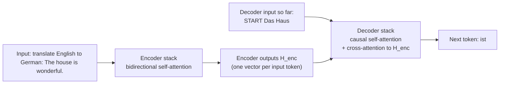
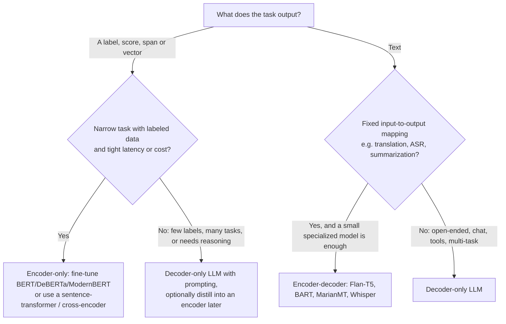

# Encoder-Only, Encoder-Decoder and Decoder-Only Models (BERT, T5, GPT)

> **Level:** Beginner to Advanced · **Study time:** ~110 min · **Prerequisites:** [The Attention Mechanism, Step by Step](03-attention-mechanism-step-by-step.md), [Multi-Head Attention and Causal Masking](04-multi-head-attention-and-causal-masking.md), [The Full Transformer Architecture](05-the-full-transformer-architecture.md), [Softmax, Entropy, Cross-Entropy and KL Divergence](../00-foundations/05-softmax-entropy-cross-entropy-and-kl-divergence.md)

## Table of contents

- [Why this matters](#why-this-matters)
- [One architecture, three ways to use it](#one-architecture-three-ways-to-use-it)
- [The three attention patterns](#the-three-attention-patterns)
- [Encoder-only models: BERT and masked language modeling](#encoder-only-models-bert-and-masked-language-modeling)
- [Encoder-decoder models: T5 and span corruption](#encoder-decoder-models-t5-and-span-corruption)
- [Decoder-only models: GPT and causal language modeling](#decoder-only-models-gpt-and-causal-language-modeling)
- [Comparing the three objectives: how much signal per sequence](#comparing-the-three-objectives-how-much-signal-per-sequence)
- [What each family is good at](#what-each-family-is-good-at)
- [BERT-style models for sentence embeddings (bi-encoders)](#bert-style-models-for-sentence-embeddings-bi-encoders)
- [Cross-encoder rerankers](#cross-encoder-rerankers)
- [Why decoder-only models dominate modern LLMs](#why-decoder-only-models-dominate-modern-llms)
- [The big comparison table](#the-big-comparison-table)
- [Going deeper: inference cost and serving differences](#going-deeper-inference-cost-and-serving-differences)
- [Going deeper: blurred lines and choosing in production](#going-deeper-blurred-lines-and-choosing-in-production)
- [Common mistakes and misconceptions](#common-mistakes-and-misconceptions)
- [Interview questions and model answers](#interview-questions-and-model-answers)
- [Key takeaways](#key-takeaways)
- [Further reading](#further-reading)
- [Next](#next)

## Why this matters

Almost every modern NLP system you will touch is one of three Transformer "families": the **encoder-only** family (BERT and friends) quietly powers search, embeddings, rerankers and classifiers; the **encoder-decoder** family (T5, BART, Whisper) powers translation, summarization and speech recognition; and the **decoder-only** family (GPT, Llama, Mistral, Gemini-style chat models) powers chatbots, coding assistants and agents. In a RAG (retrieval-augmented generation) system, which fetches relevant documents and hands them to an LLM to answer from, you often combine families: a BERT-style bi-encoder retrieves, a BERT-style cross-encoder reranks (both explained later in this chapter), and a decoder-only LLM writes the answer. Interviewers love "How do encoder-only, encoder-decoder and decoder-only models differ?" because a good answer shows you understand attention masks, training objectives, inference cost and why the industry converged on decoder-only LLMs. Picking the wrong family in production can cost you 10-100x in latency and money, so this is a practical skill, not just trivia.

## One architecture, three ways to use it

> **Analogy:** Think of the original Transformer as a professional translation office with two rooms. In the **reading room**, a team reads the whole source document at once, anyone can look at any word. In the **writing room**, a writer produces the translation one word at a time, never peeking at words they have not written yet, but allowed to call the reading room and ask questions. BERT keeps only the reading room. GPT keeps only the writing room (without the phone line). T5 keeps both rooms and the phone line.

Quick recap from [The Full Transformer Architecture](05-the-full-transformer-architecture.md): the original Transformer ("Attention Is All You Need", Vaswani et al., 2017) was built for machine translation and had two stacks:

- An **encoder**: a stack of identical blocks that turns input tokens into **contextual embeddings** (one vector per token whose meaning depends on the surrounding tokens). Every encoder block contains **self-attention** (each token attends to tokens in the same sequence) plus a feed-forward network.
- A **decoder**: a stack of blocks that generates output tokens one at a time. Each decoder block has **masked (causal) self-attention** over the tokens generated so far, **cross-attention** (queries come from the decoder, keys and values come from the encoder output) and a feed-forward network.

Researchers then noticed you can keep only one half:

```text
                 Original Transformer (2017)
          +------------------+     +------------------+
 input -> |     ENCODER      | --> |     DECODER      | -> output
          | bidirectional    |     | causal self-attn |
          | self-attention   |     | + cross-attention|
          +------------------+     +------------------+
                  |                         |
     keep only    |          keep both      |      keep only
     the encoder  v                         v      the decoder
   +----------------+   +------------------------+   +----------------+
   | ENCODER-ONLY   |   | ENCODER-DECODER        |   | DECODER-ONLY   |
   | BERT, RoBERTa, |   | T5, BART, mT5, Whisper |   | GPT, Llama,    |
   | DeBERTa,       |   | Flan-T5, MarianMT      |   | Mistral, Qwen, |
   | ModernBERT     |   |                        |   | Gemma          |
   +----------------+   +------------------------+   +----------------+
   understand text      map input -> output         generate text
```

Three things distinguish the families. Keep this list in mind; the whole chapter expands on it:

1. **Attention pattern** (which tokens can see which).
2. **Pretraining objective** (what the model is asked to predict during pretraining).
3. **Output usage** (vectors for downstream tasks, or generated text).

## The three attention patterns

### Intuition first

> **Analogy:** Reading a sentence in a book versus writing a sentence live. When you read "the cat sat", you can look back and forth across all three words. When you write it, at the moment you write "cat" you know "the" but "sat" does not exist yet.

- **Bidirectional attention**: every token can attend to every other token, both left and right. Used in encoders.
- **Causal attention** (also called **autoregressive** or **unidirectional** attention): token $i$ can attend only to tokens $1, \dots, i$ (itself and the past). Used in decoders, because at generation time the future does not exist yet.
- **Cross-attention**: tokens in one sequence (the decoder's output-so-far) attend to all tokens of another sequence (the encoder's output). Used in encoder-decoder models.

### Precise definition: the attention mask

All three are implemented with the same attention formula plus a **mask**, a matrix that says which (query, key) pairs are allowed. (The mechanics are covered in [Multi-Head Attention and Causal Masking](04-multi-head-attention-and-causal-masking.md); here is the short version.)

$$
\text{Attention}(Q, K, V) = \text{softmax}\left(\frac{QK^\top}{\sqrt{d_k}} + M\right)V
$$

- $Q$: query matrix, one row per token that is "asking" (shape $n_q \times d_k$).
- $K$: key matrix, one row per token being "looked at" (shape $n_k \times d_k$).
- $V$: value matrix, the information carried by each looked-at token (shape $n_k \times d_v$).
- $d_k$: dimension of each query and key vector; dividing by $\sqrt{d_k}$ keeps scores from growing too large.
- $M$: the **additive mask**, shape $n_q \times n_k$. $M_{ij} = 0$ if query $i$ may look at key $j$, and $M_{ij} = -\infty$ otherwise. Adding $-\infty$ makes $e^{-\infty} = 0$ after softmax, so the forbidden token gets exactly zero weight.
- softmax is applied to each row separately.

For our running 3-word sentence "the cat sat" (positions 1, 2, 3), the allowed patterns are (1 = allowed, 0 = blocked):

```text
 Bidirectional (encoder)      Causal (decoder)          Cross-attention (decoder -> encoder)
 keys:   the cat sat          keys:   the cat sat       keys (source): le  chat  assis
 the   [  1   1   1 ]         the   [  1   0   0 ]      target "the" [ 1   1     1 ]
 cat   [  1   1   1 ]         cat   [  1   1   0 ]      target "cat" [ 1   1     1 ]
 sat   [  1   1   1 ]         sat   [  1   1   1 ]
 square n x n, all ones       lower-triangular          rectangular m x n, all ones
```

Cross-attention is rectangular: $m$ target tokens (rows) attend to $n$ source tokens (columns). Here $m = 2$ target tokens generated so far and $n = 3$ source tokens, so the matrix is $2 \times 3$. Cross-attention needs no causal mask because the source sentence is fully known before decoding starts (only padding is masked).

### Tiny numeric example: what the mask does to one row

Suppose the raw (already scaled) scores for the query "cat" against keys [the, cat, sat] are $[1, 3, 2]$.

**Bidirectional:** softmax over all three.

- $e^1 = 2.718$, $e^3 = 20.086$, $e^2 = 7.389$
- Sum $= 2.718 + 20.086 + 7.389 = 30.193$
- Weights $= [2.718/30.193,\ 20.086/30.193,\ 7.389/30.193] = [0.090,\ 0.665,\ 0.245]$

**Causal:** add the mask $[0, 0, -\infty]$, so scores become $[1, 3, -\infty]$.

- $e^1 = 2.718$, $e^3 = 20.086$, $e^{-\infty} = 0$
- Sum $= 22.804$
- Weights $= [2.718/22.804,\ 20.086/22.804,\ 0] = [0.119,\ 0.881,\ 0]$

The causal "cat" literally cannot use any information from "sat". That one difference changes what the model can learn, how it is trained and how it is served.

### Counting allowed pairs

For a sequence of length $n$:

- Bidirectional allows $n^2$ pairs.
- Causal allows $1 + 2 + \dots + n = \frac{n(n+1)}{2}$ pairs.

For $n = 3$: bidirectional $= 9$, causal $= 3 \times 4 / 2 = 6$ (count the 1s above: 1 + 2 + 3 = 6). For $n = 4096$: bidirectional $= 4096^2 = 16{,}777{,}216$ and causal $= 4096 \times 4097 / 2 = 8{,}390{,}656$, roughly half. (Standard attention kernels still compute or skip blocks of the full square; the asymptotic cost is $O(n^2)$ in both cases.)

### A fourth pattern you should know: the prefix LM

A **prefix language model** (prefix LM) uses one stack but mixes the two patterns: the first $p$ tokens (the "prefix", for example the prompt) see each other bidirectionally, and the remaining tokens are causal. It is a decoder-only model that behaves a bit like an encoder-decoder. UniLM (Dong et al., 2019) and the T5 paper's architecture comparison explored it, and UL2 (Tay et al., 2022) used it as one of its pretraining modes.

### Code: building all four masks in NumPy

```python
# pip install numpy
import numpy as np

def bidirectional_mask(n: int) -> np.ndarray:
    return np.ones((n, n), dtype=int)            # everyone sees everyone

def causal_mask(n: int) -> np.ndarray:
    return np.tril(np.ones((n, n), dtype=int))   # lower triangle: past and self only

def prefix_lm_mask(n: int, prefix_len: int) -> np.ndarray:
    m = causal_mask(n)
    m[:, :prefix_len] = 1                        # every token sees the whole prefix
    return m

def cross_mask(n_target: int, n_source: int) -> np.ndarray:
    return np.ones((n_target, n_source), dtype=int)  # target sees all of the source

def masked_softmax(scores: np.ndarray, allowed: np.ndarray) -> np.ndarray:
    s = np.where(allowed == 1, scores, -np.inf)  # forbidden pairs get -inf
    s = s - s.max(axis=-1, keepdims=True)        # numerical stability
    e = np.exp(s)
    return e / e.sum(axis=-1, keepdims=True)

print(causal_mask(3))
# [[1 0 0]
#  [1 1 0]
#  [1 1 1]]
print(prefix_lm_mask(4, prefix_len=2))
# [[1 1 0 0]
#  [1 1 0 0]
#  [1 1 1 0]
#  [1 1 1 1]]

row = np.array([[1.0, 3.0, 2.0]])               # scores for query "cat"
print(masked_softmax(row, bidirectional_mask(3)[1:2]).round(3))  # [[0.09  0.665 0.245]]
print(masked_softmax(row, causal_mask(3)[1:2]).round(3))         # [[0.119 0.881 0.   ]]
```

> **Interview tip:** If asked "what is the architectural difference between BERT and GPT?", the crisp answer is "mostly the attention mask and the training objective." The blocks themselves (attention, feed-forward, residuals, normalization) are nearly identical.

## Encoder-only models: BERT and masked language modeling

### Intuition

> **Analogy:** A fill-in-the-blank exam. "The ___ sat on the mat." To fill the blank well you must read both sides of it. A student who aces thousands of these exams ends up with a deep understanding of how words relate, even though they never wrote an essay.

**BERT** ("BERT: Pre-training of Deep Bidirectional Transformers for Language Understanding", Devlin et al., 2018/2019) is a stack of Transformer encoder blocks with bidirectional attention. Its output is one contextual vector per input token. It does not generate text; it produces representations that you feed into a small task-specific **head** (a small layer, often a single linear layer, on top of the backbone).

Well-known sizes from the paper:

| Model | Layers | Hidden size | Attention heads | Parameters |
|---|---|---|---|---|
| BERT-base | 12 | 768 | 12 | ~110M |
| BERT-large | 24 | 1024 | 16 | ~340M |

BERT uses **WordPiece** subword tokenization (see [Tokenization](01-tokenization.md)), learned absolute position embeddings up to 512 positions (see [Positional Encoding](06-positional-encoding-sinusoidal-learned-rope-and-alibi.md)), and three special tokens:

- **[CLS]** ("classification"): prepended to every input. Its final vector is commonly used as a summary of the whole sequence for classification.
- **[SEP]** ("separator"): marks the end of a segment, and separates two segments when the input is a pair (for example question and passage).
- **[MASK]**: a placeholder token used only during pretraining.

BERT also adds a **segment embedding** (also called token type embedding) that tells the model whether each token belongs to segment A or segment B.

```text
Input:   [CLS]  the   cat   [MASK]  on   the   mat   [SEP]
           |     |     |      |      |    |     |      |
        +-------------- 12 encoder blocks ----------------+
        |   bidirectional self-attention + feed-forward   |
        +-------------------------------------------------+
           |     |     |      |      |    |     |      |
Output:  h_CLS  h1    h2     h3     h4   h5    h6    h_SEP     (each a 768-d vector)
           |                  |
   classification head    MLM head predicts "sat" here
```

### The pretraining objective: masked language modeling (MLM)

**Masked language modeling** (MLM) means: hide some tokens and train the model to predict them from the surrounding (left and right) context. BERT's recipe:

1. Choose 15% of the token positions at random (never [CLS] or [SEP]).
2. For each chosen position:
   - 80% of the time, replace the token with [MASK];
   - 10% of the time, replace it with a random token;
   - 10% of the time, leave it unchanged.
3. Compute the loss only on the chosen positions.

Why the 80/10/10 trick? [MASK] never appears when you later fine-tune or use the model. If the model only ever saw [MASK] at prediction positions, it could learn "only build good representations where there is a [MASK]", which creates a **pretrain-finetune mismatch**. Random and unchanged tokens force it to build a good representation for every token, because any token might be one it is quizzed on.

### The MLM loss

$$
\mathcal{L}_{\text{MLM}} = -\frac{1}{|\mathcal{M}|}\sum_{i \in \mathcal{M}} \log P_\theta\left(x_i \mid \tilde{x}\right)
$$

- $\mathcal{M}$: the set of chosen (masked) positions; $|\mathcal{M}|$ is how many there are.
- $x_i$: the original token at position $i$ (the correct answer).
- $\tilde{x}$: the corrupted input sequence (with [MASK], random or unchanged tokens). Note the model sees the whole corrupted sequence, both sides of position $i$.
- $P_\theta(x_i \mid \tilde{x})$: the probability the model (with parameters $\theta$) assigns to the correct token, obtained by a softmax over the vocabulary at position $i$.
- $\log$ is the natural log. This is just cross-entropy averaged over masked positions (see [Softmax, Entropy, Cross-Entropy and KL Divergence](../00-foundations/05-softmax-entropy-cross-entropy-and-kl-divergence.md)).

**Worked example.** Input: "the cat [MASK] on the [MASK]". Correct answers: "sat" at position 3 and "mat" at position 6.

- Model gives $P(\text{sat}) = 0.7$ at position 3: loss term $= -\ln 0.7 = 0.357$.
- Model gives $P(\text{mat}) = 0.2$ at position 6: loss term $= -\ln 0.2 = 1.609$.
- $|\mathcal{M}| = 2$, so $\mathcal{L} = (0.357 + 1.609)/2 = 1.966/2 = 0.983$.

The four unmasked positions contribute nothing. This matters later: MLM gets a learning signal from only about 15% of tokens.

A second, now-abandoned BERT objective was **next sentence prediction** (NSP): given segments A and B, predict whether B really followed A. RoBERTa ("RoBERTa: A Robustly Optimized BERT Pretraining Approach", Liu et al., 2019) found that removing NSP and training longer on more data with **dynamic masking** (drawing a fresh random mask each time a sequence is seen, instead of one mask fixed during preprocessing) matched or improved results, so most later encoders dropped NSP.

### Code: MLM masking from scratch, then with Hugging Face

```python
# pip install torch
import torch

def mlm_mask(input_ids: torch.Tensor, mask_id: int, vocab_size: int,
             special: torch.Tensor, p: float = 0.15, seed: int = 0):
    """BERT-style masking. special is a bool tensor marking [CLS]/[SEP]/[PAD]."""
    g = torch.Generator().manual_seed(seed)
    labels = input_ids.clone()
    prob = torch.full(input_ids.shape, p)
    prob[special] = 0.0                                   # never pick special tokens
    chosen = torch.bernoulli(prob, generator=g).bool()
    labels[~chosen] = -100                                # -100 = ignored by cross_entropy

    inputs = input_ids.clone()
    to_mask = torch.bernoulli(torch.full(input_ids.shape, 0.8), generator=g).bool() & chosen
    inputs[to_mask] = mask_id                             # 80% -> [MASK]
    to_rand = torch.bernoulli(torch.full(input_ids.shape, 0.5), generator=g).bool() \
              & chosen & ~to_mask                         # half of remaining 20% -> random
    random_ids = torch.randint(vocab_size, input_ids.shape, generator=g)
    inputs[to_rand] = random_ids[to_rand]
    return inputs, labels                                 # other 10%: unchanged

ids = torch.tensor([[101, 1996, 4937, 2938, 2006, 1996, 13523, 102]])  # illustrative ids
special = torch.tensor([[True, False, False, False, False, False, False, True]])
x, y = mlm_mask(ids, mask_id=103, vocab_size=30522, special=special, p=0.3)
print(x)  # some positions replaced
print(y)  # -100 everywhere except chosen positions
```

The ignore index `-100` is the PyTorch `cross_entropy` default, so `F.cross_entropy(logits.view(-1, V), labels.view(-1))` automatically computes the loss only on chosen positions. Hugging Face's `DataCollatorForLanguageModeling(tokenizer, mlm=True, mlm_probability=0.15)` implements the same recipe.

Using a pretrained MLM directly:

```python
# pip install transformers torch
from transformers import pipeline

fill = pipeline("fill-mask", model="bert-base-uncased")
for r in fill("The cat sat on the [MASK].")[:3]:
    print(r["token_str"], round(r["score"], 3))   # top-3 guesses with probabilities
```

### Using BERT downstream: fine-tuning with a head

For classification you put a linear layer on top of $h_{\text{CLS}}$ and fine-tune everything:

$$
\text{logits} = W h_{\text{CLS}} + b, \qquad P(\text{class}) = \text{softmax}(\text{logits})
$$

- $h_{\text{CLS}}$: final hidden vector of the [CLS] token (dimension $d$, 768 for BERT-base).
- $W$: weight matrix of shape (number of classes) $\times d$.
- $b$: bias vector, one entry per class.

**Worked example (spam filter, toy 2-d hidden size).** Classes are [spam, not spam]. Suppose $h_{\text{CLS}} = (0.5, -1.0)$, $W = \begin{pmatrix} 2 & 1 \\ -1 & 0.5 \end{pmatrix}$, $b = (0, 0)$.

- Spam logit: $2 \times 0.5 + 1 \times (-1.0) = 1.0 - 1.0 = 0$
- Not-spam logit: $-1 \times 0.5 + 0.5 \times (-1.0) = -0.5 - 0.5 = -1$
- Softmax: $e^0 = 1$, $e^{-1} = 0.368$, sum $= 1.368$
- $P(\text{spam}) = 1/1.368 = 0.731$, $P(\text{not spam}) = 0.368/1.368 = 0.269$

Other heads: **token classification** (a linear layer on every token's vector, for named-entity recognition), **extractive question answering** (two linear layers predict the start and end positions of the answer span in a passage), and **pair classification** (feed "[CLS] A [SEP] B [SEP]", classify from [CLS], for example natural language inference or relevance).

```python
import torch
from transformers import AutoTokenizer, AutoModelForSequenceClassification

tok = AutoTokenizer.from_pretrained("bert-base-uncased")
model = AutoModelForSequenceClassification.from_pretrained("bert-base-uncased", num_labels=2)
batch = tok(["WIN a FREE iPhone now!!!", "Lunch at noon?"], padding=True, return_tensors="pt")
out = model(**batch, labels=torch.tensor([0, 1]))   # 0 = spam, 1 = not spam
print(out.loss, out.logits.shape)                    # logits shape: (2, 2)
# The head is randomly initialized: you must fine-tune before predictions mean anything.
```

### Notable encoder-only descendants

| Model | Key change vs BERT | Reference |
|---|---|---|
| RoBERTa | No NSP, dynamic masking, more data, longer training | Liu et al., 2019 |
| ALBERT | Parameter sharing across layers, factorized embeddings | Lan et al., 2019 |
| DistilBERT | Smaller student distilled from BERT (see [Knowledge Distillation](../07-model-compression/05-knowledge-distillation-fundamentals.md)) | Sanh et al., 2019 |
| ELECTRA | "Replaced token detection": a discriminator predicts, for every token, whether a small generator replaced it, so every position gives signal | Clark et al., 2020 |
| DeBERTa | Disentangled content and position attention | He et al., 2020 |
| XLM-RoBERTa | Multilingual (about 100 languages) | Conneau et al., 2019 |
| ModernBERT | Modern components (RoPE, longer 8k context, efficient attention) | Warner et al., 2024 |

## Encoder-decoder models: T5 and span corruption

### Intuition

> **Analogy:** A professional interpreter. First they listen to the whole sentence (encoder, bidirectional), then they speak the translation word by word (decoder, causal), constantly glancing at their notes of what was said (cross-attention).

An **encoder-decoder** (also called **sequence-to-sequence** or **seq2seq**) model keeps both stacks of the original Transformer. The encoder reads the input with bidirectional attention. The decoder generates the output autoregressively with causal self-attention, and in every decoder block a cross-attention layer lets each output position look at all encoder outputs.



### Cross-attention in one formula

$$
\text{CrossAttn}(H_{\text{dec}}, H_{\text{enc}}) = \text{softmax}\left(\frac{(H_{\text{dec}}W_Q)(H_{\text{enc}}W_K)^\top}{\sqrt{d_k}}\right)(H_{\text{enc}}W_V)
$$

- $H_{\text{dec}}$: decoder hidden states, shape $m \times d$ ($m$ = output tokens so far).
- $H_{\text{enc}}$: encoder outputs, shape $n \times d$ ($n$ = input tokens).
- $W_Q, W_K, W_V$: learned projection matrices for queries, keys and values.
- Result: shape $m \times d_v$. The attention matrix is $m \times n$, each output token gets a weighted mix of input token information.

The key point: queries come from the output side, keys and values come from the input side. That is how the decoder "consults its notes".

### T5 and the text-to-text idea

**T5** ("Exploring the Limits of Transfer Learning with a Unified Text-to-Text Transformer", Raffel et al., 2020) framed every task as text in, text out:

```text
"translate English to German: The house is wonderful."  ->  "Das Haus ist wunderbar."
"summarize: <long article>"                             ->  "<short summary>"
"cola sentence: The course is jumping well."            ->  "unacceptable"
"stsb sentence1: ... sentence2: ..."                    ->  "3.8"
```

Even classification and regression become generation of a label string. One model, one loss, one decoding procedure. T5 was pretrained on **C4** (the Colossal Clean Crawled Corpus) at sizes from about 60M to 11B parameters. The paper is also famous for a large, systematic comparison of architectures and objectives; in its setting the encoder-decoder with a **denoising** objective (corrupt the input, then train the model to restore what was lost) performed best. That result is worth remembering when someone claims "decoder-only is strictly better at everything".

### The pretraining objective: span corruption

**Span corruption** is a denoising objective: drop out contiguous spans of tokens from the input, replace each span with a unique **sentinel token**, and train the decoder to output the missing spans, each introduced by its sentinel. T5's defaults: corrupt about 15% of tokens, with a mean span length of 3 tokens.

Running example with "the cat sat on the mat today", dropping "sat on" and "today" (an exaggerated corruption rate for illustration):

```text
Original:  the cat sat on the mat today
Encoder input:   the cat <extra_id_0> the mat <extra_id_1>
Decoder target:  <extra_id_0> sat on <extra_id_1> today <extra_id_2>
```

(`<extra_id_k>` is the Hugging Face T5 spelling of the sentinels; the final sentinel marks the end.)

The loss is ordinary causal cross-entropy on the decoder target, conditioned on the corrupted input:

$$
\mathcal{L}_{\text{span}} = -\frac{1}{T}\sum_{t=1}^{T} \log P_\theta\left(y_t \mid y_{<t},\ \tilde{x}\right)
$$

- $\tilde{x}$: corrupted encoder input (with sentinels).
- $y_1, \dots, y_T$: the target sequence (sentinels plus the missing tokens), $T$ tokens long.
- $y_{<t}$: target tokens before position $t$ (the decoder is causal).
- $P_\theta(y_t \mid \dots)$: model probability of the correct next target token.

**Why spans, and why short targets?** Compare with BERT. BERT's output is as long as its input (one prediction slot per position), but only 15% of slots are graded. T5's target contains only the missing material, so the decoder does little wasted work. For a 512-token input with 15% corruption and mean span length 3:

- Corrupted tokens: $0.15 \times 512 = 76.8 \approx 77$
- Number of spans: $76.8 / 3 = 25.6 \approx 26$
- Encoder input length: $512 - 76.8 + 25.6 = 460.8 \approx 461$ (dropped tokens out, one sentinel per span in)
- Decoder target length: $76.8 + 25.6 + 1 = 103.4 \approx 103$ (the tokens, one sentinel per span, one final sentinel)

So the decoder only processes about 103 tokens instead of 512. Predicting multi-token spans also teaches the model to generate several tokens in a row, which plain MLM never practices.

A close cousin is **BART** ("BART: Denoising Sequence-to-Sequence Pre-training...", Lewis et al., 2019/2020): an encoder-decoder trained to reconstruct the full original text from a corrupted version (text infilling, sentence shuffling and other noise). BART's target is the whole original sequence, which makes it especially good at summarization-style generation.

### Code: span corruption from scratch, then T5 in Hugging Face

```python
def span_corrupt(tokens: list[str], spans: list[tuple[int, int]]):
    """Drop each (start, end) span (end exclusive), insert sentinels, build the target."""
    inp, tgt, prev = [], [], 0
    for k, (s, e) in enumerate(spans):
        sentinel = f"<extra_id_{k}>"
        inp += tokens[prev:s] + [sentinel]   # keep text before the span, then a sentinel
        tgt += [sentinel] + tokens[s:e]      # the target says: sentinel, then the missing span
        prev = e
    inp += tokens[prev:]
    tgt += [f"<extra_id_{len(spans)}>"]      # final sentinel ends the target
    return " ".join(inp), " ".join(tgt)

words = "the cat sat on the mat today".split()
print(span_corrupt(words, [(2, 4), (6, 7)]))
# ('the cat <extra_id_0> the mat <extra_id_1>', '<extra_id_0> sat on <extra_id_1> today <extra_id_2>')
```

```python
# pip install transformers sentencepiece torch
from transformers import AutoTokenizer, T5ForConditionalGeneration

tok = AutoTokenizer.from_pretrained("t5-small")
model = T5ForConditionalGeneration.from_pretrained("t5-small")

# Pretraining-style loss: the model builds the shifted decoder input from labels internally
inp = tok("the cat <extra_id_0> the mat <extra_id_1>", return_tensors="pt").input_ids
labels = tok("<extra_id_0> sat on <extra_id_1> today <extra_id_2>", return_tensors="pt").input_ids
print(model(input_ids=inp, labels=labels).loss)

# Text-to-text inference: encoder runs once, decoder generates token by token
x = tok("translate English to German: The house is wonderful.", return_tensors="pt")
y = model.generate(**x, max_new_tokens=20)
print(tok.decode(y[0], skip_special_tokens=True))
```

Common encoder-decoder models: T5, mT5 (multilingual), Flan-T5 (instruction-tuned T5; Chung et al., 2022, "Scaling Instruction-Finetuned Language Models"), BART, mBART, MarianMT (translation), and **Whisper** (Radford et al., 2022), where the encoder reads audio features and the decoder writes the transcript. The same pattern appears in vision: an image encoder plus a text decoder (see [Vision Transformers, CLIP and Multimodal Models](../03-computer-vision/05-vision-transformers-clip-and-multimodal-models.md)).

## Decoder-only models: GPT and causal language modeling

### Intuition

> **Analogy:** The world's most dedicated autocomplete. Given "the cat", guess the next word. Then given "the cat sat", guess the next. Do this on trillions of words and, to guess well, the model has to absorb grammar, facts, styles and some reasoning patterns.

A **decoder-only** model is a stack of decoder blocks without cross-attention: just causal self-attention and feed-forward layers. GPT ("Improving Language Understanding by Generative Pre-Training", Radford et al., 2018) introduced the recipe; GPT-2 (Radford et al., 2019, 1.5B parameters) and GPT-3 ("Language Models are Few-Shot Learners", Brown et al., 2020, 175B parameters) scaled it. Nearly all modern open and closed chat LLMs (Llama, Mistral, Qwen, Gemma, DeepSeek, the GPT series) are decoder-only. The modern block design is covered in [Modern LLM Architecture](08-modern-llm-architecture-improvements.md).

### The pretraining objective: causal language modeling (CLM)

**Causal language modeling** (also called **next-token prediction** or autoregressive language modeling) trains the model to predict each token from the tokens before it. It rests on the chain rule of probability, which says any sequence probability factors exactly as:

$$
P(x_1, x_2, \dots, x_n) = \prod_{t=1}^{n} P(x_t \mid x_1, \dots, x_{t-1})
$$

and the training loss is the average negative log-probability of each next token:

$$
\mathcal{L}_{\text{CLM}} = -\frac{1}{n-1}\sum_{t=2}^{n} \log P_\theta\left(x_t \mid x_{<t}\right)
$$

- $x_t$: the token at position $t$.
- $x_{<t}$: all tokens before position $t$.
- $P_\theta(x_t \mid x_{<t})$: probability the model assigns to the true next token, read off the softmax at position $t-1$.
- $n - 1$: number of predictions in a sequence of $n$ tokens (the first token has nothing to be predicted from, unless you prepend a beginning-of-sequence token, in which case every token is predicted).

The causal mask is what makes this trainable in parallel: in a single forward pass, the output at position $t-1$ only saw tokens up to $t-1$, so it is a fair prediction of token $t$. All $n-1$ predictions are computed simultaneously. Feeding the true previous tokens (rather than the model's own guesses) during training is called **teacher forcing**.

**Worked example.** Sentence "the cat sat".

- Position 1 output predicts "cat" given "the": model gives $P = 0.5$, loss term $-\ln 0.5 = 0.693$.
- Position 2 output predicts "sat" given "the cat": model gives $P = 0.25$, loss term $-\ln 0.25 = 1.386$.
- $\mathcal{L} = (0.693 + 1.386)/2 = 2.079/2 = 1.040$.
- **Perplexity** (the exponential of the average loss, roughly "how many equally likely choices the model is torn between") $= e^{1.040} \approx 2.83$. Check: it equals $1/\sqrt{0.5 \times 0.25} = 1/\sqrt{0.125} = 1/0.3536 = 2.83$.

At inference, the model first reads the whole prompt in one parallel pass (called **prefill**), then generates (called **decode**) by repeatedly predicting a distribution for the next token, choosing one (see [Decoding Strategies](../05-llms/03-text-generation-and-decoding-strategies.md)), appending it and repeating. Pretraining at scale is covered in [Pretraining and Next-Token Prediction](../05-llms/01-pretraining-and-next-token-prediction.md).

### Code: CLM loss by hand vs Hugging Face

```python
# pip install transformers torch
import torch
import torch.nn.functional as F
from transformers import AutoTokenizer, AutoModelForCausalLM

tok = AutoTokenizer.from_pretrained("gpt2")
model = AutoModelForCausalLM.from_pretrained("gpt2").eval()

ids = tok("the cat sat on the mat", return_tensors="pt").input_ids   # (1, n)
with torch.no_grad():
    out = model(ids, labels=ids)        # HF shifts labels by one position internally

# Manual version: the logits at position t are a prediction for token t+1
logits = out.logits[:, :-1, :]          # drop the last position (nothing left to predict)
targets = ids[:, 1:]                    # drop the first token (nothing predicts it)
manual = F.cross_entropy(logits.reshape(-1, logits.size(-1)), targets.reshape(-1))

print(out.loss.item(), manual.item())   # identical up to floating-point rounding
print("perplexity:", torch.exp(out.loss).item())
```

> **Common mistake:** Shifting labels yourself and then also passing them to a Hugging Face causal LM, which shifts again. You end up training the model to predict two tokens ahead and the loss looks "fine but worse". Pass `labels=input_ids` and let the library shift once.

## Comparing the three objectives: how much signal per sequence

A senior-level way to compare objectives is: for each training sequence, how many tokens produce a gradient, and how well does the task match what you want at inference?

**Worked example (512-token sequence):**

| Objective | Positions that produce a loss | Approximate count |
|---|---|---|
| MLM (BERT, 15%) | Only masked positions | $0.15 \times 512 = 76.8 \approx 77$ |
| Span corruption (T5, 15%, span 3) | Every decoder target token | $\approx 103$ (computed above), but they encode only ~77 original tokens |
| CLM (GPT) | Every position except the first | $512 - 1 = 511$ |
| Replaced token detection (ELECTRA) | Every position (binary "replaced?" task) | 512 |

CLM extracts a supervised prediction from every token, which is one reason it uses data efficiently for generation. MLM gives fewer, but each prediction uses context from both sides, which gives richer representations per token for understanding tasks at small model sizes.

| | MLM (BERT) | Span corruption (T5) | CLM (GPT) |
|---|---|---|---|
| What is predicted | Individual masked tokens | Missing spans, as a short generated sequence | Every next token |
| Context used | Both sides | Both sides (encoder) + causal (decoder) | Left side only |
| Matches generation at inference? | No | Partly (generates spans) | Yes, exactly |
| Independence issue | Masked tokens predicted independently of each other | Spans generated autoregressively | None, exact chain-rule factorization |
| Natural outputs | Vectors (embeddings, classifier features) | Text conditioned on input | Text continuation |

The "independence issue" is subtle and interview-worthy: if "New [MASK] [MASK]" should be "New York City", BERT predicts each [MASK] separately and cannot coordinate them, so it has no proper probability for whole sequences. XLNet (Yang et al., 2019) was motivated by exactly this criticism.

## What each family is good at

| Family | Best at | Why | Example models |
|---|---|---|---|
| Encoder-only | Classification (spam, sentiment, intent, toxicity), named-entity recognition, extractive QA, **sentence embeddings**, **cross-encoder reranking** | Bidirectional context gives the best representation per parameter; one forward pass, no generation loop, so very low latency and cost | BERT, RoBERTa, DeBERTa-v3, ELECTRA, ModernBERT, MiniLM-based sentence-transformers, BGE and E5 embedders, ms-marco cross-encoders |
| Encoder-decoder | Input-to-output transformation: translation, summarization, speech recognition, data-to-text, grammar correction | Full bidirectional reading of the input plus a dedicated generator; input processed once | T5, Flan-T5, mT5, BART, mBART, MarianMT, NLLB, Whisper |
| Decoder-only | Open-ended generation, chat, instruction following, code, reasoning, tool use and agents; also, increasingly, everything else via prompting | Same objective as use; scales smoothly; in-context learning; one model for many tasks | GPT series, Llama, Mistral, Qwen, Gemma, DeepSeek, Phi |

Note that decoder-only LLMs *can* translate and summarize very well; at large scale they often match or beat older specialized encoder-decoders on quality, especially for high-resource languages (dedicated translation models such as NLLB can still win on many low-resource language pairs). Encoder-decoders remain attractive when you need a small, cheap, fine-tuned model for one input-to-output task, or for speech (Whisper).

> **Senior insight:** "Can do it" and "should do it" differ. A 7B decoder can classify support tickets, but a fine-tuned 110M-parameter encoder often matches it on a narrow, well-labeled task at a tiny fraction of the cost. Interviewers like candidates who reach for the small model first when the task is narrow and labeled data exists.

## BERT-style models for sentence embeddings (bi-encoders)

### The goal

For semantic search and RAG, we want one fixed-size vector per sentence or document such that similar meanings give nearby vectors (measured by **cosine similarity**, the cosine of the angle between two vectors). Then a query vector can be compared with millions of precomputed document vectors very fast. This setup, where the query and the document are each encoded *separately* by the same encoder, is called a **bi-encoder** (or dual encoder). Embeddings and similarity search are covered fully in [Text Embeddings and Similarity Search](../08-rag/02-text-embeddings-and-similarity-search.md); here we focus on how the encoder architecture is used.

### Step 1: pooling token vectors into one vector

BERT outputs one vector per token. **Pooling** combines them into one:

- **[CLS] pooling**: take $h_{\text{CLS}}$.
- **Mean pooling**: average the token vectors, ignoring padding.
- (For decoder-only embedders: **last-token pooling**, explained later.)

$$
e = \frac{\sum_{i=1}^{n} a_i\, h_i}{\sum_{i=1}^{n} a_i}
$$

- $h_i$: final hidden vector of token $i$.
- $a_i$: **attention mask** value, 1 for a real token, 0 for padding (padding tokens are filler added so sequences in a batch have equal length).
- $e$: the sentence embedding.

**Worked example (2-d vectors).** Tokens and vectors: [CLS] $(1, 2)$, "cat" $(3, 0)$, "sat" $(2, 4)$, [PAD] $(9, 9)$, mask $a = [1, 1, 1, 0]$.

- Numerator: $(1+3+2,\ 2+0+4) = (6, 6)$; the [PAD] vector is multiplied by 0.
- Denominator: $1 + 1 + 1 + 0 = 3$.
- $e = (6/3,\ 6/3) = (2, 2)$.

If you forgot the mask and averaged all four: $(15/4, 15/4) = (3.75, 3.75)$, a different vector that depends on how much padding the batch happened to need. That is a real production bug: the same sentence gets different embeddings depending on its batch neighbors.

### Step 2: train for similarity (raw BERT is not enough)

Sentence-BERT ("Sentence-BERT: Sentence Embeddings using Siamese BERT-Networks", Reimers and Gurevych, 2019) showed that using raw BERT's [CLS] vector or averaged token vectors for semantic similarity worked poorly, in their experiments even worse than averaging older static GloVe word vectors. MLM pretraining never asked the model to place similar sentences close together. The fix is to fine-tune the encoder with a **contrastive** objective: pull (query, relevant passage) pairs together and push unrelated pairs apart.

A widely used version is the **in-batch negatives** loss (InfoNCE, called `MultipleNegativesRankingLoss` in sentence-transformers): for query $q$ with positive passage $p^+$ and the other passages in the batch as negatives,

$$
\mathcal{L} = -\log \frac{e^{s(q, p^+)/\tau}}{\sum_{j} e^{s(q, p_j)/\tau}}
$$

- $s(\cdot, \cdot)$: cosine similarity.
- $p_j$: all passages in the batch (the positive plus negatives).
- $\tau$: **temperature**, a small number that sharpens the softmax.

**Worked example** (take $\tau = 1$ to keep the arithmetic simple). Similarities: positive $0.8$, negatives $0.3$ and $0.1$.

- $e^{0.8} = 2.226$, $e^{0.3} = 1.350$, $e^{0.1} = 1.105$; sum $= 4.681$
- Probability of the positive $= 2.226/4.681 = 0.476$
- Loss $= -\ln 0.476 = 0.743$

Training pushes the positive similarity up and the negatives down. Note that with $\tau = 1$ the loss can never get near 0: cosine similarity is bounded in $[-1, 1]$, so even a perfect positive (1.0) against two perfectly opposite negatives (-1.0) still gives $\ln(1 + 2e^{-2}) \approx 0.240$. In practice $\tau$ is small (equivalently a "scale" around 20 in sentence-transformers), which makes the loss far more sensitive to small similarity gaps. This is the same idea used in DPR ("Dense Passage Retrieval for Open-Domain Question Answering", Karpukhin et al., 2020) and the E5 and BGE embedding families.

### Code: mean pooling by hand, then sentence-transformers

```python
# pip install transformers torch sentence-transformers
import torch
import torch.nn.functional as F
from transformers import AutoTokenizer, AutoModel

name = "sentence-transformers/all-MiniLM-L6-v2"   # a small BERT-style bi-encoder
tok = AutoTokenizer.from_pretrained(name)
enc = AutoModel.from_pretrained(name).eval()

sents = ["How do I reset my password?",
         "Steps to recover access to your account",
         "Best pizza in town"]
batch = tok(sents, padding=True, truncation=True, return_tensors="pt")
with torch.no_grad():
    H = enc(**batch).last_hidden_state                  # (B, n, d)
a = batch["attention_mask"].unsqueeze(-1).float()        # (B, n, 1), 0 on padding
emb = (H * a).sum(dim=1) / a.sum(dim=1).clamp(min=1e-9)  # masked mean pooling
emb = F.normalize(emb, dim=-1)                           # unit length -> dot = cosine
print(emb @ emb.T)  # expect sentence 0 closer to 1 than to 2

from sentence_transformers import SentenceTransformer
m = SentenceTransformer(name)                            # does the same pooling for you
e = m.encode(sents, normalize_embeddings=True)
print(e.shape)                                           # (3, 384)
```

> **Common mistake:** Mixing pooling methods. If a model was trained with mean pooling and you take [CLS] (or vice versa), quality drops silently. Always use the pooling configuration shipped with the model (sentence-transformers stores it in the model folder).

**Storage at scale (simple arithmetic).** 1 million documents with 768-d float32 vectors: $10^6 \times 768 \times 4$ bytes $= 3.072 \times 10^9$ bytes $\approx 3.1$ GB. With a 384-d model: $\approx 1.5$ GB. Vector indexes and compression are covered in [Vector Search Algorithms](../08-rag/06-vector-search-ann-hnsw-ivf-and-product-quantization.md).

## Cross-encoder rerankers

### Intuition

> **Analogy:** A bi-encoder is like judging two people's compatibility from their separate dating profiles. A **cross-encoder** puts them in the same room and watches them talk. Much more accurate, but you cannot do it for every pair in a city of a million people.

A **cross-encoder** feeds the query and one document *together* into a single encoder, as a pair: `[CLS] query [SEP] document [SEP]`. Because attention is bidirectional across the whole pair, every query token can attend to every document token in every layer. A linear head on $h_{\text{CLS}}$ outputs one relevance score. "Passage Re-ranking with BERT" (Nogueira and Cho, 2019) popularized this for search.

```text
 Bi-encoder (retrieval)                       Cross-encoder (reranking)
 query --> [Encoder] --> q_vec                [CLS] query [SEP] doc [SEP]
 doc   --> [Encoder] --> d_vec (precomputed)            |
             score = cos(q_vec, d_vec)              [Encoder]
                                                        |
                                                  h_CLS -> linear -> score
 + docs encoded once, offline                 + query and doc interact in every layer
 + search millions with an ANN index          + much more accurate ranking
 - query and doc never "see" each other       - one full forward pass per (query, doc) pair
```

### The cost trade-off, worked out

Use a 4-document corpus:

- D1: "To reset your password, open Settings and choose Security."
- D2: "Our refund policy allows returns within 30 days."
- D3: "Password requirements: at least 12 characters."
- D4: "Contact support to recover a locked account."

Query: "how do I reset my password".

- **Bi-encoder:** encode D1 to D4 once, offline (4 forward passes, ever). Per query: 1 forward pass for the query plus 4 cheap dot products. (With millions of documents, an **approximate nearest neighbor (ANN) index** finds the closest vectors without comparing against every one.)
- **Cross-encoder:** per query: 4 forward passes, one per (query, document) pair. Nothing can be precomputed, because the document representation depends on the query.

Now scale to 1,000,000 documents with an illustrative 2 ms per cross-encoder pair on one GPU (illustrative number, real latency depends on model size, sequence length, batching and hardware): scoring every document would take $10^6 \times 2$ ms $= 2{,}000$ s, about 33 minutes per query. Impossible. That is why production systems use a **retrieve-then-rerank** pipeline: a bi-encoder (and often **BM25**, a classic keyword-matching ranking function; see [Retrieval Methods](../08-rag/05-retrieval-bm25-dense-and-hybrid-search.md)) retrieves the top 50-200 candidates in milliseconds, then the cross-encoder reranks only those: $100 \times 2$ ms $= 200$ ms sequentially, much less when batched on a GPU.

```python
# pip install sentence-transformers
# Note: the CrossEncoder API has evolved across sentence-transformers versions;
# predict() on (query, doc) pairs has been stable for years.
from sentence_transformers import CrossEncoder

ce = CrossEncoder("cross-encoder/ms-marco-MiniLM-L-6-v2")
query = "how do I reset my password"
docs = ["To reset your password, open Settings and choose Security.",
        "Our refund policy allows returns within 30 days.",
        "Password requirements: at least 12 characters.",
        "Contact support to recover a locked account."]
scores = ce.predict([(query, d) for d in docs])          # one forward pass per pair
for s, d in sorted(zip(scores, docs), reverse=True):
    print(f"{s:7.2f}  {d}")                              # expect D1 at the top
```

A middle ground worth naming is **late interaction**, ColBERT ("ColBERT: Efficient and Effective Passage Search via Contextualized Late Interaction over BERT", Khattab and Zaharia, 2020): store one vector per document *token*, and score with a cheap max-similarity sum over query tokens. It is more accurate than a single-vector bi-encoder and cheaper than a cross-encoder, at the price of much more index storage. Reranking strategies in full, including LLM-based rerankers, are in [Reranking and Query Transformation](../08-rag/08-reranking-and-query-transformation.md).

| | Bi-encoder | Cross-encoder | Late interaction (ColBERT) |
|---|---|---|---|
| Input | Query and doc encoded separately | Query and doc concatenated | Separately, but keep per-token vectors |
| Precompute docs? | Yes, one vector each | No | Yes, many vectors each |
| Cost per query | 1 encode + vector search | 1 encode per candidate | 1 encode + token-level scoring |
| Accuracy | Good | Usually best | Usually between the two |
| Use for | First-stage retrieval over millions | Reranking the top 20-200 | Retrieval or reranking when accuracy matters and storage is acceptable |

## Why decoder-only models dominate modern LLMs

From 2018 to about 2020, encoder-only models ruled NLP benchmarks and encoder-decoders ruled generation. Since GPT-3 (2020), almost every frontier and open LLM has been decoder-only. Why?

### 1. Simplicity: one stack, one mask, one objective

A decoder-only model has a single stack and a single, simple loss: next-token cross-entropy on raw text. No masking-rate hyperparameters, no sentinel design, no question of how to split parameters between encoder and decoder. Every task (translation, QA, classification, code, chat) is just "continue this text". Simpler systems are easier to scale, debug and optimize, and the whole tooling ecosystem (kernels, serving engines, quantization tools) has optimized for this one shape.

### 2. The training objective is the inference task

CLM trains exactly what you do at inference: generate the next token given the previous ones. MLM trains fill-in-the-blank, which then needs adaptation for generation. There is no pretrain-use mismatch.

### 3. Dense training signal and smooth scaling

As computed above, CLM supervises roughly every token, versus about 15% for MLM. **Scaling laws** ("Scaling Laws for Neural Language Models", Kaplan et al., 2020) showed that decoder-only LM loss falls predictably as a power law in parameters, data and compute. Predictability lets labs plan multi-million-dollar training runs with confidence. (Power-law scaling has since been measured for other architectures too, including encoder-decoders, so the advantage is that the decoder-only recipe was the one studied and de-risked most thoroughly at scale, not that only decoders scale.)

### 4. In-context learning and one model for every task

GPT-3 (Brown et al., 2020) showed that a large enough decoder-only model can perform new tasks from a few examples in the prompt, with no weight updates. This is **in-context learning** (also called few-shot prompting). An encoder-only model needs a new head and fine-tuning per task; a decoder-only model needs a new prompt. Combined with instruction tuning and RLHF (see [Instruction Tuning, RLHF and DPO](../05-llms/02-instruction-tuning-rlhf-and-dpo.md)), a single model became a general-purpose assistant.

### 5. Efficient multi-turn inference with a KV cache

Because attention is causal, past tokens' keys and values never change when new tokens arrive. They can be cached and reused across generation steps and across turns of a conversation (see [The KV Cache](../06-llm-inference/02-kv-cache-explained.md)). In a bidirectional encoder, adding a token changes every earlier token's representation, so nothing can be reused. Prompt caching across requests relies on the same property.

### 6. Where the evidence is more nuanced (say this in interviews)

- The T5 paper found that, at the scales and budgets it studied, an encoder-decoder with a denoising objective was the best combination for fine-tuning on downstream tasks.
- "What Language Model Architecture and Pretraining Objective Work Best for Zero-Shot Generalization?" (Wang et al., 2022) found that causal decoder-only models trained with plain language modeling had the strongest zero-shot generalization after purely self-supervised pretraining, while non-causal (bidirectional-input) models trained with a masked objective did best after multitask fine-tuning.

So decoder-only did not win because it is better at every benchmark at every size. It won because it is the simplest thing that scales, its objective matches open-ended generation and prompting, and the industry's investment then compounded around it.

> **Senior insight:** Parameters are not the same as compute. An encoder-decoder with $L$ layers in each stack has roughly the parameters of a $2L$-layer decoder-only model but roughly the per-token compute of an $L$-layer one, because each token passes through only one of the two stacks (the T5 paper makes this point). Comparing "a 1B encoder-decoder vs a 1B decoder" is therefore not apples to apples.

## The big comparison table

| | Encoder-only | Encoder-decoder | Decoder-only |
|---|---|---|---|
| Canonical example | BERT (2018) | T5 (2019/2020), BART | GPT (2018), GPT-3, Llama |
| Stacks | Encoder | Encoder + decoder | Decoder (no cross-attention) |
| Self-attention | Bidirectional | Bidirectional (enc), causal (dec) | Causal |
| Cross-attention | None | Decoder attends to encoder outputs | None |
| Pretraining objective | MLM (+ NSP in original BERT), or ELECTRA's replaced token detection | Span corruption (T5), denoising reconstruction (BART) | Causal LM (next-token prediction) |
| Output | One vector per token | Generated text conditioned on input | Generated text continuation |
| Typical tasks | Classification, NER, extractive QA, embeddings, reranking | Translation, summarization, speech-to-text, structured transformation | Chat, open generation, code, reasoning, agents, anything promptable |
| Adapting to a new task | Add a head and fine-tune | Fine-tune or prompt (text-to-text) | Prompt (in-context learning) or fine-tune |
| Inference pattern | One forward pass, no loop | Encode once, then decode loop | Prefill, then decode loop |
| KV cache | Not needed | Decoder self-attn cache + cross-attn K/V computed once | Self-attn cache, grows with every token |
| Typical size in practice | ~20M-1B parameters | ~60M-13B (a few larger, e.g. UL2 at 20B) | ~0.1B to hundreds of billions |
| Pros | Best quality per parameter for understanding; fast; cheap; easy to batch | Strong for input-to-output tasks; input read bidirectionally; efficient when inputs are long and outputs short | Simple; scales; one model for all tasks; ecosystem; in-context learning |
| Cons | Cannot generate fluently; needs labeled data per task; usually 512-8k context | Two stacks to manage; less tooling than decoder-only; less used at frontier scale | Expensive for simple tasks; causal-only view of input; generation is sequential |

## Going deeper: inference cost and serving differences

### Encoder-only: one pass, fixed cost

An encoder processes all $n$ input tokens in one parallel forward pass and stops. Latency is predictable and depends on $n$ and batch size, not on how much text is generated. Batching is simple (pad to similar lengths, or better, bucket by length). Optimizations: ONNX Runtime or TensorRT export, INT8 quantization (see [Quantization Fundamentals](../07-model-compression/02-quantization-fundamentals-scale-and-zero-point.md)), distillation to smaller students, and truncation to the length you actually need.

### Decoder-only: prefill then decode

A decoder-only model first runs a **prefill** pass over the whole prompt in parallel (compute-heavy), then **decodes** one token at a time (memory-bandwidth-heavy, because every step reads all weights and the growing KV cache). Latency grows with output length. This is covered in [Inference Fundamentals](../06-llm-inference/01-inference-fundamentals-prefill-decode-and-latency-metrics.md).

### Encoder-decoder: encode once, then decode with cheap cross-attention

The encoder runs once over the input. During decoding, each decoder layer's cross-attention keys and values come from the fixed encoder output, so they are computed once and reused at every step. The decoder self-attention keeps its own KV cache, which only covers the output tokens, not the input. For "long input, short output" tasks (summarize a 2,000-token document into 100 tokens), that can be efficient.

### Worked example: classifying a ticket with BERT-base vs a 7B decoder

A common rule of thumb: a forward pass costs about $2 \times (\text{parameters})$ floating-point operations (FLOPs) per token, ignoring the attention-score term. For a 200-token support ticket:

- BERT-base (110M parameters): $2 \times 110 \times 10^6 = 220 \times 10^6$ FLOPs per token; $\times 200$ tokens $= 44 \times 10^9 = 44$ GFLOPs.
- A 7B decoder: $2 \times 7 \times 10^9 = 14 \times 10^9$ FLOPs per token; $\times 200 = 2.8 \times 10^{12} = 2.8$ TFLOPs for prefill alone, plus a few decode steps to emit the label.
- Ratio: $(2.8 \times 10^{12}) / (44 \times 10^9) \approx 64$.

Memory also differs: 7B parameters in 16-bit precision need about $7 \times 10^9 \times 2$ bytes $= 14$ GB of weights, versus about $110 \times 10^6 \times 2 = 220$ MB for BERT-base (see [Number Formats and Model Memory](../07-model-compression/01-number-formats-and-model-memory.md)). The encoder can run on a CPU; the 7B model typically needs a GPU. If the encoder's accuracy is good enough, it needs about 64x fewer FLOPs and much cheaper hardware, which in practice often adds up to one to two orders of magnitude lower cost per request.

### How to measure and debug family-specific problems

| Symptom | Likely cause | Check |
|---|---|---|
| Embedding search quality much worse than the model card | Wrong pooling, missing normalization, missing query/passage prefixes some models require (for example E5's "query: " and "passage: ") | Compare against the model's reference usage on a few known pairs |
| Same text gives slightly different embeddings in different batches | Padding not masked in pooling | Encode alone vs in a batch, compare |
| Encoder classifier silently truncates | Input longer than max positions (512 for BERT) | Log token counts; chunk or use a long-context encoder |
| Decoder-only classifier gives random-looking results with a classification head | Pooling the first token, which in a causal model sees nothing | Use last non-padding token, check padding side |
| Encoder-decoder outputs repeat or stop early | Generation settings (max length, beam search, repetition penalty) | Inspect `generate` parameters |
| Cross-encoder reranker too slow | Too many candidates or too-long pairs | Rerank fewer candidates, cap pair length, batch, use a smaller model |

## Going deeper: blurred lines and choosing in production

### Decoder-only models as embedders and rerankers

The families are not fixed silos in 2026. Several strong embedding models are built from decoder-only LLMs ("Improving Text Embeddings with Large Language Models", Wang et al., 2023/2024, fine-tuned Mistral-7B as an embedder; LLM2Vec, BehnamGhader et al., 2024, converts decoder LLMs into text encoders, including by enabling bidirectional attention). Two technical details matter:

- **Pooling must change.** In a causal model, the first token sees only itself, and token $t$ sees only tokens $1..t$. Only the *last* token has seen the whole input, so **last-token pooling** (or the hidden state of an appended end token) is used. Mean pooling over a causal model mixes in poorly informed early-token vectors. Hugging Face's sequence-classification wrappers for GPT-style models use the last non-padding token for the same reason, which is also why padding side and pad-token configuration matter.
- **Cost.** A 7B embedder is far more expensive to run over a large corpus than a 100M-parameter encoder, and re-embedding everything when you switch models costs the same again. Use leaderboards such as MTEB (the Massive Text Embedding Benchmark) to shortlist, then evaluate on *your* domain before paying for it.

Similarly, LLMs can be used as rerankers (score a query-document pair, or rank a list in one prompt), trading latency for quality.

### Encoders are still alive

Encoder-only models remain the default for high-volume, low-latency, narrow tasks: retrieval embeddings, rerankers, PII and toxicity filters, intent routing in front of an LLM, content moderation. ModernBERT (Warner et al., 2024) is an example of continued investment: modern components and an 8k context in an encoder. Guardrail classifiers sitting in front of chat models are often small encoders (see [LLM Safety and Guardrails](../05-llms/13-llm-safety-guardrails-and-responsible-ai.md)).

### A practical decision guide



A very common production pattern combines them: use an LLM to label data or prototype, then distill into a small encoder for the high-volume path (see [Distilling Large Language Models](../07-model-compression/06-distilling-large-language-models.md)).

### What changes at scale

- **Throughput economics:** encoders batch beautifully because all requests have one fixed step; decoder serving needs continuous batching and KV-cache management (see [Batching and PagedAttention](../06-llm-inference/04-batching-continuous-batching-and-paged-attention.md)).
- **Context length:** classic encoders cap at 512 tokens; long documents must be chunked (see [Chunking Strategies](../08-rag/04-chunking-strategies.md)). Decoder LLMs commonly support far longer contexts, at a memory cost.
- **Versioning:** embeddings from different encoder versions are not comparable. Changing the embedding model means re-embedding the corpus (see [Production Ingestion Pipelines](../08-rag/12-production-ingestion-pipelines-at-scale.md)).

## Common mistakes and misconceptions

- **"BERT is a smaller GPT."** No. Same building blocks, different mask and objective. BERT sees both directions and is trained to fill blanks; GPT sees only the past and is trained to continue text.
- **"Decoder-only means it has no encoder, so it cannot understand input."** A decoder-only model reads the prompt fully during prefill; each token just sees only the tokens before it. Understanding is excellent at scale; the restriction is directional, not a lack of understanding.
- **"Encoder-decoder is obsolete."** Whisper, translation systems and many small fine-tuned summarizers are encoder-decoders, and T5's own study found it best in its setting. It is less common at frontier scale, not dead.
- **"You can use BERT's [CLS] vector as a sentence embedding out of the box."** Raw [CLS] or mean-pooled BERT vectors are poor for similarity. Use a model fine-tuned contrastively (sentence-transformers, E5, BGE).
- **Forgetting the attention mask in mean pooling.** Padding leaks into embeddings and results depend on batch composition.
- **Using a cross-encoder for first-stage retrieval.** It needs a forward pass per document per query and cannot be precomputed. Use it only to rerank a short candidate list.
- **Thinking MLM learns from every token.** Only about 15% of positions produce a loss in BERT-style MLM.
- **Pooling the first token of a causal model.** In a decoder-only model the first token has seen nothing else; use the last token.
- **Comparing models only by parameter count across families.** Encoder-decoder parameters are split across two stacks; per-token compute is closer to one stack.
- **Reaching for a 70B chat model for sentiment classification at 10k requests per second.** Measure whether a fine-tuned encoder meets the accuracy bar first.

## Interview questions and model answers

<details>
<summary><b>Q1. How do encoder-only, encoder-decoder, and decoder-only models differ?</b></summary>

**Short answer:** They are three ways of using the Transformer, distinguished by attention pattern, pretraining objective and output. Encoder-only models like BERT use bidirectional self-attention, are pretrained with masked language modeling, and output contextual vectors for classification, embeddings and reranking. Encoder-decoder models like T5 and BART have a bidirectional encoder for the input and a causal decoder that cross-attends to it, are pretrained with denoising objectives like span corruption, and excel at input-to-output tasks such as translation and summarization. Decoder-only models like GPT and Llama use causal self-attention only, are pretrained with next-token prediction, and generate open-ended text; they dominate modern LLMs because they are simple, scale predictably and support in-context learning.

**Deeper answer and follow-ups:**

- **Mask:** encoder is an all-ones $n \times n$ mask; decoder is lower-triangular (allowed pairs $n(n+1)/2$); cross-attention is an $m \times n$ rectangle from target to source.
- **Objective:** MLM (15% of tokens, 80/10/10 replacement) vs span corruption (15% corrupted, mean span 3, sentinels, short targets) vs CLM (every token predicted, exact chain-rule factorization).
- **Inference:** encoder is a single forward pass; encoder-decoder encodes once and decodes in a loop with cross-attention K/V reused; decoder-only does prefill then token-by-token decode with a growing KV cache.
- **Same task, three layouts (sentiment):** an encoder puts a linear head on $h_{\text{CLS}}$ and returns class probabilities in one pass; an encoder-decoder reads "sst2 sentence: ..." and generates the label word; a decoder-only model reads a prompt ending in "Sentiment:" and generates the label as the next token(s).
- **Example in one system:** a RAG stack uses a BERT bi-encoder for retrieval, a BERT cross-encoder for reranking and a decoder-only LLM for the answer.
- **Trade-offs:** encoder-only is the cheapest and has fixed latency but needs labeled data per task and cannot generate; encoder-decoder is efficient for long-input, short-output mappings but has two stacks and less tooling; decoder-only is the most general (prompting, in-context learning, best serving ecosystem) but cost grows with prompt and output length and it needs KV-cache-aware serving.
- **Failure modes:** pooling the first token of a causal model (it has seen nothing); silent truncation at BERT's 512 positions; padding leaking into mean pooling; using raw BERT [CLS] vectors for similarity; comparing an encoder-decoder and a decoder by parameter count instead of per-token compute.
- **How to choose and measure:** build a small labeled eval set, compare candidate families on the task metric (F1 for classification, recall@k or NDCG for retrieval, task metrics or an LLM judge for generation) and on p95 latency and cost per 1,000 requests at expected volume, then ship the cheapest model that clears the quality bar.
- **Pitfall:** saying "BERT cannot understand context" or "GPT cannot understand input". Both understand; they differ in direction of visibility and what they were trained to output.
- **Nuance:** T5's study favored encoder-decoder plus denoising at its scale; Wang et al. (2022) found causal decoders best for zero-shot after pure pretraining but non-causal plus MLM best after multitask fine-tuning.

</details>

<details>
<summary><b>Q2. Why does BERT replace only 80% of the selected tokens with [MASK] (the 80/10/10 rule)?</b></summary>

**Short answer:** Because [MASK] never appears at fine-tuning or inference time. If the model only had to predict at [MASK] positions, it could learn to build good representations only there. Replacing 10% with random tokens and leaving 10% unchanged forces it to keep a good, contextual representation for every token, since any token might be the one being tested.

**Deeper answer and follow-ups:**

- 15% of positions are selected; of those, 80% become [MASK], 10% a random token, 10% unchanged. Loss is computed only on selected positions.
- The random-token case also teaches the model to be suspicious of the observed token and use context.
- Follow-up: "Why only 15%?" Masking more removes too much context; masking less gives too little signal per sequence. Later work explored higher rates for some setups, so treat 15% as a well-known default, not a law.
- ELECTRA avoids the [MASK] mismatch for the model you keep: a small generator (trained with MLM, so it does see [MASK]) proposes replacements, and the discriminator labels every token as original or replaced. The discriminator, which is the model you fine-tune, never sees [MASK], and every position gives signal.

</details>

<details>
<summary><b>Q3. How does T5's span corruption differ from BERT's masked language modeling?</b></summary>

**Short answer:** BERT masks individual tokens and predicts each one in place with a classifier over the vocabulary, independently. T5 removes contiguous spans, replaces each with a unique sentinel, and has a decoder generate only the missing spans autoregressively. The target is short, so it is compute-efficient, and the model learns to generate multi-token text.

**Deeper answer and follow-ups:**

- Example: "the cat sat on the mat today" becomes input "the cat <extra_id_0> the mat <extra_id_1>" and target "<extra_id_0> sat on <extra_id_1> today <extra_id_2>".
- For 512 tokens, 15% corruption, mean span 3: about 77 corrupted tokens in about 26 spans, encoder input about 461 tokens, decoder target about 103 tokens.
- BERT's masked predictions are conditionally independent of each other; T5's span tokens are generated left to right within the target, so they are coordinated.
- BART is related but reconstructs the entire original text from a noised version.
- Follow-up: "Why sentinels?" They tell the decoder which hole each span belongs to, so the target can omit all uncorrupted text.

</details>

<details>
<summary><b>Q4. Why have decoder-only models become the dominant architecture for LLMs?</b></summary>

**Short answer:** Simplicity, alignment of training with use, and scaling. One stack and one objective (next-token prediction on raw text), every token provides training signal, loss improves predictably with scale, the training task is exactly the generation task, large models learn new tasks in context from prompts, and causal attention enables KV caching for efficient multi-turn serving. Then tooling and investment compounded around the architecture.

**Deeper answer and follow-ups:**

- Signal density: about 511 predictions per 512-token sequence for CLM versus about 77 for MLM.
- In-context learning (GPT-3, Brown et al., 2020) turned "a new task" from "a new fine-tuned head" into "a new prompt".
- KV cache: causal attention means past keys and values never change, so they can be cached across steps, turns and requests (prompt caching).
- Honest caveat: T5's study and Wang et al. (2022) show encoder-decoders and non-causal objectives can win in certain fine-tuning setups. The dominance is about generality and scaling, not universal superiority.
- Follow-up: "Any downside?" Each prompt token sees only the past, so representations of early prompt tokens are less informed; generation is sequential; and they are overkill for narrow classification.

</details>

<details>
<summary><b>Q5. How would you get sentence embeddings from a BERT-style model, and why not just use the [CLS] vector?</b></summary>

**Short answer:** Use a bi-encoder that was fine-tuned contrastively for similarity (Sentence-BERT style, E5, BGE), pool the token outputs the way the model was trained (usually masked mean pooling or [CLS]), and L2-normalize so dot product equals cosine similarity. Raw pretrained BERT [CLS] vectors were never trained to place similar sentences close together, and Sentence-BERT showed they perform poorly for semantic similarity.

**Deeper answer and follow-ups:**

- Mean pooling formula $e = \sum a_i h_i / \sum a_i$, where $a_i$ masks out padding. Forgetting $a_i$ makes embeddings depend on batch padding.
- Training: in-batch negatives (InfoNCE) loss $-\log \frac{e^{s(q,p^+)/\tau}}{\sum_j e^{s(q,p_j)/\tau}}$, with hard negatives (passages that look relevant but are not) mined from BM25 or a previous model for better results.
- Some models require prefixes like "query: " and "passage: "; omitting them hurts quality.
- Production: embeddings from different model versions are incompatible; switching models means re-embedding the corpus. Storage is $N \times d \times$ bytes per value (1M x 768 x 4 bytes is about 3.1 GB).

</details>

<details>
<summary><b>Q6. Bi-encoder vs cross-encoder: what is the difference and how do you use them together?</b></summary>

**Short answer:** A bi-encoder encodes query and document separately into vectors and compares them with cosine similarity, so documents can be precomputed and searched over millions quickly. A cross-encoder feeds the query and document together, so they attend to each other in every layer and the score is much more accurate, but it needs a full forward pass per pair and nothing can be precomputed. Use the bi-encoder (often plus BM25) to retrieve the top 50-200 candidates, then the cross-encoder to rerank them.

**Deeper answer and follow-ups:**

- Cost per query: bi-encoder is 1 encode plus an approximate nearest neighbor search; cross-encoder is $k$ forward passes for $k$ candidates.
- Illustrative arithmetic: at 2 ms per pair, scoring 1M documents takes about 33 minutes, reranking 100 takes 200 ms before batching.
- Late interaction (ColBERT) sits between: per-token document vectors, cheap token-level max-similarity scoring, more storage.
- Tuning knobs: number of candidates to rerank (recall vs latency), maximum pair length, model size, batching.
- Measure with recall@k for the retriever and NDCG or MRR after reranking (see [Evaluating RAG](../08-rag/10-rag-evaluation-metrics-and-ragas.md)).

</details>

<details>
<summary><b>Q7. Can you use a decoder-only LLM to produce embeddings or do classification? What changes?</b></summary>

**Short answer:** Yes. Several strong embedding models are fine-tuned decoder LLMs, and you can add a classification head to a decoder. The key change is pooling: in a causal model only the last token has seen the whole input, so you use last-token (or end-token) pooling rather than the first token, and padding side must be handled correctly. Some methods also enable bidirectional attention during embedding fine-tuning (LLM2Vec).

**Deeper answer and follow-ups:**

- Hugging Face's sequence-classification wrappers for GPT-style models pick the last non-padding token's hidden state; a missing pad token configuration is a common error.
- Trade-off: a 7B embedder can top leaderboards but costs far more per document to embed than a 100M-parameter encoder, and the whole corpus must be re-embedded on any model change.
- Classification via prompting (zero or few-shot) needs no training but costs prefill on every request and must be constrained to valid labels (see [Structured Outputs and Function Calling](../05-llms/05-structured-outputs-and-function-calling.md)).
- A strong pattern: label with the LLM, distill into a small encoder for the high-volume path.

</details>

<details>
<summary><b>Q8. Why can't BERT generate text the way GPT does?</b></summary>

**Short answer:** BERT was never trained to generate left to right. Its bidirectional attention means every position looks at the future, and its MLM objective predicts a few masked tokens independently given everything else, which does not define a proper probability over whole sequences. You can hack generation by iteratively filling masks, but quality and efficiency are poor compared with a causal model.

**Deeper answer and follow-ups:**

- CLM factorizes $P(x_1..x_n) = \prod_t P(x_t \mid x_{<t})$ exactly; MLM has no such factorization and its masked predictions are conditionally independent of each other.
- No KV-cache reuse: adding a token changes every earlier token's representation in a bidirectional encoder, so each step would recompute everything.
- That is why encoder-decoders bolt a causal decoder on top of a bidirectional encoder when they need to generate.

</details>

<details>
<summary><b>Q9. How does inference differ across the three families, and what does it mean for cost and latency?</b></summary>

**Short answer:** An encoder does one parallel forward pass, so latency is fixed by input length and batches are easy. An encoder-decoder encodes the input once, then decodes token by token, reusing cross-attention keys and values from the encoder output. A decoder-only model does a prefill over the prompt, then decodes one token at a time with a KV cache that grows with every token, so latency scales with output length and serving needs continuous batching and memory management.

**Deeper answer and follow-ups:**

- Rule of thumb: about $2 \times$ parameters FLOPs per token. A 200-token ticket costs about 44 GFLOPs with BERT-base versus about 2.8 TFLOPs prefill for a 7B decoder (about 64x), plus about 14 GB versus 220 MB of 16-bit weights.
- Encoder-decoder parameters are split across two stacks; per-token compute is closer to one stack, so compare by FLOPs, not parameter count.
- Encoder serving optimizations: ONNX/TensorRT, INT8, length bucketing, distillation. Decoder serving: KV cache, continuous batching, PagedAttention, speculative decoding.

</details>

<details>
<summary><b>Q10. You need to classify 50 million support tickets per day into 20 intents. Which family do you pick and why?</b></summary>

**Short answer:** Start with an LLM to bootstrap labels and a baseline, but serve with a fine-tuned encoder-only model (for example DeBERTa or ModernBERT, or a distilled smaller one). The task is narrow, has a fixed label set, and high volume, so an encoder gives near-LLM accuracy at a tiny fraction of the cost and latency, runs on cheap hardware and has predictable latency.

**Deeper answer and follow-ups:**

- Volume math: 50M per day is about $50{,}000{,}000 / 86{,}400 \approx 579$ requests per second on average, with higher peaks; per-request cost dominates.
- Use the LLM to label data (with human review), then fine-tune the encoder; evaluate per-class precision and recall, not just accuracy, because intents are usually imbalanced.
- Route low-confidence or out-of-distribution tickets to the LLM as a fallback (a cascade), and monitor drift over time.
- Watch truncation at 512 tokens for long tickets, and calibrate confidence thresholds.

</details>

<details>
<summary><b>Q11. What is a prefix LM, and where does it sit between the families?</b></summary>

**Short answer:** A prefix LM is a single Transformer stack whose mask makes the first $p$ tokens (the prefix, such as the prompt) fully bidirectional among themselves, while the remaining tokens are causal. It reads the input like an encoder and generates like a decoder, but with shared parameters and no separate cross-attention.

**Deeper answer and follow-ups:**

- Mask: lower-triangular, plus all ones in the first $p$ columns.
- Explored in UniLM (Dong et al., 2019) and the T5 architecture comparison, and used as a mode in UL2 (Tay et al., 2022).
- Trade-off: better input representations than a pure causal decoder, but the prefix's KV entries depend on the full prefix, which complicates incremental caching if the prefix grows (for example in multi-turn chat).

</details>

## Key takeaways

- The three families share the same blocks; they differ in **attention mask**, **pretraining objective** and **what they output**.
- Encoder-only (BERT): bidirectional self-attention, masked language modeling (15% of tokens, 80/10/10), outputs contextual vectors.
- Encoder-decoder (T5, BART, Whisper): bidirectional encoder, causal decoder with **cross-attention** (queries from decoder, keys and values from encoder), pretrained with denoising objectives like span corruption (T5, BART) or trained directly on supervised input-output pairs (Whisper, MarianMT).
- Decoder-only (GPT, Llama): causal self-attention only, next-token prediction, generates text.
- Causal masks allow $n(n+1)/2$ pairs; bidirectional allows $n^2$; cross-attention is an $m \times n$ rectangle.
- CLM supervises almost every token; MLM about 15%; T5's span targets are short (about 103 tokens for a 512-token input), which saves decoder compute.
- Encoders are best per parameter for classification, NER, embeddings and reranking; encoder-decoders for input-to-output transformation; decoders for open-ended generation, chat and agents.
- Raw BERT [CLS] is a poor sentence embedding; use contrastively trained bi-encoders with the right pooling, masked for padding, and normalized.
- Bi-encoders retrieve (precomputed, scalable); cross-encoders rerank (accurate, one pass per pair). Combine them: retrieve then rerank.
- In a causal model only the last token has seen the whole input: use last-token pooling for decoder-based embedders and classifiers.
- Decoder-only dominates because of simplicity, a single objective that matches inference, dense signal, predictable scaling, in-context learning and KV-cache-friendly serving, not because it wins every benchmark.
- Compare architectures by compute, not parameters: an encoder-decoder's parameters are split across two stacks.
- For narrow, high-volume tasks, a fine-tuned encoder is often 1-2 orders of magnitude cheaper than an LLM; consider distilling LLM labels into one.

## Further reading

- Vaswani et al., 2017, "Attention Is All You Need" (the original encoder-decoder Transformer).
- Devlin, Chang, Lee and Toutanova, 2018/2019, "BERT: Pre-training of Deep Bidirectional Transformers for Language Understanding".
- Liu et al., 2019, "RoBERTa: A Robustly Optimized BERT Pretraining Approach".
- Clark, Luong, Le and Manning, 2020, "ELECTRA: Pre-training Text Encoders as Discriminators Rather Than Generators".
- Raffel et al., 2020, "Exploring the Limits of Transfer Learning with a Unified Text-to-Text Transformer" (T5).
- Lewis et al., 2020, "BART: Denoising Sequence-to-Sequence Pre-training for Natural Language Generation, Translation, and Comprehension".
- Radford et al., 2018, "Improving Language Understanding by Generative Pre-Training" (GPT); Radford et al., 2019, "Language Models are Unsupervised Multitask Learners" (GPT-2).
- Brown et al., 2020, "Language Models are Few-Shot Learners" (GPT-3, in-context learning).
- Kaplan et al., 2020, "Scaling Laws for Neural Language Models".
- Wang et al., 2022, "What Language Model Architecture and Pretraining Objective Work Best for Zero-Shot Generalization?".
- Tay et al., 2022, "UL2: Unifying Language Learning Paradigms".
- Reimers and Gurevych, 2019, "Sentence-BERT: Sentence Embeddings using Siamese BERT-Networks".
- Nogueira and Cho, 2019, "Passage Re-ranking with BERT".
- Khattab and Zaharia, 2020, "ColBERT: Efficient and Effective Passage Search via Contextualized Late Interaction over BERT".
- Warner et al., 2024, "Smarter, Better, Faster, Longer: A Modern Bidirectional Encoder for Fast, Memory Efficient, and Long Context Finetuning and Inference" (ModernBERT).
- Hugging Face Transformers documentation (model docs for BERT, T5 and GPT-2) and the Sentence-Transformers documentation (sbert.net).

## Next

Continue with [Modern LLM Architecture: Pre-Norm, RMSNorm, SwiGLU, GQA, MoE and FlashAttention](08-modern-llm-architecture-improvements.md), which zooms into the decoder-only block and the improvements that modern LLMs add on top of GPT.

Related chapters:

- [The Full Transformer Architecture](05-the-full-transformer-architecture.md) and [Multi-Head Attention and Causal Masking](04-multi-head-attention-and-causal-masking.md) for the building blocks used here.
- [Pretraining and Next-Token Prediction](../05-llms/01-pretraining-and-next-token-prediction.md) for how decoder-only LLMs are trained at scale.
- [Text Embeddings and Similarity Search](../08-rag/02-text-embeddings-and-similarity-search.md) and [Reranking and Query Transformation](../08-rag/08-reranking-and-query-transformation.md) for bi-encoders and cross-encoders in RAG.
- [The KV Cache](../06-llm-inference/02-kv-cache-explained.md) for why causal attention makes decoder serving efficient.
- [Vision Transformers, CLIP and Multimodal Models](../03-computer-vision/05-vision-transformers-clip-and-multimodal-models.md) for encoders and decoders beyond text.
