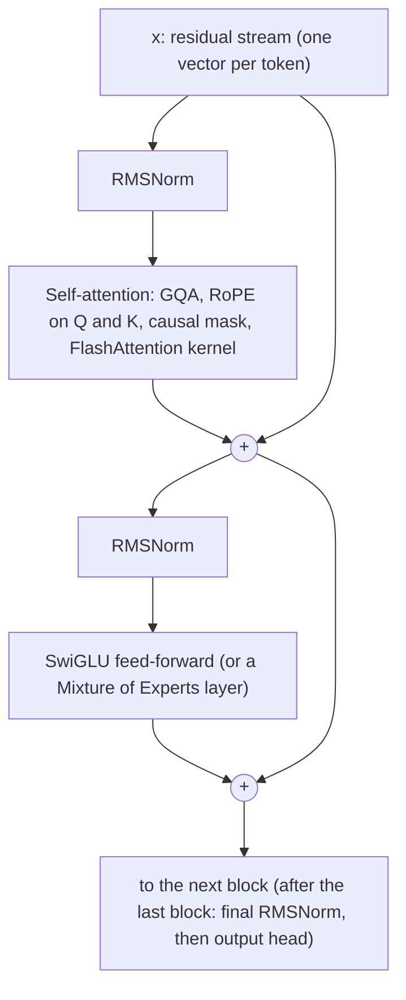
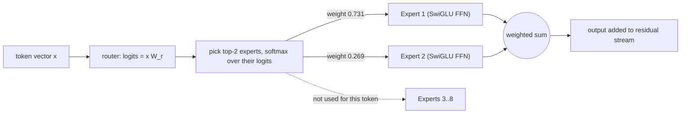

# Modern LLM Architecture: Pre-Norm, RMSNorm, SwiGLU, GQA, MoE and FlashAttention

> **Level:** Beginner to Advanced · **Study time:** ~120 min · **Prerequisites:** [Multi-Head Attention and Causal Masking](04-multi-head-attention-and-causal-masking.md), [The Full Transformer Architecture](05-the-full-transformer-architecture.md), [Positional Encoding: Sinusoidal, Learned, RoPE and ALiBi](06-positional-encoding-sinusoidal-learned-rope-and-alibi.md), helpful: [Vanishing and Exploding Gradients, Initialization, Normalization and Residual Connections](../02-deep-learning/05-vanishing-exploding-gradients-initialization-normalization-and-residuals.md)

## Table of contents

- [Why this matters](#why-this-matters)
- [The running example and notation](#the-running-example-and-notation)
- [2017 vs today: the big picture](#2017-vs-today-the-big-picture)
- [Pre-normalization: moving the norm inside the residual branch](#pre-normalization-moving-the-norm-inside-the-residual-branch)
- [RMSNorm: LayerNorm without the mean](#rmsnorm-layernorm-without-the-mean)
- [SwiGLU: a gated feed-forward network](#swiglu-a-gated-feed-forward-network)
- [RoPE, no biases, bigger vocabularies and other small changes](#rope-no-biases-bigger-vocabularies-and-other-small-changes)
- [Code: a Llama-style decoder block from scratch](#code-a-llama-style-decoder-block-from-scratch)
- [Multi-query and grouped-query attention](#multi-query-and-grouped-query-attention)
- [Sliding-window and other sparse attention patterns](#sliding-window-and-other-sparse-attention-patterns)
- [Mixture of Experts](#mixture-of-experts)
- [FlashAttention: exact attention, fewer memory trips](#flashattention-exact-attention-fewer-memory-trips)
- [Long-context techniques](#long-context-techniques)
- [Beyond Transformers: state-space models, linear attention and hybrids](#beyond-transformers-state-space-models-linear-attention-and-hybrids)
- [Going deeper: reading a model config like a senior engineer](#going-deeper-reading-a-model-config-like-a-senior-engineer)
- [Going deeper: production failure modes and debugging](#going-deeper-production-failure-modes-and-debugging)
- [Common mistakes and misconceptions](#common-mistakes-and-misconceptions)
- [Interview questions and model answers](#interview-questions-and-model-answers)
- [Key takeaways](#key-takeaways)
- [Further reading](#further-reading)
- [Next](#next)

## Why this matters

The Transformer in "Attention Is All You Need" (Vaswani et al., 2017) is not what runs inside Llama, Mistral, Qwen, Gemma or DeepSeek today. The skeleton is the same, but almost every component has been swapped for a version that trains more stably, runs faster, or uses less memory. These changes are not trivia: grouped-query attention is a big part of why a 70B model can serve many users at once, Mixture of Experts is why a model can have hundreds of billions of parameters but cost like a much smaller one per token, and FlashAttention is why long prompts did not bankrupt everyone. Interviewers for senior AI/ML roles routinely ask "what are MQA and GQA?", "how much KV cache does this model need?" and "why does an MoE model still need so much GPU memory?". By the end of this chapter you can answer all of these with numbers.

## The running example and notation

We will reuse one model throughout: a **7B model** (7 billion parameters) shaped like Llama 2 7B and Mistral 7B, which share most of their dimensions.

| Symbol | Meaning | Running example value |
|---|---|---|
| $d$ (or $d_{model}$) | Width of the **residual stream**: the vector each token carries from layer to layer | 4096 |
| $L$ | Number of Transformer layers (blocks) | 32 |
| $H_q$ | Number of query heads | 32 |
| $H_{kv}$ | Number of key/value heads (equals $H_q$ in classic attention) | 32 (MHA), 8 (GQA), 1 (MQA) |
| $d_h$ | Dimension of each head, $d / H_q$ | 128 |
| $N$ | Sequence length in tokens | 4096 |
| $B$ | Batch size (sequences processed together) | 16 |
| $b$ | Bytes per stored number | 2 (FP16 or BF16) |

We will also use a tiny **3-token sentence** ("the cat sat") when a picture of attention helps, and a tiny 4-dimensional vector for hand calculations. The abbreviations MHA, GQA and MQA in the table are defined in the [Multi-query and grouped-query attention](#multi-query-and-grouped-query-attention) section.

**Units:** KiB, MiB and GiB are powers of two ($2^{10}$, $2^{20}$, $2^{30}$ bytes); KB, MB and GB are powers of ten. So 1 GiB $\approx$ 1.074 GB, which is why "32 GiB" appears below as "about 34.4 GB".

> **Recap of the KV cache.** When an LLM generates text one token at a time, every new token must attend to all previous tokens. Recomputing the keys and values of the whole prefix each step would be wasteful, so the model stores them. This stored set of keys and values is the **KV cache**. It is covered fully in [The KV Cache](../06-llm-inference/02-kv-cache-explained.md); here you only need to know that it grows with sequence length and often uses more GPU memory than you expect.

## 2017 vs today: the big picture

> **Analogy:** Think of a car model that has been in production since 2017. The body shape is recognizable, but the engine, brakes, and electronics have each been replaced with better parts. Nobody redesigned the car from scratch; they upgraded it piece by piece.

The table below lists the upgrades. Each gets its own section.

| Component | Original Transformer (2017) | Modern Llama-style decoder (2023 onward) | Main benefit |
|---|---|---|---|
| Overall shape | Encoder-decoder | Decoder-only (see [chapter 7](07-encoder-only-encoder-decoder-and-decoder-only-models.md)) | Simple, scales well for generation |
| Norm placement | Post-norm (after residual add) | **Pre-norm** (before each sublayer) | Stable training of deep stacks |
| Norm type | LayerNorm | **RMSNorm** | Cheaper, works as well |
| Feed-forward | ReLU MLP, hidden size $4d$ | **SwiGLU**, hidden size about $\frac{8}{3}d$ | Better quality at equal parameters |
| Positions | Sinusoidal, added to input | **RoPE**, rotating Q and K inside attention | Relative positions, extendable context |
| Biases | Biases in linear layers | Mostly **no biases** | Simpler, reported more stable at scale |
| Vocabulary | About 37K shared BPE tokens (English-German) | 32K up to 256K tokens | Fewer tokens per text, better multilingual |
| Attention heads | Multi-head (MHA) | **GQA** (or MQA, or MLA) | Much smaller KV cache |
| Attention span | Full | Full, sometimes **sliding window** or mixed local/global | Cheaper long context |
| Feed-forward capacity | Dense | Dense, or **Mixture of Experts** | More parameters at the same per-token compute |
| Attention kernel | Plain matrix multiplies | **FlashAttention** | Faster, memory linear in $N$ |

Here is one modern block. Read it top to bottom; the residual stream $x$ flows down the left.



## Pre-normalization: moving the norm inside the residual branch

### Intuition

A **residual connection** adds a layer's input back to its output: $x + F(x)$, where $F$ is a **sublayer** (attention or feed-forward). It gives the signal and the gradient a "highway" that skips the sublayer. A **normalization layer** rescales a vector so its values have a controlled size, which keeps training numerically well behaved. (Both are taught in [chapter 2.5](../02-deep-learning/05-vanishing-exploding-gradients-initialization-normalization-and-residuals.md).)

The question is where to put the normalization.

> **Analogy:** Imagine a relay of 32 runners passing a baton (the residual stream). In **post-norm**, after each runner, an inspector squeezes the baton back to standard size. In **pre-norm**, each runner gets a resized *copy* to work with, but the original baton keeps traveling untouched, collecting each runner's contribution. With pre-norm, the original baton always reaches the finish line intact.

### Precise definition

$$\text{Post-norm: } x_{l+1} = \text{Norm}\big(x_l + F_l(x_l)\big)$$

$$\text{Pre-norm: } x_{l+1} = x_l + F_l\big(\text{Norm}(x_l)\big)$$

- $x_l$: the residual stream entering layer $l$.
- $F_l$: the sublayer (attention or feed-forward) of layer $l$.
- $\text{Norm}$: LayerNorm or RMSNorm.

```text
      POST-NORM (2017)                     PRE-NORM (GPT-2, Llama, most LLMs)

   x --------------+                     x ---------------------+
   |               |                     |                      |
   v               |                     v                      |
 [sublayer F]      |                   [Norm]                   |
   |               |                     |                      |
   v               |                     v                      |
  (+) <------------+                   [sublayer F]             |
   |                                     |                      |
   v                                     v                      |
 [Norm]   <- the highway is             (+) <-------------------+
   |         normalized every            |
   v         layer                       v   <- the highway is never touched
```

### Why pre-norm trains better

Unroll pre-norm over all layers:

$$x_L = x_0 + \sum_{l=0}^{L-1} F_l\big(\text{Norm}(x_l)\big)$$

The output is the input plus a sum of contributions. The gradient of the loss with respect to $x_0$ always contains a direct identity term, so it cannot vanish through depth. In post-norm, every layer's normalization sits on the main path, and gradients must pass through $2L$ normalizations (two sublayers per layer). Xiong et al. (2020, "On Layer Normalization in the Transformer Architecture") showed that post-norm Transformers have large gradients near the output at initialization, which is why they need a careful **learning-rate warmup** (starting with a tiny learning rate and ramping up). Pre-norm is far more forgiving.

GPT-2 (Radford et al., 2019) already moved to pre-norm, and essentially every large decoder since then uses it.

**One practical consequence:** because the residual stream is never normalized inside the stack, pre-norm models apply one **final norm** after the last block, before the output head. Forgetting it in a from-scratch implementation produces poor results.

### Trade-offs

| | Post-norm | Pre-norm |
|---|---|---|
| Training stability | Fragile at depth, needs warmup | Stable, tolerates larger learning rates |
| Final quality (when it trains) | Some studies report slightly better | Very close, sometimes slightly worse |
| Residual stream magnitude | Kept at unit scale | Grows with depth |
| Extra pieces needed | None | A final norm |

> **Senior insight:** Pre-norm's weakness is that the residual stream keeps growing, so later layers' contributions become relatively small. Variants try to get the best of both: DeepNorm (Wang et al., 2022, "DeepNet") rescales the residual in post-norm, and some recent models (for example Gemma 2) normalize both before and after each sublayer. You do not need the details, but knowing that norm placement is still an active design choice is a good signal in interviews.

## RMSNorm: LayerNorm without the mean

### Intuition

**LayerNorm** (Ba et al., 2016) does two things to each token's vector: it subtracts the mean (re-centering) and divides by the standard deviation (re-scaling), then applies a learned scale $\gamma$ and shift $\beta$. **RMSNorm** (Zhang and Sennrich, 2019, "Root Mean Square Layer Normalization") argues that re-scaling is what matters, so it skips the mean and the shift.

> **Analogy:** LayerNorm is like adjusting a photo's brightness and contrast. RMSNorm only adjusts contrast, and in practice the photo looks just as good.

### Formulas

$$\text{LayerNorm}(x) = \gamma \odot \frac{x - \mu}{\sqrt{\sigma^2 + \epsilon}} + \beta, \qquad \mu = \frac{1}{d}\sum_{i=1}^{d} x_i, \quad \sigma^2 = \frac{1}{d}\sum_{i=1}^{d}(x_i - \mu)^2$$

$$\text{RMSNorm}(x) = g \odot \frac{x}{\text{RMS}(x)}, \qquad \text{RMS}(x) = \sqrt{\frac{1}{d}\sum_{i=1}^{d} x_i^2 + \epsilon}$$

- $x$: one token's vector of length $d$.
- $\mu$, $\sigma^2$: its mean and variance.
- $\text{RMS}(x)$: the **root mean square**, the square root of the average of squared entries.
- $\epsilon$: a tiny constant (like $10^{-6}$) to avoid dividing by zero.
- $\gamma$, $g$: learned per-dimension scales (initialized to 1). $\beta$: learned shift (LayerNorm only).
- $\odot$: elementwise multiplication.

### Worked example

Take $x = [1, 2, 3, 4]$ (so $d = 4$), with $\gamma = g = 1$, $\beta = 0$, and ignore $\epsilon$.

**RMSNorm:**
1. Squares: $1, 4, 9, 16$. Sum $= 30$.
2. Mean of squares: $30 / 4 = 7.5$.
3. $\text{RMS} = \sqrt{7.5} \approx 2.7386$.
4. Divide: $[1, 2, 3, 4] / 2.7386 \approx [0.3651, 0.7303, 1.0954, 1.4606]$.

**LayerNorm:**
1. Mean $\mu = (1+2+3+4)/4 = 2.5$.
2. Deviations: $-1.5, -0.5, 0.5, 1.5$. Squares: $2.25, 0.25, 0.25, 2.25$. Variance $= 5/4 = 1.25$.
3. Standard deviation $= \sqrt{1.25} \approx 1.1180$.
4. Result: $[-1.3416, -0.4472, 0.4472, 1.3416]$.

Both outputs have a controlled size. RMSNorm keeps the vector's direction exactly (it just rescales it, here shrinking it); LayerNorm also shifts it. RMSNorm needs one reduction (sum of squares) instead of two (mean, then variance), has one fewer parameter vector, and is a little cheaper. Because normalization is a memory-bound elementwise operation, saving a pass over the data matters more than the arithmetic count suggests. Llama, Mistral, Qwen and Gemma all use RMSNorm.

> **Common mistake:** Computing RMSNorm in FP16. Squaring large activations can overflow FP16. Reference implementations (for example Hugging Face's Llama code) upcast to FP32 for the norm, then cast back.

## SwiGLU: a gated feed-forward network

### Intuition

Every Transformer block has a **feed-forward network (FFN)**: a small two-layer MLP applied to each token independently. In 2017 it was:

$$\text{FFN}_{\text{ReLU}}(x) = \text{ReLU}(x W_1) W_2$$

where $W_1$ is $d \times 4d$ (expand) and $W_2$ is $4d \times d$ (project back). Roughly two thirds of a dense LLM's non-embedding parameters live in these FFNs ($8d^2$ per layer versus $4d^2$ for attention with MHA), so improving them matters.

A **gated linear unit (GLU)** (Dauphin et al., 2017) computes two projections of the input and multiplies them elementwise: one is the content, the other a **gate** that decides how much of each content dimension passes through.

> **Analogy:** A mixing desk. One set of tracks carries the music (the "up" projection); a second set of faders (the gate) decides how loud each track is. The gate is computed from the same input, so the network learns *input-dependent* volume control.

**SwiGLU** (Shazeer, 2020, "GLU Variants Improve Transformer") uses the **Swish** function, also called **SiLU**, as the gate's activation:

$$\text{Swish}(z) = z \cdot \sigma(z), \qquad \sigma(z) = \frac{1}{1 + e^{-z}}$$

Swish looks like ReLU for large positive $z$, but it is smooth and lets small negative values through instead of cutting them to zero.

### Formula

$$\text{FFN}_{\text{SwiGLU}}(x) = \Big(\text{Swish}(x W_{gate}) \odot (x W_{up})\Big) W_{down}$$

- $x$: one token's vector, length $d$.
- $W_{gate}$, $W_{up}$: two $d \times h$ matrices ($h$ is the hidden size).
- $W_{down}$: an $h \times d$ matrix.
- $\odot$: elementwise product.
- In Hugging Face Llama code these are `gate_proj`, `up_proj`, `down_proj`; in Meta's original code they are `w1`, `w3`, `w2`.

### Why the hidden size is about $\frac{8}{3}d$

SwiGLU has three matrices instead of two. To keep the parameter count equal to the old FFN, shrink $h$:

$$\underbrace{2 \cdot d \cdot 4d}_{\text{ReLU FFN}} = 8d^2 = \underbrace{3 \cdot d \cdot h}_{\text{SwiGLU}} \implies h = \frac{8}{3}d$$

For $d = 4096$: $h = \frac{8}{3} \times 4096 \approx 10922.7$. Llama rounds up to a hardware-friendly multiple of 256, giving 11008. Check: ReLU FFN $= 2 \times 4096 \times 16384 = 134{,}217{,}728$ parameters; SwiGLU $= 3 \times 4096 \times 11008 = 135{,}266{,}304$. Nearly equal. (Later models often choose a larger $h$, for example 14336 in Mistral 7B and Llama 3 8B.)

### Worked example

Let $d = 2$, $h = 2$, and $x = [1, 2]$.

$$W_{gate} = \begin{bmatrix} 1 & 1 \\ 0 & -1 \end{bmatrix}, \quad W_{up} = \begin{bmatrix} 0 & 1 \\ 1 & 1 \end{bmatrix}, \quad W_{down} = \begin{bmatrix} 1 & 0 \\ 0 & 1 \end{bmatrix}$$

1. Gate pre-activation: $x W_{gate} = [1\cdot1 + 2\cdot0,\ 1\cdot1 + 2\cdot(-1)] = [1, -1]$.
2. Up projection: $x W_{up} = [1\cdot0 + 2\cdot1,\ 1\cdot1 + 2\cdot1] = [2, 3]$.
3. Swish: $\sigma(1) \approx 0.7311$, so $\text{Swish}(1) \approx 0.7311$. $\sigma(-1) \approx 0.2689$, so $\text{Swish}(-1) \approx -0.2689$.
4. Gate times content: $[0.7311 \times 2,\ -0.2689 \times 3] = [1.4621, -0.8068]$.
5. Down projection (identity here): output $[1.4621, -0.8068]$.

With ReLU, step 3 would give $[1, 0]$ and the second dimension would be silenced completely. The gate gives finer, input-dependent control.

Why does it work better? Shazeer's paper showed consistent perplexity gains (**perplexity** measures how well a model predicts held-out text; lower is better) and openly declined to give a theory, attributing the success "to divine benevolence." The honest interview answer: gating adds multiplicative interactions, and it empirically wins at equal compute.

## RoPE, no biases, bigger vocabularies and other small changes

### RoPE (brief recap)

**Rotary Position Embedding (RoPE)** (Su et al., 2021, "RoFormer") encodes position by rotating each query and key vector by an angle proportional to the token's position. The dot product between a query at position $m$ and a key at position $n$ then depends only on $m - n$, the relative distance. Positions are applied inside every attention layer, not added once at the input. The full derivation lives in [chapter 6](06-positional-encoding-sinusoidal-learned-rope-and-alibi.md). What matters here: RoPE has a **base** frequency parameter (10,000 originally, 500,000 in Llama 3) that controls how quickly the rotation angles change, and tweaking it is the main lever for context extension (see [Long-context techniques](#long-context-techniques)).

### Removing biases

A **bias** is the constant vector $b$ in a linear layer $xW + b$. PaLM (Chowdhery et al., 2022) removed biases from its dense layers and reported better training stability for large models; Llama followed. Biases add few parameters, and normalization layers already provide offsets, so dropping them costs little. Not every family agrees: Qwen2, for example, keeps a bias in its query, key and value projections. When converting checkpoints between frameworks, a missing or extra bias is a classic source of silent bugs.

### Larger vocabularies

The **vocabulary** is the set of tokens the tokenizer can produce (see [Tokenization](01-tokenization.md)). Llama 2 used 32,000 tokens; Llama 3 moved to 128,256; Gemma uses about 256K.

| Larger vocabulary | Effect |
|---|---|
| Pros | Fewer tokens per text (cheaper, faster, longer effective context), better coverage of non-English text and code |
| Cons | Bigger embedding and output matrices; the output softmax over the vocabulary becomes a noticeable cost; rare tokens get fewer training updates |

Worked: Llama 3 8B's embedding matrix is $128{,}256 \times 4096 = 525{,}336{,}576$ parameters, about 0.5B. Its output head (not tied to the input embedding in that model) is another 0.5B. So roughly 1B of its 8B parameters are vocabulary-related. For a Llama 2 style 32,000 vocabulary at $d = 4096$, each matrix is $131{,}072{,}000$, about 0.13B.

### Other changes you may hear about

- **Tied embeddings:** the output head reuses the input embedding matrix. Common in small models to save parameters.
- **QK-norm:** normalizing queries and keys before the dot product to stop attention logits from blowing up. Used in some recent open models.
- **Parallel blocks:** computing attention and FFN from the same normalized input and adding both at once (GPT-J, PaLM), for better hardware utilization.
- **Logit soft-capping:** squashing attention or output logits with a scaled tanh (used in Gemma 2).
- **Multi-head latent attention (MLA):** DeepSeek-V2's way to compress the KV cache, covered in the GQA section below.

## Code: a Llama-style decoder block from scratch

This combines pre-norm, RMSNorm and SwiGLU, and uses grouped-query attention (explained in the next section). RoPE is left out to keep it short; see [chapter 6](06-positional-encoding-sinusoidal-learned-rope-and-alibi.md) for it.

```python
# pip install torch
import torch
import torch.nn as nn
import torch.nn.functional as F


class RMSNorm(nn.Module):
    def __init__(self, d: int, eps: float = 1e-6):
        super().__init__()
        self.eps = eps
        self.weight = nn.Parameter(torch.ones(d))  # learned scale g

    def forward(self, x: torch.Tensor) -> torch.Tensor:
        x32 = x.float()  # upcast for numerical safety
        rms = torch.sqrt(x32.pow(2).mean(dim=-1, keepdim=True) + self.eps)
        return (x32 / rms).to(x.dtype) * self.weight


class SwiGLU(nn.Module):
    def __init__(self, d: int, h: int):
        super().__init__()
        self.gate = nn.Linear(d, h, bias=False)
        self.up = nn.Linear(d, h, bias=False)
        self.down = nn.Linear(h, d, bias=False)

    def forward(self, x):
        return self.down(F.silu(self.gate(x)) * self.up(x))  # silu == Swish


class GQAttention(nn.Module):
    def __init__(self, d: int, n_q_heads: int, n_kv_heads: int):
        super().__init__()
        assert n_q_heads % n_kv_heads == 0
        self.hq, self.hkv, self.hd = n_q_heads, n_kv_heads, d // n_q_heads
        self.q = nn.Linear(d, n_q_heads * self.hd, bias=False)
        self.k = nn.Linear(d, n_kv_heads * self.hd, bias=False)  # smaller!
        self.v = nn.Linear(d, n_kv_heads * self.hd, bias=False)  # smaller!
        self.o = nn.Linear(n_q_heads * self.hd, d, bias=False)

    def forward(self, x):
        B, T, _ = x.shape
        q = self.q(x).view(B, T, self.hq, self.hd).transpose(1, 2)   # (B, Hq, T, hd)
        k = self.k(x).view(B, T, self.hkv, self.hd).transpose(1, 2)  # (B, Hkv, T, hd)
        v = self.v(x).view(B, T, self.hkv, self.hd).transpose(1, 2)
        group = self.hq // self.hkv
        # Each KV head serves `group` consecutive query heads.
        # (Production kernels avoid materializing this copy.)
        k = k.repeat_interleave(group, dim=1)                        # (B, Hq, T, hd)
        v = v.repeat_interleave(group, dim=1)
        out = F.scaled_dot_product_attention(q, k, v, is_causal=True)
        return self.o(out.transpose(1, 2).reshape(B, T, -1))


class DecoderBlock(nn.Module):
    def __init__(self, d=256, n_q_heads=8, n_kv_heads=2, h=688):
        super().__init__()
        self.attn_norm, self.attn = RMSNorm(d), GQAttention(d, n_q_heads, n_kv_heads)
        self.ffn_norm, self.ffn = RMSNorm(d), SwiGLU(d, h)

    def forward(self, x):
        x = x + self.attn(self.attn_norm(x))  # pre-norm residual 1
        x = x + self.ffn(self.ffn_norm(x))    # pre-norm residual 2
        return x


if __name__ == "__main__":
    torch.manual_seed(0)
    block = DecoderBlock()
    x = torch.randn(2, 3, 256)                # batch 2, "the cat sat" = 3 tokens
    print(block(x).shape)                     # torch.Size([2, 3, 256])

    # Our RMSNorm matches the built-in one (torch.nn.RMSNorm exists in PyTorch 2.4+)
    v = torch.tensor([[1.0, 2.0, 3.0, 4.0]])
    print(RMSNorm(4)(v))                      # approx [[0.3651, 0.7303, 1.0954, 1.4606]]
    print(nn.RMSNorm(4, eps=1e-6)(v))         # same values
```

The standard way to get all of this is simply to load a model: `transformers` ships `LlamaForCausalLM`, `MistralForCausalLM` and others, built from exactly these parts.

## Multi-query and grouped-query attention

### The problem: the KV cache at decode time

In **multi-head attention (MHA)**, each of the $H$ heads has its own query, key and value projections (see [chapter 4](04-multi-head-attention-and-causal-masking.md)). During generation, the model caches every head's keys and values for every past token in every layer. Generation of each new token (the **decode** phase) does very little arithmetic per byte it reads, so it is **memory-bandwidth bound**: speed is limited by how fast the GPU can read weights and KV cache from memory, not by how fast it can multiply (see [GPU Fundamentals](../06-llm-inference/03-gpu-fundamentals-compute-bound-vs-memory-bound.md)). A big KV cache therefore hurts twice: it limits how many users fit on a GPU, and it slows every decode step. By contrast, the **prefill** phase processes the whole prompt in one parallel pass, does a lot of arithmetic per byte, and is usually **compute-bound**, so shrinking the KV cache helps it much less.

### Intuition

> **Analogy:** A library with 32 researchers (query heads). In MHA, each researcher has a private copy of the whole card catalog (keys and values). In **MQA**, all 32 share one catalog. In **GQA**, they split into 8 study groups of 4, and each group shares one catalog. Everyone still asks their own questions (queries stay separate); only the reference material is shared.

### Precise definitions

- **Multi-query attention (MQA)** (Shazeer, 2019, "Fast Transformer Decoding: One Write-Head is All You Need"): all query heads share a *single* key head and a *single* value head. $H_{kv} = 1$.
- **Grouped-query attention (GQA)** (Ainslie et al., 2023, "GQA: Training Generalized Multi-Query Transformer Models from Multi-Head Checkpoints"): query heads are split into $G$ groups; each group shares one key head and one value head. $H_{kv} = G$, with $1 < G < H_q$.
- MHA and MQA are the two extremes of GQA: $G = H_q$ gives MHA, $G = 1$ gives MQA.

```text
 MHA: 8 query heads, 8 KV heads      GQA: 8 query heads, 2 KV heads     MQA: 8 query heads, 1 KV head

 Q:  q1 q2 q3 q4 q5 q6 q7 q8         Q:  q1 q2 q3 q4   q5 q6 q7 q8       Q:  q1 q2 q3 q4 q5 q6 q7 q8
      |  |  |  |  |  |  |  |              \  \  /  /    \  \  /  /            \  \  \  \ /  /  /  /
 KV: kv1 .. .. .. .. .. .. kv8       KV:     kvA           kvB           KV:           kvA

 KV cache: 8 units                   KV cache: 2 units (4x smaller)      KV cache: 1 unit (8x smaller)
```

Mechanically, query head $i$ uses KV head $\lfloor i / (H_q / H_{kv}) \rfloor$. Each query head still computes its own attention pattern, because its query differs; heads in a group just look up the same keys and read the same values.

**Worked mapping (0-indexed):** with $H_q = 32$ and $H_{kv} = 8$, the group size is $32 / 8 = 4$. Query heads 0 to 3 use KV head 0, heads 4 to 7 use KV head 1, and query head 13 uses KV head $\lfloor 13 / 4 \rfloor = 3$. Consecutive query heads share a KV head; this is why the code above uses `repeat_interleave` (copies `kv0, kv0, kv0, kv0, kv1, ...`) and not `repeat` (which would tile `kv0, kv1, ..., kv7, kv0, ...` and silently pair query heads with the wrong keys).

### Formula: KV cache size

$$\text{KV bytes per token} = 2 \times L \times H_{kv} \times d_h \times b$$

$$\text{KV bytes total} = \text{KV bytes per token} \times N \times B$$

- $2$: one tensor for keys, one for values.
- $L$: layers. $H_{kv}$: key/value heads. $d_h$: head dimension. $b$: bytes per number.
- $N$: tokens per sequence. $B$: sequences in the batch.

### Worked example: our 7B model in BF16

$L = 32$, $d_h = 128$, $b = 2$.

| Variant | $H_{kv}$ | Per token | Per 4096-token sequence | Batch of 16 sequences |
|---|---|---|---|---|
| MHA | 32 | $2 \times 32 \times 32 \times 128 \times 2 = 524{,}288$ B = 512 KiB | $512 \text{ KiB} \times 4096 = 2$ GiB | 32 GiB |
| GQA-8 | 8 | $2 \times 32 \times 8 \times 128 \times 2 = 131{,}072$ B = 128 KiB | 512 MiB | 8 GiB |
| MQA | 1 | $2 \times 32 \times 1 \times 128 \times 2 = 16{,}384$ B = 16 KiB | 64 MiB | 1 GiB |

Step by step for MHA: $2 \times 32 = 64$; $64 \times 32 = 2048$; $2048 \times 128 = 262{,}144$; $262{,}144 \times 2 = 524{,}288$ bytes, which is exactly 512 KiB. Times 4096 tokens: $524{,}288 \times 4096 = 2{,}147{,}483{,}648$ bytes $= 2$ GiB. Times 16: 32 GiB.

Put that next to the model weights: 7B parameters at 2 bytes each is about 14 GB. With MHA, the KV cache for just 16 users at 4K context is more than twice the size of the model. With GQA-8 it is a bit over half the model's size. This is a major reason why Llama 2 70B, Mistral 7B and the Llama 3 family use GQA with 8 KV heads.

**Speed, not just memory (illustrative numbers).** Each decode step reads the whole KV cache. At an illustrative 2 TB/s of memory bandwidth (roughly the class of an A100 80GB), reading 32 GiB (about 34.4 GB) takes about 17 ms per step; reading 8 GiB (about 8.6 GB) takes about 4.3 ms. The weights (about 14 GB) add about 7 ms either way. So GQA cuts the per-token time for this batch from roughly 24 ms to roughly 11 ms, before any other optimization.

### Effect on parameter count

Only $W_K$ and $W_V$ shrink. Per layer, with $d = 4096$:

- MHA: $W_Q, W_K, W_V, W_O$ are each $4096 \times 4096 = 16{,}777{,}216$, total $67{,}108{,}864$.
- GQA-8: $W_K$ and $W_V$ become $4096 \times 1024 = 4{,}194{,}304$ each (since $8 \times 128 = 1024$), total $16{,}777{,}216 \times 2 + 4{,}194{,}304 \times 2 = 41{,}943{,}040$.

Model builders typically spend the saved parameters elsewhere, for example on a wider FFN.

### The quality trade-off

| | MHA | GQA | MQA |
|---|---|---|---|
| KV cache size | $H_q$ units (largest) | $G$ units | 1 unit (smallest) |
| Decode speed | Slowest | Close to MQA | Fastest |
| Quality | Best (baseline) | Close to MHA | Can degrade measurably; some reports of training instability |
| Tensor parallelism | Heads split cleanly | Clean if $G$ is divisible by GPU count | The single KV head must be replicated on every GPU |
| Typical users | BERT, GPT-2, Llama 2 7B/13B | Llama 2 70B, Llama 3, Mistral, Qwen | PaLM, Falcon-7B |

The GQA paper's key findings: GQA with an intermediate number of groups gets quality close to MHA with speed close to MQA, and an existing MHA checkpoint can be converted (by **mean-pooling** each group's key and value projection weights into one) and then **uptrained** with only a small fraction (they used about 5%) of the original pretraining compute.

> **Senior insight:** **Tensor parallelism** splits each layer's weight matrices across GPUs; for attention the natural split is by heads. GQA fits it nicely. With 8 KV heads on 8 GPUs, each GPU holds exactly one KV head and its 4 query heads, with no duplication. With MQA on 8 GPUs, every GPU needs a copy of the one KV head, so the per-GPU KV saving shrinks. That is part of why 8 KV heads became a common choice.

### Going further: multi-head latent attention (MLA)

DeepSeek-V2 (DeepSeek-AI, 2024) introduced **multi-head latent attention (MLA)**. Instead of sharing heads, it compresses each token's keys and values into one small **latent vector** (a learned low-dimensional summary), caches only that latent, and reconstructs per-head keys and values from it (the up-projection can be folded into other matrices at inference). It aims for MQA-like cache size with MHA-like quality. One wrinkle: plain RoPE does not commute with that compression, so MLA keeps a small separate RoPE component. Mentioning MLA as "the next step after GQA" shows you follow the field.

## Sliding-window and other sparse attention patterns

### Intuition

Full causal attention lets every token look at every earlier token, so cost grows with $N^2$ (see [chapter 3](03-attention-mechanism-step-by-step.md)). **Sparse attention** means each token attends to only a chosen subset of positions. The most common pattern is **sliding-window attention (SWA)**, also called **local attention**: each token attends only to the previous $W$ tokens (including itself).

> **Analogy:** Reading a book through a window that shows only the last page. You cannot see chapter 1 directly, but your memory of page 2 was shaped by page 1, and so on. Information still travels; it just travels hop by hop.

### The mask

With $N = 6$ tokens and window $W = 3$ (1 = allowed, . = masked):

```text
            keys ->  t1  t2  t3  t4  t5  t6
 query t1             1   .   .   .   .   .
 query t2             1   1   .   .   .   .
 query t3             1   1   1   .   .   .
 query t4             .   1   1   1   .   .     <- t1 has slid out of the window
 query t5             .   .   1   1   1   .
 query t6             .   .   .   1   1   1
```

Each row has at most $W$ ones, so cost is $O(N \cdot W)$ instead of $O(N^2)$.

### Receptive field through depth

A token at layer 2 sees outputs of layer 1, which each already mixed in $W$ tokens. After $L$ layers, information can propagate roughly $L \times W$ tokens back. Mistral 7B (Jiang et al., 2023) uses $W = 4096$ with 32 layers and notes a theoretical span of about $32 \times 4096 = 131{,}072$ tokens. "Theoretical" matters: information that hops through many layers gets diluted, so the model does not recall distant details as precisely as full attention would.

### Worked cost example

For $N = 32{,}768$ and $W = 4096$, count query-key pairs per head per layer:

- Full causal attention: about $N^2 / 2 = 32{,}768^2 / 2 = 536{,}870{,}912$ pairs.
- Sliding window: about $N \times W = 32{,}768 \times 4096 = 134{,}217{,}728$ pairs.
- Ratio: $536{,}870{,}912 / 134{,}217{,}728 = 4$. Four times less attention work, and the ratio grows as $N$ grows.

### The rolling-buffer KV cache

Since a token never needs keys older than $W$ positions, the cache can be a fixed-size **ring buffer**: the token at position $i$ is stored in slot $i \bmod W$, overwriting the token from $W$ steps ago. KV memory per sequence stops growing at $W$ tokens. For our 7B model with GQA-8, that caps the cache at $128 \text{ KiB} \times 4096 = 512$ MiB per sequence, no matter how long the conversation.

### Other patterns

| Pattern | What each token sees | Example | Notes |
|---|---|---|---|
| Sliding window | Last $W$ tokens | Mistral 7B | Simple; bounded KV cache |
| Interleaved local/global | Some layers windowed, some full | Gemma 2 alternates local and global layers | Keeps exact long-range recall in the global layers, saves cost in local ones |
| Strided / fixed sparse | Local block plus every $k$-th token | Sparse Transformer (Child et al., 2019) | Early way to reach long sequences |
| Local + global tokens | Window plus a few special tokens visible to all | Longformer (Beltagy et al., 2020) | Good for long-document encoders |
| Local + global + random | Adds random links | BigBird (Zaheer et al., 2020) | Proven to preserve some theoretical expressiveness |
| Attention sinks + window | First few tokens plus recent window | StreamingLLM (Xiao et al., 2023) | Inference trick for endless streams |

> **Common mistake:** Assuming a sparse pattern is automatically faster. GPUs love dense, regular matrix blocks. A sparse pattern only pays off if the **kernel** (the GPU program that computes attention) skips whole tiles; irregular sparsity can be slower than dense attention with FlashAttention. Sliding windows are popular precisely because they map cleanly onto tiles.

## Mixture of Experts

### Intuition

> **Analogy:** A hospital. A dense model is one doctor who handles every patient alone. A **Mixture of Experts** is a hospital with many specialists and a triage nurse. Each patient (token) sees only two specialists, chosen by the nurse. The hospital employs many doctors (huge total parameters), but each visit costs only two consultations (small per-token compute). The catch: all the specialists must be in the building all the time, even if some are rarely called.

### Precise definition

A **Mixture of Experts (MoE)** layer replaces the single FFN in a block with $E$ parallel FFNs called **experts**, plus a small **router** (also called a **gate**) that decides which experts each token uses. With **top-k routing**, each token is sent to the $k$ experts with the highest router scores, and their outputs are combined with weights. Attention layers usually stay dense; only the FFNs become experts.

The modern form comes from Shazeer et al. (2017, "Outrageously Large Neural Networks: The Sparsely-Gated Mixture-of-Experts Layer"), scaled up in GShard (Lepikhin et al., 2020) and the Switch Transformer (Fedus, Zoph and Shazeer, 2021, top-1 routing). Mixtral 8x7B (Jiang et al., 2024) popularized it for open LLMs.



### Formula

$$\text{logits} = x W_r, \qquad \mathcal{T} = \text{TopK}(\text{logits}, k)$$

$$y = \sum_{i \in \mathcal{T}} g_i \, E_i(x), \qquad g_i = \frac{e^{\text{logit}_i}}{\sum_{j \in \mathcal{T}} e^{\text{logit}_j}}$$

- $x$: the token's vector (length $d$).
- $W_r$: router weights, $d \times E$. Tiny compared with the experts.
- $\mathcal{T}$: the set of $k$ chosen expert indices.
- $E_i(x)$: output of expert $i$ (an ordinary FFN, usually SwiGLU).
- $g_i$: the gate weight. Here (Mixtral style) softmax is taken over the chosen experts only, so the $k$ weights sum to 1. Some models take softmax over all experts first and then select; both exist.

### Worked example: routing one token

Four experts, $k = 2$, router logits $[2.0, 1.0, 0.5, -1.0]$.

1. Top 2: experts 1 and 2 (logits 2.0 and 1.0).
2. $e^{2.0} \approx 7.389$, $e^{1.0} \approx 2.718$, sum $\approx 10.107$.
3. $g_1 = 7.389 / 10.107 \approx 0.731$, $g_2 = 2.718 / 10.107 \approx 0.269$.
4. $y = 0.731 \cdot E_1(x) + 0.269 \cdot E_2(x)$. Experts 3 and 4 do no work for this token.

### Worked example: total vs active parameters (Mixtral-8x7B-like)

**Total parameters** are everything stored. **Active parameters** are those actually used to process one token. Mixtral 8x7B's published shape: $L = 32$, $d = 4096$, expert hidden size $h = 14336$, $E = 8$ experts, top-$k = 2$, GQA with 8 KV heads, vocabulary 32,000.

1. **One expert** (SwiGLU, 3 matrices): $3 \times 4096 \times 14336 = 3 \times 58{,}720{,}256 = 176{,}160{,}768$.
2. **All experts, one layer:** $8 \times 176{,}160{,}768 = 1{,}409{,}286{,}144$.
3. **All experts, all layers:** $32 \times 1{,}409{,}286{,}144 = 45{,}097{,}156{,}608$ (about 45.1B).
4. **Attention, all layers:** $41{,}943{,}040$ per layer (computed in the GQA section) $\times 32 = 1{,}342{,}177{,}280$ (about 1.34B).
5. **Embedding + output head:** $2 \times 32{,}000 \times 4096 = 262{,}144{,}000$ (about 0.26B).
6. **Routers:** $32 \times 4096 \times 8 = 1{,}048{,}576$ (about 0.001B). Norms are negligible.

**Total** $\approx 45.10 + 1.34 + 0.26 + 0.001 \approx 46.7$B.

**Active per token:** only 2 experts per layer: $32 \times 2 \times 176{,}160{,}768 = 11{,}274{,}289{,}152$, plus attention, embeddings and routers: $11.27 + 1.34 + 0.26 + 0.001 \approx 12.9$B.

These match Mistral AI's published figures (about 47B total, about 13B active). Note the name "8x7B" is misleading: it is not $8 \times 7 = 56$B, because the experts share attention and embeddings.

**What this means in practice:**

| Quantity | Scales with | Mixtral-like value |
|---|---|---|
| Compute per token (forward) | Active parameters: about 2 **FLOPs** (floating-point operations: one multiply, one add) per active parameter | About $2 \times 12.9 = 25.8$ GFLOPs |
| Weight memory in BF16 | Total parameters | About $46.7 \times 2 = 93.4$ GB: does not fit on one 80 GB GPU |
| Knowledge capacity | Roughly total parameters, but not 1:1 | Typically better than a 13B dense model, worse than a 47B dense model |

Newer models push this further. DeepSeek-V3 (2024) reports 671B total and about 37B active parameters. Qwen3 names models by both numbers, for example Qwen3-235B-A22B, meaning 235B total and 22B active.

### Load balancing

Left alone, routers **collapse**: a few experts get slightly better early, get more tokens, improve further, and the rest starve. This wastes capacity and, in distributed serving, makes some GPUs overloaded while others idle.

The Switch Transformer **auxiliary load-balancing loss**:

$$\mathcal{L}_{aux} = \alpha \cdot E \cdot \sum_{i=1}^{E} f_i \, P_i$$

- $E$: number of experts.
- $f_i$: fraction of routing assignments in the batch that went to expert $i$ (a hard count).
- $P_i$: average router probability given to expert $i$ over the batch (differentiable, so gradients flow through it).
- $\alpha$: a small coefficient (around $10^{-2}$ in the Switch paper) so this does not dominate the main loss.

The sum is smallest when routing is uniform.

**Worked example** ($E = 4$, ignore $\alpha$):

- Balanced: $f_i = P_i = 0.25$ for all. $\sum f_i P_i = 4 \times 0.0625 = 0.25$. Times $E$: $1.0$.
- Collapsed: $f = [1, 0, 0, 0]$, $P = [0.97, 0.01, 0.01, 0.01]$. $\sum f_i P_i = 1 \times 0.97 = 0.97$. Times $E$: $3.88$.

The collapsed router is penalized almost 4 times more, pushing probability mass toward underused experts.

Other balancing tools: a **router z-loss** (ST-MoE, Zoph et al., 2022) that keeps router logits small for numerical stability, and DeepSeek-V3's **auxiliary-loss-free** balancing, which adds a per-expert bias to the routing scores used for top-k selection (not to the gate weights) and nudges it down for overloaded experts and up for underloaded ones, largely avoiding the quality cost of a strong auxiliary loss (DeepSeek-V3 still keeps a very small sequence-level balance loss as a safeguard).

### Expert capacity and token dropping

For efficient batched execution, many systems give each expert a fixed **capacity** (number of token slots per batch):

$$\text{capacity} = \frac{\text{tokens} \times k}{E} \times \text{capacity factor}$$

Example: 1024 tokens, $k = 2$, $E = 8$, capacity factor 1.25. Average load $= 1024 \times 2 / 8 = 256$; capacity $= 256 \times 1.25 = 320$. If 400 assignments go to one expert, 80 are **dropped**: those tokens skip that expert. With top-1 routing (Switch) a dropped token gets no FFN update in that layer and only the residual connection carries it forward; with top-2 it may still be processed by its other chosen expert. Many modern inference engines use "dropless" grouped matrix-multiply kernels instead, which handle uneven loads without dropping.

### Fine-grained and shared experts

DeepSeekMoE (Dai et al., 2024) splits experts into many smaller ones (so routing can mix more specialized pieces) and adds **shared experts** that every token always uses (to hold common knowledge so routed experts need not duplicate it). This style is now common in large open MoE models.

### Code: a top-k MoE layer from scratch

```python
# pip install torch
import torch
import torch.nn as nn
import torch.nn.functional as F


class SwiGLU(nn.Module):
    def __init__(self, d, h):
        super().__init__()
        self.gate, self.up = nn.Linear(d, h, bias=False), nn.Linear(d, h, bias=False)
        self.down = nn.Linear(h, d, bias=False)

    def forward(self, x):
        return self.down(F.silu(self.gate(x)) * self.up(x))


class TopKMoE(nn.Module):
    def __init__(self, d=64, h=128, n_experts=8, k=2):
        super().__init__()
        self.E, self.k = n_experts, k
        self.router = nn.Linear(d, n_experts, bias=False)
        self.experts = nn.ModuleList(SwiGLU(d, h) for _ in range(n_experts))

    def forward(self, x):                                  # x: (tokens, d)
        logits = self.router(x)                            # (T, E)
        top_val, top_idx = logits.topk(self.k, dim=-1)     # (T, k)
        gates = F.softmax(top_val, dim=-1)                 # renormalize over chosen k
        out = torch.zeros_like(x)
        for e, expert in enumerate(self.experts):
            tok, slot = (top_idx == e).nonzero(as_tuple=True)  # tokens routed to e
            if tok.numel() == 0:
                continue                                   # idle expert: no compute
            y = expert(x[tok]) * gates[tok, slot].unsqueeze(-1)
            out.index_add_(0, tok, y)                      # scatter back
        # Switch-style auxiliary load-balancing loss
        probs = F.softmax(logits, dim=-1)                  # (T, E)
        counts = torch.bincount(top_idx.flatten(), minlength=self.E).float()
        f = counts / counts.sum()                          # fraction of assignments
        P = probs.mean(dim=0)                              # mean router prob
        aux = self.E * (f * P).sum()                       # about 1.0 when balanced
        return out, aux


torch.manual_seed(0)
moe = TopKMoE()
tokens = torch.randn(10, 64)
y, aux = moe(tokens)
print(y.shape, round(aux.item(), 3))   # torch.Size([10, 64]) and a value near 1
total = sum(p.numel() for p in moe.parameters())
active = moe.router.weight.numel() + moe.k * sum(p.numel() for p in moe.experts[0].parameters())
print(total, active)                   # 197120 49664  (total vs active per token)
```

Check the last line by hand: one expert has $3 \times 64 \times 128 = 24{,}576$ parameters; 8 experts $= 196{,}608$; router $= 64 \times 8 = 512$; total $= 197{,}120$. Active $= 512 + 2 \times 24{,}576 = 49{,}664$.

The loop over experts is for clarity. Production systems use fused grouped-GEMM kernels (GEMM = general matrix multiply; a grouped GEMM runs many differently sized expert matmuls in one launch) and, across GPUs, **expert parallelism**: different experts live on different GPUs, and tokens are shipped to them with an **all-to-all** communication step (see [Distributed Training](../02-deep-learning/10-distributed-training-and-training-memory.md)).

### Serving implications

| Concern | Why it happens | What teams do |
|---|---|---|
| All experts must be in memory | Any token may pick any expert, and you do not know which until the router runs | Multi-GPU expert parallelism, quantization (see [Number Formats](../07-model-compression/01-number-formats-and-model-memory.md)), or CPU offload for hobby setups (slow) |
| Batch size changes the speedup | At batch 1, decode reads only the active experts' weights. At large batch, the union of tokens touches nearly every expert, so each step reads nearly all weights | Benchmark at your real batch size; MoE wins most on compute-bound, high-throughput serving |
| Load imbalance | Popular experts become stragglers; the slowest GPU sets the pace | Balanced training, replicating "hot" experts, capacity limits |
| Communication | All-to-all between GPUs every MoE layer | Fast interconnect (NVLink), keeping experts within a node when possible |
| Fine-tuning | Routers can drift or collapse; experts may overfit small datasets | Freeze or regularize the router, keep the aux loss on, lower learning rates |

> **Interview tip:** If asked "is a 47B-total, 13B-active MoE as cheap as a 13B dense model?", answer: per-token FLOPs, yes, roughly. Memory, no: it needs memory for all 47B. Latency at small batch, close to the 13B (it reads only active experts) plus routing and communication overhead. Throughput at large batch, it reads nearly all weights each step, so its memory traffic looks more like the 47B's, but its compute stays like the 13B's.

## FlashAttention: exact attention, fewer memory trips

### Intuition: the bottleneck is moving data, not math

A GPU has two kinds of memory that matter here:

- **HBM (high-bandwidth memory):** the large main GPU memory (tens of GB). Fast by normal standards, but slow relative to compute.
- **SRAM (on-chip shared memory):** tiny (on the order of a couple hundred KB per streaming multiprocessor, about 20 MB in total on an A100) but roughly an order of magnitude faster.

> **Analogy:** A chef (the GPU's compute units) with a small cutting board (SRAM) and a big pantry down the hall (HBM). Standard attention chops one ingredient, walks it back to the pantry, walks back to fetch it for the next step, and repeats. FlashAttention brings a batch of ingredients to the board, does every step on it (score, mask, softmax, multiply by values), and only walks the finished dish back. Same recipe, same dish, far less walking.

Standard attention is computed as separate steps, each reading from and writing to HBM:

```text
 1. S = Q K^T / sqrt(d_h)     write N x N matrix S to HBM
 2. S = mask(S)               read S, write S
 3. P = softmax(S)            read S, write N x N matrix P
 4. O = P V                   read P, write O
```

Steps 2 and 3 do very little math per byte, so they are memory-bound. And the $N \times N$ matrices are huge. For our model at $N = 8192$ in FP16: one head's score matrix is $8192^2 \times 2 = 134{,}217{,}728$ bytes $= 128$ MiB; 32 heads make 4 GiB per layer per sequence, just for scores.

### Precise definition

**FlashAttention** (Dao, Fu, Ermon, Rudra and Ré, 2022, "FlashAttention: Fast and Memory-Efficient Exact Attention with IO-Awareness") is an **IO-aware** attention algorithm: designed around the cost of reading and writing memory, not just arithmetic. It:

1. **Tiles** Q, K and V into blocks that fit in SRAM.
2. Computes scores, masking, softmax and the multiply by V for each block pair inside one fused **kernel** (a single GPU program), never writing the $N \times N$ matrix to HBM.
3. Uses the **online softmax** trick to combine blocks correctly even though no block sees the full row.
4. In the backward pass, **recomputes** the attention scores from Q, K, V (plus a small saved per-row statistic) instead of storing the $N \times N$ probabilities. This adds FLOPs but saves far more memory traffic.

It is **exact**: it computes the same mathematical function as standard attention, unlike approximate methods (low-rank, sparse, linear) that change the function. Outputs differ from a naive implementation only by floating-point rounding.

### The online softmax trick

Softmax for one query row needs the maximum and the sum over *all* scores. The trick (Milakov and Gimelshein, 2018, "Online normalizer calculation for softmax") keeps three running values while visiting blocks of keys:

- $m$: the largest score seen so far.
- $\ell$: the running sum of $e^{s_j - m}$.
- $\text{acc}$: the running sum of $e^{s_j - m} v_j$ (unnormalized output).

When a new block arrives with scores $s_j$:

$$m_{new} = \max\big(m_{old}, \max_j s_j\big)$$

$$\ell_{new} = \ell_{old} \cdot e^{m_{old} - m_{new}} + \sum_j e^{s_j - m_{new}}$$

$$\text{acc}_{new} = \text{acc}_{old} \cdot e^{m_{old} - m_{new}} + \sum_j e^{s_j - m_{new}} v_j$$

At the end: $\text{output} = \text{acc} / \ell$.

- The factor $e^{m_{old} - m_{new}}$ **rescales** old results whenever a bigger maximum appears, so everything ends up measured against the same final maximum.
- Subtracting the max keeps exponentials from overflowing.

### Worked example: same answer in two blocks

One query, three keys with scores $s = [2, 1, 3]$ and scalar values $v = [1, 2, 3]$.

**Direct softmax:**
1. Max $= 3$. Exponentials: $e^{-1} \approx 0.3679$, $e^{-2} \approx 0.1353$, $e^{0} = 1$.
2. Sum $\approx 1.5032$.
3. Weighted values: $0.3679 \times 1 + 0.1353 \times 2 + 1 \times 3 \approx 0.3679 + 0.2707 + 3 = 3.6386$.
4. Output $\approx 3.6386 / 1.5032 \approx 2.4205$.

**Online, block 1 = scores $[2, 1]$, block 2 = score $[3]$:**
1. After block 1: $m = 2$. $\ell = e^{0} + e^{-1} \approx 1 + 0.3679 = 1.3679$. $\text{acc} = 1 \times 1 + 0.3679 \times 2 \approx 1.7358$.
2. Block 2 has max 3, so $m_{new} = 3$ and the rescale factor is $e^{2 - 3} \approx 0.3679$.
3. $\ell = 1.3679 \times 0.3679 + e^{0} \approx 0.5032 + 1 = 1.5032$.
4. $\text{acc} = 1.7358 \times 0.3679 + 1 \times 3 \approx 0.6386 + 3 = 3.6386$.
5. Output $= 3.6386 / 1.5032 \approx 2.4205$. Identical.

### Code: tiled attention in NumPy

```python
# pip install numpy
import numpy as np


def naive_attention(Q, K, V):
    S = Q @ K.T / np.sqrt(Q.shape[1])              # full N x N scores
    P = np.exp(S - S.max(axis=1, keepdims=True))
    P /= P.sum(axis=1, keepdims=True)
    return P @ V


def tiled_attention(Q, K, V, block=4):
    """FlashAttention-style forward pass (no causal mask), one tile at a time."""
    N, d = Q.shape
    out = np.zeros((N, V.shape[1]))
    for i in range(0, N, block):                   # outer loop: query blocks
        q = Q[i:i + block]
        m = np.full(q.shape[0], -np.inf)           # running max per row
        l = np.zeros(q.shape[0])                   # running sum of exp
        acc = np.zeros((q.shape[0], V.shape[1]))   # running unnormalized output
        for j in range(0, N, block):               # inner loop: key/value blocks
            s = q @ K[j:j + block].T / np.sqrt(d)  # only a block x block tile
            m_new = np.maximum(m, s.max(axis=1))
            p = np.exp(s - m_new[:, None])
            scale = np.exp(m - m_new)              # rescale old partial results
            l = l * scale + p.sum(axis=1)
            acc = acc * scale[:, None] + p @ V[j:j + block]
            m = m_new
        out[i:i + block] = acc / l[:, None]
    return out


rng = np.random.default_rng(0)
Q, K, V = (rng.standard_normal((10, 8)) for _ in range(3))
print(np.allclose(naive_attention(Q, K, V), tiled_attention(Q, K, V)))  # True
```

The tiled version never holds more than a `block x block` score tile. In real FlashAttention those tiles live in SRAM, and the whole inner loop is one fused GPU kernel.

### Why it is faster and uses less memory

| | Standard attention | FlashAttention |
|---|---|---|
| FLOPs | $O(N^2 d_h)$ | $O(N^2 d_h)$ forward; somewhat more in backward due to recomputation |
| Extra memory | $O(N^2)$ for S and P | $O(N)$ (output plus per-row statistics) |
| HBM traffic | Dominated by reading/writing $N \times N$ matrices | Much lower; the paper analyzes it as $O(N^2 d_h^2 / M)$ for SRAM size $M$ |
| Result | Exact | Exact (up to floating-point rounding) |

The key interview sentence: **FlashAttention does not reduce the quadratic compute; it reduces memory traffic and memory footprint, and since attention was memory-bound, wall-clock time drops.** The linear memory is what made training with long sequences practical.

### Versions and relatives

- **FlashAttention-2** (Dao, 2023): better work partitioning across GPU thread blocks and warps, parallelizing over sequence length too, and fewer non-matmul operations.
- **FlashAttention-3** (Shah et al., 2024): targets NVIDIA Hopper GPUs (H100), using their asynchronous data movement and FP8 support.
- **Flash-Decoding:** during decode there is only one query per sequence, so there is little to parallelize over; this variant splits the *keys and values* across thread blocks and combines partial results with the same online-softmax math. It helps long-context decode at small batch.
- **PagedAttention** (vLLM) solves a different problem, KV cache memory fragmentation; it is covered in [Batching, Continuous Batching and PagedAttention](../06-llm-inference/04-batching-continuous-batching-and-paged-attention.md).

### Using it in practice

```python
# pip install torch transformers
import torch
import torch.nn.functional as F

# PyTorch picks a fused backend (FlashAttention, memory-efficient, or plain math)
# automatically based on GPU, dtype, shapes and mask.
if torch.cuda.is_available():
    q = torch.randn(1, 32, 4096, 128, device="cuda", dtype=torch.bfloat16)
    k, v = torch.randn_like(q), torch.randn_like(q)
    out = F.scaled_dot_product_attention(q, k, v, is_causal=True)
    print(out.shape)  # torch.Size([1, 32, 4096, 128])

# Hugging Face: choose the attention implementation when loading.
# Version-fragile: argument names evolve (newer releases, including 5.x, use
# `dtype`; `torch_dtype` is the older, deprecated name), and "flash_attention_2" needs the
# separate flash-attn package and a supported GPU.
# from transformers import AutoModelForCausalLM
# model = AutoModelForCausalLM.from_pretrained(
#     "mistralai/Mistral-7B-v0.1",
#     dtype=torch.bfloat16,                # older releases: torch_dtype=
#     attn_implementation="sdpa",          # or "flash_attention_2", or "eager"
# )
```

PyTorch 2.5 and later also accept an `enable_gqa=True` flag in `scaled_dot_product_attention` (with K and V having $H_{kv}$ heads and Q having $H_q$ heads), so you do not have to repeat KV heads yourself; which fused backends support it varies by version and hardware, so check your version's docs before relying on it.

## Long-context techniques

"Long context" means handling prompts of tens or hundreds of thousands of tokens. Three separate problems must be solved.

### Problem 1: positions the model never saw

A model trained on 4096-token sequences has never seen the RoPE rotation angles that position 10,000 produces in its slow-rotating (low-frequency) dimensions; the fast-rotating dimensions wrap around many times within the trained length, so they are less of a problem. Feeding it longer inputs usually makes quality collapse. Fixes:

| Technique | Idea | Notes |
|---|---|---|
| **Position Interpolation** (Chen et al., 2023) | Squeeze new positions into the trained range: multiply positions by $L_{train}/L_{target}$ | Needs a short fine-tune; slightly blurs nearby positions |
| **NTK-aware scaling** | Increase the RoPE base so low frequencies stretch while high frequencies (local detail) change little | Came from the open-source community; works even with little or no fine-tuning |
| **YaRN** (Peng et al., 2023) | Treat frequency bands differently (interpolate some, keep others) plus an attention temperature tweak | Widely supported in inference engines |
| **Large base from the start** | Pretrain with a large RoPE base (Llama 3 uses 500,000) and then continue training on long documents | The common modern recipe |

**Worked example (Position Interpolation):** trained length 4096, target 16,384. Scale $= 4096 / 16384 = 0.25$. Token at position 10,000 is given the rotation angle of position $10{,}000 \times 0.25 = 2{,}500$, which the model has seen. Position 16,383 maps to about 4,095.75, still inside the trained range.

### Problem 2: cost

- **Prefill compute** (processing the prompt) is $O(N^2)$ in attention. FlashAttention makes it fit and run fast; it does not make it linear.
- **KV cache** grows linearly with $N$. At 128K tokens, our 7B model with GQA-8 needs $128 \text{ KiB} \times 131{,}072 = 16$ GiB per sequence. With MHA it would be 64 GiB.
- Tools: GQA/MQA/MLA, sliding windows or interleaved local/global layers, KV cache quantization (for example to FP8), and **context parallelism**: splitting one sequence across GPUs. **Ring Attention** (Liu et al., 2023) passes K/V blocks around a ring of GPUs while each computes its share, again using online softmax to combine.
- **Attention sinks** (StreamingLLM, Xiao et al., 2023): models put a lot of attention on the first few tokens regardless of content. Keeping those few "sink" tokens plus a recent window lets a model run on endless streams with bounded memory (but it does not let the model remember dropped content).

### Problem 3: actually using the context

A model that *accepts* 128K tokens does not necessarily *use* them well. "Lost in the Middle" (Liu et al., 2023) found models retrieve information at the beginning and end of the context better than in the middle. Simple **needle-in-a-haystack** tests (hide one fact, ask for it) are easy to pass; harder suites such as RULER (Hsieh et al., 2024) test multi-hop and aggregation tasks and often show a lower **effective context length** than advertised.

> **Senior insight:** In production, long context competes with retrieval. Stuffing 100K tokens costs prefill time (time to first token) and KV memory on every request, while RAG retrieves a few thousand relevant tokens. Prompt caching (reusing the KV cache of a shared prefix) changes this math; see [Speculative Decoding, Prompt Caching and Other Inference Speedups](../06-llm-inference/05-speculative-decoding-caching-and-other-speedups.md) and [Prompting vs RAG vs Fine-Tuning](../05-llms/08-prompting-vs-rag-vs-fine-tuning-decision-guide.md).

## Beyond Transformers: state-space models, linear attention and hybrids

The quadratic cost and the growing KV cache motivate architectures with a **fixed-size state**, like an RNN, but trainable in parallel like a Transformer.

### Linear attention

Softmax attention computes $\text{softmax}(QK^\top)V$, which needs the $N \times N$ matrix. **Linear attention** (Katharopoulos et al., 2020, "Transformers are RNNs") replaces softmax with a feature map $\phi$ so the product can be regrouped:

$$\text{out}_t = \frac{\phi(q_t)^\top \sum_{j \le t} \phi(k_j) v_j^\top}{\phi(q_t)^\top \sum_{j \le t} \phi(k_j)}$$

- $\sum_{j \le t} \phi(k_j) v_j^\top$ is a $d \times d$ running **state** $S_t = S_{t-1} + \phi(k_t) v_t^\top$, updated once per token.
- Cost per token is constant; total cost is $O(N d^2)$ instead of $O(N^2 d)$; no growing KV cache.
- Trade-off: the fixed-size state is a lossy summary, so exact recall of a specific earlier token is harder.

### State-space models (SSMs)

A **state-space model** keeps a hidden state $h_t$ updated by a linear recurrence:

$$h_t = \bar{A} h_{t-1} + \bar{B} x_t, \qquad y_t = C h_t$$

- $x_t$: input at step $t$; $y_t$: output; $h_t$: the state (a fixed-size memory).
- $\bar{A}$, $\bar{B}$, $C$: learned matrices (the bars mark discretized versions of continuous-time parameters).

S4 (Gu, Goel and Ré, 2021) made this trainable on long sequences. **Mamba** (Gu and Dao, 2023, "Mamba: Linear-Time Sequence Modeling with Selective State Spaces") made $\bar{B}$, $C$ and the step size depend on the input, so the model can *choose* what to remember or forget, with a hardware-aware scan to run fast on GPUs. Mamba-2 (Dao and Gu, 2024) connected SSMs and attention mathematically. RWKV and RetNet are other RNN-like designs in the same spirit.

### Hybrids

Pure SSMs are strong at many tasks but tend to lag on tasks that require copying or precisely retrieving from context ("Repeat After Me: Transformers are Better than State Space Models at Copying", Jelassi et al., 2024). Hybrids keep a few attention layers for precise recall and use SSM layers for the rest. Jamba (AI21, Lieber et al., 2024) interleaves Transformer and Mamba layers and adds MoE.

| Architecture | Per-token decode cost | Memory for context | Precise long-range recall | Maturity of tooling |
|---|---|---|---|---|
| Transformer (full attention) | Grows with $N$ | KV cache grows with $N$ | Strong | Excellent |
| Transformer + sliding window | Bounded by $W$ | Bounded by $W$ | Weak beyond $W$ | Excellent |
| Linear attention / SSM | Constant | Constant state | Weaker | Growing |
| Hybrid (few attention layers) | Mostly constant | Small KV cache for a few layers | Good | Growing |

> **Interview tip:** You do not need SSM math in depth. The expected answer is: "they trade the growing KV cache for a fixed-size state, giving linear-time training and constant-memory decoding, at some cost to exact recall; hybrids are the pragmatic middle ground."

## Going deeper: reading a model config like a senior engineer

When you receive a new model, open its `config.json` before anything else. The fields map directly to this chapter.

```python
# pip install transformers
# Some repos are gated: accept the license on the Hub and log in first.
from transformers import AutoConfig

cfg = AutoConfig.from_pretrained("mistralai/Mistral-7B-v0.1")
for field in ["num_hidden_layers", "hidden_size", "num_attention_heads",
              "num_key_value_heads", "intermediate_size", "vocab_size",
              "rope_theta", "rope_parameters", "sliding_window",
              "max_position_embeddings"]:
    print(field, getattr(cfg, field, None))
# Version-fragile: transformers 4.x exposes rope_theta and rope_scaling directly;
# transformers 5.x moves them into a rope_parameters dict, so whichever form your
# version does not use prints None.
# MoE configs add fields such as num_local_experts and num_experts_per_tok
# (exact names vary by model family).
```

Then do the back-of-envelope math (a skill interviewers test directly):

```python
def kv_cache_bytes(layers, kv_heads, head_dim, tokens, batch=1, bytes_per=2):
    return 2 * layers * kv_heads * head_dim * tokens * batch * bytes_per

GiB = 2**30
# Llama-3-8B-like: 32 layers, 8 KV heads, head_dim 128, BF16
print(kv_cache_bytes(32, 8, 128, tokens=8192) / GiB)          # 1.0 GiB per 8K sequence
print(kv_cache_bytes(32, 8, 128, tokens=8192, batch=32) / GiB) # 32.0 GiB for 32 users
```

A quick capacity estimate (illustrative, ignoring activations, fragmentation and framework overhead): on an 80 GB GPU, an 8B model in BF16 takes about 16 GB for weights, leaving roughly 60 GB. At 1 GiB per full 8K sequence, that is on the order of 50 concurrent full-length sequences. With MHA (4x the KV cache) it would be on the order of a dozen. This is the arithmetic behind "GQA lets us serve more users per GPU."

| Config field | Tells you | Affects |
|---|---|---|
| `num_key_value_heads` < `num_attention_heads` | GQA (1 means MQA) | KV cache size, decode speed |
| `sliding_window` set | Local attention, maybe a bounded cache | Long-context recall, memory |
| `rope_theta`, `rope_scaling` (`rope_parameters` in transformers 5.x) | Position scheme and context extension | Quality beyond trained length |
| `intermediate_size` | FFN hidden size $h$ | Parameter count, FLOPs |
| expert count and top-k fields | MoE | Total vs active params, memory, parallelism plan |
| `vocab_size`, `tie_word_embeddings` | Embedding cost | Parameters, output softmax cost |

## Going deeper: production failure modes and debugging

| Symptom | Likely cause | How to check / fix |
|---|---|---|
| Converted checkpoint produces gibberish | Wrong KV head count or head ordering in the conversion, missing bias, wrong norm epsilon | Compare logits on a fixed prompt against the reference implementation layer by layer |
| Quality collapses beyond some length | RoPE scaling config ignored by the serving engine, or prompt longer than trained context | Confirm `rope_scaling` is honored; test perplexity vs position |
| Outputs differ slightly between eager and FlashAttention | Different floating-point summation order | Expected; compare with tolerances, not exact equality |
| FlashAttention "enabled" but no speedup | Fell back to the math kernel (unsupported dtype, head size, mask or GPU) | Profile kernels; check the attention implementation actually used |
| Sliding-window model wrong on long inputs | Engine or kernel without sliding-window support uses full attention, or vice versa | Check engine docs for that model; compare against reference at length > $W$ |
| MoE throughput far below expectations | Expert load imbalance, all-to-all communication bottleneck, small batches | Log tokens per expert; check interconnect usage; increase batch |
| MoE out of memory despite "13B active" | All experts must be resident | Plan memory from total parameters; quantize or shard |
| Training loss spikes in a deep model | Large attention logits, router instability, or missing final norm | QK-norm, z-loss, lower learning rate, gradient clipping, verify architecture |

> **Senior insight:** Most architecture bugs are silent: the model runs, the loss goes down a little, the output is "kind of wrong." The fastest way to find them is a **reference-parity test**: run the same input through your implementation and a trusted one, and compare hidden states after each layer. The first layer where they diverge points straight at the bug.

## Common mistakes and misconceptions

- **"GQA shares queries."** No. Queries stay per-head. Keys and values are shared within a group.
- **"MQA/GQA reduce attention FLOPs a lot."** Mostly they reduce KV memory and memory traffic. The score computation still happens for every query head.
- **"FlashAttention is an approximation."** It is exact. Approximate methods (Linformer, Performer, sparse patterns) change the function; FlashAttention changes only the order of operations and where data lives.
- **"FlashAttention makes attention linear."** Memory becomes linear; compute stays quadratic.
- **"An MoE with 13B active parameters needs 13B parameters' worth of memory."** It needs memory for all experts.
- **"Mixtral 8x7B has 56B parameters."** About 46.7B, because attention and embeddings are shared.
- **"Experts specialize in topics like math or biology."** Analyses of Mixtral found routing tends to follow syntax and token patterns more than clear human-readable domains. Do not design systems assuming topic experts.
- **"Sliding window means the model only knows the last W tokens."** Information propagates across layers, so the effective span is larger, though recall of distant details is weaker.
- **"RMSNorm is just LayerNorm."** It skips the mean subtraction and the bias; outputs differ.
- **"SwiGLU uses the same hidden size as the ReLU FFN."** It uses about two thirds of it to keep parameters equal (unless the designer deliberately widens it).
- **"A 128K context window means the model uses 128K tokens well."** Effective context is often shorter; measure it on your task.
- **Forgetting the final norm** in a pre-norm model implemented from scratch.

## Interview questions and model answers

<details>
<summary><b>Q1. What are multi-query attention and grouped-query attention?</b></summary>

**Short answer:** Both reduce the KV cache by sharing key and value heads across query heads. In standard multi-head attention (MHA), every query head has its own key head and value head. In multi-query attention (MQA), all query heads share one key head and one value head. In grouped-query attention (GQA), query heads are split into groups and each group shares one key/value head, for example 32 query heads and 8 KV heads. MHA and MQA are the two extremes of GQA. The point is decode efficiency: generation is memory-bandwidth bound, and the KV cache shrinks by $H_q / H_{kv}$, so you fit more concurrent requests and each decode step reads fewer bytes. GQA gets quality close to MHA with speed close to MQA, which is why most modern LLMs use it.

**Deeper answer and follow-ups:**
- KV cache per token $= 2 \times L \times H_{kv} \times d_h \times b$. For a 32-layer model with $d_h = 128$ in BF16: MHA (32 KV heads) is 512 KiB per token, GQA-8 is 128 KiB, MQA is 16 KiB. At 4096 tokens and batch 16: 32 GiB vs 8 GiB vs 1 GiB.
- Each query head still has its own query projection and its own attention pattern; only $W_K$ and $W_V$ shrink. Query head $i$ uses KV head $\lfloor i / (H_q/H_{kv}) \rfloor$.
- Quality: MQA can lose quality and was reported to be less stable to train; GQA with a moderate number of groups recovers most of MHA's quality (Ainslie et al., 2023).
- Conversion: an MHA checkpoint can become GQA by mean-pooling each group's K and V projections, then uptraining with a small fraction of the original compute (about 5% in the paper).
- Tensor parallelism: with 8 KV heads on 8 GPUs each GPU holds one KV head; MQA forces replication of the single KV head on every GPU.
- FLOPs barely change; the win is memory capacity and bandwidth. In prefill (compute-bound) the gain is small; in decode (memory-bound) it is large.
- Weights barely change either: only $W_K$ and $W_V$ shrink (about 67M to 42M attention parameters per layer at $d = 4096$, GQA-8), so GQA does not help a model that is short on weight memory.
- How to measure: compute KV bytes per token from `config.json`, then benchmark max concurrent sequences before out-of-memory at your target context, decode tokens per second and inter-token latency at your real batch size, and quality against an MHA baseline on long-context and retrieval-heavy evals, where shared KV heads are most likely to hurt.
- Failure modes: a converted or hand-written model with the wrong `num_key_value_heads`, or with KV heads expanded by `repeat` instead of `repeat_interleave`, runs fine but pairs query heads with the wrong keys and produces subtly bad output; catch it with a reference-parity test. A tensor-parallel degree larger than $H_{kv}$ forces KV-head replication and erodes the saving.
- Choosing $H_{kv}$: pick a value divisible by your tensor-parallel degree (8 is common partly for this reason, since nodes typically have 8 GPUs), and stack it with KV-cache quantization and PagedAttention for further capacity.
- Next step: DeepSeek's multi-head latent attention caches a compressed latent per token instead of sharing heads.

</details>

<details>
<summary><b>Q2. Why do modern LLMs use pre-norm instead of the original post-norm?</b></summary>

**Short answer:** Pre-norm puts the normalization at the input of each sublayer, $x + F(\text{Norm}(x))$, so the residual stream is a clean identity path from the first layer to the last. Gradients flow directly through it, so deep models train stably without fragile warmup schedules. Post-norm normalizes the residual stream itself after every add, which makes gradients at initialization poorly scaled and training deep stacks unstable.

**Deeper answer and follow-ups:**
- Unrolled pre-norm: $x_L = x_0 + \sum_l F_l(\text{Norm}(x_l))$, so $\partial x_L / \partial x_0$ includes the identity.
- Xiong et al. (2020) showed post-norm has large expected gradients near the output at initialization, explaining its warmup dependence.
- Pre-norm needs a final norm before the output head.
- Post-norm is not unusable: the original Transformer and BERT were post-norm and trained fine with warmup and careful initialization; the problem is that it gets more fragile as depth and learning rate grow.
- Downside: the residual stream grows with depth, so later layers contribute relatively less; some report post-norm reaches slightly better quality when it trains. Variants: DeepNorm, sandwich norm (norm before and after the sublayer, as in Gemma 2).

</details>

<details>
<summary><b>Q3. What is RMSNorm and why replace LayerNorm with it?</b></summary>

**Short answer:** RMSNorm divides each vector by its root mean square and applies a learned scale. Unlike LayerNorm it does not subtract the mean and has no bias. It is cheaper (one reduction instead of two, fewer parameters) and empirically works as well, so Llama-family models use it.

**Deeper answer and follow-ups:**
- $\text{RMSNorm}(x) = g \odot x / \sqrt{\frac{1}{d}\sum x_i^2 + \epsilon}$. Example: $[1,2,3,4]$ has RMS $\sqrt{7.5} \approx 2.739$, giving $[0.365, 0.730, 1.095, 1.461]$.
- Normalization is memory-bound, so fewer passes over the data matter in wall-clock terms; fused kernels combine it with neighboring ops.
- Compute it in FP32 to avoid FP16 overflow when squaring.
- Hypothesis from Zhang and Sennrich (2019): re-scaling invariance, not re-centering, is what makes LayerNorm help.

</details>

<details>
<summary><b>Q4. What is SwiGLU and why is its hidden size about 8/3 of the model width?</b></summary>

**Short answer:** SwiGLU is a gated feed-forward layer: $(\text{Swish}(xW_{gate}) \odot xW_{up})W_{down}$. One projection acts as a smooth, input-dependent gate on the other. It consistently beat ReLU and GELU FFNs at equal compute (Shazeer, 2020). Because it has three weight matrices instead of two, the hidden size is reduced to about $\frac{8}{3}d$ to keep the parameter count equal: $3dh = 8d^2$.

**Deeper answer and follow-ups:**
- Llama 7B: $d = 4096$, $\frac{8}{3}d \approx 10923$, rounded to 11008 (multiple of 256). Many later models widen it (14336 at $d = 4096$).
- Swish/SiLU, $z\sigma(z)$, is smooth and lets small negatives through, unlike ReLU.
- There is no strong theory; the honest answer is "empirically better, likely due to multiplicative gating."
- The FFN holds most dense parameters, so it is where MoE replaces dense layers with experts.

</details>

<details>
<summary><b>Q5. Explain Mixture of Experts. What is the difference between total and active parameters, and why does an MoE model still need so much GPU memory?</b></summary>

**Short answer:** An MoE layer replaces one FFN with many expert FFNs and a router that sends each token to its top-k experts, combining their outputs with softmax weights. Total parameters count all experts; active parameters count only what one token uses. Compute per token scales with active parameters, but memory scales with total parameters, because any token might be routed to any expert, so all experts must be loaded.

**Deeper answer and follow-ups:**
- Mixtral-like: 32 layers, 8 experts of $3 \times 4096 \times 14336 \approx 176$M each, top-2. Total $\approx 45.1$B experts $+ 1.34$B attention $+ 0.26$B embeddings $\approx 46.7$B. Active $\approx 11.27 + 1.34 + 0.26 \approx 12.9$B. BF16 weights $\approx 93$ GB, more than one 80 GB GPU.
- Load balancing: without it, routers collapse onto a few experts. Switch auxiliary loss $\alpha E \sum f_i P_i$ (equals $\alpha$ when balanced); router z-loss for stability; DeepSeek-V3 uses bias-based, auxiliary-loss-free balancing.
- Capacity factor and token dropping vs dropless kernels.
- Serving: expert parallelism with all-to-all communication; stragglers from imbalance; at large batch nearly all experts are touched every step so memory traffic approaches the dense-total model.
- Fine-tuning: router drift, overfitting; often freeze or regularize the router.
- Experts do not map neatly to human topics.

</details>

<details>
<summary><b>Q6. FlashAttention does the same number of FLOPs as standard attention. Why is it faster, and is it approximate?</b></summary>

**Short answer:** Standard attention is memory-bound: it writes the $N \times N$ score and probability matrices to slow HBM and reads them back for masking, softmax and the value multiply. FlashAttention tiles Q, K, V into blocks that fit in fast on-chip SRAM, fuses all steps into one kernel, and uses online softmax so it never materializes the full matrix. Fewer HBM reads and writes means faster wall-clock time and $O(N)$ instead of $O(N^2)$ extra memory. It is exact, not approximate: only the order of operations changes.

**Deeper answer and follow-ups:**
- Online softmax keeps a running max $m$, running sum $\ell$, and running output, rescaling by $e^{m_{old} - m_{new}}$ when a new max appears.
- Backward pass recomputes attention from Q, K, V and saved per-row statistics instead of storing $P$: more FLOPs, less IO, net faster.
- Compute remains $O(N^2 d_h)$ per head; long context is still quadratic in prefill.
- Example of what it avoids: at $N = 8192$, FP16, one head's scores are 128 MiB; 32 heads are 4 GiB per layer per sequence.
- FA2 improved parallelism and work partitioning; FA3 uses Hopper features and FP8; Flash-Decoding splits along KV length for decode.
- Results differ from eager attention only by floating-point rounding; test with tolerances.

</details>

<details>
<summary><b>Q7. How does sliding-window attention work, and what does a model lose with it?</b></summary>

**Short answer:** Each token attends only to the previous $W$ tokens, so attention cost is $O(NW)$ instead of $O(N^2)$ and the KV cache can be a fixed ring buffer of $W$ entries. Information still travels further through stacked layers, about $L \times W$ tokens in theory, but precise recall of distant tokens is weaker than with full attention.

**Deeper answer and follow-ups:**
- Mistral 7B: $W = 4096$, 32 layers, theoretical span about 131K tokens.
- At $N = 32{,}768$, $W = 4096$: about $1.34 \times 10^8$ pairs vs $5.37 \times 10^8$ for full causal attention, 4x fewer.
- Mitigation: interleave global full-attention layers (for example Gemma 2), or add global tokens (Longformer).
- Production pitfall: an engine that does not implement the window correctly gives different outputs past $W$ tokens.

</details>

<details>
<summary><b>Q8. A model was trained with 8K context. How would you extend it to 64K?</b></summary>

**Short answer:** Fix positions, then fix cost, then verify. Rescale RoPE (Position Interpolation, NTK-aware base scaling, or YaRN) so new positions map to angles the model understands, then continue training on long documents for a modest number of steps. Use FlashAttention, GQA and possibly context parallelism to make long sequences fit. Finally measure effective context with tasks harder than needle-in-a-haystack.

**Deeper answer and follow-ups:**
- Position Interpolation: scale $8192/65536 = 0.125$; position 40,000 behaves like 5,000.
- YaRN interpolates low-frequency RoPE dimensions while preserving high-frequency ones, plus an attention temperature adjustment.
- Memory: KV cache grows 8x per sequence; for a 32-layer GQA-8 model in BF16, 64K tokens is $128 \text{ KiB} \times 65{,}536 = 8$ GiB per sequence.
- Data: long documents with genuine long-range dependencies; keep some short data to avoid regressing short-context quality.
- Evaluation: RULER-style tasks, "lost in the middle" position sweeps, your real workloads.
- Serving: make sure the engine honors the `rope_scaling` config.

</details>

<details>
<summary><b>Q9. What are state-space models like Mamba, and would you replace Transformers with them?</b></summary>

**Short answer:** SSMs keep a fixed-size hidden state updated by a linear recurrence, so training is parallelizable and linear in sequence length, and decoding uses constant memory per step with no growing KV cache. Mamba makes the recurrence input-dependent ("selective") so the model can choose what to keep. They are strong and efficient but tend to be weaker at precisely copying or retrieving from long context, so today the pragmatic choice is often a hybrid with a few attention layers, and pure Transformers remain dominant in tooling and deployment.

**Deeper answer and follow-ups:**
- Recurrence $h_t = \bar{A}h_{t-1} + \bar{B}x_t$, $y_t = Ch_t$.
- Linear attention is closely related: a running $d \times d$ state $S_t = S_{t-1} + \phi(k_t)v_t^\top$.
- Hybrids such as Jamba interleave attention and Mamba layers (with MoE).
- Decision factors: context length, need for exact recall, serving engine support, kernel maturity, team familiarity.

</details>

## Key takeaways

- Modern LLMs keep the 2017 skeleton but swap almost every part: pre-norm, RMSNorm, SwiGLU, RoPE, no biases, bigger vocabularies, GQA, optional MoE, FlashAttention kernels.
- **Pre-norm** ($x + F(\text{Norm}(x))$) keeps an identity residual path, making deep stacks stable; it needs a final norm.
- **RMSNorm** divides by the root mean square and drops mean-centering and bias: cheaper, equally good.
- **SwiGLU** gates one projection with Swish of another; hidden size about $\frac{8}{3}d$ keeps parameters equal to a $4d$ ReLU FFN.
- **KV cache per token** $= 2 \times L \times H_{kv} \times d_h \times b$. For a 32-layer, $d_h = 128$, BF16 model: 512 KiB (MHA), 128 KiB (GQA-8), 16 KiB (MQA).
- **MQA** shares one KV head across all query heads; **GQA** shares one per group. GQA gives near-MHA quality with near-MQA decode efficiency.
- **Sliding-window attention** costs $O(NW)$, bounds the KV cache to $W$ tokens, and reaches about $L \times W$ tokens indirectly.
- **MoE**: router picks top-k experts per token. Compute follows active parameters; memory follows total parameters. Mixtral-like: about 46.7B total, about 12.9B active.
- MoE needs **load balancing** (auxiliary loss, z-loss, or bias-based balancing) and brings serving costs: all-to-all communication, imbalance, all experts resident.
- **FlashAttention** is exact attention computed in SRAM-sized tiles with online softmax. Same forward FLOPs (somewhat more in backward from recomputation), far less HBM traffic, $O(N)$ extra memory.
- **Long context** needs three fixes: RoPE scaling (PI, NTK-aware, YaRN, large base), cost control (FlashAttention, GQA, windows, KV quantization, context parallelism), and honest evaluation of effective context.
- **SSMs and linear attention** replace the growing KV cache with a fixed state; hybrids keep a few attention layers for precise recall.
- Always read `config.json` and do the memory math before deploying a model.

## Further reading

- "Attention Is All You Need", Vaswani et al., 2017.
- "On Layer Normalization in the Transformer Architecture", Xiong et al., 2020.
- "Root Mean Square Layer Normalization", Zhang and Sennrich, 2019.
- "GLU Variants Improve Transformer", Shazeer, 2020.
- "RoFormer: Enhanced Transformer with Rotary Position Embedding", Su et al., 2021.
- "LLaMA: Open and Efficient Foundation Language Models", Touvron et al., 2023, and "Llama 2: Open Foundation and Fine-Tuned Chat Models", Touvron et al., 2023.
- "PaLM: Scaling Language Modeling with Pathways", Chowdhery et al., 2022.
- "Fast Transformer Decoding: One Write-Head is All You Need", Shazeer, 2019 (MQA).
- "GQA: Training Generalized Multi-Query Transformer Models from Multi-Head Checkpoints", Ainslie et al., 2023.
- "Mistral 7B", Jiang et al., 2023, and "Mixtral of Experts", Jiang et al., 2024.
- "Longformer: The Long-Document Transformer", Beltagy et al., 2020; "Generating Long Sequences with Sparse Transformers", Child et al., 2019.
- "Outrageously Large Neural Networks: The Sparsely-Gated Mixture-of-Experts Layer", Shazeer et al., 2017; "Switch Transformers", Fedus, Zoph and Shazeer, 2021.
- "DeepSeekMoE", Dai et al., 2024; "DeepSeek-V2" and "DeepSeek-V3" technical reports, DeepSeek-AI, 2024.
- "FlashAttention: Fast and Memory-Efficient Exact Attention with IO-Awareness", Dao et al., 2022; "FlashAttention-2", Dao, 2023; "FlashAttention-3", Shah et al., 2024.
- "Online normalizer calculation for softmax", Milakov and Gimelshein, 2018.
- "Extending Context Window of Large Language Models via Positional Interpolation", Chen et al., 2023; "YaRN: Efficient Context Window Extension of Large Language Models", Peng et al., 2023.
- "Efficient Streaming Language Models with Attention Sinks", Xiao et al., 2023; "Lost in the Middle: How Language Models Use Long Contexts", Liu et al., 2023.
- "Transformers are RNNs: Fast Autoregressive Transformers with Linear Attention", Katharopoulos et al., 2020; "Mamba: Linear-Time Sequence Modeling with Selective State Spaces", Gu and Dao, 2023.
- Hugging Face Transformers documentation for the Llama and Mixtral model classes, and the PyTorch documentation for `torch.nn.functional.scaled_dot_product_attention`.

## Next

Next chapter: [How LLMs Are Trained, Part 1: Pretraining and Next-Token Prediction](../05-llms/01-pretraining-and-next-token-prediction.md).

Related chapters:
- [The KV Cache: What It Is and Why It Dominates Memory](../06-llm-inference/02-kv-cache-explained.md), for the full treatment of the cache that GQA shrinks.
- [GPU Fundamentals for LLMs: Compute-Bound vs Memory-Bound](../06-llm-inference/03-gpu-fundamentals-compute-bound-vs-memory-bound.md), for why decode is bandwidth bound and why FlashAttention helps.
- [Batching, Continuous Batching and PagedAttention](../06-llm-inference/04-batching-continuous-batching-and-paged-attention.md).
- [Distributed Training and Training Memory](../02-deep-learning/10-distributed-training-and-training-memory.md), for tensor and expert parallelism.
- [Number Formats and Model Memory](../07-model-compression/01-number-formats-and-model-memory.md), for how quantization shrinks weights and KV cache.
- [Positional Encoding: Sinusoidal, Learned, RoPE and ALiBi](06-positional-encoding-sinusoidal-learned-rope-and-alibi.md).
