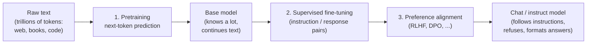
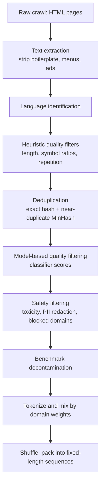
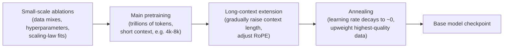

# How LLMs Are Trained, Part 1: Pretraining and Next-Token Prediction

> **Level:** Beginner to Advanced · **Study time:** ~110 min · **Prerequisites:** [Softmax, Entropy, Cross-Entropy and KL Divergence](../00-foundations/05-softmax-entropy-cross-entropy-and-kl-divergence.md), [Tokenization](../04-transformers/01-tokenization.md), [Multi-Head Attention and Causal Masking](../04-transformers/04-multi-head-attention-and-causal-masking.md), [The Full Transformer Architecture](../04-transformers/05-the-full-transformer-architecture.md), helpful: [Encoder-Only, Encoder-Decoder and Decoder-Only Models](../04-transformers/07-encoder-only-encoder-decoder-and-decoder-only-models.md)

## Table of contents

- [Why this matters](#why-this-matters)
- [The big picture: three stages of building an LLM](#the-big-picture-three-stages-of-building-an-llm)
- [Next-token prediction: the intuition](#next-token-prediction-the-intuition)
- [From raw text to training examples](#from-raw-text-to-training-examples)
- [The objective: cross-entropy at every position](#the-objective-cross-entropy-at-every-position)
- [What next-token prediction actually optimizes](#what-next-token-prediction-actually-optimizes)
- [Teacher forcing and why training is parallel](#teacher-forcing-and-why-training-is-parallel)
- [Code: the objective from scratch, in PyTorch and in Hugging Face](#code-the-objective-from-scratch-in-pytorch-and-in-hugging-face)
- [Perplexity](#perplexity)
- [Pretraining data: what models actually read](#pretraining-data-what-models-actually-read)
- [Training compute: the 6ND rule of thumb](#training-compute-the-6nd-rule-of-thumb)
- [Scaling laws: Kaplan, Chinchilla and beyond](#scaling-laws-kaplan-chinchilla-and-beyond)
- [What pretraining gives you, and what it does not](#what-pretraining-gives-you-and-what-it-does-not)
- [Base models vs instruction and chat models](#base-models-vs-instruction-and-chat-models)
- [The emergent abilities debate](#the-emergent-abilities-debate)
- [Going deeper: anatomy of a real pretraining run](#going-deeper-anatomy-of-a-real-pretraining-run)
- [Going deeper: monitoring and debugging pretraining](#going-deeper-monitoring-and-debugging-pretraining)
- [Going deeper: production decisions for engineers who will never pretrain from scratch](#going-deeper-production-decisions-for-engineers-who-will-never-pretrain-from-scratch)
- [Common mistakes and misconceptions](#common-mistakes-and-misconceptions)
- [Interview questions and model answers](#interview-questions-and-model-answers)
- [Key takeaways](#key-takeaways)
- [Further reading](#further-reading)
- [Next](#next)

## Why this matters

Every LLM you will use in production (GPT, Gemini, Llama, Mistral, Qwen, DeepSeek) started life as a model trained to do one deceptively simple thing: predict the next token. Almost every behavior you will debug later traces back to this stage: why a model knows facts up to a cutoff date, why it confidently states falsehoods, why a "base" model rambles instead of answering, why an 8B model trained on 15 trillion tokens can match or beat an older 70B model on many benchmarks. Interviewers use this topic to check whether you understand LLMs from first principles or only from API docs: "What is next-token prediction?", "What does it optimize?", "How much compute does it take to train a 7B model?" and "What is Chinchilla?" are common questions. By the end of this chapter you will be able to compute the training loss by hand, estimate the GPU-hours of a training run on a napkin, and explain what pretraining does and does not give a model.

## The big picture: three stages of building an LLM

Before zooming in, here is where this chapter sits. Modern chat models are built in (at least) three stages.



- **Pretraining** (this chapter): the model reads a huge amount of unlabeled text and learns to predict the next token. This has historically been where the large majority of the compute goes (though heavy reinforcement-learning post-training for reasoning models has been taking a growing share since 2024), and where knowledge and language ability come from.
- **Supervised fine-tuning (SFT)** and **preference alignment**: covered in [Part 2: Instruction Tuning, RLHF and DPO](02-instruction-tuning-rlhf-and-dpo.md). They teach the model how to behave as an assistant.

> **Analogy:** Pretraining is like a person reading an entire library for years. They absorb vocabulary, facts, styles and reasoning patterns, but nobody has taught them how to be a helpful receptionist yet. SFT is the job training. Preference alignment is the performance review that nudges them toward answers people prefer.

## Next-token prediction: the intuition

You already do next-token prediction every day. When you read "Once upon a ___", your brain shouts "time". When your phone keyboard suggests the next word, it is doing a tiny version of the same thing.

A **token** is the unit of text the model works with: usually a word, part of a word, or a punctuation mark, produced by a **tokenizer** (see [Tokenization](../04-transformers/01-tokenization.md)). The set of all tokens the model knows is its **vocabulary**, and its size is written $V$ (for example, GPT-2 has $V = 50{,}257$; many modern models use roughly 100k to 260k tokens).

A **language model** is a model that assigns probabilities to sequences of text. An **autoregressive language model** (also called a **causal language model**) does this one token at a time, left to right: given everything so far, it outputs a probability for every possible next token.

**Next-token prediction** is the training task: show the model a prefix of real text, ask it for a probability distribution over the vocabulary for the next token, and reward it for putting high probability on the token that actually came next.

Why is this simple task so powerful? Because to predict the next token well across the whole internet, a model is forced to learn many other things:

| To predict the next token in... | The model must learn... |
|---|---|
| "The capital of France is ___" | World knowledge |
| "She opened the umbrella because it was ___" | Common-sense causality |
| "def add(a, b):\n    return ___" | Programming |
| "2 + 3 = 5, 7 + 1 = 8, 4 + 4 = ___" | Pattern induction (in-context learning) |
| "Je suis ___" after "I am a student. Translation:" | Translation |

> **Senior insight:** Next-token prediction is **self-supervised learning**: the labels come for free from the data itself (the next token is already in the text). This is the reason LLMs can scale to trillions of training examples without human labeling. It is the single most important economic fact about pretraining.

## From raw text to training examples

Let us use our running example, the 3-word sentence **"the cat sat"**. Suppose the tokenizer maps it to tokens, and we add a special **beginning-of-sequence token** `<bos>` at the front (a marker that says "a document starts here").

```text
Tokens:     <bos>    the     cat     sat
Positions:    0       1       2       3
```

From this one sequence of 4 tokens we get **3 prediction problems**, one per position:

```text
Context (input)              Target (next token)
<bos>                    ->  the
<bos> the                ->  cat
<bos> the cat            ->  sat
```

In practice, we do not build these three examples separately. We take the token sequence and **shift it by one**:

```text
inputs  = [<bos>, the, cat]      (all tokens except the last)
targets = [the,   cat, sat]      (all tokens except the first)
```

Position $t$ of `inputs` is paired with position $t$ of `targets`. The model sees `inputs`, produces one prediction per position, and each prediction is compared to the matching target. An input sequence of length $T$ (cut from $T+1$ tokens) thus gives $T$ training signals, not one. For a model trained on 2 trillion tokens, that is roughly 2 trillion individual prediction problems.

> **Common mistake:** Thinking an LLM is trained on (question, answer) pairs during pretraining. It is not. Pretraining data is plain text, and every token in it is a target.

## The objective: cross-entropy at every position

### Step 1: from logits to probabilities

At each position, the model's last layer outputs a vector of $V$ raw scores called **logits**, one per vocabulary token. Logits can be any real number. To turn them into probabilities we apply **softmax** (see [Softmax, Entropy, Cross-Entropy and KL Divergence](../00-foundations/05-softmax-entropy-cross-entropy-and-kl-divergence.md) for a full treatment):

$$
p_i = \frac{e^{z_i}}{\sum_{j=1}^{V} e^{z_j}}
$$

- $z_i$: the logit for vocabulary token $i$.
- $e^{z_i}$: the exponential, which makes every score positive.
- $\sum_{j=1}^{V} e^{z_j}$: the sum over all $V$ tokens, which normalizes so the probabilities add to 1.
- $p_i$: the model's predicted probability that the next token is token $i$.

### Step 2: the loss at one position

The loss at one position is the **cross-entropy** between the true next token and the predicted distribution. In general, cross-entropy $H(y, p) = -\sum_{i=1}^{V} y_i \log p_i$ measures how "surprised" the predicted distribution $p$ is by the true distribution $y$. Because the "true distribution" here is a single token with probability 1 (a **one-hot** target: $y_i = 1$ for the correct token, 0 for all others), every term except the correct token's vanishes, and cross-entropy reduces to the negative log probability of the correct token:

$$
\ell_t = -\log p_\theta(x_{t} \mid x_{<t})
$$

- $\ell_t$: the loss at position $t$.
- $x_t$: the actual token at position $t$ (the target).
- $x_{<t}$: all tokens before position $t$ (the context).
- $p_\theta(\cdot)$: the probability the model with parameters $\theta$ assigns. $\theta$ (theta) stands for all the model's weights.
- $\log$: the natural logarithm (base $e$), so the loss is measured in **nats**. Using $\log_2$ would give **bits**; $1$ nat $\approx 1.4427$ bits.

Intuition for the shape of $-\log p$: if the model gives the right token probability 1, the loss is $-\log 1 = 0$ (perfect). If it gives probability 0.5, the loss is $0.693$. If it gives probability 0.01, the loss is $4.6$. Confident wrong predictions are punished heavily.

### Step 3: worked example by hand

Take a tiny vocabulary of $V = 5$ tokens: `the`, `cat`, `sat`, `on`, `mat` (indices 0 to 4). The context is `<bos> the`, and the true next token is `cat`. Suppose the model outputs these logits (illustrative values):

| Token | the | cat | sat | on | mat |
|---|---|---|---|---|---|
| Logit $z_i$ | 1.0 | 2.0 | 0.5 | 0.0 | -1.0 |

**Exponentiate each logit:**

- $e^{1.0} = 2.7183$
- $e^{2.0} = 7.3891$
- $e^{0.5} = 1.6487$
- $e^{0.0} = 1.0000$
- $e^{-1.0} = 0.3679$

**Sum them:** $2.7183 + 7.3891 + 1.6487 + 1.0000 + 0.3679 = 13.1240$ (13.1239 if you sum the unrounded values; the difference does not matter here).

**Divide each by the sum:**

| Token | the | cat | sat | on | mat |
|---|---|---|---|---|---|
| $p_i$ | 0.2071 | **0.5630** | 0.1256 | 0.0762 | 0.0280 |

(These add to 0.9999 because of rounding; exactly they add to 1.)

**Loss at this position:** the target is `cat`, so

$$
\ell = -\ln(0.5630) = 0.5744 \text{ nats}
$$

If the model had instead put the logit 2.0 on `the` and 1.0 on `cat` (a wrong preference), $p(\text{cat})$ would be $0.2071$ and the loss would be $-\ln(0.2071) = 1.5744$, exactly 1 nat worse. That is not a coincidence: swapping logits that differ by 1.0 changes the log probability of the target by exactly 1.0.

**The gradient (how the model learns from this).** For softmax plus cross-entropy, the gradient of the loss with respect to the logits is beautifully simple:

$$
\frac{\partial \ell}{\partial z_i} = p_i - y_i
$$

- $y_i$: 1 if token $i$ is the target, otherwise 0.

For our example: $[0.2071,\ 0.5630 - 1,\ 0.1256,\ 0.0762,\ 0.0280] = [0.2071,\ -0.4370,\ 0.1256,\ 0.0762,\ 0.0280]$. Gradient descent subtracts the gradient, so it pushes the `cat` logit **up** and every other logit **down**, each in proportion to how much probability it wrongly received. (Backpropagation then carries this signal into every weight of the network; see [Backpropagation and Gradient Descent](../02-deep-learning/02-backpropagation-and-gradient-descent.md).)

### Step 4: the loss over a whole sequence and a whole dataset

The training loss is the average of the per-position losses over every position in every sequence of a batch:

$$
\mathcal{L}(\theta) = -\frac{1}{N} \sum_{\text{sequences}} \sum_{t=1}^{T} \log p_\theta(x_t \mid x_{<t})
$$

- $\mathcal{L}(\theta)$: the training loss for parameters $\theta$.
- $T$: the number of predicted positions in a sequence.
- $N$: the total number of predicted tokens in the batch (sequences times positions, minus any **padding** positions, the filler tokens added to make sequences equal length, which are masked out of the loss).

**Worked example for "the cat sat".** Suppose that at the three positions the model assigns these probabilities to the correct next token (illustrative):

| Context | Target | $p(\text{target})$ | $-\ln p$ |
|---|---|---|---|
| `<bos>` | the | 0.50 | 0.6931 |
| `<bos> the` | cat | 0.25 | 1.3863 |
| `<bos> the cat` | sat | 0.40 | 0.9163 |

Sum: $0.6931 + 1.3863 + 0.9163 = 2.9957$. Average: $2.9957 / 3 = 0.9986$ nats per token. That number, the **average per-token cross-entropy**, is the loss you see in every LLM training log. We will turn it into perplexity shortly.

> **Interview tip:** When asked "what is the loss of an LLM?", say: "Average cross-entropy over the vocabulary at every position, which equals the average negative log-likelihood of the true next token." Then mention that the targets are the inputs shifted by one.

## What next-token prediction actually optimizes

Minimizing average $-\log p$ has three equivalent readings. Knowing all three is what separates a senior answer from a junior one.

**1. Maximum likelihood.** By the **chain rule of probability**, the probability of a whole sequence factorizes into a product of next-token probabilities:

$$
p_\theta(x_1, x_2, \ldots, x_T) = \prod_{t=1}^{T} p_\theta(x_t \mid x_{<t})
$$

- $\prod$: product (multiply all the terms).

Taking the log turns the product into a sum, so minimizing the summed per-token loss is the same as **maximizing the likelihood** (the probability) the model assigns to the training corpus. This is called **maximum likelihood estimation (MLE)**. For "the cat sat": $p = 0.50 \times 0.25 \times 0.40 = 0.05$, and $-\ln 0.05 = 2.9957$, exactly the sum we computed above.

**2. Matching the data distribution (KL divergence).** Cross-entropy between the true data distribution $P$ and the model's distribution $Q$ (that is, $p_\theta$) splits as

$$
H(P, Q) = H(P) + D_{\mathrm{KL}}(P \,\|\, Q)
$$

- $H(P, Q)$: cross-entropy, what we minimize.
- $H(P)$: the **entropy** of real text, its inherent unpredictability. It does not depend on the model, so we cannot reduce it.
- $D_{\mathrm{KL}}(P \,\|\, Q)$: the **Kullback-Leibler divergence**, a measure of how different the model's distribution is from the real one. Always $\geq 0$, and $0$ only when they match.

So training drives the model's distribution toward the distribution of the training text, and the expected loss on fresh text from that distribution can never go below the entropy of the text itself (training loss on repeated or memorized data can dip below it, but that is overfitting, not progress). This is why LLM loss curves flatten out at some positive value rather than reaching zero, and it is the "irreducible loss" term in scaling laws below.

**3. Compression.** A model that predicts text well can compress it well: with **arithmetic coding**, a token with probability $p$ can be stored in about $-\log_2 p$ bits. Lower loss means fewer bits per token. "Language Modeling Is Compression" (Deletang et al., 2023) makes this connection explicit. The intuition that "to compress the internet, you must understand it" is a popular way to explain why pretraining yields general capabilities.

> **Senior insight:** What next-token prediction does **not** optimize is just as important. It does not optimize truthfulness, helpfulness or safety. It optimizes "what text would plausibly come next in the training distribution". If the training data contains a popular misconception, the model learns to reproduce the misconception. "TruthfulQA: Measuring How Models Mimic Human Falsehoods" (Lin et al., 2021) showed exactly this, and in their experiments larger models were sometimes *less* truthful because they imitated human falsehoods better.

## Teacher forcing and why training is parallel

### Teacher forcing

**Teacher forcing** means that during training, the model is always given the *real* previous tokens as context, never its own predictions. At position 2 of "the cat sat", the context is the true `<bos> the`, even if the model's prediction at position 1 was wrong.

> **Analogy:** A driving instructor who resets the car to the correct lane after every mistake. The student practices every individual decision from a correct starting point, rather than compounding errors.

### Why this makes training parallel

Because every context is known in advance (it is just the real text), all $T$ predictions can be computed **at the same time** in one forward pass. The only requirement is that position $t$ must not peek at tokens after $t$, which is enforced by the **causal mask** inside self-attention (see [Multi-Head Attention and Causal Masking](../04-transformers/04-multi-head-attention-and-causal-masking.md)).

```text
Causal attention mask for inputs [<bos>, the, cat]   (1 = may attend, 0 = blocked)

                 attends to:  <bos>   the   cat
  position 0 (<bos>)            1      0     0     -> predicts "the"
  position 1 (the)              1      1     0     -> predicts "cat"
  position 2 (cat)              1      1     1     -> predicts "sat"

One forward pass  ->  logits of shape (T=3, V)  ->  3 losses  ->  averaged
```

Compare training and generation:

| | Training (teacher forcing) | Generation (inference) |
|---|---|---|
| Context at each step | Real text from the dataset | The model's own previous outputs |
| Positions computed | All $T$ at once, in parallel | One new token per step, sequentially |
| Forward passes per sequence | 1 | One per generated token (made cheaper by the [KV cache](../06-llm-inference/02-kv-cache-explained.md)) |
| Bottleneck on GPUs | Usually compute | Usually memory bandwidth (see [Inference Fundamentals](../06-llm-inference/01-inference-fundamentals-prefill-decode-and-latency-metrics.md)) |

This parallelism is a major reason Transformers replaced RNNs: an RNN must process position 1 before position 2 even during training, while a Transformer processes a 4,096-token sequence in one shot (see [RNNs, LSTMs and the Road to Transformers](../02-deep-learning/08-rnns-lstms-and-the-road-to-transformers.md)).

### The cost: exposure bias

Teacher forcing creates a mismatch called **exposure bias**: during training the model only ever sees perfect contexts, but during generation it sees its own (possibly flawed) outputs. One early mistake can push it into contexts it never saw in training, and errors can compound. In practice, at LLM scale this matters less than early sequence-to-sequence research feared, because the data is so diverse. It is also partly addressed after pretraining: preference alignment and reinforcement learning train on the model's *own* samples (see [Part 2](02-instruction-tuning-rlhf-and-dpo.md)).

## Code: the objective from scratch, in PyTorch and in Hugging Face

### From scratch in NumPy: one position

```python
# pip install numpy
import numpy as np

vocab = ["the", "cat", "sat", "on", "mat"]
logits = np.array([1.0, 2.0, 0.5, 0.0, -1.0])   # model output for context "<bos> the"
target = vocab.index("cat")

def log_softmax(z):
    z = z - z.max()                      # subtract the max for numerical stability
    return z - np.log(np.exp(z).sum())   # log(p_i) = z_i - log(sum_j e^{z_j})

log_probs = log_softmax(logits)
loss = -log_probs[target]
print(round(float(loss), 4))             # 0.5744

grad = np.exp(log_probs)                 # softmax probabilities
grad[target] -= 1.0                      # dL/dz = p - y
print(np.round(grad, 4))                 # approx. [0.2071, -0.437, 0.1256, 0.0762, 0.028]
```

Notice we compute `log_softmax` directly rather than `np.log(softmax(z))`. Taking the log of a tiny probability that underflowed to 0 gives `-inf`; the fused form avoids that. PyTorch's `F.cross_entropy` does the same internally, which is why it takes **logits**, not probabilities.

### PyTorch: a whole sequence with the shift

```python
# pip install torch
import torch
import torch.nn.functional as F

V = 6                                        # the, cat, sat, on, mat, <bos>
tokens = torch.tensor([[5, 0, 1, 2]])        # <bos>=5, the=0, cat=1, sat=2; shape (B=1, 4)
inputs, targets = tokens[:, :-1], tokens[:, 1:]   # the shift-by-one

# Stand-in for a Transformer: random logits of shape (B, T, V).
torch.manual_seed(0)
logits = torch.randn(1, inputs.shape[1], V)

# Flatten (B, T, V) -> (B*T, V) and (B, T) -> (B*T,), then average over all positions.
loss = F.cross_entropy(logits.reshape(-1, V), targets.reshape(-1))
print(loss.item())   # one number: mean cross-entropy over the 3 positions
```

### A tiny model that actually learns

The smallest possible "language model" is a **bigram model**: it predicts the next character from only the current character. It has no attention, but it uses the exact same shift, loss and training loop as a real LLM.

```python
import math
import torch
import torch.nn as nn
import torch.nn.functional as F

torch.manual_seed(0)
text = "the cat sat on the mat. the dog sat on the log. " * 50
chars = sorted(set(text))
V = len(chars)                                   # 14 distinct characters
stoi = {c: i for i, c in enumerate(chars)}
data = torch.tensor([stoi[c] for c in text])

class BigramLM(nn.Module):
    def __init__(self, V):
        super().__init__()
        self.table = nn.Embedding(V, V)          # row i = logits for the token after token i
        nn.init.zeros_(self.table.weight)        # all-zero logits = uniform prediction
    def forward(self, idx):                      # idx: (B, T)
        return self.table(idx)                   # logits: (B, T, V)

model = BigramLM(V)
opt = torch.optim.AdamW(model.parameters(), lr=1e-1)
B, T = 32, 16
for step in range(301):
    ix = torch.randint(0, len(data) - T - 1, (B,))
    x = torch.stack([data[i:i + T] for i in ix])          # inputs
    y = torch.stack([data[i + 1:i + T + 1] for i in ix])  # targets: inputs shifted by one
    loss = F.cross_entropy(model(x).reshape(-1, V), y.reshape(-1))
    opt.zero_grad()
    loss.backward()
    opt.step()
    if step % 100 == 0:
        print(step, round(loss.item(), 3))

print("uniform baseline ln(V) =", round(math.log(V), 3))  # 2.639
```

Because the logits start at zero, the prediction at step 0 is uniform and the printed step-0 loss equals $\ln(14) \approx 2.639$. The loss then falls as the model learns, for example, that "h" often follows "t". This **$\ln V$ sanity check** is a real debugging tool for large runs too (see [monitoring and debugging](#going-deeper-monitoring-and-debugging-pretraining)).

### Hugging Face: loss and perplexity of a real model

```python
# pip install torch transformers
import math
import torch
from transformers import AutoTokenizer, AutoModelForCausalLM

tok = AutoTokenizer.from_pretrained("gpt2")
model = AutoModelForCausalLM.from_pretrained("gpt2").eval()

text = "The cat sat on the mat because it was warm."
enc = tok(text, return_tensors="pt")
with torch.no_grad():
    # Passing labels=input_ids makes the model shift internally and return the mean
    # next-token cross-entropy. Label value -100 means "ignore this position".
    out = model(**enc, labels=enc["input_ids"])

print("loss (nats/token):", out.loss.item())
print("perplexity:", math.exp(out.loss.item()))
```

> **Common mistake:** Shifting the labels yourself *and* passing them to a Hugging Face causal LM. The model already shifts, so you would train it to predict two tokens ahead. Pass `labels=input_ids` unshifted, and set padding positions to `-100`.

## Perplexity

### Intuition

**Perplexity** answers: "On average, how many tokens was the model effectively choosing between?" A perplexity of 1 means perfect certainty. A perplexity of 20 means the model was as uncertain as if it were picking uniformly among 20 tokens at each step.

### Definition

$$
\text{PPL} = \exp\left(-\frac{1}{N} \sum_{t=1}^{N} \log p_\theta(x_t \mid x_{<t})\right) = e^{\mathcal{L}}
$$

- $\text{PPL}$: perplexity.
- $N$: number of predicted tokens in the evaluation text.
- $\mathcal{L}$: the average per-token cross-entropy in nats (the training loss formula applied to evaluation data).

Equivalently, perplexity is the inverse geometric mean of the probabilities given to the correct tokens: $\text{PPL} = \left(\prod_t p_t\right)^{-1/N}$.

### Worked example

For "the cat sat" we found $\mathcal{L} = 0.9986$ nats:

$$
\text{PPL} = e^{0.9986} = 2.714
$$

Check with the geometric-mean form: $\prod p_t = 0.50 \times 0.25 \times 0.40 = 0.05$, and $0.05^{-1/3} = 20^{1/3} = 2.714$. Same answer. The model was "as confused as choosing among about 2.7 tokens".

Reference points:

| Situation | Loss (nats) | Perplexity |
|---|---|---|
| Perfect model | 0 | 1 |
| Our "the cat sat" example | 0.9986 | 2.714 |
| A loss of 2.0 | 2.0 | $e^{2} = 7.39$ |
| A loss of 3.0 | 3.0 | $e^{3} = 20.09$ |
| Uniform guess over $V = 5$ | $\ln 5 = 1.609$ | 5 |
| Uniform guess over GPT-2's $V = 50{,}257$ | $\ln 50{,}257 = 10.82$ | 50,257 |

Note that a uniform model's perplexity is exactly $V$. So an untrained model should start near perplexity $V$ (loss near $\ln V$).

### Where perplexity is useful, and where it misleads

| Use | Verdict |
|---|---|
| Tracking a single pretraining run over time | Excellent: the main health signal |
| Comparing checkpoints or data mixtures with the **same tokenizer** on the **same held-out text** | Good |
| Comparing models with **different tokenizers** | Misleading: a tokenizer that makes more, smaller tokens has easier per-token predictions. Normalize to **bits per byte** or **bits per character** instead. |
| Judging a chat model's helpfulness or correctness | Weak: low perplexity does not mean good answers. Use task evals (see [Evaluating LLMs](10-llm-evaluation-metrics-and-llm-as-a-judge.md)). |
| Detecting test-set contamination | A suspiciously low perplexity on a benchmark can be a hint (see [Contamination and Memorization](09-catastrophic-forgetting-contamination-and-memorization.md)) |

**Bits per byte** converts the total loss to bits and divides by the number of UTF-8 bytes of text instead of the number of tokens:

$$
\text{BPB} = \frac{\sum_t -\log_2 p_\theta(x_t \mid x_{<t})}{\text{number of bytes}}
$$

Because bytes do not depend on the tokenizer, BPB is comparable across models.

Worked example: for "the cat sat" the total loss was $2.9957$ nats, which is $2.9957 \times 1.4427 = 4.32$ bits (equivalently $-\log_2 0.05$). The text is 11 UTF-8 bytes (9 letters plus 2 spaces), so $\text{BPB} = 4.32 / 11 \approx 0.39$. A different tokenizer that split the same text into 6 tokens would report a different per-token loss, but if it assigned the same total probability to the text, its BPB would be identical.

> **Senior insight:** For long documents, perplexity depends on how much context each token gets. Evaluating a 10,000-token document in disjoint 1,024-token chunks gives each chunk's first tokens almost no context and inflates perplexity. A **sliding-window** evaluation (overlapping windows, scoring only the new tokens in each) is the more faithful method; the Hugging Face docs page "Perplexity of fixed-length models" walks through it.

## Pretraining data: what models actually read

Data is where most of the real engineering effort in pretraining goes. Two models with the same architecture and compute can differ dramatically because of data quality.

### Sources

| Source | Examples | What it contributes | Caveats |
|---|---|---|---|
| Web crawl | Common Crawl snapshots, and filtered derivatives such as C4, RefinedWeb, FineWeb | Breadth, recency, many styles and languages | Mostly low quality before filtering: boilerplate, spam, duplicates |
| Books | Public-domain book collections | Long-range coherence, narrative, formal writing | Copyright and licensing questions |
| Code | Public repositories (for example The Stack) | Programming ability, and often helps structured reasoning | License filtering, secrets in code, auto-generated files |
| Reference and academic | Wikipedia, arXiv papers, patents | Dense factual and technical knowledge | Small relative to the web, so often upweighted |
| Conversational and Q&A | Forums, Q&A sites | Dialogue patterns, explanations | Toxicity, PII |
| Math | Math-heavy web pages, papers, textbooks | Mathematical reasoning | Needs special extraction to preserve LaTeX |
| Multilingual | Non-English web and parallel text | Other languages, translation | Quality filters tuned for English can harm other languages |
| Synthetic | Text generated by other models (rephrased web pages, textbook-style exercises) | Targeted skills, cleaner style | Risk of homogeneity and inheriting the generator's errors; check the generator's license terms |

### Token counts, in general terms

Orders of magnitude worth knowing (as published by the model authors):

- GPT-3 (Brown et al., 2020): about 300 billion training tokens.
- Llama 2 (Touvron et al., 2023): about 2 trillion tokens.
- Llama 3 (Meta, 2024): over 15 trillion tokens.
- FineWeb (Penedo et al., 2024), an open filtered web dataset: about 15 trillion tokens.

A rough rule of thumb for English with modern BPE tokenizers is that a token is around 4 characters, or about three quarters of a word. So 2 trillion tokens is very roughly 8 TB of plain text (illustrative, depends on tokenizer and language). The trend over time is clear: frontier datasets grew from hundreds of billions to tens of trillions of tokens, and high-quality, deduplicated text is becoming a constrained resource.

### The data pipeline



Let us walk through the important steps with our **4-document corpus**:

```text
Doc A: "the cat sat on the mat"
Doc B: "the cat sat on a mat"
Doc C: "buy cheap watches now buy now"
Doc D: "the cat sat on the mat"
```

**1. Text extraction.** Pull the main content out of HTML, dropping navigation bars, cookie banners and footers. Extraction quality has a measurable effect on model quality; FineWeb's authors, for example, reported better results extracting from raw WARC files than using Common Crawl's pre-extracted text.

Right after extraction, **language identification** (commonly a fastText classifier) tags each document's language so that per-language filters and mixture weights can be applied.

**2. Heuristic quality filters.** Cheap rules that drop obvious junk: too few words, too many symbols or non-alphabetic characters, too many repeated lines or n-grams, lines that are mostly "lorem ipsum" or "click here". The Gopher paper (Rae et al., 2021) popularized a widely copied set of such rules. Doc C (repetitive spam) would likely be removed by a repetition filter.

**3. Deduplication.** The web is full of copies: mirrors, templates, syndicated news, licenses. Duplicates waste compute, increase **memorization** (the model reproducing training text verbatim), and can leak test data. "Deduplicating Training Data Makes Language Models Better" (Lee et al., 2021) showed deduplication reduces memorized output and can improve efficiency.

- **Exact deduplication:** hash each document (or each paragraph or line) and drop repeats. Doc D has the same hash as Doc A, so it is removed.
- **Near-duplicate deduplication:** documents that differ by a few words. The standard tool is **MinHash with locality-sensitive hashing (LSH)**: represent each document as a set of **shingles** (overlapping n-grams), estimate the **Jaccard similarity** (size of intersection divided by size of union) cheaply with hash signatures, and bucket similar documents together so you never compare all pairs.

Worked Jaccard example with word bigrams:

```text
A bigrams: {the cat, cat sat, sat on, on the, the mat}    (5)
B bigrams: {the cat, cat sat, sat on, on a,   a mat}      (5)
Intersection: {the cat, cat sat, sat on}                  (3)
Union: 5 + 5 - 3 = 7
Jaccard(A, B) = 3 / 7 = 0.43
```

With a typical near-duplicate threshold around 0.7 to 0.8 (a tunable choice), A and B are kept as distinct. On real documents with hundreds of words, a page copied with a different footer scores well above such thresholds.

```python
# Exact and near-duplicate detection on the 4-document corpus, from scratch.
import hashlib

docs = {
    "A": "the cat sat on the mat",
    "B": "the cat sat on a mat",
    "C": "buy cheap watches now buy now",
    "D": "the cat sat on the mat",
}

def shingles(text, n=2):
    w = text.split()
    return {" ".join(w[i:i + n]) for i in range(len(w) - n + 1)}

def jaccard(a, b):
    return len(a & b) / len(a | b)

seen, kept = set(), []
for name, text in docs.items():
    h = hashlib.sha256(text.encode()).hexdigest()
    if h in seen:
        print(f"{name}: exact duplicate, dropped")
        continue
    seen.add(h)
    kept.append(name)

print("kept:", kept)                                                     # ['A', 'B', 'C']
print("J(A,B) =", round(jaccard(shingles(docs["A"]), shingles(docs["B"])), 2))  # 0.43
```

At scale, you would use a MinHash LSH library (for example `pip install datasketch`, which provides `MinHash` and `MinHashLSH`) or a distributed data-processing framework, because comparing all pairs of billions of documents is impossible.

**4. Model-based quality filtering.** Train a cheap classifier (often a linear model on n-gram features, such as fastText) to score "how much does this look like high-quality reference text?" GPT-3 used a classifier trained to distinguish curated reference corpora from raw crawl. A more recent pattern is to have a large LLM label a sample of pages for, say, educational value, then train a small classifier on those labels and apply it to the whole crawl; FineWeb-Edu (Penedo et al., 2024) is a public example. The trade-off: aggressive filtering raises quality but reduces diversity and can encode the biases of whatever the classifier treats as "good" (for example, penalizing dialects or non-standard English).

**5. Safety filtering.**

- **Toxicity filtering:** classifiers or word lists remove hateful or explicit content. Over-filtering has a cost: models then understand toxic content less well, which can make them *worse* at detecting it later, and word lists disproportionately remove text by and about some minority groups.
- **PII filtering:** **personally identifiable information** (emails, phone numbers, addresses, ID numbers) is detected with regexes and named-entity models, then removed or replaced with placeholders. This reduces the chance the model memorizes and regurgitates private data.
- **Domain block lists:** known malware, adult or pirated-content sites.
- **Opt-outs and licensing:** respecting robots.txt and opt-out requests is increasingly a legal and reputational requirement; the details vary by jurisdiction and change over time.

**6. Decontamination.** Remove documents that overlap with evaluation benchmarks (typically n-gram overlap checks), so reported scores are meaningful. See [Contamination and Memorization](09-catastrophic-forgetting-contamination-and-memorization.md).

**7. Data mixtures.** The final dataset is a weighted blend of domains. A **data mixture** specifies what fraction of training tokens comes from each source: for example (illustrative) 60% web, 15% code, 10% academic, 5% books, 5% math, 5% multilingual. Small high-quality sources are often **upsampled** (repeated for 2 or more epochs) while the web is seen once. Mixture weights are usually chosen by running many small proxy models and measuring downstream evals; methods like DoReMi (Xie et al., 2023) learn weights automatically.

> **Senior insight:** How much repetition is acceptable? "Scaling Data-Constrained Language Models" (Muennighoff et al., 2023) found that repeating data for up to about 4 epochs was nearly as good as fresh data, with rapidly diminishing value beyond that. This matters now that high-quality text is scarce relative to what frontier compute budgets could consume.

**8. Packing.** Documents have wildly different lengths. To avoid wasting compute on padding, documents are concatenated with an end-of-sequence token `<eos>` between them and chopped into fixed-length sequences (for example 4,096 or 8,192 tokens). This is called **sequence packing**.

```text
Packed sequence of length 16:
[ the cat sat on the mat <eos> buy cheap watches now <eos> the dog sat on ... ]
   |------ doc 1 ------|        |---- doc 2 ----|         |--- doc 3 (cut) ---
```

With packing, a token in doc 2 can attend to doc 1 unless you add a **document-level attention mask**. Many runs historically accepted this cross-document leakage for simplicity; more recent ones (the Llama 3 report describes this) mask attention across document boundaries, which matters especially for long-context training.

## Training compute: the 6ND rule of thumb

### Intuition

How much arithmetic does it take to train a model? Every token must flow forward through every weight, and gradients must flow back. A useful rule: **training costs about 6 floating-point operations per parameter per token.**

### The formula

$$
C \approx 6 N D
$$

- $C$: total training compute in **FLOPs** (floating-point operations; not to be confused with FLOP/s, operations per second).
- $N$: number of model parameters.
- $D$: number of training tokens.
- $6$: about 2 FLOPs per parameter per token for the forward pass (one multiply and one add per weight in each matrix multiplication), plus about 4 for the backward pass (gradients with respect to both activations and weights, roughly twice the forward cost).

This approximation (popularized by Kaplan et al., 2020) ignores the attention score computation, which grows with context length. It is accurate when the model width is large relative to the context length, which holds for most large models at standard context lengths. For very long-context training, add the attention term. If you use **activation recomputation** (also called gradient checkpointing, re-running parts of the forward pass during backward to save memory), the hardware does more like 8ND FLOPs, but 6ND is still the conventional "model FLOPs".

### Worked example: our 7B model

Train a 7B-parameter model on 2 trillion tokens (the Llama 2 7B setting):

$$
C = 6 \times (7 \times 10^{9}) \times (2 \times 10^{12})
$$

Step by step: $6 \times 7 = 42$; $10^{9} \times 10^{12} = 10^{21}$; $42 \times 2 = 84$. So $C = 84 \times 10^{21} = 8.4 \times 10^{22}$ FLOPs.

**How many GPU-hours is that?** A GPU never runs at its peak spec. The fraction of peak actually achieved on useful model math is called **MFU (model FLOPs utilization)**, a term from the PaLM paper (Chowdhery et al., 2022). Well-tuned large runs commonly report somewhere around 35% to 55%. Use 40%.

On an NVIDIA A100 (peak dense BF16 throughput of 312 TFLOP/s, that is $3.12 \times 10^{14}$ FLOP/s; "dense" means without sparsity tricks, and BF16 is the 16-bit floating-point format standard for training, see [Mixed-Precision Training](../02-deep-learning/09-mixed-precision-training.md)):

- Effective throughput: $0.40 \times 3.12 \times 10^{14} = 1.248 \times 10^{14}$ FLOP/s.
- GPU-seconds: $8.4 \times 10^{22} / 1.248 \times 10^{14} = 6.73 \times 10^{8}$ s.
- GPU-hours: $6.73 \times 10^{8} / 3600 \approx 187{,}000$ GPU-hours.

Sanity check against reality: the Llama 2 paper reports about 184,000 A100 GPU-hours for its 7B model. Our napkin estimate lands within a few percent, which is why this rule of thumb is so useful in interviews.

On 1,024 GPUs, that is $187{,}000 / 1{,}024 \approx 183$ hours, about 7.6 days of wall-clock time (ignoring restarts and failures, which in reality add meaningful overhead). On H100s (peak dense BF16 around 989 TFLOP/s for the SXM version) at the same 40% MFU, the same run is roughly 59,000 GPU-hours.

**Cost (illustrative):** at an assumed USD 2 per A100-hour, 187,000 GPU-hours is about USD 374,000 for the final run alone. Real budgets are several times larger once you include failed runs, ablations, data processing and evaluation. Cloud prices vary widely by year and contract, so always restate your assumed price.

> **Interview tip:** Memorize the chain: $C = 6ND$, divide by (peak FLOP/s times MFU), divide by 3600 for GPU-hours, divide by the number of GPUs for wall-clock time. Interviewers love "how long would it take to train X on Y GPUs?"

> **Common mistake:** Confusing compute with memory. $6ND$ tells you *how long* training takes, not *how many GPUs you need to fit the model*. Training memory with mixed-precision Adam is roughly 16 bytes per parameter before activations (about 112 GB for 7B), which is why even a 7B model is trained across several GPUs. See [Distributed Training and Training Memory](../02-deep-learning/10-distributed-training-and-training-memory.md) and [Mixed-Precision Training](../02-deep-learning/09-mixed-precision-training.md).

## Scaling laws: Kaplan, Chinchilla and beyond

### Intuition

If you have a fixed compute budget, should you train a bigger model on less data, or a smaller model on more data? **Scaling laws** are empirical formulas that predict a model's loss from its size, data and compute. They let labs run cheap small experiments and extrapolate to expensive large ones.

> **Analogy:** You have a fixed budget for a student's education. You can hire a brilliant tutor for a short time (big model, few tokens) or an average tutor for a long time (small model, many tokens). Scaling laws tell you the best split.

### Power laws

A **power law** has the form $y = a \cdot x^{-\alpha}$: each time $x$ multiplies by a fixed factor, $y$ shrinks by a fixed factor. On a log-log plot it is a straight line.

### Kaplan et al. (2020)

"Scaling Laws for Neural Language Models" (Kaplan et al., OpenAI, 2020) found that loss falls as a smooth power law in each of parameters $N$, data $D$ and compute $C$, over many orders of magnitude, when the other factors are not the bottleneck. For parameters:

$$
L(N) \approx \left(\frac{N_c}{N}\right)^{\alpha_N}, \quad \alpha_N \approx 0.076
$$

- $L(N)$: test loss of a model with $N$ non-embedding parameters (all weights except the token-embedding and position-embedding matrices) trained to convergence on enough data.
- $N_c$: a fitted constant.
- $\alpha_N$: the fitted exponent.

Worked example: doubling $N$ multiplies the loss by $2^{-0.076} \approx 0.949$, about a 5% reduction. Multiplying $N$ by 10 multiplies the loss by $10^{-0.076} \approx 0.839$, about 16% lower. Small exponents mean steady but expensive progress: each constant improvement needs a multiplicative increase in resources.

Kaplan's compute-optimal recipe said model size should grow much faster than data as compute grows (they estimated roughly $N_{\text{opt}} \propto C^{0.73}$, where $\propto$ means "proportional to": 10x more compute should mean a model about $10^{0.73} \approx 5.4$ times larger, trained on only about $10^{0.27} \approx 1.9$ times more data). This influenced a generation of very large models trained on relatively few tokens, such as GPT-3 (175B parameters, about 300B tokens).

### Chinchilla: Hoffmann et al. (2022)

"Training Compute-Optimal Large Language Models" (Hoffmann et al., DeepMind, 2022), known as the **Chinchilla** paper, revisited the question with learning-rate schedules matched to each run's length and found a different answer: **parameters and tokens should scale in roughly equal proportion** ($N_{\text{opt}} \propto C^{0.5}$ and $D_{\text{opt}} \propto C^{0.5}$). The practical rule of thumb that came out of it:

$$
D_{\text{opt}} \approx 20 \times N
$$

That is, about **20 training tokens per parameter** for compute-optimal training.

The headline experiment: Chinchilla (70B parameters, 1.4T tokens, exactly 20 tokens per parameter) used a similar compute budget to DeepMind's earlier Gopher (280B parameters, 300B tokens) and outperformed it on a wide range of downstream tasks. Check the compute: Chinchilla is $6 \times 70 \times 10^{9} \times 1.4 \times 10^{12} = 5.88 \times 10^{23}$ FLOPs; Gopher is $6 \times 280 \times 10^{9} \times 3 \times 10^{11} = 5.04 \times 10^{23}$ FLOPs. Same ballpark, a 4x smaller model, much better results. It also meant cheaper inference.

Chinchilla also fit a loss model that makes the trade-off explicit:

$$
L(N, D) = E + \frac{A}{N^{\alpha}} + \frac{B}{D^{\beta}}
$$

- $E$: the **irreducible loss**, the entropy of natural text that no model can beat (the $H(P)$ term from earlier).
- $A / N^{\alpha}$: the extra loss from having a finite model.
- $B / D^{\beta}$: the extra loss from having finite data.
- $A, B, \alpha, \beta$: fitted constants (their fit gave $\alpha \approx 0.34$ and $\beta \approx 0.28$). A later replication attempt (Besiroglu et al., 2024) argued the paper's exact parametric fit had issues, though the roughly equal-scaling conclusion held up. Treat the specific constants as approximate.

Why did Kaplan and Chinchilla disagree? The commonly cited reasons are differences in setup: Kaplan's smaller runs did not have their learning-rate schedules tuned to their training length (making short runs look worse), and their analysis counted non-embedding parameters at relatively small scale. The durable lesson: **scaling-law conclusions depend on experimental details; always check the fitting setup before extrapolating.**

### Worked example: compute-optimal allocation

Combine $C = 6ND$ with $D = 20N$:

$$
C = 6 \cdot N \cdot 20N = 120 N^{2} \quad\Rightarrow\quad N_{\text{opt}} = \sqrt{C / 120}
$$

For a budget of $C = 10^{23}$ FLOPs:

- $C / 120 = 8.33 \times 10^{20}$.
- $N_{\text{opt}} = \sqrt{8.33 \times 10^{20}} \approx 2.89 \times 10^{10}$, about 29B parameters.
- $D_{\text{opt}} = 20 \times 2.89 \times 10^{10} \approx 5.8 \times 10^{11}$, about 580B tokens.
- Check: $6 \times 2.89 \times 10^{10} \times 5.77 \times 10^{11} \approx 1.0 \times 10^{23}$. Correct.

For our 7B model, Chinchilla-optimal data would be $20 \times 7 \times 10^{9} = 140$B tokens.

### Why modern models are trained far beyond Chinchilla

Here is the twist that interviewers love. Llama 2 7B was trained on 2T tokens, about **286 tokens per parameter**. Llama 3 8B was trained on over 15T tokens, about **1,875 tokens per parameter**, nearly 100 times the Chinchilla ratio. Why "waste" compute like that?

1. **Chinchilla optimizes training compute only.** It answers "what is the best model for a fixed training budget?" But a deployed model is used for inference millions or billions of times. A smaller model is cheaper and faster to serve forever. Spending extra training compute to make a small model better is often a great trade. "Beyond Chinchilla-Optimal: Accounting for Inference in Language Model Scaling Laws" (Sardana et al., 2023) formalizes this.
2. **Loss keeps improving past 20 tokens/parameter.** Compute-optimal does not mean "the model stops learning". It means the next unit of compute would have been better spent on a bigger model. Small models keep improving, just less efficiently.
3. **Hardware and deployment constraints.** A model that fits on one GPU, a laptop or a phone has enormous practical value (see [Number Formats and Model Memory](../07-model-compression/01-number-formats-and-model-memory.md)).
4. **Open-weight model economics.** Releasers pay the training cost once; the community pays inference costs. Overtraining a small model maximizes its usefulness.

| Regime | Tokens per parameter | Optimizes | Example |
|---|---|---|---|
| Kaplan-style (pre-2022) | Under 10 | Training compute, under a since-revised recipe | GPT-3: 175B params, 300B tokens (about 1.7) |
| Chinchilla-optimal | About 20 | Training compute only | Chinchilla: 70B, 1.4T (20) |
| Inference-aware "overtraining" | 100 to 2,000+ | Total lifetime cost (training plus serving) | Llama 2 7B (about 286), Llama 3 8B (about 1,875) |

> **Senior insight:** The deeper you go past Chinchilla, the more you hit data limits: you need trillions of *high-quality, deduplicated* tokens. That is why data curation, upsampling with repetition, and synthetic data became so central after 2023. A newer axis, spending extra compute at **inference** time on reasoning, has its own scaling behavior; see [Reasoning Models and Test-Time Compute](12-reasoning-models-and-test-time-compute.md).

## What pretraining gives you, and what it does not

### What pretraining gives

- **Language competence:** grammar, style, many languages, code syntax.
- **World knowledge:** facts, entities and relationships that appear in the data, frozen at the **knowledge cutoff** (the date of the most recent training data). Knowledge of rare facts is weaker and more error-prone than knowledge of common ones.
- **Reasoning patterns:** imitation of arithmetic, logic and step-by-step explanation found in text and code.
- **In-context learning (ICL):** the ability to perform a new task from instructions or a few examples placed in the prompt, without any weight update. "Language Models are Few-Shot Learners" (Brown et al., 2020, the GPT-3 paper) made this famous. Mechanistic work such as "In-context Learning and Induction Heads" (Olsson et al., 2022) identified attention circuits ("induction heads") that copy patterns from earlier in the context, one plausible building block of ICL.
- **Rich representations:** hidden states that are excellent starting points for fine-tuning (the same idea as [transfer learning](../02-deep-learning/07-cnns-and-transfer-learning.md) in vision).

### What pretraining does not give

- **Instruction following.** The model was trained to continue documents, not to obey them. Ask "Write a poem about cats" and a base model may continue with "Write a poem about dogs. Write a poem about birds." because that looks like a list of writing prompts.
- **Consistent assistant persona and format.** No reliable turn-taking, no stopping at the end of an answer, no chat template.
- **Refusal behavior and safety.** It will continue harmful text as readily as harmless text, because both exist in the data.
- **Honesty as a goal.** It reproduces what text *says*, including misconceptions and confident fabrications. It has no built-in preference for true over plausible, and no habit of saying "I don't know". See [Hallucinations](06-hallucinations-and-grounding.md).
- **Up-to-date or private knowledge.** Nothing after the cutoff, nothing from your company's documents. That is what [RAG](../08-rag/01-what-is-rag-and-why-it-matters.md) is for.

> **Senior insight:** Interestingly, base models can be fairly well **calibrated** (their confidence tracks their accuracy) on multiple-choice questions; the GPT-4 Technical Report (OpenAI, 2023) reported that post-training reduced this calibration. So "honesty" is subtle: the base model may internally "know" its uncertainty without expressing it, and alignment can both help (saying "I'm not sure") and hurt (confident-sounding style).

## Base models vs instruction and chat models

A **base model** (also called a pretrained or foundation model) is the direct output of pretraining. An **instruct** or **chat model** is a base model after SFT and preference alignment.

Same prompt, typical behavior (illustrative):

```text
Prompt: "What is the capital of France?"

Base model continuation:
  "What is the capital of Germany? What is the capital of Italy?
   These are common geography quiz questions for ..."

Chat model response:
  "The capital of France is Paris."
```

To get useful work from a base model you write prompts that make the desired output the *natural continuation of a document*:

```text
Q: What is the capital of Germany?
A: Berlin
Q: What is the capital of France?
A:
```

| Aspect | Base model | Instruct / chat model |
|---|---|---|
| Training | Pretraining only | Pretraining + SFT + preference alignment |
| Responds to | Document prefixes, few-shot patterns | Instructions inside a chat template |
| Output style | Continues text, may never stop | Answers, then emits an end-of-turn token |
| Diversity | High: samples the whole distribution of text | Lower: aligned models often give more uniform, "safe" outputs |
| Safety behavior | None built in | Refusals and policies trained in |
| Best used for | Further fine-tuning, research, data generation, scoring text likelihood | Applications, assistants, agents |
| Typical naming | `Llama-3-8B`, `Mistral-7B-v0.1` | `Llama-3-8B-Instruct`, `Mistral-7B-Instruct` |

> **Common mistake:** Downloading a base model checkpoint for a chatbot and concluding "this model is bad at following instructions". Check the model card; you probably wanted the `-Instruct` or `-Chat` variant, used with its exact chat template.

> **Interview tip:** If asked "which do you fine-tune for a domain task?": for instruction-style tasks, usually start from the instruct model (it already follows formats); for heavy domain adaptation with lots of raw text (continued pretraining), start from the base model and re-do instruction tuning afterward. See [Fine-Tuning LLMs](07-fine-tuning-full-lora-and-qlora.md).

## The emergent abilities debate

### The claim

"Emergent Abilities of Large Language Models" (Wei et al., 2022) defined an **emergent ability** as one that is "not present in smaller models but is present in larger models": performance stays near random across many model sizes, then jumps sharply above some scale. Examples included multi-digit arithmetic and some multi-step reasoning benchmarks. Related work, "Predictability and Surprise in Large Generative Models" (Ganguli et al., 2022), highlighted the tension: overall loss is very predictable, specific capabilities are not.

### The counter-argument

"Are Emergent Abilities of Large Language Models a Mirage?" (Schaeffer, Miranda and Koyejo, 2023) argued many of these jumps come from the **choice of metric**, not the model. Exact-match accuracy is all-or-nothing: a 5-digit answer with 4 correct digits scores 0. If per-token accuracy improves smoothly with scale, the chance of getting *all* tokens right (roughly per-token accuracy to the power of the answer length) can look like a sudden jump.

Illustrative numbers: if per-digit accuracy rises smoothly from 0.5 to 0.9, the probability of getting all 5 digits right goes from $0.5^5 = 0.031$ to $0.9^5 = 0.59$. Plotted on a coarse grid of model sizes with exact match, that looks like "nothing, nothing, then suddenly it works". With a continuous metric (per-digit accuracy, or the log-likelihood of the correct answer), the curve is smooth.

### A balanced senior view

| Position | Strongest point | Weakness |
|---|---|---|
| Emergence is real | Users and products do experience thresholds: a model that is 59% vs 3% exact on a task is qualitatively different | Many jumps disappear under continuous metrics; few model sizes were sampled |
| Emergence is a mirage | Underlying improvement is often smooth and predictable | Smooth log-likelihood does not tell you *when* a task becomes usable; some jumps remain debated |

The practical takeaway: **loss scales predictably; downstream task performance can look abrupt, especially with discontinuous metrics.** When forecasting capabilities, track continuous proxies (log-likelihood of correct answers, partial credit) across scales, and do not assume a capability will or will not appear from a single exact-match curve.

## Going deeper: anatomy of a real pretraining run

A modern pretraining run is not one uniform phase. A typical recipe (the Llama 3 report describes a version of this) looks like:



- **Ablations first.** Before the expensive run, teams train many small models to choose data mixtures, tokenizer, learning rate and batch size, and fit scaling laws to predict the final loss.
- **Learning-rate schedule.** A **warmup** (learning rate rises from near 0 over the first few thousand steps), then decay, classically **cosine decay**. A popular newer alternative is **warmup-stable-decay (WSD)**: hold the learning rate constant for most of the run, then decay quickly at the end. WSD lets you branch off a decayed checkpoint at any point without committing to a total run length in advance. See [Optimizers and Learning Rate Schedules](../02-deep-learning/03-optimizers-sgd-momentum-adam-and-learning-rate-schedules.md).
- **Batch size in tokens.** Large runs use batches of millions of tokens per optimizer step, often ramped up during training. Larger batches improve hardware efficiency, up to a "critical batch size" beyond which they waste data.
- **Long-context extension.** Training on long sequences is expensive (attention is quadratic in length), so most tokens are seen at short context, and length is raised late with adjusted positional encodings (see [Positional Encoding: RoPE and ALiBi](../04-transformers/06-positional-encoding-sinusoidal-learned-rope-and-alibi.md)).
- **Annealing on high-quality data.** During the final learning-rate decay, the mixture shifts toward the best data (curated math, code, reference text). This phase has an outsized effect on benchmark scores, which is also why it is a contamination risk to watch.
- **Precision and parallelism.** BF16 mixed precision (sometimes FP8 for matrix multiplies on newer hardware) and combinations of data, tensor, pipeline and sharded parallelism. See [Mixed-Precision Training](../02-deep-learning/09-mixed-precision-training.md) and [Distributed Training](../02-deep-learning/10-distributed-training-and-training-memory.md).
- **Objective variants worth knowing:**
  - **Fill-in-the-middle (FIM)** for code models: move a middle span of a document to the end so the left-to-right model learns to infill, useful for code completion inside a file ("Efficient Training of Language Models to Fill in the Middle", Bavarian et al., 2022).
  - **Multi-token prediction:** extra heads predict several future tokens at each position, which can improve sample efficiency and enable faster decoding ("Better & Faster Large Language Models via Multi-token Prediction", Gloeckle et al., 2024; DeepSeek-V3 uses a variant).
  - **Auxiliary losses** for stability, such as the **z-loss** used in PaLM, which penalizes large softmax normalizers to keep logits from drifting.

## Going deeper: monitoring and debugging pretraining

Pretraining runs last weeks on thousands of GPUs, so problems are expensive. What a senior engineer watches:

| Signal | Healthy | Red flag and likely cause |
|---|---|---|
| Initial loss | About $\ln V$ (for example $\ln 128{,}256 \approx 11.76$ for a 128k vocabulary) | Much higher: bad initialization, logits too large. Much lower at the very first step: a loss-computation bug (for example padding counted in the denominator) or weights that were not freshly initialized. Collapsing toward zero within the first few hundred steps: label leakage, such as forgetting the shift so the model sees its target |
| Training loss curve | Smooth decrease, flattening over time | **Loss spikes**: sudden jumps, from bad data batches, too-high learning rate, numerical overflow. Common fixes: skip the offending batches, roll back to an earlier checkpoint and resume (sometimes with a lower learning rate), gradient clipping, z-loss, QK-normalization (normalizing queries and keys before the attention dot product) |
| Gradient norm | Stable, slowly varying | Growing steadily or spiking: instability ahead |
| Validation loss per domain (web, code, math, multilingual) | All decreasing | One domain stalling or rising: data-mixture problem or broken data shard |
| Train vs validation gap | Small (most data is seen once) | Large: data repetition, duplicates, or a contaminated validation set |
| Throughput and MFU | Stable at the expected level | Drops: a slow node ("straggler"), data-loader stalls, network issues |
| Downstream evals on checkpoints | Gradual improvement | Sudden regressions: tokenizer or data bug, or saturation of an easy benchmark |

Three debugging habits that interviewers like to hear:

1. **Overfit a tiny batch first.** A correct pipeline should drive loss near zero on a few sequences. If not, the bug is in the code (masking, shift, labels), not the scale. (General version in [Debugging Neural Network Training](../02-deep-learning/06-regularization-and-debugging-neural-network-training.md).)
2. **Decode a batch back to text.** Detokenize the exact `inputs` and `targets` tensors the model sees. You will catch broken packing, missing `<eos>` tokens, wrong padding masks and garbled extraction in minutes.
3. **Checkpoint often and keep the data order reproducible.** When a spike happens, you need to know exactly which batches the model saw, and be able to resume from a known-good state. Hardware failures on large clusters are routine, so automatic restart is part of the system design, not an afterthought.

> **Senior insight:** Training loss is a proxy. Two runs with the same final loss can differ in downstream behavior because of data mixture. That is why teams evaluate checkpoints on held-out per-domain perplexity *and* a suite of downstream tasks, and decide mixtures by downstream metrics measured on small proxy models.

## Going deeper: production decisions for engineers who will never pretrain from scratch

Most senior AI engineers will never run a frontier pretraining job. But pretraining knowledge drives many everyday decisions:

| Decision | How pretraining knowledge helps |
|---|---|
| Choosing a model | Knowledge cutoff, training-token count, languages and code share in the data tell you where it will be weak |
| Base vs instruct checkpoint | Base for continued pretraining or likelihood scoring; instruct for applications |
| "Should we pretrain our own model?" | Almost always no. Estimate with $6ND$: even a 7B model on 2T tokens is on the order of $10^{5}$ A100 GPU-hours plus a data pipeline and team. Prompting, RAG or fine-tuning an open model is usually far cheaper (see [Prompting vs RAG vs Fine-Tuning](08-prompting-vs-rag-vs-fine-tuning-decision-guide.md)) |
| Continued pretraining (domain-adaptive) | When you have a large corpus of domain text (billions of tokens in legal, medical, a non-English language) and the domain vocabulary or style is poorly covered. Same next-token objective, starting from a base model. Mix in general data to limit forgetting (see [Catastrophic Forgetting](09-catastrophic-forgetting-contamination-and-memorization.md)) |
| Privacy and IP risk | Models can memorize and regurgitate training data, especially duplicated text; this affects what you are willing to fine-tune on and serve |

## Common mistakes and misconceptions

- **"Pretraining uses question-answer pairs."** No. It is plain text; every token is a target. Q&A style data matters in SFT.
- **"The model predicts one word per training example."** An input sequence of length $T$ yields $T$ predictions in one forward pass, thanks to the causal mask and teacher forcing.
- **"Training is sequential like generation."** Training is parallel over positions; only generation is sequential.
- **"Cross-entropy here is different from classification cross-entropy."** It is exactly the same multi-class cross-entropy, with $V$ classes, applied at every position.
- **"Low perplexity means a better model, period."** Only on the same tokenizer and evaluation text. Use bits per byte across tokenizers, and task evals for usefulness.
- **"Chinchilla says train on 20 tokens per parameter."** Chinchilla says that is compute-optimal *for training cost alone*. Inference-heavy deployments justify far more tokens.
- **"6ND tells me how many GPUs I need."** It gives compute (time). GPU count is driven by memory and by your deadline.
- **"Bigger models are always more truthful."** Pretraining rewards plausible continuations; larger models can imitate misconceptions more convincingly.
- **"A base model is a broken chat model."** It is a different tool: a document continuer. Prompt it as one or use the instruct variant.
- **"Emergent abilities prove sudden phase changes in intelligence."** Many apparent jumps are artifacts of all-or-nothing metrics; the honest answer is "debated".

## Interview questions and model answers

<details>
<summary><b>Q1. What is next-token prediction?</b></summary>

**Short answer:** Next-token prediction is the training task for autoregressive LLMs. Given a prefix of real text, the model outputs a probability distribution over its whole vocabulary for the next token, and is trained to put high probability on the token that actually came next. Because the label is just the next token in the text, it is self-supervised and scales to trillions of tokens without human labeling. At generation time the same model is used in a loop: predict a distribution, pick a token, append it, repeat.

**Deeper answer and follow-ups:**
- Mechanism: tokens go through a decoder-only Transformer with a causal mask; the final hidden state at each position is projected to $V$ logits; softmax gives probabilities.
- One sequence of $T+1$ tokens (indices $0..T$) gives $T$ training signals: inputs are tokens $0..T-1$, targets are tokens $1..T$ (shift by one).
- Example: for `<bos> the cat sat`, the model predicts `the` from `<bos>`, `cat` from `<bos> the`, and `sat` from `<bos> the cat`.
- Why it is powerful: predicting text well across the internet requires grammar, facts, code and reasoning patterns, so these emerge as by-products.
- Pitfall to mention: the objective rewards plausibility, not truth or helpfulness; that is why post-training exists.
- Contrast with BERT-style **masked language modeling**, which predicts masked tokens using both left and right context and is not naturally generative (see [Encoder-Only, Encoder-Decoder and Decoder-Only Models](../04-transformers/07-encoder-only-encoder-decoder-and-decoder-only-models.md)).
- How to measure it: held-out loss or perplexity on text never seen in training, tracked per domain (web, code, math), and bits per byte when comparing models with different tokenizers.
- Production consideration: the model only outputs a distribution; a decoding strategy (greedy, temperature, top-p) turns it into text, and many visible failures such as repetition loops come from decoding, not from the training objective (see [Decoding Strategies](03-text-generation-and-decoding-strategies.md)).

</details>

<details>
<summary><b>Q2. What does next-token prediction optimize?</b></summary>

**Short answer:** It minimizes the average cross-entropy between the true next token and the model's predicted distribution, at every position: $\mathcal{L} = -\frac{1}{N}\sum_t \log p_\theta(x_t \mid x_{<t})$. By the chain rule of probability, that is the same as maximizing the likelihood of the training corpus (MLE), which is the same as minimizing the KL divergence from the data distribution to the model's distribution. In plain terms: it makes the model's distribution over text match the distribution of its training data as closely as possible.

**Deeper answer and follow-ups:**
- Decomposition: $H(P, Q) = H(P) + D_{\mathrm{KL}}(P \| Q)$. The entropy of text $H(P)$ is a floor, so held-out loss never reaches 0; this is the irreducible term $E$ in Chinchilla's $L(N, D) = E + A/N^\alpha + B/D^\beta$.
- Numeric example: logits $[1.0, 2.0, 0.5, 0.0, -1.0]$ give $p(\text{cat}) = 0.563$, loss $= -\ln 0.563 = 0.574$ nats. Gradient with respect to logits is $p - y$: push the correct logit up, the others down in proportion to their probability.
- Compression view: lower loss means fewer bits per token under arithmetic coding.
- What it does **not** optimize: truthfulness, helpfulness, harmlessness, following instructions, or calibrated refusal. It optimizes "plausible under the training distribution", so it inherits the data's errors and biases.
- Senior nuance: this is the *forward* KL $D_{\mathrm{KL}}(P \| Q)$, which is **mass-covering**. The model pays a huge penalty for giving near-zero probability to anything that appears in the data, so it spreads probability over every plausible continuation, including low-quality ones. That is one reason pure sampling from a base model wanders into junk, and why decoding truncates the tail (top-p, top-k, lower temperature).
- How to measure progress on it: held-out loss per domain, not training loss alone; a widening train/validation gap signals repetition or contamination.
- Follow-up "why cross-entropy and not, say, MSE on probabilities?": cross-entropy is the proper log-likelihood for a categorical distribution, gives large gradients for confident mistakes, and pairs with softmax into the clean $p - y$ gradient.

</details>

<details>
<summary><b>Q3. Compare pretraining, supervised fine-tuning, and preference alignment. (Focus on the pretraining part.)</b></summary>

**Short answer:** Pretraining trains a randomly initialized model on trillions of tokens of unlabeled text with next-token prediction; it has typically used the vast majority of compute (heavy RL for reasoning models is narrowing that gap) and is where knowledge, language and in-context learning come from. The result is a base model that continues documents. SFT then trains on a much smaller set of curated (instruction, response) pairs, usually with the same cross-entropy loss but only on response tokens, teaching the format and behavior of an assistant. Preference alignment (RLHF, DPO and related methods) uses comparisons between responses to push the model toward outputs humans or reward models prefer: helpful, harmless, honest, well-styled.

**Deeper answer and follow-ups:**

| | Pretraining | SFT | Preference alignment |
|---|---|---|---|
| Data | Trillions of tokens of raw text (web, books, code) | Thousands to millions of curated instruction-response examples | Preference pairs or reward-model scores, often on the model's own samples |
| Objective | Next-token cross-entropy on every token | Next-token cross-entropy, usually only on response tokens | RL against a reward model with a KL penalty (RLHF), or a direct preference loss (DPO) |
| Compute share | Historically the overwhelming majority | Small | Small to moderate (larger for heavy RL, such as reasoning training) |
| Learns | Knowledge, language, skills, in-context learning | Instruction following, chat format, task styles | Preferences, refusals, tone, reduced harmful outputs |
| Output | Base model | Instruct model | Aligned chat model |

- The pretraining part in detail: data pipeline (extraction, filtering, dedup, PII and toxicity filtering, decontamination, mixtures), compute of about $6ND$ FLOPs, Chinchilla's about 20 tokens per parameter as compute-optimal with modern models trained far beyond that for cheaper inference.
- Key insight: post-training mostly *elicits and shapes* capabilities learned in pretraining rather than adding new knowledge. "LIMA: Less Is More for Alignment" (Zhou et al., 2023) argued that a small, high-quality SFT set is enough for strong instruction following given a strong base model.
- Pitfall: trying to teach new facts with SFT tends to work poorly and can increase hallucination; use RAG or continued pretraining for knowledge.
- How each stage is measured: pretraining by held-out loss or bits per byte plus few-shot benchmarks run on the base model; SFT by instruction-following and format-adherence evals; preference alignment by pairwise win rates (human or LLM judge) and safety evals, while watching capability benchmarks for regressions (the "alignment tax").
- Production consideration: almost no product team pretrains. The practical decisions are which base or instruct checkpoint to start from and whether to add continued pretraining, SFT (often LoRA) or preference tuning on top (see [Fine-Tuning LLMs](07-fine-tuning-full-lora-and-qlora.md)).
- Details of SFT, RLHF and DPO are in [Part 2](02-instruction-tuning-rlhf-and-dpo.md).

</details>

<details>
<summary><b>Q4. Why is LLM training parallel across positions while generation is sequential?</b></summary>

**Short answer:** During training we use teacher forcing: every position's context is the real text, which we already have, so all $T$ predictions can be computed in one forward pass, with a causal mask preventing each position from seeing the future. During generation, the next context depends on the token the model just produced, so tokens must be generated one at a time.

**Deeper answer and follow-ups:**
- The causal mask is a lower-triangular attention mask; position $t$ attends only to positions $\le t$.
- Consequence for hardware: training (and the **prefill** phase of inference, which processes the prompt) is compute-bound with large matrix multiplies; token-by-token **decode** is usually memory-bandwidth-bound. See [GPU Fundamentals](../06-llm-inference/03-gpu-fundamentals-compute-bound-vs-memory-bound.md).
- The KV cache avoids recomputing attention keys and values for past tokens during decode.
- Exposure bias: the model trains on perfect contexts but generates from its own outputs; RL-style post-training on the model's own samples partly addresses this.
- This parallelism is a key reason Transformers replaced RNNs, which are sequential even in training.

</details>

<details>
<summary><b>Q5. Estimate the compute and GPU-hours to train a 7B model on 2 trillion tokens.</b></summary>

**Short answer:** Use $C \approx 6ND = 6 \times 7 \times 10^{9} \times 2 \times 10^{12} = 8.4 \times 10^{22}$ FLOPs. An A100 peaks at 312 TFLOP/s in dense BF16; at 40% MFU that is about $1.25 \times 10^{14}$ FLOP/s effective. So $8.4 \times 10^{22} / 1.25 \times 10^{14} \approx 6.7 \times 10^{8}$ GPU-seconds, about 187,000 GPU-hours, roughly a week on 1,024 A100s. That matches the roughly 184,000 GPU-hours Meta reported for Llama 2 7B.

**Deeper answer and follow-ups:**
- Where 6 comes from: about 2 FLOPs per parameter per token forward (multiply plus add), about 4 backward.
- What it ignores: attention-score FLOPs (matter at long context), activation recomputation (adds roughly one extra forward), communication overhead, restarts after failures.
- MFU is the key uncertainty; well-tuned large runs often report about 35% to 55%.
- Memory is a separate question: mixed-precision Adam needs about 16 bytes per parameter for weights, gradients and optimizer states (about 112 GB for 7B) plus activations, so you shard across GPUs (ZeRO or FSDP).
- Cost: multiply GPU-hours by an assumed hourly price, and state the assumption; then add a multiple for ablations and failed runs.

</details>

<details>
<summary><b>Q6. What are the Chinchilla scaling laws, and why are models like Llama 3 8B trained on far more than 20 tokens per parameter?</b></summary>

**Short answer:** Hoffmann et al. (2022) found that for a fixed training compute budget, parameters and tokens should grow in roughly equal proportion, which works out to about 20 tokens per parameter. Their 70B Chinchilla trained on 1.4T tokens beat the 280B Gopher at similar compute. Modern models go far beyond this (Llama 3 8B saw over 15T tokens, nearly 1,900 tokens per parameter) because Chinchilla optimizes training cost only, while real deployments pay inference cost on every request: a smaller model trained longer is cheaper to serve and still keeps improving.

**Deeper answer and follow-ups:**
- Compute-optimal sizing: with $C = 6ND$ and $D = 20N$, $N_{\text{opt}} = \sqrt{C/120}$. For $10^{23}$ FLOPs: about 29B parameters and 580B tokens.
- Loss form: $L(N, D) = E + A/N^{\alpha} + B/D^{\beta}$ with irreducible loss $E$.
- Kaplan et al. (2020) had recommended growing model size much faster than data; the difference is attributed to experimental setup, notably learning-rate schedules not matched to run length.
- Overtraining constraints: you need enough high-quality unique data; repeating up to about 4 epochs is nearly as good as fresh data (Muennighoff et al., 2023), beyond that returns fall quickly.
- Inference-aware scaling (Sardana et al., 2023) folds expected inference volume into the optimum.
- Senior nuance: scaling laws predict loss well, downstream task performance less well.

</details>

<details>
<summary><b>Q7. What is perplexity, and when is it misleading?</b></summary>

**Short answer:** Perplexity is the exponential of the average per-token cross-entropy: $\text{PPL} = e^{\mathcal{L}}$. It is the effective number of tokens the model is choosing between at each step: 1 is perfect, and a uniform guess over $V$ tokens gives $V$. It is great for tracking a training run or comparing models that share a tokenizer and evaluation set, but misleading across tokenizers and a weak proxy for chat-model quality.

**Deeper answer and follow-ups:**
- Worked example: probabilities 0.50, 0.25, 0.40 on the correct tokens give loss $0.9986$ and $\text{PPL} = e^{0.9986} = 2.71$, equal to $0.05^{-1/3}$.
- Across tokenizers, use bits per byte (total bits divided by UTF-8 bytes).
- Long documents: use sliding-window evaluation so tokens get realistic context.
- Aligned chat models often have *higher* perplexity on generic web text than their base models, while being far more useful; perplexity measures fit to a distribution, not helpfulness.
- Suspiciously low perplexity on a benchmark can signal contamination.

</details>

<details>
<summary><b>Q8. Walk me through how you would build a pretraining dataset from a web crawl.</b></summary>

**Short answer:** Extract main text from HTML, identify language, apply cheap heuristic quality filters, deduplicate (exact hashes plus MinHash LSH for near-duplicates), apply model-based quality classifiers, filter toxicity and redact PII, remove benchmark overlaps, then tokenize, choose domain mixture weights with small proxy-model experiments, shuffle and pack into fixed-length sequences.

**Deeper answer and follow-ups:**
- Order matters for cost: cheap filters first, expensive classifiers on what survives.
- Dedup granularity: document, paragraph, line; near-duplicate thresholds are tunable trade-offs between removing templates and over-removing legitimate similar text.
- Quality classifier risks: narrowing diversity and encoding bias (dialects, non-English).
- Toxicity filtering trade-off: too aggressive harms the model's understanding of toxic content and disproportionately removes some groups' text.
- Measure every filter with ablations: train small models with and without it and compare downstream evals, not just perplexity.
- Operational concerns: reproducibility (versioned data snapshots and filter configs), licensing and opt-outs, data provenance for audits.

</details>

<details>
<summary><b>Q9. Your new pretraining run starts with a loss of about 0.5 at step 0 with a 32k vocabulary. What is wrong?</b></summary>

**Short answer:** An untrained model should be close to uniform, so step-0 loss should be near $\ln 32{,}000 \approx 10.37$; 0.5 means something is badly wrong. First, be precise about *when*. At the literal first step, a freshly initialized network predicts near-uniformly no matter what the targets are, so even a leak cannot produce 0.5 before any update: suspect the loss computation (for example padded or ignored positions counted in the denominator; 95% unmasked padding would shrink a 10.4 loss to about 0.5) or weights that were loaded from a checkpoint rather than initialized. If instead the loss collapses toward 0.5 within the first few dozen or hundred steps, far faster than any real language model can learn, that is the classic signature of label leakage: most likely the targets were not shifted relative to the inputs, or the causal mask is broken, so each position can see the token it is supposed to predict and simply learns to copy it.

**Deeper answer and follow-ups:**
- Check: decode a batch of inputs and targets side by side; verify targets are inputs shifted by one; verify the attention mask is lower-triangular.
- The opposite symptom, step-0 loss far above $\ln V$, points to overly large initial logits (bad init or missing normalization).
- With Hugging Face causal LM classes, double-shifting (shifting manually and letting the model shift again) gives a two-tokens-ahead objective: loss stays high and generations are garbled.

</details>

<details>
<summary><b>Q10. Are emergent abilities real?</b></summary>

**Short answer:** It is debated. Wei et al. (2022) documented tasks where performance stays near random until a model size threshold, then jumps. Schaeffer et al. (2023) showed many such jumps disappear when you use continuous metrics such as per-token accuracy or log-likelihood instead of all-or-nothing exact match. My view: underlying loss improves smoothly and predictably, but task-level usefulness can still appear abruptly, so forecasting needs continuous proxy metrics measured across many scales.

**Deeper answer and follow-ups:**
- Illustrative math: per-digit accuracy rising from 0.5 to 0.9 moves 5-digit exact match from $0.5^5 = 0.03$ to $0.9^5 = 0.59$, which looks like a jump on a coarse scale grid.
- Practical consequence: when evaluating whether a smaller model can handle a task, look at partial-credit metrics, not just pass/fail.
- Related: in-context learning itself strengthens with scale; induction heads (Olsson et al., 2022) are one mechanistic account of how it forms.

</details>

<details>
<summary><b>Q11. Why does a base model not answer questions like a chatbot, and how can you still use it?</b></summary>

**Short answer:** A base model was only trained to continue documents from the training distribution. A bare question often continues as a list of more questions, a forum thread or an article. It has no notion of turns, instructions or when to stop. You can still use it by framing the task as a document whose natural continuation is the answer (few-shot Q/A format), or by fine-tuning it; for applications you normally use the instruct variant.

**Deeper answer and follow-ups:**
- Base models are valuable for: continued pretraining, as the starting point of your own SFT, synthetic data with more diversity, and log-probability scoring.
- Base models have no trained refusals; deploying one directly to users is a safety risk.
- Instruct models need their exact chat template; using the wrong template degrades quality noticeably.

</details>

## Key takeaways

- Pretraining = self-supervised next-token prediction on trillions of tokens of raw text; labels are free.
- Targets are the inputs shifted by one; an input of $T$ tokens (cut from $T+1$ tokens) gives $T$ predictions.
- The loss is cross-entropy over the vocabulary at every position: $-\log p_\theta(x_t \mid x_{<t})$, averaged. Example: $p = 0.563$ gives $0.574$ nats.
- Gradient with respect to logits is $p - y$: raise the correct token's logit, lower the rest.
- Minimizing it = maximum likelihood = minimizing KL to the data distribution; entropy of text is the floor.
- It optimizes plausibility, not truth, helpfulness or safety; those come from post-training and grounding.
- Teacher forcing plus the causal mask make training parallel; generation is sequential.
- Perplexity $= e^{\text{loss}}$; uniform guessing gives $V$; compare across tokenizers with bits per byte.
- Step-0 loss should be about $\ln V$; much lower at step 0 points to a loss-computation bug, and loss collapsing toward 0 within the first few hundred steps points to label leakage (missing shift or broken causal mask).
- Data work dominates quality: extraction, heuristic and model-based filtering, exact and MinHash dedup, toxicity and PII filtering, decontamination, mixture weights, packing.
- Compute $\approx 6ND$ FLOPs. 7B on 2T tokens: $8.4 \times 10^{22}$ FLOPs, about 187k A100-hours at 40% MFU.
- Chinchilla: about 20 tokens per parameter is training-compute-optimal; $N_{\text{opt}} = \sqrt{C/120}$.
- Modern small models are trained far past Chinchilla (hundreds to thousands of tokens per parameter) because inference cost dominates over a model's lifetime.
- Base models continue text; instruct/chat models follow instructions, use chat templates and refuse.
- Emergent abilities: loss is smooth; apparent jumps are often metric artifacts, but usefulness can still feel abrupt.

## Further reading

- "Language Models are Few-Shot Learners" (Brown et al., 2020): GPT-3 and in-context learning.
- "Scaling Laws for Neural Language Models" (Kaplan et al., 2020).
- "Training Compute-Optimal Large Language Models" (Hoffmann et al., 2022): the Chinchilla paper.
- "Beyond Chinchilla-Optimal: Accounting for Inference in Language Model Scaling Laws" (Sardana et al., 2023).
- "Scaling Data-Constrained Language Models" (Muennighoff et al., 2023).
- "Deduplicating Training Data Makes Language Models Better" (Lee et al., 2021).
- "Scaling Language Models: Methods, Analysis & Insights from Training Gopher" (Rae et al., 2021): data filtering rules and scaling analysis.
- "The FineWeb Datasets: Decanting the Web for the Finest Text Data at Scale" (Penedo et al., 2024).
- "Llama 2: Open Foundation and Fine-Tuned Chat Models" (Touvron et al., 2023) and "The Llama 3 Herd of Models" (Llama Team, Meta, 2024): detailed, public pretraining recipes.
- "PaLM: Scaling Language Modeling with Pathways" (Chowdhery et al., 2022): MFU and training stability.
- "Emergent Abilities of Large Language Models" (Wei et al., 2022) and "Are Emergent Abilities of Large Language Models a Mirage?" (Schaeffer, Miranda and Koyejo, 2023).
- "In-context Learning and Induction Heads" (Olsson et al., 2022).
- "TruthfulQA: Measuring How Models Mimic Human Falsehoods" (Lin et al., 2021).
- "Language Modeling Is Compression" (Deletang et al., 2023).
- Hugging Face Transformers documentation, "Perplexity of fixed-length models".

## Next

- **Next chapter:** [How LLMs Are Trained, Part 2: Instruction Tuning, RLHF and DPO](02-instruction-tuning-rlhf-and-dpo.md), turning a base model into an assistant.
- Related:
  - [How LLMs Generate Text: Decoding Strategies](03-text-generation-and-decoding-strategies.md): what happens to the next-token distribution at inference time.
  - [Hallucinations: Why LLMs Make Things Up](06-hallucinations-and-grounding.md): the direct consequence of optimizing plausibility.
  - [Catastrophic Forgetting, Data Contamination and Memorization](09-catastrophic-forgetting-contamination-and-memorization.md).
  - [Distributed Training and Training Memory](../02-deep-learning/10-distributed-training-and-training-memory.md): how a run like this is actually spread across GPUs.
  - [Modern LLM Architecture Improvements](../04-transformers/08-modern-llm-architecture-improvements.md): the architecture being pretrained.
  - [Distilling Large Language Models](../07-model-compression/06-distilling-large-language-models.md): another way to train small models, using a teacher's next-token distribution.
