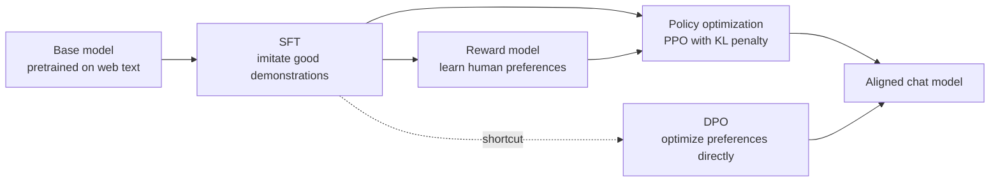
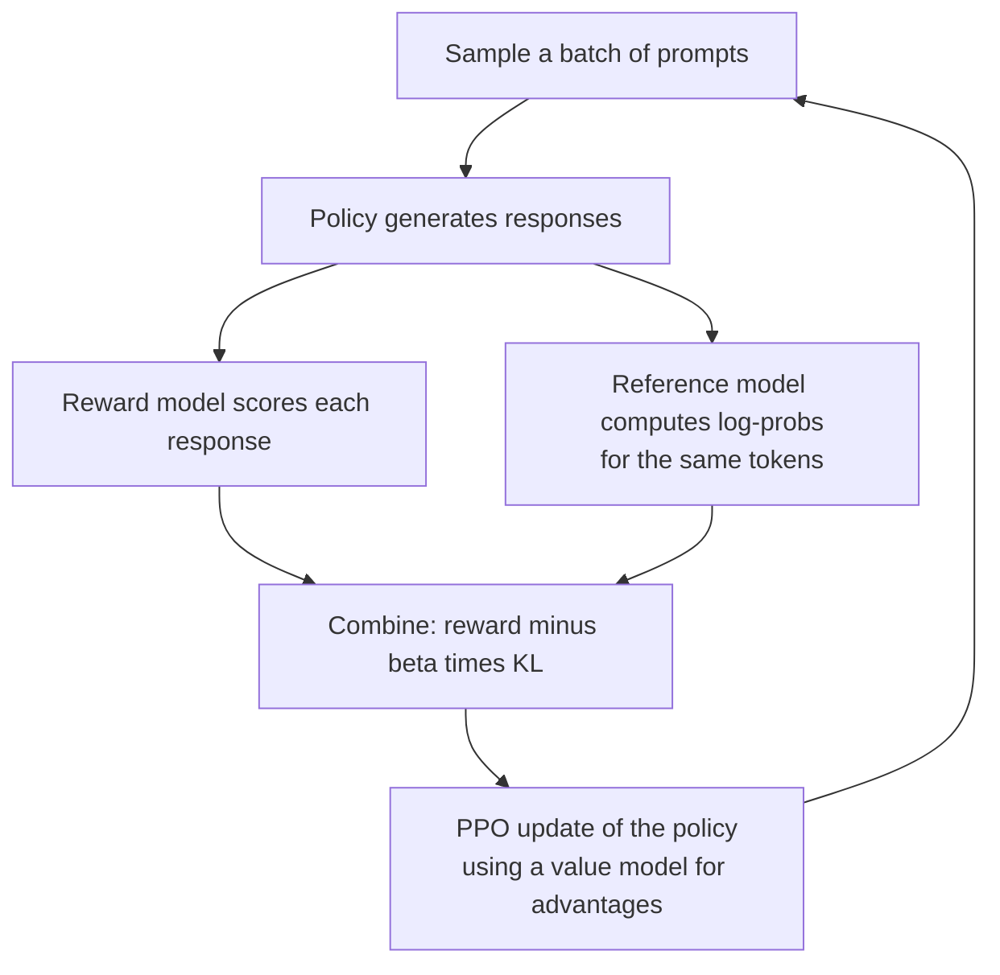
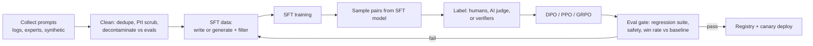

# How LLMs Are Trained, Part 2: Instruction Tuning, RLHF and DPO

> **Level:** Beginner to Advanced · **Study time:** ~80 min · **Prerequisites:** [Pretraining and Next-Token Prediction](./01-pretraining-and-next-token-prediction.md), [Softmax, Entropy, Cross-Entropy and KL Divergence](../00-foundations/05-softmax-entropy-cross-entropy-and-kl-divergence.md), [Tokenization](../04-transformers/01-tokenization.md)

## Table of contents

- [Why this matters](#why-this-matters)
- [The big picture: from base model to assistant](#the-big-picture-from-base-model-to-assistant)
- [Supervised fine-tuning (instruction tuning)](#supervised-fine-tuning-instruction-tuning)
- [Why SFT alone is not enough](#why-sft-alone-is-not-enough)
- [RLHF step 1: collecting preference data](#rlhf-step-1-collecting-preference-data)
- [RLHF step 2: the reward model and Bradley-Terry](#rlhf-step-2-the-reward-model-and-bradley-terry)
- [RLHF step 3: policy optimization with PPO and a KL penalty](#rlhf-step-3-policy-optimization-with-ppo-and-a-kl-penalty)
- [Reward hacking](#reward-hacking)
- [Direct Preference Optimization (DPO)](#direct-preference-optimization-dpo)
- [Related methods: IPO, KTO, ORPO, GRPO, RLVR and RLAIF](#related-methods-ipo-kto-orpo-grpo-rlvr-and-rlaif)
- [Pretraining vs SFT vs preference alignment](#pretraining-vs-sft-vs-preference-alignment)
- [Going deeper: the alignment tax and how fine-tuning damages capabilities](#going-deeper-the-alignment-tax-and-how-fine-tuning-damages-capabilities)
- [Going deeper: running post-training in production](#going-deeper-running-post-training-in-production)
- [Prompting, RAG or fine-tuning?](#prompting-rag-or-fine-tuning)
- [Common mistakes and misconceptions](#common-mistakes-and-misconceptions)
- [Interview questions and model answers](#interview-questions-and-model-answers)
- [Key takeaways](#key-takeaways)
- [Further reading](#further-reading)
- [Next](#next)

## Why this matters

A pretrained model is a brilliant autocomplete engine, not an assistant. Ask a raw base model "What is the capital of France?" and it may continue with "What is the capital of Germany? What is the capital of Spain?" because that looks like a quiz page from the internet. Everything that turns that engine into a product you can chat with, such as following instructions, answering in a helpful format, refusing harmful requests and stopping at the right place, comes from **post-training**: supervised fine-tuning plus preference alignment (RLHF, DPO and friends). In interviews this topic shows up constantly, because it tests whether you understand *why* chat models behave the way they do, what each training stage can and cannot change, and when your team should fine-tune at all instead of prompting or using RAG.

## The big picture: from base model to assistant

> **Analogy:** Think of training a new doctor. **Pretraining** is reading the entire medical library: huge knowledge, no bedside manner. **Supervised fine-tuning** is a residency where senior doctors show exactly how to handle patients, one example at a time. **Preference alignment** is feedback from patients and supervisors: "of these two ways you explained the diagnosis, this one was better." The knowledge mostly comes from the library; the behavior comes from the last two stages.

Recap from [Part 1](./01-pretraining-and-next-token-prediction.md): a **base model** (also called a pretrained model) is a decoder-only transformer trained to predict the next token on trillions of tokens of mostly web text. It knows a lot, but it only knows how to *continue documents*.

**Post-training** is everything done after pretraining to shape behavior. The classic recipe, popularized by **InstructGPT** ("Training language models to follow instructions with human feedback", Ouyang et al., 2022), has three stages:



- **Stage 1, SFT:** show the model examples of good responses and train it to imitate them.
- **Stage 2, reward model:** collect human judgments of which of two responses is better, and train a model to score responses.
- **Stage 3, RL:** let the SFT model generate answers, score them with the reward model, and nudge it toward higher scores, while a **KL penalty** keeps it close to where it started. (KL divergence measures how different two probability distributions are; the penalty grows as the model's token probabilities drift away from the SFT model's.)
- **DPO** collapses stages 2 and 3 into a single supervised-looking loss.

A striking InstructGPT result: human labelers preferred outputs from the 1.3B-parameter InstructGPT model over the 175B-parameter GPT-3 base model. In InstructGPT, post-training was a tiny fraction of pretraining compute but made a huge difference in perceived quality. (Large-scale RL for reasoning models has since grown post-training's share of compute considerably, though pretraining still usually dominates.)

Throughout this chapter we will use one running example: **a 7B base model that we want to turn into a helpful assistant**, plus one tiny prompt, "Capital of France?".

## Supervised fine-tuning (instruction tuning)

### The idea in plain English

> **Analogy:** You hire a smart intern who has read everything but has never worked at a help desk. You hand them a binder of 10,000 past tickets, each with the customer's question and the ideal reply. They study the binder and learn the *style* of a good reply.

**Supervised fine-tuning (SFT)** means continuing to train a pretrained model with the same next-token prediction objective, but on a curated dataset of (prompt, ideal response) pairs instead of raw web text.

**Instruction tuning** is SFT where the prompts are natural-language instructions covering many different tasks ("Summarize this", "Translate to French", "Write a SQL query that..."). The goal is a model that follows *new, unseen* instructions, not just the training tasks. The idea was shown at scale by **FLAN** ("Finetuned Language Models Are Zero-Shot Learners", Wei et al., 2021), which found that instruction tuning on many tasks phrased as instructions improves zero-shot performance (solving a task from its instruction alone, with no worked examples in the prompt) on held-out tasks.

In practice "SFT" and "instruction tuning" are used almost interchangeably for chat models. Strictly, instruction tuning is a *kind* of SFT (you could also SFT a model on just one task, like classifying support tickets).

### Data format

An SFT dataset is a list of examples. The simplest form is a single-turn instruction and response:

```json
{"instruction": "Capital of France?", "response": "The capital of France is Paris."}
```

Modern chat datasets store full conversations as a list of **messages**, each with a **role**:

```json
{
  "messages": [
    {"role": "system", "content": "You are a concise geography assistant."},
    {"role": "user", "content": "Capital of France?"},
    {"role": "assistant", "content": "Paris."},
    {"role": "user", "content": "And Germany?"},
    {"role": "assistant", "content": "Berlin."}
  ]
}
```

- **system:** standing instructions from the developer (persona, rules, format).
- **user:** what the human typed.
- **assistant:** what the model should say. These are the turns we train on.
- Many datasets also include **tool** messages (results returned by a function call); see [Structured Outputs and Function Calling](./05-structured-outputs-and-function-calling.md).

### Chat templates

The model never sees JSON. It sees one long token sequence. A **chat template** is the exact rule for flattening a list of messages into a string with special tokens that mark where each turn begins and ends. For example, the ChatML style used by several open models looks like this:

```text
<|im_start|>system
You are a concise geography assistant.<|im_end|>
<|im_start|>user
Capital of France?<|im_end|>
<|im_start|>assistant
Paris.<|im_end|>
```

Other model families use different markers (Llama 3, for example, uses tokens like `<|start_header_id|>` and `<|eot_id|>`). The details differ; the purpose is the same:

1. Tell the model who is speaking.
2. Give it an **end-of-turn token** that it learns to emit, so generation stops cleanly. (A base model has no idea when to stop, which is why it rambles.)
3. Make training and inference see *identical* formatting.

In Hugging Face, the template is stored with the tokenizer and applied with `apply_chat_template`:

```python
# pip install transformers
from transformers import AutoTokenizer

# Any chat model with a template works; this is a small, openly available one.
tok = AutoTokenizer.from_pretrained("Qwen/Qwen2.5-0.5B-Instruct")

messages = [
    {"role": "system", "content": "You are a concise geography assistant."},
    {"role": "user", "content": "Capital of France?"},
]

# add_generation_prompt=True appends the "assistant is now speaking" header,
# so the model knows it should produce the assistant turn next.
text = tok.apply_chat_template(messages, tokenize=False, add_generation_prompt=True)
print(text)
```

> **Common mistake:** Fine-tuning with one template and serving with another (or hand-building prompts with string concatenation). The model then sees unfamiliar markers, and you get symptoms like never stopping, repeating the user's turn, or answering in the wrong persona. If a fine-tuned chat model behaves strangely, check the template before anything else.

### Loss masking on prompt tokens

During pretraining, every token contributes to the loss. In SFT we usually compute the loss **only on the assistant's tokens**. This is called **loss masking** (also "completion-only loss" or "train on responses only").

> **Analogy:** When grading the intern, you mark their *replies*, not the customer's questions they copied out. Grading them on predicting the customer's words would teach them to imitate customers.

Why mask the prompt?

- We want to learn $p(\text{response} \mid \text{prompt})$, not to model what users type.
- Prompts are often long (documents to summarize, retrieved context). Without masking, prompt tokens dominate the loss and dilute the signal from the responses.
- Training on user turns can make the model generate fake user turns at inference ("User: ... Assistant: ..." loops).

The SFT loss with masking is:

$$
\mathcal{L}_{\text{SFT}} = -\frac{1}{|R|} \sum_{t \in R} \log p_\theta(x_t \mid x_{<t})
$$

- $x_1, \dots, x_T$: the full token sequence (system, user and assistant tokens after applying the chat template).
- $R$: the set of positions that belong to assistant responses (including the end-of-turn token). $|R|$ is how many there are.
- $p_\theta(x_t \mid x_{<t})$: the probability the model with parameters $\theta$ assigns to the correct token $x_t$, given all previous tokens. Note the prompt tokens are still *inside* $x_{<t}$; the model reads them, it just is not graded on predicting them.
- The minus sign and log turn "high probability on correct tokens" into "low loss". This is ordinary cross-entropy, explained in [the cross-entropy chapter](../00-foundations/05-softmax-entropy-cross-entropy-and-kl-divergence.md).

**Worked example (illustrative probabilities).** Our sequence has 4 prompt tokens ("Capital", "of", "France", "?") and 3 response tokens ("Paris", ".", `<end>`). Suppose the model assigns these probabilities to the correct next token:

| Token | Part | $p$ | $-\ln p$ |
|---|---|---|---|
| Capital | prompt | 0.05 | 2.9957 |
| of | prompt | 0.05 | 2.9957 |
| France | prompt | 0.05 | 2.9957 |
| ? | prompt | 0.05 | 2.9957 |
| Paris | response | 0.6 | 0.5108 |
| . | response | 0.9 | 0.1054 |
| `<end>` | response | 0.8 | 0.2231 |

- Masked loss (response only): $(0.5108 + 0.1054 + 0.2231) / 3 = 0.8393 / 3 = 0.2798$.
- Unmasked loss (all 7 tokens): prompt sum is $4 \times 2.9957 = 11.9829$; total $11.9829 + 0.8393 = 12.8222$; mean $12.8222 / 7 = 1.8317$.

Without masking, about 93% of the loss ($11.9829 / 12.8222$) comes from predicting the user's question, which is not what we care about. With masking, every gradient step is about producing better answers.

Here is the mechanism in PyTorch. Hugging Face convention: a label of `-100` means "ignore this position".

```python
# pip install torch
import torch
import torch.nn.functional as F

torch.manual_seed(0)
vocab_size = 10
# Toy token ids: 4 prompt tokens then 3 response tokens.
input_ids = torch.tensor([[1, 2, 3, 4, 5, 6, 7]])
num_prompt_tokens = 4

# Pretend these are the model's outputs: one score per vocab entry, per position.
logits = torch.randn(1, input_ids.shape[1], vocab_size)

# Labels are the input ids, with prompt positions masked out.
labels = input_ids.clone()
labels[:, :num_prompt_tokens] = -100

# Causal LM shift: the logits at position t predict the token at t+1.
shift_logits = logits[:, :-1, :]
shift_labels = labels[:, 1:]

loss = F.cross_entropy(
    shift_logits.reshape(-1, vocab_size),
    shift_labels.reshape(-1),
    ignore_index=-100,  # masked positions contribute nothing
)
print(loss)  # averaged over the 3 response positions only
```

In real code you pass `labels` to a Hugging Face causal LM and it does the shift and the `ignore_index` for you.

> **Senior insight:** Masking is the common default, not a law. Some teams train on prompts too when the prompts are high-quality and the dataset is small, and it occasionally helps. The point is to make it a deliberate choice and to check that your training library is actually doing what you think (inspect a batch and print which tokens have non-masked labels).

### Data quality over quantity

The most important lesson of modern SFT: **a few thousand excellent examples beat a million mediocre ones.**

- **LIMA** ("LIMA: Less Is More for Alignment", Zhou et al., 2023) fine-tuned a 65B LLaMA model on only 1,000 carefully curated examples and got a surprisingly strong assistant. The authors proposed the **superficial alignment hypothesis**: almost all knowledge is learned in pretraining, and SFT mainly teaches the *format and style* of interacting with users.
- **Self-Instruct** (Wang et al., 2022) showed a model can generate its own instruction data from a small seed set; Stanford's Alpaca applied this idea to LLaMA. This kicked off the era of **synthetic SFT data**: data generated by a stronger model and then filtered.

What "quality" means for SFT data:

| Property | Why it matters | How to enforce |
|---|---|---|
| Correctness | The model imitates errors faithfully, including hallucinated facts | Expert review, automated checks (run the code, verify the math) |
| Diversity | Narrow data gives a narrow model | Cluster prompts by topic and balance; dedupe near-duplicates |
| Consistent style | Mixed styles confuse the model about what "good" looks like | Written style guide for annotators |
| Right difficulty | Only trivial examples teach nothing new | Include hard and multi-step tasks |
| Honest refusals | Teaches when to say "I don't know" or decline | Include examples of appropriate refusals, not too many |
| No test leakage | Inflated benchmark scores | Decontaminate against eval sets (see [Contamination](./09-catastrophic-forgetting-contamination-and-memorization.md)) |

> **Common mistake:** Teaching facts with SFT that the base model does not know. If the response contains a fact the model cannot derive from its pretraining knowledge, SFT teaches it to *confidently state things it does not know*, a well-known source of [hallucinations](./06-hallucinations-and-grounding.md). For new knowledge, prefer RAG.

### SFT with a standard library

The usual library is Hugging Face **TRL** (Transformer Reinforcement Learning). Its API changes between versions, so treat this as conceptual but realistic, and check the docs for your installed version:

```python
# pip install trl transformers datasets peft
# NOTE: TRL's argument names evolve between releases (for example, the
# option for completion-only loss has been renamed over time). Check your version.
from datasets import load_dataset
from trl import SFTConfig, SFTTrainer

# A dataset with a "messages" column in the chat format shown above.
dataset = load_dataset("json", data_files="sft_data.jsonl", split="train")

config = SFTConfig(
    output_dir="sft-7b",
    num_train_epochs=2,             # SFT usually needs only a few epochs
    learning_rate=1e-5,             # much lower than pretraining peak LR
    per_device_train_batch_size=4,
    gradient_accumulation_steps=8,
    bf16=True,
    assistant_only_loss=True,       # loss masking on non-assistant tokens (recent TRL);
                                    # needs a template that marks assistant spans
                                    # (); older versions raise an error otherwise
    # A base model often ships with no chat template (or untrained special tokens),
    # so give it one explicitly, e.g. borrowed from an instruct model's tokenizer:
    chat_template_path="Qwen/Qwen2.5-0.5B-Instruct",
)

trainer = SFTTrainer(
    model="my-org/base-7b",         # a base model id or a loaded model
    args=config,
    train_dataset=dataset,          # chat template is applied from the tokenizer
)
trainer.train()
```

For a 7B model, full fine-tuning needs multiple large GPUs; parameter-efficient methods like LoRA (freeze the original weights and train small low-rank add-on matrices) make it fit on one. That is covered in [Fine-Tuning LLMs: Full, LoRA and QLoRA](./07-fine-tuning-full-lora-and-qlora.md).

## Why SFT alone is not enough

SFT is imitation. Imitation has limits:

1. **It cannot learn "better vs worse".** Every SFT example says "this exact answer is correct". It gives no signal about which of two plausible answers is preferable, or how bad a mistake is.
2. **Writing ideal answers is hard; comparing is easy.** Most people cannot write a perfect poem or a flawless legal summary, but they can reliably say which of two drafts is better. Comparisons are cheaper and more consistent than demonstrations.
3. **The ceiling is the demonstrator.** A model trained only to imitate annotators is capped near annotator quality.
4. **Teacher forcing.** During SFT the model always sees the *correct* previous tokens. At inference it sees its own outputs, and small errors can compound (this mismatch is called **exposure bias**). Training on the model's *own* samples, as RL does, addresses this.
5. **Negative signal is missing.** SFT never shows the model what *not* to do. Preference data contains a rejected answer, which is explicit negative feedback.

**Preference alignment** (or **preference optimization**) is the umbrella name for methods that train on comparisons. **RLHF** (Reinforcement Learning from Human Feedback) is the original one. Its roots are "Deep Reinforcement Learning from Human Preferences" (Christiano et al., 2017), applied to language in "Learning to Summarize from Human Feedback" (Stiennon et al., 2020) and to general assistants in InstructGPT (Ouyang et al., 2022).

## RLHF step 1: collecting preference data

> **Analogy:** An eye exam. The optometrist does not ask "describe your ideal lens". They ask "better with lens one, or lens two?" over and over. Pairwise comparisons are fast, reliable and easy to answer.

The procedure:

1. Take a set of prompts (from real users, if privacy allows, or written by annotators).
2. For each prompt, sample two or more responses from the SFT model (sometimes from several models, or with different temperatures, to get variety).
3. A human annotator picks the better one (or ranks several). The preferred response is **chosen** ($y_w$, "winner") and the other **rejected** ($y_l$, "loser").

One record of a **preference dataset** looks like this:

```json
{
  "prompt": "Capital of France?",
  "chosen": "The capital of France is Paris.",
  "rejected": "France is a country in Western Europe with a rich history. Its capital city has been a cultural centre for centuries."
}
```

Practical details a senior engineer should know:

- **Guidelines are the product.** "Better" must be defined: helpful, honest, harmless, concise, correctly formatted. Vague guidelines produce noisy labels and a reward model that learns annotator quirks.
- **Ties and confidence.** Many setups let annotators mark "about the same" or give a strength (for example, "slightly better" vs "much better"). Ties are often dropped from pairwise training.
- **Inter-annotator agreement** is the rate at which two annotators make the same choice on the same pair. It sets a soft ceiling on how accurate any reward model can be: if humans agree only some of the time, the label noise is irreducible.
- **Separate dimensions.** Some teams collect separate preferences for helpfulness and safety, since they can conflict. The Llama 2 paper (Touvron et al., 2023) trained two separate reward models for exactly this reason.
- **Rankings expand into pairs.** If an annotator ranks $K$ responses, you get $K(K-1)/2$ pairs. For $K = 4$ that is $4 \times 3 / 2 = 6$ pairs from one annotation.

## RLHF step 2: the reward model and Bradley-Terry

### What the reward model is

A **reward model (RM)** is a neural network that takes a prompt and a response and outputs a single number, a **reward** $r(x, y)$, meaning "how good is this response". It is usually built from the SFT model itself: remove the vocabulary output layer and add a **scalar head** (a linear layer that maps the final hidden state of the last token to one number).

```text
prompt + response tokens
          |
   [transformer (from SFT model)]
          |
   hidden state of last token
          |
   [linear layer: d_model -> 1]
          |
     reward r(x, y), e.g. 2.0
```

### The Bradley-Terry model

We only have *comparisons*, not absolute scores. How do we train a model to output scores? We use the **Bradley-Terry model** (Bradley and Terry, 1952), a classic statistical model for paired comparisons, also the idea behind chess Elo ratings.

> **Analogy:** Two chess players with ratings. The bigger the rating gap, the more likely the higher-rated player wins. Bradley-Terry says the same for responses: the bigger the reward gap, the more likely a human prefers the higher-reward response.

$$
P(y_w \succ y_l \mid x) = \sigma\big(r(x, y_w) - r(x, y_l)\big) = \frac{1}{1 + e^{-(r(x, y_w) - r(x, y_l))}}
$$

- $x$: the prompt.
- $y_w$, $y_l$: the chosen (winning) and rejected (losing) responses.
- $y_w \succ y_l$: "$y_w$ is preferred over $y_l$".
- $r(x, y)$: the reward model's score.
- $\sigma(z) = 1 / (1 + e^{-z})$: the **sigmoid function**, which squashes any number into a probability between 0 and 1. $\sigma(0) = 0.5$.

Only the *difference* of rewards matters. Adding 100 to every reward changes nothing, so rewards have no absolute meaning (many teams normalize them afterwards).

Training maximizes the probability of the human choices, which means minimizing the negative log-likelihood:

$$
\mathcal{L}_{\text{RM}} = -\log \sigma\big(r(x, y_w) - r(x, y_l)\big)
$$

This is just binary cross-entropy (logistic regression, see [Linear and Logistic Regression](../01-classical-ml/02-linear-and-logistic-regression.md)) where the "logit" is the reward difference and the label is always "the chosen one won".

**Worked example.** Two training pairs:

*Pair A (the RM agrees with the human):* $r(x, y_w) = 2.0$, $r(x, y_l) = 0.5$.

1. Difference: $2.0 - 0.5 = 1.5$.
2. $e^{-1.5} = 0.2231$.
3. $\sigma(1.5) = 1 / (1 + 0.2231) = 1 / 1.2231 = 0.8176$. The RM thinks there is an 81.8% chance a human prefers $y_w$.
4. Loss: $-\ln(0.8176) = 0.2014$. Small, because the RM is right.

*Pair B (the RM disagrees):* $r(x, y_w) = 0.5$, $r(x, y_l) = 2.0$.

1. Difference: $0.5 - 2.0 = -1.5$.
2. $\sigma(-1.5) = 1 - 0.8176 = 0.1824$.
3. Loss: $-\ln(0.1824) = 1.7014$. Large, so gradient descent pushes $r(x, y_w)$ up and $r(x, y_l)$ down.

Average over both pairs: $(0.2014 + 1.7014) / 2 = 0.9514$.

```python
import torch
import torch.nn.functional as F

def reward_model_loss(r_chosen: torch.Tensor, r_rejected: torch.Tensor) -> torch.Tensor:
    """Bradley-Terry loss: -log sigmoid(r_chosen - r_rejected), averaged over pairs."""
    # logsigmoid is numerically stable, unlike log(sigmoid(x))
    return -F.logsigmoid(r_chosen - r_rejected).mean()

r_chosen = torch.tensor([2.0, 0.5])    # Pair A, Pair B
r_rejected = torch.tensor([0.5, 2.0])
print(reward_model_loss(r_chosen, r_rejected))  # tensor(0.9514)

# The key RM metric: pairwise accuracy on held-out preference data.
accuracy = (r_chosen > r_rejected).float().mean()
print(accuracy)  # tensor(0.5000)
```

The headline metric for a reward model is **pairwise accuracy** on held-out pairs: how often it scores the human-chosen response higher. Compare it to inter-annotator agreement, which is roughly the ceiling.

> **Interview tip:** If asked "why pairwise comparisons instead of 1-10 ratings?", say: absolute ratings are poorly calibrated across annotators (one person's 7 is another's 5), drift over time, and are slower to give. Relative judgments are more consistent, and Bradley-Terry turns them into a scalar score anyway.

## RLHF step 3: policy optimization with PPO and a KL penalty

### Framing generation as reinforcement learning

**Reinforcement learning (RL)** is learning by trial and error: an agent takes actions, receives a reward, and adjusts to get more reward. Mapping that to an LLM:

| RL term | In RLHF |
|---|---|
| **Policy** $\pi_\theta$ | The LLM being trained (initialized from the SFT model) |
| State | The prompt plus the tokens generated so far |
| Action | The next token |
| Episode | Generating one full response |
| Reward | The reward model's score for the full response (plus a KL penalty, below) |
| **Reference model** $\pi_{\text{ref}}$ | A frozen copy of the SFT model |

The loop:



Because every batch of training data is freshly sampled from the model being trained, PPO-based RLHF is **on-policy**. Methods that learn from a fixed dataset generated earlier, possibly by a different model, are **offline** (or **off-policy**); DPO, below, is one of them.

### The objective and why the KL penalty is there

RLHF maximizes:

$$
\max_{\pi_\theta} \; \mathbb{E}_{x \sim D} \Big[ \mathbb{E}_{y \sim \pi_\theta(\cdot \mid x)} \big[ r(x, y) \big] \;-\; \beta \, \mathrm{KL}\big(\pi_\theta(\cdot \mid x) \,\|\, \pi_{\text{ref}}(\cdot \mid x)\big) \Big]
$$

- $D$: the distribution of prompts.
- $y \sim \pi_\theta(\cdot \mid x)$: a response sampled from the current policy.
- $r(x, y)$: the reward model's score.
- $\mathrm{KL}(\pi_\theta \| \pi_{\text{ref}})$: the **Kullback-Leibler divergence**, a measure of how different the policy's output distribution is from the reference model's (zero if identical; see [KL divergence](../00-foundations/05-softmax-entropy-cross-entropy-and-kl-divergence.md)).
- $\beta$: a positive number controlling how strongly we penalize drifting from the reference.

For one sampled response, the KL is estimated by the sum of per-token log-ratios:

$$
\mathrm{KL} \approx \sum_{t} \Big[ \log \pi_\theta(y_t \mid x, y_{<t}) - \log \pi_{\text{ref}}(y_t \mid x, y_{<t}) \Big] = \log \frac{\pi_\theta(y \mid x)}{\pi_{\text{ref}}(y \mid x)}
$$

So the effective reward of a response is $r(x, y) - \beta \log \frac{\pi_\theta(y \mid x)}{\pi_{\text{ref}}(y \mid x)}$.

**Worked example (illustrative numbers, $\beta = 0.1$).**

- Response 1: RM score 3.0, log-ratio 4.0 (moderately different from the reference). Effective reward: $3.0 - 0.1 \times 4.0 = 3.0 - 0.4 = 2.6$.
- Response 2: RM score 3.5, log-ratio 12.0 (a weird response the SFT model would almost never write). Effective reward: $3.5 - 0.1 \times 12.0 = 3.5 - 1.2 = 2.3$.

Response 2 "wins" on raw reward, but the KL penalty makes Response 1 the better target. That is exactly the point.

**Why the KL penalty (the interview answer):**

1. **The reward model is only trustworthy near its training data.** It was trained on responses from the SFT model. Far from that distribution, its scores are extrapolations and can be wildly wrong. The KL keeps the policy in the region where the RM is reliable.
2. **It limits reward hacking** (next section): without it, the policy finds bizarre outputs that exploit RM flaws. It does not eliminate hacking, so you still need early stopping and independent evals.
3. **It preserves language quality and capabilities.** The reference model writes fluent, knowledgeable text. Staying close to it avoids degenerate, repetitive or gibberish outputs and limits forgetting.
4. **It preserves diversity.** Pure reward maximization collapses toward a single "best" response; the KL term keeps probability mass spread out.

What happens at the extremes:

| $\beta$ | Behavior |
|---|---|
| $\beta = 0$ | Pure reward maximization; fast reward-hacking and collapse |
| Small | Large behavior change, more risk of hacking |
| Large | Policy barely moves from the SFT model; little benefit |

InstructGPT also mixed in a pretraining-data loss during PPO (they called it **PPO-ptx**) to reduce regressions on standard NLP benchmarks, a direct countermeasure to the alignment tax discussed later.

### PPO in brief

**PPO** (Proximal Policy Optimization, Schulman et al., 2017) is the RL algorithm classic RLHF uses. You do not need to derive it in an interview, but you should know its key idea: **take improvement steps, but never too large ones.**

$$
\mathcal{L}^{\text{CLIP}}(\theta) = \mathbb{E}_t \Big[ \min\big( \rho_t A_t,\; \mathrm{clip}(\rho_t, 1 - \epsilon, 1 + \epsilon)\, A_t \big) \Big], \qquad \rho_t = \frac{\pi_\theta(a_t \mid s_t)}{\pi_{\theta_{\text{old}}}(a_t \mid s_t)}
$$

(PPO maximizes this; in code you minimize its negative.)

- $\rho_t$: the **probability ratio**, how much more (or less) likely the new policy makes action $a_t$ compared with the policy that generated the data.
- $A_t$: the **advantage**, how much better this action turned out than expected. Positive means "do more of this". It is estimated using a **value model** (also called a critic), a separate network that predicts the expected future reward from each state.
- $\epsilon$: the clip range, commonly 0.2.
- $\mathrm{clip}(\rho, 1-\epsilon, 1+\epsilon)$: forces the ratio into $[0.8, 1.2]$ when $\epsilon = 0.2$.

**Worked example.** $A_t = 2$, $\epsilon = 0.2$, and the update has already made the action 30% more likely, so $\rho_t = 1.3$:

- Unclipped term: $1.3 \times 2 = 2.6$.
- Clipped term: $\mathrm{clip}(1.3, 0.8, 1.2) \times 2 = 1.2 \times 2 = 2.4$.
- $\min(2.6, 2.4) = 2.4$. For a positive advantage, beyond a ratio of 1.2 the objective stops increasing (for a negative advantage the same happens below 0.8), so there is no gradient pushing further. This keeps each update "proximal".

Why PPO-based RLHF is expensive and finicky: it juggles **four models** at once (policy, reference, reward, value), requires **generation inside the training loop** (slow, autoregressive sampling), and is sensitive to many hyperparameters (learning rate, $\beta$, clip range, value loss weight, batch sizes, reward normalization). This cost is the main motivation for DPO.

> **Senior insight:** A cheaper relative of PPO is **rejection sampling fine-tuning** (also called best-of-$n$ fine-tuning): sample $n$ responses per prompt, keep the one the reward model scores highest, and run SFT on those. No RL machinery at all. Llama 2 used rejection sampling alongside PPO.

## Reward hacking

> **Analogy:** A call center measures agents on "average call length under 3 minutes". Agents learn to hang up on difficult callers. The metric improves; the service gets worse. This is **Goodhart's law**: when a measure becomes a target, it ceases to be a good measure.

**Reward hacking** (also **reward over-optimization**) happens when the policy finds ways to get a high reward-model score without actually being better according to humans. The reward model is an imperfect *proxy* for human judgment, and RL is a powerful optimizer that finds every crack in the proxy.

Common forms in LLMs:

| Hack | What it looks like | Why the RM falls for it |
|---|---|---|
| Length exploitation | Answers grow longer and longer | Annotators often preferred more thorough answers, so length correlates with reward ("A Long Way to Go: Investigating Length Correlations in RLHF", Singhal et al., 2023) |
| Sycophancy | Agreeing with the user's stated opinion, flattering them | People tend to rate agreement favorably |
| Excessive hedging or refusal | "As an AI, I can't be sure..." everywhere | Safety-heavy preference data rewards caution |
| Formatting tricks | Bullet lists, headers, bold text on every answer | Looks organized to raters |
| Confident wrongness | Authoritative tone on wrong facts | Raters cannot always verify correctness |
| Degenerate text | Repeated phrases the RM scores highly | RM extrapolates badly off-distribution |

"Scaling Laws for Reward Model Overoptimization" (Gao, Schulman and Hilton, 2022) showed the characteristic pattern: as the policy moves further from the initial model (measured by KL), the proxy reward keeps rising, but the true ("gold") reward rises, peaks and then *falls*.

```text
reward
  ^         proxy RM score
  |                    ......------
  |            ..-----'
  |       ..--'        _____
  |    .-'        ..--'     '--..     true quality
  |  .'       ..-'               '--.
  | /    ..--'                       '-.
  |/..--'
  +------------------------------------------> KL from reference
             ^ good stopping point
```

How to detect and mitigate:

- **Track KL and response length during training.** Fast-rising KL or length is a red flag.
- **Evaluate with something other than the training RM:** held-out human evaluations, a different reward model, or an LLM judge with length control (see [LLM evaluation](./10-llm-evaluation-metrics-and-llm-as-a-judge.md)). A **win rate** is the share of head-to-head comparisons a model wins against a baseline; a **length-controlled** win rate adjusts it so that simply writing more does not count as winning.
- **Read samples.** Humans spot hacks quickly that metrics miss.
- **Use the KL penalty and early stopping** at the checkpoint with the best *held-out* quality, not the best training reward.
- **Improve the RM:** more diverse data, adversarial examples, length-balanced pairs, ensembles of RMs.
- **Use verifiable rewards where possible** (unit tests, exact math answers), which are much harder to hack (see RLVR below).

## Direct Preference Optimization (DPO)

### The key idea

> **Analogy:** RLHF is like training a food critic (reward model), then having a chef cook thousands of dishes for the critic to score, adjusting recipes each round. DPO says: you already have pairs of dishes where diners said "this one, not that one". Just adjust the recipes directly so the chef becomes more likely to make the preferred dish and less likely to make the rejected one, relative to the original recipes. No critic, no cooking loop.

**DPO** ("Direct Preference Optimization: Your Language Model is Secretly a Reward Model", Rafailov et al., 2023) trains the policy directly on preference pairs with a simple classification-style loss:

- **No explicit reward model** is trained.
- **No RL sampling loop**: no generation during training, no value model, no PPO.
- In theory it optimizes the *same* KL-regularized objective as RLHF (under the Bradley-Terry assumption). In practice the two can end up at different models, because DPO only sees a fixed offline dataset.

You need just two models: the policy being trained and a frozen reference (usually the SFT model).

### Where it comes from (short derivation)

The RLHF objective above (maximize reward minus $\beta$ times KL) has a known exact solution. The optimal policy is:

$$
\pi^*(y \mid x) = \frac{1}{Z(x)} \, \pi_{\text{ref}}(y \mid x) \, \exp\!\Big(\frac{r(x, y)}{\beta}\Big)
$$

In words: start from the reference model and up-weight each response exponentially by its reward. $Z(x)$ is a normalizing constant (the **partition function**) that makes probabilities sum to 1; it is intractable to compute because it sums over every possible response.

**Toy example.** Pretend only two responses exist, the reference gives each probability 0.5, and their rewards are 1 and 0. With $\beta = 1$: unnormalized weights $0.5e^{1} = 1.359$ and $0.5e^{0} = 0.5$, so $Z = 1.859$ and $\pi^* = (0.731, 0.269)$. With $\beta = 0.5$ the reward is divided by a smaller number ($0.5e^{2} = 3.695$): $Z = 4.195$ and $\pi^* = (0.881, 0.119)$. Smaller $\beta$ lets the optimum move further from the reference.

Take logs and rearrange to express the reward in terms of the policy:

$$
r(x, y) = \beta \log \frac{\pi^*(y \mid x)}{\pi_{\text{ref}}(y \mid x)} + \beta \log Z(x)
$$

Now plug this into Bradley-Terry, which only uses the *difference* $r(x, y_w) - r(x, y_l)$. The $\beta \log Z(x)$ term is identical for both responses (same prompt), so it **cancels**. That is the trick: the intractable part disappears, and the reward is now expressed purely through the policy. Hence the paper's title: the language model *is* (implicitly) the reward model.

### The DPO loss

$$
\mathcal{L}_{\text{DPO}} = -\log \sigma\left( \beta \left[ \log \frac{\pi_\theta(y_w \mid x)}{\pi_{\text{ref}}(y_w \mid x)} - \log \frac{\pi_\theta(y_l \mid x)}{\pi_{\text{ref}}(y_l \mid x)} \right] \right)
$$

- $\pi_\theta$: the policy being trained.
- $\pi_{\text{ref}}$: the frozen reference model (the SFT model).
- $\log \pi(y \mid x)$: the log-probability of the whole response, the sum of per-token log-probabilities over the response tokens only (the prompt is masked, just like SFT).
- $\log \frac{\pi_\theta(y \mid x)}{\pi_{\text{ref}}(y \mid x)}$: how much *more* likely the policy makes this response compared with the reference. $\beta$ times this is the **implicit reward** $\hat{r}(x, y)$.
- $\beta$: the same KL-strength coefficient as in RLHF.
- $\sigma$: the sigmoid.

**In words:** "Increase the probability of the chosen response and decrease the probability of the rejected response, *relative to the reference model*, and stop pushing once the margin is comfortably large."

It is the reward-model loss from before, with the reward replaced by the implicit reward.

**Worked example ($\beta = 0.1$).** Sequence log-probabilities for one pair:

| | Policy $\log \pi_\theta$ | Reference $\log \pi_{\text{ref}}$ | Log-ratio |
|---|---|---|---|
| Chosen $y_w$ | -12 | -14 | $-12 - (-14) = +2$ |
| Rejected $y_l$ | -15 | -13 | $-15 - (-13) = -2$ |

1. Difference of log-ratios: $2 - (-2) = 4$.
2. Multiply by $\beta$: $0.1 \times 4 = 0.4$. (Implicit rewards: chosen $+0.2$, rejected $-0.2$, margin $0.4$.)
3. $\sigma(0.4) = 1 / (1 + e^{-0.4}) = 1 / (1 + 0.6703) = 1 / 1.6703 = 0.5987$.
4. Loss: $-\ln(0.5987) = 0.5130$.

At the very start of training the policy equals the reference, so both log-ratios are 0, the margin is 0, $\sigma(0) = 0.5$ and the loss is $-\ln 0.5 = 0.6931$. Watching the loss fall from $0.693$ is a quick sanity check.

**Gradient intuition.** The gradient of the DPO loss scales each example by $\sigma(\hat{r}_l - \hat{r}_w)$, which is large when the model currently ranks the pair *wrongly* and near zero when it already ranks it right with a big margin. So DPO focuses on the pairs it gets wrong, like a well-behaved logistic regression.

### From-scratch DPO in PyTorch

```python
import torch
import torch.nn.functional as F

def sequence_logprob(logits: torch.Tensor, labels: torch.Tensor) -> torch.Tensor:
    """Sum of log-probs of the label tokens. labels == -100 marks masked (prompt) positions.
    logits: (batch, seq, vocab), labels: (batch, seq). Returns (batch,)."""
    logits = logits[:, :-1, :]                   # position t predicts token t+1
    labels = labels[:, 1:]
    mask = labels != -100
    safe_labels = labels.masked_fill(~mask, 0)  # any valid id; masked out below
    logp = torch.log_softmax(logits, dim=-1)
    token_logp = logp.gather(-1, safe_labels.unsqueeze(-1)).squeeze(-1)
    return (token_logp * mask).sum(dim=-1)

def dpo_loss(pi_chosen, pi_rejected, ref_chosen, ref_rejected, beta=0.1):
    """All inputs are sequence log-probs of shape (batch,)."""
    chosen_reward = beta * (pi_chosen - ref_chosen)        # implicit reward of y_w
    rejected_reward = beta * (pi_rejected - ref_rejected)  # implicit reward of y_l
    loss = -F.logsigmoid(chosen_reward - rejected_reward).mean()
    return loss, chosen_reward.detach(), rejected_reward.detach()

# The worked example from the text:
loss, rc, rr = dpo_loss(
    pi_chosen=torch.tensor([-12.0]), pi_rejected=torch.tensor([-15.0]),
    ref_chosen=torch.tensor([-14.0]), ref_rejected=torch.tensor([-13.0]),
)
print(loss)  # tensor(0.5130)

# At initialization (policy == reference) the loss is ln 2:
same = torch.tensor([-12.0])
loss0, _, _ = dpo_loss(same, same, same, same)
print(loss0)  # tensor(0.6931)
```

In a real training step you run four forward passes (policy and reference, on chosen and rejected), but only the policy gets gradients. Because the reference is frozen, its log-probs can be **precomputed once** for the whole dataset, so only the policy needs to be in GPU memory during training.

### DPO with TRL

```python
# pip install trl transformers datasets peft
# NOTE: version-fragile. Older TRL used tokenizer=..., newer uses processing_class=...
# Older transformers used torch_dtype=...; since about v4.56 it is dtype=...
from datasets import load_dataset
from transformers import AutoModelForCausalLM, AutoTokenizer
from trl import DPOConfig, DPOTrainer

model_id = "my-org/sft-7b"   # start from your SFT model, not the base model
model = AutoModelForCausalLM.from_pretrained(model_id, dtype="auto")
tok = AutoTokenizer.from_pretrained(model_id)

# Each row: {"prompt": ..., "chosen": ..., "rejected": ...}
dataset = load_dataset("json", data_files="prefs.jsonl", split="train")

config = DPOConfig(
    output_dir="dpo-7b",
    beta=0.1,                    # KL strength; 0.1 is a common starting point
    learning_rate=5e-7,          # DPO typically uses a much smaller LR than SFT
    num_train_epochs=1,
    per_device_train_batch_size=2,
    gradient_accumulation_steps=16,
    bf16=True,
)

# If ref_model is not given, TRL makes a frozen copy of the initial model
# (or, with a LoRA adapter, uses the base weights with the adapter disabled).
trainer = DPOTrainer(model=model, args=config, train_dataset=dataset, processing_class=tok)
trainer.train()
# Logged metrics to watch: rewards/chosen, rewards/rejected, rewards/margins, rewards/accuracies
```

### The role of beta

$\beta$ controls how far the policy may move from the reference.

- **Larger $\beta$:** each unit of log-ratio counts for more, so the sigmoid saturates after only a small change. The model satisfies the preferences with *small* deviations and stays close to the reference. Safer, but weaker effect.
- **Smaller $\beta$:** the model must move its log-probabilities a lot to get the same margin, so it drifts further. Stronger effect, more risk of overfitting and degraded fluency.

Quick numeric check with the same log-ratio difference of 4: $\beta = 0.1$ gives $\sigma(0.4) = 0.599$ (loss 0.513, still pushing), while $\beta = 0.5$ gives $\sigma(2.0) = 0.881$ (loss $-\ln 0.881 = 0.127$, nearly satisfied). With the larger $\beta$, the model has "done enough" sooner.

Values around 0.1 are a common default (TRL's default is 0.1); teams sweep it alongside the learning rate.

### RLHF (PPO) vs DPO

| | RLHF with PPO | DPO |
|---|---|---|
| Models in memory | Policy, reference, reward, value (4) | Policy, reference (2; reference can be precomputed) |
| Generation during training | Yes (on-policy samples) | No (offline, fixed dataset) |
| Explicit reward model | Yes, reusable for filtering and eval | No (implicit reward only) |
| Stability and tuning | Finicky, many hyperparameters | Simple, supervised-like, few hyperparameters |
| Compute cost | High | Low to moderate |
| Explores new responses | Yes, can discover responses better than the dataset | No, only learns from the given pairs |
| Main risks | Reward hacking, instability | Overfitting to the preference data, distribution mismatch, chosen log-prob can fall too |
| Typical use | Frontier labs with big infrastructure; when an RM or verifier is available | Most open-model and enterprise alignment work |

Rough memory arithmetic for our 7B example (illustrative, ignoring activations): full fine-tuning with mixed-precision Adam needs about 16 bytes per trainable parameter (weights, gradients, optimizer states; see [Training Memory](../02-deep-learning/10-distributed-training-and-training-memory.md)), so $7 \times 10^9 \times 16 = 112$ GB per trained model. PPO trains the policy and the value model ($2 \times 112 = 224$ GB) and runs reference and reward in BF16 at 2 bytes per parameter ($2 \times 14 = 28$ GB): about 252 GB. DPO trains one model (112 GB) plus a 14 GB reference, or just 112 GB with precomputed reference log-probs. LoRA cuts all of these dramatically.

> **Senior insight:** DPO is *offline*: it learns from responses that were generated once, often by a different model. If the preference pairs come from a model very different from your SFT model, the log-ratios are computed on text your model finds unlikely, which weakens and destabilizes training. Two common fixes: generate the pairs with your own SFT model (**on-policy data**), and run DPO **iteratively** (generate, label with humans or an AI judge, train, repeat). Iterative/online DPO recovers part of what RL's exploration provides.

> **Common mistake:** Assuming DPO increases the probability of chosen responses. The loss only cares about the *margin*. It is common to see both chosen and rejected log-probs fall, with rejected falling faster. If chosen log-probs fall a lot, the model can drift toward odd outputs. Monitor both, and consider adding a small SFT term on chosen responses (some recipes do this).

## Related methods: IPO, KTO, ORPO, GRPO, RLVR and RLAIF

The field moves fast; names and best practices shift year to year (this chapter reflects 2026). Know the *problem each method solves*.

**IPO** (Identity Preference Optimization; "A General Theoretical Paradigm to Understand Learning from Human Preferences", Azar et al., 2023). DPO's sigmoid loss keeps rewarding larger margins, so on preference data that is (nearly) deterministic it can push log-ratios toward infinity and overfit, effectively ignoring the KL regularization. IPO replaces the log-sigmoid with a squared loss that pulls the margin toward a fixed target instead of infinity. Use when DPO overfits.

**KTO** (Kahneman-Tversky Optimization; "KTO: Model Alignment as Prospect Theoretic Optimization", Ethayarajh et al., 2024). Needs only *unpaired* binary feedback: "this response was good" or "this one was bad" (think thumbs up/down in your product). It is inspired by prospect theory from behavioral economics (people weigh a loss more heavily than an equal-sized gain). Use when you have lots of thumbs feedback but few true pairs.

**ORPO** (Odds Ratio Preference Optimization; "ORPO: Monolithic Preference Optimization without Reference Model", Hong et al., 2024). Combines SFT and preference alignment into one stage: the SFT loss on chosen responses plus an odds-ratio term that penalizes the rejected one. No reference model and no separate SFT stage. Use when you want a single, cheaper training run. (SimPO, Meng et al., 2024, is another reference-free variant that uses length-normalized log-probabilities.)

**GRPO** (Group Relative Policy Optimization; introduced in "DeepSeekMath", Shao et al., 2024). An RL method like PPO but **without a value model**. For each prompt, sample a *group* of $G$ responses, score them, and use each response's reward relative to the group as its advantage:

$$
A_i = \frac{r_i - \mathrm{mean}(r_1, \dots, r_G)}{\mathrm{std}(r_1, \dots, r_G)}
$$

- $r_i$: the reward of the $i$-th response in the group.
- mean and std: computed over the $G$ responses for the same prompt.

**Worked example.** A math prompt, $G = 4$ samples, reward 1 if the final answer is correct, else 0: rewards $[1, 0, 0, 1]$.

1. Mean: $(1 + 0 + 0 + 1) / 4 = 0.5$.
2. Std (population): deviations are $\pm 0.5$, squared $0.25$ each, mean $0.25$, square root $0.5$.
3. Advantages: $(1 - 0.5)/0.5 = +1$, $(0 - 0.5)/0.5 = -1$, so $[+1, -1, -1, +1]$. (Implementations differ in the std: TRL, for example, uses the sample std with Bessel's correction, $\sqrt{1/3} \approx 0.577$, giving $[+0.87, -0.87, -0.87, +0.87]$. The signs and the ranking are what matter.)

Correct answers get pushed up, wrong ones pushed down. If all four were correct (or all wrong), every advantage would be zero (the std is 0, so implementations add a small constant to avoid division by zero): that prompt teaches nothing, which is why prompt difficulty matters. Dropping the value model saves memory and removes a hard-to-train component. The original GRPO keeps a clipped PPO-style ratio and a KL term to the reference. Later variants (for example DAPO and Dr. GRPO, both 2025) often drop the KL term, and Dr. GRPO also drops the std division because it biases training by question difficulty; recent TRL versions default to no KL term (`beta=0.0`), so no reference model is loaded.

**RLVR** (Reinforcement Learning from Verifiable Rewards; the term was popularized by the Tülu 3 report, Lambert et al., 2024). Instead of a learned reward model, the reward comes from a **programmatic verifier**: does the math answer match, do the unit tests pass, does the output parse as valid JSON. Verifiable rewards are much harder to hack than a learned RM. RLVR with GRPO-style algorithms is central to training **reasoning models**, such as DeepSeek-R1 (DeepSeek-AI, 2025), which learn to produce long chains of thought because longer, more careful reasoning gets more answers right. See [Reasoning Models and Test-Time Compute](./12-reasoning-models-and-test-time-compute.md).

**RLAIF** (Reinforcement Learning from AI Feedback). Replace (some) human annotators with an LLM that judges which response is better, often guided by a written list of principles. "Constitutional AI: Harmlessness from AI Feedback" (Bai et al., 2022) used a set of principles (a "constitution") to have a model critique and revise its own responses for SFT data, and then choose the better of two responses to produce AI preference labels for RL; "RLAIF vs. RLHF" (Lee et al., 2023) compared AI and human feedback for summarization and dialogue. Zephyr (Tunstall et al., 2023) combined AI-labeled preferences (UltraFeedback) with DPO. Pros: cheap, fast, scalable, consistent. Cons: inherits the judge's biases (length, self-preference, style), can amplify errors, and the judge's terms of use and licenses must allow it.

| Method | Data needed | Reward model? | Reference model? | Online sampling? | Best for |
|---|---|---|---|---|---|
| PPO RLHF | Pairs (to train RM) + prompts | Yes | Yes | Yes | Max quality with big infra |
| DPO | Pairs | No (implicit) | Yes | No | Default simple alignment |
| IPO | Pairs | No | Yes | No | DPO overfitting |
| KTO | Unpaired good/bad labels | No | Yes | No | Thumbs-up/down feedback |
| ORPO | Pairs | No | No | No | One-stage SFT + alignment |
| GRPO | Prompts + reward function | Optional (often a verifier) | In the original (for KL); often dropped now | Yes | Reasoning, math, code |
| RLVR | Prompts with checkable answers | No, a verifier | Usually | Yes | Tasks with objective correctness |
| RLAIF | Prompts; AI labels the pairs | Depends | Depends | Depends | Scaling feedback cheaply |

## Pretraining vs SFT vs preference alignment

| | Pretraining | Supervised fine-tuning | Preference alignment (RLHF, DPO, ...) |
|---|---|---|---|
| Data | Trillions of tokens of raw text (web, books, code) | Thousands to hundreds of thousands of (prompt, ideal response) examples | Thousands to hundreds of thousands of comparisons (chosen vs rejected), or prompts plus a reward function |
| Who makes the data | Scraped and filtered automatically | Expert writers, or a stronger model with filtering | Human raters comparing outputs, AI judges, or verifiers |
| Objective | Next-token cross-entropy on all tokens | Next-token cross-entropy on response tokens only | Bradley-Terry RM + PPO with KL, or DPO-style loss, or verifiable-reward RL |
| Signal type | "What text comes next" | "Say exactly this" (positive examples only) | "This is better than that" (relative, includes negatives) |
| Compute cost | By far the largest share (thousands of GPUs for weeks to months at frontier scale) | Small (hours to days on a few GPUs for a 7B model) | Small to moderate for DPO; PPO and RLVR are heavier, and large-scale RLVR for frontier reasoning models can be a substantial fraction of pretraining compute |
| What it changes | Knowledge, language ability, reasoning capacity | Format, instruction following, chat behavior, turn-taking, task skills | Tone, helpfulness ranking, honesty, refusals, safety, reasoning strategies (with RLVR) |
| What it does not do well | Follow instructions, stop cleanly | Distinguish better from worse; exceed demonstrator quality | Add new knowledge |
| Typical failure | Memorization, toxic content absorbed from web | Imitating errors, hallucination from unfamiliar facts, forgetting | Reward hacking, verbosity, sycophancy, alignment tax |

(Scales in this table are rough orders of magnitude for orientation, not measurements of any specific model.)

## Going deeper: the alignment tax and how fine-tuning damages capabilities

### The alignment tax

The **alignment tax** is the drop in some capabilities caused by alignment training. InstructGPT reported that RLHF caused performance regressions on several public NLP benchmarks, and introduced PPO-ptx (mixing in pretraining gradients) to reduce them.

Other observed side effects of preference alignment:

- **Calibration loss.** A model is **calibrated** when its confidence matches its accuracy (of answers given with 70% confidence, about 70% are right). The GPT-4 Technical Report (OpenAI, 2023) showed the pretrained model's confidence was well calibrated on a multiple-choice benchmark, while the post-trained model was less calibrated. Aligned models often sound confident regardless of correctness.
- **Reduced diversity.** Aligned models give more similar answers across samples (sometimes called mode collapse), which hurts creative tasks and makes sampling-based techniques less useful.
- **Over-refusal.** Safety training can make models refuse harmless requests that look superficially risky.
- **Verbosity and style homogenization.** Reward models that liked long, structured answers produce models that over-explain.

> **Senior insight:** The tax is not a fixed law. Well-designed post-training often *improves* most benchmarks, because the model now understands what the question wants. The tax shows up where the alignment objective and the capability conflict (calibration, diversity) or where training data is narrow.

### How fine-tuning damages capabilities on other tasks

When you fine-tune on task A, you update weights that also serve tasks B, C and D. Mechanisms:

1. **Catastrophic forgetting.** Gradient updates for the new data overwrite parameters that encoded older skills; with no older data in the mix, nothing protects them. Worse with high learning rates, many epochs and narrow data. Details in [Catastrophic Forgetting](./09-catastrophic-forgetting-contamination-and-memorization.md).
2. **Format and behavior overfitting.** Fine-tune only on "output a JSON label" and the model may answer *every* question with a JSON label, or lose its ability to hold a conversation.
3. **Distribution narrowing.** The output distribution concentrates on the fine-tuning style: shorter answers, a fixed tone, reduced reasoning steps.
4. **Safety regression.** "Fine-tuning Aligned Language Models Compromises Safety, Even When Users Do Not Intend To!" (Qi et al., 2023) showed that fine-tuning on a handful of harmful examples can strip safety behavior, and that even fine-tuning on benign data can weaken it.
5. **Hallucination from unknown facts.** As discussed in SFT, training on facts the model does not know teaches it to fabricate confidently.
6. **Template and tokenizer mismatch.** Adding special tokens or changing the template without care can break chat behavior entirely.

Mitigations:

| Mitigation | How it helps |
|---|---|
| Mix general data into the fine-tuning set (replay) | Keeps old skills exercised |
| Lower learning rate, fewer epochs, early stopping | Smaller weight changes |
| Parameter-efficient fine-tuning (LoRA) | Base weights frozen; changes are low-rank and removable ([LoRA chapter](./07-fine-tuning-full-lora-and-qlora.md)) |
| KL regularization to the original model | Penalizes drift directly |
| Start from the instruct model, keep its chat template | Preserves its alignment and formatting |
| Before/after regression suite | Detects damage: general benchmarks, safety prompts, your own product evals |

> **Interview tip:** Always say *how you would measure* damage: "I keep a fixed regression suite covering general knowledge, reasoning, instruction following, safety refusals and our product tasks, and I compare the fine-tuned model to the original on all of it, not just on the target task." See [Building an LLM Evaluation Framework](./11-building-an-llm-evaluation-framework-and-regression-tests.md).

## Going deeper: running post-training in production

### A realistic pipeline



Production concerns:

- **Data governance.** Using user logs for training requires consent and privacy review; scrub PII. If you generate data with a commercial model, check its terms of service.
- **Versioning.** Version prompts, preference datasets, reward models and checkpoints together so you can reproduce and roll back (see [Data and Model Versioning](../10-mlops/02-data-and-model-versioning-and-model-registry.md)).
- **Evaluation gates.** Release only if the new model beats the current one on your task evals *and* does not regress on safety and general capability.
- **Cost.** SFT and DPO with LoRA on a 7B model are routine on a single node. PPO or GRPO at scale need generation infrastructure (often a fast inference engine running alongside the trainer), which is a significant engineering investment.

### What to monitor and how to debug

| Method | Metric | Healthy | Warning sign |
|---|---|---|---|
| SFT | Training and validation loss on responses | Validation loss drops then flattens | Validation rising (overfitting); suspiciously low loss (duplicates, leakage) |
| RM | Held-out pairwise accuracy | Clearly above 50%, approaching inter-annotator agreement | Near 50% (noisy labels) or near 100% (trivial pairs, leakage) |
| PPO / GRPO | Mean reward, KL to reference, response length | Reward up, KL growing slowly | KL exploding, length ballooning, reward up but human evals flat (hacking) |
| DPO | Loss (from 0.693), rewards/accuracies, rewards/margins, chosen and rejected log-probs | Accuracy rises, margin grows, chosen log-probs roughly stable | Chosen log-probs collapsing, accuracy hits 100% fast (overfitting or trivial pairs) |
| All | Sampled outputs read by humans | Better answers | Repetition, odd formatting, refusals, never stopping |

Debugging checklist when an aligned model behaves badly:

1. **Never stops or outputs role markers?** Chat template mismatch or the end-of-turn token was masked out of the loss.
2. **Answers are much longer than before?** Length bias in the preference data or RM. Length-balance pairs, use length-controlled evals.
3. **Model got dumber on general tasks?** Forgetting: lower LR, fewer epochs, LoRA, mix general data.
4. **DPO has no effect?** $\beta$ too large, LR too small, chosen and rejected nearly identical, or pairs off-policy.
5. **Refuses harmless requests?** Too many refusal examples; add "borderline but safe" examples where the correct behavior is to help.

## Prompting, RAG or fine-tuning?

This deserves its own chapter ([Prompting vs RAG vs Fine-Tuning: A Decision Guide](./08-prompting-vs-rag-vs-fine-tuning-decision-guide.md)), but here is the core rule a senior engineer applies:

- **Prompting** changes what you *ask*. Cheapest, fastest to iterate. Always start here.
- **RAG** changes what the model *knows at answer time* by retrieving documents ([What Is RAG](../08-rag/01-what-is-rag-and-why-it-matters.md)). Use for knowledge that is private, large or changing, and when you need citations.
- **Fine-tuning** changes how the model *behaves*: format, style, tone, domain-specific skills, consistency, or making a smaller model do a narrow task as well as a larger prompted one.

| Need | Prompting | RAG | Fine-tuning |
|---|---|---|---|
| Fresh or private facts | Only if they fit in context | Best fit | Poor (stale, hallucination-prone, hard to update) |
| Consistent output format or style | Often enough | No effect | Strong |
| Citations and auditability | No | Yes | No |
| Lower latency or cost via a smaller model | No | No | Yes (often with distillation: training a small model on a larger model's outputs) |
| Speed to first version | Hours | Days | Days to weeks, needs data and evals |
| Main risk | Brittle prompts | Retrieval failures | Forgetting, maintenance burden |

They combine: many production systems use a fine-tuned model *inside* a RAG pipeline with a carefully engineered prompt. The decision is driven by an eval set: try the cheapest option first and escalate only when measurements show it falls short.

## Common mistakes and misconceptions

- **"RLHF teaches the model new facts."** It mostly reshapes behavior. Knowledge comes from pretraining (and RAG at inference).
- **"Fine-tuning is the way to add our company's documents."** Use RAG for knowledge; fine-tune for behavior.
- **Mismatched chat templates** between training and serving, causing never-ending or garbled responses.
- **Forgetting to mask prompt tokens** (or accidentally masking the end-of-turn token, so the model never learns to stop).
- **More SFT data is always better.** Quality and diversity beat volume; noisy data teaches noise.
- **"DPO has no reward."** It has an *implicit* reward, $\beta \log(\pi_\theta / \pi_{\text{ref}})$, and it optimizes the same KL-regularized objective as RLHF.
- **"DPO raises the probability of chosen responses."** It raises the *margin*; both can fall.
- **Running DPO on the base model** instead of an SFT model. The reference should already be a reasonable assistant.
- **Judging an RLHF run by training reward.** Rising proxy reward can mean reward hacking. Use held-out human or independent evaluations.
- **Setting $\beta$ to 0 "to get more improvement".** You lose the anchor and invite collapse.
- **Evaluating only on the target task** after fine-tuning, missing regressions in safety and general ability.
- **Thinking the KL penalty is just regularization trivia.** It is the reason the reward model's scores remain meaningful.

## Interview questions and model answers

<details>
<summary><b>Q1. Compare pretraining, supervised fine-tuning and preference alignment.</b></summary>

**Short answer:** Pretraining trains next-token prediction on trillions of tokens of raw text and gives the model its knowledge and language ability; it uses most of the compute. SFT trains the same next-token loss but only on response tokens of curated prompt-response pairs, teaching the model to follow instructions and use a chat format. Preference alignment (RLHF, DPO and variants) trains on comparisons, "A is better than B", to make the model prefer helpful, honest and safe responses, which imitation alone cannot express.

**Deeper answer and follow-ups:**
- Data: raw web text vs thousands to hundreds of thousands of demonstrations vs comparison pairs (or prompts plus a verifier).
- Objective: cross-entropy on all tokens; cross-entropy masked to responses; Bradley-Terry reward model plus PPO with KL, or the DPO loss, or verifiable-reward RL like GRPO.
- What changes: knowledge and capability; format and instruction following; ranking among plausible answers, tone, refusals and (with RLVR) reasoning strategies.
- The superficial alignment hypothesis (LIMA, Zhou et al., 2023): post-training mostly unlocks and shapes what pretraining already learned.
- Pitfalls per stage: memorization in pretraining; imitating errors and forgetting in SFT; reward hacking, verbosity and the alignment tax in preference alignment.
- Diagnosing which stage owns a problem: if the knowledge is missing even when you prompt the base model with a few examples, post-training will not reliably add it (pretraining or RAG problem); if the knowledge is there but format or instruction following is wrong, that is SFT; if answers are valid but the model picks the worse of several plausible ones (verbose, sycophantic, unsafe), that is preference alignment.
- How each is measured: pretraining by held-out loss or perplexity and capability benchmarks; SFT by instruction-following evals and held-out response loss; alignment by human or judge win rates, reward-model accuracy and safety evals.

</details>

<details>
<summary><b>Q2. What is instruction tuning?</b></summary>

**Short answer:** Instruction tuning is supervised fine-tuning of a pretrained model on many tasks phrased as natural-language instructions with high-quality responses, so the model learns to follow new, unseen instructions instead of just continuing text. It is what turns a base model into something that answers "Capital of France?" with "Paris." rather than with more quiz questions.

**Deeper answer and follow-ups:**
- Data format: (instruction, response) pairs or multi-turn message lists with system, user and assistant roles, rendered through a chat template with special end-of-turn tokens.
- Loss: next-token cross-entropy on assistant tokens only (prompt tokens masked with label -100).
- Evidence: FLAN (Wei et al., 2021) showed instruction tuning across many tasks improves zero-shot generalization; LIMA (2023) showed 1,000 curated examples can go a long way.
- Quality over quantity: correctness, diversity, consistent style, decontamination. Avoid teaching facts the model does not know (causes hallucination).
- Hyperparameters: low learning rate, 1 to a few epochs; LoRA for cost.
- Measurement: instruction-following benchmarks with automatically checkable constraints (for example IFEval, Zhou et al., 2023, with rules like "answer in under 100 words"), win rate against the previous checkpoint, and a general-capability regression check.
- Follow-up "SFT vs instruction tuning?": instruction tuning is SFT across many instruction-formatted tasks; SFT is the general technique.

</details>

<details>
<summary><b>Q3. Explain the purpose of RLHF.</b></summary>

**Short answer:** RLHF aligns a model with human preferences that are hard to write down as demonstrations but easy to express as comparisons. You collect human rankings of model outputs, train a reward model on them with the Bradley-Terry loss, and then optimize the model with RL (classically PPO) to maximize that reward while a KL penalty keeps it close to the SFT model. It improves helpfulness, honesty and harmlessness beyond what imitation can reach.

**Deeper answer and follow-ups:**
- Why not just SFT: imitation has no notion of better vs worse, is capped at demonstrator quality, never shows negatives, and suffers exposure bias; RL trains on the model's own samples.
- Reward model: SFT backbone with scalar head; loss $-\log \sigma(r_w - r_l)$; measure pairwise accuracy against inter-annotator agreement.
- Objective: $\max \mathbb{E}[r] - \beta\,\mathrm{KL}(\pi_\theta \| \pi_{\text{ref}})$.
- Evidence: InstructGPT labelers preferred the 1.3B aligned model over 175B GPT-3.
- Costs: four models in memory, generation inside the loop, finicky tuning. Risks: reward hacking, alignment tax.
- How to measure it worked: RM held-out pairwise accuracy; during RL, reward, KL and response length curves together; at the end, human or independent-judge win rate against the SFT model plus capability and safety regression suites (never the training RM's own score).
- Follow-up: alternatives such as DPO (no RM, no RL loop), rejection sampling fine-tuning, and RLVR for verifiable tasks.

</details>

<details>
<summary><b>Q4. What is Direct Preference Optimization (DPO)?</b></summary>

**Short answer:** DPO is a way to align a model on preference pairs directly, without training a separate reward model and without an RL sampling loop. It uses the fact that the optimal policy of the KL-regularized RLHF objective lets you express the reward as $\beta \log(\pi_\theta / \pi_{\text{ref}})$ plus a prompt-only term $\beta \log Z(x)$ that cancels in the reward difference, so the Bradley-Terry loss can be written directly in terms of the policy. The result is a simple classification-style loss: raise the chosen response's likelihood relative to the reference, lower the rejected one's.

**Deeper answer and follow-ups:**
- Loss: $-\log \sigma\big(\beta[\log\frac{\pi_\theta(y_w|x)}{\pi_{\text{ref}}(y_w|x)} - \log\frac{\pi_\theta(y_l|x)}{\pi_{\text{ref}}(y_l|x)}]\big)$. Starts at $\ln 2 \approx 0.693$.
- Derivation: optimal policy $\pi^* \propto \pi_{\text{ref}} \exp(r/\beta)$; invert for $r$; the partition function $Z(x)$ cancels in the Bradley-Terry difference (Rafailov et al., 2023).
- Beta: higher beta means staying closer to the reference; lower beta allows more drift and more overfitting risk. 0.1 is a common start.
- Pros: two models (reference log-probs can be precomputed), stable, cheap, easy to implement.
- Cons: offline (no exploration), sensitive to off-policy data, can overfit deterministic preferences (IPO addresses this), chosen log-probs can decrease, length exploitation still possible.
- Practice: start from an SFT model, generate pairs on-policy, consider iterative DPO, monitor reward margins and chosen log-probs.

</details>

<details>
<summary><b>Q5. How can fine-tuning damage capabilities on other tasks?</b></summary>

**Short answer:** Fine-tuning updates shared weights, so optimizing for one narrow task can overwrite what the model needs for others. This shows up as catastrophic forgetting of general skills, overfitting to the fine-tuning format, reduced diversity and calibration, weakened safety behavior, and more hallucination when the data contains facts the model did not know. I prevent it with conservative training (LoRA, low learning rate, few epochs), replaying general data, KL regularization, and a before/after regression suite.

**Deeper answer and follow-ups:**
- Forgetting: no gradient signal protects unused skills; worse with high LR and narrow data.
- Format overfitting: a classifier fine-tune that answers every question with a label.
- Safety: Qi et al. (2023) showed a few harmful examples, or even benign data, can erode safety alignment.
- Alignment tax from RLHF: regressions on NLP benchmarks (InstructGPT, mitigated by PPO-ptx), worse calibration (GPT-4 report), less diversity, over-refusal, verbosity.
- Template issues: changing the chat template or special tokens can break chat behavior.
- Measurement: regression suite of general benchmarks, safety prompts and product evals compared against the original checkpoint; read samples.

</details>

<details>
<summary><b>Q6. How would you determine whether prompting, RAG or fine-tuning is appropriate?</b></summary>

**Short answer:** I start by building a small eval set, then try the cheapest option first. Prompting handles most behavior changes quickly. If the problem is missing, private or frequently changing knowledge, or I need citations, I add RAG. If the problem is behavior that prompting cannot reliably fix (strict format, tone, domain-specific skill, or making a smaller, cheaper model do a narrow task), I fine-tune. They are often combined.

**Deeper answer and follow-ups:**
- Diagnose the failure: knowledge gap (RAG), behavior or format gap (prompting, then fine-tuning), latency or cost (fine-tune or distill a smaller model).
- Fine-tuning prerequisites: hundreds to thousands of high-quality examples, an eval set, a retraining process, and budget for maintenance.
- Fine-tuning is a poor way to inject facts: stale, hard to update or delete, encourages hallucination, no citations.
- Hybrid: a fine-tuned model that is good at using retrieved context inside a RAG pipeline.
- Production: RAG knowledge updates when you re-index, while fine-tuned behavior must be retrained and re-evaluated whenever the data changes or the base model is upgraded, so budget for that ongoing cost.
- Full framework: [the decision guide](./08-prompting-vs-rag-vs-fine-tuning-decision-guide.md).

</details>

<details>
<summary><b>Q7. Why do we mask prompt tokens in the SFT loss, and why do chat templates matter?</b></summary>

**Short answer:** We want to learn $p(\text{response} \mid \text{prompt})$, so only assistant tokens should be graded. Masking prevents long prompts from dominating the loss and stops the model from learning to generate user turns. Chat templates matter because the model learns the exact special tokens for roles and end-of-turn; if training and serving formats differ, the model may never stop or may produce garbled role markers.

**Deeper answer and follow-ups:**
- Implementation: set labels to -100 for non-assistant positions; the model still attends to the prompt.
- Example: with 4 prompt tokens at $p = 0.05$ and 3 response tokens, the unmasked loss (1.83) was about 93% prompt tokens, vs a masked loss of 0.28 focused purely on the answer.
- Do not mask the end-of-turn token: the model must learn to stop.
- Use `tokenizer.apply_chat_template` at both training and inference; verify by decoding a training batch.
- Masking is a default, not a law; training on prompts can occasionally help small, high-quality datasets.

</details>

<details>
<summary><b>Q8. Walk me through the reward model's loss. Why pairwise comparisons?</b></summary>

**Short answer:** The reward model outputs a scalar score. Under Bradley-Terry, the probability a human prefers $y_w$ over $y_l$ is $\sigma(r_w - r_l)$, so we minimize $-\log \sigma(r_w - r_l)$, a logistic regression on the reward difference. Pairwise judgments are used because humans are far more consistent at "which is better" than at absolute scores.

**Deeper answer and follow-ups:**
- Example: $r_w = 2.0$, $r_l = 0.5$ gives $\sigma(1.5) = 0.818$, loss 0.201; reversed gives loss 1.701.
- Only differences matter; rewards are shift-invariant and are often normalized before RL.
- Architecture: SFT backbone plus linear head on the last token's hidden state.
- Metric: held-out pairwise accuracy, compared with inter-annotator agreement as a soft ceiling.
- Rankings of $K$ responses yield $K(K-1)/2$ pairs; separate RMs for helpfulness and safety are common (Llama 2).
- Weaknesses: learns annotator biases such as length preference; extrapolates badly off-distribution.

</details>

<details>
<summary><b>Q9. Why is there a KL penalty in RLHF, and what happens if beta is zero or too large?</b></summary>

**Short answer:** The reward model is only accurate near the distribution it was trained on. The KL penalty keeps the policy near the SFT reference model, so the reward stays meaningful, reward hacking is limited, and fluency, knowledge and diversity are preserved. With beta at zero the policy typically exploits the reward model and collapses into degenerate or repetitive outputs; with beta too large it barely changes from the SFT model.

**Deeper answer and follow-ups:**
- Objective: $\mathbb{E}[r] - \beta\,\mathrm{KL}(\pi_\theta \| \pi_{\text{ref}})$; per-sample KL estimated by the summed token log-ratio.
- Example: RM 3.0 with log-ratio 4 vs RM 3.5 with log-ratio 12 at $\beta = 0.1$ gives 2.6 vs 2.3, so the closer response wins.
- Some implementations use an adaptive beta that targets a KL value.
- The same beta appears in DPO with the same meaning.
- Related: PPO-ptx mixes pretraining loss to further reduce capability loss.

</details>

<details>
<summary><b>Q10. What is reward hacking, and how do you detect and mitigate it?</b></summary>

**Short answer:** Reward hacking is when the policy raises the reward model's score without actually getting better, by exploiting flaws in the proxy: longer answers, sycophancy, heavy formatting, confident but wrong claims. Detect it by tracking KL and length, evaluating with independent judges or humans, and reading samples. Mitigate with a KL penalty, early stopping on held-out quality, better and length-balanced RM data, RM ensembles, and verifiable rewards where possible.

**Deeper answer and follow-ups:**
- Goodhart's law; Gao, Schulman and Hilton (2022) showed proxy reward keeps rising with KL while gold reward peaks and declines.
- Length correlation with reward is documented (Singhal et al., 2023); use length-controlled win rates in evals.
- DPO is not immune: it can also learn verbosity from length-biased pairs.
- RLVR (unit tests, exact answers) is harder to hack, but still possible (for example, code that special-cases tests), so verifiers need care too.

</details>

<details>
<summary><b>Q11. DPO or PPO: which would you choose for a team aligning a 7B model, and why?</b></summary>

**Short answer:** For most teams I would start with SFT then DPO: it needs only preference pairs, two models (or one plus precomputed reference log-probs), no generation in the loop, and few hyperparameters, so it is cheap and stable. I would consider PPO or GRPO when we have strong reward signals (a good reward model or programmatic verifiers), the infrastructure for online generation, and evidence that offline DPO has plateaued.

**Deeper answer and follow-ups:**
- Memory (illustrative, full fine-tune, Adam, ignoring activations): PPO about 252 GB vs DPO about 112 to 126 GB for 7B; LoRA reduces both.
- PPO advantages: online exploration, can exceed the dataset, reuses the RM for filtering and eval.
- DPO weaknesses: offline, off-policy sensitivity; fix with on-policy pair generation and iterative DPO.
- Alternatives: KTO for thumbs-up/down data, ORPO for a single-stage run, IPO if DPO overfits.

</details>

<details>
<summary><b>Q12. What are GRPO and RLVR, and why are they used for reasoning models?</b></summary>

**Short answer:** RLVR is reinforcement learning where rewards come from programmatic verifiers, like checking a math answer or running unit tests, instead of a learned reward model. GRPO is a PPO-style algorithm that drops the value model and computes each response's advantage relative to a group of samples for the same prompt. Together they are efficient and much harder to hack than a learned reward model, and they let models discover long, careful reasoning strategies because those strategies get more answers verifiably right.

**Deeper answer and follow-ups:**
- GRPO advantage: $A_i = (r_i - \text{mean}) / \text{std}$ over the group; rewards $[1,0,0,1]$ give advantages $[+1,-1,-1,+1]$.
- Groups where all samples succeed or all fail give zero advantage, so curriculum and prompt difficulty matter.
- Variants: DAPO and Dr. GRPO (2025) often drop the KL term, and Dr. GRPO removes the std division and per-response length normalization, which bias training toward easy or hard questions and toward long wrong answers.
- Sources: DeepSeekMath (Shao et al., 2024) introduced GRPO; Tülu 3 (Lambert et al., 2024) popularized RLVR; DeepSeek-R1 (2025) applied large-scale RL to reasoning.
- Limits: only works where correctness is checkable; non-verifiable qualities (tone, helpfulness) still need preference data.
- More in [Reasoning Models and Test-Time Compute](./12-reasoning-models-and-test-time-compute.md).

</details>

<details>
<summary><b>Q13. During DPO training, the chosen responses' log-probabilities keep dropping and outputs get longer. What is happening and what do you do?</b></summary>

**Short answer:** DPO optimizes the margin between chosen and rejected, not the absolute likelihood of chosen, so both can fall as long as rejected falls faster. Combined with growing length, this suggests overfitting and length exploitation in the preference data. I would raise beta, lower the learning rate or epochs, check pair quality and length balance, use on-policy pairs, and possibly add an SFT term on chosen responses.

**Deeper answer and follow-ups:**
- Check rewards/accuracies: if it hits 100% early, pairs may be trivially separable (for example, chosen is always longer).
- Compare chosen vs rejected length distributions; rebalance or filter.
- Consider IPO (bounded margin) or length-normalized variants such as SimPO.
- Evaluate with length-controlled win rates and a regression suite before trusting improvements.

</details>

<details>
<summary><b>Q14. What is RLAIF, and what are its risks?</b></summary>

**Short answer:** RLAIF replaces some or all human preference labels with judgments from an AI model, often guided by a written set of principles. It is cheaper, faster and more consistent than human labeling and scales easily, but it inherits the judge model's biases (length, style, self-preference, blind spots) and can amplify its errors.

**Deeper answer and follow-ups:**
- Examples: Constitutional AI (Bai et al., 2022), RLAIF vs RLHF (Lee et al., 2023), Zephyr with UltraFeedback and DPO (Tunstall et al., 2023).
- Mitigations: calibrate the AI judge against a human-labeled sample; randomize response order to counter position bias; use multiple judges; keep humans for high-stakes or ambiguous areas.
- Legal: check that the judge model's terms permit using outputs for training.
- Related to LLM-as-a-judge evaluation: same biases apply ([evaluation chapter](./10-llm-evaluation-metrics-and-llm-as-a-judge.md)).

</details>

## Key takeaways

- Pretraining gives knowledge; post-training (SFT plus preference alignment) gives behavior.
- SFT is next-token prediction on curated (prompt, response) data, with the loss masked to assistant tokens (label -100 on the prompt).
- Chat templates must match exactly between training and inference; mismatches cause runaway or garbled outputs.
- SFT data quality beats quantity (LIMA: 1,000 curated examples); avoid using SFT to teach facts the model does not know.
- SFT cannot express "better vs worse"; preference data (chosen vs rejected) can.
- Reward model: Bradley-Terry, $P(y_w \succ y_l) = \sigma(r_w - r_l)$, loss $-\log\sigma(r_w - r_l)$; measure pairwise accuracy.
- RLHF objective: maximize reward minus $\beta$ times KL to the reference; the KL keeps the RM trustworthy, limits hacking and preserves fluency and diversity.
- PPO: clipped probability ratio, four models, generation in the loop; powerful but expensive and finicky.
- Reward hacking (Goodhart's law): length, sycophancy, formatting; watch KL, length and independent evals.
- DPO: same objective, no reward model, no RL loop; loss $-\log\sigma(\beta[\Delta\log\text{ratio}])$, starting at $\ln 2$; higher $\beta$ means staying closer to the reference.
- IPO fixes DPO overfitting, KTO uses thumbs-up/down data, ORPO merges SFT and alignment without a reference model.
- GRPO drops the value model with group-relative advantages; RLVR uses verifiers; together they power reasoning models.
- The alignment tax and fine-tuning damage are real: forgetting, format overfitting, calibration and diversity loss, safety regression; guard with LoRA, replay, KL and regression suites.
- Prompt first, RAG for knowledge, fine-tune for behavior; decide with an eval set.

## Further reading

- Ouyang et al., 2022. "Training language models to follow instructions with human feedback" (InstructGPT).
- Christiano et al., 2017. "Deep Reinforcement Learning from Human Preferences".
- Stiennon et al., 2020. "Learning to Summarize from Human Feedback".
- Wei et al., 2021. "Finetuned Language Models Are Zero-Shot Learners" (FLAN).
- Zhou et al., 2023. "LIMA: Less Is More for Alignment".
- Wang et al., 2022. "Self-Instruct: Aligning Language Models with Self-Generated Instructions".
- Schulman et al., 2017. "Proximal Policy Optimization Algorithms".
- Rafailov et al., 2023. "Direct Preference Optimization: Your Language Model is Secretly a Reward Model".
- Azar et al., 2023. "A General Theoretical Paradigm to Understand Learning from Human Preferences" (IPO).
- Ethayarajh et al., 2024. "KTO: Model Alignment as Prospect Theoretic Optimization".
- Hong et al., 2024. "ORPO: Monolithic Preference Optimization without Reference Model".
- Shao et al., 2024. "DeepSeekMath: Pushing the Limits of Mathematical Reasoning in Open Language Models" (GRPO).
- Lambert et al., 2024. "Tülu 3: Pushing Frontiers in Open Language Model Post-Training" (RLVR).
- DeepSeek-AI, 2025. "DeepSeek-R1: Incentivizing Reasoning Capability in LLMs via Reinforcement Learning".
- Bai et al., 2022. "Constitutional AI: Harmlessness from AI Feedback".
- Lee et al., 2023. "RLAIF vs. RLHF: Scaling Reinforcement Learning from Human Feedback with AI Feedback".
- Gao, Schulman and Hilton, 2022. "Scaling Laws for Reward Model Overoptimization".
- Qi et al., 2023. "Fine-tuning Aligned Language Models Compromises Safety, Even When Users Do Not Intend To!".
- Touvron et al., 2023. "Llama 2: Open Foundation and Fine-Tuned Chat Models".
- Hugging Face TRL documentation (SFTTrainer, DPOTrainer, GRPOTrainer): https://huggingface.co/docs/trl
- Hugging Face Transformers documentation on chat templates: https://huggingface.co/docs/transformers/chat_templating

## Next

- **Next chapter:** [How LLMs Generate Text: Decoding Strategies](./03-text-generation-and-decoding-strategies.md)
- **Related:**
  - [Fine-Tuning LLMs: Full Fine-Tuning, LoRA and QLoRA](./07-fine-tuning-full-lora-and-qlora.md)
  - [Prompting vs RAG vs Fine-Tuning: A Decision Guide](./08-prompting-vs-rag-vs-fine-tuning-decision-guide.md)
  - [Catastrophic Forgetting, Data Contamination and Memorization](./09-catastrophic-forgetting-contamination-and-memorization.md)
  - [Evaluating LLMs: Metrics, Benchmarks and LLM-as-a-Judge](./10-llm-evaluation-metrics-and-llm-as-a-judge.md)
  - [Reasoning Models and Test-Time Compute](./12-reasoning-models-and-test-time-compute.md)
  - [LLM Safety, Guardrails and Responsible AI](./13-llm-safety-guardrails-and-responsible-ai.md)
  - [Distilling Large Language Models into Smaller Ones](../07-model-compression/06-distilling-large-language-models.md)
