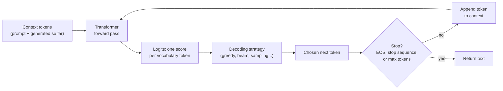
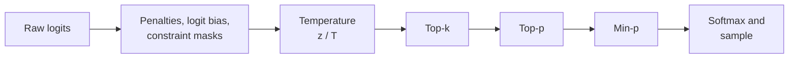

# How LLMs Generate Text: Decoding Strategies

> **Level:** Beginner to Advanced · **Study time:** ~120 min · **Prerequisites:** [Softmax, Entropy, Cross-Entropy and KL Divergence](../00-foundations/05-softmax-entropy-cross-entropy-and-kl-divergence.md), [Tokenization](../04-transformers/01-tokenization.md), [The Full Transformer Architecture](../04-transformers/05-the-full-transformer-architecture.md), [Pretraining and Next-Token Prediction](./01-pretraining-and-next-token-prediction.md)

## Table of contents

- [Why this matters](#why-this-matters)
- [The generation loop](#the-generation-loop)
- [From logits to probabilities](#from-logits-to-probabilities)
- [Greedy decoding](#greedy-decoding)
- [Beam search](#beam-search)
- [Sampling](#sampling)
- [Temperature](#temperature)
- [Top-k sampling](#top-k-sampling)
- [Top-p (nucleus) sampling](#top-p-nucleus-sampling)
- [Min-p sampling](#min-p-sampling)
- [Putting the knobs together](#putting-the-knobs-together)
- [Repetition, frequency and presence penalties](#repetition-frequency-and-presence-penalties)
- [Stopping: max tokens, EOS and stop sequences](#stopping-max-tokens-eos-and-stop-sequences)
- [Diversity vs factual reliability](#diversity-vs-factual-reliability)
- [Why low temperature cannot guarantee factual correctness](#why-low-temperature-cannot-guarantee-factual-correctness)
- [Nondeterminism even at temperature 0](#nondeterminism-even-at-temperature-0)
- [Implementing decoding in NumPy](#implementing-decoding-in-numpy)
- [Decoding with real libraries](#decoding-with-real-libraries)
- [Going deeper: decoding in production](#going-deeper-decoding-in-production)
- [Common mistakes and misconceptions](#common-mistakes-and-misconceptions)
- [Interview questions and model answers](#interview-questions-and-model-answers)
- [Key takeaways](#key-takeaways)
- [Further reading](#further-reading)
- [Next](#next)

## Why this matters

A trained LLM does not "write answers". It does exactly one thing: given some text, it scores every possible next token. Everything you see in a chat window comes from a small piece of code wrapped around the model, called the **decoder** or **sampler**, that turns those scores into one chosen token, appends it, and repeats. The same model weights can produce crisp JSON, repetitive garbage, or creative poetry depending only on those decoding settings. In production you will tune `temperature`, `top_p`, `max_tokens` and stop sequences for every feature, debug "the model keeps repeating itself" and "why did temperature 0 give two different answers", and explain to stakeholders why turning the temperature down does not stop hallucinations. Interviewers ask about this constantly because it separates people who have called an API from people who understand what happens inside it.

## The generation loop

### Intuition first

> **Analogy:** Think of your phone keyboard's next-word suggestions. It shows a few likely next words. If you keep tapping the first suggestion, you get a sentence. An LLM is the same idea with a vastly better predictor and a precise rule for which suggestion to tap.

Before we go further, a few terms:

- A **token** is a chunk of text the model works with: a word, part of a word, a space plus a word, or a punctuation mark. See [Tokenization](../04-transformers/01-tokenization.md).
- The **vocabulary** is the fixed list of all tokens the model knows. GPT-2 has 50,257 tokens; modern LLMs commonly use vocabularies of roughly 100,000 to 250,000 tokens.
- The **context** is all the tokens the model currently sees: your prompt plus everything it has generated so far. The **context window** is the maximum number of tokens it can see at once.
- **Autoregressive** generation means each new output is fed back in as input for the next step. The model generates one token at a time, left to right, and every token depends on all the previous ones.

### The loop, precisely



In words:

1. **Tokenize** the prompt into token IDs.
2. Run a **forward pass**: push the tokens through the transformer. At the last position it outputs one raw score per vocabulary token.
3. **Decode**: apply a rule that picks one token from those scores.
4. **Append** the chosen token to the context.
5. **Check stopping rules**: did the model emit a special end-of-sequence token, did the text hit a stop string, or did we hit the token limit? If not, go to step 2.
6. **Detokenize** the generated IDs back into text.

The important separation: **the model computes a probability distribution; the decoding strategy chooses from it.** Training (see [Pretraining and Next-Token Prediction](./01-pretraining-and-next-token-prediction.md)) shapes the distribution. Decoding is a separate, inference-time choice that you control without retraining anything.

### Our running example

We will reuse one tiny example throughout. The prompt is the 5-token sentence "The cat sat on the", and we pretend the vocabulary has only 5 candidate next tokens, with these scores (illustrative):

| Token | mat | floor | sofa | roof | moon |
|---|---|---|---|---|---|
| Score $z$ | 3.0 | 2.0 | 1.0 | 0.0 | -1.0 |

A real model would produce 50,000+ scores, but the math is identical.

### Two phases of inference (brief)

When you call `generate`, the work splits into two phases:

- **Prefill:** the whole prompt is processed in one parallel forward pass. This produces the first output token's scores and caches intermediate results.
- **Decode:** each subsequent token needs its own forward pass, one after another. To avoid recomputing the whole prompt every step, the model stores each token's attention keys and values in the **KV cache**.

This is why output length drives latency: 500 output tokens means 500 sequential decode steps. The details belong to [Inference Fundamentals: Prefill, Decode, TTFT and Throughput](../06-llm-inference/01-inference-fundamentals-prefill-decode-and-latency-metrics.md) and [The KV Cache](../06-llm-inference/02-kv-cache-explained.md). For this chapter you only need to know that each step produces scores over the vocabulary and the decoder picks one.

## From logits to probabilities

### Logits

The final layer of an LLM (often called the **LM head**) is a linear layer that maps the last **hidden vector** (the transformer's internal summary of the whole context, computed at the final position) to one number per vocabulary token. These raw, unnormalized numbers are called **logits**. They can be any real number, positive or negative, and they do not sum to anything in particular. Bigger means "more likely", but they are not probabilities yet.

### Softmax

To turn logits into probabilities we use the **softmax** function (covered in depth in [Softmax, Entropy, Cross-Entropy and KL Divergence](../00-foundations/05-softmax-entropy-cross-entropy-and-kl-divergence.md)):

$$
p_i = \frac{e^{z_i}}{\sum_{j=1}^{V} e^{z_j}}
$$

- $z_i$: the logit of token $i$.
- $e^{z_i}$: the exponential of the logit, always positive, and it grows fast, so bigger logits get much bigger weights.
- $V$: the vocabulary size.
- $\sum_{j=1}^{V} e^{z_j}$: the sum of exponentials over all tokens, which normalizes so the result sums to 1.
- $p_i$: the probability the model assigns to token $i$ being next.

**Worked example** with our running logits $[3, 2, 1, 0, -1]$:

| Token | $z$ | $e^{z}$ | $p = e^{z} / 31.5608$ |
|---|---|---|---|
| mat | 3.0 | 20.0855 | 0.6364 |
| floor | 2.0 | 7.3891 | 0.2341 |
| sofa | 1.0 | 2.7183 | 0.0861 |
| roof | 0.0 | 1.0000 | 0.0317 |
| moon | -1.0 | 0.3679 | 0.0117 |
| **Sum** | | **31.5608** | **1.0000** |

So the model thinks "mat" has a 63.6% chance, "floor" 23.4%, and so on.

Two practical facts:

- **Shift invariance:** adding the same constant to every logit does not change the probabilities. Implementations exploit this by subtracting the max logit before exponentiating, which prevents overflow ($e^{1000}$ is infinity in floating point).
- **Log probabilities** (**logprobs**) are $\log p_i$. The probability of a whole sequence is the product of its token probabilities, which gets tiny fast, so we add log probabilities instead. For example, $\log(0.6364) = -0.452$. Beam search and many APIs work in logprobs.

> **Interview tip:** Say it crisply: "The model outputs logits; softmax turns them into a distribution over the vocabulary; the decoding strategy picks a token from that distribution; we append it and repeat."

## Greedy decoding

### Intuition

> **Analogy:** A hiker who always takes the steepest path uphill from where they stand. Simple and fast, but they can get stuck on a small hill and never find the real summit.

**Greedy decoding** always picks the single most probable token:

$$
y_t = \arg\max_{i} \; p(i \mid y_{<t})
$$

- $y_t$: the token chosen at step $t$.
- $\arg\max_i$: "the $i$ that makes the following expression largest".
- $p(i \mid y_{<t})$: the probability of token $i$ given all earlier tokens $y_{<t}$ (prompt plus generated tokens).

Since softmax preserves order, greedy is just the argmax of the logits. You do not even need the softmax.

**Worked example:** with logits $[3, 2, 1, 0, -1]$, the argmax is index 0, so greedy picks "mat". Run it again and you get "mat" again: greedy is **deterministic** (same input, same output, at least in exact arithmetic; see [Nondeterminism even at temperature 0](#nondeterminism-even-at-temperature-0)).

### Failure modes

**1. Repetition loops.** Consider a toy model whose most likely next token after "the" is "cat", after "cat" is "sat", after "sat" is "on", and after "on" is "the". Greedy generation from "the" produces:

```text
the cat sat on the cat sat on the cat sat on the ...
```

It never escapes, because every step makes the same locally best choice. Real LLMs fall into the same trap in a subtler way: once a phrase has appeared twice, the model sees the repetition in its context and (because it learned to copy patterns from context) predicts that the pattern continues, which makes the next repetition even more likely. Holtzman et al. (2020) showed this self-reinforcing effect: the probability of repeating a phrase grows with each repetition. We implement this exact toy loop in NumPy [later](#implementing-decoding-in-numpy).

**2. Blandness.** The single most likely continuation is usually the most generic one. Holtzman et al. (2020) also showed that human-written text is not maximum-likelihood text: people regularly choose words the model considers less probable. Always picking the top token yields safe, flat, often repetitive prose ("It is important to note that...").

**3. Myopia (no lookahead).** Greedy commits to the best token now, even if it leads to a worse sentence overall. A token that is slightly less likely now might open up a much more likely continuation. Beam search addresses this.

**4. No variety.** Ask the same question 10 times and you get the same answer 10 times. For extraction that is a feature; for brainstorming or generating diverse candidates it is a bug.

> **Senior insight:** For modern instruction-tuned models, greedy decoding is often perfectly fine for short, factual, or structured tasks (classification, extraction, JSON, short code). The failure modes bite hardest on long, open-ended generation and with smaller or base (non-instruction-tuned) models.

## Beam search

### Intuition

> **Analogy:** Instead of one hiker, send out a few hikers (say 2). At every fork, each explores all directions, then you keep only the 2 best positions overall and discard the rest. You explore more of the map without exploring everything.

**Beam search** keeps the $B$ most probable partial sequences (called **beams** or **hypotheses**) at every step. $B$ is the **beam width**. The score of a sequence is the sum of its token log probabilities:

$$
\text{score}(y_1, \dots, y_t) = \sum_{s=1}^{t} \log p(y_s \mid y_{<s})
$$

- $y_1, \dots, y_t$: the tokens in the partial sequence.
- $\log p(y_s \mid y_{<s})$: the log probability of token $s$ given everything before it.
- The sum of logs equals the log of the product, i.e. the log of the joint probability of the whole sequence.

Algorithm:

1. Start with the prompt as the single beam.
2. For each beam, compute the next-token distribution and form all extensions (beam + each token).
3. Score every extension, keep the top $B$ overall.
4. Beams that produce the end-of-sequence token are set aside as finished.
5. Repeat until enough beams finish or the length limit is hit; return the best finished sequence.

### Worked example: greedy vs beam

Prompt: "The weather is". Illustrative probabilities:

```text
Step 1:                 Step 2 (given step 1):
  nice  0.5               nice -> today 0.40, and 0.35, "." 0.25
  very  0.4               very -> cold  0.80, hot 0.15, nice 0.05
  bad   0.1               bad  -> (not needed)
```

**Greedy:** step 1 picks "nice" (0.5). Step 2 picks "today" (0.40). Joint probability $0.5 \times 0.40 = 0.20$.

**Beam search with $B = 2$:**

- Step 1: keep the top 2: "nice" (0.5) and "very" (0.4).
- Step 2: expand both beams:

| Candidate | Joint probability | Log score |
|---|---|---|
| very cold | $0.4 \times 0.80 = 0.32$ | $\ln 0.32 = -1.139$ |
| nice today | $0.5 \times 0.40 = 0.20$ | $\ln 0.20 = -1.609$ |
| nice and | $0.5 \times 0.35 = 0.175$ | $-1.743$ |
| nice . | $0.5 \times 0.25 = 0.125$ | |
| very hot | $0.4 \times 0.15 = 0.06$ | |
| very nice | $0.4 \times 0.05 = 0.02$ | |

- Keep the top 2: "very cold" (0.32) and "nice today" (0.20).

Beam search found "The weather is very cold" with joint probability 0.32, beating greedy's 0.20. Greedy never considered "very" because 0.4 < 0.5 at step 1.

```text
                     ┌── today 0.40 ──> 0.20   (greedy path)
        ┌── nice 0.5 ┤
"The    │            └── and   0.35 ──> 0.175
weather ┤
is"     │            ┌── cold  0.80 ──> 0.32   (beam search winner)
        └── very 0.4 ┤
                     └── hot   0.15 ──> 0.06
```

### Length normalization

Every extra token multiplies in a probability below 1, so the log score only goes down as sequences get longer. Raw beam search therefore favors short outputs. The standard fix is **length normalization**: divide the score by the length raised to a power $\alpha$:

$$
\text{score}_{\text{norm}} = \frac{1}{|y|^{\alpha}} \sum_{s=1}^{|y|} \log p(y_s \mid y_{<s})
$$

- $|y|$: the number of tokens in the sequence.
- $\alpha$: how strongly to correct for length (0 = no correction, 1 = plain average log probability).

**Worked example (illustrative):** a 2-token answer with total log score $-0.8$ versus a 6-token answer with total $-1.8$.

- Without normalization: $-0.8 > -1.8$, the short answer wins.
- With $\alpha = 1$: $-0.8 / 2 = -0.4$ versus $-1.8 / 6 = -0.3$. Now the long answer wins, because its average token is more probable.

Google's neural machine translation paper (Wu et al., 2016) used a slightly different length penalty, dividing by $((5 + |y|) / 6)^{\alpha}$ instead of $|y|^{\alpha}$. Hugging Face exposes the exponent $\alpha$ of the simpler formula above as `length_penalty` (default 1.0).

### Why beam search is rarely used for chat

| Reason | Explanation |
|---|---|
| Quality on open-ended text | Beam search finds high-probability text, which for open-ended generation is bland and repetitive (Holtzman et al., 2020). Larger beams can even make outputs worse, an effect documented in machine translation (Koehn and Knowles, 2017) and analyzed by Meister et al. (2020). |
| Wrong objective | A chat answer has many good responses. Searching for the single most probable one is not the goal; natural, varied, helpful text is. |
| Cost | $B$ beams means roughly $B$ times the decode compute and $B$ times the KV cache memory per request, which cuts how many users a GPU can serve. |
| Streaming | **Streaming** means sending each token to the user as soon as it is chosen. The leading beam can change at any step, so you cannot safely stream tokens until the search settles. Chat UIs depend on streaming. |
| Low diversity | The $B$ beams often differ by a word or two (diverse beam search variants exist to counter this). |

Beam search remains useful where there is roughly one right answer and outputs are short and constrained: machine translation, speech recognition (OpenAI's Whisper model uses beam search with a temperature fallback), summarization with older encoder-decoder models, and some constrained generation tasks. Most hosted chat APIs expose sampling parameters rather than beam search.

> **Interview tip:** "Greedy is beam search with $B = 1$." Saying this shows you see them as points on one spectrum: how much of the search tree you explore to find a high-probability sequence.

## Sampling

### Intuition

> **Analogy:** Instead of always ordering the restaurant's most popular dish, you roll a weighted die where popular dishes have bigger faces. You usually get a popular dish, sometimes something unusual.

**Sampling** (also called **ancestral sampling** or multinomial sampling) picks the next token at random, in proportion to its probability. A token with $p = 0.6364$ is chosen 63.64% of the time.

**How a computer does it:** draw a uniform random number $u$ between 0 and 1, then walk through the **cumulative probabilities** (running totals) until the total exceeds $u$.

| Token | $p$ | Cumulative | Interval for $u$ |
|---|---|---|---|
| mat | 0.6364 | 0.6364 | [0, 0.6364) |
| floor | 0.2341 | 0.8705 | [0.6364, 0.8705) |
| sofa | 0.0861 | 0.9567 | [0.8705, 0.9567) |
| roof | 0.0317 | 0.9883 | [0.9567, 0.9883) |
| moon | 0.0117 | 1.0000 | [0.9883, 1.0) |

(Cumulative totals are computed from unrounded probabilities, so they can differ from summing the rounded column by 0.0001.)

- If $u = 0.42$, we pick "mat".
- If $u = 0.73$, it falls in [0.6364, 0.8705), so we pick "floor".
- If $u = 0.99$, we pick "moon". The cat is now on the moon.

Sampling reduces blandness and repetition (randomness usually breaks loops, though not always) and gives variety across runs. It introduces a new problem: the **long tail**.

### The long-tail problem

Each individual bad token is unlikely, but a real vocabulary has tens of thousands of them. **Illustrative numbers:** suppose 49,000 junk tokens each have probability 0.000002. Together they hold $49{,}000 \times 0.000002 = 0.098$, almost 10% of the mass. Pure sampling would pick some junk token roughly once every 10 steps, and once a junk token is in the context, the model conditions on it and the text can derail. Holtzman et al. (2020) called this **degeneration** and showed pure sampling often produces incoherent text.

Everything that follows (temperature, top-k, top-p, min-p) is a way to **reshape** or **truncate** the distribution before sampling, keeping the variety of sampling without the tail.

## Temperature

### Intuition

> **Analogy:** Temperature is an "adventurousness dial". Low temperature makes the model cautious, sticking to its favorites. High temperature makes it adventurous, giving underdogs a real chance. The name comes from physics (the Boltzmann distribution), where higher temperature means particles spread across more energy states.

### Definition

**Temperature** $T$ divides every logit before the softmax:

$$
p_i(T) = \frac{e^{z_i / T}}{\sum_{j=1}^{V} e^{z_j / T}}
$$

- $z_i$: the original logit of token $i$.
- $T > 0$: the temperature.
- $T < 1$: divides by a small number, so gaps between logits grow, and the distribution becomes **sharper** (more peaked on the top token).
- $T = 1$: the model's original distribution.
- $T > 1$: gaps shrink, the distribution becomes **flatter**.

An equivalent and very useful view: $p_i(T) \propto p_i^{1/T}$, where $\propto$ means "proportional to, before renormalizing". Lowering the temperature raises every probability to a power greater than 1 and renormalizes, which crushes small probabilities faster than large ones.

### Worked example at several temperatures

Running logits $[3, 2, 1, 0, -1]$.

**$T = 0.5$:** divide by 0.5, giving $[6, 4, 2, 0, -2]$.
Exponentials: $e^6 = 403.4288$, $e^4 = 54.5982$, $e^2 = 7.3891$, $e^0 = 1$, $e^{-2} = 0.1353$. Sum $= 466.5513$.
Probabilities: $403.4288 / 466.5513 = 0.8647$, $54.5982 / 466.5513 = 0.1170$, then $0.0158$, $0.0021$, $0.0003$.

**$T = 2$:** divide by 2, giving $[1.5, 1, 0.5, 0, -0.5]$.
Exponentials: $4.4817$, $2.7183$, $1.6487$, $1$, $0.6065$. Sum $= 10.4552$.
Probabilities: $4.4817 / 10.4552 = 0.4287$, $0.2600$, $0.1577$, $0.0956$, $0.0580$.

Full comparison:

| Token | logit | $T = 0.1$ | $T = 0.5$ | $T = 1$ | $T = 2$ |
|---|---|---|---|---|---|
| mat | 3.0 | 0.99995 | 0.8647 | 0.6364 | 0.4287 |
| floor | 2.0 | 0.00005 | 0.1170 | 0.2341 | 0.2600 |
| sofa | 1.0 | ~0 | 0.0158 | 0.0861 | 0.1577 |
| roof | 0.0 | ~0 | 0.0021 | 0.0317 | 0.0956 |
| moon | -1.0 | ~0 | 0.0003 | 0.0117 | 0.0580 |
| **Entropy (bits)** | | ~0 | 0.66 | 1.44 | 2.01 |

**Entropy** measures how spread out a distribution is: $H = -\sum_i p_i \log_2 p_i$. 0 bits means certain, and the maximum for 5 tokens is $\log_2 5 = 2.32$ bits (all equal). At $T = 1$: $H = 0.415 + 0.490 + 0.305 + 0.158 + 0.075 \approx 1.44$ bits (each term is $-p_i \log_2 p_i$, for example $-0.6364 \log_2 0.6364 = 0.415$). Watch it climb as $T$ rises. Notice "moon" goes from essentially impossible at $T = 0.5$ (0.03%) to 5.8% at $T = 2$: a 1-in-17 chance of a cat on the moon.

### Limits and special cases

- **$T \to 0$:** the top token's probability approaches 1 (assuming no exact tie). Sampling becomes greedy decoding. Dividing by exactly 0 is undefined, so OpenAI-style APIs and serving engines such as vLLM treat `temperature=0` as a special case meaning "use argmax". Hugging Face `generate` does not: you request greedy with `do_sample=False`, and `temperature=0` with `do_sample=True` raises an error.
- **$T \to \infty$:** all logits approach 0, so every token becomes equally likely: uniform random tokens, pure gibberish.
- **Temperature never changes the ranking.** The top token at $T = 0.5$ is the top token at $T = 2$. So temperature has no effect on greedy decoding; it only matters when you sample.
- Typical API range: many hosted APIs accept temperatures from 0 to 2 (exact ranges and defaults are vendor- and version-dependent). Values above about 1.2 without truncation tend to produce incoherent text.

> **Common mistake:** Thinking temperature makes the model "smarter" or "dumber". It does not change what the model knows. It only changes how boldly you sample from what it already believes.

## Top-k sampling

### Intuition

> **Analogy:** A talent show where only the top $k$ finalists can win, regardless of how close the 11th contestant was. Once you are in, your chances are proportional to your score.

### Definition

**Top-k sampling** (popularized for story generation by Fan et al., 2018) keeps only the $k$ most probable tokens, sets all others to zero probability, renormalizes, and samples:

$$
p'_i = \begin{cases} \dfrac{p_i}{\sum_{j \in V_k} p_j} & \text{if } i \in V_k \\ 0 & \text{otherwise} \end{cases}
$$

- $V_k$: the set of the $k$ tokens with the highest probabilities.
- $\sum_{j \in V_k} p_j$: the total probability of the kept tokens, used to renormalize so they sum to 1.
- $p'_i$: the new probability used for sampling.

In code, you set the logits of excluded tokens to $-\infty$; softmax then gives them exactly 0.

**Worked example, $k = 3$, $T = 1$:** keep mat (0.6364), floor (0.2341), sofa (0.0861). Their sum is $0.9567$ (unrounded).

- mat: $0.6364 / 0.9567 = 0.6652$
- floor: $0.2341 / 0.9567 = 0.2447$
- sofa: $0.0861 / 0.9567 = 0.0900$
- roof, moon: 0

Check: $0.6652 + 0.2447 + 0.0900 = 0.9999 \approx 1$ (rounding). The cat can no longer land on the moon.

### The weakness: a fixed $k$ does not adapt

The right number of candidates depends on how confident the model is, which changes every step (illustrative):

- **Peaked distribution:** after "The capital of France is", "Paris" might have 0.97. With $k = 50$, you still allow 49 other tokens sharing the remaining 3%, some of them wrong.
- **Flat distribution:** after "My favorite food is", hundreds of tokens are reasonable. With $k = 3$, you throw away many good options.

Hugging Face's default `top_k` is 50 (only used when sampling is enabled). Top-k is still widely used as a cheap safety cap alongside top-p.

## Top-p (nucleus) sampling

### Intuition

> **Analogy:** Instead of "invite the top 10 guests", say "invite the most important guests until you have covered 90% of the people who matter". On a day when one guest matters most, that is a short list. On a day when many matter equally, the list is long.

### Definition

**Top-p sampling**, also called **nucleus sampling** (Holtzman et al., 2020), keeps the smallest set of most probable tokens whose cumulative probability reaches a threshold $P$ (written `top_p`), then renormalizes and samples. That set is the **nucleus**:

$$
V_P = \text{smallest set of top tokens such that } \sum_{i \in V_P} p_i \ge P
$$

- $P$: the threshold, between 0 and 1 (common values 0.9 to 0.95).
- Sort tokens by probability, descending, then add them one by one until the running total is at least $P$.
- Renormalize exactly as in top-k, using $V_P$ instead of $V_k$.

The number of kept tokens changes every step, which is the whole point.

### Worked example: $P = 0.9$ at three temperatures

Using the temperature table above:

**$T = 1$:** cumulative = 0.6364 (mat), 0.8705 (+floor), 0.9567 (+sofa). We first reach 0.9 after sofa, so the nucleus is {mat, floor, sofa}: **3 tokens**, renormalized to 0.6652, 0.2447, 0.0900 (same as top-3 here).

**$T = 0.5$:** cumulative = 0.8647 (mat), 0.9817 (+floor). We reach 0.9 after floor, so the nucleus is {mat, floor}: **2 tokens**. Renormalized: $0.8647 / 0.9817 = 0.8808$ and $0.1170 / 0.9817 = 0.1192$.

**$T = 2$:** cumulative = 0.4287, 0.6886, 0.8463, 0.9420. We reach 0.9 after roof, so the nucleus is {mat, floor, sofa, roof}: **4 tokens**. Only "moon" is excluded.

The same $P = 0.9$ kept 2, 3 or 4 tokens depending on how confident the distribution was. That adaptivity is why top-p replaced top-k as the default truncation in many systems.

### The weakness of top-p

At high temperature the distribution flattens, so reaching 90% of the mass requires many more tokens, and the nucleus starts to admit tail junk. Top-p also behaves differently depending on the shape of the tail: a long, fat tail of many small tokens can sneak in. Min-p was designed to fix exactly this.

> **Interview tip:** Top-k truncates by **count**, top-p by **cumulative mass**, min-p by **probability relative to the top token**. One sentence, three methods.

## Min-p sampling

### Intuition

> **Analogy:** "You may join the team if you are at least 10% as good as our best player." When the best player is a superstar, few qualify. When everyone is mediocre, many qualify. The bar scales with the leader.

### Definition

**Min-p sampling** (Nguyen et al., 2024, "Turning Up the Heat: Min-p Sampling for Creative and Coherent LLM Outputs") keeps every token whose probability is at least a fraction $p_{\min}$ of the top token's probability:

$$
\text{keep token } i \iff p_i \ge p_{\min} \cdot p_{\max}
$$

- $p_{\max}$: the probability of the most likely token at this step.
- $p_{\min}$: the user-chosen fraction, commonly around 0.05 to 0.1.
- $p_{\min} \cdot p_{\max}$: the dynamic threshold.

### Worked example: $p_{\min} = 0.1$

| Temperature | $p_{\max}$ | Threshold $0.1 \times p_{\max}$ | Kept tokens |
|---|---|---|---|
| 0.5 | 0.8647 | 0.0865 | mat (0.8647), floor (0.1170). Sofa (0.0158) dropped |
| 1.0 | 0.6364 | 0.0636 | mat, floor, sofa (0.0861). Roof (0.0317) dropped |
| 2.0 | 0.4287 | 0.0429 | all 5 (moon is 0.0580 > 0.0429) |

The key property: when the model is confident, the threshold is high and only strong candidates survive; when it is uncertain, the threshold drops. Unlike top-p, min-p does not need to "fill up" 90% of the mass, so with a sharply peaked first token it stays tight even at higher temperatures. This is why min-p is popular for creative writing at temperatures around 1 or above. Treat the size of its advantage over top-p as an empirical question: later re-analyses have questioned how large the gains reported in the original paper really are, so validate it on your own task.

Availability is version-dependent: min-p is supported in Hugging Face Transformers (recent versions), vLLM, llama.cpp and several other open-source stacks, but not in every hosted API.

## Putting the knobs together

### The sampling pipeline

In practice, these steps run in sequence on the logits at every decode step:



The first box is covered later: penalties and **logit bias** (adding a fixed amount to chosen token IDs) in the [penalties section](#repetition-frequency-and-presence-penalties), and **constraint masks** (blocking tokens that would break a required format such as JSON) under [constrained decoding](#constrained-decoding-decoding-as-a-control-surface).

> **Common mistake:** Assuming every library uses this exact order. The order differs across libraries and versions (for example, whether min-p or top-p runs before or after temperature). The same nominal settings can give slightly different behavior in Hugging Face, vLLM, llama.cpp and a hosted API.

Interactions worth knowing:

- Temperature does not change **which** tokens survive top-k (ranking is unchanged), but it **does** change which survive top-p and min-p, because those depend on probability values.
- Temperature 0 (greedy) makes top-k, top-p and min-p irrelevant.
- Several vendors recommend adjusting temperature **or** top_p, not both at once, because they interact and make tuning confusing.

### Comparison table

| Method | What it does | Deterministic? | Adapts to confidence? | Pros | Cons | Typical use |
|---|---|---|---|---|---|---|
| Greedy | Always argmax | Yes | No | Simple, fast, reproducible | Bland, repetition loops, myopic | Extraction, classification, short code, JSON |
| Beam search | Keeps top $B$ sequences | Yes | No | Finds higher-probability sequences | Bland, $B$x cost, hard to stream | Translation, speech recognition |
| Pure sampling ($T = 1$) | Sample from full distribution | No | N/A | Faithful to model distribution | Long tail derails text | Rarely used alone |
| Temperature | Sharpens or flattens | No (unless 0) | No | One intuitive knob | Does not remove the tail by itself | Always, combined with truncation |
| Top-k | Keep $k$ best tokens | No | No | Cheap, cuts tail | Fixed $k$ is wrong for both flat and peaked steps | Safety cap, older defaults |
| Top-p | Keep smallest set with mass $\ge P$ | No | Yes | Adapts the candidate set | Admits junk when distribution is flat or $T$ is high | Default truncation for chat |
| Min-p | Keep tokens with $p \ge p_{\min} p_{\max}$ | No | Yes | Stays coherent at high $T$ | Not available in every API | Creative writing, open models |

## Repetition, frequency and presence penalties

Sampling reduces loops but does not eliminate them, and greedy decoding has no defense at all. **Penalties** edit the logits of tokens that have already appeared, before temperature and truncation.

### Repetition penalty (multiplicative)

The **repetition penalty** was introduced with the CTRL model (Keskar et al., 2019) and is the `repetition_penalty` parameter in Hugging Face and vLLM. For every token that has already appeared, with penalty $\theta > 1$:

$$
z'_i = \begin{cases} z_i / \theta & \text{if } z_i > 0 \\ z_i \cdot \theta & \text{if } z_i \le 0 \end{cases}
$$

- $z_i$: the logit of a token that has already appeared.
- $\theta$: the penalty, typically 1.0 (off) to about 1.3. Values above 1 discourage repetition.
- Why two cases: dividing a positive logit by $\theta$ moves it toward 0 (less likely), but dividing a negative logit would also move it toward 0, which would make it **more** likely. So negative logits are multiplied instead, pushing them further down. (The CTRL paper wrote the penalty as a plain division; the sign-aware two-case rule is how Hugging Face, vLLM and llama.cpp implement it.)

**Worked example:** "mat" already appeared in the text, $\theta = 1.3$.
New mat logit: $3.0 / 1.3 = 2.3077$. Logits become $[2.3077, 2, 1, 0, -1]$, and softmax gives mat 0.4669, floor 0.3433, sofa 0.1263, roof 0.0465, moon 0.0171. Mat's probability fell from 0.6364 to 0.4669.
If "moon" (logit $-1.0$) had appeared, it would become $-1.0 \times 1.3 = -1.3$, slightly less likely.

> **Senior insight:** The repetition penalty is not shift invariant. Softmax ignores a constant added to all logits, but $z / \theta$ shrinks a logit of 10 by much more than a logit of 1. So the same $\theta$ has different strength on different models and even at different steps. That is one reason penalty values do not transfer between models.

Which tokens count as "already appeared" (prompt plus output, or output only) differs across libraries. Hugging Face's implementation applies it to every token in the input IDs, which for decoder-only models includes the prompt.

### Frequency and presence penalties (additive)

Hosted APIs following OpenAI's conventions expose two additive penalties:

$$
z'_i = z_i - \alpha_{\text{freq}} \cdot c_i - \alpha_{\text{pres}} \cdot \mathbb{1}[c_i > 0]
$$

- $c_i$: how many times token $i$ has appeared so far (in OpenAI's definition and in vLLM, counted over the generated tokens only, not the prompt; our NumPy toy below counts the prompt too).
- $\alpha_{\text{freq}}$: the **frequency penalty**, subtracted once per occurrence. The more a token is used, the more it is pushed down.
- $\alpha_{\text{pres}}$: the **presence penalty**, a flat amount subtracted once if the token has appeared at all. It nudges toward new tokens and topics.
- $\mathbb{1}[c_i > 0]$: an indicator, 1 if the token has appeared, otherwise 0.
- OpenAI documents a range of -2.0 to 2.0 for both; negative values encourage repetition. Ranges are vendor- and version-dependent.

**Worked example:** "mat" has appeared twice, $\alpha_{\text{freq}} = 0.5$, $\alpha_{\text{pres}} = 0.5$.
New mat logit: $3.0 - 0.5 \times 2 - 0.5 \times 1 = 3.0 - 1.0 - 0.5 = 1.5$. Logits $[1.5, 2, 1, 0, -1]$, softmax gives mat 0.2809, floor 0.4631, sofa 0.1704, roof 0.0627, moon 0.0231. Now "floor" is the favorite.

### Comparison

| Penalty | Operation | Scales with count? | Where you find it | Use for |
|---|---|---|---|---|
| Repetition penalty | Divide (or multiply) logit by $\theta$ | No | Hugging Face, vLLM, llama.cpp | Breaking loops in open models |
| Frequency penalty | Subtract $\alpha \cdot$ count | Yes | OpenAI-style APIs, vLLM | Reducing word-level repetition in long text |
| Presence penalty | Subtract $\alpha$ once | No | OpenAI-style APIs, vLLM | Encouraging new topics |
| `no_repeat_ngram_size` | Forbid any n-gram from repeating | Hard ban | Hugging Face | Summaries, beam search outputs |

### Pitfalls

Penalties work on **tokens**, not meaning, so they hurt tasks where repetition is correct:

- **Code and JSON:** braces, quotes, commas, indentation and variable names must repeat. A strong penalty breaks syntax or renames variables.
- **Names and facts:** a summary must keep saying "Acme Corp". Penalizing it pushes the model to synonyms or wrong entities.
- **Long outputs:** frequency penalties accumulate, so late in a long answer common words become hard to use.

For structured or factual tasks, keep penalties at 0 (or $\theta = 1.0$) and fix loops with better prompts, a better model, or mild sampling. A related tool, **logit bias**, lets you add a fixed amount to specific token IDs, for example to ban a token or force a choice among labels.

## Stopping: max tokens, EOS and stop sequences

Generation needs a rule to stop. There are three main ones.

**1. End-of-sequence (EOS) token.** A special token the model learned to emit when it is done. Chat models use special end-of-turn tokens defined by their **chat template** (the format that wraps system, user and assistant messages), such as `<|im_end|>` in the ChatML format used by Qwen models or `<|eot_id|>` in Llama 3. If the serving code does not treat that token as a stop token, the model keeps going, often hallucinating a fake "User:" turn and answering itself.

**2. Max tokens.** A hard cap on the number of **generated** tokens (`max_tokens`, `max_new_tokens`, or `max_completion_tokens` depending on the API and version). Note:

- It counts output tokens, not words or characters.
- Prompt tokens plus output tokens must fit in the context window.
- When the cap is hit, the output is cut mid-sentence (or mid-JSON). APIs report this through a **finish reason**, typically `"length"` versus `"stop"`. Always check it.
- It bounds cost and latency. Decode is sequential, so latency grows roughly linearly with output length: at an illustrative 30 ms per token, 500 tokens take about 15 seconds. Many hosted APIs also price output tokens higher than input tokens.

**3. Stop sequences.** Strings that end generation when they appear, such as `"\n\n"`, `"</answer>"` or `"Observation:"` in an agent loop. Details:

- Matching happens on **text**, but generation happens in **tokens**, and a stop string can be split across tokens (`"</ans"` + `"wer>"`). Implementations check the decoded text after each token.
- Many APIs do not include the stop sequence in the returned text.
- When **streaming**, the server must hold back the last few characters that could be the start of a stop string, otherwise the user sees a partial stop string before it is removed.

Some libraries also offer a minimum length (`min_new_tokens` in Hugging Face, `min_tokens` in vLLM), which works by suppressing the EOS token's logit until the minimum is reached.

> **Common mistake:** Setting `max_tokens` low to "make the model concise". The model does not know the limit; it just gets cut off. To get short answers, ask for them in the prompt and keep `max_tokens` as a safety cap.

## Diversity vs factual reliability

### The core trade-off

Every sampling knob moves you along one axis:

```text
 more deterministic                                         more diverse
 more repeatable                                            more creative
 ◄────────────────────────────────────────────────────────────────────►
 greedy, T=0   T=0.2   T=0.5   T=0.7 + top_p 0.9   T=1.0 + min_p   T=1.5
 safest for facts, JSON                         riskier: tail tokens, drift
```

**Why higher diversity costs reliability:** each step has some small chance $\epsilon$ of picking a bad token from the tail, and errors compound over a long output. The chance of at least one bad token in $n$ steps is:

$$
P(\text{at least one bad token}) = 1 - (1 - \epsilon)^n
$$

- $\epsilon$: probability of a bad tail token at one step.
- $n$: number of generated tokens.
- $(1 - \epsilon)^n$: probability that all $n$ steps avoid a bad token.

**Worked example (illustrative):** with $\epsilon = 0.001$:

- $n = 100$: $1 - 0.999^{100} = 1 - 0.9048 = 0.095$, about a 10% chance.
- $n = 500$: $1 - 0.999^{500} = 1 - 0.6064 = 0.394$, about a 39% chance.

With $\epsilon = 0.0001$ and $n = 500$, it drops to about 4.9%. This is why truncation (top-p, min-p) matters so much for long outputs: it pushes $\epsilon$ toward zero by removing the tail.

**Why lower diversity also has costs:**

- Bland, repetitive outputs and loops (greedy failure modes).
- **No useful variety across samples.** Techniques that sample several answers and then vote or verify need diversity. **Self-consistency** (Wang et al., 2022) samples multiple reasoning paths and takes the majority answer; this only works if the samples differ. For code, the Codex paper (Chen et al., 2021) found the best temperature depended on how many samples you take: a low temperature (0.2) was best for pass@1, and a higher one (0.8) was best for pass@100 (**pass@k** is the chance that at least one of $k$ sampled programs passes the unit tests).
- Instruction tuning and RLHF already make output distributions sharper and less diverse (Kirk et al., 2023 studied this effect), so for many chat models moderate temperatures still give fairly similar answers. See [Instruction Tuning, RLHF and DPO](./02-instruction-tuning-rlhf-and-dpo.md).

### Parameter effects at a glance

| Parameter | Turn it up | Effect on diversity | Effect on factual reliability |
|---|---|---|---|
| Temperature | Flatter distribution | Up | Down, especially above about 1 without truncation |
| top_p | Larger nucleus | Up | Down (admits more tail) |
| top_k | More candidates | Up | Down |
| min_p | Higher threshold, fewer candidates | Down | Up |
| Repetition / frequency penalty | Pushes away seen tokens | Up (lexically) | Can go down: forces synonyms, wrong names, broken syntax |
| Presence penalty | Pushes toward new tokens | Up (topics) | Can go down: drifts off-topic |
| Beam width | More search | Down (blander) | Mixed: higher probability is not the same as true |

## Why low temperature cannot guarantee factual correctness

This is one of the most important ideas in the chapter, and a favorite interview question.

### The core reason

Decoding only **chooses among the model's beliefs**. It cannot add knowledge the model does not have. Lowering the temperature makes the model commit harder to the **mode** of its distribution (the single option it rates most likely). If the model's most likely token is wrong, low temperature makes the wrong answer **more** consistent, not less.

### Worked example

Suppose a small 7B model completes "The capital of Australia is" with these probabilities (illustrative):

| Token | $T = 1$ | $T = 0.5$ | $T = 0.2$ |
|---|---|---|---|
| Sydney (wrong) | 0.55 | 0.6505 | 0.8309 |
| Canberra (correct) | 0.40 | 0.3441 | 0.1691 |
| Melbourne (wrong) | 0.05 | 0.0054 | 0.0000 |

Using $p_i(T) \propto p_i^{1/T}$:

- $T = 0.5$: square each: $0.3025$, $0.16$, $0.0025$; sum $0.465$; divide: $0.6505$, $0.3441$, $0.0054$.
- $T = 0.2$: raise to the 5th power: $0.050328$, $0.010240$, $0.0000003$; sum $0.060569$; divide: $0.8309$, $0.1691$, about $0.000005$.
- Greedy ($T = 0$): "Sydney", every time.

At $T = 1$ the model is right 40% of the time. At $T = 0$ it is right 0% of the time, perfectly consistent and perfectly wrong.

### Why the most likely token can be wrong

1. **Probability is not truth.** The model was trained to predict what text tends to follow, not what is true. Popular misconceptions appear often in training data, so they get high probability. Sydney is mentioned far more often than Canberra in many contexts.
2. **Missing or outdated knowledge.** If a fact was rare in training data, came after the **knowledge cutoff** (the date the training data ends), or is private to your company, no decoding setting can produce it reliably.
3. **Token-level choices are myopic, and errors snowball.** Greedy picks the best next token, not the best answer. Once a wrong token is emitted ("The answer is 1..."), the model conditions on it and continues consistently, often generating a confident justification. Zhang et al. (2023, "How Language Model Hallucinations Can Snowball") documented models committing to an early wrong answer and then justifying it.
4. **The model can be confidently wrong.** A high probability reflects the model's internal confidence, which is not always **calibrated** (well calibrated means "when it says 80%, it is right 80% of the time"). The GPT-4 Technical Report (OpenAI, 2023) showed a pretrained model that was well calibrated on a multiple-choice benchmark became less calibrated after post-training.
5. **The most probable sequence can be degenerate.** The highest-probability output is sometimes short, generic or evasive, which is a separate problem from factual errors.

### What actually improves factual reliability

| Approach | Why it works | Chapter |
|---|---|---|
| Grounding with retrieved documents (RAG) | Puts the facts in the context, so "most likely" becomes "copied from the source" | [What Is RAG](../08-rag/01-what-is-rag-and-why-it-matters.md) |
| Tool use (search, calculators, databases) | Delegates facts and arithmetic to reliable systems | [Tool Calling in Depth](../09-agents/02-tool-calling-in-depth.md) |
| Verification, citations, abstention ("say I don't know") | Catches and refuses unsupported claims | [Hallucinations](./06-hallucinations-and-grounding.md) |
| Self-consistency and sampling-based checks | Disagreement across samples flags uncertainty | [Reasoning Models](./12-reasoning-models-and-test-time-compute.md) |
| Better or fine-tuned models | Changes the distribution itself | [Fine-Tuning](./07-fine-tuning-full-lora-and-qlora.md) |

Low temperature is still a good default for factual tasks: it reduces random tail errors and makes outputs reproducible. It just cannot fix errors that live in the mode of the distribution.

> **Interview tip:** The one-liner: "Temperature controls variance, not bias. Low temperature removes random sampling errors, but if the model's top choice is wrong, greedy decoding just returns the wrong answer every time."

## Nondeterminism even at temperature 0

Engineers are often surprised that `temperature=0` does not give identical outputs across runs, especially through hosted APIs. Greedy decoding is deterministic **in exact math**; the computer does not do exact math.

### Cause 1: floating-point non-associativity

In real numbers, $(a + b) + c = a + (b + c)$. In floating point, rounding happens after each operation, so the order matters:

```python
import numpy as np

a, b, c = np.float32(1e8), np.float32(1.0), np.float32(-1e8)
print((a + b) + c)   # 0.0  -> 1e8 + 1 rounds back to 1e8 in float32
print((a + c) + b)   # 1.0
print((0.1 + 0.2) + 0.3, 0.1 + (0.2 + 0.3))  # 0.6000000000000001 0.6
```

Float32 has a 24-bit significand, so near $10^8$ representable numbers are 8 apart; adding 1 gets rounded away. A transformer forward pass sums millions of products (matrix multiplications, attention, normalization). GPUs split these sums across thousands of threads, and **the order in which partial sums combine depends on how the work is divided.**

### Cause 2: the work division changes between runs

What changes the division (and therefore the rounding):

- **Batch size and batch composition.** Inference servers batch many users' requests together (see [Batching, Continuous Batching and PagedAttention](../06-llm-inference/04-batching-continuous-batching-and-paged-attention.md)). Many GPU kernels pick different tiling or reduction strategies depending on batch size, so your request's logits depend slightly on who else was in the batch. Horace He and Thinking Machines Lab (2025, "Defeating Nondeterminism in LLM Inference") argued this lack of **batch invariance** is the main source of run-to-run differences in LLM serving, more than GPU thread scheduling on its own.
- **Sequence length and caching paths.** Prefix caching (reusing the stored KV cache of a shared prompt prefix), chunked prefill (processing a long prompt in pieces) and different attention kernels can compute the same values in different orders.
- **Hardware and software.** Different GPU models, driver, CUDA, kernel library and framework versions, and different tensor-parallel degrees (how many GPUs share the model) all change arithmetic.
- **Precision and quantization.** BF16 and FP8 have coarse spacing (in BF16, numbers between 4 and 8 are 0.03125 apart), which magnifies differences. See [Number Formats and Model Memory](../07-model-compression/01-number-formats-and-model-memory.md).
- **Mixture-of-experts routing.** Some MoE implementations cap how many tokens each expert accepts per batch, so the routing of your tokens can depend on other requests.

### Cause 3: near-ties and the butterfly effect

Tiny logit differences only matter when two tokens are nearly tied. But over hundreds of steps, a near-tie eventually happens. If "Paris" and "The" differ by 0.00001 in logit, one run picks "Paris", another picks "The", and from that point the two continuations condition on different text and diverge completely.

### Cause 4: things outside the model

- Hosted APIs may route requests to different hardware pools, update models behind an alias, or change serving infrastructure.
- Your prompt may not be identical: timestamps in system prompts, different whitespace, retrieved documents in a different order.
- At temperature above 0, different random seeds. Some APIs offer a `seed` parameter, documented as best-effort rather than guaranteed (version-dependent).

### What to do about it

| Goal | Approach |
|---|---|
| Reproducible tests | Assert on properties (valid JSON, contains the fact, passes a rubric) rather than exact strings; run multiple samples and track pass rates |
| Pin behavior | Use dated model snapshots instead of aliases; log model version, all sampling params, and any system fingerprint the API returns |
| Bitwise determinism (self-hosted) | Fixed batch size or batch-invariant kernels, deterministic algorithm flags (for example `torch.use_deterministic_algorithms(True)`), same hardware and software versions; expect a throughput cost. Some serving stacks have added experimental deterministic modes (version-dependent) |
| Consistent user experience | Cache responses for identical requests; use structured outputs to constrain format |

> **Senior insight:** Even perfectly bitwise-deterministic inference is not the same as reliable behavior. If a one-word change in the prompt flips the answer, determinism just hides the instability. Measure robustness across paraphrases, not only repeatability.

## Implementing decoding in NumPy

Here is a from-scratch implementation of everything above. It mirrors what real libraries do, minus GPU batching.

```python
# pip install numpy
import numpy as np


def softmax(logits: np.ndarray) -> np.ndarray:
    """Turn logits into probabilities. Subtracting the max avoids overflow."""
    z = logits - np.max(logits)
    e = np.exp(z)                      # exp(-inf) = 0, so masked tokens get 0
    return e / e.sum()


def apply_temperature(logits: np.ndarray, temperature: float) -> np.ndarray:
    if temperature <= 0:
        raise ValueError("temperature must be > 0 (use argmax for 'temperature 0')")
    return logits / temperature


def top_k_filter(logits: np.ndarray, k: int) -> np.ndarray:
    """Keep the k highest logits, set the rest to -inf. k <= 0 means 'off'."""
    if k <= 0 or k >= logits.size:
        return logits
    keep = np.argsort(logits)[-k:]                 # indices of the k largest
    out = np.full_like(logits, -np.inf)
    out[keep] = logits[keep]
    return out


def top_p_filter(logits: np.ndarray, p: float) -> np.ndarray:
    """Keep the smallest set of most-likely tokens whose total probability >= p."""
    if p >= 1.0:
        return logits
    probs = softmax(logits)
    order = np.argsort(probs)[::-1]                # most likely first
    cumulative = np.cumsum(probs[order])
    n_keep = int(np.searchsorted(cumulative, p)) + 1   # first index where cum >= p
    n_keep = min(n_keep, logits.size)              # guard against rounding
    keep = order[:n_keep]                          # always keeps at least 1 token
    out = np.full_like(logits, -np.inf)
    out[keep] = logits[keep]
    return out


def min_p_filter(logits: np.ndarray, min_p: float) -> np.ndarray:
    """Keep tokens whose probability is at least min_p * (top token's probability)."""
    if min_p <= 0:
        return logits
    probs = softmax(logits)
    return np.where(probs >= min_p * probs.max(), logits, -np.inf)


def apply_repetition_penalty(logits, seen_ids, penalty: float):
    """CTRL-style: make every already-seen token less likely (penalty > 1)."""
    out = logits.copy()
    for t in set(seen_ids):
        out[t] = out[t] / penalty if out[t] > 0 else out[t] * penalty
    return out


def apply_frequency_presence(logits, seen_ids, frequency: float, presence: float):
    """OpenAI-style: subtract frequency*count and a flat presence amount."""
    counts = np.bincount(np.asarray(seen_ids, dtype=int), minlength=logits.size)
    return logits - frequency * counts - presence * (counts > 0)


def sample_next_token(logits, rng, temperature=1.0, top_k=0, top_p=1.0, min_p=0.0,
                      seen_ids=(), repetition_penalty=1.0,
                      frequency_penalty=0.0, presence_penalty=0.0) -> int:
    logits = np.asarray(logits, dtype=np.float64)
    # 1) penalties edit the raw logits
    if len(seen_ids) > 0:
        if repetition_penalty != 1.0:
            logits = apply_repetition_penalty(logits, seen_ids, repetition_penalty)
        if frequency_penalty or presence_penalty:
            logits = apply_frequency_presence(logits, seen_ids,
                                              frequency_penalty, presence_penalty)
    # 2) temperature 0 is treated as greedy decoding
    if temperature == 0:
        return int(np.argmax(logits))
    # 3) reshape, 4) truncate, 5) sample
    logits = apply_temperature(logits, temperature)
    logits = top_k_filter(logits, top_k)
    logits = top_p_filter(logits, top_p)
    logits = min_p_filter(logits, min_p)
    probs = softmax(logits)
    return int(rng.choice(logits.size, p=probs))


if __name__ == "__main__":
    np.set_printoptions(precision=4, suppress=True)
    # Running example: next token after "The cat sat on the"
    vocab = ["mat", "floor", "sofa", "roof", "moon"]
    z = np.array([3.0, 2.0, 1.0, 0.0, -1.0])

    for T in (0.5, 1.0, 2.0):
        print(f"T={T}:", softmax(apply_temperature(z, T)))
    # T=0.5: [0.8647 0.117  0.0158 0.0021 0.0003]
    # T=1.0: [0.6364 0.2341 0.0861 0.0317 0.0117]
    # T=2.0: [0.4287 0.26   0.1577 0.0956 0.058 ]

    print("top-k=3:  ", softmax(top_k_filter(z, 3)))    # [0.6652 0.2447 0.09 0. 0.]
    print("top-p=0.9:", softmax(top_p_filter(z, 0.9)))  # same 3 tokens survive
    print("min-p=0.1:", softmax(min_p_filter(z, 0.1)))  # same 3 tokens survive

    rng = np.random.default_rng(0)
    draws = [sample_next_token(z, rng, temperature=0.7, top_p=0.9) for _ in range(10_000)]
    freq = np.bincount(draws, minlength=len(vocab)) / len(draws)
    print({w: round(float(f), 3) for w, f in zip(vocab, freq)})
    # Roughly 0.81 mat and 0.19 floor: at T=0.7 the 0.9 nucleus is just {mat, floor}
```

Save that as `decoding.py`. Now a full generation loop around a toy "model". A real LLM computes logits with a transformer over the whole context; our toy uses a bigram table that only looks at the last token, but the loop around it is identical.

```python
import numpy as np
from decoding import sample_next_token

VOCAB = ["<eos>", "the", "cat", "sat", "on", "mat", "."]
ID = {w: i for i, w in enumerate(VOCAB)}
LOGITS = np.array([
    #  <eos>  the   cat   sat   on    mat   .
    [  0.0,  0.0,  0.0,  0.0,  0.0,  0.0,  0.0],  # after <eos> (unused)
    [ -2.0, -2.0,  3.0, -1.0, -2.0,  2.5, -2.0],  # after "the": cat > mat
    [ -1.0, -1.0, -2.0,  3.0,  0.0, -2.0,  0.5],  # after "cat"
    [ -1.0,  0.0, -2.0, -2.0,  3.0, -2.0,  0.5],  # after "sat"
    [ -2.0,  3.0, -2.0, -2.0, -2.0, -1.0, -2.0],  # after "on"
    [ -1.0, -1.0, -2.0, -2.0, -1.0, -2.0,  3.0],  # after "mat"
    [  3.0,  0.0, -2.0, -2.0, -2.0, -2.0, -2.0],  # after "."
])


def toy_model(token_ids):
    """Return next-token logits for the context (this toy only uses the last token)."""
    return LOGITS[token_ids[-1]]


def generate(prompt, max_new_tokens=12, seed=0, **sampling):
    rng = np.random.default_rng(seed)
    ids = [ID[w] for w in prompt.split()]
    for _ in range(max_new_tokens):                      # stop rule 1: max tokens
        logits = toy_model(ids)                          # 1. forward pass
        next_id = sample_next_token(logits, rng, seen_ids=ids, **sampling)  # 2. pick
        ids.append(next_id)                              # 3. append, repeat
        if next_id == ID["<eos>"]:                       # stop rule 2: EOS token
            break
    return " ".join(VOCAB[i] for i in ids)


print(generate("the", temperature=0))
# the cat sat on the cat sat on the cat sat on the      <- greedy loop, hits max tokens
print(generate("the", temperature=0, repetition_penalty=1.5))
# the cat sat on the mat . <eos>                         <- penalty breaks the loop
print(generate("the", temperature=1.0, top_p=0.9, seed=1))  # varies with the seed
```

Trace the repetition penalty run: the second time we reach "the", "cat" has already appeared, so its logit drops from 3.0 to $3.0 / 1.5 = 2.0$, below "mat" at 2.5. The model picks "mat", then ".", then `<eos>`. Note that "the" after "on" was also penalized ($3.0 / 1.5 = 2.0$) but was still the best option, which is exactly the kind of collateral damage penalties cause on real text.

## Decoding with real libraries

### Hugging Face Transformers

```bash
pip install torch transformers
```

First, the bare loop with PyTorch so you can see the logits. This version recomputes the whole sequence every step (no KV cache), which is fine for learning and slow in practice.

```python
import torch
from transformers import AutoTokenizer, AutoModelForCausalLM

tok = AutoTokenizer.from_pretrained("gpt2")
model = AutoModelForCausalLM.from_pretrained("gpt2").eval()

ids = tok("The cat sat on the", return_tensors="pt")["input_ids"]
with torch.no_grad():
    for _ in range(10):
        logits = model(ids).logits[:, -1, :]          # scores for the NEXT token only
        probs = torch.softmax(logits / 0.7, dim=-1)   # temperature 0.7
        next_id = torch.multinomial(probs, num_samples=1)  # sample one token
        ids = torch.cat([ids, next_id], dim=-1)       # append and repeat
print(tok.decode(ids[0]))
```

Now the standard API, `generate`, which uses the KV cache and implements every strategy in this chapter:

```python
import torch
from transformers import AutoTokenizer, AutoModelForCausalLM

tok = AutoTokenizer.from_pretrained("gpt2")
model = AutoModelForCausalLM.from_pretrained("gpt2")
inputs = tok("The cat sat on the", return_tensors="pt")
common = dict(max_new_tokens=40, pad_token_id=tok.eos_token_id)

# Greedy decoding (the default when do_sample=False and num_beams=1)
greedy = model.generate(**inputs, do_sample=False, **common)

# Beam search with 4 beams, return the top 2, ban repeated 3-grams
beams = model.generate(**inputs, num_beams=4, num_return_sequences=2,
                       no_repeat_ngram_size=3, early_stopping=True, **common)

# Sampling with temperature, top-k, top-p and a mild repetition penalty
torch.manual_seed(0)                                   # reproducible sampling
sampled = model.generate(**inputs, do_sample=True, temperature=0.7,
                         top_k=50, top_p=0.9, repetition_penalty=1.1, **common)

# Min-p (available in recent Transformers versions)
creative = model.generate(**inputs, do_sample=True, temperature=1.0, min_p=0.05, **common)

for name, out in [("greedy", greedy), ("beam 1", beams[:1]), ("sampled", sampled), ("min-p", creative)]:
    print(name, "->", tok.decode(out[0], skip_special_tokens=True))
```

Models on the Hugging Face Hub often ship a `generation_config.json` with the model author's recommended defaults; `generate` uses it unless you override parameters.

### vLLM (self-hosted serving)

```bash
pip install vllm   # needs a supported GPU; flags change between versions
```

```python
from vllm import LLM, SamplingParams

llm = LLM(model="Qwen/Qwen2.5-0.5B-Instruct")      # any supported model
params = SamplingParams(
    temperature=0.7, top_p=0.9, top_k=-1, min_p=0.0,   # top_k=-1 (or 0 in newer versions) means off
    presence_penalty=0.0, frequency_penalty=0.0, repetition_penalty=1.0,
    max_tokens=200, stop=["\n\n"], seed=42, n=1,
)
out = llm.generate(["The cat sat on the"], params)[0].outputs[0]
print(out.text, "| finish_reason:", out.finish_reason)
```

### Hosted APIs (OpenAI-compatible)

Parameter names, ranges and supported options are version-dependent and vary by vendor; treat this as conceptual. vLLM and many other servers expose the same OpenAI-compatible interface.

```python
# pip install openai
from openai import OpenAI

client = OpenAI()  # reads the API key from the OPENAI_API_KEY environment variable
resp = client.chat.completions.create(
    model="gpt-4o-mini",                     # placeholder; use a pinned model version
    messages=[{"role": "user", "content": "Extract the city from: 'Ship to Lyon by Friday.'"}],
    temperature=0,                           # extraction: we want the mode
    max_tokens=20,                           # some newer models use max_completion_tokens
    stop=["\n"],
    logprobs=True, top_logprobs=3,           # inspect the model's confidence
)
choice = resp.choices[0]
print(choice.message.content, choice.finish_reason)
```

> **Common mistake:** Some reasoning-model APIs ignore or reject sampling parameters such as `temperature` and `top_p`, or recommend specific values. Always read the model card or API reference for the exact model version you deploy.

## Going deeper: decoding in production

### Recommended starting settings by use case

These are common starting points, not rules. Always validate on your own evaluation set.

| Use case | Temperature | Truncation | Other settings | Reasoning |
|---|---|---|---|---|
| Extraction, classification, routing | 0 | none | Structured outputs, tight `max_tokens` | You want the mode, reproducibility, valid format |
| JSON / function arguments | 0 to 0.2 | none or top_p 1.0 | Schema-constrained decoding, no penalties | Penalties and randomness break syntax |
| Code generation (one answer) | 0 to 0.2 | top_p 0.95 or off | Stop sequences, no penalties | Low $T$ best for single-attempt correctness |
| RAG / factual Q&A | 0 to 0.3 | top_p 0.9 to 1.0 | Grounding prompt, citations | Facts should come from context, not the tail |
| General chat assistant | 0.5 to 0.8 | top_p 0.9 to 0.95 | Optional small presence penalty | Natural variety without derailing |
| Creative writing, brainstorming | 0.8 to 1.2 | min_p 0.05 to 0.1, or top_p 0.95 | Small frequency penalty | Diversity while staying coherent |
| Many candidates (self-consistency, pass@k, synthetic data) | 0.6 to 1.0 | top_p 0.95 | `n > 1`, deduplicate | Diversity is the point |
| Reasoning models | per model card | per model card | Large `max_tokens` for thinking | Vendors tune these; for example, the DeepSeek-R1 model card recommends a moderate temperature (around 0.6) rather than greedy to avoid endless repetition |
| Translation, speech recognition (local models) | greedy or beam 4-5 | none | Length penalty | Roughly one right answer, short output |

### Cost, latency and throughput

- **The sampler itself is cheap.** Softmax, sort and sample over a 100k-250k vocabulary is tiny next to a forward pass through billions of parameters. At high throughput, though, sorting for top-p every step adds up, and optimized frameworks use fused or sorting-free sampling kernels.
- **Output length dominates.** Each output token is a sequential decode step. `max_tokens`, stop sequences and concise prompts directly control latency and cost.
- **`n > 1` and beam search multiply work.** The prompt's prefill can be shared (prefix caching), but each extra sequence needs its own decode steps and KV cache, reducing how many requests fit on a GPU.
- **Speculative decoding** speeds up generation without changing the output distribution, using a small draft model plus verification by the large model (Leviathan et al., 2023; Chen et al., 2023). Its speedup is typically larger at low temperature, where the draft model's guesses are accepted more often. See [Speculative Decoding, Prompt Caching and Other Inference Speedups](../06-llm-inference/05-speculative-decoding-caching-and-other-speedups.md).

### Constrained decoding: decoding as a control surface

Because the decoder edits logits before choosing, it can enforce rules. **Constrained decoding** masks (sets to $-\infty$) every token that would violate a grammar or JSON schema at the current position, so the output is guaranteed to parse, provided generation is not cut off by `max_tokens` first (a truncated JSON object is still invalid, so check `finish_reason`). This is how structured outputs and many function-calling implementations work. The trade-off: forcing tokens the model did not prefer can lower quality if the schema fights the model's natural phrasing. See [Structured Outputs, JSON Mode and Function Calling](./05-structured-outputs-and-function-calling.md).

### Using logprobs as signals

Token logprobs, available from most open-source stacks and many APIs, are useful beyond decoding:

- **Classification via logprobs:** prompt for a single label token, read the probabilities of "yes" and "no" directly, and threshold them.
- **Uncertainty flags:** high entropy or low top-token probability on key tokens (a number, a name) suggests the model is unsure; route to retrieval or a human.
- **Monitoring:** a shift in average output entropy or logprob after a model or prompt change is an early warning in [Monitoring ML and LLM Systems in Production](../10-mlops/06-monitoring-ml-and-llm-systems-in-production.md).

Caveat: logprobs reflect the model's internal confidence, which may be miscalibrated (see the factual reliability section), so validate thresholds on labeled data.

### Evaluating decoding settings

Treat sampling parameters as versioned configuration, deployed and tested together with the prompt and model version (see [LLMOps: Tracing, Prompt Management, Langfuse and RAGAS](../10-mlops/08-llmops-tracing-prompt-management-and-langfuse.md)).

1. Build an evaluation set that represents real traffic (see [Building an LLM Evaluation Framework](./11-building-an-llm-evaluation-framework-and-regression-tests.md)).
2. For each candidate config, generate **several samples per prompt** when $T > 0$; a single sample hides variance.
3. Measure task quality (accuracy, rubric or judge scores), **variance** across samples, format validity, length, `finish_reason` distribution (how often you hit `length`), and repetition metrics such as **distinct-n** (the fraction of unique n-grams in the output).
4. Compare cost and latency, since settings change output length.
5. Roll out with A/B tests or canaries and keep monitoring.

### Debugging playbook

| Symptom | Likely causes | Fixes |
|---|---|---|
| Repeats a phrase until the limit | Greedy or very low $T$ on long output; small or base model; prompt invites lists | Mild sampling ($T$ 0.3 to 0.7), small repetition or frequency penalty, better prompt, stronger model |
| Gibberish, random languages, broken words | $T$ too high without truncation; wrong tokenizer or chat template; quantization bug | Lower $T$, add top-p or min-p, check the template and tokenizer match the model |
| Answers cut off mid-sentence | `max_tokens` too low (`finish_reason == "length"`) | Raise the cap, ask for concise output, monitor finish reasons |
| Model writes "User:" and answers itself | EOS or end-of-turn token not configured as a stop token; wrong chat template | Use the model's chat template; add end-of-turn tokens and stop sequences |
| Every answer is the same, users want variety | $T$ too low; RLHF mode collapse (post-training concentrated the distribution on a few answers) | Raise $T$, use min-p, vary the prompt, sample several and pick |
| JSON sometimes invalid | Sampling randomness, penalties on syntax tokens, truncation | $T$ near 0, no penalties, structured outputs, check `finish_reason` |
| Different results in dev vs prod with "the same" settings | Different defaults (`generation_config.json`), parameter order, quantization, batch effects | Log the full effective config; align frameworks; test in the production stack |
| Same input, different output at $T = 0$ | Batch effects, hardware, model alias updates | See [Nondeterminism](#nondeterminism-even-at-temperature-0) |

### Other decoding methods worth recognizing

| Method | Idea | Reference |
|---|---|---|
| Typical sampling | Keep tokens whose surprisal ($-\log p$) is close to the distribution's entropy (the "typical" ones) | Meister et al., "Locally Typical Sampling", 2023 |
| Eta sampling | Truncate with a threshold that depends on the distribution's entropy | Hewitt et al., "Truncation Sampling as Language Model Desmoothing", 2022 |
| Mirostat | Adjust truncation on the fly to keep perplexity (exponentiated average surprisal) near a target | Basu et al., 2021 |
| Contrastive search | Pick tokens that are likely but whose representations differ from earlier context, reducing repetition | Su et al., "A Contrastive Framework for Neural Text Generation", 2022 |
| Diverse beam search | Split beams into groups penalized for similarity | Vijayakumar et al., 2016 |

You will rarely need these in interviews beyond recognition; temperature, top-p, min-p and penalties cover most production use.

## Common mistakes and misconceptions

- **"Temperature 0 means the model is accurate."** It means the model is consistent. A wrong top token is returned every time.
- **"Temperature 0 means identical outputs."** Only in exact arithmetic. Batching, kernels, hardware and model updates cause differences.
- **"Temperature changes which word is most likely."** It never changes the ranking; it only sharpens or flattens the distribution.
- **"Beam search is always better than greedy because it finds more probable text."** For open-ended text, more probable often means blander and more repetitive.
- **"Top-p 0.9 means the top 90% of tokens."** It means the smallest set of top tokens covering 90% of the **probability mass**, which may be 1 token or 1,000.
- **Tuning temperature and top_p aggressively at the same time.** They interact; change one at a time.
- **Using repetition penalties on code or JSON.** Syntax and identifiers must repeat.
- **Using `max_tokens` to control verbosity.** It truncates; it does not make the model concise.
- **Ignoring `finish_reason`.** Truncated JSON or answers silently reach users.
- **Assuming settings transfer between models, libraries or vendors.** Defaults, parameter order and penalty definitions differ.
- **Forgetting the chat template's end-of-turn token as a stop token** when self-hosting, so the model rambles past its turn.
- **Evaluating a sampled config with one sample per prompt.** You measure luck, not the config.

## Interview questions and model answers

<details>
<summary><b>Q1. How does an LLM generate text?</b></summary>

**Short answer:** Autoregressively, one token at a time. The prompt is tokenized and passed through the transformer, which outputs a logit for every vocabulary token at the last position. Softmax turns those logits into a probability distribution, a decoding strategy (greedy, beam search or sampling with temperature, top-k, top-p) picks one token, the token is appended to the context, and the loop repeats until an end-of-sequence token, a stop sequence or the max token limit.

**Deeper answer and follow-ups:**
- The model only defines $p(\text{next token} \mid \text{context})$; the text you get depends on both the model and the decoding strategy. Same weights, different decoder, very different output.
- Training used **teacher forcing** (the model always saw the true previous tokens); at inference it sees its own outputs, so early mistakes can compound.
- Formula: $p_i = e^{z_i} / \sum_j e^{z_j}$; with temperature, divide logits by $T$ first.
- Example: logits $[3, 2, 1, 0, -1]$ for {mat, floor, sofa, roof, moon} give probabilities $[0.636, 0.234, 0.086, 0.032, 0.012]$; greedy picks "mat".
- Pitfall to mention: the loop is sequential, which is why output length dominates latency.
- Production failure modes live in the loop, not the weights: a missing end-of-turn stop token (the model writes a fake "User:" turn), truncation at `max_tokens` (check `finish_reason`), and framework defaults from `generation_config.json` silently changing the sampler.

</details>

<details>
<summary><b>Q2. Explain token generation during inference.</b></summary>

**Short answer:** Inference has two phases. **Prefill** processes all prompt tokens in parallel in one forward pass, fills the KV cache with each token's attention keys and values, and produces the first output token's logits. **Decode** then generates one token per forward pass: only the new token is processed, it attends to the cached keys and values, the sampler picks the next token from its logits, and the step repeats until a stop condition.

**Deeper answer and follow-ups:**
- Prefill is compute-bound (big parallel matrix multiplications) and determines **time to first token**. Decode is usually memory-bandwidth-bound (reading all weights and the KV cache for one token per sequence) and determines **time per output token**. See [Inference Fundamentals](../06-llm-inference/01-inference-fundamentals-prefill-decode-and-latency-metrics.md).
- Per decode step: embed new token, run all layers with cached K/V, LM head produces $V$ logits, apply penalties, logit bias and constraint masks, temperature, truncation (top-k, top-p, min-p), softmax, sample or argmax, check stop conditions, stream the token.
- Stopping: EOS or end-of-turn token, stop strings (matched on decoded text, held back during streaming), or `max_tokens` (`finish_reason = "length"`).
- Servers batch many sequences' decode steps together (continuous batching) to use the GPU efficiently.
- Without the KV cache, each step would re-run every previous token through every layer; with it, only the new token passes through the weights and just the attention over the cached prefix grows with length.

</details>

<details>
<summary><b>Q3. What is the difference between greedy decoding and beam search?</b></summary>

**Short answer:** Greedy picks the single most probable token at each step and keeps one sequence. Beam search keeps the $B$ most probable partial sequences at each step, scored by summed log probabilities, so it can find a sequence whose first token was not the top choice but whose total probability is higher. Greedy is beam search with $B = 1$.

**Deeper answer and follow-ups:**
- Example: after "The weather is", greedy takes "nice" (0.5) then "today" (0.4) for 0.20 joint probability; beam search with $B = 2$ also keeps "very" (0.4), finds "very cold" ($0.4 \times 0.8 = 0.32$), and wins.
- Beam search needs **length normalization** (divide the log score by $|y|^\alpha$), otherwise it favors short outputs.
- Costs: roughly $B$ times the decode compute and KV cache; hard to stream because the best beam can change.
- Both are deterministic, both suffer from blandness and repetition on open-ended text; beam search often more so (larger beams can lower quality).
- Use beam search for translation and speech recognition (roughly one correct output); use sampling or greedy for chat.
- How to measure: compare both the sequence log probability and the task metric (BLEU for translation, word error rate for speech, judge or human ratings for open text). Beam search reliably wins the first; on open-ended text it often loses the second.

</details>

<details>
<summary><b>Q4. Compare greedy decoding, temperature, top-k, and top-p sampling.</b></summary>

**Short answer:** Greedy always picks the argmax: deterministic, good for factual and structured tasks, but bland and loop-prone. Temperature divides logits by $T$ before softmax to sharpen ($T < 1$) or flatten ($T > 1$) the distribution; it controls randomness but does not remove the tail. Top-k samples only from the $k$ most likely tokens: a fixed-size cut that ignores confidence. Top-p samples from the smallest set whose cumulative probability reaches $P$: an adaptive cut that keeps few tokens when the model is confident and many when it is not.

**Deeper answer and follow-ups:**
- Temperature math: $p_i(T) \propto e^{z_i / T} \propto p_i^{1/T}$. For logits $[3, 2, 1, 0, -1]$: top probability is 0.865 at $T = 0.5$, 0.636 at $T = 1$, 0.429 at $T = 2$. $T \to 0$ is greedy; $T \to \infty$ is uniform. Temperature never changes the ranking.
- Top-k with $k = 3$: keep mat, floor, sofa, renormalize to 0.665, 0.245, 0.090.
- Top-p with $P = 0.9$ keeps 2 tokens at $T = 0.5$, 3 at $T = 1$, 4 at $T = 2$: the set adapts.
- They compose: penalties, then temperature, then top-k, then top-p (or min-p), then sample; the exact order varies by library.
- Min-p is a newer alternative: keep tokens with $p \ge p_{\min} \cdot p_{\max}$, which stays coherent at high temperature.
- Practical rule: tune temperature or top_p, not both; set a top-k cap as a safety net if available.
- Failure modes: a small $k$ kills variety on flat steps; top-p at high $T$ admits tail junk; $T$ above about 1.2 with no truncation drifts into gibberish.
- How to measure: generate several samples per prompt and track diversity (distinct-n, pairwise similarity between samples) alongside task quality, so you see the trade-off curve rather than one lucky sample.

</details>

<details>
<summary><b>Q5. What does repetition penalty do?</b></summary>

**Short answer:** It lowers the logits of tokens that have already appeared, making the model less likely to repeat itself. In the CTRL-style version used by Hugging Face and vLLM, positive logits of seen tokens are divided by a penalty $\theta > 1$ and negative logits are multiplied by $\theta$, so both move toward "less likely". OpenAI-style APIs instead offer additive frequency penalties (subtract per occurrence) and presence penalties (subtract once if the token appeared at all).

**Deeper answer and follow-ups:**
- Example: "mat" seen, logit 3.0, $\theta = 1.3$ gives $2.31$; its probability falls from 0.636 to 0.467.
- Frequency/presence: $z' = z - \alpha_f c - \alpha_p \mathbb{1}[c > 0]$; with "mat" seen twice and both alphas 0.5, $3.0 \to 1.5$ and "floor" becomes the top token.
- Why the sign rule: dividing a negative logit would raise it.
- Pitfalls: it works on tokens, not meaning, so it can break code, JSON and repeated names; the multiplicative version is not shift invariant, so its strength depends on logit scale; library differences in whether prompt tokens count.
- Alternatives: `no_repeat_ngram_size` (hard ban on repeated n-grams), better prompts, sampling instead of greedy, stronger models.
- How to measure: compare repeated n-gram rate, distinct-n and the share of `finish_reason == "length"` before and after, and check that JSON parse rate and entity accuracy did not drop.

</details>

<details>
<summary><b>Q6. How do these parameters affect diversity and factual reliability?</b></summary>

**Short answer:** Higher temperature, larger top-p or top-k, and stronger penalties increase diversity but raise the chance of picking low-probability tokens, which can introduce errors, drift, or broken formats. Lower temperature, tighter truncation and no penalties make output more consistent and usually more reliable for factual and structured tasks, at the cost of blandness, repetition and no variety across samples. But even the most conservative settings only make the output match the model's beliefs more closely; they do not make those beliefs correct.

**Deeper answer and follow-ups:**
- Compounding risk: with per-token tail-error probability $\epsilon$, $P(\text{any error in } n \text{ tokens}) = 1 - (1 - \epsilon)^n$. Illustratively, $\epsilon = 0.001$ gives about 10% at 100 tokens and 39% at 500. Truncation drives $\epsilon$ down.
- Penalties can hurt facts: they force synonyms or alternative names and break syntax.
- Diversity has real value: self-consistency voting and pass@k need different samples. In the Codex paper, the best temperature for pass@1 was low (0.2) and for pass@100 higher (0.8).
- Instruction-tuned models are already peaky, so moderate temperatures change less than you expect.
- Recommended practice: $T \approx 0$ to 0.3 for extraction, code and RAG answers; 0.5 to 0.8 with top-p 0.9 to 0.95 for chat; higher with min-p for creative work; always validate on an eval set.
- How to measure: sweep the settings on a labeled set, score accuracy or faithfulness (several samples per prompt) and diversity (distinct-n, similarity across samples), and pick a point on that trade-off curve per feature.

</details>

<details>
<summary><b>Q7. Why can low temperature not guarantee factual correctness?</b></summary>

**Short answer:** Temperature only reshapes the model's own probability distribution; it cannot add knowledge. Low temperature makes the model pick its most likely token more consistently, but the most likely token can be wrong, because models learn what text is likely, not what is true, and can be confidently wrong. Temperature controls variance, not bias.

**Deeper answer and follow-ups:**
- Illustrative: a model gives Sydney 0.55, Canberra 0.40 for "The capital of Australia is". At $T = 0.2$, Sydney rises to 0.83; greedy returns "Sydney" every time. Lowering temperature made it consistently wrong.
- Causes: misconceptions frequent in training data, missing or outdated knowledge (knowledge cutoff, private data), myopic token-level choices and snowballing (the model commits to an early wrong token and justifies it), and miscalibration (post-training can make confidence less calibrated, as reported in the GPT-4 Technical Report).
- The highest-probability sequence can also be degenerate (short, generic, evasive).
- What helps: grounding with retrieval, tool calls, citations and verification, allowing "I don't know", self-consistency checks, and better models. See [Hallucinations](./06-hallucinations-and-grounding.md).
- Still use low temperature for factual tasks: it removes random tail errors and improves reproducibility.
- How to show it: sweep $T$ on a labeled factual QA set. Accuracy typically plateaus near the greedy accuracy, not at 100%; the remaining errors are the model's mode errors. Conversely, sampling several answers at $T > 0$ and measuring disagreement is a useful uncertainty signal (the idea behind SelfCheckGPT, Manakul et al., 2023).

</details>

<details>
<summary><b>Q8. You set temperature to 0, but the same prompt returns different answers. Why, and what do you do?</b></summary>

**Short answer:** Greedy decoding is only deterministic in exact arithmetic. Floating-point addition is not associative, and GPU kernels sum in orders that depend on batch size, batch composition, sequence length, kernel choice, hardware and parallelism. Tiny logit differences flip near-tied argmax choices, and once one token differs the rest of the output diverges. Hosted APIs add load-dependent batching, different hardware pools and model updates behind aliases.

**Deeper answer and follow-ups:**
- Example: in float32, $(10^8 + 1) - 10^8 = 0$ but $(10^8 - 10^8) + 1 = 1$.
- The main culprit in serving is lack of batch invariance: your logits depend on who else is in the batch (Horace He and Thinking Machines Lab, 2025).
- Mitigations: pin dated model versions, log full configs and any system fingerprint, use a `seed` where offered (best effort), cache responses, write tests that check properties rather than exact strings.
- Self-hosted bitwise determinism: deterministic kernels or batch-invariant modes, fixed batch sizes, identical hardware and software; costs throughput.
- Senior point: reproducibility is not robustness; also test stability across paraphrases.

</details>

<details>
<summary><b>Q9. What is min-p sampling and when would you prefer it over top-p?</b></summary>

**Short answer:** Min-p keeps tokens whose probability is at least $p_{\min}$ times the top token's probability, for example 0.1 times. The threshold scales with the model's confidence: when one token dominates, few survive; when the distribution is flat, many do. It is preferred over top-p at higher temperatures, such as creative writing, because top-p must cover a fixed share of the mass and starts admitting junk when the distribution flattens.

**Deeper answer and follow-ups:**
- Example with $p_{\min} = 0.1$ on our logits: threshold 0.0865 at $T = 0.5$ keeps 2 tokens; 0.0636 at $T = 1$ keeps 3; 0.0429 at $T = 2$ keeps all 5.
- Typical values around 0.05 to 0.1, often with $T$ around 1 or above.
- Availability is version-dependent: Hugging Face, vLLM and llama.cpp support it; many hosted APIs do not.
- Source: Nguyen et al., 2024, "Turning Up the Heat".
- Interaction: whether min-p is applied before or after temperature differs between libraries and changes results.
- Caveat: later re-analyses questioned how large min-p's reported gains over top-p are, so treat it as a strong option to evaluate, not a guaranteed win.

</details>

<details>
<summary><b>Q10. Why is beam search rarely used for chat models, and where is it still the right choice?</b></summary>

**Short answer:** For open-ended generation, the highest-probability text is bland, generic and repetitive, and searching harder can make it worse. Beam search also multiplies compute and KV cache by the beam width, and it cannot stream reliably because the best beam can change. Chat has many good answers, so we want natural, varied text, not the mode. Beam search remains good for tasks with roughly one correct output: translation, speech recognition, some summarization and constrained generation.

**Deeper answer and follow-ups:**
- Evidence: Holtzman et al. (2020) on degeneration; Koehn and Knowles (2017) on large beams hurting translation; Meister et al. (2020) analyzing why beam search works when it does.
- Need for length normalization and n-gram blocking adds tuning.
- Throughput impact on a serving cluster: fewer concurrent users per GPU, and beam search fits awkwardly into continuous-batching servers, which are optimized for independently sampled sequences.
- Modern instruction-tuned models already give strong greedy or low-temperature outputs, so beam search's extra search buys little.

</details>

<details>
<summary><b>Q11. In production, a model sometimes repeats a sentence until it hits max tokens. How do you debug and fix it?</b></summary>

**Short answer:** First confirm with logs: `finish_reason == "length"`, high repetition (low distinct-n), and the exact sampling config. Common causes are greedy or very low temperature on long outputs, a small or base model, a wrong chat template or missing stop token, or a prompt that invites lists. Fix with mild sampling, a small repetition or frequency penalty, correct templates and stop tokens, a tighter `max_tokens`, and a better prompt or model.

**Deeper answer and follow-ups:**
- Reproduce with the exact effective config (framework defaults and `generation_config.json` can differ from what you think).
- Check whether the loop starts after a retrieved document or tool output that itself contains repeated text.
- Add monitoring: rate of `length` finishes, repetition metrics, output length distribution.
- Guardrails: detect repeated n-grams during streaming and stop early, saving tokens and latency.
- Avoid heavy penalties on code or JSON tasks; consider structured outputs there.
- Validate the fix on an eval set with several samples per prompt.

</details>

<details>
<summary><b>Q12. How would you choose and validate decoding settings for a new LLM feature?</b></summary>

**Short answer:** Start from the task type: near-zero temperature and structured outputs for extraction, code and grounded Q&A; moderate temperature with top-p for chat; higher temperature with min-p for creative work; the model card's settings for reasoning models. Then run an offline evaluation across a small grid, with multiple samples per prompt, measuring quality, variance, format validity, length and cost, and roll out with an A/B test or canary.

**Deeper answer and follow-ups:**
- Change one knob at a time (temperature or top_p, not both).
- Version the decoding config together with the prompt and model; log it per request.
- Measure `finish_reason`, repetition (distinct-n), latency and token cost, not only accuracy.
- Re-validate on every model upgrade: the same temperature behaves differently on a sharper or flatter model.
- If you need diversity (self-consistency, pass@k), evaluate the aggregate method, not single samples.

</details>

<details>
<summary><b>Q13. How do decoding choices affect latency, throughput and cost?</b></summary>

**Short answer:** The sampling math is cheap; what matters is how many tokens and sequences you generate. Output length sets the number of sequential decode steps, so `max_tokens`, stop sequences and concise prompts control latency and cost. Beam search and `n > 1` multiply decode compute and KV cache memory, reducing throughput. Speculative decoding can cut latency without changing the output distribution and tends to help most at low temperature.

**Deeper answer and follow-ups:**
- Illustrative: at 30 ms per token, 500 output tokens take about 15 seconds; halving output length roughly halves decode time.
- Prefill for `n` samples can be shared through prefix caching; decode cannot.
- Top-p requires sorting a large vocabulary each step; production frameworks use optimized sampling kernels.
- Long reasoning outputs dominate cost for reasoning models; budget `max_tokens` accordingly.
- Constrained decoding adds per-step masking overhead but can save retries from invalid outputs.

</details>

<details>
<summary><b>Q14. How does constrained decoding (structured outputs) relate to the strategies above?</b></summary>

**Short answer:** It is another logit-processing step. At each position, tokens that would violate a JSON schema or grammar get their logits set to $-\infty$, so the sampler can only pick valid tokens and the output is guaranteed to parse (as long as it is not truncated by `max_tokens`). It composes with temperature and truncation, usually with low temperature.

**Deeper answer and follow-ups:**
- Implementations track a grammar state machine and compute the allowed token set per step; tokenization makes this tricky because one token can span several grammar symbols.
- Trade-off: forcing tokens the model did not prefer can reduce answer quality; good schemas and prompts that match the model's natural output help.
- It guarantees format, not truthfulness: a perfectly valid JSON can contain wrong values.
- Deep dive: [Structured Outputs, JSON Mode and Function Calling](./05-structured-outputs-and-function-calling.md).

</details>

## Key takeaways

- An LLM generates **autoregressively**: forward pass, logits, choose a token, append, repeat until EOS, a stop sequence or `max_tokens`.
- The model defines a distribution; the **decoding strategy** chooses from it. Same weights, different decoder, very different text.
- **Softmax** turns logits into probabilities: $p_i = e^{z_i} / \sum_j e^{z_j}$.
- **Greedy** picks the argmax: deterministic and good for short structured tasks, but bland, myopic and loop-prone.
- **Beam search** keeps the top $B$ sequences by summed log probability (with length normalization); good for translation and speech, rarely for chat (bland, $B$x cost, hard to stream).
- **Temperature** divides logits by $T$: $p_i(T) \propto p_i^{1/T}$. It sharpens or flattens but never changes the ranking; $T \to 0$ is greedy.
- **Top-k** cuts to a fixed count; **top-p** cuts to the smallest set covering $P$ of the mass (adaptive); **min-p** keeps tokens above $p_{\min} \cdot p_{\max}$ (adaptive, robust at high $T$).
- **Repetition penalty** divides positive (multiplies negative) logits of seen tokens; **frequency** and **presence** penalties subtract per occurrence or once. They can break code, JSON and names.
- Always check **`finish_reason`**; use the model's chat template and end-of-turn token as a stop.
- Higher diversity means more tail risk, compounding as $1 - (1 - \epsilon)^n$ over long outputs; lower diversity means blandness and no useful variety across samples.
- **Low temperature cannot guarantee correctness**: it controls variance, not bias. A confidently wrong model is consistently wrong. Grounding, tools and verification fix facts.
- **Temperature 0 is not bitwise deterministic** in practice: floating-point non-associativity plus batch-dependent kernels, hardware and model updates.
- Start from use-case defaults (0 for extraction and JSON, 0.5 to 0.8 with top-p for chat, higher with min-p for creative), then validate with multiple samples per prompt on an eval set.

## Further reading

- Holtzman, Buys, Du, Forbes, Choi, "The Curious Case of Neural Text Degeneration", ICLR 2020 (nucleus sampling, degeneration). https://arxiv.org/abs/1904.09751
- Fan, Lewis, Dauphin, "Hierarchical Neural Story Generation", ACL 2018 (top-k sampling for story generation).
- Keskar, McCann, Varshney, Xiong, Socher, "CTRL: A Conditional Transformer Language Model for Controllable Generation", 2019 (repetition penalty).
- Nguyen et al., "Turning Up the Heat: Min-p Sampling for Creative and Coherent LLM Outputs", 2024.
- Wu et al., "Google's Neural Machine Translation System: Bridging the Gap between Human and Machine Translation", 2016 (beam search length penalty).
- Koehn and Knowles, "Six Challenges for Neural Machine Translation", 2017 (beam size effects).
- Meister, Cotterell, Vieira, "If Beam Search Is the Answer, What Was the Question?", EMNLP 2020.
- Meister, Pimentel, Wiher, Cotterell, "Locally Typical Sampling", TACL 2023.
- Wang et al., "Self-Consistency Improves Chain of Thought Reasoning in Language Models", 2022.
- Chen et al., "Evaluating Large Language Models Trained on Code", 2021 (pass@k and temperature).
- Zhang et al., "How Language Model Hallucinations Can Snowball", 2023.
- Manakul, Liusie, Gales, "SelfCheckGPT: Zero-Resource Black-Box Hallucination Detection for Generative Large Language Models", EMNLP 2023 (sample disagreement as an uncertainty signal).
- Horace He and Thinking Machines Lab, "Defeating Nondeterminism in LLM Inference", 2025 (blog post on batch invariance).
- David Goldberg, "What Every Computer Scientist Should Know About Floating-Point Arithmetic", ACM Computing Surveys, 1991.
- Patrick von Platen, "How to generate text: using different decoding methods for language generation with Transformers", Hugging Face blog, 2020. https://huggingface.co/blog/how-to-generate
- Hugging Face Transformers documentation: "Generation strategies" and the `GenerationConfig` reference.
- vLLM documentation: `SamplingParams` reference.

## Next

Continue with [Prompt Engineering for Production](./04-prompt-engineering-for-production.md): now that you know how the model turns a context into text, you will learn how to shape that context.

Related chapters:

- [Structured Outputs, JSON Mode and Function Calling](./05-structured-outputs-and-function-calling.md): constrained decoding in depth.
- [Hallucinations: Why LLMs Make Things Up and How to Reduce It](./06-hallucinations-and-grounding.md): what actually fixes factual errors.
- [Reasoning Models and Test-Time Compute](./12-reasoning-models-and-test-time-compute.md): self-consistency, best-of-n and sampling for reasoning.
- [LLM Inference Fundamentals: Prefill, Decode, TTFT and Throughput](../06-llm-inference/01-inference-fundamentals-prefill-decode-and-latency-metrics.md) and [The KV Cache](../06-llm-inference/02-kv-cache-explained.md): what each decode step costs.
- [Speculative Decoding, Prompt Caching and Other Inference Speedups](../06-llm-inference/05-speculative-decoding-caching-and-other-speedups.md): faster generation without changing the output distribution.
