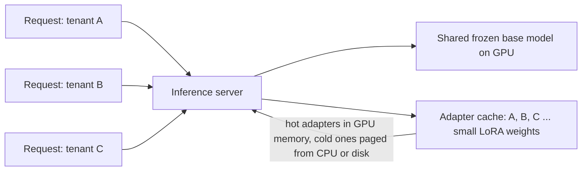
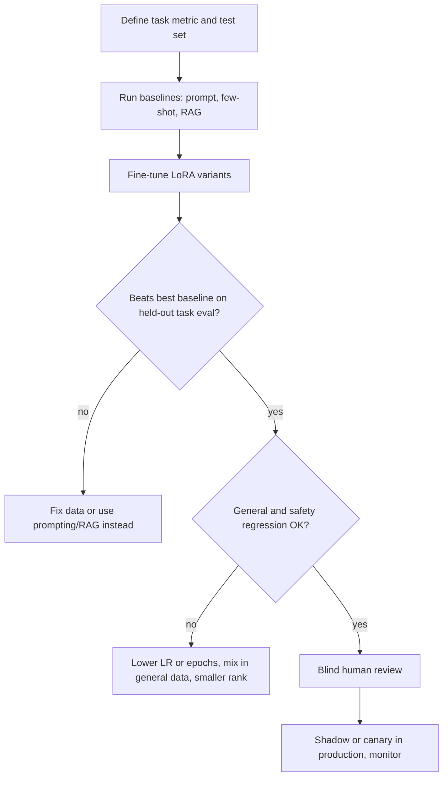

# Fine-Tuning LLMs: Full Fine-Tuning, LoRA and QLoRA

> **Level:** Beginner to Advanced · **Study time:** ~110 min · **Prerequisites:** [How LLMs Are Trained, Part 2: Instruction Tuning, RLHF and DPO](02-instruction-tuning-rlhf-and-dpo.md), [Linear Algebra for Machine Learning](../00-foundations/02-linear-algebra-for-ml.md), [Optimizers: SGD, Momentum, RMSProp, Adam, AdamW](../02-deep-learning/03-optimizers-sgd-momentum-adam-and-learning-rate-schedules.md), [Number Formats and Model Memory](../07-model-compression/01-number-formats-and-model-memory.md)

## Table of contents

- [Why this matters](#why-this-matters)
- [What fine-tuning actually changes](#what-fine-tuning-actually-changes)
- [Full fine-tuning and its memory cost](#full-fine-tuning-and-its-memory-cost)
- [Parameter-efficient fine-tuning (PEFT): the family](#parameter-efficient-fine-tuning-peft-the-family)
- [LoRA: the idea and the math](#lora-the-idea-and-the-math)
- [LoRA from scratch in PyTorch](#lora-from-scratch-in-pytorch)
- [Which weights are trainable, target modules and rank](#which-weights-are-trainable-target-modules-and-rank)
- [Deploying LoRA: merging vs serving many adapters](#deploying-lora-merging-vs-serving-many-adapters)
- [QLoRA: fine-tuning on top of a 4-bit base](#qlora-fine-tuning-on-top-of-a-4-bit-base)
- [Data preparation](#data-preparation)
- [Key hyperparameters](#key-hyperparameters)
- [Hands-on: Hugging Face PEFT and TRL SFTTrainer](#hands-on-hugging-face-peft-and-trl-sfttrainer)
- [Evaluating whether fine-tuning actually helped](#evaluating-whether-fine-tuning-actually-helped)
- [Going deeper: risks, debugging and production practice](#going-deeper-risks-debugging-and-production-practice)
- [Common mistakes and misconceptions](#common-mistakes-and-misconceptions)
- [Interview questions and model answers](#interview-questions-and-model-answers)
- [Key takeaways](#key-takeaways)
- [Further reading](#further-reading)
- [Next](#next)

## Why this matters

Most companies never pretrain an LLM. What they do, constantly, is adapt an existing open-weight model (one whose trained weights you can download and modify, such as a Llama, Mistral, Qwen or Gemma family model, for example) to their own task: a fixed output format, a house tone, a domain vocabulary, a narrow classification or extraction job that prompting cannot make reliable. Fine-tuning is how you do that, and LoRA and QLoRA are what made it affordable: they turned a job that needed a rack of GPUs into one that fits on a single card. Interviewers for senior AI/ML roles almost always probe this area, because it tests linear algebra, memory arithmetic, training practice, evaluation discipline and deployment design in one topic. By the end of this chapter you should be able to derive LoRA's parameter count on a whiteboard, estimate GPU memory for any fine-tuning setup, and explain how you would prove that a fine-tune was worth it.

---

## What fine-tuning actually changes

> **Analogy:** A pretrained LLM is like a well-read new hire. They know a huge amount about the world and language, but they do not yet write tickets the way your team does. Prompting is giving them a sticky note with instructions each morning. Fine-tuning is a short training course that changes their habits, so they do it right without the note.

**Fine-tuning** means continuing to train an already trained model on a smaller, task-specific dataset, so that its weights shift toward the behavior you want. The starting model is called the **base model** (or foundation model). A **weight** (or **parameter**) is one learned number inside the network; a 7B model has about 7 billion of them.

Most LLM fine-tuning today is **supervised fine-tuning (SFT)**: you show the model example conversations (a prompt and the ideal response) and train it with the same next-token prediction loss used in pretraining, usually computing the loss only on the response tokens. The [instruction tuning chapter](02-instruction-tuning-rlhf-and-dpo.md) covers how SFT fits with RLHF and DPO; this chapter is about *how* to update the weights cheaply and safely.

### Our running example

Throughout this chapter we will fine-tune a **7B decoder-only model** for **support ticket triage**: given a customer email, output a JSON object such as:

```json
{"category": "billing", "priority": "high", "summary": "Customer charged twice for invoice 123"}
```

The base model can do this with a long prompt, but it sometimes invents categories, adds chatty text around the JSON, or misjudges priority in our company's specific way. That is a classic fine-tuning use case.

### What fine-tuning is good at, and what it is not

| Fine-tuning is good at | Fine-tuning is weak at |
|---|---|
| Output format and structure (always valid JSON with our schema) | Adding lots of fresh, changing facts (prices, policies updated weekly) |
| Style, tone, persona | Citing sources for its answers |
| Narrow tasks: classification, extraction, routing | Fixing a model that lacks basic capability for the task |
| Domain jargon and shorthand | Anything you can solve with a better prompt for less cost |
| Shortening prompts (behavior baked in, fewer tokens per call) | Guaranteeing it never does something (it shifts probabilities, it does not add hard rules) |

> **Senior insight:** Fine-tuning mainly teaches *behavior and form*. It can teach facts, but unreliably and with a hallucination risk: the model learns to answer confidently in the style of the training data, including on questions it never saw. For knowledge that changes or must be cited, use retrieval (see [What Is RAG and Why It Matters](../08-rag/01-what-is-rag-and-why-it-matters.md)). The full decision framework lives in [Prompting vs RAG vs Fine-Tuning: A Decision Guide](08-prompting-vs-rag-vs-fine-tuning-decision-guide.md).

---

## Full fine-tuning and its memory cost

**Full fine-tuning** updates every weight of the model. It is the most expressive option (any weight can move anywhere), and conceptually it is just "keep training". The problem is memory.

### What has to live in GPU memory

During training with the **AdamW** optimizer (Adam with decoupled weight decay, see the [optimizers chapter](../02-deep-learning/03-optimizers-sgd-momentum-adam-and-learning-rate-schedules.md)) in standard **mixed precision** (compute in 16-bit, keep a 32-bit copy for accurate updates, see [Mixed-Precision Training](../02-deep-learning/09-mixed-precision-training.md)), each parameter needs:

| Item | What it is | Bytes per parameter |
|---|---|---|
| Weights (BF16) | the 16-bit copy used for forward and backward passes | 2 |
| Gradients (BF16) | how much the loss changes per weight, computed by backprop | 2 |
| Master weights (FP32) | an accurate 32-bit copy that receives the updates | 4 |
| Adam first moment $m$ (FP32) | running average of gradients | 4 |
| Adam second moment $v$ (FP32) | running average of squared gradients | 4 |
| **Total** | | **16** |

**BF16** (bfloat16) is a 16-bit floating-point format with the same exponent range as FP32 but less precision; **FP32** is standard 32-bit floating point. Both are explained in [Number Formats and Model Memory](../07-model-compression/01-number-formats-and-model-memory.md).

On top of this come **activations**: intermediate outputs of each layer saved during the forward pass so the backward pass can compute gradients. Activation memory grows with batch size times sequence length, and can be tens of GB for long sequences.

### The formula

$$
M_{\text{states}} = N \times (b_w + b_g + b_{\text{master}} + b_{\text{opt}})
$$

- $M_{\text{states}}$: memory for weights, gradients and optimizer states (activations excluded)
- $N$: number of parameters
- $b_w$: bytes per working weight (2 for BF16)
- $b_g$: bytes per gradient (2 for BF16)
- $b_{\text{master}}$: bytes per master weight (4 for FP32)
- $b_{\text{opt}}$: bytes of optimizer state per parameter (8 for Adam's two FP32 moments)

### Worked example: full fine-tuning a 7B model

Let $N = 7 \times 10^9$ and use 1 GB $= 10^9$ bytes.

1. Weights: $7 \times 10^9 \times 2 = 14 \times 10^9$ bytes $= 14$ GB
2. Gradients: $7 \times 10^9 \times 2 = 14$ GB
3. Master weights: $7 \times 10^9 \times 4 = 28$ GB
4. Adam moments: $7 \times 10^9 \times 8 = 56$ GB
5. Total: $14 + 14 + 28 + 56 = 112$ GB, before activations

So full fine-tuning a 7B model needs roughly **112 GB plus activations**, which does not fit on a single 80 GB GPU. Just *running* the model for inference in BF16 needs about 14 GB. Training needs about 8 times that.

```text
Full fine-tuning, 7B model, mixed-precision AdamW (activations not shown)

 weights BF16   |##############                                 | 14 GB
 grads BF16     |##############                                 | 14 GB
 master FP32    |############################                   | 28 GB
 Adam m,v FP32  |########################################################| 56 GB
                                                         total = 112 GB
```

How teams do full fine-tuning anyway: they **shard** these states across several GPUs with ZeRO or FSDP (schemes where each GPU permanently holds only a slice of the weights, gradients and optimizer states and fetches the rest when needed; for example, 112 GB split across 8 GPUs is 14 GB of states each), use 8-bit optimizers (Adam moments stored in 8 bits instead of 32), and use **gradient checkpointing** (recompute activations during backward instead of storing them all). All of that is covered in [Distributed Training and Training Memory](../02-deep-learning/10-distributed-training-and-training-memory.md). The point here: full fine-tuning is a multi-GPU job, and each fine-tuned copy is another 14 GB checkpoint to store and serve.

> **Common mistake:** Estimating training memory as "model size times 2". For mixed-precision Adam it is closer to model size in BF16 times 8 (16 bytes vs 2 bytes per parameter), plus activations.

---

## Parameter-efficient fine-tuning (PEFT): the family

> **Analogy:** Instead of rewriting a whole textbook to teach a new course, you leave the book untouched and add a thin set of sticky notes. The notes are cheap to write, easy to swap per class, and the original book is never damaged.

**Parameter-efficient fine-tuning (PEFT)** is the family of methods that freeze most or all of the base model and train only a small number of new or selected parameters. **Frozen** means a weight receives no updates (no gradient, no optimizer state).

Why this saves so much: gradients, FP32 master weights and Adam states (14 of the 16 bytes per parameter above; a frozen weight needs only its 2-byte BF16 copy) are only needed for *trainable* parameters. Freeze 99% of the model and that cost almost disappears.

| Method | What it adds or trains | Pros | Cons |
|---|---|---|---|
| **Adapters** (Houlsby et al., 2019) | Small bottleneck MLP layers inserted inside each transformer block | Modular, well studied | Adds extra layers in sequence, so adds inference latency; cannot be merged away |
| **Prefix tuning** (Li and Liang, 2021) | Trainable key/value vectors prepended at every attention layer | Very few parameters | Uses up context length; less stable; often weaker than LoRA on LLMs |
| **Prompt tuning** (Lester et al., 2021) | Trainable "soft prompt" embedding vectors at the input only | Tiniest footprint | Works well mainly for very large models; weaker on smaller ones |
| **IA3** (Liu et al., 2022) | Learned vectors that rescale keys, values and MLP activations | Extremely few parameters | Less expressive than LoRA |
| **LoRA** (Hu et al., 2021) | Low-rank update matrices added in parallel to existing weight matrices | Strong quality, mergeable (zero extra latency), the de facto standard | Rank is a capacity limit; some tasks still favor full fine-tuning |
| **QLoRA** (Dettmers et al., 2023) | LoRA on top of a 4-bit quantized frozen base | Fits big models on one GPU | Slower per step (weights are unpacked from 4-bit to 16-bit for every matrix multiply), merge needs care |

A **soft prompt** is a set of learned vectors that act like extra input tokens but do not correspond to real words. **Inference latency** is the time to produce an answer.

LoRA won in practice for LLMs because it combines good quality, a small file per task, and the ability to be merged into the base weights so that inference costs nothing extra. The rest of the chapter focuses on it.

---

## LoRA: the idea and the math

### Intuition first

> **Analogy:** Imagine a giant 4096 x 4096 spreadsheet of numbers (one weight matrix). Fine-tuning changes many of those numbers a little. LoRA bets that this whole pattern of changes is simple: it can be described as "a few column patterns times a few row patterns". Instead of storing 16.8 million individual edits, you store a few thin strips of numbers and multiply them together to recreate the edit.

The observation behind LoRA ("LoRA: Low-Rank Adaptation of Large Language Models", Hu et al., 2021) is that the *change* in weights needed to adapt a pretrained model to a task tends to have low **intrinsic rank**: it lives in a small subspace. Earlier work ("Intrinsic Dimensionality Explains the Effectiveness of Language Model Fine-Tuning", Aghajanyan, Zettlemoyer and Gupta, 2020) had shown that fine-tuning can succeed when optimizing in a surprisingly small random subspace of parameters.

### What "rank" and a "low-rank update" mean

The **rank** of a matrix is the number of independent directions it contains, or equivalently the smallest number of "column times row" products you need to build it (see [Linear Algebra for ML](../00-foundations/02-linear-algebra-for-ml.md)).

Multiplying a column vector by a row vector (an **outer product**) gives a full matrix whose rows are all multiples of the same row. That matrix has rank 1.

**Tiny example.** Let $B$ be a $3 \times 1$ column and $A$ a $1 \times 3$ row:

$$
B = \begin{bmatrix}1\\2\\3\end{bmatrix},\quad A = \begin{bmatrix}1 & 0 & -1\end{bmatrix},\quad
BA = \begin{bmatrix}1\cdot1 & 1\cdot0 & 1\cdot(-1)\\ 2\cdot1 & 2\cdot0 & 2\cdot(-1)\\ 3\cdot1 & 3\cdot0 & 3\cdot(-1)\end{bmatrix}
= \begin{bmatrix}1 & 0 & -1\\2 & 0 & -2\\3 & 0 & -3\end{bmatrix}
$$

- Every row is a multiple (1, 2, 3) of the same pattern $[1, 0, -1]$, so the rank is 1.
- The full $3 \times 3$ matrix has 9 numbers, but we described it with $3 + 3 = 6$.
- With a $4096 \times 4096$ matrix the saving is dramatic: $4096 + 4096 = 8192$ numbers instead of about 16.8 million for a rank-1 update.

A **low-rank update** is a change to a weight matrix, $\Delta W$, that is constrained to have small rank $r$, written as the product of a tall thin matrix and a short wide matrix: $\Delta W = BA$. A rank-$r$ update is the sum of $r$ such outer products, so it can push the layer's outputs in at most $r$ new directions.

### The LoRA forward pass

A linear layer in a transformer computes $h = W_0 x$ (ignoring bias). LoRA keeps $W_0$ frozen and adds a parallel low-rank path:

$$
h = W_0 x + \Delta W x = W_0 x + \frac{\alpha}{r} B A x
$$

- $x$: the input vector to the layer, size $d_{\text{in}}$
- $h$: the output vector, size $d_{\text{out}}$
- $W_0$: the frozen pretrained weight matrix, shape $d_{\text{out}} \times d_{\text{in}}$
- $A$: trainable "down-projection", shape $r \times d_{\text{in}}$ (squeezes $x$ into $r$ numbers)
- $B$: trainable "up-projection", shape $d_{\text{out}} \times r$ (expands those $r$ numbers back out)
- $r$: the **rank**, a small integer like 8 or 16, much smaller than $d_{\text{in}}$ and $d_{\text{out}}$
- $\alpha$ (alpha): a constant **scaling hyperparameter**; the update is multiplied by $\alpha / r$

```text
                 x  (d_in = 4096)
                 |
       +---------+-----------+
       |                     |
       v                     v
  +---------+           +---------+
  |   W0    |  frozen   |    A    |  r x 4096, trainable
  |4096x4096|           +---------+
  +---------+                |  (r numbers, e.g. 8)
       |                     v
       |                +---------+
       |                |    B    |  4096 x r, trainable, starts at 0
       |                +---------+
       |                     |  x (alpha / r)
       v                     v
       +--------( + )--------+
                  |
                  v
                  h
```

Note the order of computation: we compute $Ax$ first (a tiny vector of $r$ numbers), then $B(Ax)$. We never build the full $4096 \times 4096$ matrix $BA$ during training. That is cheap.

### Worked example: the forward pass by hand

Use the tiny $B$ and $A$ above, rank $r = 1$, $\alpha = 2$ (so the scale is $\alpha/r = 2/1 = 2$), $W_0 = I$ (the $3 \times 3$ identity), and input $x = [1, 2, 0]^T$.

1. Base path: $W_0 x = I x = [1, 2, 0]^T$
2. Down-project: $Ax = 1\cdot1 + 0\cdot2 + (-1)\cdot0 = 1$ (a single number since $r = 1$)
3. Up-project: $B(Ax) = [1, 2, 3]^T \times 1 = [1, 2, 3]^T$
4. Scale: $2 \times [1, 2, 3]^T = [2, 4, 6]^T$
5. Add: $h = [1, 2, 0]^T + [2, 4, 6]^T = [3, 6, 6]^T$

We will check this same answer later using the merged weights.

### Worked parameter count: a 4096 x 4096 matrix

A full update to one $d_{\text{out}} \times d_{\text{in}}$ matrix has $d_{\text{out}} \cdot d_{\text{in}}$ parameters. LoRA trains:

$$
P_{\text{LoRA}} = r \cdot d_{\text{in}} + d_{\text{out}} \cdot r = r\,(d_{\text{in}} + d_{\text{out}})
$$

- $P_{\text{LoRA}}$: number of trainable parameters for that matrix
- $r \cdot d_{\text{in}}$: entries of $A$
- $d_{\text{out}} \cdot r$: entries of $B$

For a $4096 \times 4096$ attention projection (the size of each attention projection in a Llama-2-7B-style model, hidden size 4096):

- Full: $4096 \times 4096 = 16{,}777{,}216$ parameters
- $r = 8$: $A$ has $8 \times 4096 = 32{,}768$; $B$ has $4096 \times 8 = 32{,}768$; total $65{,}536$
  - Fraction: $65{,}536 / 16{,}777{,}216 = 1/256 = 0.390625\%$
- $r = 16$: $16 \times (4096 + 4096) = 16 \times 8192 = 131{,}072$
  - Fraction: $131{,}072 / 16{,}777{,}216 = 1/128 = 0.78125\%$

| Rank $r$ | Trainable params in this matrix | Fraction of full matrix |
|---|---|---|
| full update | 16,777,216 | 100% |
| 8 | 65,536 | 0.39% |
| 16 | 131,072 | 0.78% |
| 64 | 524,288 | 3.1% |

Doubling $r$ doubles the trainable parameters; it grows linearly in $r$, not quadratically.

### The alpha scaling

The scale $\alpha / r$ exists so that you can change $r$ without re-tuning everything else. The LoRA paper notes that with Adam, tuning $\alpha$ is roughly like tuning the learning rate, so a common practice is to fix $\alpha$ (often equal to $r$ or $2r$) and leave it.

Example: $r = 8$, $\alpha = 16$ gives scale $16 / 8 = 2$. With $r = 16$, $\alpha = 32$ the scale is also 2.

> **Senior insight:** With the standard $\alpha / r$ scaling, raising $r$ while holding $\alpha$ fixed shrinks the update, which can make high ranks learn slowly. "A Rank Stabilization Scaling Factor for Fine-Tuning with LoRA" (Kalajdzievski, 2023) proposes **rsLoRA**, scaling by $\alpha / \sqrt{r}$ instead, so higher ranks actually help. Hugging Face PEFT exposes this as an option (`use_rslora=True`).

### Initialization: why B starts at zero

LoRA initializes $A$ with small random values and $B$ with **all zeros**. Then at step 0:

$$
\Delta W = \frac{\alpha}{r} B A = \frac{\alpha}{r} \cdot 0 \cdot A = 0
$$

So the model at the start of training is *exactly* the base model. Training begins from known-good behavior instead of from a randomly perturbed model.

Why not make both zero? Look at the gradients. Let $g = \partial L / \partial h$ be the gradient arriving at the layer's output and $s = \alpha / r$:

$$
\frac{\partial L}{\partial B} = s\, g\, (A x)^T, \qquad \frac{\partial L}{\partial A} = s\, B^T g\, x^T
$$

- If $A$ and $B$ were both zero, both gradients would be zero and nothing would ever train.
- With $A$ random and $B = 0$: the gradient for $B$ is non-zero (because $Ax \neq 0$), so $B$ moves on step 1; the gradient for $A$ is zero on step 1 but becomes non-zero as soon as $B$ is non-zero.

> **Interview tip:** "B is zero so the adapted model equals the base model at initialization, and A is random so gradients can flow" is a one-sentence answer interviewers love.

---

## LoRA from scratch in PyTorch

Seeing the mechanism in about 30 lines removes all the mystery. Install with `pip install torch`.

```python
import math
import torch
import torch.nn as nn


class LoRALinear(nn.Module):
    """Wraps a frozen nn.Linear and adds a trainable low-rank update B @ A."""

    def __init__(self, base: nn.Linear, r: int = 8, alpha: int = 16, dropout: float = 0.0):
        super().__init__()
        self.base = base
        # Freeze the pretrained weight (and bias, if any): no grads, no optimizer state.
        self.base.weight.requires_grad_(False)
        if self.base.bias is not None:
            self.base.bias.requires_grad_(False)

        d_out, d_in = base.weight.shape          # PyTorch stores Linear weights as (out, in)
        self.scaling = alpha / r
        self.lora_A = nn.Parameter(torch.empty(r, d_in))   # down-projection
        self.lora_B = nn.Parameter(torch.zeros(d_out, r))  # up-projection, starts at zero
        nn.init.kaiming_uniform_(self.lora_A, a=math.sqrt(5))  # same init PEFT uses for A
        self.dropout = nn.Dropout(dropout)
        self.merged = False

    def forward(self, x: torch.Tensor) -> torch.Tensor:
        out = self.base(x)
        if not self.merged:
            # Compute A x first (only r numbers per token), then B (A x). Never build B @ A here.
            out = out + (self.dropout(x) @ self.lora_A.T @ self.lora_B.T) * self.scaling
        return out

    @torch.no_grad()
    def merge(self) -> None:
        """Fold the update into the base weight: W' = W + (alpha / r) * B @ A."""
        self.base.weight += (self.lora_B @ self.lora_A) * self.scaling
        self.merged = True


torch.manual_seed(0)
base = nn.Linear(4096, 4096, bias=False)
layer = LoRALinear(base, r=8, alpha=16)

trainable = sum(p.numel() for p in layer.parameters() if p.requires_grad)
frozen = sum(p.numel() for p in layer.parameters() if not p.requires_grad)
print(trainable, frozen)  # 65536 16777216

x = torch.randn(2, 4096)
print(torch.equal(layer(x), base(x)))  # True: B = 0, so the adapted layer equals the base layer

# Pretend training moved B away from zero.
with torch.no_grad():
    layer.lora_B.normal_(std=0.01)

y_unmerged = layer(x)
layer.merge()
y_merged = layer(x)
print(torch.allclose(y_unmerged, y_merged, atol=1e-4))  # True: merging gives the same outputs
```

What this shows:

- Only `lora_A` and `lora_B` are trainable: 65,536 parameters, matching our hand calculation for $r = 8$.
- At initialization the output equals the base model exactly.
- After merging, the two computations agree (up to floating-point rounding), and the merged layer is just an ordinary `nn.Linear` with no extra cost.

---

## Which weights are trainable, target modules and rank

### Which weights are trainable in LoRA?

Only the LoRA matrices $A$ and $B$ that you attach to the chosen layers. Everything else is frozen: the original $W_0$ of those layers, all other linear layers you did not target, embeddings, the output head (the **LM head**, the final layer that maps each hidden state to a score per vocabulary token) and normalization layers. Some setups also make biases, the embedding layer or the LM head trainable (for example when adding new special tokens to the vocabulary, the new token embeddings must be trained), but that is an explicit opt-in (in PEFT, `modules_to_save`).

Gradients still *flow through* the frozen layers during backprop, because adapters in early layers need gradient signal from the loss at the end. Frozen means "not updated", not "skipped in backprop". That is why LoRA does not shrink activation memory much.

### Where LoRA can be attached

A transformer block (see [The Full Transformer Architecture](../04-transformers/05-the-full-transformer-architecture.md) and [Modern LLM Architecture](../04-transformers/08-modern-llm-architecture-improvements.md)) contains these linear layers, using Llama-style names that Hugging Face models commonly use:

| Module | Role | Llama-2-7B shape (out x in) |
|---|---|---|
| `q_proj` | builds queries | 4096 x 4096 |
| `k_proj` | builds keys | 4096 x 4096 (smaller with GQA in newer models) |
| `v_proj` | builds values | 4096 x 4096 (smaller with GQA) |
| `o_proj` | attention output projection | 4096 x 4096 |
| `gate_proj` | SwiGLU gate (MLP) | 11008 x 4096 |
| `up_proj` | MLP up-projection | 11008 x 4096 |
| `down_proj` | MLP down-projection | 4096 x 11008 |

**GQA** (grouped-query attention) shares key and value heads across several query heads, which makes `k_proj` and `v_proj` smaller in many recent models. Module names vary between architectures (GPT-2 style models use names like `c_attn`), so always inspect `model.named_modules()` before choosing targets.

### Worked whole-model count for a 7B model

Take a Llama-2-7B-like shape: 32 layers, hidden size 4096, MLP size 11008, about 6.7B total parameters.

**Option 1: attention only ($q, k, v, o$), $r = 8$**

- Per matrix: $8 \times (4096 + 4096) = 65{,}536$
- Per layer: $4 \times 65{,}536 = 262{,}144$
- All layers: $32 \times 262{,}144 = 8{,}388{,}608 \approx 8.4$M, about 0.12% of 6.7B

**Option 2: all linear layers, $r = 16$**

- Each attention matrix: $16 \times 8192 = 131{,}072$; four of them: $524{,}288$
- `gate_proj` and `up_proj` ($11008 \times 4096$): $16 \times (4096 + 11008) = 16 \times 15{,}104 = 241{,}664$ each
- `down_proj` ($4096 \times 11008$): also $16 \times 15{,}104 = 241{,}664$
- MLP total: $3 \times 241{,}664 = 724{,}992$
- Per layer: $524{,}288 + 724{,}992 = 1{,}249{,}280$
- All layers: $32 \times 1{,}249{,}280 = 39{,}976{,}960 \approx 40$M, about 0.6% of 6.7B

The adapter file for option 2 in BF16 is about $40\text{M} \times 2 = 80$ MB, versus about 13-14 GB for the full model. That size difference is what makes "one adapter per customer" practical.

### Choosing target modules

| Choice | When | Trade-off |
|---|---|---|
| `q_proj`, `v_proj` only | The original LoRA paper's main GPT-3 setting; light style or format tweaks | Fewest parameters; often leaves quality on the table |
| All attention ($q, k, v, o$) | Moderate behavior changes | Middle ground |
| All linear layers (attention + MLP) | Default for most serious SFT today; harder tasks, domain shift | More parameters and compute; usually the best quality per rank |

The QLoRA paper (Dettmers et al., 2023) reported that applying LoRA to *all* linear layers was the key to matching full 16-bit fine-tuning quality, more important than the exact rank. Many practitioners therefore target all linear layers (PEFT supports `target_modules="all-linear"` in recent versions) and spend their tuning budget elsewhere.

> **Senior insight:** The MLP layers hold most of a transformer's parameters and are widely believed to store much of its factual and pattern knowledge. If your task needs new domain-specific patterns rather than just a new output style, including MLP projections usually matters.

### Choosing the rank

The rank $r$ is a **capacity knob**: it caps how many independent directions the update can use per layer.

| Rank | Typical use (illustrative starting points, not rules) |
|---|---|
| 4-8 | Format, style, simple classification |
| 16-32 | General instruction tuning, moderate domain adaptation (a common default) |
| 64-256 | Large distribution shifts (new language, code, math), large datasets |

How to choose in practice:

1. Start with all linear layers, $r = 16$, $\alpha = 16$ or $32$.
2. Run a small sweep (for example $r \in \{8, 16, 64\}$) and compare on your held-out task metric, not just validation loss.
3. If higher rank does not improve the task metric, keep the smaller one (smaller adapters, less overfitting).
4. If quality plateaus well below full fine-tuning on a large dataset, the bottleneck may be LoRA itself; consider a higher rank, rsLoRA, or full fine-tuning.

Bigger rank is not automatically better. With a small dataset, a large rank mostly adds capacity to memorize.

---

## Deploying LoRA: merging vs serving many adapters

### Option A: merge the adapter into the base weights

Because the update is linear, you can fold it into the base matrix once training is done:

$$
W' = W_0 + \frac{\alpha}{r} B A
$$

- $W'$: the merged weight matrix, same shape as $W_0$
- $W_0$, $B$, $A$, $\alpha$, $r$: as defined before

**Worked example.** Using $W_0 = I$, $B = [1,2,3]^T$, $A = [1, 0, -1]$, scale 2:

$$
W' = \begin{bmatrix}1&0&0\\0&1&0\\0&0&1\end{bmatrix} + 2\begin{bmatrix}1&0&-1\\2&0&-2\\3&0&-3\end{bmatrix}
= \begin{bmatrix}3&0&-2\\4&1&-4\\6&0&-5\end{bmatrix}
$$

Check with $x = [1, 2, 0]^T$:

- Row 1: $3\cdot1 + 0\cdot2 + (-2)\cdot0 = 3$
- Row 2: $4\cdot1 + 1\cdot2 + (-4)\cdot0 = 6$
- Row 3: $6\cdot1 + 0\cdot2 + (-5)\cdot0 = 6$

So $W'x = [3, 6, 6]^T$, identical to the two-path computation earlier.

After merging, the model has exactly the base architecture and **zero extra inference latency**. You can then quantize it (GPTQ, AWQ, GGUF, see [Practical LLM Quantization](../07-model-compression/04-llm-quantization-gptq-awq-and-outliers.md)) and serve it with any standard engine.

### Option B: keep adapters separate and serve many of them (multi-LoRA)

If you have 200 customers each with their own adapter, merging gives you 200 full model copies (200 x 14 GB). Instead, **multi-LoRA serving** keeps one copy of the base model on the GPU and applies a different small adapter per request, batching requests that use different adapters together. "S-LoRA: Serving Thousands of Concurrent LoRA Adapters" (Sheng et al., 2023) and Punica (Chen et al., 2023) introduced the key techniques (adapter paging between CPU and GPU, custom kernels for batched mixed-adapter matrix multiplies). Mainstream servers such as vLLM support this (see [LLM Serving Frameworks](../06-llm-inference/06-serving-frameworks-vllm-sglang-tgi-tensorrt-llm-and-ollama.md)); flag names and limits like maximum rank or maximum adapters per batch change between versions, so check current docs.



| | Merge into base | Multi-LoRA serving |
|---|---|---|
| Extra latency | None | Small per-token overhead for the extra low-rank matmuls |
| Memory | One full model per adapter | One base + MBs per adapter |
| Best for | One or a few fine-tunes, max throughput, edge or on-device | Many tenants, tasks or A/B variants on one base |
| Swapping versions | Redeploy a full model | Load a new adapter file at runtime |
| Quantized serving | Merge in 16-bit first, then quantize | Base can be quantized; adapters stay 16-bit |

> **Common mistake:** Merging a LoRA adapter trained with QLoRA directly into the 4-bit weights. The merged result must be rounded back to 4-bit, which throws away much of the small update. The standard practice is to load the base model in BF16/FP16, merge the adapter there, and then (optionally) quantize the merged model with a proper post-training quantization method. Validate the merged model against the unmerged adapter on your eval set, because the adapter was trained against a *quantized* base, so a slight mismatch is possible.

---

## QLoRA: fine-tuning on top of a 4-bit base

### Intuition

> **Analogy:** LoRA freezes the textbook and adds sticky notes. QLoRA also shrinks the textbook to pocket size by printing it in a compressed font. You can still read it (by mentally expanding each word as you read), and the sticky notes are written at full quality.

With LoRA on a 7B model, the frozen BF16 base still costs 14 GB. "QLoRA: Efficient Finetuning of Quantized LLMs" (Dettmers, Pagnoni, Holtzman and Zettlemoyer, 2023) stores that frozen base in 4 bits instead, while training BF16 LoRA adapters on top. The paper's headline demonstration was fine-tuning a 65B model on a single 48 GB GPU.

**Quantization** means storing numbers with fewer bits by mapping them onto a small set of representable values plus a scale factor (see [Quantization Fundamentals](../07-model-compression/02-quantization-fundamentals-scale-and-zero-point.md)). QLoRA has four ingredients, each aimed at a different piece of memory:

| Ingredient | What it shrinks or protects | Effect on a 7B model |
|---|---|---|
| NF4 4-bit storage | the frozen base weights | 14 GB (BF16) to 3.5 GB |
| Double quantization | the per-block scale constants | about 0.44 GB to 0.11 GB |
| Paged optimizers | short memory spikes | avoids OOM crashes from transient spikes; optimizer pages spill to CPU RAM |
| BF16 compute, 16-bit adapters | accuracy of the math and the updates | no saving; keeps quality |

### 1. NF4 (4-bit NormalFloat)

Pretrained weights are roughly **normally distributed** (bell-shaped, centered at 0). A plain 4-bit integer grid spaces its 16 levels evenly, which wastes levels on the rare large values. **NF4** places its 16 levels at **quantiles** of a normal distribution (the cut points that split the bell curve into slices of equal probability), so each level is used about equally often: levels are dense near zero (where most weights are) and sparse in the tails. The paper calls this information-theoretically optimal for normally distributed data. NF4 is built so that zero is represented exactly.

Weights are quantized in **blocks** (64 weights per block in QLoRA). Each block stores one scale, its **absmax** (largest absolute value), and each weight stores a 4-bit index into the NF4 table:

$$
w \approx c \cdot q_{k}, \qquad c = \max_{j \in \text{block}} |w_j|
$$

- $w$: an original weight
- $c$: the block's absmax scale constant
- $q_k$: the NF4 level (between -1 and 1) nearest to $w / c$, stored as its 4-bit index $k$

The 16 NF4 levels (rounded to 4 decimals, as listed in the QLoRA paper and the bitsandbytes library) are:

```text
-1.0000 -0.6962 -0.5251 -0.3949 -0.2844 -0.1848 -0.0911  0.0000
 0.0796  0.1609  0.2461  0.3379  0.4407  0.5626  0.7230  1.0000
```

**Worked example** with a toy block of 4 weights $[0.2, -0.5, 0.05, 0.4]$:

1. Absmax: $c = 0.5$
2. Normalize: $[0.2/0.5, -0.5/0.5, 0.05/0.5, 0.4/0.5] = [0.4, -1.0, 0.1, 0.8]$
3. Nearest NF4 level for each:
   - $0.4$: candidates $0.3379$ (distance $0.0621$) and $0.4407$ (distance $0.0407$), pick $0.4407$
   - $-1.0$: exactly $-1.0$
   - $0.1$: candidates $0.0796$ (distance $0.0204$) and $0.1609$ (distance $0.0609$), pick $0.0796$
   - $0.8$: candidates $0.7230$ (distance $0.0770$) and $1.0$ (distance $0.2$), pick $0.7230$
4. Dequantize (multiply by $c = 0.5$): $[0.2204, -0.5, 0.0398, 0.3615]$
5. Errors: $[0.0204, 0, 0.0102, 0.0385]$; small, and smallest where weights cluster

### 2. Double quantization

The block scales themselves cost memory. One FP32 constant (32 bits) per 64 weights is:

$$
\frac{32}{64} = 0.5 \text{ bits per parameter}
$$

**Double quantization** quantizes those constants too: QLoRA stores them in 8 bits, grouped in blocks of 256 constants, with one FP32 second-level constant per group:

$$
\frac{8}{64} + \frac{32}{64 \times 256} = 0.125 + \frac{32}{16384} \approx 0.125 + 0.00195 = 0.127 \text{ bits per parameter}
$$

- Saving: $0.5 - 0.127 = 0.373$ bits per parameter
- For 7B parameters: $0.5 \times 7 \times 10^9 / 8 = 437.5$ MB of constants without double quantization, versus $0.127 \times 7 \times 10^9 / 8 \approx 111$ MB with it, saving about 326 MB
- For a 65B model the same saving is about $0.373 \times 65 \times 10^9 / 8 \approx 3$ GB, which matches the figure reported in the paper

### 3. Paged optimizers

Memory use during training is spiky: a batch with unusually long sequences can briefly push you over the GPU limit and crash with an **out-of-memory (OOM)** error. **Paged optimizers** allocate optimizer states in NVIDIA **unified memory**, which the driver can automatically move (page) between GPU memory and CPU RAM. When the GPU runs short, optimizer pages are evicted to CPU and paged back in when needed for the update. You trade some speed during spikes for not crashing. In Hugging Face this is just an optimizer name, such as `paged_adamw_8bit` or `paged_adamw_32bit`.

### 4. Computation in BF16

4-bit numbers are a *storage* format, not a math format. In each forward and backward pass, QLoRA **dequantizes** the needed block of NF4 weights to BF16 on the fly, does the matrix multiply in BF16, and discards the dequantized copy. LoRA adapters are kept in 16-bit (or 32-bit) precision. Gradients flow through the dequantized frozen weights into the adapters; the 4-bit base never receives updates.

```text
QLoRA layer (per forward pass)

  NF4 weights (4-bit) + block scales
            |  dequantize on the fly
            v
     W0 in BF16 (temporary) ----> W0 x ----+
                                           (+) ----> h
     x ----> A (BF16) ----> B (BF16) x alpha/r --+
             trainable       trainable
```

The dequantization costs extra compute, so a QLoRA training step is typically slower than a 16-bit LoRA step on the same hardware. You are trading time for memory.

### Worked memory comparison for our 7B model

Assumptions (illustrative): 7B parameters, all linear layers adapted at $r = 16$ giving about 40M trainable parameters, trainable parameters cost 16 bytes each (weights, gradients and two Adam moments, kept in 32-bit as PEFT does by default), activations excluded, 1 GB $= 10^9$ bytes. For simplicity all 7B base weights are treated as quantized in QLoRA; in practice embeddings and the output head often stay in 16-bit, adding a few hundred MB.

| Component | Full FT (mixed-precision AdamW) | LoRA (BF16 base) | QLoRA (NF4 base + DQ) |
|---|---|---|---|
| Base weights | 14 GB (BF16) + 28 GB (FP32 master) | 14 GB (BF16, frozen) | 3.5 GB (7B x 0.5 bytes) + 0.11 GB constants |
| Gradients | 14 GB | 40M x 4 B = 0.16 GB | 0.16 GB |
| Optimizer states | 56 GB | 40M x 8 B = 0.32 GB | 0.32 GB (less with 8-bit paged Adam) |
| Adapter weights | n/a | 40M x 4 B = 0.16 GB | 0.16 GB |
| **Total (no activations)** | **~112 GB** | **~14.6 GB** | **~4.3 GB** |

Arithmetic check: LoRA $= 14 + 0.16 + 0.32 + 0.16 = 14.64$ GB. QLoRA $= 3.5 + 0.11 + 0.64 = 4.25$ GB.

Lessons from the table:

- LoRA trains about 0.6% of the parameters, but memory drops about 7.7x ($112 / 14.6$), not the roughly 175x ($7\text{B} / 40\text{M}$) the parameter count suggests, because the frozen base still has to sit in memory.
- QLoRA attacks exactly that remaining cost: the frozen base shrinks about 4x.
- Activations are now a large share of what is left, which is why QLoRA setups almost always enable gradient checkpointing. With it, a 7B QLoRA run at moderate sequence lengths fits on a single 16-24 GB GPU (illustrative; depends on sequence length and batch size).

---

## Data preparation

Data quality matters more than any hyperparameter in this chapter. "LIMA: Less Is More for Alignment" (Zhou et al., 2023) showed strong instruction-following from only about 1,000 carefully curated examples, an influential demonstration that curation beats volume for SFT.

### Instruction format and chat templates

Training examples are usually stored as JSONL (one JSON object per line) in a conversational format:

```json
{"messages": [
  {"role": "system", "content": "You triage support emails. Reply with JSON only."},
  {"role": "user", "content": "I was charged twice for invoice 123, please fix ASAP."},
  {"role": "assistant", "content": "{\"category\": \"billing\", \"priority\": \"high\", \"summary\": \"Customer charged twice for invoice 123\"}"}
]}
```

A **chat template** is the model-specific recipe that turns a list of messages into the exact token string the model was trained on, including special tokens marking where each role begins and ends. Each model family has its own. If you fine-tune with one format and serve with another, quality silently drops. Always let the tokenizer apply it:

```python
# pip install transformers
from transformers import AutoTokenizer

tok = AutoTokenizer.from_pretrained("Qwen/Qwen2.5-0.5B-Instruct")  # any chat model works here
messages = [
    {"role": "system", "content": "You triage support emails. Reply with JSON only."},
    {"role": "user", "content": "I was charged twice for invoice 123."},
]
# add_generation_prompt=True appends the "assistant turn starts here" marker for inference.
prompt = tok.apply_chat_template(messages, tokenize=False, add_generation_prompt=True)
print(prompt)  # shows the model-specific special tokens around each role
```

**Loss masking:** compute the loss only on assistant tokens, not on the system and user text. Otherwise the model spends capacity learning to generate user emails. TRL supports this; the mechanism has changed across versions (an older `DataCollatorForCompletionOnlyLM`, newer `completion_only_loss` for prompt-completion datasets and `assistant_only_loss` for conversational datasets, which needs template support), so check your installed version.

### Quality checklist

| Step | Why | How |
|---|---|---|
| Correct labels | The model copies your mistakes faithfully | Expert review of a sample, label guidelines, disagreement checks |
| Consistent format | Inconsistent outputs teach inconsistency | Validate every target against the JSON schema |
| Coverage | Rare categories get ignored | Count examples per category; add or upsample rare ones |
| Realistic inputs | Train/serve mismatch | Use real (anonymized) traffic, not only synthetic text |
| Deduplication | Duplicates over-weight some examples and leak into eval | Exact hashing, then near-duplicate detection (MinHash) |
| PII scrubbing | Fine-tuned models can memorize and regurgitate | Redact names, emails, account numbers before training |
| Length limits | Truncated targets teach broken outputs | Drop or split examples longer than max sequence length |

### Deduplication and the train/validation split

```python
import hashlib
import json
import random


def norm(text: str) -> str:
    return " ".join(text.lower().split())  # case and whitespace insensitive


with open("tickets.jsonl", encoding="utf-8") as f:
    examples = [json.loads(line) for line in f]

# 1) Exact dedup on the user input (near-dup detection with MinHash is the next step at scale).
seen, unique = set(), []
for ex in examples:
    user_text = next(m["content"] for m in ex["messages"] if m["role"] == "user")
    key = hashlib.sha256(norm(user_text).encode()).hexdigest()
    if key not in seen:
        seen.add(key)
        unique.append(ex)

# 2) Shuffle with a fixed seed, then split. Hold out a test set you never tune on.
random.Random(42).shuffle(unique)
n = len(unique)
train = unique[: int(0.8 * n)]
val = unique[int(0.8 * n): int(0.9 * n)]
test = unique[int(0.9 * n):]

for name, rows in [("train", train), ("val", val), ("test", test)]:
    with open(f"{name}.jsonl", "w", encoding="utf-8") as f:
        f.writelines(json.dumps(r) + "\n" for r in rows)
```

For real data, a random split is often not enough. If the same customer or thread appears in train and test, the test set leaks. Split by customer, thread or time (train on older tickets, test on newer ones) to mimic production. See [The ML Workflow, Train/Validation/Test Splits](../01-classical-ml/01-ml-workflow-data-splits-and-cross-validation.md) and [Data Leakage](../01-classical-ml/03-overfitting-regularization-and-data-leakage.md).

---

## Key hyperparameters

Values below are common starting points from practice and from the LoRA and QLoRA papers, not universal rules. Always confirm on your own validation set.

| Hyperparameter | Typical starting point | Effect and notes |
|---|---|---|
| Rank `r` | 16 (range 8-64) | Capacity per layer; too high on small data invites memorization |
| `lora_alpha` | equal to `r` or `2r` | Scales the update; interacts with learning rate |
| `lora_dropout` | 0.05 (0 to 0.1) | Dropout on the adapter input; mild regularization |
| `target_modules` | all linear layers | Biggest lever for quality after data |
| Learning rate (LoRA/QLoRA) | 1e-4 to 2e-4 | About 10x higher than full fine-tuning, because only small new matrices move |
| Learning rate (full FT) | about 1e-5 to 5e-5 | Too high destroys pretrained knowledge quickly |
| Epochs | 1-3 | More epochs on small data is the most common overfitting cause |
| Effective batch size | 16-128 sequences | Per-device batch x gradient accumulation steps x number of GPUs |
| LR schedule | short warmup (about 3% of steps), then cosine or linear decay | Warmup avoids early instability |
| Max sequence length | covers about 95-99% of examples | Longer costs memory quadratically in attention score size without FlashAttention, linearly with it |
| Gradient checkpointing | on for QLoRA | Trades about one extra forward pass of compute for much less activation memory |
| Packing | on for many short examples | Concatenates examples to fill sequences, improving throughput; needs correct attention masking between examples |
| Weight decay, grad clipping | 0-0.1, clip norm 1.0 | Standard stability settings |

**Gradient accumulation** means running several small batches and summing their gradients before one optimizer step, to simulate a larger batch without more memory.

---

## Hands-on: Hugging Face PEFT and TRL SFTTrainer

> **Version warning:** PEFT, TRL and Transformers change quickly. Argument names have moved between classes and been renamed across releases (for example `tokenizer` became `processing_class`, `max_seq_length` became `max_length` in TRL's `SFTConfig`, `evaluation_strategy` became `eval_strategy`, `torch_dtype` was renamed to `dtype` in Transformers, with the old name still accepted for backward compatibility, and Transformers v5 removed `warmup_ratio` in favor of a fractional `warmup_steps`). The code below was checked against Transformers 5.x, TRL 1.x and PEFT 0.2x signatures. Treat the code below as a realistic template and check the docs for your installed versions.

Install: `pip install torch transformers peft trl datasets accelerate bitsandbytes` (bitsandbytes is needed for QLoRA and targets NVIDIA GPUs).

### Step 1: plain LoRA with PEFT

```python
import torch
from transformers import AutoModelForCausalLM
from peft import LoraConfig, get_peft_model

model_id = "Qwen/Qwen2.5-0.5B-Instruct"   # small model for experimenting; swap in a 7B for real runs
model = AutoModelForCausalLM.from_pretrained(model_id, dtype=torch.bfloat16)  # older Transformers: torch_dtype=

lora_config = LoraConfig(
    r=16,
    lora_alpha=32,
    lora_dropout=0.05,
    target_modules=["q_proj", "k_proj", "v_proj", "o_proj", "gate_proj", "up_proj", "down_proj"],
    bias="none",
    task_type="CAUSAL_LM",
)
model = get_peft_model(model, lora_config)
model.print_trainable_parameters()  # prints trainable vs total params and the percentage
```

### Step 2: QLoRA loading plus TRL's SFTTrainer

```python
import torch
from datasets import load_dataset
from transformers import AutoModelForCausalLM, AutoTokenizer, BitsAndBytesConfig
from peft import LoraConfig, prepare_model_for_kbit_training
from trl import SFTConfig, SFTTrainer

model_id = "your-org/your-7b-base-or-instruct"   # placeholder: any causal LM on the Hub

# 4-bit NF4 storage, double quantization, BF16 compute: the QLoRA recipe.
bnb_config = BitsAndBytesConfig(
    load_in_4bit=True,
    bnb_4bit_quant_type="nf4",
    bnb_4bit_use_double_quant=True,
    bnb_4bit_compute_dtype=torch.bfloat16,
)
tokenizer = AutoTokenizer.from_pretrained(model_id)
model = AutoModelForCausalLM.from_pretrained(
    model_id, quantization_config=bnb_config, device_map="auto"
)
# Casts norm layers to FP32 for stability, enables input grads for checkpointing, etc.
model = prepare_model_for_kbit_training(model)

lora_config = LoraConfig(
    r=16, lora_alpha=32, lora_dropout=0.05,
    target_modules="all-linear",          # supported in recent PEFT versions
    task_type="CAUSAL_LM",
)

# JSONL files with a "messages" column; TRL applies the chat template for conversational data.
ds = load_dataset("json", data_files={"train": "train.jsonl", "validation": "val.jsonl"})

args = SFTConfig(
    output_dir="out/ticket-triage-qlora",
    num_train_epochs=2,
    per_device_train_batch_size=4,
    gradient_accumulation_steps=4,        # effective batch 16 per GPU
    learning_rate=2e-4,
    lr_scheduler_type="cosine",
    warmup_steps=0.03,                    # float < 1 = fraction of steps; Transformers 4.x: warmup_ratio=0.03
    bf16=True,
    gradient_checkpointing=True,
    optim="paged_adamw_8bit",             # the paged optimizer from QLoRA
    logging_steps=10,
    eval_strategy="steps",                # older Transformers: evaluation_strategy
    eval_steps=100,
    save_steps=100,
    max_length=1024,                      # older TRL: max_seq_length
)

trainer = SFTTrainer(
    model=model,
    args=args,
    train_dataset=ds["train"],
    eval_dataset=ds["validation"],
    processing_class=tokenizer,           # older TRL: tokenizer=tokenizer
    peft_config=lora_config,              # SFTTrainer wraps the model with LoRA for us
)
trainer.train()
trainer.save_model()                      # saves only the adapter weights (MBs, not GBs)
```

### Step 3: merge for deployment

```python
import torch
from transformers import AutoModelForCausalLM
from peft import PeftModel

base = AutoModelForCausalLM.from_pretrained(
    "your-org/your-7b-base-or-instruct", dtype=torch.bfloat16  # 16-bit base, NOT 4-bit (older Transformers: torch_dtype=)
)
model = PeftModel.from_pretrained(base, "out/ticket-triage-qlora")
merged = model.merge_and_unload()          # computes W + (alpha / r) * B @ A for each target layer
merged.save_pretrained("out/ticket-triage-merged")
# Save the tokenizer alongside, then evaluate the merged model before shipping.
```

---

## Evaluating whether fine-tuning actually helped

A lower training loss proves almost nothing. You need evidence that the fine-tuned model is better *at the job* than cheaper alternatives, without breaking anything else. The general tooling is covered in [Evaluating LLMs](10-llm-evaluation-metrics-and-llm-as-a-judge.md) and [Building an LLM Evaluation Framework](11-building-an-llm-evaluation-framework-and-regression-tests.md); here is the fine-tuning-specific plan.

### 1. A held-out task eval

- A test set the model never trained on and you never tuned hyperparameters on, deduplicated against the training data (near-duplicates count too).
- Drawn from the production distribution, ideally later in time than the training data.
- Task metrics that matter to the business. For ticket triage: JSON validity rate, category accuracy and macro-F1 (see [Classification Metrics](../01-classical-ml/04-classification-metrics-and-imbalanced-data.md)), priority accuracy, and summary quality judged by humans or a calibrated LLM judge.

### 2. Compare against strong baselines, not a weak prompt

| Variant | Purpose |
|---|---|
| Base model, zero-shot with a good prompt | Is fine-tuning needed at all? |
| Base model, few-shot prompt (5-10 examples) | Cheap behavior shaping |
| Base model + RAG (retrieve similar past tickets or policy docs) | Is the gap about knowledge rather than behavior? |
| A larger or frontier API model, prompted | Upper bound and cost comparison |
| LoRA fine-tune (several ranks) | The candidate |
| Full fine-tune (if affordable) | Is LoRA leaving quality on the table? |

Report quality *and* cost and latency per request. A fine-tune that matches a few-shot prompt but cuts prompt length by 2,000 tokens per call can still be a win on cost and latency.

### 3. General capability regression checks

Run a fixed suite of general tasks before and after: reasoning, instruction following, general knowledge, coding if relevant, and especially **safety** behavior (fine-tuning can weaken refusals, even on benign data). A small drop may be acceptable for a narrow internal tool; a large drop is a red flag for a user-facing assistant.

### 4. Human review

Blind side-by-side comparisons by domain experts (they see two outputs, not which model produced them) on a sample of real inputs, including hard and adversarial cases. This catches problems metrics miss: plausible but wrong summaries, tone problems, confident hallucinations.

### 5. Statistical care

With 300 test examples, a 2-point accuracy difference may be noise. Use confidence intervals or a paired test across the same examples, and run more than one seed if the decision is close.

**Worked example.** At 85% accuracy on $n = 300$, the standard error is $\sqrt{0.85 \times 0.15 / 300} = \sqrt{0.000425} \approx 0.021$, so a 95% interval is about $\pm 1.96 \times 2.1 \approx \pm 4$ points. A paired test such as McNemar's test, which looks only at the examples where the two models disagree, is more sensitive because both models answer the same inputs.

```python
# Minimal comparison harness for the triage task (generate_fn is your model call).
import json


def score(generate_fn, test_rows):
    valid = correct = 0
    for row in test_rows:
        msgs = [m for m in row["messages"] if m["role"] != "assistant"]
        gold = json.loads(next(m["content"] for m in row["messages"] if m["role"] == "assistant"))
        out = generate_fn(msgs)
        try:
            pred = json.loads(out)
        except json.JSONDecodeError:
            continue
        if isinstance(pred, dict):  # valid JSON that is not an object (e.g. a list) does not count
            valid += 1
            correct += pred.get("category") == gold["category"]
    n = len(test_rows)
    return {"json_valid": valid / n, "category_acc": correct / n}

# results = {name: score(fn, test) for name, fn in
#            {"base_zero_shot": ..., "base_few_shot": ..., "base_rag": ..., "lora_r16": ...}.items()}
```

### 6. Online validation

Offline wins still have to survive real traffic. In a **shadow** deployment the new model receives a copy of live requests but its outputs are only logged, never shown; in a **canary** it serves a small share of real users (say 5%) while you watch format errors, escalation rates and feedback against the old model. See [Model Deployment Patterns](../10-mlops/04-model-deployment-patterns.md).



---

## Going deeper: risks, debugging and production practice

### Overfitting

**Overfitting** means the model memorizes the training examples instead of learning the general pattern (see [Overfitting, Bias-Variance, Regularization](../01-classical-ml/03-overfitting-regularization-and-data-leakage.md)). Symptoms in LLM fine-tuning:

- Training loss keeps falling while validation loss rises (the classic U-shape).
- The model repeats exact phrases from training examples, or answers new inputs with outputs copied from similar training cases.
- Outputs become narrow and repetitive.

Remedies: fewer epochs (often 1-2 is enough), lower learning rate, smaller rank, more diverse data, dropout, early stopping on validation loss *and* task metric, and checkpoint selection by task metric.

### Catastrophic forgetting

**Catastrophic forgetting** is when training on a new task degrades abilities the model had before (general reasoning, other languages, safety behavior). It is covered in depth in [Catastrophic Forgetting, Data Contamination and Memorization](09-catastrophic-forgetting-contamination-and-memorization.md). The short version for fine-tuning:

- It grows with learning rate, number of steps, and how far the new data is from the pretraining and instruction-tuning data.
- LoRA tends to forget less than full fine-tuning because the update is constrained, but it also tends to learn less of the new domain: "LoRA Learns Less and Forgets Less" (Biderman et al., 2024) found this trade-off on code and math domains.
- Mitigations: mix some general instruction data into the training set (replay), lower learning rate, fewer steps, smaller rank or fewer target modules, and always run the regression suite.

### Other failure modes

| Symptom | Likely cause | Fix |
|---|---|---|
| Model never stops generating, or emits stray template tokens | EOS token missing from targets, or wrong chat template at inference | Ensure targets end with the EOS/end-of-turn token; use the same template in training and serving |
| Loss is flat from step 1 | Adapters not attached (wrong module names), LR too low, all labels masked | Check `print_trainable_parameters()`, inspect a batch's labels |
| Loss spikes or becomes NaN | LR too high, FP16 overflow | Lower LR, use BF16, gradient clipping |
| Great eval, bad production | Train/test leakage, distribution shift, template mismatch | Time-based split, check serving path end to end |
| Model answers confidently but wrongly on new facts | Fine-tuning taught style, not reliable knowledge | Use RAG for knowledge; fine-tune for behavior |
| Safety refusals weakened | Fine-tuning shifted the aligned behavior | Add safety data to the mix, run safety evals, see [LLM Safety](13-llm-safety-guardrails-and-responsible-ai.md) |
| Merged model worse than adapter | Merged into quantized weights, or base version mismatch | Merge into the exact same base in 16-bit; version-pin the base |

### LoRA variants worth knowing

| Variant | Idea | Why it matters |
|---|---|---|
| **rsLoRA** (Kalajdzievski, 2023) | Scale by $\alpha / \sqrt{r}$ | Higher ranks become useful instead of slow |
| **DoRA** ("DoRA: Weight-Decomposed Low-Rank Adaptation", Liu et al., 2024) | Split weights into magnitude and direction; apply LoRA to direction | Often closes part of the gap to full fine-tuning |
| **LoRA+** (Hayou et al., 2024) | Use a higher learning rate for $B$ than for $A$ | Faster, sometimes better convergence |
| **AdaLoRA** (Zhang et al., 2023) | Allocate rank adaptively across layers | Spends parameters where they matter |

### What changes at scale and in production

- **Treat adapters as versioned artifacts.** An adapter is only meaningful together with its exact base model version, tokenizer and chat template. Store all four together in the model registry (see [Data Versioning, Model Versioning and the Model Registry](../10-mlops/02-data-and-model-versioning-and-model-registry.md)). If the base model provider releases a new version, your adapter does not transfer; you retrain.
- **Reproducibility.** Pin library versions, seeds and dataset hashes. Fine-tuning results can shift noticeably between library versions because of changed defaults (see [Reproducible Training](../10-mlops/03-reproducibility-and-training-serving-skew.md)).
- **Cost.** QLoRA lets you train on cheaper GPUs, but each step is slower. For repeated large jobs, 16-bit LoRA on bigger GPUs can be cheaper in total because it finishes faster. Compute the cost per completed run, not per GPU-hour.
- **Serving decision.** One fine-tune: merge, quantize, serve normally. Many fine-tunes: multi-LoRA on a shared base, with adapter caching and per-tenant routing (see [System Design: A Multi-Tenant LLM Inference Platform](../11-system-design/03-design-a-multi-tenant-llm-inference-platform.md)).
- **Continuous improvement.** Log production inputs and outcomes (with consent and PII controls), have humans correct a sample, add corrections to the next training set, and re-run the full eval suite as a regression gate before each release (see [CI/CD and Testing for ML Pipelines](../10-mlops/07-ci-cd-and-testing-for-ml-pipelines.md)).
- **Distillation as an alternative data source.** A common pattern is to generate training targets with a large model and fine-tune a small model on them, which is covered in [Distilling Large Language Models](../07-model-compression/06-distilling-large-language-models.md). Check the large model's license terms first.

> **Senior insight:** The most valuable thing you can say in an interview about fine-tuning is not a hyperparameter. It is "I first proved that prompting and RAG were not enough, I built a held-out eval and regression suite before training, and I chose LoRA vs full fine-tuning based on the measured gap and the serving plan."

---

## Common mistakes and misconceptions

- **"Fine-tuning is how you add our company knowledge."** Usually wrong for facts that change or need citations. Use RAG for knowledge, fine-tuning for behavior and format.
- **"LoRA saves memory in proportion to trainable parameters."** No. It removes gradient and optimizer memory for frozen weights, but the frozen base and activations remain. That is why QLoRA exists.
- **"LoRA makes inference faster."** No. Unmerged it is slightly slower; merged it is the same speed as the base model. LoRA is a training and storage efficiency method.
- **"QLoRA trains a 4-bit model."** No. It trains 16-bit adapters on top of a frozen 4-bit base, with math done in BF16.
- **"Higher rank is always better."** Not with small datasets; it mostly adds memorization capacity. Measure.
- **Judging success by training or validation loss alone.** Loss can improve while task accuracy, format validity or general capability gets worse.
- **Comparing against a weak prompt.** The fair baseline is the best prompt, few-shot and RAG setup you can build.
- **Mismatched chat templates** between training and serving, or missing EOS tokens in targets.
- **Leaky splits:** duplicates or the same customer thread in both train and test.
- **Merging into a 4-bit base** or into a different base version than the one used for training.
- **Forgetting that the base model license and the training data license both apply** to the fine-tuned model.

---

## Interview questions and model answers

<details>
<summary><b>Q1. Compare prompting, RAG, full fine-tuning, LoRA, and QLoRA.</b></summary>

**Short answer:** Prompting and RAG change the model's input, not its weights: prompting is cheapest and fastest to iterate; RAG adds fresh, citable knowledge at query time. Fine-tuning changes weights to change behavior. Full fine-tuning updates everything (most expressive, most expensive, a full checkpoint per task). LoRA freezes the base and trains small low-rank adapters (about 0.1-1% of parameters, tiny files, mergeable). QLoRA is LoRA on a 4-bit quantized frozen base, so large models fit on one GPU.

**Deeper answer and follow-ups:**

| | Prompting | RAG | Full FT | LoRA | QLoRA |
|---|---|---|---|---|---|
| Changes weights | No | No | All | Small adapters | Small adapters |
| Best for | Quick behavior shaping | Fresh or private knowledge, citations | Large domain shifts, max quality | Format, style, narrow tasks | Same as LoRA, limited GPU |
| Training memory (7B, illustrative) | None | None (index cost instead) | ~112 GB + activations | ~15 GB + activations | ~4-5 GB + activations |
| Per-task artifact | Prompt text | Index + prompt | ~14 GB model | ~10-100 MB | ~10-100 MB |
| Inference cost | Longer prompts | Retrieval + longer prompts | Same as base | Same if merged | Same as LoRA after a 16-bit merge |
| Knowledge updates | Instant | Re-index | Retrain | Retrain | Retrain |

- They combine: a common production setup is RAG for knowledge plus a LoRA fine-tune for format and tone.
- Order of escalation: prompt, then few-shot, then RAG, then LoRA, then full fine-tuning, each justified by eval results. See [the decision guide](08-prompting-vs-rag-vs-fine-tuning-decision-guide.md).
- Pitfall: choosing fine-tuning to inject facts that change weekly.

</details>

<details>
<summary><b>Q2. Explain full fine-tuning, LoRA, and QLoRA.</b></summary>

**Short answer:** Full fine-tuning continues training all weights, which needs about 16 bytes per parameter with mixed-precision Adam. LoRA freezes the pretrained weights and learns, for chosen linear layers, an update $\Delta W = \frac{\alpha}{r} BA$ with small rank $r$, so only $A$ and $B$ need gradients and optimizer states. QLoRA additionally stores the frozen base in 4-bit NF4 with double quantization, dequantizes to BF16 for compute, and uses paged optimizers to survive memory spikes.

**Deeper answer and follow-ups:**

- Full FT on 7B: $7\text{B} \times 16$ bytes $= 112$ GB before activations; needs sharding (ZeRO/FSDP) across GPUs.
- LoRA on 7B, all linear layers at $r=16$: about 40M trainable parameters, about 14.6 GB of states, dominated by the 14 GB frozen BF16 base.
- QLoRA: base drops to about 3.6 GB, total about 4.3 GB before activations.
- Quality: QLoRA paper reported matching 16-bit full fine-tuning on its benchmarks when LoRA is applied to all linear layers; on large domain shifts (code, math continued pretraining) full fine-tuning can still win.
- Speed: QLoRA steps are slower than LoRA steps due to dequantization.

</details>

<details>
<summary><b>Q3. How does LoRA reduce trainable parameters?</b></summary>

**Short answer:** Instead of learning a full $d_{\text{out}} \times d_{\text{in}}$ update for a weight matrix, LoRA constrains the update to rank $r$ and factors it as $B$ ($d_{\text{out}} \times r$) times $A$ ($r \times d_{\text{in}}$). That needs $r(d_{\text{in}} + d_{\text{out}})$ parameters instead of $d_{\text{in}} d_{\text{out}}$.

**Deeper answer and follow-ups:**

- 4096 x 4096 matrix: full $= 16{,}777{,}216$; $r=8$: $8 \times 8192 = 65{,}536$ (0.39%); $r=16$: $131{,}072$ (0.78%).
- Whole 7B model, q/k/v/o at $r=8$: $32 \times 4 \times 65{,}536 = 8{,}388{,}608$, about 0.12%.
- Savings are linear in $r$ and grow with matrix size, since $r(d+d)$ vs $d^2$.
- Memory consequence: gradients, FP32 master weights and Adam states exist only for those parameters, removing about 14 of 16 bytes per frozen parameter (only the 2-byte BF16 weight remains).
- Follow-up "does that reduce compute?" The forward pass still runs the full base model plus a small extra; backward still propagates through the frozen layers but skips weight-gradient computation for them, so compute drops somewhat, but far less than the parameter count suggests.

</details>

<details>
<summary><b>Q4. How does QLoRA reduce GPU memory requirements?</b></summary>

**Short answer:** It shrinks the part LoRA could not: the frozen base weights. They are stored as 4-bit NF4 in blocks of 64 with an absmax scale per block, the scales themselves are quantized to 8-bit (double quantization), and optimizer states can be paged to CPU memory during spikes. Matrix multiplies dequantize weights to BF16 on the fly, and only the 16-bit LoRA adapters are trained.

**Deeper answer and follow-ups:**

- 7B base: BF16 14 GB vs NF4 $7 \times 10^9 \times 0.5$ bytes $= 3.5$ GB, plus about 0.11 GB of constants with double quantization (0.44 GB without).
- Double quantization: $0.5 \to 0.127$ bits per parameter of overhead, saving 0.373 bits per parameter (about 3 GB on a 65B model).
- Combined with gradient checkpointing, a 7B QLoRA run fits on a single 16-24 GB GPU at moderate sequence lengths (illustrative); the paper fine-tuned a 65B model on one 48 GB GPU.
- Costs: slower steps from dequantization; a small mismatch when merging into a 16-bit base.
- What it does not shrink: activations (handle them with gradient checkpointing, shorter sequences or smaller micro-batches) and the small adapter states.

</details>

<details>
<summary><b>Q5. What is a low-rank update?</b></summary>

**Short answer:** A change to a weight matrix, $\Delta W$, whose rank is small: it can be written as a sum of $r$ outer products (column times row), i.e. $\Delta W = BA$ with $B$ tall and thin and $A$ short and wide. Intuitively it can only push the layer's outputs in $r$ new directions, which is enough because task adaptation tends to need few directions.

**Deeper answer and follow-ups:**

- Example: $B=[1,2,3]^T$, $A=[1,0,-1]$ gives a $3 \times 3$ matrix whose rows are all multiples of $[1,0,-1]$: 9 entries from 6 numbers.
- Hypothesis behind LoRA: the weight change from fine-tuning has low intrinsic rank (Hu et al., 2021, building on Aghajanyan et al., 2020 on intrinsic dimensionality).
- Computation: apply as $B(Ax)$, never forming $BA$ during training.
- Limit: if the task truly needs a high-rank change (a new language, heavy new domain knowledge), a low-rank update underfits; raise $r$ or use full fine-tuning.

</details>

<details>
<summary><b>Q6. Which weights are trainable in LoRA?</b></summary>

**Short answer:** Only the adapter matrices $A$ and $B$ attached to the target modules. The original pretrained weights, including the targeted matrices' $W_0$, embeddings, norms and the LM head, are frozen unless you explicitly opt some in.

**Deeper answer and follow-ups:**

- Opt-ins: biases (`bias="lora_only"` or `"all"` in PEFT), and full modules like embeddings or LM head via `modules_to_save`, needed when you add new special tokens.
- Frozen does not mean no backprop: gradients flow through frozen layers to reach earlier adapters, so activations must be stored.
- In QLoRA the frozen base is additionally 4-bit; the adapters remain 16- or 32-bit.
- Debug check: `print_trainable_parameters()` should show a small percentage; 0% means module names did not match.

</details>

<details>
<summary><b>Q7. What role does the LoRA rank play?</b></summary>

**Short answer:** Rank $r$ is the capacity of the update: the number of independent directions per adapted matrix. It controls trainable parameters linearly ($r(d_{\text{in}}+d_{\text{out}})$), adapter size, and how complex a change the model can learn. Too low underfits big shifts; too high on small data overfits and wastes memory.

**Deeper answer and follow-ups:**

- Typical values: 8-16 for format and style, 32-64+ for larger domain shifts (illustrative starting points).
- Interacts with $\alpha$: the effective scale is $\alpha / r$; raising $r$ with fixed $\alpha$ shrinks updates. rsLoRA uses $\alpha / \sqrt{r}$ to make higher ranks effective.
- Target module choice often matters more than rank (QLoRA paper finding on all-linear targeting).
- Choose by sweep on the held-out task metric; prefer the smallest rank that reaches the plateau.

</details>

<details>
<summary><b>Q8. What are NF4, double quantization, and paged optimizers in QLoRA implementations?</b></summary>

**Short answer:** NF4 is a 4-bit data type whose 16 levels sit at quantiles of a normal distribution, matching how pretrained weights are distributed, with per-block absmax scaling. Double quantization quantizes those per-block scales to 8-bit to cut their overhead from 0.5 to about 0.127 bits per parameter. Paged optimizers put optimizer states in unified memory so they can spill to CPU RAM during memory spikes instead of crashing with OOM.

**Deeper answer and follow-ups:**

- NF4 quantize: $w \approx c \cdot q_k$, $c$ = block absmax, $q_k$ the nearest of 16 levels in $[-1, 1]$; zero is exactly representable.
- Toy block $[0.2, -0.5, 0.05, 0.4]$: $c = 0.5$, normalized $[0.4, -1, 0.1, 0.8]$, quantized to $[0.4407, -1, 0.0796, 0.7230]$, dequantized $[0.2204, -0.5, 0.0398, 0.3615]$.
- Double quantization: $\frac{8}{64} + \frac{32}{64 \cdot 256} \approx 0.127$ bits per parameter.
- In Hugging Face: `bnb_4bit_quant_type="nf4"`, `bnb_4bit_use_double_quant=True`, `bnb_4bit_compute_dtype=torch.bfloat16`, `optim="paged_adamw_8bit"`.
- Compute is in BF16, not 4-bit: storage format and math format are different things.

</details>

<details>
<summary><b>Q9. How do you select target modules and rank?</b></summary>

**Short answer:** Start with all linear layers (attention q/k/v/o and MLP gate/up/down) at $r = 16$, $\alpha = 16$ or $32$, then sweep rank on the held-out task metric. Narrow targets (q and v only) for light format and style changes or tight budgets; broaden targets before raising rank when quality is short.

**Deeper answer and follow-ups:**

- Inspect `model.named_modules()`; names differ across architectures.
- Parameter budget: on a Llama-2-7B shape, q/k/v/o at $r=8$ is about 8.4M; all linear at $r=16$ is about 40M.
- Evidence: original LoRA paper found adapting $W_q$ and $W_v$ effective under a fixed budget for GPT-3; QLoRA found all-linear targeting necessary to match full fine-tuning.
- Larger datasets and bigger distribution shifts justify higher rank; small datasets argue for lower rank, fewer epochs.
- Stop rule: if doubling rank does not improve the task metric beyond noise, keep the smaller one.

</details>

<details>
<summary><b>Q10. How do you merge adapters for deployment?</b></summary>

**Short answer:** Compute $W' = W_0 + \frac{\alpha}{r}BA$ for every adapted layer and save the result as a normal model; in PEFT that is `PeftModel.from_pretrained(base, adapter).merge_and_unload()`. The merged model has the original architecture and no extra latency. Merge into a 16-bit copy of the exact same base version, then quantize if needed, and re-run the eval.

**Deeper answer and follow-ups:**

- Worked: $W_0 = I$, scale 2, $BA$ rank 1 gives $W' = [[3,0,-2],[4,1,-4],[6,0,-5]]$; $W'[1,2,0]^T = [3,6,6]^T$, same as the unmerged two-path output.
- Do not merge into 4-bit weights; rounding erases much of the small update.
- When not to merge: many adapters on one base. Use multi-LoRA serving (S-LoRA/Punica-style batching, supported in engines like vLLM) to keep one base in GPU memory and swap MB-sized adapters per request.
- Trade-off: merged is fastest per request but one full model per variant; multi-LoRA is memory-efficient with small per-token overhead.
- Version the adapter with base model, tokenizer and chat template.
- Keep the unmerged adapter as the source of truth and treat merged (and quantized) weights as build outputs you can regenerate.

</details>

<details>
<summary><b>Q11. How would you evaluate whether fine-tuning actually improved the model?</b></summary>

**Short answer:** Build a held-out, deduplicated, production-like test set with task metrics before training. Compare the fine-tune against the best prompted base model (zero- and few-shot) and a RAG baseline, plus cost and latency. Then check that general capabilities and safety did not regress, run blind human review, and finally validate with a shadow or canary deployment.

**Deeper answer and follow-ups:**

- Task metrics for triage: JSON validity, category accuracy and macro-F1, priority accuracy, human-rated summaries.
- Leakage control: dedup test vs train including near-duplicates; split by customer or time.
- Regression suite: general reasoning, instruction following, safety refusals, before vs after.
- Statistics: paired comparison on the same examples, confidence intervals, multiple seeds when close.
- Loss is necessary but not sufficient; select checkpoints by task metric.
- Fix the success criterion before training (for example "+5 points macro-F1 over the best few-shot prompt at equal or lower cost per request"), so results cannot move the goalposts.
- Production: monitor format errors, escalation rates and user feedback after rollout (see [Monitoring ML and LLM Systems](../10-mlops/06-monitoring-ml-and-llm-systems-in-production.md)).

</details>

<details>
<summary><b>Q12. What are the risks of catastrophic forgetting and overfitting?</b></summary>

**Short answer:** Overfitting means the model memorizes the training set (val loss rising, copied phrases, poor generalization to new inputs). Catastrophic forgetting means training on the new task erodes previous abilities, such as general reasoning, other languages or safety behavior. Both get worse with high learning rates, many epochs, small or narrow data, and large rank or full fine-tuning.

**Deeper answer and follow-ups:**

- Overfitting mitigations: 1-2 epochs, lower LR, smaller rank, dropout, more diverse data, early stopping on task metric.
- Forgetting mitigations: mix general instruction data (replay), lower LR and fewer steps, LoRA over full FT, regression evals as a release gate.
- Evidence: "LoRA Learns Less and Forgets Less" (Biderman et al., 2024): LoRA preserves base abilities better but learns the target domain less than full fine-tuning.
- Safety-specific: fine-tuning, even on benign data, can weaken refusal behavior; always rerun safety evals.
- How to measure: overfitting shows as a widening train/validation gap and a held-out task metric that peaks and then falls; forgetting shows as a drop on a fixed general and safety suite. Score every checkpoint on both and pick the one with the best task gain at an acceptable general loss.
- Memorization of training data is also a privacy risk: scrub PII. More in [the forgetting and memorization chapter](09-catastrophic-forgetting-contamination-and-memorization.md).

</details>

<details>
<summary><b>Q13. Why is B initialized to zero and A randomly? What if both were zero?</b></summary>

**Short answer:** $B = 0$ makes $\Delta W = 0$, so training starts exactly at the base model. $A$ is random so that gradients can flow: if both were zero, both gradients would be zero forever.

**Deeper answer and follow-ups:**

- Gradients: $\partial L/\partial B = s\,g\,(Ax)^T$ and $\partial L/\partial A = s\,B^T g\, x^T$ with $s = \alpha/r$.
- Step 1: $B$ gets a non-zero gradient (since $Ax \neq 0$); $A$'s gradient is zero until $B$ moves.
- Swapping (A zero, B random) would also start at the base model and train; the convention follows the paper and PEFT.
- Variants like PiSSA initialize adapters from the principal singular vectors of $W_0$ instead, changing the starting point deliberately.

</details>

<details>
<summary><b>Q14. When would you choose full fine-tuning over LoRA?</b></summary>

**Short answer:** When the measured quality gap justifies it: large datasets with big distribution shifts (new language, code or math specialization, continued pretraining), when you have the multi-GPU budget, and when you serve just one or a few variants so per-task checkpoint size does not matter.

**Deeper answer and follow-ups:**

- Evidence base: Biderman et al. (2024) found full fine-tuning clearly ahead on code and math, most of all for continued pretraining but also for instruction tuning in those domains; for narrower tasks and general chat-style instruction tuning, LoRA on all linear layers often comes close (the QLoRA paper's finding), but measure the gap on your own task.
- Costs: about 16 bytes per parameter plus activations, sharding complexity, a full checkpoint per variant, higher forgetting risk.
- Middle grounds: high-rank LoRA, rsLoRA, DoRA, or full fine-tuning of only some layers.
- Decide with a pilot: LoRA at two ranks vs full FT on a subset, compare on held-out task metric.

</details>

<details>
<summary><b>Q15. How much data do you need, and how do you prepare it?</b></summary>

**Short answer:** For format and narrow-task SFT, hundreds to a few thousand high-quality examples often suffice (LIMA showed strong results from about 1,000 curated examples); quality and consistency matter more than volume. Prepare it in conversational format with the model's chat template, mask loss to assistant tokens, deduplicate, scrub PII, and split by customer or time.

**Deeper answer and follow-ups:**

- Start with a small pilot (a few hundred examples) and plot quality vs data size to see if more data helps.
- Validate targets programmatically (schema checks) and have experts review a sample.
- Balance categories; check length distribution against max sequence length.
- Include EOS tokens; mismatched templates are a top silent failure.
- Synthetic data from a larger model is common; filter it and check license terms.

</details>

<details>
<summary><b>Q16. Your fine-tuned model has great validation metrics but performs worse in production. How do you debug it?</b></summary>

**Short answer:** Suspect a mismatch between evaluation and serving: leakage between train and validation, distribution shift, or a different chat template, system prompt, tokenizer, decoding settings or base version in production. Reproduce failures offline with logged production inputs through the exact serving path.

**Deeper answer and follow-ups:**

- Check leakage: near-duplicate overlap between train and val; split by time and customer instead.
- Check the serving path: template, special tokens, EOS handling, max tokens, temperature, merged vs unmerged weights, quantization of the merged model.
- Build a new test set from recent production traffic and label it.
- Compare against the prompted base model on that new set to see if the fine-tune regressed or the task changed.
- Add the failure cases to the regression suite and, after labeling, to training data.

</details>

<details>
<summary><b>Q17. How would you serve 500 customer-specific fine-tunes cost-effectively?</b></summary>

**Short answer:** Train one LoRA adapter per customer on a shared base and use multi-LoRA serving: a single base model in GPU memory, adapters cached in GPU memory by popularity and paged from CPU or object storage, and requests for different adapters batched together.

**Deeper answer and follow-ups:**

- Memory: 500 merged 7B models would be about 7 TB in BF16; 500 adapters at, say, 80 MB each are about 40 GB, mostly on CPU or disk.
- Key techniques: S-LoRA-style unified paging of adapters and KV cache (see [The KV Cache](../06-llm-inference/02-kv-cache-explained.md)), custom kernels for heterogeneous batches (Punica).
- Ops concerns: per-tenant routing and isolation, adapter registry with base-version pinning, cold-start latency for rarely used adapters, max rank limits in the serving engine.
- Keep a common rank and target module set to simplify kernels and capacity planning.
- See [System Design: A Multi-Tenant LLM Inference Platform](../11-system-design/03-design-a-multi-tenant-llm-inference-platform.md).

</details>

<details>
<summary><b>Q18. How do alpha, rank and learning rate interact?</b></summary>

**Short answer:** The update is scaled by $\alpha / r$, so with Adam (whose step size ignores gradient scale) $\alpha$ acts roughly like a multiplier on the adapter's learning rate. Changing $r$ with fixed $\alpha$ changes the effective step size, so people fix $\alpha$ (or set $\alpha = r$ or $2r$) and tune the learning rate.

**Deeper answer and follow-ups:**

- Example: $r=8, \alpha=16$ gives scale 2; $r=64, \alpha=16$ gives scale 0.25, so updates shrink 8x.
- rsLoRA's $\alpha / \sqrt{r}$ reduces this shrinkage and makes high ranks train well.
- LoRA learning rates (about 1e-4 to 2e-4) are typically about 10x full fine-tuning rates.
- LoRA+ uses a larger learning rate for $B$ than $A$ to speed up learning.

</details>

---

## Key takeaways

- Fine-tuning shifts a pretrained model's behavior using task data; it is best for format, style and narrow tasks, and weak for changing or citable knowledge (use RAG).
- Full fine-tuning with mixed-precision AdamW costs about 16 bytes per parameter: about 112 GB for a 7B model before activations.
- PEFT freezes the base and trains a small set of parameters; gradients and optimizer states exist only for those.
- LoRA: $h = W_0x + \frac{\alpha}{r}BAx$, with $A$ ($r \times d_{\text{in}}$) random and $B$ ($d_{\text{out}} \times r$) zero at init, so training starts at the base model.
- LoRA parameters per matrix: $r(d_{\text{in}} + d_{\text{out}})$. For 4096 x 4096: 65,536 at $r=8$ (0.39%) and 131,072 at $r=16$ (0.78%).
- Rank is a capacity knob; target modules (all linear layers is a strong default) often matter more than rank.
- LoRA cuts training memory to roughly the frozen base plus activations (about 14.6 GB of states for 7B); QLoRA cuts the base itself to 4-bit (about 4.3 GB of states).
- QLoRA = NF4 4-bit storage + double quantization of scales (0.5 to 0.127 bits per parameter) + paged optimizers + BF16 compute + 16-bit adapters.
- Merge for deployment with $W' = W_0 + \frac{\alpha}{r}BA$ into a 16-bit base, then quantize; use multi-LoRA serving for many adapters on one base.
- Data quality, correct chat templates, loss masking, dedup and leak-free splits matter more than hyperparameters.
- Typical LoRA starting points: $r = 16$, $\alpha = r$ to $2r$, LR 1e-4 to 2e-4, 1-3 epochs (illustrative).
- Prove value against the best prompt, few-shot and RAG baselines on a held-out task eval, plus general and safety regression checks and human review.
- Overfitting and catastrophic forgetting grow with LR, epochs and update size; LoRA tends to forget less but also learn less than full fine-tuning.

## Further reading

- "LoRA: Low-Rank Adaptation of Large Language Models", Hu et al., 2021.
- "QLoRA: Efficient Finetuning of Quantized LLMs", Dettmers, Pagnoni, Holtzman and Zettlemoyer, 2023.
- "Parameter-Efficient Transfer Learning for NLP", Houlsby et al., 2019 (adapters).
- "Prefix-Tuning: Optimizing Continuous Prompts for Generation", Li and Liang, 2021.
- "The Power of Scale for Parameter-Efficient Prompt Tuning", Lester, Al-Rfou and Constant, 2021.
- "Intrinsic Dimensionality Explains the Effectiveness of Language Model Fine-Tuning", Aghajanyan, Zettlemoyer and Gupta, 2020.
- "LIMA: Less Is More for Alignment", Zhou et al., 2023.
- "LoRA Learns Less and Forgets Less", Biderman et al., 2024.
- "DoRA: Weight-Decomposed Low-Rank Adaptation", Liu et al., 2024.
- "A Rank Stabilization Scaling Factor for Fine-Tuning with LoRA", Kalajdzievski, 2023.
- "S-LoRA: Serving Thousands of Concurrent LoRA Adapters", Sheng et al., 2023.
- "8-bit Optimizers via Block-wise Quantization", Dettmers et al., 2021.
- Hugging Face PEFT documentation: https://huggingface.co/docs/peft
- Hugging Face TRL documentation (SFTTrainer): https://huggingface.co/docs/trl

## Next

- **Next chapter:** [Prompting vs RAG vs Fine-Tuning: A Decision Guide](08-prompting-vs-rag-vs-fine-tuning-decision-guide.md)
- Related:
  - [Catastrophic Forgetting, Data Contamination and Memorization](09-catastrophic-forgetting-contamination-and-memorization.md)
  - [How LLMs Are Trained, Part 2: Instruction Tuning, RLHF and DPO](02-instruction-tuning-rlhf-and-dpo.md)
  - [Practical LLM Quantization: GPTQ, AWQ, GGUF and FP8](../07-model-compression/04-llm-quantization-gptq-awq-and-outliers.md)
  - [Distributed Training and Training Memory](../02-deep-learning/10-distributed-training-and-training-memory.md)
  - [LLM Serving Frameworks](../06-llm-inference/06-serving-frameworks-vllm-sglang-tgi-tensorrt-llm-and-ollama.md)
  - [Evaluating LLMs: Metrics, Benchmarks and LLM-as-a-Judge](10-llm-evaluation-metrics-and-llm-as-a-judge.md)
