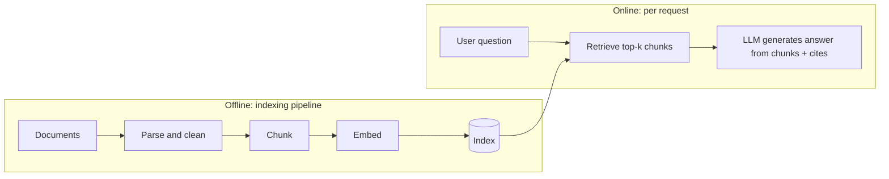
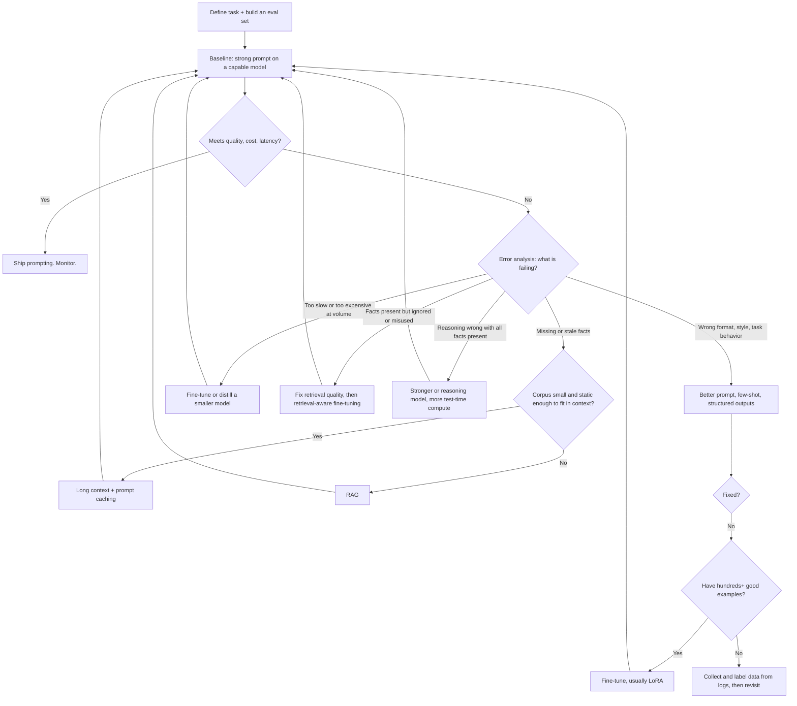
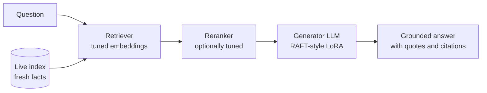
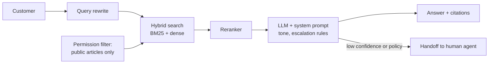

# Prompting vs RAG vs Fine-Tuning: A Decision Guide

> **Level:** Beginner to Advanced · **Study time:** ~80 min · **Prerequisites:** [Prompt Engineering for Production](./04-prompt-engineering-for-production.md), [Hallucinations and Grounding](./06-hallucinations-and-grounding.md), [Fine-Tuning LLMs: Full, LoRA and QLoRA](./07-fine-tuning-full-lora-and-qlora.md), [What Is RAG and Why It Matters](../08-rag/01-what-is-rag-and-why-it-matters.md)

## Table of contents

- [Why this matters](#why-this-matters)
- [The three levers: what each one actually changes](#the-three-levers-what-each-one-actually-changes)
- [Knowledge vs behavior: the most important distinction](#knowledge-vs-behavior-the-most-important-distinction)
- [Each approach in a little more detail](#each-approach-in-a-little-more-detail)
- [The decision table](#the-decision-table)
- [The decision flowchart](#the-decision-flowchart)
- [Frequently changing facts: why RAG wins](#frequently-changing-facts-why-rag-wins)
- [Style, format, tone and domain behavior: why fine-tuning wins](#style-format-tone-and-domain-behavior-why-fine-tuning-wins)
- [Can RAG improve reasoning?](#can-rag-improve-reasoning)
- [Can fine-tuning store a large, changing knowledge base?](#can-fine-tuning-store-a-large-changing-knowledge-base)
- [Infrastructure and maintenance costs](#infrastructure-and-maintenance-costs)
- [Combining RAG and fine-tuning](#combining-rag-and-fine-tuning)
- [Long-context models as an alternative](#long-context-models-as-an-alternative)
- [Worked scenarios](#worked-scenarios)
- [Going deeper: deciding with evidence in production](#going-deeper-deciding-with-evidence-in-production)
- [Common mistakes and misconceptions](#common-mistakes-and-misconceptions)
- [Interview questions and model answers](#interview-questions-and-model-answers)
- [Key takeaways](#key-takeaways)
- [Further reading](#further-reading)
- [Next](#next)

## Why this matters

Almost every real LLM project hits the same fork in the road early: "the base model does not do what we need, so do we write better prompts, add retrieval, or fine-tune?" Picking wrong is expensive. Teams that fine-tune to "teach the model our docs" spend weeks on training pipelines and end up with a model that is stale on day one and still hallucinates (confidently states things that are false). Teams that bolt RAG onto a formatting problem get a slow, costly system that still produces the wrong output shape. Interviewers love this question because it tests whether you understand what each technique changes inside the system, not just the buzzwords. A senior answer is a structured diagnosis (what is failing, knowledge or behavior?), a cheapest-first plan, and a clear-eyed view of cost, freshness, evaluation and maintenance.

---

## The three levers: what each one actually changes

### The intuition

Imagine you hire a very smart new employee who graduated a while ago. They know a lot about the world, but nothing about your company. You have three ways to make them useful:

1. **Give clear instructions** at the start of each task: "Reply politely, keep it under 100 words, use this template." That is **prompting**.
2. **Hand them the relevant binder pages** for each question so they can look up the answer: "Here is the current refund policy, answer from it." That is **RAG**.
3. **Send them on a training course** so the new habits become second nature and they no longer need reminders. That is **fine-tuning**.

Notice what changes in each case. Instructions and binder pages change *what the employee sees right now*. The training course changes *the employee*.

> **Analogy:** RAG is an open-book exam: you bring the notes, and you can swap the notes tomorrow. Fine-tuning is studying for a closed-book exam: the knowledge goes into your head, it is slow to put there, slow to update, and you might misremember details under pressure.

### The precise version

An LLM produces output from two things: its **weights** and its **context**.

- **Weights (parameters):** the billions of numbers learned during training that define the model's function. A "7B model" has about 7 billion of them. They are fixed at **inference** time (when the trained model is answering requests). See [Pretraining and Next-Token Prediction](./01-pretraining-and-next-token-prediction.md).
- **Context window:** the sequence of tokens (system prompt, instructions, documents, conversation, the user's question) that the model reads for one request. Its maximum length is the model's **context length**, measured in **tokens** (sub-word pieces; see [Tokenization](../04-transformers/01-tokenization.md)).

The three levers differ in which of those two they modify:

| Lever | What it changes | When the change happens | How long the change lasts |
|---|---|---|---|
| **Prompting** | The context: instructions, examples, output format | Every request | One request |
| **RAG (Retrieval-Augmented Generation)** | The context: relevant documents fetched from an external store at request time | Every request | One request; the store itself persists and can be edited |
| **Fine-tuning** | The weights: continue training the model on your own examples | Offline, before deployment | Until you train again |

Definitions you will need:

- **Prompting:** steering a model purely through the text you put in the context. Includes **zero-shot** (instructions only), **few-shot** (instructions plus a handful of worked input/output examples) and **system prompts** (persistent instructions placed before the conversation).
- **In-context learning:** the ability of large models to pick up a task from examples placed in the prompt, without any weight update (popularized by "Language Models are Few-Shot Learners", Brown et al., 2020).
- **RAG:** at request time, search an external knowledge store for passages relevant to the query, insert them into the prompt, and ask the model to answer from them ("Retrieval-Augmented Generation for Knowledge-Intensive NLP Tasks", Lewis et al., 2020).
- **Fine-tuning:** continuing to train a pretrained model on a smaller, task-specific dataset so that its weights change. In practice this is usually **supervised fine-tuning (SFT)** on input/output pairs, often with **parameter-efficient fine-tuning (PEFT)** methods such as **LoRA**, which trains small add-on matrices (an **adapter**) instead of all the weights. Full details live in [Fine-Tuning LLMs](./07-fine-tuning-full-lora-and-qlora.md).

```text
                 +----------------------------------------------+
   request --->  |  CONTEXT WINDOW                              |
                 |  [system prompt]   <-- prompting             |
                 |  [few-shot examples] <-- prompting           |
                 |  [retrieved docs]  <-- RAG                   |
                 |  [user question]                             |
                 +----------------------+-----------------------+
                                        |
                                        v
                 +----------------------------------------------+
                 |  MODEL WEIGHTS (7B numbers)  <-- fine-tuning |
                 +----------------------+-----------------------+
                                        |
                                        v
                                     answer
```

A useful framing from the RAG paper: the weights are **parametric memory** (knowledge stored inside the parameters) and the external store is **non-parametric memory** (knowledge stored outside the model, looked up on demand). Prompting and RAG act only through the context (RAG is the lever that adds a non-parametric memory). Fine-tuning writes to parametric memory.

> **Senior insight:** There are really more than three levers. You can also **switch to a bigger or different model**, **add tools** (calculators, databases, APIs via [function calling](./05-structured-outputs-and-function-calling.md)), or **spend more compute at inference** (see [Reasoning Models and Test-Time Compute](./12-reasoning-models-and-test-time-compute.md)). In an interview, mentioning "first, is this even the right base model?" shows maturity.

---

## Knowledge vs behavior: the most important distinction

Before choosing a technique, classify what is missing. Nearly every failure falls into one of two buckets:

- **Knowledge gap:** the model does not have the *facts*. It does not know your refund window, yesterday's price change, the contents of a customer's contract, or anything after its **training cutoff** (the date its training data ends).
- **Behavior gap:** the model has (or is given) the facts but does not *act* the way you need. Wrong format, wrong tone, too verbose, ignores your schema, does not follow your domain's conventions, cannot do a niche task like mapping free text to your internal codes.

| Symptom | Bucket | First fix to try |
|---|---|---|
| "Our refund window is 14 days" but the model says 30 | Knowledge | RAG |
| Model does not know a product launched last week | Knowledge | RAG |
| Answers are correct but not in our JSON schema | Behavior | Prompting, then [structured outputs](./05-structured-outputs-and-function-calling.md) |
| Tone is too casual for a bank | Behavior | Prompting, then fine-tuning |
| Must classify tickets into 140 internal categories at very high volume and low latency | Behavior (plus cost) | Fine-tune a small model |
| Model writes radiology summaries that miss the house template | Behavior | Few-shot prompting, then fine-tuning |
| Model gets multi-step math wrong even with all numbers present | Reasoning capability | Stronger or reasoning model, test-time compute, tools (code execution) |

The short rule people quote is **"RAG for facts, fine-tuning for form."** It is a good first approximation. The rest of this chapter is about where it bends.

> **Analogy:** Knowledge is *what* the employee knows; behavior is *how* they work. You fix "what" by handing them the binder. You fix "how" with training.

> **Common mistake:** Treating "the model gave a wrong answer" as one problem. A wrong answer can come from missing facts (knowledge), from the facts being present but ignored (behavior: poor context use), or from the model failing to combine correct facts (reasoning). Each has a different fix.

---

## Each approach in a little more detail

### Prompting

You write instructions and examples. Iteration takes minutes, needs no infrastructure, and is fully reversible. Its limits: every instruction and example costs tokens on *every* request; very long prompts get partially ignored; and some behaviors (a subtle house style, a niche classification scheme) are hard to specify in words. Full techniques: [Prompt Engineering for Production](./04-prompt-engineering-for-production.md).

### RAG

At request time you **retrieve** relevant **chunks** (small passages of documents) from an index and put them in the prompt. A minimal pipeline:



An **embedding** is a vector of numbers representing the meaning of a text, so similar texts get nearby vectors (see [Text Embeddings and Similarity Search](../08-rag/02-text-embeddings-and-similarity-search.md)). **Top-k** means "the k highest-scoring chunks". The whole of [Part 8](../08-rag/01-what-is-rag-and-why-it-matters.md) is devoted to doing this well.

### Fine-tuning

You collect hundreds to many thousands of input/output examples that show the desired behavior and train on them. Variants:

- **SFT** on demonstrations (most common).
- **Preference tuning** such as DPO (Direct Preference Optimization) or RLHF (Reinforcement Learning from Human Feedback), when "better vs worse" is easier to label than "the correct output" (see [Instruction Tuning, RLHF and DPO](./02-instruction-tuning-rlhf-and-dpo.md)).
- **Continued pretraining** on raw domain text (for example years of legal filings), which shifts vocabulary and domain fluency but is expensive and, as we will see, an unreliable way to store specific facts.
- **Distillation:** fine-tuning a small "student" model on outputs from a large "teacher" model so the small model copies a specific behavior (see [Distilling Large Language Models](../07-model-compression/06-distilling-large-language-models.md)).

### Side-by-side

| Dimension | Prompting | RAG | Fine-tuning |
|---|---|---|---|
| Changes | Context | Context (from an external store) | Weights |
| Best at | Quick steering, simple format and tone | Facts: private, fresh, large, citable | Behavior: style, format, niche tasks; making small models good at one job |
| Data needed | A few examples | Your documents (no labels needed to start) | Hundreds to thousands of high-quality labeled examples |
| Time to first result | Minutes | Days | Days to weeks |
| Time to update knowledge | Edit the prompt | Re-index one document (minutes) | Retrain, re-evaluate, redeploy |
| Per-request token cost | Grows with prompt length | Grows with retrieved context | Can shrink (shorter prompts, smaller model) |
| Citations / attribution | No | Yes, natively | No |
| Deleting a fact | Edit the prompt | Delete from the index | Practically impossible without retraining |
| Access control per user | Hard | Natural (filter at retrieval) | Not possible inside weights |
| Main failure modes | Prompt ignored, brittle wording | Bad retrieval, ignored or distracting context | Overfitting, forgetting, stale facts, more hallucination |

---

## The decision table

Use this as a lookup table. "Primary" means the technique that addresses the root cause; the others may still help.

| Requirement | Prompting | RAG | Fine-tuning | Notes |
|---|---|---|---|---|
| Facts not in the model (private docs) | | **Primary** | | Long context is an alternative for small, static corpora |
| Facts change daily or weekly | | **Primary** | Poor | Retraining cadence cannot keep up |
| Must cite sources | | **Primary** | Poor | Weights cannot point to where a fact came from |
| Per-user permissions on data | | **Primary** | Poor | Filter at retrieval time |
| Must be able to delete data (privacy law, takedowns) | | **Primary** | Poor | Removing a fact from weights is an open research problem |
| Consistent output format / schema | **Primary** | | Helps | Use structured outputs first (constrained decoding: only schema-valid tokens are allowed at each step) |
| Brand voice, tone, persona | **Primary** for simple cases | | **Primary** for subtle or strict cases | |
| Niche task the model does badly even with good prompts | Try first | | **Primary** | e.g. mapping text to internal codes |
| Cut latency and cost at high volume | | | **Primary** | Fine-tune or distill a smaller model |
| Shorter prompts (remove long few-shot blocks) | | | **Primary** | Prompt caching (reusing computation for a repeated prompt prefix) is a cheaper alternative |
| Better multi-step reasoning | Helps (chain-of-thought: ask for step-by-step working) | Supplies premises only | Can help on narrow tasks (SFT on reasoning traces, RL with verifiable rewards) | Mainly a model-choice and test-time-compute issue |
| Model ignores or misuses retrieved docs | Try first | | **Primary** (retrieval-aware tuning) | RAFT-style training (see [RAFT in detail](#raft-in-detail)) |
| Domain vocabulary and fluency (for example clinical shorthand) | Helps | Helps | **Primary** (SFT or continued pretraining) | |
| Little or no labeled data | **Primary** | **Primary** | Not yet | Collect data from production logs first |

---

## The decision flowchart

The default path is **cheapest and most reversible first**. Each step must be justified by evaluation results on the previous step.



Four rules sit behind this chart:

1. **Always start with prompting.** It is the baseline every other approach must beat, and you need it anyway: RAG and fine-tuned models are still prompted.
2. **Diagnose before you treat.** Look at 50-100 failures and label each as knowledge, behavior, reasoning, or retrieval. Fix the biggest bucket.
3. **Approaches stack; they do not compete.** A mature system is often "prompting + RAG + a lightly fine-tuned model".
4. **Only escalate when the eval says so.** Fine-tuning without an eval set means you cannot tell whether it helped.

Here is the flowchart as a small, runnable function. It is deliberately simple; the point is to make the reasoning explicit.

```python
# decide.py - encodes the decision flowchart (pure Python 3.10+, no installs)
from dataclasses import dataclass

@dataclass
class Requirements:
    needs_private_or_fresh_facts: bool   # facts the base model cannot know
    facts_change_often: bool             # days or weeks, not years
    needs_citations_or_acl: bool         # attribution, permissions, deletion
    corpus_tokens: int                   # size of the knowledge you need
    behavior_gap_after_prompting: bool   # format/style/task still wrong after good prompts
    high_volume_cost_or_latency_pressure: bool
    has_quality_training_examples: bool  # roughly hundreds+ of good input/output pairs

def recommend(r: Requirements, context_budget_tokens: int = 100_000) -> list[str]:
    plan = ["prompting (always the baseline)"]
    if r.needs_private_or_fresh_facts:
        fits = r.corpus_tokens <= context_budget_tokens
        if fits and not r.facts_change_often and not r.needs_citations_or_acl:
            plan.append("long-context stuffing + prompt caching")
        else:
            plan.append("RAG")
    wants_tuning = r.behavior_gap_after_prompting or r.high_volume_cost_or_latency_pressure
    if wants_tuning:
        if r.has_quality_training_examples:
            plan.append("fine-tuning (LoRA) for behavior"
                        + (", retrieval-aware (RAFT-style)" if "RAG" in plan else ""))
        else:
            plan.append("collect/label examples first, then consider fine-tuning")
    return plan

support_bot = Requirements(True, True, True, 2_000_000, False, False, False)
print(recommend(support_bot))
# ['prompting (always the baseline)', 'RAG']

clause_extractor = Requirements(False, False, False, 0, True, True, True)
print(recommend(clause_extractor))
# ['prompting (always the baseline)', 'fine-tuning (LoRA) for behavior']

handbook_qa = Requirements(True, False, False, 40_000, False, False, False)
print(recommend(handbook_qa))
# ['prompting (always the baseline)', 'long-context stuffing + prompt caching']
```

> **Interview tip:** When asked "RAG or fine-tuning?", do not answer with a technique. Answer with a question: "What is failing: does the model lack facts, or does it have them and behave wrongly?" Then walk the flowchart out loud.

---

## Frequently changing facts: why RAG wins

### The running example

We will use a small telecom help center with a **4-document corpus**:

| Doc id | Text |
|---|---|
| `refunds` | Refunds: you can request a refund within 14 days of purchase. |
| `roaming` | Roaming: EU data roaming costs 2 dollars per day. |
| `router` | Router reset: hold the reset button for 10 seconds. |
| `plans` | Plans: the Basic plan includes 5 GB of data per month. |

On Monday, the refund window changes from 14 to 30 days. With RAG, you edit one document and re-index it. With fine-tuning, you would need to create training examples about the new policy, retrain, re-evaluate (did anything else break?), and redeploy, and you still could not be sure the model will not occasionally say "14 days" from the old training.

The code below is a from-scratch toy RAG index using bag-of-words vectors and **cosine similarity** (the cosine of the angle between two vectors: 1 means same direction, 0 means no overlap). It shows the key property: **updating knowledge is a data operation, not a training run.**

```python
# toy_rag.py - pure Python 3.10+, no installs needed
import math
import re
from collections import Counter

STOPWORDS = {"the", "a", "an", "of", "in", "to", "you", "i", "do", "can",
             "how", "many", "is", "for", "per", "my", "what", "does", "have"}

def tokenize(text: str) -> list[str]:
    words = re.findall(r"[a-z0-9]+", text.lower())
    return [w for w in words if w not in STOPWORDS]

def cosine(a: Counter, b: Counter) -> float:
    dot = sum(a[t] * b[t] for t in a)
    na = math.sqrt(sum(v * v for v in a.values()))
    nb = math.sqrt(sum(v * v for v in b.values()))
    return dot / (na * nb) if na and nb else 0.0

class TinyIndex:
    """A toy 'vector index': one bag-of-words vector per document."""
    def __init__(self):
        self.docs: dict[str, str] = {}
        self.vecs: dict[str, Counter] = {}

    def upsert(self, doc_id: str, text: str) -> None:
        # Updating knowledge = overwrite one entry. No training involved.
        self.docs[doc_id] = text
        self.vecs[doc_id] = Counter(tokenize(text))

    def delete(self, doc_id: str) -> None:
        self.docs.pop(doc_id, None)
        self.vecs.pop(doc_id, None)

    def search(self, query: str, k: int = 1) -> list[tuple[str, float]]:
        q = Counter(tokenize(query))
        scored = [(d, round(cosine(q, v), 3)) for d, v in self.vecs.items()]
        return sorted(scored, key=lambda x: x[1], reverse=True)[:k]

def build_prompt(index: TinyIndex, question: str, k: int = 1) -> str:
    hits = index.search(question, k)
    context = "\n".join(f"[{d}] {index.docs[d]}" for d, _ in hits)
    return (f"Answer using ONLY the context. Cite the [doc id].\n"
            f"Context:\n{context}\n\nQuestion: {question}")

index = TinyIndex()
index.upsert("refunds", "Refunds: you can request a refund within 14 days of purchase.")
index.upsert("roaming", "Roaming: EU data roaming costs 2 dollars per day.")
index.upsert("router", "Router reset: hold the reset button for 10 seconds.")
index.upsert("plans", "Plans: the Basic plan includes 5 GB of data per month.")

q = "How many days do I have to request a refund?"
print(index.search(q, k=2))
# [('refunds', 0.655), ('roaming', 0.0)]
print(build_prompt(index, q))          # context shows "within 14 days"

# The policy changes on Monday. One upsert, and the very next query sees it.
index.upsert("refunds", "Refunds: you can request a refund within 30 days of purchase.")
print(build_prompt(index, q))          # context now shows "within 30 days"

# A document must be removed (takedown or privacy request): one call, and verifiable.
index.delete("roaming")
print(sorted(index.docs))
# ['plans', 'refunds', 'router']
```

Let us verify the 0.655 score by hand.

- Query tokens after removing stopwords: `days`, `request`, `refund` (3 tokens, each count 1).
- `refunds` doc tokens: `refunds`, `request`, `refund`, `within`, `14`, `days`, `purchase` (7 tokens, each count 1). Note that `refunds` and `refund` are different tokens here because we do no stemming.
- Dot product = shared tokens = `request`, `refund`, `days` = 3.
- Norms: $\sqrt{3} \approx 1.732$ and $\sqrt{7} \approx 2.646$.
- Cosine $= 3 / (1.732 \times 2.646) = 3 / 4.583 \approx 0.655$.

A production system uses learned embeddings and a vector database instead (see [Vector Databases in Practice](../08-rag/07-vector-databases-in-practice.md)), and real incremental updates have their own engineering (idempotent upserts, deletions, re-embedding when you change embedding models), covered in [Production Ingestion Pipelines](../08-rag/12-production-ingestion-pipelines-at-scale.md). The principle does not change.

### Quantifying freshness

How stale is the average fact your system serves? Suppose facts change at random times, you refresh every $T$ time units, and each refresh takes $L$ to reach production. Then the average **staleness** (how long a changed fact keeps being served in its old form) is:

$$\bar{s} = \frac{T}{2} + L$$

- $\bar{s}$: average staleness of a changed fact.
- $T$: refresh interval (how often you retrain, or how often you re-index).
- $\frac{T}{2}$: on average, a change lands halfway between two refreshes, so it waits half an interval.
- $L$: pipeline latency from "refresh starts" to "users see it" (training + evaluation + deployment, or embedding + indexing).

**Worked example (illustrative numbers):**

- Fine-tuning monthly: $T = 30$ days, $L = 2$ days (train, eval, canary). $\bar{s} = 30/2 + 2 = 15 + 2 = 17$ days.
- RAG with incremental indexing every 15 minutes: $T = 15$ min, $L = 5$ min. $\bar{s} = 15/2 + 5 = 7.5 + 5 = 12.5$ minutes.

17 days is $17 \times 24 \times 60 = 24{,}480$ minutes, so the fine-tuned system is roughly $24{,}480 / 12.5 \approx 1{,}958$ times staler. And this flatters fine-tuning, because it assumes the retrained model reliably learned every changed fact, which (next sections) it does not.

### Why RAG is the default for changing facts

- **Update speed:** edit a document, re-embed a few chunks, done.
- **Attribution:** every answer can cite the chunk it came from, so users and auditors can check it.
- **Deletion:** remove the document (and any duplicate copies, plus entries in response or semantic caches) and it is gone from the next answer. This matters for privacy regulations with a right to erasure (such as GDPR in the EU) and for content takedowns.
- **Access control:** retrieval can filter by the user's permissions, so two users asking the same question see only what they are allowed to see (see [Secure Multi-Tenant RAG](../08-rag/13-secure-multi-tenant-rag.md)).
- **Debuggability:** when an answer is wrong you can inspect what was retrieved. With weights you cannot inspect "where" a fact lives.

> **Interview tip:** For "which approach for frequently changing facts?", say RAG and give the *mechanism*: knowledge lives in an index you can update, delete from and cite, so freshness is bounded by your indexing latency, not your training cadence.

---

## Style, format, tone and domain behavior: why fine-tuning wins

### The intuition

A style is hard to describe and easy to demonstrate. "Write like our senior support agents" is vague in words, but 2,000 examples of real replies by those agents capture it precisely. Fine-tuning is learning-from-demonstration at scale, and the result is baked into the weights, so you do not pay for the demonstrations on every request.

### What fine-tuning is good at

- **Format and structure:** always produce your report template, always emit a particular JSON shape, always end with a disclaimer.
- **Tone and persona:** formal bank voice, terse engineer voice, empathetic healthcare voice.
- **Domain behavior:** how a radiologist phrases findings, how your legal team names clause types, which of 140 internal categories a ticket belongs to.
- **Instruction following on a narrow task:** consistent extraction, classification, rewriting.
- **Making a small model do one job well:** this is the big cost lever (next subsection).

Research supports the idea that fine-tuning mostly shapes *how* a model uses what it already knows. "LIMA: Less Is More for Alignment" (Zhou et al., 2023) showed that fine-tuning a strong pretrained model on only about 1,000 carefully curated examples produced a capable assistant, and proposed the **superficial alignment hypothesis**: most knowledge comes from pretraining, while fine-tuning mostly teaches the format and style of interaction.

Here is what style-tuning data looks like in the common chat-message format. Exact field names are vendor and library specific (OpenAI-style APIs, Hugging Face TRL and others differ slightly), so treat this as the shape, not a spec:

```json
{"messages": [
  {"role": "system", "content": "You are the Northwind Bank support assistant."},
  {"role": "user", "content": "why was i charged twice??"},
  {"role": "assistant", "content": "I understand how concerning a duplicate charge is. Pending card authorizations sometimes appear twice and the duplicate usually drops off within a few business days. If both charges are still posted after that, reply here and I will open a dispute for you."}
]}
```

Notice that the example teaches *tone and procedure*, not volatile facts. If the dispute window changes, the fact should come from retrieval, not from thousands of training examples that now say the wrong thing.

### Latency and cost: a smaller tuned model

A major practical reason teams fine-tune today is economics. A large general model might do your task well with a long prompt. A fine-tuned 7B model might do *that one task* equally well with a short prompt, at a fraction of the cost and latency, and you can self-host it. This is often done by **distillation**: generate high-quality outputs with the large model, have experts review a sample, and fine-tune the small model on them.

Two savings stack:

1. **Shorter prompts.** The few-shot examples and long instructions move into the weights.
2. **A smaller model.** Fewer parameters means less compute and memory per token, so lower latency and cost (see [Inference Fundamentals](../06-llm-inference/01-inference-fundamentals-prefill-decode-and-latency-metrics.md)).

### When does fine-tuning to shorten prompts pay off?

Suppose fine-tuning removes $\Delta t$ tokens from every request. The **break-even request count** is:

$$N^{*} = \frac{C_{\text{tune}}}{\Delta t \cdot p_{\text{in}}}$$

- $N^{*}$: number of requests after which fine-tuning has paid for itself.
- $C_{\text{tune}}$: one-off cost of the fine-tuning effort (compute plus evaluation; in reality also engineering time).
- $\Delta t$: input tokens saved per request.
- $p_{\text{in}}$: price per input token.

**Worked example (illustrative numbers, not real prices):**

- The prompted solution carries a 1,500-token few-shot block: $\Delta t = 1{,}500$.
- Price: 1 dollar per million input tokens, so $p_{\text{in}} = 1 / 1{,}000{,}000 = 0.000001$ dollars per token.
- Savings per request: $1{,}500 \times 0.000001 = 0.0015$ dollars.
- Fine-tuning effort: $C_{\text{tune}} = 500$ dollars.
- $N^{*} = 500 / 0.0015 \approx 333{,}333$ requests.

At 1,000,000 requests per month, monthly savings are $1{,}000{,}000 \times 0.0015 = 1{,}500$ dollars, so you break even in about $333{,}333 / 1{,}000{,}000 \approx 0.33$ months (about 10 days). At 10,000 requests per month, savings are 15 dollars per month and break-even takes about 33 months: not worth it.

This formula assumes the tuned model costs the same per token as the base model. In practice many hosted APIs charge more per token for fine-tuned models, and self-hosting adds fixed GPU cost; subtract that extra cost from the per-request saving (or add it to $C_{\text{tune}}$), which raises $N^{*}$ and can remove the break-even entirely. The economics improve sharply only when tuning also lets you switch to a smaller, cheaper model.

> **Senior insight:** Before fine-tuning purely to shorten prompts, check **prompt caching** (the provider or your server reuses the computed state for a repeated prompt prefix; see [Speculative Decoding, Prompt Caching and Other Speedups](../06-llm-inference/05-speculative-decoding-caching-and-other-speedups.md)). Caching a static few-shot prefix can recover much of the saving with zero training. Fine-tuning wins clearly when you *also* move to a smaller model, or when the behavior is too complex for any prompt.

### When prompting is enough for style

Modern instruction-tuned models follow style instructions well. If three sentences of instructions plus two examples give you the tone you need on your eval set, stop there. Fine-tune when: the style is subtle and prompts plateau, consistency across thousands of outputs matters (prompted models drift), the prompt is huge and volume is high, or you need a small model.

---

## Can RAG improve reasoning?

### Short version

**No, not the model's underlying reasoning ability.** RAG changes what the model *sees*, not how well it *thinks*. It can improve the *results* of reasoning by supplying the right premises, definitions and worked examples, but a model that cannot chain four logical steps will not learn to by reading retrieved passages.

### Why

**Reasoning** here means combining pieces of information through multiple steps (arithmetic, logic, planning) to reach a conclusion not stated in any single source. That capability is a property of the weights, set by pretraining, post-training and model size, plus how much computation the model is allowed at inference.

What RAG *can* do:

- **Supply missing premises.** Many "reasoning failures" are really knowledge failures in disguise. If the model computes a refund wrong because it did not know the 30-day window, RAG fixes it.
- **Supply worked examples.** Retrieving similar solved problems and showing them as few-shot examples (sometimes called **dynamic few-shot**) helps the model copy a solution pattern. That is still in-context learning, not a new capability, and it disappears when the examples are removed.
- **Supply tools and procedures.** Retrieving a step-by-step runbook helps the model follow a procedure it could not have invented.

What RAG can *hurt*:

- **Distraction:** irrelevant passages in the context can derail reasoning ("Large Language Models Can Be Easily Distracted by Irrelevant Context", Shi et al., 2023).
- **Position effects:** models use information at the beginning and end of a long context better than information in the middle ("Lost in the Middle: How Language Models Use Long Contexts", Liu et al., 2023).
- **Multi-hop gaps:** if the answer needs fact A from document 1 and fact B from document 2, but the query only matches document 1, single-shot retrieval fails. That is a retrieval design problem (see [Advanced RAG Patterns](../08-rag/09-advanced-rag-patterns.md)), not a reasoning one.

What actually improves reasoning: a stronger model, a reasoning model with more **test-time compute** (letting the model generate longer chains of thought before answering), chain-of-thought prompting, tool use (a calculator does not make arithmetic slips), and, for narrow domains, fine-tuning on high-quality reasoning traces or reinforcement learning with verifiable rewards (for example, checking a math answer or running unit tests). See [Reasoning Models and Test-Time Compute](./12-reasoning-models-and-test-time-compute.md).

```text
                     Information available?
                       no            yes
                   +-----------+----------------+
 Can reason   yes  |  RAG      |  works already |
 over it?          +-----------+----------------+
              no   |  RAG +    |  better model, |
                   |  better   |  test-time     |
                   |  model    |  compute, tools|
                   +-----------+----------------+
```

> **Interview tip:** A crisp line: "RAG fixes 'didn't know', not 'couldn't think'. If the model fails with the right documents already in its context, more retrieval will not help."

---

## Can fine-tuning store a large, changing knowledge base?

### Short version

**Not reliably.** You *can* push facts into weights, and for a small set of stable, frequently used facts it sort of works. But as a way to store a large knowledge base that changes, it fails on cost, recall, hallucination, attribution and deletion.

### The five problems

**1. Costly, slow updates.** Every change means building new training examples, retraining (or training another adapter), re-running the full eval suite to check nothing regressed, and redeploying. With frequent changes you are permanently retraining. Worse, a model trained in March on "14 days" and in April on "30 days" may hold both, and which one surfaces is unpredictable.

**2. Poor recall of rare facts.** Models recall a fact more reliably the more often they have seen it. "Large Language Models Struggle to Learn Long-Tail Knowledge" (Kandpal et al., 2023) found that a model's accuracy on a fact is strongly tied to how many relevant documents appeared in pretraining. A fact that appears once in your fine-tuning set (the typical case for an enterprise knowledge base: each policy is stated once) is unlikely to be recalled reliably. Making it stick needs many paraphrases of each fact, which multiplies data-creation cost. Learned facts are also brittle: "The Reversal Curse" (Berglund et al., 2023) showed models trained on "A is B" often fail to answer "what is B?" with A.

**3. More hallucination.** "Does Fine-Tuning LLMs on New Knowledge Encourage Hallucinations?" (Gekhman et al., 2024) found that models learn fine-tuning examples containing new knowledge more slowly than examples consistent with what they already know, and that once those new-knowledge examples are eventually learned, the model's tendency to hallucinate increases. Intuitively, you are training the model to confidently produce answers it has no grounded basis for, and it generalizes that confidence. See [Hallucinations](./06-hallucinations-and-grounding.md).

**4. No attribution.** A fine-tuned model cannot tell you *which document* a fact came from. Any "citation" it produces is itself generated text and may be invented. In regulated domains, unverifiable answers are often unacceptable.

**5. No deletion.** If a document must be removed (legal request, wrong information, a customer leaves), there is no reliable operation to remove it from the weights. **Machine unlearning** is an active research area, not a production tool. Your only clean option is to retrain from a dataset that excludes it. Related risk: fine-tuned models can **memorize** and regurgitate training data, so private data in training sets can leak to other users (see [Catastrophic Forgetting, Contamination and Memorization](./09-catastrophic-forgetting-contamination-and-memorization.md)).

A sixth problem worth knowing: **catastrophic forgetting**. Training hard on new content can degrade general abilities the model had before. LoRA reduces this, at the price of learning less new content ("LoRA Learns Less and Forgets Less", Biderman et al., 2024).

The direct comparison has been studied: "Fine-Tuning or Retrieval? Comparing Knowledge Injection in LLMs" (Ovadia et al., 2023) compared unsupervised fine-tuning on knowledge text against RAG and found RAG consistently performed better for injecting both existing and new knowledge, and that models struggled to learn new facts through fine-tuning unless they were exposed to numerous variations of them.

| Property | Knowledge in an index (RAG) | Knowledge in weights (fine-tuning) |
|---|---|---|
| Add a fact | Upsert a document | Create examples (many paraphrases), retrain |
| Change a fact | Overwrite a document | Retrain; old version may persist |
| Delete a fact | Delete a document | Retrain without it; no reliable surgical removal |
| Rare fact recall | As good as retrieval | Weak |
| Cite the source | Yes | No |
| Per-user access control | Yes | No |
| Inspect why it answered | Look at retrieved chunks | Opaque |

> **Common mistake:** "We fine-tuned on all 50,000 pages of our docs, so now the model knows them." In practice it picks up the vocabulary and the general gist, answers common questions somewhat better, and confidently invents specifics for everything else.

> **Senior insight:** Continued pretraining on domain text *is* worth it in some cases: when the domain's language is very different from the web (specialized scientific notation, a low-resource language, proprietary code conventions). The goal there is *fluency*, which is behavior, not a fact store. You still pair it with retrieval for specifics.

---

## Infrastructure and maintenance costs

The training compute bill for a LoRA run is often the *smallest* part of the cost. What dominates is the pipelines, evaluation and people you must keep running forever.

### What you build and maintain

| Component | Prompting | RAG | Fine-tuning |
|---|---|---|---|
| Data pipeline | None | **Ingestion/indexing pipeline:** connectors, parsing PDFs and tables, chunking, embedding, upserts and deletions, permission metadata, re-embedding when the embedding model changes | **Training-data pipeline:** collecting, cleaning, de-duplicating, labeling, PII (personally identifiable information) scrubbing, train/eval splits, dataset versioning |
| Storage | Prompt registry | Vector database or search index (plus document store), sized to corpus | Datasets, checkpoints, adapters, model registry |
| Compute | Inference only | Embedding compute (ingestion + queries), search, optional reranker, inference with longer prompts | GPU training runs (repeatable), plus inference |
| Serving | Call the model | Retriever service + reranker + LLM; more hops add latency | Host custom weights (self-hosted GPUs, or a provider's fine-tuned endpoint); multi-LoRA serving for many adapters |
| Evaluation | Prompt regression suite | Retrieval metrics (recall@k, MRR) **and** generation metrics (faithfulness, answer relevance); see [Evaluating RAG](../08-rag/10-rag-evaluation-metrics-and-ragas.md) | Task metrics, regression tests on general ability, safety re-evaluation after every training run |
| Ongoing work | Prompt iteration | Monitoring retrieval quality, index freshness, stale/duplicate docs, permission bugs | Retraining cadence, drift monitoring, dataset refresh, base-model upgrades (adapters are tied to one base model) |
| Skills needed | Product + prompt skills | Search/data engineering | ML engineering, GPU ops |
| Typical failure | Prompt drift after a model update | Bad parsing or chunking, retrieval misses | Overfitting, regression on untested behaviors, stale knowledge |

Metric names in the evaluation row: **recall@k** is the fraction of relevant chunks that appear in the top k results, averaged over test questions (with one relevant chunk per question this equals the fraction of questions whose relevant chunk is retrieved, often called **hit rate@k**); **MRR** (mean reciprocal rank) averages $1/\text{rank}$ of the first relevant result (rank 1 scores 1, rank 4 scores 0.25); **faithfulness** is the share of claims in the answer that the retrieved context supports.

A cost easy to miss: **base-model upgrades**. When your provider ships a better base model, a prompted or RAG system can switch in a day and re-run evals. A fine-tuned system must retrain its adapter on the new base model (a LoRA adapter only works with the exact base weights it was trained on) and re-validate. Teams that fine-tune heavily often lag a model generation behind.

### Per-request cost of RAG

RAG makes every prompt longer. With $k$ retrieved chunks of $m$ tokens each, the added input cost per query is:

$$\Delta c_{\text{RAG}} = k \cdot m \cdot p_{\text{in}}$$

- $k$: number of chunks inserted into the prompt.
- $m$: average tokens per chunk.
- $p_{\text{in}}$: price per input token (or, self-hosted, the GPU cost of processing it).

**Worked example (illustrative):** $k = 5$, $m = 400$, $p_{\text{in}} = 0.000001$ dollars per token (1 dollar per million).

- Added tokens: $5 \times 400 = 2{,}000$.
- Added cost: $2{,}000 \times 0.000001 = 0.002$ dollars per query.
- At 1,000,000 queries per month: $0.002 \times 1{,}000{,}000 = 2{,}000$ dollars per month, before counting the vector database, embedding and reranker costs.

Longer prompts also raise **time to first token (TTFT)**, because the model must process all input tokens (the **prefill** phase) before generating, and they increase **KV cache** memory per request (see [The KV Cache](../06-llm-inference/02-kv-cache-explained.md)). Reranking (keep only the best 2-3 chunks; see [Reranking and Query Transformation](../08-rag/08-reranking-and-query-transformation.md)) often cuts both cost and distraction.

### Total cost of ownership, in one line

$$C_{\text{month}} = C_{\text{infra}} + Q \cdot c_{\text{query}} + C_{\text{people}}$$

- $C_{\text{month}}$: monthly total cost.
- $C_{\text{infra}}$: fixed infrastructure (vector DB, GPU reservations, pipelines), plus amortized training runs.
- $Q$: queries per month.
- $c_{\text{query}}$: variable cost per query (tokens in and out, retrieval).
- $C_{\text{people}}$: engineering time to maintain pipelines, evals and on-call.

At low volume, $C_{\text{people}}$ and $C_{\text{infra}}$ dominate, which favors prompting and managed RAG. At very high volume, $Q \cdot c_{\text{query}}$ dominates, which favors fine-tuned small models that cut $c_{\text{query}}$.

**Worked example (illustrative):** a RAG system with $C_{\text{infra}} = 1{,}000$, $c_{\text{query}} = 0.004$ and $C_{\text{people}} = 8{,}000$ dollars per month.

- $Q = 10{,}000$: $1{,}000 + 10{,}000 \times 0.004 + 8{,}000 = 1{,}000 + 40 + 8{,}000 = 9{,}040$ dollars. Tokens are under 1% of the bill; cutting them is pointless.
- $Q = 10{,}000{,}000$: $1{,}000 + 40{,}000 + 8{,}000 = 49{,}000$ dollars. Now a tuned small model that halves $c_{\text{query}}$ saves 20,000 dollars per month, which can justify a training pipeline.

> **Interview tip:** When asked about costs, structure your answer into **build, run, and maintain**, and for each approach name the pipeline (index pipeline vs training pipeline), the eval burden, and the serving footprint. Then say which term dominates at the expected volume.

---

## Combining RAG and fine-tuning

The question is rarely "RAG *or* fine-tuning". Mature systems often use both, each for its job: **RAG supplies the facts, fine-tuning shapes the behavior**, including the behavior of *using retrieved context well*.

### Ways to combine

1. **Fine-tune for output behavior, RAG for knowledge.** The simplest combination. A support bot retrieves policy documents, and a LoRA adapter enforces brand voice and escalation rules.
2. **Retrieval-aware fine-tuning.** Train the generator on examples that *include retrieved context*, so it learns to read documents, quote evidence, ignore distractors and say "not found in the documents" when appropriate. Base models are not specifically trained for your retrieval format and your noise level; this closes that gap.
3. **Tune the retriever side.** Fine-tune the embedding model or the reranker on your domain's query-document pairs. This is often a bigger win than tuning the LLM, because if the right chunk is never retrieved, no generator can use it.
4. **Train both jointly or alternately.** Research systems such as "RA-DIT: Retrieval-Augmented Dual Instruction Tuning" (Lin et al., 2023) tune the LLM to use retrieved text better and tune the retriever toward what the LLM finds useful. "Self-RAG" (Asai et al., 2023) trains a model to decide when to retrieve and to critique its own use of retrieved passages.

### RAFT in detail

"RAFT: Adapting Language Model to Domain Specific RAG" (Zhang et al., 2024) is the clearest recipe for retrieval-aware fine-tuning. The analogy the authors use: an open-book exam where you have also *studied* how to use the book.

Each training example contains:

- A **question**.
- A set of documents that mixes the **oracle document** (the one that contains the answer) with **distractor documents** (plausible but irrelevant).
- For a fraction of examples, *only* distractors and no oracle, so the model does not learn to blindly trust whatever is in the context and also keeps some of the domain knowledge in its weights.
- An answer written as **chain-of-thought with verbatim quotes** from the oracle document, so the model learns to ground its reasoning in specific evidence.

Why the distractors? Real retrieval is noisy. A model trained only on perfect contexts learns "the answer is always in the context"; at inference, with three wrong chunks and one right one, it gets confused. Training with distractors teaches discrimination.

```python
# raft_data.py - build RAFT-style training examples (pure Python 3.10+)
import json
import random

def make_raft_example(question: str, oracle: str, pool: list[str], answer: str,
                      k_distractors: int = 3, p_oracle: float = 0.8,
                      rng: random.Random | None = None) -> dict:
    """Build one RAFT-style training example.

    With probability p_oracle the context holds the oracle doc plus distractors;
    otherwise it holds only distractors, so the model also learns what to do
    when retrieval misses (answer from what it knows, or say it is not found).
    """
    rng = rng or random.Random()
    distractors = rng.sample([d for d in pool if d != oracle], k_distractors)
    docs = distractors + ([oracle] if rng.random() < p_oracle else [])
    rng.shuffle(docs)  # the oracle must not always sit in the same slot
    context = "\n".join(f"[doc{i}] {d}" for i, d in enumerate(docs))
    return {
        "messages": [
            {"role": "system", "content": "Answer from the documents. Quote the evidence."},
            {"role": "user", "content": f"{context}\n\nQuestion: {question}"},
            {"role": "assistant", "content": answer},
        ]
    }

pool = [  # our 4-document corpus, after the Monday policy change
    "Refunds: you can request a refund within 30 days of purchase.",
    "Roaming: EU data roaming costs 2 dollars per day.",
    "Router reset: hold the reset button for 10 seconds.",
    "Plans: the Basic plan includes 5 GB of data per month.",
]
ex = make_raft_example(
    question="How long do I have to ask for a refund?",
    oracle=pool[0],
    pool=pool,
    answer='The policy says "within 30 days of purchase", so you have 30 days.',
    k_distractors=2,
    rng=random.Random(0),
)
print(json.dumps(ex, indent=2))  # one chat-format example, ready for an SFT trainer
```

Two practical notes. First, for examples *without* the oracle, the target answer must be decided deliberately: in RAFT it is still the correct answer (encouraging some memorization of the domain); in many enterprise systems you instead want "I could not find this in the provided documents", because answering from memory defeats attribution. Choose based on your product's requirements. Second, the training data's facts will go stale, but that is acceptable here: you are teaching the *skill* of reading context, and the facts at inference time come from the live index.



### When to combine

Combine when **both** conditions hold:

- You need fresh, citable, or permissioned facts (so RAG is required), **and**
- After fixing retrieval quality, the evals still show a behavior problem: the model ignores retrieved evidence, gets confused by distractors, does not follow the required format, or the cost/latency of a large prompted model is too high so you want a smaller tuned one.

Do not combine by default. Each extra component is another thing to version, evaluate and keep in sync. In particular, a retrieval-aware fine-tune is trained against *your* retriever's noise profile; if you later change chunking or the embedding model significantly, re-check it.

---

## Long-context models as an alternative

### The idea

By 2026 many models accept hundreds of thousands to around a million tokens or more (exact limits vary by model and change often). So why not skip retrieval and put the entire knowledge base in the prompt? For small corpora, you can. This is sometimes called **context stuffing**, and when combined with caching the precomputed attention state for the fixed corpus prefix it has been called **cache-augmented generation** ("Don't Do RAG: When Cache-Augmented Generation is All You Need for Knowledge Tasks", Chan et al., 2024).

Our 4-document corpus is well under 100 tokens. Stuffing it into every prompt is obviously fine. The question is how it scales.

### The arithmetic

**Worked example (illustrative prices):** a company knowledge base of 400 documents averaging 2,000 tokens each.

- Corpus size: $400 \times 2{,}000 = 800{,}000$ tokens. That fits in a 1M-token window.
- Cost per query if the whole corpus is sent: $800{,}000 \times 0.000001 = 0.80$ dollars.
- RAG cost per query (from earlier): $0.002$ dollars.
- Ratio: $0.80 / 0.002 = 400$ times more expensive per query.
- With prompt caching, suppose cached input tokens are billed at 10% of the normal price (illustrative; discounts vary by provider): $0.80 \times 0.10 = 0.08$ dollars, still $0.08 / 0.002 = 40$ times more than RAG.

Now grow to 50,000 documents: $50{,}000 \times 2{,}000 = 100{,}000{,}000$ tokens. That does not fit in any mainstream context window, so retrieval (or another way to select a subset) becomes mandatory.

Latency matters too: prefilling 800,000 tokens takes far longer than prefilling 2,000, unless the prefix is cached, and attention over long sequences is costly in compute and KV cache memory.

### Comparison

| Dimension | Long-context stuffing | RAG |
|---|---|---|
| Setup effort | Minimal | Ingestion, chunking, index, retriever |
| Corpus size limit | The context window | Practically unlimited |
| Per-query cost | Proportional to corpus size (caching helps) | Proportional to k chunks |
| Latency | High prefill unless cached | Retrieval hop plus short prefill |
| Retrieval errors | None (everything is present) | Possible misses |
| Use of information | Can degrade for facts buried in the middle of very long inputs | Only what is retrieved, but placed prominently |
| Freshness | Change the corpus, invalidate the cache | Upsert a document |
| Access control | Must build a per-user corpus | Filter at retrieval |
| Citations | Possible if docs carry ids, less precise | Natural |
| Best for | Small, static, single-tenant corpora; analyzing one long document | Large, changing, multi-tenant corpora |

> **Senior insight:** Long context and RAG are complements, not rivals. Long context lets RAG retrieve *bigger* units (whole sections or documents instead of tiny chunks), which reduces chunking errors. And for "analyze this one 300-page contract", long context is the natural tool, because the task is to read one known document, not to find documents.

> **Interview tip:** For "will long context kill RAG?", answer: "For small, static corpora it already replaces RAG. For large, changing, permissioned corpora, cost per query, latency, access control and freshness still favor retrieval. In practice they combine."

---

## Worked scenarios

For each scenario: classify the gap (knowledge or behavior), pick the cheapest approach that fixes it, and define how you will measure success.

### Scenario 1: Customer support bot for a telecom

**Requirements:** Answer questions about plans, prices, roaming and troubleshooting. Prices and promotions change weekly. Answers must cite the help-center article. Agents' internal notes must not be shown to customers. 200,000 conversations per month.

**Diagnosis:** Mostly a **knowledge** problem (private, changing facts, citations, permissions), with a smaller **behavior** component (brand tone, when to escalate to a human).

**Decision:** Prompting + RAG. Start with a strong system prompt for tone and escalation rules. Revisit fine-tuning only if evals show persistent tone or escalation errors, or if volume grows enough to justify moving to a smaller self-hosted model.



Here **hybrid search** combines keyword scoring (**BM25**, a classic ranking function based on term frequency, inverse document frequency and document length) with dense embedding similarity, and a **reranker** is a slower but more accurate model that re-scores the top candidates (see [Retrieval Methods](../08-rag/05-retrieval-bm25-dense-and-hybrid-search.md) and [Reranking](../08-rag/08-reranking-and-query-transformation.md)).

**Evaluation:** retrieval recall@k on a labeled question set, faithfulness (is every claim supported by a cited chunk?), answer correctness, escalation precision and recall, and resolution rate in production. See [System Design: An Enterprise Support Chatbot](../11-system-design/04-design-an-enterprise-support-chatbot-with-evaluation.md).

**Pitfall:** fine-tuning on historical chat transcripts. They contain last year's prices and agent mistakes, so the model learns stale facts and bad habits together.

### Scenario 2: Legal clause extraction

**Requirements:** Given a commercial contract, extract governing law, termination notice period, liability cap, auto-renewal terms and indemnities into a fixed JSON schema. 50,000 contracts per month. Lawyers have already labeled 3,000 contracts.

**Diagnosis:** The facts are *in the input document*, so this is not a knowledge-injection problem at all. It is a **behavior** problem: precise extraction into a schema with your firm's definitions (for example, what counts as a "liability cap"), at high volume.

**Decision:**

1. Prompting with clear field definitions, few-shot examples and **structured outputs** (constrained decoding to the JSON schema). Measure field-level precision and recall on a held-out set of the labeled contracts.
2. If quality plateaus or cost is too high at 50,000 contracts per month, **fine-tune a smaller model (LoRA)** on the 3,000 labeled contracts. This is the textbook case: stable task definition, labeled data available, high volume.
3. Optional RAG over the firm's *clause playbook* ("our standard liability cap language and acceptable deviations") if the task extends to *judging* clauses against policy, since the playbook changes and needs citations.
4. Long contracts: use a long-context model for the whole document, or split by section and merge results.

**Evaluation:** per-field precision, recall and F1 (see [Classification Metrics](../01-classical-ml/04-classification-metrics-and-imbalanced-data.md)), exact-match on normalized values (for example "30 days" vs "thirty (30) days"), and lawyer review of a sample of disagreements.

**Pitfall:** evaluating on contracts from the same templates used for training. Split by counterparty or template to avoid overly optimistic scores.

### Scenario 3: Code assistant for an internal monorepo

**Requirements:** Answer questions about the company's codebase and suggest code consistent with internal libraries and conventions. The code changes hundreds of times a day. Inline autocomplete must respond in well under a second.

**Diagnosis:** Two products in one. **Chat about the codebase** is a **knowledge** problem with extreme freshness needs. **Inline completion** is a **behavior plus latency** problem.

**Decision:**

- Chat: RAG over the repository, but code retrieval is different from prose retrieval. Combine keyword search (exact identifiers matter), embeddings, and structure (symbol index, call graph, file paths). Increasingly this is done **agentically**: the model calls search, grep and file-read tools itself (see [What Is an AI Agent?](../09-agents/01-what-is-an-ai-agent.md)). Re-index on every merge.
- Autocomplete: a small, fast model trained for **fill-in-the-middle (FIM)** completion (predicting code given the text before and after the cursor). Optionally fine-tune it on internal code so it picks up internal APIs and style, then refresh periodically. Even then, inject relevant snippets from open files and recently edited files into the prompt, because the weights will always lag the repo.

**Pitfalls:** fine-tuning on the whole repo can memorize and leak secrets and credentials that were committed by mistake (scrub them first), bakes in deprecated APIs, and must be redone constantly. Licensing and access: do not train one model on code from repos that some users are not allowed to read.

### Scenario 4: Medical discharge summaries

**Requirements:** Turn a patient's hospital notes into a discharge summary following the hospital's template. Must not invent findings. Data is protected health information (PHI). Clinicians review every summary.

**Diagnosis:** Like legal extraction, the facts are in the input (the patient record), so the core is **behavior**: faithful summarization in a strict template and clinical register. There is a secondary **knowledge** need: current hospital guidelines and medication formulary for follow-up instructions, which change.

**Decision:**

1. Prompting with the template, plus structured sections. A self-hosted or contractually compliant model because of PHI.
2. Fine-tune (LoRA) on clinician-approved past summaries if template adherence and terminology plateau with prompting. **De-identify** the training data first: fine-tuned models can memorize and regurgitate training text, which is a privacy incident if it contains another patient's details.
3. RAG over current guidelines and formulary for the follow-up section, with citations.
4. Human-in-the-loop review is part of the design, not an afterthought.

**Evaluation:** faithfulness (every statement traceable to the source notes), omission rate of critical items (allergies, medication changes), template compliance, and clinician edit distance or acceptance rate. LLM-as-a-judge can screen at scale, but clinicians must validate the judge (see [Evaluating LLMs](./10-llm-evaluation-metrics-and-llm-as-a-judge.md)).

**Pitfall:** trying to "teach medicine" by fine-tuning on textbooks. The model's medical knowledge comes from pretraining; what you need is faithful, template-conforming behavior and up-to-date guidelines via retrieval.

### Summary of the four

| Scenario | Main gap | Primary approach | Fine-tuning role | RAG role |
|---|---|---|---|---|
| Support bot | Knowledge (fresh, citable, permissioned) | RAG + prompting | Optional later: tone, escalation, smaller model | Core |
| Legal extraction | Behavior (schema, definitions) at volume | Prompting + structured outputs, then fine-tune | Core once volume and labels justify it | Optional: playbook comparison |
| Code assistant | Knowledge (very fresh) + latency | RAG / agentic search; small FIM model | Optional: internal-style autocomplete | Core for chat, context for autocomplete |
| Medical summaries | Behavior (faithful, templated) | Prompting, then fine-tune on de-identified data | Likely | Guidelines and formulary |

---

## Going deeper: deciding with evidence in production

### Step 1: Build the eval set before choosing

You cannot choose between approaches without measuring them on the same test. Assemble 100-500 realistic inputs with expected outputs or grading rubrics, covering common cases, edge cases and known failure modes. This set is reused for every option and becomes your regression suite (see [Building an LLM Evaluation Framework](./11-building-an-llm-evaluation-framework-and-regression-tests.md)).

### Step 2: Run the baseline and do error analysis

Run the best prompt on a strong model. Then read the failures and tag each one. A practical taxonomy:

| Failure tag | Test that reveals it | Fix |
|---|---|---|
| Missing knowledge | Paste the correct document into the prompt manually; does it now succeed? | RAG (or long context) |
| Retrieval miss | RAG system: is the right chunk in the top-k? | Better chunking, hybrid search, reranking, query rewriting |
| Context ignored or misused | Right chunk present, answer still wrong or unsupported | Prompt for grounding, put key chunks first, retrieval-aware fine-tuning |
| Format or style | Content right, shape wrong | Structured outputs, few-shot, then fine-tuning |
| Reasoning | All facts present and used, conclusion wrong | Stronger model, test-time compute, tools |
| Cost or latency | Quality fine, budget not | Caching, smaller fine-tuned or distilled model, quantization |

The first test, the **oracle-context test**, is the single most useful diagnostic in this chapter: manually give the model the perfect context. If it then succeeds, your problem is getting knowledge in (RAG). If it still fails, retrieval will not save you; the problem is behavior or reasoning. Debugging RAG systems in depth is covered in [Debugging RAG Systems](../08-rag/11-debugging-rag-systems.md) and the case study [RAG Gives Fluent but Unsupported Answers](../11-system-design/07-debugging-case-rag-fluent-but-unsupported-answers.md).

### Step 3: Compare options on the same scorecard

Score every candidate (for example "prompt only", "prompt + RAG", "prompt + RAG + LoRA on a 7B model") on the same rows: correctness, faithfulness and citation accuracy, p50 and p95 latency (median and 95th-percentile response time), cost per 1,000 requests, time to update a fact, and ops burden. Pick the cheapest column that meets the bar on every row that matters to the product, not the column with the highest correctness.

### Production concerns

- **Versioning everything that changes behavior.** A response depends on prompt version, index snapshot (or ingestion time), embedding model version, retriever config, model or adapter version. Log all of them with each request so you can reproduce and roll back (see [Data and Model Versioning](../10-mlops/02-data-and-model-versioning-and-model-registry.md) and [LLMOps: Tracing and Prompt Management](../10-mlops/08-llmops-tracing-prompt-management-and-langfuse.md)).
- **Multi-tenancy.** With RAG, isolation is a retrieval filter, auditable per request. With fine-tuning, one shared model trained on tenant A's data can leak it to tenant B through memorization. If tenants need custom *behavior*, per-tenant LoRA adapters are possible (serving frameworks can host many adapters on one base model), but keep tenant *facts* in permissioned retrieval.
- **Drift.** RAG drifts as the corpus changes (new document types that parse badly, duplicate or contradictory versions). Fine-tuned models drift as user inputs shift away from the training distribution (see [Data Drift and Concept Drift](../01-classical-ml/08-data-drift-concept-drift-and-retraining.md)). Monitor both (see [Monitoring ML and LLM Systems](../10-mlops/06-monitoring-ml-and-llm-systems-in-production.md)).
- **Contradictory knowledge.** Combining a fine-tuned model with RAG can create conflicts: weights say "14 days", context says "30 days". Instruct and train the model to prefer context, and evaluate specifically on cases where the context contradicts common or previously trained facts.
- **Safety re-validation.** Fine-tuning can erode a model's safety behavior, even on benign data. Re-run safety evaluations after every training run (see [LLM Safety and Guardrails](./13-llm-safety-guardrails-and-responsible-ai.md)). RAG has its own risk: retrieved documents can contain **indirect prompt injection** (instructions hidden in content), see [Agent Reliability and Prompt Injection](../09-agents/08-agent-reliability-security-and-prompt-injection.md).

### What changes at scale

| Scale factor | Effect on the decision |
|---|---|
| Corpus grows from thousands to millions of docs | Long context stops being an option; ANN (approximate nearest neighbor) index tuning and hybrid search matter (see [Vector Search Algorithms](../08-rag/06-vector-search-ann-hnsw-ivf-and-product-quantization.md)) |
| Query volume grows 100x | Per-query token cost dominates; fine-tuned or distilled small models and caching become attractive |
| Many tenants | RAG with strict filters; avoid shared fine-tunes on tenant data |
| Strict latency SLO (service-level objective) | Fewer hops (skip reranker or make it fast), smaller model, prompt caching |
| Regulated domain | Attribution and deletion requirements push knowledge into RAG; fine-tune only on de-identified, approved data |
| Base model upgrades every few months | Favors approaches that are cheap to re-validate (prompting, RAG) |

---

## Common mistakes and misconceptions

- **"Fine-tune on our docs so the model knows them."** Fine-tuning is a poor fact store: rare facts are not recalled reliably, updates need retraining, there are no citations or deletion, and it can increase hallucination. Use RAG for facts.
- **Skipping the prompting baseline.** Without it you cannot tell whether a fine-tune or RAG pipeline helped, and you often find a good prompt was enough.
- **Fine-tuning without an eval set.** "The loss went down" is not evidence that the product improved.
- **Using RAG to fix a format problem.** Retrieval adds facts; it does not make output conform to a schema. Use structured outputs or fine-tuning.
- **Believing RAG makes a model smarter.** It supplies information, not reasoning ability. If the model fails with the right document in context, retrieval is not the fix.
- **Blaming the LLM for retrieval misses.** Often the right chunk was never retrieved. Measure retrieval recall separately from generation quality.
- **Assuming RAG eliminates hallucination.** It reduces it, but models can still ignore, misread or embellish context. Measure faithfulness.
- **Training on stale or messy historical data.** Old transcripts teach old facts and old mistakes.
- **Treating long context as free.** It costs tokens, latency and memory on every request, and models can miss information buried in long inputs.
- **Forgetting base-model upgrades.** Fine-tuned adapters are tied to one base model; each upgrade means retraining and re-validating.
- **Putting tenant data into a shared fine-tune.** Memorization can leak it across tenants; you also cannot delete it.
- **Combining everything by default.** Each component adds versioning, evaluation and failure modes. Add complexity only when the evals demand it.

---

## Interview questions and model answers

<details>
<summary><b>Q1. When would you choose RAG over fine-tuning?</b></summary>

**Short answer:** When the problem is missing knowledge rather than wrong behavior: the model needs private, large, or frequently changing facts, especially when answers must cite sources, respect per-user permissions, or support deletion. RAG changes what the model sees at request time, so knowledge updates are an index operation measured in minutes, not a training run.

**Deeper answer and follow-ups:**
- Mechanism: RAG keeps knowledge in non-parametric memory (an index) and injects relevant chunks into the context; fine-tuning writes into parametric memory (weights).
- Choose RAG when: facts change; the corpus is large; you need attribution, access control, or deletion; you have documents but no labeled examples; you want to swap base models easily.
- Choose fine-tuning when the gap is behavior (format, tone, niche task skill) or when you need a smaller model for cost and latency.
- Evidence: Ovadia et al. (2023) found RAG outperformed unsupervised fine-tuning for knowledge injection.
- Diagnostic I would run first: the oracle-context test. If pasting the right document fixes the answer, it is a knowledge problem, so RAG.
- Pitfall: RAG quality is bounded by retrieval. Measure recall@k before blaming the LLM.
- Trade-off: RAG pays on every request (a retrieval hop of latency, longer prompts, an ingestion pipeline to run); fine-tuning pays up front and again on every retrain, but can shrink per-request cost.

</details>

<details>
<summary><b>Q2. Which approach is best for frequently changing facts?</b></summary>

**Short answer:** RAG. Facts live in an index that you can update, delete from and cite, so freshness is bounded by indexing latency (minutes) rather than a retraining cycle (days or weeks). Fine-tuned models are stale the moment training data is frozen and may keep old versions of facts.

**Deeper answer and follow-ups:**
- Staleness model: $\bar{s} = T/2 + L$. Monthly retraining ($T = 30$ days, $L = 2$ days) gives about 17 days average staleness; 15-minute incremental indexing ($T = 15$, $L = 5$ minutes) gives about 12.5 minutes (illustrative).
- Production details: incremental upserts, tombstones (deletion markers that propagate removals to the index) for deletions, document versioning, and freshness monitoring (time from source change to index).
- Watch for duplicate and contradictory versions in the index; retrieval may return the old policy. Keep one canonical version, or filter by effective date.
- If facts are tiny and static (a 2-page handbook), stuffing them in the prompt is simpler still.
- Truly real-time data (stock levels, account balances) is better served by **tool calls** to the system of record than by any index.

</details>

<details>
<summary><b>Q3. Which is better for teaching a style, format, or behavior?</b></summary>

**Short answer:** Start with prompting (instructions, few-shot examples, structured outputs), because it is cheap and often sufficient. If quality plateaus, or the prompt becomes long and volume is high, fine-tuning is the right tool: style is easier to demonstrate than describe, and fine-tuning bakes the demonstrations into the weights.

**Deeper answer and follow-ups:**
- Fine-tuning shines for subtle tone, strict templates, domain phrasing, niche classification and consistency across thousands of outputs.
- "LIMA" (Zhou et al., 2023): about 1,000 curated examples were enough to shape assistant behavior; the authors' superficial alignment hypothesis is that fine-tuning mostly teaches format and style, not new knowledge (a hypothesis, not a law: harder skills still benefit from more data).
- Cost angle: fine-tuning removes few-shot tokens from every request. Break-even $N^* = C_{\text{tune}} / (\Delta t \cdot p_{\text{in}})$; e.g. 500 dollars, 1,500 tokens saved, 1 dollar per million tokens gives about 333,333 requests (illustrative, and assuming the tuned model is priced like the base; many providers charge more per token for fine-tuned models, which pushes break-even out).
- Check prompt caching first if the only goal is to cut prompt cost.
- For strict JSON, constrained decoding guarantees schema-valid syntax (barring truncation at the token limit, refusals, or schema features the provider does not support); fine-tuning improves the *content* choices within the schema.
- Keep volatile facts out of style-tuning data, or the model will learn them and go stale.
- How to measure: schema or template compliance rate, a style rubric scored by humans or by an LLM judge calibrated against them, pairwise win rate against the prompted baseline, and a general-ability regression set to catch forgetting.

</details>

<details>
<summary><b>Q4. Can RAG improve a model's reasoning ability?</b></summary>

**Short answer:** No. RAG supplies information and examples; it does not change the weights, so it cannot change the model's reasoning ability. It can improve outcomes when failures were really missing premises, and retrieved worked examples help via in-context learning, but if the model fails with the correct documents already in context, more retrieval will not fix it.

**Deeper answer and follow-ups:**
- Separate "didn't know" (knowledge) from "couldn't think" (reasoning) with the oracle-context test.
- How to measure: run the same eval with no context, retrieved context and oracle context. Oracle minus no-context is the most RAG could ever buy; oracle minus retrieved is your retrieval gap; whatever still fails with oracle context is a reasoning or behavior problem.
- RAG can hurt reasoning: irrelevant passages distract models (Shi et al., 2023), and information in the middle of long contexts is used less well (Liu et al., 2023, "Lost in the Middle").
- Multi-hop questions often fail because retrieval found only one hop; fix with query decomposition or iterative retrieval, which is a retrieval improvement.
- To improve reasoning: stronger or reasoning models, more test-time compute, chain-of-thought, tools (calculator, code execution), or fine-tuning on high-quality reasoning traces for a narrow domain.

</details>

<details>
<summary><b>Q5. Can fine-tuning reliably store a large, frequently changing knowledge base?</b></summary>

**Short answer:** No. Every change needs costly retraining and re-evaluation; rare facts (most enterprise facts appear once) are recalled poorly; training on new knowledge can increase hallucination; the model cannot attribute answers to sources; and you cannot reliably delete a fact from the weights.

**Deeper answer and follow-ups:**
- Long-tail recall: Kandpal et al. (2023) showed accuracy on a fact tracks how often it appears in training data.
- Hallucination: Gekhman et al. (2024) found new-knowledge examples are learned slowly and, once learned, increase hallucination tendency.
- Brittleness: the Reversal Curse (Berglund et al., 2023), "A is B" does not imply the model learns "B is A".
- Deletion: machine unlearning is research, not production practice; privacy obligations push personal data into deletable stores.
- Also: catastrophic forgetting, memorization and leakage risk, and old fact versions coexisting with new ones.
- Where fine-tuning on domain text does help: fluency in specialized language. Pair it with RAG for the facts.
- How to prove it: build a probe set with several paraphrases per fact, including reversed questions and facts changed after training, and compare the tuned model closed-book against the base model with RAG.

</details>

<details>
<summary><b>Q6. What are the infrastructure and maintenance costs of each?</b></summary>

**Short answer:** Prompting is cheapest to build and maintain: a prompt registry and an eval suite, with cost growing with prompt length. RAG adds an ingestion and indexing pipeline, a vector or search index, retrieval and reranking services, longer prompts, and two-layer evaluation (retrieval and generation). Fine-tuning adds a training-data pipeline, GPU training runs, a model registry, custom-weight serving, and a full regression and safety eval after every run, plus retraining whenever the base model is upgraded.

**Deeper answer and follow-ups:**
- Structure as build, run, maintain. TCO: $C_{\text{month}} = C_{\text{infra}} + Q \cdot c_{\text{query}} + C_{\text{people}}$.
- RAG per-query overhead: $k \cdot m \cdot p_{\text{in}}$; 5 chunks of 400 tokens at 1 dollar per million is 0.002 dollars per query, 2,000 dollars per month at 1M queries (illustrative), plus higher TTFT and KV cache memory.
- RAG maintenance: parsers break on new document formats, re-embedding the whole corpus when changing embedding models, deletions, permission metadata, freshness monitoring.
- Fine-tuning maintenance: dataset curation and labeling (usually the most expensive part), adapters tied to one base model, drift, safety regressions.
- At low volume, people and fixed infra dominate (favoring prompting or managed RAG); at high volume, per-query cost dominates (favoring small tuned models).

</details>

<details>
<summary><b>Q7. When would you combine both?</b></summary>

**Short answer:** When you need RAG for fresh, citable, permissioned facts and evaluation still shows a behavior gap after fixing retrieval: the model ignores or misuses retrieved context, gets distracted by irrelevant chunks, misses the required format, or you need a smaller, cheaper model. Then fine-tune for behavior (including the behavior of using context) and keep facts in retrieval.

**Deeper answer and follow-ups:**
- RAFT (Zhang et al., 2024): train with the oracle document plus distractors, some examples with no oracle, and chain-of-thought answers that quote evidence. Teaches discrimination between relevant and irrelevant context.
- Other options: tune the embedding model or reranker on domain pairs (often the bigger win), RA-DIT (Lin et al., 2023) tunes both sides, Self-RAG (Asai et al., 2023) learns when to retrieve and self-critique.
- Decide deliberately what the model should do when retrieval misses: answer from memory (RAFT's choice) or say "not found" (often preferred for attribution).
- Re-check the tuned generator when retrieval changes (new chunking, new embedding model), because it was trained on the old noise profile.
- Test the conflict case explicitly: context contradicts what the weights learned; context must win.
- How to measure: slice the eval by retrieval condition (oracle only, oracle plus distractors, distractors only where the model should abstain, and context contradicting weights). Keep the fine-tune only if it beats "better retriever plus prompting" on those slices.

</details>

<details>
<summary><b>Q8. How would you determine whether prompting, RAG, or fine-tuning is appropriate?</b></summary>

**Short answer:** Evaluation-driven escalation. Build an eval set, establish a strong prompting baseline on a capable model, then do error analysis to classify failures as knowledge, retrieval, context use, behavior, reasoning, or cost and latency. Apply the cheapest fix for the largest bucket, re-measure, and repeat.

**Deeper answer and follow-ups:**
- Key diagnostic: the oracle-context test (manually provide the right document). Success means a knowledge problem (RAG or long context); failure means behavior or reasoning.
- Mapping: knowledge to RAG; behavior to prompting, then fine-tuning; reasoning to a better model or test-time compute; cost to distillation, a fine-tuned small model, caching or quantization.
- Constraints that override quality: need for citations, deletion and permissions (RAG); latency SLOs and volume (smaller tuned models); availability of labeled data (fine-tuning needs hundreds to thousands of good examples).
- Compare candidates on one scorecard: correctness, faithfulness, p95 latency, cost per 1,000 requests, update time, ops burden. Pick the cheapest that meets every bar.
- Revisit the decision when its inputs change: a new base model, 10x volume, a new compliance requirement, or a shift in the failure mix seen in production logs.

</details>

<details>
<summary><b>Q9. A stakeholder says: "Just fine-tune a model on our 20,000 internal documents so it knows everything." How do you respond?</b></summary>

**Short answer:** I would explain that fine-tuning is a poor way to store facts: it will learn the vocabulary and the gist, but recall specifics unreliably, hallucinate confidently, give no citations, and go stale with every document update. I would propose RAG over the documents, prove it on an eval set within days, and keep fine-tuning in reserve for behavior gaps.

**Deeper answer and follow-ups:**
- Translate into business terms: "If a policy changes, the RAG system is correct in minutes; the fine-tuned model needs a new training run and we cannot prove it forgot the old policy."
- Mention compliance: deletion requests and access control are straightforward with an index and nearly impossible with weights.
- Offer a measurable plan: 200-question eval set, RAG prototype, report correctness and faithfulness with citations.
- Concede where they are right: if the documents use heavy jargon, a light domain fine-tune (or a fine-tuned embedding model) can help on top of RAG.

</details>

<details>
<summary><b>Q10. Will long-context models make RAG obsolete?</b></summary>

**Short answer:** For small, static, single-tenant corpora, long context (with prompt caching) can replace RAG already. For large, changing, multi-tenant corpora, retrieval remains necessary because of cost per query, latency, context limits, access control and freshness. In practice they combine: long context lets RAG retrieve bigger, more complete units.

**Deeper answer and follow-ups:**
- Arithmetic (illustrative): 800,000-token corpus at 1 dollar per million tokens is 0.80 dollars per query, versus 0.002 dollars for RAG with 2,000 tokens, 400 times more. A 10% cached-token price still leaves 40 times more.
- 100 million tokens of documents does not fit any mainstream window.
- Quality: models may use information in the middle of very long contexts less reliably (Liu et al., 2023), though newer models have improved; measure on your data with needle-style evals (hide one fact in a long input and ask for it) and real-question evals.
- Natural fit for long context: analyzing one long known document (a contract, a codebase file set, a transcript).

</details>

<details>
<summary><b>Q11. You fine-tuned a model on your product documentation and now it hallucinates more than before. Why might that be?</b></summary>

**Short answer:** Training on facts the model did not already know teaches it to produce confident answers without a grounded basis, and that tendency generalizes to questions it does not know. Rare facts are learned unreliably, so the model blends half-learned specifics into fluent but wrong answers.

**Deeper answer and follow-ups:**
- Gekhman et al. (2024): new-knowledge fine-tuning examples are learned slowly and, once fitted, increase hallucination; early stopping and filtering unknown-fact examples helped in their study.
- Other causes: overfitting (training too many epochs on a small set), conflicting versions of facts in the training data, catastrophic forgetting of calibration behaviors like saying "I don't know".
- Fix: move facts to RAG; restrict fine-tuning to behavior; include training examples where the correct answer is "not found in the documents"; evaluate faithfulness and abstention, not just accuracy.

</details>

<details>
<summary><b>Q12. Explain RAFT. Why include distractor documents and examples without the correct document?</b></summary>

**Short answer:** RAFT (Retrieval-Augmented Fine-Tuning, Zhang et al., 2024) fine-tunes the generator on question, documents, answer triples where the documents mix the oracle with distractors, and some examples contain only distractors. Answers are chain-of-thought with verbatim quotes. This teaches the model to find and use the relevant passage amid noise, mimicking real retrieval.

**Deeper answer and follow-ups:**
- Without distractors, the model learns "the answer is always in the context" and is fragile when retrieval returns noise.
- Oracle-free examples prevent blind trust in the context; in the paper they also encourage retaining domain knowledge in weights.
- Quoting evidence improves groundedness and makes outputs auditable.
- Production adaptation: decide whether oracle-free examples should teach "answer from memory" or "say not found"; shuffle document order so the oracle position is not a shortcut; build distractors from your *real* retriever's top-k (hard negatives) rather than random documents, filtering out any "distractor" that actually contains the answer (a false negative would teach the model to ignore valid evidence).

</details>

<details>
<summary><b>Q13. You serve 50 enterprise customers. Should you fine-tune a model per customer or use RAG?</b></summary>

**Short answer:** Keep each customer's facts in a permissioned RAG index with strict tenant filters. Use fine-tuning only for shared behavior, or per-tenant LoRA adapters if a customer truly needs a custom style, trained only on data that customer owns. Never train one shared model on multiple tenants' private data.

**Deeper answer and follow-ups:**
- Leakage: models can memorize and regurgitate training text, so a shared fine-tune risks cross-tenant data exposure. Retrieval filters are enforceable and auditable per request.
- Deletion when a customer leaves: drop their index partition; with weights you would need to retrain.
- Serving: many LoRA adapters can share one base model in modern serving frameworks, but each adapter adds evaluation and lifecycle work.
- See [Secure Multi-Tenant RAG](../08-rag/13-secure-multi-tenant-rag.md).

</details>

<details>
<summary><b>Q14. A large prompted model does a classification task well but costs too much at 5 million requests per day. What would you do?</b></summary>

**Short answer:** Use the large model as a teacher: label a large, diverse sample of real traffic, have experts review a subset, and fine-tune (or distill into) a much smaller model. Evaluate it against the large model and human labels on a held-out set, then roll out with shadow traffic (the new model sees real requests but its outputs are not shown) and a canary (a small share of users gets it first).

**Deeper answer and follow-ups:**
- Savings come from a smaller model and from removing long instructions and few-shot examples from every request.
- For a fixed label set the student need not be a generative LLM at all: a fine-tuned encoder classifier (BERT-class) or a simple classifier on embeddings is often far cheaper and faster, and, once calibrated, its scores can drive confidence-based routing.
- Quick wins before training: prompt caching for the static prefix, batching, and quantization (lower-precision weights) of a self-hosted model.
- Route by confidence: the small model handles confident cases, uncertain ones fall back to the large model.
- Monitor drift: re-label a sample of production traffic periodically with the teacher and humans, and retrain when agreement drops.
- See [Distilling Large Language Models](../07-model-compression/06-distilling-large-language-models.md) and [Model Deployment Patterns](../10-mlops/04-model-deployment-patterns.md).

</details>

---

## Key takeaways

- **Prompting and RAG change the context; fine-tuning changes the weights.** That one fact explains most of the trade-offs.
- **Diagnose first: knowledge gap or behavior gap?** "RAG for facts, fine-tuning for form" is the right first approximation.
- **The oracle-context test** (paste the right document by hand) tells you whether retrieval can possibly fix a failure.
- **Always start with a prompting baseline and an eval set.** Escalate only when measurements demand it.
- **Frequently changing facts belong in RAG:** freshness in minutes ($\bar{s} = T/2 + L$), citations, permissions and deletion come naturally (though they still need engineering).
- **Fine-tuning is for style, format, tone, domain behavior, and for making a small model cheap and fast** at one task; check prompt caching before tuning just to shorten prompts.
- **RAG does not improve reasoning ability.** It supplies information and examples; irrelevant context can even hurt.
- **Fine-tuning cannot reliably store a large, changing knowledge base:** costly retraining, weak long-tail recall, more hallucination, no attribution, no deletion.
- **Costs are mostly pipelines, evals and people,** not GPU hours: index pipelines for RAG, data and training pipelines for fine-tuning, and base-model upgrades hit fine-tunes hardest.
- **Combine when RAG is required and a behavior gap remains:** RAFT-style training with oracle plus distractor documents teaches the model to use retrieved context well. Tuning the retriever or reranker is often a bigger win.
- **Long context replaces RAG for small, static corpora** and complements it elsewhere; per-query cost scales with corpus size.
- **Never put multi-tenant private data into a shared fine-tune;** keep tenant facts in permissioned retrieval.

---

## Further reading

- Lewis et al., 2020. "Retrieval-Augmented Generation for Knowledge-Intensive NLP Tasks." The original RAG paper; introduces parametric vs non-parametric memory.
- Brown et al., 2020. "Language Models are Few-Shot Learners." In-context learning with GPT-3.
- Hu et al., 2021. "LoRA: Low-Rank Adaptation of Large Language Models."
- Zhou et al., 2023. "LIMA: Less Is More for Alignment." The superficial alignment hypothesis.
- Ovadia et al., 2023. "Fine-Tuning or Retrieval? Comparing Knowledge Injection in LLMs."
- Kandpal et al., 2023. "Large Language Models Struggle to Learn Long-Tail Knowledge."
- Gekhman et al., 2024. "Does Fine-Tuning LLMs on New Knowledge Encourage Hallucinations?"
- Berglund et al., 2023. "The Reversal Curse: LLMs trained on 'A is B' fail to learn 'B is A'."
- Biderman et al., 2024. "LoRA Learns Less and Forgets Less."
- Zhang et al., 2024. "RAFT: Adapting Language Model to Domain Specific RAG."
- Lin et al., 2023. "RA-DIT: Retrieval-Augmented Dual Instruction Tuning."
- Asai et al., 2023. "Self-RAG: Learning to Retrieve, Generate, and Critique through Self-Reflection."
- Liu et al., 2023. "Lost in the Middle: How Language Models Use Long Contexts."
- Shi et al., 2023. "Large Language Models Can Be Easily Distracted by Irrelevant Context."
- Chan et al., 2024. "Don't Do RAG: When Cache-Augmented Generation is All You Need for Knowledge Tasks."
- Official fine-tuning and prompt-caching guides from your model provider or serving framework (features and prices change frequently; check the current docs).

---

## Next

**Next chapter:** [Catastrophic Forgetting, Data Contamination and Memorization](./09-catastrophic-forgetting-contamination-and-memorization.md), which explains in depth the forgetting and memorization risks that make fine-tuning a poor knowledge store.

**Related chapters:**

- [Fine-Tuning LLMs: Full Fine-Tuning, LoRA and QLoRA](./07-fine-tuning-full-lora-and-qlora.md): how to actually run the fine-tune once you have decided to.
- [What Is RAG and Why It Matters](../08-rag/01-what-is-rag-and-why-it-matters.md): the start of the full RAG track.
- [Prompt Engineering for Production](./04-prompt-engineering-for-production.md): getting the most out of the baseline.
- [Hallucinations and Grounding](./06-hallucinations-and-grounding.md): why grounding beats memorization.
- [Distilling Large Language Models into Smaller Ones](../07-model-compression/06-distilling-large-language-models.md): the cost-reduction path.
- [System Design: A Scalable Enterprise RAG System](../11-system-design/02-design-a-scalable-enterprise-rag-system.md): putting these decisions into an end-to-end design.
