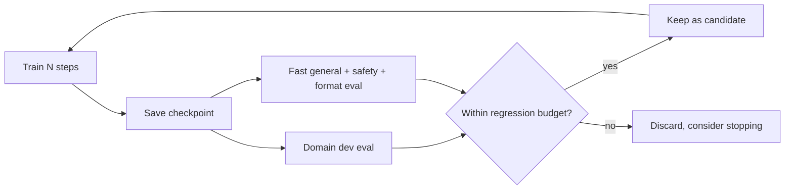
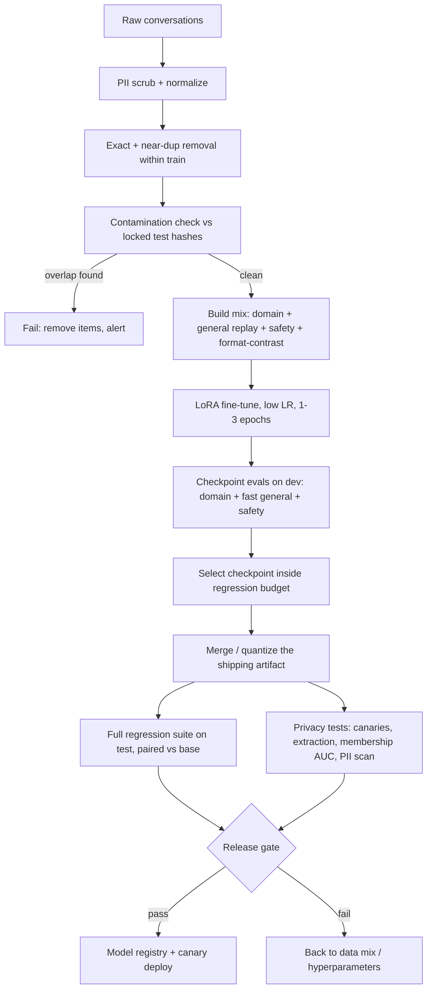

# Catastrophic Forgetting, Data Contamination and Memorization

> **Level:** Beginner to Advanced · **Study time:** ~130 min · **Prerequisites:** [Overfitting, Bias-Variance, Regularization and Data Leakage](../01-classical-ml/03-overfitting-regularization-and-data-leakage.md), [The ML Workflow, Train/Validation/Test Splits and Cross-Validation](../01-classical-ml/01-ml-workflow-data-splits-and-cross-validation.md), [Pretraining and Next-Token Prediction](./01-pretraining-and-next-token-prediction.md), [Fine-Tuning LLMs: Full Fine-Tuning, LoRA and QLoRA](./07-fine-tuning-full-lora-and-qlora.md)

## Table of contents

- [Why this matters](#why-this-matters)
- [The running example](#the-running-example)
- [Catastrophic forgetting: what it is and why it happens](#catastrophic-forgetting-what-it-is-and-why-it-happens)
- [Measuring capability loss after fine-tuning](#measuring-capability-loss-after-fine-tuning)
- [Mitigating catastrophic forgetting](#mitigating-catastrophic-forgetting)
- [Building a held-out evaluation set](#building-a-held-out-evaluation-set)
- [Data contamination and benchmark leakage](#data-contamination-and-benchmark-leakage)
- [Memorization of sensitive data](#memorization-of-sensitive-data)
- [Going deeper: a production fine-tuning release pipeline](#going-deeper-a-production-fine-tuning-release-pipeline)
- [Common mistakes and misconceptions](#common-mistakes-and-misconceptions)
- [Interview questions and model answers](#interview-questions-and-model-answers)
- [Key takeaways](#key-takeaways)
- [Further reading](#further-reading)
- [Next](#next)

## Why this matters

**Fine-tuning** (continuing to train an already-trained model on a smaller, task-specific dataset) is easy to start and easy to get subtly wrong. Three failure modes cause most of the pain in real projects: the model gets better at your task but quietly worse at everything else (**catastrophic forgetting**), your evaluation numbers look great because the test questions leaked into training (**data contamination**), and the model repeats a customer's phone number or an API key it saw during training (**memorization**). Each of these can ship to production unnoticed, because the metric you were watching went up. Interviewers for senior AI/ML roles ask about them because they reveal whether you can be trusted to own a fine-tuning pipeline end to end: train it, prove it did not break anything, prove the numbers are real, and prove it does not leak data.

A one-glance map of the chapter:

| Failure mode | What goes wrong | Who gets hurt | Main defense |
|---|---|---|---|
| Catastrophic forgetting | The **model** gets worse at things you did not train on | Users who ask anything outside the domain; safety | Measure before vs after; LoRA, low LR, replay, release gate |
| Data contamination | The **measurement** is wrong: eval items were in training | You, because you ship a worse model than you think | Group/time splits, dedup, locked test set, lineage |
| Memorization | The **training data** leaks out of the model | The people whose data you trained on | Scrub, dedup, few epochs, canary/extraction/membership tests |

## The running example

We will reuse one scenario throughout the chapter so every idea has a concrete home.

- **The base model:** a 7B-parameter **open-weight** (the weights are downloadable, so you can fine-tune them yourself) **instruct** (already tuned to follow instructions and chat) model (for example a Mistral-7B or Qwen-7B instruct variant). It already chats well, follows instructions, refuses harmful requests and can write JSON.
- **The task:** a fictional company, "Acme Insurance", wants a claims assistant. It has 8,000 historical support conversations (customer question plus a good agent answer) and wants the model to answer in Acme's style, cite the right policy rules and emit a small JSON summary at the end of each reply.
- **The worry list:** after fine-tuning, does it still do general reasoning? Does it still refuse to help with fraud? Are our evaluation numbers honest? Will it reveal a real customer's policy number?

We will also use a tiny **4-document corpus** as stand-in training data when we need to compute something by hand:

```text
doc1: "to file a claim log in to the portal and upload your photos"
doc2: "claims are usually reviewed within five business days"
doc3: "question: what is the deductible for windshield repair? answer: there is no deductible for windshield repair"
doc4: "you can update your address in the account settings page"
```

## Catastrophic forgetting: what it is and why it happens

### The intuition

> **Analogy:** Imagine a pianist who spends six months practicing only jazz, eight hours a day, never touching classical pieces. Their jazz is excellent, but when they sit down to play a Chopin piece they used to know, it has partly faded. Nothing "deleted" Chopin. The same fingers and the same muscle memory were retrained for something else, and nobody kept the old skill in practice.

A neural network stores everything it knows in one shared set of numbers, its **weights** (also called **parameters**). When you fine-tune, you change those same weights to fit new data. If nothing in the training signal says "and also keep doing the old things", the weights drift wherever the new data pulls them, and the old abilities degrade.

### The precise definition

**Catastrophic forgetting** (also called **catastrophic interference**, first described by McCloskey and Cohen, 1989) is the sharp loss of previously learned capabilities when a neural network is trained on new data or a new task, because the gradient updates for the new task overwrite parameters that the old capabilities depended on.

For LLMs, "previously learned capabilities" covers several distinct things, and they can degrade independently:

| Capability | What forgetting looks like | Example in the claims assistant |
|---|---|---|
| General knowledge | Wrong facts it used to get right | Can no longer answer basic geography questions |
| Reasoning | Worse at math, logic, multi-step problems | Miscalculates a pro-rated refund |
| Instruction following | Ignores explicit constraints in the prompt | Asked for 3 bullet points, writes a paragraph |
| Format adherence | Breaks or over-applies output formats | Appends the claims JSON even when asked for a plain email |
| Safety behavior | Stops refusing harmful requests, or starts over-refusing | Explains how to stage a fake car accident |
| Chat skills and tone | Loses multi-turn coherence, becomes terse or repetitive | Forgets what the user said two turns earlier |
| Other languages or domains | Degrades on anything absent from the fine-tuning data | Spanish replies get worse because all training data was English |

### Why it happens: three mechanisms

**1. Shared parameters, one-sided gradient.** Training uses **gradient descent** (see [Backpropagation and Gradient Descent](../02-deep-learning/02-backpropagation-and-gradient-descent.md)): each step moves the weights in the direction that lowers the loss on the current batch. During fine-tuning, the batch contains only domain data. The gradient has no term for "old task performance", so it is free to change weights that the old tasks relied on.

**2. Distribution shift.** A **distribution** here just means "what kind of data, in what proportions". Pretraining and instruction tuning used a huge, diverse mix. Fine-tuning data is narrow (8,000 insurance conversations, all in one style, all ending with JSON). The model adapts to the narrow distribution, including its quirks: if every training example ends with JSON, the model learns "always end with JSON".

**3. Too far from the starting point.** The base model's weights sit in a region of parameter space that works well for many tasks at once. Large learning rates, many epochs or full fine-tuning of all 7 billion weights let the model wander far from that region. An **epoch** is one full pass over the training data. The farther the weights move, the more of the old behavior is lost.

> **Senior insight:** Forgetting in LLM fine-tuning is often less about knowledge being erased and more about **behavior being overridden**. A model fine-tuned on short JSON answers may still "know" how to write an essay, but its learned habit now dominates. That is why a few hundred examples of general instruction data mixed back in can restore so much: you are reminding the model of the behavior, not reteaching the knowledge.

### A one-parameter toy that shows the whole story

Real models have billions of weights, but one weight is enough to see the mechanism. Suppose the model has a single parameter $w$.

- Old task A (general capability) is happiest at $w = 2$, with loss $L_A(w) = (w - 2)^2$.
- New task B (insurance domain) is happiest at $w = -1$, with loss $L_B(w) = (w + 1)^2$.

The pretrained model starts at $w_0 = 2$, perfect on A. We fine-tune only on B with gradient descent:

$$w_{t+1} = w_t - \eta \, \frac{dL_B}{dw}(w_t), \qquad \frac{dL_B}{dw} = 2(w + 1)$$

- $w_t$: the weight after $t$ steps.
- $\eta$ (eta): the **learning rate**, how big each step is.
- $\frac{dL_B}{dw}$: the slope of task B's loss, which tells us which way is downhill.

Take $\eta = 0.25$ and step by hand:

| Step | Gradient $2(w+1)$ | New $w = w - 0.25 \times \text{grad}$ | Loss A $(w-2)^2$ | Loss B $(w+1)^2$ |
|---|---|---|---|---|
| start | | 2.0 | 0.0 | 9.0 |
| 1 | $2 \times 3 = 6$ | $2 - 1.5 = 0.5$ | $(-1.5)^2 = 2.25$ | $(1.5)^2 = 2.25$ |
| 2 | $2 \times 1.5 = 3$ | $0.5 - 0.75 = -0.25$ | $(-2.25)^2 = 5.0625$ | $(0.75)^2 = 0.5625$ |
| 3 | $2 \times 0.75 = 1.5$ | $-0.25 - 0.375 = -0.625$ | $(-2.625)^2 = 6.890625$ | $(0.375)^2 = 0.140625$ |

Task B improves every step and task A gets worse every step. Run long enough and $w \to -1$, where loss A is $(-3)^2 = 9$. Nothing in the update rule even looked at task A. That is catastrophic forgetting in miniature.

Now the fix in miniature: train on a **mixture** where a fraction $r$ of the data is general (task A) and $1 - r$ is domain (task B):

$$L_{\text{mix}}(w) = r \, L_A(w) + (1 - r) \, L_B(w)$$

Setting the derivative to zero, $2r(w-2) + 2(1-r)(w+1) = 0$, gives $w^* = 3r - 1$. Plugging in:

| General fraction $r$ | Optimum $w^* = 3r - 1$ | Loss A $= 9(1-r)^2$ | Loss B $= 9r^2$ |
|---|---|---|---|
| 0.0 | -1.0 | 9.00 | 0.00 |
| 0.1 | -0.7 | 7.29 | 0.09 |
| 0.2 | -0.4 | 5.76 | 0.36 |
| 0.5 | 0.5 | 2.25 | 2.25 |

Check one row: $r = 0.2$ gives $w^* = 0.6 - 1 = -0.4$, loss A $= (-0.4 - 2)^2 = 5.76$, loss B $= (-0.4 + 1)^2 = 0.36$. Correct.

With one parameter, there is a strict trade-off: whatever helps A hurts B. Real LLMs have billions of parameters and are heavily **overparameterized** (far more weights than needed for any single task), so there are usually many weight settings that are good at both. The job of mitigations is to steer training toward those settings instead of the first one the domain gradient finds.

Here is the toy in code (NumPy only, `pip install numpy`):

```python
# Toy catastrophic forgetting: one weight, two conflicting tasks.
import numpy as np

def loss_a(w): return (w - 2.0) ** 2          # old / general task
def loss_b(w): return (w + 1.0) ** 2          # new / domain task
def grad_a(w): return 2.0 * (w - 2.0)
def grad_b(w): return 2.0 * (w + 1.0)

def train(grad_fn, w0=2.0, lr=0.05, steps=200):
    w = w0
    for _ in range(steps):
        w -= lr * grad_fn(w)
    return w

# 1) Sequential fine-tuning on B only
w = train(grad_b)
print(f"B only     : w={w:.3f} lossA={loss_a(w):.3f} lossB={loss_b(w):.3f}")

# 2) Replay: mix 20% general data into the gradient
r = 0.2
w = train(lambda w: r * grad_a(w) + (1 - r) * grad_b(w))
print(f"mix r=0.2  : w={w:.3f} lossA={loss_a(w):.3f} lossB={loss_b(w):.3f}")

# 3) EWC-style penalty: lam * (w - w_old)^2 keeps w near the old optimum
lam, w_old = 4.0, 2.0
w = train(lambda w: grad_b(w) + 2 * lam * (w - w_old))
print(f"EWC lam=4  : w={w:.3f} lossA={loss_a(w):.3f} lossB={loss_b(w):.3f}")

# B only     : w=-1.000 lossA=9.000 lossB=0.000
# mix r=0.2  : w=-0.400 lossA=5.760 lossB=0.360
# EWC lam=4  : w=1.400 lossA=0.360 lossB=5.760
```

The EWC line minimizes $(w+1)^2 + 4(w-2)^2$; setting the derivative $2(w+1) + 8(w-2) = 10w - 14$ to zero gives $w = 1.4$. We will explain EWC properly in the mitigations section.

## Measuring capability loss after fine-tuning

You cannot manage what you do not measure. The core idea is simple: **run the same evaluation suite on the base model and on the fine-tuned model, with the same prompts, decoding settings and scoring, and compare item by item.**

### What to measure

A good **capability-regression suite** has several layers. Each layer catches a different kind of forgetting.

| Layer | What it checks | Typical sources | Metric |
|---|---|---|---|
| General knowledge and reasoning | Did broad ability drop? | Public benchmarks such as MMLU (knowledge), GSM8K (grade-school math), HellaSwag (commonsense), ARC (grade-school science) | Accuracy |
| Instruction following | Does it still obey explicit constraints? | IFEval (Zhou et al., 2023), which checks verifiable instructions like "use exactly 3 bullets" | Strict/loose pass rate |
| Format adherence | Valid JSON, correct schema, no format bleed | Internal prompts that need JSON, and prompts that must NOT get JSON | Parse rate, schema-valid rate, "format bleed" rate |
| Safety | Refuses harmful requests, does not over-refuse benign ones | Internal red-team sets, public harmful/benign prompt sets | Harmful-compliance rate, over-refusal rate |
| Internal task suite | The product-critical behaviors for your company | Hand-written and sampled production cases | Task-specific: accuracy, rubric score, LLM-judge score |
| Domain target | Did the fine-tune actually help? | Held-out Acme conversations | Accuracy, rubric score, win rate vs base |
| Other | Multilingual, long context, tool calling, calibration | Whatever your product depends on | Varies |

Two definitions from the table:

- A **benchmark** is a fixed, published dataset with a fixed scoring method, used to compare models.
- **Over-refusal** means refusing a request that is actually harmless (for example refusing "how do I kill a Python process?"). Fine-tuning can push safety either way, so measure both directions.

> **Interview tip:** When asked "how would you measure capability loss?", say "before and after, same harness, same settings, paired comparison, across general, instruction-following, format, safety and internal suites, with confidence intervals and a release gate." That one sentence covers what most candidates miss.

**Regression budget and release gate.** Before training, agree on the largest drop you will accept on each non-target suite (for example "at most 1.5 points on general reasoning, no increase in harmful compliance"). That is the **regression budget**. The full checklist of such thresholds that a model must pass before it ships is the **release gate** (an example appears in the release-pipeline section). Writing them down first stops you from moving the goalposts after seeing the results.

### Why safety deserves its own layer

Safety behavior is learned during alignment (see [Instruction Tuning, RLHF and DPO](./02-instruction-tuning-rlhf-and-dpo.md)) and is surprisingly fragile. Qi et al. (2023), "Fine-tuning Aligned Language Models Compromises Safety, Even When Users Do Not Intend To!", showed that fine-tuning aligned models on a small number of harmful examples can largely remove safety behavior, and that even fine-tuning on ordinary benign datasets can measurably degrade it. So a fine-tune for insurance claims, with no harmful content at all, still needs a safety re-check. More on safety evaluation in [LLM Safety, Guardrails and Responsible AI](./13-llm-safety-guardrails-and-responsible-ai.md).

### Is the drop real? Confidence intervals

Suppose the base model scores 70% on a 1,000-question general suite. How much would it wobble by chance? Treat each question as a coin flip with success probability $p$. The **standard error** (SE) of an accuracy measured on $n$ items is:

$$SE = \sqrt{\frac{p(1-p)}{n}}$$

- $p$: the measured accuracy (a fraction between 0 and 1).
- $n$: the number of evaluation items.
- $SE$: the typical size of random error in the measured accuracy.

Worked example with $p = 0.70$, $n = 1000$:

- $p(1-p) = 0.70 \times 0.30 = 0.21$
- $0.21 / 1000 = 0.00021$
- $\sqrt{0.00021} \approx 0.0145$, about 1.45 percentage points.

A 95% **confidence interval** is roughly $\pm 1.96 \times SE = \pm 0.0284$, so about $\pm 2.8$ points. A drop from 70% to 69% on this suite tells you almost nothing on its own.

How many items do you need for a tighter SE, say 0.5 points? Rearrange: $n = p(1-p)/SE^2 = 0.21 / 0.005^2 = 0.21 / 0.000025 = 8{,}400$ items. Small eval sets are noisy; that is a real cost trade-off.

### Use a paired test, not two separate intervals

Because both models answer the **same** questions, compare them item by item. Count:

- $b$: items the base got right and the tuned model got wrong (regressions).
- $c$: items the base got wrong and the tuned model got right (improvements).

Items both got right or both got wrong carry no information about the difference. **McNemar's test** uses only $b$ and $c$:

$$z = \frac{b - c}{\sqrt{b + c}}$$

- $z$: how many standard errors the difference is away from "no change". $|z| > 1.96$ means significant at the 5% level.
- This is the normal approximation ($z^2$ is the classic McNemar chi-square statistic without continuity correction). When $b + c$ is small (roughly under 25), use the exact version: a two-sided binomial test of $b$ successes out of $b + c$ trials with probability 0.5.

Worked example (illustrative numbers): base gets 700/1000 right. After fine-tuning, $b = 80$ and $c = 40$. The tuned model gets $700 - 80 + 40 = 660$ right, so accuracy fell from 70% to 66%.

- $b - c = 80 - 40 = 40$
- $b + c = 120$, $\sqrt{120} \approx 10.954$
- $z = 40 / 10.954 \approx 3.65$, clearly significant (two-sided p-value about 0.0003).

Compare with the naive unpaired approach: $SE_{\text{diff}} = \sqrt{0.21/1000 + 0.2244/1000} = \sqrt{0.0004344} \approx 0.0208$ (using $0.66 \times 0.34 = 0.2244$), so $z = 0.04 / 0.0208 \approx 1.92$, which is NOT significant. Same data, opposite conclusion. The paired test is more powerful because it cancels out item difficulty. Background on these statistics lives in [Probability and Statistics for Machine Learning](../00-foundations/04-probability-and-statistics.md).

> **Senior insight:** Also look at the $b$ items directly. Eighty regressions that are all "the model appended JSON to a non-claims answer" is one bug with one fix (format bleed). Eighty regressions spread across math, history and coding is genuine broad forgetting. The aggregate number hides which one you have.

### Code: a before/after comparison

```python
# Compare per-item correctness of base vs fine-tuned model on several suites.
import math

def mcnemar(base_correct: list[bool], tuned_correct: list[bool]):
    b = sum(bc and not tc for bc, tc in zip(base_correct, tuned_correct))  # regressions
    c = sum(tc and not bc for bc, tc in zip(base_correct, tuned_correct))  # improvements
    if b + c == 0:
        return b, c, 0.0, 1.0
    z = (b - c) / math.sqrt(b + c)
    p_two_sided = math.erfc(abs(z) / math.sqrt(2))   # normal approximation
    return b, c, z, p_two_sided

def report(suites: dict[str, tuple[list[bool], list[bool]]], max_drop=0.02):
    for name, (base, tuned) in suites.items():
        n = len(base)
        acc_b, acc_t = sum(base) / n, sum(tuned) / n
        b, c, z, p = mcnemar(base, tuned)
        flag = "FAIL" if (acc_b - acc_t > max_drop and p < 0.05) else "ok"
        print(f"{name:12s} base={acc_b:.3f} tuned={acc_t:.3f} "
              f"regress={b} improve={c} z={z:+.2f} p={p:.4f} {flag}")

# Illustrative: 1,000 items, base right on 700, 80 regressions, 40 improvements.
base  = [True] * 700 + [False] * 300
tuned = [False] * 80 + [True] * 620 + [True] * 40 + [False] * 260
report({"general_mc": (base, tuned)})
```

In practice, the per-item correctness comes from an evaluation harness. A widely used open-source one is EleutherAI's **lm-evaluation-harness**. Its command-line flags have changed across versions, so treat this as a sketch and check the current docs:

```bash
pip install lm-eval
# Base model
lm_eval --model hf --model_args pretrained=<base-model-id> \
        --tasks mmlu,gsm8k,ifeval --batch_size 8 --output_path results/base --log_samples
# Same base with the LoRA adapter applied
lm_eval --model hf --model_args pretrained=<base-model-id>,peft=./acme-lora \
        --tasks mmlu,gsm8k,ifeval --batch_size 8 --output_path results/tuned --log_samples
```

`--log_samples` keeps per-item outputs so you can run the paired comparison and read the regressions.

### Rules that make before/after comparisons valid

1. **Same prompts and chat template.** A **chat template** is the exact text format, including special tokens, that wraps the system, user and assistant turns before they reach the model. A fine-tuned model is often trained with a specific chat template. Evaluate both models with the template each expects, or you measure template mismatch, not forgetting.
2. **Same decoding settings.** Greedy decoding (temperature 0) for deterministic scoring; if you sample, run several seeds. See [Decoding Strategies](./03-text-generation-and-decoding-strategies.md).
3. **Same scoring code and judge.** If you use an LLM judge, pin its version (see [LLM-as-a-Judge](./10-llm-evaluation-metrics-and-llm-as-a-judge.md)).
4. **Evaluate the artifact you ship.** If production uses a **merged** (LoRA adapter folded into the base weights) and **quantized** (weights stored in fewer bits; see [Quantization Fundamentals](../07-model-compression/02-quantization-fundamentals-scale-and-zero-point.md)) model, evaluate that, not the BF16 (16-bit floating point) training checkpoint. Quantization can add its own regression.
5. **Track over training, not just at the end.** Evaluate checkpoints during training so you can see when forgetting starts (this enables early stopping, below).

## Mitigating catastrophic forgetting

There is no single fix. Production recipes usually combine several of the techniques below.

### 1. Parameter-efficient fine-tuning (PEFT)

**Parameter-efficient fine-tuning** trains a small number of new or selected parameters while keeping the original weights frozen. The most popular method, **LoRA** (Low-Rank Adaptation), adds a small low-rank update $\Delta W = BA$ next to each frozen weight matrix; the full mechanics are in [Fine-Tuning LLMs: Full Fine-Tuning, LoRA and QLoRA](./07-fine-tuning-full-lora-and-qlora.md).

Why it helps with forgetting:

- **Fewer degrees of freedom.** A rank-16 LoRA on a 7B model trains only millions to tens of millions of parameters (depending on which layers it targets) instead of 7 billion. The update is constrained to a low-dimensional subspace, so it physically cannot rewrite everything.
- **The base is untouched.** You can detach the adapter and get the original model back exactly. You can also route general queries to the plain base model and domain queries to the adapter.
- **Evidence:** Biderman et al. (2024), "LoRA Learns Less and Forgets Less", found that LoRA typically underperforms full fine-tuning on the target domain but better preserves performance outside it.

But LoRA is **not immune**. With a high rank, a high learning rate, many epochs or many target modules, LoRA can forget substantially, and safety degradation has been observed with LoRA fine-tunes too. Measure; do not assume.

### 2. Lower learning rate and fewer epochs

The farther the weights travel, the more they forget. Two knobs control distance:

- **Learning rate.** Common starting points (not rules, and they depend on model, batch size and data) are around $10^{-5}$ to $2 \times 10^{-5}$ for full fine-tuning of a 7B model and around $10^{-4}$ to $2 \times 10^{-4}$ for LoRA. Use warmup and a decaying schedule (see [Optimizers and Learning Rate Schedules](../02-deep-learning/03-optimizers-sgd-momentum-adam-and-learning-rate-schedules.md)).
- **Epochs.** For instruction-style data, 1 to 3 epochs is typical. Each extra epoch over a small dataset increases both forgetting and memorization (we return to memorization later).

In the toy example, fewer steps literally means $w$ stays closer to 2. In a real model it means the same thing in billions of dimensions.

### 3. Replay: mixing general data with domain data

**Replay** (also called **rehearsal**) means mixing examples of the old capabilities back into the fine-tuning data so the gradient keeps "practicing" them. It is the most reliable mitigation in practice. A well-known example: InstructGPT (Ouyang et al., 2022) mixed pretraining gradients into its RLHF (reinforcement learning from human feedback) updates ("PPO-ptx") to reduce regressions on public NLP benchmarks, a cost they called the **alignment tax**.

**Where do general examples come from?**

| Source | Pros | Cons |
|---|---|---|
| Open instruction datasets (general chat, math, code) | Easy, diverse | Style may differ from the base model's own alignment data; licensing must be checked |
| The base model's original SFT (supervised fine-tuning, the instruction-tuning stage) data | Ideal match | Usually not released for open-weight models |
| **Self-generated replay:** prompts from general datasets, answers generated by the base model itself | Matches the base model's style and behavior exactly, so it adds little distribution shift | Inherits base model errors; costs inference time |
| Safety data (harmful prompts with refusals, benign prompts with helpful answers) | Directly protects safety behavior | Must balance to avoid over-refusal |
| Format contrast examples (prompts that must NOT get JSON) | Fixes format bleed cheaply | Narrow purpose |

Self-generated replay is a form of self-distillation (see [Distilling Large Language Models](../07-model-compression/06-distilling-large-language-models.md)). A related idea, rewriting the fine-tuning targets in the base model's own words to reduce distribution shift, is studied in Yang et al. (2024), "Self-Distillation Bridges Distribution Gap in Language Model Fine-Tuning".

**How to choose the ratio.** There is no universal number. Treat the **mixing ratio** (fraction of general data in the training mix) as a hyperparameter and sweep it:

1. Pick candidate ratios, for example 0%, 10%, 25% and 50% general.
2. Train each (cheap with LoRA).
3. Evaluate each on the domain suite and the general/safety/format suites.
4. Plot domain score against general score and pick the point with the best domain score that stays inside your regression budget.

Converting a ratio into example counts: with $D = 8{,}000$ domain examples and a target general fraction $r$, the number of general examples $G$ satisfies $G / (D + G) = r$, so:

$$G = \frac{r \, D}{1 - r}$$

For $r = 0.2$: $G = 0.2 \times 8000 / 0.8 = 1600 / 0.8 = 2{,}000$. Check: $2000 / (8000 + 2000) = 0.2$. Correct.

> **Common mistake:** Mixing by example count when examples have very different lengths. If general examples average 300 tokens and domain examples 1,200 tokens, a 20% example mix is only about $600{,}000 / (600{,}000 + 9{,}600{,}000) \approx 5.9\%$ of tokens ($2000 \times 300 = 600{,}000$; $8000 \times 1200 = 9{,}600{,}000$). The gradient sees tokens, so think in tokens.

**Temperature-based mixing.** When combining many sources of very different sizes, a common scheme (used for multilingual pretraining mixes) samples source $i$ with probability proportional to its size raised to a power $\alpha$:

$$p_i = \frac{n_i^{\alpha}}{\sum_j n_j^{\alpha}}$$

- $n_i$: size of source $i$ (examples or tokens).
- $\alpha$: between 0 and 1. $\alpha = 1$ samples proportionally to size; $\alpha = 0$ samples every source equally; values in between upweight small sources.

Example with 8,000 domain and 100,000 general examples, $\alpha = 0.5$:

- $\sqrt{8000} \approx 89.44$ and $\sqrt{100000} \approx 316.23$, sum $\approx 405.67$
- $p_{\text{domain}} \approx 89.44 / 405.67 \approx 0.22$, $p_{\text{general}} \approx 0.78$

With $\alpha = 1$, $p_{\text{domain}} = 8000 / 108000 \approx 0.074$. Lowering $\alpha$ makes the small domain source a much bigger share of each batch.

```python
# Mixing domain and general data with Hugging Face datasets (pip install datasets).
from datasets import load_dataset, interleave_datasets

domain  = load_dataset("json", data_files="acme_claims_train.jsonl", split="train")
general = load_dataset("json", data_files="general_replay.jsonl", split="train")

# Each training example is drawn from domain with prob 0.8, general with prob 0.2.
mixed = interleave_datasets(
    [domain, general],
    probabilities=[0.8, 0.2],
    seed=42,
    stopping_strategy="first_exhausted",   # stop when one source runs out
)
```

> **Senior insight:** Small replay fractions often recover a large part of the lost general performance, because overparameterized models can usually fit both distributions at once. But "often" is not "always". Always confirm with the sweep, and include safety and format-contrast examples in the replay set, not only general Q&A.

### 4. Regularization toward the original weights (EWC and friends)

**Regularization** means adding a penalty to the loss that discourages unwanted solutions (refresher in [Overfitting, Regularization and Data Leakage](../01-classical-ml/03-overfitting-regularization-and-data-leakage.md)). For forgetting, the unwanted solution is "drift far from the original model".

The simplest version, **L2-SP** (Li et al., 2018), penalizes squared distance from the starting weights:

$$L(\theta) = L_{\text{new}}(\theta) + \frac{\lambda}{2} \sum_i (\theta_i - \theta^*_i)^2$$

**Elastic Weight Consolidation (EWC)** (Kirkpatrick et al., 2017, "Overcoming catastrophic forgetting in neural networks") refines this: not every weight matters equally to the old task, so penalize changes to important weights more.

$$L(\theta) = L_{\text{new}}(\theta) + \frac{\lambda}{2} \sum_i F_i \, (\theta_i - \theta^*_i)^2$$

- $\theta$ (theta): the current weights; $\theta_i$ is weight number $i$.
- $\theta^*_i$: the value of weight $i$ after the old training (the starting point of fine-tuning).
- $L_{\text{new}}$: the loss on the new (domain) data.
- $\lambda$ (lambda): how strongly to hold on to the old weights.
- $F_i$: the **Fisher information** of weight $i$, a measure of how much the old task's predictions depend on that weight. It is estimated as the average squared gradient of the log-likelihood on old-task data: $F_i \approx \mathbb{E}\left[\left(\frac{\partial \log p(y \mid x, \theta)}{\partial \theta_i}\right)^2\right]$. A big $F_i$ means "moving this weight changes the old outputs a lot".

> **Analogy:** EWC is like attaching springs from each weight to its old position. Important weights get stiff springs; unimportant ones get loose springs. The new task can still pull weights, but stiff springs resist.

Worked example with two weights, $\lambda = 1$:

- Old values $\theta^* = (1.0, 1.0)$, Fisher $F = (10, 0.1)$.
- After some fine-tuning, $\theta = (1.2, 2.0)$.
- Weight 1 moved by $0.2$: $F_1 (0.2)^2 = 10 \times 0.04 = 0.4$
- Weight 2 moved by $1.0$: $F_2 (1.0)^2 = 0.1 \times 1.0 = 0.1$
- Penalty $= \frac{1}{2}(0.4 + 0.1) = 0.25$

Moving the important weight by 0.2 costs four times more than moving the unimportant weight by a full 1.0. That is the whole point.

```python
# EWC penalty in PyTorch (conceptual; fine for small models).
import torch

def estimate_fisher(model, old_data_loader, loss_fn, n_batches=50):
    """Diagonal Fisher: average squared gradient on old-task data."""
    fisher = {n: torch.zeros_like(p) for n, p in model.named_parameters() if p.requires_grad}
    model.eval()
    for i, (x, y) in enumerate(old_data_loader):
        if i >= n_batches:
            break
        model.zero_grad()
        loss_fn(model(x), y).backward()
        for n, p in model.named_parameters():
            if p.grad is not None:
                fisher[n] += p.grad.detach() ** 2 / n_batches
    return fisher

def ewc_penalty(model, fisher, old_params, lam):
    total = 0.0
    for n, p in model.named_parameters():
        if n in fisher:
            total = total + (fisher[n] * (p - old_params[n]) ** 2).sum()
    return lam / 2 * total

# During fine-tuning:
# old_params = {n: p.detach().clone() for n, p in model.named_parameters()}
# loss = task_loss + ewc_penalty(model, fisher, old_params, lam=100.0)
```

(Strictly, the Fisher uses gradients of the model's own log-likelihood, often per example; using batch loss gradients as above is a common cheap approximation.)

**Why EWC is rare for LLM fine-tuning in practice:**

- **Memory.** You need a Fisher value and an old copy for every weight. For a 7B model in FP32 that is $7 \times 10^9 \times 4$ bytes $= 28$ GB for the Fisher alone, plus the reference copy.
- **Old data.** Estimating Fisher needs data representative of the old capabilities, which for a vendor model you often do not have.
- **Diagonal approximation.** It ignores interactions between weights.
- **Simpler alternatives work.** LoRA plus replay plus a low learning rate is usually enough and much cheaper.

Two related ideas that are widely used in LLMs:

- **KL regularization to a reference model.** Instead of tying weights, tie **outputs**: penalize the **KL divergence** (a measure of how different two probability distributions are; see [Softmax, Entropy, Cross-Entropy and KL Divergence](../00-foundations/05-softmax-entropy-cross-entropy-and-kl-divergence.md)) between the tuned model's token distribution and the original model's. RLHF and DPO already do this (see [Instruction Tuning, RLHF and DPO](./02-instruction-tuning-rlhf-and-dpo.md)).
- **Weight interpolation (model merging).** Average the base and fine-tuned weights: $\theta = (1-\alpha)\,\theta_{\text{base}} + \alpha\,\theta_{\text{ft}}$. Wortsman et al. (2022), "Robust fine-tuning of zero-shot models" (WiSE-FT), showed this can keep much of the fine-tuning gain while restoring robustness. Example: a weight that was 0.80 in the base and 1.20 after fine-tuning becomes $0.5 \times 0.80 + 0.5 \times 1.20 = 1.00$ at $\alpha = 0.5$, or $0.75 \times 0.80 + 0.25 \times 1.20 = 0.90$ at $\alpha = 0.25$. With LoRA this is just scaling the adapter.

### 5. Early stopping on a general-capability eval

Usual **early stopping** watches only the validation loss of the task you are training. To control forgetting, also watch a small, fast general-capability eval at every checkpoint, and pick the checkpoint that maximizes domain quality **subject to** a regression budget.



```python
# Choose the best checkpoint under a general-capability regression budget.
logs = [  # illustrative numbers
    {"step": 200,  "domain": 0.62, "general": 0.700},
    {"step": 400,  "domain": 0.71, "general": 0.695},
    {"step": 600,  "domain": 0.75, "general": 0.688},
    {"step": 800,  "domain": 0.77, "general": 0.671},
    {"step": 1000, "domain": 0.78, "general": 0.652},
]
base_general, budget = 0.700, 0.015   # allow at most 1.5 points of general drop

ok = [r for r in logs if base_general - r["general"] <= budget]
best = max(ok, key=lambda r: r["domain"])
print("best checkpoint: step", best["step"])
# best checkpoint: step 600
```

Steps 800 and 1000 have better domain scores but lose 2.9 and 4.8 general points, beyond the budget. Use a **dev** version of the general eval here, not your final test set (next section explains why).

### Comparison of mitigations

| Mitigation | What it does | When to use | Pros | Cons |
|---|---|---|---|---|
| LoRA / PEFT | Constrains update to a small subspace; base stays intact | Default for most domain fine-tunes | Cheap, reversible, swappable adapters | Learns less; still can forget at high rank/LR |
| Lower LR, fewer epochs | Limits distance traveled | Always, as a baseline | Free | May underfit the domain |
| Replay / data mixing | Keeps practicing old behaviors | Almost always; essential for full fine-tuning | Most reliable; also fixes format bleed and safety | Needs suitable general data; more tokens to train |
| EWC / L2-SP | Penalizes moving important weights | Small models, continual learning research | Principled | Memory heavy, needs old data, rarely used for LLMs |
| KL to reference | Keeps output distribution close | RLHF/DPO-style training | Directly targets behavior | Needs reference model forward passes |
| Weight interpolation | Blends base and tuned weights | After training, as a cheap knob | No retraining | Can blunt domain gains |
| Early stopping on general eval | Picks a checkpoint inside the budget | Always, if you can afford periodic evals | Simple, measurable | Eval cost per checkpoint |
| Do not fine-tune (RAG or prompting) | Avoids weight changes entirely | Knowledge that changes, or small style needs | Zero forgetting | Different trade-offs; see [the decision guide](./08-prompting-vs-rag-vs-fine-tuning-decision-guide.md) |

## Building a held-out evaluation set

Every number in this chapter depends on having an evaluation set the model has truly never seen. A **held-out evaluation set** is data deliberately kept out of training and out of all decisions, so it estimates how the model performs on new, real inputs. The basics of train/validation/test splits are in [The ML Workflow, Train/Validation/Test Splits and Cross-Validation](../01-classical-ml/01-ml-workflow-data-splits-and-cross-validation.md); LLMs add some extra traps.

> **Analogy:** A held-out test is like the final exam a teacher writes after the term and locks in a drawer. If students saw the exam (or a copy with the numbers changed), or the teacher kept rewriting lessons until the class aced that exact exam, the grade no longer measures learning.

### Step by step

**1. Decide what it must represent.** Sample from the real input distribution (production traffic, if you have it), and cover the important slices: claim types, languages, long versus short conversations, edge cases, adversarial inputs. Write down the slice targets before collecting.

**2. Split by group, not by row.** If one customer has 12 conversations, put all 12 on the same side. Likewise group by policy document, by agent, or by template. Otherwise near-identical conversations land on both sides. This is the LLM version of **group leakage**.

**3. Exact deduplication.** **Normalize** text (lowercase, collapse whitespace, strip punctuation or boilerplate), then hash it. Identical hashes are duplicates. Remove duplicates within the eval set and remove any eval item whose hash appears in training data.

**4. Near-duplicate removal.** Real duplicates are rarely exact: a templated email with a different name, a question with one word changed. Measure similarity with the **Jaccard similarity** of **shingles** (overlapping chunks of $k$ consecutive words or characters):

$$J(A, B) = \frac{|A \cap B|}{|A \cup B|}$$

- $A$, $B$: the sets of shingles of the two documents.
- $|A \cap B|$: number of shingles they share; $|A \cup B|$: number of distinct shingles in either.
- $J$ ranges from 0 (nothing shared) to 1 (identical sets).

Worked example with word 2-grams (pairs of consecutive words):

- D1 = "the claim was approved after review" gives {the claim, claim was, was approved, approved after, after review}, 5 shingles.
- D2 = "the claim was approved after a review" gives {the claim, claim was, was approved, approved after, after a, a review}, 6 shingles.
- Shared: 4. Union: $5 + 6 - 4 = 7$. $J = 4/7 \approx 0.571$.

For short texts one edit changes a large share of shingles, so short texts need lower thresholds or character shingles. For long texts near-duplicate detection is very effective: insert one word into the middle of a 200-word document (199 bigrams). One original bigram is broken and two new ones appear, so the new document has 200 bigrams, the intersection is 198, the union is $199 + 200 - 198 = 201$, and $J = 198/201 \approx 0.985$.

Comparing every pair is too slow at scale ($n^2$ pairs). **MinHash** (Broder, 1997) compresses each shingle set into a short signature such that the probability two signatures agree at a position equals their Jaccard similarity, and **locality-sensitive hashing (LSH)** buckets signatures so only likely matches get compared.

```python
# Exact + near-duplicate detection (pip install datasketch).
import hashlib, re
from datasketch import MinHash, MinHashLSH

def normalize(text: str) -> str:
    text = text.lower()
    text = re.sub(r"[^a-z0-9\s]", " ", text)
    return re.sub(r"\s+", " ", text).strip()

def exact_hash(text: str) -> str:
    return hashlib.sha256(normalize(text).encode("utf-8")).hexdigest()

def shingles(text: str, k: int = 2) -> set[str]:
    w = normalize(text).split()
    return {" ".join(w[i:i + k]) for i in range(len(w) - k + 1)}

def jaccard(a: str, b: str, k: int = 2) -> float:
    A, B = shingles(a, k), shingles(b, k)
    return len(A & B) / len(A | B) if (A | B) else 1.0   # texts shorter than k words have no shingles

print(round(jaccard("the claim was approved after review",
                    "the claim was approved after a review"), 3))
# 0.571

def minhash(text: str, k: int = 5, num_perm: int = 128) -> MinHash:
    m = MinHash(num_perm=num_perm)
    for s in shingles(text, k):
        m.update(s.encode("utf-8"))
    return m

# Index the training set, then query each candidate eval item.
def find_near_dups(train_texts, eval_texts, threshold=0.8):
    lsh = MinHashLSH(threshold=threshold, num_perm=128)
    for i, t in enumerate(train_texts):
        lsh.insert(f"train-{i}", minhash(t))
    hits = {}
    for j, t in enumerate(eval_texts):
        matches = lsh.query(minhash(t))
        if matches:
            hits[j] = matches          # eval item j looks like these training items
    return hits
```

Embedding similarity (see [Text Embeddings and Similarity Search](../08-rag/02-text-embeddings-and-similarity-search.md)) catches **paraphrases** that share few words, at higher cost. A practical pipeline is exact hash, then MinHash, then an embedding check on the remaining candidates, then human review of borderline cases.

**5. Time-based holdout.** Put everything after a cutoff date in the eval set and everything before it in training. This mimics deployment (the model always faces the future), naturally avoids most duplicates, and catches **temporal drift** (new products, new regulations). For public LLM benchmarks, a time-based split also defends against contamination: items written after the model's training cutoff cannot have been in its pretraining data. See [Data Drift, Concept Drift and When to Retrain](../01-classical-ml/08-data-drift-concept-drift-and-retraining.md).

**6. Label carefully.** Use expert labelers or reviewed reference answers, measure agreement between labelers, and record rubric versions. A noisy label set caps the accuracy you can measure.

**7. Separate dev from test, and never tune on the test set.** You need two held-out sets:

| Set | Used for | Who looks at it | How often |
|---|---|---|---|
| Train | Gradient updates | Training pipeline | Constantly |
| Dev (validation) | Choosing LR, mix ratio, checkpoint, prompts | Engineers, freely | Constantly |
| Test (held-out) | Final, unbiased estimate before release | Release process | Rarely: once per release candidate |

Every decision you make by looking at test results (keep this prompt, pick that checkpoint, drop those "weird" items) leaks information from test into the model. This is **adaptive overfitting**: no test item was trained on, yet the score is still optimistic. Practical rules: restrict access to the test set, version it, log every evaluation run against it, and refresh it periodically with new data.

**8. Guard against new contamination paths.** Do not paste test items into prompts while debugging, do not let a synthetic-data generator see test items, and store the test set with a **canary string** (defined in the next section) so you can detect if it ever leaks into a training corpus.

```text
                     production logs (with dates, customer ids)
                                    |
                        PII scrub + normalize
                                    |
           +------------------------+-------------------------+
           | before 2026-06-01                                | on/after 2026-06-01
           v                                                  v
   group by customer -> train / dev               candidate test pool
           |                                                  |
           +-----> exact + near-dup removal against train <---+
                                    |
                     human labeling + slice balancing
                                    |
                    locked, versioned, canary-tagged TEST
```

## Data contamination and benchmark leakage

### The intuition

**Data contamination** means evaluation data (or something very close to it) was present in the data the model trained on. The model may then score well by **recall** rather than **generalization**, and the score overstates real-world ability. It is the LLM-scale version of **data leakage** from classical ML.

> **Analogy:** A student scores 100% on a test, but it turns out the exact questions and answers were posted online last year and the student had read them. The score is real; what it measures is not what you wanted.

### Training contamination vs benchmark leakage

These terms are used loosely in the literature, so define them when you use them. A useful distinction:

| | Training contamination | Benchmark leakage |
|---|---|---|
| What it is | Any overlap between the data a model was trained on (pretraining, SFT, preference data, synthetic data) and the data used to evaluate it | Information about a specific (usually public) benchmark's test set reaching the model or the model-building process |
| Scope | Your pipeline: your eval set vs your training set | The ecosystem: published benchmarks vs everyone's models |
| How it happens | Duplicated support tickets in both splits; a test document scraped into the fine-tuning corpus; the vendor's pretraining included your public docs | Benchmark files and solutions crawled from GitHub and the web; benchmark data used in instruction-tuning mixes; prompts, checkpoints or hyperparameters selected by test score |
| Data must be in training? | Yes, it is about data in the weights | Not necessarily: selecting checkpoints or prompts on the test set leaks without training on it |
| Typical evidence | n-gram/hash overlap between your splits | Canary strings, verbatim completion of test items, score drops on fresh equivalent items |
| Effect | Your internal metrics are inflated, so you ship a worse model than you think | Leaderboard numbers are inflated, so model comparisons are wrong |

In short: **contamination is about data overlap between training and evaluation; benchmark leakage is about a benchmark's test information escaping into how a model is trained or chosen.** Contamination is the most common way benchmark leakage happens, but leakage also includes tuning on the test set.

A second axis matters too:

- **Input-only contamination:** the question text was seen, but not the answer. Inflates scores somewhat (familiarity).
- **Input-and-label contamination:** question and answer were seen together, for example a benchmark answer key on GitHub. Inflates scores much more.

Zhou et al. (2023), "Don't Make Your LLM an Evaluation Benchmark Cheater", showed experimentally that training on benchmark-related data can dramatically inflate scores on those benchmarks while hurting other abilities.

### Detecting contamination

There are two situations: you **have** the training data (your own fine-tuning set, or an open pretraining corpus), or you **only have the model** (a vendor model or an open-weight model with undisclosed data).

#### When you have the training data: n-gram overlap

Split each eval item into word $n$-grams and check what fraction appear anywhere in the training data. GPT-3 (Brown et al., 2020) used 13-gram overlap for its contamination analysis; other reports have used substring matches of fixed character length. Small $n$ gives false positives (common phrases); large $n$ misses paraphrases.

Worked example with our 4-document corpus, using word 3-grams for hand calculation:

- Eval item 1: "what is the deductible for windshield repair?" normalizes to 7 words, giving 5 trigrams: "what is the", "is the deductible", "the deductible for", "deductible for windshield", "for windshield repair". All 5 appear in doc3. Overlap $= 5/5 = 100\%$: **contaminated**.
- Eval item 2: "how do i add a driver to my policy?" normalizes to 9 words, giving 7 trigrams. None appear in the corpus. Overlap $= 0/7 = 0\%$: clean.

```python
# n-gram overlap contamination check, from scratch.
import re

def ngrams(text: str, n: int) -> set[tuple[str, ...]]:
    words = re.sub(r"[^a-z0-9\s]", " ", text.lower()).split()
    return {tuple(words[i:i + n]) for i in range(len(words) - n + 1)}

corpus = [
    "to file a claim log in to the portal and upload your photos",
    "claims are usually reviewed within five business days",
    "question: what is the deductible for windshield repair? "
    "answer: there is no deductible for windshield repair",
    "you can update your address in the account settings page",
]
n = 3
train_index = set().union(*(ngrams(d, n) for d in corpus))

def overlap(item: str) -> float:
    grams = ngrams(item, n)
    return len(grams & train_index) / len(grams) if grams else 0.0

for item in ["what is the deductible for windshield repair?",
             "how do i add a driver to my policy?"]:
    print(f"{overlap(item):.2f}  {item}")
# 1.00  what is the deductible for windshield repair?
# 0.00  how do i add a driver to my policy?
```

At scale (billions of documents), the index is built with Bloom filters, suffix arrays or sharded hash tables instead of a Python set, but the logic is the same. Report contamination per eval item, then report the score on the **clean subset** next to the full score. If the clean-subset score is much lower, the headline number was inflated.

#### Canary strings

A **canary string** is a unique random marker (such as a long random identifier) embedded in a dataset so its presence elsewhere can be detected. The BIG-bench benchmark (Srivastava et al., 2022) put a canary GUID in its files with a request that benchmark data never appear in training corpora. Two uses:

1. **Filtering:** training-data pipelines search for known canaries and drop those documents.
2. **Detection:** prompt the model with the canary's prefix. If it completes the random identifier, it almost certainly trained on files containing it, since a random string cannot be guessed.

Do the same for your internal test sets: embed a canary in every stored copy. Jacovi et al. (2023), "Stop Uploading Test Data in Plain Text", also recommend encrypting public test data and including licenses that forbid training on it.

#### When you only have the model: probes

**Perplexity probes.** **Perplexity** measures how surprised a model is by a text: the exponential of the average negative log-probability per token (derived in [Pretraining and Next-Token Prediction](./01-pretraining-and-next-token-prediction.md)).

$$\text{PPL}(x) = \exp\left(-\frac{1}{N}\sum_{t=1}^{N} \log p(x_t \mid x_{<t})\right)$$

- $x_t$: the $t$-th token; $x_{<t}$: all tokens before it.
- $p(x_t \mid x_{<t})$: the model's probability for the actual next token.
- $N$: number of tokens.

Seen text tends to have unusually low perplexity. Compare benchmark items against **controls**: paraphrases of the same items, or freshly written items of similar difficulty. A consistently large gap suggests contamination.

Raw perplexity is confounded by how "easy" a text is, so refined scores are used. **Min-K% Prob** (Shi et al., 2023, "Detecting Pretraining Data from Large Language Models") averages only the $k\%$ least likely tokens, because unseen text tends to contain a few very surprising tokens while memorized text does not.

Worked example (illustrative log-probabilities for 10 tokens): $[-0.1, -0.3, -0.05, -2.5, -0.2, -0.4, -0.1, -3.0, -0.15, -0.2]$.

- Sum: $0.1 + 0.3 + 0.05 + 2.5 + 0.2 + 0.4 + 0.1 + 3.0 + 0.15 + 0.2 = 7.0$, so the mean log-prob is $-0.7$.
- Perplexity $= e^{0.7} \approx 2.01$.
- Min-20%: the lowest 2 of 10 are $-3.0$ and $-2.5$; average $= -2.75$.

If a comparable unseen text's two lowest tokens were $-6.0$ and $-5.2$ (average $-5.6$), the first text's higher (less negative) Min-K% score is evidence, not proof, that it was seen.

```python
# Per-token log-probs and perplexity with Hugging Face (pip install torch transformers).
import math, torch
from transformers import AutoModelForCausalLM, AutoTokenizer

tok = AutoTokenizer.from_pretrained("gpt2")             # small model for the demo
model = AutoModelForCausalLM.from_pretrained("gpt2").eval()

@torch.no_grad()
def token_logprobs(text: str) -> list[float]:
    ids = tok(text, return_tensors="pt").input_ids
    logits = model(ids).logits[:, :-1]                  # predictions for tokens 1..N-1
    logp = torch.log_softmax(logits, dim=-1)
    target = ids[:, 1:]
    return logp.gather(-1, target.unsqueeze(-1))[0, :, 0].tolist()   # always a list

def perplexity(lps): return math.exp(-sum(lps) / len(lps))

def min_k_prob(lps, k=0.2):
    m = max(1, int(len(lps) * k))
    return sum(sorted(lps)[:m]) / m

lps = [-0.1, -0.3, -0.05, -2.5, -0.2, -0.4, -0.1, -3.0, -0.15, -0.2]
print(round(perplexity(lps), 2), min_k_prob(lps))
# 2.01 -2.75

item = "what is the deductible for windshield repair?"
lp = token_logprobs(item)
print(perplexity(lp), min_k_prob(lp))
```

**Other model-only probes:**

- **Guided completion:** give the model the benchmark name and the first half of an item, and check whether it reproduces the rest verbatim (Golchin and Surdeanu, 2023, "Time Travel in LLMs: Tracing Data Contamination in Large Language Models").
- **Order sensitivity:** a model that saw a benchmark file during pretraining will tend to assign higher likelihood to the benchmark's examples in their canonical published order than to random shuffles of the same examples (for an uncontaminated model every order is equally likely, since the examples are exchangeable). Oren et al. (2023), "Proving Test Set Contamination in Black Box Language Models", turned this into a permutation test with a provable false-positive rate. A related heuristic for multiple-choice items is to shuffle the answer options and check whether accuracy or likelihood drops sharply versus the published option order.
- **Fresh equivalents:** write new items of the same type and difficulty and compare scores. Zhang et al. (2024), "A Careful Examination of Large Language Model Performance on Grade School Arithmetic", built a fresh GSM8K-style set and found some models scored noticeably lower on it, consistent with overfitting to the original.
- **Before/after the training cutoff:** compare performance on items published before versus after the model's training cutoff. A cliff at the cutoff date is a contamination signal.

| Method | Needs training data? | Strength | Weakness |
|---|---|---|---|
| Exact hash | Yes | Fast, no false positives | Misses any edit |
| n-gram overlap | Yes | Simple, interpretable, scales | Misses paraphrases; $n$ choice matters |
| MinHash / embeddings | Yes | Catches near-dups and paraphrases | Thresholds need tuning; cost |
| Canary strings | No (model completion) or yes (grep) | Near-certain evidence when found | Only works if the canary was present and the model memorized it |
| Perplexity / Min-K% | No | Works on black-box-ish models with log-probs | Noisy; confounded by text difficulty; evidence, not proof |
| Guided completion | No | Strong evidence if verbatim | Weak signal if no verbatim recall |
| Fresh equivalents / time split | No | Measures the effect on scores directly | Costly to create items |

> **Senior insight:** For your own fine-tuning, contamination is a **pipeline** problem, solved by lineage: every training and eval record gets a stable ID and hash, the dedup check runs automatically before each training job, and a training job refuses to start if any test hash appears in its inputs. Detection probes are for models whose data you do not control.

## Memorization of sensitive data

### The intuition

**Memorization** is when a model stores specific training examples well enough to reproduce them, rather than only learning general patterns. Some memorization is harmless or even desirable (famous quotes, the syntax of Python). It becomes a problem when the memorized content is **sensitive**: personal data, credentials, confidential documents, or copyrighted text.

> **Analogy:** A student who studies from real case files learns how claims work (good). A student who can recite one customer's name, address and policy number from those files is a privacy incident waiting to happen.

Key definitions:

- **PII** (personally identifiable information): data that identifies a person, such as names with addresses, phone numbers, emails, policy or account numbers, government IDs.
- **Verbatim memorization:** the model outputs a training string exactly.
- **Extractable memorization:** a string $s$ from the training data is **extractable** if some prompt makes the model output $s$. A practical version (Carlini et al., 2023, "Quantifying Memorization Across Neural Language Models"): $s$ is extractable with $k$ tokens of context if feeding the $k$ tokens that preceded $s$ in the training data makes greedy decoding produce $s$.

### What makes memorization more likely

Carlini et al. (2023) found memorization increases with **model size**, with the **number of times an example is duplicated** in training, and with the **length of the prompt context** given. For fine-tuning, add:

- **Many epochs on a small dataset.** Every epoch is another repetition of every record.
- **Unique, high-entropy strings** (random-looking values such as policy numbers and keys, which cannot be guessed from context, so reproducing one is clear evidence of memorization) repeated across records, such as an agent's signature block with a phone number in every ticket.
- **Training on the full conversation including user turns.** Many fine-tuning setups compute loss only on assistant tokens, which reduces (but does not eliminate) memorization of customer-written text.

### Why deduplication reduces memorization

If the same record appears 50 times, the model effectively trains on it for 50 times more steps than a unique record. Lee et al. (2022), "Deduplicating Training Data Makes Language Models Better", found that deduplicating pretraining data greatly reduced how often models emitted memorized training text, and Kandpal et al. (2022), "Deduplicating Training Data Mitigates Privacy Risks in Language Models", found that the rate at which a sequence is regenerated grows sharply with how many times it was duplicated. The same exact and near-duplicate tools from the held-out section apply directly: deduplicate the **training** set too, not just the eval split.

### Testing for memorization

There are four complementary tests. A serious privacy review runs all of them.

#### Test 1: canary insertion (the Secret Sharer test)

Carlini et al. (2019), "The Secret Sharer", proposed a controlled experiment: insert a fake secret (a **canary**) into the training data a known number of times, train, then measure how much the model prefers the true canary over random alternatives.

> **Terminology note:** "canary" means three different things in this chapter, all borrowing the "canary in a coal mine" early-warning idea. A **canary string** marks a dataset so leaks can be detected; a **canary secret** (this test) is a fake record inserted to measure memorization; a **canary deploy** releases a model to a small slice of traffic first.

1. Choose a format with a known random space, for example "my policy number is AC-" followed by 6 random digits: $|R| = 10^6$ possible values.
2. Insert the specific canary (say "AC-481902") into the training set $m$ times (for example 1, 5 and 20 copies in separate canaries).
3. After training, compute the model's log-perplexity of the full sentence for the true canary and for many random candidates.
4. Find the **rank** of the true canary among all candidates (rank 1 = most likely).

The **exposure** metric:

$$\text{exposure} = \log_2 |R| - \log_2 \text{rank}$$

- $|R|$: number of possible canary values.
- $\text{rank}$: position of the true canary when all candidates are sorted by model likelihood.

Worked example with $|R| = 10^6$:

- $\log_2 10^6 = 6 \log_2 10 \approx 6 \times 3.3219 \approx 19.93$.
- Rank 1 (fully memorized): exposure $= 19.93 - 0 = 19.93$, the maximum.
- Rank 500,000 (no better than chance, middle of the pack): exposure $= \log_2(10^6 / 500{,}000) = \log_2 2 = 1$.

High exposure means the canary is effectively extractable by an attacker who knows the format. In practice you cannot score $10^6$ candidates on a 7B model cheaply, so score a random sample (for example 10,000) and estimate rank from where the true canary falls; the paper also describes an extrapolation trick. Running this test tells you how many repetitions your training setup needs before a real secret would leak, which directly tells you whether your dedup and epoch settings are safe.

```python
# Canary exposure test (conceptual; reuse token_logprobs from the perplexity example).
import math, random

def seq_logppl(text: str) -> float:
    # Total negative log-likelihood of the sequence (the Secret Sharer's "log-perplexity").
    # Use the sum, not the per-token mean: different digit strings can tokenize to
    # different lengths, and a mean would then rank candidates inconsistently.
    return -sum(token_logprobs(text))         # lower = model finds it more likely

def exposure(true_secret: str, template: str, n_candidates: int = 10_000, space: int = 10**6):
    candidates = {f"{random.randrange(space):06d}" for _ in range(n_candidates)}
    candidates.discard(true_secret)
    true_score = seq_logppl(template.format(true_secret))
    better = sum(seq_logppl(template.format(c)) < true_score for c in candidates)
    # Estimate rank in the full space (rank 1 = best) from the sampled fraction that beat the canary.
    est_rank = 1.0 + (better / len(candidates)) * (space - 1)
    return math.log2(space) - math.log2(est_rank)

# exposure("481902", "my policy number is AC-{}")   # run on the fine-tuned model
```

#### Test 2: extraction attacks

An **extraction attack** tries to make the model output training data. For a fine-tuned model, you know the training data, so you can test directly:

1. Take sensitive training records (or a random sample of records).
2. Prompt the model with a prefix, for example the first 32 tokens of a record ("Customer: Hi, this is Maria, my policy number is").
3. Generate with greedy decoding and with sampling (many samples per prefix).
4. Check whether the true continuation (or any PII from it) appears in the output.
5. Report the **extraction rate**: fraction of records whose sensitive suffix was reproduced.

For untargeted extraction (no known prefix), Carlini et al. (2021), "Extracting Training Data from Large Language Models", generated large numbers of samples and ranked them by signals such as the ratio of the model's perplexity to zlib compression entropy (how compressible, that is how generic or repetitive, the text is) or to a smaller reference model's perplexity, which surfaces text the model finds suspiciously easy relative to how easy it "should" be. Nasr et al. (2023), "Scalable Extraction of Training Data from (Production) Language Models", showed that even aligned production chat models can be induced to emit memorized training data. Also run a **PII detector** over a large set of model outputs on ordinary prompts and on red-team prompts.

#### Test 3: membership inference

A **membership inference attack** (Shokri et al., 2017, "Membership Inference Attacks Against Machine Learning Models") asks: given a record, was it in the training set? If an attacker can tell, the model leaks at least "this customer's conversation was in your data", and high success usually means stronger memorization too.

The simplest signal is the loss: models have lower loss on records they trained on. For a fine-tuned model, a better signal compares the fine-tuned model to the base model, which removes the effect of a record simply being easy text:

$$s(x) = L_{\text{base}}(x) - L_{\text{tuned}}(x)$$

- $L_{\text{base}}(x)$, $L_{\text{tuned}}(x)$: average per-token loss of record $x$ under each model.
- A large positive $s(x)$ means fine-tuning made this specific record much more likely: a sign it was trained on.

Evaluate it like a classifier: take known members (training records) and known non-members (held-out records from the same distribution), compute $s$ for each, and measure the **AUC** (area under the ROC curve; see [Classification Metrics](../01-classical-ml/04-classification-metrics-and-imbalanced-data.md)). AUC equals the probability that a random member scores higher than a random non-member. AUC near 0.5 means the attacker cannot tell; near 1.0 means severe leakage.

Worked example (illustrative scores): members $s = [2.1, 1.8, 0.9, 1.5]$, non-members $s = [0.3, 1.0, 0.2, 0.6]$. There are $4 \times 4 = 16$ member/non-member pairs:

- 2.1 beats all 4 non-members: 4
- 1.8 beats all 4: 4
- 0.9 beats 0.3, 0.2 and 0.6 but not 1.0: 3
- 1.5 beats all 4: 4
- AUC $= 15/16 = 0.9375$: strong membership signal. This model memorized its fine-tuning data.

```python
# Membership inference AUC (pip install scikit-learn).
from sklearn.metrics import roc_auc_score

member_scores     = [2.1, 1.8, 0.9, 1.5]   # s(x) = loss_base - loss_tuned on training records
non_member_scores = [0.3, 1.0, 0.2, 0.6]   # same, on held-out records
labels = [1] * len(member_scores) + [0] * len(non_member_scores)
print(roc_auc_score(labels, member_scores + non_member_scores))
# 0.9375
```

Stronger attacks calibrate per example using many **shadow** or reference models, such as LiRA (Carlini et al., 2022, "Membership Inference Attacks From First Principles"). Note that membership inference on huge pretraining corpora is often close to chance (Duan et al., 2024, "Do Membership Inference Attacks Work on Large Language Models?"), but fine-tuning on a few thousand records for several epochs is exactly the setting where it works well, so test your fine-tunes.

#### Test 4: compare with the base model

If the tuned model outputs a real person's name and city, did it learn that from your data or was it already public knowledge in the base model? Run the same extraction prompts on the base model. Only the difference is attributable to your fine-tuning.

### Mitigations for memorization

| Mitigation | What it does | Pros | Cons |
|---|---|---|---|
| Do not train on secrets | Remove credentials, keys, IDs entirely | The only complete fix | Requires discipline and detection tooling |
| **PII scrubbing** | Detect and replace PII before training | Big risk reduction, cheap | Detectors miss things (names in odd formats, free-text addresses) |
| Deduplication | Removes repeated records | Reduces memorization and improves quality | Does not help with unique secrets seen once |
| Fewer epochs, lower LR, LoRA | Less fitting of individual records | Also reduces forgetting | May reduce domain quality |
| Loss only on assistant turns | Customer-written text is not a prediction target | Easy in most trainers | Assistant turns can still contain PII |
| Differential privacy | Mathematical bound on any single record's influence | Formal guarantee | Utility and compute cost; tuning is tricky |
| Output filtering | PII detector on generations | Catches leaks at serving time | Defense in depth only; can be bypassed |
| Access control | Limit who can query the model, rate limits | Reduces extraction attempts | Does not fix the model |

**PII scrubbing** detects PII with regular expressions (emails, phone numbers, card formats) and named-entity recognition models (names, locations), then replaces it with typed placeholders (`<PERSON>`, `<POLICY_ID>`) or realistic fake values (**surrogates**). Placeholders are simplest; surrogates keep text natural so the model does not learn to emit `<PERSON>` tokens. Lukas et al. (2023), "Analyzing Leakage of Personally Identifiable Information in Language Models", found that scrubbing reduces but does not eliminate PII leakage, so pair it with the tests above.

```python
# Simple regex scrubber (illustrative patterns; real ones need care and testing).
import re

PATTERNS = {
    "EMAIL":     r"[\w.+-]+@[\w-]+\.[\w.]+",
    "PHONE":     r"\+?\d[\d\s().-]{7,}\d",
    "POLICY_ID": r"\bAC-\d{6}\b",          # Acme's (fictional) policy number format
}

def scrub(text: str) -> str:
    for label, pat in PATTERNS.items():
        text = re.sub(pat, f"<{label}>", text)
    return text

print(scrub("Hi, I'm at jo.doe@example.com, policy AC-481902."))
# Hi, I'm at <EMAIL>, policy <POLICY_ID>.
```

```python
# Microsoft Presidio adds NER-based detection of names, locations and more.
# pip install presidio-analyzer presidio-anonymizer
# python -m spacy download en_core_web_lg
from presidio_analyzer import AnalyzerEngine
from presidio_anonymizer import AnonymizerEngine

analyzer, anonymizer = AnalyzerEngine(), AnonymizerEngine()
text = "Maria Lopez from Denver called about her windshield claim."
results = analyzer.analyze(text=text, language="en")
print(anonymizer.anonymize(text=text, analyzer_results=results).text)
# Typically replaces detected entities with tags such as <PERSON> and <LOCATION>.
```

### Differential privacy, briefly

**Differential privacy (DP)** is a mathematical guarantee that the output of a training procedure barely changes whether or not any single record is included. Formally, a randomized algorithm $M$ is $(\varepsilon, \delta)$-differentially private if for any two datasets $D$ and $D'$ differing in one record, and any set of outcomes $S$:

$$P[M(D) \in S] \le e^{\varepsilon} \, P[M(D') \in S] + \delta$$

- $\varepsilon$ (epsilon): the **privacy budget**; smaller means stronger privacy.
- $\delta$ (delta): a small probability that the guarantee fails; usually set below $1/n$ for $n$ records.
- $e^{\varepsilon}$: the maximum factor by which one record can change the probability of any outcome.

With $\varepsilon = 1$, $e^1 \approx 2.72$: one record can change any outcome's probability by at most about 2.7 times (plus $\delta$). With $\varepsilon = 8$, $e^8 \approx 2981$, a much weaker bound on paper, though still meaningful against practical attacks.

**DP-SGD** (Abadi et al., 2016, "Deep Learning with Differential Privacy") makes training differentially private by (1) computing gradients **per example**, (2) **clipping** each example's gradient to a maximum norm so no single record can push the weights too far, and (3) adding calibrated Gaussian **noise** to the summed gradient. A privacy accountant tracks the total $\varepsilon$ spent across steps. Libraries include Opacus for PyTorch.

Trade-offs: lower utility at strong privacy levels, extra compute and memory for per-example gradients, and careful hyperparameter tuning. Fine-tuning with few trainable parameters (for example LoRA) makes DP more practical (Yu et al., 2022, "Differentially Private Fine-tuning of Language Models"). Use DP when the data is highly sensitive and a formal guarantee is required (regulated health or financial data); otherwise scrubbing, dedup, conservative training and testing are the common baseline.

## Going deeper: a production fine-tuning release pipeline

Here is how the pieces fit into one pipeline for the Acme claims assistant. The goal is that no human has to remember to check forgetting, contamination or memorization: the pipeline refuses to ship without the evidence.



### Defining the release gate

Write the gate down before training, so results cannot bend it. An illustrative gate:

| Check | Threshold (illustrative) |
|---|---|
| Domain test score vs base | Improves by at least the agreed margin, significant by paired test |
| General suites (knowledge, reasoning) | No drop larger than 1.5 points that is significant by paired test |
| Instruction following (IFEval-style) | No significant drop |
| Format | JSON valid rate on claims prompts at least 99%; format bleed on non-claims prompts at most 1% |
| Safety | Harmful-compliance rate not higher than base; over-refusal not higher than base by more than 1 point |
| Contamination | Zero exact or near-dup overlap between train and test |
| Memorization | No canary with high exposure at the repetition counts present in real data; extraction rate on sampled records is zero for PII; membership AUC close to 0.5 |

### What changes at scale

- **Eval cost becomes real.** A full general suite on a 7B model can take GPU-hours. Use a small fast suite at every checkpoint and the full suite only for release candidates. Cache base-model results, since the base does not change.
- **Many adapters.** With dozens of LoRA adapters for different teams, run the same gate for each and share the base results. Serving many adapters on one base is covered in [Multi-Tenant LLM Inference Platform](../11-system-design/03-design-a-multi-tenant-llm-inference-platform.md).
- **Continual fine-tuning compounds forgetting.** Fine-tuning version 3 on top of version 2 on top of version 1 accumulates drift. Prefer retraining from the base with the union of data (plus replay), and always compare against the original base, not just the previous version.
- **Base model upgrades.** When the vendor ships a new base, rerun everything: contamination status, safety and memorization all change with the base.
- **Synthetic data is a contamination path.** If you generate training data with a strong LLM and that LLM has seen your test set (or your test set was in its prompt context), contamination enters silently. Keep test items out of every generation prompt and dedup synthetic data against test.
- **Judges can be contaminated too.** If an LLM judge was fine-tuned on similar data or wrote the reference answers, scores drift. See [Building an LLM Evaluation Framework](./11-building-an-llm-evaluation-framework-and-regression-tests.md).
- **Deletion requests.** If a customer asks for their data to be deleted, a model that memorized it is a problem. Adapters help: retraining a small adapter on scrubbed data is far cheaper than retraining a full model. Machine unlearning methods exist but are an active research area and are hard to verify.
- **Lineage.** Record dataset versions, hashes, scrub versions, mix ratios and eval results in the registry (see [Data and Model Versioning](../10-mlops/02-data-and-model-versioning-and-model-registry.md) and [CI/CD and Testing for ML Pipelines](../10-mlops/07-ci-cd-and-testing-for-ml-pipelines.md)).

### Debugging playbook

| Symptom | Likely cause | First check |
|---|---|---|
| General score drops a lot, regressions spread across topics | Real forgetting: LR too high, too many epochs, no replay | Plot general eval per checkpoint; add replay; lower LR |
| Drops concentrated in one behavior (JSON everywhere, terse answers) | Format or style overfit | Read the regression items; add format-contrast examples |
| Safety refusals gone | Alignment eroded by fine-tune | Add safety replay; evaluate earlier checkpoints |
| Over-refusal increased | Domain data full of "I can't help with that" agent replies | Audit training targets for refusals |
| Domain test score suspiciously high, dev much lower | Contamination or test-set tuning | Run n-gram/MinHash overlap; review how test was used |
| Tuned model scores lower than base on the domain test | Template mismatch or eval bug | Check chat template, decoding settings, scoring code |
| Model completes real policy numbers | Memorization of duplicated or unscrubbed records | Extraction test; dedup; scrub; fewer epochs |

## Common mistakes and misconceptions

- **"LoRA cannot forget."** It forgets less, not never. High rank, high LR and many epochs still cause forgetting, and safety can degrade with LoRA too.
- **Measuring only the target task.** If you only track domain accuracy, forgetting is invisible by construction.
- **Comparing unpaired scores on small eval sets.** A 1 to 2 point change on 1,000 items is within noise unless a paired test says otherwise.
- **Evaluating the training checkpoint but shipping a quantized merged model.** Evaluate what you ship.
- **Thinking replay must be large.** Often a modest fraction recovers much of the loss, but verify by sweeping ratios; and count tokens, not examples.
- **Random row-level splits of conversational data.** Same customer, same template or same thread on both sides means near-duplicate leakage.
- **"No test item was trained on, so the score is clean."** Choosing prompts, checkpoints or mix ratios by test score is leakage too.
- **Confusing contamination evidence with proof.** Low perplexity or high Min-K% suggests contamination; verbatim canary completion or exact n-gram overlap is much stronger evidence.
- **Scrubbing PII and calling it done.** Detectors miss things. Test with canaries, extraction and membership inference.
- **Deduplicating only the eval split.** Training-set duplicates drive memorization.
- **Treating differential privacy as free.** It costs utility and compute, and $\varepsilon$ must be chosen and reported deliberately.
- **Fine-tuning version N on version N-1 repeatedly.** Drift compounds; compare against the original base every time.

## Interview questions and model answers

<details>
<summary><b>Q1. Explain catastrophic forgetting and data contamination.</b></summary>

**Short answer:** Catastrophic forgetting is when fine-tuning on new data overwrites weights that earlier capabilities depended on, so the model gets better at the new task but worse at general knowledge, reasoning, instruction following, formatting or safety. Data contamination is when evaluation data, or near-copies of it, were in the training data, so the model can score well by recall instead of generalization and the metric overstates real ability. One makes the model worse in ways you are not measuring; the other makes your measurements wrong.

**Deeper answer and follow-ups:**
- Forgetting mechanism: shared parameters, gradients computed only on domain data, narrow distribution, and large distance from the pretrained weights (high LR, many epochs, full fine-tuning).
- It often shows up as behavior override (format bleed, terse style, lost refusals) rather than erased knowledge.
- Contamination comes from duplicated records across splits, web-crawled benchmarks, synthetic data generated with test items in context, or a vendor model that pretrained on your public documents.
- Detection: n-gram/MinHash overlap when you have the training data; canaries, perplexity/Min-K% probes, guided completion and fresh-equivalent sets when you do not.
- Mitigations: LoRA, low LR, few epochs, replay, early stopping on general evals for forgetting; dedup, group/time splits, locked test sets and lineage for contamination.
- They interact: you detect forgetting with evals, so a contaminated domain eval both inflates the apparent gain and makes the trade-off against general capability look better than it is. Fix the measurement before trusting any forgetting analysis.

</details>

<details>
<summary><b>Q2. How would you measure capability loss after fine-tuning?</b></summary>

**Short answer:** Run the same evaluation suite on the base and fine-tuned models with identical prompts, chat templates, decoding and scoring, then compare item by item. The suite covers general knowledge and reasoning benchmarks, instruction following, format adherence, safety (both harmful compliance and over-refusal), and internal product tasks. Use paired significance tests and a pre-agreed regression budget, and read the regressed items to understand what broke.

**Deeper answer and follow-ups:**
- Layers: MMLU-style knowledge, GSM8K-style math, IFEval-style instruction following, JSON validity and format bleed, red-team safety sets, internal golden sets, plus multilingual, long-context and tool calling if the product uses them.
- Statistics: $SE = \sqrt{p(1-p)/n}$; at $p = 0.7$, $n = 1000$, SE is about 1.45 points. Use McNemar's $z = (b-c)/\sqrt{b+c}$: with 80 regressions and 40 improvements, $z \approx 3.65$, significant, while an unpaired comparison of 70% vs 66% gives only $z \approx 1.92$.
- Evaluate checkpoints during training to see when forgetting starts and enable early stopping.
- Evaluate the shipping artifact (merged, quantized), not just the training checkpoint.
- Pitfalls: chat template mismatch, different decoding settings, unpinned LLM judge, evaluating on the dev set you tuned on.
- Cost control: cache base-model results, run a small fast suite per checkpoint and the full suite only on release candidates.
- Offline is necessary but not sufficient: after release, use a canary or shadow deploy and watch online signals such as parser failures, negative feedback and out-of-domain query outcomes, since offline suites never cover all real traffic.

</details>

<details>
<summary><b>Q3. How do you build a held-out evaluation set?</b></summary>

**Short answer:** Sample it from the real input distribution with planned slices, split by group (customer, document, template) and preferably by time, remove exact and near-duplicates against training data, label it carefully, then lock it: version it, restrict access, tag it with a canary, and only use it for final release decisions while all tuning happens on a separate dev set.

**Deeper answer and follow-ups:**
- Exact dedup: normalize then hash. Near-dup: shingles plus Jaccard, scaled with MinHash and LSH; embeddings for paraphrases; human review for borderline cases.
- Jaccard example: "the claim was approved after review" vs "... after a review" with word bigrams gives $4/7 \approx 0.57$; one inserted word in a 200-word doc gives $198/201 \approx 0.985$. Thresholds depend on text length and shingle size.
- Time-based holdout mimics deployment and avoids most duplicates and pretraining contamination.
- Size it with $n = p(1-p)/SE^2$: about 8,400 items for a 0.5-point SE at 70% accuracy.
- Never tune prompts, checkpoints or mix ratios on test (adaptive overfitting). Refresh the test set periodically.
- Report per-slice scores (claim type, language, conversation length); a flat aggregate can hide one collapsed slice, and small slices need their own sample-size check.
- Keep test items out of synthetic-data prompts and debugging sessions.

</details>

<details>
<summary><b>Q4. What is the difference between training contamination and benchmark leakage?</b></summary>

**Short answer:** Training contamination is any overlap between the data a model was trained on and the data used to evaluate it; it is about data in the weights, and it applies to your own pipeline. Benchmark leakage is when information about a specific benchmark's test set reaches the model or the model-building process, either through training data (contamination) or through selecting prompts, checkpoints and hyperparameters on the test set. Contamination is the most common cause of leakage, but leakage is the broader idea.

**Deeper answer and follow-ups:**
- Contamination examples: duplicate tickets in train and test; a vendor model pretrained on your public FAQ that is also in your test set.
- Leakage examples: benchmark answer keys crawled from GitHub into pretraining; benchmark data in instruction-tuning mixes; repeated leaderboard submissions tuned to the test set.
- Input-only vs input-and-label contamination: the second inflates scores far more.
- Consequence: contamination inflates your internal metrics; benchmark leakage distorts model comparisons and model selection.
- Defenses: dedup and lineage for your own data; canaries, encryption of public test sets, time-based and fresh-equivalent benchmarks, and reporting clean-subset scores.

</details>

<details>
<summary><b>Q5. How would you mix general and domain-specific data?</b></summary>

**Short answer:** Add a replay set of general instruction data (ideally in the base model's own style, for example base-model-generated answers to general prompts), plus safety examples and format-contrast examples, and treat the mixing ratio as a hyperparameter. Sweep a few ratios with LoRA, evaluate each on domain and general/safety/format suites, and pick the best domain score inside the regression budget. Reason in tokens, not example counts.

**Deeper answer and follow-ups:**
- Counts from a ratio: $G = rD/(1-r)$; with 8,000 domain examples and $r = 0.2$, $G = 2{,}000$.
- Token check: if general examples are 300 tokens and domain 1,200, that 20% example mix is only about 5.9% of tokens.
- Multi-source mixing: $p_i \propto n_i^{\alpha}$; with 8,000 vs 100,000 and $\alpha = 0.5$, domain gets about 22% instead of 7.4%.
- Sources: open instruction sets (check licenses), self-generated replay, safety refusals and benign-helpful pairs, prompts that must not trigger the domain format.
- Implementation: `interleave_datasets` with probabilities, or pre-shuffled concatenation; keep the same chat template.
- Pitfall: replay data whose style differs from the base model can itself shift behavior.
- Failure modes at the extremes: too little replay gives format bleed and general regressions; too much dilutes the domain signal and the model underfits the task. The sweep finds the knee between them.
- Sampling detail: with `interleave_datasets`, `first_exhausted` can leave part of the domain set unseen if the replay set is small, while `all_exhausted` repeats the smaller source (extra effective epochs on it, which also raises memorization risk). Size $G$ so both sources run out together, and log the realized token mix per run.

</details>

<details>
<summary><b>Q6. How do you test whether a fine-tuned model has memorized sensitive examples?</b></summary>

**Short answer:** Four tests. Insert synthetic canaries at controlled repetition counts and measure exposure; run targeted extraction by prompting with prefixes of real training records and checking whether the sensitive suffix comes out; run membership inference comparing tuned and base model losses on training records versus held-out records and report AUC; and scan large volumes of outputs with a PII detector. Compare against the base model so you only attribute what fine-tuning added.

**Deeper answer and follow-ups:**
- Exposure $= \log_2|R| - \log_2 \text{rank}$; with $|R| = 10^6$, rank 1 gives about 19.93 (fully memorized), rank 500,000 gives 1 (chance).
- Membership score $s(x) = L_{\text{base}}(x) - L_{\text{tuned}}(x)$; AUC near 0.5 is good; the worked example gave 0.9375, a clear leak.
- Use greedy and sampled decoding, many samples per prefix, and red-team prompts (role play, repetition tricks).
- Report membership attacks at low false-positive rates (for example true-positive rate at 1% FPR), not only AUC: an attacker who is confidently right about a few records is a real leak even when average-case AUC looks modest (Carlini et al., 2022).
- Failure mode of the testing itself: a clean result only covers the prompts and attacks you tried. Rerun the tests whenever the data, epoch count or base model changes, and wire them into the release gate.
- If tests fail: dedup, scrub PII, fewer epochs, loss on assistant tokens only, LoRA, or DP-SGD for formal guarantees; add output PII filtering as defense in depth.

</details>

<details>
<summary><b>Q7. What are the risks of catastrophic forgetting?</b></summary>

**Short answer:** The model can lose general reasoning and knowledge, stop following instructions, apply the domain format everywhere, lose multilingual or tool-calling skills, and, most seriously, lose safety behavior so it complies with harmful requests or over-refuses benign ones. Because teams usually monitor only the target metric, these regressions can ship unnoticed and surface as user complaints, safety incidents or broken downstream parsers.

**Deeper answer and follow-ups:**
- Safety: Qi et al. (2023) showed fine-tuning can erode alignment even with benign data.
- Business risks: brand and legal exposure from unsafe outputs; support burden from out-of-scope questions the base handled fine; broken integrations from format drift.
- Compounding: repeated fine-tunes on top of previous versions accumulate drift.
- Hidden cost: a forgetting-prone model needs a router or fallback to the base model, adding complexity and latency.
- Prioritize by blast radius: safety and format regressions cause immediate incidents or broken parsers, while slow erosion of general knowledge shows up later as lost user trust. Gate hardest on the first group.
- Mitigate with LoRA, low LR, few epochs, replay including safety data, early stopping on general evals, and a written release gate.

</details>

<details>
<summary><b>Q8. Explain EWC. Why is it rarely used when fine-tuning LLMs?</b></summary>

**Short answer:** Elastic Weight Consolidation adds a penalty $\frac{\lambda}{2}\sum_i F_i(\theta_i - \theta_i^*)^2$ that pulls each weight back toward its old value, weighted by its Fisher information, so important weights move less. For LLMs it needs an extra Fisher value and reference copy per weight (about 28 GB each in FP32 for 7B), requires representative old-task data that vendors do not release, and uses a crude diagonal approximation, while LoRA plus replay plus a low LR works well and is cheaper.

**Deeper answer and follow-ups:**
- Fisher is estimated as the mean squared gradient of the log-likelihood on old data.
- Example: $F = (10, 0.1)$, moves of 0.2 and 1.0 give penalty $0.5(0.4 + 0.1) = 0.25$; the small move of the important weight dominates.
- L2-SP is EWC with all $F_i = 1$.
- Output-space alternative: KL penalty to the reference model, as in RLHF/DPO.

</details>

<details>
<summary><b>Q9. Why does LoRA tend to forget less than full fine-tuning, and when does that break down?</b></summary>

**Short answer:** LoRA freezes the base and learns a low-rank update, so the change to each weight matrix is constrained to a small subspace and the base can be recovered exactly. That limits how much behavior can be rewritten (Biderman et al., 2024, "LoRA Learns Less and Forgets Less"). It breaks down with high rank, many target modules, high learning rates, many epochs, or data that strongly conflicts with base behavior; safety can still degrade.

**Deeper answer and follow-ups:**
- The same constraint that reduces forgetting also limits how much new knowledge LoRA absorbs.
- Adapter scaling acts like weight interpolation: reducing it trades domain gain for general behavior.
- Routing: send out-of-domain queries to the base model without the adapter.

</details>

<details>
<summary><b>Q10. A fine-tuned model scores 92% on your domain test set but users say it is mediocre. What do you investigate?</b></summary>

**Short answer:** Suspect the evaluation first. Check for contamination between train and test (exact, MinHash and embedding overlap), check whether the test set was used to choose prompts or checkpoints, and check whether the test distribution matches production traffic. Then sample real production failures and add them to a fresh, time-split test set.

**Deeper answer and follow-ups:**
- Report clean-subset scores; a large gap from the full score indicates contamination.
- Row-level splits of templated conversations often put near-duplicates on both sides.
- Distribution mismatch: test written by engineers, production written by customers (typos, multi-intent, other languages).
- Forgetting: users may be asking out-of-domain questions the base handled and the tuned model now fails.

</details>

<details>
<summary><b>Q11. How would you check whether a vendor model has seen a public benchmark you plan to use for model selection?</b></summary>

**Short answer:** Without access to its training data, use probes: check whether it completes benchmark canaries or items verbatim from a partial prompt, compare perplexity or Min-K% scores of benchmark items against paraphrased controls, test whether it prefers the benchmark's canonical example order over shuffled orders (and whether shuffling multiple-choice options hurts it), and compare scores on a fresh equivalent set or on items published after its training cutoff. Better still, base selection on a private, recent internal set.

**Deeper answer and follow-ups:**
- Each probe is evidence, not proof; agreement across several is convincing.
- Min-K% example: lowest 20% of token log-probs averaging $-2.75$ vs $-5.6$ for a control suggests the first was seen.
- Vendor API models may not expose log-probs, which limits perplexity-based probes.

</details>

<details>
<summary><b>Q12. When would you use differential privacy for fine-tuning, and what does it cost?</b></summary>

**Short answer:** When the training data is highly sensitive (health, finance, children's data) and you need a formal guarantee rather than empirical tests. DP-SGD clips per-example gradients and adds Gaussian noise so no single record can change the model much, with privacy budget $\varepsilon$. It costs model quality at strong privacy, extra compute and memory for per-example gradients, and tuning effort.

**Deeper answer and follow-ups:**
- Guarantee: $P[M(D) \in S] \le e^{\varepsilon}P[M(D') \in S] + \delta$; $\varepsilon = 1$ bounds the change factor at about 2.72.
- Works better with parameter-efficient fine-tuning (fewer noisy dimensions).
- DP limits per-record influence; it does not protect information repeated across many records (for example a fact appearing in thousands of tickets), so still dedup and scrub.
- Define the privacy unit deliberately: record-level DP protects one conversation, but a customer with 12 conversations gets a much weaker guarantee (group privacy degrades roughly linearly with group size in $\varepsilon$). If the promise is "per customer", use user-level DP by bounding each customer's contribution.

</details>

<details>
<summary><b>Q13. Does deduplication matter if you already scrub PII?</b></summary>

**Short answer:** Yes. Scrubbing misses some PII, and memorization grows sharply with duplication (Kandpal et al., 2022; Carlini et al., 2023), so dedup reduces the chance that what slipped through gets memorized. Dedup also improves generalization, reduces contamination between splits and saves training compute.

**Deeper answer and follow-ups:**
- Dedup within train, and between train and eval.
- Watch for repeated boilerplate (signatures with phone numbers) that dedup at the document level misses; handle with span-level filtering.

</details>

## Key takeaways

- **Catastrophic forgetting** happens because fine-tuning gradients see only domain data and freely overwrite shared weights; in LLMs it often looks like behavior override (format bleed, lost refusals) more than erased knowledge.
- Measure capability loss **before vs after with the same harness**, across general, instruction-following, format, safety and internal suites, on the artifact you ship.
- Use **paired tests** (McNemar) and know your noise: $SE = \sqrt{p(1-p)/n}$ is about 1.45 points at 70% on 1,000 items.
- Mitigations stack: **LoRA**, **low LR and 1 to 3 epochs**, **replay** of general, safety and format-contrast data, **early stopping on a general eval**, optionally **weight interpolation** or **KL to a reference**.
- Choose the replay ratio by **sweeping** and picking the best domain score inside a regression budget; think in **tokens**, and $G = rD/(1-r)$ converts ratios to counts.
- **EWC** penalizes moving important weights ($\frac{\lambda}{2}\sum F_i(\theta_i-\theta_i^*)^2$) but is memory-heavy and rarely used for LLMs.
- A held-out set needs **group or time splits, exact and near-duplicate removal, careful labels, a separate dev set and a locked test set**.
- **Training contamination** = overlap between training and eval data; **benchmark leakage** = a benchmark's test information reaching training or model selection (contamination is the main cause, test-set tuning is another).
- Detect contamination with **n-gram/MinHash overlap** when you have the data, and **canaries, perplexity/Min-K%, guided completion, order tests and fresh or post-cutoff items** when you do not.
- **Memorization** grows with model size, duplication and epochs; **deduplication** is one of the strongest mitigations.
- Test memorization with **canary exposure**, **targeted extraction**, **membership inference AUC** (tuned vs base loss), and **PII scans of outputs**, always relative to the base model.
- **PII scrubbing** reduces but does not eliminate leakage; **differential privacy** (DP-SGD) gives formal guarantees at a utility and compute cost.
- Put all of it into an automated **release gate** written before training.

## Further reading

- McCloskey and Cohen (1989), "Catastrophic Interference in Connectionist Networks: The Sequential Learning Problem".
- Kirkpatrick et al. (2017), "Overcoming catastrophic forgetting in neural networks" (EWC).
- Li, Grandvalet and Davoine (2018), "Explicit Inductive Bias for Transfer Learning with Convolutional Networks" (L2-SP).
- Ouyang et al. (2022), "Training language models to follow instructions with human feedback" (InstructGPT, PPO-ptx and the alignment tax).
- Wortsman et al. (2022), "Robust fine-tuning of zero-shot models" (WiSE-FT).
- Biderman et al. (2024), "LoRA Learns Less and Forgets Less".
- Qi et al. (2023), "Fine-tuning Aligned Language Models Compromises Safety, Even When Users Do Not Intend To!".
- Zhou et al. (2023), "Instruction-Following Evaluation for Large Language Models" (IFEval).
- Brown et al. (2020), "Language Models are Few-Shot Learners" (includes a 13-gram contamination analysis).
- Zhou et al. (2023), "Don't Make Your LLM an Evaluation Benchmark Cheater".
- Jacovi et al. (2023), "Stop Uploading Test Data in Plain Text: Practical Strategies for Mitigating Data Contamination by Evaluation Benchmarks".
- Shi et al. (2023), "Detecting Pretraining Data from Large Language Models" (Min-K% Prob).
- Golchin and Surdeanu (2023), "Time Travel in LLMs: Tracing Data Contamination in Large Language Models".
- Oren et al. (2023), "Proving Test Set Contamination in Black Box Language Models".
- Broder (1997), "On the resemblance and containment of documents" (MinHash).
- Lee et al. (2022), "Deduplicating Training Data Makes Language Models Better".
- Kandpal, Wallace and Raffel (2022), "Deduplicating Training Data Mitigates Privacy Risks in Language Models".
- Carlini et al. (2019), "The Secret Sharer: Evaluating and Testing Unintended Memorization in Neural Networks".
- Carlini et al. (2021), "Extracting Training Data from Large Language Models".
- Carlini et al. (2023), "Quantifying Memorization Across Neural Language Models".
- Nasr et al. (2023), "Scalable Extraction of Training Data from (Production) Language Models".
- Shokri et al. (2017), "Membership Inference Attacks Against Machine Learning Models".
- Carlini et al. (2022), "Membership Inference Attacks From First Principles" (LiRA).
- Lukas et al. (2023), "Analyzing Leakage of Personally Identifiable Information in Language Models".
- Abadi et al. (2016), "Deep Learning with Differential Privacy" (DP-SGD).
- Dwork and Roth (2014), "The Algorithmic Foundations of Differential Privacy" (book).
- Official docs: EleutherAI lm-evaluation-harness, Hugging Face `datasets` and PEFT, `datasketch`, Microsoft Presidio, Opacus.

## Next

- **Next chapter:** [Evaluating LLMs: Metrics, Benchmarks and LLM-as-a-Judge](./10-llm-evaluation-metrics-and-llm-as-a-judge.md)
- Related: [Fine-Tuning LLMs: Full Fine-Tuning, LoRA and QLoRA](./07-fine-tuning-full-lora-and-qlora.md), [Prompting vs RAG vs Fine-Tuning: A Decision Guide](./08-prompting-vs-rag-vs-fine-tuning-decision-guide.md), [Building an LLM Evaluation Framework and Regression Tests](./11-building-an-llm-evaluation-framework-and-regression-tests.md), [LLM Safety, Guardrails and Responsible AI](./13-llm-safety-guardrails-and-responsible-ai.md), [Overfitting, Bias-Variance, Regularization and Data Leakage](../01-classical-ml/03-overfitting-regularization-and-data-leakage.md), [Secure Multi-Tenant RAG](../08-rag/13-secure-multi-tenant-rag.md)
