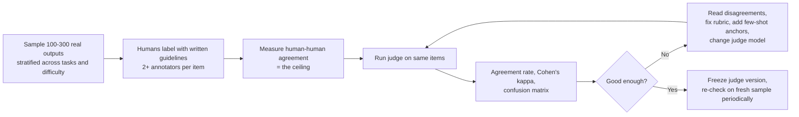
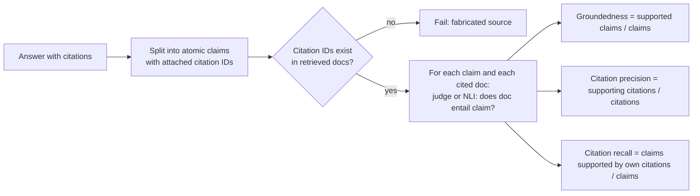
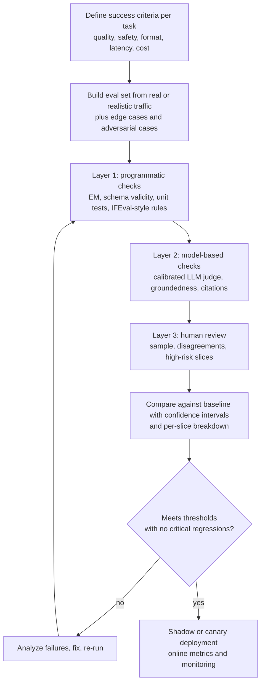

# Evaluating LLMs: Metrics, Benchmarks and LLM-as-a-Judge

> **Level:** Beginner to Advanced · **Study time:** ~110 min · **Prerequisites:** [Classification Metrics and Imbalanced Data](../01-classical-ml/04-classification-metrics-and-imbalanced-data.md), [Embeddings](../04-transformers/02-embeddings-from-one-hot-to-contextual.md), [Decoding Strategies](03-text-generation-and-decoding-strategies.md), [Hallucinations](06-hallucinations-and-grounding.md)

## Table of contents

- [Why this matters](#why-this-matters)
- [Why evaluating generative models is hard](#why-evaluating-generative-models-is-hard)
- [Exact match and token-level F1](#exact-match-and-token-level-f1)
- [BLEU: n-gram precision with a brevity penalty](#bleu-n-gram-precision-with-a-brevity-penalty)
- [ROUGE-N and ROUGE-L](#rouge-n-and-rouge-l)
- [Where n-gram metrics fail](#where-n-gram-metrics-fail)
- [Semantic similarity: embeddings and BERTScore](#semantic-similarity-embeddings-and-bertscore)
- [Task-specific metrics](#task-specific-metrics)
- [LLM-as-a-judge](#llm-as-a-judge)
- [Judge biases and how to mitigate them](#judge-biases-and-how-to-mitigate-them)
- [Calibrating a judge against human annotations](#calibrating-a-judge-against-human-annotations)
- [Public benchmarks and their limits](#public-benchmarks-and-their-limits)
- [Designing human evaluation](#designing-human-evaluation)
- [Evaluating instruction following, groundedness and citations](#evaluating-instruction-following-groundedness-and-citations)
- [Going deeper: evaluating an LLM before production](#going-deeper-evaluating-an-llm-before-production)
- [Common mistakes and misconceptions](#common-mistakes-and-misconceptions)
- [Interview questions and model answers](#interview-questions-and-model-answers)
- [Key takeaways](#key-takeaways)
- [Further reading](#further-reading)
- [Next](#next)

## Why this matters

Every LLM project eventually hits the same wall: "Is the new prompt (or model, or fine-tune) actually better, and is it good enough to ship?" Without a trustworthy answer, teams ship on vibes, regress silently, and cannot justify spending money on a bigger model. Evaluation is also the most common area where senior interviewers separate people who have built LLM products from people who have only called an API: they will ask which metric you would use, why BLEU is misleading for a chatbot, how you know your LLM judge is not lying to you, and how you would prove an answer is grounded in its sources. This chapter gives you the vocabulary, the math, the code and the judgment to answer all of those confidently.

## Why evaluating generative models is hard

Start with something easy. A **spam filter** is a classifier: for each email it outputs one of two labels, "spam" or "not spam". There is exactly one right answer per email, so you count how many it got right and compute accuracy, precision and recall (see [Classification Metrics](../01-classical-ml/04-classification-metrics-and-imbalanced-data.md)). Done.

Now ask an LLM: "Summarize this outage ticket in one sentence." Here are three outputs:

1. "The server crashed after the update."
2. "The update crashed the server."
3. "Following Tuesday's deploy, the API host went down."

All three can be correct. They share few words. Meanwhile, a fourth output, "The server did not crash after the update", shares most of its words with output 1 and means the opposite.

> **Analogy:** Grading a spam filter is like grading a multiple-choice exam with an answer key. Grading an LLM is like grading an essay exam: many different answers deserve full marks, and a fluent answer can still be wrong.

The core difficulties:

| Difficulty | What it means | Consequence |
|---|---|---|
| Many valid answers | One question has a huge space of correct outputs | Comparing to one **reference** (a human-written "gold" answer) under-rewards valid paraphrases |
| Surface vs meaning | Word overlap does not equal semantic equivalence | A single "not" flips meaning while barely changing word overlap |
| Multiple quality dimensions | Correctness, helpfulness, tone, format, safety, groundedness, length | One number hides trade-offs; you need several metrics |
| Non-determinism | With sampling (see [Decoding Strategies](03-text-generation-and-decoding-strategies.md)) the same prompt gives different outputs | Scores vary run to run; you need repeated runs or temperature 0 plus confidence intervals |
| Open-ended tasks | Chat, writing, reasoning have no fixed reference at all | You need **reference-free** evaluation: judges or humans |
| Cost of ground truth | Human labels are slow and expensive | You want cheap automated proxies, but must validate that they track humans |
| Distribution shift | Public test sets may not look like your users' traffic | A model that wins a leaderboard can lose on your task |

### A map of evaluation methods

Two questions organize every method in this chapter:

- **Reference-based vs reference-free.** A **reference-based** metric compares the output to a known good answer. A **reference-free** metric judges the output on its own, possibly using the input and source documents.
- **Who does the scoring?** A program (string matching, unit tests, schema validators), a model (embedding similarity, an LLM judge), or a human.

```text
                         Who scores?
                Program            Model                 Human
              +------------------+---------------------+--------------------+
 Reference-   | Exact match, F1, | Embedding cosine,   | "Does this match   |
 based        | BLEU, ROUGE,     | BERTScore,          |  the gold answer?" |
              | extraction F1    | reference-guided    |                    |
              |                  | LLM judge           |                    |
              +------------------+---------------------+--------------------+
 Reference-   | JSON/schema      | Pointwise/pairwise  | Likert ratings,    |
 free         | validity, unit   | LLM judge,          | side-by-side       |
              | tests (pass@k),  | NLI groundedness    | preference, Arena  |
              | format checks    | checks              | style votes        |
              +------------------+---------------------+--------------------+
   cheaper, faster, more reproducible  <------------>  closer to real quality
```

Two terms in the map are defined properly later: **NLI** (natural language inference) is a classifier that decides whether one text logically supports another, and **pass@k** scores code by running unit tests.

The senior skill is combining these: cheap programmatic checks wherever a property is verifiable, model-based checks for fuzzy properties, and a small amount of human labeling to keep the model-based checks honest.

> **Side note on perplexity.** **Perplexity** is the exponential of the average next-token cross-entropy on held-out text (covered in [Pretraining](01-pretraining-and-next-token-prediction.md) and [Cross-Entropy](../00-foundations/05-softmax-entropy-cross-entropy-and-kl-divergence.md)). It is an **intrinsic** metric: it measures how well a model predicts text, not whether its answers are helpful. It is useful for comparing pretraining checkpoints that share a tokenizer, and nearly useless for deciding whether a chatbot is ready to ship. This chapter is about **extrinsic** (task-level) evaluation.

### Our running example

Throughout the chapter we evaluate a fictional assistant for "Acme Cloud", built on a 7B open-weights model. It has four jobs:

1. **Short QA:** answer factual questions from the docs ("How long do refunds take?").
2. **Summarization:** turn outage tickets into one-sentence summaries.
3. **Extraction:** pull fields from invoices into JSON.
4. **Code:** write small Python helper functions for customers.

Each job needs a different metric, which is the first lesson: **the metric follows the task**.

## Exact match and token-level F1

### Exact match

**Intuition:** Did the model say exactly the right thing? Yes or no.

**Exact match (EM)** is 1 if the prediction equals the reference after **normalization** (a cleanup step), else 0. Average it over the dataset to get the EM rate. The standard normalization, popularized by the **SQuAD** question answering benchmark (Rajpurkar et al., 2016, "SQuAD: 100,000+ Questions for Machine Comprehension of Text"), is:

1. lowercase,
2. remove punctuation,
3. remove the articles "a", "an", "the",
4. collapse whitespace.

Without normalization, "Alice Smith." and "alice smith" would count as different, which is silly.

**When EM is right:** the answer space is small and canonical: a number, a date, a yes/no, a product ID, a multiple-choice letter, a classification label. GSM8K (a benchmark of grade-school math word problems, covered in the benchmarks section) is scored with EM on the final number.

**When EM is wrong:** any free text. "5 business days" vs "five business days" scores 0.

### Token-level F1

**Intuition:** Give partial credit for getting some of the words right.

**Token-level F1** treats the prediction and the reference as bags (multisets) of tokens (words, after normalization) and computes:

$$
\text{precision} = \frac{\text{overlap}}{|\text{pred}|}, \qquad
\text{recall} = \frac{\text{overlap}}{|\text{ref}|}, \qquad
F_1 = \frac{2 \cdot \text{precision} \cdot \text{recall}}{\text{precision} + \text{recall}}
$$

- $\text{overlap}$: the number of tokens the two bags share, counting duplicates at most as many times as they appear in both (a token appearing twice in each counts twice).
- $|\text{pred}|$: the number of tokens in the prediction.
- $|\text{ref}|$: the number of tokens in the reference.
- **Precision**: what fraction of what the model said was in the reference (penalizes extra words).
- **Recall**: what fraction of the reference the model covered (penalizes missing words).
- $F_1$: their **harmonic mean**, which is low if either one is low.

**Worked example.** Question: "Who signed the Acme refund policy?" Reference: "Alice Smith". Prediction: "Dr. Alice Smith".

1. Normalize the prediction: lowercase gives "dr. alice smith"; removing punctuation gives "dr alice smith". Tokens: [dr, alice, smith], so $|\text{pred}| = 3$.
2. Normalize the reference: [alice, smith], so $|\text{ref}| = 2$.
3. Overlap: alice and smith, so overlap = 2.
4. Precision = 2/3 ≈ 0.667. Recall = 2/2 = 1.0.
5. $F_1 = \dfrac{2 \times 0.667 \times 1.0}{0.667 + 1.0} = \dfrac{1.333}{1.667} = 0.8$. (Exactly: $\frac{4/3}{5/3} = 4/5$.)
6. EM = 0, because "dr alice smith" is not "alice smith".

F1 rewards the near-miss that EM throws away.

```python
# Pure Python, no installs needed. Mirrors the official SQuAD scoring logic.
import re
import string
from collections import Counter

def normalize(text: str) -> str:
    text = text.lower()
    text = "".join(ch for ch in text if ch not in string.punctuation)
    text = re.sub(r"\b(a|an|the)\b", " ", text)   # drop articles
    return " ".join(text.split())                   # collapse whitespace

def exact_match(pred: str, ref: str) -> int:
    return int(normalize(pred) == normalize(ref))

def token_f1(pred: str, ref: str) -> float:
    p, r = normalize(pred).split(), normalize(ref).split()
    overlap = sum((Counter(p) & Counter(r)).values())  # multiset intersection
    if overlap == 0:
        return 0.0
    precision, recall = overlap / len(p), overlap / len(r)
    return 2 * precision * recall / (precision + recall)

print(exact_match("Dr. Alice Smith", "Alice Smith"))  # 0
print(exact_match("alice smith.", "Alice Smith"))     # 1
print(token_f1("Dr. Alice Smith", "Alice Smith"))     # 0.8
```

When a question has several acceptable references (SQuAD has multiple annotator answers), take the **maximum** score over references.

> **Common mistake:** Reporting token F1 on long, free-form answers. A 60-word correct answer against a 10-word reference gets low precision just for being thorough. Token F1 is for short extractive answers.

## BLEU: n-gram precision with a brevity penalty

**BLEU** (Papineni et al., 2002, "BLEU: a Method for Automatic Evaluation of Machine Translation") was built for machine translation.

**Intuition:** A good translation reuses the same short word sequences that a human translator used. Count how many of the candidate's word chunks appear in the reference, and punish candidates that cheat by being very short.

First, a definition. An **n-gram** is a run of $n$ consecutive tokens. In "the cat sat", the **unigrams** (1-grams) are "the", "cat", "sat"; the **bigrams** (2-grams) are "the cat", "cat sat"; there is one **trigram** (3-gram): "the cat sat".

### The three ingredients

**1. Clipped (modified) n-gram precision.** For each n, count the candidate's n-grams that also appear in the reference, but **clip** each n-gram's count at the number of times it appears in the reference. Why clip? Without it, the candidate "the the the the the the" against reference "the cat is on the mat" would score a perfect 6/6 unigram precision. With clipping, "the" can match at most twice (the reference has two), so precision is 2/6 ≈ 0.333.

$$
p_n = \frac{\sum_{g \in \text{n-grams(cand)}} \min\big(\text{count}_{\text{cand}}(g),\ \text{count}_{\text{ref}}(g)\big)}{\sum_{g \in \text{n-grams(cand)}} \text{count}_{\text{cand}}(g)}
$$

- $g$: one distinct n-gram in the candidate.
- $\text{count}_{\text{cand}}(g)$: how often $g$ appears in the candidate.
- $\text{count}_{\text{ref}}(g)$: how often $g$ appears in the reference (with several references, the maximum over references).
- $p_n$: the clipped precision for n-grams of size $n$.

**2. Geometric mean over n = 1 to 4.** Combine $p_1, \dots, p_N$ (standard $N = 4$) with equal weights $w_n = 1/N$ using a **geometric mean** (multiply, then take the N-th root). A geometric mean is 0 if any factor is 0, which matters below.

**3. Brevity penalty (BP).** Precision alone rewards short outputs: the candidate "the cat" has perfect precision. BLEU therefore multiplies by a penalty when the candidate is shorter than the reference:

$$
\text{BP} = \begin{cases} 1 & \text{if } c > r \\ e^{\,1 - r/c} & \text{if } c \le r \end{cases}
\qquad\qquad
\text{BLEU} = \text{BP} \cdot \exp\left(\sum_{n=1}^{N} w_n \log p_n\right)
$$

- $c$: candidate length in tokens (summed over the whole corpus in corpus BLEU).
- $r$: reference length (with multiple references, the one closest in length to the candidate).
- $e$: Euler's number, about 2.718.
- $w_n$: weight for each n-gram order, usually $1/4$.
- $\exp(\sum w_n \log p_n)$: just the weighted geometric mean of the $p_n$ written with logs.

BLEU ranges from 0 to 1, usually reported as 0 to 100.

### Worked example

Reference: "the cat is on the mat" (r = 6). Candidate: "the cat sat on the mat" (c = 6).

**Unigrams (n = 1).** Candidate tokens: the, cat, sat, on, the, mat (6 total).
- "the": candidate has 2, reference has 2, clipped count 2.
- "cat": 1. "sat": reference has 0, so 0. "on": 1. "mat": 1.
- Matches = 2 + 1 + 0 + 1 + 1 = 5. So $p_1 = 5/6 \approx 0.833$.

**Bigrams (n = 2).** Candidate: "the cat", "cat sat", "sat on", "on the", "the mat" (5 total). Reference: "the cat", "cat is", "is on", "on the", "the mat".
- Matches: "the cat", "on the", "the mat" = 3. So $p_2 = 3/5 = 0.6$.

**Trigrams (n = 3).** Candidate: "the cat sat", "cat sat on", "sat on the", "on the mat" (4 total). Only "on the mat" is in the reference. $p_3 = 1/4 = 0.25$.

**4-grams (n = 4).** Candidate: "the cat sat on", "cat sat on the", "sat on the mat" (3 total). None appear in the reference ("the cat is on", "cat is on the", "is on the mat"). $p_4 = 0/3 = 0$.

**BLEU-4.** Because $p_4 = 0$, the geometric mean is 0, so BLEU-4 = 0. A single changed word in a six-word sentence wipes out the score. This is why **sentence-level** BLEU needs **smoothing** (adding a small value to zero counts) and why BLEU was designed as a **corpus-level** metric, where n-gram counts are summed over thousands of sentences before dividing.

**BLEU-2** (only n = 1, 2, weights 1/2 each):
- Geometric mean = $\sqrt{p_1 \times p_2} = \sqrt{0.833 \times 0.6} = \sqrt{0.5} \approx 0.707$.
- $c = r = 6$, so $c \le r$ and BP = $e^{1 - 6/6} = e^0 = 1$.
- BLEU-2 = 1 × 0.707 = **0.707**.

**Brevity penalty in action.** Candidate "the cat" (c = 2) against the same reference: $p_1 = 2/2 = 1$, $p_2 = 1/1 = 1$, so the geometric mean is 1. But BP = $e^{1 - 6/2} = e^{-2} \approx 0.135$, so BLEU-2 ≈ **0.135**. The penalty does its job.

```python
# From-scratch BLEU for one sentence pair (pure Python, no smoothing).
import math
from collections import Counter

def ngrams(tokens, n):
    return Counter(tuple(tokens[i:i + n]) for i in range(len(tokens) - n + 1))

def bleu(cand: list[str], ref: list[str], max_n: int = 4) -> float:
    log_sum = 0.0
    for n in range(1, max_n + 1):
        c_counts, r_counts = ngrams(cand, n), ngrams(ref, n)
        clipped = sum(min(cnt, r_counts[g]) for g, cnt in c_counts.items())
        total = max(sum(c_counts.values()), 1)
        if clipped == 0:
            return 0.0                      # geometric mean collapses to 0
        log_sum += math.log(clipped / total) / max_n
    c, r = len(cand), len(ref)
    bp = 1.0 if c > r else math.exp(1 - r / c)
    return bp * math.exp(log_sum)

ref = "the cat is on the mat".split()
print(bleu("the cat sat on the mat".split(), ref, max_n=4))  # 0.0
print(bleu("the cat sat on the mat".split(), ref, max_n=2))  # ~0.7071
print(bleu("the cat".split(), ref, max_n=2))                 # ~0.1353
```

In practice, use **sacreBLEU** (Post, 2018, "A Call for Clarity in Reporting BLEU Scores"), which fixes tokenization so scores are comparable across papers. Different tokenizers can change BLEU by whole points, so never compare BLEU numbers computed with different tooling.

```python
# pip install sacrebleu
import sacrebleu

hyps = ["the cat sat on the mat"]
refs = [["the cat is on the mat"]]     # list of reference streams
print(sacrebleu.corpus_bleu(hyps, refs).score)  # 0-100 scale; smoothing applied by default
```

> **Senior insight:** BLEU is precision-oriented: it asks "is what you said in the reference?" That matches translation, where a reference covers most acceptable content. Related MT metrics include METEOR (Banerjee and Lavie, 2005), which adds stemming and synonym matching, and chrF (Popović, 2015), which uses character n-grams and is more robust for morphologically rich languages.

## ROUGE-N and ROUGE-L

**ROUGE** (Lin, 2004, "ROUGE: A Package for Automatic Evaluation of Summaries") was built for summarization.

**Intuition:** A good summary should cover the important content of the human summary. So where BLEU asks "how much of what you said is in the reference?" (precision), ROUGE originally asked "how much of the reference did you cover?" (recall). Modern tools report precision, recall and F1 for each ROUGE variant; most papers quote the F1.

### ROUGE-N

**ROUGE-N** is n-gram overlap, like BLEU without the brevity penalty or the geometric mean:

$$
\text{ROUGE-N}_{\text{recall}} = \frac{\sum_{g} \min\big(\text{count}_{\text{cand}}(g), \text{count}_{\text{ref}}(g)\big)}{\sum_{g \in \text{n-grams(ref)}} \text{count}_{\text{ref}}(g)}
$$

- The numerator is the clipped overlap of n-grams (same as BLEU).
- The denominator is the number of n-grams in the **reference** (for precision, use the number in the candidate instead).
- ROUGE-1 uses unigrams, ROUGE-2 uses bigrams.

### ROUGE-L

**ROUGE-L** uses the **longest common subsequence (LCS)**: the longest sequence of tokens that appears in both texts **in the same order**, but not necessarily next to each other. For "A B C D" and "A C D", the LCS is "A C D" (length 3). LCS rewards keeping the right word order without demanding contiguous n-grams.

$$
R_{\text{LCS}} = \frac{\text{LCS}(\text{cand}, \text{ref})}{|\text{ref}|}, \quad
P_{\text{LCS}} = \frac{\text{LCS}(\text{cand}, \text{ref})}{|\text{cand}|}, \quad
F_{\text{LCS}} = \frac{2 P_{\text{LCS}} R_{\text{LCS}}}{P_{\text{LCS}} + R_{\text{LCS}}}
$$

- $\text{LCS}(\cdot,\cdot)$: length of the longest common subsequence in tokens.
- $|\text{ref}|$, $|\text{cand}|$: token counts.
- Lin's original paper uses a weighted F-measure with a parameter $\beta$; the plain F1 above ($\beta = 1$) is what common libraries report.

### Worked example (outage ticket summaries)

Reference (R): "the server crashed after the update" (6 tokens).
Candidate (C): "the update crashed the server" (5 tokens).

**ROUGE-1.** Clipped unigram overlap: "the" (C has 2, R has 2, so 2), "update" 1, "crashed" 1, "server" 1. Overlap = 5.
- Recall = 5/6 ≈ 0.833. Precision = 5/5 = 1.0.
- F1 = $\frac{2 \times 0.833 \times 1.0}{1.833} = \frac{1.667}{1.833} \approx 0.909$ (exactly 10/11).

**ROUGE-2.** R bigrams: "the server", "server crashed", "crashed after", "after the", "the update" (5). C bigrams: "the update", "update crashed", "crashed the", "the server" (4). Shared: "the server", "the update" = 2.
- Recall = 2/5 = 0.4. Precision = 2/4 = 0.5.
- F1 = $\frac{2 \times 0.4 \times 0.5}{0.9} = \frac{0.4}{0.9} \approx 0.444$.

**ROUGE-L.** Find the longest in-order common sequence. "the ... crashed ... the" works in both: in R positions 1, 3, 5; in C positions 1, 3, 4. Length 3. No common subsequence of length 4 exists (the `lcs_len` code below confirms it), so LCS = 3.
- Recall = 3/6 = 0.5. Precision = 3/5 = 0.6.
- F1 = $\frac{2 \times 0.5 \times 0.6}{1.1} = \frac{0.6}{1.1} \approx 0.545$.

```python
# From-scratch ROUGE-N and ROUGE-L (pure Python).
from collections import Counter

def ngrams(tokens, n):
    return Counter(tuple(tokens[i:i + n]) for i in range(len(tokens) - n + 1))

def prf(overlap, n_cand, n_ref):
    if overlap == 0:
        return 0.0, 0.0, 0.0
    p, r = overlap / n_cand, overlap / n_ref
    return p, r, 2 * p * r / (p + r)

def rouge_n(cand, ref, n):
    c, r = ngrams(cand, n), ngrams(ref, n)
    return prf(sum((c & r).values()), sum(c.values()), sum(r.values()))

def lcs_len(a, b):
    # Classic dynamic programming table: dp[i][j] = LCS of a[:i] and b[:j]
    dp = [[0] * (len(b) + 1) for _ in range(len(a) + 1)]
    for i in range(1, len(a) + 1):
        for j in range(1, len(b) + 1):
            if a[i - 1] == b[j - 1]:
                dp[i][j] = dp[i - 1][j - 1] + 1
            else:
                dp[i][j] = max(dp[i - 1][j], dp[i][j - 1])
    return dp[-1][-1]

def rouge_l(cand, ref):
    return prf(lcs_len(cand, ref), len(cand), len(ref))

R = "the server crashed after the update".split()
C = "the update crashed the server".split()
print(rouge_n(C, R, 1))  # (1.0, 0.833..., 0.909...)
print(rouge_n(C, R, 2))  # (0.5, 0.4, 0.444...)
print(rouge_l(C, R))     # (0.6, 0.5, 0.545...)
```

The standard library is Google's `rouge-score` package (also wrapped by Hugging Face `evaluate`):

```python
# pip install rouge-score
from rouge_score import rouge_scorer

scorer = rouge_scorer.RougeScorer(["rouge1", "rouge2", "rougeL"], use_stemmer=False)
scores = scorer.score(
    "the server crashed after the update",   # target (reference) comes FIRST
    "the update crashed the server",          # prediction second
)
print(scores["rouge2"].fmeasure)  # ~0.444
```

Notes on the library: `use_stemmer=True` maps "crashed" and "crash" to the same stem (changing scores); `rougeLsum` is a summary-level variant that splits on newlines and is the one usually reported for multi-sentence summaries.

## Where n-gram metrics fail

Now the payoff. Add a third candidate with the **opposite** meaning, "the server did not crash after the update" (8 tokens), and score it against the same reference:

| Candidate | Meaning | ROUGE-1 F1 | ROUGE-2 F1 | ROUGE-L F1 |
|---|---|---|---|---|
| "the update crashed the server" | Correct paraphrase | 0.909 | 0.444 | 0.545 |
| "the server did not crash after the update" | **Opposite** | 0.714 | **0.500** | **0.714** |

(Check the second row: unigram overlap is the ×2, server, after, update = 5, so P = 5/8, R = 5/6, F1 ≈ 0.714. Bigrams: 7 in the candidate, shared "the server", "after the", "the update" = 3, so P = 3/7, R = 3/5, F1 = 0.5. LCS is "the server after the update" = 5, so the same 0.714.)

The contradiction beats the correct paraphrase on ROUGE-2 and ROUGE-L. With stemming turned on, "crash" would match "crashed" and the contradiction would score even higher.

The failure modes, summarized:

| Failure | Example | Why it happens |
|---|---|---|
| Paraphrase penalized | "five business days" vs "5 business days" | Exact token matching, no notion of synonyms |
| Negation and factual flips rewarded | Table above | Overlap ignores the few words that carry meaning |
| Single reference | Valid alternate summary scored low | Real tasks have many correct outputs; one reference covers few |
| Length gaming | ROUGE recall rises with longer outputs | Recall rewards saying more |
| Weak correlation with humans for open-ended text | Chat answers, creative writing | Metrics were validated on MT and news summarization, not dialogue |
| Tokenization sensitivity | Different tokenizers, different scores | Scores not comparable across tools |

### When BLEU and ROUGE are still appropriate

- **Comparing systems at corpus level**, on a task with fairly constrained outputs (translation, headline generation, extractive-style summarization), using the same references and tooling for every system.
- **Regression detection**: a sudden 10-point ROUGE drop after a prompt change is a cheap alarm, even if the absolute value means little.
- **Training-time monitoring** where you need a fast, deterministic signal on thousands of examples.

They are a poor choice as the main quality metric for chat assistants, open-ended QA, reasoning, or anything where correctness hinges on a few words.

> **Interview tip:** A crisp line: "BLEU and ROUGE measure surface overlap with a reference. They are cheap, deterministic and fine for corpus-level comparison on constrained tasks like translation or summarization, but they do not measure meaning or factual correctness, so for an assistant I use them at most as a regression alarm."

## Semantic similarity: embeddings and BERTScore

**Intuition:** Instead of asking "did you use the same words?", ask "did you say the same thing?" Turn both texts into vectors that capture meaning, then measure how close the vectors are.

### Embedding cosine similarity

An **embedding** is a vector of numbers representing the meaning of a text, produced by a neural network (see [Embeddings](../04-transformers/02-embeddings-from-one-hot-to-contextual.md); sentence-level embedding models are covered in [Text Embeddings and Similarity Search](../08-rag/02-text-embeddings-and-similarity-search.md)). **Cosine similarity** measures the angle between two vectors:

$$
\cos(\mathbf{a}, \mathbf{b}) = \frac{\mathbf{a} \cdot \mathbf{b}}{\|\mathbf{a}\|\,\|\mathbf{b}\|}
$$

- $\mathbf{a}, \mathbf{b}$: the embedding vectors of the prediction and the reference.
- $\mathbf{a} \cdot \mathbf{b}$: dot product (multiply matching entries and sum).
- $\|\mathbf{a}\|$: the vector's length (square root of the sum of squared entries).
- Result: 1 means same direction (very similar meaning), around 0 means unrelated.

Tiny example: $\mathbf{a} = (1, 2)$, $\mathbf{b} = (2, 1)$. Dot product = 1·2 + 2·1 = 4. Lengths are both $\sqrt{5}$. Cosine = 4/5 = 0.8.

```python
# pip install sentence-transformers
from sentence_transformers import SentenceTransformer, util

model = SentenceTransformer("all-MiniLM-L6-v2")   # small, popular English model
ref = "Refunds take five business days."
preds = ["Refunds are processed within 5 business days.",
         "Refunds take five business weeks."]
emb_ref = model.encode(ref, convert_to_tensor=True)
emb_preds = model.encode(preds, convert_to_tensor=True)
print(util.cos_sim(emb_preds, emb_ref))  # both will likely be high, see the warning below
```

Run that and you will likely see that "five business weeks" scores close to the correct paraphrase. Embeddings capture topic and phrasing well but are weak on small factual differences: numbers, negations, units, names.

To use similarity as a pass/fail check you need a **threshold** ("pass if cosine ≥ 0.85"). The threshold is model-specific (each embedding model has its own similarity distribution), so pick it by checking against a few dozen human-labeled pairs, never by intuition.

### BERTScore

**BERTScore** (Zhang et al., 2020, "BERTScore: Evaluating Text Generation with BERT", ICLR 2020) works at the token level instead of the sentence level:

1. Run both texts through a pretrained encoder (such as BERT or RoBERTa) to get one **contextual embedding** per token.
2. Compute the cosine similarity between every reference token and every candidate token, giving a similarity matrix.
3. **Greedy matching:** each token is matched to its most similar token on the other side.

$$
R_{\text{BERT}} = \frac{1}{|x|} \sum_{x_i \in x} \max_{y_j \in y} \cos(x_i, y_j), \quad
P_{\text{BERT}} = \frac{1}{|y|} \sum_{y_j \in y} \max_{x_i \in x} \cos(x_i, y_j), \quad
F_{\text{BERT}} = \frac{2 P R}{P + R}
$$

- $x$: the reference tokens; $y$: the candidate tokens.
- $x_i, y_j$: the contextual embeddings of individual tokens.
- Recall: for each reference token, how well is it covered by some candidate token? Average.
- Precision: for each candidate token, how well is it supported by some reference token? Average.
- Optional extras in the paper: **IDF weighting** (rare words count more) and **baseline rescaling** (raw scores cluster in a narrow high range, so they are linearly rescaled to be more readable).

**Worked example (illustrative similarities).** Reference "cats are cute", candidate "kittens look adorable". Suppose the token cosine similarities are:

```text
               kittens   look   adorable
   cats         0.80     0.10     0.20
   are          0.10     0.40     0.15
   cute         0.25     0.50     0.85
```

- Recall uses **row** maxima: cats 0.80, are 0.40, cute 0.85. $R = (0.80 + 0.40 + 0.85)/3 = 2.05/3 \approx 0.683$.
- Precision uses **column** maxima: kittens 0.80, look 0.50, adorable 0.85. $P = (0.80 + 0.50 + 0.85)/3 = 2.15/3 \approx 0.717$.
- $F = \frac{2 \times 0.717 \times 0.683}{0.717 + 0.683} = \frac{0.980}{1.400} \approx 0.700$.

The same sentences share zero words, so ROUGE-1 would be 0 while BERTScore recognizes the paraphrase.

```python
# pip install bert-score
from bert_score import score

cands = ["the update crashed the server"]
refs = ["the server crashed after the update"]
P, R, F1 = score(cands, refs, lang="en", rescale_with_baseline=True)
print(F1)  # a tensor with one value per pair
```

### Comparing the reference-based family

| Metric | What it compares | Good for | Pros | Cons |
|---|---|---|---|---|
| Exact match | Whole normalized string | Labels, numbers, short canonical answers | Unambiguous, free | Zero partial credit |
| Token F1 | Bag of words | Short extractive QA | Partial credit, free | Fails on long or paraphrased answers |
| BLEU | Clipped n-gram precision + BP | Translation, corpus level | Standard, reproducible (with sacreBLEU) | Sentence-level instability, ignores meaning |
| ROUGE | n-gram / LCS overlap (recall-flavored) | Summarization | Standard, cheap | Rewards length, ignores meaning |
| Embedding cosine | Sentence vectors | Paraphrase-tolerant matching, dedup, clustering of failures | Handles paraphrase | Blind to negation, numbers; threshold tuning |
| BERTScore | Token-level contextual embeddings | Paraphrase-heavy generation | Better human correlation than n-grams in its paper's experiments | Needs a model, still weak on factual flips |

> **Senior insight:** None of these metrics checks **truth**. They check **closeness to a reference**. If your reference is wrong or incomplete, they faithfully reward matching the error. For factual correctness you need either a programmatic check (EM on a number, unit tests) or a judge (model or human) that reasons about the content.

## Task-specific metrics

The best metric is often not a general text metric at all, but a direct check of the property you care about. If you can verify something with code, do it with code.

### pass@k for code generation

For code, "does it look like the reference?" is the wrong question. The right one is "**does it run and pass the tests?**" **Functional correctness** means the generated code passes a set of unit tests.

**pass@k** asks: if the model generates $k$ samples for a problem, what is the probability that **at least one** passes all tests? It was popularized by the Codex paper (Chen et al., 2021, "Evaluating Large Language Models Trained on Code"), which also introduced the **HumanEval** benchmark. pass@1 is the "one shot, it must work" number; pass@10 or pass@100 matter when a user or system can try several candidates (for example, generate 10 and keep the first that passes the tests).

The naive way is to generate exactly $k$ samples and check if any pass, but that has high variance. Instead, generate $n \ge k$ samples, count the $c$ correct ones, and use the **unbiased estimator**:

$$
\text{pass@}k = \mathbb{E}_{\text{problems}}\left[1 - \frac{\binom{n-c}{k}}{\binom{n}{k}}\right]
$$

- $n$: number of samples generated per problem.
- $c$: number of those samples that pass all unit tests.
- $k$: the budget of attempts you are scoring.
- $\binom{a}{b}$: "a choose b", the number of ways to choose $b$ items from $a$.
- $\binom{n-c}{k} / \binom{n}{k}$: the probability that a random set of $k$ samples (out of the $n$) contains **only failures**. One minus that is the probability of at least one success.
- $\mathbb{E}_{\text{problems}}$: average over all problems.

**Worked example.** One problem, $n = 10$ samples, $c = 3$ pass.

- pass@1 = $1 - \binom{7}{1}/\binom{10}{1} = 1 - 7/10 = 0.3$. (pass@1 is just the fraction correct, $c/n$.)
- pass@5 = $1 - \binom{7}{5}/\binom{10}{5}$. $\binom{7}{5} = 21$, $\binom{10}{5} = 252$. $21/252 = 0.0833$. So pass@5 ≈ **0.917**.
- Compare with the tempting plug-in formula $1 - (1 - c/n)^k = 1 - 0.7^5 = 1 - 0.168 = 0.832$. It substitutes the noisy estimate $\hat{p} = c/n$ into the nonlinear function $1 - (1 - p)^k$; because $(1 - p)^k$ is convex in $p$, Jensen's inequality makes the plug-in biased low on average, and the Codex paper shows it underestimates pass@k. The combinatorial estimator averages over all size-$k$ subsets of your $n$ samples, and its expectation equals the true pass@k $= 1 - (1 - p)^k$ exactly (where $p$ is the model's true per-sample success probability on that problem).
- If $n - c < k$ (for example $n = 10$, $c = 3$, $k = 8$), every set of 8 must include a correct sample, so pass@8 = 1.

Binomial coefficients get huge, so the Codex paper computes the same quantity as a numerically stable product:

```python
import numpy as np

def pass_at_k(n: int, c: int, k: int) -> float:
    """Unbiased pass@k estimator from Chen et al., 2021."""
    if n - c < k:
        return 1.0
    # 1 - C(n-c, k) / C(n, k) == 1 - prod_{i=n-c+1}^{n} (1 - k / i)
    return 1.0 - float(np.prod(1.0 - k / np.arange(n - c + 1, n + 1)))

print(pass_at_k(10, 3, 1))  # ~0.3
print(pass_at_k(10, 3, 5))  # ~0.9167
```

> **Common mistake:** Running untrusted generated code on your laptop or CI host. Always execute in a sandbox (container with no network, CPU/memory/time limits). HumanEval's own harness ships with execution disabled by default for this reason.

### JSON and schema validity rate

Our extraction job must return JSON matching a schema. Measure in layers, because each layer catches a different bug (see [Structured Outputs](05-structured-outputs-and-function-calling.md)):

1. **Parse rate:** fraction of outputs that are syntactically valid JSON.
2. **Schema validity rate:** fraction that also match the **JSON Schema** (required fields present, correct types, allowed enum values).
3. **Field accuracy:** fraction of fields whose values are correct (next subsection).

```python
# pip install jsonschema
import json
from jsonschema import validate, ValidationError

SCHEMA = {
    "type": "object",
    "properties": {
        "vendor": {"type": "string"},
        "total": {"type": "number"},
        "date": {"type": "string", "pattern": r"^\d{4}-\d{2}-\d{2}$"},
    },
    "required": ["vendor", "total", "date"],
}

def check(output: str) -> str:
    try:
        obj = json.loads(output)
    except json.JSONDecodeError:
        return "invalid_json"
    try:
        validate(obj, SCHEMA)
    except ValidationError:
        return "schema_violation"
    return "ok"

outputs = ['{"vendor": "Acme", "total": 120.0, "date": "2026-03-01"}',
           '{"vendor": "Acme", "total": "120", "date": "2026-03-01"}',   # wrong type
           'Sure! Here is the JSON: {"vendor": "Acme"}']                  # chatty prefix
results = [check(o) for o in outputs]
print(results)  # ['ok', 'schema_violation', 'invalid_json']
print(sum(r == "ok" for r in results) / len(results))  # schema validity rate ~0.333
```

With constrained decoding or a provider's strict structured-output mode, parse and schema validity approach 100%, but **field accuracy does not**: a perfectly valid JSON object can contain the wrong total.

### Classification metrics for extraction

Extraction is classification in disguise: each (field, value) pair the model outputs is a prediction that is either right or wrong. So we reuse **precision**, **recall** and **F1** from [Classification Metrics](../01-classical-ml/04-classification-metrics-and-imbalanced-data.md):

- **True positive (TP):** a predicted pair that matches a gold pair.
- **False positive (FP):** a predicted pair that is not in the gold set (wrong value or invented field).
- **False negative (FN):** a gold pair the model did not produce correctly.

**Worked example.** Gold: {vendor: "Acme", total: "120.00", date: "2026-03-01"}. Predicted: {vendor: "Acme", total: "120", date: "2026-03-01", currency: "USD"}.

With strict string matching:
- TP = 2 (vendor, date). FP = 2 (total "120" does not equal "120.00"; currency is not in gold). FN = 1 (gold total not matched).
- Precision = 2/4 = 0.5. Recall = 2/3 ≈ 0.667. F1 = $\frac{2 \times 0.5 \times 0.667}{1.167} \approx 0.571$ (exactly 4/7).

After **normalizing** numbers (parse both as 120.0):
- TP = 3, FP = 1 (currency), FN = 0.
- Precision = 3/4 = 0.75. Recall = 1.0. F1 = $\frac{2 \times 0.75 \times 1.0}{1.75} \approx 0.857$ (exactly 6/7).

The model did not change; the metric did. Normalization rules (numbers, dates, casing, whitespace, currency symbols) must be written down and versioned with the eval set.

Two ways to aggregate across many documents:

| Aggregation | How | Use when |
|---|---|---|
| **Micro-averaged** F1 | Pool all TP/FP/FN across documents and fields, then compute F1 | You care about overall pair-level accuracy |
| **Macro-averaged** F1 (per field) | Compute F1 per field, then average | Rare but important fields (like "IBAN") must not be drowned out by easy ones |
| **Document-level accuracy** | Fraction of documents with every field correct | Downstream automation needs the whole record right |

> **Senior insight:** Report per-field metrics, not just an average. "Overall F1 0.93" can hide "total amount F1 0.71", and the total amount is the field that moves money.

## LLM-as-a-judge

Many quality dimensions (helpfulness, correctness of a long explanation, tone, completeness) cannot be checked by code and have no single reference. Human review handles them well but is slow and expensive. **LLM-as-a-judge** means using a strong LLM, prompted with explicit criteria, to score or compare outputs. The approach was studied systematically by Zheng et al., 2023 ("Judging LLM-as-a-Judge with MT-Bench and Chatbot Arena"), who found that a strong judge (GPT-4 at the time) agreed with human preferences at a rate comparable to how often humans agree with each other on their data, while also documenting the biases discussed below.

> **Analogy:** A judge model is like a teaching assistant grading essays with the professor's rubric. Fast and scalable, mostly consistent, but you must spot-check their grading against the professor before you trust the grades.

There are three main patterns.

### 1. Pointwise rubric scoring

The judge sees one output (plus the input and possibly context) and assigns a score on a defined scale.

```text
You are grading a customer-support answer for Acme Cloud.

[Question]
{question}

[Answer]
{answer}

Score CORRECTNESS on this rubric:
1 = Contains a factual error that would mislead the customer.
2 = Mostly wrong or missing the key fact.
3 = Key fact correct but important caveat missing.
4 = Correct and complete, minor wording issues.
5 = Correct, complete, and states relevant conditions.

First write one or two sentences of reasoning, then the score.
Respond only with JSON: {"reasoning": "...", "score": <1-5>}
```

Design choices that matter:

- **Specific, observable rubric anchors.** "3 = key fact correct but important caveat missing" is far more reliable than "3 = okay".
- **One criterion per call** (or clearly separated criteria). Asking for "overall quality" mixes dimensions and hides the reason for a score.
- **Reasoning before the score.** Generating the score last lets the judge condition on its own analysis (a short form of **chain-of-thought**: writing out reasoning steps before the answer). G-Eval (Liu et al., 2023, "G-Eval: NLG Evaluation using GPT-4 with Better Human Alignment") uses chain-of-thought evaluation steps and a form-filling output.
- **Binary or small scales** when possible. Pass/fail is easier to calibrate and to agree on than a 10-point scale.
- **Probability-weighted scores** (from G-Eval) if your API exposes token probabilities: instead of taking the single sampled score, compute $\text{score} = \sum_{s} s \cdot p(s)$. Example: $p(3) = 0.2, p(4) = 0.5, p(5) = 0.3$ gives $0.6 + 2.0 + 1.5 = 4.1$, a finer-grained score than "4".

### 2. Pairwise comparison

The judge sees two outputs for the same input (A and B) and says which is better, or tie. This is how MT-Bench pairwise mode and Chatbot Arena style evaluations work (both are described in the benchmarks section below), and it mirrors how preference data for RLHF is collected (see [Instruction Tuning, RLHF and DPO](02-instruction-tuning-rlhf-and-dpo.md)).

Why pairwise? Relative judgments are easier and more consistent than absolute ones, for humans and models alike. "Which of these two answers is better?" is a sharper question than "Is this a 3 or a 4?". The output is a **win rate**:

$$
\text{win rate}(A \text{ vs } B) = \frac{\text{wins}_A + 0.5 \cdot \text{ties}}{\text{total comparisons}}
$$

- $\text{wins}_A$: comparisons where A was preferred.
- $\text{ties}$: comparisons judged equal, counted as half a win.

Example: over 200 prompts, the new prompt wins 90, loses 70, ties 40. Win rate = (90 + 0.5 × 40)/200 = 110/200 = 0.55.

### 3. Reference-guided judging

The judge also gets a reference answer (or the key facts) and checks the output against it, for example: "Does the answer convey the same key facts as the reference? Extra correct detail is fine; contradictions are failures." Zheng et al. found reference guidance sharply cut judge errors on math questions, where judges otherwise get fooled by confident wrong answers. It combines the semantic flexibility of a judge with the grounding of a reference, and it is often the best default when you have gold answers for free-text QA.

| Pattern | Input to judge | Output | Best for | Weaknesses |
|---|---|---|---|---|
| Pointwise rubric | Question, one answer, rubric | Score or pass/fail | Absolute quality bars, monitoring, regression tracking | Scale drift, leniency, scores hard to compare across judge versions |
| Pairwise | Question, two answers | A / B / tie | Choosing between two prompts or models | Position bias, cost grows with number of systems, no absolute bar |
| Reference-guided | Question, answer, reference | Score or match / no match | Free-text QA with gold answers, math | Needs references; may punish valid answers the reference missed |

### A minimal judge in code

Provider SDKs change often, so this code isolates the call in one function. The OpenAI-style call shown is realistic as of the mid-2020s but check the current SDK docs; the model name is a placeholder.

```python
import json

def call_llm(prompt: str) -> str:
    """Wrap your provider here. Example with the OpenAI Python SDK (version-dependent):
    from openai import OpenAI
    client = OpenAI()
    resp = client.chat.completions.create(
        model="YOUR_JUDGE_MODEL",
        messages=[{"role": "user", "content": prompt}],
        temperature=0,
    )
    return resp.choices[0].message.content
    """
    raise NotImplementedError

PAIRWISE_PROMPT = """Compare two answers to the user's question for correctness and helpfulness.
Ignore length and style unless they affect usefulness.
[Question]
{q}
[Answer A]
{a}
[Answer B]
{b}
Respond only with JSON: {{"reasoning": "...", "winner": "A" | "B" | "tie"}}"""

def judge_once(q: str, a: str, b: str) -> str:
    raw = call_llm(PAIRWISE_PROMPT.format(q=q, a=a, b=b))
    return json.loads(raw)["winner"]

def judge_pair(q: str, ans1: str, ans2: str) -> str:
    """Position-debiased pairwise judgment: run both orders, keep only consistent verdicts."""
    first = judge_once(q, ans1, ans2)                      # ans1 shown as A
    second = judge_once(q, ans2, ans1)                     # ans1 shown as B
    second_mapped = {"A": "B", "B": "A", "tie": "tie"}[second]
    return first if first == second_mapped else "tie"      # disagreement means no clear winner
```

In production you would add retries, JSON parse error handling, logging of the judge's reasoning, and caching keyed on (judge model version, prompt version, inputs).

## Judge biases and how to mitigate them

LLM judges have systematic biases. Knowing them by name is an interview staple.

| Bias | What happens | Evidence | Mitigations |
|---|---|---|---|
| **Position bias** | Prefers the answer in a particular slot (often the first) regardless of content | Zheng et al., 2023; Wang et al., 2023, "Large Language Models are not Fair Evaluators" | Run both orders and require consistency (count disagreement as tie); randomize order; report the swap-consistency rate |
| **Verbosity (length) bias** | Prefers longer, more detailed-looking answers even when not better | Zheng et al., 2023; Dubois et al., 2024, "Length-Controlled AlpacaEval" | Rubric says length is not a merit; penalize unrequested content; length-controlled win rates; compare at matched lengths |
| **Self-preference (self-enhancement)** | Rates outputs from itself or its own model family higher | Zheng et al., 2023; Panickssery et al., 2024, "LLM Evaluators Recognize and Favor Their Own Generations" | Use a judge from a different family than the generator; use a panel of judges from several families |
| **Leniency** | Scores cluster at the top of the scale; few failures flagged | Common in practice with pointwise scoring | Binary pass/fail with concrete failure criteria; few-shot examples of failing answers; calibrate thresholds against humans |
| **Style over substance** | Confident, well-formatted wrong answers score well | Zheng et al. note judges can be misled on math and reasoning | Reference-guided judging; give the judge the source documents; separate correctness from style criteria |
| **Limited capability** | Judge cannot verify what it cannot solve (hard math, niche domain, long code) | Zheng et al., 2023 | Use programmatic checks (tests, calculators); stronger judge; domain-expert humans |
| **Prompt sensitivity and drift** | Small wording changes or a judge model upgrade shift scores | Common in practice | Version the judge prompt and model; re-calibrate on every change; pin model versions |

A few mitigations deserve more detail:

- **Swap order.** Shown in `judge_pair`. Also report the fraction of pairs where the two orders disagree; a high rate means the judge is unreliable for this task.
- **Length control.** Length-controlled AlpacaEval fits a regression that predicts the judge's preference from a few terms, one of which is the length difference between the two answers, then reports the win rate with the length difference set to zero: "who would win if both answers were equally long?"
- **Few-shot anchors.** Include 2 to 4 graded examples in the judge prompt, including at least one failure, so the judge sees where the bar is.
- **Multiple judges.** Majority vote or average across judges from different model families. Verga et al., 2024 ("Replacing Judges with Juries: Evaluating LLM Generations with a Panel of Diverse Models") argue that a panel of smaller models can match or beat a single large judge at lower cost.
- **Decompose.** Ask narrow yes/no questions ("Does the answer state the refund window?") instead of one holistic score. They are more reliable and make failures debuggable.
- **Fine-tuned judges.** Open evaluator models such as Prometheus (Kim et al., 2023, "Prometheus: Inducing Fine-grained Evaluation Capability in Language Models") help when data cannot leave your infrastructure or judging must be cheaper.

> **Common mistake:** Using the same model as both generator and judge, then celebrating a high score. You have measured, in part, how much the model likes its own style.

## Calibrating a judge against human annotations

A judge is a measurement instrument. Before you trust any instrument, you calibrate it against a known standard. Here the standard is **human annotations**: labels from people who understand the task.



### Step 1: Agreement rate, and why it is not enough

**Agreement rate** (also called observed agreement) is the fraction of items where judge and human give the same label. It is easy to understand but misleading when labels are imbalanced. If 90% of answers are "pass", a lazy judge that always says "pass" agrees 90% of the time while detecting zero failures.

### Step 2: Cohen's kappa

**Cohen's kappa** (Cohen, 1960) measures agreement **beyond what chance would produce** given each rater's label frequencies:

$$
\kappa = \frac{p_o - p_e}{1 - p_e}
$$

- $p_o$: observed agreement, the fraction of items where the two raters agree.
- $p_e$: expected agreement by chance: if each rater labeled randomly but kept their own label frequencies, how often would they agree? For two labels, $p_e = p_{\text{H,pass}} \cdot p_{\text{J,pass}} + p_{\text{H,fail}} \cdot p_{\text{J,fail}}$.
- $\kappa = 1$: perfect agreement. $\kappa = 0$: no better than chance. $\kappa < 0$: worse than chance.

A commonly cited (and admittedly arbitrary) interpretation scale from Landis and Koch (1977): 0.21-0.40 fair, 0.41-0.60 moderate, 0.61-0.80 substantial, 0.81-1.00 almost perfect.

**Worked example (illustrative numbers).** Humans and the judge each label 100 Acme support answers as pass or fail:

```text
                     Judge: pass   Judge: fail   Human total
   Human: pass           60            10            70
   Human: fail           15            15            30
   Judge total           75            25           100
```

1. Observed agreement: $p_o = (60 + 15)/100 = 0.75$.
2. Human pass rate = 70/100 = 0.70, fail rate = 0.30. Judge pass rate = 75/100 = 0.75, fail rate = 0.25.
3. Chance agreement: $p_e = 0.70 \times 0.75 + 0.30 \times 0.25 = 0.525 + 0.075 = 0.60$.
4. $\kappa = \frac{0.75 - 0.60}{1 - 0.60} = \frac{0.15}{0.40} = 0.375$.

75% agreement sounds decent; $\kappa = 0.375$ says "fair" at best. Most of the 75% would happen by chance given how often both raters say "pass".

### Step 3: Confusion analysis

Look at **which way** the judge is wrong, treating "fail" (a bad answer) as the positive class, since catching bad answers is the judge's job:

- The judge flagged 25 answers as fail; 15 really were. **Precision for fail** = 15/25 = 0.60.
- Humans found 30 failures; the judge caught 15. **Recall for fail** = 15/30 = 0.50.
- The judge passed 15 answers humans failed, but failed only 10 that humans passed. The dominant error is **leniency**: half of the bad answers slip through.

Then **read the 25 disagreements**. In practice you will find patterns like "judge passes answers that state the right refund window but for the wrong plan tier" or "judge fails correct answers that use a different but valid procedure". Each pattern suggests a rubric fix.

### Step 4: Iterate the rubric

Typical fixes: add the missed failure pattern as an explicit rubric line, add a failing few-shot example, switch to reference-guided judging, split one criterion into two, or try a stronger judge. Then **re-measure on a held-out set of labeled items** that you did not use while editing the rubric; otherwise you overfit the rubric to the examples you stared at.

Suppose after one iteration (illustrative) the table becomes 65 / 5 / 5 / 25 (same layout as before): $p_o = 0.90$; both raters pass 70%, so $p_e = 0.70 \times 0.70 + 0.30 \times 0.30 = 0.49 + 0.09 = 0.58$; $\kappa = (0.90 - 0.58)/(1 - 0.58) = 0.32/0.42 \approx 0.76$. Substantial agreement. Fail recall is now 25/30 ≈ 0.83.

```python
# pip install scikit-learn
from sklearn.metrics import cohen_kappa_score, confusion_matrix

# Rebuild the 100 labels from the first table above.
human = ["pass"] * 70 + ["fail"] * 30
judge = ["pass"] * 60 + ["fail"] * 10 + ["pass"] * 15 + ["fail"] * 15

print(cohen_kappa_score(human, judge))                            # 0.375
print(confusion_matrix(human, judge, labels=["pass", "fail"]))    # [[60 10] [15 15]]
```

### Beyond binary labels

| Situation | Statistic |
|---|---|
| Two raters, categorical labels | Cohen's kappa |
| Ordinal scale (1-5), two raters | **Weighted kappa** (quadratic weights: being off by 1 costs less than being off by 4), or Spearman / Kendall rank correlation |
| Continuous scores vs human scores | Spearman or Pearson correlation; also check the mean offset (a judge can be perfectly correlated but 1 point harsher) |
| Many raters, possibly missing labels | Krippendorff's alpha (handles missing labels and ordinal scales); Fleiss' kappa if every item has the same number of raters |
| Pairwise preferences | Agreement rate on non-tie pairs, plus swap consistency |

> **Senior insight:** The **ceiling** for judge-human agreement is human-human agreement. If two trained annotators reach only $\kappa = 0.55$ on "helpfulness", demanding $\kappa = 0.8$ from the judge is impossible, and the real problem is that the task definition is ambiguous. Fix the guidelines first.

> **Interview tip:** Also say you will **re-calibrate** whenever the judge model, judge prompt, or the product's traffic changes, and on a schedule (say quarterly, or monthly for fast-moving products), because judges drift silently.

## Public benchmarks and their limits

A **benchmark** is a fixed, public dataset plus a scoring protocol, used to compare models. They are useful for shortlisting models; they are not a substitute for evaluating on your task.

| Benchmark | What it tests | Format and metric | Notes |
|---|---|---|---|
| **MMLU** (Hendrycks et al., 2021, "Measuring Massive Multitask Language Understanding") | Broad knowledge across 57 subjects (STEM, humanities, law, medicine) | About 14,000 four-option multiple-choice test questions; accuracy | Largely saturated by frontier models; re-annotation work (MMLU-Redux, Gema et al., 2024) found erroneous questions; harder successors such as MMLU-Pro (Wang et al., 2024) exist |
| **GSM8K** (Cobbe et al., 2021, "Training Verifiers to Solve Math Word Problems") | Multi-step grade-school arithmetic reasoning | About 8,500 word problems (test set about 1,300); exact match on the final number | Saturated at the frontier; contamination concerns (see GSM1k, Zhang et al., 2024, "A Careful Examination of Large Language Model Performance on Grade School Arithmetic") |
| **HumanEval** (Chen et al., 2021) | Python function synthesis | 164 hand-written problems with unit tests; pass@k | Small, simple, widely leaked into training data; extended versions add more tests (EvalPlus, Liu et al., 2023) |
| **MT-Bench** (Zheng et al., 2023) | Multi-turn conversation and instruction following | 80 two-turn questions across 8 categories; strong LLM judge gives 1-10 scores | Tests chat quality with an LLM judge, so inherits judge biases |
| **Chatbot Arena** (Zheng et al., 2023; Chiang et al., 2024) | Overall human preference in open chat | Crowdsourced blind pairwise votes, aggregated into Elo-style ratings with a Bradley-Terry model | Reflects real user prompts; skewed toward the people who visit it, sensitive to style and length; the project has since been rebranded LMArena |
| **IFEval** (Zhou et al., 2023, "Instruction-Following Evaluation for Large Language Models") | Following verifiable instructions ("write at least 300 words", "no commas") | Programmatic checks; prompt-level and instruction-level accuracy | Covered in the instruction-following section below |

**How Arena ratings work, briefly.** A **Bradley-Terry model** assigns each model a rating so that the probability that A beats B depends only on the rating difference. On the familiar Elo scale:

$$
P(A \text{ beats } B) = \frac{1}{1 + 10^{(R_B - R_A)/400}}
$$

- $R_A, R_B$: the two models' ratings.
- 400: a scale constant inherited from chess Elo.

Example: if $R_A - R_B = 100$, then $P = 1/(1 + 10^{-0.25}) = 1/(1 + 0.562) \approx 0.64$. A 100-point lead means winning about 64% of head-to-head votes, not "being 100 points better at everything".

### Why benchmark scores mislead

| Limit | Explanation | What to do |
|---|---|---|
| **Contamination** | Test questions leaked into pretraining data, so the model may have memorized answers (see [Data Contamination and Memorization](09-catastrophic-forgetting-contamination-and-memorization.md)) | Prefer benchmarks with private or fresh test sets; check for drops on rephrased versions; trust your own private eval set most |
| **Saturation** | Top models all score near the ceiling, so differences are within noise | Use harder successors; look at confidence intervals |
| **Task mismatch** | MMLU multiple-choice knowledge says little about your support bot's tone, tool use or grounding | Build a task-specific eval set from real traffic |
| **Prompt and harness sensitivity** | Few-shot count, prompt template, answer extraction regex and chat template change scores by several points | Compare models only under one harness (for example EleutherAI's lm-evaluation-harness) with identical settings |
| **Reported vs reproduced** | Vendors pick favorable settings | Re-run key benchmarks yourself, or rely on independent leaderboards |
| **Goodhart's law** | "When a measure becomes a target, it ceases to be a good measure": training toward a benchmark inflates it | Treat public scores as weak priors, not decisions |

> **Senior insight:** Benchmarks answer "Which 3 to 5 models are worth testing?". Your own eval set answers "Which one do we ship?". In interviews, say both halves.

HELM (Liang et al., 2022, "Holistic Evaluation of Language Models") is worth knowing as the canonical argument that evaluation must be multi-metric (accuracy, calibration, robustness, fairness, efficiency) and multi-scenario rather than one leaderboard number.

## Designing human evaluation

Human evaluation is the ground truth that everything else is calibrated against, so it must be designed carefully. Bad human eval is just expensive noise.

**1. Decide the question.** Absolute ("Is this answer acceptable to send to a customer?") or relative ("Which answer is better?"). Pairwise preference is more reliable for comparing systems; absolute pass/fail is needed to set a shipping bar.

**2. Choose the scale.**

| Scale | Pros | Cons |
|---|---|---|
| Binary pass/fail with defined failure reasons | Highest agreement, directly actionable | Loses nuance |
| **Likert** scale (1-5 with labeled points) | Captures degrees of quality | Raters use scales differently; lower agreement |
| Pairwise preference (A / B / tie) | Easier, more consistent judgments | No absolute bar; many pairs needed for many systems |
| Error taxonomy tagging ("hallucination", "missed step", "wrong tone") | Tells engineers what to fix | Needs well-trained annotators |

**3. Write guidelines** with definitions, examples per label (especially borderline cases) and a tie-break policy. Update them whenever annotators disagree.

**4. Pick annotators.** Domain experts for medical, legal or technical correctness; trained generalists for tone and clarity. User thumbs up/down is cheap but noisy and biased: people mostly rate when annoyed.

**5. Remove bias from the setup.** **Blind** the annotators (they must not know which system produced which output) and randomize order and position.

**6. Measure agreement.** Double-annotate a subset, compute kappa or alpha, and adjudicate disagreements. Low agreement means unclear guidelines or a genuinely subjective task.

**7. Size the sample.** For a pass rate $\hat{p}$ measured on $n$ independent items, the 95% confidence interval is roughly:

$$
\hat{p} \pm 1.96 \sqrt{\frac{\hat{p}(1 - \hat{p})}{n}}
$$

- $\hat{p}$: the observed pass rate.
- $n$: number of items rated.
- 1.96: the number of standard errors covering 95% of a normal distribution.

Example: $\hat{p} = 0.80$ on $n = 100$: $\sqrt{0.8 \times 0.2 / 100} = \sqrt{0.0016} = 0.04$; $1.96 \times 0.04 \approx 0.078$. So the true rate is somewhere around 72% to 88%. With $n = 400$ the margin halves to about ±3.9 points. Quadrupling the sample halves the uncertainty. To detect a 2-point improvement you need thousands of items, or a **paired** design (both systems on the same items), which removes item-difficulty noise.

**8. Close the loop.** Every human label is also a calibration point for your judge and a candidate regression test (the next chapter shows how to store and reuse them).

## Evaluating instruction following, groundedness and citations

These three properties come up constantly in production and in interviews. Each has a "verifiable part" (check with code) and a "fuzzy part" (check with a judge or NLI model).

### Instruction following

**Instruction following** is whether the output obeys the explicit constraints in the prompt: length limits, format, language, required or forbidden content, tone, steps.

The IFEval approach (Zhou et al., 2023) is the key idea: **pick instructions that a program can verify**, such as "answer in fewer than 50 words", "respond in JSON", "include the word 'refund'", "use no more than 3 bullet points". Then:

- **Instruction-level accuracy** = instructions followed / total instructions.
- **Prompt-level accuracy** = prompts where **all** instructions were followed / total prompts.

**Worked example.** Four prompts with 3, 2, 3 and 2 instructions (10 total). The model follows 3/3, 2/2, 2/3 and 1/2.

- Instruction-level accuracy = (3 + 2 + 2 + 1)/10 = 8/10 = 0.8.
- Prompt-level accuracy = 2 prompts fully followed / 4 = 0.5.

Prompt-level is the stricter number and usually the one that matters: a user who asked for JSON under 50 words is unhappy if either constraint breaks.

```python
import json

def under_n_words(text: str, n: int) -> bool:
    return len(text.split()) < n

def contains_keyword(text: str, kw: str) -> bool:
    return kw.lower() in text.lower()

def is_json(text: str) -> bool:
    try:
        json.loads(text)
        return True
    except json.JSONDecodeError:
        return False

# Each prompt carries a list of (check_function, args) pairs.
case = {
    "output": '{"answer": "Refunds take 5 business days."}',
    "checks": [(is_json, ()), (under_n_words, (50,)), (contains_keyword, ("refund",))],
}
results = [fn(case["output"], *args) for fn, args in case["checks"]]
print(results, all(results))  # [True, True, True] True
```

For instructions code cannot verify ("be empathetic", "do not give legal advice", "follow the system prompt's persona"), use a judge with **one narrow yes/no question per instruction**, calibrated as described above. Also test **instruction conflicts and priority**: does the model keep following the system prompt when a user message tries to override it? That overlaps with prompt injection testing (see [LLM Safety and Guardrails](13-llm-safety-guardrails-and-responsible-ai.md)).

### Groundedness

**Groundedness** (often called **faithfulness** in RAG) means every claim in the answer is supported by the provided source context. It is different from **factuality** (being true in the world): an answer can be grounded in an outdated document and still be wrong, or be true but not supported by the given sources. For a RAG system, groundedness is what you can control and audit. (Why models produce unsupported claims is covered in [Hallucinations](06-hallucinations-and-grounding.md).)

The standard recipe, used by FActScore (Min et al., 2023, "FActScore: Fine-grained Atomic Evaluation of Factual Precision in Long Form Text Generation") and by RAG evaluation tools:

1. **Decompose** the answer into **atomic claims**: short standalone statements, each containing one fact.
2. **Verify** each claim against the context with a judge LLM or an **NLI model** (natural language inference: a classifier that labels a premise/hypothesis pair as **entailment**, contradiction, or neutral). Label each claim supported, contradicted, or unsupported.
3. **Score**: groundedness = supported claims / total claims. Separately track **contradicted** claims, which are worse than merely unsupported ones.

**Worked example.** Context documents for the question "How do Acme refunds work?":

- [1] "Refunds are processed within 5 business days."
- [2] "Refunds are returned to the original payment method."

Answer: "Refunds are processed within 5 business days [1]. They go back to your original payment method [1][2]. Enterprise customers receive refunds within 24 hours [1]."

Claims:
- c1: "Refunds are processed within 5 business days." Supported by [1].
- c2: "Refunds go back to the original payment method." Supported by [2].
- c3: "Enterprise customers receive refunds within 24 hours." **Not in any document.**

Groundedness = 2/3 ≈ 0.667. One unsupported claim, which is exactly the kind of confident detail that causes support tickets.

### Citation correctness

When the answer cites sources, check the citations themselves, not just the claims. A simplified version of the ALCE definitions (Gao et al., 2023, "Enabling Large Language Models to Generate Text with Citations"):

- **Citation precision:** of all citations given, what fraction actually support the statement they are attached to? (Catches decorative or wrong citations.)
- **Citation recall:** of all statements that need support, what fraction are fully supported by their attached citations? (Catches uncited or mis-cited claims.)

Applying this to the same answer:

| Claim | Citations | Each citation supports the claim? |
|---|---|---|
| c1 | [1] | [1] yes |
| c2 | [1], [2] | [1] no (it is about timing), [2] yes |
| c3 | [1] | [1] no |

- Citation precision = supporting citations / all citations = 2/4 = **0.5**.
- Citation recall = claims supported by their citations / claims = 2/3 ≈ **0.667** (c1 and c2 yes, c3 no).

Also check two cheap, programmatic things: every citation ID actually exists in the retrieved set (no invented sources), and, if you require quotes, each quoted span appears verbatim in the cited document (string match).



The full RAG evaluation picture (retrieval recall, context precision, faithfulness and answer relevance, and tools like RAGAS) is covered in [Evaluating RAG](../08-rag/10-rag-evaluation-metrics-and-ragas.md).

> **Common mistake:** Checking groundedness against the **whole knowledge base** instead of the context the model actually saw. If the supporting document was not retrieved, the answer is not grounded for that request, even if the fact is true somewhere.

## Going deeper: evaluating an LLM before production

This section ties everything together into the process a senior engineer would run before shipping a model, prompt or fine-tune. Building the reusable framework (datasets, CI gates, regression suites) is the subject of the [next chapter](11-building-an-llm-evaluation-framework-and-regression-tests.md); here we focus on the decisions.



### Choose metrics per dimension, not one number

For the Acme assistant:

| Dimension | Metric | Method |
|---|---|---|
| Short QA correctness | EM / token F1 on canonical answers; reference-guided judge on free text | Program + judge |
| Summaries | Judge pass rate on "faithful and covers the root cause"; ROUGE only as a regression alarm | Judge + program |
| Extraction | Parse rate, schema validity, per-field F1, document-level accuracy | Program |
| Code | pass@1 on a private test suite, executed in a sandbox | Program |
| Groundedness and citations | Claim-level groundedness, citation precision and recall | Judge or NLI |
| Instruction following | Prompt-level accuracy on verifiable constraints | Program + judge |
| Safety | Refusal rate on harmful prompts, over-refusal rate on benign ones, injection resistance | Program + judge (see the safety chapter) |
| Operational | p50/p95 latency, time to first token, cost per request, error rate | Load tests and tracing (see the inference chapters) |

### Statistics that keep you honest

- **Paired comparison.** Run baseline and candidate on the **same** items. Count items where only one passes; the significance of the difference depends on these discordant items (McNemar's test is the classic paired test for binary outcomes). With $b$ = items only the candidate passes and $c$ = items only the baseline passes, the statistic is $\chi^2 = (b - c)^2/(b + c)$, compared with 3.84 (the 5% cutoff of a chi-square distribution with 1 degree of freedom). Example: on 500 items, $b = 25$ and $c = 10$ give $\chi^2 = 15^2/35 \approx 6.4 > 3.84$, so the 3-point gain is unlikely to be noise. (With a continuity correction, $(|b - c| - 1)^2/(b + c) = 196/35 = 5.6$, the same conclusion; when $b + c$ is small, use the exact binomial version of the test.) The 465 items where both agree carry no information about which system is better.
- **Bootstrap confidence intervals.** Resample your eval items with replacement many times (say 1,000), recompute the metric each time, and take the 2.5th and 97.5th percentiles. This works for any metric, including F1 and win rates.
- **Repeat sampled runs.** If production uses temperature > 0, score several samples per item and report the mean and spread; a "regression" smaller than run-to-run variation is not a regression.
- **Slice, do not just average.** Break results down by task type, customer tier, language, input length and difficulty. A 2-point average gain can hide a 15-point loss on a critical slice.

### Cost and latency of evaluation itself

Judge calls per run = items × criteria × (2 if pairwise with swap) × number of judges. A 2,000-item set with 4 criteria, swapped pairwise and 3 judges is 48,000 calls per comparison. To cut it: run programmatic checks first and judge only what passes; use a smaller calibrated judge for routine runs and the strongest judge (and humans) for release decisions; cache results keyed on (judge version, prompt version, input, output); and judge a sample of production traffic rather than all of it. Any cheaper judge must be re-calibrated: a cheap judge with kappa 0.4 is not a saving.

### Offline vs online

Offline evaluation tells you whether a change is safe to try. Only **online** evidence tells you whether users are better off: A/B tests on task success, resolution rate, escalation to a human, thumbs-down rate, and retention. Plan the rollout with shadow and canary stages (see [Deployment Patterns](../10-mlops/04-model-deployment-patterns.md)) and keep judging a sample of live traffic for drift (see [Monitoring ML and LLM Systems](../10-mlops/06-monitoring-ml-and-llm-systems-in-production.md)).

> **Senior insight:** Offline metrics and online outcomes can disagree. When they do, the online outcome wins, and the offline eval set is what needs fixing: it no longer represents your users. Feed new failure cases from production back into the eval set continuously.

## Common mistakes and misconceptions

- **"High BLEU/ROUGE means a good answer."** They measure overlap with one reference. A contradiction can outscore a correct paraphrase, as we computed.
- **Using one aggregate score.** Quality is multi-dimensional. Report per-task, per-dimension, per-slice numbers.
- **Trusting an uncalibrated judge.** A judge prompt that "looks reasonable" can have kappa near 0.3. Measure it against human labels first.
- **Reporting agreement rate instead of kappa** on imbalanced labels. A judge that always says "pass" can agree 90% of the time.
- **Same model as generator and judge.** Self-preference bias inflates scores.
- **Ignoring position bias in pairwise judging.** Always run both orders.
- **Rewarding length.** Judges and humans both drift toward longer answers; control for it explicitly.
- **Comparing BLEU computed by different tools.** Tokenization differences change scores; use sacreBLEU and state the settings.
- **Picking a model from a leaderboard.** Benchmarks may be contaminated, saturated, or irrelevant to your task.
- **Tuning the rubric on the same items you report.** You overfit the judge. Keep a held-out calibration set.
- **Treating a 1-point change on 100 items as real.** The 95% interval on 100 items is about ±8 points at an 80% pass rate (about ±10 at 50%).
- **Checking groundedness against the whole corpus** instead of the retrieved context.
- **"Valid JSON means correct extraction."** Schema validity and field accuracy are different metrics.
- **Evaluating a different system than the one you ship.** Offline runs that use another prompt template, temperature, retriever or model version than production measure something else. Evaluate the full pipeline with production settings.

## Interview questions and model answers

<details>
<summary><b>Q1. How do you evaluate an LLM before production deployment?</b></summary>

**Short answer:** I start from the product's success criteria and build a task-specific eval set from real or realistic traffic, including edge cases and adversarial inputs. I score it in layers: programmatic checks where properties are verifiable (exact match, schema validity, unit tests, format rules), a calibrated LLM judge for fuzzy qualities like correctness of free text, groundedness and helpfulness, and human review for a sample and for high-risk slices. I compare against the current baseline with paired, per-slice results and confidence intervals, check safety, latency and cost, and only then go to shadow or canary with online monitoring.

**Deeper answer and follow-ups:**
- Dimensions: correctness, groundedness and citations, instruction following, format, safety (harmful and over-refusal), robustness to paraphrase and injection, latency (p95, time to first token), cost per request.
- Evaluate the system, not just the model: the exact production prompt template, decoding settings, retriever, tools and guardrails, because a change to any of them changes the outputs.
- Public benchmarks only shortlist candidate models; the ship decision comes from the private eval set.
- Statistics: paired comparison on the same items, bootstrap CIs, repeated runs when sampling. 100 items gives roughly ±8 points on an 80% pass rate.
- Gates: explicit thresholds per metric plus "no critical slice regresses", agreed before seeing results.
- After launch: online metrics (resolution rate, escalations, thumbs-down), sampled online judging, and production failures fed back as new test cases.

</details>

<details>
<summary><b>Q2. What are exact match, token-level F1, and semantic similarity?</b></summary>

**Short answer:** Exact match is 1 if the normalized prediction equals the reference, else 0. Token-level F1 treats both as bags of words and takes the harmonic mean of precision (shared tokens over prediction length) and recall (shared tokens over reference length), giving partial credit. Semantic similarity embeds both texts as vectors and measures cosine similarity, so paraphrases with different words still score high.

**Deeper answer and follow-ups:**
- Normalization (lowercase, strip punctuation and articles, collapse spaces) is part of the metric definition; document it.
- Example: reference "Alice Smith", prediction "Dr. Alice Smith": EM = 0; F1: precision 2/3, recall 1, F1 = 0.8.
- With multiple references take the max over references.
- Semantic similarity needs a model-specific threshold chosen against labeled pairs.
- Weaknesses: EM has no partial credit; F1 penalizes long correct answers; embeddings are weak on negation and numbers ("five days" vs "five weeks" can look very similar).
- BERTScore is a token-level variant: greedy cosine matching of contextual token embeddings, giving precision, recall and F1.
- Production: EM and F1 are free and deterministic, so they can run on every commit. Similarity scores depend on the embedding model, so pin its version; swapping it shifts every score and invalidates old thresholds.

</details>

<details>
<summary><b>Q3. When are exact match, semantic similarity, BLEU, and ROUGE useful?</b></summary>

**Short answer:** Exact match when answers are short and canonical: labels, numbers, IDs, multiple-choice letters, final math answers. Semantic similarity when paraphrases should count as correct and the meaning is carried by more than a few critical tokens, such as matching FAQ answers or clustering failures. BLEU for machine translation at corpus level. ROUGE for summarization at corpus level, or as a cheap regression alarm. For open-ended assistants none of them should be the primary quality metric.

**Deeper answer and follow-ups:**

| Metric | Use for | Avoid for |
|---|---|---|
| Exact match | Classification, extraction fields, numeric answers | Free text |
| Token F1 | Short extractive QA | Long or abstractive answers |
| Semantic similarity | Paraphrase-tolerant matching | Answers where a number or negation decides correctness |
| BLEU | MT, corpus level, with sacreBLEU | Single sentences without smoothing, chat |
| ROUGE | Summarization, regression alarms | Judging factual correctness |

- They are all reference-based, so they cannot evaluate tasks without gold answers; then you need judges or humans.
- In practice I combine them: EM or schema checks for structured fields, a reference-guided judge for free text.
- How to decide on a new task: label a few hundred outputs, measure how well each candidate metric agrees with the human labels, and use the cheapest metric that tracks humans adequately.

</details>

<details>
<summary><b>Q4. When are BLEU and ROUGE appropriate, and where do they fail?</b></summary>

**Short answer:** BLEU is clipped n-gram precision (n = 1 to 4) combined by geometric mean with a brevity penalty; ROUGE is n-gram or longest-common-subsequence overlap, recall-oriented. They are appropriate for comparing systems at corpus level on constrained generation tasks (translation, summarization) with consistent references and tooling. They fail because they measure surface overlap, not meaning or truth: they punish valid paraphrases, can reward contradictions, depend on tokenization, and correlate poorly with human judgment on open-ended text.

**Deeper answer and follow-ups:**
- Brevity penalty: $\text{BP} = e^{1 - r/c}$ when the candidate is shorter. "the cat" vs a 6-token reference gives BP = $e^{-2} \approx 0.135$.
- Sentence-level BLEU-4 is often 0 because one zero n-gram precision zeros the geometric mean: "the cat sat on the mat" vs "the cat is on the mat" has $p_4 = 0$. Use smoothing or corpus BLEU.
- Contradiction example: against "the server crashed after the update", the negated sentence scores ROUGE-2 F1 0.50 and ROUGE-L F1 0.71, beating the correct paraphrase "the update crashed the server" (0.44 and 0.55).
- Reporting: use sacreBLEU and state the settings; for ROUGE state stemming and rougeL vs rougeLsum.
- Where still useful: cheap, deterministic regression alarms in CI.

</details>

<details>
<summary><b>Q5. What is an LLM-as-judge evaluator? What are the limitations of LLM-as-judge?</b></summary>

**Short answer:** An LLM-as-judge evaluator uses a strong LLM with an explicit rubric to score outputs (pointwise), choose between two outputs (pairwise), or compare an output to a reference (reference-guided). It scales human-like judgment for qualities code cannot check. Its limitations are biases (position, verbosity, self-preference, leniency, being swayed by confident style), limited ability to verify what it cannot solve, sensitivity to prompt wording and judge model version, cost, and the fact that it must itself be validated against humans.

**Deeper answer and follow-ups:**
- Mitigations: swap order in pairwise and treat inconsistent verdicts as ties; rubrics with concrete anchors; reasoning before score; few-shot examples including failures; judges from a different model family than the generator; panels of judges; decomposed yes/no questions; reference-guided judging for factual tasks.
- Prefer binary or small scales; probability-weighted scores (G-Eval) give finer granularity when logprobs are available.
- Operational: pin and version the judge model and prompt, cache results, log judge reasoning for debugging.
- Key evidence: Zheng et al., 2023 (MT-Bench and Chatbot Arena) showed strong judges can approach human-human agreement on chat preference while documenting position, verbosity and self-enhancement biases.
- Pitfall: a judge cannot reliably grade hard math or long code; use programmatic verification there.
- Goodhart risk: if you optimize prompts or train (for example with RL) against one judge, the system learns that judge's blind spots, such as length or confident tone. Keep a separate held-out evaluator and human spot checks for release decisions.
- Production limits: cost and latency grow with items, criteria, swapped orders and panel size; sending customer data to an external judge API may be disallowed, which pushes you toward a self-hosted judge that must be calibrated separately.

</details>

<details>
<summary><b>Q6. How would you calibrate judge reliability against human annotations?</b></summary>

**Short answer:** Sample a stratified set of real outputs (a few hundred), have trained humans label them with written guidelines (double-annotating to measure human-human agreement as the ceiling), run the judge on the same items, and compute agreement rate, Cohen's kappa and the confusion matrix. Read the disagreements, fix the rubric or examples or judge model, and re-measure on a held-out labeled set until kappa is close to the human ceiling. Then freeze the judge version and re-check periodically and whenever anything changes.

**Deeper answer and follow-ups:**
- $\kappa = (p_o - p_e)/(1 - p_e)$. Example: 60/10/15/15 table gives $p_o = 0.75$, $p_e = 0.70 \times 0.75 + 0.30 \times 0.25 = 0.60$, $\kappa = 0.375$: "fair", despite 75% raw agreement.
- Confusion analysis: there, fail recall was 15/30 = 0.5 and fail precision 15/25 = 0.6, so the judge was lenient. Look at which direction errors go, because a lenient judge is dangerous for safety gates.
- For 1-5 scales use weighted kappa or Spearman correlation, and check for a constant offset; for multiple raters use Krippendorff's alpha.
- Kappa depends on label prevalence: with very skewed labels (say 95% pass), kappa can be low even when raw agreement is high (the "kappa paradox"), so report it alongside per-class precision and recall rather than as a single verdict.
- Avoid overfitting the rubric: separate the items used to tune the rubric from those used to report kappa.
- Report uncertainty: kappa on 100 items has a wide confidence interval, so bootstrap it. Also compute kappa per slice (language, task type, risk level); a judge can be good overall and poor on the slice that matters.
- If humans disagree with each other a lot, fix the task definition before blaming the judge.
- Re-calibrate on judge model upgrades, prompt edits, and shifts in production traffic.

</details>

<details>
<summary><b>Q7. How would you evaluate instruction following, groundedness, and citation correctness?</b></summary>

**Short answer:** Instruction following: turn constraints into programmatic checks where possible (length, format, keywords, JSON), IFEval-style, and report instruction-level and prompt-level accuracy; use narrow judge questions for soft instructions. Groundedness: split the answer into atomic claims and verify each against the retrieved context with a judge or NLI model; groundedness is supported claims over total claims, with contradictions tracked separately. Citations: check that cited IDs exist, then measure citation precision (citations that actually support their claim) and citation recall (claims fully supported by their own citations).

**Deeper answer and follow-ups:**
- Instruction example: 10 instructions over 4 prompts, 8 followed, 2 prompts fully compliant: instruction-level 0.8, prompt-level 0.5. Prompt-level is what users feel.
- Groundedness example: 3 claims, 2 supported by the context, 1 invented ("enterprise refunds in 24 hours"): 0.667.
- Citation example: 4 citations, 2 actually supporting: precision 0.5; 2 of 3 claims supported by their own citations: recall 0.667.
- Groundedness is checked against what the model saw, not the whole corpus, and is distinct from factuality.
- Add cheap programmatic checks: quoted spans appear verbatim in the cited doc; no citation to a document that was not retrieved.
- Calibrate the claim verifier against human labels like any judge; claim splitting itself can introduce errors.
- Also test instruction hierarchy: system prompt instructions should survive conflicting user instructions.

</details>

<details>
<summary><b>Q8. Why use the unbiased pass@k estimator instead of just generating k samples or using 1 - (1 - p)^k?</b></summary>

**Short answer:** Generating exactly k samples per problem gives a high-variance estimate. Generating n ≥ k samples, counting c correct, and computing $1 - \binom{n-c}{k}/\binom{n}{k}$ uses all n samples and is an exactly unbiased estimate of the true pass@k $= 1 - (1 - p)^k$. Plugging the observed success rate into $1 - (1 - c/n)^k$ is biased low: it applies a convex function to a noisy estimate, so by Jensen's inequality it underestimates on average.

**Deeper answer and follow-ups:**
- Example: n = 10, c = 3: pass@1 = 0.3, pass@5 = 1 - 21/252 ≈ 0.917, while $1 - 0.7^5 \approx 0.832$.
- Compute it as $1 - \prod_{i=n-c+1}^{n}(1 - k/i)$ for numerical stability.
- pass@k depends on sampling temperature: higher temperature often helps pass@100 but hurts pass@1, so report the temperature.
- Which k matters depends on the product: pass@1 for one-shot code suggestions, pass@k when tests can filter candidates automatically.
- Always run generated code in a sandbox, and beware weak test suites that let wrong code pass.

</details>

<details>
<summary><b>Q9. Pointwise or pairwise judging: how do you choose?</b></summary>

**Short answer:** Use pairwise when the decision is "is B better than A?", for example comparing two prompts or models, because relative judgments are more consistent and sensitive. Use pointwise when you need an absolute bar or a trend over time (monitoring, release gates, "is this answer acceptable to send?"). Many teams use both.

**Deeper answer and follow-ups:**
- Pairwise costs: each comparison needs both orders to counter position bias, and comparing many systems needs many pairs (or a Bradley-Terry fit over sampled pairs).
- Pairwise gives win rates, not absolute quality: two bad systems still produce a winner.
- Pointwise suffers from scale drift and leniency; binary pass/fail with clear failure criteria is the most stable form.
- Reference-guided is a third option when gold answers exist, and usually the most accurate for factual tasks.

</details>

<details>
<summary><b>Q10. A model tops a public leaderboard but performs worse than your current model on your product. How do you explain that?</b></summary>

**Short answer:** Leaderboards measure different tasks, prompts and distributions from yours, and can be inflated by contamination, saturation or favorable harness settings. Arena-style rankings also reward style and length that may not matter for my users. My private eval set built from real traffic is the better predictor, which is why benchmarks only shortlist models.

**Deeper answer and follow-ups:**
- Contamination: the test questions may be in the pretraining data, so the score partly measures memorization.
- Harness sensitivity: few-shot count, prompt template and answer parsing shift scores by several points.
- Task mismatch: MMLU tests multiple-choice knowledge, not tool use, grounding or following your system prompt.
- Investigate by slicing your eval results to find where the new model loses (format, refusal behavior, verbosity, domain terms) and check whether prompt adjustments fix it before rejecting the model.

</details>

<details>
<summary><b>Q11. How many evaluation examples do you need, and how do you know an improvement is real?</b></summary>

**Short answer:** It depends on the effect size you need to detect. A pass rate's 95% margin is about $1.96\sqrt{p(1-p)/n}$: about ±8 points at n = 100 and p = 0.8, about ±4 points at n = 400. To detect small gains, use paired comparisons on the same items, bootstrap confidence intervals, and more items per critical slice.

**Deeper answer and follow-ups:**
- Paired tests (McNemar for binary outcomes) focus on the items where systems disagree, which is far more sensitive than comparing two independent rates.
- With sampling, repeat runs and report variance; differences smaller than run-to-run noise are not real.
- Coverage matters as much as count: 300 well-stratified items beat 3,000 near-duplicates of the easiest query type.
- Keep a small, stable "gold" set for trend lines plus a growing set fed by production failures.

</details>

<details>
<summary><b>Q12. How do you evaluate outputs when there is no reference answer?</b></summary>

**Short answer:** Use reference-free methods: programmatic property checks (format, length, schema, tests), groundedness against the provided context, rubric-based or pairwise LLM judges calibrated against humans, and human preference studies. Decompose the vague goal into concrete yes/no criteria.

**Deeper answer and follow-ups:**
- Summarization without references: "Does every sentence follow from the ticket?", "Does it state the root cause?", "Is it under 40 words?".
- Pairwise comparison against the current production output answers the shipping question without any reference.
- Keeping it affordable: programmatic checks first, judge only what remains, cache judgments by version and input hash, and use a smaller calibrated judge for routine runs.

</details>

## Key takeaways

- The metric follows the task: verify with code wherever you can (EM, schema validity, unit tests, IFEval-style checks), and use judges or humans only for what code cannot check.
- Exact match fits short canonical answers; token F1 gives partial credit for short extractive answers (precision, recall, harmonic mean).
- BLEU = clipped n-gram precision, geometric mean over n = 1 to 4, times a brevity penalty $e^{1-r/c}$ (when $c \le r$, else 1); it is a corpus-level MT metric and unstable per sentence.
- ROUGE-N and ROUGE-L (longest common subsequence) are recall-flavored summarization metrics; both can rank a contradiction above a correct paraphrase.
- Embedding similarity and BERTScore handle paraphrase but stay weak on negation, numbers and factual errors; thresholds must be calibrated.
- pass@k $= 1 - \binom{n-c}{k}/\binom{n}{k}$, averaged over problems, measured with sandboxed unit tests.
- Extraction is classification: report parse rate, schema validity, per-field precision/recall/F1 and document-level accuracy, with documented normalization.
- LLM judges come in pointwise, pairwise and reference-guided forms; use specific rubrics, reasoning before score, and small scales.
- Know the judge biases by name: position, verbosity, self-preference, leniency; mitigate with swapped order, rubrics, few-shot anchors, cross-family judges and panels.
- Calibrate judges against human labels with Cohen's kappa $(p_o - p_e)/(1 - p_e)$, not raw agreement; read the confusion matrix; human-human agreement is the ceiling.
- Public benchmarks (MMLU, GSM8K, HumanEval, MT-Bench, Arena) shortlist models; contamination, saturation and task mismatch mean your private eval decides.
- Groundedness = supported claims / claims, checked against the retrieved context; citation precision and recall check the citations themselves.
- Treat small differences with suspicion: use paired comparisons, confidence intervals and slices; 100 items gives about ±8 points at an 80% pass rate.
- Offline evaluation earns a canary; online outcomes decide; production failures flow back into the eval set.

## Further reading

- Papineni, Roukos, Ward and Zhu, 2002. "BLEU: a Method for Automatic Evaluation of Machine Translation." ACL.
- Lin, 2004. "ROUGE: A Package for Automatic Evaluation of Summaries." ACL Workshop on Text Summarization Branches Out.
- Post, 2018. "A Call for Clarity in Reporting BLEU Scores." (sacreBLEU)
- Rajpurkar, Zhang, Lopyrev and Liang, 2016. "SQuAD: 100,000+ Questions for Machine Comprehension of Text."
- Zhang, Kishore, Wu, Weinberger and Artzi, 2020. "BERTScore: Evaluating Text Generation with BERT." ICLR.
- Chen et al., 2021. "Evaluating Large Language Models Trained on Code." (Codex, HumanEval, pass@k)
- Zheng et al., 2023. "Judging LLM-as-a-Judge with MT-Bench and Chatbot Arena." NeurIPS Datasets and Benchmarks.
- Liu et al., 2023. "G-Eval: NLG Evaluation using GPT-4 with Better Human Alignment."
- Wang et al., 2023. "Large Language Models are not Fair Evaluators."
- Dubois et al., 2024. "Length-Controlled AlpacaEval: A Simple Way to Debias Automatic Evaluators."
- Kim et al., 2023. "Prometheus: Inducing Fine-grained Evaluation Capability in Language Models."
- Verga et al., 2024. "Replacing Judges with Juries: Evaluating LLM Generations with a Panel of Diverse Models."
- Hendrycks et al., 2021. "Measuring Massive Multitask Language Understanding." (MMLU)
- Cobbe et al., 2021. "Training Verifiers to Solve Math Word Problems." (GSM8K)
- Zhou et al., 2023. "Instruction-Following Evaluation for Large Language Models." (IFEval)
- Min et al., 2023. "FActScore: Fine-grained Atomic Evaluation of Factual Precision in Long Form Text Generation."
- Gao, Yen, Yu and Chen, 2023. "Enabling Large Language Models to Generate Text with Citations." (ALCE)
- Liang et al., 2022. "Holistic Evaluation of Language Models." (HELM)
- Cohen, 1960. "A Coefficient of Agreement for Nominal Scales." Educational and Psychological Measurement.
- Documentation: sacreBLEU, Google `rouge-score`, `bert-score`, `sentence-transformers`, scikit-learn `cohen_kappa_score`, and EleutherAI lm-evaluation-harness.

## Next

- **Next chapter:** [Building an LLM Evaluation Framework and Regression Tests](11-building-an-llm-evaluation-framework-and-regression-tests.md), turning these metrics into datasets, CI gates and regression suites.
- Related:
  - [Evaluating RAG: Retrieval Metrics, Faithfulness and RAGAS](../08-rag/10-rag-evaluation-metrics-and-ragas.md)
  - [Evaluating and Observing Agents](../09-agents/09-evaluating-and-observing-agents.md)
  - [Catastrophic Forgetting, Data Contamination and Memorization](09-catastrophic-forgetting-contamination-and-memorization.md)
  - [LLMOps: Tracing, Prompt Management, Langfuse and RAGAS in Practice](../10-mlops/08-llmops-tracing-prompt-management-and-langfuse.md)
  - [System Design: An Enterprise Support Chatbot and Its Evaluation Framework](../11-system-design/04-design-an-enterprise-support-chatbot-with-evaluation.md)
