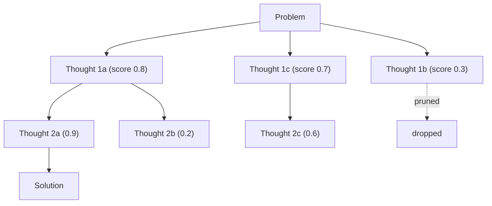
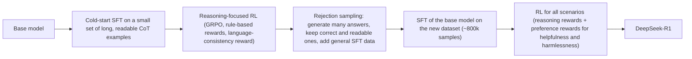
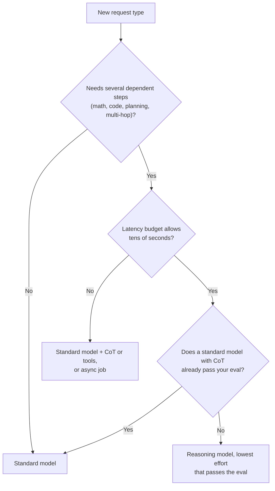
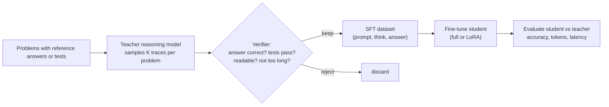
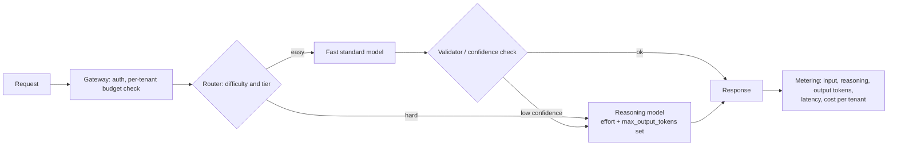

# Reasoning Models and Test-Time Compute

> **Level:** Beginner to Advanced · **Study time:** ~110 min · **Prerequisites:** [How LLMs Are Trained, Part 2: Instruction Tuning, RLHF and DPO](02-instruction-tuning-rlhf-and-dpo.md), [How LLMs Generate Text: Decoding Strategies](03-text-generation-and-decoding-strategies.md), [Evaluating LLMs: Metrics, Benchmarks and LLM-as-a-Judge](10-llm-evaluation-metrics-and-llm-as-a-judge.md)

## Table of contents

- [Why this matters](#why-this-matters)
- [The big idea: spending compute at answer time](#the-big-idea-spending-compute-at-answer-time)
- [Chain-of-thought: why intermediate tokens help](#chain-of-thought-why-intermediate-tokens-help)
- [Self-consistency: sample many, vote](#self-consistency-sample-many-vote)
- [Best-of-N, verifiers and pass@k](#best-of-n-verifiers-and-passk)
- [Tree-of-thought and search](#tree-of-thought-and-search)
- [Reasoning models: reinforcement learning on verifiable rewards](#reasoning-models-reinforcement-learning-on-verifiable-rewards)
- [GRPO at a conceptual level](#grpo-at-a-conceptual-level)
- [Thinking tokens, reasoning effort and budget controls](#thinking-tokens-reasoning-effort-and-budget-controls)
- [When to use a reasoning model and when not to](#when-to-use-a-reasoning-model-and-when-not-to)
- [Distilling reasoning into smaller models](#distilling-reasoning-into-smaller-models)
- [Evaluating reasoning models: caveats](#evaluating-reasoning-models-caveats)
- [Going deeper: system design with reasoning models](#going-deeper-system-design-with-reasoning-models)
- [Going deeper: test-time scaling and compute-optimal inference](#going-deeper-test-time-scaling-and-compute-optimal-inference)
- [Common mistakes and misconceptions](#common-mistakes-and-misconceptions)
- [Interview questions and model answers](#interview-questions-and-model-answers)
- [Key takeaways](#key-takeaways)
- [Further reading](#further-reading)
- [Next](#next)

## Why this matters

Since late 2024 a new class of LLMs, often called **reasoning models** (OpenAI's o-series, DeepSeek-R1, Gemini "thinking" models, Qwen3 in thinking mode and others), has changed how teams build AI products. These models "think" by generating many hidden or visible tokens before answering, which makes them much stronger on math, code and multi-step planning, but also slower and more expensive per request. As a senior engineer you will be asked when such a model is worth it, how it was trained (typically reinforcement learning on verifiable rewards; the best-documented open recipe, DeepSeek-R1, uses an algorithm called GRPO, both explained below), how to control its cost and latency, and how its long outputs break naive timeouts, streaming and budgets. Interviewers also probe whether you understand the older, cheaper tricks (chain-of-thought, self-consistency, search) that achieve part of the same gain with any model.

## The big idea: spending compute at answer time

> **Analogy:** Two ways to get better at chess exams. You can study for years (train harder), or, on exam day, you can take more time per move and think through several lines before committing (think harder). Both help, and they can be traded against each other.

**Train-time compute** is the computation spent building the model: pretraining and fine-tuning. The classic scaling laws (see [Pretraining and Next-Token Prediction](01-pretraining-and-next-token-prediction.md)) say that more parameters, more data and more training FLOPs give a better model.

**Test-time compute** (also called **inference-time compute**) is the computation spent while answering one specific question. A standard chat call spends roughly a fixed amount per output token. "Scaling test-time compute" means deliberately spending more on a hard question, for example by:

1. Generating more tokens per answer (reasoning step by step). This is **sequential** scaling: each new token depends on the previous ones.
2. Generating many candidate answers and picking one (voting, verifiers). This is **parallel** scaling: the candidates are independent and can run at the same time.
3. Searching over partial solutions (tree search). A mix of both.

```text
                    Ways to spend more compute on ONE question
   ┌───────────────────────┬────────────────────────┬──────────────────────────┐
   │ Sequential (deeper)   │ Parallel (wider)       │ Search (deeper + wider)  │
   │                       │                        │                          │
   │ q -> t1 -> t2 -> ...  │ q -> answer A          │ q -> step 1a -> 2a ...   │
   │      -> tN -> answer  │ q -> answer B   vote / │   \-> step 1b -> 2b ...  │
   │                       │ q -> answer C   verify │   score, prune, expand   │
   │ chain-of-thought,     │ self-consistency,      │ tree-of-thought, beam    │
   │ reasoning models      │ best-of-N              │ search, MCTS             │
   └───────────────────────┴────────────────────────┴──────────────────────────┘
```

The rest of the chapter walks through each column, then shows how reasoning models internalize the first column through training.

## Chain-of-thought: why intermediate tokens help

### The intuition

> **Analogy:** Ask someone to multiply 47 x 36 in their head and blurt out the answer instantly. Many people get it wrong. Give them paper, and they write 47 x 30 = 1,410, then 47 x 6 = 282, then add to get 1,692. The paper does not make them smarter; it lets them do more steps and remember intermediate results.

**Chain-of-thought (CoT)** is having the model write out intermediate reasoning steps before the final answer. It was popularized by "Chain-of-Thought Prompting Elicits Reasoning in Large Language Models" (Wei et al., 2022), which used **few-shot** prompts (prompts that include a handful of worked examples) whose examples showed step-by-step solutions. Soon after, "Large Language Models are Zero-Shot Reasoners" (Kojima et al., 2022) showed that simply appending "Let's think step by step" (a **zero-shot** prompt, with no examples) also helps large models.

Our running example, a small word problem:

```text
Q: A cafe sells muffins for $3 and coffees for $2. Sam buys 4 muffins
   and 3 coffees and pays with a $20 bill. How much change does he get?

Direct answer (no CoT):   "$4"        <- plausible-looking, wrong

With CoT:  "Muffins: 4 x $3 = $12. Coffees: 3 x $2 = $6.
            Total: $12 + $6 = $18. Change: $20 - $18 = $2.
            Answer: $2"                <- correct
```

### Why it works: more computation per answer

A transformer (see [The Full Transformer Architecture](../04-transformers/05-the-full-transformer-architecture.md)) produces each token with one **forward pass**: the input goes through a fixed stack of layers once. Two facts follow:

- **Fixed compute per token.** A forward pass costs roughly $2N$ floating-point operations (FLOPs) per token, where $N$ is the number of parameters. The model cannot "think longer" inside a single token.
- **Fixed depth per token.** A 7B model such as Llama 2 7B has 32 layers. Any computation that needs more than 32 sequential layer-steps cannot be completed inside one token's forward pass.

Every token the model writes is fed back as input to all later tokens (this is **autoregressive generation**, covered in [Decoding Strategies](03-text-generation-and-decoding-strategies.md)). So written tokens act as a **scratchpad**: external working memory the model can attend to. Writing 150 reasoning tokens means 150 extra forward passes, each able to read every earlier step.

**Worked example (7B model, illustrative):**

$$\text{FLOPs per token} \approx 2N$$

- $N$: number of model parameters (7 billion here).
- The factor 2: each parameter participates in one multiply and one add per token.

Step by step:

1. Per token: $2 \times 7\times10^{9} = 1.4\times10^{10}$ FLOPs, which is 14 GFLOPs.
2. Direct answer "\$4" is about 2 tokens: $2 \times 14 = 28$ GFLOPs.
3. CoT answer of about 60 tokens: $60 \times 14 = 840$ GFLOPs.
4. Ratio: $840 / 28 = 30$. The CoT answer used 30 times more computation on the same question.

(This ignores attention's extra cost that grows with context length, which is small for short sequences.)

> **Senior insight:** "CoT works because it adds serial computation and working memory" is the mechanistic answer interviewers like. A second, complementary reason: pretraining data contains lots of step-by-step solutions (textbooks, forums), so a step-by-step format puts the model in a distribution where each next step is easy to predict.

### Code: zero-shot CoT with answer extraction

The pattern is always the same: ask for reasoning, then a clearly marked final answer, then parse it.

```python
# pip install transformers torch accelerate
import re
from transformers import pipeline

# Small instruct model so it runs on a laptop; any chat model works.
gen = pipeline("text-generation", model="Qwen/Qwen2.5-0.5B-Instruct")

QUESTION = ("A cafe sells muffins for $3 and coffees for $2. Sam buys 4 muffins "
            "and 3 coffees and pays with a $20 bill. How much change does he get?")

def cot_prompt(q: str) -> list[dict]:
    return [{"role": "user", "content":
             f"{q}\nThink step by step, then give the final answer on the last "
             f"line in the form 'Answer: <number>'."}]

def extract_answer(text: str) -> str | None:
    """Prefer an explicit 'Answer:' line; fall back to the last number."""
    m = re.search(r"Answer:\s*\$?(-?\d+(?:\.\d+)?)", text)
    if m:
        return m.group(1)
    nums = re.findall(r"-?\d+(?:\.\d+)?", text)
    return nums[-1] if nums else None

out = gen(cot_prompt(QUESTION), max_new_tokens=256, do_sample=False)
reply = out[0]["generated_text"][-1]["content"]   # last message = model reply
print(reply)
print("Parsed:", extract_answer(reply))
```

A tiny 0.5B model may still get it wrong; that is expected and is exactly why the next sections exist.

### When CoT helps and when it does not

| Situation | Effect of CoT | Why |
|---|---|---|
| Multi-step math, logic, planning, code | Usually large gain | Needs serial steps and intermediate results |
| Large modern models | Gain is reliable | Wei et al. (2022) found CoT gains appeared mainly at large scale |
| Very small models | Small or negative | They write fluent but wrong chains |
| Simple lookup, extraction, classification | Little or no gain, higher cost | The task needs one step |
| Strict latency budget | Often unacceptable | Every reasoning token adds decode time |
| Arithmetic-heavy steps | Better: offload to code | "PAL: Program-aided Language Models" (Gao et al., 2022) has the model write Python and execute it |

> **Common mistake:** Asking for JSON output and CoT in the same field. Put reasoning in a separate field (or a separate call) and validate only the answer field. See [Structured Outputs and Function Calling](05-structured-outputs-and-function-calling.md).

## Self-consistency: sample many, vote

### The intuition

> **Analogy:** You ask five friends to independently solve the cafe problem. Three say \$2, one says \$8, one says \$12. You trust \$2, because independent mistakes tend to scatter while correct reasoning tends to converge.

**Self-consistency** ("Self-Consistency Improves Chain of Thought Reasoning in Language Models", Wang et al., 2022, ICLR 2023) works like this:

1. Sample $N$ independent chain-of-thought answers with **temperature** above 0 (temperature controls randomness when picking each token; see [Decoding Strategies](03-text-generation-and-decoding-strategies.md)).
2. Extract the final answer from each.
3. Return the most frequent answer (**majority vote**, or **plurality vote** when there are more than two candidates).

### The formula

$$\hat{a} = \arg\max_{a} \sum_{i=1}^{N} \mathbb{1}[a_i = a]$$

- $\hat{a}$: the answer we return.
- $N$: number of sampled reasoning chains.
- $a_i$: the final answer extracted from chain $i$.
- $\mathbb{1}[a_i = a]$: indicator, equal to 1 if chain $i$ gave answer $a$, else 0.
- $\arg\max_a$: pick the answer $a$ with the largest count.

**Worked example:** five samples give $[2, 2, 8, 2, 12]$. Counts: answer 2 appears 3 times, 8 once, 12 once. $\hat a = 2$.

### Why voting helps: a tiny probability calculation

Assume (illustratively) each sample is correct with probability $p = 0.6$, samples are independent, and there are only two outcomes (correct or wrong). With $N=3$, majority vote is correct when at least 2 of 3 are correct (binomial probabilities; see [Probability and Statistics](../00-foundations/04-probability-and-statistics.md)):

$$P(\text{maj correct}) = \sum_{k=\lceil (N+1)/2 \rceil}^{N} \binom{N}{k} p^k (1-p)^{N-k}$$

- $k$: number of correct samples.
- $\binom{N}{k}$: number of ways to choose which $k$ samples are correct.
- $p^k (1-p)^{N-k}$: probability of one specific arrangement.

For $N = 3$:

- $k=3$: $1 \times 0.6^3 = 0.216$
- $k=2$: $3 \times 0.6^2 \times 0.4 = 3 \times 0.36 \times 0.4 = 0.432$
- Total: $0.216 + 0.432 = 0.648$

For $N = 5$ (need $k \ge 3$):

- $k=5$: $0.6^5 = 0.07776$
- $k=4$: $5 \times 0.6^4 \times 0.4 = 5 \times 0.1296 \times 0.4 = 0.2592$
- $k=3$: $10 \times 0.6^3 \times 0.4^2 = 10 \times 0.216 \times 0.16 = 0.3456$
- Total: $0.07776 + 0.2592 + 0.3456 = 0.68256$

So accuracy rises from 0.60 to about 0.65 to about 0.68 as $N$ goes 1, 3, 5. Two lessons hide here:

- **Diminishing returns.** Each extra sample helps less.
- **It only helps if $p > 0.5$ (for two outcomes).** If the model is usually wrong in the same way, voting amplifies the wrong answer. With free-form answers, wrong answers often scatter, so plurality can still win when $p < 0.5$, but correlated errors (all samples making the same misreading) break the independence assumption.

### Code: self-consistency from scratch

```python
from collections import Counter
import random

def normalize(ans: str | None) -> str | None:
    """Make '2', '2.0', '$2' vote together. Real systems need domain-specific normalization."""
    if ans is None:
        return None
    ans = ans.strip().lstrip("$")
    try:
        return str(float(ans)).rstrip("0").rstrip(".")
    except ValueError:
        return ans.lower()

def self_consistency(sample_fn, n: int = 5) -> tuple[str | None, float]:
    """sample_fn() returns one extracted final answer from one sampled CoT."""
    answers = [normalize(sample_fn()) for _ in range(n)]
    votes = Counter(a for a in answers if a is not None)
    if not votes:
        return None, 0.0
    best, count = votes.most_common(1)[0]
    return best, count / n          # agreement ratio doubles as a confidence signal

# Simulated sampler: right 60% of the time, otherwise a scattered wrong answer.
random.seed(1)
fake = lambda: "2" if random.random() < 0.6 else random.choice(["4", "8", "12"])
print(self_consistency(fake, n=7))   # ('2', 0.714...): 5 of 7 samples agree
```

Try other seeds: with only 7 samples at $p = 0.6$, a wrong answer occasionally wins (for example `random.seed(0)` returns `('8', 0.571...)`), which is exactly why low agreement should be treated as low confidence.

With a real model, `sample_fn` calls `gen(cot_prompt(QUESTION), do_sample=True, temperature=0.7, max_new_tokens=256)` and runs `extract_answer` on the reply. With Hugging Face you can also pass `num_return_sequences=n` to get all samples from one batched call.

> **Senior insight:** The agreement ratio (3 of 5 agree, so 0.6) is a cheap, useful **confidence score**. Low agreement is a signal to escalate to a stronger model, a human, or a "not sure" answer. This is one of the few calibrated-ish uncertainty signals you can get from a black-box API.

### Cost and limits

- Cost scales linearly with $N$: five samples cost about five times the output tokens. Prompt caching (see [Speculative Decoding, Prompt Caching and Other Speedups](../06-llm-inference/05-speculative-decoding-caching-and-other-speedups.md)) can make the repeated input cheaper.
- Latency stays close to one call if samples run in parallel, but the slowest sample sets the latency (the tail problem).
- Voting needs answers you can compare: numbers, labels, multiple-choice letters, short strings. For open-ended text (essays, summaries) there is no clean vote; variants such as "Universal Self-Consistency" (Chen et al., 2023) ask an LLM to pick the most consistent response instead.

## Best-of-N, verifiers and pass@k

### Best-of-N with a verifier

**Best-of-N** sampling generates $N$ candidates and returns the one a **verifier** scores highest. A verifier is anything that judges a candidate:

- A **rule-based checker**: run unit tests, compile the code, check the number against a known answer, validate a JSON schema.
- A **reward model** (**RM**): a neural network trained to score responses (see [Instruction Tuning, RLHF and DPO](02-instruction-tuning-rlhf-and-dpo.md)).
- An **LLM-as-a-judge**: a prompted LLM that grades candidates (see [LLM Evaluation](10-llm-evaluation-metrics-and-llm-as-a-judge.md)).

There are two important kinds of learned verifiers:

- **Outcome reward model (ORM):** scores only the final answer or whole solution.
- **Process reward model (PRM):** scores each intermediate step. "Let's Verify Step by Step" (Lightman et al., 2023) found process supervision outperformed outcome supervision for selecting solutions to math problems, and released the step-labeled PRM800K dataset.

| Method | What picks the answer | Needs | Best for | Weakness |
|---|---|---|---|---|
| Self-consistency | Majority vote | Comparable final answers | Math, classification, multiple choice | Fails on open-ended text, correlated errors |
| Best-of-N + checker | Hard rule (tests pass) | An executable check | Code with tests, formal answers | Weak tests let wrong code through |
| Best-of-N + reward model | Learned score | A good RM | Open-ended quality | **Reward hacking**: the policy finds outputs the RM overrates |
| Best-of-N + LLM judge | Prompted judge | A strong judge model | Mixed tasks | Judge bias (length, position), extra cost |

> **Senior insight:** A verifier caps how much test-time compute can help. With a perfect checker (unit tests that fully specify behavior), more samples keep paying off. With a noisy reward model, accuracy often rises then falls as $N$ grows, because you increasingly select candidates that fool the verifier (Goodhart's law: a measure that becomes a target stops being a good measure).

### pass@k: measuring "at least one is right"

When you have a checker, you can ask: if I draw $k$ samples, what is the probability at least one is correct? This is **pass@k**, popularized for code in "Evaluating Large Language Models Trained on Code" (Chen et al., 2021). The unbiased estimator, from $n$ total samples of which $c$ are correct:

$$\text{pass@}k = 1 - \frac{\binom{n-c}{k}}{\binom{n}{k}}$$

- $n$: number of samples generated per problem.
- $c$: number of those samples that pass the checker.
- $k$: the budget you are evaluating ($k \le n$).
- $\binom{n-c}{k} / \binom{n}{k}$: probability that a random subset of $k$ samples contains no correct one.

**Worked example:** $n = 10$, $c = 3$.

- $k=1$: $\binom{7}{1}/\binom{10}{1} = 7/10 = 0.7$, so pass@1 $= 1 - 0.7 = 0.3$.
- $k=5$: $\binom{7}{5} = 21$, $\binom{10}{5} = 252$, $21/252 \approx 0.0833$, so pass@5 $\approx 0.9167$.

Why not simply plug $\hat p = c/n$ into $1-(1-\hat p)^k$? That function is concave in $p$, so the plug-in value is biased low on average (Jensen's inequality); here it would give $1 - 0.7^5 \approx 0.832$ instead of $0.917$. The combinatorial form counts subsets of the $n$ samples exactly. Generate $n$ well above $k$ (Chen et al. used $n = 200$) so the estimate is not noisy.

```python
from math import comb

def pass_at_k(n: int, c: int, k: int) -> float:
    if n - c < k:          # cannot pick k samples that are all wrong
        return 1.0
    return 1.0 - comb(n - c, k) / comb(n, k)

print(round(pass_at_k(10, 3, 1), 4))  # 0.3
print(round(pass_at_k(10, 3, 5), 4))  # 0.9167
```

> **Interview tip:** Keep three numbers separate. **pass@1** is what a user sees from one call. **maj@k** (or cons@k) is accuracy after majority vote over $k$ samples. **pass@k** assumes an oracle that picks the right one, so it is an upper bound on what any verifier can achieve. A paper reporting pass@64 is not telling you production accuracy.

## Tree-of-thought and search

### The intuition

> **Analogy:** Solving a maze. Chain-of-thought walks one path and hopes. Self-consistency sends five walkers down independent paths. Tree search walks, looks at each junction, abandons dead ends early, and spends effort on the promising branches.

**Tree-of-Thoughts (ToT)** ("Tree of Thoughts: Deliberate Problem Solving with Large Language Models", Yao et al., 2023) treats a solution as a sequence of **thoughts** (coherent intermediate steps, like one equation or one plan step). At each step:

1. **Propose:** the LLM generates several candidate next thoughts.
2. **Evaluate:** the LLM (or a verifier) scores each partial solution ("sure / maybe / impossible", or a number).
3. **Search:** keep the best few (breadth-first search or beam search) or go deep and backtrack (depth-first search).



Related search ideas:

- **Beam search over steps:** keep the top $b$ partial solutions by verifier score at every step (often guided by a PRM).
- **Monte Carlo Tree Search (MCTS):** the algorithm behind AlphaGo; it balances exploring new branches with exploiting good ones using rollouts and value estimates. Used in research on LLM reasoning; rarely in plain product code.
- **Agentic search:** the "thoughts" are tool calls or actions, and the evaluator is the environment's feedback. See [Agent Design Patterns](../09-agents/03-agent-design-patterns.md) for ReAct and reflection.

### Comparison of prompting-time methods

| Method | Compute | Latency | Needs a scorer? | When it is worth it |
|---|---|---|---|---|
| Direct answer | 1x | Lowest | No | Simple tasks |
| Chain-of-thought | Roughly 3-30x tokens (task dependent, illustrative) | Higher, sequential | No | Multi-step tasks, any capable model |
| Self-consistency | N x CoT | About one CoT if parallel | No (needs comparable answers) | Answers with a clear final value |
| Best-of-N + verifier | N x CoT + scoring | About one CoT + scoring | Yes | Code with tests, tasks with a checker |
| Tree-of-thought / beam | Many calls per step | High, many sequential rounds | Yes, per step | Puzzles, planning, research settings |

> **Senior insight:** Tree search is powerful in papers and painful in production: many sequential LLM round trips, complex orchestration, and a step evaluator you must trust. Since reasoning models arrived, much of what ToT did externally now happens inside one long generation (the model proposes, checks and backtracks in its own text). Reach for explicit search when you have a strong external verifier or the environment itself gives feedback.

## Reasoning models: reinforcement learning on verifiable rewards

### From prompting tricks to trained behavior

Everything so far works on top of an ordinary model. A **reasoning model** is an LLM that has been *trained* to produce long, useful reasoning before answering. Instead of us asking it to think step by step, it has learned to spend many tokens exploring, checking its work and backtracking, because doing so was rewarded during training.

Landmarks (dates matter because this field moves quickly):

- **OpenAI o1** (announced September 2024, "Learning to Reason with LLMs"): trained with large-scale reinforcement learning to think before answering; reasoning is hidden from the user. OpenAI reported that performance improved both with more RL training compute and with more thinking time at test time. Training details were not published.
- **DeepSeek-R1** ("DeepSeek-R1: Incentivizing Reasoning Capability in LLMs via Reinforcement Learning", DeepSeek-AI, January 2025): open weights and a detailed recipe, which is why it is the standard interview reference.
- Many others followed (Gemini thinking models, Qwen QwQ and Qwen3, and others). The specific names will date; the recipe is the durable part.

### Reinforcement learning in one paragraph

**Reinforcement learning (RL)** trains an agent by trial and reward instead of by copying examples. In LLM terms:

- The **policy** $\pi_\theta$ is the LLM itself (with weights $\theta$); its "actions" are tokens.
- A **rollout** (or trajectory) is one full generated response to a prompt.
- A **reward** is a number scoring the rollout.
- Training increases the probability of tokens in high-reward rollouts and decreases it in low-reward ones.

RLHF (recap: see [Instruction Tuning, RLHF and DPO](02-instruction-tuning-rlhf-and-dpo.md)) uses a learned reward model of human preferences. Reasoning models mostly use something simpler and harder to fool.

### Verifiable rewards

> **Analogy:** Practicing math with the answer key in the back of the book. Nobody explains how to solve each problem; you just try, check, and over thousands of problems you discover the habits that lead to right answers (write things down, double-check, try another approach when stuck).

**Reinforcement learning with verifiable rewards (RLVR)** uses rewards computed by a program, not by a learned model:

- **Math:** extract the final answer (for example from `\boxed{...}`) and compare it to the reference answer. Reward 1 if equal, else 0.
- **Code:** run the generated program against unit tests. Reward 1 if all pass (or the fraction passed).
- **Format:** small reward for following the required structure, such as putting reasoning inside `<think> ... </think>` tags. DeepSeek-R1 used accuracy and format rewards of this kind.

```python
import re, subprocess, sys, tempfile, os

def math_reward(completion: str, reference: str) -> float:
    """1.0 if the boxed answer matches the reference exactly, else 0.0.
    Real graders also handle nested braces and equivalent forms (1/2 vs 0.5)."""
    m = re.search(r"\\boxed\{([^}]*)\}", completion)
    return 1.0 if m and m.group(1).strip() == reference.strip() else 0.0

def format_reward(completion: str) -> float:
    """Small bonus for <think>...</think> followed by an answer."""
    return 0.2 if re.fullmatch(r"(?s)\s*<think>.+?</think>.+", completion) else 0.0

def code_reward(program: str, tests: str, timeout_s: int = 5) -> float:
    """Run program + asserts in a subprocess. Real systems use a locked-down sandbox."""
    with tempfile.NamedTemporaryFile("w", suffix=".py", delete=False) as f:
        f.write(program + "\n\n" + tests)
        path = f.name
    try:
        r = subprocess.run([sys.executable, path], capture_output=True, timeout=timeout_s)
        return 1.0 if r.returncode == 0 else 0.0
    except subprocess.TimeoutExpired:
        return 0.0
    finally:
        os.remove(path)

sample = "<think>4*3=12, 3*2=6, 12+6=18, 20-18=2</think> The change is \\boxed{2}."
print(math_reward(sample, "2") + format_reward(sample))  # 1.2
```

Why verifiable rewards matter so much:

- **Hard to hack.** A neural reward model can be fooled by confident, long or flattering text. A unit test cannot (though weak tests can be gamed, for example code that special-cases the test inputs).
- **Cheap and unlimited.** No human labels per rollout; you need prompts with reference answers or tests.
- **Outcome only.** The reward says nothing about which steps were good. The model figures out the useful intermediate behavior itself. DeepSeek-R1 reported avoiding neural reward models (outcome or process) for reasoning RL because of reward hacking at scale and the extra cost and complexity of retraining them.

### What DeepSeek-R1 showed

The R1 paper has two models worth knowing:

1. **R1-Zero:** RL applied directly to the **base model** (the pretrained model, before any instruction tuning), with no supervised fine-tuning (**SFT**) first and only rule-based accuracy and format rewards. During training, responses grew longer on their own, and behaviors such as re-checking and trying alternative approaches emerged (the paper describes an "aha moment" where the model reconsiders its own answer). Downsides: poor readability and mixing of languages in the reasoning.
2. **R1:** a multi-stage pipeline to fix those problems:



**Cold-start** data is a small, high-quality SFT set (thousands of examples, not millions) that gives RL a readable, well-formatted starting point. **Rejection sampling** here means: generate many responses, reject the ones that fail the checker or quality filters, and keep the rest as training data. It is a recurring trick in this chapter. In the paper, the resulting set is about 800k samples (roughly 600k reasoning and 200k general), and the second SFT stage restarts from the base model (DeepSeek-V3-Base) rather than continuing from the RL checkpoint.

> **Senior insight:** The surprising lesson of R1-Zero was not that RL improves math scores; it was that long, self-correcting reasoning *emerged* from a simple outcome reward, without anyone demonstrating it. The practical lesson of R1 was that a little supervised "cold start" data makes RL more stable and the output more readable.

### Limits of RLVR

- **Needs checkable tasks.** Math, code, logic puzzles, some science and structured tasks. Essay quality or strategy advice has no unit test, so those domains still rely on reward models or preference data, and reasoning gains transfer to them only partially.
- **Reward hacking still happens** with weak checkers: matching answer formats without solving, code that detects the test harness, or editing tests in agentic coding environments.
- **Exploration ceiling.** RL can only reinforce behaviors the model occasionally produces. If the base model never solves a problem type, outcome rewards give no signal. This is why base model quality and cold-start data matter.
- **Cost.** Each RL step needs many long rollouts (generation is the expensive part), plus sandboxes to execute code safely.

## GRPO at a conceptual level

### The problem GRPO solves

Classic RLHF uses **PPO** ("Proximal Policy Optimization Algorithms", Schulman et al., 2017). PPO needs an **advantage**: how much better a given action was than expected. To estimate "expected", PPO trains a separate **value model** (also called a **critic**) that is usually as large as the policy. That roughly doubles the memory and adds a second model to train and keep stable.

Why need a baseline ("expected") at all? If every reward is positive, raw rewards would push up the probability of every sampled response. Subtracting the expected reward makes only better-than-expected responses go up and worse ones go down, and it greatly reduces the noise (variance) of each update.

**GRPO (Group Relative Policy Optimization)**, introduced in "DeepSeekMath: Pushing the Limits of Mathematical Reasoning in Open Language Models" (Shao et al., 2024) and used for DeepSeek-R1, drops the critic. Its idea:

> **Analogy:** Grading on a curve. Instead of comparing each student to a predicted score (a critic), you give the same exam to a group and compare each student to the group average. Above average gets reinforced, below average gets discouraged.

For each prompt $q$:

1. Sample a **group** of $G$ responses $o_1, \dots, o_G$ from the current policy.
2. Score each with the reward function to get $r_1, \dots, r_G$.
3. Compute each response's advantage relative to the group.
4. Update the policy to make above-average responses more likely and below-average ones less likely, with PPO-style safety limits.

### The group-relative advantage

$$\hat{A}_i = \frac{r_i - \operatorname{mean}(r_1,\dots,r_G)}{\operatorname{std}(r_1,\dots,r_G)}$$

- $\hat{A}_i$: advantage of response $i$, applied to every token in that response (outcome supervision).
- $r_i$: reward of response $i$ (for example 1 if correct, 0 if wrong).
- $\operatorname{mean}$, $\operatorname{std}$: average and standard deviation of the group's rewards. Implementations differ slightly (population vs sample standard deviation, plus a small $\varepsilon$ to avoid dividing by zero); we use the population standard deviation below.

**Worked example 1:** $G = 4$, rewards $[1, 0, 0, 1]$.

- Mean: $(1+0+0+1)/4 = 0.5$.
- Deviations: $[0.5, -0.5, -0.5, 0.5]$.
- Variance: $(0.25 + 0.25 + 0.25 + 0.25)/4 = 0.25$, so std $= 0.5$.
- Advantages: $[0.5/0.5, -0.5/0.5, -0.5/0.5, 0.5/0.5] = [1, -1, -1, 1]$.

**Worked example 2:** $G = 4$, rewards $[1, 0, 0, 0]$ (a hard prompt; only one success).

- Mean: $1/4 = 0.25$.
- Deviations: $[0.75, -0.25, -0.25, -0.25]$.
- Variance: $(0.5625 + 0.0625 + 0.0625 + 0.0625)/4 = 0.75/4 = 0.1875$, so std $= \sqrt{0.1875} \approx 0.433$.
- Advantages: $0.75/0.433 \approx 1.732$ and $-0.25/0.433 \approx -0.577$.

The rare success on a hard prompt gets a big push. That is exactly what you want.

**Worked example 3:** rewards $[1,1,1,1]$ or $[0,0,0,0]$. Every deviation is 0, so every advantage is 0: **no learning signal**. Prompts that are too easy or too hard for the current model are wasted compute, which is why practitioners filter or curriculum-schedule prompts so groups have mixed outcomes.

### The objective, simplified

$$\mathcal{J}(\theta)=\mathbb{E}\left[\frac{1}{G}\sum_{i=1}^{G}\frac{1}{|o_i|}\sum_{t=1}^{|o_i|}\Big(\min\big(\rho_{i,t}\hat{A}_{i},\ \operatorname{clip}(\rho_{i,t},1-\epsilon,1+\epsilon)\,\hat{A}_{i}\big)-\beta\,\mathbb{D}_{KL}\big[\pi_\theta\,\|\,\pi_{\text{ref}}\big]\Big)\right]$$

with the probability ratio

$$\rho_{i,t} = \frac{\pi_\theta(o_{i,t}\mid q, o_{i,<t})}{\pi_{\theta_\text{old}}(o_{i,t}\mid q, o_{i,<t})}$$

- $\mathcal{J}(\theta)$: the quantity we maximize (training minimizes $-\mathcal{J}$).
- $\mathbb{E}$: average over prompts $q$ from the training set and groups $\{o_i\}$ sampled from $\pi_{\theta_\text{old}}$.
- $G$: group size; $o_i$: the $i$-th response; $|o_i|$: its length in tokens; $o_{i,t}$: its $t$-th token; $o_{i,<t}$: the tokens before it.
- $\pi_\theta$: the policy being trained; $\pi_{\theta_\text{old}}$: the policy that generated the samples (a frozen snapshot from just before this update).
- $\rho_{i,t}$: how much more (or less) likely the token has become since sampling. $\rho = 1$ means unchanged.
- $\operatorname{clip}(\rho, 1-\epsilon, 1+\epsilon)$: limits $\rho$ to a band such as $[0.8, 1.2]$ for $\epsilon = 0.2$, so one update cannot move the policy too far.
- $\min(\cdot,\cdot)$: take the more pessimistic of the clipped and unclipped terms (PPO's trick).
- $\beta$: weight of the **KL penalty**, which keeps the policy close to a reference model $\pi_{\text{ref}}$ (usually the starting model). KL divergence measures how different two probability distributions are; see [Softmax, Entropy, Cross-Entropy and KL Divergence](../00-foundations/05-softmax-entropy-cross-entropy-and-kl-divergence.md). Without this anchor the policy can drift into degenerate text that still scores well on the reward.

In words: for every token of every sampled response, nudge its probability in the direction of that response's advantage (up if better than the group, down if worse), never by more than the clip band allows in one update, while paying a penalty for drifting away from the reference model.

**Worked example of clipping** ($\epsilon = 0.2$):

- Good response, $\hat A = 1$, ratio $\rho = 1.3$: unclipped $1.3 \times 1 = 1.3$; clipped $1.2 \times 1 = 1.2$; $\min = 1.2$. The gain is capped, so there is no incentive to push the ratio further past 1.2.
- Bad response, $\hat A = -1$, ratio $\rho = 0.7$: unclipped $0.7 \times (-1) = -0.7$; clipped $0.8 \times (-1) = -0.8$; $\min = -0.8$. Since the clipped term is constant in $\theta$, the gradient here is zero: the token's probability has already dropped enough this round.

### Code: GRPO loss mechanics in PyTorch

This is a teaching sketch of one loss computation on toy tensors, not a full trainer.

```python
# pip install torch
import torch

def group_advantages(rewards: torch.Tensor, eps: float = 1e-6) -> torch.Tensor:
    """rewards: shape (G,). Population std, as in the worked examples."""
    return (rewards - rewards.mean()) / (rewards.std(unbiased=False) + eps)

def grpo_loss(logp_new, logp_old, logp_ref, adv, mask, clip_eps=0.2, beta=0.04):
    """
    logp_*: (G, T) log-probs of the sampled tokens under new/old/reference policies
    adv:    (G,)   one advantage per response, broadcast to its tokens
    mask:   (G, T) 1 for real tokens, 0 for padding
    """
    ratio = torch.exp(logp_new - logp_old)                     # rho_{i,t}
    a = adv.unsqueeze(1)                                       # (G, 1)
    surrogate = torch.min(ratio * a,
                          torch.clamp(ratio, 1 - clip_eps, 1 + clip_eps) * a)
    # Per-token KL estimate used in DeepSeekMath: r - log r - 1, with r = pi_ref / pi_theta
    log_r = logp_ref - logp_new
    kl = torch.exp(log_r) - log_r - 1
    per_token = surrogate - beta * kl
    per_seq = (per_token * mask).sum(1) / mask.sum(1)          # 1/|o_i| sum over t
    return -per_seq.mean()                                     # minimize the negative

rewards = torch.tensor([1.0, 0.0, 0.0, 0.0])
print(group_advantages(rewards))   # approximately [1.732, -0.577, -0.577, -0.577]

G, T = 4, 6
logp_old = torch.randn(G, T).clamp(max=-0.1)
logp_new = (logp_old + 0.05 * torch.randn(G, T)).requires_grad_()
loss = grpo_loss(logp_new, logp_old, logp_old.clone(), group_advantages(rewards),
                 torch.ones(G, T))
loss.backward()
print(loss.item(), logp_new.grad.shape)   # a scalar, then torch.Size([4, 6])
```

In practice you would use a library such as Hugging Face TRL (which has a `GRPOTrainer`) or a dedicated RL framework, with a fast inference engine like vLLM generating the rollouts. These APIs change often, so check the current docs.

### Known quirks and follow-ups

Follow-up research (for example DAPO, 2025, and "Understanding R1-Zero-Like Training: A Critical Perspective" by Liu et al., 2025, which proposed "Dr. GRPO") analyzed biases in the original recipe:

- **Length normalization bias:** dividing by $|o_i|$ means a wrong long answer gets a smaller per-token penalty than a wrong short one, which can encourage ever-longer wrong answers.
- **Std normalization:** dividing by the group std up-weights prompts that are nearly all-right or all-wrong.
- **Entropy collapse:** the policy's token distribution becomes too peaked (low entropy, nearly deterministic) too soon, killing exploration; tweaks include asymmetric clipping ranges and dynamic sampling that drops zero-advantage groups.

You do not need the details for most interviews; knowing that GRPO is "PPO without a critic, using the group mean as the baseline", why that saves memory, and that zero-variance groups give no signal, is the senior-level core.

| | PPO (classic RLHF) | GRPO | DPO |
|---|---|---|---|
| Learning signal | Reward model + value model (critic) | Reward (often rule-based) relative to group mean | Preference pairs, no reward model at all |
| Extra models in memory | Critic, reward model, reference | Reference (reward can be code) | Reference |
| Samples per prompt | Usually 1 | $G$ (for example 8-64) | Fixed offline pairs |
| Online generation | Yes | Yes | No (offline) |
| Typical use | General alignment | Reasoning with verifiable rewards | Cheap preference alignment |

## Thinking tokens, reasoning effort and budget controls

### What thinking tokens are

**Thinking tokens** (also **reasoning tokens**) are the tokens a reasoning model generates before its final answer. Mechanically they are ordinary tokens from the same vocabulary, produced by the same decode loop. What differs is how they are handled:

- **Open-weight models** (for example DeepSeek-R1 and Qwen3 in thinking mode) usually emit them inline, wrapped in markers like `<think> ... </think>`. You see everything and must strip it yourself.
- **Hosted proprietary models** often hide the raw reasoning. The API returns the final answer, sometimes a **reasoning summary**, and a usage count of reasoning tokens. You are billed for them even though you never see them.

```python
import re

def split_reasoning(text: str) -> tuple[str, str]:
    """Split '<think>...</think>answer' into (reasoning, answer)."""
    m = re.search(r"(?s)<think>(.*?)</think>(.*)", text)
    if not m:                       # no tags, or truncated before </think>
        return "", text.strip()
    return m.group(1).strip(), m.group(2).strip()

raw = "<think>4*3=12, 3*2=6, total 18, change 2.</think>Sam gets $2 back."
thinking, answer = split_reasoning(raw)
print(answer)  # Sam gets $2 back.
```

> **Common mistake:** Feeding a previous turn's raw `<think>` content back into a multi-turn conversation. Many open model chat templates drop earlier reasoning on purpose, and some hosted APIs have specific rules for passing reasoning items between turns (especially with tool calls). Follow the model card or API docs; get it wrong and quality or cache hit rates can drop.

### Controls you will meet

Vendors expose different knobs. The names are version-dependent (true as of 2025-2026); the concepts are stable.

| Control | What it does | Examples (version-dependent) |
|---|---|---|
| **Reasoning effort** | Coarse level (for example low / medium / high) that shifts how long the model tends to think | OpenAI reasoning models' `reasoning.effort` parameter |
| **Thinking budget** | An explicit cap or target in tokens for the reasoning phase | Gemini 2.5 thinking budget (newer Gemini versions also offer coarser thinking levels); budget settings on other hosted models |
| **Thinking on/off** | Hybrid models that can answer directly or think first | Qwen3's thinking and non-thinking modes |
| **Max output tokens** | Hard cap on all generated tokens, usually *including* reasoning | Nearly every API and serving engine |
| **Budget forcing** (research) | Force a stop by inserting the end-of-thinking marker, or force more thinking by appending "Wait" | "s1: Simple test-time scaling" (Muennighoff et al., 2025) |

A conceptual hosted-API call (version-fragile; check the current SDK):

```python
# pip install openai   (API shape as of 2025-2026; verify against current docs)
from openai import OpenAI

client = OpenAI()
resp = client.responses.create(
    model="o4-mini",                       # any reasoning-capable model you have access to
    reasoning={"effort": "low"},           # low / medium / high; newer models add other levels
    max_output_tokens=4000,                # includes hidden reasoning tokens
    input="A cafe sells muffins for $3 and coffees for $2. Sam buys 4 muffins "
          "and 3 coffees and pays with a $20 bill. How much change?",
)
print(resp.output_text)
u = resp.usage
print("output tokens:", u.output_tokens,
      "of which reasoning:", u.output_tokens_details.reasoning_tokens)
```

Always log the reasoning-token count from the usage object. It is the number that drives your bill and your latency.

### Cost implications: a worked example

$$\text{cost} = T_{\text{in}} \cdot p_{\text{in}} + (T_{\text{reason}} + T_{\text{out}}) \cdot p_{\text{out}}$$

- $T_{\text{in}}$: input (prompt) tokens.
- $T_{\text{reason}}$: reasoning tokens (billed as output on most APIs).
- $T_{\text{out}}$: visible answer tokens.
- $p_{\text{in}}, p_{\text{out}}$: price per input and output token.

Illustrative prices (not real quotes): $p_{\text{in}} = \$2$ per million tokens, $p_{\text{out}} = \$8$ per million tokens. A request with 1,000 input tokens and a 300-token visible answer:

- **Standard model:** $1{,}000 \times 2/10^6 = \$0.002$, plus $300 \times 8/10^6 = \$0.0024$, total **\$0.0044**.
- **Reasoning model** with 4,000 reasoning tokens: $\$0.002 + (4{,}000 + 300) \times 8/10^6 = \$0.002 + \$0.0344 =$ **\$0.0364**.
- Ratio: $0.0364 / 0.0044 \approx 8.3$ times more per request.
- At 100,000 requests per month: $\$440$ versus $\$3{,}640$.

Real reasoning models are often also priced higher per token than standard models of similar size, which widens the gap further. The reasoning-token count also varies widely per request, so the *variance* of your bill grows, not only its mean.

### Latency implications: a worked example

Decode speed is roughly constant per token for a given model and load, slowing somewhat as the context grows because each new token attends over all earlier ones (see [Inference Fundamentals: Prefill, Decode, TTFT and Throughput](../06-llm-inference/01-inference-fundamentals-prefill-decode-and-latency-metrics.md)). Assume an illustrative 60 tokens per second:

- Standard: 300 tokens / 60 = **5 seconds** to finish.
- Reasoning: 4,300 tokens / 60 $\approx$ **71.7 seconds** to finish.

Worse, the **time to first visible answer token** is now the whole reasoning phase (about $4{,}000/60 \approx 66.7$ seconds), unless the API streams reasoning summaries or progress. Users perceive this as "the app froze".

Long reasoning also stresses the server: thousands of extra tokens per request mean a larger **KV cache** per sequence (the stored attention keys and values; see [The KV Cache](../06-llm-inference/02-kv-cache-explained.md)), so fewer requests fit in GPU memory at once and throughput drops.

## When to use a reasoning model and when not to

> **Analogy:** You would not hire a senior architect to read dates off invoices, and you would not let an intern design the building. Match the thinker to the task.

| Task type | Example | Recommended | Why |
|---|---|---|---|
| Simple extraction | Pull invoice date and total from text | Standard model (+ structured outputs) | One step; reasoning adds cost and latency only |
| Classification / routing | Is this email spam? Which team owns the ticket? | Standard or small fine-tuned model | Pattern recognition, not deliberation |
| Casual chat, rewriting, summarization | "Make this email friendlier" | Standard model | Fluency matters more than multi-step logic |
| RAG Q&A over retrieved docs | "What is our refund window?" | Standard model usually; reasoning for multi-hop synthesis | Most answers are in one chunk |
| Multi-step math, quantitative analysis | Pricing calculations, unit conversions chains | Reasoning model (or standard + code tool) | Many dependent steps |
| Hard coding tasks | Fix a multi-file bug, design an algorithm | Reasoning model | Planning, checking, backtracking |
| Agent planning | Decompose a goal into tool calls | Reasoning model for the planner, standard for simple steps | Planning quality compounds over steps |
| Real-time, latency-critical | Autocomplete, voice assistants | Standard model, low or no thinking | Seconds matter |
| Very high volume, low margin | Tagging millions of products | Standard or distilled small model | Cost dominates |

A practical decision flow:



> **Senior insight:** The strongest production pattern is a **router**: a cheap classifier (or a small LLM) estimates task difficulty and sends easy requests to a fast model and hard ones to a reasoning model or high effort. Measure the router's mistakes in both directions: hard queries sent to the cheap path (quality loss) and easy queries sent to the expensive path (wasted money).

Reasoning models can also be *worse* on some tasks: they may overthink simple questions ("Do NOT Think That Much for 2+3=? On the Overthinking of o1-Like LLMs", Chen et al., 2024, studies this), drift from strict formatting instructions, or second-guess a correct retrieved fact. Always evaluate on your own data; see [Prompting vs RAG vs Fine-Tuning](08-prompting-vs-rag-vs-fine-tuning-decision-guide.md) for the broader decision framework.

## Distilling reasoning into smaller models

### The idea

**Knowledge distillation** trains a small **student** model to imitate a large **teacher** (the fundamentals are in [Knowledge Distillation Fundamentals](../07-model-compression/05-knowledge-distillation-fundamentals.md) and [Distilling Large Language Models](../07-model-compression/06-distilling-large-language-models.md)). For reasoning, the simplest form is **sequence-level distillation**: generate reasoning traces with the teacher, then fine-tune the student on them with ordinary supervised fine-tuning (SFT).

> **Analogy:** A master chef cooks a dish while narrating every decision. An apprentice who studies thousands of these narrated sessions learns much faster than one who only tastes finished plates and gets a thumbs up or down.



Key evidence and examples:

- DeepSeek-R1 released distilled models from 1.5B to 70B parameters (based on Qwen2.5 and Llama 3), trained with SFT on about 800k samples generated with R1. The paper reported that distillation from the strong model worked better for small models than running large-scale RL on those small models directly.
- "s1: Simple test-time scaling" (Muennighoff et al., 2025) fine-tuned a 32B model on only about 1,000 carefully selected reasoning traces and reported strong math results, suggesting that a small, high-quality, difficult and diverse set can unlock much of the behavior.
- "STaR: Bootstrapping Reasoning With Reasoning" (Zelikman et al., 2022) is the earlier self-distillation idea: the model generates rationales, keeps those that reach the right answer, and fine-tunes on them, in a loop.

### Code: building a filtered reasoning SFT set

```python
import json

def build_distillation_set(problems, teacher_sample, k=4, max_think_tokens=8000,
                           count_tokens=lambda s: len(s.split())):
    """
    problems:       list of {"prompt": str, "answer": str}
    teacher_sample: fn(prompt) -> raw text with <think>...</think>answer
    Rejection sampling: keep only verified, readable, bounded-length traces.
    """
    rows = []
    for p in problems:
        kept = []
        for _ in range(k):
            raw = teacher_sample(p["prompt"])
            thinking, answer = split_reasoning(raw)         # from the earlier snippet
            if not thinking or count_tokens(thinking) > max_think_tokens:
                continue                                    # missing or runaway reasoning
            if extract_answer(answer) != p["answer"]:       # from the CoT snippet
                continue                                    # wrong final answer
            kept.append((count_tokens(thinking), raw))
        if kept:
            kept.sort()                                     # prefer the shortest correct trace
            rows.append({"messages": [
                {"role": "user", "content": p["prompt"]},
                {"role": "assistant", "content": kept[0][1]},
            ]})
    return rows

# with open("reasoning_sft.jsonl", "w") as f:
#     for r in build_distillation_set(problems, teacher_sample):
#         f.write(json.dumps(r) + "\n")
```

The resulting JSONL plugs into a standard SFT or LoRA pipeline ([Fine-Tuning LLMs: Full, LoRA and QLoRA](07-fine-tuning-full-lora-and-qlora.md)).

### Trade-offs

| Choice | Benefit | Risk |
|---|---|---|
| Keep only correct traces | Student learns from verified reasoning | Fewer hard examples survive; bias toward easy problems |
| Prefer shorter correct traces | Cheaper, faster student | May lose useful self-checking behavior |
| Many traces per problem | More diversity | Near-duplicate data, overfitting to teacher quirks |
| Distill then RL on the student | Often best quality | Extra training complexity |
| Use a proprietary teacher | Strong traces | Hidden reasoning cannot be distilled; terms of service may forbid training on outputs |

> **Senior insight:** Distillation transfers *behavior on the training distribution*. A 7B student distilled on math traces can be excellent at competition-style math and still weak at your domain's reasoning. Distill on prompts that look like your production traffic, and measure both accuracy and average thinking length, since a student that copies the teacher's verbosity keeps much of the latency cost.

## Evaluating reasoning models: caveats

Evaluation basics live in [Evaluating LLMs](10-llm-evaluation-metrics-and-llm-as-a-judge.md) and [Building an LLM Evaluation Framework](11-building-an-llm-evaluation-framework-and-regression-tests.md). Reasoning models add specific traps.

### 1. Accuracy is meaningless without its compute cost

A reasoning model at high effort and a standard model with self-consistency over 16 samples are both "spending more compute". Compare methods on an **accuracy versus cost (or tokens, or latency) curve**, not on a single accuracy number.

```text
 accuracy
   ^                                  * reasoning model, high effort
   |                       * medium
   |          * low                    o standard + self-consistency (N=16)
   |                      o N=4
   |   o standard (N=1)
   +--------------------------------------------> avg tokens (or $) per question
```

### 2. Sampling settings and reporting conventions

- Reasoning models are often evaluated with sampling (temperature above 0), so one run is noisy. Report pass@1 averaged over several samples per question, with confidence intervals.
- Check whether a reported number is pass@1, maj@k or pass@k (see above). They are not comparable.
- Truncation matters: if the token budget cuts off reasoning before an answer, is that scored as wrong? It should be, and the truncation rate should be reported.

### 3. Verbosity and length bias

- LLM-as-a-judge evaluators tend to prefer longer answers. A reasoning model that leaks its deliberation into the visible answer can win judge comparisons while annoying real users.
- Track visible answer length and reasoning length separately. Watch for **overthinking** (long reasoning on easy items) and **underthinking** (abandoning promising paths too soon on hard items).

### 4. Faithfulness of the visible reasoning

**Faithfulness** asks: does the written reasoning actually reflect how the model reached its answer? Often, not entirely.

- "Language Models Don't Always Say What They Think: Unfaithful Explanations in Chain-of-Thought Prompting" (Turpin et al., 2023) showed that biasing features in the prompt (for example, always making answer "(A)" correct in few-shot examples) changed models' answers while their explanations almost never mentioned the bias.
- "Measuring Faithfulness in Chain-of-Thought Reasoning" (Lanham et al., 2023) tested this by truncating or corrupting the CoT and seeing whether the answer changed; dependence on the CoT varied by task and model.
- For hosted models, the displayed text may be a *summary* of hidden reasoning, written by another model, so it is a further step removed.

Practical consequences:

- Do not use the visible reasoning as a guaranteed explanation for audit or compliance. Treat it as a useful but unreliable signal.
- A correct answer with wrong reasoning, or wrong reasoning that happens to land on the right answer, is common. If the process matters (tutoring, regulated advice), grade the steps, not only the outcome.
- Reasoning traces are still valuable for **monitoring**: research on monitoring reasoning models (for example Baker et al., 2025, on detecting reward hacking in chain-of-thought) found that reading the CoT can catch misbehavior, but that strongly penalizing "bad thoughts" during training can teach models to hide intent instead of stopping the behavior.

### 5. Contamination

Public math and coding benchmarks leak into training data, and RL training on similar problems blurs the line further. Use held-out, recent or private problems. See [Catastrophic Forgetting, Data Contamination and Memorization](09-catastrophic-forgetting-contamination-and-memorization.md).

> **Interview tip:** For every eval item, log model, effort level, sample index, correctness, truncation flag, and input, reasoning and output token counts, plus latency and cost. That one record lets you plot accuracy against cost and compare effort levels on identical items.

## Going deeper: system design with reasoning models

Reasoning models change the shape of your traffic: fewer, longer, more variable requests. Here is what breaks and how to fix it.

### Timeouts

- **Problem:** many HTTP clients, gateways and load balancers default to timeouts of 30-60 seconds. In our illustrative example, a 71.7-second reasoning call is killed, you pay for the tokens anyway, and the retry pays again.
- **Fix:** set per-route timeouts from measured p99 latency for that model and effort level; separate **connect timeout** (short) from **read timeout** (long); make every hop (client, API gateway, service mesh, load balancer, serverless function limit) consistent.
- For tasks taking minutes, switch to an **asynchronous job** pattern: submit, return a job ID, poll or receive a webhook. Some vendors offer background or batch modes for exactly this; batch APIs are typically cheaper when latency does not matter.

### Streaming and user experience

- Stream whatever is available: reasoning summaries, status events ("Analyzing the contract...", "Running tests..."), and then the answer tokens. Keep connections alive with heartbeats so proxies do not close idle streams.
- Decide deliberately whether to show reasoning. Raw open-model thinking can contain wrong intermediate claims, internal confusion, or content you would not want users to see. Many products show a short summary or a progress indicator.
- Remember that **time to first answer token** (not time to first byte) is the user-facing metric now.

### Cost controls



- **Cap tokens:** always set `max_output_tokens` (or equivalent) and an effort level. No unbounded calls.
- **Escalate, do not default:** try the cheap path first, escalate on low confidence (validator failure, self-consistency disagreement, user retry).
- **Per-tenant and per-feature budgets** with alerts on reasoning-token spend; this is where surprise bills come from. See [Monitoring ML and LLM Systems in Production](../10-mlops/06-monitoring-ml-and-llm-systems-in-production.md).
- **Cache** final answers for repeated questions and use prompt caching for long shared prefixes.
- **Retries multiply cost.** A retry of a 4,000-token reasoning call costs another 4,000 tokens. Use idempotency keys, retry only on transient errors, and never blindly retry on timeout without checking whether the first call completed.

### The truncation trap

If `max_output_tokens` is 2,000 and the model spends all 2,000 on reasoning, you get **an empty or missing answer and still pay for 2,000 tokens**. Hosted APIs typically flag the response as incomplete. Handle it explicitly:

```python
def handle_reasoning_response(status: str, answer: str, reasoning_tokens: int, cap: int):
    """Status/field names vary by vendor; this is the logic, not a real SDK."""
    if status == "incomplete" or (not answer.strip() and reasoning_tokens >= cap * 0.95):
        # Options: retry once with a higher cap or lower effort, or fall back to a
        # standard model, and record the event for capacity planning.
        return {"action": "retry_or_fallback", "reason": "reasoning consumed the budget"}
    return {"action": "return", "answer": answer}
```

### Capacity planning and serving

- Throughput in requests per second drops sharply because each request generates many more tokens; capacity plans built on chat-length outputs will be wrong. Plan in **tokens per second**, not requests per second. See [Optimizing and Benchmarking LLM Latency and Cost](../06-llm-inference/07-optimizing-and-benchmarking-llm-latency-and-cost.md).
- Rate limits are usually in tokens per minute, so a few reasoning-heavy users can exhaust a shared quota.
- If self-hosting, long decode phases favor continuous batching and PagedAttention ([Batching, Continuous Batching and PagedAttention](../06-llm-inference/04-batching-continuous-batching-and-paged-attention.md)), and speculative decoding can help since reasoning text is often predictable. Quantization reduces memory but does not reduce the number of tokens generated ([Practical LLM Quantization](../07-model-compression/04-llm-quantization-gptq-awq-and-outliers.md)).

### Agents and tool use

In agent loops ([What Is an AI Agent?](../09-agents/01-what-is-an-ai-agent.md)) the model may reason before every tool call. Ten steps with 2,000 reasoning tokens each is 20,000 tokens of thinking per task (illustrative). Common patterns:

- Use a reasoning model for **planning and hard decisions**, and a fast model for simple tool-argument filling and summarization.
- Set a total task budget (tokens, steps, wall-clock time) and stop gracefully when it is hit.
- Trace each step's reasoning-token count in your observability stack ([LLMOps: Tracing, Prompt Management and Langfuse](../10-mlops/08-llmops-tracing-prompt-management-and-langfuse.md)).
- Decide what reasoning is shown, logged and retained: it may restate sensitive input.

## Going deeper: test-time scaling and compute-optimal inference

"Scaling LLM Test-Time Compute Optimally can be More Effective than Scaling Model Parameters" (Snell et al., 2024) asked: given a fixed inference budget, how should you spend it? Durable findings worth knowing:

- **The best strategy depends on difficulty.** On easier problems, sequential revision (let the model refine its answer) was more efficient; on harder ones, a mix of parallel sampling and revision, or search guided by a process reward model (PRM), helped more.
- **Adaptive allocation wins.** Spending compute according to estimated difficulty beat a uniform best-of-N baseline at the same total budget.
- **Test-time compute can substitute for parameters, partially.** In their setting, a smaller model with well-allocated test-time compute could match a larger model on easy and medium problems, but not on the hardest ones, where a stronger base model still mattered.

Sequential versus parallel scaling, side by side:

| | Sequential (longer reasoning) | Parallel (more samples) |
|---|---|---|
| How | One long chain with self-correction | Many independent chains + vote/verify |
| Latency | Grows with length | Roughly flat if run concurrently |
| Hardware use | One sequence, memory-bound decode | Batches well, better GPU utilization |
| Needs | A model trained to use long context well | A way to aggregate (vote, verifier) |
| Failure mode | Overthinking, loops, context exhaustion | Correlated errors, verifier limits |

Reasoning models combine both: long sequential thinking inside each sample, and vendors may also run parallel samples internally for top tiers. As a system designer, you can stack them too (for example, three medium-effort reasoning calls with a vote for a high-stakes decision), but always check the accuracy-per-dollar curve first.

> **Senior insight:** The "bitter lesson" version of this story is that both training compute and inference compute are now knobs on the same capability curve. Business framing: train-time compute is a fixed, one-off cost amortized over all users; test-time compute is a variable cost paid per request. That is why routing and per-request budgets are product decisions, not just engineering details.

## Common mistakes and misconceptions

- **"Reasoning models are just better, use them everywhere."** They are slower, costlier and can be worse at simple extraction, strict formatting and chatty tasks. Route by task.
- **"The model's reasoning is a faithful explanation."** Visible reasoning can omit the real cause of an answer. Use it for debugging and monitoring, not as an audit-grade explanation.
- **"Chain-of-thought makes the model smarter."** It gives the same model more computation and working memory per answer. Weights do not change.
- **Ignoring hidden reasoning tokens in cost estimates.** They are billed as output and can be 5-50 times the visible answer (illustrative range; measure your own).
- **Setting a small max-token cap.** The reasoning can consume the whole budget and leave an empty answer that you still pay for.
- **Keeping default 30-60 second timeouts.** Long reasoning calls get cut off and retried, doubling cost.
- **Using self-consistency on open-ended text.** There is nothing clean to vote on; use a judge or a different aggregation.
- **Comparing models at different compute.** Report accuracy together with tokens, latency or cost per question.
- **Confusing pass@k with production accuracy.** pass@k assumes a perfect oracle picks the right sample.
- **Thinking GRPO needs a reward model.** It needs a reward; for reasoning, that is often a rule-based checker. What it removes is the critic (value model).
- **Assuming RLVR works for any task.** It needs automatically checkable outcomes. Non-verifiable domains need preference data or reward models.
- **Prompting reasoning models like old models.** Long "think step by step" scaffolding and many few-shot examples can be unnecessary or even hurt with models trained to reason; vendors generally recommend clear goals and constraints instead. Test it.
- **Distilling without filtering.** Training a student on unverified teacher traces teaches it confident wrong reasoning.

## Interview questions and model answers

<details>
<summary><b>Q1. Why does chain-of-thought prompting improve accuracy on multi-step problems?</b></summary>

**Short answer:** A transformer spends a fixed amount of compute and a fixed number of layers per token, so it cannot do arbitrarily long serial computation inside one token. Writing intermediate steps turns the generated text into a scratchpad: each step adds a forward pass and is attended to by later steps, so the model gets more computation and working memory per answer. It also puts the model in a step-by-step format it saw a lot in pretraining.

**Deeper answer and follow-ups:**
- Compute: roughly $2N$ FLOPs per token, so 60 reasoning tokens on a 7B model is about 840 GFLOPs versus about 28 GFLOPs for a 2-token direct answer (30x).
- Gains are largest on math, logic, code and planning; small or negative for simple lookup or for very small models that write fluent but wrong chains.
- Origins: Wei et al., 2022 (few-shot CoT); Kojima et al., 2022 ("Let's think step by step").
- Pitfalls: cost and latency rise with tokens; reasoning can be unfaithful; mixing CoT into a JSON field breaks parsing. For arithmetic, have the model write code (PAL) instead.
- How to measure: run the same eval with and without CoT, report accuracy alongside tokens and latency, and track the answer-extraction failure rate. With models already trained to reason, explicit "think step by step" prompting usually adds little.

</details>

<details>
<summary><b>Q2. Explain self-consistency. When does it help, and when does it fail?</b></summary>

**Short answer:** Sample several chain-of-thought answers at non-zero temperature, extract each final answer, and return the most common one. It helps when individual samples are right more often than any single wrong answer and errors are fairly independent, and when answers are easy to compare (numbers, labels).

**Deeper answer and follow-ups:**
- Formula: $\hat a = \arg\max_a \sum_i \mathbb{1}[a_i = a]$.
- Illustrative math with independent samples, $p = 0.6$: majority-of-3 accuracy is $0.216 + 0.432 = 0.648$; majority-of-5 is $0.68256$. Diminishing returns.
- Fails with correlated errors (every sample misreads the question the same way), when the model is mostly wrong, and on open-ended outputs with nothing to vote on.
- Cost scales linearly with $N$; latency stays near one call if parallel, but tail latency grows.
- Bonus: agreement ratio is a cheap confidence signal for escalation. Before using it as a threshold, check its calibration on labeled data (for example, how often 5-of-5 versus 3-of-5 agreement is actually correct).

</details>

<details>
<summary><b>Q3. What is the difference between pass@k, maj@k and pass@1, and why does it matter when reading a paper or vendor claim?</b></summary>

**Short answer:** pass@1 is the probability a single sample is correct (what users see). maj@k is accuracy after majority voting over $k$ samples (achievable in production at $k$ times the cost). pass@k is the probability that at least one of $k$ samples is correct, which assumes an oracle picks the right one, so it is an upper bound.

**Deeper answer and follow-ups:**
- Unbiased estimator: $\text{pass@}k = 1 - \binom{n-c}{k}/\binom{n}{k}$. Example: $n=10$, $c=3$ gives pass@1 $= 0.3$, pass@5 $\approx 0.917$.
- pass@k is realistic only when you have a real verifier (unit tests); otherwise it overstates performance.
- Best-of-N with a real verifier lands between pass@1 and pass@k, and how close it gets to pass@k is a direct measure of verifier quality. With a noisy reward model, accuracy can peak and then fall as $N$ grows, because selection starts exploiting the verifier's errors.
- Always ask about sample count, temperature, token budget and whether truncated outputs count as wrong.

</details>

<details>
<summary><b>Q4. How are reasoning models like o1 or DeepSeek-R1 trained, and what makes RL with verifiable rewards different from RLHF?</b></summary>

**Short answer:** Starting from a strong pretrained (often lightly fine-tuned) model, they run reinforcement learning on prompts whose outcomes a program can check: math answers against references, code against unit tests, plus format rewards. The model generates long reasoning, gets rewarded only for correct outcomes, and learns behaviors such as self-verification and backtracking. RLHF instead uses a learned reward model of human preferences, which is easier to exploit and noisier.

**Deeper answer and follow-ups:**
- DeepSeek-R1-Zero: pure RL from the base model; reasoning length grew and self-reflection emerged, but readability and language mixing were poor.
- DeepSeek-R1: cold-start SFT, reasoning RL with GRPO, rejection sampling to build a new SFT set, then RL across all scenarios including preference rewards.
- OpenAI did not publish o1's recipe; it described large-scale RL and showed gains from both more RL compute and more thinking time.
- Limits: needs verifiable tasks; weak checkers get hacked; RL cannot reinforce behaviors the model never produces.
- Reward hacking examples: special-casing test inputs, emitting a well-formatted answer without solving, editing tests in agentic environments. Mitigations: hidden and stronger tests, sandboxed execution, answer-equivalence checkers, monitoring the reasoning, and hand-reviewing a sample of high-reward rollouts.

</details>

<details>
<summary><b>Q5. Explain GRPO. Why did DeepSeek use it instead of PPO?</b></summary>

**Short answer:** GRPO samples a group of $G$ responses per prompt, scores them, and uses each response's reward relative to the group (minus the mean, divided by the std) as its advantage. It then applies a PPO-style clipped update with a KL penalty to a reference model. It removes PPO's value model (critic), saving roughly a policy-sized model of memory and training complexity, and the group baseline fits sparse 0/1 outcome rewards well.

**Deeper answer and follow-ups:**
- Advantage: $\hat A_i = (r_i - \text{mean}(r))/\text{std}(r)$. Example rewards $[1,0,0,0]$: mean 0.25, std about 0.433, advantages about $+1.732$ and $-0.577$.
- If all rewards in a group are equal, all advantages are zero: no signal. Filter prompts so groups are mixed.
- Clipping: with $\epsilon = 0.2$ and $\hat A = 1$, a ratio of 1.3 is capped at 1.2.
- Known quirks: length-normalization and std-normalization biases (addressed by follow-ups like Dr. GRPO and DAPO), entropy collapse.
- Cost is dominated by generating $G$ long rollouts per prompt, so fast inference engines are part of the training stack.
- The KL penalty limits drift from the reference model, protecting general language quality; some later reasoning-RL recipes (for example DAPO) drop it.
- What to monitor during training: mean reward, held-out accuracy (not only training reward), mean response length, policy entropy, and the share of zero-advantage groups.

</details>

<details>
<summary><b>Q6. Your team wants to switch an invoice-extraction service and a code-review assistant to a reasoning model. What do you recommend?</b></summary>

**Short answer:** Probably not for invoice extraction: it is a single-step task where a standard model with structured outputs is faster, cheaper and often equally accurate. For the code-review assistant, a reasoning model is a good candidate because it requires multi-step analysis, but I would prove it with an eval comparing accuracy, latency and cost at different effort levels before switching.

**Deeper answer and follow-ups:**
- Build a labeled eval set from real traffic for both features; compare standard model, standard + CoT, and reasoning model at low/medium/high effort on an accuracy-versus-cost curve.
- Consider routing: cheap model first, escalate hard diffs (large, multi-file, security-sensitive) to the reasoning model.
- Check UX: code review can run asynchronously (comment appears on the PR), which hides latency; extraction usually sits in a synchronous pipeline.
- Watch format adherence: reasoning models sometimes drift from strict schemas, so keep schema validation.

</details>

<details>
<summary><b>Q7. What are thinking tokens and how do reasoning effort or budget controls affect cost and latency?</b></summary>

**Short answer:** Thinking tokens are ordinary generated tokens the model produces before its answer; hosted APIs often hide them but bill them as output. Effort levels or thinking budgets change how many the model tends to produce, which scales cost and latency roughly linearly, and the user waits through all of them before the first answer token.

**Deeper answer and follow-ups:**
- Cost: $T_\text{in} p_\text{in} + (T_\text{reason} + T_\text{out}) p_\text{out}$. Illustrative: 1,000 in, 300 out, 4,000 reasoning at \$2/\$8 per million is \$0.0364 versus \$0.0044 without reasoning, about 8.3x.
- Latency at an illustrative 60 tokens/s: 5 s versus about 72 s.
- `max_output_tokens` usually includes reasoning: too low a cap gives an empty, billed answer.
- Longer sequences also enlarge the KV cache per request, reducing batch size and throughput when self-hosting.
- Always log reasoning-token counts; they drive both the mean and the variance of the bill.

</details>

<details>
<summary><b>Q8. How would you distill a large reasoning model into a 7B model for production?</b></summary>

**Short answer:** Collect prompts that resemble production traffic with reference answers or tests, sample several reasoning traces per prompt from the teacher, keep only traces that are verified correct, readable and within a length limit (rejection sampling), and fine-tune the 7B student with SFT on them. Optionally follow with RL on the student. Evaluate accuracy, average thinking length and latency against the teacher.

**Deeper answer and follow-ups:**
- Evidence: DeepSeek-R1's distilled models (1.5B-70B) trained on R1-generated samples; the paper reported this worked better for small models than direct large-scale RL. s1 showed about 1,000 curated traces can go a long way.
- Prefer shorter correct traces to avoid copying verbosity; keep enough hard examples.
- Hidden-reasoning APIs cannot be distilled from directly, and terms of service may forbid it; check licenses.
- Expect strong in-distribution gains and weaker transfer; test on held-out, recent data to avoid contamination.
- See LoRA/QLoRA for cheap fine-tuning, and quantize the student afterward for serving.

</details>

<details>
<summary><b>Q9. Can you trust the reasoning a model shows you? How should that affect evaluation and product design?</b></summary>

**Short answer:** Not fully. Research such as Turpin et al. (2023) showed models' explanations can omit the real reason for an answer, and hosted models may show a summary rather than the raw reasoning. So I treat visible reasoning as a debugging and monitoring aid, not as a guaranteed explanation, and I grade outcomes (and steps, where process matters) independently.

**Deeper answer and follow-ups:**
- Faithfulness tests: perturb or truncate the CoT and see if the answer changes (Lanham et al., 2023).
- Correct answers with flawed reasoning are common; in tutoring or regulated settings, evaluate steps with a rubric or PRM.
- Monitoring CoT can catch reward hacking, but heavily optimizing against "bad thoughts" can teach the model to hide intent (Baker et al., 2025).
- Product: decide what to show users (summary vs raw), what to log and how long to retain it, since reasoning may restate sensitive inputs.

</details>

<details>
<summary><b>Q10. You are adding a reasoning model to an existing synchronous chat API with a 30-second gateway timeout. What breaks and how do you redesign it?</b></summary>

**Short answer:** Long reasoning calls exceed the timeout, get killed after being partly billed, and retries double the cost; users see a frozen UI. I would add streaming with status events and heartbeats, per-route timeouts based on measured p99, an async job path for long tasks, token caps and effort settings, and routing so only hard requests hit the reasoning model.

**Deeper answer and follow-ups:**
- Align timeouts across client, gateway, load balancer and serverless limits; separate connect and read timeouts.
- Handle "incomplete" responses where reasoning consumed `max_output_tokens`; retry once with a different cap or fall back.
- Idempotency keys and retry only on transient errors.
- Capacity: plan in tokens per second and tokens-per-minute rate limits, not requests per second.
- Metering per tenant: input, reasoning, output tokens; alerts on spend anomalies.

</details>

<details>
<summary><b>Q11. What is tree-of-thought, and why is explicit search less common in production than self-consistency or reasoning models?</b></summary>

**Short answer:** Tree-of-thought breaks a solution into steps, generates several candidate next steps, scores partial solutions with the LLM or a verifier, and searches (BFS, beam or DFS with backtracking). It can solve puzzles that a single chain cannot, but it needs many sequential LLM calls and a reliable step evaluator, which makes it slow, expensive and complex to operate.

**Deeper answer and follow-ups:**
- Yao et al., 2023. Related: beam search guided by a process reward model, MCTS.
- Reasoning models internalize much of propose-check-backtrack within one generation, reducing the need for external orchestration.
- Explicit search still shines when the environment gives real feedback (code execution, game state, theorem checker) or when you have a strong PRM.

</details>

<details>
<summary><b>Q12. Given a fixed inference budget, should you use a bigger model or spend more test-time compute on a smaller one?</b></summary>

**Short answer:** It depends on difficulty and on having a good verifier. Snell et al. (2024) found that compute-optimal test-time strategies let a smaller model match a larger one on easy and medium problems, but on the hardest problems a stronger base model still won. So I would measure accuracy per dollar on my own data and use adaptive allocation: cheap paths for easy queries, more compute or a bigger model for hard ones.

**Deeper answer and follow-ups:**
- Sequential revision tends to suit easier problems; harder ones benefit from mixing parallel sampling with revision, or from PRM-guided search (in that study's setting).
- Parallel sampling batches well on GPUs; sequential reasoning increases per-request latency.
- Business framing: training compute is a fixed cost amortized across users; test-time compute is a per-request variable cost, so high-volume products favor bigger or distilled models, while low-volume, high-value tasks can afford heavy test-time compute.

</details>

## Key takeaways

- **Test-time compute** is computation spent per question; it can be scaled sequentially (longer reasoning), in parallel (more samples) or by search.
- **Chain-of-thought** helps because each token gets fixed compute and depth; written steps add forward passes and working memory (about $2N$ FLOPs per token).
- **Self-consistency** samples several CoTs and votes; it helps when errors scatter, has diminishing returns, costs $N$ times the tokens, and its agreement ratio is a useful confidence signal.
- **pass@1, maj@k and pass@k** are different; pass@k assumes an oracle and is an upper bound.
- **Verifiers** (tests, reward models, judges) cap how far best-of-N and search can go; noisy verifiers invite reward hacking.
- **Tree-of-thought** searches over partial solutions; powerful but slow and complex, mostly superseded in products by reasoning models plus tools.
- **Reasoning models** are trained with **RL on verifiable rewards** (math answers, unit tests, format); long, self-correcting reasoning can emerge from outcome rewards alone (DeepSeek-R1-Zero).
- **GRPO** = PPO without a critic: advantage is reward relative to the group mean and std, plus clipping and a KL penalty; groups with identical rewards give no signal.
- **Thinking tokens** are billed as output, count toward max-token caps, delay the first answer token, and enlarge the KV cache.
- Use reasoning models for multi-step math, code, planning and hard synthesis; use standard models for extraction, classification, chat and latency-critical paths. **Route** between them.
- **Distill** reasoning by rejection-sampling verified teacher traces and fine-tuning a student on traffic-like prompts.
- Visible reasoning is **not guaranteed faithful**; evaluate outcomes and, where needed, steps independently.
- Evaluate on **accuracy versus cost/latency curves**, report truncation rates and use uncontaminated data.
- In production: per-route timeouts, async jobs, streaming status, token caps, effort levels, per-tenant budgets, careful retries and handling of incomplete responses.

## Further reading

- "Chain-of-Thought Prompting Elicits Reasoning in Large Language Models", Wei et al., 2022.
- "Large Language Models are Zero-Shot Reasoners", Kojima et al., 2022.
- "Self-Consistency Improves Chain of Thought Reasoning in Language Models", Wang et al., 2022 (ICLR 2023).
- "Evaluating Large Language Models Trained on Code", Chen et al., 2021 (pass@k estimator).
- "Tree of Thoughts: Deliberate Problem Solving with Large Language Models", Yao et al., 2023.
- "Let's Verify Step by Step", Lightman et al., 2023 (process reward models, PRM800K).
- "PAL: Program-aided Language Models", Gao et al., 2022.
- "STaR: Bootstrapping Reasoning With Reasoning", Zelikman et al., 2022.
- "Proximal Policy Optimization Algorithms", Schulman et al., 2017.
- "DeepSeekMath: Pushing the Limits of Mathematical Reasoning in Open Language Models", Shao et al., 2024 (introduces GRPO).
- "DeepSeek-R1: Incentivizing Reasoning Capability in LLMs via Reinforcement Learning", DeepSeek-AI, 2025.
- "DAPO: An Open-Source LLM Reinforcement Learning System at Scale", Yu et al., 2025, and "Understanding R1-Zero-Like Training: A Critical Perspective", Liu et al., 2025 (GRPO refinements).
- "Learning to Reason with LLMs", OpenAI, 2024 (o1 announcement).
- "Scaling LLM Test-Time Compute Optimally can be More Effective than Scaling Model Parameters", Snell et al., 2024.
- "s1: Simple test-time scaling", Muennighoff et al., 2025.
- "Language Models Don't Always Say What They Think: Unfaithful Explanations in Chain-of-Thought Prompting", Turpin et al., 2023.
- "Measuring Faithfulness in Chain-of-Thought Reasoning", Lanham et al., 2023.
- Hugging Face TRL documentation (GRPOTrainer) and your model vendor's reasoning-model API docs, which change frequently.

## Next

Continue with [LLM Safety, Guardrails and Responsible AI](13-llm-safety-guardrails-and-responsible-ai.md).

Related chapters:

- [Instruction Tuning, RLHF and DPO](02-instruction-tuning-rlhf-and-dpo.md) for the RL and preference-training background.
- [Decoding Strategies](03-text-generation-and-decoding-strategies.md) for temperature and sampling.
- [Distilling Large Language Models](../07-model-compression/06-distilling-large-language-models.md) for distillation in depth.
- [Inference Fundamentals](../06-llm-inference/01-inference-fundamentals-prefill-decode-and-latency-metrics.md) and [The KV Cache](../06-llm-inference/02-kv-cache-explained.md) for why long outputs are slow and memory-hungry.
- [Agent Design Patterns](../09-agents/03-agent-design-patterns.md) for reasoning inside agent loops.
- [System Design: A Multi-Tenant LLM Inference Platform](../11-system-design/03-design-a-multi-tenant-llm-inference-platform.md) for budgets, routing and capacity at scale.
