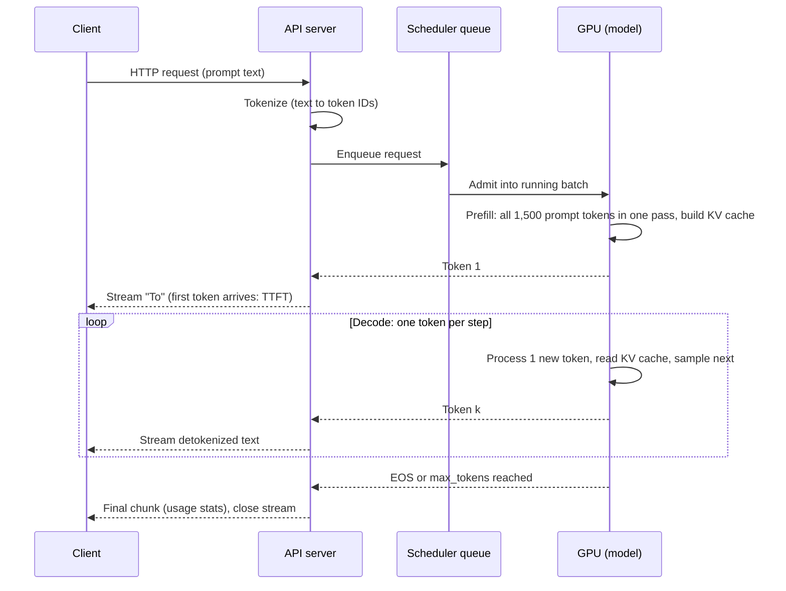

# LLM Inference Fundamentals: Prefill, Decode, TTFT and Throughput

> **Level:** Beginner to Advanced · **Study time:** ~80 min · **Prerequisites:** [Tokenization](../04-transformers/01-tokenization.md), [The Full Transformer Architecture](../04-transformers/05-the-full-transformer-architecture.md), [How LLMs Generate Text: Decoding Strategies](../05-llms/03-text-generation-and-decoding-strategies.md)

## Table of contents

- [Why this matters](#why-this-matters)
- [The life of one request](#the-life-of-one-request)
- [Prefill vs decode: the two phases of generation](#prefill-vs-decode-the-two-phases-of-generation)
- [Latency metrics: TTFT, ITL, TPOT and end-to-end latency](#latency-metrics-ttft-itl-tpot-and-end-to-end-latency)
- [Throughput, and why it is not the same as latency](#throughput-and-why-it-is-not-the-same-as-latency)
- [The latency-throughput trade-off as batch size grows](#the-latency-throughput-trade-off-as-batch-size-grows)
- [How prompt length and output length affect latency](#how-prompt-length-and-output-length-affect-latency)
- [Streaming and perceived latency](#streaming-and-perceived-latency)
- [Percentiles, SLOs and goodput](#percentiles-slos-and-goodput)
- [Measuring prefill and decode latency separately](#measuring-prefill-and-decode-latency-separately)
- [Going deeper: production behavior and debugging](#going-deeper-production-behavior-and-debugging)
- [Common mistakes and misconceptions](#common-mistakes-and-misconceptions)
- [Interview questions and model answers](#interview-questions-and-model-answers)
- [Key takeaways](#key-takeaways)
- [Further reading](#further-reading)
- [Next](#next)

## Why this matters

Every product built on an LLM, from a support chatbot to a coding assistant to an agent that calls tools, is limited by how fast the model produces tokens and how many users one GPU can serve at once. Those two numbers decide whether the product feels snappy and whether it is affordable. Inference also behaves very differently from training: a single request has two phases with opposite performance profiles, and almost every serving optimization you will hear about (KV caching, continuous batching, chunked prefill, speculative decoding, quantization) targets one phase or the other. Interviewers for AI/ML engineering roles ask about prefill, decode, TTFT and throughput constantly, because the answers reveal whether you can reason about a production system or only call an API. This chapter gives you the vocabulary, the mental model and the back-of-envelope math that the rest of the inference section builds on.

## The life of one request

Let us follow one request through a serving system. Our running example for the whole chapter:

- **The model:** a 7-billion-parameter decoder-only LLM (think Llama-2-7B or Mistral-7B class) stored in 16-bit precision.
- **The hardware:** one NVIDIA A100 80GB GPU.
- **The request:** a user of a support chatbot asks "How do I reset my password?" The application adds a system prompt and some help-center text, so the final prompt is about 1,500 tokens. The model answers with about 250 tokens.

> **Analogy:** Think of a restaurant kitchen. The order is written on a ticket (tokenize), waits on the rail until a cook is free (queue), the cook reads the whole order and preps every ingredient at once (prefill), then plates dishes one at a time, each depending on the previous one (decode), and a runner carries each dish to the table as soon as it is ready (stream).

### The six stages

1. **Tokenize.** The server converts the text into a list of integer **token IDs** using the model's tokenizer. A **token** is a chunk of text (a word, part of a word, or punctuation) that the model treats as one unit. In English, one token is roughly 3/4 of a word on average (a rough rule of thumb that varies by tokenizer and language). See [Tokenization](../04-transformers/01-tokenization.md).
2. **Queue.** If the GPU is busy, the request waits in a **queue** until the **scheduler** (the component that decides which requests run on the GPU in each step) admits it. Under heavy load, queue time can be larger than everything else combined.
3. **Prefill.** The model runs one **forward pass** (one trip of the input through every layer of the network) over all 1,500 prompt tokens at the same time. This pass does two things: it computes the probability distribution for the first output token, and it stores intermediate results called the **KV cache** (the attention "keys" and "values" for every prompt token in every layer) so they never need to be recomputed.
4. **Decode loop.** The model now generates one token per step. Each step takes the single newest token, attends to everything in the KV cache, produces a distribution over the vocabulary, **samples** one token from it (greedy, top-p and so on, see [Decoding Strategies](../05-llms/03-text-generation-and-decoding-strategies.md)), and appends that token's keys and values to the cache. The loop stops at an **end-of-sequence (EOS) token**, a **stop sequence**, or the `max_tokens` limit.
5. **Detokenize.** Each new token ID is converted back into text. This is done incrementally, and it is slightly tricky: some tokens are only part of a multi-byte character (an emoji, for example), so the server may hold back bytes until a full character is available.
6. **Stream.** Each new piece of text is sent to the client immediately, usually over **Server-Sent Events (SSE)**, a simple HTTP mechanism where the server keeps the connection open and pushes small messages as they become ready.



Notice the asymmetry. Prefill handles 1,500 tokens in one shot. Decode needs 250 separate steps to produce 250 tokens, and each step must finish before the next can start, because each new token depends on the previous one. That asymmetry is the heart of this chapter.

## Prefill vs decode: the two phases of generation

### Intuition first

> **Analogy:** Reading versus writing. You can skim a page you were handed (the prompt) quickly, with your eyes taking in many words at once. But when you write a reply by hand, you produce one word at a time, and you cannot write word 10 before word 9. Prefill is reading; decode is writing.

**Prefill** (also called the **prompt processing** or **context encoding** phase) is the first forward pass, in which the model processes every prompt token in parallel, builds the KV cache and produces the first output token.

**Decode** (also called the **generation** phase) is the loop that follows, in which the model generates one new token per forward pass, reusing the KV cache, until the response is complete.

Why can prefill be parallel? Because all prompt tokens are already known. With **causal masking** (each token can only attend to itself and earlier tokens, see [Multi-Head Attention and Causal Masking](../04-transformers/04-multi-head-attention-and-causal-masking.md)), the model can compute all positions in one matrix multiplication. During decode, token 2 of the answer does not exist until token 1 has been sampled, so there is no way around sequential steps (short of tricks like speculative decoding, covered in [Speculative Decoding, Prompt Caching and Other Inference Speedups](./05-speculative-decoding-caching-and-other-speedups.md)).

### A quick recap of the KV cache

In attention, every token produces a **query**, a **key** and a **value** vector in every layer. A new token's query must be compared with the keys of all previous tokens, and the resulting weights are applied to their values. Without caching, generating token 251 would require recomputing keys and values for all 1,750 earlier tokens. The **KV cache** stores them once, so each decode step only computes keys and values for the one new token. The cache grows by one entry per layer for every token, and for long contexts or many users it becomes the dominant consumer of GPU memory. The full story, including the memory formula, is in [The KV Cache](./02-kv-cache-explained.md).

### Why prefill is compute-bound and decode is memory-bandwidth-bound

A GPU has two key resources:

- **Compute:** how many floating-point operations per second (**FLOPS**) it can perform. (Careful with the spelling: **FLOPs** with a lowercase s is a *count* of operations, FLOPS or FLOP/s is a *rate*.) An A100 delivers about 312 TFLOPS (trillion FLOPs per second) of dense 16-bit matrix math at peak.
- **Memory bandwidth:** how many bytes per second it can move from its main memory (**HBM**, high-bandwidth memory) into the compute units. An A100 80GB SXM delivers about 2 TB/s (2,039 GB/s).

A workload is **compute-bound** when the arithmetic units are the bottleneck, and **memory-bandwidth-bound** (or simply **memory-bound**) when the GPU spends most of its time waiting for data to arrive from memory. The deciding factor is **arithmetic intensity**: how many FLOPs you do per byte you load.

Here is the key fact. To run one forward pass, the GPU must read every model weight from HBM. A 7B model in 16-bit precision is:

$$\text{weight bytes} = 7 \times 10^9 \text{ params} \times 2 \text{ bytes/param} = 14 \times 10^9 \text{ bytes} = 14 \text{ GB}$$

- **During decode with one user**, each weight is loaded once and used for a single multiply-add (2 FLOPs) for the single new token. That is about 2 FLOPs per 2 bytes, or 1 FLOP per byte. The A100 could do about $312 \times 10^{12} / 2.039 \times 10^{12} \approx 153$ FLOPs in the time it takes to load one byte. This ratio (peak FLOPS divided by bandwidth) is called the **ridge point**: a workload whose arithmetic intensity is below it is memory-bound, above it compute-bound. At 1 FLOP per byte, the compute units sit idle more than 99% of the time, waiting on memory. Decode is memory-bound.
- **During prefill of 1,500 tokens**, each weight is loaded once and reused for all 1,500 tokens, roughly 1,500 FLOPs per byte. That is far above 153, so now the arithmetic units are the bottleneck. Prefill is compute-bound. (Since intensity is roughly the number of tokens processed together, the crossover on an A100 is around 150 tokens: a very short prompt, say 30 tokens, is still memory-bound. "Prefill is compute-bound" holds once the prompt, or the batch of prompts, reaches a few hundred tokens.)

The detailed version of this argument (the roofline model, Tensor Cores, MFU and MBU) belongs to [GPU Fundamentals for LLMs](./03-gpu-fundamentals-compute-bound-vs-memory-bound.md). For now, keep the picture:

```text
            arithmetic intensity (FLOPs per byte loaded)
   low  <---------------------------------------------------->  high
   |                                  |                          |
 decode, batch 1                  ~153 on A100              prefill, 1,500 tokens
 (~1 FLOP/byte)                (the "ridge point")        (~1,500 FLOPs/byte)
 MEMORY-BOUND                                               COMPUTE-BOUND
 time ~ bytes / bandwidth                                   time ~ FLOPs / compute
```

### Back-of-envelope timing for our 7B model

**Prefill time.** A transformer forward pass costs about 2 FLOPs per parameter per token (one multiply and one add), ignoring the attention-score term for now:

$$T_{\text{prefill}} \approx \frac{2 \cdot N_{\text{params}} \cdot L_{\text{prompt}}}{F_{\text{peak}} \cdot \text{MFU}}$$

- $T_{\text{prefill}}$: time for the prefill forward pass, in seconds.
- $N_{\text{params}}$: number of model parameters (here $7 \times 10^9$).
- $L_{\text{prompt}}$: number of prompt tokens.
- $F_{\text{peak}}$: the GPU's peak FLOPs per second for the precision used (A100, 16-bit: $312 \times 10^{12}$).
- $\text{MFU}$: **model FLOPs utilization**, the fraction of peak compute actually achieved (real kernels never hit 100%; 40% to 60% is a reasonable illustrative assumption for prefill).

Worked example, 1,000 prompt tokens, MFU = 0.5 (illustrative):

1. FLOPs: $2 \times 7 \times 10^9 \times 1{,}000 = 14 \times 10^{12} = 1.4 \times 10^{13}$.
2. Effective compute: $312 \times 10^{12} \times 0.5 = 156 \times 10^{12} = 1.56 \times 10^{14}$ FLOPs/s.
3. Time: $1.4 \times 10^{13} / 1.56 \times 10^{14} \approx 0.0897$ s, so about **90 ms**.

That works out to roughly $1{,}000 / 0.09 \approx 11{,}000$ prompt tokens per second. For simple numbers later in the chapter we will round this to an illustrative **prefill rate of 10,000 tokens/s**.

**Decode step time.** Each decode step must read all the weights (plus the KV cache) from HBM:

$$T_{\text{step}} \gtrsim \frac{B_{\text{weights}} + B_{\text{KV}}}{\text{BW}}$$

- $T_{\text{step}}$: time for one decode step (one new token for every sequence in the batch).
- $B_{\text{weights}}$: bytes of model weights (here $14 \times 10^9$).
- $B_{\text{KV}}$: bytes of KV cache read in this step (all cached tokens of all sequences in the batch).
- $\text{BW}$: memory bandwidth (here about $2.039 \times 10^{12}$ bytes/s).
- The $\gtrsim$ sign means "at least about": this is a lower bound, since real kernels never reach 100% of bandwidth.

Worked example, one user, short context (ignore KV):

1. $14 \times 10^9 / 2.039 \times 10^{12} = 0.00687$ s, so about **6.9 ms per token** at best.
2. Maximum speed for that user: $1 / 0.00687 \approx 146$ tokens/s.

Now add the KV cache. For a Llama-2-7B-shaped model (32 layers, hidden size 4,096, and no grouped-query attention, a KV-shrinking trick explained later in this chapter), each token stores a key and a value vector of 4,096 numbers in each of 32 layers, at 2 bytes each:

$$2 \times 32 \times 4{,}096 \times 2 = 524{,}288 \text{ bytes} = 0.5 \text{ MiB per token}$$

With 4,000 tokens of context: $4{,}000 \times 524{,}288 \approx 2.1 \times 10^9$ bytes. The step now reads about $14 + 2.1 = 16.1$ GB, so $16.1 \times 10^9 / 2.039 \times 10^{12} \approx 7.9$ ms. Longer context means slower decode steps, even though the number of new tokens per step is still one.

> **Senior insight:** Notice how lopsided this is. Prefill processes about 10,000 tokens/s (0.1 ms per token), while decode for one user produces at best about 146 tokens/s (about 7 ms per token). A generated token costs roughly 70 to 200 times more wall-clock time than a prompt token. That is why output length usually dominates end-to-end latency, and why many commercial APIs price output tokens higher than input tokens.

### Prefill vs decode side by side

| Aspect | Prefill | Decode |
|---|---|---|
| What it does | Processes all prompt tokens, builds KV cache, emits first token | Generates one token per step using the KV cache |
| Parallelism within a request | High: all prompt tokens at once | None: strictly sequential steps |
| Tokens per forward pass (per request) | $L_{\text{prompt}}$ (for example 1,500) | 1 |
| Bottleneck | Compute (FLOPs) | Memory bandwidth (reading weights and KV cache) |
| GPU compute utilization | High | Low unless many requests are batched |
| Scales with | Prompt length (linearly, plus a quadratic attention term) | Output length (linearly), and context length per step |
| Latency metric it drives | Time to first token | Inter-token latency |
| Main optimizations | Prefix caching, chunked prefill, FlashAttention, faster compute (FP8) | Batching, KV cache efficiency, weight quantization, speculative decoding |

If some optimization names are new, each is explained briefly in [Which optimizations help which phase](#which-optimizations-help-which-phase) below.

## Latency metrics: TTFT, ITL, TPOT and end-to-end latency

**Latency** is how long one request (or part of it) takes, as experienced by one user. For an LLM, a single number is not enough, because the user sees a stream: a wait, then text flowing. We use three related metrics.

> **Analogy:** Ordering at a restaurant. Time to first token is how long until the first dish arrives. Inter-token latency is the gap between dishes. End-to-end latency is the time until the last dish lands. A restaurant can be fast at one and slow at another.

### Time to first token (TTFT)

**Time to first token (TTFT)** is the time from when the request is sent to when the first output token is received. It is what the user feels as "is it doing anything?"

$$\text{TTFT} = T_{\text{network}} + T_{\text{tokenize}} + T_{\text{queue}} + T_{\text{prefill}} + T_{\text{first sample, detok, send}}$$

- $T_{\text{network}}$: time on the wire between client and server (both directions for the first chunk).
- $T_{\text{tokenize}}$: time to convert text to token IDs (usually small, a few milliseconds).
- $T_{\text{queue}}$: time waiting for the scheduler to admit the request.
- $T_{\text{prefill}}$: the prefill forward pass.
- $T_{\text{first sample, detok, send}}$: sampling the first token, detokenizing it and writing it to the stream (usually small).

**Worked example (our chatbot, illustrative numbers).** On a quiet server: network 20 ms + tokenize 3 ms + queue 0 ms + prefill 150 ms (1,500 tokens at 10,000 tokens/s) + first sample and send 7 ms $\approx$ **180 ms**. At peak traffic the same request might wait 2,000 ms in the queue, giving TTFT $\approx 2.18$ s even though prefill is still 150 ms.

> **Common mistake:** Treating TTFT as "prefill time". On a quiet system they are close. Under load, queue time often dominates TTFT, and on the client side network and proxies add more.

### Inter-token latency (ITL) and time per output token (TPOT)

**Inter-token latency (ITL)** is the time between two consecutive output tokens arriving for the same request. Each request produces many ITL samples, one per gap, so ITL is a distribution: you look at its median and tail.

**Time per output token (TPOT)** is the average gap per request, usually defined as:

$$\text{TPOT} = \frac{\text{E2E} - \text{TTFT}}{N_{\text{out}} - 1}$$

- $\text{E2E}$: end-to-end latency of the request (defined below).
- $\text{TTFT}$: time to first token.
- $N_{\text{out}}$: number of output tokens generated.
- We divide by $N_{\text{out}} - 1$ because the first token is covered by TTFT, so there are $N_{\text{out}} - 1$ gaps after it.

The averages of ITL and TPOT are essentially the same idea (for a single request, mean ITL equals TPOT). Across many requests they can differ: mean ITL is usually averaged over all gaps, so long responses weigh more, while mean TPOT is averaged over requests, so each request counts once. The difference is what they reveal: TPOT summarizes a request in one number, while the ITL distribution exposes stalls (for example, one 800 ms freeze in the middle of an otherwise smooth stream). Different tools define these slightly differently (some divide by $N_{\text{out}}$ instead of $N_{\text{out}} - 1$, some exclude the first token, some count stream chunks rather than tokens), so always check the definition before comparing numbers across tools.

The user-facing speed is **tokens per second per user** (also called **output speed** or **per-user decode rate**):

$$\text{tokens/s per user} = \frac{1}{\text{TPOT}}$$

### End-to-end latency

**End-to-end latency (E2E)** is the time from sending the request to receiving the last token:

$$\text{E2E} \approx \text{TTFT} + (N_{\text{out}} - 1) \cdot \text{ITL}$$

- $\text{ITL}$ here means the average inter-token latency (equivalently, TPOT).
- The other symbols are as above.

```text
 time ---->
 |<------- TTFT ------->|<-ITL->|<-ITL->|<-ITL->| ... |<-ITL->|
 send   queue + prefill  tok 1   tok 2   tok 3   tok 4      tok N
 |<--------------------------- E2E ------------------------------>|
                         (N_out - 1 gaps after the first token)
```

**Worked example (our support chatbot, illustrative numbers).** Suppose TTFT = 180 ms, average ITL = 22 ms and the answer is $N_{\text{out}} = 250$ tokens.

1. Number of gaps: $250 - 1 = 249$.
2. Decode time: $249 \times 22 = 5{,}478$ ms.
3. E2E: $180 + 5{,}478 = 5{,}658$ ms, so about **5.66 s**.
4. Tokens/s per user: $1{,}000 / 22 \approx 45.5$ tokens/s.
5. Average output rate including the wait: $250 / 5.658 \approx 44.2$ tokens/s.
6. Going the other way (what a benchmark client does): from measured E2E = 5,658 ms and TTFT = 180 ms, $\text{TPOT} = (5{,}658 - 180) / 249 = 22$ ms.

Notice that TTFT is only about 3% of E2E here ($180 / 5{,}658 \approx 0.032$). For this request, the decode loop is almost the entire wait. But because the answer streams, the user starts reading after 180 ms.

```python
# Latency calculator: no dependencies, Python 3.10+
def e2e_latency_ms(ttft_ms: float, itl_ms: float, n_out: int) -> float:
    """End-to-end latency: first token after TTFT, then (n_out - 1) gaps of ITL."""
    return ttft_ms + (n_out - 1) * itl_ms

def tokens_per_sec_per_user(itl_ms: float) -> float:
    return 1000.0 / itl_ms

print(e2e_latency_ms(180, 22, 250))            # 5658
print(round(tokens_per_sec_per_user(22), 1))   # 45.5
```

> **Interview tip:** When asked about LLM latency, always split it: "TTFT is driven by queueing and prefill, so by prompt length and load; ITL is driven by decode, so by memory bandwidth, batch size and context length; E2E is roughly TTFT plus output tokens times ITL." That one sentence shows you understand the whole picture.

## Throughput, and why it is not the same as latency

**Throughput** is how much work the whole system completes per unit of time, across all users. Common forms:

- **Output tokens per second (output TPS):** total generated tokens per second across all requests. The most common LLM serving throughput metric.
- **Total tokens per second:** input plus output tokens per second. Useful for prefill-heavy workloads, but it can flatter a system, because prompt tokens are much cheaper to process.
- **Requests per second (RPS, or QPS):** completed requests per second. Only meaningful if you also state the input and output length distribution.

> **Analogy:** A highway. Latency is how long your car takes to get from A to B. Throughput is how many cars pass a point per hour. Adding lanes raises throughput without making any car faster. Packing cars bumper to bumper also raises throughput, but every car slows down.

| | Latency | Throughput |
|---|---|---|
| Question it answers | How long does one user wait? | How much work does the system do per second? |
| Unit | Seconds (TTFT, ITL, E2E) | Tokens/s or requests/s |
| Perspective | One request (user experience) | Whole system (capacity and cost) |
| Who cares most | Product, UX, interactive users | Finance, capacity planning, batch jobs |
| Improved by | Smaller batches, faster hardware, shorter prompts and outputs, speculative decoding | Larger batches, continuous batching, more GPUs, KV memory efficiency |
| Can hurt the other? | Optimizing latency (small batches) wastes GPU capacity | Optimizing throughput (huge batches) slows each user |

### Little's law connects them

**Little's law** from queueing theory says that, in a stable system, the average number of requests in flight equals the arrival rate times the average time each request spends in the system:

$$L = \lambda \cdot W$$

- $L$: average number of concurrent requests in the system.
- $\lambda$: average arrival rate (requests per second), equal to throughput in a stable system.
- $W$: average time a request spends in the system (E2E latency).

Worked example: if the chatbot receives $\lambda = 10$ requests/s and each takes $W = 5.66$ s, then $L = 10 \times 5.66 = 56.6$, so about 57 requests are in flight at any moment. Your serving stack must hold about 57 concurrent sequences (and their KV caches) in its running batch, or requests will pile up in the queue. This is a quick way to sanity-check capacity plans in an interview.

### Throughput sets your cost per token

If one GPU costs an illustrative \$2 per hour and sustains 2,000 output tokens/s:

1. Tokens per hour: $2{,}000 \times 3{,}600 = 7{,}200{,}000$.
2. Cost per million output tokens: $\$2 / 7.2 \approx \$0.28$.

Double the throughput at the same GPU cost and the cost per token halves. That is why the serving optimizations in later chapters are worth so much money.

## The latency-throughput trade-off as batch size grows

### Why batching helps decode so much

Recall that decode is memory-bound: each step must read all 14 GB of weights no matter how many sequences are being decoded. **Batching** means running the decode step for many requests together in one forward pass. The weights are read once and reused for every sequence in the batch. If one sequence takes 7 ms per step, eight sequences might take only a little longer, because the extra work (a bit more arithmetic and each sequence's own KV cache reads) is small compared to reading the weights. Older servers used **static batching** (a group of requests starts together and the batch runs until its longest request finishes); modern servers use **continuous batching**, where finished sequences leave and waiting ones join at every decode step, so the batch stays full.

> **Analogy:** A bus versus a taxi. Driving the route takes about the same time whether the bus carries 1 or 40 passengers (the weights must be "driven" through either way). Filling the bus multiplies passengers delivered per hour. But each extra stop for boarding slows the ride a bit for everyone on board.

### A toy model

Let us model one decode step for a batch of $B$ sequences:

$$T_{\text{step}}(B) = T_0 + c \cdot B$$

- $T_0$: fixed cost per step, mostly reading the weights (illustrative: 10 ms, a bit above the 6.9 ms lower bound).
- $c$: extra cost per sequence in the batch, mostly reading its KV cache plus its share of compute (illustrative: 0.3 ms).
- $B$: batch size (number of sequences decoding together).

Then:

- **Per-user ITL** is $T_{\text{step}}(B)$, because each sequence gets one token per step.
- **System throughput** is $B / T_{\text{step}}(B)$ tokens per second.

```python
# Toy decode model: illustrative constants, not measurements
T0_MS, C_MS = 10.0, 0.3

print(f"{'batch':>5} {'ITL ms':>7} {'tok/s/user':>10} {'system tok/s':>12}")
for b in [1, 8, 32, 64, 128]:
    step_ms = T0_MS + C_MS * b
    per_user = 1000 / step_ms
    system = b * 1000 / step_ms
    print(f"{b:>5} {step_ms:>7.1f} {per_user:>10.1f} {system:>12.0f}")
# batch  ITL ms tok/s/user system tok/s
#     1    10.3       97.1           97
#     8    12.4       80.6          645
#    32    19.6       51.0         1633
#    64    29.2       34.2         2192
#   128    48.4       20.7         2645
```

Read the table carefully, because it is the whole trade-off in five rows:

- Going from batch 1 to batch 8 multiplies throughput by about 6.6 ($645 / 97$) while ITL rises only from 10.3 to 12.4 ms. Almost free.
- Going from 64 to 128 adds only about 21% throughput ($2{,}645 / 2{,}192 \approx 1.21$) but ITL rises by about 66% ($48.4 / 29.2 \approx 1.66$). Expensive.
- Eventually the curve flattens completely: either the step becomes compute-bound (enough sequences that arithmetic, not memory, dominates) or you run out of memory for KV caches.

```text
 system throughput (tok/s)
 2600 |                                   * (128)
 2200 |                        * (64)
 1600 |              * (32)
      |
  650 |   * (8)
  100 |*(1)
      +----------------------------------------------> per-user ITL (ms)
       10   12          20        29              48
  Throughput rises steeply at first, then flattens while ITL keeps growing.
```

### Your latency SLO picks your batch size

A **service level objective (SLO)** is a target for a metric, such as "p90 TPOT at most 50 ms" (p90 is the 90th percentile: 90% of requests have a TPOT at or below it; percentiles are covered in detail later). With the toy model, the largest batch that meets a TPOT target is:

$$B_{\max} = \left\lfloor \frac{\text{TPOT}_{\text{SLO}} - T_0}{c} \right\rfloor$$

- For a 50 ms SLO: $(50 - 10)/0.3 = 133.3$, so $B_{\max} = 133$.
- For a 30 ms SLO: $(30 - 10)/0.3 = 66.7$, so $B_{\max} = 66$, giving a throughput of $66 \times 1{,}000 / (10 + 19.8) = 66{,}000 / 29.8 \approx 2{,}215$ tokens/s.

So a tighter latency target directly lowers the maximum throughput per GPU, which raises cost per token. This is the most important trade-off in LLM serving. Real servers expose it as settings like the maximum number of concurrent sequences or the maximum tokens per batch (for example `max_num_seqs` and `max_num_batched_tokens` in vLLM; flag names vary by framework and version).

> **Senior insight:** Batching also affects TTFT. A new request's prefill has to share the GPU with ongoing decodes, and with a large running batch there is less spare compute, so queue time and prefill time both rise. How the scheduler mixes prefills and decodes (continuous batching, chunked prefill) is covered in [Batching, Continuous Batching and PagedAttention](./04-batching-continuous-batching-and-paged-attention.md).

## How prompt length and output length affect latency

**Terminology first.** **Prompt length** is the number of input tokens when the request arrives (in a chat, including the earlier turns the application resends). **Context length** is the number of tokens the model attends over at a given moment: the prompt plus every token generated so far, so it grows during decode. The **context window** is the maximum context length the model supports. Interviewers often use "prompt length" and "context length" interchangeably.

### Prompt length drives TTFT

Prefill time grows roughly linearly with prompt length for short and medium prompts, because the weight matrix multiplications cost about $2 \cdot N_{\text{params}}$ FLOPs per token. Using our illustrative prefill rate of 10,000 tokens/s on an otherwise idle GPU:

| Prompt tokens | Prefill time (linear part) | Arithmetic |
|---|---|---|
| 500 | 50 ms | $500 / 10{,}000 = 0.05$ s |
| 2,000 | 200 ms | $2{,}000 / 10{,}000 = 0.2$ s |
| 8,000 | 800 ms (plus attention overhead) | $8{,}000 / 10{,}000 = 0.8$ s |
| 32,000 | 3.2 s (plus significant attention overhead) | $32{,}000 / 10{,}000 = 3.2$ s |

**The quadratic attention term.** Attention compares every token with every earlier token. Per layer, computing the scores ($QK^\top$) and applying them to values costs about $2 L^2 d$ FLOPs each, so roughly:

$$\text{attention FLOPs} \approx 4 \cdot L^2 \cdot d \cdot n_{\text{layers}}$$

- $L$: sequence length (prompt tokens).
- $d$: model hidden size (4,096 for our 7B model).
- $n_{\text{layers}}$: number of layers (32).
- Causal masking lets optimized kernels skip about half of this, so the real cost is closer to half the formula.

Compare it with the linear part, $2 \cdot N_{\text{params}} \cdot L$:

- At $L = 1{,}000$: attention $\approx 4 \times 10^6 \times 4{,}096 \times 32 \approx 5.2 \times 10^{11}$ FLOPs versus linear $1.4 \times 10^{13}$. Attention is under 4% of the work, negligible.
- At $L = 32{,}000$: attention $\approx 4 \times 1.024 \times 10^9 \times 4{,}096 \times 32 \approx 5.4 \times 10^{14}$ FLOPs (about $2.7 \times 10^{14}$ with causal skipping) versus linear $2 \times 7 \times 10^9 \times 32{,}000 = 4.48 \times 10^{14}$. Attention is now the same order of magnitude as all the weight matmuls.

So TTFT is roughly linear in prompt length up to a few thousand tokens and becomes increasingly superlinear for very long contexts. Kernels like FlashAttention make this faster and memory-efficient but do not remove the quadratic FLOP count (see [Modern LLM Architecture](../04-transformers/08-modern-llm-architecture-improvements.md)).

### Output length drives total latency

Each output token adds one decode step. With an illustrative TTFT of 300 ms and ITL of 20 ms:

| Output tokens | Decode time | E2E latency | Arithmetic |
|---|---|---|---|
| 50 | 0.98 s | 1.28 s | $300 + 49 \times 20 = 300 + 980 = 1{,}280$ ms |
| 200 | 3.98 s | 4.28 s | $300 + 199 \times 20 = 300 + 3{,}980 = 4{,}280$ ms |
| 1,000 | 19.98 s | 20.28 s | $300 + 999 \times 20 = 300 + 19{,}980 = 20{,}280$ ms |

E2E is linear in output length, and the slope (ITL) is large. Asking for 1,000 tokens instead of 200 multiplies wait time by almost 5, while adding 1,500 tokens to the prompt would add only about 150 ms of prefill.

### Context length also slows each decode step

There is a second, subtler effect. Each decode step reads the KV cache of every token so far. From the earlier calculation, a 4,000-token context adds about 2.1 GB of reads per step on our 7B model, pushing the bandwidth lower bound from 6.9 to 7.9 ms per token, roughly 15% slower. With large batches of long-context requests, KV reads can exceed weight reads and dominate the step time. Models with **grouped-query attention (GQA)**, where several query heads share one key/value head, shrink the KV cache and soften this effect (see [The KV Cache](./02-kv-cache-explained.md)).

### Summary of what moves what

| Change | Effect on TTFT | Effect on ITL | Effect on E2E | Effect on throughput |
|---|---|---|---|---|
| Longer prompt | Up (linear, then superlinear) | Slightly up (bigger KV cache) | Up a little, usually | Down (more prefill work, more KV memory per request) |
| Longer output | None | Slightly up as the context grows | Up strongly (linear) | Output TPS can stay similar; RPS goes down |
| Bigger batch | Up (more contention and queueing) | Up | Up | Up, until compute or memory saturates |
| More load (arrival rate) | Up sharply once the queue builds | Up (bigger batches) | Up | Up until saturation, then flat |
| Prefix cache hit | Down (shared prefix not recomputed) | None | Down a little | Up |

### Workload shapes

| Workload | Typical shape | Dominant phase | What to optimize first |
|---|---|---|---|
| RAG question answering | Long prompt (retrieved chunks), short answer | Prefill | TTFT: prefix caching, fewer or shorter chunks |
| Summarization, extraction, classification | Long input, short output | Prefill | Prefill throughput, prompt trimming |
| Chat | Medium prompt growing over turns, medium output | Both | Balanced: chunked prefill, prefix caching for history |
| Code or long-form generation | Short-to-medium prompt, long output | Decode | ITL: batching, quantization, speculative decoding |
| Reasoning models | Medium prompt, very long hidden reasoning plus answer | Decode | ITL and output-length control (see [Reasoning Models](../05-llms/12-reasoning-models-and-test-time-compute.md)) |
| Agents | Repeated calls with an ever-growing context | Prefill repeated many times | Prefix caching, context management |

## Streaming and perceived latency

**Streaming** means sending each token (or small group of tokens) to the client as soon as it is generated, instead of waiting for the full response. It does not make the model any faster: E2E is unchanged or a tiny bit slower due to per-message overhead. What it changes is **perceived latency**, how long the experience feels.

> **Analogy:** A video that starts playing after 1 second and buffers while you watch feels much faster than one that makes you wait 30 seconds for the full download, even though the total download time is the same.

For our chatbot, without streaming the user stares at a spinner for 5.66 s. With streaming, text appears after 180 ms and flows at about 45 tokens/s. A typical adult reads somewhere around 200 to 300 words per minute (roughly 4 to 7 tokens per second, a rough figure), so a stream at 45 tokens/s is far faster than anyone reads. Beyond a comfortable reading speed, faster ITL improves perception only slightly, while TTFT remains very noticeable.

When streaming does **not** help:

- **Structured outputs and tool calls.** If the client must parse a complete JSON object or a function call before acting (see [Structured Outputs and Function Calling](../05-llms/05-structured-outputs-and-function-calling.md)), it needs the whole response. E2E is what matters.
- **Agents and pipelines.** Each LLM call in a chain blocks the next one, so E2E latencies add up. A 5-step agent with 3 s per step is a 15 s wait, streaming or not.
- **Reasoning models.** The model may generate thousands of hidden "thinking" tokens before the first visible answer token. The user-facing "time to first visible token" can be many seconds even when the server's TTFT is small. Measure both.
- **Post-generation guardrails.** If a safety filter must check the full output before release (see [LLM Safety and Guardrails](../05-llms/13-llm-safety-guardrails-and-responsible-ai.md)), you lose streaming or must check in chunks.

> **Common mistake:** A proxy, load balancer or API gateway buffering the SSE response. The server streams perfectly, but the client receives everything at the end, so client-side TTFT equals E2E. If client TTFT is much larger than server TTFT, check for response buffering in reverse proxies (for example, NGINX proxy buffering) and compression middleware.

## Percentiles, SLOs and goodput

### Why averages lie

Latency distributions are skewed: most requests are fast, a few are very slow (they arrived during a burst, had a huge prompt, or got stuck behind a long prefill). The mean hides this. Production teams track **percentiles**: **p50** (median, half of requests are faster), **p95** (95% of requests are faster) and **p99**. A user who sends 20 messages in a session has about a 64% chance ($1 - 0.95^{20} \approx 0.64$, assuming independent requests) of hitting the slowest 5% at least once, so tails define the experience.

Typical LLM SLOs look like (illustrative): "p95 TTFT under 1 s and p95 TPOT under 50 ms, for prompts up to 4,000 tokens."

### SLO attainment

**SLO attainment** is the fraction of requests that meet all their latency targets:

$$\text{SLO attainment} = \frac{\text{number of requests meeting all SLOs}}{\text{total requests}}$$

### Goodput

**Goodput** is throughput that counts only the requests that met their SLOs. The term in LLM serving was popularized by "DistServe: Disaggregating Prefill and Decoding for Goodput-optimized Large Language Model Serving" (Zhong et al., 2024), which defines it as the maximum request rate a system can sustain while still meeting a target SLO attainment (for example, 90% of requests within both TTFT and TPOT targets). In day-to-day monitoring, people also use the simpler version: the rate of requests completed within SLO.

**Worked example (illustrative).** SLO: TTFT at most 500 ms and TPOT at most 50 ms. You measure two configurations over 100 s each.

| | Config A (moderate batch) | Config B (aggressive batch) |
|---|---|---|
| Completed requests | 1,000 | 1,200 |
| Raw throughput | $1{,}000 / 100 = 10$ req/s | $1{,}200 / 100 = 12$ req/s |
| Requests meeting both SLOs | 900 | 700 |
| SLO attainment | $900 / 1{,}000 = 90\%$ | $700 / 1{,}200 \approx 58.3\%$ |
| Goodput (simple version) | $900 / 100 = 9$ req/s | $700 / 100 = 7$ req/s |

Config B wins on raw throughput and loses on everything users care about. If your target is 90% attainment, config A meets it and B does not.

```python
# Compute SLO attainment and goodput from per-request records (Python 3.10+)
from dataclasses import dataclass

@dataclass
class Record:
    ttft_ms: float
    tpot_ms: float

def slo_report(records: list[Record], window_s: float,
               ttft_slo_ms: float = 500, tpot_slo_ms: float = 50) -> dict:
    ok = [r for r in records if r.ttft_ms <= ttft_slo_ms and r.tpot_ms <= tpot_slo_ms]
    return {
        "throughput_rps": len(records) / window_s,
        "slo_attainment": len(ok) / len(records),
        "goodput_rps": len(ok) / window_s,
    }

recs = [Record(200, 30), Record(450, 45), Record(800, 30), Record(300, 70)]
print(slo_report(recs, window_s=1.0))
# {'throughput_rps': 4.0, 'slo_attainment': 0.5, 'goodput_rps': 2.0}
```

> **Senior insight:** Capacity planning should be done on goodput, not throughput. "This GPU does 2,600 tokens/s" is meaningless without "at what TTFT and TPOT". The right question is "how many requests per second can one replica sustain while 90% (or 99%) of requests meet our SLOs, for our real prompt and output length distribution?" Then you divide expected peak traffic by that number to get the replica count.

## Measuring prefill and decode latency separately

This is a favorite interview question because it tests whether you can design an experiment. There are four complementary approaches.

### 1. From the client: timestamps on a streamed response

TTFT approximates queue plus prefill (plus network). The gaps between subsequent tokens measure decode. The sketch below works against any OpenAI-compatible endpoint, such as a local vLLM or SGLang server.

```python
# pip install openai   (v1.26+ SDK for stream_options; streaming options vary by SDK and server version)
import time
from openai import OpenAI

# A local OpenAI-compatible server, for example started with: vllm serve <model>
client = OpenAI(base_url="http://localhost:8000/v1", api_key="not-needed-locally")

def measure_stream(prompt: str, model: str, max_tokens: int = 256) -> dict:
    t_send = time.perf_counter()
    stream = client.chat.completions.create(
        model=model,
        messages=[{"role": "user", "content": prompt}],
        max_tokens=max_tokens,
        temperature=0.0,
        stream=True,
        stream_options={"include_usage": True},  # final chunk carries token counts
    )
    arrivals, usage = [], None
    for chunk in stream:
        if chunk.usage is not None:
            usage = chunk.usage
        if chunk.choices and chunk.choices[0].delta.content:
            arrivals.append(time.perf_counter())  # a chunk may hold 1+ tokens

    n_out = usage.completion_tokens if usage else len(arrivals)
    ttft = arrivals[0] - t_send
    e2e = arrivals[-1] - t_send
    gaps = [b - a for a, b in zip(arrivals, arrivals[1:])]
    return {
        "prompt_tokens": usage.prompt_tokens if usage else None,
        "output_tokens": n_out,
        "ttft_ms": 1000 * ttft,
        "tpot_ms": 1000 * (e2e - ttft) / max(n_out - 1, 1),
        "max_gap_ms": 1000 * max(gaps) if gaps else 0.0,  # stalls show up here
        "e2e_ms": 1000 * e2e,
    }
```

Caveats: the server may batch several tokens into one SSE chunk, so count tokens from the usage field rather than chunks; the client clock includes network time; and the very first call to a cold server includes warm-up (CUDA graph capture, kernel compilation), so discard it.

### 2. Controlled experiments that isolate each phase

Vary one length at a time on an otherwise idle server:

- **Isolate prefill:** sweep prompt length (for example 256, 1,000, 4,000, 16,000 tokens) with `max_tokens=1`. E2E is now essentially TTFT, which is prefill (plus fixed overhead). Plot it against prompt length: you should see a line that bends upward at long lengths.
- **Isolate decode:** use a short fixed prompt and sweep `max_tokens` (for example 32, 128, 512, 2,048), using `ignore_eos`-style options where the server supports them so the model actually generates the full length. The slope of E2E against output tokens is the TPOT.
- **Separate load effects:** repeat both sweeps at increasing concurrency (1, 8, 32, 64 parallel clients). Rising TTFT with flat prefill time means queueing; rising TPOT means bigger batches or prefill interference.

You can also fit a simple linear model across many runs:

$$\text{E2E} \approx a + b \cdot L_{\text{prompt}} + c \cdot N_{\text{out}}$$

- $a$: fixed overhead (network, tokenization, scheduling).
- $b$: seconds per prompt token (inverse of the prefill rate).
- $c$: seconds per output token (approximately TPOT).

```python
# pip install numpy
import numpy as np

def fit_latency_model(prompt_lens, output_lens, e2e_s):
    """Least-squares fit of e2e = a + b*prompt_len + c*output_len."""
    X = np.column_stack([np.ones(len(prompt_lens)), prompt_lens, output_lens])
    (a, b, c), *_ = np.linalg.lstsq(X, np.asarray(e2e_s), rcond=None)
    return {"overhead_s": float(a), "prefill_tok_per_s": float(1 / b), "tpot_ms": float(1000 * c)}

# Synthetic data generated from known (illustrative) parameters, to show recovery:
rng = np.random.default_rng(0)
p = rng.integers(100, 4000, size=200)
o = rng.integers(10, 500, size=200)
e2e = 0.03 + p / 10_000 + o * 0.020 + rng.normal(0, 0.01, size=200)
print(fit_latency_model(p, o, e2e))  # close to 0.03 s, 10,000 tok/s, 20 ms (seed 0: ~0.025, ~9,900, ~20.0)
```

This only works cleanly at fixed load; under varying concurrency the coefficients themselves change.

### 3. From the inside: a manual prefill and decode loop

To see the two phases with your own eyes, run the forward passes yourself with Hugging Face Transformers. This uses the tiny GPT-2 model so it runs on a laptop CPU; on a GPU with a 7B model the contrast is much sharper.

```python
# pip install torch transformers
import time
import torch
from transformers import AutoModelForCausalLM, AutoTokenizer

model_id = "gpt2"  # 124M params, context limit 1,024 tokens
device = "cuda" if torch.cuda.is_available() else "cpu"
tok = AutoTokenizer.from_pretrained(model_id)
model = AutoModelForCausalLM.from_pretrained(model_id).to(device).eval()

def sync():
    if device == "cuda":
        torch.cuda.synchronize()  # GPU calls are async: wait before reading the clock

@torch.no_grad()
def prefill_then_decode(prompt_len: int, new_tokens: int = 32) -> tuple[float, float]:
    # Build a prompt of exactly prompt_len tokens by repeating one token ID
    ids = torch.full((1, prompt_len), tok.encode(" the")[0], device=device)

    # PREFILL: one forward pass over all prompt tokens, returns the KV cache
    sync(); t0 = time.perf_counter()
    out = model(input_ids=ids, use_cache=True)
    past = out.past_key_values
    next_id = out.logits[:, -1, :].argmax(dim=-1, keepdim=True)  # greedy pick
    sync(); prefill_ms = 1000 * (time.perf_counter() - t0)

    # DECODE: one new token per forward pass, reusing and extending the cache
    step_ms = []
    for _ in range(new_tokens - 1):
        t = time.perf_counter()
        out = model(input_ids=next_id, past_key_values=past, use_cache=True)
        past = out.past_key_values
        next_id = out.logits[:, -1, :].argmax(dim=-1, keepdim=True)
        sync(); step_ms.append(1000 * (time.perf_counter() - t))
    return prefill_ms, sum(step_ms) / len(step_ms)

prefill_then_decode(16)  # warm-up run, ignore
for n in [16, 128, 512, 896]:
    p_ms, d_ms = prefill_then_decode(n)
    print(f"prompt={n:4d}  prefill={p_ms:7.1f} ms  avg decode step={d_ms:5.1f} ms")
```

What you should observe: prefill time grows with prompt length, while the average decode step stays nearly flat (rising slightly as the cache grows). The per-token cost of prefill (prefill time divided by prompt length) is far smaller than one decode step. Exact numbers depend on your hardware, so none are shown here.

### 4. Server-side metrics and profilers

Production serving engines record phase timings per request and expose them as metrics. vLLM, for example, exposes Prometheus histograms for TTFT, time per output token or inter-token latency, end-to-end latency, queue time, and (in recent versions) separate prefill and decode time per request. Metric names change between versions, so check the server's `/metrics` endpoint rather than memorizing them. Benchmark tools such as vLLM's serving benchmark, NVIDIA GenAI-Perf (being succeeded by NVIDIA AIPerf) and Anyscale's LLMPerf report TTFT, ITL and throughput percentiles under a configured load. For kernel-level questions (why is this prefill slow?), use a profiler such as the PyTorch profiler or NVIDIA Nsight Systems. Benchmark methodology is covered in [Optimizing and Benchmarking LLM Latency and Cost](./07-optimizing-and-benchmarking-llm-latency-and-cost.md), and production dashboards in [Monitoring ML and LLM Systems in Production](../10-mlops/06-monitoring-ml-and-llm-systems-in-production.md).

> **Interview tip:** The crisp answer to "how would you distinguish prefill from decode latency?" is: "TTFT minus queue and network time is prefill; the gaps between streamed tokens are decode. To isolate them, I sweep prompt length with max_tokens=1 for prefill, sweep output length with a short prompt for decode, run both on an idle server and then under load, and cross-check against the server's own queue, prefill and decode metrics."

## Going deeper: production behavior and debugging

### Prefill-decode interference

In a real server, many requests share the GPU. With **continuous batching** (also called iteration-level scheduling, introduced in "Orca: A Distributed Serving System for Transformer-Based Generative Models", Yu et al., 2022), the scheduler can add new requests to the running batch at every decode step instead of waiting for the whole batch to finish. That is great for throughput, but it creates a problem: a new request's prefill runs in the same iteration as everyone else's decode.

Illustrative example: 50 users are streaming at 20 ms per token. A new request arrives with an 8,000-token prompt. If its whole prefill (about 800 ms at our illustrative rate) is executed in one iteration, all 50 users see an 800 ms freeze in their stream. Their p99 ITL explodes even though their average TPOT rises only modestly (one 800 ms gap spread over a 250-token answer adds about 3 ms per token).

Two standard fixes:

- **Chunked prefill:** split long prefills into chunks (for example a few hundred to a few thousand tokens) and mix one chunk with the ongoing decodes in each iteration, so no single step becomes huge. Introduced in "SARATHI: Efficient LLM Inference by Piggybacking Decodes with Chunked Prefills" (Agrawal et al., 2023) and developed into a full scheduler in "Taming Throughput-Latency Tradeoff in LLM Inference with Sarathi-Serve" (Agrawal et al., 2024). Trade-off: the long prompt's own TTFT goes up slightly, while everyone else's ITL becomes smooth.
- **Prefill-decode disaggregation:** run prefill and decode on separate pools of GPUs, transferring the KV cache from the prefill pool to the decode pool. Each pool can then be sized and tuned for its own bottleneck (compute for prefill, bandwidth and memory for decode). Studied in DistServe (Zhong et al., 2024) and "Splitwise: Efficient Generative LLM Inference Using Phase Splitting" (Patel et al., 2024). Trade-off: KV cache transfer cost and operational complexity.

Details are in [Batching, Continuous Batching and PagedAttention](./04-batching-continuous-batching-and-paged-attention.md) and the platform design in [System Design: A Multi-Tenant LLM Inference Platform](../11-system-design/03-design-a-multi-tenant-llm-inference-platform.md).

### Which optimizations help which phase

Because the phases have different bottlenecks, the same optimization can help one and do nothing for the other. This mapping is extremely useful in interviews:

| Optimization | Helps TTFT (prefill) | Helps ITL (decode) | Helps throughput | Why |
|---|---|---|---|---|
| Prefix (prompt) caching | Yes, strongly for shared prefixes | No | Yes | Skips recomputing KV for a repeated system prompt or history |
| Chunked prefill | Slightly worse for the long prompt | Yes (smooths tail ITL) | Neutral to positive | Bounds the size of each iteration |
| Continuous batching | Yes (less queueing) | Slightly worse per user | Yes, strongly | Keeps the batch full every step |
| Weight-only quantization (INT4/INT8) | Little, sometimes slightly worse (prefill is compute-bound; dequantization adds work) | Yes (fewer bytes per step) | Yes (more memory for KV) | Decode is memory-bound, so fewer bytes means faster steps |
| FP8 compute (weights and activations) | Yes (faster matmuls on supporting GPUs) | Yes | Yes | Halves bytes and raises compute rate |
| Speculative decoding | No | Yes, at low batch size | Can hurt at high batch size | Verifies several draft tokens per memory-bound step |
| FlashAttention | Yes, for long prompts | Some (decode-specific kernels help long contexts) | Yes | Less memory traffic in attention |
| Tensor parallelism across GPUs | Yes | Yes | Per GPU, often worse | Splits weights so each GPU reads fewer bytes, but adds communication |
| Shorter prompts (fewer RAG chunks) | Yes | Slightly | Yes | Less prefill and smaller KV cache |
| Shorter outputs (max_tokens, concise prompting) | No | No (per token) | Yes (RPS) | Fewer decode steps per request |

The weight-only quantization row explains a classic interview puzzle: "We quantized our model to INT4, memory dropped, but latency did not improve." Often the workload was prefill-heavy or compute-bound, the kernels dequantize inefficiently at the batch size used, or the bottleneck was queueing. See [Debugging Case: A Quantized LLM Uses Less Memory but Latency Is Unchanged](../11-system-design/06-debugging-case-quantized-llm-not-faster.md) and [Practical LLM Quantization](../07-model-compression/04-llm-quantization-gptq-awq-and-outliers.md).

### What changes at scale

- **Load, not the model, usually decides TTFT.** As arrival rate approaches the system's capacity, queue time grows sharply (queueing theory says waiting time blows up as utilization approaches 100%). That is why production systems run at a comfortable utilization headroom and use autoscaling plus admission control (rejecting or deferring requests rather than letting the queue grow without bound).
- **Memory decides batch size.** Each in-flight sequence needs KV cache memory. On our A100, after 14 GB of weights there is roughly 60 GB or so for KV cache and activations. At 0.5 MiB per token, that is on the order of 120,000 cached tokens in total, which is only about 30 sequences at 4,000 tokens each. When the cache fills up, servers **preempt** requests (pause them and either swap their cache out or recompute it later), which shows up as sudden latency spikes.
- **Long tails come from heterogeneity.** Mixed prompt lengths, mixed output lengths, bursty arrivals and multiple tenants make p99 far worse than p50. Separating traffic classes (interactive vs batch), routing by expected prompt length, and setting per-tenant rate limits all help.
- **Offline batch jobs flip the priorities.** For nightly summarization of millions of documents, nobody watches the stream. Maximize throughput (huge batches, long queues are fine) and minimize cost per token. Many providers offer cheaper batch APIs for exactly this reason.

### A debugging playbook

| Symptom | Likely cause | What to check | Typical fix |
|---|---|---|---|
| High TTFT even at low load | Long prompts, no prefix cache reuse, slow cold start | Prompt token counts, prefix cache hit rate, warm-up | Trim prompts, enable prefix caching, keep replicas warm |
| TTFT fine at low load, terrible at peak | Queueing | Queue time metric, running vs waiting requests | Scale out, admission control, raise batch capacity if memory allows |
| Periodic ITL spikes (stream "stutters") | Long prefills interfering with decodes | Max ITL and p99 ITL vs average; correlation with long-prompt arrivals | Chunked prefill, separate long-context traffic, disaggregation |
| ITL rises steadily with concurrency | Batch too large for the TPOT SLO; KV reads growing | TPOT vs running batch size | Cap concurrent sequences, add replicas, quantize KV cache |
| Sudden latency cliffs under load | KV cache exhausted, preemption | Preemption counters, KV cache usage | Lower max context or concurrency, more memory, GQA models, KV quantization |
| E2E long but TTFT and ITL look healthy | Outputs are very long | Output token distribution | Lower max_tokens, prompt for concise answers, smaller reasoning budgets |
| Client TTFT much larger than server TTFT | Network, gateway, or buffering proxy | Compare client and server timestamps per request ID | Disable response buffering, move gateway closer, trace end to end |
| Latency rising slowly over hours | Memory leak, fragmentation, growing queues | Memory over time, queue depth over time | See [Debugging Case: Rising p95 Latency and Memory Usage](../11-system-design/08-debugging-case-rising-p95-latency-and-memory.md) |

## Common mistakes and misconceptions

- **"Throughput and latency are the same thing."** They often move in opposite directions. Bigger batches raise throughput and slow each user.
- **"TTFT equals prefill time."** TTFT also includes queueing, tokenization and network time. Under load, queueing usually dominates.
- **"Prompt tokens and output tokens cost the same."** Prompt tokens are processed in parallel in compute-bound prefill; output tokens are generated one at a time in memory-bound decode. Per token, output is typically one to two orders of magnitude slower.
- **"More FLOPs means faster decode."** Decode at small batch is bandwidth-bound. A GPU with higher memory bandwidth (or a model with fewer bytes per weight) helps decode far more than extra FLOPs.
- **Reporting averages only.** Means hide stalls and queueing tails. Report p50, p95 and p99 for TTFT, ITL and E2E.
- **Quoting throughput without lengths and SLOs.** "5,000 tokens/s" is meaningless without the input/output length distribution, concurrency and the latency at which it was achieved.
- **Benchmarking with unrealistic lengths.** Short synthetic prompts flatter TTFT; letting the model stop early (EOS) shrinks outputs. Use your real length distribution and control output length.
- **Forgetting `torch.cuda.synchronize()` in GPU timing.** GPU work is asynchronous; without synchronizing you time how long it took to queue the work, not to do it.
- **Assuming streaming makes things faster.** It improves perceived latency only. Tool calls, JSON outputs and agent steps still pay full E2E.
- **Using the formula $\text{E2E} = \text{TTFT} + N \cdot \text{ITL}$.** The first token is covered by TTFT, so there are $N - 1$ gaps. The difference matters for short outputs.
- **Thinking a longer prompt only affects TTFT.** It also enlarges the KV cache that every decode step must read, and it uses KV memory that could have held other sequences, so it lowers per-GPU throughput too.

## Interview questions and model answers

<details>
<summary><b>Q1. What are the prefill and decode phases?</b></summary>

**Short answer:** Generation has two phases. Prefill processes all prompt tokens in one parallel forward pass, builds the KV cache and produces the first output token; it is compute-bound. Decode then generates one token per forward pass, reusing and extending the KV cache, until EOS or max_tokens; each step must read all the weights and the KV cache, so it is memory-bandwidth-bound. Prefill drives time to first token, decode drives inter-token latency.

**Deeper answer and follow-ups:**
- Prefill is parallel because all prompt tokens are known and causal masking lets one matmul handle every position. Decode is sequential because token $t+1$ depends on the sampled token $t$.
- Arithmetic intensity: prefill reuses each loaded weight across hundreds or thousands of tokens (high FLOPs per byte); decode at batch 1 uses each weight for about 2 FLOPs per 2 bytes, far below an A100's ridge point of about 153 FLOPs/byte. Caveat: a very short prompt (fewer than roughly 150 tokens on an A100) is still memory-bound in prefill.
- Numbers for a 7B FP16 model on an A100 (back-of-envelope): prefill of 1,000 tokens is about $1.4 \times 10^{13}$ FLOPs, roughly 90 ms at 50% MFU; one decode step reads 14 GB, at least about 7 ms.
- Consequences: batching helps decode a lot (weights read once for the whole batch) and helps prefill little; prefix caching helps prefill; weight-only quantization mostly helps decode.
- Follow-up: "Why not process output tokens in parallel?" Because they are not known yet; speculative decoding approximates this by drafting tokens cheaply and verifying them in parallel.
- Production failure mode: under continuous batching both phases share the GPU, so a long prefill can stall everyone's decode (fixes in Q9).

</details>

<details>
<summary><b>Q2. What are TTFT and inter-token latency?</b></summary>

**Short answer:** Time to first token (TTFT) is the time from sending a request to receiving the first output token; it covers network, tokenization, queueing and prefill. Inter-token latency (ITL) is the time between consecutive output tokens of a request; it reflects decode step time. TPOT is the per-request average of those gaps, $(\text{E2E} - \text{TTFT})/(N_{\text{out}} - 1)$, and $1/\text{TPOT}$ is the user's tokens per second.

**Deeper answer and follow-ups:**
- E2E latency $\approx \text{TTFT} + (N_{\text{out}} - 1) \cdot \text{ITL}$. Example: TTFT 180 ms, ITL 22 ms, 250 tokens: $180 + 249 \times 22 = 5{,}658$ ms.
- TTFT matters most for interactive perceived responsiveness; ITL matters for reading smoothness and for total time on long outputs.
- ITL is a distribution: look at p99 or max gap per request to catch stalls caused by prefill interference or preemption; TPOT averages can hide them.
- Definitions vary across tools (dividing by $N$ vs $N - 1$, chunk vs token counting), so normalize before comparing.
- Typical drivers: TTFT goes up with prompt length and load; ITL goes up with batch size, context length and model size, and down with higher memory bandwidth or quantized weights.
- How to measure: client side from SSE arrival timestamps (count tokens from the usage field, since one chunk can carry several tokens), server side from the engine's TTFT and ITL histograms. A large gap between client and server TTFT points to network, gateway or a proxy buffering the stream.

</details>

<details>
<summary><b>Q3. How do context length and output length affect latency? (Also asked as: how do prompt length and output length affect latency?)</b></summary>

**Short answer:** Prompt length mainly drives TTFT: prefill cost grows linearly with prompt tokens for moderate lengths and superlinearly for very long contexts because attention is quadratic. Output length drives total latency linearly: each output token is one more decode step, and decode steps are slow. Long context also slows every decode step a little, because each step reads a larger KV cache.

**Deeper answer and follow-ups:**
- Terminology: prompt length is fixed when the request arrives; context length is prompt plus tokens generated so far, so it grows during decode. Prompt length sets prefill cost; context length sets how much KV cache each decode step reads.
- Illustrative numbers at a prefill rate of 10,000 tokens/s: 500 prompt tokens add 50 ms of TTFT, 8,000 add 800 ms (plus attention overhead).
- Output: with TTFT 300 ms and ITL 20 ms, 50 tokens take $300 + 49 \times 20 = 1{,}280$ ms; 1,000 tokens take $300 + 999 \times 20 = 20{,}280$ ms.
- So per token, output is far more expensive than input (here 20 ms vs 0.1 ms, about 200 times).
- Quadratic term: attention FLOPs $\approx 4 L^2 d \cdot n_{\text{layers}}$. For a 7B model it is under 4% of prefill FLOPs at 1,000 tokens, but the same order as all weight matmuls at 32,000 tokens.
- KV effect on decode: 0.5 MiB per token for a Llama-2-7B-shaped model; 4,000 tokens add about 2.1 GB of reads per step, raising the bandwidth bound from about 6.9 to 7.9 ms.
- Throughput impact: long contexts consume KV memory, reducing how many sequences fit in a batch, which lowers throughput and can trigger preemption.
- Practical levers: trim prompts and RAG chunks, use prefix caching, cap max_tokens, ask for concise outputs, use GQA models and KV quantization.
- How to measure: sweep prompt length with max_tokens=1 to get the TTFT curve (watch it bend upward), sweep output length with a short prompt to get the E2E slope, and plot TPOT against context length at a fixed batch size to see the KV effect.
- Failure modes: chats and agents grow the prompt every turn, so TTFT creeps up over a session unless history is cached or trimmed; uncapped outputs (especially from reasoning models) create very long E2E tails.

</details>

<details>
<summary><b>Q4. What is the difference between throughput and latency?</b></summary>

**Short answer:** Latency is how long one request takes from the user's point of view (TTFT, ITL, E2E). Throughput is how much work the whole system completes per second (output tokens/s or requests/s). They trade off: batching more requests together raises throughput because decode reuses each weight read across the batch, but every step gets slower, so each user's latency rises.

**Deeper answer and follow-ups:**
- Toy model: step time $= 10 + 0.3B$ ms. Batch 1 gives 10.3 ms ITL and 97 tokens/s total; batch 64 gives 29.2 ms and about 2,192 tokens/s; batch 128 gives 48.4 ms and about 2,645 tokens/s. Diminishing throughput returns, steadily worse latency.
- Little's law links them: concurrency $= $ arrival rate $\times$ latency. At 10 req/s and 5.66 s E2E, about 57 requests are in flight.
- The latency SLO determines the maximum batch size and therefore the cost per token.
- Report them together: throughput at a stated latency percentile and length distribution, or better, goodput.
- Workload matters: interactive chat optimizes latency within budget; offline batch jobs maximize throughput.
- How to measure: run a load test at increasing concurrency and plot output tokens/s against p95 TPOT and p95 TTFT. The resulting curve shows how much throughput each latency budget buys; operate at the highest throughput that still meets the SLO.
- Failure mode: tuning on a throughput benchmark (huge batch, saturated queue) and shipping that configuration to interactive users. Near saturation, queueing makes TTFT explode while throughput looks excellent.

</details>

<details>
<summary><b>Q5. How would you distinguish prefill latency from decode latency?</b></summary>

**Short answer:** Use streaming timestamps: TTFT minus queue and network time approximates prefill, and the gaps between subsequent tokens measure decode. Then run controlled experiments: sweep prompt length with max_tokens=1 to isolate prefill, and sweep output length with a short prompt to measure the per-token decode slope. Cross-check with server-side metrics for queue, prefill and decode time, and a profiler if needed.

**Deeper answer and follow-ups:**
- Fit $\text{E2E} \approx a + b \cdot L_{\text{prompt}} + c \cdot N_{\text{out}}$: $1/b$ is the prefill rate, $c$ is TPOT, $a$ is fixed overhead. Do it at a fixed load level.
- Run on an idle server first (pure phase costs), then under increasing concurrency to see queueing and interference. Reading the results: TTFT rising with load while prefill time stays flat means queueing; TPOT rising with concurrency means bigger batches or prefill interference.
- Pitfalls: warm-up requests, early EOS shortening outputs (use an ignore-EOS option or a fixed length), chunks with several tokens, proxies buffering SSE, missing `torch.cuda.synchronize()` in GPU timings.
- Server-side: engines such as vLLM expose histograms for TTFT, inter-token latency, queue time and (in recent versions) prefill and decode time per request; names vary by version, so check `/metrics`.
- In code, you can call the model directly: one forward pass on the full prompt (prefill), then single-token forward passes with the KV cache (decode), timing each.
- Production: log queue, prefill and decode time per request ID and alert on them separately, so a p99 regression can be attributed to a phase (and therefore to a fix) within minutes.

</details>

<details>
<summary><b>Q6. Estimate the best possible decode speed for a 7B model in FP16 on a single A100 at batch size 1. How would INT4 weights change it?</b></summary>

**Short answer:** Decode at batch 1 is bandwidth-bound, so time per token is at least weight bytes divided by bandwidth: $14 \text{ GB} / 2.039 \text{ TB/s} \approx 6.9$ ms (about 7 ms), about 146 tokens/s at best. INT4 weights are about 3.5 GB, so the bound drops to roughly 1.7 ms, up to about 4 times faster in theory, though real gains are smaller.

**Deeper answer and follow-ups:**
- $7 \times 10^9 \times 2 = 14 \times 10^9$ bytes; $14 \times 10^9 / 2.039 \times 10^{12} \approx 6.9$ ms.
- INT4: $7 \times 10^9 \times 0.5 = 3.5 \times 10^9$ bytes; $3.5 \times 10^9 / 2.039 \times 10^{12} \approx 1.7$ ms.
- Real gains are smaller because of KV cache reads (not reduced by weight quantization unless the KV cache is quantized separately), dequantization overhead, kernel efficiency, scales and zero points, and non-weight overheads like sampling and scheduling.
- Achieved bytes per second divided by peak bandwidth is called model bandwidth utilization (MBU); a well-tuned stack gets a good fraction of peak but never all of it.
- At large batch sizes the weight matmuls in decode shift toward compute-bound (their intensity is roughly the batch size in FLOPs per byte, so around 150 sequences on an A100), and weight-only quantization helps less; FP8 or INT8 compute helps there. Attention over each sequence's own KV cache stays memory-bound at any batch size, because that data is not shared across sequences.

</details>

<details>
<summary><b>Q7. Your p50 TTFT is 200 ms but p99 TTFT is 4 s. How do you debug it?</b></summary>

**Short answer:** A large gap between median and tail TTFT usually means queueing or a few very long prompts, not a slow model. I would break TTFT into network, queue and prefill per request, correlate slow requests with prompt length and load at that moment, and check for long-prefill bursts, KV cache exhaustion and preemption.

**Deeper answer and follow-ups:**
- Join client and server traces by request ID. If server queue time explains the gap, it is a capacity or scheduling problem; if prefill time does, it is prompt length; if neither, look at the network or gateway.
- Plot TTFT against prompt tokens: a clear trend means long prompts (fix with trimming, prefix caching, routing long prompts to dedicated replicas).
- Plot TTFT against concurrency or time: spikes during bursts mean queueing (fix with autoscaling, admission control, more headroom).
- Check KV cache usage and preemption counters: when memory is full, new requests wait or get preempted.
- Check whether long prompts are prefilled in single huge iterations (enable chunked prefill) and whether priority scheduling exists for interactive traffic.
- Confirm it is not cold starts after autoscaling (model loading can take tens of seconds or more).

</details>

<details>
<summary><b>Q8. What is goodput, and why is it a better capacity metric than throughput?</b></summary>

**Short answer:** Goodput counts only the requests (or tokens) that met their latency SLOs, for example TTFT under 500 ms and TPOT under 50 ms. Throughput can be raised by cramming huge batches that violate every SLO; goodput cannot. So capacity planning should ask "how many requests per second can a replica serve while 90% or 99% meet the SLO?"

**Deeper answer and follow-ups:**
- DistServe (Zhong et al., 2024) defines goodput as the maximum request rate that still meets a target SLO attainment.
- Example: config A does 10 req/s with 90% attainment (goodput 9 req/s); config B does 12 req/s with 58.3% attainment (goodput 7 req/s). A is the better configuration.
- SLO attainment is the fraction of requests meeting all targets; track it alongside p50/p95/p99.
- Replica count $\approx$ peak expected request rate divided by per-replica goodput at the target attainment, plus headroom.
- Different SLOs for different traffic classes (interactive vs batch) change the answer; batch traffic has loose SLOs and can soak up spare capacity.

</details>

<details>
<summary><b>Q9. A long-prompt request arrives and other users' streams freeze for a moment. What is happening and how do you fix it?</b></summary>

**Short answer:** That is prefill-decode interference. With continuous batching the new request's prefill runs in the same iteration as everyone's decode step, so one huge prefill makes that step take hundreds of milliseconds and every stream stalls. Chunked prefill splits the prompt into pieces mixed with decode steps; disaggregated serving puts prefill and decode on separate GPUs.

**Deeper answer and follow-ups:**
- Illustrative: an 8,000-token prefill at 10,000 tokens/s takes 800 ms; 50 users at 20 ms ITL each see one 800 ms gap.
- Symptom: average TPOT looks fine, but p99 ITL and max gap per request spike, correlated with long-prompt arrivals.
- Chunked prefill (Sarathi-Serve, Agrawal et al., 2024): bounded work per iteration; the long prompt's own TTFT rises a bit.
- Disaggregation (DistServe, Splitwise): separate pools tuned for compute vs bandwidth; costs KV cache transfer between GPUs and more complex operations.
- Alternatives: route long-context traffic to dedicated replicas, use priority scheduling.

</details>

<details>
<summary><b>Q10. Does streaming reduce latency?</b></summary>

**Short answer:** It does not reduce the model's end-to-end latency; it reduces perceived latency by showing text after TTFT instead of after E2E. For a chat answer of 250 tokens, the user starts reading after about 0.2 s instead of waiting about 5.7 s.

**Deeper answer and follow-ups:**
- Once ITL is faster than reading speed (a few tokens per second for most readers, as a rough figure), further ITL improvements matter less to perception than TTFT.
- Streaming does not help when the consumer needs the full output: JSON parsing, tool calls, multi-step agents, full-output guardrails.
- Reasoning models: hidden thinking tokens delay the first visible token; track "time to first visible token" separately.
- Operational pitfalls: proxies buffering SSE, timeouts on long-lived connections, client disconnects that should cancel generation to free GPU capacity.

</details>

<details>
<summary><b>Q11. How would you size a deployment for 20 requests per second of chat traffic?</b></summary>

**Short answer:** Start from the workload's prompt and output length distribution and the SLOs. Benchmark one replica to find its goodput (max request rate with, say, 90% of requests meeting TTFT and TPOT targets) on realistic traffic, then divide the peak rate by that, add headroom for bursts and failures, and validate with a load test.

**Deeper answer and follow-ups:**
- Little's law gives concurrency: with an illustrative E2E of 6 s, $20 \times 6 = 120$ requests in flight. Check that the replicas together can hold 120 sequences in their KV caches at the typical context length.
- KV memory check: with 0.5 MiB per token and 2,000-token average context, 120 sequences need about $120 \times 2{,}000 \times 0.5 = 120{,}000$ MiB, about 117 GiB, more than one 80 GB GPU can hold after weights, so you need multiple replicas or a GQA model.
- Output tokens per second needed: if the average output is 250 tokens, $20 \times 250 = 5{,}000$ output tokens/s.
- Headroom: run well below saturation, because queueing delay rises steeply near 100% utilization.
- Revisit with prefix caching, quantization or a smaller model if cost is too high; see [System Design: A Multi-Tenant LLM Inference Platform](../11-system-design/03-design-a-multi-tenant-llm-inference-platform.md).

</details>

## Key takeaways

- A request goes through tokenize, queue, prefill, decode loop, detokenize and stream.
- **Prefill** processes the whole prompt in one parallel pass, builds the KV cache and emits the first token. It is **compute-bound** and drives TTFT.
- **Decode** generates one token per step, reading all weights and the KV cache each time. It is **memory-bandwidth-bound** and drives ITL.
- Back-of-envelope: prefill $\approx 2 N_{\text{params}} L_{\text{prompt}} / (\text{peak FLOPS} \times \text{MFU})$; decode step $\gtrsim (\text{weight bytes} + \text{KV bytes}) / \text{bandwidth}$. 7B FP16 on an A100: about 7 ms per token minimum.
- **TTFT** = network + tokenization + queue + prefill. Under load, queueing often dominates.
- **ITL** is the gap between tokens (a distribution); **TPOT** $= (\text{E2E} - \text{TTFT})/(N_{\text{out}} - 1)$; tokens/s per user $= 1/\text{TPOT}$.
- **E2E** $\approx \text{TTFT} + (N_{\text{out}} - 1) \cdot \text{ITL}$. Output length usually dominates total latency.
- Prompt length raises TTFT linearly, then superlinearly (quadratic attention) for very long contexts; long contexts also slow each decode step.
- **Throughput** (output tokens/s, requests/s) is a system property; **latency** is a per-user property. Batching raises throughput and slows each user.
- Your latency SLO determines the maximum batch size, and therefore cost per token.
- Little's law ($L = \lambda W$): in-flight requests = arrival rate × latency. Use it to sanity-check capacity and KV memory.
- Track p50/p95/p99, not averages; capacity-plan on **goodput** (requests meeting SLOs), not raw throughput.
- Streaming improves perceived latency, not E2E; it does not help tool calls, JSON or agent chains.
- Measure prefill vs decode by sweeping prompt length with max_tokens=1, sweeping output length with a short prompt, and checking server-side queue, prefill and decode metrics.
- Long prefills stall other users' decodes; chunked prefill and prefill-decode disaggregation fix it.

## Further reading

- "Attention Is All You Need", Vaswani et al., 2017: the transformer architecture whose two phases this chapter analyzes.
- "Efficient Memory Management for Large Language Model Serving with PagedAttention", Kwon et al., 2023 (SOSP): the vLLM paper; clear discussion of KV cache memory and batching.
- "Orca: A Distributed Serving System for Transformer-Based Generative Models", Yu et al., 2022 (OSDI): iteration-level (continuous) batching.
- "Taming Throughput-Latency Tradeoff in LLM Inference with Sarathi-Serve", Agrawal et al., 2024 (OSDI): chunked prefill and stall-free batching.
- "DistServe: Disaggregating Prefill and Decoding for Goodput-optimized Large Language Model Serving", Zhong et al., 2024 (OSDI): goodput and prefill-decode disaggregation.
- "Splitwise: Efficient Generative LLM Inference Using Phase Splitting", Patel et al., 2024 (ISCA): phase-specific hardware for prefill and decode.
- "Efficiently Scaling Transformer Inference", Pope et al., 2022: the classic analysis of latency, throughput, memory bandwidth and partitioning for transformer inference.
- "FlashAttention: Fast and Memory-Efficient Exact Attention with IO-Awareness", Dao et al., 2022: why memory traffic, not FLOPs, often limits attention.
- vLLM documentation (metrics, benchmarking and scheduler configuration): https://docs.vllm.ai
- NVIDIA A100 Tensor Core GPU datasheet: source for the peak FLOPS and memory bandwidth figures used here.

## Next

Continue with [The KV Cache: What It Is and Why It Dominates Memory](./02-kv-cache-explained.md), which turns the KV cache recap in this chapter into a full memory model.

Related chapters:

- [GPU Fundamentals for LLMs: Compute-Bound vs Memory-Bound](./03-gpu-fundamentals-compute-bound-vs-memory-bound.md): the roofline model behind prefill and decode.
- [Batching, Continuous Batching and PagedAttention](./04-batching-continuous-batching-and-paged-attention.md): how schedulers manage the latency-throughput trade-off.
- [Speculative Decoding, Prompt Caching and Other Inference Speedups](./05-speculative-decoding-caching-and-other-speedups.md): techniques that target TTFT or ITL directly.
- [Optimizing and Benchmarking LLM Latency and Cost](./07-optimizing-and-benchmarking-llm-latency-and-cost.md): rigorous benchmarking methodology.
- [System Design: A Multi-Tenant LLM Inference Platform](../11-system-design/03-design-a-multi-tenant-llm-inference-platform.md): putting these metrics into a full system design.
