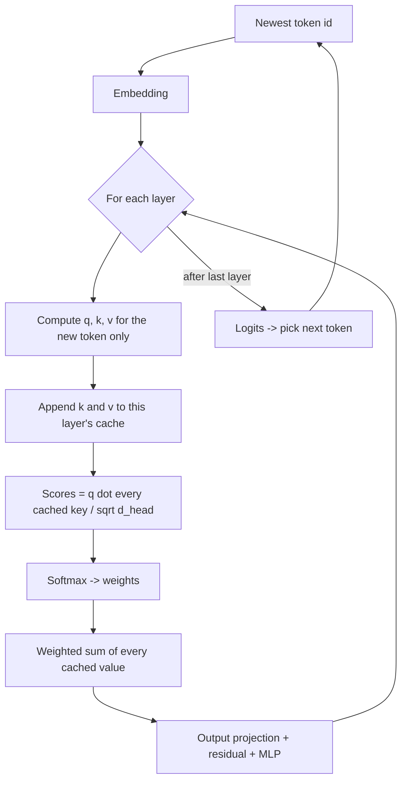
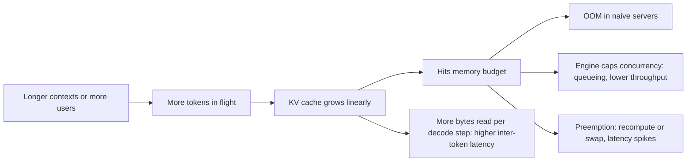

# The KV Cache: What It Is and Why It Dominates Memory

> **Level:** Beginner to Advanced · **Study time:** ~80 min · **Prerequisites:** [The Attention Mechanism, Step by Step](../04-transformers/03-attention-mechanism-step-by-step.md), [Multi-Head Attention and Causal Masking](../04-transformers/04-multi-head-attention-and-causal-masking.md), [LLM Inference Fundamentals: Prefill, Decode, TTFT and Throughput](./01-inference-fundamentals-prefill-decode-and-latency-metrics.md)

## Table of contents

- [Why this matters](#why-this-matters)
- [A 2-minute recap: how a decoder generates text](#a-2-minute-recap-how-a-decoder-generates-text)
- [The problem: redundant computation in naive generation](#the-problem-redundant-computation-in-naive-generation)
- [What exactly is stored in the KV cache](#what-exactly-is-stored-in-the-kv-cache)
- [How the cache is used in each decode step](#how-the-cache-is-used-in-each-decode-step)
- [Code: a KV cache from scratch, then in Hugging Face](#code-a-kv-cache-from-scratch-then-in-hugging-face)
- [The KV cache memory formula](#the-kv-cache-memory-formula)
- [KV cache vs weight memory as context and concurrency grow](#kv-cache-vs-weight-memory-as-context-and-concurrency-grow)
- [Shrinking the cache, part 1: multi-query and grouped-query attention](#shrinking-the-cache-part-1-multi-query-and-grouped-query-attention)
- [Shrinking the cache, part 2: KV cache quantization](#shrinking-the-cache-part-2-kv-cache-quantization)
- [What happens when context or concurrency grows a lot](#what-happens-when-context-or-concurrency-grows-a-lot)
- [Going deeper: managing the cache in a serving system](#going-deeper-managing-the-cache-in-a-serving-system)
- [Going deeper: sliding windows, eviction and offloading](#going-deeper-sliding-windows-eviction-and-offloading)
- [Going deeper: capacity planning, measuring and debugging](#going-deeper-capacity-planning-measuring-and-debugging)
- [Common mistakes and misconceptions](#common-mistakes-and-misconceptions)
- [Interview questions and model answers](#interview-questions-and-model-answers)
- [Key takeaways](#key-takeaways)
- [Further reading](#further-reading)
- [Next](#next)

## Why this matters

Every production LLM server, from a laptop running llama.cpp to a cluster running vLLM, keeps a **KV cache**, and in most real deployments it is the thing that decides how many users you can serve at once. When an inference team says "we are out of memory", "our p95 latency (the latency 95% of requests beat) spiked when we raised the context window", or "we can only fit 12 concurrent requests on this GPU", the KV cache is usually the root cause. Many of the big serving ideas of the last few years (grouped-query attention, PagedAttention, continuous batching, prefix caching, FP8 KV caches) exist mainly to make this cache smaller or to manage it better. In interviews for senior AI/ML roles, "explain the KV cache and estimate its memory" is one of the most common LLM-inference questions, and a confident back-of-envelope calculation is a strong signal of real experience.

## A 2-minute recap: how a decoder generates text

You only need three facts from earlier chapters. If any of them feel shaky, follow the links.

1. **Autoregressive generation.** A decoder-only LLM (GPT, Llama, Mistral, Qwen and friends) produces text one token at a time. Each new token is appended to the input and fed back in to produce the next one. This loop is called **autoregressive** generation (from "auto" = self, "regressive" = predicting from previous values). See [How LLMs Generate Text](../05-llms/03-text-generation-and-decoding-strategies.md).

2. **Queries, keys and values.** Inside each attention layer, every token's hidden vector is multiplied by three learned matrices to produce three vectors:
   - a **query** $q$: "what am I looking for?"
   - a **key** $k$: "what do I contain, as a label others can match against?"
   - a **value** $v$: "what information do I hand over if someone attends to me?"

   The attention output for a token is a weighted average of the values of the tokens it can see, where the weights come from softmax of query-key dot products:

   $$\text{Attention}(Q, K, V) = \text{softmax}\left(\frac{QK^\top}{\sqrt{d_{\text{head}}}}\right) V$$

   Full walkthrough in [The Attention Mechanism, Step by Step](../04-transformers/03-attention-mechanism-step-by-step.md).

3. **Causal masking and multiple heads.** In a decoder, token $i$ may only attend to tokens $1..i$ (itself and the past), never the future. This is the **causal mask**. Each layer splits attention into several **heads** that run in parallel, each with its own smaller $q$, $k$, $v$ of size $d_{\text{head}}$ (the **head dimension**). In standard multi-head attention the token's full vector, of width $d_{\text{model}}$ (the **hidden size**), is split evenly across the $n_{\text{heads}}$ heads, so $n_{\text{heads}} \times d_{\text{head}} = d_{\text{model}}$ (for example $32 \times 128 = 4{,}096$). See [Multi-Head Attention and Causal Masking](../04-transformers/04-multi-head-attention-and-causal-masking.md).

And from the previous chapter: inference has two phases. **Prefill** processes the whole prompt in one parallel pass. **Decode** then generates output tokens one at a time. The KV cache is the bridge between them: prefill fills it, decode reads and extends it.

## The problem: redundant computation in naive generation

### Intuition first

> **Analogy:** Imagine writing a story where, before you write each new word, you must re-read the entire story from the first word and re-take all your notes on every sentence. By word 500 you are re-reading 499 words just to write one. The obvious fix is to keep your notes from last time and only take notes on the newest word. That pile of saved notes is the KV cache.

### What the naive loop actually does

Here is the simplest possible generation loop:

```python
# Naive generation: NO cache (pseudo-code)
tokens = prompt_tokens
for step in range(max_new_tokens):
    logits = model(tokens)            # run the WHOLE sequence through ALL layers
    next_token = logits[-1].argmax()  # we only use the last position's prediction
    tokens.append(next_token)
```

Each call to `model(tokens)` pushes every token through every layer: embeddings, Q/K/V projections, attention, the MLP, everything. But we only use the output at the last position. And here is the key observation:

> Because of the causal mask, the hidden states, keys and values of past tokens **never change** when you append a new token. Token 3 cannot see token 4, so adding token 4 cannot alter anything about token 3.

So every step recomputes, from scratch, numbers that are identical to what we computed in the previous step. That is pure waste.

### A worked count of the work

Let us count **token-position passes**: one token position pushed through the full stack of layers (projections, attention, MLP). Define:

- $P$: number of prompt tokens
- $N$: number of tokens to generate

**Without a cache**, generation step $t$ (for $t = 1, \dots, N$) processes the prompt plus all $t-1$ previously generated tokens:

$$C_{\text{no cache}} = \sum_{t=1}^{N} (P + t - 1) = N \cdot P + \frac{N(N-1)}{2}$$

**With a cache**, step 1 is prefill (process all $P$ prompt tokens once, which also produces the first new token), and each of the remaining $N - 1$ steps processes exactly one new token:

$$C_{\text{cache}} = P + (N - 1)$$

Symbols:

- $C$: total token-position passes over the whole generation
- $P$: prompt length in tokens
- $N$: number of generated tokens
- $\frac{N(N-1)}{2}$: the sum $0 + 1 + 2 + \dots + (N-1)$, the extra positions added by the growing output

**Tiny example: our running 3-word sentence.** Prompt: "The cat sat" ($P = 3$), generate $N = 4$ tokens.

| Step | Tokens processed without cache | Tokens processed with cache |
|---|---|---|
| 1 | 3 (The, cat, sat) | 3 (prefill) |
| 2 | 4 | 1 |
| 3 | 5 | 1 |
| 4 | 6 | 1 |
| **Total** | **18** | **6** |

Check with the formulas: $4 \times 3 + \frac{4 \times 3}{2} = 12 + 6 = 18$, and $3 + (4 - 1) = 6$. Already 3x less work.

**Realistic example.** A chat request with $P = 1{,}000$ prompt tokens and $N = 500$ output tokens:

- Without cache: $500 \times 1{,}000 + \frac{500 \times 499}{2} = 500{,}000 + 124{,}750 = 624{,}750$ passes
- With cache: $1{,}000 + 499 = 1{,}499$ passes
- Ratio: $624{,}750 / 1{,}499 \approx 417$x less work

The no-cache cost grows **quadratically** in the output length (the $N^2/2$ term), while the cached cost grows **linearly**.

> **Senior insight:** The cache removes redundant *projections and MLP work*, but attention itself still has to look at every past token on every step. With a cache, the new token's query is dotted with all $P + t - 1$ cached keys, so per-step attention cost grows linearly with context. Without a cache, each step's attention is quadratic in context (every position attends to every earlier position), so total attention work over a generation is roughly cubic. The cache turns "cubic attention plus quadratic everything-else" into "quadratic attention plus linear everything-else". And the cache is **exact**: outputs are mathematically identical to the no-cache loop (up to tiny floating-point differences), it is not an approximation.

## What exactly is stored in the KV cache

### Precise definition

The **KV cache** is the set of key and value vectors for every past token, at every layer, for every key/value head, kept in GPU memory so that each decode step only needs to compute keys and values for the new token.

Three "every"s, and you should be able to say them in your sleep:

- **every layer**: each transformer layer has its own attention with its own keys and values, computed from that layer's input. Layer 5's keys are not layer 4's keys.
- **every KV head**: each attention head has its own key and value projections. (With grouped-query attention, several query heads share one KV head; more on this later. So the count that matters is **KV heads**, not query heads.)
- **every past token**: prompt tokens and already-generated tokens.

Typical layout per layer (Hugging Face and most engines use something like this):

```text
K cache, one layer:  [batch, n_kv_heads, seq_len, head_dim]
V cache, one layer:  [batch, n_kv_heads, seq_len, head_dim]

Whole cache for one sequence (illustrative 32-layer model):

          Keys                                 Values
Layer 1   head 1: [t1 t2 t3 ... tS]            head 1: [t1 t2 t3 ... tS]
          head 2: [t1 t2 t3 ... tS]            head 2: [t1 t2 t3 ... tS]
          ...                                  ...
Layer 2   head 1: [t1 t2 t3 ... tS]            ...
...
Layer 32  ...                                  ...

Each [t_i] slot is a vector of head_dim numbers (e.g. 128).
Every decode step appends ONE new slot to every row.
```

### Why keys and values, but not queries?

Think about who needs what in the future.

- A future token $j$ computes attention by comparing **its own query** $q_j$ with the **keys** of all earlier tokens, then mixing the **values** of all earlier tokens. So future tokens need the past tokens' keys and values. Those must be kept.
- A past token's **query** $q_i$ was only ever used to compute token $i$'s own attention output. That output has already been computed and has already flowed into the next layer. No future token ever looks at $q_i$. So it is used once and thrown away.

> **Analogy:** A library. Each book (past token) has a spine label (key) and contents (value). Each reader (new token) arrives with a question (query). Readers scan spine labels and read the relevant contents. The library must keep every book's label and contents for future readers, but there is no reason to keep a record of what question each past reader asked.

### Why not cache something else?

Two good follow-up questions a senior interviewer might ask:

- **Why not cache the attention outputs or final hidden states of past tokens?** You do not need them. Past positions' outputs only fed predictions you already made. Only the new position's output matters for the next prediction.
- **Why not cache each layer's input hidden states instead of K and V?** You could, then recompute K and V from them every step. That stores $d_{\text{model}}$ numbers per token per layer instead of $2 \times n_{\text{kv}} \times d_{\text{head}}$ (where $n_{\text{kv}}$ is the number of KV heads), but it costs extra matrix multiplies over the whole context each step. For classic multi-head attention, K and V together are $2 \times d_{\text{model}}$, so caching the input would halve memory at a compute cost. With grouped-query attention (say 8 KV heads vs 32 query heads), K plus V is only $d_{\text{model}}/2$, so caching K and V is already the smaller option. K and V are simply the cheapest "ready to use" point to cache.

### A note on positional encodings

Most modern LLMs use **RoPE** (rotary position embeddings), which rotate the query and key vectors by an angle that depends on the token's position (see [Positional Encoding](../04-transformers/06-positional-encoding-sinusoidal-learned-rope-and-alibi.md)). Mainstream engines (vLLM, Hugging Face Transformers) cache keys **after** the rotation is applied (some research methods that re-assign positions inside the cache, such as StreamingLLM, cache keys before rotation instead). Since a token's position never changes once written, its rotated key stays valid forever. One consequence: a cached key is tied to its absolute position and to everything before it, which matters for prefix caching later.

## How the cache is used in each decode step

### Prefill: filling the cache

During prefill, the model processes all $P$ prompt tokens in parallel (one big batch of matrix multiplies, which GPUs love). At each layer it computes K and V for every prompt token and writes them into the cache. The last position's output produces the first generated token.

### Decode: one step in detail

Now suppose the cache holds $T$ tokens and we feed in the single newest token. At **each layer**:

1. Compute $q_{\text{new}}, k_{\text{new}}, v_{\text{new}}$ for just this one token (three small matrix-vector multiplies).
2. Append $k_{\text{new}}$ and $v_{\text{new}}$ to this layer's cache. The cache now holds $T + 1$ entries.
3. Compute attention scores: $q_{\text{new}}$ dotted with all $T + 1$ cached keys, divided by $\sqrt{d_{\text{head}}}$.
4. Softmax the scores into weights.
5. Output = weighted sum of all $T + 1$ cached values.
6. Output projection, residual, MLP, pass to the next layer.

No causal mask is needed during single-token decode: the new token is the last one, so "everything in the cache" is exactly "everything it may see".



### The 3-word sentence, step by step

Prompt "The cat sat", one layer, one head:

```text
Prefill:  compute k,v for [The, cat, sat]      cache = [k_The k_cat k_sat]
                                                         [v_The v_cat v_sat]
          output at "sat" -> predicts "on"

Decode 1: input "on"   compute q_on, k_on, v_on
          append                                cache = [k_The k_cat k_sat k_on]
          q_on . [4 keys] -> softmax -> mix 4 values -> predicts "the"

Decode 2: input "the"  compute q_the, k_the, v_the
          append                                cache = 5 keys, 5 values
          q_the . [5 keys] -> softmax -> mix 5 values -> predicts "mat"
```

Notice: each decode step does a fixed amount of projection and MLP work, but the attention part reads a cache that grows by one entry per step. That growing read is why decode gets slower as the context gets longer (we quantify this below).

## Code: a KV cache from scratch, then in Hugging Face

### From scratch in NumPy

This toy model has 2 attention layers (no MLP, to keep it short), single-head attention and greedy decoding. It generates text both ways, checks the outputs match, and counts how many token rows went through the K/V projections.

```python
# pip install numpy
import numpy as np

rng = np.random.default_rng(0)
VOCAB, D, N_LAYERS, MAX_POS = 10, 8, 2, 64
embed = rng.normal(size=(VOCAB, D))
pos_emb = rng.normal(size=(MAX_POS, D)) * 0.1          # toy learned positions
layers = [{w: rng.normal(size=(D, D)) / np.sqrt(D) for w in ("Wq", "Wk", "Wv", "Wo")}
          for _ in range(N_LAYERS)]
W_out = rng.normal(size=(D, VOCAB))
counter = {"kv_rows": 0}                               # rows sent through K/V projections

def softmax(x):
    x = x - x.max(axis=-1, keepdims=True)
    e = np.exp(x)
    return e / e.sum(axis=-1, keepdims=True)

def forward_full(tokens):
    """No cache: recompute every position at every layer; return last-position logits."""
    T = len(tokens)
    x = embed[tokens] + pos_emb[:T]                        # (T, D)
    mask = np.triu(np.full((T, T), -np.inf), k=1)          # hide future positions
    for L in layers:
        q, k, v = x @ L["Wq"], x @ L["Wk"], x @ L["Wv"]
        counter["kv_rows"] += T
        att = softmax(q @ k.T / np.sqrt(D) + mask)
        x = x + (att @ v) @ L["Wo"]                        # residual connection
    return x[-1] @ W_out

def forward_cached(new_tokens, start_pos, cache):
    """With cache: process only new tokens, append their K and V, attend over the cache."""
    T_new = len(new_tokens)
    x = embed[new_tokens] + pos_emb[start_pos:start_pos + T_new]
    for i, L in enumerate(layers):
        q, k, v = x @ L["Wq"], x @ L["Wk"], x @ L["Wv"]
        counter["kv_rows"] += T_new
        cache[i]["k"] = np.concatenate([cache[i]["k"], k])  # grow this layer's cache
        cache[i]["v"] = np.concatenate([cache[i]["v"], v])
        K, V = cache[i]["k"], cache[i]["v"]
        # new row j sits at absolute position start_pos + j: it may see columns <= that
        mask = np.triu(np.full((T_new, K.shape[0]), -np.inf), k=start_pos + 1)
        att = softmax(q @ K.T / np.sqrt(D) + mask)
        x = x + (att @ V) @ L["Wo"]
    return x[-1] @ W_out

def generate(prompt, n_new, use_cache):
    tokens, counter["kv_rows"] = list(prompt), 0
    if not use_cache:
        for _ in range(n_new):
            tokens.append(int(forward_full(np.array(tokens)).argmax()))
    else:
        cache = [{"k": np.zeros((0, D)), "v": np.zeros((0, D))} for _ in layers]
        logits = forward_cached(np.array(tokens), 0, cache)          # prefill
        tokens.append(int(logits.argmax()))
        for _ in range(n_new - 1):                                    # decode
            logits = forward_cached(np.array([tokens[-1]]), len(tokens) - 1, cache)
            tokens.append(int(logits.argmax()))
    return tokens, counter["kv_rows"]

prompt = [1, 2, 3]                       # stands for "The cat sat"
a, work_a = generate(prompt, 4, use_cache=False)
b, work_b = generate(prompt, 4, use_cache=True)
print("same tokens:", a == b)            # should be True (cache is exact)
print("K/V rows:", work_a, "vs", work_b) # 36 vs 12  (= 18 vs 6 positions, x 2 layers)
```

What to notice:

- The two functions compute the same thing. The cached version just skips recomputing rows it already has.
- The counts, 36 vs 12, are exactly our worked example (18 vs 6 token positions) multiplied by 2 layers.
- The cached path stores K and V **per layer**. Layer 2's keys depend on layer 1's outputs for past tokens, which never change thanks to the causal mask, so they are safe to reuse.
- `np.concatenate` copies the whole cache every step. Real engines preallocate or use paged blocks instead, which is exactly the memory management problem we cover later.

### With Hugging Face Transformers

`generate()` uses the cache by default. You can switch it off to feel the difference:

```python
# pip install torch transformers
import time
import torch
from transformers import AutoModelForCausalLM, AutoTokenizer

name = "gpt2"  # small and ungated; any causal LM works the same way
tok = AutoTokenizer.from_pretrained(name)
model = AutoModelForCausalLM.from_pretrained(name).eval()
inputs = tok("The cat sat", return_tensors="pt")

for use_cache in (True, False):
    start = time.perf_counter()
    with torch.no_grad():
        model.generate(**inputs, max_new_tokens=300, do_sample=False,
                       use_cache=use_cache, pad_token_id=tok.eos_token_id)
    print(f"use_cache={use_cache}: {time.perf_counter() - start:.2f} s")
# Expect use_cache=False to be noticeably slower, and the gap widens with more tokens.
```

And a manual decode loop that makes the cache explicit:

```python
with torch.no_grad():
    out = model(**inputs, use_cache=True)              # prefill: fills the cache
    past = out.past_key_values
    next_id = out.logits[:, -1].argmax(-1, keepdim=True)
    generated = [next_id.item()]
    for _ in range(10):                                # decode: one token per step
        out = model(input_ids=next_id, past_key_values=past, use_cache=True)
        past = out.past_key_values                     # cache grew by one position
        next_id = out.logits[:, -1].argmax(-1, keepdim=True)
        generated.append(next_id.item())
print(tok.decode(generated))
```

> **Version note:** The type of `past_key_values` has changed across Transformers releases. Older versions returned a tuple of `(key, value)` tensors per layer, each shaped `[batch, n_kv_heads, seq_len, head_dim]`. Recent versions return `Cache` objects such as `DynamicCache` (and offer `StaticCache` for fixed-size, compile-friendly caches); the legacy tuple format was deprecated and then dropped in recent releases, so code that indexes `past[layer][0]` may break. The concept is the same; check the docs for your installed version before poking at internals.

## The KV cache memory formula

### The formula

Now the most interview-relevant part. Count the numbers stored, then multiply by bytes per number:

$$M_{\text{KV}} = 2 \times n_{\text{layers}} \times n_{\text{kv}} \times d_{\text{head}} \times S \times B \times b$$

Every symbol:

- $M_{\text{KV}}$: total KV cache memory in bytes
- $2$: one tensor for keys, one for values
- $n_{\text{layers}}$: number of transformer layers (each has its own cache)
- $n_{\text{kv}}$: number of **key/value heads** per layer (equals the number of attention heads for standard multi-head attention; smaller for GQA and MQA)
- $d_{\text{head}}$: size of each head's key or value vector (often 128)
- $S$: sequence length in tokens currently cached (prompt plus generated so far)
- $B$: batch size, meaning the number of sequences cached at the same time (concurrent requests)
- $b$: bytes per element (2 for FP16/BF16, 1 for FP8/INT8)

It helps to split it into a **per-token** cost that depends only on the model and dtype:

$$m_{\text{token}} = 2 \times n_{\text{layers}} \times n_{\text{kv}} \times d_{\text{head}} \times b \qquad M_{\text{KV}} = m_{\text{token}} \times S \times B$$

So the total is simply "bytes per token" times "total tokens held across all requests". Memory grows **linearly** in each of layers, KV heads, head dimension, sequence length, batch size and bytes per element. Double any one of them and the cache doubles.

> **Units used below:** 1 KiB = 1,024 bytes, 1 MiB = 1,024 KiB, 1 GiB = 1,024 MiB = 1,073,741,824 bytes. GPU marketing uses GB = $10^9$ bytes. An "80 GB" GPU is about 74.5 GiB. The difference is about 7%, which matters when you plan tightly.

### Worked example 1: a 7B-class model without GQA

**Illustrative config** (close to the publicly documented Llama 2 7B shape): 32 layers, 32 attention heads, all of them also KV heads (standard multi-head attention), $d_{\text{head}} = 128$ (so $d_{\text{model}} = 32 \times 128 = 4{,}096$), FP16 cache ($b = 2$).

Per token:

- $2 \times 32 = 64$
- $64 \times 32 = 2{,}048$
- $2{,}048 \times 128 = 262{,}144$ numbers per token
- $262{,}144 \times 2 \text{ bytes} = 524{,}288$ bytes $= 512$ KiB $= 0.5$ MiB per token

Half a megabyte for every single token. Now a full sequence and a batch:

- One sequence of 4,096 tokens: $524{,}288 \times 4{,}096 = 2{,}147{,}483{,}648$ bytes $= 2$ GiB
- A batch of 8 such sequences: $2 \times 8 = 16$ GiB

The weights of a 7B model in FP16 are $7 \times 10^9 \times 2 = 14 \times 10^9$ bytes, about 13 GiB. So just 8 concurrent 4K-token conversations need **more memory for the cache than for the whole model**.

### Worked example 2: an 8B-class model with GQA

**Illustrative config** (close to the publicly documented Llama 3 8B shape): 32 layers, 32 query heads but only **8 KV heads** (grouped-query attention), $d_{\text{head}} = 128$, FP16 cache.

Per token:

- $2 \times 32 = 64$
- $64 \times 8 = 512$
- $512 \times 128 = 65{,}536$ numbers per token
- $65{,}536 \times 2 = 131{,}072$ bytes $= 128$ KiB per token

That is 4x smaller than example 1, purely because there are 4x fewer KV heads (32 / 8 = 4). Now:

- One sequence of 8,192 tokens: $131{,}072 \times 8{,}192 = 1{,}073{,}741{,}824$ bytes $= 1$ GiB
- A batch of 32 sequences of 8,192 tokens: $1 \times 32 = 32$ GiB
- One single sequence of 131,072 tokens (a "128K context"): $131{,}072 \times 131{,}072 = 17{,}179{,}869{,}184$ bytes $= 16$ GiB

The FP16 weights are $8 \times 10^9 \times 2 = 16 \times 10^9$ bytes, about 14.9 GiB. So **one** full 128K-token conversation needs about as much memory as the entire model.

### A quick reference table

KV cache per sequence, FP16, for the two illustrative configs:

| Context length | 7B-class, MHA (512 KiB/token) | 8B-class, GQA-8 (128 KiB/token) |
|---|---|---|
| 1,024 | 0.5 GiB | 0.125 GiB |
| 4,096 | 2 GiB | 0.5 GiB |
| 8,192 | 4 GiB | 1 GiB |
| 32,768 | 16 GiB | 4 GiB |
| 131,072 | 64 GiB | 16 GiB |

(The original Llama 2 7B supports only 4,096 tokens, so the 7B-class rows above 4,096 are hypothetical and shown only to illustrate scaling.)

> **Interview tip:** Memorize the shortcut "a Llama-3-8B-shaped model is about 128 KiB per token in FP16, so roughly 1 GiB per 8K tokens". Then any capacity question becomes simple division. And for a classic MHA model, per-token KV is $2 \times n_{\text{layers}} \times d_{\text{model}} \times b$, because $n_{\text{heads}} \times d_{\text{head}} = d_{\text{model}}$.

### A calculator you can reuse

```python
# Pure Python, no installs needed.
def kv_bytes_per_token(n_layers, n_kv_heads, head_dim, bytes_per_el=2):
    return 2 * n_layers * n_kv_heads * head_dim * bytes_per_el

def kv_cache_gib(n_layers, n_kv_heads, head_dim, seq_len, batch, bytes_per_el=2):
    return kv_bytes_per_token(n_layers, n_kv_heads, head_dim, bytes_per_el) * seq_len * batch / 2**30

def max_concurrent_seqs(kv_budget_gib, n_layers, n_kv_heads, head_dim, seq_len, bytes_per_el=2):
    per_seq = kv_bytes_per_token(n_layers, n_kv_heads, head_dim, bytes_per_el) * seq_len
    return int(kv_budget_gib * 2**30 // per_seq)

configs = {  # illustrative shapes: (layers, kv_heads, head_dim)
    "7B-class MHA": (32, 32, 128),
    "8B-class GQA": (32, 8, 128),
}
for name, (L, H, d) in configs.items():
    print(f"{name}: {kv_bytes_per_token(L, H, d) // 1024} KiB/token, "
          f"1 x 4K = {kv_cache_gib(L, H, d, 4096, 1):.1f} GiB, "
          f"32 x 8K = {kv_cache_gib(L, H, d, 8192, 32):.1f} GiB")
# 7B-class MHA: 512 KiB/token, 1 x 4K = 2.0 GiB, 32 x 8K = 128.0 GiB
# 8B-class GQA: 128 KiB/token, 1 x 4K = 0.5 GiB, 32 x 8K = 32.0 GiB

print(max_concurrent_seqs(40, 32, 8, 128, 8192))                   # 40 (FP16 KV)
print(max_concurrent_seqs(40, 32, 8, 128, 8192, bytes_per_el=1))   # 80 (FP8 KV)
```

To use it on a real model, read the numbers from its Hugging Face `config.json`: `num_hidden_layers`, `num_key_value_heads` (if absent, it equals `num_attention_heads`), and `head_dim` (if absent, `hidden_size // num_attention_heads`). Some architectures (sliding-window layers, latent attention, hybrid models) need adjustments, covered below.

## KV cache vs weight memory as context and concurrency grow

### Two kinds of memory with different behavior

On an inference GPU, memory goes to roughly four things:

| Consumer | Size depends on | Fixed or variable? |
|---|---|---|
| Model weights | Parameter count x bytes per weight | Fixed, paid once and shared by all requests |
| KV cache | Bytes per token x total cached tokens across all requests | Variable, grows with every token of every request |
| Activations (temporary per-step buffers) | Batch and chunk size, model width | Small and transient at inference (no backprop) |
| Framework overhead (CUDA context, kernels workspace, CUDA graphs) | Engine and settings | Roughly fixed, often a few GiB (illustrative) |

The crucial difference: **weights are a fixed cost, the KV cache is a per-token cost**. Weights do not grow when you add users or longer documents. The KV cache does, linearly.

### Where the crossover happens

Set KV memory equal to weight memory and solve for total cached tokens:

$$S \times B = \frac{M_{\text{weights}}}{m_{\text{token}}}$$

- 7B-class MHA: $14 \times 10^9 / 524{,}288 \approx 26{,}700$ tokens. Beyond about 27K total cached tokens (for example 7 requests of 4K), the cache is bigger than the model.
- 8B-class GQA: $16 \times 10^9 / 131{,}072 \approx 122{,}000$ tokens. Beyond about 122K total cached tokens (for example 15 requests of 8K), the cache is bigger than the model.

### The 8B-class GQA model in different scenarios

Weights: about 14.9 GiB in FP16. KV in FP16.

| Scenario | Total cached tokens | KV cache | KV / weights |
|---|---|---|---|
| 1 user, 4K context | 4,096 | 0.5 GiB | ~3% |
| 8 users, 8K each | 65,536 | 8 GiB | ~54% |
| 1 user, 128K context | 131,072 | 16 GiB | ~107% |
| 32 users, 8K each | 262,144 | 32 GiB | ~215% |
| 16 users, 32K each | 524,288 | 64 GiB | ~430% |

So: **is the KV cache the dominant memory consumer? It depends on the workload.** For a single short chat on a laptop, weights dominate by far. For a production server with long contexts and many concurrent users, the KV cache dominates, and it is the part that determines how many requests fit. That is why serving engines allocate "whatever is left after the weights" to the KV cache and then measure capacity in tokens.

```text
GPU memory (illustrative, 80 GB card serving an 8B model in FP16)

Short chats, low traffic:
[ weights 15 GiB ][ KV 3 GiB ][ ............ unused ............ ]

Long contexts, high traffic:
[ weights 15 GiB ][ KV cache ~55 GiB, full: new requests must wait ][oh]
                                                                    ^ overhead
```

> **Senior insight:** Weight quantization (say INT4 weights) shrinks the fixed part but does nothing to the KV cache, which stays in FP16 or BF16 unless you separately quantize it. Teams are often surprised that a 4-bit model still runs out of memory at high concurrency. For capacity, the question is always "how many bytes per token, and how many tokens in flight?"

> **Senior insight:** For a Mixture-of-Experts model the picture shifts: total weights can be very large (all experts must be resident) while the attention layers, and so the KV cache, may be similar in size to a dense model with the same attention shape. The ratio is model-specific; always compute it from the config.

## Shrinking the cache, part 1: multi-query and grouped-query attention

The formula says memory is proportional to $n_{\text{kv}}$. The most effective architectural lever is simply to have fewer KV heads. (The architecture side is also covered in [Modern LLM Architecture](../04-transformers/08-modern-llm-architecture-improvements.md); here we focus on the cache.)

### Intuition

> **Analogy:** In standard attention, each of 32 students (query heads) has a personal textbook (KV head). With multi-query attention, the whole class shares one textbook. With grouped-query attention, students sit in groups of 4 and each group shares a textbook: 8 books instead of 32. Each student still asks their own questions.

### The three variants

- **Multi-head attention (MHA):** every query head has its own key and value head. $n_{\text{kv}} = n_{\text{heads}}$. The original Transformer ("Attention Is All You Need", Vaswani et al., 2017).
- **Multi-query attention (MQA):** all query heads share a **single** key head and a **single** value head. $n_{\text{kv}} = 1$. Introduced in "Fast Transformer Decoding: One Write-Head is All You Need" (Shazeer, 2019), explicitly to cut memory bandwidth during incremental decoding.
- **Grouped-query attention (GQA):** query heads are split into $G$ groups; each group shares one key head and one value head. $n_{\text{kv}} = G$, with $1 < G < n_{\text{heads}}$. Introduced in "GQA: Training Generalized Multi-Query Transformer Models from Multi-Head Checkpoints" (Ainslie et al., 2023). MHA and MQA are the two extremes of GQA.

```text
32 query heads, how K/V heads are shared:

MHA (32 KV):  Q1-K1V1  Q2-K2V2  Q3-K3V3  ...  Q32-K32V32
GQA (8 KV):   Q1..Q4 -> K1V1   Q5..Q8 -> K2V2   ...   Q29..Q32 -> K8V8
MQA (1 KV):   Q1..Q32 -> K1V1
```

### Cache size comparison (32 layers, 32 query heads, head_dim 128, FP16)

| Variant | $n_{\text{kv}}$ | KV per token | 8K-token sequence | Quality | Where you see it |
|---|---|---|---|---|---|
| MHA | 32 | 512 KiB | 4 GiB | Baseline | Original Transformer, GPT-2, Llama 2 7B |
| GQA-8 | 8 | 128 KiB | 1 GiB | Close to MHA in reported results | Llama 2 70B, Llama 3, Mistral 7B, many current open models |
| MQA | 1 | 16 KiB | 128 MiB | Some quality loss and training instability reported | PaLM, Falcon (some sizes) |

(Arithmetic for MQA: $2 \times 32 \times 1 \times 128 \times 2 = 16{,}384$ bytes $= 16$ KiB per token; $\times 8{,}192 = 128$ MiB.)

### Why it saves more than memory

During decode, each step must **read** the entire KV cache from GPU memory. Fewer KV heads means fewer bytes to read, so each decode step is faster when attention is **memory-bandwidth bound**, meaning its time is set by how fast bytes can be moved out of GPU memory rather than by how fast the GPU can do arithmetic (which is usually the case during decode; see [GPU Fundamentals](./03-gpu-fundamentals-compute-bound-vs-memory-bound.md)). The FLOPs of attention barely change: every query head still computes its own scores, it just reuses a shared key/value.

### Trade-offs

- **Quality:** fewer KV heads means less representational capacity in attention. The GQA paper reported that GQA with a moderate number of groups gets quality close to MHA with speed close to MQA, which is why GQA became the default in many current open models.
- **Converting existing models:** the GQA paper showed you can convert an MHA checkpoint by mean-pooling the key and value heads within each group, then **uptraining** (continued pretraining) for a small fraction of the original compute. You cannot just delete heads at inference time without retraining.
- **Tensor parallelism:** when a model is split across GPUs by heads, each GPU holds $n_{\text{kv}} / \text{TP}$ KV heads. If the tensor-parallel degree exceeds the number of KV heads (say TP = 16 with 8 KV heads), KV heads must be replicated, which wastes some of the savings. This is a real constraint when picking GPU counts.

### Beyond GQA: latent attention

**Multi-head Latent Attention (MLA)**, introduced in the DeepSeek-V2 report (DeepSeek-AI, 2024), takes a different route: instead of caching full per-head keys and values, it caches a smaller compressed latent vector per token and reconstructs keys and values from it with learned projections. It is another point on the same trade-off curve: cache fewer bytes per token in exchange for extra compute and a different architecture that must be trained in. You do not need the internals for most interviews, but knowing it exists signals you follow the field.

## Shrinking the cache, part 2: KV cache quantization

### The idea

The formula's last factor is $b$, bytes per element. Store the cache in 8 bits instead of 16 and you halve it. This is **KV cache quantization**, separate from weight quantization. Number formats are covered in [Number Formats and Model Memory](../07-model-compression/01-number-formats-and-model-memory.md), and scale factors in [Quantization Fundamentals](../07-model-compression/02-quantization-fundamentals-scale-and-zero-point.md).

Worked effect on the 8B-class GQA model:

- FP16: 128 KiB per token
- FP8 or INT8: $2 \times 32 \times 8 \times 128 \times 1 = 65{,}536$ bytes $= 64$ KiB per token
- With a 40 GiB KV budget (illustrative) and 8K-token requests: $40 \text{ GiB} / 1 \text{ GiB} = 40$ concurrent sequences in FP16, $40 / 0.5 = 80$ in FP8. Twice the concurrency, same GPU.

### How it works

- Keys and values are written to the cache in a low-precision format with one or more **scale factors** (a number that maps the small-range integers or FP8 values back to real magnitudes).
- The attention kernel reads the low-precision cache and dequantizes on the fly (or computes directly in FP8 on hardware that supports it, such as recent NVIDIA data center GPUs).
- **FP8** (formats like E4M3: 4 exponent bits, 3 mantissa bits) is popular because it keeps a floating-point exponent, handling a wide dynamic range with a simple per-tensor scale. **INT8** needs more careful scaling but is supported more broadly.

### Trade-offs and risks

| Aspect | FP16/BF16 KV | FP8/INT8 KV | 4-bit or lower KV (research and some engines) |
|---|---|---|---|
| Memory per token | 1x | 0.5x | ~0.25x or less |
| Quality risk | None (baseline) | Usually small, must be measured | Higher, needs special schemes |
| Speed | Baseline | Often faster decode (fewer bytes read), unless dequantization overhead dominates | Depends heavily on kernels |
| Typical use | Default | Common production option for long context and high concurrency | Experimental or specialized |

Senior-level nuances:

- **Keys and values behave differently.** Keys tend to have a few channels with large outliers, values are better behaved. "KIVI: A Tuning-Free Asymmetric 2bit Quantization for KV Cache" (Liu et al., 2024) proposed quantizing keys per channel and values per token for this reason.
- **Scales matter.** A naive default scale of 1.0 can clip large outliers or waste the format's precision on small values. Engines may compute scales on the fly or load calibrated scales from the checkpoint; check which your engine does.
- **Evaluate on long-context tasks.** Small per-element errors accumulate over thousands of attended tokens. Test retrieval-style long-context evals, not just short benchmarks.
- **It is orthogonal to weight quantization.** You can have INT4 weights with an FP16 cache, or FP16 weights with an FP8 cache.

## What happens when context or concurrency grows a lot

This is a favorite interview scenario: "We raised max context from 8K to 128K" or "traffic tripled". Walk through the consequences in order.

### 1. Memory: OOM or fewer concurrent requests

KV memory is $m_{\text{token}} \times$ (total tokens in flight). Raise either factor and you hit the budget sooner.

- A naive server that preallocates the maximum context for each request will **OOM** (run out of memory) or refuse to start: preallocating 128K tokens per slot for the 8B-class model is 16 GiB per slot.
- A modern engine (vLLM, SGLang, TensorRT-LLM) instead caps how many sequences run concurrently. Fewer concurrent requests means **lower throughput** and **longer queueing**.

Worked example (illustrative KV budget of 40 GiB, 8B-class GQA, FP16):

| Tokens per request | Max concurrent requests |
|---|---|
| 8,192 | 40 |
| 32,768 | 10 |
| 131,072 | 2 (2.5, rounded down) |

Going from 8K to 128K requests cuts concurrency from 40 to 2, a 20x drop on the same hardware (16x from the longer context, the rest from rounding down to whole requests).

### 2. Preemption: recomputation or swapping

Output lengths are unknown in advance. An engine may admit requests optimistically, then discover mid-generation that the cache is full and a running request needs one more block. It must **preempt** (pause) some request and free its memory. Two strategies:

- **Recomputation:** throw away the victim's KV cache. Later, when memory frees up, re-run prefill over its prompt plus the tokens already generated to rebuild the cache. Costs extra compute, needs no extra memory.
- **Swapping:** copy the victim's KV blocks to CPU RAM over PCIe (the CPU-to-GPU link), then copy them back later. Saves compute but costs transfer time and host memory.

Engines such as vLLM have supported both; which is the default, and whether swapping is available, depends on the engine and version. Either way, preempted requests see big latency spikes, and frequent preemption is a red flag in production metrics.

### 3. Latency: every decode step gets slower

Decode is usually **memory-bandwidth bound**: each step must read all the weights once (shared across the batch) plus every request's entire KV cache. A rough lower bound on step time:

$$t_{\text{step}} \gtrsim \frac{M_{\text{weights}} + M_{\text{KV}}}{\text{memory bandwidth}}$$

Illustrative numbers: 8B-class model, FP16 weights (16 GB), a GPU with 3 TB/s of memory bandwidth (an illustrative figure in the range of current high-end data center GPUs).

- Short contexts, small batch: KV is negligible, step time $\approx 16 / 3{,}000$ s $\approx 5.3$ ms.
- 32 requests of 8K tokens: KV is 32 GiB $\approx 34.4$ GB, so the step reads about 50.4 GB and takes at least $\approx 16.8$ ms. Each user's tokens now arrive about 3x slower than in the short-context case.

So longer contexts raise **inter-token latency** (time per output token) even when nothing runs out of memory. They also raise **time to first token**, since prefill over 128K tokens is a lot of compute (and attention prefill cost grows quadratically with prompt length).

### 4. Cost

Fewer concurrent requests per GPU means more GPUs for the same traffic, so cost per request rises roughly in proportion to tokens held in cache. This is why some hosted APIs price long-context requests differently. Details in [Optimizing and Benchmarking LLM Latency and Cost](./07-optimizing-and-benchmarking-llm-latency-and-cost.md).

### Summary flow



### What to do about it

| Lever | What it changes in the formula | Cost |
|---|---|---|
| GQA/MQA/MLA model | $n_{\text{kv}}$ (or the latent size) | Must be built into the model |
| FP8/INT8 KV cache | $b$ | Small quality risk, measure it |
| Cap `max_model_len` or per-tenant context | $S$ | Product limits |
| Cap concurrent sequences, admission control | $B$ | Queueing |
| PagedAttention | Removes wasted, reserved-but-unused memory | Engine feature, now standard |
| Prefix caching | Shares identical prefixes across requests | Only helps when prefixes repeat |
| Sliding-window attention | Caps $S$ per layer | Model must be trained for it |
| Offloading to CPU/disk | Moves cold cache off GPU | Transfer latency |
| More GPUs (tensor parallel) | Splits KV heads across devices | Money, communication overhead |

## Going deeper: managing the cache in a serving system

The formula tells you how much cache you need. Serving engines also care about how that memory is **allocated**. This section is a preview; the full treatment lives in [Batching, Continuous Batching and PagedAttention](./04-batching-continuous-batching-and-paged-attention.md).

### The fragmentation problem

Early serving systems allocated one contiguous KV buffer per request, sized for the maximum possible length, because the final output length is unknown. Consequences:

- **Internal fragmentation:** a request that reserves 8K tokens but finishes after 600 leaves most of its reservation unused for its entire lifetime.
- **External fragmentation:** free memory ends up in gaps too small for a new contiguous reservation.
- **No sharing:** two requests with the same system prompt store two identical copies.

### PagedAttention (preview)

> **Analogy:** An operating system does not give each program one giant contiguous chunk of RAM. It hands out small fixed-size **pages** on demand and keeps a page table mapping virtual addresses to physical pages. PagedAttention does the same for the KV cache.

**PagedAttention**, from "Efficient Memory Management for Large Language Model Serving with PagedAttention" (Kwon et al., 2023, the vLLM paper):

- The KV cache is split into fixed-size **blocks**, each holding the keys and values for a small number of tokens (16 tokens is a common default, configurable).
- Each request has a **block table** mapping its logical token positions to physical blocks, which need not be contiguous.
- Blocks are allocated only when needed, so waste is limited to the partly filled last block of each request.
- The attention kernel is rewritten to gather keys and values through the block table.
- Blocks can be **shared** between requests with reference counting and copy-on-write, which enables parallel sampling, beam search and prefix sharing without duplicate copies.

The paper reported that prior systems wasted a large fraction of KV memory to fragmentation and over-reservation, and that removing this waste let vLLM batch many more requests and achieve substantially higher throughput than the systems it compared against.

### Continuous batching (preview)

**Static batching** waits until every request in a batch finishes before starting the next batch, so short requests sit idle while the longest one finishes. **Continuous batching** (also called iteration-level scheduling, from "Orca: A Distributed Serving System for Transformer-Based Generative Models", Yu et al., 2022) re-forms the batch at every decode step: finished requests leave immediately and waiting requests join immediately.

How it connects to the KV cache: continuous batching only pays off if freed cache memory can be reused right away by the next request. Paged block allocation makes that cheap. Together they keep the GPU's batch full, which is what raises throughput, since decode is memory bound and a bigger batch amortizes each weight read over more tokens. The caveat: only the weight read is shared. Each request's KV cache is private, so KV bytes read per step grow with batch size times context, and at long contexts adding requests gives diminishing throughput gains.

```text
Static batching (B = 3):            Continuous batching (B = 3):
req A ######                        req A ######
req B ##                            req B ## D ######
req C ####                          req C #### E ###
      ^ B, C slots idle until A         ^ freed slots refilled at once
        finishes                          (needs freed KV blocks, cheaply reusable)
```

### Prefix caching

Many requests share the same beginning: a long system prompt, few-shot examples, a shared document in RAG, or the earlier turns of a multi-turn chat. **Prefix caching** keeps the KV blocks of previously seen prefixes and reuses them when a new request starts with exactly the same tokens.

- **Benefit:** skip prefill for the shared part. That cuts time to first token and GPU compute, and saves memory when several live requests share the same blocks.
- **How engines find matches:** vLLM's automatic prefix caching hashes each full block of tokens together with all tokens before it; SGLang's **RadixAttention** ("SGLang: Efficient Execution of Structured Language Model Programs", Zheng et al., 2023) stores prefixes in a radix tree. Evicted entries are typically chosen by least-recently-used policy.
- **Exact match from the start is required.** A token's keys and values depend on its position and on every token before it (through all the layers). Change one token early in the prompt, and every cached block after it is invalid. Practical rule: put stable content (system prompt, tool definitions, static documents) first, and variable content (user question, timestamps) last.
- **Hosted APIs** from several vendors offer "prompt caching" or "context caching" built on the same idea, with vendor-specific pricing and rules that change over time. More in [Speculative Decoding, Prompt Caching and Other Inference Speedups](./05-speculative-decoding-caching-and-other-speedups.md).

> **Senior insight:** In a multi-tenant system, shared prefix caches can leak information through timing (a cache hit makes the first token arrive measurably faster, which can reveal that someone else sent the same prefix). Scope caches per tenant, or salt the hashes per tenant, when isolation matters. See [System Design: A Multi-Tenant LLM Inference Platform](../11-system-design/03-design-a-multi-tenant-llm-inference-platform.md).

## Going deeper: sliding windows, eviction and offloading

### Sliding-window attention

**Sliding-window attention** limits each token to attending only to the most recent $W$ tokens instead of the full history. Then the cache never needs more than $W$ entries per layer: the oldest entry is overwritten as each new one arrives, a **rolling buffer** cache.

- Memory per sequence becomes $m_{\text{token}} \times \min(S, W)$ instead of $m_{\text{token}} \times S$: bounded, no matter how long the conversation runs.
- Information from further back can still flow indirectly: in layer $l$, a token sees $W$ tokens back, and those tokens already absorbed information from $W$ tokens before them in layer $l-1$, so the theoretical reach grows with depth.
- Examples: Longformer ("Longformer: The Long-Document Transformer", Beltagy et al., 2020) mixed local windows with global tokens; Mistral 7B ("Mistral 7B", Jiang et al., 2023) used a 4,096-token sliding window with a rolling buffer cache; several later model families (Gemma 2 and Gemma 3, for example) interleave sliding-window layers with full-attention layers, so only the global layers need a full-length cache.
- **Trade-off:** precise recall of a detail far outside the window is weaker. Must be trained into the model; you cannot just truncate a full-attention model's cache and expect the same quality.

Memory example (illustrative): if half the layers of the 8B-class GQA model used a 4,096-token window, at a 128K context those 16 layers would cache 4,096 tokens instead of 131,072. The KV cost per layer per token is $128 \text{ KiB} / 32 = 4$ KiB. So:

- 16 full-attention layers: $16 \times 4 \text{ KiB} \times 131{,}072 = 8{,}388{,}608$ KiB $= 8$ GiB
- 16 windowed layers: $16 \times 4 \text{ KiB} \times 4{,}096 = 262{,}144$ KiB $= 0.25$ GiB
- Total: $8.25$ GiB instead of 16 GiB per 128K-token sequence.

### Eviction: dropping "unimportant" tokens

Research methods keep the cache bounded by evicting tokens judged unimportant for full-attention models:

- **H2O** ("H2O: Heavy-Hitter Oracle for Efficient Generative Inference of Large Language Models", Zhang et al., 2023) keeps recent tokens plus "heavy hitters" that have accumulated the most attention.
- **StreamingLLM** ("Efficient Streaming Language Models with Attention Sinks", Xiao et al., 2023) observed that models dump a lot of attention on the very first tokens (**attention sinks**). Keeping those few initial tokens plus a recent window lets a model run on very long streams stably.

These are approximations: the output is no longer identical to full attention, and long-range recall can suffer. Evaluate on your own tasks before using them in production.

### Offloading: moving cache off the GPU

**KV cache offloading** moves cache blocks from GPU memory (HBM) to CPU RAM or even SSD, bringing them back when needed.

- **Within a request:** systems like FlexGen ("FlexGen: High-Throughput Generative Inference of Large Language Models with a Single GPU", Sheng et al., 2023) offload weights and KV to CPU and disk for throughput-oriented batch jobs where latency does not matter.
- **Across requests:** a multi-turn chat's cache can be parked in CPU RAM or a shared cache tier between turns, then restored instead of re-running prefill on the whole history. Open-source projects (for example LMCache) and serving stacks increasingly offer such tiers; features change quickly, so check current docs.
- **Disaggregated serving:** some deployments run prefill and decode on separate GPU pools and transfer the KV cache between them over fast interconnects. The KV cache becomes data that moves across the network.
- **Trade-off:** PCIe and network bandwidth are much lower than HBM bandwidth. Offloading wins when the alternative is recomputing a long prefill or rejecting the request; it loses when data must cross the slow link on every decode step.

### Comparison

| Technique | What it reduces | Exact? | Needs model training support? | Main cost |
|---|---|---|---|---|
| GQA / MQA | KV heads | Yes (it is the model) | Yes | Some quality vs MHA |
| MLA | Bytes per token via latent | Yes (it is the model) | Yes | Extra compute, complexity |
| FP8/INT8 KV | Bytes per element | Approximate | No (sometimes calibrated scales) | Small accuracy risk |
| PagedAttention | Wasted reservations | Yes | No | Custom kernels |
| Prefix caching | Duplicate prefixes, prefill compute | Yes | No | Cache management, isolation |
| Sliding window | Tokens per layer | Yes for a model trained that way | Yes | Weaker long-range recall |
| Eviction (H2O, sinks) | Tokens kept | Approximate | No | Recall loss on some tasks |
| Offloading | GPU-resident tokens | Yes | No | Transfer latency |

## Going deeper: capacity planning, measuring and debugging

### Back-of-envelope capacity plan

Follow these steps, which also make a great structure for an interview answer:

1. **Usable GPU memory** $\approx$ total $\times$ the fraction the engine may use (vLLM's `gpu_memory_utilization` defaults to 0.9 in many versions).
2. **Subtract weights** (parameters $\times$ bytes per weight) and **overhead** (activations, CUDA graphs, workspace; a few GiB, measure it).
3. **The rest is the KV budget.** Divide by bytes per token to get **total token capacity**.
4. **Divide by expected tokens per request** (prompt plus output, using a realistic percentile rather than the maximum) to get concurrency.

Illustrative example: one 80 GB GPU (about 74.5 GiB), 8B-class GQA model, FP16.

- Usable at 0.9: about 67 GiB
- Weights: about 14.9 GiB. Overhead: assume 4 GiB (illustrative). KV budget: $67 - 14.9 - 4 \approx 48$ GiB
- Token capacity: $48 \text{ GiB} / 128 \text{ KiB} = 48 \times 8{,}192 = 393{,}216$ tokens
- Requests averaging 3K tokens: about 128 concurrent. Requests averaging 32K tokens: about 12.

Real engines report their computed capacity at startup (for example vLLM logs the number of KV blocks or tokens and an estimated maximum concurrency at the configured max length; exact wording varies by version). Always compare your estimate to that number.

### Engine knobs (vLLM example)

```bash
# Illustrative vLLM launch. Flag names and defaults change between versions; check `vllm serve --help`.
#   --max-model-len           caps S (tokens) per request
#   --gpu-memory-utilization  fraction of GPU memory the engine may claim
#   --kv-cache-dtype fp8      halves bytes per KV element
#   --enable-prefix-caching   reuses identical prefixes (on by default in some versions)
#   --max-num-seqs            caps concurrent sequences (B)
vllm serve meta-llama/Llama-3.1-8B-Instruct \
  --max-model-len 32768 \
  --gpu-memory-utilization 0.90 \
  --kv-cache-dtype fp8 \
  --enable-prefix-caching \
  --max-num-seqs 128
```

### What to measure

- **KV cache utilization** (percentage of blocks in use). Sustained near 100% means you are capacity bound.
- **Preemptions** (count and rate). Any steady preemption rate means you are over-admitting.
- **Queue length / waiting requests** and **time to first token**: rising values mean requests wait for cache space.
- **Inter-token latency vs context length**: should rise roughly linearly with KV bytes read.
- **Prefix cache hit rate**, if enabled: low hit rates often mean the prompt template puts variable content first.

Metric names vary by engine and version (vLLM exposes Prometheus metrics for cache usage and preemptions, for example). See [Monitoring ML and LLM Systems in Production](../10-mlops/06-monitoring-ml-and-llm-systems-in-production.md).

### Debugging playbook

| Symptom | Likely KV-related cause | First thing to check |
|---|---|---|
| OOM at startup | `max_model_len` too large for memory left after weights | Engine's computed KV capacity vs max length |
| OOM under load in a custom server | Per-request preallocation or no admission control | Allocation strategy, concurrency cap |
| p95 latency spikes under load | Preemption (recompute or swap) | Preemption counter |
| Throughput plateaus as users grow | KV budget caps the batch | Cache utilization near 100% |
| Quantized model, no more concurrency | Only weights were quantized | KV cache dtype |
| Slow responses on long chats only | Large KV read per step, long prefill | Inter-token latency vs context, prefix hit rate |
| Memory grows steadily over hours | Cache entries not freed (leak), unbounded prefix cache in custom code | Allocated blocks vs active requests |

The last pattern is worked through in [Debugging Case: Rising p95 Latency and Memory Usage](../11-system-design/08-debugging-case-rising-p95-latency-and-memory.md).

## Common mistakes and misconceptions

> **Common mistake:** "The KV cache stores queries too." It does not. Past queries are never used again. Only keys and values are needed by future tokens.

> **Common mistake:** Using the number of **query** heads in the formula for a GQA model. Use `num_key_value_heads`. For a Llama-3-8B-shaped model this overestimates the cache by 4x.

> **Common mistake:** Forgetting the factor of 2 (keys **and** values) or forgetting to multiply by the number of layers. Each layer has its own cache.

> **Common mistake:** "The KV cache is an approximation." Standard KV caching is exact. Approximations only enter with quantization, eviction or window tricks.

> **Common mistake:** "Quantizing weights to 4-bit fixes our memory problem at high concurrency." Weight quantization shrinks the fixed cost; the KV cache is separate and often the real bottleneck.

> **Common mistake:** "The KV cache always dominates memory." Only at long contexts or high concurrency. For a single short request, weights dominate. Give the crossover calculation instead of a blanket claim.

> **Common mistake:** Planning capacity with the maximum context for every request. That is what pre-paged systems did and why they wasted memory. Plan with realistic token distributions, and let the engine allocate on demand.

> **Common mistake:** Assuming prefix caching works if the prompts are "mostly the same". It needs an exact token-for-token match from the very first token. A timestamp at the top of the system prompt defeats it.

> **Common mistake:** Thinking the cache makes decode cost constant per step. Projections and MLP become constant, but attention still reads the whole cache, so per-step time grows with context length.

## Interview questions and model answers

<details>
<summary><b>Q1. What is a KV cache, and why is it important?</b></summary>

**Short answer:** During autoregressive generation, the KV cache stores the key and value vectors of all previous tokens at every layer, so each new step only computes K and V for the newest token and reuses the rest. Without it, every step would recompute the whole sequence, making generation cost grow quadratically with output length instead of linearly. It is important for two reasons: it is what makes generation fast enough to be practical, and it is the main variable memory cost in serving, so it determines how many requests and how much context a GPU can handle.

**Deeper answer and follow-ups:**
- It is valid because of the causal mask: past tokens cannot see future tokens, so their keys and values never change.
- It is exact, not an approximation.
- Worked count: 1,000-token prompt, 500 output tokens: about 624,750 token passes without cache vs 1,499 with cache.
- Prefill fills it in parallel; decode reads it and appends one entry per layer per step.
- Cost side: it trades compute for memory, and at scale the memory side becomes the binding constraint, which motivates GQA, PagedAttention, FP8 KV and prefix caching.
- How to measure: offline, time `generate()` with and without `use_cache`; in serving, the engine's reported KV capacity (tokens or blocks) and live cache utilization show how much of the GPU it occupies.

</details>

<details>
<summary><b>Q2. Which tensors are stored in the cache?</b></summary>

**Short answer:** Keys and values, for every layer, every KV head and every past token (prompt and generated), typically shaped `[batch, n_kv_heads, seq_len, head_dim]` per layer for K and for V. Queries are not stored, and neither are attention outputs or MLP activations.

**Deeper answer and follow-ups:**
- Why not queries: a past token's query was only used to compute that token's own output, which is already done. Future tokens use their own query against the past keys and values.
- Keys are usually cached after RoPE rotation, so they are tied to their absolute positions.
- With GQA or MQA, only the shared KV heads are stored, not one per query head.
- Alternative design: cache layer inputs and recompute K and V. Smaller for MHA (half the size) but costs extra compute every step; for GQA models caching K and V is already smaller.
- Variants: MLA caches a compressed latent instead of full K and V.
- Verify on a real model: read `num_hidden_layers`, `num_key_value_heads` and `head_dim` from `config.json`, or print the shapes of `past_key_values` after one forward pass.

</details>

<details>
<summary><b>Q3. How does the cache reduce repeated computation during autoregressive generation?</b></summary>

**Short answer:** Without a cache, step $t$ runs all $P + t - 1$ tokens through every layer even though only the last position's output is used. With a cache, the model processes the prompt once (prefill), then each decode step feeds in only the newest token: it computes that token's q, k, v, appends k and v to the cache, and attends over the cached keys and values. Total token passes drop from $NP + N(N-1)/2$ to $P + N - 1$.

**Deeper answer and follow-ups:**
- Tiny example: "The cat sat" plus 4 generated tokens: 18 vs 6 token positions.
- Projections and MLP become constant per step; attention remains linear in current context per step, because the new query still dots with every cached key.
- Without a cache, attention per step is quadratic in context, so total attention work over a generation is roughly cubic; with a cache it is quadratic.
- It also changes the hardware profile: at typical batch sizes, decode becomes memory-bandwidth bound (reading weights and cache), not compute bound.
- Pitfall: naive cache growth by concatenation copies memory every step; real engines preallocate or page.
- Failure mode in hand-written loops: forgetting to pass the position offset for the new token (the `start_pos` in the NumPy example). With RoPE the new key then gets the wrong rotation, and output quality degrades silently instead of crashing. Test cached vs uncached outputs for equality.

</details>

<details>
<summary><b>Q4. How does KV-cache memory scale with layers, heads, sequence length, and batch size?</b></summary>

**Short answer:** Linearly in each. $M = 2 \times n_{\text{layers}} \times n_{\text{kv}} \times d_{\text{head}} \times S \times B \times b$. The 2 is for keys and values, $b$ is bytes per element. For a 7B-class MHA model (32 layers, 32 heads, head_dim 128, FP16) that is 512 KiB per token, so 2 GiB for a 4K sequence. For an 8B-class GQA model with 8 KV heads it is 128 KiB per token, 1 GiB per 8K sequence.

**Deeper answer and follow-ups:**
- Arithmetic for the 8B case: $2 \times 32 \times 8 \times 128 = 65{,}536$ numbers, times 2 bytes = 131,072 bytes = 128 KiB per token.
- Only KV heads count, not query heads.
- Double context or double batch: double the cache. Halve bytes (FP8): halve the cache.
- Quick MHA shortcut: $2 \times n_{\text{layers}} \times d_{\text{model}} \times b$ per token.
- Exceptions to linear-in-$S$: sliding-window layers cap at the window size; MLA changes the per-token constant.
- Capacity answer: (GPU memory x utilization - weights - overhead) / bytes per token = token capacity; divide by tokens per request for concurrency.
- Production check: compare your estimate with the token or block capacity the engine logs at startup; a large gap usually means wrong config values (query heads instead of KV heads) or more overhead than assumed.

</details>

<details>
<summary><b>Q5. What are multi-query attention and grouped-query attention?</b></summary>

**Short answer:** They are attention variants that reduce the number of key/value heads while keeping many query heads. MQA (Shazeer, 2019) has all query heads share a single K and V head. GQA (Ainslie et al., 2023) splits query heads into groups that each share one K and V head, sitting between MHA and MQA. Since the KV cache is proportional to the number of KV heads, they shrink cache memory and the bytes read per decode step by the ratio of query heads to KV heads.

**Deeper answer and follow-ups:**
- Example: 32 query heads with 8 KV heads cuts the cache 4x (512 KiB to 128 KiB per token in our illustrative config); MQA cuts it 32x (to 16 KiB).
- Benefit is mainly in decode, which is memory-bandwidth bound; FLOPs barely change.
- Quality: MQA showed some degradation and instability; GQA with a moderate number of groups was reported to be close to MHA, which is why many current open models use it.
- Conversion: an MHA checkpoint can be converted by mean-pooling K/V heads per group and briefly uptraining; you cannot drop heads at inference without training.
- Tensor parallelism: if TP degree exceeds the KV head count, KV heads get replicated, reducing savings.
- Related: MLA compresses K and V into a latent vector instead of sharing heads.
- How to tell which one a model uses: compare `num_key_value_heads` with `num_attention_heads` in its config (equal means MHA, 1 means MQA, in between means GQA).

</details>

<details>
<summary><b>Q6. How do paged attention and continuous batching improve serving efficiency?</b></summary>

**Short answer:** PagedAttention (Kwon et al., 2023) stores the KV cache in small fixed-size blocks allocated on demand and mapped through a per-request block table, like virtual memory pages. That eliminates most waste from reserving max-length contiguous buffers and enables sharing blocks between requests. Continuous batching (Orca, Yu et al., 2022) adds and removes requests at every decode step instead of waiting for the whole batch to finish. Together they keep the batch full with the memory you actually have, which raises throughput substantially.

**Deeper answer and follow-ups:**
- Fragmentation: internal (reserved but unused slots) and external (unusable gaps); paging limits waste to the partially filled last block of each request.
- Block sharing with reference counts and copy-on-write enables prefix caching, parallel sampling and beam search without duplicate copies.
- Continuous batching needs cheap reuse of freed memory, which paging provides.
- Since decode is memory bound, a fuller batch amortizes each weight read over more tokens: higher tokens per second per GPU.
- Cost: custom attention kernels that gather through block tables; scheduler complexity; need for preemption policies when the cache fills.
- Limit: batching shares only the weight read. Each request's KV cache is private, so at long contexts KV reads grow with the batch and extra requests add less throughput.
- How to measure: throughput (output tokens per second) at a fixed p95 inter-token latency target, running vs waiting requests, KV cache utilization and preemption rate.
- Details in the batching chapter.

</details>

<details>
<summary><b>Q7. What happens when the context window or concurrency increases substantially?</b></summary>

**Short answer:** Total tokens in flight grow, so the KV cache grows linearly and hits the memory budget sooner. Naive servers OOM. Modern engines cap concurrency, so throughput falls and requests queue; if they over-admit, they must preempt requests by recomputing or swapping their cache, causing latency spikes. Even without hitting limits, each decode step reads more KV bytes, so inter-token latency rises, and long prompts raise time to first token.

**Deeper answer and follow-ups:**
- Example: 40 GiB KV budget, 8B-class GQA FP16: 40 concurrent 8K requests, but only 2 at 128K.
- Latency example (illustrative 3 TB/s bandwidth): short context step about 5 ms (weights only); 32 x 8K requests add 32 GiB of KV reads, about 17 ms per step.
- Recompute vs swap: compute cost vs PCIe transfer and host memory.
- Startup failure: if a single request at the new maximum length cannot fit in the KV budget, engines such as vLLM refuse to start rather than fail later; lower `max_model_len` or add memory.
- Mitigations: GQA models, FP8 KV, prefix caching, context caps per tier, admission control, sliding-window models, offloading, more GPUs.
- Monitor cache utilization, preemption rate, queue time and TTFT.

</details>

<details>
<summary><b>Q8. Is the KV cache the dominant memory consumer?</b></summary>

**Short answer:** It depends on context length and concurrency. Weights are a fixed cost; the KV cache grows with every token of every request. For one short request, weights dominate. For production serving with long contexts or many users, the KV cache usually dominates and determines capacity. For an 8B-class GQA model in FP16 the crossover is around 122K cached tokens in total; for a 7B-class MHA model it is around 27K.

**Deeper answer and follow-ups:**
- 8B example: 1 user at 4K uses about 3% of weight memory for KV; 32 users at 8K use about 2x the weights.
- Activations are small and transient at inference; overhead is a few GiB.
- Engines allocate all remaining memory to the KV cache, so "used memory" looks full regardless; look at cache utilization instead.
- Weight quantization alone does not help the KV side.
- MoE models shift the balance toward weights; always compute from the config.

</details>

<details>
<summary><b>Q9. Estimate how many concurrent 16K-token requests an 8B-class GQA model can serve on one 80 GB GPU.</b></summary>

**Short answer:** 80 GB is roughly 74.5 GiB; at 90% utilization about 67 GiB is usable. Subtract about 15 GiB of FP16 weights and a few GiB of overhead (say 4, illustrative) to get about 48 GiB for KV. At 128 KiB per token, a 16K request is 2 GiB, so about 24 concurrent requests in FP16, or about 48 with an FP8 cache.

**Deeper answer and follow-ups:**
- $16{,}384 \times 131{,}072 = 2{,}147{,}483{,}648$ bytes = 2 GiB per request; $48 / 2 = 24$.
- Use realistic token distributions (prompt plus expected output), not the maximum, because paged engines allocate on demand.
- Validate against the engine's reported KV capacity at startup and load-test.
- Mention latency: at full batch, per-step KV reads (48 GiB) exceed weight reads, so inter-token latency will be much higher than at low load; you may cap concurrency below the memory limit to meet a latency SLO.

</details>

<details>
<summary><b>Q10. Why does the time per output token increase as the conversation gets longer?</b></summary>

**Short answer:** Decode is memory-bandwidth bound. Every step reads all the weights plus the entire KV cache of every request in the batch. The weight read is fixed, but the KV read grows with context length, so step time grows roughly linearly with the cached tokens once the KV portion becomes significant.

**Deeper answer and follow-ups:**
- Lower bound: $t_{\text{step}} \gtrsim (M_{\text{weights}} + M_{\text{KV}}) / \text{bandwidth}$.
- For the 8B-class model, one 128K-token sequence has a 16 GiB cache, about equal to the weights, so each step takes roughly twice as long as at short context.
- Fixes: GQA/MQA/MLA, FP8 KV (fewer bytes), FlashAttention-style decode kernels (fused attention kernels that minimize memory traffic) that read the cache efficiently, sliding windows, splitting KV across GPUs with tensor parallelism.
- See the GPU fundamentals chapter for the roofline view.

</details>

<details>
<summary><b>Q11. What is prefix caching, when does it help, and what are its pitfalls?</b></summary>

**Short answer:** Prefix caching keeps the KV blocks for previously processed prefixes and reuses them when a new request starts with exactly the same tokens, skipping that part of prefill. It helps when many requests share long system prompts, few-shot examples, documents or chat history, cutting TTFT and compute.

**Deeper answer and follow-ups:**
- Requires an exact token match from the first token, because each token's K and V depend on its position and on all earlier tokens.
- Put static content first and dynamic content (user query, dates, IDs) last.
- Implementations: block hashing with LRU eviction (vLLM), radix tree (SGLang RadixAttention).
- It competes for the same memory as active requests; engines evict cached prefixes under pressure.
- Multi-tenant risk: timing side channels; scope or salt caches per tenant.
- Measure hit rate; a low rate usually means a template problem.

</details>

<details>
<summary><b>Q12. What are the risks of quantizing the KV cache to FP8 or INT8, and how would you validate it?</b></summary>

**Short answer:** It halves cache memory and the bytes read per step, typically doubling concurrency, but adds quantization error to every attended key and value. Risks are clipping of outlier channels (especially in keys) and error accumulating over very long contexts. Validate with your task evals plus long-context retrieval tests, comparing against an FP16 cache.

**Deeper answer and follow-ups:**
- FP8 (E4M3) keeps an exponent and handles range with simple per-tensor scales; INT8 needs careful scaling.
- Scales may be computed dynamically or loaded from calibration; a default scale of 1.0 can hurt accuracy.
- Research like KIVI quantizes keys per channel and values per token because of their different outlier patterns.
- Speed gains depend on kernels: dequantization overhead can eat the benefit on unsupported hardware.
- It is independent of weight quantization; report both settings when benchmarking.

</details>

<details>
<summary><b>Q13. How does sliding-window attention change the KV cache, and what is the trade-off?</b></summary>

**Short answer:** Each layer only attends to the last $W$ tokens, so the cache per layer holds at most $W$ entries in a rolling buffer, making memory bounded regardless of conversation length. The trade-off is weaker direct access to information further back than the window, so models must be trained for it; many models interleave windowed layers with full-attention layers to keep some global recall.

**Deeper answer and follow-ups:**
- Memory becomes $m_{\text{token}} \times \min(S, W)$ for windowed layers.
- Information can propagate further indirectly through stacked layers.
- Examples: Longformer (local plus global tokens), Mistral 7B (4,096-token window), Gemma 2 and 3 (interleaved local and global layers).
- Related approximations for full-attention models: StreamingLLM attention sinks and H2O heavy-hitter eviction; these change outputs and need evaluation.

</details>

<details>
<summary><b>Q14. How is the KV cache split when a model is served with tensor parallelism?</b></summary>

**Short answer:** Tensor parallelism splits attention heads across GPUs, so each GPU holds the cache for its own subset of KV heads at every layer. With TP degree 4 and 8 KV heads, each GPU stores 2 KV heads per layer, a quarter of the cache. This also splits the KV bandwidth load, which is one reason TP lowers decode latency.

**Deeper answer and follow-ups:**
- If TP degree exceeds the number of KV heads (TP 16 with 8 KV heads), KV heads are replicated across GPUs, so the per-GPU savings stop.
- Pipeline parallelism splits by layers instead: each stage stores the cache for its own layers.
- More GPUs also free memory from weights (each holds a shard), which enlarges the KV budget per GPU.
- Communication overhead (all-reduce each layer) is the cost; see [Distributed Training and Training Memory](../02-deep-learning/10-distributed-training-and-training-memory.md) for parallelism basics.

</details>

## Key takeaways

- The KV cache stores **keys and values** for **every layer, every KV head, every past token**. Queries are never cached because no future token uses them.
- It is valid and exact because the causal mask means past tokens' K and V never change.
- It turns generation from $NP + N(N-1)/2$ token passes into $P + N - 1$ (624,750 vs 1,499 for a 1,000-token prompt and 500 output tokens).
- Prefill fills the cache in parallel; each decode step computes q, k, v for one token, appends k and v, and attends over the whole cache.
- Memory formula: $2 \times n_{\text{layers}} \times n_{\text{kv}} \times d_{\text{head}} \times S \times B \times b$. Linear in every factor.
- Illustrative per-token sizes in FP16: 7B-class MHA 512 KiB, 8B-class GQA-8 128 KiB (about 1 GiB per 8K tokens).
- Weights are a fixed cost; the KV cache is a per-token cost. At long contexts or high concurrency, KV dominates and decides capacity.
- GQA and MQA cut the cache by the ratio of query heads to KV heads; MLA compresses it into a latent; FP8/INT8 halves bytes per element.
- Weight quantization does not shrink the KV cache.
- Growing context or concurrency causes OOM in naive servers, lower concurrency and queueing in modern ones, preemption (recompute or swap), and higher inter-token latency because decode reads the whole cache every step.
- PagedAttention allocates KV in small blocks on demand and enables sharing; continuous batching refills freed slots every step; together they raise throughput.
- Prefix caching reuses exact-match prefixes: put static content first; isolate caches per tenant when needed.
- Sliding windows bound the cache (with a recall trade-off); eviction methods approximate; offloading moves cold cache to CPU or disk at transfer cost.
- Capacity plan: (usable memory - weights - overhead) / bytes per token = token capacity, divided by realistic tokens per request.

## Further reading

- "Attention Is All You Need", Vaswani et al., 2017: the original Transformer and multi-head attention.
- "Fast Transformer Decoding: One Write-Head is All You Need", Noam Shazeer, 2019: multi-query attention and the memory-bandwidth argument for decoding.
- "GQA: Training Generalized Multi-Query Transformer Models from Multi-Head Checkpoints", Ainslie et al., 2023: grouped-query attention and uptraining.
- "Efficient Memory Management for Large Language Model Serving with PagedAttention", Kwon et al., 2023: PagedAttention and vLLM.
- "Orca: A Distributed Serving System for Transformer-Based Generative Models", Yu et al., 2022: iteration-level scheduling (continuous batching).
- "SGLang: Efficient Execution of Structured Language Model Programs", Zheng et al., 2023: RadixAttention prefix sharing.
- "Mistral 7B", Jiang et al., 2023, and "Longformer: The Long-Document Transformer", Beltagy et al., 2020: sliding-window attention.
- "Efficient Streaming Language Models with Attention Sinks", Xiao et al., 2023, and "H2O: Heavy-Hitter Oracle for Efficient Generative Inference of Large Language Models", Zhang et al., 2023: cache eviction.
- "KIVI: A Tuning-Free Asymmetric 2bit Quantization for KV Cache", Liu et al., 2024: KV cache quantization.
- "DeepSeek-V2: A Strong, Economical, and Efficient Mixture-of-Experts Language Model", DeepSeek-AI, 2024: multi-head latent attention.
- "FlexGen: High-Throughput Generative Inference of Large Language Models with a Single GPU", Sheng et al., 2023: offloading.
- Official documentation for vLLM (KV cache, prefix caching, quantized KV cache) and Hugging Face Transformers (cache classes and `generate`). Check the version you use, as APIs change.

## Next

- **Next chapter:** [GPU Fundamentals for LLMs: Compute-Bound vs Memory-Bound](./03-gpu-fundamentals-compute-bound-vs-memory-bound.md), which explains why reading the KV cache and weights dominates decode time.
- **Related:**
  - [LLM Inference Fundamentals: Prefill, Decode, TTFT and Throughput](./01-inference-fundamentals-prefill-decode-and-latency-metrics.md)
  - [Batching, Continuous Batching and PagedAttention](./04-batching-continuous-batching-and-paged-attention.md)
  - [Speculative Decoding, Prompt Caching and Other Inference Speedups](./05-speculative-decoding-caching-and-other-speedups.md)
  - [Modern LLM Architecture: Pre-Norm, RMSNorm, SwiGLU, GQA, MoE and FlashAttention](../04-transformers/08-modern-llm-architecture-improvements.md)
  - [Number Formats and Model Memory](../07-model-compression/01-number-formats-and-model-memory.md)
  - [System Design: A Multi-Tenant LLM Inference Platform](../11-system-design/03-design-a-multi-tenant-llm-inference-platform.md)
