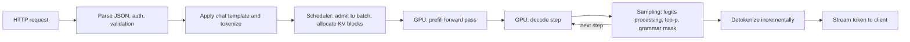
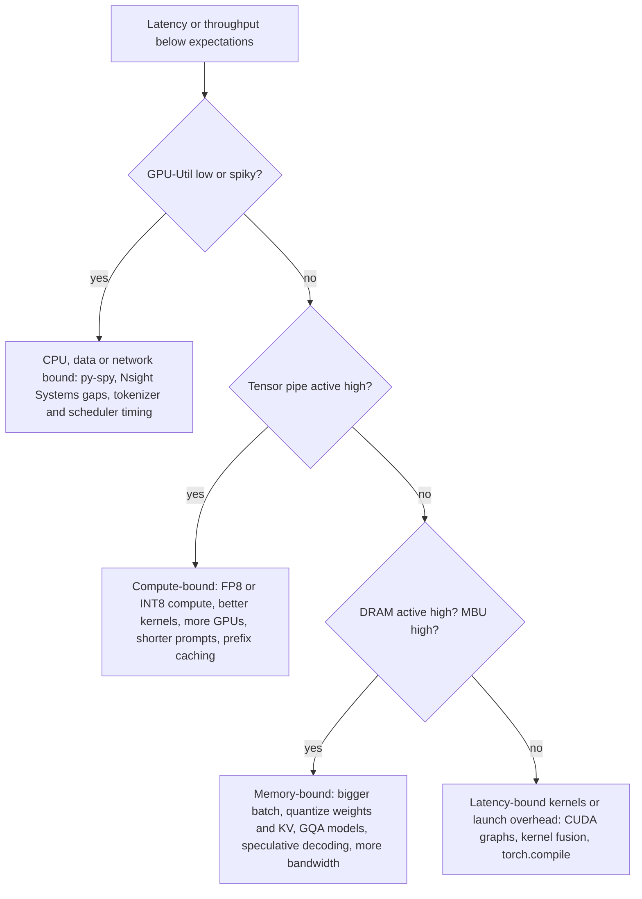

# GPU Fundamentals for LLMs: Compute-Bound vs Memory-Bound

> **Level:** Beginner to Advanced · **Study time:** ~100 min · **Prerequisites:** [Linear Algebra for Machine Learning](../00-foundations/02-linear-algebra-for-ml.md), [LLM Inference Fundamentals: Prefill, Decode, TTFT and Throughput](01-inference-fundamentals-prefill-decode-and-latency-metrics.md), [The KV Cache](02-kv-cache-explained.md)

## Table of contents

- [Why this matters](#why-this-matters)
- [1. A GPU for software engineers: the mental model](#1-a-gpu-for-software-engineers-the-mental-model)
- [2. Two speed limits: peak FLOPs and memory bandwidth](#2-two-speed-limits-peak-flops-and-memory-bandwidth)
- [3. Arithmetic intensity: FLOPs per byte moved](#3-arithmetic-intensity-flops-per-byte-moved)
- [4. The roofline model](#4-the-roofline-model)
- [5. LLM inference on the roofline: decode vs prefill](#5-llm-inference-on-the-roofline-decode-vs-prefill)
- [6. How batching raises arithmetic intensity](#6-how-batching-raises-arithmetic-intensity)
- [7. The GPU memory budget for serving](#7-the-gpu-memory-budget-for-serving)
- [8. Measuring efficiency: MBU and MFU](#8-measuring-efficiency-mbu-and-mfu)
- [9. CPU-bound vs memory-bound vs compute-bound in a real serving system](#9-cpu-bound-vs-memory-bound-vs-compute-bound-in-a-real-serving-system)
- [10. Profiling inference: tools and what to look for](#10-profiling-inference-tools-and-what-to-look-for)
- [11. Why lower precision does not always make inference faster](#11-why-lower-precision-does-not-always-make-inference-faster)
- [12. Going deeper: multi-GPU, MoE and production practice](#12-going-deeper-multi-gpu-moe-and-production-practice)
- [Common mistakes and misconceptions](#common-mistakes-and-misconceptions)
- [Interview questions and model answers](#interview-questions-and-model-answers)
- [Key takeaways](#key-takeaways)
- [Further reading](#further-reading)
- [Next](#next)

## Why this matters

Almost every LLM performance question in production comes down to one thing: which resource is the bottleneck? If you do not know whether a workload is limited by arithmetic, by memory bandwidth, or by the CPU, you will "optimize" the wrong thing: you will buy a GPU with more FLOPs when you needed more bandwidth, or quantize a model that was actually stuck on Python overhead. Interviewers for senior AI/ML roles love this topic because it separates people who have run models from people who have only called APIs. A candidate who can say "decode at batch 1 is memory-bandwidth-bound, so tokens per second is roughly bandwidth divided by model bytes, about 140 tokens/s for a 7B FP16 model on an A100" and then explain how batching, quantization and profiling change that picture is clearly ready to own an inference system. This chapter gives you that mental model, the back-of-envelope math, and the profiling workflow to verify it.

## 1. A GPU for software engineers: the mental model

### 1.1 CPU vs GPU in one picture

> **Analogy:** A CPU is a small team of brilliant chefs who can each cook any complicated dish quickly. A GPU is a giant kitchen with thousands of line cooks who can each do only simple steps, but all at once. If you need 10,000 identical sandwiches, the giant kitchen wins easily. If you need one complicated dish with many dependent steps, the brilliant chefs win.

A **CPU (central processing unit)** has a few to a few dozen powerful cores optimized for low latency on sequential, branchy code. A **GPU (graphics processing unit)** has thousands of simpler arithmetic units optimized for **throughput**: doing the same operation on lots of data in parallel. Neural networks are mostly big matrix multiplications, which are exactly that kind of work.

A **kernel** is a function that runs on the GPU, usually written in **CUDA** (NVIDIA's GPU programming platform and C++ extension). When PyTorch executes `y = x @ W`, the CPU-side Python code **launches** a kernel (for example a matrix-multiply kernel from NVIDIA's cuBLAS library), and thousands of GPU threads execute it. Launching is asynchronous: the CPU queues the kernel and moves on. Keep that in mind, it matters a lot for profiling later.

### 1.2 Streaming multiprocessors, warps, CUDA cores and tensor cores

A modern NVIDIA GPU is built from many identical blocks called **streaming multiprocessors (SMs)**. Think of an SM as one kitchen station. An A100 has 108 SMs and an H100 (SXM version) has 132. (**SXM** is NVIDIA's socketed server-module form factor, as opposed to a PCIe add-in card; SXM parts get higher power limits and NVLink.)

Inside each SM:

- **CUDA cores**: general-purpose arithmetic units that do scalar operations (add, multiply, compare) mostly in FP32. Good for elementwise work like activations, softmax and layer norm.
- **Tensor cores**: specialized units that compute a small matrix multiply-accumulate (multiply two small tiles of numbers and add the result into an accumulator) in a single instruction. They support lower-precision inputs (FP16, BF16, TF32, INT8 and, on newer GPUs, FP8) and usually accumulate in higher precision. Sizes to remember: FP32 is 4 bytes per number, FP16 and BF16 are 2 bytes (BF16 keeps FP32's range with less precision), FP8 and INT8 are 1 byte, INT4 is half a byte (details in [Number Formats and Model Memory](../07-model-compression/01-number-formats-and-model-memory.md)). Tensor cores were introduced with the Volta generation (V100, 2017) and provide the vast majority of a modern GPU's matrix-math throughput. If your matmul does not run on tensor cores, you are leaving most of the GPU unused.
- **Registers**: the fastest storage, private to each thread.
- **Shared memory / L1 cache**: a small, very fast on-chip **SRAM** (static RAM) scratchpad, about 192 KB per SM on A100 and 256 KB on H100, shared by threads running on that SM. Fast kernels load a tile of data from main memory into SRAM once and reuse it many times.

Threads are scheduled in groups of 32 called **warps**. All threads in a warp execute the same instruction at the same time on different data. An SM keeps many warps in flight so that when one warp waits for memory, another can compute. **Occupancy** is how many warps are resident on an SM relative to its maximum; low occupancy means fewer warps available to hide memory latency.

### 1.3 The memory hierarchy

> **Analogy:** The cooks have a tiny countertop right in front of them (registers and SRAM), a shared pantry in the kitchen (L2 cache), a big walk-in fridge down the hall (HBM), and a supermarket across town (CPU memory, reached by truck over PCIe). Cooking is fast; walking to the fridge is slow; driving to the supermarket is very slow.

| Level | Where | Typical size (A100/H100 class) | Speed | Notes |
|---|---|---|---|---|
| Registers | Per thread, inside SM | 256 KB per SM total | Fastest | Compiler managed |
| Shared memory / L1 (SRAM) | Per SM | ~192 to 256 KB per SM | Very fast | Kernel authors manage tiles here |
| L2 cache | Shared by all SMs | 40 MB (A100), 50 MB (H100) | Fast | Too small to hold a 7B model |
| **HBM** (GPU main memory) | Stacked next to the GPU die | 40 to 141 GB | ~1.5 to 5 TB/s | Where weights and KV cache live |
| Host DRAM | CPU side | Hundreds of GB to TBs | ~32 to 64 GB/s over PCIe per direction | Reached over PCIe |

**HBM (high-bandwidth memory)** is the GPU's main memory: DRAM chips stacked vertically and connected to the GPU with a very wide bus. It is what people mean by "GPU memory" or "VRAM" in data-center GPUs. Consumer and some inference GPUs (for example the L4 or RTX cards) use **GDDR** memory instead, which is cheaper but has lower bandwidth.

The key number for this chapter: the FlashAttention paper (Dao et al., 2022) estimates on-chip SRAM bandwidth on an A100 at around 19 TB/s versus 1.5 to 2.0 TB/s for HBM. On-chip memory is roughly an order of magnitude faster, but tiny. Most of GPU performance engineering is about not going back to HBM more often than you must.

```text
+--------------------------------------------------------------------+
|                            GPU die                                  |
|  +-----------+ +-----------+ +-----------+          +-----------+  |
|  |   SM 0    | |   SM 1    | |   SM 2    |   ...    |  SM 131   |  |
|  | CUDA cores| | CUDA cores| |           |          |           |  |
|  | Tensor    | | Tensor    | |           |          |           |  |
|  |  cores    | |  cores    | |           |          |           |  |
|  | Registers | | Registers | |           |          |           |  |
|  | SRAM/L1   | | SRAM/L1   | |           |          |           |  |
|  +-----------+ +-----------+ +-----------+          +-----------+  |
|                 L2 cache (tens of MB, shared by all SMs)            |
+--------------------------------------------------------------------+
          ||  very wide bus: ~1.5 to 5 TB/s
+--------------------------------------------------------------------+
|        HBM: 40 to 141 GB (weights, KV cache, activations)           |
+--------------------------------------------------------------------+
          |  PCIe: ~32 to 64 GB/s per direction       ===  NVLink to peer GPUs
+------------------------+                                (hundreds of GB/s)
|  CPU + host DRAM       |
+------------------------+
```

### 1.4 Interconnects: PCIe vs NVLink

GPUs talk to the CPU and to each other over interconnects:

- **PCIe (Peripheral Component Interconnect Express)** is the standard bus between the CPU and add-in cards. A PCIe Gen4 x16 link gives roughly 32 GB/s per direction; Gen5 x16 roughly 64 GB/s per direction.
- **NVLink** is NVIDIA's direct GPU-to-GPU link. An A100 has 600 GB/s of total NVLink bandwidth and an H100 SXM 900 GB/s (both figures are total bidirectional bandwidth per GPU). **NVSwitch** chips connect all GPUs in a server (for example 8 GPUs) so every pair can talk at full NVLink speed.

Why GPU-to-GPU bandwidth matters: with **tensor parallelism** (each weight matrix split across GPUs, Section 12.1), the GPUs must combine their partial results with an **all-reduce** (a collective operation that sums a tensor across all GPUs and gives every GPU the result) inside every layer. On NVIDIA hardware this is done by **NCCL** (NVIDIA Collective Communications Library).

| | PCIe Gen4/Gen5 x16 | NVLink (A100 / H100 SXM) |
|---|---|---|
| What | General CPU-to-device bus | Dedicated GPU-to-GPU link |
| Bandwidth | ~32 / ~64 GB/s per direction | 600 / 900 GB/s total per GPU |
| Used for | Loading weights, host-device copies, CPU offload, GPUs in PCIe-only servers | Tensor-parallel all-reduce, multi-GPU inference and training |
| Pros | Universal, cheap | Roughly 7 to 10x the bandwidth of same-generation PCIe (comparing bidirectional totals) |
| Cons | A bottleneck for anything per-token | Only on specific SKUs and servers (SXM boards) |

> **Senior insight:** Compare PCIe to HBM. Streaming a 14 GB model from CPU memory over PCIe Gen4 at 32 GB/s takes about 14 / 32 = 0.44 seconds. Reading it from HBM at 2,000 GB/s takes 7 ms. That is why "CPU offloading" of weights makes per-token latency terrible, and why tensor parallelism across GPUs without NVLink often disappoints.

### 1.5 Reference hardware numbers

These are approximate vendor datasheet figures for dense (non-sparse) math. Check the official datasheet for your exact SKU; SXM and PCIe variants differ, and new generations arrive every year or two. NVIDIA names its architectures by generation: Volta (V100), Ampere (A100), Ada Lovelace (L4, RTX 40 series), Hopper (H100, H200) and Blackwell (B200).

| GPU | Memory | Memory bandwidth | Dense BF16/FP16 tensor TFLOPS | FP8 support |
|---|---|---|---|---|
| A100 80 GB SXM | 80 GB HBM2e | ~2.0 TB/s | ~312 | No |
| H100 SXM | 80 GB HBM3 | ~3.35 TB/s | ~989 | Yes (~1,979 dense FP8) |
| H200 SXM | 141 GB HBM3e | ~4.8 TB/s | ~989 (same compute as H100) | Yes |
| L4 | 24 GB GDDR6 | ~0.3 TB/s | ~121 | Yes |

Notice the pattern: from A100 to H100, compute grew about 3.2x but bandwidth only about 1.7x. H200 kept H100's compute and raised bandwidth and capacity. This "memory wall" (compute growing faster than memory bandwidth) is a long-running industry trend and is the backdrop for this whole chapter.

## 2. Two speed limits: peak FLOPs and memory bandwidth

> **Analogy:** A factory's output is limited either by how fast the machines work or by how fast trucks deliver raw materials. If trucks are slow, buying faster machines does nothing.

A **FLOP** is one floating-point operation (one add or one multiply). **FLOPs** (lowercase s) is a count of operations; **FLOP/s** or **FLOPS** is a rate (operations per second). A **TFLOPS** is 10^12 FLOP/s.

**Peak compute** $P$ is the maximum FLOP/s the hardware can do (for example ~312 TFLOPS BF16 on an A100). **Memory bandwidth** $BW$ is the maximum bytes per second that can be moved between HBM and the SMs (~2.0 TB/s on an A100 80 GB).

For any kernel, there are two lower bounds on its run time:

$$t_{\text{compute}} = \frac{F}{P} \qquad t_{\text{memory}} = \frac{M}{BW} \qquad t \gtrsim \max(t_{\text{compute}},\ t_{\text{memory}})$$

- $F$: number of FLOPs the kernel performs.
- $M$: number of bytes it must move to and from HBM.
- $P$: peak FLOP/s of the hardware.
- $BW$: peak memory bandwidth in bytes/s.
- $t$: actual time. Good kernels overlap compute and memory traffic, so time is close to the larger of the two, not the sum.

If $t_{\text{compute}} > t_{\text{memory}}$, the kernel is **compute-bound**: the arithmetic units are the bottleneck. If $t_{\text{memory}} > t_{\text{compute}}$, it is **memory-bandwidth-bound** (usually just "memory-bound"): the SMs sit idle waiting for data.

**Counting FLOPs for a matrix multiply.** Multiplying an $m \times k$ matrix by a $k \times n$ matrix produces $m \times n$ outputs, each a dot product of length $k$. Each dot-product step is one multiply plus one add (a **multiply-accumulate**, MAC), so by convention:

$$F_{\text{matmul}} = 2 \cdot m \cdot k \cdot n$$

Tiny check by hand: $W = \begin{bmatrix}1 & 2\\ 3 & 4\end{bmatrix}$, $x = \begin{bmatrix}5\\ 6\end{bmatrix}$.

- $y_1 = 1 \cdot 5 + 2 \cdot 6 = 5 + 12 = 17$
- $y_2 = 3 \cdot 5 + 4 \cdot 6 = 15 + 24 = 39$

That is 4 multiplies and 4 accumulate-adds (counting the add into an accumulator that starts at zero), so $F = 2 \cdot 2 \cdot 2 \cdot 1 = 8$ FLOPs, matching the formula with $m = 2, k = 2, n = 1$.

**A useful rule of thumb for transformers:** a forward pass over one token costs about $2N$ FLOPs, where $N$ is the number of parameters, because almost every parameter takes part in exactly one multiply-accumulate per token (ignoring attention-score FLOPs, which grow with context length). A 7B model costs about $2 \times 7 \times 10^9 = 1.4 \times 10^{10}$ FLOPs per token.

## 3. Arithmetic intensity: FLOPs per byte moved

### 3.1 Intuition and definition

> **Analogy:** Each truck delivery of flour is either used for one loaf (low intensity) or for a hundred loaves (high intensity). High intensity means the trucks are rarely the bottleneck.

**Arithmetic intensity (AI)** is the number of FLOPs a kernel performs per byte it moves to or from main memory:

$$AI = \frac{F}{M} \quad \text{(FLOPs per byte)}$$

- $F$: FLOPs performed.
- $M$: bytes read from and written to HBM.

High AI means each byte fetched is reused many times (compute-bound territory). Low AI means each byte is used once or twice and thrown away (memory-bound territory). AI is a property of the **algorithm and data layout**, not of the hardware.

### 3.2 Worked example 1: matrix-vector multiply (one token)

During single-sequence decode, every linear layer computes $y = W x$ for a single token vector $x$. Let $W$ be $d \times d$ stored in FP16 (2 bytes per number).

Tiny version first, $d = 2$ (the example above):

- FLOPs: $2 \cdot 2 \cdot 2 = 8$
- Bytes: $W$ has 4 numbers $\times$ 2 bytes $= 8$; $x$ has 2 numbers $\times$ 2 bytes $= 4$; $y$ writes $4$. Total $M = 8 + 4 + 4 = 16$ bytes.
- $AI = 8 / 16 = 0.5$ FLOPs/byte.

Realistic version, $d = 4096$ (a typical hidden size for a 7B model):

- FLOPs: $2 \cdot 4096 \cdot 4096 = 2 \cdot 16{,}777{,}216 = 33{,}554{,}432$
- Bytes for $W$: $16{,}777{,}216 \times 2 = 33{,}554{,}432$
- Bytes for $x$ and $y$: $4096 \times 2 = 8{,}192$ each, so $16{,}384$
- Total $M = 33{,}554{,}432 + 16{,}384 = 33{,}570{,}816$ bytes
- $AI = 33{,}554{,}432 / 33{,}570{,}816 \approx 0.9995 \approx 1$ FLOP/byte

Each weight (2 bytes) is loaded once and used for exactly one multiply-add (2 FLOPs). So matrix-vector in FP16 has AI of about 1, no matter how big $d$ gets. (BLAS libraries such as cuBLAS call this kernel **GEMV**, general matrix-vector multiply; the batched case below is **GEMM**, general matrix-matrix multiply. You will see both names in profiler output.)

### 3.3 Worked example 2: matrix-matrix multiply (a batch of tokens)

Now stack $B$ token vectors into an input matrix $X$ of shape $B \times d$ and compute $Y = X W^\top$. The weights are loaded **once** but used for all $B$ tokens.

General formula for a linear layer with input size $d_{in}$, output size $d_{out}$, batch $B$, and $s$ bytes per element:

$$AI = \frac{2 \, B \, d_{in} \, d_{out}}{s \,(d_{in} d_{out} + B d_{in} + B d_{out})}$$

- $B$: number of tokens processed together (batch size times tokens per sequence in this step).
- $d_{in}, d_{out}$: layer input and output dimensions.
- $s$: bytes per element (2 for FP16/BF16).
- Numerator: FLOPs. Denominator: bytes for weights, inputs and outputs.

With $s = 2$ and $d_{in} = d_{out} = d$, the formula is $\frac{2Bd^2}{2(d^2 + 2Bd)} = \frac{Bd}{d + 2B}$. When $B \ll d$, the $2B$ in the denominator is negligible next to $d$, so $AI \approx B$: each weight byte is reused once per token in the batch. Let us verify with $d_{in} = d_{out} = 4096$, $B = 256$:

- FLOPs: $2 \cdot 256 \cdot 4096 \cdot 4096 = 256 \times 33{,}554{,}432 = 8{,}589{,}934{,}592$
- Weight bytes: $33{,}554{,}432$ (same as before)
- Input bytes: $256 \times 4096 \times 2 = 2{,}097{,}152$
- Output bytes: $2{,}097{,}152$
- Total $M = 33{,}554{,}432 + 2{,}097{,}152 + 2{,}097{,}152 = 37{,}748{,}736$
- $AI = 8{,}589{,}934{,}592 / 37{,}748{,}736 \approx 227.6$ FLOPs/byte

Now the punchline. On an A100 (312 TFLOPS, 2.0 TB/s), the ideal times are:

| Case | FLOPs | Bytes | $t_{\text{compute}}$ | $t_{\text{memory}}$ | Bound |
|---|---|---|---|---|---|
| Matvec, $B = 1$ | 33.6 M | 33.6 MB | $33{,}554{,}432 / 3.12\times10^{14} \approx 0.11\ \mu s$ | $33{,}570{,}816 / 2\times10^{12} \approx 16.8\ \mu s$ | Memory |
| Matmul, $B = 256$ | 8.59 G | 37.7 MB | $8.59\times10^{9} / 3.12\times10^{14} \approx 27.5\ \mu s$ | $37.7\times10^{6} / 2\times10^{12} \approx 18.9\ \mu s$ | Compute (just) |

256 times more useful work costs only about $27.5 / 16.8 \approx 1.6$ times more time. That single table is the reason batching exists. In the matvec case the tensor cores are idle more than 99% of the time.

For large square matrices ($m = k = n$) in FP16, $AI = 2n^3 / (3 \cdot 2 n^2) = n/3$, so a $4096 \times 4096 \times 4096$ matmul has $AI \approx 1365$: comfortably compute-bound. Training and prefill look like this; decode does not.

### 3.4 Code: an arithmetic intensity calculator

```python
# Pure Python, no installs needed.
def linear_layer_ai(batch: int, d_in: int, d_out: int, bytes_per_elem: float = 2.0) -> float:
    """Arithmetic intensity (FLOPs/byte) of Y = X @ W for X: (batch, d_in), W: (d_in, d_out)."""
    flops = 2 * batch * d_in * d_out
    bytes_moved = bytes_per_elem * (d_in * d_out + batch * d_in + batch * d_out)
    return flops / bytes_moved

for b in [1, 8, 64, 256, 1024]:
    print(f"batch={b:5d}  AI={linear_layer_ai(b, 4096, 4096):8.1f} FLOPs/byte")
# batch=    1  AI=     1.0 FLOPs/byte
# batch=    8  AI=     8.0 FLOPs/byte
# batch=   64  AI=    62.1 FLOPs/byte
# batch=  256  AI=   227.6 FLOPs/byte
# batch= 1024  AI=   682.7 FLOPs/byte
```

(Check for batch 64: $64 \cdot 4096 / (4096 + 128) = 262{,}144 / 4{,}224 \approx 62.06$. For batch 1024: $1024 \cdot 4096 / (4096 + 2048) = 4{,}194{,}304 / 6{,}144 \approx 682.7$. These use the simplified form $Bd/(d + 2B)$, which is exact for square layers with $s = 2$.)

## 4. The roofline model

### 4.1 Intuition

The **roofline model** (Williams, Waterman and Patterson, "Roofline: An Insightful Visual Performance Model for Multicore Architectures", 2009) puts the two speed limits on a single chart. It answers: given a kernel's arithmetic intensity, what is the best FLOP/s it can possibly achieve on this hardware?

$$\text{Attainable FLOP/s} = \min\big(P,\ AI \times BW\big)$$

- $P$: peak compute (the flat "roof").
- $AI \times BW$: the bandwidth limit (the slanted roof). If you move $BW$ bytes per second and do $AI$ FLOPs per byte, you cannot exceed $AI \times BW$ FLOP/s.

The two lines meet at the **ridge point** (also called the machine balance):

$$AI_{\text{ridge}} = \frac{P}{BW}$$

Kernels with $AI < AI_{\text{ridge}}$ are memory-bound; kernels with $AI > AI_{\text{ridge}}$ are compute-bound.

### 4.2 Worked example: ridge points

- A100: $312 \times 10^{12} / 2.0 \times 10^{12} = 156$ FLOPs/byte.
- H100 SXM: $989 \times 10^{12} / 3.35 \times 10^{12} \approx 295$ FLOPs/byte.
- H200: $989 / 4.8 \approx 206$ FLOPs/byte.
- L4: $121 / 0.3 \approx 403$ FLOPs/byte.

Read these as: "to keep an H100's tensor cores fed in BF16, every byte you load from HBM must be used in about 295 FLOPs." The generational trend is toward higher ridge points (156 on A100 to 295 on H100), meaning more workloads are memory-bound on newer GPUs. H200 moves the other way because it added bandwidth without adding compute. The ridge also depends on the precision you compute in: H100 dense FP8 is about 1,979 TFLOPS, so its FP8 ridge is about $1{,}979 / 3.35 \approx 590$ FLOPs/byte.

Attainable performance on the A100 for our examples:

- Matvec ($AI \approx 1$): $\min(312, 1 \times 2.0) = 2.0$ TFLOPS, which is about $2.0 / 312 \approx 0.64\%$ of peak.
- Batch 64 ($AI \approx 62$): $\min(312, 62 \times 2.0) = 124$ TFLOPS, about 40% of peak.
- Batch 256 ($AI \approx 228$): $\min(312, 455) = 312$ TFLOPS, at the compute roof.

```text
 attainable
 TFLOP/s    (real roofline plots use log-log axes; this sketch is schematic)
   312 |                      *-------------------------------  compute roof (P)
       |                    / :
       |                  /   :
       |                /     :
       |              /       :
       |            /  <--- memory roof: slope = BW (2.0 TB/s)
       |          /           :
       |        /             :
       |      /               :
       |    /                 :
       |  /                   :
     0 +-----------------------+--------------------------------> AI (FLOPs/byte)
          ^          ^       156 (ridge)       ^
       decode     decode                   prefill, training
       B=1 (~1)   B=64 (~62)               (AI grows with tokens)
            MEMORY-BOUND      |        COMPUTE-BOUND
```

### 4.3 Code: roofline in a few lines

```python
def attainable_tflops(ai: float, peak_tflops: float, bw_tbps: float) -> float:
    """Roofline: min(compute roof, bandwidth roof). AI in FLOPs/byte, BW in TB/s."""
    return min(peak_tflops, ai * bw_tbps)

A100 = dict(peak_tflops=312, bw_tbps=2.0)
for ai in [1, 62, 156, 228, 1365]:
    t = attainable_tflops(ai, **A100)
    print(f"AI={ai:5d}  attainable={t:6.1f} TFLOPS  ({100 * t / A100['peak_tflops']:5.1f}% of peak)")
# AI=    1  attainable=   2.0 TFLOPS  (  0.6% of peak)
# AI=   62  attainable= 124.0 TFLOPS  ( 39.7% of peak)
# AI=  156  attainable= 312.0 TFLOPS  (100.0% of peak)
# AI=  228  attainable= 312.0 TFLOPS  (100.0% of peak)
# AI= 1365  attainable= 312.0 TFLOPS  (100.0% of peak)
```

> **Senior insight:** The roofline is an upper bound, not a prediction. Real kernels land below it because of imperfect overlap, cache effects, small shapes that do not fill all SMs ("wave quantization"), clock throttling and launch overhead. Its value is telling you which roof you are under, and therefore which optimizations can possibly help. Nsight Compute can plot your actual kernels on a roofline chart.

## 5. LLM inference on the roofline: decode vs prefill

Quick recap from [LLM Inference Fundamentals](01-inference-fundamentals-prefill-decode-and-latency-metrics.md): **prefill** processes the whole prompt in one forward pass and produces the first token; **decode** then generates one token per forward pass, reusing the **KV cache** (stored attention keys and values for previous tokens, explained in [The KV Cache](02-kv-cache-explained.md)).

### 5.1 Why decode at small batch is memory-bandwidth-bound

> **Analogy:** Imagine that to write each new word of a sentence, you must walk through the entire library and glance at every book once. The walking dominates; the thinking is instant. That is batch-1 decode.

In one decode step for one sequence, every weight matrix in the model is multiplied by a single token vector: matrix-vector products everywhere. So:

- FLOPs per step $\approx 2N$
- Bytes per step $\approx N \cdot s$ (all weights) plus the KV cache for that sequence
- In FP16 ($s = 2$): $AI \approx 2N / 2N = 1$ FLOP/byte, far below every GPU's ridge point.

So the time per token is set by how fast you can stream the weights out of HBM:

$$\text{tokens/s (batch 1)} \lesssim \frac{BW}{N \cdot s + M_{KV}}$$

- $BW$: memory bandwidth in bytes/s.
- $N$: number of parameters.
- $s$: bytes per parameter (2 for FP16/BF16, 1 for INT8/FP8, about 0.5 for INT4).
- $M_{KV}$: bytes of KV cache read for this sequence in this step (small for short contexts).
- The $\lesssim$ means "at most": real systems typically reach a fraction of peak bandwidth.

**Worked example (our running 7B model).** Take a 7B model in FP16 with the architecture of Llama 2 7B (32 layers, hidden size 4096, 32 attention heads of size 128, no grouped-query attention). Round to $N = 7 \times 10^9$.

- Weight bytes: $7 \times 10^9 \times 2 = 14 \times 10^9$ bytes = 14 GB.
- A100 (2.0 TB/s), ignoring KV cache: $2{,}000 / 14 \approx 142.9$, so at most about **143 tokens/s**, or about **7 ms per token**.
- H100 (3.35 TB/s): $3{,}350 / 14 \approx 239$ tokens/s.
- H200 (4.8 TB/s): $4{,}800 / 14 \approx 343$ tokens/s.
- L4 (0.3 TB/s): $300 / 14 \approx 21$ tokens/s.

Now add the KV cache for a 4,096-token context. KV bytes per token $= 2 \text{ (K and V)} \times 32 \text{ layers} \times 4096 \times 2 \text{ bytes} = 524{,}288$ bytes (512 KiB). For 4,096 tokens: $4{,}096 \times 524{,}288 = 2{,}147{,}483{,}648$ bytes $\approx 2.15$ GB.

- Bytes per step: $14 + 2.15 = 16.15$ GB.
- A100 bound: $2{,}000 / 16.15 \approx 124$ tokens/s.

And with INT4 weight-only quantization (about 0.5 bytes per parameter, ignoring the small overhead of scales): weights $\approx 3.5$ GB, so the A100 bound rises to $2{,}000 / 3.5 \approx 571$ tokens/s at short context. This is precisely why weight quantization speeds up batch-1 decode: fewer bytes to stream. (Number formats are covered in [Number Formats and Model Memory](../07-model-compression/01-number-formats-and-model-memory.md).)

Meanwhile the compute needed per token is only $1.4 \times 10^{10}$ FLOPs, which at 312 TFLOPS takes $1.4 \times 10^{10} / 3.12 \times 10^{14} \approx 45\ \mu s$. Compute is about 150 times faster than the memory traffic. The tensor cores are mostly idle.

```python
# Back-of-envelope decode speed bound (pure Python).
def decode_tokens_per_s_bound(params: float, bytes_per_param: float,
                              bandwidth_gb_s: float, kv_bytes: float = 0.0) -> float:
    bytes_per_step = params * bytes_per_param + kv_bytes
    return bandwidth_gb_s * 1e9 / bytes_per_step

kv_per_token = 2 * 32 * 4096 * 2          # K and V, 32 layers, hidden 4096, FP16
print(kv_per_token)                                                   # 524288
print(round(decode_tokens_per_s_bound(7e9, 2, 2000)))                 # 143  (A100, FP16)
print(round(decode_tokens_per_s_bound(7e9, 2, 2000, 4096 * kv_per_token)))  # 124 (with 4k-token KV)
print(round(decode_tokens_per_s_bound(7e9, 0.5, 2000)))               # 571  (INT4 weights)
print(round(decode_tokens_per_s_bound(7e9, 2, 3350)))                 # 239  (H100, FP16)
```

> **Interview tip:** Memorize the shape of this calculation, not the numbers: "decode tokens/s per sequence is at most bandwidth divided by bytes read per step." Then apply it on the whiteboard to whatever GPU and model the interviewer names.

### 5.2 Why prefill is compute-bound

During prefill, all $T$ prompt tokens go through each layer together, so each weight matrix multiplies a $T \times d$ matrix: a matrix-matrix product. Weights are read once and reused $T$ times, so $AI \approx T$ (for the linear layers, in FP16, while $T \ll d$; as $T$ approaches the hidden size, activation reads and writes start to count and AI grows more slowly, toward the $Td/(d + 2T)$ form of Section 3.3).

**Worked example.** A 2,000-token prompt on our 7B model on an A100:

- FLOPs: $2 \times 7 \times 10^9 \times 2{,}000 = 2.8 \times 10^{13}$ (28 TFLOPs of work, ignoring attention-score FLOPs).
- $t_{\text{compute}} = 2.8 \times 10^{13} / 3.12 \times 10^{14} \approx 0.090$ s = 90 ms.
- $t_{\text{memory}}$ for weights $= 14 \times 10^9 / 2 \times 10^{12} = 0.007$ s = 7 ms.
- $AI \approx 2{,}000$ counting only weight bytes; including activation reads and writes per layer it is about 1,000 to 1,200 (for the $4096 \times 4096$ and $4096 \times 11008$ layers), still far above the ridge of 156.

Compute dominates by more than 10x, so prefill is compute-bound. Caveat: this needs enough tokens in the prefill step. A 50-token prompt at batch 1 has $AI \approx 50$, below the A100 and H100 ridge points, so very short prefills are still memory-bound (which is one reason engines batch prefills together or mix them with decode steps). In practice you never hit 100% of peak; at an illustrative 50% utilization, this prefill would take about 180 ms. That is your **time to first token (TTFT)** floor for this prompt, before any queueing.

### 5.3 Summary: the two phases

| | Prefill | Decode (small batch) |
|---|---|---|
| Work shape | Matrix-matrix ($T$ tokens at once) | Matrix-vector (1 token per sequence) |
| Arithmetic intensity | High (~ number of prompt tokens) | ~1 FLOP/byte in FP16 |
| Bottleneck | Tensor core throughput (FLOPs) | HBM bandwidth (bytes) |
| Main latency metric | TTFT | Time per output token (TPOT) |
| What helps | More FLOPs, FP8 compute, FlashAttention, prefix caching (skips recomputing shared prompt prefixes); chunked prefill protects co-running decodes rather than speeding up prefill itself | More bandwidth, fewer bytes (quantized weights and KV), bigger batches, speculative decoding |
| What does not help much | Weight-only quantization (may even hurt) | More FLOPs alone |

> **Common mistake:** Saying "LLM inference is memory-bound." It depends on the phase, the batch size and the context length. Prefill is compute-bound, small-batch decode is memory-bound, and large-batch decode moves toward compute-bound for the weight matmuls while attention over the KV cache stays memory-bound.

### 5.4 Attention in decode is different from the MLP

The linear layers (QKV projection, output projection, MLP) share weights across all sequences in a batch, so batching raises their AI. **Attention during decode does not share data across sequences**: each sequence reads its own KV cache, and each cached value is used for only a couple of FLOPs per new token. So decode attention has an AI near 1 regardless of batch size (somewhat higher with **grouped-query attention (GQA)**, where several query heads share one KV head; see [Modern LLM Architecture](../04-transformers/08-modern-llm-architecture-improvements.md)). This is why long-context, high-concurrency decode remains memory-bound even at large batch, and why KV cache size and layout (PagedAttention, KV quantization, GQA) matter so much.

## 6. How batching raises arithmetic intensity

> **Analogy:** The bus fare is the same whether one passenger rides or fifty. Reading the weights is the fare; each sequence in the batch is a passenger.

When $B$ sequences decode together, one step reads all weights once and produces $B$ tokens:

$$AI_{\text{decode}}(B) \approx \frac{2 N B}{N s + B \cdot M_{KV,\text{seq}}}$$

- $N$: parameters; $s$: bytes per parameter.
- $B$: number of sequences in the batch.
- $M_{KV,\text{seq}}$: KV cache bytes per sequence read in the step.

If the KV term is small, $AI \approx 2B/s$: equal to $B$ in FP16, $2B$ in INT8, $4B$ in INT4. So on an A100 (ridge 156), FP16 weight matmuls become compute-bound only around batch 150 or so.

**Worked example: batch 1 vs batch 32 on an A100** (7B FP16, every sequence has a 1,000-token context).

- KV per sequence: $1{,}000 \times 524{,}288 = 524{,}288{,}000$ bytes $\approx 0.524$ GB.
- Batch 1: bytes per step $= 14 + 0.524 = 14.524$ GB. Time $= 14.524 / 2{,}000 \approx 7.26$ ms. Throughput $= 1 / 0.00726 \approx 138$ tokens/s.
- Batch 32: KV total $= 32 \times 0.524 \approx 16.78$ GB. Bytes per step $= 14 + 16.78 = 30.78$ GB. Time $= 30.78 / 2{,}000 \approx 15.4$ ms. Throughput $= 32 / 0.0154 \approx 2{,}080$ tokens/s total, about 65 tokens/s per user.
- Compute check at batch 32: $2 \times 7 \times 10^9 \times 32 = 4.48 \times 10^{11}$ FLOPs, which takes about $1.4$ ms at 312 TFLOPS. Still well under 15.4 ms, so still memory-bound.

So batching gave about 15x more total throughput, while per-user speed dropped about 2x. That is the classic **throughput vs latency trade-off**.

Notice something subtle: as $B$ grows, the KV term dominates. The AI saturates at $2N / M_{KV,\text{seq}} = 1.4 \times 10^{10} / 5.24 \times 10^{8} \approx 26.7$ FLOPs/byte for these 1,000-token contexts, still below the A100 ridge. With long contexts and full multi-head attention, no batch size makes the decode step as a whole compute-bound; you run out of memory first. (With very short contexts the ceiling is higher: at 50 tokens per sequence it is about 534, above the ridge.) GQA (which shrinks KV per token, for example by 4x with 8 KV heads instead of 32) and KV cache quantization raise that ceiling.

Batching also has limits:

- **Memory capacity**: every extra sequence needs KV cache space (Section 7).
- **Latency SLOs** (service-level objectives, the latency targets you commit to, such as "p95 TPOT under 50 ms"): per-step time grows with batch, so per-user tokens/s falls.
- **Compute roof**: once the weight matmuls are compute-bound, extra batch adds time linearly.

How servers actually form these batches (static batching vs **continuous batching**, and PagedAttention for KV memory) is the subject of [the next chapter](04-batching-continuous-batching-and-paged-attention.md).

### 6.1 Code: measure the transition on your own GPU

This micro-benchmark measures achieved TFLOPS and achieved bandwidth for `X @ W` as the batch grows. Install with `pip install torch` (a CUDA build).

```python
import torch

def time_gpu(fn, iters: int = 50, warmup: int = 10) -> float:
    """Average seconds per call, timed correctly with CUDA events."""
    for _ in range(warmup):          # warm up: kernel selection, caches, clocks
        fn()
    torch.cuda.synchronize()
    start, end = torch.cuda.Event(enable_timing=True), torch.cuda.Event(enable_timing=True)
    start.record()
    for _ in range(iters):
        fn()
    end.record()
    torch.cuda.synchronize()         # wait for the GPU to actually finish
    return start.elapsed_time(end) / iters / 1000.0   # elapsed_time is in ms

assert torch.cuda.is_available()
d = 8192                              # W is 8192*8192*2 bytes = 134 MB, larger than L2 cache
W = torch.randn(d, d, device="cuda", dtype=torch.float16)

for B in [1, 4, 16, 64, 256, 1024, 4096]:
    X = torch.randn(B, d, device="cuda", dtype=torch.float16)
    t = time_gpu(lambda: X @ W)
    flops = 2 * B * d * d
    bytes_moved = 2 * (d * d + 2 * B * d)
    print(f"B={B:5d}  AI={flops / bytes_moved:7.1f}  "
          f"{flops / t / 1e12:7.1f} TFLOPS  {bytes_moved / t / 1e9:7.0f} GB/s")
```

What to expect (the exact numbers depend on your GPU, so none are shown): at small B, achieved GB/s sits near the GPU's peak bandwidth while TFLOPS are tiny, and the time per call barely changes as B grows from 1 to 16. At large B, achieved TFLOPS plateaus near the tensor-core peak and time grows roughly linearly with B. The knee is near the ridge point.

## 7. The GPU memory budget for serving

Bandwidth decides how fast; capacity decides how many sequences you can serve at once. The GPU's memory must hold:

$$M_{\text{GPU}} \geq M_{\text{weights}} + M_{\text{KV}} + M_{\text{activations}} + M_{\text{overhead}}$$

- $M_{\text{weights}} = N \cdot s$: model parameters at their storage precision.
- $M_{\text{KV}}$: KV cache for all tokens of all active sequences.
- $M_{\text{activations}}$: temporary tensors during the forward pass, largest during prefill of long or many prompts (attention scores if not using FlashAttention, MLP intermediates, logits of size batch $\times$ vocabulary).
- $M_{\text{overhead}}$: the CUDA context (often several hundred MB), library workspaces (cuBLAS, NCCL buffers), CUDA graph memory pools, memory fragmentation, and anything else in the process.

The KV cache formula (derived in [The KV Cache](02-kv-cache-explained.md)):

$$M_{KV} = 2 \cdot L \cdot n_{kv} \cdot d_{head} \cdot s_{kv} \cdot T_{\text{total}}$$

- $2$: one K and one V.
- $L$: layers; $n_{kv}$: KV heads; $d_{head}$: head dimension.
- $s_{kv}$: bytes per KV element (2 for FP16, 1 for FP8 KV cache).
- $T_{\text{total}}$: total tokens cached across all sequences.

**Worked example: our 7B model on one A100 80 GB.**

1. Serving frameworks typically pre-allocate a fraction of GPU memory. vLLM, for example, defaults to `gpu_memory_utilization=0.9` (a version-dependent default). Usable: $0.9 \times 80 = 72$ GB, leaving 8 GB of headroom for other processes. (In recent vLLM versions the engine's own non-KV memory, such as its CUDA context and CUDA graph pools, is counted inside the 72 GB, so it belongs in the reserve in step 3.)
2. Weights: $14$ GB.
3. Activation, workspace and runtime-overhead reserve: assume 2 GB (illustrative; frameworks measure this with a profiling run at startup).
4. KV budget: $72 - 14 - 2 = 56$ GB.
5. KV per token (32 layers, 32 KV heads, 128 head dim, FP16): $2 \times 32 \times 32 \times 128 \times 2 = 524{,}288$ bytes.
6. Token capacity: $56 \times 10^9 / 524{,}288 \approx 106{,}811$ tokens.
7. Concurrent 4,096-token sequences: $106{,}811 / 4{,}096 \approx 26$.

Same model shape with GQA using 8 KV heads: KV per token $= 2 \times 32 \times 8 \times 128 \times 2 = 131{,}072$ bytes, so capacity becomes $56 \times 10^9 / 131{,}072 \approx 427{,}246$ tokens, about 104 sequences at 4,096 tokens. Architecture choices change serving economics by 4x.

(Units note: here GB means $10^9$ bytes. Tools like nvidia-smi report MiB, where 1 MiB $= 2^{20}$ bytes. Be consistent in interviews, or say "roughly".)

```python
def serving_memory_plan(gpu_gb: float, util: float, params: float, bytes_per_param: float,
                        n_layers: int, n_kv_heads: int, head_dim: int, kv_bytes: float,
                        act_reserve_gb: float, ctx_len: int) -> None:
    usable = gpu_gb * util
    weights = params * bytes_per_param / 1e9
    kv_budget = usable - weights - act_reserve_gb
    kv_per_tok = 2 * n_layers * n_kv_heads * head_dim * kv_bytes
    tokens = kv_budget * 1e9 / kv_per_tok
    print(f"usable={usable:.0f} GB  weights={weights:.1f} GB  KV budget={kv_budget:.1f} GB")
    print(f"KV/token={kv_per_tok:,.0f} B  capacity={tokens:,.0f} tokens  "
          f"= {tokens / ctx_len:.1f} seqs of {ctx_len}")

serving_memory_plan(80, 0.9, 7e9, 2, 32, 32, 128, 2, 2, 4096)
# usable=72 GB  weights=14.0 GB  KV budget=56.0 GB
# KV/token=524,288 B  capacity=106,812 tokens  = 26.1 seqs of 4096
serving_memory_plan(80, 0.9, 7e9, 2, 32, 8, 128, 2, 2, 4096)
# usable=72 GB  weights=14.0 GB  KV budget=56.0 GB
# KV/token=131,072 B  capacity=427,246 tokens  = 104.3 seqs of 4096
```

(The first capacity prints as 106,812 because $106{,}811.5$ rounds up.)

> **Senior insight:** Quantizing weights from FP16 to INT4 on this setup frees about 10.5 GB, which becomes about 20,000 more tokens of KV cache. Whether that helps throughput depends on whether you were capacity-limited (yes, more concurrent sequences) or not (then the freed memory just sits there). Memory and speed are different resources.

**Things that silently eat memory in production:** multiple model replicas or LoRA adapters loaded on the same GPU; large vocabulary logits at big batch (batch $\times$ vocab $\times$ 4 bytes in FP32); CUDA graphs captured for many batch sizes; NCCL buffers in multi-GPU setups; fragmentation from the PyTorch caching allocator; and a second process (a monitoring sidecar, a notebook) holding a CUDA context.

## 8. Measuring efficiency: MBU and MFU

Two ratios tell you how close you are to the relevant roof:

$$\text{MFU} = \frac{\text{achieved FLOP/s}}{\text{peak FLOP/s}} \qquad \text{MBU} = \frac{\text{achieved bytes/s}}{\text{peak bytes/s}}$$

- **MFU (model FLOPs utilization)**, popularized by the PaLM paper (Chowdhery et al., 2022): achieved FLOP/s counts only the FLOPs the model mathematically requires (about $2N$ per token for inference), not extra recomputation.
- **MBU (model bandwidth utilization)**, popularized by Databricks' 2023 write-up "LLM Inference Performance Engineering: Best Practices": achieved bytes/s $=$ (weight bytes $+$ KV bytes read per step) / time per step.

Use MFU for compute-bound phases (prefill, training) and MBU for memory-bound phases (decode).

**Worked example: MFU for prefill (illustrative measurement).** The 2,000-token prefill from Section 5.2 needs $2.8 \times 10^{13}$ FLOPs. If it measures 180 ms on an A100, achieved FLOP/s $= 2.8 \times 10^{13} / 0.18 \approx 1.56 \times 10^{14}$ (156 TFLOPS), so MFU $= 156 / 312 = 50\%$.

**Worked example: MBU for decode (illustrative measurement).** Our 7B FP16 model at batch 1 on an A100, with a 1,000-token context, measures a **time per output token (TPOT)** of 10 ms.

- Bytes per step: $14 + 0.524 = 14.524$ GB.
- Achieved bandwidth: $14.524 / 0.010 = 1{,}452$ GB/s.
- MBU: $1{,}452 / 2{,}000 \approx 73\%$.

An MBU around 60 to 80% at batch 1 suggests the decode kernels are in decent shape. An MBU of 20% says something else is eating the time: Python overhead, kernel launch gaps, a slow sampling step, or a non-fused attention kernel. MBU turns "is 10 ms good?" into a concrete answer.

## 9. CPU-bound vs memory-bound vs compute-bound in a real serving system

### 9.1 A request does more than run kernels



Only steps E and F (and sometimes G) run on the GPU. Everything else is CPU work, often in Python, and the decode loop repeats it every few milliseconds. On an H100, the ideal 7B FP16 decode step is $14 / 3{,}350 \approx 4.2$ ms. If your Python scheduler plus sampling plus detokenization adds 3 ms per step, the GPU sits idle 40% of the time.

### 9.2 The three (really five) kinds of bottleneck

- **CPU-bound**: the GPU waits for the host. Causes: tokenization and detokenization, Python per-step overhead in the scheduler, CPU-side sampling or constrained-decoding grammar masks, JSON serialization, image decoding for multimodal inputs, data loading in batch jobs, and the Python **GIL (global interpreter lock)**, which lets only one thread run Python bytecode at a time. A special case is **launch-bound**: the model is small or the batch tiny, so each kernel finishes faster than the CPU can launch the next one. A decode step can involve hundreds of kernel launches; at a few microseconds each (illustrative), that alone can add a millisecond or more.
- **Memory-bandwidth-bound**: kernels run back to back, but they spend their time streaming bytes from HBM. Typical of decode.
- **GPU compute-bound**: tensor cores are busy; FLOPs are the limit. Typical of prefill, large-batch decode of short sequences, and training.
- **Communication-bound** (multi-GPU): NCCL all-reduce or all-gather kernels take a large share of the step, typical of tensor parallelism over PCIe.
- **I/O or network-bound**: model loading from disk, remote storage, or the network between client and server.

### 9.3 What nvidia-smi "GPU utilization" does and does not mean

`nvidia-smi` reports **GPU-Util**, defined by NVIDIA as the percentage of time over the past sample period during which one or more kernels was executing on the GPU. The sample period is between about 1/6 second and 1 second depending on the product.

That means:

- **It does mean** the GPU had at least one kernel running during that fraction of time.
- **It does not mean** the SMs were busy. A single tiny kernel running on 1 of 132 SMs counts as 100%.
- **It does not mean** the tensor cores were busy. A memory-bound decode loop shows near 100% while tensor cores are mostly idle.
- **It does not tell you** whether you are memory-bound or compute-bound.
- A **low** value is still informative: it strongly suggests the GPU is waiting on the CPU, data, or the network.

`utilization.memory` in nvidia-smi is the percentage of time device memory was being read or written, again not the fraction of peak bandwidth used. And **Memory-Usage** shows allocated memory, not memory in use: serving frameworks pre-allocate most of the GPU for the KV cache, so it always looks "full".

> **Common mistake:** "nvidia-smi shows 100% utilization, so the GPU is saturated and we need more GPUs." It may be one small kernel at a time, or memory-bound kernels with idle tensor cores. Use DCGM's SM activity, tensor pipe activity and DRAM activity, or a profiler, before buying hardware.

### 9.4 Diagnosis table

The table uses two tools covered properly in Section 10: **DCGM** (NVIDIA Data Center GPU Manager, which exposes hardware counters such as how busy the SMs, tensor cores and memory are) and **py-spy** (a sampling profiler that shows where a Python process spends CPU time).

| Signal | CPU-bound | Memory-bound | Compute-bound |
|---|---|---|---|
| nvidia-smi GPU-Util | Low or spiky (e.g. 30 to 70%) | High (~90 to 100%) | High (~100%) |
| DCGM SM active | Low | High | High |
| DCGM tensor pipe active | Low | Low | High |
| DCGM DRAM active | Low | High | Moderate |
| CPU | One core pinned at 100% (GIL), high Python time in py-spy | Normal | Normal |
| Nsight Systems timeline | Gaps between kernels; CPU busy in Python | Back-to-back kernels; GEMV and attention kernels dominate | Back-to-back large GEMM kernels |
| Power draw | Well below the limit | Moderate | Near the power limit, clocks may throttle |
| Increase batch size | Throughput rises (overhead amortized) | Throughput rises almost linearly, latency barely changes | Throughput flat, latency rises linearly |
| Halve model bytes (quantize) | No change | Faster | No change or slower |
| Move to GPU with more FLOPs, same bandwidth | No change | Little change | Faster |
| Move to faster CPU | Faster | No change | No change |

### 9.5 A diagnostic procedure



The most reliable technique is **controlled experiments**: change one variable and see how time responds.

- Double the batch size. Memory-bound decode: step time barely changes. Compute-bound: step time doubles.
- Double the prompt length. Prefill time roughly doubles (compute-bound), more with long-context attention.
- Swap in a model with half the bytes. Memory-bound: faster. CPU-bound: no change.
- Run the same model with a dummy tokenizer or pre-tokenized input. If throughput jumps, tokenization was the bottleneck.

## 10. Profiling inference: tools and what to look for

Profile top-down: start from request-level metrics, then system-level GPU counters, then the timeline, then individual kernels. Do not open Nsight Compute before you know which kernel matters.

| Tool | Level | What it tells you | Overhead | Use when |
|---|---|---|---|---|
| Server metrics (TTFT, TPOT, queue time, batch size) | Request | Where latency goes: queueing vs prefill vs decode | None | Always, first |
| `nvidia-smi` | Device | Kernel-running time %, memory allocated, power, clocks, temperature | Negligible | Quick sanity check |
| **DCGM** (Data Center GPU Manager) + dcgm-exporter | Device, fleet | SM active, SM occupancy, tensor pipe active, DRAM active, PCIe/NVLink bytes, exported to Prometheus | Low | Production monitoring across a fleet |
| `py-spy` | Host process | Where Python CPU time goes (sampling, no code changes) | Low | Suspect CPU-bound |
| **PyTorch profiler** | Framework op | Per-op CPU and GPU time, shapes, memory; Chrome trace | Moderate | Which ops dominate in a PyTorch model |
| **Nsight Systems** (`nsys`) | System timeline | CPU threads, CUDA API calls, kernels, memcpy, NCCL on one timeline; gaps | Moderate | Find idle gaps, sync points, launch overhead, overlap |
| **Nsight Compute** (`ncu`) | Single kernel | Achieved FLOPs, bandwidth, occupancy, roofline position, stall reasons | High (replays kernels) | Optimize one specific hot kernel |

### 10.1 nvidia-smi and DCGM

```bash
# Live per-second view of selected metrics as CSV.
nvidia-smi --query-gpu=utilization.gpu,utilization.memory,memory.used,memory.total,power.draw,clocks.sm,temperature.gpu --format=csv -l 1

# Rolling device monitor: p=power/temp, u=utilization, c=clocks, m=memory, t=PCIe throughput.
nvidia-smi dmon -s pucmt

# DCGM profiling metrics (field ids: 1002 SM active, 1003 SM occupancy, 1004 tensor pipe active, 1005 DRAM active).
dcgmi dmon -e 1002,1003,1004,1005
```

In Prometheus/Grafana via dcgm-exporter, the useful fields include `DCGM_FI_PROF_SM_ACTIVE`, `DCGM_FI_PROF_PIPE_TENSOR_ACTIVE`, `DCGM_FI_PROF_DRAM_ACTIVE`, `DCGM_FI_DEV_FB_USED`, `DCGM_FI_DEV_POWER_USAGE` and `DCGM_FI_PROF_PCIE_TX_BYTES`. Field availability depends on GPU model and DCGM version; check the DCGM documentation for your setup.

What to look for: low SM active with high GPU-Util means small kernels; high DRAM active with low tensor active means memory-bound; power pinned at the limit with dropping SM clocks means thermal or power throttling; nonzero PCIe traffic during steady-state decode means something is copying to or from the host every step (a classic bug: calling `.item()` or `.cpu()` inside the loop).

### 10.2 PyTorch profiler

```python
# pip install torch transformers accelerate
import torch
from torch.profiler import profile, ProfilerActivity, record_function
from transformers import AutoModelForCausalLM, AutoTokenizer

name = "gpt2"  # small model so this runs anywhere with a GPU; swap in your model
tok = AutoTokenizer.from_pretrained(name)
# `dtype=` is the current argument name; transformers releases before about 4.56 use `torch_dtype=`
# (still accepted in newer releases, with a deprecation warning).
model = AutoModelForCausalLM.from_pretrained(name, dtype=torch.float16).cuda().eval()
inputs = tok("The quick brown fox", return_tensors="pt").to("cuda")

with torch.inference_mode():
    model.generate(**inputs, max_new_tokens=8)          # warm-up outside the profiler
    with profile(activities=[ProfilerActivity.CPU, ProfilerActivity.CUDA],
                 record_shapes=True, profile_memory=True) as prof:
        with record_function("generate_32_tokens"):
            model.generate(**inputs, max_new_tokens=32)

# Sort key name varies by version: "cuda_time_total" in many releases,
# "device_time_total" in newer ones.
print(prof.key_averages().table(sort_by="cuda_time_total", row_limit=15))
prof.export_chrome_trace("generate_trace.json")   # open in Perfetto UI or chrome://tracing
```

What to look for: are the top GPU ops matmuls (`aten::mm`, `aten::addmm`, GEMM kernels) and attention? Is the total CPU time much larger than the total GPU time (CPU-bound)? In the trace, are there gaps between GPU kernels? Do you see many tiny elementwise kernels that could be fused? Any `aten::item`, `aten::_local_scalar_dense` or `cudaMemcpy` device-to-host inside the decode loop (forced synchronization)?

### 10.3 Nsight Systems and Nsight Compute

```bash
# Whole-program timeline: CUDA API, kernels, NVTX ranges, OS runtime.
nsys profile --trace=cuda,nvtx,osrt -o decode_profile python bench_decode.py
nsys stats decode_profile.nsys-rep      # text summary: top kernels, API calls, memcpy

# Deep-dive on a few launches of matmul kernels (slow: it replays each kernel many times).
ncu --set full --kernel-name regex:gemm --launch-count 3 -o gemm_report python bench_matmul.py
```

Add **NVTX** (NVIDIA Tools Extension) ranges, named markers around regions of your code, so phases show up on the Nsight timeline:

```python
import torch
torch.cuda.nvtx.range_push("prefill")
# ... run prefill ...
torch.cuda.nvtx.range_pop()
torch.cuda.nvtx.range_push("decode_step")
# ... run one decode step ...
torch.cuda.nvtx.range_pop()
```

What to look for in **Nsight Systems**: white space between kernels on the GPU row (CPU or launch bound); long `cudaStreamSynchronize` or `cudaMemcpy` calls on the CPU row; NCCL kernels taking a large share of each step (communication-bound); whether data copies overlap with compute. In **Nsight Compute**: the "Speed of Light" section shows achieved compute and memory throughput as a percentage of peak; the roofline chart shows where the kernel sits; low achieved values on both mean the kernel is latency-bound (too little parallelism, low occupancy, or too small a problem).

### 10.4 Timing correctly

Because kernel launches are asynchronous, `time.time()` around a PyTorch call measures how long it took to queue the work, not to run it.

```python
import time, torch

x = torch.randn(8192, 8192, device="cuda", dtype=torch.float16)
y = x @ x; torch.cuda.synchronize()   # warm-up: pays one-time cuBLAS init so it does not pollute either timing

t0 = time.perf_counter(); y = x @ x; t1 = time.perf_counter()
print(f"wrong (no sync): {(t1 - t0) * 1e3:.3f} ms")    # mostly launch time

torch.cuda.synchronize()
t0 = time.perf_counter(); y = x @ x; torch.cuda.synchronize(); t1 = time.perf_counter()
print(f"right (synced):  {(t1 - t0) * 1e3:.3f} ms")    # actual GPU execution time
```

Also warm up first (the first call pays for CUDA context creation, kernel selection, `torch.compile` compilation and memory allocation), fix the GPU clocks or at least report them, and measure percentiles (p50, p95, p99) over many runs, not a single sample. For end-to-end LLM benchmarking methodology, see [Optimizing and Benchmarking LLM Latency and Cost](07-optimizing-and-benchmarking-llm-latency-and-cost.md).

### 10.5 A quick CPU-side check: tokenization

```python
# pip install transformers
import time
from transformers import AutoTokenizer

tok = AutoTokenizer.from_pretrained("gpt2")          # loads the fast (Rust) tokenizer by default
prompts = ["The quick brown fox jumps over the lazy dog. " * 200] * 64

t0 = time.perf_counter()
ids = tok(prompts)["input_ids"]
t1 = time.perf_counter()
n_tokens = sum(len(x) for x in ids)
print(f"{n_tokens} tokens in {(t1 - t0) * 1e3:.1f} ms")
```

Compare this time with your measured prefill time. If tokenizing a batch takes a meaningful fraction of the GPU work, move tokenization off the critical path (separate worker processes, async pipelines) and make sure you are using a fast tokenizer.

## 11. Why lower precision does not always make inference faster

Lower precision helps in exactly two ways: it **moves fewer bytes** (helps memory-bound work) and, if the hardware has faster tensor cores for that format and the kernel actually uses them, it **does more FLOPs per second** (helps compute-bound work). If neither mechanism applies to your bottleneck, nothing gets faster. The detailed formats are in [Number Formats and Model Memory](../07-model-compression/01-number-formats-and-model-memory.md) and the methods in [Practical LLM Quantization](../07-model-compression/04-llm-quantization-gptq-awq-and-outliers.md); here is the performance view.

| Reason | Mechanism | Example | What to do |
|---|---|---|---|
| Weight-only quantization in a compute-bound phase | W4A16 (4-bit weights, 16-bit activations) dequantizes weights to FP16 inside the kernel and computes in FP16. Saves bytes, not FLOPs | Prefill or large-batch decode gets no faster, maybe slower due to dequantization work | Use W8A8 or FP8 (both weights and activations) on hardware with matching tensor cores |
| No hardware support | GPU lacks tensor cores for the format, so values are upcast | FP8 on an A100 (FP8 tensor cores arrived with Ada and Hopper) | Match format to hardware: INT8 or W4A16 on A100, FP8 on H100 |
| No optimized kernel | Framework falls back to a generic path, or the library is built for memory savings | Some quantization libraries designed for memory-saving fine-tuning dequantize on the fly and can be slower than FP16 | Use serving engines with fused quantized kernels for your format and GPU |
| The bottleneck is not the weights | KV cache reads dominate at long context or high batch | 32k-token contexts: weights are a minority of bytes per step | Quantize the KV cache (FP8 KV), use GQA models, prefix caching |
| The bottleneck is not the GPU | CPU-bound or launch-bound | Tokenizer, Python scheduler, sampling, network | Profile the host; CUDA graphs; async pipelines |
| Extra overhead at small shapes | Quantize/dequantize activations, scale handling, layout conversions | Tiny model or batch 1 with many small layers | Fused kernels; sometimes stay in BF16 |
| Freed memory is not used | Throughput gains come from bigger batches; if batch size is fixed, you only saved memory | Same `max_num_seqs` before and after quantization | Raise concurrency limits to use the freed KV space |
| Communication dominates | Tensor-parallel all-reduce is unchanged by weight precision | Multi-GPU over PCIe | Fewer GPUs per replica (quantization may let the model fit on one) |

The neat way to remember the first row: weight-only INT4 makes $AI \approx 4B$ instead of $B$, so on an A100 the weight matmuls hit the compute roof around batch $156 / 4 \approx 39$ instead of around 156. Above that batch, you are compute-bound and the 4-bit storage buys you nothing except memory capacity, while the dequantization costs extra instructions.

> **Interview tip:** When asked "we quantized to INT4, memory dropped but latency did not, why?", structure the answer as: (1) what was the bottleneck before (measure MBU, MFU, GPU idle time), (2) does the new format reduce the dominant bytes or FLOPs, (3) does the hardware and the kernel actually exploit it. The full worked case is in [Debugging Case: A Quantized LLM Uses Less Memory but Latency Is Unchanged](../11-system-design/06-debugging-case-quantized-llm-not-faster.md).

## 12. Going deeper: multi-GPU, MoE and production practice

### 12.1 Multi-GPU changes the bandwidth math

With **tensor parallelism** (splitting each weight matrix across GPUs; see [Distributed Training and Training Memory](../02-deep-learning/10-distributed-training-and-training-memory.md)), each GPU streams only its slice of the weights, so aggregate bandwidth scales with GPU count. A 70B model in FP16 is 140 GB. On 8 H100s with tensor parallelism, the ideal batch-1 bound is $8 \times 3{,}350 / 140 \approx 191$ tokens/s. Real numbers are lower because every layer needs all-reduce communication, which is latency-sensitive and needs NVLink to be cheap. Over PCIe, the communication can dominate. **Pipeline parallelism** (splitting layers across GPUs) does not speed up a single sequence's decode, because the stages run one after another for each token; it helps capacity and throughput instead.

### 12.2 Mixture-of-experts (MoE)

In an MoE model, each token activates only a few expert MLPs. Mixtral 8x7B, for example, has about 47B total parameters but about 13B active per token. At batch 1, decode reads only the active experts' weights (plus shared layers), so bandwidth cost tracks active parameters. At large batch, different tokens route to different experts, so nearly all experts get read each step: bytes track total parameters while FLOPs track active parameters. MoE also needs memory for all experts. This is a favorite senior follow-up.

### 12.3 Other levers that follow from the roofline

- **Kernel fusion and FlashAttention**: fusing operations keeps intermediates in SRAM and avoids HBM round trips. FlashAttention (Dao et al., 2022) is the canonical IO-aware example; see [Modern LLM Architecture](../04-transformers/08-modern-llm-architecture-improvements.md).
- **CUDA graphs**: record a sequence of kernel launches once and replay it with a single launch, removing per-kernel CPU launch overhead in decode. Most serving engines use them for decode at common batch sizes.
- **Speculative decoding**: a cheap draft proposes several tokens and the big model verifies them in one forward pass, turning several memory-bound matvec steps into one matmul with higher AI. Covered in [Speculative Decoding, Prompt Caching and Other Inference Speedups](05-speculative-decoding-caching-and-other-speedups.md).
- **Prefill/decode disaggregation and chunked prefill**: because the phases stress different resources, some systems run them on separate GPU pools or interleave prefill chunks with decode steps so neither starves.

### 12.4 Cost and capacity planning

Cost per token is roughly (GPU cost per hour) / (tokens per hour). In memory-bound decode, throughput grows almost linearly with batch until you hit KV capacity or the compute roof, so **the cheapest token is usually produced at the largest batch that still meets your latency SLO**. This makes the memory budget (Section 7) a direct cost lever. For small models where batch-1 latency is the product requirement (interactive coding assistants, voice), pick GPUs by bandwidth, not FLOPs. For prefill-heavy workloads (long documents in, short answers out, such as RAG or classification), FLOPs matter more. The platform-level design is in [System Design: A Multi-Tenant LLM Inference Platform](../11-system-design/03-design-a-multi-tenant-llm-inference-platform.md).

### 12.5 Production failure modes worth knowing

- **Thermal or power throttling**: clocks drop under sustained load; benchmarks run for 10 seconds look better than steady state.
- **Noisy neighbors**: GPU sharing (MPS, the Multi-Process Service that lets processes share SMs; MIG, Multi-Instance GPU hardware partitioning; or time slicing) changes bandwidth and SM availability.
- **Hidden synchronizations**: `.item()`, printing a tensor, or Python control flow on GPU values inside the decode loop stalls the pipeline every step.
- **Rising latency over time**: KV cache pressure causing preemption, fragmentation, or memory leaks. See [Debugging Case: Rising p95 Latency and Memory Usage](../11-system-design/08-debugging-case-rising-p95-latency-and-memory.md).
- **Mismatched benchmarks**: microbenchmarks at batch 1 used to justify a production decision made at batch 64, or vice versa.

## Common mistakes and misconceptions

- **"LLM inference is memory-bound."** Only small-batch decode is, plus decode attention at any batch. Prefill (of more than a few hundred tokens) and large-batch decode of short sequences are compute-bound.
- **"100% GPU utilization in nvidia-smi means the GPU is maxed out."** It means a kernel was running. Check SM active, tensor pipe active and DRAM active.
- **"Buy the GPU with the most TFLOPS."** For batch-1 latency, bandwidth is what matters. Compare TB/s and capacity.
- **"Quantization always speeds things up."** Only if the bottleneck is the bytes or FLOPs it reduces, and only with hardware and kernel support.
- **Timing GPU code without synchronizing.** You measure launch time, not execution time.
- **Benchmarking without warm-up.** The first call includes compilation, allocation and autotuning.
- **Ignoring the KV cache in the bandwidth math.** At long contexts and high batch it can exceed the weight bytes.
- **Reading "Memory-Usage: 72 GB / 80 GB" as a memory leak** in a serving engine that pre-allocates KV cache by design.
- **Assuming more GPUs always means lower latency.** Tensor parallelism without NVLink, or pipeline parallelism, can leave per-token latency flat or worse.
- **Forgetting the CPU.** Tokenization, detokenization, sampling and scheduling run every step and can cap throughput.
- **Confusing FLOPs (a count) with FLOPS (a rate).**

## Interview questions and model answers

<details>
<summary><b>Q1. How do you distinguish CPU-bound, memory-bound, and GPU-bound (compute-bound) workloads?</b></summary>

**Short answer:** I look at where time goes and how time responds to controlled changes. CPU-bound shows low or spiky GPU utilization, gaps between kernels in a timeline, and a CPU core pinned by Python. Memory-bound shows busy GPUs with high DRAM activity but low tensor-core activity, and step time scales with bytes read (model size, KV cache) while barely changing with batch size. Compute-bound shows high tensor-pipe activity, power near the limit, and step time that scales with FLOPs, so doubling batch doubles step time.

**Deeper answer and follow-ups:**
- Metrics: nvidia-smi GPU-Util only says "a kernel was running"; use DCGM `SM_ACTIVE`, `PIPE_TENSOR_ACTIVE`, `DRAM_ACTIVE`, plus host CPU per core and py-spy.
- Timeline: Nsight Systems shows white space between kernels (CPU or launch bound), long sync calls, or NCCL dominating (communication-bound).
- Experiments: double batch (memory-bound: step time nearly flat; compute-bound: doubles); halve model bytes (memory-bound gets faster); pre-tokenize inputs or use a faster CPU (CPU-bound gets faster).
- Math: compare arithmetic intensity against the ridge point $P/BW$ (156 FLOPs/byte on A100, about 295 on H100 for BF16).
- Pitfall: a workload can switch regimes by phase (prefill vs decode) and by load (batch size, context length), so measure under production-like traffic.
- Why it matters: the fixes are disjoint. CPU-bound needs CUDA graphs, async tokenization and less Python per step; memory-bound needs fewer bytes or more reuse; compute-bound needs cheaper FLOPs (FP8, better kernels) or more GPUs. Applying the wrong class of fix costs money and changes nothing, so in production chart DCGM tensor and DRAM activity next to TTFT and TPOT to catch regime shifts.

</details>

<details>
<summary><b>Q2. Is the workload compute-bound or memory-bandwidth-bound? (Answer it for LLM inference.)</b></summary>

**Short answer:** In general I answer it with arithmetic: estimate FLOPs and bytes per step, compute $AI = F/M$, and compare it with the GPU's ridge point $P/BW$ for the precision actually used; then I confirm by measurement. For LLM inference it depends on the phase and batch. Prefill processes many tokens per weight read, so its arithmetic intensity is roughly the number of prompt tokens (for prompts shorter than the hidden size) and, once that exceeds the ridge point (a few hundred tokens), it is compute-bound; a very short prompt at batch 1 can still be memory-bound. Decode at small batch does a matrix-vector product per layer, about 1 FLOP per byte in FP16, far below any GPU's ridge point, so it is memory-bandwidth-bound: each step must stream all the weights from HBM.

**Deeper answer and follow-ups:**
- Decode upper bound: tokens/s per sequence $\lesssim BW / (N s + M_{KV})$. 7B FP16 on A100: $2{,}000 / 14 \approx 143$ tokens/s; on H100 about 239.
- Prefill example: 2,000-token prompt on 7B is $2.8 \times 10^{13}$ FLOPs, about 90 ms of compute at A100 peak vs 7 ms to read the weights.
- Batching raises decode AI to about $B$ for the weight matmuls (FP16), so the weight matmuls become compute-bound around $B \approx P/BW$.
- Decode attention stays memory-bound at any batch because each sequence reads its own KV cache; with long contexts, KV bytes cap the achievable AI well below the ridge.
- Follow-up "so how would you speed up decode?": reduce bytes (quantize weights and KV, GQA), increase reuse (batching, speculative decoding), or buy bandwidth (H200-class memory, tensor parallelism).
- How to confirm: double the batch (memory-bound step time stays nearly flat; compute-bound doubles), check DCGM tensor-pipe vs DRAM activity, and compute MBU and MFU. If neither is high, the honest answer is "neither": it is CPU, launch or communication bound.
- Trade-off: the ridge moves with precision and hardware (H100 is about 295 FLOPs/byte in BF16 but about 590 in FP8), so the same workload can flip regimes when you change format or GPU.

</details>

<details>
<summary><b>Q3. How would you profile inference?</b></summary>

**Short answer:** Top-down. First, request-level metrics: queue time, TTFT, TPOT, batch size, so I know whether the problem is queueing, prefill or decode. Then device counters (nvidia-smi and DCGM: SM active, tensor active, DRAM active, power, clocks). Then a timeline with Nsight Systems or the PyTorch profiler to find gaps, syncs and the dominant kernels, plus py-spy for the Python side. Only then Nsight Compute on the specific hot kernel to see where it sits on the roofline.

**Deeper answer and follow-ups:**
- Compute expected numbers first: bandwidth bound for decode, FLOPs bound for prefill. Then MBU and MFU tell you how far off you are.
- Methodology: warm up, synchronize before timing (CUDA is asynchronous), use CUDA events, fix or record clocks, report p50/p95/p99, use production-like prompt and output length distributions and concurrency.
- Add NVTX ranges (prefill, decode step, sampling) so phases are visible on the timeline.
- Typical findings: `.item()` or device-to-host copies in the decode loop; tokenization or detokenization on the critical path; many small unfused kernels (fix with CUDA graphs, fusion, `torch.compile`); NCCL dominating in tensor parallelism over PCIe; non-tensor-core kernels for matmuls due to dtype or shape.
- In production, continuous DCGM metrics in Prometheus plus request tracing; heavy profilers only on a canary or offline replay because of overhead.
- Failure modes of profiling itself: profilers add overhead and can insert synchronizations, so do not read wall-clock latency from a profiled run (Nsight Compute replays each kernel, so its timings are per kernel, not end to end); short runs miss thermal throttling; profiling batch 1 when production runs batch 64 finds the wrong bottleneck.

</details>

<details>
<summary><b>Q4. Why does lower precision not always produce faster inference?</b></summary>

**Short answer:** Lower precision helps only by moving fewer bytes or by using faster low-precision tensor cores. If the workload's bottleneck is something else (compute in a weight-only scheme, the KV cache, the CPU, communication), or if the hardware or kernels do not support the format efficiently, you save memory but not time. Dequantization overhead can even make it slower.

**Deeper answer and follow-ups:**
- Weight-only INT4 (W4A16) dequantizes to FP16 and computes in FP16: it helps memory-bound decode but not compute-bound prefill or large-batch decode. Its AI becomes about $4B$, so on A100 it hits the compute roof around batch 39.
- Hardware: FP8 tensor cores exist on Ada, Hopper and Blackwell, not Ampere; on unsupported hardware values are upcast (FP8 weight-only storage can still cut bytes there, but there is no FP8 compute speedup).
- Contrast: FP8 (weights and activations) on an H100 can speed up both regimes, because it halves bytes and runs on tensor cores with about twice the BF16 peak. Weight-only INT4 only attacks bytes.
- Kernels: some libraries prioritize memory savings and dequantize on the fly, which can be slower than FP16; production engines use fused quantized GEMMs.
- Other bottlenecks: KV cache dominating bytes at long context, Python or tokenizer overhead, all-reduce communication.
- Unused benefit: memory freed by quantization only raises throughput if you raise concurrency to use it.
- How to verify: measure MBU and MFU before and after, compare per-phase times (TTFT vs TPOT), and inspect which kernels run in a profiler.
- Quality is a separate gate: even when a format is faster, re-run your evaluation set, since activations contain outlier channels that make them harder to quantize than weights (see [Practical LLM Quantization](../07-model-compression/04-llm-quantization-gptq-awq-and-outliers.md)).

</details>

<details>
<summary><b>Q5. Explain arithmetic intensity and the roofline model. What is the ridge point of an H100 in BF16?</b></summary>

**Short answer:** Arithmetic intensity is FLOPs per byte moved from main memory. The roofline says attainable performance is $\min(P, AI \times BW)$. The ridge point $P/BW$ separates memory-bound from compute-bound kernels. For an H100 SXM in dense BF16, about $989 / 3.35 \approx 295$ FLOPs per byte.

**Deeper answer and follow-ups:**
- Matvec in FP16 has $AI \approx 1$; a batched linear layer has $AI \approx B$ for $B \ll d$; large square matmul has $AI \approx n/3$.
- A100 ridge is about 156, so newer GPUs need more reuse per byte to saturate compute.
- The roofline is an upper bound; real kernels fall below due to imperfect overlap, low occupancy, small shapes, throttling.
- Nsight Compute plots kernels on the roofline, which tells you which optimization can help (reduce bytes vs reduce FLOPs vs increase parallelism).

</details>

<details>
<summary><b>Q6. Estimate the maximum decode speed for a 7B model in FP16 on an A100, and how it changes with INT4 and with a long context.</b></summary>

**Short answer:** Weights are 14 GB, bandwidth about 2 TB/s, so at most about 143 tokens/s (about 7 ms per token) at batch 1. INT4 weights (about 3.5 GB) raise the bound to about 571 tokens/s. A 4,096-token context with full multi-head attention adds about 2.15 GB of KV reads per step, lowering the FP16 bound to about 124 tokens/s.

**Deeper answer and follow-ups:**
- KV bytes per token for this architecture: $2 \times 32 \times 4096 \times 2 = 524{,}288$.
- Real systems reach perhaps 60 to 80% of the bound (illustrative); an MBU much lower than that suggests overhead.
- Compute per token, $1.4 \times 10^{10}$ FLOPs, takes about 45 microseconds at peak, so compute is not the issue.
- Follow-up "and on 8 GPUs with tensor parallelism?": aggregate bandwidth scales roughly with GPU count, minus all-reduce cost, which needs NVLink.

</details>

<details>
<summary><b>Q7. nvidia-smi shows 100% GPU utilization. Is the GPU saturated?</b></summary>

**Short answer:** Not necessarily. GPU-Util is the fraction of the sample period during which at least one kernel was running. A single small kernel on a few SMs, or memory-bound kernels with idle tensor cores, both show 100%.

**Deeper answer and follow-ups:**
- Use DCGM `SM_ACTIVE` and `SM_OCCUPANCY` for spatial utilization, `PIPE_TENSOR_ACTIVE` for tensor cores, `DRAM_ACTIVE` for memory traffic.
- Compute MBU or MFU against known bytes and FLOPs per step.
- Low GPU-Util is a stronger signal (GPU starved by CPU, data or network) than high GPU-Util is.
- Memory-Usage near full is normal for engines that pre-allocate KV cache.

</details>

<details>
<summary><b>Q8. Walk me through the GPU memory budget for serving a model. How many concurrent users can a 7B model serve on an 80 GB GPU?</b></summary>

**Short answer:** Memory holds weights, KV cache, activations and framework overhead. For a 7B FP16 model on an 80 GB A100 with a 90% allocation cap: 72 GB usable, 14 GB weights, about 2 GB activation reserve (illustrative), leaving about 56 GB of KV cache. At 524,288 bytes per token (32 layers, 32 KV heads, 128 head dim), that is about 107k tokens, or about 26 sequences at 4,096 tokens.

**Deeper answer and follow-ups:**
- With GQA (8 KV heads) the KV per token drops 4x, so about 104 sequences at 4,096 tokens.
- FP8 KV cache halves it again; INT4 weights free about 10.5 GB more.
- Real concurrency depends on actual (not maximum) sequence lengths, which is why paged KV allocation matters.
- Overheads people forget: CUDA context, CUDA graph pools, NCCL buffers, logits at large batch, adapters, fragmentation.

</details>

<details>
<summary><b>Q9. Why does batching increase decode throughput almost for free, and when does it stop helping?</b></summary>

**Short answer:** In memory-bound decode, the cost of a step is dominated by reading the weights, which is the same for 1 or 32 sequences. Batching reuses each weight byte across $B$ tokens, raising arithmetic intensity to about $B$. It stops helping when the weight matmuls hit the compute roof (around $B \approx P/BW$), when KV cache reads dominate, when memory for KV runs out, or when per-step latency breaks the SLO.

**Deeper answer and follow-ups:**
- Worked example: 7B FP16 on A100 with 1,000-token contexts: batch 1 is about 138 tokens/s; batch 32 is about 2,080 tokens/s total but about 65 per user.
- Decode attention does not benefit, since each sequence reads its own KV.
- Continuous batching keeps the batch full as requests finish at different times.
- Cost per token falls nearly linearly with batch in the memory-bound regime, so pick the largest batch that meets the latency SLO.

</details>

<details>
<summary><b>Q10. What are MBU and MFU, and when would you use each?</b></summary>

**Short answer:** MFU is achieved model FLOP/s divided by peak FLOP/s; MBU is achieved bytes/s (weights plus KV read per step, divided by step time) divided by peak bandwidth. Use MFU for compute-bound work like prefill and training, and MBU for memory-bound decode.

**Deeper answer and follow-ups:**
- Example: 7B FP16, 1,000-token context, TPOT 10 ms on A100: $14.524 \text{ GB} / 0.010 \text{ s} = 1{,}452$ GB/s, MBU about 73%.
- Low MBU in decode points to overhead (Python, launches, syncs) or poor attention kernels.
- They normalize across hardware, which makes them useful for comparing serving engines or GPU types.
- Use the same definition of "required FLOPs" consistently (for example $2N$ per token, plus attention if you include it).

</details>

<details>
<summary><b>Q11. Why does NVLink matter for multi-GPU inference, and why is CPU offloading of weights so slow?</b></summary>

**Short answer:** Tensor parallelism performs all-reduce communication in every layer of every decode step, so interconnect bandwidth and latency directly add to per-token latency; NVLink offers hundreds of GB/s versus tens over PCIe. CPU offloading streams weights over PCIe every step: 14 GB at about 32 GB/s is about 0.44 s per token, versus about 7 ms from HBM.

**Deeper answer and follow-ups:**
- A100 NVLink is 600 GB/s total, H100 900 GB/s total; PCIe Gen4 x16 about 32 GB/s per direction, Gen5 about 64.
- On PCIe-only servers, prefer fitting the model on fewer GPUs (quantization) or pipeline/replica parallelism over tensor parallelism.
- Offloading is acceptable for batch or offline jobs where latency does not matter, or for rarely used layers or experts.

</details>

## Key takeaways

- A GPU has two speed limits: peak FLOP/s (tensor cores) and memory bandwidth (HBM). Time is roughly $\max(F/P,\ M/BW)$.
- Arithmetic intensity $AI = F/M$; the ridge point $P/BW$ is about 156 FLOPs/byte on A100 and about 295 on H100 (BF16 dense).
- Matrix-vector in FP16 has $AI \approx 1$; a batched linear layer has $AI \approx B$; big square matmuls have $AI \approx n/3$.
- Roofline: attainable $= \min(P, AI \times BW)$. It tells you which optimizations can help.
- Small-batch decode is memory-bound: tokens/s per sequence $\lesssim BW / (\text{weight bytes} + \text{KV bytes})$. 7B FP16 on A100: about 143 tokens/s.
- Prefill is compute-bound: about $2N$ FLOPs per prompt token; it sets the TTFT floor.
- Batching amortizes weight reads and raises throughput almost linearly until the compute roof, KV capacity, or the latency SLO; decode attention stays memory-bound.
- Memory budget = weights + KV cache + activations + overhead; KV capacity sets maximum concurrency. GQA and FP8 KV multiply capacity.
- nvidia-smi GPU-Util means "a kernel was running", not "the GPU is busy". Use DCGM SM, tensor and DRAM activity.
- Distinguish bottlenecks by controlled experiments: vary batch, prompt length, model bytes, CPU.
- Profile top-down: request metrics, nvidia-smi/DCGM, Nsight Systems or PyTorch profiler, py-spy, then Nsight Compute.
- Always synchronize and warm up before timing GPU code.
- Lower precision speeds things up only if it reduces the bottleneck resource and the hardware and kernels support it.
- MBU (decode) and MFU (prefill) turn raw latencies into "how close to the hardware limit".

## Further reading

- Williams, Waterman and Patterson, "Roofline: An Insightful Visual Performance Model for Multicore Architectures", Communications of the ACM, 2009.
- Dao, Fu, Ermon, Rudra and Ré, "FlashAttention: Fast and Memory-Efficient Exact Attention with IO-Awareness", 2022.
- Pope et al., "Efficiently Scaling Transformer Inference", 2022 (MLSys 2023): partitioning, memory and latency analysis for large-model inference.
- Kwon et al., "Efficient Memory Management for Large Language Model Serving with PagedAttention", SOSP 2023 (the vLLM paper).
- Chowdhery et al., "PaLM: Scaling Language Modeling with Pathways", 2022 (introduces MFU).
- Gholami et al., "AI and Memory Wall", IEEE Micro, 2024.
- Horace He, "Making Deep Learning Go Brrrr From First Principles" (blog post, 2022): https://horace.io/brrr_intro.html
- Databricks, "LLM Inference Performance Engineering: Best Practices" (blog post, 2023): defines MBU.
- NVIDIA A100 and H100 Tensor Core GPU architecture whitepapers, and the official product datasheets.
- NVIDIA CUDA C++ Programming Guide; NVIDIA Nsight Systems and Nsight Compute documentation; NVIDIA DCGM documentation.
- PyTorch profiler documentation: https://pytorch.org/docs/stable/profiler.html

## Next

- **Next chapter:** [Batching, Continuous Batching and PagedAttention](04-batching-continuous-batching-and-paged-attention.md): how serving engines actually exploit the batching math from this chapter.
- Related:
  - [The KV Cache: What It Is and Why It Dominates Memory](02-kv-cache-explained.md)
  - [Speculative Decoding, Prompt Caching and Other Inference Speedups](05-speculative-decoding-caching-and-other-speedups.md)
  - [Optimizing and Benchmarking LLM Latency and Cost](07-optimizing-and-benchmarking-llm-latency-and-cost.md)
  - [Number Formats and Model Memory](../07-model-compression/01-number-formats-and-model-memory.md)
  - [Practical LLM Quantization](../07-model-compression/04-llm-quantization-gptq-awq-and-outliers.md)
  - [Mixed-Precision Training](../02-deep-learning/09-mixed-precision-training.md)
  - [Debugging Case: A Quantized LLM Uses Less Memory but Latency Is Unchanged](../11-system-design/06-debugging-case-quantized-llm-not-faster.md)
