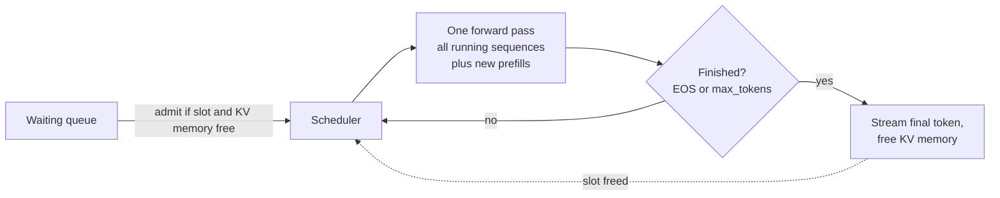
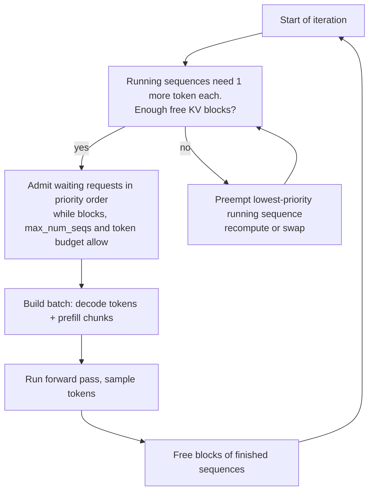
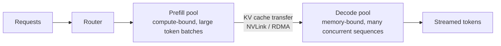

# Batching, Continuous Batching and PagedAttention

> **Level:** Beginner to Advanced · **Study time:** ~110 min · **Prerequisites:** [LLM Inference Fundamentals](01-inference-fundamentals-prefill-decode-and-latency-metrics.md), [The KV Cache](02-kv-cache-explained.md), [GPU Fundamentals: Compute-Bound vs Memory-Bound](03-gpu-fundamentals-compute-bound-vs-memory-bound.md)

## Table of contents

- [Why this matters](#why-this-matters)
- [Quick recap: the vocabulary you need](#quick-recap-the-vocabulary-you-need)
- [Why batching helps: amortizing weight reads](#why-batching-helps-amortizing-weight-reads)
- [Static batching and its three problems](#static-batching-and-its-three-problems)
- [Dynamic batching: wait a little to batch more](#dynamic-batching-wait-a-little-to-batch-more)
- [Continuous batching: scheduling at every decode step](#continuous-batching-scheduling-at-every-decode-step)
- [The KV cache memory problem: fragmentation](#the-kv-cache-memory-problem-fragmentation)
- [PagedAttention: virtual memory for the KV cache](#pagedattention-virtual-memory-for-the-kv-cache)
- [Sharing KV blocks: parallel sampling, beam search and common prefixes](#sharing-kv-blocks-parallel-sampling-beam-search-and-common-prefixes)
- [Chunked prefill: mixing prefill with decode](#chunked-prefill-mixing-prefill-with-decode)
- [Scheduling, admission control and preemption](#scheduling-admission-control-and-preemption)
- [The knobs: trading latency for throughput](#the-knobs-trading-latency-for-throughput)
- [Prefill/decode disaggregation](#prefilldecode-disaggregation)
- [Going deeper: measuring and debugging batching in production](#going-deeper-measuring-and-debugging-batching-in-production)
- [Common mistakes and misconceptions](#common-mistakes-and-misconceptions)
- [Interview questions and model answers](#interview-questions-and-model-answers)
- [Key takeaways](#key-takeaways)
- [Further reading](#further-reading)
- [Next](#next)

## Why this matters

Almost every modern LLM serving engine (vLLM, SGLang, Hugging Face TGI, TensorRT-LLM) is built around two ideas from this chapter: **continuous batching** and **paged KV cache memory**. Together they are the main reason a single GPU can serve dozens or hundreds of chat users at once instead of a handful. When an inference bill is too high, when p99 latency spikes as traffic grows, or when the GPU sits at "100% utilization" while throughput is poor, the root cause usually lives in how requests are batched and how KV memory is managed. Interviewers for senior AI/ML roles ask about this constantly because it separates people who have called an API from people who can run models in production at a sane cost.

## Quick recap: the vocabulary you need

These terms are taught fully in earlier chapters. Here is the 60-second version so this chapter stands on its own.

- **Prefill**: the first phase of generation. The model reads the whole prompt in one forward pass, builds the KV cache for every prompt token, and produces the first output token. Many tokens are processed in parallel, so prefill is usually **compute-bound** (limited by arithmetic speed). See [Inference Fundamentals](01-inference-fundamentals-prefill-decode-and-latency-metrics.md).
- **Decode**: the second phase. The model generates one token per forward pass, each pass reusing the cached keys and values of all previous tokens. Each step does little math but must read all the model weights, so decode is **memory-bound** (limited by how fast bytes move from GPU memory). See [GPU Fundamentals](03-gpu-fundamentals-compute-bound-vs-memory-bound.md).
- **KV cache**: the stored attention keys (K) and values (V) for every token already processed, kept so they are not recomputed at every step. It grows by one entry per token per layer. See [The KV Cache](02-kv-cache-explained.md).
- **TTFT (time to first token)**: time from request arrival to the first output token. Dominated by queueing plus prefill.
- **TPOT (time per output token)** or **ITL (inter-token latency)**: the gap between consecutive output tokens during decode. This is what users feel as "streaming speed".
- **Throughput**: total output tokens per second across all users (or requests per second).
- **Memory bandwidth**: bytes per second the GPU can read from its main memory (HBM). Illustrative figure used in this chapter: **2 TB/s**, roughly the class of a data-center GPU such as an NVIDIA A100 80GB.
- **FLOPs**: floating-point operations (one multiply or one add). **TFLOPS** means $10^{12}$ FLOPs per second, a measure of compute speed. This chapter assumes an illustrative **300 TFLOPS** of FP16 compute.
- **p50 / p95 / p99**: latency percentiles. "p95 TTFT = 800 ms" means 95% of requests got their first token within 800 ms. High percentiles are called **tail latency**.
- **SLO (service-level objective)**: a latency target the service commits to, such as "p95 TTFT under 1 s". **Goodput** is the rate of requests that finish **within** their SLOs, which matters more than raw throughput.
- **Units**: KV block math uses binary units (1 MiB = $2^{20}$ bytes, 1 GiB = $2^{30}$ bytes). Bandwidth math uses decimal units (1 GB = $10^9$ bytes, TB/s). So 0.5 MiB = 524,288 bytes, which is about 0.524 MB.

**Running example for this whole chapter:** a **7B model** shaped like Llama 2 7B: 32 layers, hidden size 4096 (32 attention heads of size 128, no grouped-query attention), weights in FP16 (2 bytes per number).

- Weights: $7 \times 10^9 \times 2 = 14 \times 10^9$ bytes = **14 GB**.
- KV cache per token: $2 \text{ (K and V)} \times 32 \text{ layers} \times 4096 \times 2 \text{ bytes} = 524{,}288$ bytes = **0.5 MiB per token**.

Keep those two numbers in your head. Everything below is built from them.

## Why batching helps: amortizing weight reads

### Intuition

> **Analogy:** A bus driving from the depot to the city costs about the same in fuel whether it carries 1 passenger or 40. If you send a separate bus for each passenger, you pay the fuel 40 times. Batching is filling the bus.

In decode, the "fuel" is reading the model weights. To produce one token for one user, the GPU must stream all 14 GB of weights from memory through its compute units. The arithmetic per weight is tiny (one multiply and one add per weight per token). So the GPU spends almost all its time waiting for bytes, not computing.

Now give it 32 users at once. It reads each weight once and uses it 32 times, once per user's current token. The weight read cost is **amortized** (shared) across the batch. That is the whole trick.

### Precise definition

**Batching** means stacking the inputs of several independent requests into one tensor so a single forward pass serves all of them. For decode, a batch of $B$ sequences turns a matrix-vector multiply (weights times one token vector) into a matrix-matrix multiply (weights times a $B$-row matrix), which raises **arithmetic intensity** (FLOPs per byte read) by roughly a factor of $B$.

### The math: a simple cost model for one decode step

When decode is memory-bound, step time is roughly "bytes read divided by bandwidth":

$$t_{\text{step}} \approx \frac{W + B \cdot L \cdot k}{\text{BW}}, \qquad \text{throughput} = \frac{B}{t_{\text{step}}}$$

- $t_{\text{step}}$: time for one decode step (every sequence in the batch gets one new token).
- $W$: bytes of model weights (14 GB here). Read **once per step**, no matter the batch size.
- $B$: batch size, the number of sequences decoding together.
- $L$: average context length per sequence (prompt plus tokens generated so far).
- $k$: KV cache bytes per token (0.5 MiB = 524,288 bytes here).
- $B \cdot L \cdot k$: KV cache bytes read this step. **Not shared**: each sequence attends only to its own history.
- $\text{BW}$: memory bandwidth (2 TB/s, illustrative).

**Worked example (illustrative numbers):** $L = 500$ tokens, so each sequence's KV cache is $500 \times 524{,}288 = 262{,}144{,}000$ bytes $\approx 0.262$ GB.

Batch size 1:
- Bytes: $14 + 1 \times 0.262 = 14.262$ GB
- Time: $14.262 \times 10^9 / (2 \times 10^{12}) = 7.13$ ms
- Throughput: $1 / 0.00713 \approx 140$ tokens/s

Batch size 16:
- Bytes: $14 + 16 \times 0.262 = 14 + 4.19 = 18.19$ GB
- Time: $18.19 / 2000 = 9.10$ ms
- Throughput: $16 / 0.00910 \approx 1{,}759$ tokens/s

Batch size 64:
- Bytes: $14 + 64 \times 0.262 = 14 + 16.78 = 30.78$ GB
- Time: $30.78 / 2000 = 15.39$ ms
- Throughput: $64 / 0.01539 \approx 4{,}159$ tokens/s

So going from 1 to 64 users multiplies total throughput by about 30x, while each user's personal speed drops from about 140 to about 65 tokens/s. That is the central trade-off of LLM serving in one table:

| Batch size | Step time | Total throughput | Per-user speed |
|---|---|---|---|
| 1 | 7.13 ms | ~140 tok/s | ~140 tok/s |
| 8 | 8.05 ms | ~994 tok/s | ~124 tok/s |
| 16 | 9.10 ms | ~1,759 tok/s | ~110 tok/s |
| 32 | 11.19 ms | ~2,859 tok/s | ~89 tok/s |
| 64 | 15.39 ms | ~4,159 tok/s | ~65 tok/s |

```python
# Illustrative cost model of one decode step on a memory-bound GPU.
WEIGHT_BYTES = 7e9 * 2                    # 7B params in FP16 = 14 GB
KV_BYTES_PER_TOKEN = 2 * 32 * 4096 * 2    # K and V, 32 layers, d_model 4096, FP16
BANDWIDTH = 2e12                          # 2 TB/s (illustrative)
AVG_CONTEXT = 500                         # tokens of context per sequence

for batch in [1, 8, 16, 32, 64]:
    bytes_read = WEIGHT_BYTES + batch * AVG_CONTEXT * KV_BYTES_PER_TOKEN
    step_s = bytes_read / BANDWIDTH
    print(f"batch={batch:3d}  step={step_s*1e3:6.2f} ms  "
          f"total={batch/step_s:7.0f} tok/s  per-user={1/step_s:5.1f} tok/s")
# batch=  1  step=  7.13 ms  total=    140 tok/s  per-user=140.2 tok/s
# batch=  8  step=  8.05 ms  total=    994 tok/s  per-user=124.2 tok/s
# batch= 16  step=  9.10 ms  total=   1759 tok/s  per-user=109.9 tok/s
# batch= 32  step= 11.19 ms  total=   2859 tok/s  per-user= 89.3 tok/s
# batch= 64  step= 15.39 ms  total=   4159 tok/s  per-user= 65.0 tok/s
```

> **Senior insight:** Notice that the KV term grows with $B$ and is never amortized. With long contexts, KV reads can exceed weight reads (at $B = 64$ above, 16.8 GB of KV vs 14 GB of weights). This is why **grouped-query attention (GQA)** (fewer KV heads, see [Modern LLM Architecture](../04-transformers/08-modern-llm-architecture-improvements.md)) and KV cache quantization matter so much for serving: they shrink $k$, the one cost batching cannot hide.

When does batching stop helping? Weight-related compute per step is about $2 \cdot P \cdot B$ FLOPs ($P$ = parameter count; one multiply and one add per weight per sequence) while weight bytes are $2P$, so the weight matmuls reach about $B$ FLOPs per byte. The GPU's **ridge point** is the arithmetic intensity at which work switches from memory-bound to compute-bound: peak FLOPS divided by bandwidth. With an illustrative 300 TFLOPS and 2 TB/s it is $300 / 2 = 150$ FLOPs per byte, so the weight matmuls stay memory-bound until $B$ is around 150. In practice you usually run out of **KV cache memory** long before that. Memory, not compute, is what caps the batch. That is exactly the problem PagedAttention attacks later in this chapter.

## Static batching and its three problems

### Intuition

> **Analogy:** A tour bus that only leaves when full and only returns when the last passenger finishes their tour. If one person books the 8-hour tour and the others booked 1-hour tours, everyone's seat is occupied for 8 hours, and people waiting at the depot cannot board even though most seats are effectively empty.

### Definition

**Static batching** (also called request-level batching) groups $B$ requests, runs them together from prefill to the end of generation, and only then accepts the next group. This is what you get from a naive `model.generate(batch_of_prompts)` loop. It works fine for offline jobs where all inputs are known in advance, but it wastes a lot of GPU time in online serving.

### Problem 1: padding

Tensors must be rectangular, so shorter prompts are padded to the longest one. **Padding** tokens cost compute and memory but produce nothing.

Running example: three prompts with lengths of 3 tokens (the course's running 3-word sentence "The cat sat"), 12 tokens and 40 tokens, all padded to 40:
- Positions processed: $3 \times 40 = 120$
- Real tokens: $3 + 12 + 40 = 55$
- Waste: $(120 - 55) / 120 = 65 / 120 \approx 54\%$

The same happens on the output side: sequences that finish early keep occupying their row while the batch continues.

### Problem 2: waiting for the longest sequence

Output lengths are unknown in advance. One request might answer "Yes." in 2 tokens, another writes a 1,000-token essay. With static batching, every slot stays occupied until the longest request finishes. Finished rows either compute garbage or sit idle.

### Problem 3: head-of-line blocking

**Head-of-line blocking** is when work at the front of a queue blocks everything behind it. A new request arriving while a batch is running must wait for the entire batch to finish, even if 3 of 4 rows have already completed. Its TTFT includes the remaining time of somebody else's long essay.

```text
Static batching, batch size 4 (each # is one decode step)

Request A |####                     done, slot idle until batch ends
Request B |##########               done, slot idle
Request C |#########################  <- longest, everyone waits for it
Request D |###                      done, slot idle
                                    |
New request E arrives here -------->| must wait for C to finish
```

## Dynamic batching: wait a little to batch more

### Intuition

> **Analogy:** A shuttle that leaves every 10 minutes or as soon as it has 8 passengers, whichever comes first. You might wait a bit, but the shuttle runs fuller.

### Definition

**Dynamic batching** (server-side batching with a time window) collects incoming requests into a queue and launches a batch when either the batch reaches a **maximum size** or a **maximum wait time** expires. It is the classic technique in general model servers such as NVIDIA Triton and TorchServe, and in many hand-built inference APIs (see [Building a Scalable Inference API](../10-mlops/05-building-a-scalable-inference-api.md)).

The trade-off is simple: a longer window gives fuller batches (better throughput) but adds up to that window to every request's latency.

```python
# Minimal dynamic batcher: flush when full or when the oldest request has waited too long.
import asyncio, time

MAX_BATCH, MAX_WAIT_S = 8, 0.010   # 8 requests or 10 ms

async def batcher(queue: asyncio.Queue, run_model):
    while True:
        first = await queue.get()                     # block until something arrives
        batch, deadline = [first], time.monotonic() + MAX_WAIT_S
        while len(batch) < MAX_BATCH:
            timeout = deadline - time.monotonic()
            if timeout <= 0:
                break
            try:
                batch.append(await asyncio.wait_for(queue.get(), timeout))
            except asyncio.TimeoutError:
                break
        outputs = run_model([req["input"] for req in batch])   # one forward pass
        for req, out in zip(batch, outputs):
            req["future"].set_result(out)
```

Dynamic batching is a great fit when **every request costs about the same and finishes in one forward pass**: an embedding model, a reranker, an image classifier, a spam classifier. It does **not** fix LLM generation, because it still batches at the request level. Once a batch starts generating, it is static again: problems 2 and 3 remain.

## Continuous batching: scheduling at every decode step

### Intuition

> **Analogy:** A sushi conveyor belt, or a city bus with many stops. Passengers get on and off at every stop. A seat freed at stop 3 is taken by someone new at stop 3. The bus never waits for "the last passenger" because there is no such thing.

The key observation is that LLM generation is a loop of decode steps, and **each step is a natural scheduling point**. Nothing forces the batch at step 101 to contain the same sequences as the batch at step 100.

### Definition

**Continuous batching** (also called **in-flight batching** in TensorRT-LLM, or **iteration-level scheduling** in the original paper) re-forms the batch at every forward pass:

1. Sequences that just produced an end-of-sequence token, or hit their `max_tokens` limit, **leave immediately** and their resources are freed.
2. Waiting requests **join immediately** if there is room: their prefill runs in this iteration (or is spread over several, see chunked prefill below).
3. Every running sequence that is in its decode phase gets exactly one new token per iteration (a prompt still being prefilled in chunks gets its next chunk instead; speculative decoding can add several tokens per step).

This idea was introduced by **Orca** ("Orca: A Distributed Serving System for Transformer-Based Generative Models", Yu et al., OSDI 2022). Orca also introduced **selective batching**: the non-attention operations (the big linear layers and MLPs, where the weights live) are run on all tokens of all sequences flattened into one long list, so sequences of different lengths need no padding. Only the attention operation, which needs each sequence's own KV history, is done per sequence. Modern engines go further and use attention kernels that handle a "ragged" batch of different-length sequences directly.



### Worked timeline

Illustrative setup: the engine can run at most **3 sequences** at once. Each "step" is one forward pass. A request that joins at a step does its prefill in that step, which also produces its first token.

| Request | Arrives before step | Output tokens needed |
|---|---|---|
| A | 1 | 4 |
| B | 1 | 2 |
| C | 1 | 6 |
| D | 2 | 3 |
| E | 3 | 2 |

**Continuous batching** (notation: `A2` means A has now produced 2 tokens):

```text
step 1: A1 B1 C1        A, B, C prefill and emit token 1
step 2: A2 B2 C2        D has arrived but all 3 slots are busy. B finishes -> slot frees
step 3: A3 C3 D1        D joins immediately (its prefill runs in this step). E arrives, waits
step 4: A4 C4 D2        A finishes -> slot frees
step 5: C5 D3 E1        E joins. D finishes
step 6: C6 E2           C and E finish. Done in 6 steps
```

**Static batching** with batch size 3: batch 1 is {A, B, C} and runs until C finishes (6 steps). Only then does batch 2 {D, E} start, running until D finishes (3 more steps). Total: 9 steps.

| Metric | Static | Continuous |
|---|---|---|
| Total steps | 9 | 6 |
| Slot utilization (useful tokens / slot-steps) | $17 / (9 \times 3) = 17/27 \approx 63\%$ | $17 / (6 \times 3) = 17/18 \approx 94\%$ |
| D: first token at step | 7 | 3 |
| E: first token at step | 7 | 5 |
| D finishes at step | 9 | 5 |

Useful tokens are $4 + 2 + 6 + 3 + 2 = 17$ in both cases; continuous batching just wastes far fewer slot-steps. The gap grows when output lengths vary more, which is exactly what real chat traffic looks like.

| | Static | Dynamic | Continuous |
|---|---|---|---|
| When membership is decided | Once, before the batch starts | Once, when the size or time window fills | At every forward pass |
| Can a new request join mid-generation? | No | No | Yes, as soon as a slot and KV memory are free |
| Finished sequences | Hold their slot until the longest finishes | Same as static | Leave at once, freeing the slot |
| Best fit | Offline jobs with known inputs | Single-pass models (embeddings, classifiers) | LLM generation with variable output lengths |

Here is a tiny simulator that reproduces the continuous-batching timeline above. It is worth typing out once: it makes the idea concrete.

```python
from dataclasses import dataclass

@dataclass
class Req:
    name: str
    arrival_step: int      # earliest step it can be scheduled in
    out_tokens: int        # tokens it will generate (unknown to a real server!)
    done: int = 0
    first_token_step: int | None = None

def continuous_batching(reqs: list[Req], max_batch: int) -> int:
    step, waiting, running = 0, list(reqs), []
    while waiting or running:
        step += 1
        for r in [r for r in waiting if r.arrival_step <= step]:   # admit at EVERY step
            if len(running) < max_batch:
                waiting.remove(r)
                running.append(r)
        for r in running:                                          # one token each
            r.done += 1
            r.first_token_step = r.first_token_step or step
        print(f"step {step}: " + " ".join(f"{r.name}{r.done}" for r in running))
        running = [r for r in running if r.done < r.out_tokens]   # leave immediately
    return step

reqs = [Req("A", 1, 4), Req("B", 1, 2), Req("C", 1, 6), Req("D", 2, 3), Req("E", 3, 2)]
total = continuous_batching(reqs, max_batch=3)
print("steps:", total, "first tokens:", {r.name: r.first_token_step for r in reqs})
# step 1: A1 B1 C1
# step 2: A2 B2 C2
# step 3: A3 C3 D1
# step 4: A4 C4 D2
# step 5: C5 D3 E1
# step 6: C6 E2
# steps: 6 first tokens: {'A': 1, 'B': 1, 'C': 1, 'D': 3, 'E': 5}
```

> **Common mistake:** Treating every step as equal cost. A step that contains a new prefill (hundreds or thousands of prompt tokens) is much heavier than a pure decode step (one token per sequence). In the timeline above, steps 3 and 5 would be slower than the others, which briefly slows A, C and D. This is the "prefill interference" problem that chunked prefill solves later.

### What continuous batching still needs

Continuous batching keeps slots busy, but how many slots can you have? The number of concurrent sequences is limited by **KV cache memory**. If you manage that memory naively, you can only fit a small batch, and continuous batching has little to work with. That brings us to fragmentation.

## The KV cache memory problem: fragmentation

### Intuition

> **Analogy:** A restaurant that reserves a 12-person table for every party because "they might bring friends". Most parties are 2 people. The restaurant is "full" with 80% of its chairs empty.

### Contiguous allocation

Early serving systems stored each sequence's KV cache as one **contiguous** tensor (one unbroken region of memory), because standard attention kernels expect that. Since the final length is unknown when a request starts, the system had to **reserve memory for the maximum possible length** up front (for example, `max_seq_len = 2048` tokens).

This causes three kinds of waste:

| Waste type | What it is | Example |
|---|---|---|
| **Reservation waste** | Memory reserved for tokens that will be generated later, idle in the meantime | A request at token 100 holds space for token 2,048 |
| **Internal fragmentation** | Reserved memory that is never used because the sequence ended early | Request finishes at 300 tokens, 1,748 slots never touched |
| **External fragmentation** | Free memory split into gaps too small or oddly sized to fit a new reservation | Three free 0.4 GiB gaps cannot hold one new 1 GiB reservation |

**Worked example** with our 7B model ($k = 0.5$ MiB per token):

- Reservation per request: $2048 \times 0.5 \text{ MiB} = 1024$ MiB = **1 GiB**.
- A request that actually uses 300 tokens wastes $(2048 - 300) \times 0.5 = 1748 \times 0.5 = 874$ MiB.
- That is $874 / 1024 \approx 85\%$ of its reservation, wasted.

The "Efficient Memory Management for Large Language Model Serving with PagedAttention" paper (Kwon et al., SOSP 2023) measured that prior systems used only a minority of their KV cache memory for actual token states; the rest was lost to exactly these effects.

```text
Contiguous KV allocation (each row = GPU memory, # = used, . = reserved but unused)

seq 1 |#########...................................|  reserved 2048, uses 300
seq 2 |################################............|  reserved 2048, uses 1500
seq 3 |####........................................|  reserved 2048, uses 150
free  |   gap   |      gap      |  <- fragments, cannot fit another 2048 block
```

## PagedAttention: virtual memory for the KV cache

### Intuition

> **Analogy:** Operating systems solved this exact problem decades ago. A program sees one big continuous address space (**virtual memory**), but the OS actually stores it in small fixed-size **pages** scattered anywhere in physical RAM, tracked by a **page table**. Pages are handed out only when the program touches new memory.

**PagedAttention**, introduced in the vLLM paper (Kwon et al., SOSP 2023), applies the same idea to the KV cache.

### Definition

- GPU memory for the KV cache is split into many **physical blocks**, each holding the K and V vectors for a fixed number of tokens (the **block size**; vLLM's default has long been 16 tokens, but treat it as a configurable, version-dependent value).
- Each sequence sees its KV cache as a list of **logical blocks**: logical block 0 holds tokens 0-15, block 1 holds tokens 16-31, and so on.
- A per-sequence **block table** maps logical block number to physical block number, exactly like a page table.
- A new physical block is allocated **only when the previous one fills up**. Nothing is reserved for future tokens.
- The attention kernel is rewritten to follow the block table: for each query it fetches K and V block by block from wherever they physically live.

```text
Logical view (sequence "A", 40 tokens)        Physical KV memory (blocks of 16 tokens)

logical block 0: tokens  0-15  --\            +------+------+------+------+------+
logical block 1: tokens 16-31  ---+--------->  | P0   | P1   | P2   | P3   | P4   | ...
logical block 2: tokens 32-39  --/            | B:0  | A:2  | free | A:0  | A:1  |
                                              +------+------+------+------+------+
Block table for A:  [3, 4, 1]                 (block P1 is only half full: 8 of 16)
```

### The math: how much waste remains?

With block size $s$ and a sequence of $n$ tokens:

$$\text{blocks}(n) = \left\lceil \frac{n}{s} \right\rceil, \qquad \text{wasted slots} = s \cdot \left\lceil \frac{n}{s} \right\rceil - n < s$$

- $n$: tokens currently stored for the sequence.
- $s$: block size in tokens.
- $\lceil \cdot \rceil$: round up to the next whole number.
- Waste is confined to the **last, partially filled block**, so it is always less than one block per sequence.

**Worked example:** the 300-token request from before with $s = 16$:
- Blocks: $\lceil 300 / 16 \rceil = \lceil 18.75 \rceil = 19$
- Slots allocated: $19 \times 16 = 304$
- Wasted: $304 - 300 = 4$ tokens $= 4 \times 0.5 = 2$ MiB

Compare with **874 MiB** wasted under contiguous allocation. External fragmentation disappears too, because every block is the same size: any free block fits any sequence.

### What this buys you: a bigger batch

The number of tokens the KV cache can hold is:

$$N_{\text{tokens}} = \frac{M_{\text{KV}}}{2 \cdot n_{\text{layers}} \cdot n_{\text{kv heads}} \cdot d_{\text{head}} \cdot b}$$

- $M_{\text{KV}}$: GPU memory left for the KV cache after weights and activation workspace.
- $2$: one K and one V vector.
- $n_{\text{layers}}$: transformer layers (32).
- $n_{\text{kv heads}}$: key/value heads (32 here; with GQA this is smaller).
- $d_{\text{head}}$: dimension per head (128).
- $b$: bytes per number (2 for FP16).

The denominator is $2 \times 32 \times 32 \times 128 \times 2 = 524{,}288$ bytes = 0.5 MiB, our $k$.

**Worked example (illustrative):** an 80 GB GPU, with about 54 GiB left for KV cache after the weights and workspace.
- Token capacity: $54 \times 1024 \text{ MiB} / 0.5 \text{ MiB} = 55{,}296 / 0.5 = 110{,}592$ tokens.
- That is $110{,}592 / 16 = 6{,}912$ blocks.
- **Contiguous** with 2,048-token reservations (1 GiB each): $54 / 1 = 54$ concurrent requests.
- **Paged**, if the average request actually holds 400 tokens at a time: $110{,}592 / 400 \approx 276$ concurrent requests.

About **5x** more sequences in the batch, from the same hardware, before any change to the model. Feed that into the cost model from the first section and you see why the vLLM paper reported roughly 2-4x higher throughput than prior systems such as FasterTransformer and Orca (the authors' own reimplementation of Orca, since Orca is not public) at similar latency.

### Code: a toy block manager

This pure-Python block manager shows the bookkeeping. Real engines do the same thing with arrays on the GPU and a CUDA attention kernel.

```python
import math

class BlockManager:
    """Toy PagedAttention-style KV block allocator (bookkeeping only, no tensors)."""

    def __init__(self, num_blocks: int, block_size: int):
        self.block_size = block_size
        self.free = list(range(num_blocks))        # pool of physical block ids
        self.refcount = [0] * num_blocks           # how many sequences use each block
        self.tables: dict[str, list[int]] = {}     # seq_id -> block table
        self.lengths: dict[str, int] = {}          # seq_id -> tokens stored

    def _alloc(self) -> int:
        if not self.free:
            raise MemoryError("out of KV blocks: scheduler must preempt someone")
        b = self.free.pop()
        self.refcount[b] = 1
        return b

    def _release(self, b: int) -> None:
        self.refcount[b] -= 1
        if self.refcount[b] == 0:
            self.free.append(b)

    def add_sequence(self, seq_id: str, prompt_len: int) -> None:
        n = math.ceil(prompt_len / self.block_size)
        self.tables[seq_id] = [self._alloc() for _ in range(n)]
        self.lengths[seq_id] = prompt_len

    def append_token(self, seq_id: str) -> None:
        table, length = self.tables[seq_id], self.lengths[seq_id]
        if length % self.block_size == 0:          # last block full: grab a new one
            table.append(self._alloc())
        elif self.refcount[table[-1]] > 1:         # last block shared: copy-on-write
            old = table[-1]
            table[-1] = self._alloc()              # a real engine copies the K/V data here
            self._release(old)
        self.lengths[seq_id] = length + 1

    def fork(self, parent: str, child: str) -> None:
        """Parallel sampling / beam search: share every block, copy nothing."""
        self.tables[child] = list(self.tables[parent])
        self.lengths[child] = self.lengths[parent]
        for b in self.tables[child]:
            self.refcount[b] += 1

    def free_sequence(self, seq_id: str) -> None:
        for b in self.tables.pop(seq_id):
            self._release(b)
        del self.lengths[seq_id]

bm = BlockManager(num_blocks=8, block_size=4)
bm.add_sequence("s1", prompt_len=6)        # ceil(6/4) = 2 blocks
print("s1 table:", bm.tables["s1"], "free:", len(bm.free))
bm.fork("s1", "s2")                        # second sample shares the prompt blocks
print("refcounts:", [bm.refcount[b] for b in bm.tables["s1"]])
bm.append_token("s2")                      # s2 writes into the shared, half-full block
print("s1:", bm.tables["s1"], " s2:", bm.tables["s2"], " free:", len(bm.free))
bm.free_sequence("s1"); bm.free_sequence("s2")
print("free after both finish:", len(bm.free))
# s1 table: [7, 6] free: 6
# refcounts: [2, 2]
# s1: [7, 6]  s2: [7, 5]  free: 5
# free after both finish: 8
```

### Code: attention through a block table

The attention math is unchanged. Only the way K and V are fetched changes. This NumPy version gathers the blocks and checks that the answer matches ordinary contiguous attention.

```python
# pip install numpy
import numpy as np

rng = np.random.default_rng(0)
block_size, num_blocks, d = 4, 8, 8
k_pool = rng.normal(size=(num_blocks, block_size, d))   # physical KV memory
v_pool = rng.normal(size=(num_blocks, block_size, d))
block_table = [5, 2, 7]     # logical blocks 0, 1, 2 live in physical blocks 5, 2, 7
seq_len = 10                # 4 + 4 + 2 tokens: last block is partly empty
q = rng.normal(size=d)      # query vector of the current token

def attend(q, K, V):
    scores = K @ q / np.sqrt(d)
    w = np.exp(scores - scores.max())
    return (w / w.sum()) @ V

def paged_attention(q, k_pool, v_pool, block_table, seq_len):
    # Gather this sequence's blocks in logical order, then drop unused tail slots.
    K = k_pool[block_table].reshape(-1, d)[:seq_len]
    V = v_pool[block_table].reshape(-1, d)[:seq_len]
    return attend(q, K, V)

# Reference: the same tokens stored contiguously
K_contig = np.concatenate([k_pool[b] for b in block_table])[:seq_len]
V_contig = np.concatenate([v_pool[b] for b in block_table])[:seq_len]
print(np.allclose(paged_attention(q, k_pool, v_pool, block_table, seq_len),
                  attend(q, K_contig, V_contig)))   # True
```

A real PagedAttention kernel never materializes the gathered copy: each GPU thread block reads K and V for its slice directly from the physical blocks listed in the block table. The indirection makes the attention kernel itself somewhat slower than a perfectly contiguous one, but the much larger batch more than pays for it. Later kernel libraries (for example FlashInfer, and paged variants of FlashAttention) support paged KV layouts natively.

> **Senior insight: choosing the block size.** Smaller blocks mean less waste in the last block and finer-grained sharing, but longer block tables, more indirection and less efficient memory access per block. Larger blocks are friendlier to the kernel but waste more and share less. Values around 16 tokens are a common middle ground; prefix-caching hit granularity also depends on this choice.

## Sharing KV blocks: parallel sampling, beam search and common prefixes

Once KV memory is a set of reference-counted blocks, several sequences can **point at the same physical block**. This is the same trick an OS uses when `fork()` shares memory pages between parent and child processes.

### Copy-on-write

**Copy-on-write (CoW)**: shared blocks are read-only. When a sequence needs to write into a block that others also reference (its last, partially filled block), it first gets a private copy. Full blocks are never written again, so they can stay shared forever. You saw this in the toy code: after `fork`, `s2` got a new block 5 for its partial block, but kept sharing block 7.

### Where sharing pays off

| Scenario | What is shared | Why it is common |
|---|---|---|
| **Parallel sampling** (`n > 1`) | The whole prompt's KV blocks across the $n$ samples | Generating several candidates for best-of-n, self-consistency, or code generation |
| **Beam search** | Common history across beams; beams fork and die frequently | Translation, some structured generation (see [Decoding Strategies](../05-llms/03-text-generation-and-decoding-strategies.md)) |
| **Common prefixes** | System prompt, few-shot examples, tool definitions, earlier turns of a chat, a shared RAG document | Almost every production app has a long, fixed system prompt |

**Worked example: parallel sampling.** A 1,000-token prompt, $n = 4$ samples, each generating 200 tokens.
- Without sharing: $4 \times (1000 + 200) = 4{,}800$ tokens $\times 0.5$ MiB $= 2{,}400$ MiB.
- With sharing: $1000 + 4 \times 200 = 1{,}800$ tokens $\times 0.5$ MiB $= 900$ MiB.
- Saving: $1 - 1800/4800 = 1 - 0.375 = 62.5\%$ (ignoring a few copied partial blocks).

**Worked example: shared system prompt.** 50 concurrent chats, each starting with the same 2,000-token system prompt.
- Without sharing: $50 \times 2000 = 100{,}000$ tokens $\times 0.5$ MiB $= 50{,}000$ MiB $\approx 48.8$ GiB.
- With sharing: $2{,}000$ tokens $\times 0.5$ MiB $= 1{,}000$ MiB.

Sharing **within** the running batch saves memory. **Prefix caching** goes one step further and keeps those blocks around **after** requests finish, so the next request with the same prefix skips prefill for it entirely. vLLM's automatic prefix caching identifies full blocks by a hash of their tokens (and everything before them); SGLang's **RadixAttention** ("SGLang: Efficient Execution of Structured Language Model Programs", Zheng et al., 2023) organizes cached prefixes in a radix tree. The details, cache hit rates and how to structure prompts for hits belong to [Speculative Decoding, Prompt Caching and Other Speedups](05-speculative-decoding-caching-and-other-speedups.md).

> **Interview tip:** If asked "what else does paging enable besides less fragmentation?", say **sharing**: parallel sampling, beam search and prefix caching all fall out of block tables plus reference counts, nearly for free.

## Chunked prefill: mixing prefill with decode

### The problem: prefill interference

Prefill and decode have opposite profiles. A long prefill is a big compute-heavy step. With plain continuous batching, when an 8,000-token prompt joins, the whole iteration that contains it takes as long as that prefill, and every decoding user waits. Users see their stream freeze for a moment: an ITL spike, sometimes called a **generation stall**.

**Worked example (illustrative, weight FLOPs only, ignoring attention FLOPs):** forward compute is about $2P = 14$ GFLOPs per token for our 7B model. At an assumed effective 300 TFLOPS:
- Normal decode step for 48 sequences at 500 tokens of context: memory-bound, $(14 + 48 \times 0.262) / 2000 \approx 13$ ms (see the first section).
- Step containing the full 8,000-token prefill: $8000 \times 14 \times 10^9 = 1.12 \times 10^{14}$ FLOPs, so $1.12 \times 10^{14} / (3 \times 10^{14}) \approx 0.373$ s. All 48 decoding users freeze for about **373 ms**.

### The fix

**Chunked prefill** splits a long prompt into chunks and processes one chunk per iteration, alongside the ongoing decode tokens, under a fixed **token budget** per iteration (in vLLM, `max_num_batched_tokens`). The idea appears in **SARATHI** ("SARATHI: Efficient LLM Inference by Piggybacking Decodes with Chunked Prefills", Agrawal et al., 2023) and **Sarathi-Serve** (Agrawal et al., OSDI 2024), and as **Dynamic SplitFuse** in DeepSpeed-FastGen (2024).

```text
Token budget per iteration = 2048

Iteration | decode tokens (48 users) | prefill chunk of the 8000-token prompt
----------+--------------------------+---------------------------------------
    1     |           48             |  tokens    0-1999   (2000)
    2     |           48             |  tokens 2000-3999   (2000)
    3     |           48             |  tokens 4000-5999   (2000)
    4     |           48             |  tokens 6000-7999   (2000) -> first output token
```

Arithmetic: $2048 - 48 = 2000$ tokens of budget left for prefill, and $8000 / 2000 = 4$ iterations. Each iteration now carries about $2000 \times 14 \times 10^9 = 2.8 \times 10^{13}$ FLOPs, about $2.8 \times 10^{13} / (3 \times 10^{14}) \approx 93$ ms. Decoders get a token every ~93 ms for four iterations instead of one 373 ms freeze. A smaller budget (say 512) smooths ITL further but makes the long prompt's TTFT longer.

Why it also helps throughput: decode steps are memory-bound and leave compute idle; prefill chunks are compute-bound. Fusing them in one iteration uses both the compute units and the memory bandwidth at the same time, and the weights are read once for both.

| | Without chunked prefill | With chunked prefill |
|---|---|---|
| ITL of running users when a long prompt arrives | Large spike | Small, bounded by token budget |
| TTFT of the long prompt | Lowest possible (one big step) | Slightly higher (several steps, re-reading its own earlier chunks' KV) |
| GPU utilization | Alternates compute-bound and memory-bound steps | More balanced mix in each step |
| Tuning knob | None | Token budget: smaller = smoother ITL, larger = faster TTFT and fewer steps |

> **Common mistake:** Assuming chunked prefill makes TTFT better. It typically makes TTFT of long prompts **slightly worse** in exchange for much steadier ITL for everyone else. Its value is in tail latency and goodput, not raw TTFT.

## Scheduling, admission control and preemption

Every iteration, the engine's **scheduler** decides who runs. Think of it as an airport gate agent with a fixed number of seats (KV blocks) and a token budget (max tokens per iteration).

### A scheduler iteration, step by step



### Admission control

**Admission control** decides whether a waiting request may start. A request is admitted only if:
- there are enough free KV blocks for its prompt (or its first chunk), usually keeping a small **watermark** of spare blocks so running sequences can grow;
- the number of running sequences is below the cap (`max_num_seqs`);
- the iteration's token budget has room.

At the HTTP layer, a second form of admission control protects the whole service: a bounded queue, rate limits per tenant, and returning HTTP 429 (or shedding load) when the queue is too deep, instead of letting latency grow without bound. See [Building a Scalable Inference API](../10-mlops/05-building-a-scalable-inference-api.md).

Ordering policies:
- **FCFS** (first come, first served): simple, fair, the default in many engines.
- **Priority**: interactive traffic before batch traffic, paid tier before free tier.
- **Length-aware or SLO-aware**: favor short prompts for TTFT, or requests close to violating their deadline. Research systems also predict output length to approximate shortest-job-first.

### Preemption

Because paged allocation does not reserve space for future tokens, the engine can **overcommit**: admit more sequences than would fit if all of them grew to full length. That is what makes batches large. The price: sometimes running sequences need new blocks and none are free. The scheduler must **preempt** (evict) one or more sequences, usually the most recently admitted, to free blocks.

Two ways to bring a preempted sequence back:

| | **Recompute** | **Swap** |
|---|---|---|
| What happens | Drop its KV blocks. Later, re-run prefill over prompt + tokens generated so far | Copy its KV blocks to CPU memory over PCIe (the CPU-GPU bus). Later, copy them back |
| Cost | GPU compute for a prefill (compute-bound, efficient) | PCIe transfer both ways, plus CPU RAM |
| Good when | Sequences are short-ish; GPU has compute headroom; simpler code path | Sequences are very long (recompute too expensive) and PCIe bandwidth is decent |
| Downsides | Wastes FLOPs; adds latency to the preempted request | PCIe is slow relative to HBM; CPU memory must be managed; transfers can interfere with other work |

**Worked example (illustrative):** a preempted sequence holds 1,000 tokens of KV = $1000 \times 0.5$ MiB = 500 MiB = 524,288,000 bytes.
- Swap, assuming ~25 GB/s effective PCIe: $524{,}288{,}000 / (25 \times 10^9) \approx 21$ ms each way, about 42 ms round trip.
- Recompute, at an assumed 300 TFLOPS: $1000 \times 14 \times 10^9 = 1.4 \times 10^{13}$ FLOPs, so $1.4 \times 10^{13} / (3 \times 10^{14}) \approx 47$ ms (ideal; real prefill efficiency is lower).

Same order of magnitude, so the right answer depends on hardware, sequence length and implementation. The vLLM paper evaluated both. As of recent vLLM versions, recompute is the default and swap has been de-emphasized; this is version-dependent, so check your engine's docs.

> **Senior insight:** Occasional preemption is healthy: it means you are using memory aggressively. Frequent preemption is **thrashing**: the engine repeatedly does work and throws it away, and tail latency explodes. Watch the preemption counter. If it climbs, lower `max_num_seqs`, lower `max_model_len`, raise available KV memory (quantized KV cache, more GPUs, tensor parallelism), or shed load earlier.

## The knobs: trading latency for throughput

Every serving engine exposes some version of these knobs. Names below are vLLM's (other engines in parentheses); **flag names and defaults change between versions**, so treat them as concepts and confirm in current docs.

| Knob | What it controls | Raise it to | Cost of raising it |
|---|---|---|---|
| `max_num_seqs` (TensorRT-LLM: `max_batch_size`) | Max sequences in one iteration | Increase throughput, keep queues short | Higher ITL per user; more KV pressure; more preemption |
| `max_num_batched_tokens` (TGI: `max_batch_prefill_tokens` / `max_batch_total_tokens`; TensorRT-LLM: `max_num_tokens`) | Token budget per iteration (prefill chunks + decodes) | Faster TTFT for long prompts, better compute use | Bigger, slower iterations: ITL spikes |
| `max_model_len` | Longest allowed prompt + output | Serve long-context requests | Fewer guaranteed concurrent long sequences; at startup the engine checks that at least one max-length sequence fits |
| `gpu_memory_utilization` | Fraction of GPU memory the engine may use (whatever is left after weights and workspace becomes KV blocks) | More KV blocks, bigger batch | Risk of out-of-memory (OOM) errors if other processes or activation peaks need memory |
| `block_size` | Tokens per KV block | Kernel efficiency | More last-block waste, coarser prefix sharing |
| `enable_chunked_prefill` | Split long prompts across iterations | Smooth ITL | Slightly higher TTFT for long prompts |
| `enable_prefix_caching` | Keep and reuse KV blocks of common prefixes | Lower TTFT and compute for repeated prefixes | Cached blocks compete with active ones (evicted under pressure) |

Configuring these in vLLM's offline API (requires Linux and an NVIDIA GPU; argument names are version-dependent):

```python
# pip install vllm
from vllm import LLM, SamplingParams

llm = LLM(
    model="meta-llama/Llama-3.1-8B-Instruct",
    gpu_memory_utilization=0.90,   # leave headroom for activations and other processes
    max_model_len=8192,            # longest prompt + output we accept
    max_num_seqs=128,              # cap on concurrent sequences per iteration
    max_num_batched_tokens=4096,   # per-iteration token budget (prefill chunks + decodes)
    enable_chunked_prefill=True,   # already on by default in recent (V1-engine) vLLM releases
    enable_prefix_caching=True,    # likewise on by default in recent releases; explicit here for clarity
)

params = SamplingParams(temperature=0.8, max_tokens=200, n=4)  # n=4 shares prompt blocks
prompts = ["Is this email spam? 'You won a free cruise, click here!'"] * 32
outputs = llm.generate(prompts, params)   # the engine batches internally
print(outputs[0].outputs[0].text)
```

The equivalent server is started with `vllm serve <model> --max-num-seqs 128 --max-num-batched-tokens 4096 ...`. You do not batch requests yourself: you send many concurrent requests, and the engine's scheduler batches them.

### How to pick values

1. Start from your **SLOs**: for example, p95 TTFT under 1 s and p95 ITL under 50 ms.
2. Set `max_model_len` to what your product actually needs, not the model's advertised maximum. A 128k limit you never use makes the engine plan for it.
3. Sweep concurrency in a load test (see the next sections) and find the **knee** of the latency-throughput curve: the point where throughput stops growing but latency starts climbing.
4. Set `max_num_seqs` around the knee, and the token budget to keep ITL inside the SLO when long prompts arrive.
5. Re-test whenever the traffic mix changes (prompt length distribution, output length distribution, share of repeated prefixes).

```text
Latency-throughput trade-off (shape only, illustrative)

throughput |                 ______________   <- plateau: GPU or KV memory saturated
 (tok/s)   |            ___/
           |         _/
           |       /
           |     /
           |___/____________________________ concurrency
latency    |                          /
 (p95 ITL) |                      __/          <- past the knee, queueing and
           |______________________/            preemption make latency explode
```

## Prefill/decode disaggregation

### Intuition

> **Analogy:** A restaurant where the same chefs both prep huge batches of dough and plate individual orders. Every time a big prep job starts, plated orders stall. Better: a prep kitchen and a plating line, each staffed and equipped for its job, with a pass-through window between them.

### Definition

**Prefill/decode disaggregation** runs prefill and decode on **separate GPU pools**. A request's prompt is prefilled on a prefill worker; the resulting KV cache is **transferred** to a decode worker, which generates the output tokens. Key papers: **DistServe** ("DistServe: Disaggregating Prefill and Decoding for Goodput-optimized Large Language Model Serving", Zhong et al., OSDI 2024) and **Splitwise** ("Splitwise: Efficient Generative LLM Inference Using Phase Splitting", Patel et al., ISCA 2024). Moonshot AI's **Mooncake** (2024) described a KV-cache-centric disaggregated architecture used in production.



### Why do it

- **No interference**: decode workers never stall for a giant prefill, so ITL is steady. Prefill workers never slow down because of hundreds of decode sequences, so TTFT is steady.
- **Independent scaling and tuning**: a RAG product with 6,000-token prompts and 200-token answers needs much more prefill capacity than a chatbot with short prompts and long answers. You can size each pool to its load, and choose different parallelism settings (or even different GPU types) per phase.
- **Better goodput**: **goodput** is the rate of requests that complete **within their SLOs**. DistServe optimizes for this instead of raw throughput, which is what users actually experience.

### What it costs

- **KV transfer**: illustrative arithmetic for our 7B model with an 8,000-token prompt: $8000 \times 0.5$ MiB $= 4{,}000$ MiB $\approx 4.19$ GB. Over an assumed 50 GB/s link (roughly a 400 Gb/s RDMA network; RDMA moves data directly between machines' memory without CPU copies): $4.19 / 50 \approx 84$ ms. With GQA using 8 KV heads instead of 32, the KV is 4x smaller, about 1,000 MiB, so about 21 ms. Real systems pipeline the transfer layer by layer to overlap it with compute.
- **Complexity**: KV transfer libraries, a router that knows where caches live, two pools to autoscale, more failure modes.
- **Lower utilization at small scale**: with only a couple of GPUs, splitting them can leave each pool underused. Chunked prefill on a colocated engine is often the better choice at small scale.

| Approach | What it does | Best for | Main downside |
|---|---|---|---|
| Colocated, plain continuous batching | Prefill and decode in the same iterations on the same GPUs | Simple deployments, short prompts | Prefill interference spikes ITL |
| Colocated + chunked prefill | Prefill split into chunks mixed with decode | Most single-node deployments | Long-prompt TTFT slightly higher; still shared resources |
| Disaggregated | Separate prefill and decode pools, KV transfer | Large fleets, strict TTFT and ITL SLOs, prompt-heavy workloads | KV transfer cost, operational complexity |

As of 2026, disaggregated serving is supported in several open-source stacks (for example vLLM and SGLang integrations, NVIDIA Dynamo, llm-d); maturity and APIs change quickly, so check current docs before committing to one. Framework trade-offs are covered in [LLM Serving Frameworks](06-serving-frameworks-vllm-sglang-tgi-tensorrt-llm-and-ollama.md), and a full platform design in [System Design: A Multi-Tenant LLM Inference Platform](../11-system-design/03-design-a-multi-tenant-llm-inference-platform.md).

## Going deeper: measuring and debugging batching in production

### Little's Law: how much concurrency you actually have

**Little's Law** links three quantities in any stable queueing system:

$$L = \lambda \cdot W$$

- $L$: average number of requests in the system (in flight: queued or running).
- $\lambda$: arrival rate (requests per second).
- $W$: average time a request spends in the system (seconds).

**Worked example:** 20 requests/s arrive, and each takes about 4 s end to end once running (a short prefill plus streaming 200 tokens at ~50 tok/s). Then $L = 20 \times 4 = 80$ requests must be in flight on average for the system to keep up. If your engine is capped at `max_num_seqs = 64`, it can complete at most $64 / 4 = 16$ requests/s, which is below the 20 requests/s arriving. The system is then **not stable** (Little's Law only describes a stable system): the waiting queue grows without bound, $W$ keeps rising because of queueing, and TTFT climbs until clients time out. You need at least 80 concurrent slots plus headroom (or more replicas), unless a smaller batch makes each request fast enough to compensate. This one formula answers "how big will my batch be?" and "why does my queue grow?" in interviews.

### A concurrency sweep load test

The most common batching "bug" is a benchmark that never creates a batch: a single client sending requests one at a time. Always drive the server with real concurrency and streaming, and measure TTFT, ITL and throughput separately.

```python
# pip install openai   (works against any OpenAI-compatible server, e.g. `vllm serve`)
# Conceptual load tester: counts stream chunks as tokens, which is approximate.
import asyncio, time, statistics
from openai import AsyncOpenAI

client = AsyncOpenAI(base_url="http://localhost:8000/v1", api_key="EMPTY")  # local server
MODEL = "meta-llama/Llama-3.1-8B-Instruct"

async def one_request(i: int):
    t0 = time.perf_counter()
    ttft, chunks = None, 0
    stream = await client.chat.completions.create(
        model=MODEL, max_tokens=256, stream=True,
        messages=[{"role": "user", "content": f"Write a short story about house #{i}."}],
    )
    async for chunk in stream:
        if chunk.choices and chunk.choices[0].delta.content:
            ttft = ttft if ttft is not None else time.perf_counter() - t0
            chunks += 1
    total = time.perf_counter() - t0
    itl = (total - ttft) / max(chunks - 1, 1) if ttft is not None else float("nan")
    return ttft, itl, chunks

def p95(xs):
    return statistics.quantiles(xs, n=20)[-1]   # 95th percentile

async def sweep(concurrency: int, num_requests: int = 200):
    sem = asyncio.Semaphore(concurrency)
    async def guarded(i):
        async with sem:
            return await one_request(i)
    t0 = time.perf_counter()
    results = await asyncio.gather(*(guarded(i) for i in range(num_requests)))
    wall = time.perf_counter() - t0
    ttfts = [r[0] for r in results if r[0] is not None]
    itls = [r[1] for r in results if r[0] is not None]
    tokens = sum(r[2] for r in results)
    print(f"conc={concurrency:4d}  throughput={tokens / wall:8.0f} tok/s  "
          f"p95 TTFT={p95(ttfts):6.3f}s  p95 ITL={p95(itls) * 1000:6.1f} ms")

async def main():
    for c in [1, 4, 16, 32, 64, 128]:
        await sweep(c)

asyncio.run(main())
```

Use your real prompt and output length distributions (and real shared prefixes), not one synthetic prompt: batching behavior depends heavily on the length mix. Dedicated tools such as vLLM's benchmark scripts, NVIDIA GenAI-Perf, or k6/Locust-based harnesses do the same thing with more rigor. Full methodology is in [Optimizing and Benchmarking LLM Latency and Cost](07-optimizing-and-benchmarking-llm-latency-and-cost.md).

### Server-side signals to watch

Engines export Prometheus metrics. vLLM exposes gauges and counters such as running requests, waiting requests, KV cache usage percentage, preemptions, TTFT and inter-token latency histograms (exact metric names have changed across versions, for example the KV usage gauge was renamed; check `/metrics` on your build).

| Signal | Healthy | Unhealthy pattern | Likely meaning |
|---|---|---|---|
| Running sequences | Rises with load, near `max_num_seqs` at peak | Stays at 1-2 under load | Client is not concurrent, or a proxy serializes requests |
| Waiting queue | Near zero, short bursts | Grows steadily | Overloaded: add replicas, shed load, or raise batch limits if memory allows |
| KV cache usage | High but below 100% | Pinned at ~100% | Memory-bound on batch size; expect preemptions |
| Preemptions | Rare | Climbing steadily | Thrashing: lower `max_num_seqs` or `max_model_len`, add KV memory |
| ITL histogram | Tight | Periodic spikes | Long prefills interfering: enable or shrink chunked prefill budget, or disaggregate |
| Prefix cache hit rate | Matches expectations | Low despite shared system prompt | Prompts not byte-identical at the start (timestamps, user names placed first) |

### How to investigate batching and concurrency: a playbook

1. **Confirm the load generator is concurrent.** Check client concurrency, connection pool limits, and any gateway or proxy (some are configured with one upstream connection or strict per-client limits).
2. **Confirm the engine is batching.** Running-sequences gauge should rise with load. If it does not, look for per-request serialization: a Python lock, a single-threaded wrapper calling `generate()` per request, or a framework without continuous batching.
3. **Sweep concurrency** and plot throughput, p50/p95/p99 TTFT and ITL. Find the knee.
4. **Find the binding constraint at the knee**: KV memory (cache usage near 100%, preemptions), the `max_num_seqs` cap (running equals cap, queue grows, KV usage moderate), the token budget (long prompts queue while decode runs), or compute (prefill-heavy traffic, high utilization of the GPU's streaming multiprocessors, its compute cores).
5. **Separate TTFT from ITL.** TTFT growth with flat ITL means queueing or prefill capacity. ITL growth means a batch that is too big or prefill interference.
6. **Check the request mix.** A few very long prompts or clients requesting huge `max_tokens` can dominate. Some schedulers budget memory using `max_tokens`, so inflated limits shrink the effective batch (framework-dependent).
7. **Change one knob at a time** and re-run the sweep. Record GPU type, model, quantization, engine version, flags and traffic profile with each result.

The rising-latency debugging case is worked end to end in [Debugging Case: Rising p95 Latency and Memory Usage](../11-system-design/08-debugging-case-rising-p95-latency-and-memory.md).

### What changes at scale

- **Routing across replicas**: round-robin ignores load and prefix caches. Better routers send a request to the replica with the shortest queue or the most matching cached prefix (**cache-aware routing**), balancing hit rate against hot spots.
- **Multi-tenancy and fairness**: one tenant's batch job can fill the batch and starve interactive users. Use priority classes, per-tenant token-rate limits, or separate pools.
- **Multi-LoRA batching**: many fine-tuned LoRA adapters can share one base model in the same batch, with custom kernels applying each sequence's adapter ("S-LoRA", Sheng et al., 2023; "Punica", Chen et al., 2023). See [Fine-Tuning: LoRA and QLoRA](../05-llms/07-fine-tuning-full-lora-and-qlora.md).
- **CUDA graphs**: engines pre-record GPU work for a set of batch sizes to remove kernel launch overhead in decode, padding the live batch up to the nearest recorded size. This is one reason performance can step at certain batch sizes.
- **Tensor parallelism** adds aggregate HBM, so more KV blocks, so bigger batches, at the cost of inter-GPU communication every layer. See [Distributed Training and Training Memory](../02-deep-learning/10-distributed-training-and-training-memory.md) for the parallelism vocabulary.
- **Numerical nondeterminism**: the same prompt can produce slightly different logits depending on which other requests share its batch, because kernels may choose different reduction orders for different batch shapes. With greedy decoding this occasionally changes outputs. Important for evaluation reproducibility (see [Building an LLM Evaluation Framework](../05-llms/11-building-an-llm-evaluation-framework-and-regression-tests.md)).
- **Cost**: cost per token is roughly GPU cost per hour divided by tokens per hour. Since batching multiplies tokens per hour, the knee of the curve under your SLO is literally your unit economics.

## Common mistakes and misconceptions

- **"Batching makes each request faster."** No. It makes the **system** faster (throughput) and each request somewhat slower (ITL). Batch size is a dial between the two.
- **"Dynamic batching is the same as continuous batching."** Dynamic batching chooses when to **start** a batch; the batch is then fixed until it finishes. Continuous batching changes membership at **every iteration**.
- **"PagedAttention is a faster attention algorithm."** It is a **memory management** scheme. The math is identical, and the kernel is even slightly slower per call. The win is a much larger batch and KV sharing. It is also not the same thing as FlashAttention (an IO-aware kernel that avoids materializing the attention matrix); the two are complementary.
- **"KV cache size is fixed per request."** It grows with every generated token; that is why up-front reservation is wasteful and why preemption exists.
- **"GPU utilization at 100% means the GPU is busy doing useful work."** The common utilization metric only says a kernel was running. A batch of 1 in decode can show high utilization while using a tiny fraction of compute.
- **Benchmarking with one sequential client** and concluding the server is slow. You measured batch size 1.
- **Setting `max_model_len` to the model maximum "just in case".** It increases the memory the engine must plan for and can reduce effective concurrency or fail at startup.
- **Turning `max_num_seqs` up without watching preemptions.** Past the KV memory limit, a larger cap just creates thrashing.
- **Expecting chunked prefill to cut TTFT.** It trades a little long-prompt TTFT for much steadier ITL.
- **Breaking prefix sharing by accident**: putting a timestamp, request ID or user name at the start of the system prompt makes every prefix unique.

## Interview questions and model answers

<details>
<summary><b>Q1. How do batching and continuous batching differ?</b></summary>

**Short answer:** Classic batching (static or dynamic) groups requests at the request level: a batch is formed, runs until every member finishes, and only then can new requests start. Continuous batching schedules at the iteration level: after every decode step, finished sequences leave and waiting requests join. That removes waiting for the longest sequence and head-of-line blocking, keeps slots full, and gives much higher throughput and lower queueing delay for variable-length generation.

**Deeper answer and follow-ups:**
- Static batching wastes compute on padding and on finished rows. Example: three requests needing 4, 2 and 6 tokens in a batch of 3, then two more needing 3 and 2: static takes 9 steps at 63% slot utilization; continuous takes 6 steps at 94%.
- Dynamic batching adds a time window (flush when full or after N ms). Ideal for fixed-cost single-pass models (embeddings, rerankers, classifiers), but for generation the batch is still static once started.
- Continuous batching comes from Orca (Yu et al., OSDI 2022), which also introduced selective batching: flatten all tokens for the linear layers, handle attention per sequence, no padding.
- Its limit is memory: the batch can only be as large as the KV cache allows, which is why it is almost always paired with PagedAttention.
- Pitfall to mention: iterations are not equal cost. An iteration containing a large prefill stalls decoders, which motivates chunked prefill.
- How to measure the gain: replay traffic with realistic arrival times and **variable** output lengths, then compare throughput at a fixed latency SLO (goodput) plus p95 TTFT. A benchmark where every request arrives at once and generates the same number of tokens hides most of the gain, because then static batching wastes little.
- Production consideration: the scheduler runs every iteration, so CPU-side work (scheduling, sampling, detokenization, streaming) must keep pace with GPU steps of a few milliseconds. For small models or very large batches, CPU overhead can become the bottleneck, which is why engines overlap scheduling with GPU execution.

</details>

<details>
<summary><b>Q2. What are KV cache, paged attention, and speculative decoding?</b></summary>

**Short answer:** The KV cache stores each processed token's attention keys and values so decode does not recompute them; it grows with every token and dominates serving memory. PagedAttention stores that cache in fixed-size blocks (for example 16 tokens) addressed through a per-sequence block table, like OS virtual memory pages, so memory is allocated on demand, fragmentation drops to under one block per sequence, and blocks can be shared. Speculative decoding uses a cheap draft to propose several tokens that the large model verifies in one pass, cutting latency without changing the output distribution.

**Deeper answer and follow-ups:**
- KV size per token: $2 \cdot n_{\text{layers}} \cdot n_{\text{kv heads}} \cdot d_{\text{head}} \cdot \text{bytes}$; for a Llama-2-7B-shaped model in FP16 that is $2 \times 32 \times 32 \times 128 \times 2 = 524{,}288$ bytes, 0.5 MiB per token. Details in [The KV Cache](02-kv-cache-explained.md).
- PagedAttention mechanics: physical blocks in a pool, logical blocks per sequence, block table mapping, allocation only when the last block fills, reference counts and copy-on-write for sharing, an attention kernel that reads K and V through the block table.
- Waste comparison: a 300-token request under 2,048-token contiguous reservation wastes 874 MiB; with 16-token blocks it wastes 4 tokens = 2 MiB.
- Sharing enabled: parallel sampling, beam search, common system prompts, prefix caching.
- Trade-offs and failure modes of paging: block-table indirection makes the attention kernel somewhat slower than a contiguous one; block size trades last-block waste and sharing granularity against kernel efficiency; and because memory is overcommitted, running out of blocks forces preemption, which turns into thrashing if the batch cap is too high.
- How to observe it: engines such as vLLM log at startup how much KV capacity (blocks or tokens) fits after loading weights, which bounds concurrency; at runtime watch KV cache usage, running sequences and the preemption counter.
- Speculative decoding is covered in depth in [Speculative Decoding, Prompt Caching and Other Speedups](05-speculative-decoding-caching-and-other-speedups.md). Note the interaction: speculative decoding helps most at small batch sizes, where decode is most memory-bound; at large batch sizes the extra verification compute competes with batching.

</details>

<details>
<summary><b>Q3. How do paged attention and continuous batching improve serving efficiency?</b></summary>

**Short answer:** Decode is memory-bound, so throughput comes from large batches that amortize each weight read across many sequences. Continuous batching keeps the batch full at every step by letting requests join and leave per iteration. PagedAttention makes the batch able to be large by nearly eliminating KV reservation waste and fragmentation, allowing overcommit with preemption, and sharing KV blocks across sequences. One keeps the slots occupied; the other creates more slots.

**Deeper answer and follow-ups:**
- Cost model: $t_{\text{step}} \approx (W + B \cdot L \cdot k)/\text{BW}$, throughput $= B / t_{\text{step}}$. With 14 GB of weights at 2 TB/s, batch 1 gives about 140 tok/s, batch 64 about 4,159 tok/s (illustrative, 500-token contexts).
- Capacity example: 54 GiB of KV memory holds 110,592 tokens of our 7B model. Contiguous 2,048-token reservations allow 54 sequences; paged with 400-token average occupancy allows about 276, roughly 5x.
- The vLLM paper (Kwon et al., SOSP 2023) reported roughly 2-4x throughput over prior systems at similar latency.
- Combined effect on cost: tokens per GPU-hour rise, so cost per token falls.
- Trade-offs: per-user ITL rises with batch size; overcommit means preemption; paged kernels add indirection; scheduling becomes a real component to tune and monitor.
- Where the gains shrink: with very long contexts the non-amortized KV reads ($B \cdot L \cdot k$) dominate step time, so extra slots add less throughput; with short, uniform requests there was little fragmentation or straggler waste to remove in the first place.
- How to verify: before and after a change, compare peak running sequences, throughput at the target p95 ITL, KV cache usage and preemption rate under the same replayed traffic.

</details>

<details>
<summary><b>Q4. How would you investigate batching and concurrency?</b></summary>

**Short answer:** First make sure the load is really concurrent, then confirm the engine is actually forming batches, then sweep concurrency while measuring throughput and p50/p95/p99 TTFT and ITL separately, and use server metrics (running and waiting requests, KV cache usage, preemptions) to find which constraint binds at the knee. Then change one knob at a time.

**Deeper answer and follow-ups:**
- Client side: async client with real concurrency, streaming enabled, realistic prompt and output length distributions and realistic shared prefixes. A single sequential client measures batch size 1.
- Little's Law, $L = \lambda W$: 20 req/s with 4 s per request means 80 in flight. If `max_num_seqs` is 64 and per-request time stays near 4 s, capacity is only $64/4 = 16$ req/s, so the queue grows without bound (an unstable system), not just a fixed backlog. Used as a sanity check: if $W$ measured at the client implies far more requests in flight than the engine's running plus waiting counts show, requests are stuck somewhere upstream (gateway, client connection pool).
- Per-request traces that split time into queueing, prefill and decode show exactly where latency goes, and keep you from blaming the model for a queueing problem.
- Interpretation table: running count flat at 1-2 means serialization (proxy, lock, wrong framework); queue growing with KV usage moderate means the sequence cap binds; KV usage near 100% plus preemptions means memory binds; periodic ITL spikes mean prefill interference; TTFT growing with flat ITL means queueing or prefill capacity.
- Remedies map to causes: raise or lower `max_num_seqs`, tune `max_num_batched_tokens`, enable chunked prefill, reduce `max_model_len`, quantize the KV cache, add replicas or tensor parallelism, enable prefix caching and fix prompt ordering, add admission control and load shedding.
- Report results with full context: GPU, model, precision, engine version, flags, traffic profile. Compare configurations on goodput (requests meeting the SLO), not peak throughput.

</details>

<details>
<summary><b>Q5. Why does batching give big throughput gains for decode but much smaller gains for prefill?</b></summary>

**Short answer:** Prefill already processes hundreds or thousands of tokens per pass, so its matrix multiplies are large and compute-bound; the GPU is already busy. Decode processes one token per sequence, so it is memory-bound, and batching raises arithmetic intensity by reusing each weight read across $B$ sequences.

**Deeper answer and follow-ups:**
- Weight matmul intensity in decode is about $B$ FLOPs per byte (FP16), versus a GPU ridge point of roughly peak FLOPs / bandwidth (illustrative 300 TFLOPS / 2 TB/s = 150).
- KV reads in decode attention are per sequence and not amortized, so decode attention stays memory-bound regardless of batch size (each K/V element is used by only one query token, or by a handful of query heads under GQA). GQA and MQA (grouped-query and multi-query attention, where several query heads share one K/V head) and KV quantization reduce that term.
- In practice batch size is capped by KV memory before reaching the compute-bound region.

</details>

<details>
<summary><b>Q6. What is chunked prefill, and when does it help or hurt?</b></summary>

**Short answer:** Chunked prefill splits a long prompt into chunks processed across several iterations, mixed with ongoing decode tokens under a per-iteration token budget. It prevents long prefills from freezing everyone's stream, smoothing ITL and improving GPU utilization by pairing compute-bound prefill with memory-bound decode. It slightly increases TTFT for the long prompt.

**Deeper answer and follow-ups:**
- Example: budget 2,048 tokens, 48 decodes, 2,000 tokens of prefill per iteration, so an 8,000-token prompt takes 4 iterations. Illustratively, a 373 ms stall becomes four iterations of about 93 ms.
- Smaller budget: smoother ITL, slower TTFT, more iterations and overhead. Larger budget: the reverse.
- Papers: SARATHI and Sarathi-Serve (Agrawal et al., 2023 and OSDI 2024); DeepSpeed-FastGen's Dynamic SplitFuse.
- If your SLO is dominated by TTFT on long prompts and decode traffic is light, chunked prefill gives less benefit; disaggregation is the heavier-weight alternative.

</details>

<details>
<summary><b>Q7. When the KV cache is full, what does the engine do? Compare recompute and swap preemption.</b></summary>

**Short answer:** The scheduler preempts one or more running sequences (often the most recently admitted) to free blocks. With recompute, it drops their KV and later re-runs prefill over prompt plus generated tokens. With swap, it copies their KV blocks to CPU memory and back later. Recompute costs GPU compute; swap costs PCIe bandwidth and CPU memory.

**Deeper answer and follow-ups:**
- Illustrative 1,000-token sequence (500 MiB of KV): swap about 21 ms each way at 25 GB/s; recompute about 47 ms ideal at 300 TFLOPS. Same order of magnitude, so it depends on hardware and length.
- Recent vLLM versions default to recompute (version-dependent); it is simpler and prefill is compute-efficient.
- Preemption exists because paged allocation overcommits memory. Occasional preemption is fine; a rising counter means thrashing. Fix with a lower `max_num_seqs` or `max_model_len`, more KV memory (KV quantization, tensor parallelism, more replicas) or earlier load shedding.
- Admission control with a free-block watermark reduces how often preemption is needed.

</details>

<details>
<summary><b>Q8. Users complain that streaming "freezes" for a moment, especially at peak. How do you diagnose and fix it?</b></summary>

**Short answer:** Periodic ITL spikes that correlate with the arrival of long prompts point to prefill interference: iterations that contain a big prefill take much longer, and every decoding sequence waits. Confirm by correlating ITL spikes with prompt lengths in traces, then enable or shrink chunked prefill, or move to disaggregated prefill and decode at scale.

**Deeper answer and follow-ups:**
- Other suspects to rule out: preemption bursts (check the counter), CPU-side bottlenecks such as tokenization or detokenization on the scheduler thread, garbage collection pauses, network or proxy buffering of server-sent events, noisy neighbors on shared GPUs.
- Measure ITL distribution (p99), not just averages; averages hide stalls.
- If the batch itself is too large, ITL is uniformly high rather than spiky: lower `max_num_seqs` or add replicas.

</details>

<details>
<summary><b>Q9. How would you choose `max_num_seqs`, `max_num_batched_tokens` and `max_model_len` for a new deployment?</b></summary>

**Short answer:** Start from the product's SLOs and real traffic, set `max_model_len` to the real requirement, then run concurrency sweeps to find the latency-throughput knee and set the sequence cap just below it. Set the token budget so long prompts do not push ITL past the SLO, and verify with preemption and queue metrics.

**Deeper answer and follow-ups:**
- KV capacity sets the ceiling: $N_{\text{tokens}} = M_{\text{KV}} / (2 \cdot n_{\text{layers}} \cdot n_{\text{kv heads}} \cdot d_{\text{head}} \cdot b)$; divide by typical tokens per sequence to estimate concurrency.
- Separate interactive and batch traffic, since they want different settings (interactive: smaller batch, small budget; offline: max throughput).
- Re-tune when the traffic mix, model, quantization or engine version changes. Flag names and defaults are version-dependent.

</details>

<details>
<summary><b>Q10. When would you disaggregate prefill and decode, and what does it cost?</b></summary>

**Short answer:** Disaggregate when you run a large fleet with strict TTFT and ITL SLOs and significant prefill load (long prompts, RAG, agents), so that interference between phases dominates tail latency. It removes interference and lets you scale and tune each phase separately, at the cost of KV transfer between GPUs and more operational complexity.

**Deeper answer and follow-ups:**
- KV transfer size scales with prompt length and KV heads: illustratively 8,000 tokens of 7B MHA KV is about 4.19 GB (about 84 ms at 50 GB/s); with 8 GQA KV heads about 4x smaller. Layer-wise pipelining hides part of it; fast interconnects (NVLink, RDMA) are needed.
- Ratio of prefill to decode workers depends on the input/output token ratio of your traffic and must be re-balanced as it shifts.
- At small scale, colocated serving with chunked prefill is usually simpler and nearly as good.
- References: DistServe (Zhong et al., OSDI 2024), Splitwise (Patel et al., ISCA 2024), Mooncake (2024). Optimizing goodput is the right framing.

</details>

<details>
<summary><b>Q11. Why might a model give slightly different outputs for the same prompt when served under load versus alone?</b></summary>

**Short answer:** Under continuous batching the batch composition changes every step, and GPU kernels may use different tiling and reduction orders for different batch shapes. Floating-point addition is not associative, so logits can differ in the last bits, and with greedy decoding a near-tie can flip a token and change the rest of the output.

**Deeper answer and follow-ups:**
- Sampling with temperature adds randomness on top, unless seeds are fixed per request.
- Prefix caching and chunked prefill can also change the order of computation.
- Matters for evaluation and regression tests: allow tolerance, compare on metrics rather than exact strings, or use batch-invariant kernels where an engine offers them.

</details>

## Key takeaways

- Decode is memory-bound: each step reads all the weights. Batching reuses that read across many sequences, multiplying throughput while modestly slowing each user.
- Step cost model: $t_{\text{step}} \approx (W + B \cdot L \cdot k)/\text{BW}$. Weights are amortized; KV reads are not.
- Static batching wastes compute on padding, waits for the longest sequence and causes head-of-line blocking.
- Dynamic batching (time window plus max size) is great for single-pass models like embedders and classifiers, but generation batches stay static once started.
- Continuous (in-flight, iteration-level) batching re-forms the batch every step: finished sequences leave, new ones join. Origin: Orca, 2022.
- In practice the batch size limit is KV cache memory, not compute.
- Contiguous KV allocation wastes memory through reservation, internal and external fragmentation.
- PagedAttention stores KV in fixed-size blocks mapped by a per-sequence block table, allocating on demand: waste is under one block per sequence. Origin: vLLM, 2023.
- Block tables plus reference counts and copy-on-write enable sharing for parallel sampling, beam search and common prefixes, and underpin prefix caching.
- Chunked prefill mixes prefill chunks with decode under a per-iteration token budget: steadier ITL, slightly higher long-prompt TTFT.
- Paged allocation overcommits, so the scheduler needs admission control and preemption (recompute or swap). Rising preemptions mean thrashing.
- Key knobs: `max_num_seqs`, `max_num_batched_tokens`, `max_model_len`, `gpu_memory_utilization`. Tune at the knee of the latency-throughput curve under your SLOs.
- Little's Law, $L = \lambda W$, tells you how many requests will be in flight.
- Prefill/decode disaggregation removes phase interference and allows independent scaling, at the cost of KV transfer and complexity.
- To investigate: ensure real client concurrency, verify the batch forms, sweep concurrency, separate TTFT from ITL, read running/waiting/KV usage/preemption metrics.

## Further reading

- "Orca: A Distributed Serving System for Transformer-Based Generative Models", Yu, Jeong, Kim, Kim and Chun, OSDI 2022. Iteration-level scheduling and selective batching.
- "Efficient Memory Management for Large Language Model Serving with PagedAttention", Kwon et al., SOSP 2023. The vLLM paper. https://arxiv.org/abs/2309.06180
- "SARATHI: Efficient LLM Inference by Piggybacking Decodes with Chunked Prefills", Agrawal et al., 2023, and "Taming Throughput-Latency Tradeoff in LLM Inference with Sarathi-Serve", Agrawal et al., OSDI 2024.
- "DeepSpeed-FastGen: High-throughput Text Generation for LLMs via MII and DeepSpeed-Inference", Holmes et al., 2024. Dynamic SplitFuse.
- "DistServe: Disaggregating Prefill and Decoding for Goodput-optimized Large Language Model Serving", Zhong et al., OSDI 2024.
- "Splitwise: Efficient Generative LLM Inference Using Phase Splitting", Patel et al., ISCA 2024.
- "SGLang: Efficient Execution of Structured Language Model Programs", Zheng et al., 2023. RadixAttention.
- "S-LoRA: Serving Thousands of Concurrent LoRA Adapters", Sheng et al., 2023.
- vLLM documentation (engine arguments, metrics, scheduling): https://docs.vllm.ai
- Operating systems background on paging and virtual memory: "Operating Systems: Three Easy Pieces", Remzi and Andrea Arpaci-Dusseau (free online book).

## Next

- **Next chapter:** [Speculative Decoding, Prompt Caching and Other Inference Speedups](05-speculative-decoding-caching-and-other-speedups.md)
- Related:
  - [LLM Serving Frameworks: vLLM, SGLang, TGI, TensorRT-LLM, llama.cpp and Ollama](06-serving-frameworks-vllm-sglang-tgi-tensorrt-llm-and-ollama.md)
  - [Optimizing and Benchmarking LLM Latency and Cost](07-optimizing-and-benchmarking-llm-latency-and-cost.md)
  - [The KV Cache: What It Is and Why It Dominates Memory](02-kv-cache-explained.md)
  - [System Design: A Multi-Tenant LLM Inference Platform](../11-system-design/03-design-a-multi-tenant-llm-inference-platform.md)
  - [Debugging Case: Rising p95 Latency and Memory Usage in an Inference Service](../11-system-design/08-debugging-case-rising-p95-latency-and-memory.md)
